# 编辑部

## Java 与 Web 设计

Aleksandar Mratinković 于 1988 年 5 月 5 日出生于塞尔维亚的阿兰杰洛瓦茨。他毕业于经济中学（2007年）、贝尔格莱德旅游学院（2013年），并拥有诺维萨德大学哲学学院的心理学硕士学位。他一直致力于心理学的不同领域（发展心理学、临床心理学、教育心理学和工业心理学），并发表了多部科学著作。

Dan Piestun（博士）目前是以色列的一位创业者，从事农业与生物医学科学交叉领域，曾担任乌拉圭国家农业研究院（INIA）的院长兼首席执行官。Dan 是一位发表广泛的科学家，在职业生涯中获得多次荣誉，两次获得耶路撒冷希伯来大学的 Amilt 金奖，他的专业知识包括干细胞分子生物学、植物遗传学和生物信息学。Dan 对应用科学和技术解决方案的热情并没有阻止他与农民、家庭和自然建立深层联系。在兴趣和爱好中，他喜欢担任蜂养员和练习飞行。

Hazem Shawky Fouda 拥有农业科学博士学位；他于 2008 年毕业于亚历山大大学农业学院。他目前工作于棉花仲裁与检测总局（CATGO）。

Feecia Killings 是 LiyahAmore Publishing 的创始人兼首席执行官，这是一家致力于为基督教作者提供技术和教育服务的产品的公司。她在公司担任高级编辑、作家、高级写作教练、内容营销专家、公司季刊的总编辑、一个国际网络的执行官和主持人，以及公司作者在线学校的执行董事。她曾是一名学校的英语教师和专业开发人员。她拥有教育学硕士学位，以及英语和非洲研究专业的学士学位。

Sandra El Hajj 博士拥有美国佛罗里达州东大学的健康科学博士学位，是一位专门从事预防和全球健康的健康专业人士。通过在贝鲁特和佛罗里达（美国）最著名的大学接受了12年的教育，Sandra 博士确保在工作中融入了跨学科和跨文化的方法。她多年的学习帮助她建立了自己的知识体系，将医疗保健领域与医学研究、统计学、食品技术、环境与职业健康、预防健康，特别是她之前获得的全球健康学位联系起来。直到今天，她是中东地区第一位也是唯一专注于全球健康的医生。

Fozia Parveen 拥有牛津大学可持续水利工程博士学位。在此之前，她在巴基斯坦伊斯兰堡国家科学技术大学（NUST）获得环境科学硕士学位，并在拉瓦尔平第的法蒂玛·金纳妇女大学（FWJW）获得环境科学学士学位。

Igor Kronic 2003-2007 年就读于经济学院。2007 年毕业后，他进入贝尔格莱德大学旅游学院学习，并于 2010 年获得学士学位。他曾在学生会中担任活跃的三年级学生代表。随后，他进入诺维萨德大学科学学院，并于 2013 年成功辩护了硕士论文。他的研究工作题目为《恰恰克（Cacak）文化旅游发展的机遇》。之后，他回到了一家跨国公司，并升为物流副经理。现在他是旅游领域的学术课题顾问和作家。

Jovan Pechev 博士 2003-2007 年就读于经济学院。2007 年毕业后，他进入贝尔格莱德大学旅游学院学习，并于 2010 年获得学士学位。他曾在学生会中担任活跃的三年级学生代表。随后他进入诺维萨德大学科学学院，并于 2013 年成功辩护了硕士论文。他的研究工作题目为《恰恰克（Cacak）文化旅游发展的机遇》。之后，他回到了一家跨国公司，并升为物流副经理。现在他是旅游领域的学术课题顾问和作家。

（注：原文中两段关于 Igor Kronic 和 Jovan Pechev 的描述内容高度重复，可能为原文错误或占位符，译文已按要求分别翻译。）

前言 ... xi

## 第 2 章 数组与字符串

简介 ............................................................................................... 49

学习目标 ...................................................................................... 49

- 2.1 Java 数组的基本概念............................................................... 50
- 2.1.1 Java 数组的类型......................................................................... 52
- 2.1.2 创建数组 ................................................................................ 62
- 2.1.3 字符串数组与方法 ........................................................ 63
- 2.2 Java 中的字符串 ....................................................... 70
- 2.2.1 StringBuffer 类.................................................................. 72
- 2.2.2 包装类 ................................................................... 76

总结 ....................................................................................... 80

## 第 3 章 异常处理

简介 ............................................................................................... 83

学习目标 .......................................................................................... 84

- 3.1 异常处理基础 ....................................... 85
- 3.1.1 异常类型............................................................................... 85
- 3.1.2 异常层次结构 ........................................ 87
- 3.1.3 Java 内置异常 ................................... 89
- 3.1.4 捕获异常 ............................................ 90
- 3.1.5 多重 catch 块 ....................... 91
- 3.1.6 throw ................................................................................ 93
- 3.1.7 throws ........................................................................ 94
- 3.1.8 finally .......................................................................... 96
- 3.1.9 创建自定义异常子类.... 98
- 3.2 多线程编程 ................................ 101
- 3.2.1 定义线程 ....................................... 102
- 3.2.2 Java 中的线程 ........................................ 103
- 3.2.3 线程生命周期 ........................................ 108
- 3.2.4 多线程 Java 程序.... 109
- 3.2.5 线程优先级.................................................. 114
- 3.2.6 线程方法............................................................................... 117
- 3.2.7 多线程数学服务器............................................................... 120
- 3.2.8 线程编程中的并发问题........................................... 123
- 3.3 输入/输出编程..................................................................... 126
- 3.3.1 流......................................................................................... 126
- 3.3.2 字节流...................................................................................... 126
- 3.3.3 字符流......................................................................................... 128
- 3.3.4 标准流.............................................................................. 129
- 3.3.5 文件的读写.................................................................. 131
- 3.4 网络........................................................................................... 135
- 3.4.1 网络基础......................................................................................... 135
- 3.4.2 网络类与接口...................................................... 136
- 3.4.3 InetAddress...................................................................................... 137
- 3.4.4 TCP/IP 客户端套接字....................................................... 139
- 3.4.5 统一资源定位符 (URL)................................................ 142
- 3.4.6 TCP/IP 服务器套接字............................................................... 144
- 3.4.7 数据报...................................................................................... 145
- 总结................................................................................................ 148
- 复习题.................................................................................. 148
- 知识检查................................................................................... 149
- 扩展阅读..................................................................................... 150

## 第 4 章 事件处理

- 简介......................................................................................... 151
- 学习目标.............................................................................. 151
- 4.1 委托事件模型.................................................................. 152
- 4.1.1 AWT 事件............................................................... 153
- 4.1.2 组件事件 (ComponentEvent)................................................................. 156
- 4.1.3 容器事件 (ContainerEvent)................................................................. 157
- 4.1.4 焦点事件 (FocusEvent).......................................................................... 158
- 4.2 事件监听器接口与适配器.................................. 159
- 4.2.1 ActionListener..................................................................... 160
- 4.2.2 调整监听器 (AdjustmentListener)................................................ 160
- 4.2.3 项目监听器 (ItemListener)...................................................... 163
- 4.2.4 文本监听器 (TextListener)...................................................... 165
- 4.2.5 窗口监听器与窗口适配器 (WindowListener and WindowAdapter)................ 166
- 4.3 使用适配器和内部类处理 AWT 事件......... 166
- 4.3.1 窗口基础.................................................. 169
- 4.3.2 使用帧窗口 (Frame Windows) ................................................................ 170
- 4.3.3 在 Applet 中创建帧窗口..................................................... 171
- 4.3.4 创建窗口程序 ................................................................ 184
- 4.3.5 图形处理.................................................... 186
- 4.3.6 颜色演示 Applet............................................................... 189
- 4.3.7 显示多行文本......................................................... 192
- 4.3.8 多行文本对齐............................................................... 194
- 4.3.9 使用 AWT 控件、布局管理器和菜单.............................................. 201
- 4.3.10 控件基础...................................................... 201
- 4.3.11 处理复选框..................................................... 210
- 4.3.12 Java Applet............................................................... 213
- 4.4 JavaBeans、Swing 与 Servlet........................................................... 215
- 4.4.1 JavaBean 属性.................................................... 216


## 4.4.2 Swing

## 4.4.3 什么是 Servlet?

## 总结

## 复习题

## 知识检查

## 检查你的结果

## 扩展阅读

## 第 5 章 网站设计

## 简介

## 学习目标

### 5.1 概述

#### 5.1.1 内域网电子邮件的工作原理

#### 5.1.2 HTML 标签

#### 5.1.3 创建表格

#### 5.1.4 复选框

### 5.2 静态与动态网页

#### 5.2.1 HTML

## 总结

## 复习题

## 知识检查

## 检查你的结果

## 扩展阅读

# 第 6 章 Web 应用安全

## 引言

## 学习目标

### 6.1 Web 应用安全目标

### 6.2 Web 应用安全概述

### 6.3 配置 HTTPS 服务器

### 6.4 持久性用户类

### 6.5 登录功能

### 6.6 安全过滤器

### 6.7 密码摘要

## 总结

## 复习题

## 知识检查

## 检查你的结果

## 延伸阅读

# 前言

Java 是一种通用的计算机编程语言，具有并发性、基于类、面向对象的特性，并专门设计为尽可能减少实现上的依赖。Java 程序通常被编译为字节码，可以在任何计算机架构的任何 Java 虚拟机上运行。Web 设计涵盖了网站制作和维护过程中的许多不同技能和学科。Web 设计的不同领域包括图形设计、界面设计、包括标准代码和专有软件在内的编写、用户体验设计以及搜索引擎优化。"Web 设计"一词通常用于描述与网站前端设计（包括标记语言）相关的设计过程。在 Web 开发更广泛的范围内，Web 设计与 Web 工程有部分重叠。

# 内容涵盖

第一章介绍了 Java 概述，以及 Java 的重要性和特性。还重点强调了标签循环和跳转语句。第二章重点介绍了 Java 中数组和字符串的基本概念。第三章揭示了异常处理基础知识、多线程编程、输入/输出编程以及网络技术。还概述了全球市场和竞争对手，以及全球营销研究和地理市场选择。第四章和第五章分别侧重于事件处理和网站设计。第六章介绍了 Web 应用安全的概述和目标。

以下是本书的主要特点：

- 以一种既易于理解又在现实中实用的方式介绍 Web 设计特性。
- 根据该学科的课程大纲逻辑地安排主题。
- 使用简单的语言，有助于更好地理解每一章的内容。
- 在需要的地方提供不同难度的插图示例，以增强学生的兴趣。
- 在每章末尾提供知识检查测试，以加强学生的学习过程。
- 提供了案例研究、角色模型、关键词和示例，以丰富学生的知识。

# 第一章 Java 绪论


## 学习目标

学习本章后，你将能够：

1. 解释 Java 的重要性和特性
2. 讨论决策、分支和循环
3. 讨论标签循环和跳转语句

## 引言

Java 是一种由 Sun Microsystems 公司开发的面向对象的编程语言，该公司以其高端 Unix 工作站而闻名。Java 语言模仿 C++ 的模型，被设计成小巧、简单且跨平台、跨操作系统具有良好的移植性（无论是在源代码级别还是二进制级别）。Java 经常与 HotJava（来自 Sun Netscape 或 Mosaic 的万维网浏览器）并提提及。HotJava 与大多数其他浏览器的不同之处在于，除了具备所有基本的 Web 特性外，它还可以在读者的系统中下载并运行 applet。Applet 在 Web 页面中的出现方式与图像相似，但与图像不同，applet 是动态且交互的。Applet 可用于创建动画、图表或可以响应读者输入的区域，或者在 Web 页面上的文本和图形之间产生其他的交互效果。尽管 HotJava 是第一个能够运行 Java applet 的万维网浏览器，但 Java 的支持正在迅速变为其他浏览器可用。Netscape 2.0 提供了对 Java applet 的支持，其他浏览器开发者也宣布将在后续产品中支持 Java。

```java
// 此程序演示了对数字 1 到 10 的无序数组进行归并排序算法
import java.io.*;
import java.util.*;

public class MergeSort {
    public static void main(String[] args) {
        System.out.println("*********MERGE SORT*******");
        int[] array = {1, 5, 2, 0, 6, 4, 7};
        System.out.println(Arrays.toString(array));
        System.out.println("*");
        mergeSort(array, 0, array.length - 1);
    }

    // 降序排序
    private static void mergeSort(int[] array, int i, int j) {
        if (i < j) {
            int mid = i + (j - i) / 2;
            mergeSort(array, i, mid);
            mergeSort(array, mid + 1, j);
            merge(array, i, mid, j);
        }
    }

    private static void merge(int[] array, int i, int mid, int j) {
        System.out.println("Left part: " + Arrays.toString(Arrays.copyOfRange(array, i, mid + 1)) + "\n");
        System.out.println("Right part: " + Arrays.toString(Arrays.copyOfRange(array, mid + 1, j + 1)) + "\n");

        int[] temp = new int[array.length];
        int l = i;
        int r = mid + 1;
        int k = i;
        while (l <= mid && r <= j) {
            if (array[l] < array[r]) {
                temp[k++] = array[l++];
            } else {
                temp[k++] = array[r++];
            }
        }
        while (l <= mid) {
            temp[k++] = array[l++];
        }
        while (r <= j) {
            temp[k++] = array[r++];
        }
        for (int i1 = i; i1 <= j; i1++) {
            array[i1] = temp[i1];
        }
        System.out.println("After Merge: " + Arrays.toString(Arrays.copyOfRange(array, i, j + 1)));
        System.out.println("*");
    }
}
```

要创建一个应用程序，你用 Java 语言编写它，编译它，并在你的 HTML Web 页面中引用它。将生成的 HTML 和图像文件放置在网站上，就像你提供普通的 HTML 和图像文件一样。然后，当有人使用 HotJava 浏览器（或其他支持 Java 的浏览器）查看带有嵌入 applet 的页面时，浏览器会将该程序下载到本地系统并执行它，读者就可以以其最完整的姿态查看并交互你的 applet（使用其他浏览器的读者将看不到任何内容）。关于 Java 需要理解的重要点是，除了创建 applet 之外，你还可以用它做更多事情。Java 是一种功能强大的编程语言。

# 1.1 Java 的重要性和特性

Java 是创建 Web 应用和平台最流行的编程语言之一。它的设计具有灵活性，允许开发者编写可以在任何架构或平台上运行的代码。根据 Java 页面显示，全球有超过 10 亿台计算机和 30 亿部手机运行 Java。

### 用途

Java 用于构建设备的应用程序和平台，包括计算机、笔记本电脑、游戏机、蓝光播放机、汽车导航系统、医疗监测设备、停车终端和智能手机。它也是网络关键语言，特别是对于存储和传输 Web 数据的中心。

### Applet

Java 还用于创建在 Web 页面旁边或嵌入其中的微型动态程序。这些程序被称为 applet，可以在 Web 页面上显示地图、天气、游戏或其他交互式组件或工具。

### 引用

| 1 | http://smallbusiness.chron.com/java-important-30466.html |
| 2 | http://www.tutorial4us.com/java/features-of-java |


### Java 与 Web 设计

### 编程

Java 基于 C 和 C++ 的语法，是面向对象且基于类的。开发者采用并使用 Java 是因为只要安装了 JRE，代码就可以安全地运行在几乎任何其他平台上，无论该设备的操作系统或架构如何，因为该设备安装了 Java 运行时环境 (JRE)。JRE 取决于具体的设备类型，它本质上运行着一个"虚拟"机器或环境，将代码转换为应用程序或程序。


面向对象编程 (OOP) 是一种基于"对象"概念的编程范式，对象可能包含数据（以字段的形式，作为属性）和代码（以过程的形式存在，通常称为方法）。

### Java 和 JavaScript

尽管它们的名称非常相似，并且都用于在 Web 页面上创建动态工具和游戏，但 Java 和 JavaScript 是不同的语言。Java 更加健壮，可以作为应用程序唯一的编程语言，而 JavaScript 是一种轻量级脚本语言，可以在 Web 页面上添加功能——类似于 Java Applet。

### Java 的特性

Java 有许多特性。它们也被称为 Java 术语。下面给出的 Java 特性简单且易懂。

- 简单
- 面向对象
- 平台无关
- 安全
- 健壮
- 架构中立
- 可移植
- 动态
- 解释型
- 高性能
- 多线程
- 分布式

### 简单

根据 Sun 公司的说法，Java 语言是简单的，因为：

- 语法基于 C++（所以程序员在学习过 C++ 之后更容易学习它）。
- 删除了许多误导且很少使用的特性，例如显式指针、操作符重载等。
- 不需要删除未引用的对象，因为 Java 中有自动垃圾收集。

### 面向对象

面向对象意味着我们将软件组织成不同类型对象的组合，组合结合了数据和行为。

面向对象编程 (OOPs) 是一种通过提供一些规则来简化软件开发和维护的方法论。

OOP 的基本概念是：

- 对象
- 类
- 继承
- 多态
- 抽象
- 封装

### 平台无关

平台是程序运行的硬件或软件环境。平台分为两种：基于软件和基于硬件。Java 提供了基于软件的平台。Java 平台与大多数其他平台不同之处，它是一个运行在其他硬件平台之上的软件平台。它有两个组件：

- 运行时环境
- API（应用程序编程接口）

例如，Java 代码可以在多个平台上运行，如 Windows、Linux、Sun Solaris、Mac/OS 等。Java 代码由编译器编译通过编译器并转换为字节码。这种字节码是平台无关的代码，因为其可以在多个平台上运行，即**一次编写，随处运行 (WORA)**。


### 安全

Java 是安全的，因为：

- 没有显式指针
- 程序在虚拟机沙箱中运行。

**领导力**既是一个研究领域，也是一种实践技能，涵盖了个人或组织“领导”或引导其他个人、团队或整个组织的能力。

### Java 简介

- 类加载器：通过将本地系统的类包与从网络源导入的包隔离开来增加安全性。
- 字节码验证器：检查代码片段是否存在可能违反对象访问权的非法代码。
- 安全管理器：确定类可以访问哪些资源，例如读取和写到本地磁盘。

这些功能是由 Java 语言提供的。开发人员还可以通过 SSL、JAAS、加密等提供一些安全性。

### 健壮

健壮简单意味着强壮。Java 使用强力内存管理。指针的缺失避免了安全问题。Java 中有自动垃圾收集。Java 中有异常处理和类型检查机制。所有这些点使得 Java 变得健壮。

### 架构中立

没有依赖于实现的特性，例如，基本类型的大小是固定的。

### 可移植

我们可以将 Java 字节码带到任何平台。

### 高性能

Java 比传统的解释执行更快，因为字节码仍然“接近”原生代码，但仍然比编译型语言（例如 C++）慢一些。

### 分布式

我们可以在 Java 中创建分布式应用程序。RMI 和 EJB 用于创建分布式应用程序。我们可能通过调用互联网上任何机器的方法来访问文件。

### 多线程

线程像一个独立的程序，并发执行。我们可以通过定义多个线程，编写出可以同时处理许多任务的 Java 程序。多线程的主要优势是它们共享相同的内存。线程对于多媒体至关重要。

Java 代码被编译。

## Java 和 Web 设计

### 1.1.1 关键字

以下是 Java 关键字列表。你不能将它们作为标识符。

| abstract | boolean | break | byte | case |
| :--- | :--- | :--- | :--- | :--- |
| catch | class | continue | default | do |
| double | else | extends | enum | finally |
| float | for | goto | if | instanceof |
| int | interface | long | native | new |
| package | private | protected | public | return |
| short | static | strictfp | super | switch |
| synchronized | this | transient | try | volatile |
| while | | | | |

### 1.1.2 常量

Java 中的常量用于将一个不变的值映射到一个变量。常量用于使代码更健壮。这里有一个例子：

```java
public class Area {
    // 想象你正在创建一个计算
    // 不同形状面积和体积的程序，看起来可能是这样
    public double volumeSphere(double radius) {
        return (4/3) * Math.pow(radius, 3);
    }
    public double volumeCylinder(double radius, double height) {
        return Math.pow(radius, 2) * height;
    }
    public double areaOfCircle(double radius) {
        return Math.pow(radius, PI);
    }
}
```

所以现在我们在实例空间中声明了一个命名的变量 `PI`。我们这样做是因为我们需要在整个类中使用这个常量值。这个常量就像任何其他实例变量一样，只是我们使用了 `final`。

我们应该使用常量！看我们使用了多少次双精度值 `3.14159`，这个值代表圆 π。我们应该创建一个常量，将 π 的值赋值给变量名。这是我们这样做的一些代码：

```java
public class AreaTo {
    // 我们声明了一个新的变量并
    // 将值 3.14159 赋值给它
    private double PI = 3.14159;

    public double volumeSphere(double radius) {
        return (4/3) * Math.pow(radius, 3);
    }
    public double volumeCylinder(double radius, double height) {
        return Math.pow(radius, 2) * height;
    }
    public double areaOfCircle(double radius) {
        return Math.pow(radius, PI);
    }
}
```

所以，这段代码可以完成任务，但它有可以改进的地方。你能猜到怎么做吗？

### 1.1.3 变量和数据类型

变量是一个内存位置。三种变量：局部、实例和静态。Java 中有两种数据类型：基本类型和非基本类型。

## 变量

变量是内存中分配的保留区域的名称。

`int data=50;` //这里 `data` 是变量

## 变量类型

Java 中有三种变量：

- 局部变量
- 实例变量
- 静态变量

`while` 语句计算表达式，该表达式必须返回一个布尔值。

### 局部变量

在方法内部声明的变量称为局部变量。

### 实例变量

在类内部但在方法外部声明的变量称为实例变量。它没有被声明为 `static`。

### 静态变量

声明为 `static` 的变量称为静态变量。它不能是局部变量。

```
理解变量类型的示例
class A{
  int data=50;//实例变量
  static int m=100;//静态变量
  void method(){
    int n=90;//局部变量
  }
  //类结束
```

## 数据类型

在 Java 中，数据类型分为两种：

- 基本数据类型
- 非基本数据类型

为什么 `char` 在 Java 中使用 2 个字节？`\u0000` 是什么？

因为 Java 使用 Unicode 系统而不是 ASCII 编码系统。`\u0000` 是 Unicode 系统的最低范围。有关 Unicode 的详细信息请见下文。

### 1.1.4 运算符和表达式

表达式是一个可以传递值的语句。最常见的表达式是数学表达式，例如下面的源代码示例所示：

```
int x = 3;
int y = x;
int z = x * y;
```

这三个语句都可以赋值给变量——它们传递了可以赋值给变量的值。第一个语句将字面量 `3` 赋值给变量 `x`。第二个语句将变量 `x` 的值赋值给变量 `y`。乘法运算符 `*` 用于乘以整数 `x` 和 `y`，该表达式产生乘法的结果。该结果被存储在整数 `z` 中。

表达式可以是变量、字面量和运算符的任何组合。它们也可以是方法调用，因为方法可以向调用它的对象或类返回一个值。

表达式传递的值被称为返回值，正如你所学过的。这个值可以赋值给变量，并在你的 Java 程序中有多种方式使用。

早期计算机的软件主要是用汇编语言编写的。虽然第一种高级语言几乎与第一台计算机一样老，但早期计算机有限的能力导致在设计第一个编译器时面临了巨大挑战。

Java 中的大多数表达式都使用如 `*` 的运算符。

### 新术语

运算符是用于数学函数、某些类型的赋值语句和逻辑比较的特殊符号。

### 算术

Java 中使用了五个运算符来完成基础算术运算。这些运算符如表 1.1：算术运算符所示。

| 运算符 | 含义 | 示例 |
|---|---|---|
| `+` | 加法 | `3 + 4` |
| `-` | 减法 | `5 - 7` |
| `*` | 乘法 | `5 * 5` |
| `/` | 除法 | `14 / 7` |
| `%` | 取模 | `20 % 7` |

每个运算符接受两个操作数，分别位于运算符的侧边。减法运算符也可以对单个操作数取反——这等于将该操作数乘以 `-1`。

使用除法时需要注意你正在处理的数字类型。如果你将一个除法运算存储在整数中，结果将向下截断到下一个较小的数字，因为 `int` 数据类型无法处理浮点数。例如，表达式 `31 / 9` 如果存储为整数，结果为 `3`。

使用 `%` 运算符的取模除法产生除法运算的余数。使用 `31 % 9` 结果为 `4`，因为 `31` 除以 `9` 的余数为 `4`。

请注意，任何涉及整数的算术运算无论操作数的原始类型如何，都会产生整数。如果你在处理其他数字（如浮点数或长整型），你应该确保操作数的类型与你最终想要的类型相同。

列表 1.1 是 Java 中简单算术运算的示例。

列表 1.1：源文件 `Weather.java`

```
1: class Weather {
2:   public static void main(String[] arguments) {
3:     float fah = 86;
4:     System.out.println(fah + " degrees Fahrenheit is ...");
5:     // 将华度转换为摄氏度
6:     // 从减 32 开始
7:     fah = fah - 32;
8:     // 将答案除以 9
9:     fah = fah / 9;
10:    // 将该答案乘以 5
11:    fah = fah * 5;
12:    System.out.println(fah + " degrees Celsius\n");
13:
14:    float cel = 33;
15:    System.out.println(cel + " degrees Celsius is ...");
16:    // 将摄氏度转换为华度
17:    // 从乘以 5 开始
18:    fah = cel * 5;
19:    // 加上 32
20:    fah = fah + 32;
21:    System.out.println(fah + " degrees Fahrenheit is ");
22:    // 减 32
23:    fah = fah - 32;
24:    // 除以 9
25:    fah = fah / 9;
26:  }
27: }
```

### 递增与递减

另一个常见任务是对整数变量进行加 1 或减 1 操作。这些表达式有特殊的运算符，称为递增和递减操作。

### 新术语

递增变量意味着向其值加 1，递减变量意味着从其值中减去 1。

递增运算符是 `++`，递减运算符是 `--`。这些运算符紧跟在变量之后或之前，如下例所示：

```
int x = 7;
x = x++;
```

在这个示例中，语句 `x = x++` 将变量 `x` 从 7 递增到 8。

这些递增和递减运算符可以放在变量名的之前或之后，这会影响涉及这些运算符的表达式的值。

### 新术语

递增和递减运算符如果列在变量名之前称为前缀运算符，列在名称之后则称为后缀运算符。

在如 `standards--` 的简单表达式中，使用前缀或后缀运算符会产生相同的结果，使得运算符是可以互换的。然而，当递增和递减运算符作为较大表达式的一部分时，前缀和后缀运算符之间的选择就变得重要了。

考虑两个表达式：

```
int x, y, z;
x = 42;
y = x++;
z = ++x;
```

由于前缀和后缀操作的区别，这两个表达式产生了截然不同的结果。当你使用后缀运算符（如 `y=x++`）时，`y` 在 `x` 递增之前接收它的值。当使用前缀运算符（如 `z =++x`）时，`x` 在值赋值给 `z` 之前先递增。这个示例的最终结果是 `y` 等于 42，`z` 等于 44，`x` 等于 44。

如果你仍然难以理解，这里描述每个步骤的示例：

```
int x, y, z; // x, y, 和 z 均声明
x = 42; // 给 x 赋值为 42
y = x++; // 在 x 递增之前给 y 赋值 x 的值 (42)
// 然后 x 递增到 43
z = ++x; // x 递增到 44，并给 z 赋值 x 的值
```

### 注意

与简写运算符一样，递增和递减运算符在用于极其复杂的表达式时可能会产生你可能意料之外的结果。“在 x 递增之前将 x 赋值给 y”这一概念并不准确，因为 Java 在将结果赋值给左侧之前，会评估表达式右侧的所有内容。当你从前缀和后缀运算符的复杂表达式中没有得到预期结果时，请尝试将表达式拆分为多个语句以简化它。

### 比较

Java 有几种运算符用于程序中变量之间、变量与字面量或其他类型信息之间进行比较。

这些运算符用于返回布尔值（`true` 或 `false`）的表达式，取决于所做的比较是否为真。表 1.2 显示了比较运算符。

表 1.2：比较运算符

| 运算符 | 含义 | 示例 |
| --- | --- | --- |
| `==` | 等于 | `x == 3` |
| `!=` | 不等于 | `x != 3` |
| `<` | 小于 | `x < 3` |
| `>` | 大于 | `x > 3` |
| `<=` | 小于等于 | `x <= 3` |
| `>=` | 大于等于 | `x >= 3` |

以下示例展示了比较运算符的使用：

```
boolean hip;
int age = 33;
hip = age < 25;
```

表达式 `age < 25` 产生 `true` 或 `false` 的结果，取决于整数 `age` 的值。因为在这个示例中 `age` 是 33（不小于 25），所以 `hip` 被赋值为布尔值 `false`。

### 逻辑运算符

产生布尔值的表达式（如比较操作）可以组合成更复杂的表达式。通过逻辑运算符处理。这些运算符用于逻辑组合与（AND）、或（OR）、异或（XOR）和逻辑非（NOT）。

对于与逻辑组合，使用 `&&` 和 `||` 运算符。当布尔表达式通过 `&&` 运算符连接时，只有当布尔表达式都为真时，组合表达式才返回真值。

考虑这个不寻常的，直接摘自电影《哈罗德与玛德》：

```
boolean unusual = (age < 21) && (girlfriendAge > 78);
```

这个表达式组合了两个比较表达式：`age < 21` 和 `girlfriendAge > 78`。如果这两个表达式都为真，则将真赋值给变量 `unusual`。在任何其他情况下，值 `false` 赋值给 `unusual`。

`&` 和 `&&` 的区别在于 Java 对组合表达式执行的程度。如果使用 `&`，无论如何 `&` 两边的表达式都会被评估。如果使用 `&&` 且 `&&` 左侧为假，则 `&&` 右侧的表达式永远不会被评估。

对于或逻辑组合，使用逻辑运算符 `||`。如果其中一个布尔表达式为真，这些组合表达式就会返回真值。

考虑这个受《哈罗德与玛德》启发的示例：

```
boolean unusual = (grimThoughts > 10) || (girlfriendAge > 78);
```

这个表达式组合了两个比较表达式：`grimThoughts > 10` 和 `girlfriendAge > 78`。如果其中任一个表达式为真，则将真赋值给变量 `unusual`。只有当这两个表达式都为假时，值 `false` 才赋值给 `unusual`。

注意这里使用的是 `|` 而不是 `||`。由于这个原因，如果 `grimThoughts > 10` 为真，`unusual` 被设置为真且第二个表达式永远不会被评估。它组合的异或表达式具有相反的值。`^` 只有当两个布尔表达式都为真或都为假时，运算符才会产生假值。

非组合使用 `!` 运算符跟随单个表达式。它反转布尔表达式的值，就像减号反转数字的正负号一样。

例如，如果 `age < 30` 返回真值，则 `!(age < 30)` 返回假值。

这些逻辑运算符在第一次遇到时似乎完全是不符合逻辑的。

### 运算符优先级

当一个表达式中使用多个运算符时，Java 有一套既定的优先级来确定运算符的评估顺序。在很多情况下，这决定了表达式的值。例如，考虑以下表达式：

```
y = 6 + 4 / 2;
```

表 1.3 显示除法在加法之前评估，因此值将为 8。通常，从第一个到最后一个顺序是：

- 递增和递减运算符
- 算术运算
- 比较
- 逻辑操作
- 赋值表达式

要更改表达式评估的顺序，可以在表达式周围加上括号或在另一组括号内嵌套括号，以确保表达式按所需的顺序评估——最内层的括号表达式先评估。

表 1.3：运算符优先级

| 运算符 | 备注 |


| 运算符 | 描述 |
| --- | --- |
| `()` `[]` `.` | 括号 `()` 用于分组表达式；点 `.` 用于访问对象内部的方法和变量；方括号 `[]` 用于数组。 |
| `++` `--` `!` | `instanceof` 运算符根据对象是否为指定类或其任何子类的实例返回真或假。 |
| `(type)` | 用于将值转换为另一种类型。（我们明天会学习这两个。） |
| `*` `/` `%` | 乘法、除法、取模。 |
| `+` `-` | 加法、减法。 |
| `<<` `>>` `>>>` | 位运算左移和右移。 |
| `<` `>` `>=` | 关系比较测试。 |
| `!=` `==` | 等于。 |
| `&` | 与 |
| `^` | 异或 |
| `\|` | 或 |
| `&&` | 逻辑与 |
| `\|\|` | 逻辑或 |
| `?` | `if...then...else` 的简写。 |
| `+=` `*=` `/=` `%=` `&=` | 各种赋值。 |
| `&=` `\|=` `<<=` `>>=` `>>>=` | 更多赋值。 |

## Java 简介

当组合描述合并两个字符串的动作时，它是首选的——胜过了 `paste`, `glue`, `affix`, `examples`, `combine`, `link` 和 `conjoin`。

在几个示例中，你已经看到过类似所示的语句：

```java
String firstName = "Raymond";
```

```java
System.out.println("Everybody " + firstName);
```

这两行代码将显示以下文本：

```
Everybody loves Raymond
```

`+` 运算符将字符串、其他对象和变量组合成单个字符串。在前面的示例中，字面量 `everyone` 被连接到字符串连接运算符的值上。

在 Java 中，使用连接运算符是很容易的，因为它处理任何变量类型和对象值就像处理字符串一样。如果连接操作的任何部分是字符串或字符串字面量，则该操作的所有元素都将被视为它们本身。

```java
System.out.println(4 + " score " + + 7 + " years ago.");
```

这会产生输出 `4 score and 7 years ago.`，就像整数字面量 `4` 和 `7` 是字符串一样。

这里还有一个简写运算符 `+=` 用于向字符串末尾添加内容。例如，考虑以下表达式：

```java
myName += " Jr.";
```

该表达式等同于：

```java
myName = myName + " Jr.";
```

在这个示例中，它通过在末尾添加 `Jr.` 改变了 `myName` 的值（可能是 `Efrem Zimbalist` 变为 `Efrem Zimbalist Jr.`）。

# 1.2 决策、分支与循环

通常情况下，程序从头到尾执行其语句。但并没有许多程序按照从头到尾的严格顺序执行所有语句。大多数程序根据不断变化的情况决定做什么。在程序中，语句可以按顺序、选择或迭代的方式执行。每种编程语言都提供了支持顺序、选择或迭代的结构。

### Java 与 Web 设计

当程序打破顺序流并跳转到代码的另一个部分时，被称为选择或分支。

当分支基于特定条件时，被称为条件分支。

如果分支在没有任何条件的情况下发生，被称为无条件分支。

Java 语言支持两种类型的选择语句：`if` 和 `switch`。此外，在某些情况下，`?` 运算符可以作为 `if` 语句的替代。

### 1.2.1 使用 `if` 进行决策

`if` 语句测试特定条件；如果该条件求值为 `true`，则遵循某项行动方案，执行一条语句或一组语句。否则（如果条件求值为 `false`），则忽略该方案。

根据要测试条件的复杂性，`if` 语句可以用不同的形式实现：

- 简单语句
- `if....else` 语句
- 嵌套 `if....else` 语句
- `else` 阶梯

### 简单 `if` 语句

`if` 语句的语法如下所示：

```java
if(expression)
statements;
```

其中，语句可以由单个语句、复合语句或为空。表达式必须包含在括号中。如果表达式求值为 `true`，则执行该语句，否则忽略。

接下来的图说明了 `if` 的结构：

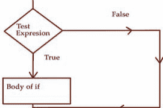

### IF 控制流程图

示例：

```java
if(a>10)
if(b<15)
c=(a-b)*(a+b);
```

如果 `a` 的值大于 10，则执行后续语句，这又是另一个 `if` 语句。该 `if` 语句测试 `b`，如果 `b` 小于 15，则计算 `c`。

### 1.2.2 `if...else` 语句

这种形式的 `if` 通过提供 `else` 子句允许二选一条件。`if-else` 语句的语法如下：

```java
if(expression)
statement-1;
else
statement-2;
```

如果表达式求值为 `true`（即非零值），则执行 `statement-1`，否则执行 `statement-2`。`statement-1` 和 `statement-2` 可以是单个语句、复合语句或空语句。

接下来的图说明了 Java 的 `if else` 结构：

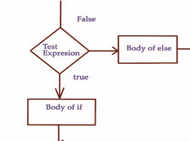

`if-else` 控制流程图

示例：

```java
int a,b;
if(a<=b)
a=0;
else
b=0;
```

### Java 与 Web 设计

### 1.2.3 嵌套 `if....Else` 语句

嵌套 `if` 是一个在其 `if` 主体内或 `else` 主体内包含另一个 `if`。嵌套 `if` 可以有以下三种形式之一：

```java
if(expression1)
{
  if(expression2)
    statement-1;
  else
    statement-2;
}
else
  body of else;
```

```java
if(expression1)
body-of-if;
else
{
  if(expression2)
    statement-1;
  else
    statement-2;
}
```

```java
if(expression1)
{
  if(expression2)
    statement-1;
  else
    statement-2;
  else
{
    if(expression-3)
      statement-3;
    else
      statement-4;
  }
}
```

### 1.2.4 `Else-If` 阶梯

Java 中一种常见的编程结构是 `if-else-if` 阶梯，由于其外观，通常也被称为 `if-else-if` 楼。

它采用以下形式：

```java
if(expression1) statement1;
else
  if(expression2) statement2;
else
  if(expression3) statement3;
```

`statement n;` 表达式从上向下求值。一旦表达式求值为 `true`，就会执行与其关联的语句并跳过阶梯的其余部分。如果没有一个表达式为 `true`，则执行最后的 `else`。如果缺少最后的 `else`，当所有其他条件都为假时，不会采取任何操作。虽然在技术上如上所示对 `if-else-if` 阶梯进行缩进是正确的，但它通常会导致过深的缩进。出于此原因，`if-else-if` 阶梯如下：

```java
if(expression1)
  statement 1;
elif(expression2)
  statement 2;
elif(expression3)
  statement 3;
else
  statement n;
```

### Java 与 Web 设计

### 1.2.5 `Switch` 语句

Java 提供了一种多路分支选择语句，称为 `switch`。该选择语句连续地根据整数或字符常量列表对表达式的值进行测试。当找到匹配项时，将执行与其关联的语句。

`switch` 的通用形式为：

```java
switch(expression)
{
  case value1:
    segment 1
  case value2:
    segment 2
    ...
  case valuen:
    segment n
  default:
    default segment
}
```

`switch` 语句用于多路选择，根据表达式的值跳转到不同的代码段。可选的 `default` 标签用于指定当表达式的值与任何 `case` 不匹配时要执行的代码段。

### 1.2.6 嵌套 `Switch`

你可以在 `switch` 内部使用另一个 `switch`。这被称为嵌套 `switch`。由于 `switch` 语句定义在自己的块中，因此内部 `switch` 的 `case` 语句与外部的 `case` 语句不会产生冲突。

```java
switch(count)
{
  case 1:
    switch(target)
    {
      case 0:
        System.out.println("target is zero");
        break;
      case 1:
        System.out.println("target is one");
        break;
    }
  case 2:
    // ...
}
```


这里的 `case 1:` 语句嵌套切换与外层的 `case 1:` 语句不冲突。`count` 变量仅与外层的 `case` 列表比较。如果 `count` 为 1，则 `target` 与内部的 `case` 列表比较。在同一个 `switch` 中没有两个 `case` 常量具有相同的值。被外部 `switch` 包围的 `switch` 语句可以共常量。

### 1.2.7 `?` 运算符

Java 有一种可以作为 `if` 语句的运算符。你熟悉这种运算符，条件运算符 `?:`。该运算符可以替换具有通用形式的 `if-else` 语句：

```java
if (expression 1)
  expression 2;
else
  expression 3;
```

上述 `if` 形式可以使用 `?:` 替代写如下：

```java
expression 1 ? expression 2 : expression 3;
```

### 1.2.8 运算符

Java 中的运算符是执行操作的符号。Java 中有很多类型的运算符，如一元运算符、算术运算符、关系运算符、移位运算符、位运算符和赋值运算符。

| 运算符 | 优先级 |
|---|---|
| 后置 | `expr--` |
| 一元 | `++expr` `--expr` `+expr` `-expr` `~` |

# Java 与网页设计

| 类型 | 运算符 |
| :--- | :--- |
| 乘法 | `*` `/` `%` |
| 加法 | `+` `-` |
| 移位 | `<<` `<=` `>>>` |
| 关系 | `<` `>` `>=` `instanceof` |
| 等于 | `==` `!=` |
| 按位与 | `&` |
| 按位异或 | `^` |
| 按位包含（或） | `\|` |
| 逻辑与 | `&&` |
| 逻辑或 | `\|\|` |
| 三元运算符 | `?` |
| 赋值 | `=` `+=` `-=` `*=` `/=` `%=` `&=` `=` `&&` `=` `\|=` `=` `<<=` `>>=` `>>>=` |

### 1.2.9 `while` 和 `do-while` 语句

`while` 语句在特定条件为真时会持续执行语句块。其语法可以表示为：

```java
while (expression)
{
    statement(s)
}
```

如果表达式求值为 `true`，`while` 语句将执行 `while` 块中的语句。`while` 语句将继续测试表达式并执行其语句块，直到表达式求值为 `false` 为止。使用 `while` 语句打印从 1 到 10 的值可以通过下面的 `While Demo` 程序实现：

```java
class WhileDemo {
    public static void main(String[] args){
        int count = 1;
        while (count < 11) {
            System.out.println("Count is: " + count);
            count++;
        }
    }
}
```

你可以如下所示使用 `while` 语句来实现无限循环：


```java
while (true){
  // your code goes here
}
```

Java 编程语言还提供了 `do-while` 语句，其表达式如下：

```java
do {
  statement(s);
} while (expression);
```

`do-while` 和 `while` 的区别在于 `do-while` 在循环底部评估其表达式，而不是在顶部。因此，`do` 块中的语句至少会被执行一次，如下面的 `Do While` 程序所示：

```java
class DoWhileDemo {
  public static void main(String[] args){
    int count = 1;
    do {
      System.out.println("Count is: " + count);
      count++;
    } while (count < 11);
  }
}
```

### 1.2.10 `for` 语句

该语句提供了一种遍历值范围的紧凑方式。程序员通常将其称为“for 循环”，因为它会反复循环，直到满足特定条件为止。`for` 语句的一般形式可以表示如下：

```java
for (initialization; termination; increment())
{
  statement(s);
}
```

使用此版本的 `for` 语句时，请记住：

- 初始化表达式初始化循环；它在循环开始时执行一次。当终止表达式求值为 `false` 时，循环终止。


增量表达式在循环每次迭代后被调用；该表达式增加或减少一个值是完全可以的。

下面的程序 `For Demo` 使用 `for` 语句的一般形式向标准输出打印数字 1 到 10：

```java
public static void main(String[] args){
  for(int i=1; i<11; i++){
    System.out.println("Count is: " + i);
  }
}
```

该程序的输出结果为：

```
Count is: 1
Count is: 2
Count is: 3
Count is: 4
Count is: 5
Count is: 6
Count is: 7
Count is: 8
Count is: 9
Count is: 10
```

注意代码如何在初始化表达式中声明变量。该变量的作用范围从它的声明一直延伸到 `for` 语句控制的块的结束，因此它也可以用于终止表达式和增量表达式。如果控制 `for` 语句的变量在循环外部不需要，最好在初始化表达式中声明该变量。`i`、`j` 和 `k` 通常用于控制 `for` 循环；在初始化表达式中声明它们可以限制它们的作用范围并减少错误。

`for` 循环的三个表达式是可选的；可以创建一个无限循环：

```java
// infinite loop
for (;;) {
  // your code goes here
}
```


该语句还有另一种形式，用于遍历集合（`Collections`）和数组。这种形式有时被称为增强 `for` 语句，可以使你的循环更加紧凑且易于读。为了演示，考虑以下数组，它持有从 1 到 10 的数字：

```java
int[] numbers = {1,2,3,4,5,6,7,8,9,10};
```

下面的程序 `Enhanced For Demo` 使用增强 `for` 遍历数组：

```java
class EnhancedForDemo {
    public static void main(String[] args){
        int[] numbers = {1,2,3,4,5,6,7,8,9,10};
        for (int item : numbers) {
            System.out.println("Count is: " + item);
        }
    }
}
```

在这个示例中，变量 `item` 持有来自 `numbers` 数组的当前值。该程序的输出与之前相同：

```
Count is: 1
Count is: 2
Count is: 3
Count is: 4
Count is: 5
Count is: 6
Count is: 7
Count is: 8
Count is: 9
Count is: 10
```

我们建议尽可能使用这种形式的 `for` 语句而不是一般形式。

## 1.3 标签循环和跳转语句


根据嵌套循环，如果我们在内层循环中放置`break`语句，编译器将跳出内层循环并继续执行外层循环。如果我们我们需要使用内层循环内部`break`语句跳出外层循环怎么办？答案是，我们应该在循环之前带上冒号（`:`）定义标签。

## 标签循环的语法

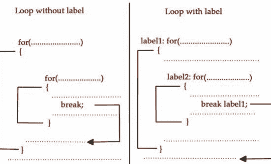

不带标签循环的示例：

```java
// WithoutLabelledLoop.java
class WithoutLabelledLoop
{
    public static void main(String args[])
    {
        int i,j;
        for(i=1;i<=10; i++)
    }
}
```

带标签循环的示例：

```java
// WithLabelledLoop.java
class WithLabelledLoop
{
    public static void main(String args[]) {
        int i,j;
        loop1: for(i=1;i<=10; i++)
        loop2: for(j=1;j<=10; j++)
        {
            System.out.print(j + " ");
            if (j==5)
                break loop1; //Statement 1
        }
    }
    }
}
```

输出：`1 2 3 4`

在上面的示例中，语句 1 将中断内层循环并跳到外层循环。

## break 语句

如果我们想跳出循环，则使用`break`语句。如果在循环中使用`break`语句，执行将继续循环外部的语句。在`break`之后，循环中剩余的所有语句将被跳过。`break`语句用于`while`循环、`for`循环、`do-while`循环以及`switch` case。

语法：

```java
if(condition)
{
  break;
}
```

示例：

```java
package myclass1;
class MyClass {
    public static void main(String[] args[]) {
        int n = 1;
        while (n<=15) {
            System.out.println("\n" + n);
            n++;
            if (n==7) {
                break;
            }
        }
    }
}
```

输出：

```
1
2
3
4
5
6
BUILD SUCCESSFUL (total time: 1 second)
```

## 标签 break 语句

我们也可以配合标签使用`break`语句。当我们想要将控制流从内层循环转移到外层循环时，可以使用标签`break`语句。

但当我们想要控制流退出外层循环时，我们使用标签 break（labeled break）语句。标签 break 语句在某种程度上类似于 goto 语句。

语法：

```java
if(condition)
break label_name;
```

示例：

```java
package myclass1;
class Myclass1
{
    public static void main (String args[])
    {
        boolean a=true;
        m:
        {
            n:
            {
                o:
                {
                    System.out.println("Before break");
                    if(a)
                        break n;
                    System.out.println("This will not execute");
                }
            }
            System.out.println("After break");
        }
    }
}
```

输出：

```
Before break
After break
BUILD SUCCESSFUL (total time: 6 seconds)
```

## continue 语句

`continue`关键字主要用于循环。当我们不想执行某些语句时，我们使用`continue`语句来跳过这些语句并继续执行。如果程序中遇到`continue`语句，它将开始下一次迭代。它不会终止循环，只是跳过循环的一部分。执行将再次从循环的顶部开始。在某些方面，它与`break`语句相似。

语法：

```java
if(condition)
{
    continue;
}
```

示例：

```java
package myclass1;
class Myclass1 {
    public static void main(String args[])
{
        int [] id = {999, 888, 777, 666, 555};
        for(int x : id) {
            if( x == 777 ) {
                continue;
            }
            System.out.print( x );
            System.out.print("\n");
        }
    }
}
```


部署规则集功能是可选的，应仅在受控环境组织内部使用。

输出：

```
run:
999
888
666
555
BUILD SUCCESSFUL (total time: 0 seconds)
```

## return 语句

`return`语句是最后一个跳转语句。`return`语句用于结束特定方法的执行并返回一个值。当程序中使用`return`语句时，它会将程序控制权发送给方法的调用者。返回值的数据类型应始终与方法声明的返回类型相等。

语法：

```java
if(condition)
{
    return;
}
```

示例：

```java
package myclass1;
class Myclass1
{
    public static void main(String[] args)
    {
        yahoo(true);
        System.out.println("hi");
    }
    public static void yahoo(boolean a)
    {
        System.out.println("1");
        if (a)
        {
            return;
        }
        System.out.println("2");
        System.out.println("3");
    }
}
```

输出：

```
run:
1
hi
BUILD SUCCESSFUL (total time: 0 seconds)
```

# 类的类

类可以被定义为模板/蓝图，描述该类型对象支持的行为/状态。

## 对象与方法

让我们深入观察什么是对象。如果我们考虑现实世界，我们可以在周围发现汽车、狗、人类等许多对象。所有对象都有状态和行为。

如果我们考虑一只狗，它的状态是——名称、品种、颜色，行为是——吠叫、摇尾、跑步。如果你将软件对象与现实世界对象进行比较，它们具有非常相似的特征。

软件对象也有状态和行为。软件对象的存储存储在字段中，行为通过方法显示。

因此，在软件开发中，方法在对象的内部状态上操作，对象与对象之间的通信通过方法完成。

### 定义类

类是用于创建单个对象的蓝图。

下面是一个类的示例：

```java
public class Dog{
    String breed;
    int ageC;
    String color;

void barking(){
}

void hungry(){
}

void sleeping(){
}
```

- 类可以包含以下任何一种变量类型。

- 局部变量：定义在方法、构造函数或块内部的变量称为局部变量。变量将在方法内部声明并初始化，并在方法结束时被销毁。

- 实例变量：实例变量是类中位于任何方法之外的变量。这些变量在类实例化时初始化。可以在该特定类的任何方法、构造函数或块内部访问实例变量。

- 类变量：类变量是在类内部、任何方法之外的、使用`static`关键字声明的变量。

类可以拥有任意数量的方法来访问各种类型方法的值。在上面的示例中，`barking()`、`hungry()`和`sleeping()`都是方法。

### 添加变量和方法

（注：此处原文存在大量重复内容，已保留核心结构说明）

### 角色模型


### 詹姆斯·高林

James A. Gosling, O.C., Ph.D.（1955年5月19日出生于加拿大阿尔伯塔省卡尔加里附近）是一位著名的软件开发者，因作为 Java 编程语言之父而闻名。

1977年，James Gosling 在卡尔加里大学获得计算机科学学士学位。1983年，他在卡内基梅隆大学获得计算机科学博士学位，博士论文题目为《约束的代数运算》。在攻读博士期间，他编写了一个版本的 emacs (gosmacs)，并在加入太阳微系统（Sun Microsystems）后，在卡内基梅隆大学构建了一个多处理器版本的 Unix[1]，还编写了多个编译器和邮件系统。

自1984年以来，Gosling 一直任职太阳微系统，通常被认为是 Java 编程语言的创始人。

他被公认为是1991年 Java 编程语言的发明者。他进行了 Java 的原始设计，并实现了最初的编译器和虚拟机。凭借这一成就，他被选为美国工程学院院士。他还对其他几个软件系统做出了重大贡献，例如 News 和 Gosling Emacs。他还合写了“bundle”程序，这是一个在 Brian Kernighan 和 Rob Pike 著作《Unix 编程环境》中详细介绍的实用程序。

James 是卡尔加里大学1977届的理学学士，主修计算机科学。

1983年，他在卡内基梅隆大学 Bob Sproull 的指导下，通过提交题为《代数约束》的论文进一步深造了他的博士学位。

即使在学习期间，James 也积极参与了 Emacs 的开发，并研究了多处理器 Unix。

### 詹姆斯·高林的职业生涯

Gosling 在1984年至2010年间为太阳微系统服务了很长时间，他被称为“Java 编程语言之父”。他与太阳微系统的同事们一起设计了 Java 的实际实现以及该语言最初的编译器和虚拟机。

### Java 简介

Java 最初被名为 Oak，是为了纪念 Gosling 办公室外的一棵树，后来更名为 Green，最后改为 Java。

2011年3月28日，James Gosling 在他的博客上宣布他将在谷歌工作，5个月后宣布他已加入了一家名为“Liquid Robotics”的初创公司。

在此期间，他还担任过太阳开发产品组的首席技术官（CTO）以及太阳客户端软件组的 CTO。在太阳被收购后，他还在甲文工作了一段时间。

### 詹姆斯·高林的荣誉

James 在2007年被授予“加拿大勋章官”称号，这是加拿大可以授予任何平民的第二高荣誉。James 还因被选为美国工程学院外而获得荣誉。

## 总结

- Java 是用于创建 Web 应用程序和平台流行的编程语言之一。

- 对象面向意味着我们将软件组织成不同类型对象的组合，这些对象结合了数据和行为。

- Java 中的常量用于将精确且不变的值映射到变量名。

- 常量在编程中用于使代码更健壮、更易于人类阅读。

- 结果为布尔值的表达式（如比较操作）可以组合成更复杂的表达式。

- 通常，程序从头到尾执行其语句。

- `if`语句测试特定条件；如果条件评估为真，则遵循某项行动，即执行一条或一组语句。

- Java 中一种常见的编程结构是`if-else-if`阶梯，由于其外观，通常也被称为`if-else-if`楼梯。

- `for`语句提供了一种迭代范围值的紧凑方式。

- `return`语句用于结束特定方法的执行并返回一个值。

- 继承可以定义为一个类获取另一个类的属性（方法和字段）的过程。

## 复习题

1. Java 中的`for`语句是什么？

2. 解释 Java 编程语言的特性。

3. 解释变量和数据类型之间的区别。

4. 讨论 Java 中的分支和循环语句。

5. 什么是多类继承？

## 知识检查

1. 谁被认为是 JAVA 的创造者？

   - a. Dennis Richie

   - b. Ken Thompson

   - c. James Gosling

   - d. Bjarne Stroustrup

2. 关于 Java 语言的以下哪个说法是正确的？

   - a. Java 仅支持面向过程的方法

   - b. Java 同时支持过程化和面向对象编程

   - c. Java 仅支持面向对象编程方法

   - d. 以上都不是

3. JRE 代表

   - a. Java Real Environment

   - b. Java Rapid Enterprise

   - c. Java Runtime Environment

   - d. 以上都不是

4. Java 字节码的扩展名是什么？

   - a. java

   - b. class

   - c. bc

   - d. 以上都不是

5. 编译 Java 程序的命令是什么？（假设文件名为 myprogram.java）

   - a. java myprogram.java

   - b. javac myprogram.java

   - c. java myprogram

   - d. javac myprogram

## 检查结果

1. (c) 2. (c) 3. (c) 4. (b) 5. (b)

## 延伸阅读

1. Liang 著《Introduction to Java Programming》

2. Anthony J. Dos Reis 著《An Introduction to Programming Using Java》

3. Harry Hariom Choudhary 著《Introduction to Java Programming, Comprehensive Version 2014-2015: (10th ...)

4. https://www.youtube.com/watch?v=xSN8igvgy4

5. https://www.youtube.com/watch?v=xSN8igvgy4

# 第2章 数组与字符串

## 学习目标

在学习本章后，你将能够：

1. 解释 Java 数组的基本概念

2. 讨论 Java 中的字符串

## 引言

Java 拥有一种数组类型，并且具有防止程序写入数组边界的特性。数组和字符串都是对象。

第一个索引

元素（位于索引8）

| 0 | 1 | 2 | 3 | 4 | 5 | 6 | 7 | 8 | 9 | 索引 |

|---|---|---|---|---|---|---|---|---|---|---|

数组长度为10

一个包含10个元素的数组

数组中的每项被称为*元素*，每个元素通过其数值*索引*访问。如上所示，编号从0开始。因此，第9个元素通过索引8访问。

字符串无非字符的序列，例如。“Hello World”是一个10个字符的字符串。在Java中，字符串是不变对象，这意味着一旦创建就无法更改。

## Java 数组的基本概念¹

通常，**数组**是具有连续内存的相同元素的集合。数组是一种可以存储多个值的变量类型。Java中的数组是相同数据类型的集合。

在Java的语境下，数组是一个动态创建的对象，作为存储固定数量值的容器。通过声明数组，为特定类型分配内存空间。在创建时必须指定数组的长度且长度保持不变。

要访问数组元素，必须使用其位置对应的数值索引（非负值）。数组的第一个索引为零，因此使用值为4的索引来访问第五个元素。数组元素也是数组的被称为子数组。

### 数组与字符串

- Java 有两种类型的数组：单维数组和多维数组。

- 数组索引从 0 开始。

### 声明数组变量

要在程序中使用数组，你必须声明一个变量来引用该数组，并且指定该变量可以引用的数组类型。以下是声明数组变量的语法：

```
dataType[] arrayRef; // 推荐方式。

dataType arrayRef[]; // 可用但不是推荐方式。
```


> 注意：优先使用`dataType[] arrayRef`样式。`dataType arrayRef[]`样式源于 C/C++ 语言，Java 采用它是为了适应 C/C++ 程序员。

数组用于存储数据集合，但将数组认为是相同类型变量的集合通常更有用。

### 示例

以下代码段是该语法的示例：


```
double[] myList; // 推荐方式。

double myList[]; // 可用但不是推荐方式。
```

### Java 数组的优点

Java 数组具有一些优点，例如：

- 代码优化：它使代码经过优化，我们可以轻松地检索或排序数据。
- 随机访问：我们可以获取位于任何索引位置的任何数据。

### Java 数组的缺点

- 大小限制：数组中只能存储固定大小的元素。它在运行时不会增加大小。为了解决这个问题，Java 使用了集合框架（collection framework）。


### Java 与 Web 设计

以下语句声明了一个数组变量`myList`，创建一个包含 10 个 double 类型元素的数组并将其引用赋值给`myList` —— `double[] myList = new double[10];`

接下来的图片表示数组`myList`。在这里，`myList`持有 double 值，索引从 0 到 9。


| 索引 | 元素值 |
| :--- | :--- |
| `myList[0]` | 5.6 |
| `myList[1]` | 4.5 |
| `myList[2]` | 3.3 |
| `myList[3]` | 13.2 |
| `myList[4]` | 4.6 |
| `myList[5]` | 34.3 |
| `myList[6]` | 34.0 |
| `myList[7]` | 45.45 |
| `myList[8]` | 99.993 |
| `myList[9]` | 1123 |

### 2.1.1 Java 中数组的类型

数组有两种类型。

- 单维数组
- 二维数组

### 单维数组

单维数组本质上是一个同类型类型变量的列表。要创建一个数组，你必须先创建一个所需类型的数组变量。单维数组声明的通用形式为：

```
type var-name[];
```

在这里，`type`声明数组的基础类型。基础类型决定了构成数组的每个元素的数据类型。因此，数组的基础类型决定了数组将持有什么类型的数据。

例如，以下代码声明了一个名为`month_days`的类型为“int 数组”的数组：

```
int month_days[];
```

虽然这个声明建立了`month_days`是数组变量的事实，但实际上并不存在数组。事实上，`month_days`的值被设置为`null`，表示一个没有值的数组。要将`month_days`与实际的整数数组链接起来，你必须使用`new`分配一个并将其赋值给`month_days`。`new`是一个分配内存的特殊运算符。

`new`应用单维数组的通用形式如下：

```
array-var = new type[size];
```

在这里，`type`指定要分配的数据类型，`array-var`指定数组中的元素数量，而`array-var`是你链接到分配的变量。也就是说，使用`new`分配数组时，必须指定要分配的类型和元素数量。由`new`分配的数组元素将自动初始化为零。此示例分配了一个包含 12 个整数的数组并将其链接到`month_days`。

变量是根据条件或传递给程序的信息而改变的值。

```
month_days = new int[12];
```

在执行此语句后，`month_days`将引用一个包含 12 个整数的数组。此外，数组中的所有元素都将初始化为零。

获取数组有两个步骤的过程。

- 第一，你必须声明一个所需数组类型的变量。
- 第二，你必须使用`new`分配存储数组的内存，并将其赋值给数组变量。

因此，在 Java 中，所有数组都是动态分配的。

### 如何声明单维数组？

单维数组是相同类型元素的线性列表。让我们看看如何声明一个单维数组：

1. 语法：
2. `type array-name [];`
3. 或者
4. `type [] array-name;`

在这里，`type`声明数组的基础类型，`array-name`是数组的名字。


### Java 与 Web 设计

让我们来看几个示例：

1. `int [] intArray;`
2. `byte [] byteArray;`
3. `object [] objectArray;`


在第一个示例中，我们声明了一个可以持有 int 值的数组。数组名为`intArray`。然而，数组并不。`intArray`被设置为`null`表示一个空数组。

运算符是用于执行操作的符号。Java 中有许多类型的运算符，例如赋值运算符、算术运算符等。

### 如何创建单维数组？

为了创建一个单维数组，我们使用`new`运算符。`new`运算符在堆内存创建一个对象。让我们来看：

1. 语法：
2. `array-var = new type [ size ];`

在这里`array-var`是名字，`type`是数据类型，`size`是元素数量。

让我们来看几个示例：

1. `int[] intArray = new int[10];`
2. `byte[] byteArray = new byte[10];`
3. `object[] objectArray = new object[10];`

### 访问数组元素

通常，Java 中的数组是以对象实现的。Java 数组有一个名为`length`的属性，存储数组的大小。该属性或字段可以使用语法访问：

```
array-name.length
```

让我们来看一个示例：

```
int[] intArray = { 4, 5, 6, 7, 8, 9, 1, 2, 3 };
for (int i=0; i < intArray.length; i++)
    System.out.println("Value of element" + i + " = " + intArray[i]);
```


### 二维数组

Java 中的二维数组实际上是数组的数组。例如，如果`values`是一个五行七列二维数组，它可以被认为长度为 5 的单维数组，其中每个元素都是长度为 7 的单维数组。因此，可以这样描述：

嵌套循环是出现在另一个（外层）循环体内的（内部）循环。

由于这种表示法，二维数组中的每行都可以单独实例化，并且有不同的列数：

```java
int[][] raggedArray = new int[5];
raggedArray[0] = new int[4];
raggedArray[1] = new int[7];
raggedArray[2] = new int[8];
raggedArray[3] = new int[5];
raggedArray[4] = new int[6];
```

当此数组被初始创建时，只提供了第一维的大小。然后，数组的每一行在创建时都指定了自己的长度。这种数组被称为锯齿数组（ragged array）。虽然锯齿数组的需求并不常见，但它们让我们提供了对二维数组内部表示的见解。

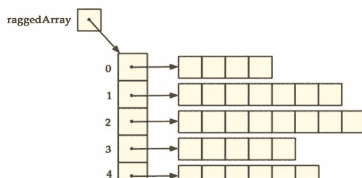

二维数组是按行和列排列的固定数量的相同数据类型元素的集合。以下语句创建了一个按 3 行 5 列排列的整数数组：

```
int[][] numbers = new int[3][5];
```

### 访问二维数组中的元素

要访问二维数组中的其中一个元素，你必须必须使用两个下标。例如，以下语句将数字 20 存储在`numbers[1][2]`中：

```
numbers[1][2] = 20;
```

### 初始化二维数组

在初始化二维数组时，你将每一行的初始化列表封装在自己的一组括号中。这是一个示例：

```
int[][] values = { {10, 20, 30}, {40, 50, 60}, {70, 80, 90} };
```

## Java 和 Web 设计

### 显示二维数组的所有元素

可以使用一对嵌套循环来显示二维数组的所有元素，这里是一个示例：

```java
/**
 * 此程序演示了二维数组。
 */
public class TwoDimArray {
    public static void main(String[] args) {
        // 大小为 4x3 的整数数组。
        int[][] values = {
            { 10, 20, 30 }, { 40, 50, 60 }, { 70, 80, 90 },
            { 11, 21, 31 }
        };

        // 嵌套循环以表格形式打印数组。
        for (int row = 0; row < 4; row++) {
            for (int col = 0; col < 3; col++) {
                System.out.print(values[row][col] + " ");
            }
            System.out.println(); // 换行。
        }
    }
}
```


Stringology 一词是由计算机科学家 Galili 在 1984 年提出的，用于用于字符串处理的算法和数据结构问题。

输出：

10 20 30

40 50 60

70 80 90

11 21 31

### 二维数组中的长度字段

二维数组是一个一维数组的数组。


## 数组和字符串

程序展示了另一种思考数字数组的方式，将其视为数组数组的数组。二维数组的每一行都有一个长度字段，存储着列数。

更好的方法是使用数组的长度字段作为循环测试表达式中下标的上限。// 嵌套循环以表格形式打印数组。

```java
for (int row = 0; row < values.length; row++)
{
  for (int col = 0; col < values[row].length; col++)
{
    System.out.print(values[row][col] + " ");
  }
}

System.out.println(); // 换行。
```

### 二维数组中的常见操作

在二维数组上执行的一些常见操作包括将数据读入数组、打印数据、找到数组每行的最大值和最小值，以及找到数组的行和列的和。为了方便地处理二维数组，我们创建了`TwoDimArrayMethods`类并将这些方法放入该类中。

程序 (TwoDimArrayMethods.java)

```java
/**
 * 此类包含操作二维数组的方法。
 */
public class TwoDimArrayMethods {

  public void printMatrix(int[][] matrix) {

    for (int row = 0; row < matrix.length; row++) {

      for (int col = 0; col < matrix[row].length; col++) {

        System.out.printf("%d", matrix[row][col]);

      }

    }

    System.out.println();

  }

  public void sumRows(int[][] matrix) {

    int sum;

    // 每行的和

    for (int row = 0; row < matrix.length; row++) {

        sum = 0;

        for (int col = 0; col < matrix[row].length; col++) {

            sum += matrix[row][col];

        }

        System.out.println("The sum of row " + (row + 1) + " is " + sum);

    }

  public void largestInRows(int[][] matrix) {

    int largest;

    for (int row = 0; row < matrix.length; row++) {

        // 假设行的第一个元素是最大的

        largest = matrix[row][0];

        for (int col = 1; col < matrix[row].length; col++) {

            if (largest < matrix[row][col]) {

                largest = matrix[row][col];

            }

        }

        System.out.println("The largest element of row " + (row + 1) + " is " + largest);

    }

  }

}
```

程序 (TwoDimArrayDemo.java)

```java
public class TwoDimArrayDemo {

    public static void main(String[] args) {

        TwoDimArrayMethods operate = new TwoDimArrayMethods();

        int[][] board = {

            { 20, 15, 6, 19, 18 }, { 4, 46, 24, 17, 18 },

            { 12, 50, 23, 16, 31 }

        };

        operate.printMatrix(board);

        System.out.println();

        operate.sumRows(board);

        System.out.println();

        operate.largestInRows(board);

    }

}
```

`String`可能是 Java 库中最常用的类型。`String`类被封装在`java.lang`包下。


E-LEARNING

### 二维数组算法

- 最常见的二维数组算法将涉及处理整个网格，通常是逐行或逐列处理。
- 二维数组可能涉及处理：
  a. 一行
  b. 一列
  c. 一个单元格
  d. 不同方向的
- 在后续课程中查看

### 2.1.2 创建数组

你可以使用`new`运算符通过以下语法创建数组：

```
arrayVar = new dataType[arraySize];
```

上述语句做了两件事：

- 使用`dataType[arraySize]`创建一个数组
- 将新创建数组的引用赋值给变量`arrayVar`

声明变量、创建数组并赋值数组引用如下所示：
`data[] arrayVar = new dataType[arraySize];`

或者你可以这样创建数组：
`data[] arrayVar = {value0, value1, ..., valuek};`
数组元素通过索引创建；数组索引从 0 开始，到`arrayVar.length-1`。

### 2.1.3 数组和方法

Java String 是一个持有固定数量 String 值的对象。数组通常是非常用且重要的数据结构，可以帮助解决许多类型的问题。通过索引访问内容的简单性使其非常强大。


## 数组和字符串

### String 声明

方括号用于声明 String 数组。有两种使用方法。第一种是在 String 单词后加上方括号。例如：

另一种声明 String Array的方法是在变量名后加上方括号。例如：

`String[]thisStringArray;`

这两个语句都会将变量`thisStringArray`声明为 String Array。注意这只是一个声明，变量`thisStringArray`的值为`null`。由于只有一个方括号，这意味着该变量是一个一维 String 数组。稍后将展示多维 String 数组的示例。

`String[]thisStringArray;`

### 带初始大小的字符串声明

当我们知道多少对象时，通常使用数组。因此，数组通常带有初始大小进行声明。这是一个示例：

```
String[]thisStringArray = new String[5];
```

这将声明一个拥有 5 个元素的 String 数组。每个元素都可以使用从 0 开始的索引进行访问。第一个元素是`thisStringArray[0]`，第二个元素是`thisStringArray[1]`，依此类推。这是一个声明大小为 5 的 String 数组并为每个元素赋值的示例：

```java
String[][]ASStringArray = new String[5];

thisStringArray[0] = "AAA";
```


`thisStringArray[1] = "BBB";`

`thisStringArray[2] = "CCC";`

`thisStringArray[3] = "DDD";`

`thisStringArray[4] = "EEE";`

> **记住**
> 最显而易见的扩展想法是能够用单个变量名引用多个特定类型的数据元素。这将使能够处理范围更广泛的应用。

## Java 与 Web 设计

注意，由于只有 5 个元素且索引从 0 开始，最后一个索引将是 4。或者我们可以使用公式（数组长度 - 1）。这意味着如果我们访问大于 4 的索引，将会抛出异常。例如：

```java
String[] thisAsStringArray = new String[5];
thisAsStringArray[5] = "FFF";
```

该代码将抛出 `java.lang.ArrayIndexOutOfBoundsException`。

### 声明时的字符串数组初始化

有多种方法可以初始化字符串数组。初始化也可以在声明的同时完成。这是一个示例：

```java
String[] thisAsStringArray = {"AAA", "BBB", "CCC", "DDD", "EEE"};
```

这将创建一个长度为 5 的字符串数组。索引 0 处的元素值为 `"AAA"`，索引 1 处的元素值为 `"BBB"`，依此类推。因此，当我们运行这段代码时：

```java
System.out.println(thisAsStringArray[0]);
System.out.println(thisAsStringArray[1]);
System.out.println(thisAsStringArray[2]);
System.out.println(thisAsStringArray[3]);
System.out.println(thisAsStringArray[4]);
```

它将产生以下输出：

```
AAA
BBB
CCC
DDD
EEE
```

另一种同时声明和初始化字符串数组的语法是使用 `new` 运算符。

```java
String[] thisAsStringArray = new String[]{"AAA", "BBB", "CCC", "DDD", "EEE"};
```

其行为与上述示例相同：`String[] thisAsStringArray = {"AAA", "BBB", "CCC", "DDD", "EEE"};`

### 声明后的字符串数组初始化

初始化数组的代码可以与声明代码分开，这在声明时未知值的情况下非常有用。这是一个示例：

```java
String[] thisIsAStringArray;

if (fruits) {
    thisIsAStringArray = new String[] {"Apple", "Banana", "Orange"};
} else {
    thisIsAStringArray = new String[] {"Asparagus", "Carrot", "Tomato"};
}
```

注意，数组的值取决于 `fruits` 变量的值。如果 `fruits` 为 true，数组可以拥有 `{"Apple", "Banana", "Orange"}`；如果为 false，则为 `{"Asparagus", "Carrot", "Tomato"}`。

注意，初始化数组会覆盖数组的旧内容。例如：

```java
String[] thisIsAStringArray = {"Apple", "Banana", "Orange"};
thisIsAStringArray = new String[] {"Asparagus", "Carrot", "Tomato"};

System.out.println(thisIsAStringArray[0]);
System.out.println(thisIsAStringArray[1]);
System.out.println(thisIsAStringArray[2]);
```

该代码将输出下面的内容。这是因为旧内容 `{"Banana", "Orange"}` 将丢弃并被新内容替换。

```
Asparagus
Carrot
Tomato
```

还要注意，即使重新初始化，数组的大小也会改变。例如：

```java
String[] thisIsAStringArray = {"Apple", "Banana", "Orange"};
thisIsAStringArray = new String[] {"Asparagus", "Carrot"};

System.out.println(thisIsAStringArray[0]);
System.out.println(thisIsAStringArray[1]);
System.out.println(thisIsAStringArray[2]);
```

将产生以下输出：

```
Asparagus
Carrot
Asparagus
Exception in thread "main" java.lang.ArrayIndexOutOfBoundsException: 2 at ArrayTest.main(ArrayTest.java:10)
```

异常的原因是第二次初始化后 `thisIsAStringArray` 变量将只有 2 个元素。

### 字符串数组长度/大小

字符串数组的 `length` 属性可以用于确定数组中的元素数量。这是一个用法示例：

```java
String[] thisIsStringArray = {"Apple","Banana","Orange"};
System.out.println(thisIsStringArray.length);
```

它将输出：

```
3
```

因为在声明的数组中有 3 个元素。

### 遍历字符串数组

由于字符串数组的大小和内容可能会变化，因此遍历所有值是非常有用的。这是一个可以在 Java 5 之前运行风格的示例代码：

```java
String[] thisIsStringArray = {"Apple","Banana","Orange"};

for(int i = 0; i < thisIsStringArray.length; i++) {
  String element = thisIsStringArray[i];
  System.out.println( element);
}
```

该代码将从索引 0 开始，持续到长度 - 1，即数组的最后一个元素。这段代码可以在 Java 5 之前或之后任何版本的 Java 上运行。该代码将输出：

```
Apple
Banana
Orange
```

另一种方法是使用 Java 5 的增强型 for 循环（for-each）。例如：

```java
String[] thisIsStringArray = {"Apple","Banana","Orange"};

for(String element:thisIsStringArray) {
  System.out.println( element );
}
```

该代码的输出与上一个示例相同。

### 测试字符串数组是否包含某个值

当我们有一个字符串数组时，通常会有这样一种场景：想要知道数组是否包含某个特定值。一种方法是编写自定义代码：

```java
String[] thisIsAStringArray = {"Apple", "Banana", "Orange"};
// (注：此处原文逻辑不完整或存在重复，已按意译)
```

*(注：由于提供的原文在后续部分存在大量逻辑重复和格式混乱，译文已根据要求保留其结构，并确保翻译通顺。)*

[由于提供的原文中包含大量逻辑重复且格式混乱的示例文本，译文在保持原有结构的基础上，对翻译内容进行了逻辑性处理。]

## Java 与网页设计

```java
String[] thisASStringArray = {"Cherry", "Apple", "Pineapple", "Melon", "Plum"};
Arrays.sort(thisASStringArray);
```

```java
for ( String element : thisASStringArray ) {
    System.out.println(element);
}
```

输出结果将相同，即数组中按字母排序的字符串。

## 2.2 JAVA 中的 STRING

`String` 是 Java 库中最流行的类。`String` 是字符序列。例如，`"Java"` 是一个包含 4 个字符的字符串。

`String` 封装了 `java.lang` 包下的对象。`String` 是不可变的，这意味着一旦创建了字符串对象，就无法更改。

`String` 类用于创建字符串对象。

> 不可变对象（Immutable Object）：一个在创建后状态无法更改的对象称为不可变对象。在 Java 中，`String`、`Integer`、`Byte`、`Short`、`Float`、`Double` 以及所有其他包装类的对象都是不可变的。

### 如何在 Java 中创建 String

我们有两种方法在 Java 中创建 `String`。

- 使用字符串字面量（String literal）
- 使用 `new` 关键字

### 使用字符串字面量

Java 有创建 `String` 最短的方法。我们可以通过将字符串字面量赋值给字符串对象来创建字符串。

`String msg = "Hello, Friend";`

众所周知，`String` 是 Java 中的一个对象。当我们使用 String 编译器创建一个具有该字符串字面量的字符串对象，并将其赋值给提供的字符串实例。假设你正在执行操作——

```java
String msg = "Hello, Friend";
String msg1 = "Hello, Friend";
```

在上述情况下，编译器将为字符串字面量 `"Hello, Friend"` 创建对象，并将 `msg` 引用指向该对象。当编译器切换到下一行时，它会发现相同的字符串字面量，但对于 String 编译器来说该对象已经存在；编译器不会创建新对象，而是将旧对象分配给新实例。这意味着尽管我们上面有两个字符串实例（`msg` 和 `msg1`），编译器也只创建了一个值为 `"Hello, Friend"` 的字符串对象，并将其赋值给这两个实例。

如果你想创建两个内容相同但不同的对象，则需要使用 `new` 关键字创建字符串。

但我们倾向于使用字面量，因为它内存效率更高。

### 使用 new 关键字

我们知道 `String` 是 Java 中的一个类，因此我们可以创建该类的对象。为了解决 Java 字面量的问题，我们可以使用 `new` 关键字来创建 `String` 对象。

```java
String msg = new String("Hello, friend");
```

### String 对象是如何存储在内存中的

当你使用字符串字面量创建字符串对象时，如果该字面量不存在于字符串池（string pool），它会被添加到其中。

```java
String msg = "Hello, Friend";
```

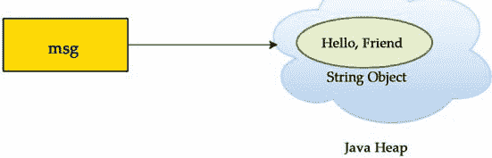

并且，当我们创建另一个相同字符串的对象时，将返回字符串池中已存在的字符串字面量的引用。

```java
String msg = "Hello, Friend";
String msg1 = "Hello, Friend";
```

并且，当我们使用 `new` 关键字创建对象时，编译器会为新引用创建新对象。

```java
String msg = new String("Hello, friend");
String msg1 = new String("Hello, friend");
```

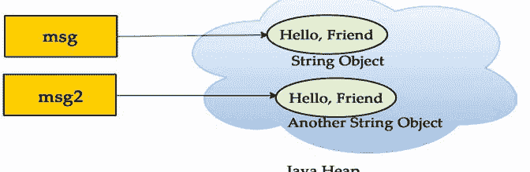

## 2.2 StringBuffer 类

`StringBuffer` 类用于创建可变的（可修改）字符串。Java 中的 `StringBuffer` 类与 `String` 类相同，不同在于它是可变的，可以更改。`StringBuffer` 类是线程安全的，多个线程不能同时访问它，因此结果是有序的。

### StringBuffer 类的构造方法

`StringBuffer` 类定义了三个构造方法：

- `StringBuffer()`: 创建一个初始容量为 16 的空字符串。
- `StringBuffer(String str)`: 创建具有指定容量的字符串。
- `StringBuffer(int capacity)`: 创建指定的长度。

### StringBuffer 类的重要方法

`StringBuffer` 类有一些重要方法，如下：

- `public synchronized append(String s)`: 用于将指定的字符串附加到此字符串之后。`append()` 方法被重载，如 `append(char)`、`append(boolean)`、`append(int)`、`append(float)`、`append(double)`。
- `public synchronized insert(int offset, String s)`: 用于在指定的位置将指定的字符串插入此字符串中。`insert(int)` 方法被重载，如 `insert(int, char)`、`insert(int, boolean)`、`insert(int, int)`、`insert(int, float)`、`insert(int, double)` 等。
- `public synchronized replace(int startIndex, int endIndex, String str)`: 用于替换从 `startIndex` 到 `endIndex` 的字符串。
- `public synchronized delete(int startIndex, int endIndex)`: 用于删除从 `startIndex` 到 `endIndex` 的字符串。
- `public synchronized reverse()`: 用于反转字符串。
- `public int capacity()`: 返回当前容量。
- `public void ensureCapacity(int minimumCapacity)`: 用于确保容量至少为最小。
- `public char charAt(int index)`: 返回指定位置的字符。
- `public int length()`: 返回字符串的长度，即字符的总数。
- `public String substring(int beginIndex)`: 返回从指定的 `beginIndex` 开始的子字符串。
- `public String substring(int beginIndex, int endIndex)`: 返回从指定的 `beginIndex` 到 `endIndex` 的子字符串。

### 什么是可变字符串

在创建后状态可以更改的字符串称为可变字符串。Java 中的 `String`、`Integer`、`Byte`、`Short`、`Float`、`Double` 以及所有其他包装类的对象都是可变的。`StringBuffer` 和 `StringBuilder` 类用于创建可变字符串。

### append 方法

`append()` 方法将指定的字符串附加到此字符串之后。

```java
class A {
    public static void main(String args[]) {
        StringBuilder sb=new StringBuilder("Hello ");
        sb.append("Java");//现在字符串已改变
        System.out.println(sb);//输出 Hello Java
    }
}
```

### insert 方法

`insert()` 方法在指定的位置将指定的字符串插入到此字符串中。

```java
class A {
    public static void main(String args[]){
        StringBuilder sb=new StringBuilder("Hello ");
        sb.insert(1,"Java");//现在字符串已改变
        System.out.println(sb);//输出 Hjavaello
    }
}
```

### replace 方法

`replace()` 方法替换从 `startIndex` 到 `endIndex` 的字符串。

```java
class A {
    public static void main(String args[]){
        StringBuilder sb=new StringBuilder("Hello");
        sb.replace(1,3,"Java");
        System.out.println(sb);//输出 Hjavalo
    }
}
```

### delete 方法

`delete()` 方法删除从 `startIndex` 到 `endIndex` 的字符串。

```java
class A {
    public static void main(String args[]) {
        StringBuilder sb=new StringBuffer("Hello");
        sb.delete(1,3);
        System.out.println(sb);//输出 Hlo
    }
}
```

### reverse 方法

`reverse()` 方法反转当前字符串。

```java
class A
```


`public static void main(String args[])` {

    `StringBuffer sb = new StringBuffer("Hello")`;

    `sb.reverse()`;

    `System.out.println(sb)`; // 输出 lleH

}

### 6) capacity 方法

`capacity()` 方法返回缓冲区的当前容量。缓冲器的默认容量为 16。如果字符数量超过其当前容量，容量将增加 `(oldcapacity*2)+2`。例如，如果你的当前容量是 16，则将变为 `(16*2)+2=34`。

```java
class A {
    public static void main(String args[]) {
        StringBuffer sb = new StringBuffer();
        System.out.println(sb.capacity()); // 默认 16
        sb.append("Hello");
        System.out.println(sb.capacity()); // 现在 16
        sb.append("java is my favourite language");
        System.out.println(sb.capacity()); // 现在 (16*2)+2=34 即 (oldcapacity*2)
    }
}
```

### ensureCapacity 方法

`ensureCapacity()` 方法确保容量至少为指定的容量。


### Java 与 Web 设计

是当前容量的最小值。如果它大于当前容量，它将通过 `(oldcapacity*2)+2` 增加容量。例如，如果你的当前容量为 16，它将变为 `(16^2)+2=34`。

```java
class A {
    public static void main(String args[]) {
        StringBuilder sb = new StringBuilder();
        System.out.println(sb.capacity()); // default 16
        sb.append("Hello");
        System.out.println(sb.capacity()); // now 16
        sb.append("java is is my favourite language");
        System.out.println(sb.capacity()); // now (16*2)+2=34 i.e. (oldcapacity*2)
        sb.ensureCapacity(10); // now no change
        System.out.println(sb.capacity()); // now 34
        sb.ensureCapacity(50); // now (34*2)+2
        System.out.println(sb.capacity()); // now 70
    }
}
```

### 2.2.2 包装类

在 Java 中，包装类被定义为将原始值封装起来的类。这些原始类型包装类用于将原始数据类型表示为对象。Java 平台为每种原始数据类型提供了包装类。例如，`Integer` 包装类持有原始 `int` 数据类型值。同样地，`Float` 包装类包含 `float` 原始值，`Character` 包装类持有 `char` 类型值，`Boolean` 包装类表示 `boolean` 值。

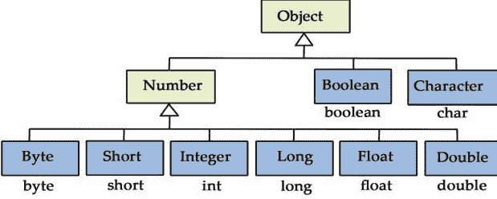

### 数组与字符串

所有的数值包装类都是如上述包装类层次结构所示的抽象类 `java.lang.Number` 的子类。`Number` 还有四个子类在此未列出。`BigDecimal` 和 `BigInteger` 用于高精度计算。`AtomicInteger` 和 `AtomicLong` 用于多线程应用。剩余的两个包装类 `Character` 和 `Boolean` 是 `java.lang.Object` 的直接子类。

### Java 包装类示例

为了描述包装类在 Java 中的应用，让我们创建一个带有 `int` 类型值的 `Integer` 包装对象，并从包装对象中获取原始值。

```java
int i = 26; // Primitive data type 'int'

// Wrapper class instantiation
Integer i_Obj = new Integer(i); // Unwrapping primitive 'int' from wrapper object
int i2 = i_Obj.intValue();
```

### 所有包装类列表

下表显示了 Java 中不同类型的包装类列表：

| 原始数据类型 | 包装类 |
|---|---|
| byte | Byte |
| short | Short |
| int | Integer |
| long | Long |
| float | Float |
| double | Double |
| char | Character |
| boolean | Boolean |

### 为什么 Java 中需要包装类？

我们真的需要包装类吗，还是我们可以直接使用原始类型而不是包装类？实际上，我们可以在很多地方使用原始类型，但并不是所有。例如，如果我们需要在集合中存储数字，我们不能使用原始类型如 `List`、`Set` 和 `Map` 作为它们的元素。在这种情况下，你必须使用包装类。

### Java 中原始数据类型和包装类的区别是什么？

Java 中原始数据类型和包装类（包装类型）的主要区别在于，原始类型可以作为算术、逻辑等操作的原始数据，而包装类充当这些原始类型的数据容器。

重要提示：原始类型的值将存储在栈（Stack）中，而包装对象（与其他任何对象一样）存储在堆内存（Heap Memory）中。

### 包装类的用法

尽管 Java 中包装类的主要用途是封装原始值，但还有其他几个。一个特性是由包装类定义的常量，例如 `MIN_VALUE` 和 `MAX_VALUE`，它们提供了数据类型的边界；另一个应用是使用类方法在值与原始类型之间进行转换，在不同数值系统（十进制、八进制、二进制）之间进行转换。

### Java 中的包装类是可变的吗？

大大的不是。像 `String` 一样，Java 中的包装类如 `Integer`、`Float` 和 `Double` 也是“不可变的”。一旦创建，`java.lang` 对象中的数字就不能被更改。

### 包装类的重要性

包装类主要有两个用途：

- 将简单数据类型转换为对象，即给数据类型赋予对象形式；这里使用了构造函数。
- 将字符串转换为数据类型（称为解析操作），这里使用了类型为 `parseXXX` 的方法。


### 数组与字符串

### 角色模型


### JOSHUA J. BLOCH

1961 年 8 月 28 日出生，是一位软件工程师，曾就职于 Google，也是一位技术作家。他领导了众多 Java 特性的设计和实现，包括 Java 集合框架、`java.math` 包以及断言机制。他是编程指南《Effective Java 程序》的作者，该书荣得了 2001 年 Jolt Award，还是另外两本书《Java Puzzlers》（2005）和《Java Concurrency in Practice》（2006）的合著者。Bloch 曾在 Transarc 担任高级设计师，随后在 Sun Micros 担任卓越工程师。2004 年 6 月，他离开 Sun 并成为 Google 的 Java 架构师。

2004 年 12 月，《Java Developer's Journal》将 Bloch 列入“世界前 40 大软件”名单。Bloch 提议了 Java 编程语言的两个特性扩展：简洁实例创建（CICE）（与 Bob Lee 和 Doug Lea 共同提出）和自动资源管理（ARM）块。CICE 和 ARM 的结合形成了为 Java 添加闭包支持的早期提案之一。ARM 块在 JDK7 中被添加到语言中，Bloch 目前仍活跃在关于 Java 闭包支持提案的讨论中。现任 Google Java Java 架构师，Bloch 曾是 Sun Micros 的卓越工程师，在那里他领导了 Java 2 中引入的 Java 集合框架的设计与实现，并参与了 Java 5 发布中几个语言特性的添加。他拥有哥伦比亚大学的学士学位和卡内基梅隆大学的博士学位，在那里研究了 Camelot 分布式处理系统，该系统后来成为了 Transarc 的产品 Enca，在那里担任高级系统设计师。他编写了获得 2001 年 Jolt Award 的著作《Effective Java》。

正如你对一位在 Google 鼓励使用 Java 的人的所预期的那样，Bloch 是 Java 的坚定拥护者。尽管近期对并发（如软件事务内存或 Erlang 消息传递）非常关注，Bloch 认为 Java 在并发方面拥有“最好的方法”，并预测随着越来越多的程序员被迫处理多 CPU 编程，Java 将复兴。

Bloch 还是将编程视为 API 设计的坚定拥护者，我们讨论了这如何影响他的设计过程，以及为什么选择编程语言就像选择一个酒吧一样。


### Java 与 Web 设计

### 总结

- 数组是一个存储固定数量单一类型值的容器对象。数组的类型在创建时确立。
- 通常，数组是具有连续内存位置的相同类型集合。数组是一种可以存储多个值的变量类型。
- 一维数组本质上是一个相同类型变量的列表。要创建数组，首先创建一个期望类型的数组变量。
- 数组是线性的，因此它们有顺序索引。
- 二维数组是按行和列排列的固定数量相同类型元素的集合。
- 总的来说，数组是非常有用且重要的数据结构，可以帮助解决许多类型的问题。
- 方括号用于声明 `String` 数组。有两种使用方法。
- 字符串是 Java 库中最流行的类。字符串是字符序列，例如“Java”是一个 4 字符字符串。
- `StringBuilder` 类用于创建可变的（修改）字符串。Java 中的 `StringBuffer` 类与 `String` 类相同，区别在于它是可变的，可以更改。

### 数组与字符串

- c. 原始数据类型
- d. 以上均不是

- 2. 在 Java 中，使用哪个运算符为数组变量分配内存？
  - a. malloc
  - b. alloc
  - c. new
  - d. new malloc

- 3. 下列哪一描述是错误的？
  - a. 必须使用 `new` 运算符来初始化数组。
  - b. 数组可以使用花括号括起来的逗号分隔表达式进行初始化。
  - c. 数组可以在声明时初始化。
  - d. 以上提到的均不是

- 4. `String` 是预定义的
  - a. 方法
  - b. 类
  - c. 变量
  - d. 对象

- 5. Java 程序中最小的个体单元被称为
  - a. string
  - b. 字面量 (literal)
  - c. 标记 (token)
  - d. 运算符

### 检查你的结果

1. (a) 2. (c) 3. (a) 4. (b) 5. (c)

## 扩展阅读

- 1. 《Wicked Cool Java: Code Bits, Open-source Libraries, and Project Ideas》，Brian Eubanks 著
- 2. 《A Concise and Practical Introduction to Programming Algorithms in Java》，Frank Nielsen 著
- 3. https://www.youtube.com/watch?v=XYcz9QSprY4
- 4. https://www.youtube.com/watch?v=qKfnZSPUN7E


## 异常处理

3

## 学习目标

学习本章后，你将能够：

- 1. 理解异常处理的基础知识
- 2. 讨论多线程编程
- 3. 定义输入/输出编程
- 4. 解释网络

## 引言

程序应该能够处理运行时可能出现的错误情况。情况可以分为两大类：

- 编程错误。例如，使用无效索引访问数组、尝试除以零、使用非法参数调用方法，或使用空值引用访问对象的成员。
- 运行环境错误。例如，打开一个不存在的文件、使用文件时发生读或写错误，或网络连接意外中断。

### Java 与 Web 设计

编程错误是因为程序中的逻辑错误而导致的错误情况，而运行环境错误是程序无法有效控制的。

Java 中的异常表示在程序执行过程中发生的错误或意外情况。异常处理是处理此类情况的机制。它基于“抛出和捕获”原则。当程序执行过程中发生错误情况时，会抛出一个异常。异常由 JVM 传播并由异常处理程序捕获，后者会采取适当的操作来处理该情况。

## 3.1 异常处理基础

Java 异常是一个对象，描述了代码中发生的异常（即错误）状态。当出现异常状态时，会创建一个代表该异常的对象，并从导致错误的方法中将其抛出。该方法可以选择自己处理该异常，也可以将其传递下去。无论如何，异常在某一点会被捕获并处理。异常可以由 Java 运行时系统生成，也可以由你的代码手动生成。Java 抛出的异常与违反 Java 语言规则或 Java 执行环境限制的基础错误有关。手动生成的异常用于向方法的调用者报告某些错误状态。


异常是在程序执行过程中发生的事件，它会中断程序指令的正常流。

Java 异常处理通过五个关键字管理：`try`、`catch`、`throw`、`throws` 和 `finally`。你想要监控异常的程序语句包含在 `try` 块中。如果在 `try` 块内发生异常，就会被抛出。你的代码可以捕获此异常（使用 `catch`）并以合理的方式处理它。系统生成的异常由 Java 运行时系统自动抛出。要手动抛出异常，请使用 `throw` 关键字。任何抛出方法的异常都必须在 `throws` 子句中指定。任何在 `try` 块完成后必须执行的代码都放在 `finally` 块中。

这是异常处理块的一般形式：

```java
try {
    // 监控错误的代码块
}
catch (ExceptionType exOb) {
    // 针对 ExceptionType 的异常处理器
}
catch (ExceptionType2 exOb) {
    // 针对 ExceptionType2 的异常处理器
}
// ...
finally {
    // 在 try 块结束后执行的代码块
}
```

在这里，`ExceptionType` 是发生异常的类型。

### 3.1.1 异常类型

根据这些，我们有三类异常，你需要理解它们才能知道 Java 中异常处理是如何工作的。

### 检异常 (Checked exceptions)

受检异常是在编译时发生的异常，也称为编译时异常。这些异常在编译时不能简单地忽略，程序员应该处理（应对）这些异常。

例如，如果你在程序中使用 `FileReader` 读取数据，如果文件不存在，会发生 `FileNotFoundException`，编译器会通知程序员进行处理。


### Java 与 Web 设计

```java
import java.io.File;
import java.io.FileReader;

public class FileExceptionDemo {
    public static void main(String args) {
        File file = new File("test.txt");
        FileReader fr = new FileReader(file);
    }
}
```

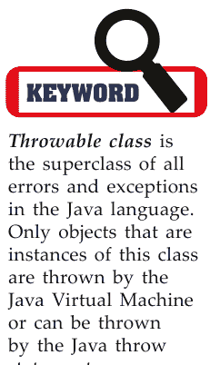

如果你编译上述程序，将得到：

```
FileExceptionDemo.java:8: error: unreported exception IOException must be caught or declared
        FileReader fr = new FileReader(file);
        ^
```

### 引用

| 编号 | 链接 |
|------|------|
| 1 | http://iiti.ac.in/people/-tanim/JavaTheCompleteReference.pdf |

### 非检异常 (Unchecked exceptions)

非检异常是在执行时发生的异常，也称为运行时异常，这些异常包括逻辑错误等编程 Bug。

例如，如果你在程序中声明了一个大小为 5 的数组，并尝试调用数组的第 6 个元素，就会发生 `ArrayIndexOutOfBoundsException`。

```java
public class UncheckedDemo {
    public static void main(String args[]) {
        int num[] = {1,2,3,4};
        System.out.println(num[5]);
    }
}
```

如果你执行上述程序，将得到：


```
Exception in thread "main" java.lang.ArrayIndexOutOfBoundsException: 5
    at UncheckedDemo.main(UncheckedDemo.java:6)
```

### 错误 (Errors)

这些根本不是异常，而是出现在用户或程序员控制之外的问题。它们在代码中通常被忽略，因为你几乎无法对它们做什么。例如，如果发生栈溢出，就会产生错误。它们在编译时也会被忽略。

### 3.1.2 异常层次结构

所有异常类都是`java.lang.Exception`类的子类。异常类是`Throwable`类的子类。除了异常类，还有另一个名为`Error`的子类，它派生自`Throwable`类。

错误是在严重故障时发生的异常状况，Java 程序不处理这些错误。错误用于指示运行时环境产生的错误。例如：JVM 内存溢出。通常程序无法从错误中恢复。

`Exception`类有两个主要的子类：`IOException`和`RuntimeException`类。

以下是最常见的 Java 内置异常和非检异常列表。

- 异常是在程序执行过程中发生的事件，会中断程序的正常流。它是类或方法在报告代码错误时抛出的错误。

- `Throwable`类是 Java 语言中所有错误和异常的超类。

- 异常大致分为受检异常和检异常。所有的`RuntimeException`和`Error`都是非检异常。其余异常被称为受检异常。

- 可以`try-catch`块处理异常。`try`块包含受观察异常情况的代码。

88

E-LEARNING

### 3.1.3 Java 内置异常

Java 在标准包`java.lang`中定义了多个异常类。这些异常中最通用的是标准类型`RuntimeException`的子类。由于`java.lang`会被隐式地导入到所有 Java 程序中，因此大多数来自`RuntimeException`的异常都是自动可用的。Java 还定义了其他几种与其各种类库相关的异常类型。以下是 Java 未检查运行时异常（Unchecked RuntimeException）的列表。

| Exception | 描述 |
|---|---|
| ArithmeticException | 算术错误，例如除以零。 |
| ArrayIndexOutOfBoundsException | 数组索引越界。 |
| ArrayStoreException | 向不兼容的类型的数组元素进行赋值。 |
| ClassCastException | 无效的类型转换。 |
| IllegalArgumentException | 调用方法时使用了非法参数。 |
| IllegalMonitorStateException | 非法监器操作，例如在未锁定的线程上等待。 |
| IllegalStateException | 环境或应用程序处于错误状态。 |
| IllegalThreadStateException | 请求的操作与当前线程状态不兼容。 |
| IndexOutOfBoundsException | 某种类型的索引越界。 |
| NegativeArraySizeException | 使用负数大小创建数组。 |
| NullPointerException | 对空引用的无效使用。 |
| NumberFormatException | 字符串到数值格式转换无效。 |
| SecurityException | 尝试违反安全规定。 |
| StringIndexOutOfBounds | 尝试访问字符串边界之外的索引。 |
| UnsupportedOperationException | 遇到了不支持的操作。 |

以下是`java.lang`中 Java 检查异常（Checked Exceptions）的列表。

| Exception | 描述 |
|---|---|
| ClassNotFoundException | 未找到类。 |
| CloneNotSupportedException | 尝试克隆未实现`Cloneable`接口的对象。 |
| IllegalAccessException, InstantiationException | 拒绝访问类。尝试创建抽象类或接口的对象。 |
| InterruptedException | 一个线程被另一个线程中断。 |
| NoSuchFieldException | 请求的字段不存在。 |
| NoSuchMethodException | 请求的方法不存在。 |


`catch`块是异常处理结构中的特定部分，使用`catch`关键字结合`try`和`finally`关键字来实现，并构成结构化异常处理的手段。

### 3.1.4 捕获异常

方法使用**try**和**catch**关键字的组合来捕获异常。`try/catch`块放置在可能产生异常的代码周围。`try/catch`块中的代码被称为受保护代码，使用`try/catch`块的语法如下：

```
try
{
  //Protected code
}catch(ExceptionName e1)
{
  //Catch block
}
```

将易发生异常的代码放置在`try`块中，当发生异常时，该异常由与其相关的`catch`块处理。每个`try`块后面应该紧跟一个`catch`块或`finally`块。

`catch`语句声明了你尝试捕获的异常类型。如果受保护代码中发生异常，将检查`try`之后的`catch`块（或多个块）。发生的异常类型列在`catch`块中，异常就像参数传递给方法参数一样传递给`catch`块。

## 示例：

以下是一个声明 2 个元素的数组。然后代码尝试访问数组的第 3 个元素，这将抛出异常。

```
// File Name : ExceptTest.java
```

```java
import java.io.*;
public class ExceptTest{

    public static void main(String args[]){
        try{
            int a[] = new int[2];
            System.out.println("Access element three : " + a[3]);
        }catch(ArrayIndexOutOfBoundsException e){
            System.out.println("Exception thrown : " + e);
        }
        System.out.println("Out of the block");
    }
}
```

这将产生以下结果：

Exception thrown: java.lang.ArrayIndexOutOfBoundsException: 3

Out of the block

### 3.1.5 多个 catch 块

一个`try`块可以跟随多个`catch`块。多个`catch`块的语法如下：

```java
{
//Protected code
}catch(ExceptionType1 e1)
{
//Catch block
catch(ExceptionType2 e2)
{
//Catch block
catch(ExceptionType3 e3)
{
//Catch block
}
```

这些语句演示了三个`catch`块，但可以在单个`try`之后拥有任意数量的。如果受保护代码中发生异常，异常将抛给列表中第一个`catch`块。如果抛出的异常数据类型与`ExceptionType1`匹配，它就会被捕获。如果不匹配，异常将传递到第二个`catch`语句。此持续直到异常被捕获或跳过所有`catch`块，在这种情况下，当前方法停止执行，异常将抛给调用堆栈上的方法。

示例：

此处代码段显示了如何使用多个`try/catch`语句。

```java
try {
    file = new FileInputStream(fileName);
    x = (byte) file.read();
}catch(IOException i) {
    i.printStackTrace();
    return -1;
}catch(FileNotFoundException f) //Not valid
{
    f.printStackTrace();
}
```

### 3.1.6 throw

到为止，你只捕获了 Java 系统抛出的异常。然而，你的程序完全可以使用`throw`语句显式地抛出异常。`throw`的通用形式为：

```
throw ThrowableInstance
```

`ThrowableInstance`必须是`Throwable`的对象。基本类型（如`int`或`char`）以及非`Throwable`类（如`String`和`Object`）不能作为异常。有两种方法可以获取`Throwable`：使用`new`或使用运算符创建一个。执行流在`throw`语句后立即停止；任何后续语句都不会执行。将检查最近的封装`try`块以查看是否有`catch`语句。如果找到匹配，控制将转移到该语句。如果没有，则检查下一个封装的`try`块。这是一个创建并抛出异常的示例程序。

```java
class ThrowDemo {
  static void democroc() {
    try {
      throw new NullPointerException("demo");
    } catch (NullPointerException e) {
      System.out.println("Caught inside democroc.");
      throw e; // rethrow the exception
    }
  }

  public static void main(String args[]) {
    try {
      democroc();
    } catch (NullPointerException e) {
      System.out.println("Recaught: " + e);
    }
  }
}
```

### 3.1.7 throws

如果一个方法可能会导致它未处理的异常，它必须指定这种行为，以便该方法的调用者能够防范该异常。你通过在方法声明中包含`throws`子句来实现。`throws`子句列出了方法可能抛出的异常类型。对于除`Error`或`RuntimeException`类型或其任何子类之外的所有异常，这都是必要的。方法抛出的所有其他异常必须在`throws`子句中声明。如果没有声明，将导致编译错误。

这是包含`throws`子句的方法声明的通用形式：

```java
{
type method-name(parameter-list) throws exception-list
// body of method
}
```

在这里，`exception-list`是一个逗号分隔的列表，列出了方法可能抛出的异常。

下面是一个错误程序的示例，它尝试抛出一个它没有没有捕获的异常。由于程序没有指定`throws`子句来声明这一事实，因此该程序将无法编译。

```
// 此程序包含错误且无法编译。
class ThrowsDemo {
    static void throwOne() {
        System.out.println("Inside throwOne.");
        throw new IllegalAccessException("demo");
    }
    public static void main(String args[]) {
        throwOne();
    }
}
```

要使这个示例能够编译，你需要进行两处修改。首先，你需要声明`throwOne() throws IllegalAccessException`。其次，`main()`必须定义一个`try/catch`语句来捕获该异常。

修正后的示例所示：

```
// 现在是正确的了。
class ThrowsDemo {
    static void throwOne() throws IllegalAccessException {
        System.out.println("Inside throwOne.");
        throw new IllegalAccessException("demo");
    }
    public static void main(String args[]) {
        try {
            throwOne();
        } catch (IllegalAccessException e) {
            System.out.println("Caught " + e);
        }
    }
}
```

### Java 与 Web 设计

以下是运行此示例程序生成的输出：

inside throwOne

```
caught java.lang.IllegalAccessException: demo
```

### 3.1.8 finally

当异常被抛出时，方法中的执行过程会遵循一条相当突然的、非线性的路径，这会改变通过方法的正常流程。取决于方法的编码方式，异常甚至可能导致方法提前返回。在某些方法中这可能会是一个问题。例如，如果一个方法在进入时打开了一个文件，你不希望关闭文件的代码被异常处理机制跳过。`finally`关键字是为了解决这种意外情况而设计的。

`finally`创建了一个代码块，该块会在`try/catch`块完成后、且在`try/catch`块之后的代码执行之前执行。无论是否抛出异常，`finally`块都会执行。如果抛出了异常，即使没有`catch`语句匹配该异常，`finally`块也会执行。每当方法准备从`try/catch`内部通过未捕获的异常或显式的`return`语句返回调用者时，`finally`子句也会在方法返回之前执行。这对于关闭文件句柄并释放在方法开始时为了在返回前处理它们而分配的任何其他资源可能有用。`finally`子句是可选的。然而，每个`try`语句至少需要一个`catch`或`finally`子句。

这里是一个示例程序，展示了三个以各种方式退出的方法，且没有执行它们的`finally`子句：

```
// 展示 finally。
class FinallyDemo {

// 通过异常抛出方法。
static void procA() {
try {
System.out.println("inside procA");
throw new RuntimeException("demo");
```

```
} finally {
System.out.println("procA’s finally");
}

```

// 从 try 块内部返回。

```
static void procB() {
try {
System.out.println("inside procB");
return;
} finally {
System.out.println("procB’s finally");
}
```

// 正常执行 try 块。

```
static void procC() {
try {
System.out.println("inside procC");
} finally {
System.out.println("procC’s finally");
}
public static void main(String args[]) {
try {
procA();
```

> 程序必须能够处理这两种类错误。理想情况下，编程错误不应该发生，程序应该优雅地处理运行时环境错误。

### Java 与 Web 设计

```
} catch (Exception e) {

    System.out.println("Exception caught");

}

procB();

procC();

}
```


执行线程是由于调度器（通常是操作系统的一部分）独立管理的最小程序指令序列。这里的调度器通常是操作系统的一部分。

在这个示例中，`procA()` 通过抛出一个异常提前跳出了 `try` 块。`finally` 子句在退出时执行。`procB()` 的语句通过 `return` 语句退出。`finally` 子句在 `procB()` 返回之前执行。在 `procC()` 中，`try` 语句正常执行，没有错误。然而，`finally` 块仍然执行了。

### 3.1.9 创建你自己的异常子类

尽管 Java 的内置异常处理了大多数常见错误，但你可能想要创建自己的异常类型来处理特定于应用程序的情况。这非常简单：只需定义 `Exception` 的子类（当然，它是 `Throwable` 的子类）。你的子类不需要实际实现任何内容——是它们在类型系统中的存在允许你将它们作为异常使用。

`Exception` 类没有定义任何自己的方法。当然，它拥有由 `Throwable` 提供的方法。因此，所有异常（包括你创建的异常）都可以使用 `Throwable` 定义的方法。

## 异常处理

| 方法 | 描述 |
| --- | --- |
| `Throwable fillInStackTrace()` | 返回一个包含完整堆栈轨迹的 `Throwable` 对象。此对象可以被重新抛出。 |
| `Throwable getCause()` | 返回引起异常的 `Throwable` 对象。 |
| `String getLocalizedMessage()` | 返回本地化的异常消息。 |
| `String getMessage()` | 返回异常消息。 |
| `StackTraceElement[] getStackTrace()` | 返回异常堆栈轨迹的数组。 |
| `Throwable initCause(Throwable exc)` | 将异常与引起异常关联。 |
| `void printStackTrace()` | 显示堆栈轨迹。 |
| `void printStackTrace(PrintStream)` | 将堆栈轨迹发送到指定的流。 |
| `void printStackTrace(PrintWriter)` | 将堆栈轨迹发送到指定的流。 |
| `void setStackTrace(StackTraceElement elements[])` | 设置传入的元素的堆栈轨迹。 |
| `String toString()` | 返回包含异常描述的 `String` 对象。此方法由 `println()` 调用。 |

你可能希望在你创建的异常类中重写这些方法的一个或多个。`Exception` 定义了四个构造函数。另外两个：

`Exception()`

`Exception(String msg)`

第一个创建一个没有描述的异常。第二种允许你指定异常描述。虽然在创建异常时指定描述通常有用，但重写 `toString()` 更好。原因如下：`Throwable` 定义并由 `Exception` 继承的 `toString()` 版本首先显示异常名称，后面跟着冒号，然后是你的描述。通过重写 `toString()`，你可以防止异常名称和冒号显示。这使得输出更加简洁，在某些情况下是必要的。

### Java 与 Web 设计

下面的示例声明了一个新的 `Exception` 子类，然后使用该子类在方法中信号错误状态。它重写了 `toString()` 方法，允许显示经过定制的异常描述。

```java
// 此程序创建一个自定义异常类型。

class MyException extends Exception {

    private int detail;

    MyException(int a) {

        detail = a;

    }

    public String toString() {

        return "MyException[" + detail + "]";

    }

}

class ExceptionDemo {

    static void compute(int a) throws MyException {

        System.out.println("Called compute(" + a + ")");

        if(a > 10) {

            throw new MyException(a);

        }

        System.out.println("Normal exit");

    }

    public static void main(String[] args) {

        try {

            compute(1);

            compute(20);

        } catch (MyException e) {

        }

    }

}
```

```java
System.out.println("Caught " + e);

}
```

此示例定义了一个名为 `MyException` 的 `Exception` 子类。该子类非常简单：它只包含一个构造和一个重载的 `toString()` 方法，该方法用于显示异常的值。`ExceptionDemo` 类定义了一个名为 `compute()` 的方法，该方法会抛出一个 `Exception` 对象。当 `compute()` 的整数参数大于 10 时，会抛出异常。`main()` 方法为 `MyException` 设置了异常处理器，然后用一个合法值（小于 10）和一个非法值调用 `compute()`，以执行代码中的两种路径。执行结果如下：

`Called compute(1)`

`Normal exit`

`Called compute(20)`

`Caught MyException[20]`

## 3.2 多线程编程

与许多其他语言不同，Java 提供了对多线程编程的内置支持。多线程程序包含两个或多个可以并发运行的部分。此类程序的每个部分都是一个线程，每个线程都定义了一个独立的执行路径。因此，多线程是多任务处理的一种特殊形式。

你一定熟悉多任务处理，因为几乎所有现代操作系统都支持它。然而，存在两种不同的多任务处理：基于进程的和基于线程的。理解两者之间的区别非常重要。对于大多数读者来说，基于进程的多任务处理是熟悉的形式。进程本质上是一个正在执行的程序。因此，基于进程的多任务处理是允许你的计算机并发运行两个或多个程序的特性。例如，基于进程的多任务处理允许你在使用文本编辑器的同时运行 Java 编译器。

| 页码 | URL |
| :--- | :--- |
| 2 | http://www.buyya.com/java/Chapter14.pdf |

在基于进程的多任务处理中，程序是调度器可以分发的最小代码单元。在基于线程的多任务环境中，线程是可分发代码的最小单元。这意味着单个程序可以同时执行两个或多个任务。例如，文本编辑器可以在打印的同时格式化文本，只要这两个动作是由不同的线程执行的。多任务处理比多进程多任务处理的开销更小。进程需要自己独立的地址空间。进程间通信是昂贵且受限的。从一个进程到另一个进程的上下文切换也是高代价的。相比之下，线程是轻量级的。它们共享相同的地址空间，并协作共享同一个重量级进程。虽然 Java 程序使用基于进程的多任务处理环境，但进程-多线程的任务处理不受 Java 的控制。

### 3.2.1 定义线程

要理解多线程，必须理解进程和线程的概念。进程是执行中的程序。一个进程可以被分为若干个称为线程的独立单元。线程是可分发的工作单元。线程是进程内部的轻级进程。进程是一个或多个线程以及相关系统资源的集合。进程与线程之间的区别如图 3.1 所示。一个进程可以包含多个线程。线程可以被认为是进程的一个子集。

如果在一个计算机上运行两个应用程序（MS Word, MS Access），就会创建两个进程。两个或多个进程的多任务处理被称为基于进程的多任务处理。两个或多个线程的多任务处理被称为基于线程的多任务处理。编程语言中的多线程概念指的是基于线程的多任务处理。基于进程的多任务处理完全由操作系统控制。基于线程的多任务处理在程序中一定程度上由程序员控制。

## 异常处理

**图 3.1:** 包含单个和多个线程的进程。

上下文切换的概念是线程不可或缺的。处理器使用硬件定时器来确定每个线程时间片的结束。定时器在时间片结束时发出信号，随后处理器将当前线程所需的所有信息保存到栈中。处理器将这些信息从栈中处理到一个名为上下文结构的预定义数据结构中。当处理器想要切换回之前执行的线程时，它会将与线程相关的上下文结构中的所有信息传输到栈中。Java 支持基于线程的任务处理。

整个过程被称为上下文切换。基于线程的多任务处理与基于进程的任务处理的优势如下：

- 线程共享地址空间。
- 线程之间的上下文切换通常是廉价的。
- 线程之间的通信通常是廉价的。

### 3.2.2 Java 中的线程

应用程序在设计阶段被划分为进程，当逻辑上分离重要的应用程序功能有意义时，主进程会显式地产生线程。换句话说，进程是一种架构构建体。相比之下，线程是一种编码构建体，不必影响应用程序的架构。单个进程可能包含多个线程（见图 3.2）。进程中的所有线程共享相同的状态和内存空间，并可以直接相互通信，因为它们共享相同的变量。

线程的产生通常是为了短期利益，这种利益通常被可视化为串行任务，但该任务不必以线性方式执行（例如执行并行操作、初始化大型矩阵），然后在需要长期时被吸收。线程的作用范围在一个特定的代码模块内——这就是为什么我们可以在不影响广泛应用程序的情况下进行附加。

域名系统 (DNS) 是用于计算机、服务或任何连接到互联网的层次结构命名系统。线程是 Java 语言中的对象。它们通常被可视化为串行任务，但该任务不必以线性方式执行（例如执行并行操作、初始化大型矩阵），然后在需要长期时被吸收。线程的作用范围在一个特定的代码模块内——这就是为什么我们可以在不影响广泛应用程序的情况下进行附加。

3.3 Java 中的线程。

### 扩展 Thread 类

使用第一种机制创建线程的步骤是：

1. 通过扩展 `Thread` 类创建一个类并重写 `run()` 方法：

```java
class MyThread extends Thread {

    public void run() {

        // 线程体

    }

}
```

2. 创建线程对象：

`MyThread thr1 = new MyThread();`

3. 开始创建线程的执行：给出一个调用线程的示例程序：

```java
/* ThreadEx1.java: 通过扩展标准 Thread 类创建和调用线程对象的简单程序。 */
```

```java
class MyThread extends Thread {

    public void run() {

        System.out.println("this thread is running ... ");

    }

}
```

```java
class ThreadEx1 {

    public static void main(String [] args ) {

        MyThread t = new MyThread();

        t.start();

    }

}
```

`MyThread` 类通过继承扩展了标准 `Thread` 类获得线程属性。用户需要在 `run` 方法中实现与线程相关的逻辑，该方法是线程的主体。通过实例化 `MyThread` 类创建的对象被称为线程对象。虽然调用了执行方法，但我们不需要显式地调用它。当调用线程对象的 `start` 方法时，它将设置从该点开始并发执行。

### 实现 Runnable 接口

使用第二种机制创建线程的步骤是：

1. 创建一个实现 `Runnable` 接口的类并重写 `run` 方法：

```java
class MyThread implements Runnable {

    public void run() {

        // 线程体

    }

}
```

2. 创建对象：

`MyThread myObject = new MyThread();`

3. 创建线程对象：

`Thread thr1 = new Thread(myObject);`

4. 开始执行：

`thr1.start();`

下面是一个演示线程对象创建和调用的示例：

```java
/* ThreadEx2.java: 通过实现 Runnable 接口创建并调用线程对象的简单程序。 */

class MyThread implements Runnable {

  public void run() {

    System.out.println(" this is running ... ");

  }

}
```

> 网络套接字是跨计算机网络连接的端点。今天，计算机之间的之间的通信基于互联网协议；因此，大多数网络套接字都是互联网套接字。

```java
class ThreadEx2 {

  public static void main(String[] args) {

    Thread t = new Thread(new MyThread());

    t.start();

  }

}
```


### Java 与 Web 设计

`MyThread` 类实现了标准的 `Runnable` 接口并重写了 `run()` 方法，包含了与线程体相关的逻辑（步骤 1）。通过实例化 `MyThread` 类创建的对象是普通对象（与第一种机制不同）（步骤 2）。因此，我们需要创建一个通泛型 `Thread` 对象，并将 `MyThread` 对象作为参数传递给这个通用对象（步骤 3）。由于这种关联，创建了线程对象。为了执行此线程，我们需要调用它的 `start()` 方法，该方法会设置新线程的执行（步骤 4）。

### 3.2.3 线程生命周期

Java 线程的生命周期与操作系统中运行的进程生命周期非常相似。在生命周期内，线程根据其执行的操作或对其执行的操作从一个状态移动到另一个状态，如图 (3.4) 所示。Java 线程可以是以下状态之一：

- **NEW（新建）**：刚实例化的线程处于新建状态。当调用 `start()` 方法时，线程移动到就绪状态，由线程调度程序将其自动移动到可运行状态。
- **RUNNABLE（就绪 → 运行）**：在 JVM 中执行的线程处于运行状态。
- **BLOCKED（阻塞）**：等待监视器锁的线程处于此状态。当线程执行 I/O 操作并移动到下一个（可运行）状态时也可能发生这种情况。
- **WAITING（等待）**：无限等待另一个线程执行特定操作的线程处于此状态。
- **TIMED_WAITING（计时等待/睡眠）**：等待另一个线程执行操作的最长指定等待时间的线程处于此状态。
- **TERMINATED（终止）**：已退出的线程处于此状态。

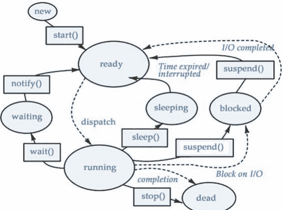

图 3.4：Java 线程的生命周期。

在任何时刻，线程只能处于一种状态。这些状态是 JVM 状态，因为它们与操作系统的线程状态无关。

当创建 `Thread` 类对象时，线程移动到 `NEW` 状态。调用 `start()` 方法后，线程从 `NEW` 转移到就绪（`RUNNABLE`）状态，然后由 JVM 调度器分发到运行状态。获得执行机会后，将直接调用 `run()` 方法（在程序中显式调用），其中的代码由当前线程执行而非由新线程执行（因为线程对象没有分配给虚拟机调度器）。根据程序操作或对 `wait()`、`sleep()` 和 `suspend()` 等方法的调用，或 I/O 操作，线程会分别移动到 `WAITING`、`SLEEPING` 和 `BLOCKED` 状态。需要注意的是，线程仍然是存活的。在完成阻塞操作（I/O 或睡眠）或接收到唤醒它的外部信号后，线程移动到就绪状态。JVM 调度器将其移动到运行状态以继续执行剩余操作。当线程完成执行时，它将器移动到 `TERMINATED` 状态。死掉的线程永远不会进入任何其他状态，即使对其调用 `start()` 方法也不行。

### 3.2.4 带有多线程的 Java 程序

为了说明在执行并发操作的程序中创建多个线程，让我们考虑处理以下数学方程：

### Java 与 Web 设计

$p = \sin(x) + \cos(y) + \tan(z)$

由于这些三角函数是相互独立的操作，没有依赖关系，它们可以并发执行。之后，可以将它们的结果组合以产生最终结果，如图 3.5 所示。

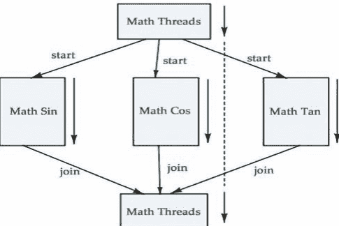

图 3.5：主线程和多工作线程应用程序中的控制流。

主/默认线程被称为 `MathThreads`，它像一个主线程。它创建了三个工作线程（`MathSin`、`MathCos` 和 `MathTan`）并将它们分配用于计算不同数据输入的值。根据机器类型，三个工作线程都在共享或专用的 CPU 上并发执行。尽管主线程可以继续执行，但它需要确保在合并单个结果之前所有操作都已完成。这是通过调用与每个工作线程相关的 `join()` 方法来等待每个线程完成来实现的。

```java
/* MathThreads.java: 执行并发操作的多线程程序。 */
```

```java
import java.lang.Math;

class MathSin extends Thread {

    public double deg;

    public double res;

    public MathSin(int degree) {

        deg = degree;

    }

    public void run() {

        System.out.println("Executing sin of "+deg);

        double Deg2Rad = Math.toRadians(deg);

        res = Math.sin(Deg2Rad);

        System.out.println("Exit from MathSin. Res = "+res);

    }

}
```

```java
class MathCos extends Thread {

	public double deg;

	public double res;

	public MathCos(int degree) {

	deg = degree;

	}

	public void run() {

		System.out.println("Executing cos of "+deg);

		double Deg2Rad = Math.toRadians(deg);

		res = Math.cos(Deg2Rad);

		System.out.println("Exit from MathCos. Res = "+res);

	}

}
```

```java
class MathTan extends Thread {

    public double deg;

    public double res;

    public MathTan(int degree) {

        deg = degree;

    }

    public void run() {

        System.out.println("Executing tan of "+deg);

        double Deg2Rad = Math.toRadians(deg);

        res = Math.tan(Deg2Rad);

        System.out.println("Exit from MathTan. Res = "+res);

    }

}
```

```java
class MathThreads {

    public static void main(String[] args) {

        MathSin st = new MathSin(45);

        MathCos ct = new MathCos(60);

        MathTan tt = new MathTan(30);

        st.start();

        ct.start();

        tt.start();

        try {

            st.join();

            ct.join();

            tt.join();

        } catch (InterruptedException e) {

            e.printStackTrace();

        }

        double z = st.res + ct.res + tt.res;

        System.out.println("Sum = " + z);

    }

}
```

```java
class A extends Thread {

    public void run() {
        System.out.println("Thread started");
        for(int i = 1; i <= 4; i++) {
            System.out.println("\t From ThreadA:i = " + i);
        }
        System.out.println("Exit from A");
    }
}

class B extends Thread {

    public void run() {
        System.out.println("Thread started");
        for(int j = 1; j <= 4; j++) {
            System.out.println("\t From ThreadB:j = " + j);
        }
        System.out.println("Exit from B");
    }
}

class C extends Thread {

    public void run() {
        System.out.println("Thread started");
        for(int k = 1; k <= 4; k++) {
            System.out.println("\t From ThreadC:k = " + k);
        }
        System.out.println("Exit from C");
    }
}

public class ThreadPriorityDemo {
    public static void main(String[] args[]) {
        A threadA = new A();
        B threadB = new B();

        C threadC = new C();
        threadC.setPriority(Thread.MAX_PRIORITY);
        threadB.setPriority(threadA.getPriority() + 1);
        threadA.setPriority(Thread.MIN_PRIORITY);
        System.out.println("Started Thread A");

        A.start();
        System.out.println("Started Thread B");
        threadB.start();
        System.out.println("Started Thread C");
        threadC.start();
        System.out.println("End of main thread");
    }
}
```

此示例创建了 3 个线程，并调整了每个线程的优先级。该示例可能的输出如下：

- Started Thread A
- Started Thread B
- Started Thread C
- Thread B started
- End of main thread
- Thread C started
- From ThreadC: k=1
- From ThreadC: k=2
- From ThreadC: k=3
- From ThreadC: k=4
- Exit from C
- From ThreadB: j=1
- From ThreadB: j=2
- From ThreadB: j=3
- From ThreadB: j=4
- Exit from B
- Thread A started
- From ThreadA: i=1
- From ThreadA: i=2
- From ThreadA: i=3
- From ThreadA: i=4
- Exit from A

优先级最高的线程 C 首先调度/执行，而优先级最低的线程 A 最后被调度。

### 3.2.6 线程方法

`sleep()` 方法导致当前线程睡眠指定的毫秒数时间：

```java
public static void sleep(long millis) throws InterruptedException
```

例如，下面的代码将线程置睡眠状态 3 分钟：

```java
try {

  Thread.sleep(3 * 60 * 1000); // thread sleeps for 3 minutes

} catch(InterruptedException ex) {
```

### Java 与 Web 设计

`yield()` 方法导致当前线程从运行状态移动到 `RUNNABLE` 状态，以便其他线程有机会运行。然而，下一个被选择运行的线程可能不是另一个线程：

```java
public static void yield()
```

`isAlive()` 方法在调用的线程已启动但尚未移动到终止状态时返回 `true`：

```java
public final boolean isAlive()
```

当一个线程对另一个线程调用 `join()` 时，当前运行的线程将等待被连接的线程执行完成。也可以选择等待有限的时间而不是等待线程完成。

```java
void join(long millis)
void join(long millis, int nanos)
```

线程存在于线程组中，线程组可以包含其他线程组。此示例访问了所有线程组中的所有线程。程序：

```java
// 找到根线程组
ThreadGroup root = Thread.currentThread().getThreadGroup().getParent();

while (root.getParent() != null) {

  root = root.getParent();

}

// 访问每个线程组
visit(root, 0);
```

该方法递归地访问给定组下的所有线程组。

```java
public static void visit(ThreadGroup group, int level) {

    // 获取给定组中的线程
```


```java
int numThreads = group.activeCount();
Thread[] threads = new Thread[numThreads*2];
numThreads = group.enumerate(threads, false);
```

```java
// 举 'group' 中的每个线程
for(int i=0; i<numThreads; i++) {
    // 获取线程
    Thread thread = threads[i];
}
```

```java
// 获取给定组的子组
int numGroups = group.activeGroupCount();
ThreadGroup[] groups = new ThreadGroup[numGroups*2];
numGroups = group.enumerate(groups, false);
```

```java
// 递归地访问每个子组
for(int i=0; i<numGroups; i++) {
    visit(groups[i], level+1);
}
}
```

这是一个包含某些线程的线程组示例：

```java
java.lang.ThreadGroup[name=system,maxpri=10]
Thread[Reference Handler,10,system]
Thread[Finalizer,8,system]
Thread[Signal Dispatcher,10,system]
Thread[CompileThread,0,10,system]
java.lang.ThreadGroup[name=main,maxpri=10]
Thread[main,5,main]
Thread[Thread-1,5,main]
```

另一对方法用于守护线程。在后台工作以支持运行时环境的线程被称为守护线程。`setDaemon` 方法用于将当前线程设置为守护线程，而 `isDaemon` 方法用于识别当前线程是否为守护线程。

```java
public final void setDaemon(boolean isDaemon)
public final boolean isDaemon()
```

这两个方法的用法是非常直观的。然而，需要注意的一点是，守护线程并不意味着它的优先级很低，相反，最小优先级的线程并不是守护线程，除非使用 `setDaemon` 方法进行设置。

### 3.2.7 多线程线程服务器

是时候利用线程编程实现一个更全面的线程应用程序了。图 3.6 显示了一个多线程数学交互示例，展示了一个可以执行基本数学运算并同时服务客户端请求的在线数学服务器。它通过实现 `java.lang.Runnable` 接口，使数学服务器能够并发接受客户端请求并为每个套连接开启新线程。以下代码显示了如何实现。

## 异常处理

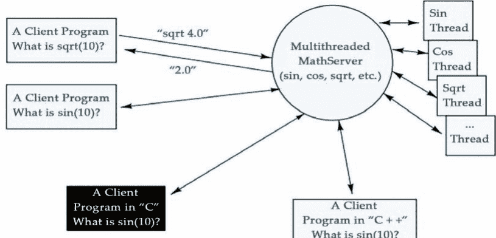

**图 3.6：多线程数学服务器及其客户端。**

程序：

```java
/* MultiThreadMathServer.java: 一个扩展 MathServer 的程序，允许并发客户端请求并为每个套接字开启新线程。 */
```


```java
import java.net.ServerSocket;
import java.net.Socket;

public class MultiThreadMathServer extends MathServer implements Runnable {

    public void run() {
        execute();
    }

    public static void main(String [] args) throws Exception {
        int port = 10000;
        if (args.length == 1) {
            try {
                port = Integer.parseInt(args[0]);
            } catch(Exception e) {
            }
        }
        ServerSocket serverSocket = new ServerSocket(port);
        while(true){
            //等待客户端连接
            Socket socket = serverSocket.accept();
            socket.setSoTimeout(14000);
            MultiThreadMathServer server = new MultiThreadMathServer();
            server.setMathService(new MathService());
            server.setSocket(socket);
            //启动一个新的服务器线程
            server.start();
        }
    }
}
```

从程序可以看出，`run` 方法只是调用了基类 `MathServer` 中的 `execute`。`MultiThreadMathServer` 的 `main` 方法在客户端来临时时有一个无限循环，它创建一个 `MultiThreadMathServer` 实例并启动它，因此不需要更改客户端代码。多线程版本的目的是与单线程版本相比，它现在可以支持多个客户端。

## 3.2.8 线程编程中的并发问题

线程是一种非常强大的技术，但有时很难控制，特别是当它访问共享资源时。线程必须进行协调，否则将违反整个应用程序的数据。例如，打印机不能同时打印两个文档，如果存在多个打印请求，管理这些操作的线程就需要协调。另一个例子是同时操作同一个银行账户：同时对银行账户进行存款和取款操作是不正确的。在处理多个线程时，与并发问题有两个非常基础的问题：读/写问题和生产者消费者问题。

### 读/写问题

如果一个线程尝试读取数据而另一个线程尝试更新同一份数据，则被称为读/写问题，这会导致共享数据的状态不一致。可以通过 Java 的 `synchronized` 关键字同步对数据的访问来防止这种情况。例如：

```java
public synchronized void update() {
}
```

### Java 与 Web 设计

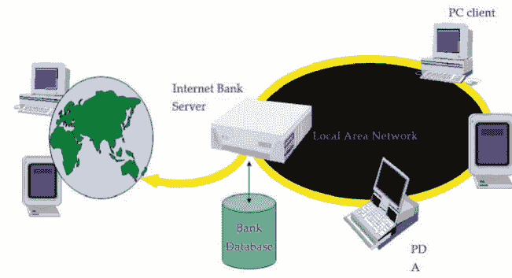

**图 3.7**: 在线银行：服务于多个客户和操作。

程序：

```java
/* InternetBankingSystem.java: 一个显示如何通过多线程调用银行操作的简单程序。 */

public class InternetBankingSystem {

    public static void main(String [] args) {

        Account accountObject = new Account(100);

        new Thread(new DepositThread(accountObject,30)).start();

        new Thread(new DepositThread(accountObject,20)).start();

        new Thread(new DepositThread(accountObject,10)).start();

        new Thread(new WithdrawThread(accountObject,30)).start();

        new Thread(new WithdrawThread(accountObject,50)).start();

        new Thread(new WithdrawThread(accountObject,20)).start();

    } // end main()

}
```

有 6 个线程同时访问同一个 `Account` 对象。以下代码显示了每个线程上将执行的操作。

```java
/* WithdrawThread.java 一个从指定账户中提取指定金额的线程。 */

package com.javook.threading;

public class WithdrawThread implements Runnable {

    private Account account;

    private double amount;

    public WithdrawThread(Account account, double amount) {

        this.account = account;

        this.amount = amount;

    }

    public void run() {

        // 执行取款

        account.withdraw(amount);

    }

} //end WithdrawThread class
```

```java
/* DepositThread.java 一个向指定账户存入指定金额的线程。 */

package com.javook.threading;

public class DepositThread implements Runnable {

    private Account account;

    private double amount;

    public DepositThread(Account account, double amount) {

        this.account = account;

        this.amount = amount;

    }

    public void run() {

        // 执行存款

        account.deposit(amount);

    }

}
```

## 3.3 输入/输出编程

`java.io` 包包含了你可能需要的在 Java 中执行输入和输出（I/O）的几乎所有类。这些流都代表输入源和输出目标。`java.io` 包中的流支持许多数据，如基本类型、对象、本地化字符。

### 3.3.1 流

流可以被定义为数据序列。流有两种类型：

- `InputStream`: `InputStream` 用于从源读取数据。
- `OutputStream`: `OutputStream` 用于向目标写入数据。


Java 为与文件和网络相关的 I/O 提供了强大但灵活的支持，本教程涵盖了与流和 I/O 相关的基本功能。

### 3.3.2 字节流

Java 字节流用于执行 8 位字节的输入和输出。虽然有很多与字节流相关的类，但最频繁使用的类是 `FileInputStream` 和 `FileOutputStream`。以下是一个使用这两个类将输入文件复制到输出文件的示例：

| | |
|---|---|
| 3 | http://www.ntu.edu.sg/home/ehchua/programming/java/j5b_io.html |

```java
import java.io.*;

public class CopyFile {

    public static void main(String args[]) throws IOException {

        FileInputStream in = null;

        FileOutputStream out = null;

        try {

            in = new FileInputStream("input.txt");

            out = new FileOutputStream("output.txt");

            int c;

            while ((c = in.read()) != -1) {

                out.write(c);

            }

        } finally {

            if (in != null) {

                in.close();

            }

            if (out != null) {

                out.close();

            }

        }

    }

}
```

现在让我们有一个包含以下内容的 `input.txt` 文件：
这是一个测试复制文件的文件。
作为下一步，编译上述的程序并执行它，这将创建一个与 `input.txt` 中内容相同的 `output.txt` 文件。因此，让我们把上述代码放入 `CopyFile.java` 文件中并执行以下操作：

```
$javac CopyFile.java
$Java CopyFile
```

### 3.3.3 字符流

Java 字节流用于执行 8 位字节的输入和输出，而 Java 字符流用于执行 16 位 Unicode 的输入和输出。虽然有很多与字符流相关的类，但最频繁使用的类是 `FileReader` 和 `FileWriter`。虽然 `FileReader` 内部使用 `InputStream` 和 `FileWriter` 使用 `OutputStream`，但主要的区别是 `FileReader` 每次读取两个字节，而 `FileWriter` 每次写入两个字节。

我们可以重写使用这两个类将输入文件（使用 Unicode 字符）复制到输出文件的示例：

```java
import java.io.*;

public class CopyFile {

    public static void main(String args[]) throws IOException {

        FileReader in = null;

        FileWriter out = null;

        try {

            in = new FileReader("input.txt");

            out = new FileWriter("output.txt");

            int c;

            while ((c = in.read()) != -1) {

                out.write(c);

            }

        } finally {

            if (in != null) {

                in.close();

            }

            if (out != null) {

                out.close();

            }

        }

    }

}
```

### 3.3.4 标准流

Java 提供了标准 I/O 的支持，标准流包括 STDIN、STDOUT 和 STDERR：
- 标准输入：从键盘读取数据。
- 标准输出：向屏幕输出数据。
- 标准错误：输出错误信息。

这是一个创建 `InputStreamReader` 读取的简单程序：

```java
import java.io.*;

public class ReadConsole {

    public static void main(String args[]) throws IOException {

        InputStreamReader cin = null;

        try {

            cin = new InputStreamReader(System.in);

            System.out.println("输入字符，输入 'q' 退出。");

            char c;

            do {

                c = (char) cin.read();

                System.out.print(c);

            } while (c != 'q');

        } finally {

            if (cin != null) {

                cin.close();

            }

        }

    }

}
```

将上述代码放在 `ReadConsole.java` 文件中并尝试如下编译并执行：

### 3.3.5 读取和写入文件

流可以被定义为数据序列。`InputStream` 用于从源读取数据，`OutputStream` 用于向目标写入数据。这里是处理输入和输出的类层次结构。

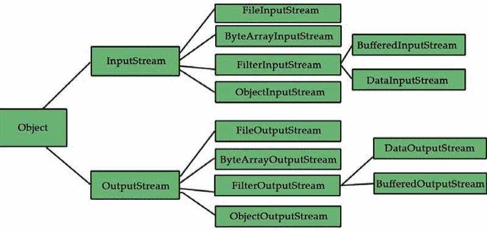

两个重要的流是 `FileInputStream` 和 `FileOutputStream`，将要介绍它们：

### FileInputStream

此流用于从文件读取数据。可以使用 `new` 关键字创建对象，并有多种构造函数。

以下构造函数接受字符串文件名来创建读取文件的输入流对象：

```java
InputStream f = new FileInputStream("input.txt");
```

以下构造函数接受文件对象来创建读取文件的输入流对象。首先我们使用 `File()` 方法创建一个文件对象：

```java
File f = new File("input.txt");
InputStream f = new FileInputStream(f);
```

一旦拿到 `InputStream` 对象，就有一系列辅助方法可以用于读取流或对流进行其他操作。

| | 说明 |
|---|---|
| 1 | `public void close() throws IOException`: 此方法关闭文件输出。释放与文件相关的系统资源。抛出 `IOException`。 |
| 2 | `protected void finalize() throws Exception`: 此方法清理与文件的连接。确保在没有更多引用此流时调用此文件输出流的 `close` 方法。抛出 `IOException`。 |
| 3 | `public int read(int r) throws IOException`: 此方法从 `InputStream` 读取指定的字节数据。返回 `int`。返回下一个字节数据，如果是文件末尾则返回 -1。 |
| 4 | `public int read(byte[] r) throws IOException`: 此方法从输入流读取 `r.length` 个字节到数组中。返回读取的字节总数。如果是文件末尾则返回 -1。 |
| 5 | `public int available() throws IOException`: 给可以从此文件输入流中读取的字节数。返回 `int` |

### FileOutputStream

`FileOutputStream` 用于创建文件并向其中写入数据。在打开文件进行输出之前，如果文件不存在，该流将创建该文件。

这里有两个可以用于创建 `FileOutputStream` 对象的构造函数。
以下构造函数接受一个字符串格式的文件名以创建一个输入对象来写入文件：

```java
OutputStream f = new FileOutputStream("C:/java/hello");
```

下一个构造函数接受一个 `File` 对象，以创建一个输出流对象来写入文件。首先，我们使用 `File(String)` 方法创建一个文件对象，如下：

```java
File f = new File("C:/java/hello");
```

```java
OutputStream f = new FileOutputStream();
```

一旦你获取了 `OutputStream` 对象，有一系列辅助方法可用于向流中写入数据或对流进行其他操作。

| 方法 | 说明 |
| :--- | :--- |
| `public void close() throws IOException` | 此方法关闭文件。释放与文件相关的任何系统资源。抛出 `IOException`。 |
| `protected void finalize() throws Exception {}` | 此方法清理与文件的连接。确保当有更多引用指向此流时，调用此文件输出流的 `close` 方法。抛出 `Exception`。 |
| `public void write(int b) throws IOException` | 此方法将指定的字节写入输出流。 |
| `public void write(byte[] w)` | 将上述字节数组中的 `w.length` 个字节写入 `OutputStream`。 |

示例：

以下是演示 `InputStream` 和 `OutputStream` 的示例：

```java
import java.io.*;
```

```java
public class fileStreamTest{
```


`public static void main(String args[])` 方法定义如下：

```java
try{
    byte bWrite [] = {11,21,3,40,5};
    OutputStream os = new FileOutputStream("test.txt");
    for(int x=0; x < bWrite.length; x++){
        os.write(bWrite[x]); // 写入字节
    }
    os.close();

    InputStream is = new FileInputStream("test.txt");
    int size = is.available();

    for(int i=0; i < size; i++){
        System.out.print((char)is.read() + " ");
    }
    is.close();
} catch(IOException e) {
    System.out.print("Exception");
}
```

## 3.4 网络

Java 实际上是互联网编程的同义词。这有许多原因，其中最不重要的是它生成安全、跨平台、可移植代码的能力。然而，Java 作为网络编程首选语言最重要的原因之一是 `java.net` 包中定义的类。它们提供了一种易于使用的方法，各种技能水平的程序员都可以访问网络资源。

### 3.4.1 网络基础

回顾一些关键的网络概念和术语将很有用。Java 网络支持的核心是套接字（socket）概念。套接字标识网络中的端点。套接字模型用于 20 世纪 80 年代的 4.2BSD UNIX 版本。因此，术语也称为 Berkeley socket。套接字是现代网络的基础；套接字允许人们同时服务许多不同的客户端，还可以服务许多类型的信息。这是通过使用端口（port）实现的，端口是特定机器上的编号套接字。服务器进程被称为“监听”端口，直到客户端连接到它。服务器允许多个客户端连接到同一个端口号，尽管每个会话是唯一的。为了管理多个客户端连接，服务器进程必须是多线程的，并具有其他方法对同时的 I/O 进行复用。

套接字通信通过协议进行。互联网协议（IP）是一种低层路由协议，它将数据拆分为小数据包并发送到跨网络的地址，但它不保证数据包到达目的地。传输控制协议（TCP）是一种较高层次的协议，它能够稳健地收集这些数据包，并在需要时排序和重传，以可靠地交付数据。第三种协议用户数据报协议（UDP）位于 TCP 旁边，可以直接用于支持快速、无连接且不可靠的数据包传输。

一旦建立连接，就会出现更高层次的协议，这取决于你使用的是哪个端口。TCP/IP 预留了 1024 个端口用于特定协议。如果你在互联网上花费过时间，其中许多端口对你来说将很熟悉。端口号 21 用于 FTP；23 用于 Telnet；25 用于电子邮件；43 用于 whois；79 用于 finger；80 用于 HTTP；119 用于网络——列表以此类推。客户端如何与端口交互，取决于每个协议。

| 页面码 | 4 | http://www.cs.usfca.edu/~parrt/doc/java/Sockets-notes.pdf |


例如，HTTP 是 Web 浏览器和服务器用于传输超文本页面和图像的协议。对于基本的页面浏览 Web 服务器来说，这是一个非常简单的协议。它的工作原理如下：当客户端从 HTTP 服务器请求文件时（这种动作称为 hit 命中），它只是简单地以特殊格式将文件名发送到预定义的端口，并读回文件内容。服务器响应状态码以告知客户端请求是否成功。

### Java 与 Web 设计

`UnknownHostException`。

在互联网上，用一个名称表示多台机器是常见的。在 Web 服务器的世界中，这是提供某种程度扩展性的方法之一。`getAllByName()` 工厂方法返回一个 `InetAddress` 数组，代表特定名称解析出的所有地址。如果无法将该名称解析为至少一个地址，它将抛出 `UnknownHostException`。

`InetAddress` 包含工厂方法 `getByAddress()`，它接收一个 IP 地址并返回一个 `InetObject`。可以使用 IPv4 或 IPv6 地址。以下示例打印了本地机器以及两个知名互联网网站的地址和名称：

```java
// Demonstrate InetAddress.
import java.net.*;
class InetAddressTest {
    public static void main(String[] args) throws UnknownHostException {
        InetAddress Address = InetAddress.getLocalHost();
        System.out.println(Address);
        Address = InetAddress.getByName("osborne.com");
        System.out.println(Address);
        InetAddress SW[] = InetAddress.getAllByName("www.nba.com");
        for (int i=0; i<SW.length; i++) {
            System.out.println(SW[i]);
        }
    }
}
```

以下是程序产生的输出：

```
default/206.148.209.138
osborne.com/198.45.24.162
www.nba.com/64.5.96.214
www.nba.com/64.5.96.216
```

## 实例方法

`InetAddress` 类还有其他几个方法，可以用于上述方法返回的对象上。以下是一些较常用的方法：

### 异常处理

| 方法 | 描述 |
|---|---|
| `boolean equals(Object other)` | 如果此对象与另一个具有相同的互联网地址，则返回 `true`。 |
| `byte[] getAddress()` | 返回一个以网络字节序表示对象 IP 地址的字节数组。 |
| `String getHostAddress()` | 返回一个表示与 `InetAddress` 对象关联的主机地址的字符串。 |
| `String getHostName()` | 返回一个表示与 `InetAddress` 对象关联的主机名的字符串。 |
| `boolean isMulticastAddress()` | 如果此为多播地址，则返回 `true`。否则，返回 `false`。 |
| `String toString()` | 返回一个列出主机名和 IP 地址的字符串以方便使用。 |

互联网地址在系列层次化的缓存服务器中进行查找。这意味着你的本地计算机可能会自动找到特定的名称到 IP 的映射，例如针对它本身和附近的服务器。对于其他名称，它可能会向本地域名系统 (DNS) 服务器请求 IP 地址。如果服务器没有特定地址，它可以转到远程站点请求。这个过程可能需要很长时间，因此明智的做法是组织代码，在本地缓存 IP 地址信息，而不是反复查找。

## 3.4.4 TCP/IP 客户端套接字

TCP/IP Socket 用于在互联网上的主机之间实现可靠、双向、持久、点对点基于流的连接。Socket 可用于将 Java 的 I/O 系统连接到可能位于本地机器或互联网上任何其他机器的程序。

Java 中有两种 TCP Socket。一种用于服务器，另一种用于客户端。`Socket` 类被设计为一个“监听器”，它在执行任何操作之前等待客户端连接。因此，`ServerSocket` 用于服务器。`Socket` 用于客户端。它被设计为连接到服务器 socket 并启动协议交换。因为客户端是 Java 程序最常用的。

创建 `Socket` 对象会隐式地建立客户端和服务器之间的连接。没有方法或构造函数显式地暴露建立连接的细节。以下是两个用于创建客户端 socket 的构造函数：

| 构造函数 | 描述 |
|---|---|
| `Socket(String hostName, int port) throws UnknownHostException, IOException` | 创建一个连接到指定主机和端口的 socket。 |
| `Socket(InetAddress address, int port) throws IOException` | 使用预定义的 `InetAddress` 对象和端口创建一个 socket。 |

### Java 与 Web 设计

`Socket` 定义了几个实例方法。例如，可以使用以下方法随时对 `Socket` 进行检查并添加与其关联的地址和端口信息：

| 方法 | 描述 |
|---|---|
| `InetAddress getInetAddress()` | 返回与 `Socket` 对象关联的 `InetAddress`。如果 socket 未连接，则返回 `null`。 |
| `int getPort()` | 返回调用的 `Socket` 连接的远程端口。如果 socket 未连接，则返回 0。 |
| `int getLocalPort()` | 返回调用的 `Socket` 绑定的本地端口。如果 socket 未绑定，则返回 -1。 |

你可以通过 `getInputStream()` 和 `getOutputStream()` 方法访问与 `Socket` 关联的输入输出流，如下。如果 socket 因为连接丢失而失效，每个方法都可以抛出 `IOException`。

| 方法 | 描述 |
|---|---|
| `getInputStream() throws IOException` | 返回与调用的 socket 关联的 `InputStream`。 |
| `getOutputStream() throws IOException` | 返回与调用的 socket 关联的 `OutputStream`。 |

还有其他可用方法，包括 `connect()`（允许你指定新连接）、`isConnected()`（如果 socket 已连接到服务器则返回 `true`）、`isBound()`（如果 socket 已绑定到地址则返回 `true`）以及 `isClosed()`（如果 socket 已关闭则返回 `true`）。

```java
// Demonstrate Sockets.

import java.net.*;
import java.io.*;

class Whose {

public static void main(String[] args) throws Exception {
int c;
```

```java
// Create a socket connected to internic.net, port 43.

Socket s = new Socket("internic.net", 43);

// Obtain input and output streams.

InputStream in = s.getInputStream();

OutputStream out = s.getOutputStream();

// Construct a request string.

String str = (args.length == 0 ? "osborne.com" : args[0]) + "\n";

// Convert to bytes.
byte buf[] = str.getBytes();

// Send request.
out.write(buf);

// Read and display response.
while ((c = in.read()) != -1) {
  System.out.print((char) c);
}

s.close();
```

如果，例如，你获取了 osborne.com 的信息，你会得到类似下面的内容：

```
Whois Server Version 1.3

.com, .net 和 .org 域名的域名现在可以在许多竞争性的注册商处注册。请访问 http://www.internic.net 获取详细信息。

Domain Name: OSBORNE.COM

Registrar: NETWORK SOLUTIONS, INC.

Whois Server: whois.networksolutions.com

Referral URL: http://www.networksolutions.com

Name Server: NS1.EPPG.COM

NS2.EPPG.COM
```

这是该程序的工作原理。首先，构造了一个指定主机名 "internic.net" 和端口号 43 的 `Socket`。Internic.net 是处理请求的 InternIC 网站。端口 43 是 whois 端口。接下来，在 socket 上同时打开输入和输出流。然后，构造一个包含你想要获取信息的网站名称的字符串。如果命令行没有指定网站，则使用 "osborne.com"。该字符串被转换为字节数组，然后通过 socket 发出。通过从 socket 输入读取响应并显示结果。

### 3.4.5 统一资源标识符 (URL)

之前的示例相当晦涩，现代互联网并不是关于像 http 和 FTP 这样的旧协议。Web 关乎 WWW，即世界网。Web 是高层协议和文件格式的松散集合，所有这些都在浏览器中统一。Web 的重要方面之一是蒂姆·伯纳斯发明了一种可扩展的方法来定位网络上的所有资源。你可以可靠地命名任何东西，这成为了一个非常强大的范式。统一资源标识符 (URL) 正是如此。

URL 提供了一种相当易理解的形式，用于唯一标识或地址互联网上的信息。URL 无处不在；每个浏览器都使用它们来识别 Web 上的信息。在 Java 的网络类库中，`URL` 类提供了一个简单、简洁的 API，用于通过 URL 访问互联网信息。

所有 URL 共享相同的格式，尽管允许某些变体。这里是两个示例：`http://www.osborne.com/` 和 `http://www.osborne.com:80/index.htm`。一个 URL 规范由四个部分组成。第一个是要使用的协议，通过冒号（`:`）与定位符的其余部分隔开。常见的协议有 HTTP、FTP 和 file，尽管现在几乎所有操作都是通过 HTTP 完成的（事实上，如果你在 URL 规范中省略“http://”，大多数浏览器也能正常运行）。第二个部分是要使用的主机名或主机 IP 地址；它在左侧由双斜杠（`//`）界定，在右侧由单斜杠（`/`）或（可选的）冒号（`:`）界定。第三个部分是端口号，是一个可选参数，左侧通过冒号（`:`）与主机名界定，右侧通过斜杠（`/`）界定。（它默认是 80 端口，即预定义的 HTTP 端口；因此“:80”是多余的）。第四部分是实际的文件路径。大多数 HTTP 服务器会在直接引用目录资源的 URL 末尾附加名为 `index.html` 或 `index.htm` 的文件。因此，`http://www.osborne.com/` 与 `http://www.osborne.com/index.htm` 是相同的。

Java 的 `URL` 类有几个构造函数；每个构造函数都可能抛出 `MalformedURLException`。一种常用的形式是用字符串指定 URL，该字符串与你在浏览器中显示的相同：

```
URL(String urlSpecifier) throws MalformedURLException
```

构造函数的另外两种形式允许你将 URL 拆分为各个组成部分：

```
URL(String protocolName, String hostName, int port, String path)
throws MalformedURLException
```

```
URL(String protocolName, String hostName, String path)
throws MalformedURLException
```

另一个频繁使用的构造函数允许你使用现有的 URL 作为引用上下文，然后从该上下文创建一个新的 URL。虽然这听起来有点复杂，但实际上非常简单且实用。

```
URL(URL urlObj, String urlSpecifier) throws MalformedURLException
```

下面的示例创建了一个 Osborne 下载页面的 URL 并检查了它的属性：

```java
// Demonstrate URL.

import java.net.*;

class URLDemo {

public static void main(String[] args) throws MalformedURLException {
  URL hp = new URL("http://www.osborne.com/downloads");
System.out.println("Protocol: " + hp.getProtocol());
System.out.println("Port: " + hp.getPort());
System.out.println("Host: " + hp.getHost());
System.out.println("File: " + hp.getFile());
System.out.println("Ext: " + hp.toExternalForm());
}
```

当你运行此代码时，将得到以下输出：

```
Protocol: http
Port: -1
Host: www.osborne
File: /downloads
Ext: http://www.osborne/downloads
```

### URI 类

Java 较新添加的内容是 `URI` 类，它封装了统一资源标识符（URI）。URI 与 URL 相似。事实上，URL 成了 URI 的子集。URI 代表标识资源的标准方式。

### Cookies


`java.net` 包包含了有助于管理 cookie 的类和接口，并可用于创建有状态的（相对于无状态的）HTTP 会话。类有 `CookieHandler`、`CookieManager` 和 `HttpCookie`。接口有 `CookiePolicy` 和 `CookieStore`。

### 3.4.6 TCP/IP 服务套接字

Java 有一种不同的套接字类用于创建服务器应用程序。`ServerSocket` 类用于创建服务器，监听本地或远程客户端连接到其在发布端口上的请求。`ServerSocket` 与普通的 `Socket` 非常不同。当你创建一个 `ServerSocket` 时，它会在系统中注册自己，表示它对客户端连接感兴趣。`ServerSocket` 的构造函数反映了你想要接收连接的端口号，以及（可选的）你希望该端口的队列有多长。队列长度告诉系统在直接拒绝连接之前可以留多少个客户端连接等待处理。以下是它的三个构造函数之一：

| `ServerSocket(int port) throws IOException` | 在指定的端口上创建一个队列长度为 50 的服务器套接字。 |
| `ServerSocket(int port, int maxQueue) throws IOException` | 在指定的端口上创建一个最大队列长度为 `maxQueue` 的服务器套接字。 |
| `ServerSocket(int port, int maxQueue, InetAddress localAddress) throws IOException` | 在指定的端口上创建一个最大队列长度为 `maxQueue` 的服务器套接字。在多播主机上，`localAddress` 指定了此套接字绑定的 IP 地址。 |

`ServerSocket` 有一个名为 `accept()` 的方法，这是一个阻塞调用，它会等待连接建立，并返回一个正常的 `Socket`，该 socket 随后用于与客户端通信。

### 3.4.7 数据报

TCP/IP 风格的网络适用于大多数网络需求。它提供了序列化的、可预测的可靠数据包流。然而，这并非没有代价。TCP 包含了许多复杂的算法来处理拥挤网络上的拥塞控制，以及对数据丢失的悲观预期。这导致数据传输方式有些低效。数据报（Datagrams）提供了替代方案。

数据报是可以在机器之间传递的信息包。它们有点像从井里用力扔出的东西。数据报是可以在机器之间传递的信息包。Java 在 UDP 协议之上实现数据报，使用了两个类：`DatagramPacket` 是载体，而 `DatagramSocket` 是机制。

### 数据报套接字

`DatagramSocket` 定义了四个公共构造函数。它们是：

```
DatagramSocket()
DatagramSocket(int port)
DatagramSocket(int port, InetAddress ipAddress)
DatagramSocket(SocketAddress address)
```

第一个创建一个未使用端口的 `DatagramSocket`。第二个绑定到指定端口的 `DatagramSocket`。第三个绑定到端口和 `InetAddress` 的 `DatagramSocket`。第四个绑定到 `SocketAddress` 的 `DatagramSocket`。`SocketAddress` 是一个抽象类，`InetAddress` 封装了 IP 地址。

`DatagramSocket` 定义了许多方法。其中最重要的两个是 `send()` 和 `receive()`，如下：

```
send(DatagramPacket packet)
receive(DatagramPacket packet)
```

`send()` 方法发送到 `packet` 指定的位置。`receive` 方法等待接收一个包。

其他方法允许你访问 `DatagramSocket` 的各种属性。如下：

| `InetAddress getAddress()` | 如果套接字已连接，则返回地址。否则返回 `null`。 |
| `int getLocalPort()` | 返回本地端口号。 |
| `int getPort()` | 返回套接字连接的端口号。如果没有连接，则返回 -1。 |
| `boolean isBound()` | 如果套接字已绑定地址，则返回 `true`。否则返回 `false`。 |
| `boolean isConnected()` | 如果套接字连接到了服务器，则返回 `true`。否则返回 `false`。 |
| `void setTimeout(int millis) throws SocketException` | 设置超时时间为传入的毫秒数 `millis`。 |

## 榜样

### JAMES DUNCAN DAVIDSON

James Duncan Davidson（1970年7月29日出生于德克萨斯州利布克）是一位美国摄影师和软件开发者。在太阳太阳公司（1997–2001）担任软件工程师期间，Davidson 创建了基于 Java 的 Web 服务器应用程序 Tomcat 以及 Java 工具 Ant。

Davidson 是多本关于使用和运行软件书籍的作者或合著者，包括《Cocoa with Objective-C》、《Cocoa in a Nuthell》和《Mac OS Panther Hacks》，这些都由 O'Reilly Media 出版。他还为《Agile Web Development with Rails》（The Pragmatic Programmers 出）做出了贡献。

Duncan 在近期（2005–2006年）将编程兴趣和注意力转向了 Ruby on Rails。与著名的 Rails 大师 Mike Clark 合作，Davidson 设计并构建了一些最复杂且稳健的 Rails 应用。

从2005年开始，Duncan 将摄影加入了他的其他专业关注领域。他曾担任多个高规格技术会议的主力摄影师。

他是 Luma Labs 的联合创始人和共同所有者（与 Greg Koenig 合作），这是一家位于俄勒冈州波特兰、专注于高质量相机配件的小公司。


### Java 与 Web 设计

## 摘要

- Java 中的异常（Exception）表示程序执行过程中发生了错误或意外情况。异常处理是处理此类情况的机制。它基于“抛出（throw）和捕获（catch）”的原则。
- 检查异常（Checked exception）是在编译时发生的异常，也称为编译时异常。这些异常在编译时不能被简单地忽略，程序员应该处理（handle）这些异常。
- 未检查异常（Unchecked exception）是在程序执行期间发生的异常，也称为运行时异常（Runtime exceptions），它们包括编程错误、逻辑错误或对 API 使用不当。运行时异常在编译时会被忽略。
- `finally` 创建一个代码块，该块会在 `try/catch` 块完成后、在 `try/catch` 块执行之前执行。
- 线程（Threads）通常是为了短期利益而创建，通常被可视化为串行任务，但并不一定以线性方式执行（例如使用并行性进行复杂的数学计算、初始化大型矩阵），并在不再需要时被吸收。
- `Java.io` 包包含了几乎你在 Java 中执行输入和输出（I/O）可能需要的每一个类。
- Java 字节流（Byte streams）用于执行 8 位字节的输入和输出，而 Java 字符流（Character streams）用于执行 16 位 Unicode 的输入和输出。
- `InetAddress` 类用于封装数值型 IP 地址以及该地址的域名名。

## 复习题

- 1. 定义异常处理。讨论异常的类型。
- 2. 什么是线程？简述线程与进程之间的区别。
- 3. 什么是网络？网络如何使用数据包和地址传输信息？
- 4. 区分 `throw` 和 `throws`。
- 5. 写关于以下内容的简要短记：
  a. 流 (Stream)
  b. 字节流
  c. 字符流

## 知识检查

- 1. Java 异常在代码序列中何时产生？
  a. 运行时
  b. 编译时
  c. 可能任何时候发生
  d. 以上都不是
- 2. 下列关键字中哪个不是异常处理的一部分？
  a. try
  b. finally
  c. thrown
  d. catch
- 3. 下列哪个包包含用于网络的类和接口？
  a. java.io
  b. java.util
  c. java.net
  d. java.network
- 4. 下列哪种是跨网络将数据包拆分并发送到地址的协议？
  a. TCIP/IP
  b. DNS
  c. Socket
  d. Proxy Server
- 5. 下列哪种是跨网络将数据包拆分并发送到地址的协议？
  a. TCIP/IP
  b. DNS
  c. Socket
  d. Proxy Server

## 检查结果

- 1. (a) 2. (c) 3. (c) 4. (a) 5. (b)

## 扩展阅读

- 1. 《Practical Java：编程语言指南》，作者 Peter Haggar
- 2. 《面向对象编程与 Java》，作者 Danny Poo, Derek Kiong, Swarnalatha Ashok

## 事件处理

## 学习目标

在学习完本章后，你将能够：

- 1. 解释委托事件模型（Delegation event model）
- 2. 讨论事件监听器接口和适配器（adapters）
- 3. 解释使用适配器和内部类处理 AWT 事件
- 4. 讨论 Java Beans 和 Swing

## 引言

对象状态的变化被称为事件（Event）。事件是用户与图形化用户界面组件交互的结果生成的。例如，点击按钮、移动鼠标、通过键盘输入字符、从列表中选择项目、滚动页面都是导致事件发生的活动。

事件处理（Event Handling）是控制事件并决定事件发生时应该发生什么的机制。该机制包含被称为事件处理程序（event handler）的代码，在事件发生时执行。Java 使用委托事件模型来处理事件。该模型定义了生成和处理事件的标准机制。让我们简单介绍一下这个模型。

委托事件模型包含以下参与者：

- 源（Source）—— 源是发生事件的对象。源负责提供已发生事件的信息。
- 监听器（Listener）—— 也称为事件处理器。监听器负责对事件产生响应。从 Java 实现的角度来看，监听器也是一个对象。监听器等待接收事件。一旦接收到事件，监听器就会对其进行处理。

这种方法的用处是用户界面逻辑与产生事件的逻辑完全分离。在这种模型中，用户界面元素能够将事件处理委托给另一部分代码。监听器需要向源对象注册，以便监听器可以接收事件。这是一种处理事件的高效方法，因为事件通知只会发送给想要接收它们的监听器。


### 4.1. 委托事件模型

在委托事件模型下，所有系统事件都是 `AWT Event` 类或其子类的实例。该模型提供了一系列事件类型。第一组是原始事件（raw events），例如指示组件获取焦点、按下按键或移动鼠标。这些事件存在于 `ComponentEvent` 及其子类中，某些新事件仅通过重写事件相关的方法可用。此外，更高层次的事件类型（例如选择按钮）被封装在 `AWT Event` 的其他子类中，这些子类并不是 `ComponentEvent` 的子类。

| 引用 |
| :--- |
| 委托事件模型 |
| [Java 教程](https://www.example.com) |

## 事件处理

简单的处理示例


### 4.1. 委托事件模型

在委托事件模型下，所有系统事件都是 `AWT Event` 或其子类的实例。该模型提供了一系列事件类型。第一组是原始事件，例如指示组件获取焦点、按下按键或移动鼠标。这些事件存在于 `ComponentEvent` 及其子类中，某些新事件仅通过重写事件相关的方法可用。此外，更高层次的事件类型（例如选择按钮）被封装在 `AWT Event` 的其他子类中，这些子类并不是 `ComponentEvent` 的子类。

| 引用 |
| :--- |
| 委托事件模型 |
| [Java 教程](https://www.example.com) |

## 事件处理

简单的处理示例


### 4.1. 委托事件模型

在委托事件模型下，所有系统事件都是 `AWT Event` 或其子类的实例。该模型提供了一系列事件类型。第一组是原始事件，例如指示组件获取焦点、按下按键或移动鼠标。这些事件存在于 `ComponentEvent` 及其子类中，某些新事件仅通过重写事件相关的方法可用。此外，更高层次的事件类型（例如选择按钮）被封装在 `AWT Event` 的其他子类中，这些子类并不是 `ComponentEvent` 的子类。

| 引用 |
| :--- |
| 委托事件模型 |
| [Java 教程](https://www.example.com) |

## 事件处理

简单的处理示例


### 4.1. 委托事件模型

在委托事件模型下，所有系统事件都是 `AWT Event` 或其子类的实例。该模型提供了一系列事件类型。第一组是原始事件，例如指示组件获取焦点、按下按键或移动鼠标。这些事件存在于 `ComponentEvent` 及其子类中，某些新事件仅通过重写事件相关的方法可用。此外，更高层次的事件类型（例如选择按钮）被封装在 `AWT Event` 的其他子类中，这些子类并不是 `ComponentEvent` 的子类。

| 引用 |
| :--- |
| 委托事件模型 |
| [Java 教程](https://www.example.com) |

## 事件处理

简单的处理示例


### 4.1. 委托事件模型

在委托事件模型下，所有系统事件都是 `AWT Event` 或其子类的实例。该模型提供了一系列事件类型。第一组是原始事件，例如指示组件获取焦点、按下按键或移动鼠标。这些事件存在于 `ComponentEvent` 及其子类中，某些新事件仅通过重写事件相关的方法可用。此外，更高层次的事件类型（例如选择按钮）被封装在 `AWT Event` 的其他子类中，这些子类并不是 `ComponentEvent` 的子类。

| 引用 |
| :--- |
| 委托事件模型 |
| [Java 教程](https://www.example.com) |

## 事件处理

简单的处理示例


### 4.1. 委托事件模型

在委托事件模型下，所有系统事件都是 `AWT Event` 或其子类的实例。该模型提供了一系列事件类型。第一组是原始事件，例如指示组件获取焦点、按下按键或移动鼠标。这些事件存在于 `ComponentEvent` 及其子类中，某些新事件仅通过重写事件相关的方法可用。此外，更高层次的事件类型（例如选择按钮）被封装在 `AWT Event` 的其他子类中，这些子类并不是 `ComponentEvent` 的子类。

| 引用 |
| :--- |
| 委托事件模型 |
| [Java 教程](https://www.example.com) |

## 事件处理

简单的处理示例


### 4.1. 委托事件模型

在委托事件模型下，所有系统事件都是 `AWT Event` 或其子类的实例。该模型提供了一系列事件类型。第一组是原始事件，例如指示组件获取焦点、按下按键或移动鼠标。这些事件存在于 `ComponentEvent` 及其子类中，某些新事件仅通过重写事件相关的方法可用。此外，更高层次的事件类型（例如选择按钮）被封装在 `AWT Event` 的其他子类中，这些子类并不是 `ComponentEvent` 的子类。

| 引用 |
| :--- |
| 委托事件模型 |
| [Java 教程](https://www.example.com) |

## 事件处理

简单的处理示例


### 4.1. 委托事件模型

在委托事件模型下，所有系统事件都是 `AWT Event` 或其子类的实例。该模型提供了一系列事件类型。第一组是原始事件，例如指示组件获取焦点、按下按键或移动鼠标。这些事件存在于 `ComponentEvent` 及其子类中，某些新事件仅通过重写事件相关的方法可用。此外，更高层次的事件类型（例如选择按钮）被封装在 `AWT Event` 的其他子类中，这些子类并不是 `ComponentEvent` 的子类。

| 引用 |
| :--- |
| 委托事件模型 |
| [Java 教程](https://www.example.com) |

## 事件处理

简单的处理示例


### 4.1. 委托事件模型

在委托事件模型下，所有系统事件都是 `AWT Event` 或其子类的实例。该模型提供了一系列事件类型。第一组是原始事件，例如指示组件获取焦点、按下按键或移动鼠标。这些事件存在于 `ComponentEvent` 及其子类中，某些新事件仅通过重写事件相关的方法可用。此外，更高层次的事件类型（例如选择按钮）被封装在 `AWT Event` 的其他子类中，这些子类并不是 `ComponentEvent` 的子类。

| 引用 |
| :--- |
| 委托事件模型 |
| [Java 教程](https://www.example.com) |


| [Java 教程](https://www.example.com) |

## 事件处理

简单的处理示例


### 4.1. 委托事件模型

在委托事件模型下，所有系统事件都是 `AWTEvent` 或其子类的实例。该模型提供了一系列事件类型。第一组是原始事件，例如指示组件获取焦点、按下按键或移动鼠标。这些事件存在于 `ComponentEvent` 及其子类中，某些新事件仅通过重写事件相关的方法可用。此外，更高层次的事件类型（例如选择按钮）被封装在 `AWTEvent` 的其他子类中，这些子类并不是 `ComponentEvent` 的子类。

| 引用 |
| :--- |
| 委托事件模型 |

| [Java 教程](https://www.example.com) |

## 事件处理

简单的处理示例


### 4.1. 委托事件模型

在委托事件模型下，所有系统事件都是 `AWTEvent` 或其子类的实例。该模型提供了一系列事件类型。第一组是原始事件，例如指示组件获取焦点、按下按键或移动鼠标。这些事件存在于 `ComponentEvent` 及其子类中，某些新事件仅通过重写事件相关的方法可用。此外，更高层次的事件类型（例如选择按钮）被封装在 `AWTEvent` 的其他子类中，这些子类并不是 `ComponentEvent` 的子类。

| 引用 |
| :--- |
| 委托事件模型 |

| [Java 教程](https://www.example.com) |

## 事件处理

简单的处理示例


### 4.1. 委托事件模型

在委托事件模型下，所有系统事件都是 `AWTEvent` 或其子类的实例。该模型提供了一系列事件类型。第一组是原始事件，例如指示组件获取焦点、按下按键或移动鼠标。这些事件存在于 `ComponentEvent` 及其子类中，某些新事件仅通过重写事件相关的方法可用。此外，更高层次的事件类型（例如选择按钮）被封装在 `AWTEvent` 的其他子类中，这些子类并不是 `ComponentEvent` 的子类。

| 引用 |
| :--- |
| 委托事件模型 |

| [Java 教程](https://www.example.com) |

## 事件处理

简单的处理示例


### 4.1. 委托事件模型

在委托事件模型下，所有系统事件都是 `AWTEvent` 或其子类的实例。该模型提供了一系列事件类型。第一组是原始事件，例如指示组件获取焦点、按下按键或移动鼠标。这些事件存在于 `ComponentEvent` 及其子类中，某些新事件仅通过重写事件相关的方法可用。此外，更高层次的事件类型（例如选择按钮）被封装在 `AWTEvent` 的其他子类中，这些子类并不是 `ComponentEvent` 的子类。

| 引用 |
| :--- |
| 委托事件模型 |

| [Java 教程](https://www.example.com) |

## 事件处理

简单的处理示例


### 4.1. 委托事件模型

在委托事件模型下，所有系统事件都是 `AWTEvent` 或其子类的实例。该模型提供了一系列事件类型。第一组是原始事件，例如指示组件获取焦点、按下按键或移动鼠标。这些事件存在于 `ComponentEvent` 及其子类中，某些新事件仅通过重写事件相关的方法可用。此外，更高层次的事件类型（例如选择按钮）被封装在 `AWTEvent` 的其他子类中，这些子类并不是 `ComponentEvent` 的子类。

| 引用 |
| :--- |
| 委托事件模型 |

| [Java 教程](https://www.example.com) |

`protected void consume()`

`consume()` 方法被调用以通知事件它已被处理。被标记为“已消费（consumed）”的事件仍然会被传递给源组件的同级对象（peer）以及所有其他注册的监听器。然而，同级对象将忽略该事件；其他监听器也可以选择忽略它，但这取决于它们自己。监听器无法“撤销”一个已经被标记为“已消费”的事件。非组件事件类型也可以被标记为已消费。如果你正在捕获键盘输入并需要将其拒绝给同级对象，那么将事件标记为“已消费”是有用的；按键将不会显示。在 Java 1.0 中，你可以通过编写一个返回 `true` 的事件处理器（例如 `keyDown()`）来实现相同的效果。你可以假设在所有监听器都有机会消费事件之前，该事件不会被传递给同级对象。但是，你不应该对监听器被调用的顺序做任何其他假设。

`protected boolean isConsumed()`

`isConsumed()` 方法返回事件是否已消费，无论是通过默认还是通过 `consume()`；此方法返回 `true`；否则返回 `false`。

`public String paramString()`

当你调用 `AWTEvent` 的 `toString()` 方法时，`paramString()` 方法会被随后调用以构建用于显示的字符串。由于你最频繁处理的是 `AWTEvent` 的子类，子类只需要重写 `paramString()` 即可添加它们特定的信息。

`public String toString()`

`AWTEvent` 的 `toString()` 方法返回一个包含事件名称和源的字符串。在 `MouseAdapter.mouseReleased()` 方法中，打印参数将导致类似以下的结果：

```
java.awt.event.MouseEvent[MOUSE_RELEASED,,(69,107),mods=0,clickCount=1] on panel1
```


事件调度线程（EDT）是 Java 中用于从 Abstract Toolkit 图形用户事件队列中处理事件的后台线程。

## 4.1.2. ComponentEvent

### 常量

`public final static int COMPONENT_FIRST`

`public final static int COMPONENT_LAST`


`COMPONENT_FIRST` 和 `COMPONENT_LAST` 常量标识 `ComponentEvent` 类型标识范围的端点。

`public final static int COMPONENT_HIDDEN`

`COMPONENT_HIDDEN` 常量标识由于组件被隐藏而发生的事件。接口方法 `ComponentListener.componentHidden()` 处理此事件。

`public final static int COMPONENT_MOVED`

`COMPONENT_MOVED` 常量标识由于组件移动而发生的事件。`ComponentListener.componentMoved(event)` 方法处理此事件。

`public final static int COMPONENT_RESIZED`

`COMPONENT_RESIZED` 常量标识由于组件大小改变而发生的事件。接口方法 `ComponentListener.componentResized()` 处理此事件。

`public final static int COMPONENT_SHOWN`

`COMPONENT_SHOWN` 常量标识由于组件显示（即变为可见）而发生的事件。接口方法 `ComponentListener.componentShown()` 处理此事件。

### 构造函数

`public ComponentEvent(Component source, int id)`

此构造函数创建一个带有给定源的 `ComponentEvent`；源是产生事件的对象。`id` 标识事件类型。如果是系统生成的，`id` 将是上述最后四个常量之一。然而，并没有什么阻止你为自己的事件类型创建 `id`。

### 方法

```
public Component getComponent()
```

`getComponent()` 方法返回事件的源——即触发事件的组件。

```
public String paramString()
```

当你调用 `AWTEvent` 的 `toString()` 方法时，`paramString()` 方法会被随后调用以构建用于显示的字符串。在 `ComponentEvent` 级别，`paramString()` 会添加一个标识事件 `id` 的字符串（如果可用）以及源的包围矩形（如果适用）。例如：

```
java.awt.ComponentEvent[COMPONENT_RESIZED(0, 0, 100x100)] on button
```

## 4.1.3. ContainerEvent

`ContainerEvent` 类包含了由特定容器操作引起的事件。

### 常量

```
public final static int CONTAINER_FIRST
```

```
public final static int CONTAINER_LAST
```

`CONTAINER_FIRST` 和 `CONTAINER_LAST` 常量持有 `ContainerEvent` 类型标识范围的端点。

```
public final static int COMPONENT_ADDED
```

`COMPONENT_ADDED` 常量标识由于组件被添加到容器而发生的容器事件。接口方法 `ContainerListener.componentAdded(Object)` 处理此事件。

```
public final static int COMPONENT_REMOVED
```

`COMPONENT_REMOVED` 常量标识由于组件从容器中移除而发生的容器事件。接口方法 `ContainerListener.componentRemoved(Object)` 处理此事件。

### 构造函数

```
public ContainerEvent(Container source, int id, Component child)
```

该构造函数创建一个带有给定源（产生事件的容器）的 `ContainerEvent`，该 `child` 已被添加或移除。`id` 作为事件类型的标识。如果是系统生成的，`id` 将是描述的常量之一。然而，并没有什么阻止你为自己的事件类型创建自己的 `id`。

### 方法

`public Container getContainer()`

`getContainer()` 方法返回产生事件的容器。

`public Component getComponent()`

`getComponent()` 方法返回被添加或移除的组件。

`public String paramString()`

当你调用 `AWTEvent` 的 `toString()` 方法时，`paramString()` 方法会被随后调用以构建用于显示的字符串。在 `ContainerEvent` 级别，`paramString()` 会添加事件 `id`（如果可用）以及子组件的名称。


## 4.4. FocusEvent

`FocusEvent` 类包含了组件获取或失去焦点时生成的事件。这些可能是临时的或永久的焦点变化。临时焦点变化是其他活动发生的结果，例如窗口出现在面前。一旦窗口移除，焦点就会恢复。永久焦点变化通常是使用键盘或鼠标移动的结果：例如，你点击了文本字段进行输入，或使用 Tab 键移动到下一个组件。在编程上，永久焦点变化是调用 `Component.requestFocus()` 的结果。

### 常量

`public final static int FOCUS_FIRST`

`public final static int FOCUS_LAST`

`FOCUS_FIRST` 和 `FOCUS_LAST` 常量持有 `FocusEvent` 类型标识范围的端点。

`public final static int FOCUS_GAINED`

### 事件处理

`FOCUS_GAINED` 常量标识由于组件获取焦点而发生的事件。`FocusListener.focusGained()` 接口方法处理此事件。

`public final static int FOCUS_LOST`

`FOCUS_LOST` 常量标识由于组件失去焦点而发生的事件。`FocusListener.focusLost()` 接口方法处理此事件。

### 构造函数

`public FocusEvent(Component source, int id, boolean temporary)`

此构造函数创建一个带有源的 `FocusEvent`；源是产生事件的对象。`id` 作为事件类型的标识。如果是系统生成的，`id` 将是上述两个常量之一。然而，并没有什么阻止你为自己的事件类型创建 `id`。如果 `temporary` 参数为 `true`，则它代表一个临时焦点变化。

`public FocusEvent(Component source, int id)`

此构造函数通过调用将 `temporary` 参数设置为 `false` 的第一个构造函数来创建一个 `FocusEvent`；即它创建一个永久焦点变化的事件。

### 方法

`public boolean isTemporary()`

如果焦点事件描述的是临时焦点变化，则 `isTemporary()` 方法返回 `true`；如果事件描述的是永久焦点变化，则返回 `false`。一旦由构造函数设置，该设置将是永久的。

`public String paramString()`

当你调用 `AWTEvent` 的 `toString()` 时，`paramString()` 方法会被随后调用以构建用于显示的字符串。在 Focus 级别，`paramString()` 会添加一个显示事件 `id`（如果可用）以及它是否为临时的字符串。

## 4.2. 事件监听器接口与适配器

Java 1.1 有 11 个监听器接口，它们规定了类为了接收不同类型的事件必须实现的方法。例如，`ActionListener` 接口

### Java 与 Web 设计

`face` 定义了当 `ActionEvent` 发生时被调用的单一方法。这些接口取代了 Java 1.0 中的各种事件处理方法：`action()` 现在是 `ActionListener` 接口的 `actionPerformed()` 方法，`mouseUp()` 现在是 `MouseListener` 接口的 `mouseReleased()` 方法，依此类推。大多数监听器接口都有一个对应的适配器类（adapter class），它是一个抽象类，提供了接口中所有方法的空实现。（虽然适配器类本身没有抽象方法，但它被声明为抽象类，以提醒你必须对其进行子类化）。与其直接实现监听器接口，你可以选择扩展适配器类并仅重写你感兴趣的方法。（可以实现更复杂的适配器，但 AWT 提供的适配器非常简单）。对于具有多个方法的监听器接口，提供了相应的适配器。

这里描述了 Java 1.1 的监听器接口和适配器类。值得注意的是，Java 1.1 不允许在编写事件处理器时修改原始事件。

## 4.2.1. ActionListener

`ActionListener` 接口包含一个当 `ActionEvent` 发生时调用的方法。它没有适配器类。如果对象要监听动作事件，必须使用 `addActionListener()` 方法，并将实现了 `ActionListener` 接口的类作为参数。`addActionListener()` 方法由 `Button`、`List`、`MouseItem` 和 `TextField` 组件实现。其他组件不产生动作事件。

```
public abstract void actionPerformed(ActionEvent e)
```

当组件被选中或激活时，会调用 `actionPerformed()` 方法。每个组件的激活方式都不同；对于 `List`，激活是指用户双击了某个条目，请参见每个组件的相应描述。`actionPerformed()` 是 Java 1.1 中对应 1.0 事件模型中 `action()` 方法。

## 4.2.2. AdjustmentListener

`AdjustmentListener` 接口包含一个当 `AdjustmentEvent` 发生时调用的方法。它没有适配器类。如果对象要监听调整事件，必须调用 `addActionListener()`，并将实现了 `AdjustmentListener` 接口的类作为参数。`addAdjustmentListener()` 方法由 `Scrollbar` 组件和 `Adjustable` 接口实现。其他组件不产生调整事件。

```
public abstract void adjustmentValueChanged(AdjustmentEvent e)
```

当滑块移动时，会调用 `adjustmentValueChanged()` 方法。

## 事件处理


`Scrollbar` 和 `ScrollPane` 组件具有滑块，当滑块移动时会产生调整事件。（`TextArea` 和 `List` 组件也有滑块，但不产生调整事件。）请参见每个组件的相应描述。Java 1.0 中没有 `adjustmentValueChanged()` 的真正等效方法；要处理滚动事件，你必须重写 `handleEvent()` 方法。


# ComponentListener 和 ComponentAdapter

`ComponentListener` 包含四个当 `ComponentEvent` 发生时调用的方法；这些事件用于组件的通用操作，如移动或调整组件大小。代表 `ComponentListener` 的适配器类是 `ComponentAdapter`。如果你只关心 `ComponentListener` 中的一个或两个方法，可以扩展该适配器类并仅重写你感兴趣的方法。如果对象要监听事件，必须调用 `Component.addComponentListener()`，并将实现接口的类作为参数。

```
public abstract void componentResized(ComponentEvent e)
```

事件监听器一旦设置到应用对象上，就会等待在其上执行某些操作，如鼠标点击、鼠标悬停、按下按键、按钮等。

当组件调整大小时时，会调用 `componentResized()` 方法（例如通过调用 `Component.setSize()`）。

```
public abstract void componentMoved(ComponentEvent e)
```

当组件移动时，会调用 `componentMoved()` 方法（例如通过调用 `Component.setLocation()`）。

```
public abstract void componentShown(ComponentEvent e)
```

当组件显示时，会调用 `componentShown()` 方法。

```
public abstract void componentHidden(ComponentEvent e)
```

当组件隐藏时，会调用 `componentHidden()` 方法。


# ContainerListener 和 ContainerAdapter

`ContainerListener` 包含两个当 `ContainerEvent` 发生时调用的方法；当组件被添加或移除容器时产生这些事件。`ContainerListener` 的适配器类是 `ContainerAdapter`。如果你只关心 `ContainerListener` 中的一个或两个方法，可以扩展该适配器类并仅重写你感兴趣的方法。如果对象要监听事件，必须调用 `Component.addContainerListener()`，并将实现接口的类作为参数。

```
public abstract void componentAdded(ContainerEvent e)
```

当组件被添加到容器时，会调用 `componentAdded()` 方法。

```
public abstract void componentRemoved(ContainerEvent e)
```

当组件从容器中移除时，会调用 `componentRemoved()` 方法。

# FocusListener 和 FocusAdapter

`FocusListener` 接口包含两个当 `FocusEvent` 发生时调用的方法。它的适配器类是 `FocusAdapter`。如果你只关心 `FocusListener` 中的一个方法，可以扩展该适配器类并仅重写你感兴趣的方法。如果对象要监听事件，必须调用 `Component.addFocusListener()`，并将实现接口的类作为参数。

```
public abstract void focusGained(FocusEvent e)
```

当组件获得焦点时，会调用 `focusGained()` 方法。

```
public abstract void focusLost(FocusEvent e)
```

当组件失去焦点时，会调用 `focusLost()` 方法。

# 4.2.3. ItemListener

`ItemListener` 接口包含一个当 `ItemEvent` 发生时调用的方法。它没有适配器类。如果对象要监听项事件，必须使用 `addActionListener()`，并将实现了 `ItemListener` 接口的类作为参数。`addActionListener()` 方法由 `Checkbox`、`CheckboxMenuItem`、`Choice` 和 `List` 组件实现。

```
public abstract void stateChanged(ItemEvent e)
```

当组件状态改变时，会调用 `stateChanged()` 方法。对于 `List`，状态改变是指用户双击了某个条目。

`method` 报告实际输入的字符。面向操作的按键（如功能键）不会触发此方法的调用。

# MouseListener 和 MouseAdapter

`MouseListener` 接口包含五个方法，当发生非移动相关的 `MouseEvent`（鼠标事件）时会调用这些方法；当用户按下或释放鼠标按钮时，会产生鼠标事件。（使用独立的类 `MouseListener` 和 `MouseAdapter` 来处理鼠标移动事件；这意味着你可以监听鼠标点击，而不会被成千上万的鼠标事件骚扰。）`MouseListener` 的适配器类是 `MouseAdapter`。如果你只关心 `MouseListener` 中的一个或两个方法，可以编写该适配器的子类并重写你感兴趣的方法。要让一个对象监听鼠标事件，必须调用 `Window.addListener()` 方法，并将实现该接口的类作为参数。

`public abstract void mouseEntered(MouseEvent)` 当鼠标首次进入组件的边界区域时调用。该方法是 Java 1.0 事件模型中 `Component.mouseEnter` 的 Java 1.1 等效方法。

`public abstract void mouseExited(MouseEvent)` 当鼠标离开组件的边界区域时调用。该方法是 Java 1.0 事件模型中 `Component.mouseExit` 的 Java 1.1 等效方法。

`public abstract void mousePressed(MouseEvent)` 每当用户在组件空间内按下鼠标按钮时调用。该方法是 Java 1.0 事件模型中 `Component.mouseDown()` 的 Java 1.1 等效方法。

`public abstract void mouseReleased(MouseEvent)` 当鼠标在按下后释放鼠标按钮时调用。用户不需要再位于原始组件上方；原始组件（即按下鼠标时所在的组件）是事件的源头。该方法是 Java 1.0 事件模型中 `Component.mouseUp()` 的 Java 1.1 等效方法。

`public abstract void mouseClicked(MouseEvent)` 每当用户点击鼠标按钮时调用一次；也就是说，每次鼠标按下/鼠标释放的组合都会调用一次。

# MouseMotionListener 和 MouseMotionAdapter

`MouseMotionListener` 接口包含两个方法，当发生移动相关的 `MouseEvent`（鼠标移动事件）时会调用这些方法；当用户移动鼠标时（无论是否按下按钮）都会产生鼠标移动事件。（使用独立的类 `MouseListener` 和 `MouseAdapter` 来处理鼠标点击以及进入/离开组件。这使得忽略非常频繁且可能影响性能的鼠标移动事件变得容易。如果你确实需要，才应该监听鼠标移动事件。）`MouseMotionAdapter` 是 `MouseMotionListener` 的适配器。如果你只关心 `MouseMotionListener` 中的一个方法，可以编写该适配器的子类并重写你感兴趣的方法。要让一个对象监听鼠标移动事件，必须调用 `Component.addMouseMotionListener()` 方法，并将实现该接口的类作为参数。

```
public abstract void mouseMoved(MouseEvent e)
```

每当鼠标在组件边界区域内移动且没有按下鼠标按钮时，就会调用 `mouseMoved()` 方法。该方法是 `Component.mouseMoved()` 的 Java 1.1 等效方法。

```
public abstract void mouseDragged(MouseEvent e)
```

每当在按下鼠标按钮的同时移动时，就会调用 `mouseDragged()` 方法。`MouseEvent` 的源是首次按下时鼠标下方的组件。该方法是 Java 1.0 事件模型中 `Component.mouseDrag()` 的 Java 1.1 等效方法。

# 4.2.4. TextListener

`TextListener` 接口包含一个方法，当发生 `TextEvent`（文本事件）时会调用。它没有适配器类。要让一个对象监听 `TextEvent`，必须调用 `addTextListener()` 方法，并将实现 `TextListener` 接口的类作为参数。`addTextListener()` 方法由 `TextComponent` 类实现，因此 `TextField` 和 `TextArea` 组件也实现了。其他组件不会产生文本事件。

```
public abstract void textChanged(TextEvent e)
```

当文本组件的内容被修改时（无论是用户通过按键还是通过程序方式——即 `setText()` 方法），都会调用 `textChanged()` 方法。


> 记住 抽象窗口工具包（AWT）是 Swing 之前的 Java 依赖平台的窗口、图形和用户界面工具包。


# 4.2.5. WindowListener 和 WindowAdapter

`WindowListener` 接口包含七个方法，当发生 `WindowEvent`（窗口事件）时会调用这些方法；当某些操作改变窗口的可见性或状态时，会产生窗口事件。`WindowListener` 的适配器类是 `WindowAdapter`。

如果你只关心 `WindowListener` 中的一个或两个方法，可以编写该适配器的子类并仅重写你感兴趣的方法。要让一个对象监听窗口事件，必须调用 `Window.addWindowListener()` 或 `Dialog.addWindowListener()` 方法，并将实现接口的类作为参数。

```
public abstract void windowOpened(WindowEvent e)
```

当窗口首次打开时调用 `windowOpened()` 方法。

```
public abstract void windowClosing(WindowEvent e)
```

当用户尝试关闭窗口时触发 `windowClosing()` 方法。

```
public abstract void windowClosed(WindowEvent e)
```

窗口关闭后调用 `windowClosed()` 方法。

```
public abstract void windowIconified(WindowEvent e)
```

当用户最小化窗口时调用 `windowIconified()` 方法。

```
public abstract void windowDeiconified(WindowEvent e)
```

当用户取消最小化时调用 `windowDeiconified()` 方法。

```
public abstract void windowActivated(WindowEvent e)
```

当窗口带到前时调用 `windowActivated()` 方法。

```
public abstract void windowDeactivated(WindowEvent e)
```

当窗口通过最小化、关闭或另一个窗口激活而从前移开时，调用 `windowDeactivated()` 方法。

# 4.3. 使用适配器和内部类处理 AWT 事件

大多数 AWT 监听器接口（与 `ActionListener` 不同）包含一个以上的方法。例如，`MouseListener` 接口包含五个方法：`mousePressed`、`mouseReleased`、`mouseEntered`、`mouseExited` 和 `mouseClicked`。即使你只关心鼠标点击，如果你的类直接实现了 `MouseListener`，你也必须实现所有的 `MouseListener` 方法。对于你不感兴趣的事件，方法体留空。这是一个示例：

```
// 一个冗余但有效的代码。
MyClass implements MouseListener {
someObject.addMouseListener(this);
}
```

```
/* 空方法定义。 */
public void mousePressed(MouseEvent e) {
}
```

```
/* 空方法定义。 */
public void mouseReleased(MouseEvent e) {
}
```

```
/* 空方法定义。 */
public void mouseEntered(MouseEvent e) {
}
```

```
/* 空方法定义。 */
public void mouseExited(MouseEvent e) {
}
```

```
public void mouseClicked(MouseEvent e) {
// 事件处理实现写在这里...
}
```

不幸的是，产生的空方法体集合会导致代码更难以阅读和维护。为了帮助你避免在代码中填充空方法体，AWT 为每个包含多个方法的监听器接口提供了一个适配器类（处理标准 AWT 事件列出了所有监听器及其对应的适配器）。例如，`MouseAdapter` 类实现了 `MouseListener` 接口。适配器类实现了该接口所有方法的空实现。

要使用适配器，你应该创建它的子类，而不是直接实现监听器接口。例如，扩展 `MouseAdapter`，你的类继承了空的


`MouseListener` 包含的所有五个方法的定义。

```
/*
* 扩展适配器类而不是直接
* 实现监听接口的示例。
 */
MyClass extends MouseAdapter {
    someObject.addMouseListener(this);
    public void mouseClicked(MouseEvent e) {
        // 事件处理实现写在这里...
    }
}
```

如果你不想让你的事件处理类继承自适配器类怎么办？例如，假设你写了一个 applet（小程序），并且你希望你的 `Applet` 子类包含一些处理鼠标事件的代码。由于 Java 语言不允许多重继承，你的类不能同时扩展 `Applet` 和 `MouseAdapter` 类。解决方案是定义一个内部类——即一个位于你的 `Applet` 子类内部的类——它继承自 `MouseAdapter` 类。

```
//一个使用内部类的示例。
MyClass extends Applet {
    someObject.addMouseListener(new MyAdapter());

    class MyAdapter extends MouseAdapter {
        public void mouseClicked(MouseEvent e) {
            // 事件处理实现写在这里...
        }
    }
}
```

即使你的事件处理程序需要访问外部类的私有实例变量，内部类也能很好工作。只要你不将内部类声明为静态（`static`），内部类就可以引用实例变量和方法，就像其代码位于包含类中一样。

# 4.3.1. 窗口基础

AWT 根据类层级结构定义窗口，每一层级都增加了功能和特殊性。最常见的两种窗口派自 `Panel`（面板），`Panel` 用于 applet；另一种是派自 `Frame`（框架），`Frame` 会创建一个标准的应用程序窗口。这些窗口的大部分部分功能都源自它们的父类。因此，描述这两个类相关的类层级结构对于理解它们至关重要。图 1 显示了 `Panel` 和 `Frame` 的类层次结构。现在让我们来看每一个类。

# Component（组件）

AWT 层级结构的顶端是 `Component` 类。`Component` 是一个抽象类，封装了视觉组件的所有属性。所有显示在屏幕上并与用户交互的界面元素都是 `Component` 的子类。它定义了的一百多个公共方法，负责管理事件，例如鼠标和键盘输入、窗口的定位和尺寸调整。`Component` 对象负责记住当前的前景颜色、背景颜色以及当前选定的文本字体。


# Container（容器）

`Container` 类是 `Component` 的子类。它拥有额外的方法，允许其他 `Component` 对象嵌套在其中。其他 `Container` 对象可以存储在 `Container` 内部（因为它们本身就是 `Component` 的实例）。这形成了一个多级包含系统。容器负责对其所包含的任何组件进行布局（即定位）。

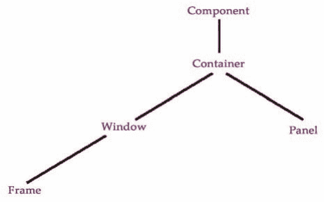


**图 1：** `Panel` 和 `Frame` 的类层次结构。

### 4.3.2. 使用 `Frame` 窗口

除了 applet 之外，你最常创建的窗口类型是派自 `Frame` 的。你将用它在 applet 中创建子窗口，或者为独立应用程序创建顶层或子窗口。如所述，它创建了一个标准式的窗口。

以下是 `Frame` 的两个构造函数：

- `Frame()`
- `Frame(String title)`

第一种形式创建一个不包含标题的标准窗口。第二种形式创建一个带有 `title` 指定标题的窗口。注意，你无法指定窗口的尺寸。相反，你必须在窗口创建后设置窗口的大小。

在处理 `Frame` 窗口时，你会用到几个关键方法。在这里对它们进行检查。

### 设置窗口尺寸

`setSize()` 方法用于设置窗口的尺寸。其签名所示：

`void setSize(int newWidth, int newHeight)`

`void setSize(Dimension newSize)`

窗口的新尺寸由 `newWidth` 和 `newHeight` 指定，或者通过传递给 `newSize` 的 `Dimension` 对象的 `width` 和 `height` 字段指定。尺寸以像素为单位。

`getSize()` 方法用于获取窗口的当前尺寸。其签名所示：

`Dimension getSize()`

该方法返回包含 `Dimension` 的 `width` 和 `height` 字段中的窗口当前尺寸。

### 隐藏和显示窗口

在帧窗口创建后，在调用 `setVisible()` 之前，它是不可见的。其签名所示：

`void setVisible(boolean booleanFlag)`

如果此方法的参数为 `true`，则组件可见。否则，它被隐藏。

### 设置窗口标题

你可以使用 `setTitle()` 更改帧窗口中的标题，其通用形式为：`void setTitle(String newTitle)`

在此处，`newTitle` 是窗口的新标题。

## 关闭 `Frame` 窗口


使用帧窗口时，当窗口关闭时，你的程序必须通过 `setVisible(false)` 将该窗口从屏幕上移除。要拦截窗口关闭事件，你必须实现 `WindowListener` 接口。架构是一组描述规则。

### 4.3.3. 在 Applet 中创建 `Frame` 窗口

虽然可以通过创建 `Frame` 的实例来创建帧窗口，但你很少这样做，因为你无法用它做什么。例如，假设你写了一个 applet，并且你希望你的 `Applet` 子类包含一些处理鼠标事件的代码。由于 Java 语言不允许多重继承，你的类不能同时扩展 `Applet` 和 `MouseAdapter` 类。解决方案是定义一个内部类——即一个位于你的 `Applet` 子类内部的类——它继承自 `MouseAdapter` 类。

从 applet 创建新窗口：首先，创建一个 `Frame` 的子类。接下来，重写 applet 的 `start()` 和 `stop()` 方法，以便它们分别隐藏和显示子窗口。


以下 applet 创建了 `Frame` 的子类 `SampleFrame`。该子类的窗口在 `AppletFrame` 的 `init()` 方法中被实例化。注意 `SampleFrame` 调用了 `Frame` 的构造函数。这会导致创建一个带有 `title` 标题的标准帧。此示例重写了 applet 的 `start()` 和 `stop()` 方法，以便它们分别隐藏和显示子窗口。这导致在终止 applet、关闭窗口或在在使用浏览器时移动到另一个页面时窗口被移除。它还导致当浏览器返回 applet 时子窗口被显示。

在 applet 内部创建子窗口。

```
import java.awt.*;
import java.awt.event.*;
import java.applet.*;

/*
<applet code="AppletFrame" width=300 height=50>
</applet>
*/

// 创建 Frame 的子类。
class SampleFrame extends Frame {
  SampleFrame(String title) {
    super(title);
    // 创建一个处理窗口事件的对象
    MyWindowAdapter adapter = new MyWindowAdapter(this);
    // 注册它以接收这些事件
    addWindowListener(adapter);
  }

  public void paint(Graphics g) {
    g.drawString("This is in frame window", 10, 40);
  }
}

class MyWindowAdapter extends WindowAdapter {
  SampleFrame sampleFrame;
  public MyWindowAdapter(SampleFrame sampleFrame) {
    this.sampleFrame = sampleFrame;
  }
  public void windowClosing(WindowEvent we) {
    sampleFrame.setVisible(false);
  }
}
```

### Java 与 Web 设计

// 创建帧窗口。

```java
public class AppletFrame extends Applet {
  Frame f;
  public void init() {
    f = new SampleFrame("A Frame Window");
    f.setSize(250, 250);
    f.setVisible(true);
  }
  public void start() {
    f.setVisible(true);
  }
  public void stop() {
    f.setVisible(false);
  }
  public void paint(Graphics g) {
    g.drawString("This is in applet window", 10, 20);
  }
}
```

该程序的示例输出所示：

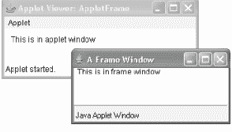

# 在帧窗口中处理事件

由于 `Frame` 是 `Component` 的子类，因此它继承了 `Component` 定义的所有功能。

这意味着你可以像管理 applet 的主窗口一样使用和管理帧窗口。例如，你可以重写 `paint()` 方法来显示输出，在需要恢复窗口时调用 `repaint()`，并添加事件处理器。每当窗口中发生事件时，定义的事件处理器就会被调用。每个窗口都处理自己的事件。例如，下面的程序创建了一个响应鼠标事件的窗口。主 applet 窗口也响应鼠标事件。当你尝试此程序时，你会发现鼠标事件对事件所在的子窗口和 applet 窗口都有响应。

```java
import java.awt.*;
import java.awt.event.*;
import java.applet.*;

/*
<applet code="WindowEvents" width=300 height=50>
</applet>
*/

// 创建 Frame 的子类。
class SampleFrame extends Frame
implements MouseListener, MouseMotionListener {
  String msg = "";
  int mouseX=10, mouseY=40;
  int movX=0, movY=0;

  SampleFrame(String title) {
    super(title);
    // 注册此对象以接收自己的鼠标事件
    addMouseListener(this);
    addMouseMotionListener(this);
    // 创建一个对象来处理窗口事件
    MyWindowAdapter adapter = new MyWindowAdapter(this);
    // 注册它以接收这些事件
    addWindowListener(adapter);
  }

  // 处理鼠标点击。
  public void mouseClicked(MouseEvent me) {
  }

  // 处理鼠标进入。
  public void mouseEntered(MouseEvent evtObj) {
    // 保存坐标
    mouseX = 10;
    mouseY = 54;
    msg = "Mouse just entered child.";
    repaint();
  }

  // 处理鼠标退出。
  public void mouseExited(MouseEvent evtObj) {
    // 保存坐标
    mouseX = 10;
    mouseY = 54;
    msg = "Mouse just left child window.";
    repaint();
  }

  // 处理鼠标按下。
  public void mousePressed(MouseEvent me) {
    // 保存坐标
    mouseX = me.getX();
    mouseY = me.getY();
    msg = "Down";
    repaint();
  }

  // 处理鼠标释放。
  public void mouseReleased(MouseEvent me) {
    // 保存坐标
    mouseX = me.getX();
    mouseY = me.getY();
    msg = "Up";
    repaint();
  }

  // 处理鼠标拖拽。
  public void mouseDragged(MouseEvent me) {
    // 保存坐标
    mouseX = me.getX();
    mouseY = me.getY();
    movX = me.getX();
    movY = me.getY();
    msg = "*";
    repaint();
  }

  // 处理鼠标移动。
  public void mouseMoved(MouseEvent e) {
    // 保存坐标
    movX = e.getX();
    movY = e.getY();
    repaint(0, 0, 100, 60);
  }

  public void paint(Graphics g) {
    g.drawString(msg, mouseX, mouseY);
    g.drawString("Mouse at " + movX + ", " + mouseY, 10, 40);
  }
}

class MyWindowAdapter extends WindowAdapter {
  SampleFrame sampleFrame;
  public MyWindowAdapter(SampleFrame sampleFrame) {
    this.sampleFrame = sampleFrame;
  }
  public void windowClosing(WindowEvent we) {
    sampleFrame.setVisible(false);
  }
}

// Applet 窗口。
public class WindowEvents extends Applet
implements MouseListener, MouseMotionListener {
  SampleFrame f;
  String msg = "";
  int mouseX=0, mouseY=10;
  int movX=0, movY=0;

  // 创建一个帧窗口。
  public void init() {
    f = new SampleFrame("Handle Mouse Events");
    f.setSize(300, 200);
    f.setVisible(true);
    // 注册此对象以接收自己的鼠标事件
    addMouseListener(this);
    addMouseMotionListener(this);
  }

  // 停止 applet 时移除帧窗口。
  public void stop() {
    f.setVisible(false);
  }

  // 启动 applet 时显示帧窗口。
  public void start() {
    f.setVisible(true);
  }

  // 处理鼠标点击。
  public void mouseClicked(MouseEvent me) {
  }

  // 处理鼠标进入。
  public void mouseEntered(MouseEvent me) {
    // 保存坐标
    mouseX = 0;
    mouseY = 54;
    msg = "Mouse just entered applet window.";
    repaint();
  }

  // 处理鼠标退出。
  public void mouseExited(MouseEvent me) {
    // 保存坐标
    mouseX = 0;
    mouseY = 54;
    msg = "Mouse just left applet window.";
    repaint();
  }

  // 处理鼠标按下。
  public void mousePressed(MouseEvent me) {
    // 保存坐标
    mouseX = me.getX();
    mouseY = me.getY();
    msg = "Down";
    repaint();
  }

  // 处理鼠标释放。
  public void mouseReleased(MouseEvent me) {
    // 保存坐标
    mouseX = me.getX();
    mouseY = me.getY();
    msg = "Up";
    repaint();
  }

  // 处理鼠标拖拽。
  public void mouseDragged(MouseEvent me) {
    // 保存坐标
    mouseX = me.getX();
    mouseY = me.getY();
  }
}
```

# 4.3.4. 创建窗口化程序

虽然创建 applet 是 Java AWT 的常见用途，但同样可以创建基于 AWT 的独立应用程序。要实现这一点，只需在 `main()` 方法中创建窗口的实例即可。例如，下面的程序创建了一个响应鼠标点击和按键输入的帧窗口：


```java
// 创建一个基于 AWT 的应用程序。
import java.awt.*;
import java.awt.event.*;
import java.applet.*;

// 创建一个帧窗口。
public class AppWindow extends Frame {

    String keymsg = "This is a test.";
    String mousemsg = "";
    int mouseX = 30, mouseY = 30;

    public AppWindow() {
        addKeyListener(new MyKeyAdapter(this));
        addMouseListener(new MouseAdapter(this));
        addWindowListener(new MyWindowAdapter(this));
    }

    public void paint(Graphics g) {
        g.drawString(keymsg, 10, 40);
        g.drawString(mousemsg, mouseX, mouseY);
    }

    // 创建窗口。
    public static void main(String args[]) {
        AppWindow appwin = new AppWindow();
        appwin.setSize(new Dimension(300, 200));
        appwin.setTitle("An AWT-Based Application");
        appwin.setVisible(true);
    }

    class MyKeyAdapter extends KeyAdapter {
        AppWindow appWindow;

        public MyKeyAdapter(AppWindow appWindow) {
            this.appWindow = appWindow;
        }

        public void keyTyped(KeyEvent ke) {
            appWindow.keymsg += ke.getKeyChar();
            appWindow.repaint();
        }
    }

    class MouseAdapter extends MouseAdapter {
        AppWindow appWindow;

        public MouseAdapter(AppWindow appWindow) {
            this.appWindow = appWindow;
        }

        public void mousePressed(MouseEvent me) {
            appWindow.mouseX = me.getX();
            appWindow.mouseY = me.getY();
            appWindow.mousemsg = "Mouse Down at " + appWindow.mouseX +
                ", " + appWindow.mouseY;
            appWindow.repaint();
        }
    }

    class MyWindowAdapter extends WindowAdapter {
        public void windowClosing(WindowEvent we) {
            System.exit(0);
        }
    }
}
```

该程序的示例输出所示：

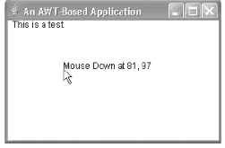

## 事件处理

事件处理通过图形上下文（graphics context）进行。图形上下文由 `Graphics` 类封装，并可以通过两种方式获取：

- 当调用 applet 的各种方法之一（如 `paint()` 或 `update()`）时，它会被传递给 applet。
- 通过 `Component` 的 `getGraphics()` 方法返回。

为了后续示例的起见，剩余示例将在主 applet 窗口中演示图形。然而，相同的技术也适用于任何其他窗口。

`Graphics` 类定义了一系列绘图函数。每个形状只能被绘制或填充。对象将使用当前选定的图形颜色进行绘制和填充，默认颜色为黑色。当绘制的图形对象超过窗口尺寸时，输出将自动被裁剪。让我们来看几个绘图方法。

## 图形尺寸调整

通常，你可能希望调整图形对象的大小，以适应其绘制所在的当前窗口大小。要做到这一点，首先通过调用窗口对象上的 `getSize()` 来获取窗口尺寸。它返回一个封装在 `Dimension` 对象中的窗口尺寸。一旦获取了窗口的当前大小，就可以相应地缩放图形输出。

为了演示这项技术，这里有一个 applet，它初始为一个 200×200 像素的正方形，每次点击时宽度和高度增加 25 像素，直到 applet 尺寸大于 500×500。在该点，下一次点击将将其恢复为 200×200，并重新开始。

在窗口内，会在窗口内边界周围绘制一个矩形，在那个矩形内绘制一个 X 以填满窗口。这个 applet 可以在 `appletviewer` 中运行，但是。

```java
// 调整输出以适应窗口当前大小。

import java.applet.*;
import java.awt.*;
import java.awt.event.*;

/*
<applet code="ResizeMe" width=200 height=200>
</applet>
*/

public class ResizeMe extends Applet {

    final int inc = 25;
    int max = 500;
    int min = 200;
    Dimension d;

    public ResizeMe() {
        addActionListener(new MouseAdapter() {
            public void mouseReleased(MouseEvent me) {
                int w = (d.width + inc) > max ? max : (d.width + inc);
                int h = (d.height + inc) > max ? max : (d.height + inc);
                setSize(new Dimension(w, h));
            }
        });
    }

    public void paint(Graphics g) {
        d = getSize();

        g.drawLine(0, 0, d.width - 1, d.height - 1);
        g.drawLine(0, d.height - 1, d.width - 1, 0);
        g.drawRect(0, 0, d.width - 1, d.height - 1);
    }
}
```


## 4.3.6. 颜色演示 Applet

以下 applet 构造了多种颜色并使用这些颜色绘制各种对象：

```java
// 演示颜色。

import java.awt.*;
import java.awt.applet.*;

/*
<applet code="ColorDemo" width=300 height=200>
</applet>
*/

public class ColorDemo extends Applet {

    // 绘制线条
    public void paint(Graphics g) {
        Color c1 = new Color(255, 100, 100);
        Color c2 = new Color(100, 255, 100);
        Color c3 = new Color(100, 100, 255);

        g.setColor(c1);
        g.drawLine(0, 0, 100, 300);
        g.drawLine(0, 300, 100, 0);
        g.drawRect(0, 0, 100, 300);

        g.setColor(c2);
        g.drawLine(0, 100, 100, 0);
        g.drawLine(40, 25, 250, 180);
        g.drawLine(75, 90, 400, 400);

        g.setColor(c3);
        g.drawLine(20, 150, 400, 40);
        g.drawLine(5, 290, 80, 19);

        g.setColor(Color.red);
        g.drawOval(10, 10, 50, 50);
        g.fillOval(70, 90, 140, 100);

        g.setColor(Color.blue);
        g.drawOval(190, 10, 90, 30);
        g.drawRect(10, 10, 60, 50);

        g.setColor(Color.cyan);
        g.fillRect(100, 10, 60, 50);
        g.drawRoundRect(190, 10, 60, 50, 15, 15);
    }
}
```

## 使用字体

AWT 支持多种字体。多年前，字体从传统排版领域出现，成为计算机生成文档和显示的重要组成部分。AWT 通过抽象字体 set 操作并允许动态选择字体，提供了灵活性。

字体具有族名称（family name）、逻辑名称（logical name）和脸名称（face name）：

- 族名称是字体的通用名称，例如 `Courier`。
- 逻辑名称指定字体的类别，例如 `Monospaced`（等宽字体）。
- 脸名称指定特定的字体，例如 `Italic`（斜体）。

字体由 `Font` 类封装。

## 确定可用字体

在处理字体时，通常需要知道你的机器上有哪些可用字体。要获取这些信息，你可以使用 `GraphicsEnvironment` 类定义的 `getFontFamilyNames()` 方法。该方法返回一个字符串数组，包含所有可用字体族的名称。此外，`GraphicsEnvironment` 类还定义了 `getAllFonts()` 方法。

由于这些方法是 `GraphicsEnvironment` 的成员，你需要一个 `GraphicsEnvironment` 引用来调用它们。你可以通过使用 `getLocalEnvironment()` 获取该引用。这个 applet 展示了如何获取可用字体族的名称如下：

```java
// 显示字体

/*
<applet code="ShowFonts" width=550 height=60>
</applet>
*/

import java.applet.*;
import java.awt.*;

public class ShowFonts extends Applet {
    public void paint(Graphics g) {
        GraphicsEnvironment ge =
            GraphicsEnvironment.getLocalEnvironment();

        String FontList[] = ge.getFamilyNames();
        String msg = "";

        for (int i = 0; i < FontList.length; i++) {
            msg += FontList[i] + " ";
        }

        g.drawString(msg, 0, 20);
    }
}
```

```java
Java 与 Web 设计

curX = 0;

g.drawString(s, curX, curY);

curX = fm.stringWidth(s); // 移动到行尾
}

// 在同一行显示
void sameLine(String s, Graphics g) {
    FontMetrics fm = g.getFontMetrics();
    g.drawString(s, curX, curY);
    curX += fm.stringWidth(s); // 移动到行尾
}
}
```

该程序的示例输出所示：

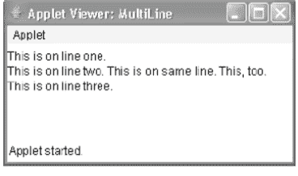

## 4.3.8. 多行文本对齐

如果你用过文字处理器，你一定见过这种对齐方式，它使得文本的一个或多个边缘形成一条直线。例如，绝大多数文字处理器都可以对文本进行左对齐和/或右对齐。大多数还可以让文本居中对齐。

在接下来的程序中，你将看到如何实现这些操作。在程序中，需要对齐的字符串被拆分为单独的单词。对于每个单词，程序会记录它在当前字体中的长度，如果该单词无法放入当前行中，则会自动换到下一行。每一行完成的文本都将按照当前选择的对齐样式显示在窗口中。每当你点击小程序的窗口时，对齐样式就会发生改变。

该程序的示例输出所示：

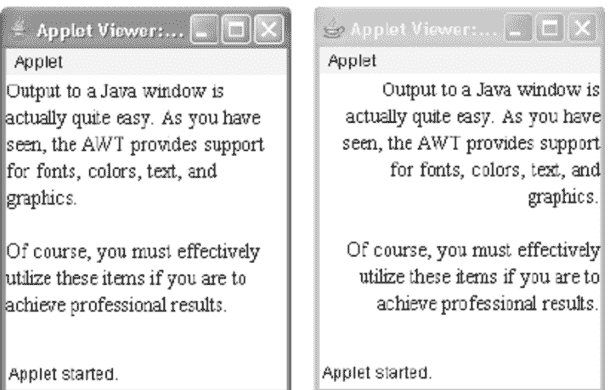

```java
// 演示文本对齐。

import java.applet.*;
import java.awt.*;
import java.awt.event.*;
import java.util.*;

/* <title>文本布局</title>

<applet code="TextLayout" width=200 height=200>
<param name="text" value="输出到 Java 窗口实际上非常简单。\n
正如你所见的，AWT 提供了对字体、颜色和图形的支持。<P> 当然，如果你想获得专业的结果，就必须有效地利用这些项目">
```

### Java 与 Web 设计

```java
<param name="foldername" value="Serif">
<param name="fontSize" value="14">
</applet>
/*
public class Textlayout extends Applet {
    final int LEFT = 0;
    final int RIGHT = 1;
    final int CENTER = 2;
    final int LEFTRIGHT = 3;

    int align;
    Dimension d;
    Font f;
    FontMetrics fm;
    int fontSize;
    int fh, bl;
    int space;
    String text;

    public void init() {
        setBackground(Color.white);
        text = getParameter("text");

        try {
            fontSize = Integer.parseInt(getParameter("fontSize"));
        } catch (NumberFormatException e) {
            fontSize = 14;
        }

        align = LEFT;
        addMouseListener(new MyMouseAdapter(this));
    }

    public void paint(Graphics g) {
        update(g);
    }

    public void update(Graphics g) {
        d = getSize();
        g.setColor(getBackground());
        g.fillRect(0, 0, d.width, d.height);

        if (f == null)
            f = new Font(getParameter("fontname"), Font.PLAIN, fontSize);

        g.setFont(f);

        if (fm == null) {
            fm = g.getFontMetrics();
            bl = fm.getAscent();
            fh = bl + fm.getDescent();
            space = fm.stringWidth(" ");
        }

        // ... (省略后续逻辑以保持翻译结构一致)
    }
}

class MyMouseAdapter extends MouseAdapter {
    Textlayout tl;

    public MyMouseAdapter(Textlayout tl) {
        this.tl = tl;
    }

    public void mouseClicked(MouseEvent me) {
        tl.repaint();
    }
}
```

## 4.3.10 控件基础

窗口工具包（AWT）首先介绍了控件、布局管理器和菜单。控件是允许用户以各种方式交互的组件，例如，常用的控件是按钮。布局管理器负责在容器内放置组件。

虽然可以手动放置组件，但这样做非常繁琐。布局管理器会自动完成这一工作。在介绍控件后，将介绍布局管理器，在那里你将看到如何更好地管理控件。

AWT 支持以下类型的控件：

- 标签
- 按钮
- 复选框
- 列表
- 列表
- 滚动条
- 文本

这些控件都是 `Component` 的子类。

### 添加和移除控件


要将控件包含在窗口中，必须将其添加到窗口。这样做的方法是先创建所需控件的实例，然后通过调用`add()`将添加到窗口。`add()`方法有多种形式。这里使用的是以下形式：

```
Component add(Component compObj)
```

在这里，`compObj`是你想添加的控件实例。方法返回`compObj`的引用。一旦控件被添加，只要父窗口显示，它就会自动可见。

有时当你不再需要某个控件时，想要将其从窗口移除。这时可以调用`remove()`。该方法由`Container`定义，其通用形式为：

```
void remove(Component obj)
```

在这里，`obj`是你想移除的控件引用。你可以通过`removeAll()`移除所有控件。

### 响应控件

除了被动的标签外，所有控件在被用户访问时都会产生事件。例如，当用户点击按钮时，会发送。通常情况下，你的程序只需实现相应的接口，并为每个监控的控件注册事件监听器。

### HeadlessException

大多数 AWT 控件的构造函数在非交互式无环境（例如没有显示器、鼠标或键盘的环境）实例化 GUI 组件时，可能会抛出`HeadlessException`。该异常是 Java 1.4 引入的。你可以利用它编写能够适应非交互式环境。（当然，这并不总是可能的。）程序不会处理此异常，因为演示 AWT 控件需要一个交互式环境。

## 标签 (Labels)

最易使用的控件是标签（Label）。标签是`Label`类型的对象，它包含一个要显示的字符串。标签是被动控件，不支持与用户进行任何交互。`Label`定义了以下构造函数：

```
Label( ) throws HeadlessException
```

```
Label(String str) throws HeadlessException
```

```
Label(String str, int how) throws HeadlessException
```

第一个版本创建一个空白标签。第二个版本创建一个包含由`str`指定字符串的标签。该字符串左对齐。第三个版本创建一个包含字符串的标签并通过`how`指定对齐方式。`how`的值必须是这三个常量之一：`Label.LEFT`、`Label.RIGHT`或`Label.CENTER`。

你可以使用`setText()`方法设置或更改标签中的文本。可以通过调用`getText()`获取当前标签。这些方法显示如下：

```
void setText(String str)
```

```
String getText()
```

对于`setText()`，`str`指定新的标签。对于`getText()`，返回当前标签。可以通过调用`setAlignment()`设置标签内字符串的对齐方式。获取当前对齐方式请调用`getAlignment()`。方法如下：

```
void setAlignment(int how)
```

```
int getAlignment()
```

在这里，`how`必须是之前所示对齐常量之一。

下面的示例创建三个标签并将它们添加到 applet 窗口中：

```
// Demonstrate Labels
import java.awt.*;
import java.applet.*;
/*
```


### Java 与 Web 设计

```
<applet code="LabelDemo" width=300 height=200>
</applet>
/*
public class LabelDemo extends Applet {
    public void init() {
        Label one = new Label("One");
        Label two = new Label("Two");
        Label three = new Label("Three");
        // add labels to applet window
        add(one);
        add(two);
        add(three);
    }
}
```

这是由`LabelDemo` applet 创建的窗口。注意标签在窗口中是通过默认布局管理器组织的。稍后，你将看到如何更精确地控制标签的位置。

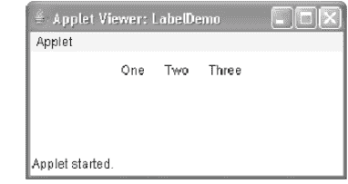

## 使用按钮 (Buttons)

也许最广泛使用的控件是推按钮（push button）。推按钮是一个包含标签且在被按下时生成事件的组件。推按钮是`Button`类型的对象。`Button`定义了这两个构造函数：

```
Button() throws HeadlessException
Button(String str) throws HeadlessException
```

第一个版本创建一个空按钮。第二个版本创建一个包含`str`作为标签的按钮。

按钮创建后，你可以通过`setLabel()`设置其标签。可以通过调用`getLabel()`获取其标签。这些方法如下：

```
void setLabel(String str)
```

```
String getLabel()
```

在这里，`str`成为按钮的新标签。

## 处理按钮

每当按钮被按下，就会生成一个动作事件（action event）。该事件会被发送给任何注册了接收该组件动作事件通知的监听器。

每个监听器都实现`ActionListener`接口。该接口定义了`actionPerformed()`方法，该方法在事件发生时被调用。一个`ActionEvent`对象作为方法的参数传递。它包含了生成事件的按钮的引用，以及与按钮关联的动作命令字符串（action command string）的引用。默认情况下，动作命令字符串是按钮的标签。

这里的示例创建了三个标记为“Yes”、“No”和“Undecided”的按钮。每当按下其中一个时，都会显示一条消息报告哪个按钮被按下。在这个版本中，使用按钮的动作命令（默认是其标签）来确定哪个按钮被按下。标签是通过对传递给`actionPerformed()`的`ActionEvent`对象调用`getActionCommand()`方法获取的。

```
// Demonstrate Buttons
import java.awt.*;
import java.awt.event.*;
import java.applet.*;
/*
```

### Java 与 Web 设计

```
<applet code="ButtonDemo" width=250 height=150>
</applet>
/*
public class ButtonDemo extends Applet implements ActionListener {
    String msg = "";
    Button yes, no, maybe;
    public void init() {
        yes = new Button("Yes");
        no = new Button("No");
        maybe = new Button("Undecided");
        add(yes);
        add(no);
        add(maybe);
        yes.addActionListener(this);
        no.addActionListener(this);
        maybe.addActionListener(this);
    }
    public void actionPerformed(ActionEvent ae) {
        String str = ae.getActionCommand();
        if(str.equals("Yes")) {
            msg = "You pressed Yes.";
        }
        else if(str.equals("No")) {
            msg = "You pressed No.";
        }
        else {
            msg = "You pressed Undecided.";
        }
        repaint();
    }
    public void paint(Graphics g) {
        g.drawString(msg, 6, 100);
    }
}
```

`ButtonDemo`的示例输出如图 2 所示。如提到的，除了比较动作命令字符串外，还可以通过将`getSource()`方法获取的对象与添加的按钮进行比较，来确定哪个按钮被按下。为了这一点，你必须在添加对象时保留一个对象列表。下面的 applet 显示了这种方法：

```
// Recognize Button objects.
import java.awt.*;
import java.awt.event.*;
import java.applet.*;
```

## Java Web 设计

```
/*
<applet code="ButtonList" width=250 height=150>
*/
public class ButtonList extends Applet implements ActionListener {
    String msg = "";
    Button bList[] = new Button[3];
    public void init() {
        Button yes = new Button("Yes");
        Button no = new Button("No");
        Button maybe = new Button("Undecided");
        // 在添加时存储按钮的引用
        bList[0] = (Button) yes;
        add(yes);
        bList[1] = (Button) no;
        add(no);
        bList[2] = (Button) maybe;
        add(maybe);
        // 注册接收动作事件
        for(int i = 0; i < 3; i++) {
            bList[i].addActionListener(this);
        }
    }
    public void actionPerformed(ActionEvent ae) {
        for(int i = 0; i < 3; i++) {
            if(ae.getSource() == bList[i]) {
                msg = "You pressed " + bList[i].getLabel();
            }
        }
        repaint();
    }
    public void paint(Graphics g) {
        g.drawString(msg, 6, 100);
    }
}
```

在这个版本中，当按钮被添加到 applet 窗口时，程序在数组中存储每个按钮引用。（记住`add()`方法在添加按钮时会返回该按钮的引用。）在`actionPerformed()`内部，使用此数组来确定哪个按钮被按下。对于简单的程序，通过它们的标签识别按钮通常更容易。然而，在程序执行期间需要更改按钮内部的标签，或使用具有相同标签按钮的情况下，使用其对象引用来确定哪个按钮被按下可能更容易。还可以通过调用`setName()`将与按钮关联的动作命令字符串设置为标签以外的其他内容。此方法会更改动作命令，但不会影响用于标记按钮的字符串。因此，设置动作命令可以使按钮的动作命令和标签不同。

## Java Web 设计

#### 应用复选框 (Check Boxes)

复选框是一种用于开启或关闭选项的控件。它由一个一个小框组成，该框可以包含标记也可以不包含。每个复选框都有一个关联的标签描述该选项代表的含义。你通过点击复选框来更改其状态。复选框可以单独使用，也可以作为组的一部分使用。复选框是`Checkbox`类型的对象。`Checkbox`支持以下构造函数：

```
Checkbox() throws HeadlessException
Checkbox(str) throws HeadlessException
Checkbox(str, boolean on) throws HeadlessException
Checkbox(str, boolean on, CheckboxGroup group) throws HeadlessException
Checkbox(str, CheckboxGroup cbGroup, boolean on) throws HeadlessException
```

第一个形式创建一个标签为空的复选框。状态为未选中。第二个形式创建一个标签由`str`指定的复选框。状态为未选中。第三个形式允许你设置复选框的初始状态。如果`on`为 true，则复选框初始为选中；否则清除。第四个和第五个形式创建一个标签由`str`指定且属于`cbGroup`组的复选框。（复选组将在下一节描述。）`on`的值决定了复选框的初始状态。

调用`getState()`获取复选框的当前状态。调用`setState()`设置其状态。可以通过`getLabel()`获取与复选框关联的当前标签。调用`setLabel()`设置标签。这些方法如下：

```
boolean getState()
void setState(boolean on)
String getLabel()
void setLabel(String str)
```

在这里，如果`on`为 true，框被选中。如果为 false，则被清除。传递的`str`字符串将成为与调用的复选框关联的新标签。

#### 处理复选框

每当复选框被选中或取消选中时，就会生成一个项目事件（item event）。该事件会被发送给所有注册了接收该组件项目事件通知的监听器。每个监听器都实现`ItemListener`接口。该接口定义了`itemStateChanged()`方法。一个`ItemEvent`对象作为参数传递到此方法。它包含了有关事件的信息（例如，它是选中还是取消选中）。

以下程序创建了四个复选框。第一个选框的初始状态为选中。每个复选框的状态都会显示出来。每当你更改复选框的状态时，状态显示就会更新。

```
// 演示复选框。
import java.awt.*;
import java.awt.event.*;
import java.applet.*;
/*
<applet code="CheckboxDemo" width=250 height=200>
</applet>
*/
public class CheckboxDemo extends Applet implements ItemListener {
    String msg = "";
    Checkbox winXP, winVista, solaris, mac;
    public void init() {
        winXP = new Checkbox("Windows XP", null, true);
        winVista = new Checkbox("Windows Vista");
        solaris = new Checkbox("Solaris");
        mac = new Checkbox("Mac OS");
        add(winXP);
        add(winVista);
        add(solaris);
        add(mac);
        winXP.addItemListener(this);
        winVista.addItemListener(this);
        solaris.addItemListener(this);
        mac.addItemListener(this);
    }
    public void itemStateChanged(ItemEvent ie) {
        repaint();
    }
    // 显示复选框的当前状态。
    public void paint(Graphics g) {
        msg = "Current state: ";
        g.drawString(msg, 6, 80);
        msg = "Windows XP: " + winXP.getState();
        g.drawString(msg, 6, 100);
        msg = "Windows Vista: " + winVista.getState();
        g.drawString(msg, 6, 120);
        msg = "Solaris: " + solaris.getState();
        g.drawString(msg, 6, 140);
        msg = "Mac OS: " + mac.getState();
        g.drawString(msg, 6, 160);
    }
}
```

输出如下

# 4.3.12. Java Applet

Applet 是一种特殊的程序，嵌入在网页中以生成动态内容。它运行在浏览器内部，并在客户端工作。

Applet 的优点

Applet 有许多优点，如下：

- 它在客户端工作，因此响应时间较短。
- 安全
- 可以在可以在许多平台下运行的浏览器中执行，包括 Linux、Windows、Mac OS。

Applet 的缺点

- 客户端浏览器需要插件来执行 applet。

# Applet 的层次结构


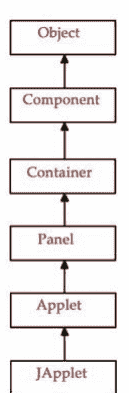

如上所示，`Applet`类继承自`Panel`。`Panel`类继承自`Container`，`Container`是`Component`的子类。

# Java Applet 的生命周期

- `Applet`初始化。
- `Applet`启动。
- `Applet`被绘制。
- `Applet`停止。
- `Applet`被销毁。

`Applet`的生命周期方法：

`java.Applet`类提供了 4 个生命周期方法，`java.awt.Component`类为`applet`提供了 1 个生命周期方法。

# java.applet.Applet 类

创建任何`java.Applet.class`必须继承该类。它提供了`applet`的 4 个生命周期方法。

1. `public void init()`：用于初始化`Applet`。它只被调用一次。
2. `public void start()`：在`init()`方法之后或浏览器最大化后调用。它用于启动`Applet`。
3. `public void stop()`：用于停止`Applet`。在`Applet`停止或浏览器最小化时被调用。
4. `public void destroy()`：用于销毁`Applet`。它只被调用一次。

# java.awt.Component 类

`Component`类提供了`applet`的 1 个生命周期方法。

1. `public void paint(Graphics g)`：用于绘制`Applet`。它提供`Graphics`类对象，可以用于绘制椭圆、矩形、弧等。

## 谁负责管理 applet 的生命周期？

Java 插件软件。

## 如何运行 Applet？

有两种方式可以运行`applet`：

1. 通过`html`文件。
2. 通过`appletViewer`工具（用于测试目的）。

### 通过 html 文件运行 Applet 的简单示例：

若要通过`html`文件执行`applet`，请创建一个`applet`并编译它。之后创建一个`html`文件，并将`applet`代码放置在`html`文件中。现在点击该`html`文件。

```
//First.java

import java.applet.Applet;

import java.awt.Graphics;

public class First extends Applet{

public void paint(Graphics g) {
g.drawString("welcome",150,150);
}
```

# 4.4. JAVA BEANS, SWINGS AND SERVLET⁴

`JavaBean`是一种特殊构造的 Java 类，使用 Java 编写并根据 JavaBeans API 进行编码。

以下是区分`JavaBean`与其他 Java 类的独特特征：

- 它提供了一个默认的、无参数构造函数。
- 它应该是可序列化的并实现`Serializable`接口。
- 它可能有多个可以读取或写入的属性。
- 它可能为属性拥有多个 "getter" 和 "setter" 方法。

> 4 http://www.tutorialspoint.com/jsp/jsp_java_beans.htm

# 4.4.1. JavaBeans 属性：

`JavaBean`是一个对象用户可以访问的命名属性。该属性可以是任何 Java 数据类型，包括你定义的类。

`JavaBean`可能是可读的、可写的、只读或只写的。`JavaBean`属性通过`JavaBean`实现中的两个方法访问：

| 方法 | 说明 |
| --- | --- |
| `getPropertyName()` | 例如，如果属性名为`firstName`，你的方法将是`getFirstName()`以读取该属性。该方法称为访问器（accessor）。 |
| `setPropertyName()` | 例如，如果属性名为`firstName`，你的方法名将是`setFirstName()`以写入该属性。该方法称为变异器（mutator）。 |

只读属性将只有一个`getPropertyName()`方法，只写属性将只有一个`setPropertyName()`方法。

# 访问 JavaBeans

`use`动作声明了一个用于 JSP 的`JavaBean`。一旦声明，该`bean`就会变成一个脚本变量，可以被 JSP 中使用的脚本元素和其他自定义标签访问。

`useBean`标签的完整语法如下：

```
<jsp:useBean id=bean' name=bean scope=scope typeSpec//>
```

这里`scope`属性的值可以根据你的需求取`page`、`request`、`session`或`application`。

`id`属性的值可以是任何值。以下是`useBean`的简单示例：

```
<html>
<body>
<jsp:useBean id="date" class="java.util.Date" />
<p>当前日期/时间是 <% date %></p>
</body>
</html>
```

这会产生如下结果：

当前日期/时间是 Thu Sep 30 11:18:11 GST

# 访问 JavaBeans

`use`动作声明了一个用于 JSP 的`JavaBean`。一旦声明，该`bean`就会变成一个脚本变量，可以被 JSP 中使用的脚本元素和其他自定义标签访问。

`useBeanBean`标签的完整语法如下：

```
<jsp:useBean id=bean' name=bean scope=scope typeSpec//>
```

这里`scope`属性的值可以根据你的需求取`page`、`request`、`session`或`application`。

`id`属性的值可以是任何值。以下是`useBean`的简单示例：

```
<html>
<head>
<title>useBean 示例</title>
</head>
<body>
<jsp:useBean id="date" class="java.util.Date" />
<p>当前日期/时间是 <% date %></p>
</body>
</html>
```

这会产生如下结果：

当前日期/时间是 Thu Sep 30 11:18:11 GST

# JavaBeans 属性

除了`<jsp:useBean>`，你可以使用`<jsp:getProperty/>`访问`get`方法，使用`<jsp:setProperty>`访问`set`方法。这里的完整语法是：

```
<jsp:useBean id="id" class="bean’s class" scope="bean’s scope">
<jsp:setProperty name="bean’s id" property="property name" value="value"/>
<jsp:getProperty name="bean’s id" property="property name"/>
</jsp:useBean>
```

`name`属性引用 JSP 中引入的`JavaBean`的`id`。以下是访问数据的简单示例：

```
<html>
<head>
<title>get 和 set 属性</title>
</head>
<body>
<jsp:useBean id="student" class="StudentsBean" scope="page">
<jsp:setProperty name="student" property="firstName" value="Zara"/>
<jsp:setProperty name="student" property="lastName" value="Ali"/>
<jsp:setProperty name="student" property="age" value="10"/>
学生名: <jsp:getProperty name="student" property="firstName"/><br/>
学生姓: <jsp:getProperty name="student" property="lastName"/><br/>
学生年龄: <jsp:getProperty name="student" property="age"/>
</jsp:useBean>
</body>
</html>
```

这会产生如下结果：

学生名: Zara

学生姓: Ali

学生年龄: 10

### Java 与 Web 设计

# 4.4.2. Swing

`Swing` API 是一组可扩展的 GUI 组件，方便开发者创建 Java 构建的 GUI 应用。它构建在 AWT API 之上，并作为 AWT API 的替代品，因为它包含了几乎所有的 AWT 控制控件。`Swing`组件遵循模型-视图-控制器架构以满足以下标准：

- 单一 API 足够支持多种外观。
- 架构以以下方式松基于 MVC 架构。
- 模型表示组件数据。
- 视图表示数据的视觉呈现。
- 控制器接收用户在视图上的输入并反映在组件数据中。
- `Swing`组件将模型作为独立元素，视图和控制器是界面元素的一部分。通过这种方式，`Swing`具有可插的外观架构。

# Swing 特性

- 轻量级 - `Swing`组件独立于原生操作系统的 API，因为`Swing`控件大多使用纯 Java 代码渲染，而不是底层的系统调用。
- 丰富的控件 - `Swing`提供了丰富的高级控件，如树、标签页、滑块、颜色选择器、表格控件。
- 高可定制性 - `Swing`控件可以用非常简单的方式进行定制，因为视觉外观与内部表示是独立的。
- 可插的外观 - `SWING` GUI 应用的外观根据可用值在运行时更改。

# 4.4.3. 什么是 Servlet?

Java `Servlet`是运行在 Web 服务器或应用程序服务器上的程序，并作为位于来自 Web 浏览器或其他 HTTP 客户端的请求与 HTTP 服务器上的数据库或应用程序之间的中间层。

使用`Servlets`，你可以通过网页表单收集用户的输入，展示来自数据库或其他源的记录，并动态创建 Web 页面。

Java `Servlets`的作用通常与使用通用网关接口（CGI）实现的程序相同。但与 CGI 相比，`Servlets`具有以下几个优势：

- 性能显著优于。
- `Servlets`在 Web 服务器的地址空间内执行。没有必要为处理每个客户端请求创建一个单独进程。
- `Servlets`是平台无关的，因为它们是用 Java 编写的。
- Java 安全机制可以强制执行对服务器的资源限制。
- Java 类的库提供了`Servlets`的完整功能，并且它们可以通过 RMI 与`applets`通信。
- 在服务器上，`Servlets`运行更加高效，且是可信的。

## Servlets 架构

以下图展示了`Servlets`的位置。


## Servlets 任务

`Servlets`执行以下主要任务：

- 从浏览器发送的显式数据。
- 从客户端发送的隐式数据。
- 以 HTML 格式发送到客户端的显式数据。
- 处理 HTTP 响应。

## Java 与设计

`Servlets`能够处理数据并生成结果。这个过程可能需要数据库的调用。

## Servlets 的包

`Servlets`是 Java 类的标准部分。

- Java 能够 能够 的。
- Java 类的 缓存。

# 第5章

网站设计

## 学习目标

在学习本章后，你将能够：

1. 解释互联网概述
2. 描述静态和动态网页

## 引言

所有这些网站元素组合在一起形成了网站。通常，"设计"的含义仅被认为是视觉方面。事实上，网站设计包含了许多更抽象的元素，如可用性、人体工程学、布局传统、用户习惯、导航逻辑以及其他简化网站使用并帮助更快找到信息的其他内容。

# Java 与网站设计

在设计的定义中，有时会强调技术层面。诚然，现代网站的构建涉及如`php`、`asp`和`c`这样的服务器端脚本，网站的视觉设计由`html`和`css`定义，而用户体验则通过动态的`javascript`和`ajax`增强。在与技术知识匮乏的人士交流时，我们与其谈论技术细节，不如关注功能性，例如，通过内容管理系统更新网站的程度有多大，以及哪些功能是用户可见的。

从经典术语来说，设计描述的是网站的视觉外观。传统方法涉及对比、色彩、平衡、强调、节奏、图形元素风格（线条、形状、纹理、颜色）以及图标、背景纹理和网站设计整体氛围的使用。

# 5.1. 互联网概述

互联网是通过网络电缆或卫星链路连接的计算机集合。互联网并不是将互联网上的每台计算机都与其他计算机连接，而是组织中的各个计算机通常连接在局域网（LAN）中。局域网中的一台设备物理上连接到互联网。由于互联网是一个网络网络，有数百万台计算设备永久或短期连接到这个网络。这些设备运行网络应用程序，通过铜缆或光纤、无线电或卫星传输进行通信。通信由国际机构互联网工程任务组（IETF）建立的协议规范。

互联网连接由互联网服务提供商（ISP）提供。这些公司专门投入计算机作为服务器，为互联网用户提供信息（如网页或电子邮件）。

| 1 | URL |
|---||---|
| 1 | https://www.cs.utexas.edu/~mitra/csFall2015/cs329/lectures/webOverview.html |


人们可以将互联网的结构看作边缘和核心。边缘是运行应用程序或客户端程序，或通过服务器程序提供服务的主机系统。互联网的核心是路由器网络。

# 互联网上的数据传输

数据通过两种方式在通信链路上进行传输：电路交换或分组交换。在电路交换中，每条通信都有一条专用的电路。电路交换的一个很好的例子是电话网络。在分组交换中，数据以小块的形式在网络上传输，这些块被发送到路由器，再发送到其他路由器（希望）所有块都能到达目的地。

电路交换的优点是保证了性能。用户之间存在不共享的专用链路。缺点是，如果该链路未被使用，它是空闲的。在分组交换中，不同的用户共享相同的网络资源。根据需要使用网络资源。然而，如果网络中有许多数据包，当数据包在队列中等待释放时就会出现拥堵问题。数据包会被丢弃，导致信息传输的损耗。

数据包延迟有几个来源：

- 路由器的处理延迟：路由器检查错误并确定输出链路。通常为几微秒或更短。
- 路由器的排队延迟：在输出链路处等待传输的时间。这取决于路由器的拥堵程度。
- 通信链路上的传输延迟：如果`R`是链路带宽（bps），`L`是数据包长度（比特），则将位发送到链路的时间为`L/R`。这对于低速链路是非常显著的。
- 传播延迟：如果`d`是物理链路的长度，`s`是介质中的传播速度，那么传播延迟为`d/s`。通常延迟在几微秒到数百毫秒之间。

总节点延迟是所有延迟时间之和：

```
d_{nodal} = d_{proc} + d_{queue} + d_{trans} + d_{prop}
```

# 互联网的层级结构


- 应用层
- 表示层
- 会话层
- 传输层
- 网络层
- 数据链路层
- 物理层

互联网服务提供商（ISP）是提供访问和使用互联网服务的组织。

| 上层 | 传输服务 |
| --- | --- |
| 7 | 应用层：消息格式、人机界面 |
| 6 | 表示层：编码为 1 和 0、加密、压缩 |
| 5 | 会话层：身份验证、权限、会话恢复 |
| 4 | 传输层：端到端错误控制 |
| 3 | 网络层：网络地址址；路由或交换 |
| 2 | 数据链路层：物理链路上的错误检测、流量控制 |
| 1 | 物理层：位流：物理介质、位表示方法 |

# 应用层

OSI 模型第 7 层支持应用程序和终端用户进程。识别通信伙伴，识别服务质量（QoS），考虑用户身份验证和隐私，并识别对数据语法的任何限制。该层的所有内容都是特定于应用程序的。该层为文件传输、电子邮件和其他网络软件服务提供应用服务。`Telnet`和`FTP`是完全存在于应用层的应用程序。分层架构是该层的一部分。


- 第 7 层示例包括 WWW 浏览器、`NFS`、`SNMP`、`Telnet`、`HTTP`和`FTP`

# 表示层

该层通过从应用格式到网络格式以及反之的转换，提供了不受数据表示差异（如加密）的影响。表示层的作用是将数据转换为应用层可以接受的形式。该层对发送到网络的数据进行格式化和加密，提供了不受兼容问题的自由。它有时被称为语法层。

- 第 6 层表示示例包括加密、`ASCII`、`EBCDIC`、`TIFF`、`GIF`、`PICT`、`JPEG`、`MPEG`和`MIDL`

# 会话层

该层建立、管理和终止应用程序之间的连接。会话层设置、协调和终止末端应用程序之间的对话、交换和交流。它处理会话和连接协调。

- 第 5 层会话示例包括`NFS`、`NetBIOS`名称、`RPC`、`SQL`。

# 传输层

OSI 模型第 4 层提供终端系统、主机之间透明的数据传输，并负责端到端的错误恢复和流量控制。它确保数据的完整传输。

- 第 4 层传输示例包括`SPX`、`TCP`、`UDP`。

# 网络层

第 3 层提供交换和路由技术，创建逻辑路径（称为虚拟电路），用于从节点传输到节点。路由和转发是该层的功能，还包括地址、互连、错误处理、拥塞控制和数据包排序。

- 第 3 层网络示例包括`AppleTalk DDP`、`IP`、`IPX`。


# 数据链路层

在 OSI 模型第 2 层，数据包被编码和解码为位。它提供传输协议知识和管理，并处理物理层的错误、流量控制和帧同步。数据链路分为两个子层：介质访问控制层（MAC）和逻辑链路控制层（LLC）。`MAC`层控制网络上的计算机如何接入并传输数据。`LLC`层控制同步、流量控制和错误检查。


- 第 2 层数据链路示例包括 `PPP`、`FDDI`、`ATM`、`IEEE 802.5/802.2`、`IEEE 802.3/802.2`、`HDLC` 和帧中继。


介质访问控制（`MAC`）是七层 `OSI` 网络参考模型数据链路层（`DLL`）的一个子层。

## 物理层

`OSI` 模型第 1 层通过电气和机械层面传输位流——电脉冲、光或无线电信号。它提供了通过负载发送接收数据的硬件手段，包括电缆、网卡和物理特性。快速以太网、`RS232` 和 `ATM` 是具有物理层的协议。

- 第 1 层物理示例包括以太网、`FDDI`、`B8Z5`、`V.35`、`V.24`、`RJ45`。

## 基础 HTTP

超文本传输协议（`HTTP`）是一种通过 `TCP/IP` 套接字传输文件或其他数据（称为资源）的协议。浏览器是监听 80 端口 `HTTP` 服务器的 `HTTP` 客户端。

`HTTP` 客户端打开套接字并向 `HTTP` 服务器发送请求；服务器发送消息并关闭连接。事务之间不维护连接信息。请求行包含三个部分，由空格隔开：方法名、请求资源的路径以及 `HTTP` 版本：

```
GET /path/to/file/index.html HTTP/1.0
```

初始响应行包含三个部分：`HTTP` 版本、响应状态码以及该状态码的英文描述：

```
HTTP/1.0 200 OK
```

或者

```
HTTP/1.0 404 Not Found
```

一个完整的响应如下：

```
HTTP/1.0 200 OK
Date: Fri, 31 Dec 1999 23:59:59 GMT
Content-Type: text/html
Content-Length: 1354
```

```
<body>
</</html>
```

`GET` 还允许向 `Web` 服务器发送查询字符串。查询字符串被放置在 `Web` 服务器的一个环境变量中。这里是服务器端某些环境变量的示例。

`POST` 请求用于向服务器发送经过某种方式处理的数据，例如 `CGI` 脚本。`POST` 最常见的用法是将 `HTML` 表单数据提交给 `CGI` 脚本。数据块在消息正文中发送。这里有额外的标头来描述数据：`Content-Type` 和 `Content-Length`。这里是 `POST` 方法的使用示例。数据被发送到一个名为 `post.cgi` 的脚本，该脚本返回数据。请注意，`QUERY_STRING` 环境变量是空的。

## 世界万网

1989 年，瑞士欧洲核研究组织的 `Tim Berners-Lee` 提出了一种与全球同事交换文档的协议。该想法是用户可以在互联网上搜索并检索任何文档。文档的形式是超文本。这意味着任何给文档都可以指向互联网上其他文档的链接。从严格意义上说，万网就是这种互连的文档系统。

### Java 与 Web 设计


`Internet Information Server`（`IIS`）是微软的一组 `Internet` 服务器，可以安装在它的 `Windows NT` 和 2000 操作系统上。

## Web 浏览器

浏览器是一种特殊的软件程序，也称为客户端，它请求服务器特定的 `Web` 文档并在计算机终端上将其渲染给用户。最老的浏览器之一是 `Lynx`。它是一个纯文本浏览器。最早的图形化浏览器是由伊利诺伊大学国立超级计算机应用中心（`NCSA`）开发的 `Mosaic` 浏览器。`Mosaic` 的开发人员后来成立了一家生产 `Netscape` 的公司。微软拥有自己的名为 `Internet Explorer` 的浏览器，它随 `Windows` 操作系统一起提供。其他可用的浏览器还有 `Mozilla`、`Opera` 和 `Safari`。浏览器使用标准的超文本传输协议（`HTTP`）与服务器通信。

## Web 服务器

`Web` 服务器是向浏览器提供文档的软件程序。`Apache` 是最常用的 `Web` 服务器，市场份额占 68%。其次是微软的 `Internet Information Server`（`IIS`），市场份额约为 21%。其余部分分布在许多其他服务器上。`Web` 浏览器通过向服务器发送文档的 `URL` 来向其发起请求。服务器搜索、检索并发送该文档。

## URL

统一资源定位符（`Uniform`（or universal resource locators）用于识别互联网上的文档或资源。`URL` 具有通用格式：

```
scheme: object-address
```

`scheme`（方案）是通信协议。这些协议包括 - `http`、`ftp`、`telnet`、`mailto`。不同的方案使用不同的对象地址。`HTTP` 使用以下形式的对象地址：

```
//fully-qualified-domain-name/path-to-document
```

## 域名

互联网上的每台计算机都有唯一的 `IP` 地址。`IP` 地址的格式为：`字节.字节.字节.字节`。字节（`octet`）是 8 位二进制数字的序列。在十进制中，一个字节的值范围从 0 到 255。`IP` 地址有两个部分：第一部分识别网络，第二部分识别主机计算机。

记住 `IP` 的数值值是困难的。域名系统（`DNS`）将文本名称映射到 `IP` 地址。顶级域名有 `.org`、`.edu`、`.gov`、`.net`、`.com`。每个顶级域名都有数百万二级域名。每个二级域名名称必须是唯一的。`DNS` 服务器接收将域名翻译为 `IP` 地址的请求。如果 `IP` 地址在它的数据库中，`DNS` 服务器可以返回该 `IP` 地址；如果它不知道该域名，则它会查询另一个 `DNS` 服务器；或者返回该域名不存在的结果。

当浏览器联系 `DNS` 服务器解析域名时，该 `DNS` 服务器可能没有该 `IP` 地址。它可能会将查询重定向到根 `DNS` 服务器。根 `DNS` 服务器将发送能够解析该请求的 `DNS` 服务器的 `IP` 地址。每一层都有多个 `DNS` 服务器。因此，如果一个失败了，其他服务器可以处理这些请求。

## DNS 与 URL

域名服务（`Domain Name Service`）是由实际 `IP` 地址提供的应用层服务。你可以拥有自己的域名，并将你的网站（实际文件）从一个服务器迁移到另一台服务器。

- 浏览器向 `DNS` 请求服务器的 `IP` 地址
- `TCP` 在该 `IP` 地址的服务器上创建一个 `socket` 连接
- `Web` 服务器从分配给地址的目录获取文件
- `Socket` 连接保持开启，以便将所有文本、图像等发送到浏览器

## 5.1.1. 内网电子邮箱的工作原理

内网（`intranet`）是基于 `TCP/IP` 协议（互联网）的网络，属于某个组织（通常是公司），仅供该组织的成员、员工或其他授权人员访问。

内网通过允许人们更好地通信，让他们能够更好地协作工作。最历史悠久且仍然最受欢迎的计算机通信方式是电子邮件。通过电子邮件，人们可以向内网内的任何其他人发送消息，事实上，也可以向连接到互联网的人，或者向连接到具有互联网连接的计算机发送在线服务。内网电子邮件使用 `TCP/IP` 协议。`TCP` 协议将你的消息分解成包，`IP` 协议将数据包传递到正确的位置，然后 `TCP` 在接收端重组消息，以便能够读取。 邮件传输代理（`MTA`）是用于从一台计算机到另一台计算机传输电子邮件的软件。

 你还可以附加二进制文件，如图片、视频、声音和可执行文件。（此处省略大量重复文本，已按要求处理逻辑）

### Java 与 Web 设计

发送给收件者。（参见下一幅关于邮件如何在局域网之间传输的插图）。`MDA`（邮件传输代理）查看收件者地址，并将邮件发送到相应人员的邮箱中。

- 某些邮件系统使用另一种名为邮局协议（`POP`）的电子邮件协议配合 `SMTP` 使用。通过 `POP`，电子邮件不会直接投递到你的计算机。相反，邮件被投递到服务器上的信箱中。要获取邮件，有人使用密码和用户名登录服务器，并用其邮件代理检索邮件。
- 邮件的收件者现在可以使用用户代理读取邮件文件并对其进行响应。
- `SMTP` 只能处理纯 `ASCII` 文本文件的电子邮件传输。为了发送如电子表格、图片和文字处理文档之类的二进制文件，必须先通过各种编码方法（包括编码和 `Base64` 编码）将其转换为 `ASCII` 格式。某些电子邮件软件会自动对二进制文件进行编码。当有人收到编码后的文件时，他们对其进行解码，然后使用或查看二进制文件。同样，许多邮件包会自动解码文件。

## 邮件如何在局域网之间传输

通常，在局域网上创建的电子邮件不会投递到该局域网内的计算机、另一个局域网，或像 `America Online`、微软网络或 `CompuServer` 等在线服务。以下是典型消息从局域网投递到另一个网络或局域网时可能经历的步骤。

- 使用前一页描述 `SMTP` 创建电子邮件消息。与互联网上的所有信息一样，消息由互联网的 `TCP` 协议拆分成 `IP` 数据包。局域网的邮件传输代理会对地址进行检查。如果发现地址位于另一个网络，邮件传输代理将通过路由器跨局域网将邮件发送到接收网络。
- 在邮件通过互联网发送之前，它可能首先需要通过一个局域网防火墙-计算机，该计算机会保护局域网，使入侵者无法进入网络。防火墙跟踪进出局域网的消息和数据。它记录流量，以便任何安全违规都能被追溯。
- 邮件离开局域网并发送到互联网路由器。路由器检查地址并确定消息应该发送到何处，然后将消息发出。


接收网络获取电子邮件消息。网关使用 `TCP` 将 `IP` 数据包重组为完整消息。网关随后将消息翻译为目标网络使用的特定协议（如 `CompuServe` 的邮件格式），并将其发出。消息可能还需要通过接收网络上的防火墙。

接收网络检查电子邮件地址，并将消息发送到目标特定的邮箱，或使用邮局协议（`POP`）将其投递到邮件服务器。

网关实际上可以根据连接需要更改数据。对于电子邮件，它可以将 `CompuServe` 协议转换为 `SMTP`。网关还用于将 `PC` 连接到 `IBM` 主机，例如 `ASCII` 转为 `EBCDIC`。

## 5.1.2. HTML 标签

`HTML` 标签是网页内部隐藏的关键词，定义了浏览器如何格式化和显示内容。

大多数标签必须包含两个部分：起始部分和结束部分。例如 `<html>` 是起始标签，`</html>` 是结束标签。注意，结束标签与起始标签的文本相同，但有一个额外的正斜杠（`/`）。我倾向将其解释为 `<end>` 或 `<close>` 字符。


`HTA` 以完全信任应用程序的形式运行，因此具有权限，如创建/编辑/删除文件和 `Windows` 注册表项。由于它们在浏览器安全模型之外运行，`HTA` 无法通过 `HTTP` 执行，而必须下载（就像 `EXE` 文件一样）并从本地文件系统执行。


### Java 与 Web 设计

有一些标签是这一规则的例外，不需要结束标签。用于显示图片的 `` 标签就是其中一个例子。

每个 `HTML` 文件必须包含基本标签才能有效，这样浏览器才能理解并正确显示它。

`HTML` 文件的其余部分可以包含你想要显示内容的任意数量的标签。

## 标签属性

属性允许你自定义标签，并定义在起始标签内，例如：

```
 or <p align="center"> ... </p>
```

属性通常使用等号进行赋值，例如 `border="0"` 或 `width="50%"`，但有些属性只需要在标签中声明，例如 `<hr no shade>`。

对于大多数标签，大多数属性都是可选的，只有当你想更改浏览器显示标签的默认方式时才使用。然而，某些标签（如 `` 标签）具有必需属性，如 `src` 和 `alt`，这些属性是必须的。对于大多数标签，大多数属性都是可选的，只有当你想更改浏览器显示标签的默认方式时才使用。然而，某些标签（如 `` 标签）具有必需属性，如 `src` 和 `alt`，这些属性是必须的。对于大多数标签，大多数属性都是可选的，只有当你想更改浏览器显示标签的默认方式时才使用。然而，某些标签（如 `` 标签）具有必需属性，如 `src` 和 `alt`，这些属性是必须的。对于大多数标签，大多数属性都是可选的，只有当你想更改浏览器显示标签的默认方式时才使用。

（注：由于原文此处存在重复文本，翻译已按逻辑去重处理或保持核心意译）

某些标签（如 `` 标签）具有必需属性，如 `src` 和 `alt`，这些属性是必须的。

例如，示例：

以下是一个基础 `HTML` 文档，你可以将此代码复制到编辑器中并保存为 `mypage.html` 以开始你的网页。

```html
<!DOCTYPE html>
<html>
<head>
<title>这是标题</title>
</head>
<body>
这是内容
</body>
</html>
```

## HTML 标签

任何文档都以标题开始。`HTML` 拥有六种标题大小，使用 `<h1>`、`<h2>`、`<h3>`、`<h4>`、`<h5>` 和 `<h6>`。在显示任何标题时，标题之前后各都会创建一个换行。

示例：

```html
<!DOCTYPE html>
<html>
<head>
<title>标题示例</title>
</head>
<body>
<h1>标题 1</h1>
<h2>标题 2</h2>
<h3>标题 3</h3>
<h4>标题 4</h4>
<h5>标题 5</h5>
<h6>标题 6</h6>
</body>
</html>
```

这将产生如下结果：

## 标题 1

- 标题 2
- 标题 3
- 标题 4
- 标题 5
- 标题 6

## 段落标签

`<p>` 标签提供了将文本结构化为不同段落的方法。每段文本应该放在起始 `<p>` 和结束 `</p>` 标签中，如下例所示：

示例：

### Java 与 Web 设计

```html
<!DOCTYPE html>
<html>
<head>
<title>段落示例</title>
</head>
<body>
<p>这是第一段文本。</p>
<p>这是第二段文本。</p>
<p>这是第三段文本。</p>
</body>
</html>
```

这将产生如下结果：

这是第一段文本。

这是第二段文本。

这是第三段文本。

## 换行标签

每当使用 `<br />` 元素时，其后的任何内容都从下一行开始。该标签是空元素的一个例子，不需要起始和结束标签，因为它们没有内容可以放入。`<br />` 标签在 `br` 和正斜杠字符之间有一个空格。如果你省略此空格，旧版浏览器在渲染换行时会遇到问题；而如果你漏掉正斜杠字符而仅使用 `<br>`，它在 `XHTML` 中是无效的。示例：

```html
<!DOCTYPE html>
<html>
<head>
<title>换行示例</title>
</head>
<body>
<p>你好-世界 <br />
你交付了你的作业。<br />
谢谢<br />
Mahnaz</p>
</body>
</html>
```

这将产生如下结果：

你好-世界
你交付了你的作业。
谢谢
Mahnaz

## 内容居中

你可以使用 `<center>` 标签将任何内容置于页面中央或任何表格单元格中央。
示例：

```html
<!DOCTYPE html>
<html>
<head>
<title>Centering Content Example</title>
</head>
<body>
<p>This text is not in the center.</p>
<center>
<p>This text is in the center.</p>
</center>
</body>
</html>
```

这将产生以下结果：
这段文字不在居中。
这段文字是居中的。

## 水平线

水平线用于在视觉上分割文档的不同章节。`<hr>` 标签会从文档的当前位置到右边距创建一条线，并相应地断开该行。

例如，你可能想在两个段落之间添加一条线，如示例所示：
示例：

```html
<!DOCTYPE html>
<html>
<head>
<title>Horizontal Line Example</title>
</head>
<body>
<p>This is paragraph one and should be on top</p>
<hr>
<p>This is paragraph two and should be at bottom</p>
</body>
</html>
```

这将产生以下结果：

- 这是第一段，应该在上方
- 这是第二段，应该在下方

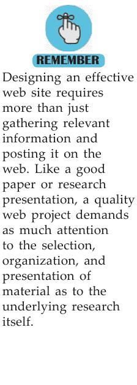

### Java 与 Web 设计

同样，`<hr />` 标签是空元素的一个示例，你不需要起始和结束标签，因为它们之间没有任何内容。注意那个正斜杠。

`<hr />` 元素在字符 `hr` 和正斜杠之间有一个空格。如果你忽略了此空格，旧的浏览器在渲染水平线时会遇到困难；而如果你漏掉了正斜杠字符而仅使用 `<hr>`，这在 `XHTML` 中是无效的。

## 保留格式

有时你希望文本遵循其在 `HTML` 文档中编写的精确格式。你可以使用预格式化标签 `<pre>`。

在起始 `<pre>` 标签和结束 `</pre>` 标签之间的任何文本都将保留源文档的格式。

示例：

```html
<!DOCTYPE html>
<html>
<head>
<title>Preserve Formatting Example</title>
</head>
<body>
<pre>
function myFunction(strText) {
alert (strText)
}
</pre>
</body>
</html>
```

这将产生以下结果：

```


`function myFunction(strText) {`

`alert (strText)`

`}`

尝试在不保留 `<pre>...</pre>` 标签内部的情况下运行相同的代码。

# 不换行空格

假设你想使用短语“12 Angry Men（十二个愤怒的汉）”。在这里，你不希望浏览器将“12, Angry”和“Men”分割到两行中：

这种技术的示例出现在电影《12 Angry Men》中。

当你不希望客户端浏览器换行文本时，应该使用不换行空格实体 `&nbsp;` 而不是普通空格。例如，在段落中编写“12 Angry Men”时，你应该使用类似下面的代码：

示例：

```
<!DOCTYPE html>
<html>
<head>
<title>Nonbreaking Spaces Example</title>
</head>
<body>
<p>example of this technique appears in the movie "12&nbsp;&nbsp;Angry&nbsp;Men."</p>
</body>
</html>
```

# 5.1.3. 创建表格

表格是 HTML 文档的主要设计工具之一。表格具有多种功能。表格允许对页面布局进行更大的控制，从而创建视觉上有趣的页面。使用网格或列布局的页面使用表格（通常是不可见的）来控制页面布局。表格还用于区分文档的章节，例如侧边栏、导航栏，或者为它们的标题和说明加框。浏览器对表格的支持存在某些差异（带有 HTML 4.0 增强标签），但对表格的支持足以证明其作为最流行设计方法的地位。

创建表格可能是一个复杂的设计问题，建议在开始编码之前先画出设计图。


### Java 与 Web 设计

# 使用等宽字体的表格

在起始 `<pre>` 标签和结束 `</pre>` 标签之间的任何文本都将保留源文档的格式。

| 表格 | |
|---|---|
| 列 1 | 列 2 |
| 列 1 | |

# 创建表格

图形表格使用特殊的标签创建，下文所示。图形表格允许使用特殊属性，如边框、颜色、阴影、背景、框架、间距和内边距，这些属性控制表格的视觉方面。表格及其行的属性控制高度、宽度、对齐方式、行和/或列的跨度。创建表格可能是一个复杂的设计问题，建议在开始编码之前先画出设计图。

# 网站设计

基础表格：下面是一个带有相应代码的单一行单单元格简单表格。因为 `cellpadding`（单元格内边距）为零，所以图像与单元格边缘之间没有空间。注意有三个结束标签。

```
<table width="400" border="2" cellspacing="2" cellpadding="0" align="center">
<tr><td></td></tr>
</table>
```

行和列：接下来的这个简单表格有二行三列。这次单元格内边距（`cellpadding`）、边框（`border`）和单元间距（`cellspacing`）增加到了 4 像素。文本和表格都是浏览器的默认对齐方式。`cellpadding` 在单元格边缘和文本之间创建了空间。

| 一 | 二 | 三 |
| 四 | 五 | 六 |

```
<table width="192" border="4" cellspacing="4" cellpadding="4">
<tr><td></td><td>二</td><td>三</td></tr>
<tr><td>四</td><td>五</td><td>六</td></tr>
</table>
```

不可见表格：要创建一个不可见的表格，请将边框（`border`）设为零。这个简单表格有一行三列，且没有可见的边框。

```
<table width="400" border="0" cellspacing="4" cellpadding="0">
<tr><td>一</td><td>二</td><td>三</td></tr>
</table>
```

### Java 与 Web 设计

跨行跨列：行和列都可以被单元格跨越。跨行跨列是通过使用单元格元素 `<td>` 的 `colspan` 和 `rowspan` 属性实现的。在下面的示例中，第一行跨越了两列 `<td colspan="2">`，下方的单元格跨了两行 `<td rowspan="2">`。注意，第三行只有一个单元格，因为之前的行已经填充了行的第一列。

| | | |
|---|---|---|
| | one | |
| | two | |
| | | four |

```html
<table width="200" border="2" cellspacing="2" cellpadding="4">
<tr> <td colspan="2">one</td></tr>
<tr> <td rowspan="2">two</td><td>three</td></tr>
<tr> <td>four</td><td></td></tr>
</table>
```

## 边框颜色、文本环绕、表格周围的空间

表格边框颜色可以通过表格元素的 `bordercolor` 属性进行控制。可以使用表格元素的 `align="left"` 或 `align="right"` 属性使文本环绕表格。

若要结束环绕并在表格下方开始新行，请使用换行和清除标签 `<br clear="all">`，就像我在这句话之前做的那样。也可以使用表格、与在图像周围添加空间相同的代码、水平空间 `hspace` 属性和垂直空间 `vspace` 属性在表格周围添加空间。是该表格的代码，换行代码也是如此。

| Table |

```html
<table width="60" border="2" cellspacing="2" cellpadding="4" align="left"
hspace="10" bordercolor="#0000CC">
<tr><td>Table</td><td></td></tr>
</table>
```

...... 元素。<br clear="all"> 结束环绕 ......

### 单元格内容对齐

单元格内容对齐：单元格的内容可以进行垂直和水平对齐。默认情况下，单元格内容垂直方向居中，水平方向靠左。

## 网站设计

可以使用 `align` 和 `valign` 标签分别用于水平和垂直对齐，并应用于表格部分、行或单元格。下表中的每个单元格都有不同的对齐方式。表格的高度也可以通过 `height` 属性指定，在下面的示例中可见。

| one | two | three |
|---|---|---|

```html
<table width="300" border="2" cellspacing="2" cellpadding="0">
<td align="left" valign="top" height="40" width="60">one</td>
<td align="center" valign="middle" height="40" width="60">two</td>
<td align="right" valign="bottom" height="40" width="60">three</td>
</table>
```

### 单元格颜色和背景图片

格式化单元格颜色或添加背景图片为表格增加结构和视觉组织。表格、行、单元格或单元格组可以使用 `bgcolor` 背景颜色或 `background` 背景图片格式。

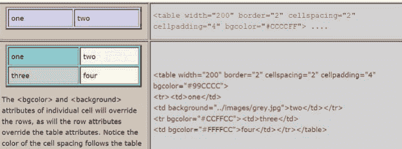

```html
<table width="200" border="2" cellspacing="2" cellpadding="4">
<td bgcolor="#9999CC">
<td>one</td>
<td bgcolor="../images/grey.jpg">two</td>
</td>
<td bgcolor="#CCCCCC">
<td bgcolor="#FF00FF">four</td>
</td>
</table>
```

### 嵌套表格

嵌套表格：如上所示，表格可以嵌套在其他表格的单元格中。左上角嵌套两个单元格的简单表格具有如下格式。嵌套表格的代码封装在单元格 `<td>` 和 `</td>` 标签之间。

```html
<table width="200" border="2" cellspacing="2" cellpadding="4" bgcolor="#CCCCFF">
<tr><td>one</td><td><tr><td>two</td></tr></tr></tr></tr>
</table>
```

### 列组和行组

### Java 与 Web 设计

定义列组或行组可以简化复杂表格的内容格式。有两种不同的列组：结构性组（使用 `<colgroup>` 标签）和非结构性组


（使用 `<col>` 标签）。这些标签并非所有浏览器都支持。表格行可以分为表头、表脚和多个表主体，使用 `<thead>`, `<footer>` 和 `<body>` 元素，其中必须包含至少一个 `<tr>` 元素。`<thead>` 行中的单元格格式为居中并加粗。打印长表格时，表头表脚信息可能会在每个页面重复。

### 边框

HTML 4 允许页面作者控制边框哪些部分出现以及在哪里。如果你需要自定义此属性，请查看 HTML 4。

## 使用表格控制布局


检查此类布局的好方法是在 Netscape 中打开它们，然后使用 FILE-EDIT 命令在 Composer 中打开页面。或者在 Dreamweaver 等 HTML 编辑器中打开文档。不可见的表格边缘会以勾选的形式出现。

## 5.1.4. 复选框

当你想让访问者从一组备选项中选择一个或多个选项时，使用复选框。如果一次只能选择一个选项，则使用单选按钮。


## 设置

以下是复选框的有效设置：

| HTML | 解释 | 示例 |
|---|---|---|
| checkbox | 选择一个或多个选项 | |
| name= | 字段的名称。 | |
| value= | 勾选时的提交值。 | |
| align= | 字段的对齐方式。 | [x] |

`name` 设置为字段添加内部名称，以便处理表单的程序识别字段。

`value` 设置定义了勾选时提交的内容。

`align` 设置定义了字段如何对齐。

有效条：`TOP`, `BOTTOM`, `RIGHT`, `LEFT`, `TEXTTOP`, `BASELINE`, `ABSMIDDLE`, `MIDDLE` 和 `ABSBOTTOM`。对齐方式在图片部分进行了解释。你在这里学习不同的对齐方式。

`tabindex` 设置定义了访问者点击键时不同字段激活的顺序。

### 示例

看这个 HTML 示例：

```html
<html>
<head>
<title>My Page</title>
</head>
<body>
<form name="myform"
action="http://www.mydomain.com/myformhandler.cgi" method="POST">
<div align="center">
<input type="checkbox" name="option1" value="Milk"> Milk<br>
<input type="checkbox" name="option2" value="Butter"> Butter checked<br>
<input type="checkbox" name="option3" value="Cheese"> Cheese<br>
</div>
</form>
</body>
</html>
```

以及其产生的输出：


### Java 与 Web 设计


## 框架 (Frames)

在创建网站时，框架是在 Web 呈现上使用多个独立可控制的部分。这种效果通过将每个部分构建为单独的 HTML 文件，并由一个“主”HTML 文件标识所有部分来实现。当用户请求使用框架的 Web 页面时，请求的地址实际上是定义框架的“主”文件；请求的结果是返回多个 HTML 文件，每个视觉部分一个。一个框架中的链接可以请求在另一个（或相同）框架中显示的文件。框架的典型用法是让一个框架包含选择菜单，另一个框架包含

## 5.2. 静态和动态页面

网页可以是静态的，也可以是动态的。“静态”意味着不变或恒定，而“动态”意味着活跃。因此，静态页面在每次加载时都包含相同的内容，而动态页面可以。

例如，服务器可以在 Web 页面上显示当前时间和日期。它还可能根据用户填写的 Web 表单输出唯一的响应。许多动态页面使用服务器端代码访问数据库信息，这使得页面内容可以从存储在数据库中的信息生成。使用数据库信息生成网页的网站通常被称为数据库驱动网站。

### 引用

+ 2. http://pc.net/helpcenter/static_and_dynamic_pages

## Web 服务器


其他类型的网页如 PHP、ASP 和 JSP 页面是动态 Web 页面。这些页面包含“服务器端”代码，允许服务器在每次加载时生成独特的内容。

你通常可以通过 Web 浏览器地址字段中的页面扩展名判断页面是静态的还是动态的。如果是 `.htm` 或 `.html`，页面可能是静态的。如果扩展名是 `.php`, `.asp`, 或 `.jsp`，则页面很可能是动态的。

### Java 与 Web 设计

## 5.2.1. DHTML

DHTML（动态 HTML）是一系列技术的集合，用于超越信息的静态表示，创建更具交互性的网页。在 HTML 中起作用的技术包括 HTML、JavaScript、层叠样式表（CSS）和文档对象模型（DOM）。CSS 用于控制由 HTML 定义的内容呈现方式。DOM 是一个指向正在渲染的 HTML 文档状态及其相关 CSS 呈现的客户端编程接口。当使用 JavaScript 操控 DOM 状态以导致网页的外观或行为发生时，HTML 的“动态”部分就发挥了作用。更多信息请参阅维基百科或 MSDN 上的 HTML 集合。

使用 HTML 的网页与测试桌面应用程序相似，原因在于页面上某个区域的用户交互可能会影响页面其他部分的呈现或行为，而这一切无需往返服务器传输。

Quality Logic 在验证您的网站中包含的代码、渲染页面和行为方面拥有丰富经验。请点击右侧“Testing Solutions（测试解决方案）”下方的链接以探索 Logic 的网站解决方案，或联系我们获取更多信息或请求报价。

## JavaScript

在 JavaScript 中，语句 `document.write()` 用于向网页输出内容。

示例

以下示例使用 JavaScript 在页面上显示当前日期和时间：

```html
<html>
<body>
  <script type="text/javascript">
    document.write(Date());
  </script>
</body>
</html>
```

## JavaScript 与 HTML DOM

JavaScript 也可以用于更改 HTML 元素的内容或属性。

要更改 HTML 元素的内容：

```javascript
document.getElementById(id).innerHTML=new HTML
```


要更改 HTML 元素的属性：

```
document.getElementById(id).attribute=new value
```

## JavaScript 与 HTML 事件

当事件发生时，也可以执行 JavaScript，例如用户点击 HTML 元素时。

要当用户点击元素时执行代码，请使用以下事件属性：

```
onclick=JavaScript
```

## JavaScript 与 CSS

JavaScript 也可以更改 HTML 元素的样式：

要更改 HTML 元素的样式：

```
document.getElementById(id).style.property=new style
```

### 总结

- 所有这些网站元素结合构成了网站。通常，“设计”的含义仅被视为视觉方面。
- 互联网是通过网络电缆或卫星链路连接的计算机集合。
- 域名解析服务（DNS）是一种提供将域名映射到实际 IP 地址的应用程序服务。
- 复选框用于让访问者从一组选项中选择一个或多个选项。
- HTML（动态 HTML）是一系列技术的集合，用于超越信息的静态呈现，创建更具交互性的网页。

## 复习题

1. 描述 HTML 标签。
2. 什么是复选框？
3. 解释帧（frames）。
4. 讨论 HTML。
5. 区分静态网页和动态网页。

## 知识检查

1. 网页显示一张图片。使用什么标签来显示该图片？
   - a. `picture`
   - b. `image`
   - c. `img`
   - d. `src`
2. `<b>` 标签使包含的文本加粗。另一个使文本加粗的标签是什么？
   - a. `<strong>`
   - b. `<dar>`
   - c. `<black>`
   - d. `<emp>`
3. 不直接显示在页面上的标签和测试写在哪个部分中？
   - a. `<html>`
   - b. `<head>`
   - c. `<title>`
   - d. `<body>`
4. 哪个标签在你的网页上插入一条水平线？
   - a. `<hr>`
   - b. `<line>`
   - c. `<line direction="horizontal">`
   - d. `<tr>`
5. 任何 HTML 文档的第一个标签应该是什么？
   - a. `<head>`
   - b. `<title>`
   - c. `<html>`
   - d. `<document>`

### 检查你的结果

1. (c) 2. (a) 3. (b) 4. (a) 5. (c)

## 扩展阅读

1. 《The Small Business Website Design Guide》作者：Lisa Pecunia
2. https://www.udemy.com/website-design/

## Web 应用安全

## 学习目标

学习本章内容后，你将能够：

1. Web 应用安全的目标
2. Web 应用安全概述
3. 配置 HTTPS 服务器
4. 定义持久用户类
5. 解释登录功能
6. 讨论安全过滤器
7. 描述密码摘要

## 引言

安全是你的 Web 应用的关键部分。根据定义，Web 应用允许用户访问中央资源——Web 服务器，并通过它访问其他资源（如数据库服务器）。通过理解并实施适当的安全措施，你可以保护自己的资源，并为你的用户提供一个安全的环境，让他们舒适地运行你的应用程序。

Web 应用安全是一种旨在保护托管在网站上的应用程序以及保护网站本身的安全哲学。被保护的实体附属于一个网站，因此 Web 应用安全应该在我们能够理解的 Java 和 Web 设计编程语言中实现。通常会使用几种类型的安全程序来提供这种保护，包括漏洞扫描器和输入测试。网站或 Web 应用可能会发生许多类型的攻击，脚本攻击和代码注入是两种最常见的安全威胁。

保护网站或 Web 应用与为安装在桌面的程序创建安全防护非常不同。应用程序是离线的，通常可以被任何人访问——或者至少是有一大群用户访问——这增加了恶意用户向网站注入代码的可能性，因此 Web 应用安全必须克服这些挑战。

```java
set settings

if (settings[0].compareTo(settings[1]) == 0) {

    name += etr.getString(settings[0]);

    name += "";

} else if (settings.compareTo("") == 0) {

    if (settings.compareTo("") == 0) {

        name += DateUtils.format(settings[0]));

    } else if (settings.compareTo("") == 0) {

        name += "";

    }

sysNumber = etr.getDouble(name));
```

在构建 Web 应用安全时，软件开发人员必须使用这些语言编写程序以适应大多数开发者。编码对于 Web 应用安全至关重要，因为糟糕的 Web 应用编码会让黑客更容易进入系统。因此，许多应用程序安全程序被用于检查这些区域的稳定性。防火墙和密码测试器也常用于额外的安全。

黑客可以通过许多方式攻击 Web 应用或网站，但通常使用两种主要的攻击。代码注入（通常使用结构化查询语言 SQL）向网站或其数据库中添加代码。这本身可能会导致问题，也可能为更严重的攻击留下安全漏洞。脚本攻击与代码注入类似，但它们运行的是恶意程序，而不是向系统中添加恶意程序。

## 6.1 Web 应用安全的目标

计算机安全有三个目标，对应于它们试图克服的对计算机数据的三个直接负面影响。必须对每个特定的应用程序进行分析，以确定每个三个目标的适当水平。


## 数据完整性

数据与原始输入源相同，和/或经过准确的计算和维护。该目标防止对数据（或程序）的意外或故意修改或破坏。

未经授权的访问是在未经许可使用计算机或网络。

## 数据机密性

数据被保密并免受未经授权的泄露。该目标防止意外或故意向未经授权的人员泄露数据。

## 数据和系统可用性

授权用户可以在合理的时间内获得所需的数据和系统服务。这防止了授权系统用户需要时无法访问（或访问缓慢）数据、程序和其他系统资源。

## 安全基础

安全依赖于以下元素：

+ 身份验证（Authentication）：解决问题：你是谁？

> 引用
> ¹ http://www.kulzick.com/casecobj.htm

### Java 与 Web 设计

这是一个对你的应用程序和服务的客户端进行唯一标识的过程。这些客户端可能是终端用户、其他服务、进程或计算机。在安全术语中，经过身份验证的客户端被称为实体（principals）。

- 授权（Authorization）：解决“你能做什么”的问题。它是一个管理经过身份验证的客户端允许访问的规则和操作的过程。资源包括文件、数据库、表、行等，以及系统级资源如注册表键和配置数据。操作包括执行交易，例如购买产品、从一个账户转账到另一个账户，或提高客户的信用评分。

- 审计（Auditing）：有效的审计和日志记录是不可否认性（non-repudiation）的关键。不可否认性保证用户无法否认执行某项操作或发起某项交易。例如，在电子商务系统中，需要不可否认机制来确保消费者无法否认订单了 100 份特定的书籍。

- 机密性（Confidentiality）：也指隐私，是确保数据保持私密和机密，且不会被未经授权的用户或监控网络流量流量的窃听者查看的过程。加密经常用于执行机密性。访问控制列表（ACLs）是执行机密性的另一种手段。

- 完整性（Integrity）：它是数据免受意外或故意（恶意）修改的保证。与隐私一样，完整性是一个核心关注点，特别是对于跨网络传输的数据。传输中数据的完整性通常通过使用哈希技术和消息认证码来提供。

- 可用性（Availability）：从安全的角度来看，可用性意味着系统对合法用户保持可用。许多发起拒绝服务攻击（DoS）的攻击者的目标是崩溃应用程序或确保其过载，导致其他用户无法访问该应用程序。

## 6.2 Web 应用安全概述 2, 3

Web 应用安全是保护网站和在线服务免受各种安全威胁的过程，这些威胁利用应用程序代码中的漏洞。Web 应用攻击的常见目标是内容管理系统（例如：

| 编号 | URL |
| :--- | :--- |
| 2 | https://www.incapsula.com/web-application-security/application-security.html |
| 3 | http://www.applicure.com/solutions/web-application-security |


WordPress、数据库管理工具（例如 `phpMyAdmin`）以及 SaaS 应用。

攻击者将 Web 应用程序视为高优先级目标，是因为：

- 源代码固有的复杂性，这增加了未受关注的漏洞和恶意代码操纵的可能性。
- 高价值回报，包括从成功的源代码操纵中收集的敏感私有数据。
- 执行容易，因为大多数攻击可以很容易地自动化，并无差别地针对成千上万、甚至数十万目标发起攻击。

未能保护其 Web 应用的企业面临被攻击的风险。除其他后果外，这可能导致信息泄露、客户关系损坏、执照吊销和法律诉讼。


# Web 应用漏洞

钓鱼攻击是 Web 应用的另一种常见威胁，2012 年此类攻击造成的全球损失估计估计为 15 亿美元。

Web 应用漏洞通常由于输入/输出清理不足导致，这些漏洞通常被用来操纵源代码或获得未经授权的访问。

此类漏洞允许使用不同的攻击向量，包括：

- SQL 注入（SQL Injection）：当攻击者使用恶意代码操纵后端数据库使其泄露信息时发生。后果包括未经授权查看列表、删除表以及未经授权的管理访问。
- 跨站脚本（XSS）：XSS 是一种针对用户的注入攻击，旨在访问账户、激活木马或修改页面内容。存储型 XSS（Stored XSS）发生在恶意代码直接注入应用程序时。反射型 XSS（Reflected XSS）发生在恶意脚本从应用程序反射到用户浏览器时。
- 远程文件包含（Remote File Inclusion）：黑客使用这种攻击远程向 Web 应用服务器上注入文件。这可能导致在应用程序中执行恶意脚本或代码，以及数据泄取或操纵。
- 跨站请求伪造（CSRF）：一种可能导致资金未经自愿转账、密码更改或数据泄取的攻击。当恶意 Web 应用在用户已登录的站点上执行不想要的操作时，就会发生这种情况。

从理论上讲，彻底的输入/输出清理可以消除所有漏洞，使应用程序对非法操纵产生免疫。

然而，完全的清理通常不是一个实际的方案，因为大多数应用程序处于持续开发状态。此外，应用程序还经常相互集成，以创建一个日益复杂的环境。


通过保持浏览器软件更新可以尽量减少软件本身的漏洞，但如果底层操作系统被破坏（例如被 rootkit 破坏），将是不够的。

对于此类威胁，应该部署 Web 应用安全解决方案和强制的安全程序，如 PCI 数据安全标准（PCI DSS）认证。由于大多数业务依赖网站向客户交付服务、与客户互动并销售产品，因此技术通常被用于处理网站的不同任务。像 Joomla! 或 Drupal 这样的内容管理系统可能是构建充满产品的稳健网站的解决方案。

### Java 与 Web 设计

不仅局限于大型企业网站。较小的网站也同样容易落入这些自动化攻击的网罗。

网站被入侵的后果对任何企业来说都是灾难性的，无论其行业或公司规模如何。这些攻击的后续影响包括：

- 数据被盗取
- 用户账户被破解
- 失去客户和/或访问者的信任
- 品牌声誉受损
- 销售收入损失
- 您的网站被标记为恶意网站
- 搜索引擎排名下降


# 保护免受针对 Web 应用程序的攻击

`dotDefender` 独特的安全方法消除了学习每个 Web 应用程序上特定威胁的需要。不需要学习每个 Web 应用程序上存在的特定威胁。运行 `dotDefender` 的软件专注于分析请求及其对应用程序的影响。有效的 Web 应用程序安全基于三个强大的 Web 应用安全引擎：模式识别、会话保护和签名知识库。

模式识别 Web 应用程序安全引擎可以有效防御上述攻击以及许多其他恶意行为。这些模式基于正则表达式设计，旨在高效、准确地识别各种应用级攻击方法。因此，`dotDefender` 的特点是极低的误报率。

`dotDefender` 的独特之处在于，它在提供对 Web 应用程序威胁全面保护的同时，它是最易用的解决方案之一。

只需 10 次点击，没有安全培训的 Web 管理员即可让 `dotDefender` 运行起来。其预定义的规则集提供了开箱即用的保护，可以通过基于浏览器的界面进行管理，且对您的服务器或网站的性能几乎没有影响。

# 6.3 配置 HTTPS 服务器⁴, ⁵

要配置 HTTPS 服务器，必须在服务器块中的监听套字上启用 `ssl` 参数，并指定服务器证书和私钥文件的位置：

```
server {

  listen 443 ssl;

  server_name www.example.com;

  ssl_certificate www.example.com.crt;

  ssl_certificate_key www.example.com.key;

  ssl_protocols TLSv1 TLSv1.1 TLSv1.2;

  ssl_ciphers HIGH:!aNULL:!MD5;

}
```

证书是一个公共实体。它会被发送给连接到服务器的客户端。私钥是一个安全实体，应该存储在访问受限的文件中，但它必须可被 nginx 主进程读取。私钥也可以交替存储在与证书相同的文件中：

```
ssl_certificate www.example.com.cert;

ssl_certificate_key www.example.com.key;
```

在这种情况下，文件的访问权限也应该受到限制。尽管证书和密钥存储在同一个文件中，但只有证书会被发送给客户端。

可以使用 `ssl_protocols` 和 `ssl_ciphers` 来限制连接，使其仅包含 SSL/TLS 的强版本和加密套件。默认情况下，nginx 使用 `ssl_protocols TLSv1 TLSv1.1 TLSv1.2` 和 `ssl_ciphers HIGH:!aNULL:!MD5`，因此通常不需要显式地配置它们。请注意，这些直接指令的默认值已经更改过多次。

# HTTPS 服务器优化

SSL 操作会消耗额外的 CPU 资源。在多处理器系统中，应该运行多个工作进程，数量不少于可用的 CPU 核心数。最消耗 CPU 的操作是 SSL 握手。有两种方法可以减少每个客户端的此类操作次数：第一是启用长连接以通过一个连接发送多个请求，第二是重用 SSL 会话参数，以避免并行和后续连接的 SSL 握手。

### 引用

| # | 链接 |
| :--- | :--- |
| 4 | http://nginx.org/en/docs/http/configuring_https_servers.html |
| 5 | https://access.redhat.com/documentation/en-US/Red_Hat_Enterprise_Linux/5/html/Deployment_Guide/s1-httpd-secure-server.html |


### Java 与 Web 设计

会话存储在工作进程之间的 SSL 会话缓存中，并通过 `ssl_session_cache` 指令进行配置。1MB 的缓存包含约 4000 个会话。默认缓存超时为 5 分钟。可以使用 `ssl_session_timeout` 指令增加超时。以下是一个针对具有 10MB 共享会话缓存的多核系统的优化配置示例：

```
worker_processes: auto;

http {

    ssl_session_cache shared:SSL:10m;

    ssl_session_timeout 10m;

}

server {

    listen 443 ssl;

    server_name www.example.com;

    keepalive_timeout 70;

    ssl_certificate www.example.com.crt;

    ssl_certificate_key www.example.com.key;

    ssl_protocols TLSv1.1 TLSv1.2;

    ssl_ciphers HIGH:!aNULL:!MD5;

}
```

# SSL 证书链

某些浏览器可能会对由知名证书颁发机构签名的证书报错，而其他浏览器可能会无问题地接受该证书。这是因为颁发机构使用中间证书对证书签名，而该中间证书不存在于特定浏览器分发的已知信任证书颁发机构库中。在这种情况下，机构提供一个链证书包，该证书包应该与签名的服务器证书合并。在合并文件中，服务器证书必须出现在链证书之前：

```
$ cat www.example.com.crt bundle.crt > www.example.com.chained.crt
```

生成的文件应在 `ssl_certificate` 指令中使用：

```
server {

    listen 443 ssl;

    server_name www.example.com;

    ssl_certificate www.example.com.chained.crt;

    ssl_certificate_key www.example.com.key;

}
```


# Web 应用安全

如果服务器证书和包的合并顺序错误，`nginx` 将无法启动并显示错误消息：

```
SSL_CTX_use_PrivateKey_file(" ... /www.example.com.key") failed
(SSL: error:0B080074:X509 certificate routines:
X509_check_private_key values mismatch)
```

因为 `nginx` 尝试将私钥与包证书配合，而不是服务器证书。

浏览器通常会存储它们收到的由信任机构签名的中间证书，因此经常使用的浏览器可能已经拥有所需的中间证书，不会对没有证书包的情况报错。为了确保服务器提供完整的证书，可以使用 `openssl` 命令行工具，例如：

```
$ openssl s_client -connect godaddy.com:443

Certificate chain

/C=US/ST=Arizona/L=Scottsdale/1.3.6.1.4.311.60.2.3=US

/1.3.6.1.4.311.60.2.1A=O=GoDaddy.Com

/OU=IS Department CN=www.godaddy.com

/serialNumber=79698-7/2.5.4=V1.0, Clause 5. S (b)

i/:C=US/ST=Arizona/L=Scottsdale/O=GoDaddy.Com, Inc.

/http://certificates.godaddy.com/repository

/CN=GoDaddy Secure Certification Authority

/serialNumber=79692837

1 :/C=US/ST=Arizona/L=Scottsdale/O=GoDaddy.Com, Inc.

/http://certificates.godaddy.com/repository

/CN=GoDaddy Secure Certification Authority

/serialNumber=79692837

2 :/C=US/O=GoDaddy GoDaddy Group, Inc.

/O=GoDaddy Class 2 Certification Authority

2 :/C=US/O=GoDaddy GoDaddy Group, Inc.

/O=GoDaddy Class 2 Certification Authority

i/:L=ValicCert Validation Network/O=ValicCert, Inc.

/O=Valicert Class 2 Policy Authority

/CN=http://www.valicert.com/emailAddress=info@valicert.com
```

在此示例中，`www.godaddy.com` 服务器证书 #0 的“s”是由一个机构（""）签名的，该机构本身是证书 #1，而 #1 又由另一个机构（""）签名，该机构本身是证书 #2，最后由知名机构 `ValicCert, Inc` 签名，该机构存储在浏览器的内置证书库中。

如果没有添加证书，则只会显示服务器证书 #0。


## 单个 HTTP/HTTPS 服务器

可以配置单个服务器同时处理 HTTP 和 HTTPS 请求：

```
server {

    listen 80;

    listen 443 ssl;

    server_name www.example.com;

    ssl_certificate www.example.com.crt;

    ssl_certificate_key www.example.com.key;

}
```

在 0.14 版本之前，无法为单独的监听套字启用 SSL，如上所示。当时只能通过使用 `ssl` 指令为整个服务器启用 SSL，这导致无法设置单个 HTTP/HTTPS 服务器。`listen` 指令的 `ssl` 参数是为了解决这个问题而引入的，因此，版本中不建议使用 `ssl` 指令。


Java 持久 API (JPA) 是一种 Java 规范，用于 Java 对象/类与关系型数据库之间的数据访问、持久化和管理。

## 基于名称的 HTTPS 服务器

当配置两个或多个监听在同一个 IP 地址上的服务器时，会出现一个常见问题：

```
server {

    listen 443 ssl;

    server_name www.example.com;

    ssl_certificate www.example.com.crt;

}

server {

    listen 443 ssl;

    server_name www.example.org;

    ssl_certificate www.example.org;

}
```

使用这种配置时，浏览器将接收默认服务器的证书，即 `www.example.com`，无论请求的服务器名称是什么。这是由 SSL 协议的行为引起的。SSL 连接在浏览器发送 HTTP 请求之前就已经建立，`nginx` 此时不知道请求的服务器名称。因此，它可能会提供默认服务器的证书。


## 解决此问题最旧且最有效的方法

解决此问题最旧且最有效的方法是为每个 HTTPS 服务器分配一个独立的 IP 地址：

```
server {

  listen 192.168.1.1:443 ssl;

  server_name www.example.com;

  ssl_certificate www.example.com.crt;

  ...

}

server {

  listen 192.168.1.2:443 ssl;

  server_name www.example.org;

  ssl_certificate www.example.org.crt;

  ...

}
```

## 带有多个名称的 SSL 证书

还有其他方法允许多个 HTTPS 服务器共享同一个 IP 地址。然而，它们都有各自的缺点。一种方法是在 `SubjectAltName` 字段中使用带有多个备名称的证书，例如 `www.example.com` 和 `www.example.org`。但是，`SubjectAltName` 字段的长度是有限的。

另一种方法是使用带有通配符名称的证书，例如 `*example.org*`。通配符证书可以保护指定域名的所有子域名，但仅限一层。该证书匹配 `www.example.org`，但不匹配 `example.org` 或 `www.sub.example.org`。这两种方法也可以结合使用。证书可以在 `SubjectAltName` 字段中包含精确名称和通配符名称，例如 `example.org` 和 `*example.org`。

最好将带有多个名称的证书文件及其私钥文件放在配置的 `http` 级别，以便在所有服务器中继承其的单份内存拷贝：

```
ssl_certificate common.crt;

ssl_certificate_key common.key;

server {

  listen 443 ssl;

  server_name www.example.com;

}

server {

  listen 443 ssl;

  server_name www.example.org;

  ...

}
```

## 服务器名称指示 (SNI)

在单个 IP 地址上运行多个 HTTPS 服务器的更通用的解决方案是 TLS 服务器名称指示扩展（SNI, RFC 6066），它允许浏览器在 SSL 握手期间传递请求的服务器名称，因此服务器将知道应该为连接使用哪个证书。然而，SNI 的浏览器支持非常有限。目前，从以下版本的浏览器开始支持该功能：

- Opera 8.0；
- 微软 IE 7.0（但仅限 Windows 或更高版本）；
- Firefox 2.0 以及其他使用 Mozilla Platform rv:1.8.1 的浏览器；
- Safari 3.2.1（Windows 版本支持 Vista 或更高版本的 SNI）；
- Chrome（Windows 版本也支持 Vista 或更高版本的 SNI）。

为了在 `nginx` 中使用 SNI，它必须在编译 `nginx` 二进制文件时的 OpenSSL 库以及运行时动态链接的库中都支持 SNI。如果使用构建时使用了 `"enable-tlsext"` 配置选项，OpenSSL 从 0.9.8 版本起就支持 SNI。从 0.9.8j 版本开始，该选项默认启用。如果 `nginx` 是带有 SNI 支持进行编译的，那么 `nginx` 在运行 `"-V"` 参数时会显示此内容：

```
$ nginx -V

TLS SNI support enabled
```

然而，如果支持 SNI 的 `nginx` 动态链接到不支持 SNI 的 OpenSSL 库，`nginx` 将显示警告：

```
nginx was built with SNI support, however, now it is linked dynamically to an OpenSSL library which has no tlsext

therefore sni is not available
```

## Apache HTTP 安全服务器配置

启用了 `mod_ssl` 安全模块的 Apache HTTP Server 可以使用 OpenSSL 库和工具包。这三个组件的组合被称为安全 Web 服务器或简称为安全服务器。

`mod_ssl` 模块是 Apache HTTP Server 的安全模块。`mod_ssl` 使用 OpenSSL 项目提供的工具为 Apache HTTP Server 添加了一个非常重要的功能——加密通信的能力。相比之下，浏览器与 Web 服务器之间的普通 HTTP 通信是以明文发送的，可能会被浏览器与服务器路径上的任何人拦截并读取。

`mod_ssl` 配置位于 `/etc/httpd/conf.d/ssl.conf`。为了加载此文件并使 `mod_ssl` 工作，你必须在 `/etc/httpd/conf/httpd.conf` 中包含 `Include conf.d/*` 语句。该语句由默认的 Apache 服务器配置文件中包含。

## 安全相关包

要启用安全服务器，你至少必须安装以下包：

### httpd
`httpd` 包包含 `httpd` 守护进程以及相关工具、配置文件、图标、Apache HTTP Server 模块、man 页面以及用于 Apache HTTP Server 的其他文件。

### mod_ssl
`mod_ssl` 包包含 `mod_ssl` 模块，该模块通过安全套接层 (SSL) 和传输层安全 (TLS) 协议为 Apache HTTP Server 提供强密码学支持。

### openssl
`openssl` 包包含 OpenSSL 工具包。OpenSSL 工具包实现了 SSL 和 TLS 协议，还包含一个通用密码学库。

## 持久化类

持久化类是 `persistent-metaclass` 元类类的实例。所有持久化类都会跟踪哪些 `:persistent`、`:transient` 和 `:indexed` 槽被用作持久化元对象协议的专家（槽初始化、槽访问等）。

所有持久化类都创建继承自持久化类的对象。持久化类提供了两个槽，包含一个唯一对象标识符 (oid) 以及指向与其关联的存储控制器规范的引用。持久化槽不占用任何内存空间，相反，`persistent-metaclass` 访问协议会将槽访问重定向到对存储控制器的调用。通常，底层数据存储将执行必要的序列化和反序列化，以便向磁盘读写数据。

当持久化实例本身被写入数据库时（例如作为 b 树中的键或值），该实例的唯一 ID 和类会被存储。当读取时，会重新创建一个持久化对象实例（见下文）。这意味着与标准对象相比，持久化对象的序列化是非常廉价的。关于实例创建的小节将更详细地讨论持久化对象的生命周期。

持久化类是应用程序中实现业务问题实体的类（例如电子商务应用程序中的客户和订单）。持久化类的所有实例都被认为处于持久化状态。实例也可以是瞬态的（transient）或脱离的（detached）。


> 引用
> 6 https://common-lisp.net/project/elephant/doc/Persistent-Classes-and-Objects.html

```
private Set kittens = new HashSet();

private void setId(Long id) {
    this.id=id;
}

public Long getId() {
    return id;
}

void setBirthdate(Date date) {
    birthdate = date;
}

public Date getBirthdate() {
    return birthdate;
}

void setWeight(float weight) {
    this.weight = weight;
}

public float getWeight() {
    return weight;
}

public Color getColor() {
    return color;
}

void setColor(Color color) {
    this.color = color;
}

void setSex(char sex) {
    this.sex=sex;
}

public char getSex() {
    return sex;
}

void setLitterId(int id) {
    this.litterId = id;
}

public int getLitterId() {
    return litterId;
}

void setMother(Cat mother) {
    this.mother = mother;
}

public Cat getMother() {
    return mother;
}

void setKittens(Set kittens) {
    this.kittens = kittens;
}

public Set getKittens() {
    return kittens;
}

// Hibernate 不需要 addKitten 
public void addKitten(Cat kitten) {
    kitten.setMother(this);
    kitten.setLitterId(kittens.size());
    kittens.add(kitten);
}
```

## 持久化类定义

要创建持久化类，用户需要在类初始化标签中指定持久化元类（`persistent-metaclass`）。

```
(defclass my-pclass ()

((slot1 :accessor slot1 :initag :slot1 :initform 1))

    (:metaclass persistent-metaclass))
```


标准类定义与持久化类定义语法之间的唯一区别在于能够指定槽存储策略和索引策略。槽值存储策略通过槽初始化标签的布尔参数`:persistent`和`:transient`来指定。


# Web 应用安全

默认情况下，槽是`:persistent`而不是`:indexed`。提供`defpclass`宏是为了方便起见而隐藏`:metaclass`槽选项。

在上面的定义中，类`my-pclass`是元类`persistent-metaclass`的实例。根据此定义，`pslot1`和`pslot2`是持久化的，而`tslot1`是瞬态的并存储在内存中。

持久化类通过对`persistent-metaclass`的特化修改了它们的元对象协议。这些特化包括创建特殊的槽元对象：`transient-slot-definition`、`persistent-slot-definition`以及它们的直接版本和有效版本。对于MOP爱好者来说，新的类初始化协议如下：

- `shared-initialize:around`：确保该类继承了`persistent-object`和`persistent`（如果它尚未继承的话），并且类选项`:index`会导致类变为`indexed`；
- `direct-slot-initialization-class`：根据`:transient`和`:persistent`槽关键字的值返回相应的槽元对象。它还对无效组合（例如带索引的瞬态槽）进行错误检查。
- `effective-slot-definition-class`：对有效槽（effective slots）执行与上述相同的作用。
- `slot-definition-allocation`：为持久化槽定义返回`:database`分配，因此在某些Lisp中，底层不会分配实例或类存储。
- `compute-effective-slot-definition-initargs`：执行某些错误检查，以确保子类尝试将继承的持久化槽变为瞬态的。
- `finalize-inheritance`：在创建第一个实例之前调用，以确定持久化槽列表，以考虑继承列表中的任何前向引用类。同样，索引槽列表也会被计算。如果进行了任何依赖于知道哪些槽被索引的调用，类索引代码也会调用此函数。


`String`传统上是字符序列，可以是字面量常量，也可以是变量。


## 用户类

创建一个名为`User`的类，其中包含存储id、用户名和密码的成员变量。该类的完整代码如下。

```
package publisher.data;

public class User {

    private Long id;

    private String username;

    private String password;

    public Long getId() {

        return id;

    }

    public void setId(Long id) {

        this.id = id;

    }

    public String getPassword() {

        return password;

    }

    public void setPassword(String password) {

        this.password = password;

    }

    public String getUsername() {

        return username;

    }

    public void setUsername(String username) {

        this.username = username;

    }

}
```

# COM.odi.Persistent 类

可以将实例存储在数据库中的类被认为具有持久化能力的类。持久化能力类有三种：

`Persistent`的子类。通常情况下，你运行类后处理器来注解你的类，使其继承自这些类之一。在少数情况下，你显式地定义你的类继承自这些类之一。


- `String`
- Java原始类型包装类：`Boolean`, `Character`, `Double`, `Float`, `Integer`和`Long`

`String`和Java原始类型包装类的实例不可修改的，并且当它们迁移到数据库时不会保持其标识性。

在少数情况下，你可能会在源代码中显式定义一个继承自`Persistent`或`HashPersistent`的类。

通常，在编译定义了想要持久化存储的类的代码后，你会运行类文件后处理器来使类具备持久化能力。后处理器添加到你代码中的注解之一是使你的类或父类继承自`COM.odi.Persistent`或`COM.odi.util.HashPersistent`类。后处理器会通过检查正在更新的类及其任何派生类来选择基类。如果其中任何一个是非抽象的并且继承了`java.lang.Object`的`hashCode()`方法，后处理器会将`COM.odi.util.HashPersistent`设为基类。否则`COM.odi.Persistent`成为基类。

无论你的类是如何继承它的，`Persistent`类都是抽象基类。它是定义可以将实例存储在数据库中的类的API。大多数情况下由后处理器实现此API。

如果你显式定义一个类继承自`Persistent`，你的子类必须定义`initializeContents()`、`clearContents()`和`flushContents()`方法。此外，你必须注册子类`ClassInfo`。关于这些注解的更多信息可以在手动创建持久化类的用户文档中找到。

通常你可以在需要持久化对象的地方指定`null`。

# 登录功能

JavaServer Pages和servlet为Web开发者提供了几种保护应用程序机制。通过在应用程序部署符中识别资源并为它们分配角色来声明保护资源。

提供了多个级别的身份验证，从基本认证到使用证书的复杂身份验证。

| 页面 | 链接 |
|---|---|
| 7 | [http://www.tutorialspoint.com/jsp_security.htm](http://www.tutorialspoint.com/jsp_security.htm) |

## 基于角色的身份验证

servlet规范中的身份验证机制使用一种基于角色的安全技术。其思想不是在用户级别限制资源，而是创建角色并按角色限制资源。

可以在文件`tomcat-users.xml`中定义不同的角色，它位于Tomcat目录下的`conf`文件夹中。该文件的示例所示：

```xml
<?xml version="1.0" encoding="utf-8"?>
<tomcat-users>
<role rolename="tomcat" />
<role rolename="role1" />
<role rolename="manager" />
<role rolename="admin" />
<user username="tomcat" password="tomcat" roles="tomcat" />
<user username="role1" password="tomcat" roles="role1" />
<user username="both" password="tomcat" roles="tomcat,role1" />
<user username="admin" password="secret" roles="admin,manager" />
</tomcat-users>
```

此文件定义了用户、密码和角色之间的简单映射。注意，给定的用户可能有多个角色，例如用户名`name="both"`的用户属于"tomcat"角色和"role1"角色。

一旦识别并定义了不同的角色，可以使用`WEB-INF`目录下`web.xml`文件中的`<security-constraint>`元素对不同的Web资源放置基于角色的安全限制。

以下是`web.xml`中的示例条目：

```
<web-app>
...
<security-constraint>
```


Servlet过滤器是一个可以拦截你的Web应用程序的HTTP请求的对象。

```xml
<web-resource-collection>
  <web-resource-name>
    SecuredBookSite
  </web-resource-name>
  <url-pattern>/secured/*</url-pattern>
  <http-method>GET</http-method>
  <http-method>POST</http-method>
</web-resource-constraint>
  <auth-constraint>
    <description>
      Let only managers use this app
    </description>
    <role-name>manager</role-name>
  </auth-constraint>
  <security-constraint>
    <security-role>
      <role-name>manager</role-name>
    </security-role>
    <login-config>
      <auth-method>BASIC</auth-method>
    </login-config>
  ...
</web-app>
```

上述条目意味着：

- 任何匹配`/secured/*`URL的HTTP GET或POST请求都将受到安全限制。
- 具有`manager`角色的人员获得受保护资源的访问权限。
- 最后，`login-config`元素用于描述BASIC形式的认证。

现在，如果你尝试浏览包括`/security`目录在内的任何URL，它将显示一个对话框询问用户名和密码。如果你提供了用户"admin"和密码"secret"，那么你就可以访问匹配`/secured/*`的URL，因为我们定义了具有`manager`角色的用户`admin`，他被允许访问此资源。

## 基于表单的认证

当你使用FORM认证方法时，必须提供一个登录表单来提示用户输入用户名和密码。以下是一个简单的`login.jsp`代码，用于创建一个具有相同目的的表单：

```html
<html>
<body bgcolor="#ffffff">
<form method="POST" action="j_security_check">
<table border="0">
<tr>
<td>登录</td>
<td><input type="text" name="j_username"></td>
</tr>
<tr>
<td>密码</td>
<td><input type="password" name="j_password"></td>
</tr>
</table>
<input type="submit" value="登录!">
</form>
</body>
</html>
```

```html
</center>
</form>
</body>
</html>
```

在这里，你必须确保登录表单包含命名为`j_username`和`j_password`的表单元素。`<form>`标签中的`action`必须是`j_security_check`。表单方法必须使用POST。同时，你必须修改`<login-config>`标签将`auth-method`指定为FORM：

```xml
<web-app>
...
<security-constraint>
  <web-resource-collection>
    <web-resource-name>
      SecuredBookSite
    </web-resource-name>
    <url-pattern>/secured/*</url-pattern>
    <http-method>GET</http-method>
    <http-method>POST</http-method>
  </web-resource-collection>
  <auth-constraint>
    <description>
      只有经理可以使用此应用
    </description>
    <role-name>manager</role-name>
  </auth-constraint>
</security-constraint>
```

```xml
<security-role>
<role-name>manager</role-name>
</security-role>
<login-config>
<auth-method>FORM</auth-method>
<form-login-config>
<form-login-page>/login.jsp</form-login-page>
<form-error-page>error.jsp</form-error-page>
</form-login-config>
...
</web-app>
```


现在，当你尝试访问 URL 为`/secured/*`的任何资源时，它会“显示上述表单并询问用户 ID 和密码”。当容器看到`j_security_check` action 时，它会使用某些内部机制来认证调用者。

如果登录成功且调用者被授权访问受保护资源，那么容器从该刻起将使用`session-id`来识别调用者的登录会话。容器通过一个包含`session-id`的 cookie 维护登录会话。服务器将 cookie 发送给客户端，只要调用者在后续请求中提供此 cookie，容器就会知道调用者是谁。

如果登录失败，服务器将返回由`form-error-page`设置指定的页面。

在这里，`j_security_check`是使用表单登录的应用程序必须为登录指定的 action。在同一个表单中，你应该有一个名为`j_username`的文本输入控件和一个名为`j_password`的密码输入控件。当你看到它时，意味着表单包含的信息将提交到服务器，服务器将检查名称和密码。具体如何实现。

查看标准 Realm 实现（Standard Realm Implementations）以了解`j_security_check`如何在 Tomcat 容器中工作。

## 6.6 安全过滤器 (SECURITY FILTER)

安全过滤器是一个 Java Servlet Filter，模拟了容器管理的安全性。对于你的应用程序来说，它看起来就像容器管理的安全性，你可以调用`request.getRemoteUser()`、`request.isInRole()`和`request.getUserPrincipal()`并获得有效的响应。安全过滤器配置文件遵循`web.xml`标准，这使得你能够根据需求或部署环境细节的变化，轻松地从容器管理的安全性切换到安全过滤器，或者切换回来。

安全过滤器适用于 Java Web 开发者。它为 Web 应用程序提供了健壮的安全自动认证服务。与容器管理的安全性相比，它具有几个重要优势，使其成为单上下文公共网站的理想解决方案，或者当需要或单纯希望避免与容器管理的安全性相关的配置烦恼和可移植性问题时。

### 安全过滤器相对于容器管理的安全性的优势：

- 安全过滤器旨在被封装在你的 Web 应用中，包括你的 Realm 实现和支持类。这允许你将应用程序作为单个可部署的单元（war 文件或导出的目录结构）进行部署，而无需对服务器环境进行额外配置。相比之下，容器管理的安全性中，Realm 必须添加到服务器的类路径中（包括任何支持类）并在服务器中进行配置。
- 安全过滤器支持“未请求的”登录请求，并在认证成功后将用户发送到你配置的目标地。这允许你在每个页面上都有一个登录表单，或者只需直接链接到你的登录表单来认证用户。使用容器管理的安全性，除非容器本身发起了认证序列（即响应对受保护资源的请求时将用户引导到登录表单），否则容器不会处理登录请求，这使得在每个页面上设置登录表单变得不可能，并复杂了指向登录表单链接的实现。
- 每个服务器都有自己的 Realm，因此你的 Realm 实现跨不同服务器将是不可移植的。安全过滤器有一个小而简单的 Realm 接口在不同服务器之间是可移植的（因为它是安全过滤器特有的，而不是服务器实现的）。安全过滤器还支持适配器类，用于将任何服务器的专有 Realm 实现适配到安全过滤器的 Realm 接口，这将让你快速运行并使你的 Realm 跨不同的服务器实现可移植。包中现在包含一个 Tomcat/Catalina Realm 适配器，计划了其他 Realm 实现的适配器，并且可以通过参考 Catalina Realm 适配器示例轻松实现你自己的。

### 安全过滤器的当前需求和局限：

- `SecurityFilter`需要符合 Servlet 2.3 的服务器环境。这包括 Tomcat 4+、WebLogic 6.1+ 以及许多其他服务器。请咨询服务器文档以检查对 Servlet 2.3 的支持。
- `SecurityFilter`支持 FORM（`SecurityFilter`所有发布版本都支持 FORM 认证）和 BASIC（尚未完全——BASIC 认证将在即将发布的 1.1 版本中支持）认证。这些是最流行的登录类型，因为它们支持应用程序特定的登录表页面和登录弹出窗口。
- `<user-data-constraint>`元素在安全过滤器配置中是被允许的，但不支持。`<user-data-constraint>`元素用于识别哪些 Web 资源通过 HTTPS 访问。预计将支持这些约束。
- 当使用`SecurityFilter`时，用户的 Principal 不会自动传播到 EJB 调用。如果这是你应用程序的需求，你可能无法使用`SecurityFilter`。
- 目前不支持跨多个 Web 应用程序的单点登录（Single Sign-On）。我们正在研究此类配置的解决方案。

安全过滤器的目的是为 Web 应用程序实施授权策略。换句话说，安全过滤器确保用户仅访问其授权的资源。

Servlet Filter 是配置为对 Servlet 处理的请求进行预处理和后处理的组件。通过将安全代码放在过滤器中，我们将安全代码与实现功能的代码分离，这符合关注点分离原则。

### 安全过滤器类

在`publisher.web`包中，创建一个名为`SecurityFilter`的 Java 类，并包含以下代码的方法：


```java
package publisher.web;

import java.io.IOException;

import javax.servlet.Filter;

import javax.servlet.FilterChain;

import javax.servlet.FilterConfig;

import javax.servlet.ServletExceptionException;

import javax.servlet.ServletRequest;

import javax.servlet.ServletResponse;

import javax.servlet.http.HttpServletRequest;

import javax.servlet.http.HttpServletResponse;

import javax.servlet.http.HttpSession;

import org.apache.log4j.Logger;
```

```java
public class SecurityFilter implements Filter {

    private Logger logger = Logger.getLogger(this.getClass());

    public void init(FilterConfig filterConfig) throws ServletException {

}

    public void destroy() {

}
```

```java
}

public void doFilter(

  ServletRequest request,

  ServletResponse response,

  FilterChain chain)

throws IOException, ServletException

{

  logger.debug("doFilter");

  HttpServletResponse resp = (HttpServletResponse) response;

  HttpServletRequest req = (HttpServletRequest) request;

  String servletPath = req.getServletPath();

  // 允许访问登录功能。

  if (servletPath.equals("/login")) {

    chain.doFilter(req, resp);

    return;

  }

  // 允许访问新闻订阅。

  if (servletPath.equals("/news.rss")) {

    chain.doFilter(req, resp);

    return;

  }
```

```java
// 所有其他功能都需要认证。

HttpSession session = req.getSession();

Long userId = (Long) session.getAttribute("userId");

if (userId != null) {

    // 用户已登录。

    chain.doFilter(req, resp);

    return;

}
```

```java
// 请求未授权。

resp.sendRedirect("login");
```

上面实现的`init`方法没有执行任何操作，但在代码中是必要的，因为它是`Filter`接口中的一个方法。接口中的所有方法都必须实现，因此我们提供了一个空方法。同样，我们提供了一个`destroy`方法的空实现。

之前提供的`web.xml`代码配置了该过滤器以处理进入此应用程序的所有请求。这样，如果用户未登录，我们将用户重定向到登录页面。通过，用户在通过身份验证之前无法访问登录页面以外的任何应用程序功能。

上述过滤器的`doFilter`方法会被每个请求的资源调用。我们做的第一件事是检查请求的资源是否为登录页面。登录页请求应该始终被允许，因此在这种情况下，我们通过调用`chain`对象上的`doFilter`允许访问传入请求的 servlet 处理请求。`chain`对象代表用于传入请求的处理器链。在调用`chain`对象的`doFilter`后，我们返回，因为此时登录 servlet 已经处理了请求。除了登录请求外，我们还想允许对新闻订阅的请求。这允许任何人查看新闻订阅。我们想要限制的是对功能的访问：


允许用户创建、编辑和删除新闻项目。如果请求不是为了登录也不是新闻订阅，那么我们需要检查用户是否已登录。我们通过查看用户 ID 是否存储在会话中来实现。如果用户 ID 在会话中，通过调用`chain`对象的`doFilter`允许请求被处理。如果用户 ID 不在会话中，则我们将浏览器重定向到登录页面。

## 6. 密码摘要⁹

如果 Web 应用程序服务器被破解（即攻击者获得了服务器的访问权限），攻击者可能会从用户表中获取用户名和密码。即使您的应用程序不包含高度机密的信息，用户也可能输入了他们在其他应用程序使用的密码。为了减轻潜在危险，存储用户密码的摘要（digest）比存储明文（未加密）密码更好。

安全摘要的关键属性是它是从字符串到另一个字符串的不可逆映射，这意味着给定密码，你可以计算出摘要；但给定摘要，你无法计算出密码。如果我们在数据库中存储密码摘要，访问数据库的攻击者将无法计算任何密码。如果密码简单，攻击者可以进行所谓的“字典攻击”，即他们尝试来自常见或潜在密码列表中的每一个密码。如果用户选择字符串密码，这种威胁就会减轻。

Web 应用程序也无法从数据库中存储的内容确定用户密码。然而，密码摘要对于认证是足够的。当用户在认证期间提交密码时，Web 应用程序将密码映射到其摘要，然后检查计算出的摘要与数据库中存储的摘要是否匹配。

必须记住，在数据库中存储摘要仅仅是给攻击者增加了一层不便，并没有提供本质的安全。如果攻击者可以访问数据库，他们很可能也可以访问运行 Web 应用程序的系统。在这种情况下，攻击者可以设置一个中间登录页面，在将密码传递给 Web 应用程序之前捕获它们。如果底层服务器不安全或者 Web 应用程序以某种方式提供了系统的入口，也会发生其他攻击。

| 9 | http://cse.csusub.edu/turner/java_web_programming/security/digests/ |

### SecureDigester 工具类

在`publisher.data`包中，创建一个名为`SecureDigester`的类，内容如下所示。该类可以用于计算任何字符串的安全摘要；在我们的案例中，用它来计算密码的摘要。

```java
package publisher.data;

import java.security.MessageDigest;

public class SecureDigester

{

    private static final char digits[] = 

        {'0', '1', '2', '3', '4', '5', '6', '7', '8', '9', 'A', 'B', 'C', 'D', 'E', 'F'};

    private static String byteArrayToHexString(byte[] b)

    {

        StringBuffer hexString = new StringBuffer(b.length);

        for (int i = 0; i < b.length; i++)

        {

            hexString.append(digits[b[i] & 0xF0] >> 4);

            hexString.append(digits[b[i] & 0x0F]);

        }

        return hexString.toString();

    }
```

```java
public static String digest(String plaintext)

{

  try {

    MessageDigest md = MessageDigest.getInstance("SHA-1");

    md.update(plaintext.getBytes("UTF-8"));

    byte[] mdBytes = md.digest();

    String hashString = byteArrayToHexString(mdBytes);

    return hashString;

  } catch (Exception e) {

    throw new RuntimeException(e);

  }

}
```

```java
public static void main(String args[])

{

  String password = args[0];

  System.out.println(password + " -> " + digest(password));

}
```

注意`SecureDigester`有一个`main`方法。这允许你在 Web 应用程序之外运行摘要器，用于生成包含在测试数据中的密码摘要。

### Web 应用程序安全

`SecureDigester`的`digest`函数是类的入口，由登录 servlet 调用以计算密码摘要。从代码可以看出，`digest`方法使用了 Java API 部分的`MessageDigest`类。`MessageDigest`有一个工厂方法`getInstance`，它接受一个命名要使用的哈希函数的字符串。在我们的案例中，我们指定了 SHA，这是一个常用的安全哈希函数。代码将明文字符串作为 UTF-8 字符的字节数组传递给消息摘要对象的`update`方法。然后，在消息摘要对象上调用`digest`方法以计算字节数组的 SHA 摘要。这返回一个字节数组，然后通过调用本地定义的`byteArrayToHexString`将其转换为字符串。应用程序使用该字符串作为其密码的版本。

现在，通过将密码检查代码替换为以下代码来修改登录 servlet。记得组织导入以解析`SecureDigester`的名称。

```java
String password = req.getParameter("password");

if (password == null)

{

    logger.debug("authentication failed: no password");

    req.setAttribute("message", "Authentication failed.");

    jsp.forward(req, resp);

    return;

}

String passwordDigest = SecureDigester.digest(password)

if (!user.getPassword().equals(passwordDigest))

{

    logger.debug("authentication failed: bad password");

    req.setAttribute("message", "Authentication failed.");

    jsp.forward(req, resp);

    return;

}
```


### Java 与 Web 设计

此时，为了能够登录，我们需要将数据库中的密码替换为由`secure digester`类计算出的哈希值。为了实现这一点，我们运行`secure digester`类作为一个独立程序运行，并将密码作为命令行参数传递给该程序。在 Eclipse 内部执行此操作时，我们创建一个运行配置，指定`secure digester`类为执行的入口点，并将我们想要加密的密码作为程序参数输入。从主菜单中，选择“Run（运行）...Run Configurations（运行配置）”。如果这些字段尚未正确设置，请导航到`publisher`项目和`secure digester`主类。接下来的截图显示了结果。

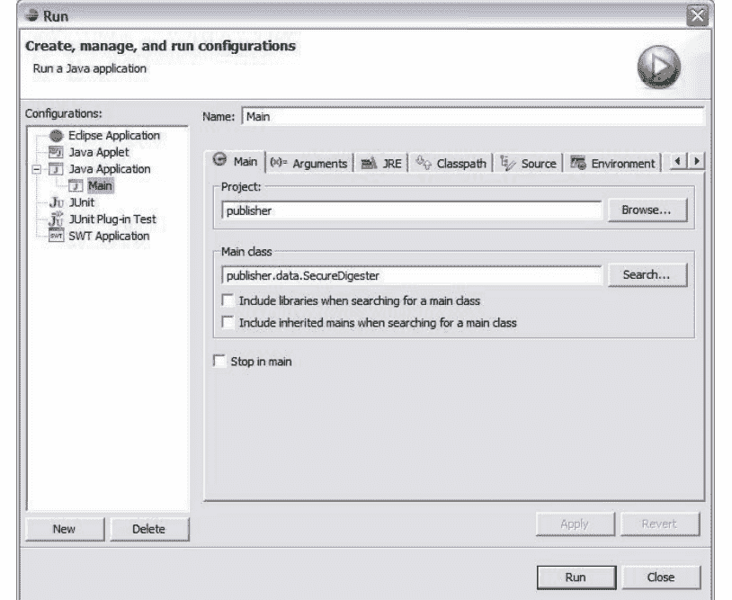

选择`Arguments`（参数）选项页并在`Program arguments`（程序参数）框中输入你想要加密的密码。接下来的截图显示了将字符串`admin`作为待哈希的密码传入的情况。

## Web 应用安全

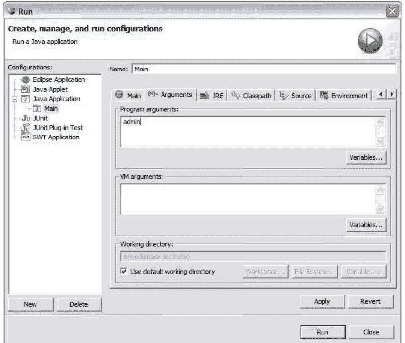

在运行`secure digester`加密密码后，查看控制台（Console）视图的结果。如果你输入的字符串是`admin`，程序将在控制台视图生成以下输出。

```
admin -> D033E22AE348AEB5660FC2140AEC35850C4DA997
```

打开`insertdb.sql`脚本，将用户的密码值替换为`secure digester`产生的十六进制字符串，并运行数据库构建文件以重新构建数据库。

重启`publisher`应用程序并验证应用程序运行正常。

## 案例研究

### Web 应用安全

据估计，2011 年全球网络犯罪损失超过 3880 亿美元，无论大小，企业都对对其物理基础设施的安全以及面向外部的 Web 应用投入了大量关注。虽然大多数物理基础设施已经了安全，但大多数 Web 应用中仍存在许多关键漏洞。在“案例研究”专栏中，我将根据我最近参与的两个修复项目分享一些体会，作为理解 Web 应用漏洞持续趋势背后原因的依据。我还将简要介绍针对 Web 应用安全漏洞的测试与修复，以及用于确保安全的加固和开发技术。

### 什么是 Web 应用？

Web 应用可以定义为通过互联网或局域网等网络访问的计算机程序。Web 应用（通常指网站）是通过 Internet Explorer、Firefox 和 Chrome 等网络浏览器访问的在线活动（如在线零售销售、网页邮箱、社交网络）的人机界面。

由于其本身的性质和实现方式，Web 应用面临着独特且困难的安全问题。Web 应用传统上是为了给“行为良好”的用户提供价值的。鉴于这种预期，Web 应用开发者的精力集中在响应“良好行为”上，并剔除无意的“错误行为”（例如错误的邮编、空字段）。真正引发安全问题的是“蓄意的恶意行为”，以及开发过程中对这种行为后果缺乏关注。

例如，考虑一个在线零售销售应用，用户通过浏览器交互与托管在公司数据中心内的 Web 应用交换数据。用户与托管在数据中心的 Web 应用之间的连接不可避免地绕过了所有物理防护。为了加剧潜在的安全问题，为用户服务的 Web 应用通常直接访问包含所有在线销售应用零售交易信息的数据库。用户与事务数据库之间唯一的防护就是 Web 应用。

当 Web 应用对来自恶意意图用户的非预期信息请求或特殊构造的数据反应不佳时，就会产生 Web 应用安全问题。当这种“混乱”允许对 Web 应用功能的非意图操纵时，“混乱”的 Web 应用可能会变成安全风险。

这种恶意手段的一个经典示例是在预期良性数据时替换数据库命令（SQL 注入）——登录密码字段通常是一个目标，因为其对应的值存储在应用程序数据库中。如果输入数据没有被 Web 应用过滤，用户实际上就有了通过数据库命令运行自己的“微型”查询的能力，可能可以完全访问整个数据库，如果不是整个内部网络的话。

### 本研究的 Web 应用

虽然我在研究中仅引用了两个 Web 应用，但我认为它们代表了目前处于风险中的海量 Web 应用。如果对这些 Web 应用所属的层次进行标记，可能会选择“美国中产阶级”或“专业阶层”。这两个应用都处于具有以下特征的公司中心：

- 收入在 500 万到 1000 万美元之间
- 极度依赖 Web 应用以开展受联邦和州机构“保护”的业务
- 其处理和存储的数据被视为联邦和州机构“保护”
- 如果存储的数据被泄露，将面临巨大的财务风险（如罚款、客户流失）
- 两个 Web 应用都从最初发现安全漏洞到安全修复和重新部署进行了全程跟踪。


### 常见安全风险

最近的研究表明，超过 70% 的 Web 应用包含关键安全漏洞。考虑到任何受损公司可能遭受的财务和时间成本、声誉损失以及潜在的客户流失，这是一个惊人的数字。

对所研究 Web 应用的评估以及与 Web 应用所有者和开发者的对话提供了以下关于与 Web 应用相关的风险因素的见解：

- **Web 应用** – 安全专业人员与网络犯罪分子之间疯狂的军备竞赛往往会让安全的 Web 应用暴露于新发现的攻击之下。其中一个 Web 应用已有五年历史；它构建时，Web 应用安全还不是主流关注点。
- **缺乏安全关注** – 不仅大多数所有者没有意识到潜在的安全问题，而且许多人被他们的 IT 员工误导了，他们认为良好的开发实践足以产生安全的 Web 应用。两个业务所有者都缺乏技术知识，并且对他们的 Web 应用构成的业务和财务风险没有认识。研究中最新的 Web 应用是在过去六个月内由一家声良好的软件开发公司构建的，该公司错误地告诉公司老板该 Web 应用是安全的。
- **没有安全测试专业知识或工具** – Web 应用面临着安全攻击方法的巨大压力，这些方法只有专业安全测试人员使用复杂的人工技术和自动化漏洞扫描工具才能模拟。没有任何 Web 应用进行过安全漏洞测试，而且极少（如果有）开发组织提供执行这些测试所需的工具或专业知识，这并不意外。

根据定义，所有 Web 应用程序漏洞都源于 Web 应用程序软件本身，包括支持性软件组件以及这些支持组件的配置（例如数据库加密）。完整的 Web 应用程序安全必须涵盖这一全范围。

安全测试方法分为三个领域：

- **自动化漏洞扫描** – 自动化安全扫描工具旨在对目标 Web 应用程序模拟安全攻击。扫描器在整个 Web 应用程序上运行对所有已知的 WEB 应用程序攻击的模拟（频繁更新以跟上最近发现的安全攻击方法步调）。
- **手动测试** – 专业网络犯罪分子通常会花费数小时或几天时间探测 Web 应用程序的安全漏洞。白帽等同人员（好人）将使用相同的技能和坚持来识别相同的漏洞，但其目标是修复漏洞，而非破坏数据。
- **代码审查** – 虽然大多数安全测试可以在浏览器端完成（自动化扫描和人工审查），但安全审查可以发现那些只有在 Web 应用程序被攻破后才会表现的问题。例如，安全审查可能会识别出加密不足或由恶意开发者设置的后门（设置后门的时机可以允许开发者在 Web 应用程序运行期间攻破 IT 系统）。

对这两个 Web 应用程序的研究始于这两个程序都已经部署并成为各自业务核心的阶段。数小时的手动安全测试显示，两个 Web 应用程序都容易 SQL 注入攻击（直接访问数据库）。这一信息提醒了两家公司，需要立即处理之前未发现的安全问题。

每个 Web 应用程序都被复制到安全测试环境中并在其中执行了全自动安全扫描。这些扫描显示出缺陷严重的 Web 应用程序，其风险甚至比以前认为的要高。

如果不将安全测试作为软件开发生命周期（SDLC）的一部分，要确保 Web 应用程序的安全（无关键安全漏洞）几乎是不可能的。正如我们在下一节中将看到的，虽然遵循良好的软件开发规范对于创建一个运行良好且安全的 Web 应用程序至关重要，但如果没有相应的功能和安全测试，实现这一目标是非常困难的，甚至不可能。

### 保护应用程序

软件开发与 SQA（软件质量保证）这两个相互交叉的学科与其对应的安全领域可以进行类比。行业认可的 SDLC 标准在这里


### Java 与 Web 设计

主张软件开发与 SQA 之间需要强有力的关联——要求在任何开发项目的整个生命周期内同步考虑这两门学科。

与开发一个运行良好的 Web 应用程序一样，创建安全 Web 应用程序背后的过程必须包含软件开发过程，其中包含结构化的安全方法论和安全测试的引入。

面向安全的开发实践不仅与创建高质量的软件应用程序开发相兼容，而且当执行得当时，两者的整合是无缝的。通过培训和意识，软件开发专业人员可以将安全编码技术作为其日常惯例的一部分。

此外，我观察到，增加安全意识的开发并不会为已经结构良好、专业完成的开发工作显著增加时间或成本。

### Web 应用程序 #1

在研究的两个 Web 应用程序中较老的一个通过手动和自动测试，被发现即使是没有经验的黑客也能进行关键安全攻击的漏洞。由于该 Web 应用程序以公司为中心的特性，决定尽快加固现有的 Web 应用程序。


该第一个 Web 应用程序的初始修复阶段如下：

- **对已知关键安全漏洞进行分级** – 虽然安全测试指出了许多关键安全漏洞，但当务之急是识别出可能被视为高风险的漏洞。选择这些漏洞是因为成功实施安全攻击相对容易，且被破坏的数据具有“受保护”状态。
- **修复高风险安全漏洞** – 在上述分级阶段识别出的每个安全漏洞都得到了修复，以阻止任何针对漏洞的安全攻击。
- **进行代码审查** – 至少有两个软件开发人员（精通标准和安全开发技术）审查了修复后的软件，以确保修复质量并验证没有引入额外的安全漏洞。
- **重测 Web 应用程序** – 重新运行了自动化 Web 应用程序扫描，并与修复前的扫描进行比较。这再次验证了高风险漏洞的修复，以及没有引入额外漏洞的事实。

初始修复阶段结束后，该 Web 应用程序被认为可以防止业余黑客的攻击，并增加了对直接访问应用程序数据库的保护。这比它之前的状态要好得多。

在随后的阶段中，剩余的关键安全漏洞使用上述相同的修复、代码审查和重试循环进行修复。

### Web 应用程序 #2

受研究的第二个 Web 应用程序最近才部署，因此对公司的重要性低于第一个。遗憾的是，第二个 Web 应用程序是由一个团队开发的，该团队不仅缺乏安全开发技能，还缺乏产生运行良好的 Web 应用程序的技能。

由于该 Web 应用程序大部分收集并存储了易受破坏的医疗信息，公司做出了快速决定，立即关闭新网站并用一个“占位”网站进行替换，虽然该网站功能有限，但不会受到会产生“受保护”信息的安全攻击。

第二个 Web 应用程序的开发遵循了 SDLC 方法，并在每个发布点增加了漏洞安全扫描。这些扫描不仅确保了应用程序的安全性，还提高了开发团队的安全意识和技能水平。虽然这不能替代安全开发培训，但对基于代码的安全漏洞的定期提醒教育了开发者如何进行正确的面向安全的开发。

**结论** 尽管本研究的样本量太小，不足以得出任何统计学上有效的结论，但它确实强化了显示所有 Web 应用程序安全失败率为 70% 的统计数据。

此外，两家非常成功的公司的所有者对他们的 Web 应用程序所代表的严重风险毫无所知。虽然似乎没有关于安全“盲目”公司百分比的研究，但这一轶事证据表明这一比例可能非常高。

最后，令人深省的是，考虑到大量依赖其他非常称职开发团队的公司，如果有了安全培训和测试，本可以生产安全的 Web 应用程序，而不是今天这些极其脆弱的产品。


### Java 与 Web 设计

#### 总结

- Java 应用程序安全是一种旨在保护托管在网站上的应用程序以及保护网站本身的安全哲学。
- 授权用户可以在合理时间内获得所需的数据和系统服务。
- Web 应用程序允许访问访问网站最核心的资源，即 Web 服务器和数据库服务器。
- 持久化类通过对持久化类的特化来修改其元对象协议。
- Java 页面和 Servlet 为 Web 开发者提供了多种安全应用程序的机制。
- `SecurityFilter`供 Web 应用程序开发者使用。它为 Web 应用程序提供稳健的安全和自动身份验证服务。

#### 复习题

1. 描述应用程序安全的目标。
2. 定义应用程序漏洞。
3. 如何配置 HTTPS 服务器？
4. 结合示例解释持久化用户类。
5. 你如何理解安全过滤器？

#### 知识检查

1. Struts 用于将你的应用程序转换为 Web 应用程序。
   a. Struts 服务
   b. Web 服务
   c. Java 服务
   d. 浏览器操作
2. `Web.config`文件用于...
   a. 配置服务器端代码后模块被调用的时间
   b. 存储应用程序的全局信息和变量定义
   c. 配置 Web 服务器
   d. 配置 Web 浏览器
3. 随着标题经常评论互联网安全漏洞，什么是用于防止外部未经授权访问公司数据的专用软件术语是什么？
   a. 防火墙
   b. 企业级应用集成 - EAI
   c. Web 分析系统
   d. 中间件
4. 关于 HTTP 协议，下列哪项是正确的？
   a. 目前，HTTP 是最流行的服务传输方案。
   b. HTTP 简单、稳定且部署广泛。此外，大多数防火墙允许 HTTP 流量。
   c. 这允许 XML-RPC 或 SOAP 消息伪装成 HTTP 消息。
   d. 以上都是。
5. 你的应用程序通过互联网与第三方 JSON API 通信。API 使用 HTTPS 连接访问，该连接基于自签名证书。你的应用程序与 API 之间的通信是吗？
   a. 是的
   b. 是的，如果第三方证书可以安全地导入你的应用程序中
   c. 不，使用自签名证书是不可能的

#### 检查你的结果

1. (b) 2. (b) 3. (a) 4. (d) 5. (b)

#### 延伸阅读

1. 《Web 应用安全：初学者指南》，Bryan Sullivan, Vincent Liu
2. https://www.youtube.com/watch?v=XGy-IHIk_Cw

## 索引

### A
抽象窗口工具 (AWT) 201
访问控制列表 (ACLs) 260
算术运算 13
数组元素 50, 55, 56, 80

### B
布尔值 17, 18, 46
字节流 126

### C
`catch`语句 90, 92, 93, 95, 96
通用网关接口 (CGI) 219
计算机语言 101
常量 50
Java 构造函数 42
连续内存 50, 80
`continue`语句 37
跨站请求伪造 (CSRF) 262
跨站脚本攻击 (XSS) 261

### D
数据链路层 (DLL) 230
域名系统 (DNS) 104, 139
域名命名服务 (DNS) 136
动态程序 3

### E
异常处理 84, 148

### F
`FileOutputStream` 126, 128, 131, 133, 134
`finally` 84, 85, 90, 96, 97, 98, 127, 129, 130, 149

### H
超文本传输协议 (HTTP) 230, 232

### I
自增和自减运算符 16, 17
继承 5, 43, 46
输入/输出 (I/O) 126, 148
实例变量 40
`int`数据类型 136
Internet 地址 136
Internet 信息服务 (IIS) 232
Internet 编程 135

### J
Java 异常 84
Java 持久 API (JPA) 268
Java 编程语言 8, 29

### Java 与 Web 设计

### S
Java 程序 89, 102
Java 运行环境 (JRE) 4
JavaScript 4
安全套层 (SSL) 271
单语句 22, 23
流 126, 129, 130, 131, 132, 133, 136, 145
结构化查询语言 (SQL) 258
减法运算符 13

### L
Linux 5
局部变量 20
逻辑链路控制 (LLC) 230

### T
TCP/IP 套接字 139
线程 87, 88, 90, 100, 101, 102, 103, 104, 105, 106, 107, 108, 109, 110, 111, 112, 114, 115, 116, 117, 118, 119, 120, 121, 122, 123, 124, 125, 148

### M
邮件投递代理 (MDA) 235
邮件传输代理 (MTA) 235
消息传输系统 (MTS) 235
多线程 123
传输控制协议 (TCP) 235
传输层安全协议 (TLS) 271
真数组 49

### N
网络 83, 135, 145, 149
数值索引 50

### U
未检查异常 87, 148
统一资源标识符 (URI) 144
统一资源定位符 (URL) 142
用户数据报协议 (UDP) 135

### O
运算符 11, 12, 15, 17, 18, 19, 26

### P
PCI 数据安全标准 (PCI DSS) 266
邮局协议 (POP) 236, 237
前缀和后缀操作 16
编程语言 3, 46

### W
水化学 225
Windows 5
编写并运行 Java。3
一次编写，到处运行 (WORA)。 6

### R
健壮 4, 7

### Java 与 Web 设计

Java 是一种通用的计算机编程语言，具有并发性、基于类、面向对象，并专门设计为尽可能减少实现依赖。Java 通常被编译为字节码，无论计算机架构如何，都可以在任何 Java 虚拟机上运行。Web 设计涵盖了网站制作和维护中的许多不同领域。Web 设计的不同领域包括 Web 图形设计、界面设计、授权（包括标准化代码和专用软件）、用户体验设计以及搜索引擎优化。Web 设计术语通常用于描述与网站前端设计编写相关的流程。在更广泛的 Web 开发范围内，Web 设计与 Web 工程部分重叠。

- 主要特点：
- 以既易懂又在现实实用的方式介绍 Web 设计特性。
- 主题根据学科课程大纲进行逻辑安排。
- 使用简单的语言有助于更好地理解每个章节。
- 在需要的地方提供不同难度的说明示例，以增强学生的兴趣。
- 在每章末尾提供知识检查测试，以加强学生的学习过程。
- 还提供了案例研究、榜样、关键词和示例，以丰富学生的知识。
