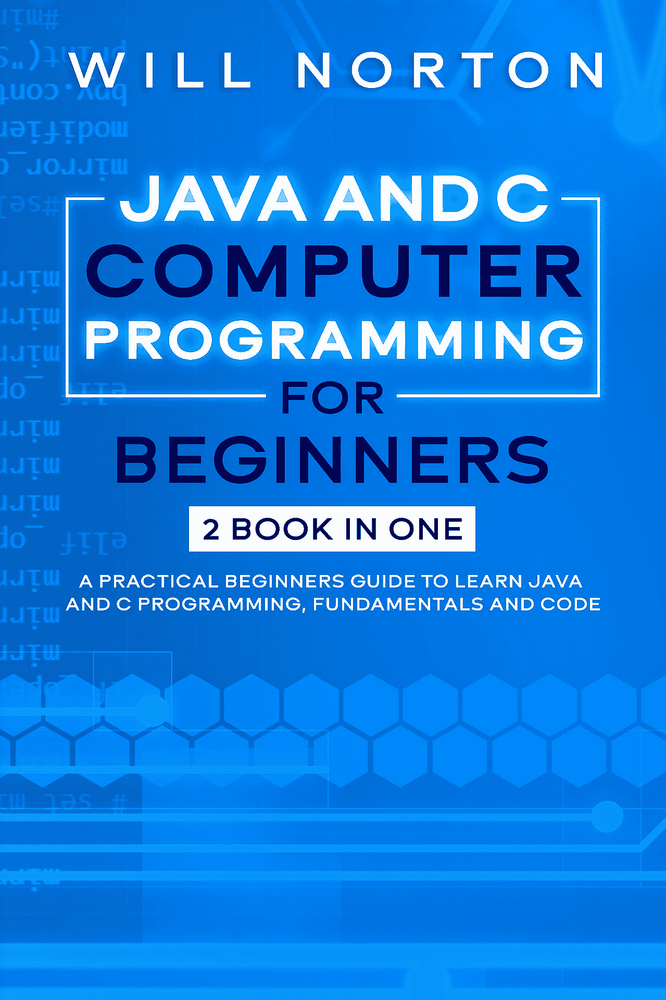
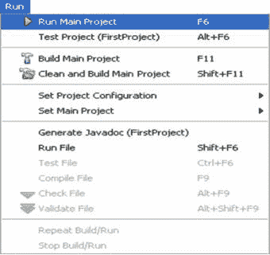
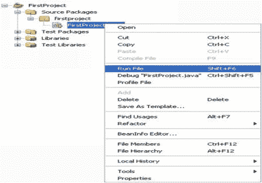
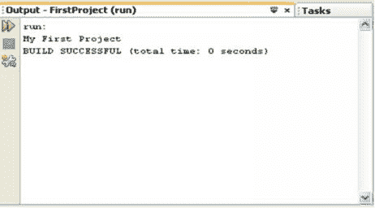

# Java 与 C 计算机编程初学者指南：二合一学习 Java 和 C 编程、基础与代码的实用初学者指南



这是一本由 Will Norton 编写的学习 Java 和 C 编程、基础和代码的初学者实用指南。

## 引言

Java 的历史可以追溯到 1991 年，当时 Haughton、Mike Sheridan 和 James Gosling 想出一种最好用于数字电视开发的编程语言。然而，它被认为超于时代，因此他们基于 C 和 C++ 重新开发了它，使其更易使用。

随着开发，Java 也产生了一些核心原则，这些：

- 它具有可移植性——即可以在尽可能多的平台上运行；
- 它应该是安全且可靠的；
- 人们应该尽可能地连接它，这意味着它对他们来说是熟悉的，尽管初看看起来很复杂，但迟早他们会理解；
- 它应该是动态的，可以在线程中工作，并根据需要进行修改，并且它应该精确执行。

你可以看到，这些核心原则让人们可以享受使用而无需购买许多设备。1995 年，Sun Microsystems 最终发布了 Java 1.0——Java 的诞生，它具有极高的安全性，并且跨网络访问。多年来，发布了更多版本，自 2006 年以来，Java 通过 GNU 通用许可可用——意味着它现在是一种开源编程语言。它的部分内容是私有的且免费提供的，这符合其核心原则。现在开始阅读这本书，你将很快学到 Java！

## 第 1 章：什么是 Java？

Java 是一种由 Sun Microsystems 构建的语言，后来被 Oracle 公司收购。它被设计为可以在支持 Java 的任何操作系统上运行。这就是该语言如此流行的原因，因为开发者只需要编写一次程序，就可以在任何操作系统上运行。世界上大多数应用程序是用 Java 编程语言构建的。大多数服务器端的业务逻辑也是基于 Java。

在本书中，你将学习如何编写像上面的程序，还将学习让你能够开始编写的高级概念。以下是 Java 的一些设计目标：

- 该语言旨在编写一次并在任何操作系统上运行。
- 该语言应该对许多工程原则提供支持。
- 该语言旨在用于开发适用于分布式环境的软件。可移植性是一个重要因素。这就是为什么 Java 能够在 Windows、Linux 和 MacOS 操作系统上运行的原因。国际化支持非常重要。Java 旨在用于编写托管和嵌入式系统的应用程序。

接下来讨论其他设计目标：

### 1.1 强类型检查

Java 是一种强类型语言。定义的每个变量都需要关联到一个数据类型。你现在不需要理解整个程序，但让我们快速看两行代码。

```java
int i=5;
```

在这里，我们定义了一个被称为变量的东西，用于存储值。可以存储的值取决于数据类型。在这个例子中，我们说`i`的类型是`int`或 Integer，这是一种数字数据。

### 数组边界检查

在运行时，Java 会检查数组是否具有所需数量的值。如果尝试访问数组边界之外的值，将抛出一个异常。你现在不需要理解整个程序，但让我们快速看以下代码。

```java
int[] array1 = new int[2];
```

在这里我们声明了一个数组，它是一组整数值。`2`的值意味着我们只能在数组中存储两个值。

```java
array1[0] = 1;
array1[1] = 2;
array1[2] = 3;
```

通过这段代码我们可以看到我们正在向数组分配 3 个值。当你运行这个程序时，你会得到错误，因为程序会发现数组已经超出了两个允许的最大边界。你将在运行时得到下面的错误。

```
Exception in thread "main" java.lang.ArrayIndexOutOfBoundsException: 2
at HelloWorld.main(HelloWorld.java:8)
```

## 第 2 章：为什么 Java 很重要？

接下来，Java 的语法和特征类似于 C 和 C++ 等其他编程语言。如果你有任何之前的编程经验，你会发现学习 Java 是轻而易举。即使你对编程完全是新手，也可以放心，Java 被设计成一种相对容易学习的语言。大多数程序员发现学习 Java 比学习 C 或 C++ 更容易。

Java 还被设计为与平台无关。正如前面提到的，Java 代码首先被编译成字节码，可以在任何带有 Java 虚拟机的机器上运行。因此，通过 Java，你可以编写一次代码并在任何你想运行的地方运行。

### 运算符概述

- 逻辑运算符
- 位运算符
- 关系运算符
- 算术运算符

#### 基础概念

与其他计算机语言一样，Java 定义了一系列额外的运算符列表，用于处理某些特定场景。在学习 Java 编程语言（或任何编程语言）时，在开始之前你必须理解五个基本概念。这五个基本概念包括：

1. 变量
2. 数据结构
3. 控制结构
4. 语法
5. 工具

每个概念都将从初学者水平进行彻底解释，以确保能够理解。

#### 分隔符

它们不适用于高级抽象：请注意，许多程序使用了低级结构，这些结构主要用于低级抽象。这些编程语言的常用方法是关注机器——如何让计算机执行某些操作，而不是这些功能如何帮助解决用户的问题。这些语言处理微小的细节，这已经超出了高级抽象的范围，而高级抽象是我们今天常见的方法。在低级抽象中，数据结构和算法是分开的，而在高级抽象中，它们被视为一个整体。

#### 字面量

提到 Java 中的字面量时，我们指的是以人类可读的形式出现的固定值。我们可以说数字`200`是一个字面量。大多数情况下，字面量可以是常量。字面量在程序中很重要。事实上，大多数 Java 程序都使用字面量。我们在书中已经讨论的一些程序也使用了字面量。Java 中的字面量可以属于各种原始数据类型。

每个字面量的显示方式由其类型决定。正如之前提到的，我们将字符常量括在单引号中，例如`'c'`和`'%'`。我们定义整数字面量时不包含小数部分。例如，`12`和`-30`是整数字面量。

浮点字面量应该包含小数点加小数部分。`12.389`是浮点字面量。Java 还允许对浮点字面量使用科学计数法。整数字面量包含`int`值，可以使用`short`、`byte`和`char`变量来初始化它们。

### 注释

当这种情况发生时，我们称为注释。在程序的运行阶段，注释是无关的。这意味着你可以使用注释功能来说明或解释你创建的代码想要实现的目标。你可以通过输入两个斜杠然后写注释来实现。

```java
//在此处放置你的单行注释
```

你可以通过以下任一种方式拥有多行注释：

```java
//我们将把
//注释分成两行
```

或者

```java
/*
```

此注释跨越了两行。如果你查看上面的注释，你会注意到它以`/*`开头并以`*/`结尾。此外，如果你查看前一张图片（图 8），你会注意到有些注释以单个正斜杠和两个星号（`/**`）开头，以一个星号和一个正斜杠（`*/`结尾；这被称为 Javadoc 注释。

## 第 4 章：什么是 Java 虚拟机？


虚拟机是一种模拟物理机器软件。在传统的编程语言中，代码被编译为特定平台的机器语言。在 Java 中，代码被编译为一种称为`bytecode`的虚拟机语言。`JVM`充当字节码和底层物理机器之间的中介。每个支持 Java 的平台都有其自己的`JVM`实现。Java 应用程序是可移植的，因为每个`JVM`都遵循一个标准接口。

`JVM`和标准库的发行包称为 Java 运行环境（`JRE`）。`JRE`及其开发工具（如编译器和调试器）的发行包称为 Java 开发工具包（`JDK`）。

回到我们之前介绍的初始问题（即让计算`add 1 + 1`），现在我们有一组指令（即你的算法）来解决这个问题，你接下来需要做的是将它们翻译成计算机可以理解的指令。记住，计算机不说英语或任何其他人类语言。正如之前解释过的，你需要将所有指令翻译成一系列二进制信号。但完成所有翻译工作将花费你大量的时间。记住，每个字符至少由 8 位组成。之后，你还需要将它们串成实际的指令来访问计算机内存，然后进行数学运算等——简而言之，这是一个巨大的混乱。没有人想处理那些事情。

所以，你说一种语言，而计算机说另一种语言。那么，你如何让双方在中间点会合呢？这就是 Java 这样的编程语言大显用场的地方。将编程语言想象成计算机和人类都能理解的中间语言——嗯，可以这么说，我们稍后会澄清背后的细节。

这里的目标是让计算机理解你的指令。在实现这一点之前，会发生两个阶段。第一步是使用编程语言编写你的算法。是的，一种你和机器之间的中间语言。嗯，尽管已经是 Java 代码，计算机仍然无法完全理解你写的所有内容。这就是第 2 步之处（记住是两步）——你的 Java 代码将由一个名为`compiler`的程序进行处理。

正如我们在介绍 Java 平台组件时解释的那样，`compiler`是一个将你的编程代码翻译成机器可读指令（即你的计算机可以理解的指令）的程序或应用程序。实际上，后台还会发生一些事情，例如预编译步骤以及访问 Java 库（之前提到的），然后通过`assembler`实际翻译成二进制代码，并向你写的原始代码中添加更多行代码。再次，这一切都是在后台发生的。作为一名 Java 程序员，你不应该担心这些，因为 Java 平台是为了处理所有这些内容而开发的。了解这些很有趣，也许当你的编程技能提高后，你就可以自己去研究底层编程细节了。

在我们直接开始编写 Java 编程代码之前，还有最后一点信息你需要了解。那就是 Java 虚拟机。关于今天不同设备中提供的不同硬件和软件，有一个反复出现的问题。手机的硬件软件组件的行为与你的汽车或笔记本电脑不同。更复杂的是，不同处理器芯片、不同操作系统和不同电气元件阵列的组合意味着编译（或翻译）你所编写代码的不同方式。你需要针对你正在编程的设备平台制作机器码。

### 那么，什么是 Java 虚拟机或`JVM`？

它是一个设计在任何设备或机器上运行计算机程序的程序或应用程序。它在 1995 年发布时是一个极具革命性的程序，直到今天它仍然是一个巨大的创新。它解决了之前描述的困境。将`JVM`想象成计算机内部的一种虚拟计算机。它实际上有两个主要功能。

第一个是在任何设备、任何操作系统或软件上运行任何程序。这被总结为“编写一次，到处运行”的原则——随着经验的增加，你会听到很多这句话以及其他的编程准则。另一个功能是分配内存空间——它非常擅长管理计算机内存。`JVM`加载到计算机的内存（`RAM`）中。它是独立的，这意味着它可以运行在任何支持 Java 的设备上——嗯，今天几乎每个设备都支持 Java。它不会为现有的每种机器、芯片和软件组合生成代码。那是不可能的。即使你尝试，也会让 Java 变成一个庞大的系统，因为你必须适应所有类型的硬件、软件和操作系统。

那么，`JVM`是如何做到的？它产生自己独特的代码格式，称为`bytecode`。注意，与其他编程语言不同，当你的 Java 源代码被编译时，它并不会直接翻译或转换为机器可读的语言——嗯，再次是因为目标不是创建一种只能在一个平台上运行的特定代码。由`compiler`产生的 Java `bytecode`是一组机器语言形式的指令。`Bytecode`将在任何安装了`JVM`的计算机上运行。这意味着`JVM`不仅运行 Java 代码和 Java 程序，它还可以运行用其他语言编写的程序——只需要将其翻译（即编译）成字节码即可。

## 编写你的第一段 Java 代码

在可以在你的计算机上编写和运行任何 Java 程序之前，你需要先安装它。要安装 Java 运行环境（`JRE`）（即包含`JVM`、Java 库和所有其他文件的整个 Java 系统），你需要通过[点击此处](https://www.oracle.com/java/javase/index.html)进入 Oracle 官方网站。这些页面上还会提供如何下载`JRE`的说明。某些说明将包括禁用你的防火墙以及预期结果。现在，你的计算机可能会提示你电脑上没有安装 Java（运行 Java 程序的系统），然后你可以通过[点击此处](https://www.oracle.com/java/help/download.xml)下载。注意：`JRE`是你编写 Java 程序所需的，但你的计算机可能会提示你电脑上没有安装 Java（运行 Java 程序的系统），你可以通过[点击此处](https://www.oracle.com/java/help/download.xml)下载。如果某些链接不起作用或你被带到了不同的页面，只需搜索“JRE download”并点击 [www.oracle.com](http://www.oracle.com) 上的链接。

### 必要的工具

现在你需要一个文本编辑器来编写你的第一个 Java 程序。你可以使用系统自带的任何文本编辑器（例如，如果你使用的是 Windows，可以使用`Notepad`）。如果你想要有更多编程支持，你也可以使用`Notepad++`。然而，如果你想开发应用程序、测试编程代码并拥有让 Java 编程变得容易许多工具，你需要一个名为`IDE`的程序（集成开发环境）。IDE 是一个带有程序员所需的大部分设施和工具的应用程序。你的 Java 代码通常保存为`.java`文件。`compiler`将处理该文件并返回一个`.class`文件，这是一个你可以运行 Java 代码的文件。

### IDE 功能

`IDE`通常带有自动补全和文本高亮功能。它还可以用于构建执行文件。

### 调试 (DEBUGGING)

调试是`IDE`的另一个重要功能。调试指的是定位和移除 Java 代码中的错误。没有人期望你是完美的，但编程错误会阻止你的代码运行。`IDE`具有调试工具帮助你快速发现错误以便你编辑它们。

## 最佳的 Java IDE

有很多可以用于 Java 编程的`IDE`。我们无法列出所有的，所以我们将介绍前三个`IDE`。

1. **NetBeans**：`NetBeans`发布于 1997 年，可以在 Windows、Solaris、Mac OS 和 Linux 等操作系统上运行。NetBeans 实际上是 Java 的官方`IDE`。就像 Java 一样，NetBeans 是开源的这意味着这意味着免费下载和使用的。它具有语义和语法高亮功能。它还允许你重构源代码（即使其更高效而不产生任何编程问题）。重构是为了提高程序的性能或更新到最新标准。

2. **IntelliJ IDEA**：`IntelliJ IDEA`发布于 2001 年 1 月。它运行在 Windows、Mac OS 和 Linux 上。这个`IDE`有两个不同的版本。第一个是商业版（即你需要付费的版本），另一个是 Apache 许可版。这是为认真的程序员设计的`IDE`——在你获得大量 Java 编程经验后，我们建议使用这个集成开发环境`IDE`。`IntelliJ IDEA`的独特且强大的功能包括流分析和跨语言重构。

3. **Eclipse**：`Eclipse`是另一个集成开发环境。事实上，它是专门为 Java 程序的开发设计的。嗯，它也支持其他编程语言，使其成为一个非常强大的工具。如果你是一个初学者，那么以后你可能会考虑这个`IDE`。现在有两个`Eclipse`版本：一个是云版本称为`Eclipse Che`，另一个是可以在计算机上下载的桌面版本。这两个版本都带有一整套工具、应用程序和插件，让编程工作变得容易许多。它甚至带有自定义的`compiler`。这个`IDE`包含了创建和改进插件所需。

## 第 5 章：Java 程序的基本结构


### 包 (Package)

在第一行，我们有语句`package helloworld;`。这个语句告诉编译器 Java 文件属于`helloworld`包。`package`只是类和接口的组合。当我们在文件顶部写`package helloworld;`时，我们要求编译器将此文件包含在`helloworld`包中。编译器将创建一个名为`helloworld`的文件夹并将文件保存其中。属于同一个包的文件存储在同一个文件夹中。如果你导航到`NetBeansProjects`文件夹，你会找到一个名为`HelloWorld`的文件夹。`HelloWorldProject`文件夹通常位于你的`Documents`文件夹。如果你找不到这个文件夹，尝试使用计算机的搜索功能搜索它。在`HelloWorld`文件夹中，你会找到一个包含`helloworld`文件夹的`src`文件夹。除了我们创建的包，Java 还提供了许多我们可以使用的预创建包。例如，输入输出代码封装在`java.io`包中，而实现图形界面组件（如按钮、菜单等）的代码封装在`java.awt`包中。我们需要将这些包导入到程序中。我们以后会学习如何这样做。

### main() 方法

`main()`方法是所有 Java 应用程序的入口。每当 Java 应用程序启动时，`main()`方法都是第一个被调用的方法。注意我们`main()`方法括号内的`String[] args`单词？这意味着`main()`方法可以接受字符串数组作为输入。在我们的示例中，`main()`方法包含两行代码。第一行`//Print the words Hello World on the screen`被视为注释，会被编译器忽略。

## 第 6 章：Java 代码结构

在图中，你应该注意到包名在最。此外，你应该注意分号是结束行的行的符号。分号是重要的，如果你省略了它，程序将无法编译。

```java
package firstproject;
```

接下来是类名

```java
public class FirstProject {}
```


你可以在代码开始处使用左括号，并使用右括号结束代码 `{curly code segment}`。然而，你应该注意，左右括号内部的任何内容都是该代码段的一部分。此外，在左右括号内部的任何内容都是代码段。如下所示：

```java
public static void main ( String[] args )
```

比任何事情都重要的是单词 `main`。为什么？因为每当任何 Java 程序启动时，它首先寻找名为 `main` 的方法。简单来说，一个方法就是一段代码。程序随后执行大括号内的代码。如果你的代码中没有 `main` 方法，可能会得到错误消息。然而，由于这是你程序的入口点，即使你是完美的，编程错误也会阻止你的代码运行。由于这种原因，你可能会漏掉它。代码的 `public` 部分（即蓝色部分）意味着该方法在类之外是可见的。另一方面，`static` 意味着创建新对象是不必要的，而 `void` 意味着没有返回值，并且命令随之而来。

### 如何在 Linux、Windows 和 Mac 上下载和安装 Java

查看下图。

图 10

在 NetBeans 工具栏中，你会注意到一个“绿色”箭头；你可以用它来运行程序。

图 11

你也可以通过导航项目窗口运行程序。这对于确保正确的源代码运行特别有效。为了这一点，你需要点击项目窗口中的 java 源文件，然后右键执行命令。见下图。

图 12

如果你使用我们代码中的任何程序方法，你应该得到类似于图 13 的输出！

图 13

在图 13 中，你可以看到第一行是运行命令。第二行是我们的代码 `My Project`。如果你对某些内容不确定并想运行，只需点击图 13 中的箭头。

## 第 7 章：数据类型和变量


Java token 是比其他整数小的值。这些数字将落在 -32768 到 32767 的值之间。我一直使用的代码不适用于 `shorts`，相反，我将需要使用 `short` 函数，以确保值落在设定的限制范围内。大值将存储在 `double` 值中，并与浮点值一起。如果我可以使用浮点数，则不需要使用 `double`。当我存储一个浮点变量时，我需要在数值的末尾加上一个字母。这个值应该是 `f`，因为它是一个浮点数。

简而言之，这就是面向对象编程的意义：一种编程方式，允许程序员使用预定义的类，以便更容易描述和使用它们的内部函数。当然，使用 Java 的主要原因之一是专注于面向对象编程。面向对象编程（或 `OOP`）是一种编程语言，允许程序的代码围绕数据而不是函数组织，这被称为过程化编程。这些数据被组织成被称为 `objects` 的东西，因此被称为面向对象编程。对象是由 `classes` 创建的。与其为每个数据簇声明一组变量，他们只需要使用预制好的 `class` 并创建一个新的 `object`。`class` 的属性是原始数据，这些是它拥有的描述符。第二个标准是对象的 `method`。这种 `method` 是类内部描述如何交互的逻辑序列。为了更清楚，假设有一个 `Human` 类。这个 `class` 将具有身高、性别等属性。`human` 类还可以有 `run`、`walk` 和 `talk` 等方法。这些组件构成了 `human` 类。现在类已经定义了，程序员如果愿意，可以使用 `human` 类作为蓝图创建一个对象，并赋予特定的身高、性别和种类。调用 `Human` 类。

### Java token

Java token 是比其他整数小的值。这些数字将落在 -32768 到 32767 的值之间。我一直使用的代码不适用于 `shorts`，相反，我将需要使用 `short` 函数，以确保值落在设定的限制范围内。大值将存储在 `double` 值中，并与浮点值一起。如果我可以使用浮点数，则不需要使用 `double`。当我存储一个浮点变量时，我需要在数值的末尾加上一个字母。这个值应该是 `f`，因为它是一个浮点数。

### 运算符概述

* 逻辑运算符

* 位运算运算符

* 关系运算符

* 算术运算符

与其他计算机语言一样，Java 拥有一组定义的额外运算符，用于处理某些特定场景。在学习 Java 编程语言（或任何编程语言）时，在开始之前必须理解五个基本概念。这五个基本概念包括：

1. 变量

2. 数据结构

3. 控制结构

4. 语法

5. 工具

每一个概念都将以初学者水平进行彻底解释，以确保它们被理解。

#### 分隔符

它们不适用于高层抽象：请注意，许多程序使用了低级构建结构，这些构建结构主要用于低级抽象。这些编程语言的常用方法是关注机器的——如何让计算机执行某些操作，而不是这些功能如何帮助解决用户的问题。这些语言处理的是微的细节，这已经超出了高层抽象的范围，而这是我们今天看到的更常见的方法。在低级抽象中，数据结构和算法是分开的，而在高层抽象中，它们被视为一个整体。

#### 字面量

涉及到 Java 中的字面量时，我们指的是以人类可读的形式出现的固定值。我们可以说数字 `200` 是一个字面量。大多数时候，字面量可以是常量。字面量在程序中很重要。事实上，大多数 Java 程序都使用字面量。我们在书中已经讨论的一些程序使用了字面量。Java 中的字面量可以属于各种原始数据类型。

每个字面量的显示方式由其类型决定。正如之前提到的，我们用单引号括字符常量，例如 `'c'` 和 `'%'`。我们定义的整数字面量不涉及小数部分。例如，`12` 和 `-30` 是整数字面量。浮点字面量应该包含小数点加小数部分。`12.389` 是浮点字面量。Java 还允许对浮点字面量使用科学计数法。整数字面量包含 `int` 值，任何人都可以用 `short`、`byte` 和 `char` 变量对其进行初始化。

### 注释

当这种情况发生时，我们称之为注释。在程序的运行阶段，注释是无关紧要的。这意味着你可以使用注释功能来说明或解释你正在创建的代码想要什么。你可以通过输入两个斜杠后跟注释来实现。这是一个示例：

```
//在此处放置你的单行注释
```

你可以通过以下任一方式拥有多行注释：

```java
// 我们将把
// 注释分成两行
```

或者

```java
/*
多行注释
*/
```

此注释跨越了两行。*/如果你查看上面的注释，你会注意到它以 `/*` 开头，以 `*/` 结尾。此外，如果你查看前一张图片（图 8），你会注意到有些注释以单个正斜杠和两个星号（`/**`）开头，但以一个星号和一个正斜杠结束；这被称为 Javadoc 注释。

#### 什么是变量（Variables）

另一方面，变量是一个包含特定数据类型及其被赋值或接收的值的“对象”。它之所以被称为变量，是因为其中包含的值可以根据它在代码中的用法、程序员如何声明其值，甚至程序用户选择如何与其进行交互而发生变化。简而言之，变量是数据类型的存储单元。访问变量允许程序员方便地标记并调用手头现的存储值。

#### Java 中变量的类型

Java 要求程序员使用声明语句，即用于声明变量并通过指定特定数据类型和名称来定义它们的代码行。Java 有一种处理变量的特殊方式，即将变量定义为包含特定类型和数值信息的容器，这与 Python 等某些语言不同，Python 只需要声明变量，变量就可以动态更改其类型；Java 变量是静态的，一旦声明，就会保留其类型。

```
Int number = 20;
Boolean completed = true;
String hello = “Hello World!";
```

声明的语法在之前的示例中可见，变量类型在前，然后是变量名，最后是值。同样注意，声明语句可以在一行中由多个声明，如下例所示：

```
Int number = 20, Boolean completed = true, string hello = “Hello World!”;
```

Java 变量可以在开始时不赋任何值进行声明；在这些情况下，Java 选择用特定的默认值声明这些变量，例如：

```
Byte a;
Short num;
Boolean answer;
```

结果将分别产生值 0、0 和 false。更完整的默认值列表如下：`byte`、`short`、`int` 和 `long` 数据类型都将产生默认值 0，而 `float` 和 `double` 数据类型将具有默认值 0.0，`char` 数据类型将产生 ‘u\00000’值，`string` 或任何其他对象将具有 null 默认值，所有 `Boolean` 都将以 false 默认值开始。在 Java 中，变量在声明时是静态的，这意味着程序员必须定义变量将包含的数据类型。为了说明，如果我们想使用变量 `num` 来存储一个数字，我们必须先声明变量：`int num ` ，然后才能赋值，例如 `num = 10`。上述过程通常被称为“赋值语句”（assignment statement），其中值根据程序员的声明被赋值给变量。

然而，Java（事实上实际上是大多数编程语言）工作原理的一个显著特点是，在赋值语句中（例如我们的示例 `num = 10`），存储的实际值是等号右侧的值，即值 10，而 `num` 只是调用该存储存储的“标记”。这就是为什么许多 Java 程序员倾向于使用“获取”（getting）一个值的术语而不是“赋值”（assigning）的原因，尽管在大多数情况下，这两个词可以互换使用，且在某些少数情况之外，功能基本相同。然而，请注意，一旦值被赋值给变量，就需要执行函数才能使变量内部的数据更改其数据类型。

#### 变量的命名

创建变量是一项简单的任务，特别是考虑到 Java 程序员倾向于根据数据类型或变量将存储的内容来创建和命名它们。然而，在命名这些变量时有几个规则，否则 Java 将无法识别它并导致错误信息。变量名的主要限制是它不应以特殊字符（如下划线）或数字开头。但是，变量名可以是字母、数字等字符甚至是下划线，只要下划线不放在开头。不能使用其他字符，例如 `#` 甚至 `$`，因为这些特殊字符在 Java 中有不同的用途，因此在变量名中不会被识别。

虽然这些是主要规则，但在命名变量时有一些提示：

- 变量名应该是具有描述性的，因为在较长的代码中，可能很难记住“x”是做什么用的。像“count”或“output”这样的变量名比使用通用的“x”或“y”更容易记忆，并将有助于避免混淆。

- 除了具有描述性外，如果变量名保持相对较短，变量将更容易使用。虽然像 `banking_information_account_records` 这样的变量名非常有描述性，但在程序中需要重复输入它会非常累，而且较长的变量名会增加拼写错误的概率，从而导致代码中的错误。

- 同样注意，Java 变量的习惯一直是写成全小写字母，虽然对大小写没有限制，但保持小写可以简化问题，因为漏掉大写可能会导致变量无法识别，因为 Java 将大写字母读取为与小写字母完全不同的字符。

#### Java 原始类型（primitive types）

#### 方法命名规范（Method Naming Conventions）

我们将重新回顾 Java 中的命名规范，因为你将使用成员方法。Java 编程中的方法执行操作，它们还接收调用者提供的任何参数，并且还可以向调用者返回操作结果。

以下是声明方法的语法：

```
[Access Control Modifier] Return Type methodName ([set of parameters])
{
    // body of the method
}
```

在你要编写的方法命名时，有几条规则需要记住：

- 方法名始终是动词或更具体地说是动词短语（这意味着你可以使用多个单词来命名它们）。

- 方法名的第一个单词应该是全小写字母，其余单词应遵循驼峰命名法（camel case）。这里有一个例子：`writeMethodNames()`。

现在，你应该记住动词用于方法名，它们表示一种动作，而名词用于变量名，它们表示某种属性。

#### 在代码中使用构造函数（Constructors）

我们将介绍一些与面向对象编程相关的一些细节。如之前所述，构造函数看起来像方法，你完全可以考虑并将其视为 Java 中的一种特殊方法。然而，构造函数在几个方面仍然与方法不同。构造函数的名称将与类名相同。使用关键字或运算符 `new` 来创建构造函数的新实例并同时对其进行初始化。这里有一个使用 `Employee` 类以及各种初始化方法的示例：

```
payrate1 = new Employee();
payrate2 = new Employee(2.0);
payrate3 = new Employee(3.0);
```

构造函数还会隐式地返回 `void` —— 这意味着它没有返回类型。你不能在构造函数的体内放置返回语句，因为编译器将其标记为错误。调用构造函数的唯一方法是通过使用 `new` 语句。我们已经在上面的示例中为你提供了几种调用构造函数的方法。最后一个区别是构造函数不能被继承。回到上面提供的示例——第一行包含了 `Employee()`，它被称为默认构造函数。如你所示，它没有参数。默认构造函数的作用是将成员变量初始化为特定值。在上面的示例中，成员变量 `payrate1` 被初始化为它的默认值。构造函数也可以被重载吗？是的，它们可以。

`byte`、`short`、`int` 和 `long` 数据类型都将产生默认值 0，而 `float` 和 `double` 数据类型将具有默认值 0.0，`char` 数据类型将产生 ‘u\00000’值，`string` 或任何其他对象将具有 null 默认值，所有 `Boolean` 都将以 false 默认值开始。在 Java 中，变量在声明时是静态的，这意味着程序员必须定义变量将包含的数据类型。为了说明，如果我们想使用变量 `num` 来存储一个数字，我们必须先声明变量：`int num ` 然后才能赋值，例如 `num = 10`。上述过程通常被称为“赋值语句”，其中值根据程序员的声明被赋值给变量。

然而，一个显著注意的是，在赋值语句中（例如我们的示例 `num = 10`），存储的实际值是等号右侧的值，即值 10，而 `num` 只是调用该存储存储的“标记”。这就是为什么许多 Java 程序员倾向于使用“获取”（getting）一个值的术语而不是“赋值”（assigning）的原因，尽管在大多数情况下，这两个词可以互换使用，且在某些少数情况之外，功能基本相同。然而，请注意，一旦值被赋值给变量，就需要执行函数才能使变量内部的数据更改其数据类型。

构造函数还会隐式地返回 `void` —— 这意味着它没有返回类型。你不能在构造函数的体内放置返回语句，因为编译器将其标记为错误。调用构造函数的唯一方法是通过使用 `new` 语句。我们已经在上面的示例中为你提供了几种调用构造函数的方法。最后一个区别是构造函数不能被继承。回到上面提供的示例——第一行包含了 `Employee()`，它被称为默认构造函数。如你所示，它没有参数。默认构造函数的作用是将成员变量初始化为特定特定值。在上面的 示例中，成员变量 `payrate1` 被初始化为它的默认值。构造函数也可以被重载吗？是的，它们可以。

结果将分别产生值 0、0 和 false。更完整的默认值列表如下：`byte`、`short`、`int` 和 `long` 数据类型都将产生默认值 0，而 `float` 和 `double` 数据类型将具有默认值 0.0，`char` 数据类型将产生 ‘u\00000’值，`string` 或任何其他对象将具有 null 默认值，所有 `Boolean` 都将以 false 默认值开始。在 Java 中，变量在声明时是静态的，这意味着程序员必须定义变量将包含的数据类型。为了说明，如果我们想使用变量 `num` 来存储一个数字，我们必须先声明变量：`int num ` ，然后才能赋值，例如 `num = 10`。上述过程通常被称为“赋值语句”，其中值根据程序员的声明被赋值给变量。

然而，一个显著注意的是，Java（事实上实际上是大多数编程语言）工作原理的一个显著特点是，在赋值语句中（例如我们的示例 `num = 10`），存储的实际值是等号右侧的值，即值 10，而 `num` 只是调用该存储存储的“标记”。这就是为什么许多 Java 程序员倾向于使用“获取”（getting）一个值的术语而不是“赋值”（assigning）的原因，尽管在大多数情况下，这两个词可以互换使用，且在某些少数情况之外，功能基本相同。然而，请注意，一旦值被赋值给变量，就需要执行函数才能使变量内部的数据更改其数据类型。

- `+` 代表加法

- `-` 代表减法

- `*` 代表乘法

- `/` 代表除法

- `%` 代表取模

- `++` 代表自增

- `--` 代表自减

运算符如 `+`、`-`、`*` 和 `/` 的功能与其他语言中的其他运算符相同。我们已经看到 JavaScript 具有处理数字的能力。因此，它也能够处理与数字数据类型配合使用的运算符。让我们详细地查看每一个运算符。

### 算术运算符

这些是用于处理数字的运算符。最常用的运算符如下所示，随后还附带了如何应用的示例。运行此程序后，输出如下：

#### JavaScript 程序

第一个值是 5

第二个值是 10

加法运算符 = 15

减法运算符 = 5

乘法运算符 = 50

除法运算符 = 5

自增运算符 = 6

自减运算符 = 5

取模运算符 = 5

### 赋值运算符

这些运算符用于根据操作数的值来确定条件的值。JavaScript 中可能的关系运算符如下所示。如果条件求值结果为 `true`，则返回值 `1`，否则返回值 `0`。运行此程序后，输出如下：

#### JavaScript 程序

第一个值是 5

第二个值是 10

数字是否相等 = false

数字是否不等 = true

x 是否小于 y = true


x 是否大于 y = false

x 是否大于或等于 y = false

x 是否小于或等于 y = true

### 逻辑运算符

这些是用于根据操作数的值来确定条件的值运算符，其中操作数是布尔值。JavaScript 中可能的逻辑运算符如下。运行此程序后，输出如下：

#### JavaScript 程序

第一个值是 true

第二个值是 true

第三个值是 false

x AND y = true

y AND z = false

z AND x = false

z AND z = false

下表显示了基于操作数值的 `OR` 运算符的逻辑运算符。运行此程序后，输出如下：

#### JavaScript 程序

第一个值是 true

第二个值是 true

第三个值是 false

x OR y = true

y OR z = true

z OR x = true

z OR z = false

下表显示了基于操作数值的 `NOT` 运算符的逻辑运算符。

### 赋值运算符

这些是用于使赋值操作更简单的运算符。JavaScript 中可能的赋值运算符如下。现在让我们详细查看我们如何实现这些运算符。运行此程序后，输出如下：

#### JavaScript 程序

第一个值是 5

第二个值是 6

`i+j` 的值是 11

`i+=j` 的值是 11

`i-=j` 的值是 5

`i*=j` 的值是 30

`i/=j` 的值是 5

`i%=j` 的值是 5

### 位运算符

这些是用于对操作数进行位操作的运算符。运行此程序后，输出如下：

#### JavaScript 程序

第一个值是 5

第二个值是 6

x AND y 的值是 4

x OR y 的值是 7

NOT x 的值是 -6

x XOR y 的值是 3

左移的值是 10

符号右移的值是 2

逻辑右移的值是 2

## 第 8 章：Java 数据结构与算法


为了更清楚这一点，假设有一个类 `Human`。这个 `class` 将具有身高、体重、性别、种族等属性。`human` 类还可以拥有 `run`、`walk`、`talk` 等方法。这些理论组件构成了 `human` 类，它是对象的蓝图。现在类已经定义好了，程序员如果愿意，可以使用 `human` 类作为蓝图创建一个对象。他们可以调用类 `Human` 并填充（populate）它的属性，赋予它特定的身高、体重、性别和种族。

此外，对象已经具有内置函数，如 `run`、`walk` 和 `talk`，因此在创建对象时（例如从 `Human` 类创建一个名为 `Mike` 的对象），它包含了运行、行走和说话的功能，不需要程序员再次编写这些特定函数，因为它们在创建的对象中是“固有”的。简而言之，这就是面向对象编程的意义：一种编程方式，允许程序员利用预定义的类，从而更容易地描述它们并使用它们的内部或内置函数来操作它们。

假设读者不是编程的完全新手，并且已经通过 C 或或其他面向过程的语言接触过编程世界，那么下一个逻辑问题就是：为什么要使用面向对象编程？嗯，它的主要优势之一是从长远来看，它可以节省时间。在更简单的算法和程序中，过程化编程通常更快、更直接；程序员不需要构建和定义类并根据该类创建对象，他们只需要简单地声明必要的变量并编写函数，并创建算法来解决代码需要处理的问题。

然而，当涉及到更复杂的程序需要更复杂的解决方案时，这就是面向对象编程开始发挥异彩的地方，也是它展现实力的地方。在很多程序中，会有某些需要将多个“对象”或数据簇聚集在一起，程序员将以某种方式处理它们。这正是“类”要解决的问题。他们不需要为每个数据簇声明一组新变量，只需要利用预先制作的“类”并创建一个新的“对象”。让我们看看这在实践中是如何运作的。如果一个程序员用过程化的方式编写国际象棋游戏，他们将必须手动描述每个棋子：十六个兵、四个骑士马、四个车车、两个皇后和两个国王。但是，如果程序员使用面向对象编程，不需要编写十六个兵、四个骑士马、四个车车、两个皇后和两个国王，他们只需要编写六个类：每个类描述一个棋子。程序员现在可以简单地在每个类中包含移动函数，并用属性描述它们的位置：它们是白方的兵还是黑方的皇后兵，这些都可以通过“兵”类的“属性”部分进行插入。程序员不需要写三十个代码块，只需要写六个。现在这变得容易得多、更短，而且更加优雅。

## 第 9 章：数组


数组是元素的序列；每个元素必须与一个或多个位置相关。元素是内存位置组，每个位置存储一个数据项。索引是非负整数；在数组的情况下，它们用于标识具有特定索引的元素。你可以将两者之间的关系比作邮箱如何识别特定街道上的特定房屋。通常，一个元素将有一个索引，但有时会有多个。每个元素拥有的索引数量就是数组的维度。我们将从查看一维数组开始；稍后我们将转向多维数组。Java 对数组有完全的支持。数组中的每个元素将占据相同的大小，具体大小取决于元素的数据类型。在此阶段还需要注意的是，数组中的每个元素都具有相同的数据类型。同样重要的是，你不能调整 Java 数组的大小；它们是固定大小的，一旦创建就无法更改。如果你需要数组的大小不同，你需要创建一个正确大小的新数组，然后从第一个数组将所有需要的元素复制到新数组中。

### 一维数组

一维数组是所有数组中最简单的。在这类数组中，一个元素与一个索引相关，数组用于在列表中存储数据项。我们可以使用三种单独的技术来创建一维数组：

- 仅使用初始化器
- 仅使用 `new` 关键字
- 同时使用初始化器和 `new` 关键字

#### 仅使用初始化器

使用初始化器创建一维数组所需的语法是 `{expr, expr}`。这种语法告诉我们，一维数组是表达式的列表，每个表达式之间用逗号分隔，且位于大括号之间。所有表达式的求值类型必须是兼容的。例如，如果你有一个两个元素的 `double` 类型一维数组，这两个元素都可以是 `double` 类型，或者只有其中一个可以是 `double` 类型，而另一个可以是整数或浮点数。

#### 仅使用 `new` 关键字

`new` 关键字用于分配内存并返回数组引用。语法是 `new type[int_expr]`。这告诉我们，一维数组是 `int`（整数）类型的序列。数组中的所有元素将被零，并解释如下：

- `0`
- `0L`
- `0.0F`
- `0.0`
- `false`
- `null`
- `\u000`

例如：`new char[4]`

#### 使用初始化器和 `new` 关键字

同时使用初始化器和 `new` 关键字创建数组的语法是上述两种分离方法的组合：`new type[] {expr, expr}`。因为我们可以通过查看逗号分隔的表达式列表来确定一维数组中有多少个元素，所以我们不需要必须在方括号内使用 `int_expr`。例如：`new char[] {'J', 'a', 'v', 'a'}`。注意的是，仅使用初始化器的语法与使用初始化器和 `new` 关键字的语法之间没有区别。第一个（仅初始化器）被称为语法糖（syntactic sugar），这意味着这种语法更容易使用。

#### 数组变量

单独的一个一维数组是没用的。为了使其有意义，我们必须首先将其赋值给具有兼容类型的数组变量。我们可以通过两种方式这样做——直接或通过调用方法。以下示例显示了如何声明变量：

```
type var_name[]
```

两种类型都会存储一维数组的引用。你可以使用你喜欢的任何类型，但首选的是第一个。在这些示例中，有三个数组变量——`name1`、`name2` 和 `name3`。

```
char[] chars = {'A'};
```

方括号告诉 Java 每一个变量将存储一维数组的引用。关键字 `char` 指明元素必须是 `char` 类型，但只要 Java 可以将其转换为 `char`。例如，以下是完全正确的：

```
char[] chars = {'A', 10};
```

然而，下一个示例是不正确的，因为它不符合 (0 到 65535) 的范围：

```
char[] chars = {'A', 80000};
```

所有数组变量都有一个 `length` 属性。该属性将返回一维数组的长度，指示为 `int` 类型。例如：

```
name1.length
```

会返回值 4。通过指定数组变量，我们可以以此方式访问数组中的任何元素。不要忘记，Java 索引从 0 开始。看看这几个示例：

```
char ch = names[0];
names[1] = 'A';
```

如果指定了负索引，Java 将创建一个异常并抛出它。该异常是：

```
java.lang.ArrayIndexOutOfBoundsException
```

## 第 10 章：Java 字符串

字符串无非是字符序列，由 `null` 字符终止，表示字符串确实已结束。在 Java 中，字符串由 `string` 数据类型表示。让我们通过一个示例回顾如何在 Java 中定义字符串。我们首先定义一个变量 `str` 为 `string` 类型。然后将“Hello World”赋值给 `str`。最后将其输出到控制台。通过此程序，输出如下：字符串的值是 Hello World。Java 中有多种函数可以处理字符串。让我们详细查看它们。

### 4.1 Length 函数

该函数用于返回字符串的长度。让我们看一个示例：我们使用 `length()` 方法获取字符串的长度。通过此程序，输出如下：字符串的长度是 11。

### 4.2 toLowerCase 函数

该函数返回小写的字符串。让我们看一个简单的示例。通过此程序，输出如下：字符串的小写形式是 hello world

### 4.3 toUpperCase 函数

该函数返回大写的字符串。让我们快速看一个示例。通过此程序，输出如下：字符串的大写形式是 HELLO WORLD

### 4.4 Contains 函数

该函数用于检查另一个字符串是否存在，并返回 True 或 False。下面是一个示例。通过此程序，输出如下：字符串包含 Hello - True

### 4.5 endsWith 函数

该函数可以检查字符串是否以特定的字符串值结尾。让我们看一个简单的示例。通过此程序，输出如下：字符串以 World - true

### 4.6 indexOf 函数

该函数用于获取字符串中字符的索引。让我们看一个示例。通过此程序，输出如下：e 的索引值是 14

### 4.7 Replace 函数

该函数用于替换原始字符串中的字符。让我们看一个示例。通过此程序，输出如下：字符串的值是 Hello Again

### 4.8 Substring 函数

该函数用于从原始字符串中返回子字符串。让我们看一个快速示例。通过此程序，输出如下：字符串的值是 Hello

如果值小于 0，意味着目标字符串位于值之前；如果值大于 0，意味着目标字符串位于值之后。如果值等于 0，则该实例在排序上与值相同。让我们看一个该函数的示例。通过此程序，输出如下：`compareTo` 函数的输出是 0

## 第 11 章：Java Web 开发

什么是 Java Web 应用程序？

Java Web 简单来说就是使用 Java 构建的 Web 应用。但远不止于此，它们是生成交互网页的应用程序，包含不同的标记语言（如 XML、HTML 等）以及动态内容。通常，一个 Java Web 应用程序由 Web 组件组成，这些组件修改临时存储的数据、与 Web 服务及数据库交互，并根据用户的请求渲染内容。某些组件是 JSP（JavaServer Pages）、JavaBeans 和 servlet。开发 Web 应用程序所需的许多任务可能是重复的，或者需要大量的模板代码。可以使用 Web 框架来消除常见开发活动中的开销，例如，许多框架包含了有库，可以帮助页面模板、会话管理并通常促进代码复用。

什么是 Java EE？

Java 企业（Java EE）是最广泛使用的平台之一，包含一系列协调技术，降低了服务器为中心的多层应用程序开发的复杂性和成本，使其更容易部署和管理。Java EE 基于 SE 为我们提供了一套完整的开发 API，帮助我们运行完全安全、可扩展、健壮可靠的服务器端应用程序。一些基本组件包括：

- EJB（Enterprise JavaBeans）：用于封装应用程序逻辑的全托管服务器端架构。通过 EJB 技术，我们可以快速开发分布式、安全、以简化方式处理事务的 Java 应用程序。
- JPA（Java Persistence API）：为使用 Java 构建的应用内部的数据管理能力提供 ORM（对象关系映射）的框架。

使用 JavaScript 开发 Ajax

JavaScript 主要用于 Web 应用程序的客户端用户界面，是一种面向对象的语言。Ajax 代表异步 JavaScript 和 XML，这种技术允许 Web 页面无需每次刷新即可进行更改。JavaScript 工具包可以轻松地将 Ajax 支持的组件及其功能实现到网页中。

开发 Web 应用程序实践

现在是时候进行实践了，因为这是构建 Web 应用程序的唯一真实方法。设置你的环境以便跟随。你需要的软件和资源有：

- NetBeans IDE – v 7 以上，Java EE
- Java Development Kit – v 7 以上
- Glassfish Server Source Edition
- Tomcat Servlet v 7 以上
- Oracle Web Logic v 10 以上

一旦你下载了所有内容，就可以按照本教程操作。设置你的项目：

```
char ch = names[0];
names[1] = 'A';
```

如果指定的负索引，Java 将创建一个异常并抛出它。该异常是：

```
java.lang.ArrayIndexOutOfBoundsException
```

### 比较运算符

- `>` - 大于
- `<` - 小于
- `>=` - 大于等于
- `<=` - 小于等于

这里还有四个你可以使用的：

- `&&` - 与 (AND)
- `||` - 或 (OR)
- `==` - 等于
- `!` - 非 (NOT)

第一个，一对和符号，用于同时测试两个或多个条件。我们正在检查用户年龄是否大于 18 岁且小于 40 岁——记住，我们检查的是名为 `user` 变量的内容。第一个条件是“大于 18”，第二个条件是“小于 40”。在这两个条件之间，我们使用了 `&&` 运算符，因此整行代码意思是：如果 `user` 大于 18 且 `user` 小于 40。

现在运行程序并再次测试；在程序运行之前，你应该已经猜出将打印什么了。`user` 变量的值为 21，因此 `else if` 大括号之间的消息将显示在输出窗口中。

#### 嵌套 IF 语句

看大括号的位置——如果一组括号位置放错或漏掉一个，代码将无法运行。嵌套 IF 语句可能有点棘手，但实际上，你所做的只是缩小选择范围。

#### 布尔值

与其使用 `int`、`double` 或 `string`，你只需要输入 `boolean`（小写 b），并在变量名之后赋予它一个 `TRUE` 或 `FALSE` 值。注意，我们使用单等号 `=` 作为赋值运算符。如果你想查看变量是否“等于”某个值，你需要使用一对等号。

这次，我们在名为 `user` 的变量前面使用了 `!` 运算符。`!` 运算符通过使用单个感叹号来指示，它被放置于你尝试测试的变量之前。这个运算符测试取反，意味着它正在测试与实际值相反的结果。

#### Switch 语句

另一种控制流程流的方法是使用 `switch` 语句。它为你提供了测试变量范围值的选项，并可以用来替代复杂的、长长的 `IF … ELSE` 语句。以 `switch` 单词开始，然后是一对括号。你正在检查的变量放在 `switch` 括号之间，后面跟着一组大括号。`switch` 语句的其余部分放在大括号之间。

## 第 14 章：Java GUI 编程

假设读者不是编程的完全新手，并且已经通过 C 或或其他过程化倾向的语言进入了编程世界，那么下一个逻辑问题就是：为什么要使用面向对象编程呢？嗯，它的主要优势之一是从长远来看，它可以节省时间。

## 如何用 Java 构建一个小游戏

在简单的算法和程序中，过程化编程通常更快、更直接；程序员不需要构造和定义一个 `class`，也不需要基于该 `class` 创建一个 `object`，他们真正需要做的只是声明必要的变量并编写 `functions`，然后创建算法来解决代码需要处理的问题。

然而，当涉及到更复杂的程序以及更复杂的解决方案时，这就是面向对象编程开始大放异彩并展现其其实实力的地方。在很多程序中，会有许多“对象”或数据簇必须分组在一起，并且程序员将以特定的方式处理它们。这正是“类”要解决的问题。程序员不需要为每个数据簇声明一组新变量，他们只需要调用预先定义的“类”并创建一个新的“对象”。让我们看看这在实践中是如何运作的。

每个棋子都有不同的移动方法，取决于它们是什么种棋子。如果程序员用过程化的方式编写象棋游戏，那么他们就必须手动描述每一个棋子：所有的 16 个兵、4 个主教、4 个马、4 个车、两个皇后和两个国王。此外，他们必须编写 `functions` 让每个棋子都能以其独立的方式移动。

然而，如果程序员利用面向对象编程，而不是需要编写 16 个兵、4 个主教、4 个马、4 个车、两个皇后、两个国王，他们只需要编写六个 `classes`：每个类描述棋盘一个棋子。程序员现在可以简单地将移动函数包含在每个类中，并用属性描述它们的位置：它们是白王兵还是黑后兵，这些都是通过“兵”类的“属性”部分插入的内容。程序员不需要写 32 组代码，只需要写 6 组。现在这变得容易得多、简短得多，而且更加优雅。

## 第 15 章：面向对象编程


我们现在不会处理面向对象编程的所有复杂编码。我们只需要处理核心的原始概念：类和对象。为了理解这些，我们必须首先讨论类。这会让我们之前说的某些内容——比如对象包装器——更有意义。

### 什么是类？

类的实用性源于：有时你需要的比代码自动提供的更复杂的结构。

你已经熟悉了前两个——`public`和`private`。当变量被声明为`public`时，它可以出现在你编写的程序的任何地方。相比之下，当它被声明为`private`时，它在实例化它的类体之外的任何地方都无法可见或访问。

让我们来看另外两个访问控制修饰符。列表中的下一个是`protected`——这在你想创建库（libs）时非常有用。当一个变量是`protected`时，意味着它在实例化该 Java 构造的包内是的——注意，这也包含了所有的子类。另一方面，`default`访问控制修饰符在未指定其他三个修饰符时被使用。在这种模式下，变量可以在程序员实例化它的包或类中被访问。但是，请注意，该变量仅在类的主体内是可用的，而在它的子类中是不可用的。

注意，你也可以在方法内部创建对象，通常规则适用——对象或变量只能在创建它的方法体内被访问。关于你在方法内部创建的变量，还有另一个你应该记住的重要点——它只能指定一个关键字：`final`。你将被允许在方法体内部创建默认的、`protected`、`public`甚至`private`变量。这基本上就是信息在代码中隐藏的方式，如果你观察的话，这有助于数据抽象和封装。

### 封装？信息隐藏？它们之间有什么区别？

乍一看，封装与数据或信息隐藏可能看起来一样，但这两个术语之间确实存在细微的。现在，Nat Pryce 和 Steve Freeman 对这两个术语做出了非常准确的区分，尽管你可能从其他作者那里看到他们交叉使用这些术语。我们在这里使用 Freeman 和 Pryce 的描述来区分 Java 编程中这两个概念的区别。

让我们从信息隐藏开始，因为这是我们上次停下的地方。你已经可以判断出"信息隐藏"意味着什么了。它仅仅意味着信息被隐藏了。程序执行的实际函数和过程被隐藏了。但是，为了什么目的？为什么要将内部运行机制对程序员隐藏？忽略低层细节是为了让你（作为程序员）能够专注于更重要的事情。这也是为什么在 Java 中要抽象数据。你可以创建类、对象以及程序的其他元素；你甚至可以将对象从一个程序导入到另一个程序，而无需担心该对象如何实现其功能的细节。

这就像开车。你只需要知道，当你把钥匙插入锁孔并启动汽车时，它就会启动。你不需要担心是什么让它启动的、下面的线路是如何连接的、汽油去哪里、引擎如何燃烧汽油等。你只需要担心启动汽车并安全驾驶。

另一方面，封装允许用户控制对象对类其他部分影响的变化量。"封装"一词意味着将所有内容封闭在一个单一的单元中。这意味着根据 Java 编程系统的设计方式，一个独立单元到另一个单元之间不会有预期的依赖。记住，Java 编程环境中的对象应该是独立的，并且没有全局变量可以引用。

### 抽象

抽象简单指的是隐藏对象不必要的细节并只显示相关的细节。另一方面，封装简单意味着将对象的状态和方法绑定在一起。这种绑定最终创建了所谓的"类"（我们稍后会介绍）。最后，消息传递指的是对象与其他对象进行交互的能力。

另一方面，高级编程语言具有更高层次的抽象，这意味着代码在计算机能够使用它之前，会通过一个名为编译器的程序（编译器充当计算机的翻译员）。这种抽象水平通常到了编程语言已经具有类似于英语（一种全球语言）的语法的程度。编译器充当高级语言与机器之间的翻译员。这允许程序员以更自然的方式编写程序，因为它允许编码者使用更"自然"的语言，而高级语言允许某些功能实现自动化，使编码者的生活变得简单得多。然而，这里的权衡是代码必须经过编译器，这会导致程序运行和执行时间更长，而且与低级语言相比，计算机通常会消耗更多内存。这些高级语言中，包含了广为人知的语言，如 Python、C++ 以及我们今天的话题 Java。

## 第 16 章：Java 面试题

### Java 编程语言

* 什么是`WORA`原则？它有什么好处？

* Java 应用程序如何在多个平台上运行？

* `JRE`和`JDK`之间的区别是什么？

* 过程化编程和面向对象编程的区别是什么？

### 面向对象编程（第一部分）

* `class`（类）和`object`（对象）之间的区别是什么？

* `object`第一次实例化时发生了什么？

* 基本类型和`object`之间的区别是什么？

* 自动装箱（autoboxing）和拆箱（unboxing）之间的区别是什么？

* 什么是数组？

* `String`与普通对象有什么不同？

* `StringBuilder`和`StringBuffer`之间的区别是什么？

* 为什么枚举（enums）优于`String`或`Integer`常量？

* 按包划分（package-by-package）和按类划分（class-by-class）的区别是什么？（注：原文为 package-by-class，推测为包与类的对比）

### 面向对象编程（第二部分）

（注：此处标题原文为 Object-Oriented Programming (Part II)）

* 方法声明和方法签名的区别是什么？

* 什么是递归方法？

* `final`关键字的作用是什么？

* `static`关键字的作用是什么？

* `static`方法无法访问非静态字段？

* 访问修饰符的作用是什么？

* 不同的类型？

### 超类（Superclass）

* 浅拷贝和深拷贝的区别是什么？

* 拷贝构造函数是什么？

* 恒标识运算符和`equals()`方法的区别是什么？

* `hashCode()`方法和`equals()`方法的关系是什么？

* `finalize()`方法为什么不可靠？

### 组合与继承（Composition & Inheritance）

* 组合和继承的区别是什么？

* 方法重写（overriding）和方法重载（overloading）的区别是什么？

* 如何决定使用组合还是继承？

### 抽象类与接口（Abstract Classes & Interfaces）

* `abstract class`（抽象类）和`interface`（接口）的区别是什么？

* 如何决定使用`abstract class`或`interface`？

* 为什么类不能既是`final`又是`abstract`的？

* 泛型接口的作用是什么？

* 什么是匿名类？

* 什么是 lambda 表达式？

### 异常（Exceptions）

* 什么是异常？

* 检查异常（unchecked exception）和受检查异常（checked exception）的区别是什么？

* 如何决定使用非检查异常或检查异常？

* `try/catch/finally`块是如何工作的？

* `try-with-resources`语句是如何工作的？

### 泛型（Generics）

* 编译错误和运行时错误的区别是什么？

* 泛型的目的是什么？

* 泛型通配符（wildcards）的不同类型有哪些？

* 类型擦除（type erasure）是什么？

* 泛型的局限性有哪些？

### 并发（Concurrency）

* `Thread`（线程）的生命周期是什么？

* 资源同步（synchronization）为什么是必要的？

* `synchronized`静态和非静态方法的区别是什么？

* 如果两个不同的线程同时访问同一个对象的`synchronized non-static`方法会发生什么？

* 如果两个不同的线程同时访问同一个对象的`synchronized static`方法和静态方法会发生什么？

* `volatile`关键字对变量保证了什么？

* `synchronized`块保证了什么？

* 内置的并发数据结构有哪些？

* `executor`（执行器）框架是什么？

* `ThreadLocal`变量是什么？

* 原子变量（atomic variables）是什么？

### 内存管理（Memory Management）

* JVM 如何划分堆（`heap`）？

* 什么是内存泄漏？如何识别它们？

* 引用的四种不同类型有哪些？

* `ReferenceQueue`是什么？

* 为什么虚引用比`finalize()`方法更安全？

### Java 数据库连接（Java Database Connectivity）

* 什么是`JDBC`？

* 获取`Connection`对象的两种方式是什么？

* `Statements`（语句）的三种类型是什么？

* 什么是`ResultSet`？

* 什么是 SQL 注入攻击？如何防止它？

* 对象关系映射（object-relational mapping）的优缺点是什么？

* `Hibernate`是什么？

### Web 应用（Web Applications）

* 什么是 servlet 容器（servlet container）？

* 什么是 Web 应用？

* 什么是 WAR 文件？

* `web.xml`文件是什么？

* `Servlet`和`HttpServlet`的区别是什么？

* `Servlet`和`JSP`的区别是什么？

* 什么是 servlet 过滤器（filter）？

* 什么是模型-视图-控制器模式（model-view-controller-pattern）？

### Web 服务

* 什么是面向服务的架构？

* 什么是 Web 服务？

* `SOAP`Web 服务和`REST`Web 服务的区别是什么？

* `JAX-WS`和`JAX-RS`的区别是什么？

* 哪些有助于开发 Java 服务的框架？

### 算法（Algorithms）

* 什么是大 O 表示法？常见的例子有哪些？

* 什么是二分查找？它的性能如何？

* 什么是插入排序？它的性能如何？

* 什么是合并排序？它的性能如何？

* 什么是快速排序？它的性能如何？

* 什么是时间排序（timsort）？它的性能如何？

### Java 集合框架（Java Collections Framework）

* `ArrayList`和`LinkedList`的区别是什么？

* `HashMap`是如何工作的？

* 如果键的`hashCode()`或`equals()`方法错误会发生什么？

* 栈（stack）和队列（queue）的区别是什么？

* 二叉搜索树、红黑树和堆（`heap`）的区别是什么？

* `HashSet`、`LinkedHashSet`和`TreeSet`的区别是什么？

* 快速失败迭代器（fail-fast iterator）和安全失败迭代器（fail-safe iterator）的区别是什么？

### 流（Streams）

* 什么是`Stream API`？它为什么很有用？

* 中间操作和终端操作的区别是什么？

* 为什么中间操作的顺序很重要？

* 并行流（parallel streams）和顺序流（sequential streams）的区别是什么？

### Java 时间（Java Time）

* 什么是 Java 时间尺度（Java Time-Scale）？

* `LocalDateTime`和`ZonedDateTime`的区别是什么？

* `Instant`、`OffsetDateTime`和`ZonedDateTime`的区别是什么？

* `Period`和`Duration`的区别是什么？

### 重要接口（Important Interfaces）

* `Autocloseable`接口是什么？

* `Comparable`接口是什么？

* `Comparator`接口是什么？

* `Iterable`接口是什么？

* `Runnable`接口是什么？

* `Callable`接口是什么？

* `Serializable`接口是什么？

* 什么是函数式接口（functional interface）？常见的函数式接口有哪些？

### 创建型模式（Creational Design Patterns）

* 模式（builder pattern）是什么？它有什么用？

* 工厂模式（factory pattern）是什么？它有什么用？

* 抽象工厂模式（abstract factory pattern）是什么？它有什么用？

* 原型模式（prototype pattern）是什么？它有什么用？

* 单例模式（singleton pattern）是什么？它有什么用？

### 结构型模式（Structural Design Patterns）

* 适配器模式（adapter pattern）是什么？它有什么用？

* 组合模式（composite pattern）是什么？它有什么用？

* 装饰器模式（decorator pattern）是什么？它有什么用？

* 外面模式（facade pattern）是什么？它有什么用？

* 权重模式（flyweight pattern）是什么？它有什么用？

### 行为型模式（Behavioral Design Patterns）

* 命令模式（command pattern）是什么？它有什么用？

* 观察者模式（observer pattern）是什么？它有什么用？

* 策略模式（strategy pattern）是什么？它有什么用？

* 访问者模式（visitor pattern）是什么？它有什么用？

* 空空对象模式（null object pattern）是什么？它有什么用？

### 反射（Reflection）

* 什么是反射？

* 什么是内省（introspection）？

* `Class`对象是什么？

* `Field`（字段）对象是什么？

* `Method`（方法）对象是什么？

### 依赖注入（Dependency Injection）

* 控制反转（inversion of control pattern）模式是什么？

* 服务定位器（service locator）和注入（injection）的区别是什么？

* 构造器注入（constructor injection）和 setter 注入（setter injection）的区别是什么？

* `Spring`容器的作用是什么？

### 切面面向编程（Aspect-Oriented Programming）

* 核心关注点（core concern）和交叉关注点（cross-cutting concern）的区别是什么？

* 什么是面向切面的编程？

* 接口代理（interface proxy）和二进制织入（binary weaving）的区别是什么？

* `AspectJ`库是什么？

### 单元测试（Unit Testing）

* 测试驱动开发（test-driven development）是什么？它有什么好处？

* 什么是单元测试（unit test）？

* 固件（fixtures）是什么？

* 模拟对象（mock objects）是什么？

### 编程问题（Programming Problems）

* 你如何写一个计算阶乘（factorial）的方法？

* 你如何判断一个字符串（string）是否是回文（palindrome）？

* 给定一行代码，你如何验证括号是否平衡？

* 给定一个从 100 中缺失的无序列表，你如何确定它？

### 个人问题（Personal Questions）

* 你能介绍一下你自己和你的经验吗？

* 你能介绍一下你参与过的副作用项目吗？

* 你能介绍一次你解决特别挑战性问题的经历吗？

* 你能介绍一次你与同事解决分歧的经历吗？

* 你的开发环境是怎样的？

* 你为什么对我们公司感兴趣？

* 你为什么要离开上一份工作？

* 你最大的弱点是什么？

* 你最大的优势是什么？

## 第 17 章：Java 语言与术语

### 绝对文件名（Absolute filename）

绝对文件名是带有从文件系统根提供的完整路径的文件，例如`c:\Java\bin\javac.exe`。

### 抽象（Abstraction）

抽象是对复杂情况的简单表示。从基本角度说，抽象隐藏了代码或程序的运行方式，只显示其功能。面向对象的设计通常围绕在建模现实对象时寻找合适的抽象级别。抽象过高会导致捕捉的信息不足；抽象过低则会导致程序创建变得复杂且难以理解其应当的状态。

### 抽象方法（Abstract method）

抽象方法是头部包含保留关键字`abstract`的方法。抽象方法没有方法体。在接口（interface）内部设计的任何方法都被认为是抽象的，无例外。抽象方法的体定义在抽象类（abstract class）子类中，或者如果一个类实现了该接口，则定义在该类中。

### 抽象窗口工具包（Abstract Windowing Toolkit）

AWT 或 Abstract Windowing Toolkit 包含一组类，旨在让带有 GUI（图形用户界面）的应用程序更加简单。你将在`java.awt`包组找到它们，包含的类有按钮、窗口、框架、文本区域等。

### 访问方法（Accessor method）

访问方法是专门设计用于访问类私有属性的方法。根据 Java 习惯，访问方法以`get`前缀，然后是属性名。例如，为了访问名为`speed`的属性，访问方法将是`getSpeed()`。当属性被设置为`private`时，它在不使用修改器方法（mutator method）的情况下阻止外部类修改该值。我们可以使用访问方法对私有属性值提供特定访问，并阻止其他类的其他对象访问该私有属性——访问方法需要正确的可见性来实现这一点。

### 参与者（Actor）

见客户端（client）。

### 实参（Actual argument）

这是从方法外部传递到方法内部参数的值。当方法被调用时，值（实参）将复制到对应的形式参数（formal arguments）中。

### 实参数（Actual parameter）


见实参（actual argument）。

### 地址空间（Address space）

这是程序运行的内存区域。

### 代理（Agent）

见服务器（server）。

### 聚合（Aggregation）

这是一种 OOP 概念，其中一个对象由至少一个从属对象构成状态。这些从属对象在对象之外独立存在。当对象不再被使用而销毁时，从属对象也随之消失。聚合也被称为“拥有”（HAS-A）关系，这区别于继承的“是”（IS-A）关系。

### 别名（Aliases）

别名是对一个对象的多个引用。任何对状态的变化都会被别名捕捉。

### 匿名数组（Anonymous array）

匿名数组是一个没有标识符的数组，例如：

```java
y = new int[]{10, 8, 9, 5, 3, 2, 0};
```

数组初始化器用于初始化数组。

### 匿名类（Anonymous class）

匿名类是一个没有类名的类，通常是作为方法的实现。例如：

```java
Button.addActionListener(new ActionListener(){
    public void actionPerformed(ActionEvent e){
        System.exit(0);
    }
});
```

# 第一章：什么是 C 语言？


这本书是对 C 语言的全面介绍，并配有深入示例。人们经常误认为，随着`Java`和`Python`等现代编程语言的出现，C 语言已经丧失了它的流行性。然而，许多初学者并不理解，C 语言仍然被广泛用于开发编译器和操作系统。在 C 语言中使用的许多高级编程概念仍然被认为是为了更好地理解编程的途径。本章将详细介绍 C 语言的各种重要特性。我们建议你使用自己选择的操作系统来尝试书中介绍的程序。让我们开始吧！

## C 语言的历史

在开始讨论一种编程语言的具体组件、原理和哲学之前，讨论它的历史是必不可少的。20 世纪 70 年代，当编程行业还很小，且有效的编程语言寥寥无几时，丹尼斯·里奇（Denis Ritchie）在贝尔实验室发明了 C 语言。他开发 C 语言是为了开发贝尔实验室正试图构建的`UNIX`操作系统。`UNIX`系统的几乎所有组件都是使用 C 编程语言广泛编写的。许多图形用户功能也是在 C 语言的帮助下实现的。

幸运的是，`UNIX`在技术领域变得非常流行，并为 C 语言带来了必要的普及度。随着 C 语言的最初成功，丹尼斯·里奇和贝尔实验室开始在不同的操作系统中分发 C 语言。过去配备 C 语言的著名操作系统之一是 IBM PC。许多与计算机相关的行业在开发 C 编程应用程序时开始实现自己的代码。因此，在很短的时间内，C 语言已经演变为最流行的中间级语言之一。

即使在发明 50 年后，C 语言仍然被认为是世界上见过的最重要的中间级语言之一。它仍然被广泛用于开发系统编程应用程序，以及处理机器人和电动汽车等硬件设备的人工智能应用程序。

### 为什么它如此特别？

首先，要理解 C 语言被认为不适合开发现代 Web 和移动端应用程序。有诸如`Java`、`Php`等现代编程语言可以实现这一目的。C 语言编程专门用于现实世界的系统应用，在这些应用中，我们需要从底层与硬件进行工作。现代编程语言对于此类实现提供的库非常少，且程序结构实际上非常糟糕，导致它们几乎无法与硬件的低层组件进行有效交互。而 C 由于其遵循的语法结构和程序处理流，可以非常有效地与硬件组件进行交互。这就是为什么 C 语言仍然被认为是创建新操作系统和编译器的最佳选择的原因。

## C 语言的特性

尽管 C 语言处理底层硬件资源，但它通常被认为是一门中间级语言，因为它集成了各种高级编程语言的能力，例如整洁的语法和组织结构。C 语言也因此广为人知，是因为它被用作哈佛、斯坦福、普林斯顿等大学的入门级教学资源。在 C 语言开发的初始阶段，由于许多公司创建了可以添加到语言中的不同库和功能，程序员很难为该语言开发系统性的更新。由于由于原因，国际标准组织（`ISO`）开始为 C 编程语言宣布单个库函数。建议所有程序员使用相应的格式以获得更好的结果。你可以从 C 语言官方网站获取最新的指南。

以下是 C 语言的一些基本特性：

1. **可移植性**：C 语言被认为具有极强的可移植性，可以在任何操作系统中执行。以前，它被开发为在`MS-DOS`系统上运行。但随着 Windows、Mac 和 Linux 操作系统的爆发，C 语言扩展了支持不同操作系统的能力。许多第三方软件开发者也开发了数十种编译器来有效运行 C 语言程序。

2. **轻量**：C 语言通常被认为比今天占据主流行业的高级语言更轻量。即使是 C 语言的继承者`C++`实现的代码行也比 C 多。C 的轻量级特性的原因在于其有效的语法原理。许多现代编程语言如`Java`、`Scala`被强制使用复杂的模板代码语法来在各种平台上运行应用程序。而 C 使用简单且严格的语法，这使得该语言成为一个轻量级的编程实体。

3. **函数式编程**：C 与其他高级语言最重要的区别在于它支持函数式编程。它使用过程以重复模式完成任务。其他高级语言使用面向对象的范式来实现软件中的不同功能。函数式编程通常被认为开发系统级应用是有效的。然而，通过最新的更新，我们也可以在 C 语言中实现面向对象的范式。经过彻底检查后，我们对 C 语言提供的面向对象编程功能并不完全满意。如果你热于开发面向对象范式的应用，我们建议你学习`Python`或`Java`。如果你习惯简单、有效的范式，那么我们建议你尝试 C 提供的过程化编程。

4. **可扩展性**：C 语言的一个重要特性是它可以根据我们的需要进行相应扩展。许多空间通信设施如`NASA`使用此功能来开发它们的库，这些库可以用于与它们的硬件机器和火箭交互。当你开发类似于 Windows 或 Mac 的操作系统时，这种在默认库中添加自定义函数的优势是非常有用的。

5. **指针的使用**：指针是 C 语言中提供的一种高级功能，用于指向硬件值。指针可以用于指向内存位置，并可以在程序中高效地实现复杂特性。

6. **巨大的函数库**：C 提供了大量的函数。所有这些函数都有其用途，可以用于开发高级应用程序。除了这些特性，C 语言也是一种开源资源且免费使用。通过这些，我们对 C 语言进行了简要介绍。让我们开始吧！

# 第二章：为什么 C 语言很重要？


前一章介绍了 C 语言的重要性。本章进一步扩展了上一章介绍的概念。

### 为什么 C 语言很重要？

现在有很多编程语言，所有它们都有其用途。本节解释了一些证明 C 语言比其他高级语言更好的论据。我们并不否认事实，C 语言对于某些应用程序是最好的。

1. **它们很快的**：C 语言的一个重要优势是它可以直接处理硬件。相对于高级语言，这种优势使得 C 成为一种快速处理的语言。在编译程序之前，编译器需要理解硬件架构。这就是为什么 C 编程语言非常适合开发编译器及其附加应用程序的原因。

2. **它是可移植的**：可移植性是 C 早期成功的原因之一。过去，汇编语言使得可移植性变得困难，并强制程序员创建多个版本的代码部署在不同设备上。然而，C 开始提供高级定制，可以帮助我们在任何平台上运行程序。

3. **模块化**：C 语言允许你以模块化的形式存储代码片段。这些是模块化的且可扩展的。

4. **静态类型语言**：在编程领域，静态和动态类型语言之间有很多论据是有效的。在编译期间，静态类型语言显示错误的速度更快。C 是一种静态类型语言，由于这一特性，它的运行速度更快。我们并不否认事实，动态类型语言提供了更好的安全性特性。

5. **学习资源**：C 语言拥有许多优势，可以帮助你深入理解编程。许多现代编程语言是动态的，不会为你提供学习和适应编程哲学的方法，而这为技术革命铺了道路。然而，另一方面提供了大量信息，可以帮助你理解计算机的运行过程。这就是为什么 C 被广泛作为顶级大学各种课程的主要语言的唯一原因。

6. **理解其他语言的重要性**：C 是理解`Python`、`C++`和`C#`等不同编程语言的学习途径。许多编译器、解释器和 IDE 都是使用 C 开发的。学习 C 可以帮助你理解高级语言的语法结构。

## C 语言的应用

如前所述，C 是一门系统级语言，可以广泛用于开发系统级应用程序。以下是其中一些：


1. **开发编译器**：许多编译器技术都是基于 C 构建的。编译器是运行软件或应用程序必不可少的组件。此外，在编译程序之前，需要理解硬件架构。这就是为什么 C 编程语言非常适合开发编译器及其附加应用程序的原因。它也可以用于开发解释器和汇器。

2. **创建操作系统**：操作系统是作为用户和计算机之间媒介的简单界面。许多操作系统由于其可扩展性和快速处理的特性使用 C 作为主要语言。`Linux`一个著名的开源操作系统使用 C 开发了其最重要的组件`kernel`。

3. **基于系统的应用程序**：许多与硬件资源相关的设备/应用程序使用 C 开发应用程序。例如，特斯拉汽车使用 C 语言在组件之间进行通信。机器人作为未来技术，也关注复杂的 C 编程概念。

### 它具有哪些缺点？

像其他编程语言一样，C 在某些情况下也不完美。本节是为了让你理解 C 无法为程序员提供什么。

1. **它不支持面向对象范式**：所有程序员都知道面向对象编程范式是最重要且使用广泛的编程范式之一。然而，C 不支持 OOP，仅通过函数专注于过程化编程。许多机构和服务使用包包结构在员工之间分发文件。因此，由于 C 编程语言的过程化本质，它通常不被视为需要大量贡献的项目的主要开发语言。

2. **不是所有事情都能用 C 完成**：C 不是一种多用途语言。与高级语言不同，它无法用于 Web 和移动应用程序开发。

# 第三章：什么是程序？

 从 1950 年开始，计算机逐渐占据主导地位并导致了技术革命。在初始阶段，进行数值计算被认为极其困难。磁卡被用作输入输出设备，它们几乎占据了整个房间。然而，随着时间的推移，计算机科学家解决了这个问题。现在，我们可以找到具有 GB 内存的计算机。计算机的成功主要源于用于制作软件的程序。开发编程语言是为了创建有意义的程序。在本章中我们将详细讨论程序的重要性以及它们如何工作。

## 什么是编程？

计算机与人类有很多不同。它们不是神经活跃的，不包含任何情感。计算机主要依靠指令。计算机比人类更好的原因之一是它们可以有效地执行任务，而不浪费任何时间。如果没有预先提供解决方案，它们就无法解决问题。在经过 20 年的巨大研究后，机器人学并不是成功的领域，因为很难制造这类机器。在计算机开发的早期阶段，人们使用指令集来完成任务。汇编语言被允许用于科学和军事目的。许多跨国公司开始实验用一种向计算机传递指令的方法。在经过多年的伟大研究后，计算机科学家将编程的概念引入了技术世界。编程语言提供了一组可以帮助你创建程序的库。程序被视为算法的分析表示。

## 什么是程序？

编程语言使用程序给机器提供各种指令。从数学角度来看，逐步提供指令被称为算法。许多统计学概念也使用算法来解决问题。算法不仅是逐步执行的程序，而且被证明是有效的。在编程中，我们使用程序来尽可能快速地解决特定问题。丰富的程序员尝试创建代码较短且消耗资源更少的程序。程序是机器可以理解的程序。

## 算法与程序的区别是什么？

算法和程序是紧密相连的。当程序员试图解决问题时，首先寻找一种逻辑方法来完成它。它监控输入和输出并创建逐步执行的程序。这在理论基础上上被称为算法。然而，计算机无法理解人类语言。它们使用二进制系统来理解指令。C 语言是我们需要以计算机可以理解的方式来表示算法。这个过程在技术上被称为编程。

## 什么是编程语言？

当编程的概念引入时，科学和计算社区非常活跃。他们开始开发许多指令集并使用它们开发程序。然而，在几个项目之后，程序员和计算意识到需要特定的平台来创建程序。像`ABC`、`Pascal`等编程语言被开发出来。

## 如何编写？

程序通常在操作系统中编写。例如，`Windows`。你可以使用`vim`编辑器创建代码并保存到终端。使用与`Mac`相同的步骤。

# 第四章：什么是编程过程？

 为了深入理解 C 编程，学习默认编程过程很重要。与其他技术进步一样，编程语言也遵循严格的系统来让事情运行。在上章中，我们讨论了程序的基本结构。在本章中，我们将帮助理解编程语言的基本过程。

## 编程过程

在尝试了解完整的编程过程之前，了解汇编语言是关重要的。在编程语言发明之前，汇编语言被广泛使用。汇编语言让程序员在更高水平上处理计算机。在汇编语言之前，计算机程序员使用二进制序列来完成非常简单的任务。即使是简单的乘法，第一代计算机也需要几分钟。很枯燥吧？然而，随着汇编语言的进入，情况变得更好。汇编语言使用特定的定义位置或名称来执行操作。因此，为了创建应用程序，程序员创建汇编器可以理解的汇编代码。最终，汇编语言的使用对程序员来说变得麻烦。汇编语言的失败主要是因为其缺乏可移植性。汇编程序代码只能在支持该指令集的机器上运行。在 FORTRAN 开发之后，程序员理解编程语言拥有的强大能力。编程语言是取决于机器的，可以在任何系统运行。

## 什么是编译器？

编译器是一个计算组件，它对你编写程序代码进行词法分析并提供结果。编译器对于运行创建的程序是本质的。编译器还将帮助你理解所犯的语法错误。

需要记住哪些重点？

1. 始终记住文件名是必要的，有助于你的编译器判断处理的是否的文件。`C++`编译器无法理解 C 编程代码，反之亦然。编译器是复杂的软件程序，只对它们旨在工作的语言有效。例如，你无法使用`Eclipse`创建 iOS 应用，因为`Eclipse`无法编译 iOS 应用。对于 C 程序，记住文件应该是`.C`文件格式。你可以使用文本编辑器`vi`编辑器或`sublime`编辑器创建程序文件。

2. 编译过程使用一组指令启动或启用。命令行工具使用特定的语法命令启动编译过程，而集成开发环境如`NetBeans`使用图形用户界面启动编译过程。以下是命令行的格式：

```bash
GCC sample.c
```

当在命令行输入这种特定格式时，编译过程将启动并在无错误的情况下显示结果。

## 程序的编译过程

编译是一个复杂的过程，涉及不同的阶段。

1. **第一阶段：检查**：在第一阶段，编译器检查程序的每个组件。如果符合语法，过程将进入下一阶段。然而，如果遇到由于括号错误等语法错误，程序将终止。

2. **第二阶段：汇编**：在这个阶段，所有处理的代码将被分析并转换为机器可以理解的汇编语言。

3. **第三阶段：链接**：在之前的编译过程中，我们生成了计算机可以理解的对象代码。程序的链接被称为构建。

4. **第四阶段：加载**：在最后一个阶段，我们需要做的是进入`.out`来运行程序。

编译后发生了什么？

编译完成后，输出将显示。如果有任何实例，程序将停止等待输入。

# 第五章：编写你的第一个程序

 结合示例学习编程是更好的方法。本章是对 C 的全面介绍，我们提供了 C 示例并探索程序的组成。

## 第一个 C 程序

```c
#include<stdio.h>
// 这里，你应该进入主程序
int main() {
    printf(" Christmas is soon")
    // 如果需要，在这里输入 return 关键字
    return;
}
```

现在，在本节中，我们将详细解释上述的各个组件。注意：在 C 语言中没有大小写之分。此外，允许使用空格，你可以从行的任何位置开始程序。始终遵循国际标准组织 (`ISO`) 指定的指南。

1. `#include <stdio.h>`：这是导入库并使用程序中的函数的简单方法。在每个 C 程序中必须包含`<stdio.h>`，因为它是为了输入输出函数如`printf`和`scanf`。每当使用库时都需要它。例如，`#include <math.h>`包含了所有数学函数，`#include<time.h>`包含了所有时间函数。

2. `int main(void)`：这里`main`是执行点，在编译 C 程序时通常被视为起点。这里`int`代表返回类型。此外，记住`void`表示`main`函数没有参数。遵循指令不要弄乱`main`函数中的逻辑代码很重要。

3. `printf(" Christmas is soon")`：这里`printf`是系统输出函数，可以在屏幕上打印引号之间的值。你也可以使用`scanf`扫描值。这些是 C 语言中的输入输出语句。程序编译时，“Christmas is soon" 将在屏幕上显示。

4. `return value`：这是一个描述`main`函数产生的返回值的语句。通常是`void`或者有时是`null`格式。`Return`是 C 语言提供的重要功能，可以帮助我们有效地维护资源。

## 编译和运行程序

在本节中，我们将讨论任何 C 语言文件的编译命令。我们还会提供指令帮助你在没有运行时错误的情况下运行程序。

### 编译程序

记住文件名并在命令行中使用以下格式。始终确保你在终端中与文件位于同一目录。

```bash
$ GCC {Name of the program file}
```

当在终端输入这种格式时，需要一些时间来编译。如果没有错误，则认为程序编译成功。然而，如果发生错误，程序将不会继续。

### 运行程序

编译程序后，现在是使用命令行指令运行程序了。高级编程环境如`NetBeans`在编译后会自动运行程序。然而，在命令行界面中，你需要输入以下命令：

```bash
./example.c
```

以下是输出：

### 注释

在上面的示例中，你可能在程序中观察到跟随`//`符号备注。这些被称为注释。C 语言提供了两种类型的注释：

a) `//`：这些注释通常用于程序的中间。

b) `/* */`：这些被称为多行注释，通常用于程序的开头或结尾。

### 变量

变量用于存储值。这里是程序：

```c
#include<math.h>
int main() {
    int variable1 = 23;
    int variable2 = 45;
    int variable3 = variable1 + variable2;
    printf(" First number as %d\n", variable1)
    printf(" Second number as %d\n", variable2)
    printf(" Third number as %d\n", variable3)
}
```

输出将：

First number as 23

Second number as 45

Third number as 68

### 新行

在之前的程序中，你可能观察到`\n`用于打印新行。这里是程序：

```c
#include<math.h>
int main() {
    int variable1 = 67;
    int variable2 = 78;
    int variable3 = variable1 + variable2;
    printf(" First number as %d\n\n ", variable1)
    printf("Second number as %d\n", variable2)
    printf(" Third number as %d\n", variable3)
}
```

输出将：

First number as 67

Second number as 78

Third number as 145

# 第六章：函数

 函数是用于存储表达式的有效方法。

### 什么是函数？

函数通常在数学操作中重复计算。编程语言采用了这些概念来让程序可以使用某些指令。

### 为什么使用函数？

有很多论据可以证明 C 语言比其他高级语言更好。通过函数，我们可以方便地组织代码。

### 函数的优点

1. **简单**：易于维护和调试代码。

2. **模块化**：模块是重要的部分。

3. **节省时间**：函数节省了大量时间。

### 运算符优先级

赋值运算符用于声明或初始化。

```c
variab = value;
```

### 比较运算符

a) **等于运算符** (`==`)

b) **不等于运算符** (`!=`)

c) **大于和小于运算符**：`<`, `>=`

### 逻辑运算符

a) **AND 运算符**：`&&` (或 AND)

b) **OR 运算符**：`||` (或 OR)

c) **NOT 运算符**：`!` (或 NOT)

# 第七章：操作

 我们在 C 中使用运算符。

### 数学运算

a) **加法**：加法通常通过`+`运算符完成。

```c
#include <stdio.h>
main(){
    int variable1 = 32;
    int variable2 = 12;
    int variable3 = variable1 + variable2;
    // 这里我们使用了 '+' 运算符
    printf(" This is the number %d",variable3)
}
```

b) **减法**：减法由`-`运算符表示。

```c
#include <stdio.h>
main(){
    int variable1 = 32;
    int variable2 = 12;
    int variable3 = variable1 - variable2;
    // 这里我们使用了 '-' 运算符
    printf(" This is the number %d",variable3)
}
```

c) **乘法**：运算符由`*`表示。

```c
#include <stdio.h>
main(){
    int variable1 = 32;
    int variable2 = 12;
    int variable3 = variable1 * variable2;
    // 这里我们使用了 '*' 运算符
    printf(" This is the number %d",variable3)
}
```

d) **除法**：运算符通常由`/`表示。

```c
#include <stdio.h>
main(){
    int variable1 = 32;
    int variable2 = 12;
    int variable3 = variable1 / variable2;
    // 这里我们使用了 '/' 运算符
    printf(" This is the number %d",variable3)
}
```

# 第八章：结构

 结构用于分组变量。

### 如何定义结构？

```c
struct sample {
    int number;
    char sex;
    int houseno;
    string name;
};
```

### 如何在主函数中使用结构？

```c
main(){
    struct sample entity1,entity2;
}
```

### 如何访问这些结构？

```c
entity1.name;
```

# 第九章：字符串

 字符串是最重要的有效数据类型之一。

a) **拼接字符串**：

```c
#include<string.h>
main(){
    string variable1 = " This is great";
    string variable2 = " is awful";
    strcat (variable1,variable2)
}
```

b) **比较字符串**：

```c
#include<string.h>
main(){
    string variable1 = " Hello America";
    string variable2 = " Helloyork";
    strcmp (variable1,variable2)
}
```

c) **复制字符串**：

```c
#include<string.h>
main(){
    string variable1 = " ";
    string variable2 = " is copied";
    strcpy (variable1,variable2)
}
```

d) **转大写**：

```c
#include<string.h>
main(){
    string variable1 = " This is not easy";
    struprcase(variable1)
}
```

e) **查找字符串长度**：

```c
#include<string.h>
main(){
    string variable1 = " Hello America";
    strlen(variable1)
}
```

f) **转小写**：

```c
#include<string.h>
main(){
    string variable1 = "This is great!";
    strlwr (variable1)
}
```

g) **字符串错误**：


```c
#include<string.h>
main(){
    string variable1 = " Hello America";
    strerr (stringsample/0," You can't divide a string with 0")
}
```

# 第十章：常量

### 整数常量

```c
78
664
0x
```

### 浮点数常量

```c
3.2433
8.94e
-445.3545
```

### 字符字面量

```
\n
\t
```

### 字符串字面量

```
"This is a new world. This is the end of the world too"
```

### 如何定义常量？

```c
#define Area=25
```

或

```c
const int stupid = 64;
```

# 第十一章：数组

 数组用于存储值。

### 如何定义数组？

```c
Arrayname[subscript]
```

### 如何使用数组作为计数器？

```c
int sample[10];

for ( i=0; i++; sample){
    scanf (" %n", " Use this")
    printf(" Enter the values")
}
```

### 初始化数组

```c
int sample[5] = {3,4,5,7,8}
```

### 带常量的数组

```c
const array[] = {}
```

### 多维数组

```c
arrayname[][]
```

```c
array[2][3]
```

# 第十二章：时间函数


a) `Clock`函数：

```c
#include <time.h>

main(){
    clock_t example;
    result = clock (example);
    printf(" Here is the result: %f", result)
}
```

b) `difftime`：

```c
#include <time.h>

main(){
    float difference;
    result = difftime (difference1,difference2);
    printf(" Here is the result: %f", result)
}
```

c) `time`函数：

```c
#include <stdio.h>

main(){
    string variable1 = " ";
    printf(" Here is the result: result)
}
```

d) 转大写：

```c
#include<string.h>

main(){
    string variable1 = " This is not easy";
    struprcase(variable1)
}
```

e) 查找字符串长度：

```c
#include<string.h>

main(){
    string variable1 = " Hello America";
    strlen(variable1)
}
```

f) 转小写：

```c
#include<string.h>

main(){
    string variable1 = "This is great!";
    strlwr (variable1)
}
```
