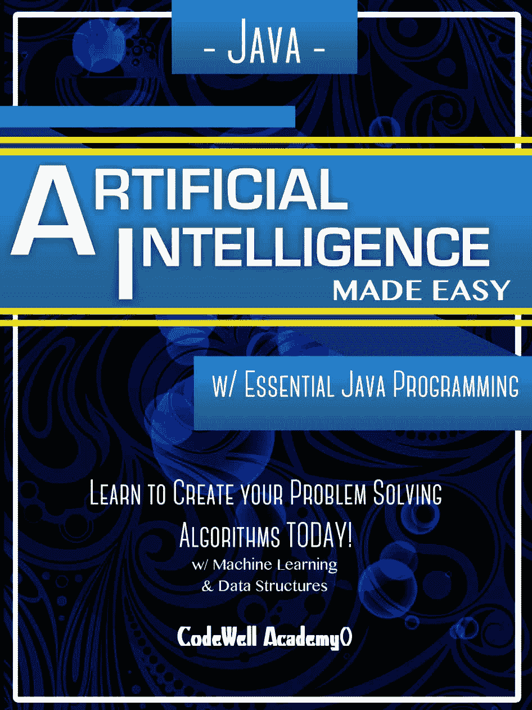
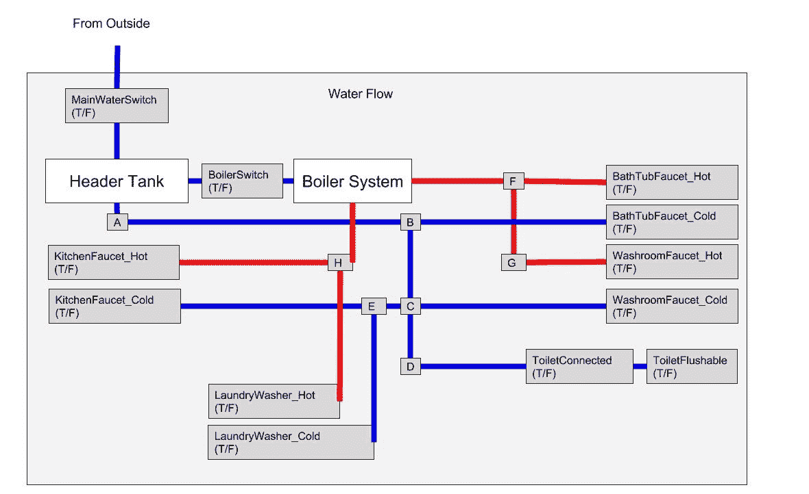

# Java：人工智能；简单易学；基于 Java 编程；立即学习创建问题解决算法！包含机器学习与数据结构（人工智能系列）



# 序言：作为人工智能的 JAVASCRIPT

Javascript 最近作为主要的 Web 技术之一（HTML、CSS 和 Javascript）引起了巨大关注。一些网站和 Web 应用正在完全采用 Javascript 技术来执行大多数网络任务。最棒的一点是 Javascript 是一种客户端语言，这意味着你的计算机或移动设备进行计算，而不是服务器本身。这使得应用程序在服务器不可用时仍保持可用。

在未来，由于其通用性和灵活性，Javascript 可能会成为多平台应用的首选。因此，使用 Javascript 代码学习更高级的概念将是值得的。

## 你将如何学习这本书

本书的目标是将你的编程技能扩展到一个新的范式——即人工智能领域。你可能是一个希望学习新技能的熟练的程序员，也可能是一个编程新手，甚至二者兼有。

无论你的编程水平如何，我们都希望你在这些页面中发现一些有趣的信息。

你将亲眼看到 AI 内的算法程序如何在给定一组数据的情况下决策并生成答案。

首先，我们将介绍约束满足（Constraint Satisfaction）。你是否曾经计划和朋友一起晚上聚会，但必须考虑他们全天的空闲时间？当然，你会问他们什么时候有空。现在，尝试为成千上万的人安排会议。单独完成将非常困难，不是吗？

## 快速入门

书中包含了基础 Javascript 的快速入门，帮助你建立良好的开始。然后，你将在书中学习使用 AI 的许多工具和组件。

# 引言

逻辑。理性。推理。思考。分析。计算。决策。

这一切都存在于人类中，对吧？人类被赋予了如此智能的思考和行动的能力。

然后机器出现了。人类也赋予了它智能。

在当今的世界里，你可以亲眼看到智能大脑能做什么；进行对话、提供路线指南、作为对手玩视频游戏等等。

本质上，只有我们的想象力会限制可能性。

## 人工智能代理

首先，你希望你的算法满足四个关键因素：

- 完备性 (Completeness)
- 优化性 (Optimization)
- 时间复杂度 (Time Complexity)
- 空间复杂度 (Space Complexity)

现在我们将逐一解释这些因素。之后，你将探索一些算法思路，并确定它们如何符合这些因素。

### 完备性

如果一个算法保证在特定的时间范围内找到至少一个现有的解决方案或结论，我们可以说该算法是完备的。

### 优化性

如果一个算法找到了解决方案，并保证它是最优的，那么该算法就被认为是最优的。

### 时间复杂度

对于算法而言，这是表示完成任务可能花费的最长时间的表达式。换句话说，当它运行并找到合适的解决方案时的最坏情况。

### 空间复杂度

这个表达式与时间复杂度相似，但它代表算法为了找到解决方案可能使用的最大内存。这同样被视为最坏情况。

### 你的理想算法

在讨论了你的算法可能具备的特征后，你将了解在创建 AI 算法时应该寻找什么。你希望设计的算法能够找到至少一个解决方案（完备性），并在现有数据的基础上创建出最佳解决方案（优化性），同时尽可能少消耗计算资源（时间与空间复杂度）。

## Javascript 01a: 使用 AI 解决复杂的时间调度

想象你有 5 个朋友想要聚在一起去某处玩耍。

这听起来可能很简单，但它可能会比你想象的复杂得多。

如果其中一个朋友在某些时间有工作呢？如果另一个朋友要上课呢？如果他/她有先约呢？足球训练？舞蹈课？学习时间呢？当然，你们可以一起聚在一起玩。但是，这必须是**每个人**都有空的时间。

所以，根据你的每位朋友，你需要列出他们的时间表，然后划掉他们忙的时间。之后，如果所有朋友之间存在共同的空闲时间，大家都表示有空，那么你就可以朋友就可以聚。

让我们来看另一个例子。

你认为一个 32 支球队的体育联赛如何在全年安排比赛？对于所有 32 支球队，每支球队都需要与最多另一个球队匹配以安排比赛。每支球队在一个例如 6 个月的赛季中，需要安排一定数量的比赛。每周的比赛数量是有限，并且需要足够的时间在城市之间旅行参加比赛。

这些都是调度算法可以派上用场。它会获取所有成员的空闲时间和时间限制，然后生成一个可行的解决方案。对于调度，它可以告诉你在一天中哪些时间都有空。对于大规模实现，它可以用于调度体育联赛的对阵、为数万名大学学生安排考试等。

一个非常简单易于入门的算法是`Generate-and-Test`（生成测试）算法。

接下来的章节将向你展示算法并引导你完成其流程……

## Javascript 01b: 生成测试通用算法

对于下面的步骤，请选择一个你喜欢的 IDE。你也可以使用在线 IDE，例如 [rextester.com](http://rextester.com)、[ideone.com](http://ideone.com) 或 [codpad.org](http://codpad.org)。

这是一个通用算法。它将评估来自每个列表中值的每组合。约束检查会验证每个组合是否有效。目标函数还会检查某个组合是否提供了解决方案。

对于这个算法，你可以根据需要拥有任意数量的列表、约束和目标检查。

```javascript
// INPUT:
// - 任意数量的列表
// - 至少一个目标函数（必须返回布尔值）
// - 任意数量的约束函数（每个必须返回布尔值）

// OUTPUT: - （可选；选择任何输出类型）

// EFFECT: 对于每个列表的所有可能组合，
// 检查它是否是目标组合，
// 同时检查它是否满足约束。

function generateAndTest(list1, list2, … listN, goal1(), .. goalN(), cons1(), … consN())
{
  for (a = 0; v < list1.length; a++) {
    for (b = 0; b < list2.length; b++) {
      …
      for (i = 0; i < listN.length; i++){
        if (goal1(a,b, …, n)
        &&
        … goalN(a,b, …, n)
        && cons1(a,b, …, n)
        &&… consN(a,b, …, n)) {
          // === 解决方案结果在此
          // 在此处处入你想执行的代码
          // ===
        }
      }
      …
    }
  }
}
```

接下来的章节将一步一步向你如何构建此算法。

## Javascript 01c: 流程：调度求解器

对于下面的步骤，请选择一个你喜欢的 IDE。你也可以使用在线 IDE，例如 [rextester.com](http://rextester.com)、[ideone.com](http://ideone.com) 或 [codpad.org](http://codpad.org)。

### 第 1 步：你的朋友和他们的时间

为每个朋友创建一个全局变量并将其设置为数组。在数组中，设置从 0 到 23 的值。我们将使用整数表示所有的 24 小时。

对于你的每位朋友，创建一个全局变量并将其设置为数组。在数组中，设置从 0 到 23 的值。我们将使用整数表示所有的 24 小时。

对于你的每位朋友，创建一个全局变量并将其设置为数组。在数组中，设置从 0 到 23 的值。我们将使用整数表示所有的 24 小时。

对于你的每位朋友，创建一个全局变量并将其设置为数组。在数组中，设置从 0 到 23 的值。我们将使用整数表示所有的 24 小时。

对于你的每位朋友，创建一个全局变量并将其设置为数组。在数组中，设置从 0 到 23 的值。我们将使用整数表示所有的 24 小时。

对于你的每位朋友，创建一个全局变量并将其设置为数组。在数组中，设置从 0 到 23 的值。我们将使用整数表示所有的 24 小时。

对于你的每位朋友，创建一个全局变量并将其设置为数组。在数组中，设置从 0 到 23 的值。我们将使用整数表示所有的 24 小时。

对于你的每位朋友，创建一个全局变量并将其设置为数组。在数组中，设置从 0 到 23 的值。我们将使用整数表示所有的 24 小时。

对于你的每位朋友，创建一个全局变量并将其设置为数组。在数组中，设置从 0 到 23 的值。我们将使用整数表示所有的 24 小时。

对于你的每位朋友，创建一个全局变量并将其设置为数组。在数组中，设置从 0 到 23 的值。我们将使用整数表示所有的 24 小时。

对于你的每位朋友，创建一个全局变量并将其设置为数组。在数组中，设置从 0 到 23 的值。我们将使用整数表示所有的 24 小时。

对于你的每位朋友，创建一个全局变量并将其设置为数组。在数组中，设置从 0 到 23 的值。我们将使用整数表示所有的 24 小时。

对于你的每位朋友，创建一个全局变量并将其设置为数组。在数组中，设置从 0 到 23 的值。我们将使用整数表示所有的 24 小时。

对于你的每位朋友，创建一个全局变量并将其设置为数组。在数组中，设置从 0 到 23 的值。我们将使用整数表示所有的 24 小时。

对于你的每位朋友，创建一个全局变量并将其设置为数组。在数组中，设置从 0 到 23 的值。我们将使用整数表示所有的 24 小时。

（注：此处原文似乎存在重复，已根据要求去重并进行逻辑翻译）

对于你的每位朋友，创建一个全局变量并将其设置为数组。在数组中，设置从 0 到 23 的值。

```javascript
var Anna = [0, 1, 2, 3, 4, 5, 6, 7, 8, 9, 10, 11, 12, 13, 14, 15, 16, 17, 18, 19, 20, 21, 22, 23];

var Betty = [0, 1, 2, 3, 4, 5, 6, 7, 8, 9, 10, 11, 12, 13, 14, 15, 16, 17, 18, 19, 20, 21, 22, 23];

var Cara = [0, 1, 2, 3, 4, 5, 6, 7, 8, 9, 10, 11, 12, 13, 14, 15, 16, 17, 18, 19, 20, 21, 22, 23];

var Diana = [0, 1, 2, 3, 4, 5, 6, 7, 8, 9, 10, 11, 12, 13, 14, 15, 16, 17, 18, 19, 20, 21, 22, 23];
```

### 第 2 步：目标函数

你的目标是确定哪些时间都有空。用一个函数来表示。输入的数量与朋友的数量相同。函数在所有小时相等时输出 True。

```javascript
// 目标 1：找到都有空的时间段
// INPUT: 四个整数，表示小时
// OUTPUT: 布尔值
// EFFECT: 如果所有小时相等则返回真
function g1(a, b, c, d) {
  return (a == b && b == c && c == d)
}
```

### 第 3 步：时间约束

对于每个需要安排的朋友，创建一个函数来表示哪些时间不可用。如果某人正忙于某事，那么这些时间就是不可用的。

```javascript
// 约束函数
// INPUT: 一个整数，表示朋友的小时
// OUTPUT: 布尔值
// EFFECT: 如果小时满足约束则返回真
// 在我们的示例中，我们将为每个朋友创建许多时间约束。有人上课、工作或其他事情。

// 约束 1：Anna 在上午 11 点到下午 1:50 点有课
function c1(a) {
  return (a < 11 || a > 13)
}

// 约束 2：Betty 在中午到下午 3 点有课，
// 然后一直到下午 4 点有舞蹈训练
function c2(b) {
  return (b < 12 || b >= 16)
}

// 约束 3：Cara 在晚上 7 点到晚上 11 点有工作
function c3(c) {
  return (c < 19 || c > 23)
}

// 约束 4：Diana 在晚上 6 点到晚上 8 点有志愿者活动，
// 并在晚上 8 点到晚上 11 点有工作
function c4(d) {
  return (d < 6 || d > 22)
}
```

### 第 4 步：主算法

我们将使用一个简单的“生成与搜索”算法来解决调度问题。

它的工作原理是，对于每个朋友的每个小时，算法将检查小时的组合是否有效——基于我们在第 2 步和第 3 步中创建的目标和约束函数。

为了构建此算法，请为所有需要安排的朋友创建系列嵌套迭代循环，如下所示。

```javascript
// 主算法：生成与搜索
for (v = 0; v < Anna.length; v++) {
```

```javascript
for (w = 0; w < Betty.length; w++) {
  for (x = 0; x < Cara.length; x++) {
    for (y = 0; y < Donna.length; y++) {
      if (g1(Anna[v], Betty[w], Cara[x], Donna[y])
        && c1(Anna[v])
        && c2(Betty[w])
        && c3(Cara[x])
        && c4(Donna[y])
      ) {
        // === 解决方案结果
        print("Anna, Betty, Cara, and Diana can hang out at: " + Anna[v] + ":00")
        // ===
      }
    }
  }
}
```

如果你使用了上述步骤中的所有示例代码并编译/运行，输出如下：

```
Anna, Betty, Cara, and Diana can hang out at: 9:00 
Anna, Betty, Cara, and Diana can hang out at: 10:00
Anna, Betty, Cara, and Diana can hang out at: 16:00
Anna, Betty, Cara, and Diana can hang out at: 17:00
```

## 计算量：生成与测试 (Generate-and-Test)

此过程会产生大量的小时组合需要检查。粗来说，它是每个人的小时数，关于需要安排的人数的次方：

`(#小时数) ^ (#人数)`

在我们的示例中，时间范围是 9 点到 23 点，所以每个人有 15 个小时。我们有四位朋友。因此有`15⁴ = 50625`种可能的组合组合需要检查。别担心，我们幸运有计算机为我们解决这个问题。

## Javascript 01d：调度求解器，快速版

对于下面的过程，请选择你任的 IDE。你也可以使用在线 IDE，如 [rextester.com](http://rextester.com)、[ideone.com](http://ideone.com) 或 [codpad.org](http://codpad.org)。

如果你觉得 50625 种组合处理起来很大，那确实如此。有时对于计算机系统本身也是如此。

但如果我告诉你可能有另一种方法呢？

如果存在机会用更少的精力解决调度问题呢？

在这个备选版本中，我们首先移除每个朋友不可用的时间段，然后生成解决方案。

### 步骤 1 & 2：

这些步骤没有变化。它们遵循与原始版本相同的代码。

### 步骤 3：时间限制

在这里，我们修改了约束功能（Constraint Functionality）。

注意它们不再是函数，而是要执行的直接过程化代码。每个人的不可用时间被推入一个`array`（数组），该数组用于清除该朋友的时间段，直到只剩下可用时间。

我们使用这个函数来帮助自己：

```javascript
// 输入：两个数组，1 & 2
// 输出：无
// 效果：删除第二个数组中任何存在于第一个数组的元素

function searchDelete(array1, array2) {
  for (i=0;i<array1.length;i++) {
    for (j=0;j<array2.length;j++) {
      if (array2[j] == array1[i]) {
        array2.splice(j, 1)
      }
    }
  }
}
```

但你可能在想，为什么我们不直接删除项？这是因为一旦数字被删除，`array`中其后的项就会向前移动。一旦迭代移动到下一个项，它就会跳过一个项。


```javascript
// 约束过程
// 约束 1：Anna 上午 11 点到下午 1:50 有课
delList = []
for (a=0;a<Anna.length;a++) { // $Anna.each do |a|
  x = Anna[a]
  if (x >= 11 && x < 14) {
    delList.push(x)
    //Anna.splice(a, 1) // 直接删除
  }
}
// (删除 Anna 的所有不可用时间)
searchDelete(delList, Anna)

// 约束 2：Betty 中午到下午 3 点有课，
// 之后有舞蹈练习到下午 4 点
delList = []
for (b=0;b<Betty.length;b++) {
  x = Betty[b]
  if (x >= 12 && x < 16) {
    delList.push(x)
  }
}
// (删除 Betty 的所有不可用时间)
searchDelete(delList, Betty)

// 约束 3：Cara 晚上 7 点到 11 点要上班
delList = []
for (c=0;c<Cara.length;c++) {
  x = Cara[c]
  if (x >= 19 && x <= 23) {
    delList.push(x)
  }
}
// (删除 Cara 的所有不可用时间)
searchDelete(delList, Cara)

// 约束 4：Donna 晚上 6 点到 8 点有志愿者服务时间，
// 晚上 8 点到 11 点要上班
delList = []
for (d=0;d<Donna.length;d++) {
  x = Donna[d]
   ( (x >= 18 && x <= 22) {
    delList.push(x)
  }
}
// (删除 Donna 的所有不可用时间)
searchDelete(delList, Donna)
```

如果需要，我们还可以轻松添加更多事实和知识。可以有一个或两个真实事实。然后，两个真事实或假事实会导致另一个真相。以此类推。例如，我们可以说出一个真陈述，比如“外面是晴天”，然后是另一个，比如“外面很暖”。这些陈述会导致另一个真相：“外面既晴朗又温暖。因此，我要跑步一英里”。

如果你将上述内容合并为一个命题语句，它看起来是这样的：

“我要跑步一英里” <— “外面是晴天” AND “外面是晴天”

如果你使用 `variableName` 标签来表示上述语句，看起来是这样的：

`c <— b AND a`

## 使用逻辑调试

相反，你可以使用逻辑来解释某个事实的根源。如果一个陈述是真实的，它可以通过另一个事实得到解释和证明，然后这些事实又由更多的事实得到证明，以此类推。这里有一个例子：你发现“遥控器无法打开电视”。你仔细观察遥控器，发现“它的电池没电了”。你更换了遥控器的电池，尝试打开电视，结果发现它仍然无法打开。你检查了电视电源线，发现“它没有插好”。好的，你把它插好，再次尝试打开。这一次，它成功了。

你可以将上述内容作为逐步的逻辑语句，如下：

1) 真：“遥控器无法打开电视。”

2) 真：“电视电源线没有插好”

3) 真：“遥控器电池没有电”

AND “电视电源线没有插好”

这种程序通常用于调试；如果你发现某处无法正常工作，你必须回头检查其内部运作，以找出导致该问题的原因。

## AI 如何分析基于逻辑的系统

AI 代理可以根据某些条件是否真实来分析给定的系统。这些条件将导致其他条件的为或为假，然后是其他条件，以此类推。

执行此操作有两种通用程序。第一种是**自上而下的诊断**，程序将检查某些关键条件（最可能是影响其他条件的最顶部语句），然后遍历系统以查看结果。

另一种是**自下而上的诊断**，程序将检查为什么某个终端状态符合或不符合预期。这是通过检查哪些其他条件导致了这种状态来实现的。

## Javascript 02a: 使用基于逻辑的 AI

对于下面的程序，请选择你选择的 IDE。你也可以使用在线 IDE，如 [rextester.com](http://rextester.com)、[ideone.com](http://ideone.com) 或 [codpad.org](http://codpad.org)。

市上有许多设计和系统。几乎所有的都可以表示为基于逻辑的系统——可以由 AI 系统进行诊断、修复和分析。然而，为了让 AI 代理很好地管理系统，程序员必须非常了解该系统。然后，程序员必须将系统表示为良好的逻辑代码。

例如，你家中的电线系统可以使用一系列真/假系统来构建。墙上的插座以及房间里的灯都是真/假开关，它们接收来自断路器和配线盒的供电——更多组真/假开关。这种设计造了家庭开发人员，因为他们可以追踪从外部进入的主电源，并判断电力是否流向所有插座、灯光以及房屋内任何需要用电的地方。这种设计也造了住户；如果某个灯或插座不工作，可以一直追溯线路到外部源头，查看电是在哪里被切断的。

### 房屋水流示例：

下面是一个一室套房的水流图：



浴缸、洗手间水池和厨房都有龙头。洗衣机可以运行短段时间，使用冷热水的组合。马桶有一个开关，可以将水流引向它。马桶处于冲水状态或非冲水状态。此外，还有一个开关向锅炉系统供水或不供水。还有标记为 `A` 到 `H` 的龙头，可以停止或允许水流。最后，总水开关可以允许或停止进入整个套房的总水流。

水是否会从某个水源流出，取决于房屋内的连接、水龙头和开关。

#### 开关和龙头在哪里？

你想要做的第一件事是识别上述系统中的哪些水流点可以开启或关闭。

如果你查看图表，开关有：

- 浴缸、洗手间和厨房的一对冷热龙头
- 洗衣机的一对冷热开关
- 标记为 `A - -H` 的龙头
- 锅炉开关
- 总水开关

这些将是布尔龙头，其值为 `TRUE`（真）、`FALSE`（假），或取决于另一个开关/龙头的真假状态。

#### 将系统表示为逻辑语句

在这个阶段，最好先不要代码。我们需要确定每个开关如何将水输送到下一个开关——一直到为居民供水的终端龙头。

我们可以从马桶开始。房屋居民通过冲马桶来使用水。我们可以有一个这样的语句：“马桶可以冲水。因此，它连接到了水。”

```
The Toilet can Flush. Therefore, it is connected to the water.
```

```
`c <— b AND a`
```

## 表示方案

对于人工智能单元要能够为你生成数据和解决方案，它通常需要某种数据源。

而且有时，这种数据源依赖于环境：AI 代理体需要确定并观察它所关注的环境。

因此，AI 代理体需要用数据来对其环境进行表示。之后，它可以使用它自己的算法处理这些数据并生成解决方案。

## Javascript 03a：使用 Javascript 构建环境模型

对于下面的步骤，请选择一个你喜的 IDE。你也可以使用在线 IDE，例如 [rextester.com](http://rextester.com)、[ideone.com](http://ideone.com) 或 [codpad.org](http://codpad.org)。

### 环境建模

人工智能中一个至关重要的元素是拥有其关注环境的代码模型。为了让你的 AI 代理体能够创建解决方案，它需要了解它的环境及其周围。

所以，为 AI 代理体建模环境有两种主要方法。

首先，你可以使用“红灯”原则——对 AI 代理体关注的可能状态或条件进行枚举。这是一种非常简单的环境表示方式。

例如，AI 代理体可以监控你最近的路口的交通信号灯，并确定灯将是什么颜色（红色、黄色或绿色）。

使用这种方法对 AI 代理体关注的任何内容进行非常简单的解释。

```javascript
var trafficLights = ["Red", "Yellow", "Green"]
```

其次，你可以将环境特征描述为详细的数据表示。通过面向对象编程，你可以简单地创建关于 AI 环境观测的类对象——将许多小细节作为类字段。使用这种方法进行更自然、更详细的环境观测。

```javascript
function BeachVisit (loc, tide, crowd, temp) {

  this.location = loc
  this.tide = tide
  this.crowdSize = crowd
  this.temperature = temp
}

var b1 = new BeachVisit("Santa Monica Beach",

  "high",
  "large",
  "81f")

var b2 = new BeachVisit("Santa Monica Beach",

  "medium",
  "medium",
  "78f")
```

### 使用数据组合的环境模型

如果你选择让 AI 代理体通过面向对象编程来描述环境，你也可以连接两个不同类的对象。你在它们之间建立一种关系，并注意它们是如何连接在一起的。

例如，我们可以将我们的海滩访问对象与照片将它们连接起来：

```javascript
//（假设实例 b1 - b25 已创建）
// 将所有海滩访问放入数组：
var allBeachVisits = [b1, b2, b3, b4, b5]

//（假设实例 ph1 - ph7 已创建）
// 将所有照片放入数组：
var allPhotos = [ph1, ph2, ph3, ph4, ph5, ph6, ph7]

// 可能的关系命题：
// #1: 已拍摄的照片
// 命题：如果在海滩访问期间拍摄了照片，返回 TRUE
function photoTakenAtVisit(ph1, b3)

// #2: 在拍摄的照片
// 命题：如果在海滩访问地点拍摄了照片，返回 TRUE
function photoTakenHere(ph3, b5)
```

## Javascript 03b：创建一个模型环境

对于下面的步骤，请选择一个你喜的 IDE。你也可以使用在线 IDE，例如 [rextester.com](http://rextester.com)、[ideone.com](http://ideone.com) 或 [codpad.org](http://codpad.org)。

现在让我们练习为我们的 AI 创建供其检查的环境。这些在之后将整合在一起，因为 AI 代理体将有机会利用它既定的知识和能力来探索它的环境。

### 建模房屋

建模环境最简单的方法是前面提到的红灯原则。

如果你用简单的枚举类型数据集合为你的房屋建模，你可能会得到类似的内容：

```javascript
var myHouse = ["livingRoom", "diningRoom", "den", "bathroom1", "bathroom2", "hallway", "bedroom1", "bedroom2", "patio"]
```

你也可以使用面向对象编程来建模房屋。你可以将房子中的每个房间表示为一个 `Room` 对象。

```javascript
// 一个 Room 具有：
// - 一个名称
// - 相邻的、连接的房间
function Room(name) {

  this.name = name
  this.connected = []
  this.addRoom = function(room) {

    this.connected.push(room)
  }
}
```

为了现在保持简单，你可以建模位于繁华市中心的一个简单的公寓。

```javascript
// 在城市里的一个简单公寓中创建 5 个房间
var kitchen = new Room("kitchen")
var livRM = new Room("livingRoom")
var dineRM = new Room("diningRoom")
var bd = new Room("bedroom")
var wr = new Room("washroom")

/*
// 如下连接所有房间：
// <-> 洗手间 <-> 卧室 <-> 客厅 <-> 厨房 <-> 餐厅 <->
*/
kitchen.connected.push(livRM, dineRM)
livRM.connected.push(bd, kitchen)
bd.connected.push(wr, livRM)
wr.connected.push(dineRM, bd)
dineRM.connected.push(kitchen, wr)
```

建模环境的方法取决于你。

只需记住，你最终将设计与你的模型环境对应的 AI 代理体。

### 轮到你了

使用 Javascript（或任何编程语言），根据上述内容为你的家建模。首先，使用枚举方法进行红灯建模。然后，作为面向对象编程，用 `Room` 实例表示每个房间。

为了方便运行代码，请选择一个你喜欢的 IDE（集成开发环境：本质上就是你编写和运行代码的地方）。你也可以使用在线 IDE，例如 `rextester.com`、`ideone.com` 或 `codpad.org`。

### 1) 基础数据类型

#### 布尔值 (Booleans)

这些本质上是开关状态的值。在代码中，布尔值将是 `TRUE`（真）或 `FALSE`（假）。

在 `Javascript` 中，布尔值只能小写（即 `true`、`false`）。布尔值不能包含任何大写字母（即 `TRUE`、`True`）。

示例：

`true`, `false`

### 字符串 (Strings)

这些是键盘字符 - 包括字母、数字和其他符号 - 按照某种顺序形成一个文本短语。它们以双引号开头和结尾。

示例：

`" This is a String. "`

`" This 15 4 &^%$! 5tring t00\. "`

#### 数字 (Numbers)

`Javascript` 对所有数字一视同仁。它们都是 64 位浮点数（如果你不知道它的意思，可以去查一下）。

但通常情况下，编程中有两种主要的数字类型：`Integers`（整数）和 `Floats`（浮点/小数）。

#### 整数 (Integers)

它们完全正如定义的那样 - 没有分数或小数的整数。这里是一些示例：

`12`

`143`

`19999932`

#### 浮点数 (Floats)

也称为浮点数，它们代表 `Integers` 的相反 - 它们小数点后的数字。

示例：

`0.12`

`.12`

### 2) 变量 (Variables)

记得小学数学里你用 `X` 和 `Y` 等字母来代表数字吗？教科书中会有 `let x = 4` 和 `let y = 19` 这样的短语。这些被称为变量。

变量在编程中也普遍存在。但在编程中，你可以给变量命名。而不是数字，变量可以是你分配给它们的任何数据。它们可以是字符串、布尔值、整数等。

在 `Javascript` 中，你可以按照以下语法创建变量：

`var (变量名) = (初始值)`

或者，可选：

`(变量名) = (初始值)`

示例：

`var a = " This is a String. "`

`var b = 122`

`c = true`

`d = 0.1234`

将变量想象成形式为 `(名称) 是一个 ____` 的单句。使用变量来告诉计算机关于你代码的某些事实。这个概念就像告诉我消火栓是红色的或者天空是蓝色的一样简单。

### 3a) 创建函数 (Making Functions)

如果变量是句子，那么函数仅仅是动作或动词。

本质上，函数是一组定义好的指令。当某行代码调用它们的名称时，计算机就会执行这些指令。例如，如果一行代码告诉计算机行走，计算机就会按照指令行走（即向前迈一步，身体前倾，用另一只脚走路等）。

在 `Javascript` 中创建函数，请遵循此语法：

```javascript
func <函数名>( input1, input2, etc…) {
    // 在此处编写代码
    // 如果函数输出任何数据，请使用下一行：
    // return (带有数据类型的变量名，或任何数据)
}
```

### 3b) 使用函数 (Using Functions)

要调用函数，只需写出它的名称以及任何输入（如果需要）。

然而，通常有两个地方可以放置函数。

单独占一行：

`<函数名>(任何必要的输入)`

或者放置在任何期望其输出数据类型的地方：

`var (变量名) = <函数名>(任何必要的输入)`

示例：

```javascript
// 无输出：
functionABC(a, b, c)

// 输出一个整数：
var integer1 = functionABC(a, b, c)
```

记住；虽然 `Javascript` 是一种比大多数其他语言宽松得多的语言，但你应该将函数放在期望其输出数据的地方。例如，如果函数 `n1()` 和 `n2()` 各自输出一个数字，请将它们放在代码中期望这些数字的地方：

`var sum = n1() + n2()`

如果你将函数放在不合理的地方，你可能会遇到错误并一路上头疼！

### 4) 复合数据 (Composite Data)

这个概念意味着一组个的、较小的数据组合在一起形成一个完整的、单一的数据块。用最简单的话说，如果变量是句子，复合数据就是由句子组成的整个段落。

在 `Javascript` 中，变量可以用于创建简单的复合数据。你可以按照以下语法创建它们：

```javascript
var (复合名称) = {
    part1name: value1,
    part2name: value2,
    part3name: value3,
}
```

这些被称为关联数组。我们稍后会讨论数组。但现在，只需记住语法。

示例：

```javascript
var c = {
    c1: “String Sample",
    c2: 234,
    c3: true
}
```

## 学习 JAVASCRIPT 的简单方法，第 2 部分


为了方便运行代码，请选择一个你喜欢的 IDE（集成开发环境：本质上就是你编写和运行代码的地方）。你也可以使用在线 IDE，例如 `rextester.com`、`ideone.com` 或 `codpad.org`。

## 5: 数组 (Arrays)

### 5a: Javascript 中的数组

数组是存储数据的有序列表。要创建一个数组，使用此语法：

`var (name) = []`

### 5b: 迭代 (Iteration)

要处理每个项目，使用这些：

```javascript
for (var x in array) {
    // 代码
}
```

或者，你也可以用传统方式迭代它们：

```javascript
for (var x=0; x < arrayName;x++) {
    // 代码
}
```

## 6) 逻辑运算符 (Logic Operators)

有三种基础逻辑运算符：`AND`（与）、`OR`（或）和 `NOT`（非）。`AND` 和 `OR` 用于比较两个或多个语句。形式为 `(x AND y)` 或 `(x OR y)`。

`AND` 在所有项目为真时为真。`OR` 在其中一个项目为真时为真。

`NOT` 返回它所设置的语句的相反；所以 `NOT true` 结果为假。

在 `Javascript` 中，运算符如下：

- `AND` 运算符：`&&`
- `OR` 运算符：`||`
- `NOT` 运算符：`!boolean`

示例：

```javascript
// 输出假：
print(true && false)

// 输出真：
print(true || false)

// 输出假：
print(!true)
```

## 7) IF-ELSE 语句 (IF-ELSE Statements)

这个概念很简单：有一个要检查的布尔语句。如果为真，执行 `IF` 行之后的程序。如果为假，执行 `ELSE` 行之后的程序。

```javascript
if (<可以输出布尔值的内容>) {
    // 为真执行的代码
}
else {
    // 为假执行的代码
}
```

注意条件程序位于大括号 `{ }` 之间。

`IF` 语句也不需要 `ELSE` 语句；它可以独立存在：

```javascript
if (<可以输出布尔值的内容>) {
    // 为真执行的代码
}
```

示例：

```javascript
// IF-ELSE 同时使用：
if (age > 20) {
    drinkingAge = true
}
else {
    drinkingAge = false
}

// 单独 IF 语句：
if (happy() and knowIt()) {
    hands.clap()
}
```

# 学习面向对象的最简单方法 (OBJECT-ORIENTED)

我们还包含了一份关于面向对象编程的补充指南——这是目前最流行的编程类型之一。

为了方便运行代码，请选择一个你喜欢的 IDE（集成开发环境：本质上就是你编写和运行代码的地方）。你也可以使用在线 IDE，例如 [rextester.com](http://rextester.com)、[ideone.com](http://ideone.com) 或 [codpad.org](http://codpad.org)。

## 1a) 面向对象编程

在编程世界中，你会非常频繁地听到这个术。。这是因为面向对象编程（简称 OOP）是目前最广泛使用的编程风格之一。

在其他编程语言中，`Classes`（类）作为复合数据的形式，被用于将较小的数据组合成较大的整体。

面向对象编程的核心点在于：

在面向对象编程中，你创建你设计的那些类的“副本”。更简单地说，一个 `Class`（类）是一个充当“蓝图”的数据结构。你基于该类“蓝图”创建的那些“副本”被称为 `Objects`（对象）。

但为什么呢？因为随着你对编程的越来越深入，你会遇到“抽象”的概念——将一个通用的思想应用于多次和多个场景——最终能够节省时间和精力，同时极大地减少困惑和挫败感。

反复编码相同的复合数据会导致更多的努力和挫败感，而重复使用同一个思想则会带来效率和一致性。

## 2) 类与构造函数

构造函数是特殊的类方法。它们根据所属的类，为你创建 `Objects`。

在 Javascript 中，函数被用作组合的类和构造函数。在定义类时，你同时也定义了它的构造函数。

在 Javascript 中定义一个类以及其构造函数，请使用以下语法：

```javascript
var ClassName = function(<any inputs>) {
  // 在此处插入方法、字段和其他代码
}
```

此外，构造函数简单来说就是作为函数形式的类名。要根据某个类创建数据对象，请遵循此语法：

```javascript
var <variable name> = new Classname()
```

你本质上是将其他某个变量设置为一个数据对象。

示例：

```javascript
var House = function() {
  // 在此处插入代码
}

var h = new House()
```

要调用类对象，只需引用它即可：

示例：

```javascript
let h = House()
var MyHouse = h
```

## 3) OOP 术语

变量和 `Functions`（函数）在 OOP 中可以承担新的角色。它们分别被称为 `Fields`（字段）和 `Methods`（方法）。它们也可以被称为 `Member functions`（成员函数）或 `Member Variables`（成员变量）。在某些情况下，完全取决于你想使用哪个名称，只要你理解其他程序员在使用这些术语时指的是什么即可。

`Fields` 代表 OOP 中的变量，因为就像任何输入表单中的字段一样，数据对象可以拥有你可以想象到的许多不同值的字段。

将字段视为对象的特定属性。每个对象的属性可能与其他对象各不同：

```javascript
var Cat = function() {
  var color = "green"
}

// 这些猫是基于 Cat 类的对象：
catA.color = "white"
catB.color = "grey"
catC.color = "orange"
```

`Methods` 代表 `Objects` 拥有的函数。将 `Methods` 视为对象执行的“动作”和“行为”。

要为特定的 `Class` 创建类方法 `Method`，请遵循以下语法：

```javascript
<Class Name>.prototype.<Method Name> = function() {
  // 一些代码
}
```

示例：

```javascript
Cat.prototype.meow = function() {
  // 一些代码
}
```

接下来，在 OOP 中你需要从对象本身访问方法。例如，如果我们根据某个 `Cat` 类创建了几个 `Cat` 对象，每个 `Cat` 对象都将拥有在 `Cat` 类上定义的方法：

```javascript
class Cat {
  // 一些代码
}

Cat.prototype.meow = function() {
  // 一些代码
}

// 这些猫是基于 Cat 类的对象：
catA.meow()
catB.meow()
catC.meow()
```

最后，记住 `Methods` 本质仍然是函数。你仍然将它们放置在预期函数输出数据类型的地方。

示例：

```javascript
// 输出一个字符串
Fox.prototype.say = function() {
  return "ringdingdingding"
}

var whatDoesTheFoxSay = someFox.say()
print(whatDoesTheFoxSay)
```

## 存档 Javascript-A1a: 解决调度问题

使用人工智能解决调度问题

使用生成并测试算法 (Generate-and-test Algorithm)

将以下代码复制并粘贴到你喜欢的 IDE 中：

```javascript
// ======= ====== ========
/*
// 存档 Javascript-A1
// 用于解决调度问题的人工智能
//
// 有四个人：Anna, Betty, Cara, Donna
// 第一个目标：找出所有人都可以聚在一起喝咖啡的时间
//
// 约束 1：Anna 在上午 11 点到下午 1:50 有课
// 约束 2：Betty 在正午到下午 3:50 有课
// 约束 3：Cara 在晚上 7 点到 11 点要工作
// 约束 4：Donna 在晚上 6 点到 10 点要工作
*/
var Anna = [9, 10, 11,12,13,14,15,16,17,18, 19, 20, 21, 22, 23]
var Betty = [9, 10, 11,12,13,14,15,16,17,18, 19, 20, 21, 22, 23]
var Cara = [9, 10, 11,12,13,14,15,16,17,18, 19, 20, 21, 22, 23]
var Donna = [9, 10, 11,12,13,14,15,16,17,18, 19, 20, 21, 22, 23]

// 目标 1：在一天中找出一个小时，所有人都可以聚会
// 输入：四个整数，代表小时
// 输出：布尔值
// 效果：如果所有输入小时相等，则返回 True
function g1(a, b, c, d) {
  return (a == b && b == c && c == d)
}

// 约束函数
// 输入：一个整数，代表小时
// 输出：布尔值
// 效果：如果该小时满足条件则返回 True
// 约束 1：Anna 在上午 11 点到下午 1:50 有课
function c1(a) {
  return (a < 11 || a > 13)
}

// 约束 2：Betty 在正午到下午 3 点有课，
// 然后下午 4 点有练习
function c2(b) {
  return (b < 12 || b >= 16)
}

// 约束 3：Cara 在晚上 7 点到 11 点要工作
function c3(c) {
  return (c < 19 || c > 23)
}

// 约束 4：Diana 在晚上 6 点到 8 点有志愿者活动，
// 晚上 8 点到 11 点要工作
function c4(d) {
  return (d < 18 || d > 22)
}

// 主算法：生成与搜索
for (v = 0; v < Anna.length; v++) {
  for (w = 0; w < Betty.length; w++) {
    for (x = 0; x < Cara.length; x++) {
      for (y = 0; y < Donna.length; y++) {
        if (g1(Anna[v], Betty[w], Cara[x], Donna[y])
          && c1(Anna[v])
          && c2(Betty[w])
          && c3(Cara[x])
          && c4(Donna[y])) {
          // 结果在这里
          print("Anna, Betty, Cara, and Diana 可以" + Anna[v] + ":00 聚会")
          // ===
        }
      }
    }
  }
}
// ======= ====== ========
```

## 存档 Javascript-A1b: 解决调度问题

人工智能解决调度问题

使用生成并测试算法 (Generate-and-test Algorithm)

替代版本：为每个朋友移除小时 (For Friend to schedule, Remove Hours)

将以下代码粘贴到你喜欢的 IDE 中：

```javascript
// ======= ====== ========
/*
// 存档 Javascript-A1
// 用于解决调度问题的人工智能
//
// 有四个人：Anna, Betty, Cara, Donna
// 第一个目标：找出所有人都可以聚在一起喝咖啡的时间
//
// 约束 1：Anna 在上午 11 点到下午 1:50 有课
// 约束 2：Betty 在正午到下午 3:50 有课
// 约束 3：Cara 在晚上 7 点到 11 点要工作
// 约束 4：Donna 在晚上 6 点到 10 点要工作
*/
// 每个人的起床时间用 24 小时钟的整数表示
// 例如：15 等于 15:00，或下午 3 点
// 大家在上午 11 点之后午夜之前通常有空。
var Anna = [9, 10, 11,12,13,14,15,16,17,18, 19, 20, 21, 22, 23]
var Betty = [9, 10, 11,12,13,14,15,16,17,18, 19, 20, 21, 22, 23]
var Cara = [9, 10, 11,12,13,14,15,16,17,18, 19, 20, 21, 22, 23]
var Donna = [9, 10, 11,12,13,14,15,16,17,18, 19, 20, 21, 22, 23]

// 目标 1：在一天中找出一个小时，所有人都可以聚会
// 输入：四个整数，代表小时
// 输出：布尔值
// 效果：如果所有输入小时相等，则返回 True
function g1(a, b, c, d) {
  return (a == b && b == c && c == d)
}

// 输入：两个数组，1 & 2
// 输出：无
// 效果：从第二个数组中删除任何第一个数组中的元素
function searchDelete(array1, array2) {
  for (i = 0; i < array1.length; i++) {
    for (j = 0; j < array2.length; j++) {
      if (array2[j] == array1[i]) {
        array2.splice(j, 1)
      }
    }
  }
}

// 搜索
for (v = 0; v < Anna.length; v++) {
  for (w = 0; w < Betty.length; w++) {
    for (x = 0; x < Cara.length; x++) {
      for (y = 0; y < Donna.length; y++) {
        if (g1(Anna[v], Betty[w], Cara[x], Donna[y])
          && c1(Anna[v])
          && c2(Betty[w])
          && c3(Cara[x])
          && c4(Donna[y])) {
          // === 结果在这里
          print("Anna, Betty, Cara, and Diana 可以在 " + Anna[v] + ":00 聚会")
          // ===
        }
      }
    }
  }
}
```

## 约束过程

### 约束 1：Anna 上午 11 点到下午 1:50 有课

```javascript
delList = []

for (a=0;a<Anna.length;a++) {// $Anna.each do |a|
  x = Anna[a]
  if (x >= 11 && x < 14) {
    delList.push(x)
    //Anna.splice(a, 1)
    //delete Anna[a]
  }
}

// (删除 Anna 所有无空时间)
searchDelete(delList, Anna)
```

### 约束 2：Betty 中午 12 点到下午 3 点有课，然后有练舞到 4 点

```javascript
delList = []

for (b=0;b<Betty.length;b++) {
  x = Betty[b]
  if (x >= 12 && x < 16) {
    delList.push(x)
  }
}

// (删除 Betty 所有无空时间)
searchDelete(delList, Betty)
```

### 约束 3：Cara 晚上 7 点到晚上 11 点有工作

```javascript
delList = []

for (c=0;c<Cara.length;c++) {
  x = Cara[c]
  if (x >= 19 && x <= 23) {
    delList.push(x)
  }
}

// (删除 Cara 所有无空时间)
searchDelete(delList, Cara)
```

### 约束 4：Donna 晚上 6 点到晚上 8 点有志愿者时间，晚上 8 点到晚上 11 点有工作

```javascript
delList = []

for (d=0;d<Donna.length;d++) {
  x = Donna[d]
  if (x >= 18 && x <= 22) {
    delList.push(x)
  }
}

// (删除 Donna 所有无空时间)
searchDelete(delList, Donna)
```

# 主算法：生成与搜索


```javascript
for (v = 0; v < Anna.length; v++) {
  for (w = 0; w < Betty.length; w++) {
    for (x = 0; x < Cara.length; x++) {
      for (y = 0; y < Donna.length; y++) {
        if (g1(Anna[v], Betty[w], Cara[x], Donna[y]) ) {
          // === 方案结果在这里
          print("Anna, Betty, Cara and Diana 可以在这里聚会: " + Anna[v] + ":00")
          // ===
        }
      }
    }
  }
}
```

## 存档 Javascript-A2a: 自顶向下诊断

基于逻辑系统的自顶向下诊断

水流系统的示例代码。

注意：在代码注释中，你可以找到来自系统的原始逻辑语句。

将下面的代码复制并粘贴到你选择的 IDE 中。

之后，调用函数 `topDownDiagnostic()` 并观察发生了什么！

```javascript
/*
// 输入：
// - 一个布尔值，代表主水开关
// - 一个布尔值，代表锅炉开关
// - 三个布尔值，分别代表水龙头 D、E 和 G
// 输出：无
// 效果：运行诊断以检查水是否可以流过洗手间、厨房和洗衣机
*/
function topDownDiagnostic (mainwaterStatus, boilerStatus, dStatus, eStatus, gStatus){
  var tapA
  var tapB
  var tapC
  var tapF
  var tapH
  var toiletConnected
  var toiletFlushable
  var kitchenTap_Hot
  // A <- 主水开关
  if (mainwaterStatus) { 
    tapA = true 
  }
  // B <- A
  if (tapA) {
    tapB = true
    print("Tap A is on. ")
  }
  // C <- B
  if (tapB) { 
    tapC = true
    print("Tap B is on. ")
  }
  // ToiletConnected <- D 和 C
  if (dStatus && tapC) { 
    toiletConnected = true
    print("Tap C is on. ")
    print("Tap D is on. ")
  }
  // ToiletFlushable <- ToiletConnected
  if (toiletConnected) {
    toiletFlushable = true
    print("Toilet is Flushable.")
  } else {
    print("Toilet Won't Flush.")
  }
  // F 和 H <- 锅炉开关
  if (boilerStatus) {
    tapF = true
    tapH = true
  }
  // KitchenTap_Hot <- H
  if (tapH) {
    kitchenTap_Hot = true
    print("Tap H is on.")
    print("Hot water can flow through Kitchen Tap.")
  } else {
    print("There's no hot water from the Kitchen Tap.")
  }
  // KitchenTap_Cold <- E 和 C
  if (eStatus && tapC) {
    print("Cold water can flow through Kitchen Tap.")
  } else {
    print("There's no cold water from the Kitchen Tap.")
  }
  // WashroomTap_Hot <- F 和 G
  if (gStatus && tapF) {
    print("Tap F is on.")
    print("Hot water can flow through Washroom Tap.")
  } else {
    print("There's no hot water from the Washroom Tap.")
  }
  // WashroomTap_Cold <- C
  if (tapC) {
    print("Cold water can flow through Washroom Tap.")
  } else {
    print("There's no cold water from the Washroom Tap.")
  }
  // LaundryWasher_Hot <- H
  if (tapH) {
    print("The Laundry washer has hot water.")
  } else {
    print("There's no hot water going into the Laundry Washer.")
  }
  // LaundryWasher_Cold <- E 和 C
  if (eStatus && tapC) {
    print("The Laundry washer has cold water.")
  } else {
    print("There's no cold water going into the Laundry Washer.")
  }
  // BathTubTap_Hot <- F
  if (tapF) {
    print("Hot water can flow through the Bath Tap.")
  } else {
    print("There's no hot water from the Bath Tap.")
  }
  // BathTubTap_Cold <- B
  if (tapB) {
    print("Cold water can flow through the Bath Tap.")
  } else {
    print("There's no cold water from the Bath Tap.")
  }
```

## 存档 Javascript-A2b: 自底向上诊断

基于逻辑系统的自底向上诊断

水流系统的示例代码。

注意：在代码注释中，你可以找到来自系统的原始逻辑语句。

将下面的代码复制并粘贴到你选择的 IDE 中。

之后，切换 `true/false` 并观察发生了什么！

```javascript
/*
// 全局变量，切换 true/false。
// 切换这些开关来测试。
*/
var mainwaterSwitch = true
var boilerSwitch = true
// 整数 1-5，代表不同的位置：
// 1: 洗手间
// 2: 洗手间
// 3: 浴室
// 4: 厨房
// 5: 洗衣机
// 输出：无
// 效果：运行诊断以检查水流向
*/
function botUp (mode) {
  var tapA
  var tapB
  var tapC
  var tapF
  var tapH
  var toiletConnected
  var toiletFlushable
  var kitchenTap_Hot
  var kitchenTap_Cold
  var washroomTap_Hot
  var washroomTap_Cold
  var laundryWasher_Hot
  var laundryWasher_Cold
  var bathTubTap_Hot
  var bathTubTap_Cold

  // 主水开关
  if (mainwaterSwitch) {
    tapA = true
  }
  // B <- A
  if (tapA) {
    tapB = true
    print("Tap A is on. ")
  }
  // C <- B
  if (tapB) {
    tapC = true
    print("Tap B is on. ")
  }
  // ToiletConnected <- D 和 C
  if (dStatus && tapC) {
    toiletConnected = true
    print("Tap C is on. ")
    print("Tap D is on. ")
  }
  // ToiletFlushable <- ToiletConnected
  if (toiletConnected) {
    toiletFlushable = true
    print("Toilet is Flushable.")
  } else {
    print("Toilet Won't Flush.")
  }
  // F 和 H <- 锅炉开关
  if (boilerStatus) {
    tapF = true
    tapH = true
  }
  // KitchenTap_Hot <- H
  if (tapH) {
    kitchenTap_Hot = true
    print("Tap H is on.")
    print("Hot water can flow through Kitchen Tap.")
  } else {
    print("There's no hot water from the Kitchen Tap.")
  }
  // KitchenTap_Cold <- E 和 C
  if (eStatus && tapC) {
    print("Cold water can flow through Kitchen Tap.")
  } else {
    print("There's no cold water from the Kitchen Tap.")
  }
  // WashroomTap_Hot <- F 和 G
  if (gStatus && tapF) {
    print("Tap F is on.")
    print("Hot water can flow through Washroom Tap.")
  } else {
    print("There's no hot water from the Washroom Tap.")
  }
  // WashroomTap_Cold <- C
  if (tapC) {
    print("Cold water can flow through Washroom Tap.")
  } else {
    print("There's no cold water from the Washroom Tap.")
  }
  // LaundryWasher_Hot <- H
  if (tapH) {
    print("The Laundry washer has hot water.")
  } else {
    print("There's no hot water going into the Laundry Washer.")
  }
  // LaundryWasher_Cold <- E 和 C
  if (eStatus && tapC) {
    print("The Laundry washer has cold water.")
  } else {
    print("There's no cold water going into the Laundry Washer.")
  }
  // BathTubTap_Hot <- F
  if (tapF) {
    print("Hot water can flow through the Bath Tap.")
  } else {
    print("There's no hot water from the Bath Tap.")
  }
  // BathTubTap_Cold <- B
  if (tapB) {
    print("Cold water can flow through the Bath Tap.")
  } else {
    print("There's no cold water from the Bath Tap.")
  }
}

// 模拟输入状态
var dStatus = true
var eStatus = false
var gStatus = true

// 根据模式运行诊断
if (mode == 1) {
  // 洗手间
  botUp(1)
} else if (mode == 2) {
  // 洗手间
  botUp(2)
} else if (mode == 3) {
  // 浴室
  botUp(3)
} else if (mode == 4) {
  // 厨房
  botUp(4)
} else if (mode == 5) {
  // 洗衣机
  botUp(5)
}
```
