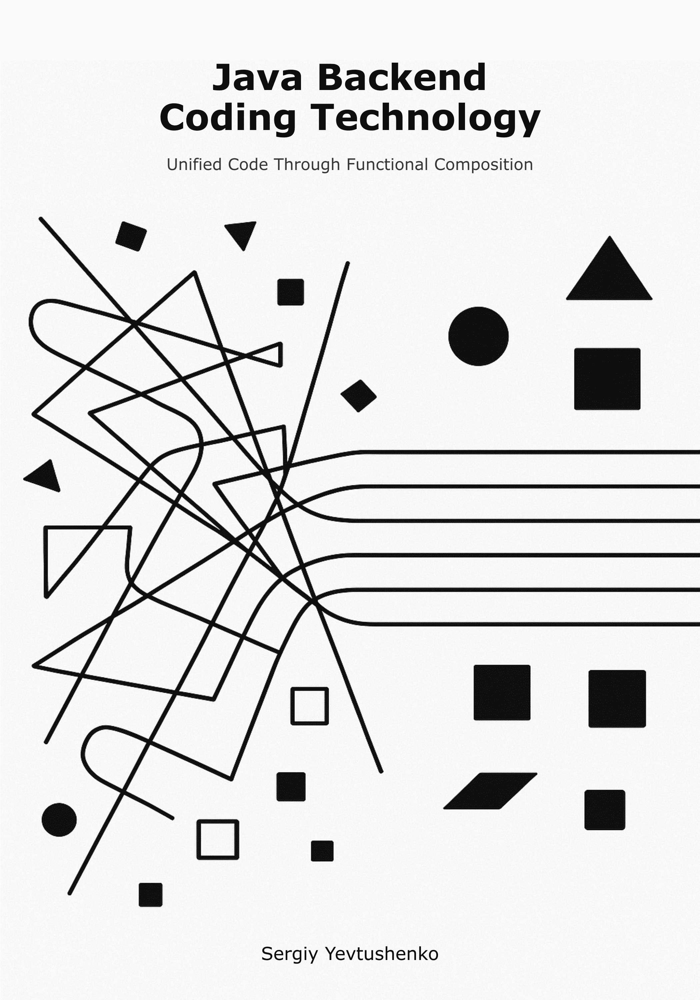

# Java 后端编码技术



1. 标题页

2. 封面

# 第 1 章：引言 - 代码统一

**基于：** `JBCT` v2.1.0 | **Pragmatica Lite Core:** 0.9.9

## 你将学习到

* 为什么代码统一在 AI 时代至关重要
* `JBCT` 解决了什么
* 设计决策五个五个标准
* 基础概念：副作用、组合、单子（monads）

**前提条件：** 熟悉 `Java 21+` 特性（记录、密封接口、模式匹配）、lambda 表达式、泛型和基础函数式模式的中级及高级 Java 开发者。

* * *

## 新时代下的代码

软件开发的演进速度比以往任何时候都快。AI 驱动的代码生成工具在短短几年内已从实验性的新奇变成了日常工作流的支柱。我们现在与智能助手共同编写代码——而且这些助手可以生成整个函数、重构模块并建议架构模式。这种转变带来了传统编码实践未曾设计的新挑战。

从历史上看，代码承载着沉重的个人风格负担。每位开发者对命名、结构、错误处理和抽象都有自己的偏好。团队在代码审查中花费无数小时对主观选择进行争论。风格指南有所帮助，但它们无法捕捉那些决定代码可读性或可维护性的深层结构决策。当 AI 生成代码时，它继承了这些不一致性——我们只是不知道它在传达谁的偏好，或者它为什么会做出特定的选择。

这产生了一个语境问题。当你阅读 AI 生成的代码时，你是在反向工程一个在数百万具有冲突风格的示例上训练的模型所做的决策。当 AI 读取你的代码以建议更改时，它必须从可能无法清晰表达意图的结构中推断你的意。认知负担不断叠加：开发者需要花费精力在自己的心理模型、代码结构以及 AI “认为”代码的含义之间进行转换。

与此同时，技术债正在静无中积累。与良好结构的细微偏离——这里一个校验检查，那里一个异常，一点混合的抽象层次——孤立来看似乎是无害的。但它们会产生复合影响。重构变得危险。测试变得困难。代码库变成了一个特例的集合，而不是一个连贯的系统。

> 传统方法没有提供清晰的机械化规则来规定何时重构或如何构建新代码，因此这些决策仍然是主观且不一致的。

* * *

## JBCT 方法

**Java 后端编码技术 (JBCT)** 提出了一种不同的方法：**减少有效选择的空间，直到对于大多数事情本质上只有一种良好的方法**。这并不是通过僵化的框架或沉重的仪式，而是通过一组小的规则，使结构变得可预测，重构变得机械化，并使业务逻辑与技术关注点清晰分离。

收益是累积的：

**统一的结构**意味着人类可以阅读 AI 生成的代码而无需猜测隐藏的假设，AI 可以阅读人类代码而无需从语境中推断结构。无论是你写的、你的同事写的，还是 AI 助手生成的，用例看起来都一样。结构承载了意图。

**极少的技术债**自然产生，因为重构规则被构建在方法论中。当一个函数增长到一个清晰职责之外时，规则会准确地告诉你如何拆分它。当一个组件被重用时，有一个明显的地方可以移动它。债务不会积累，因为预防比清理更廉。。

**紧密的业务建模**发生在你不再与技术噪音作斗争时。值对象（Value objects）在构造时强制执行领域不变性。用例读起来像业务流程，因为每一步只做一件事。错误是领域概念，而不是堆栈跟踪。产品所有者可以阅读代码结构并识别出他们的需求。

**需求发现**变得系统化。当你将代码结构化为 `校验 → 步骤 → 组合` 时，缺漏就会变得显而易见。当你定义值对象时，缺失的校验规则就会出现。当你无法清晰地命名一个步骤时，不清晰的业务逻辑就会暴露。当你将错误建模为显式类型时，边缘情况就会显现。

**作为可读语言的业务逻辑**发生在模式成为词汇时。四种返回类型、`解析而非校验`（parse-don’t-validate）以及固定的模式目录形成了在代码中表达领域概念的一致方式。任何理解领域的人几乎可以瞬间上手新的代码库。

**确定性的代码生成**当从需求到代码的映射是机械的时变得变得可能。给定一个用例规范——输入、输出、校验规则、步骤——本质上只有一种正确的结构。不同的开发者（或 AI 助手）应该产生几乎相同的实现。

> **一场更广泛的运动：** `JBCT` 在追求编译时保证和类型驱动设计方面并不孤单。类似的哲学出现在数据库设计（7NF 类型优先方法）、分布式系统和函数式编程社区中。其共同线索是：将错误从运行时转移到编译时，使无效状态变得不可表示，并通过显式合约降低认知负载。

* * *

## 五个评估标准

在深入研究模式之前，先了解我们如何在 `JBCT` 中评估每一个决策。传统的“最佳实践”依赖于主观的“可读性”——但这意味着什么？`JBCT` 使用了五个客观标准：

1. **心理负担** - 你必须跟踪的“不要忘记……”和“记住……”项。越低越好。
2. **业务/技术比例** - 领域概念与框架/基础设施噪音的比例。领域可见性越高越好。
3. **设计影响** - 这种方法是强制执行良好模式还是允许糟糕模式？是改进了一致性还是破坏了它？
4. **可靠性** - 是编译器捕获错误，还是必须由你记住？类型安全消除了某类错误。
5. **复杂度** - 元素、连接和隐藏耦合的数量。活动部分越少越好。

这些不是偏好——它们是可衡量的。当我们说“不要使用业务异常”时，我们证明了这一点：- **心理负担**：检查异常污染签名；未检查异常是不可见的（Result +2）- **可靠性**：异常跳过了类型检查器；Result 使失败显式化（Result +1）- **复杂度**：异常层次结构产生了耦合（Result +1）。

### 示例：应用标准

**问题：** 我们在用例中使用 `@Transactional` 还是显式事务管理？

**使用五个标准进行分析：**

1. **心理负担：**
   - `@Transactional`：行为——必须记住在事务中运行，需要理解代理机制。
   - 显式：事务边界在代码中可见。
   - **Result 胜出 +2**

2. **业务/技术比例：**
   - 两种方法都是技术基础设施。
   - **平局（0）**

3. **设计影响：**
   - `@Transactional`：将业务逻辑与 Spring 框架耦合。
   - 显式：业务逻辑保持框架无关。
   - **Result 胜出 +2**

4. **可靠性：**
   - `@Transactional`：在某些情况下静默失败（私有方法、自调用）。
   - 显式：如果忘记处理事务，编译器会报错。
   - **Result 胜出 +1**

5. **复杂度：**
   - `@Transactional`：隐藏的控制流。
   - 显式：控制流可见可见。
   - **Result 胜出 +1**

**结论：使用显式事务管理（切面模式）** - 总计 Result 胜出 +6 分。

这就是 `JBCT` 中做出每一个决策的方式——不是基于意见，而是基于五个维度的可衡量影响。

* * *

## 基础概念

### 什么是副作用？

`side effect`（副作用）是指函数在计算和返回值之外执行的所有操作：

* 写入数据库
* 发起 HTTP 调用
* 写入文件
* 打印到控制台
* 修改全局变量
* 抛出异常

`Pure function`（纯函数，无副作用）：

```java
public int add(int a, int b) {
    return a + b;  // 只计算并返回
}
```

`Impure function`（不纯函数，有副作用）：

```java
public void saveUser(User user) {
    database.save(user);  // 副作用：修改外部状态
    logger.info("User saved");  // 副作用：写入日志
}
```

为什么要关注？`纯函数是预测的`：相同的输入总是产生相同的输出。它们易于测试（不需要 mock），并且在任何地方、任何时间运行都是安全的。

`不纯函数是必要的`——你的应用程序必须与世界交互——但它们是`不可预测的`：网络可能失败、磁盘可能满、数据库可能宕机。

JBCT 的方法：`将副作用推向边缘`。保持业务逻辑的纯洁。将不纯的操作隔离在适配器叶节点中。这使得你的核心逻辑易于测试和推理。

### 什么是组合（Composition）？

`组合`意味着通过组合简单的操作来构建复杂的操作。

传统的命令式风格：

```java
public String processUser(String email) {
    String trimmed = email.trim();
    String lowercase = trimmed.toLowerCase();
    String validated = validate(lowercase);
    String saved = save(validated);
    return saved;
}
```

函数式组合：

```java
public Result<String> processUser(String email) {
    return Result.success(email)
                 .map(String::trim)
                 .map(String::toLowerCase)
                 .flatMap(this::validate)
                 .flatMap(this::save);
}
```

第二个版本`链链`了操作。每一步都将上一步的输出作为输入。数据流过流水线。

为什么这很重要：组合让你能够`从简单组件构建复杂逻辑`，而不需要中间变量或在每一步中进行显式的错误检查。结构本身处理了错误传递。

### 什么是 Monad（智能包装器）？

在 JBCT 中，我们使用封装值并控制操作如何应用到值上的类型。

> **注意：** 在函数式编程中，这些被称为 *monads*。本书同时使用这两个术语——为了直观使用“智能包装器”，为了精确使用“monad”。

`一个 monad 控制你的操作在何时以及是否运行。`

#### 核心洞察：控制反转

传统的代码：**你**决定什么时候做某事。Monad 代码：**monad** 决定什么时候做某事。

思考：“执行此操作，`如果/当值可用时`。”

```java
// 传统：由你检查，由你决定
String result;
if (email != null) {
    String trimmed = email.trim();
    if (isValid(trimmed)) {
        result = save(trimmed);
        if (result == null) {
            // 错误：保存失败
        }
    } else {
        // 错误：无效
    }
} else {
    // 错误：输入为空
}

// Monad：由包装器检查，由包装器决定
Result<String> result = Result.success(email)
                              .map(String::trim)
                              .flatMap(this::validate)
                              .flatMap(this::save);
```

你是在说：“这是对该值要执行的操作……**如果**你有它并且**当**你准备好时。”

* `Option`：“**如果**值存在，我会应用你的操作”
* `Result`：“**如果**目前为止没有错误，我会应用你的操作”
* `Promise`：“**当**异步结果到达时，我会应用你的操作”

每个 monad 都有：

* `map`：“如果/当值可用时，转换该值”
* `flatMap`：“如果/当当前操作成功时，链式另一个操作”

### 实用主义，而非纯粹

JBCT 使用*实用主义的* monads。不要求遵守 Monad 法。纯洁性不是目标。`可预测性才是。`

我们借用函数式模式是因为它们让代码更具预测性和可组合性，而不是因为我们在追求理论上的纯洁性。副作用会发生。I/O 是必要的。目标是让副作用变得*显式*且*隔离*，而不是消除它们。

如果你是从 Haskell 或 Scala 过来的，请调整你的预期：这是实用的 Java，而不是学术界的 FP。

### 不变性（Immutability）

传递给操作的所有输入数据必须被视为不可变且只读。这并不是为了教条式的函数纯洁性——而是为了维护使并发代码可预测的安全性保证。

**什么必须是不可变的：**

* 在并行操作之间传递的数据（Fork-Join 模式）
* 任何操作的输入参数
* 从用例返回的响应类型
* 作为 map 键或集合中的值对象

**什么可以是可变的（线程限制）：**

* 单次操作内的局部状态（累加器、构建器）
* 适配器边界内的工作对象
* 局限于顺序模式的状态

**核心原则：** 当状态是**线程限制**（由单线程访问）时，可变性是安全的。并行模式需要不可变输入，因为不存在隔离。

* * *

## 谁应该使用 JBCT？

**如果你符合以下情况，你应该使用它：**

* 你正在构建后端服务（REST API、微服务、批处理程序）
* 你希望代码易于新成员理解
* 你正在与 AI 辅助编程工作，并希望生成的代码与你的结构一致
* 你重视可测试性并希望尽量减少 mock
* 你厌倦了架构争论，想要机械化的规则

**以下情况下可能不适用：**

* 你正在构建 UI 应用（关注点和模式不同）
* 你需要极端的性能优化（存在抽象开销）
* 你的团队深度投入了冲突的架构
* 你更倾向于带有状态的面向对象的设计

* * *

## 核心要点

1. **JBCT 统一了代码**——让代码在团队和 AI 协作之间具有预测性
2. **五个标准**指导所有决策——心理开销、业务/技术比例、设计影响、可靠性、复杂度
3. **副作用位于边缘**——保持业务逻辑纯洁，在适配器中隔离 I/O
4. **组合优于命令式**——链式操作，让结构处理错误
5. **Monad 反转了控制**——你描述转换，monad 处理执行

* * *

## 练习

参见 附录 B 获取以下练习：

* 练习 1.1：返回类型选择
* 练习 1.2：Option vs Result

* * *

## 下一步

第 2 章 介绍了构成其他所有内容的四种返回类型：`T`、`Option<T>`、`Result<T>` 和 `Promise<T>`。你将学习何时使用每种类型、它们如何组合，以及为什么这四个类型就是你需要的全部。

## T - 同步，不会失败，始终存在

当操作是纯计算，且没有失败或数据丢失的可能性时使用。例如数学计算、有效数据的转换、简单的 getter。如果你无法想象该函数可能失败或返回空值，则它返回 `T`。

```java
public record FullName(String value) {
    public String initials() {  // 返回 String (T)
        return value.chars()
                    .filter(Character::isUpperCase)
                    .collect(StringBuilder::new,
                             StringBuilder::appendCodePoint,
                             StringBuilder::append)
                    .toString();
    }
}
```

签名 `String initials()` 告诉你：它总是成功，总是返回一个值，并立即完成。

**返回 `T` 的场景：**

- 纯计算（例如 `calculateTotal`、`formatCurrency`）
- 已经有效的数据转换（例如 `toUpperCase`、`extractId`）
- 必需字段的 getter（例如 `user.email()`、`order.total()`）

* * *

## Option<T> - 同步，不会失败，可能缺失

当缺失是一个有效结果但不会失败时使用。例如可能找不到任何内容的查找、可选配置、或者当 null 在语义上具有意义的数据库列。关键在于：数据缺失是正常的业务行为，而不是错误。

```java
public interface PreferenceRepository {
    Option<Theme> findThemePreference(UserId id);  // 可能未设置
}
```

签名 `Option<Theme>` 告诉你：它总是成功，但值可能不存在。调用者必须处理两种情况。

**返回 `Option<T>` 的场景：**

- 查找可能没有找到结果（例如 `findByUsername`）
- 字段在领域中确实是可选的（例如 `user.middleName()`）
- “未找到”是一个正常结果，而不是错误

* * *

## Result<T> - 同步，可能失败，业务/验证错误

当操作可能因为业务或验证原因而失败时使用。例如解析输入、强制不变不变、可能被违反的业务规则。失败用强类型的 `Cause` 对象表示，而不是异常。

> **注意：** `Cause` 代表领域失败或错误原因。将其视为“失败原因（FailureReason）”或“领域错误（DomainError）”——业务操作失败的强类型表示。


```
public record Email(String value) {
    private static final Pattern EMAIL_PATTERN =
        Pattern.compile("^[A-Za-z0-9+_.-]+@[A-Za-z0-9.-]+$");
    private static final Fn1<Cause, String> INVALID_EMAIL =
        Causes.forOneValue("Invalid email format: %s");

    public static Result<Email> email(String raw) {
        return Verify.ensure(raw, Verify::Is::notNull)
                     .map(String::trim)
                     .filter(INVALID_EMAIL, EMAIL_PATTERN.asMatchPredicate())
                     .map(Email::new);
    }
}
```

签名`Result<Email>`告诉你：它可能失败（格式无效），立即完成，且失败是强类型的。

**返回`Result<T>`的场景：**

- 验证输入（例如`Email.email(raw)`）
- 强制业务规则（例如`checkInvariant`）
- 解析或构建领域对象（例如`OrderId.orderId(raw)`）

> **为什么使用 Result：错误处理哲学**
>
> 错误处理逻辑应该位于存在业务上下文以做出决策的地方。有时，这接近于错误发生的地方；有时，错误会原封地传递，因为只有调用者拥有足够的上下文来做决定。
>
> 不同的机制有不同的权衡：
>
> | 机制 | 透明度 | 易用性 | 可靠性 |
> | --- | --- | --- | --- |
> | **检查异常 (Checked exceptions)** | ✅ 显式 | ❌ 冗长、耦合 | ✅ 编译器强制 |
> | **非异常 (Unchecked exceptions)** | ❌ 隐藏 | ⚠️ 心理负担 | ❌ 静默失败 |
> | **错误作为值 (Go)** | ✅ 可见 | ❌ 手动传递 | ❌ 易被忽略 |
> | **函数式 (Result)** | ✅ 类型内可见 | ✅ 单子组合 | ✅ 编译器强制 |
>
> `Result<T>`结合了优点：签名显式、通过`map`/`flatMap`实现良好的易用性、经过编译器验证的处理。

## `Promise<T>` - 异步，可能失败

用于任何 I/O 操作、外部服务调用或可能阻塞的计算。`Promise<T>`在语义上等于`Result<T>`，但它是异步的——失败包含在 Promise 内部，而不是嵌套在内部。

```
public interface AccountRepository {
    Promise<Account> findById(AccountId id);
}
```

签名`Promise<Account>`告诉你：它可能失败，异步完成。

**返回`Promise<T>`的场景：**

- 任何 I/O 操作（数据库、文件系统）
- 外部服务调用
- 可能阻塞或耗时的操作

| `Promise<Option<Result<T>>>` | 三层嵌套 - 架构异味 |
| --- | --- |

**规则：** 每个单子领域的关注点（可选性、失败、异步）在返回类型中最多出现一次。

## 为什么不使用 Java 内置类型？

**“我不能直接用`Optional`、`CompletableFuture`和异常吗？”**

你可以那么做，但你会遇到这些问题：

| Java 方案 | 问题 | JBCT 解决方案 |
| --- | --- | --- |
| `return null` | 隐藏的可选性 → 运行时 NPE | `Option<T>`在类型中显式表示 |
| `Optional<T>` | 无法表示失败 | `Result<T>`用于强类型错误 |
| `try-catch` | 不可见见的控制流 | `Result<T>`- 将错误视为值 |
| `CompletableFuture<T>` | 复杂的错误处理 | `Promise<T>`一致的模式 |

**核心差异：**

- **类型显式化**：签名告知你失败模式，没有隐藏的异常
- **一致的组合**：`map`/`flatMap`在所有类型上的行为相同
- **无嵌套**：每个类型层级处理一个关注点
- **更好的推断**：AI 仅通过类型即可生成正确的错误处理

## 类型转换

### 提升 (Lifting)：在类型之间移动

你可以将一个“低级”类型提升为“高级”类型：

```
// T → Option/Result/Promise
Option.option(value)
Result.success(value)
Promise.success(value)

// Option → Result/Promise
option.toResult(cause)
option.async(cause)

// Result → Promise
result.async()
```

示例：

```java
public Promise<Response> execute(Request request) {
    return ValidRequest.validRequest(request)
                       .async()  // Result → Promise
                       .flatMap(step1::apply)
                       .flatMap(step2::apply);
}
```

### 禁止嵌套：`Promise<Result<T>>`

**禁止使用`Promise<Result<T>>`。** `Promise<T>`已经携带了失败信息 - 嵌套`Result`会创建两个错误通道。

**错误示例：**

```java
Promise<Result<User>> loadUser(UserId id) { /* ... */ }
// 调用者必须解包两次 - 荒谬的仪式感
loadUser(id)
    .flatMap(resultUser -> resultUser.fold(
        Cause::promise,
        user -> Promise.success(user)
    ));
```

**正确示例：**

```java
Promise<User> loadUser(UserId id) { /* ... */ }
// 调用者只需链式调用
return loadUser(id).flatMap(nextStep);
```

### 允许嵌套：`Result<Option<T>>`

少数允许`Result<Option<T>>`用于“可能会通过失败的可选值”。

```java
Result<Option<ReferralCode>> refCode = ReferralCode.referralCode(input);
// Success(None) = 未提供，有效
// Success(Some(code)) = 已提供且有效
// Failure(cause) = 已提供但无效
```

使用`Verify.ensureOption()`(Pragmatica Lite 0.9.0+) 实现此模式：

```java
public static Result<Option<ReferralCode>> referralCode(String raw) {
    return Verify.ensureOption(
        Option.option(raw).map(String::trim).filter(s -> !s.isEmpty()),
        PATTERN.asMatchPredicate(),
        INVALID_FORMAT
    ).map(opt -> opt.map(ReferralCode::new));
}
```

## API 快速参考

### 类型转换

```
// Option 转换
option.toResult(cause)      // Option → Result
option.async(cause)         // Option → Promise
option.toOptional()         // Option → Java Optional

// Result 转换
result.async()              // Result → Promise
result.option()             // Result → Option (丢失错误)

// Promise 转换
promise.await()             // Promise → Result (阻塞)
promise.await(timeout)      // Promise → Result (带超时)

// Cause 转换（推荐）
cause.result()              // Cause → Result
cause.promise()             // Cause → Promise
```

### 创建实例

```
// Option
Option.some(value)
Option.none()
Option.option(nullable)     // null → none

// Result
Result.success(value)
cause.result()              // 推荐用于失败

// Promise
Promise.success(value)
cause.promise()             // 推荐用于失败
Promise.promise()           // 未解析
```

## 核心要点

1. **四种类型涵盖所有情况**：`Option`, `Result`, `Promise`
2. **签名说明一切**：失败模式、可选性、同步性
3. **提升，永不嵌套**：转换为高级类型，永远不要使用`Promise<Result<T>>`
4. **一致的组合**：所有类型均使用相同的`map`/`flatMap`
5. **使用 Cause 方法**：优先使用`cause.result()`而非`Result.failure(cause)`

## 练习

参见`附录 B`获取练习：

- 练习 1.3：类型提升
- 练习 1.4：Cause 的创建
- 练习 1.5：Pragmatica 操作

## 接下来

`第 3 章`将介绍 Pragmatica Lite Core - 提供这些类型的库。你将深入学习 API 并查看常见模式。

# 第 3 章：Pragmatica 基础

本章介绍 Pragmatica Lite Core —— 一个为 JBCT 提供基础类型的库。你将学习为什么存在这个库、它的设计哲学以及如何使用其核心功能。

## 为什么自定义库？

Java 提供了`Optional`和`CompletableFuture`。为什么不使用它们？

### Java 内置类型的问题

| 类型 | 问题 |
| --- | --- |
| `Optional` | 没有错误通道 - 你知道某些东西丢失了但不知道为什么 |
| `Optional` | 并非为验证设计 - `orElseThrow`会丢失上下文 |
| `CompletableFuture` | 使用异常作为控制流 - 检查异常无法组合 |
| `CompletableFuture` | API 冗长 - `thenApply`, `thenCompose`, `exceptionally` |
| `null` | 十亿美元错误 - 没有类型安全，运行时会发生 NPE |

### JBCT 需要什么

1. **四种不同的返回类型**：每种类型都有清晰的语义
2. **可组合的错误处理**：将错误视为值，而非异常
3. **一致的 API**：所有类型使用相同的方法名
4. **类型安全的转换**：在类型之间提升而不丢失信息

Pragmatica Lite Core 正好提供了这些功能。

## 安装

**Maven (推荐)：**

```xml
<dependency>
    <groupId>org.pragmatica-lite</groupId>
    <artifactId>core</artifactId>
    <version>0.9.9</version>
</dependency>
```

**Gradle:**

```gradle
implementation 'org.pragmatica-lite:core:0.9.9'
```

## 四大核心类型

### `Option<T>` - 值可能缺失

```java
import org.pragmatica.lang.Option;

Option<User> user = Option.some(new User("Alice"));
Option<User> nobody = Option.none();
Option<User> fromNullable = Option.option(possiblyNullValue);
```

**使用场景：** 值可能不存在，但缺失并不算作错误。

**示例：** 缓存查询、可选配置、搜索结果。

### `Result<T>` - 操作可能失败

```java
import org.pragmatica.lang.Result;
import org.pragmatica.lang.Cause;

Result<Email> valid = Result.success(new Email("user@example.com"));
Result<Email> invalid = INVALID_EMAIL.result();  // 推荐：流式风格

// 也可以（但冗长）
Result<Email> invalid2 = Causes.cause("Invalid format").result();
```

**使用场景：** 可能会带强类型错误失败的同步操作。

**示例：** 验证、解析、业务规则检查。

### `Promise<T>` - 异步操作可能失败

```java
import org.pragmatica.lang.Promise;

Promise<User> fetching = Promise.promise();  // 未解析
Promise<User> ready = Promise.success(user);  // 已解析
Promise<User> failed = USER_NOT_FOUND.promise();  // 优选：链式风格
```

**使用场景：** 异步操作（I/O、外部服务）。

**示例：** 数据库查询、HTTP 调用、文件读取。

### Cause - 类型化错误

```java
import org.pragmatica.lang.Cause;
import org.pragmatica.lang.utils.Causes;

// 简单错误
Cause simple = Causes.cause("Something went wrong");

// 带有上下文的错误
Fn1<Cause, String> INVALID_EMAIL = Causes.forOneValue("Invalid email: %s");
Cause withContext = INVALID_EMAIL.apply("not-an-email");

// 来自异常的错误
Cause fromException = Causes.fromThrowable(exception);
```

**使用场景：** 在`Result`或`Promise`中表示失败原因。

## 设计哲学

### 一致的方法名

所有类型在适用情况下共享相同的词汇表：

| 方法 | Option | Result | Promise |
| --- | --- | --- | --- |
| 转换值 | `map()` | `map()` | `map()` |
| 链式操作 | `flatMap()` | `flatMap()` | `flatMap()` |
| 根据条件过滤 | - | `filter()` | `filter()` |
| 提供备备方案 | `or()` | `or()` | `or()` |
| 处理成功 | `onPresent()` | `onSuccess()` | `onSuccess()` |
| 处理失败 | `onEmpty()` | `onFailure()` | `onFailure()` |

### 优先使用 Cause 方法而非工厂方法

```java
// 应当这样做：使用 Cause 方法
Cause error = VALIDATION_FAILED;
return error.result();   // Result<T>
```


```java
return error.promise();  // Promise<T>

// 避免：使用带有 Cause 的工厂方法

return Result.failure(error);   // 可用但冗长

return Promise.failure(error);  // 可用但冗长
```

### 向高阶类型提升，而非低阶类型

```java
// 向上提升是安全的

Option<T> option = ...;

Result<T> result = option.toResult(CAUSE_IF_EMPTY);

Promise<T> promise = result.async();

// 向下转换会丢失信息

Result<T> result = ...;

Option<T> option = result.option();  // 丢失错误信息！
```

***

## 类型转换

### Option 转换

```java
Option<User> option = findUser(id);

// Option -> Result（为空情况提供 cause）

Result<User> result = option.toResult(USER_NOT_FOUND);

// Option -> Promise（为空情况提供 cause）

Promise<User> promise = option.async(USER_NOT_FOUND);

// Option -> Java Optional（仅用于互操作性）

Optional<User> javaOptional = option.toOptional();
```

### Result 转换

```java
Result<User> result = validateUser(input);

// Result -> Promise（提升到异步上下文）

Promise<User> promise = result.async();

// Result -> Option（丢失错误 - 请谨慎使用）

Option<User> option = result.option();
```

### Promise 转换

```java
Promise<User> promise = fetchUser(id);

// Promise -> Result（阻塞当前线程）

Result<User> result = promise.await();

// Promise -> 带超时的 Result

Result<User> result = promise.await(TimeSpan.seconds(5));
```

***

## 常用操作

### map - 转换成功结果

```java
Result<String> raw = Result.success("USER@COM");

Result<String> normalized = raw

    .map(String::trim)

    .map(String::toLowerCase);
```

### flatMap - 链式操作

```java
Result<Email> email = Email.email(raw);

Result<Password> password = Password.password(raw);

// 错误：嵌套的 Result

Result<Result<ValidRequest>> nested = email.map(e ->

    password.map(p -> new ValidRequest(e, p)));

// 正确：平坦链式

Result<ValidRequest> flat = email.flatMap(e ->

    password.map(p -> new ValidRequest(e, p)));
```

### filter - 使用谓词校验

```java
Result<Integer> age = Result.success(25);

Result<Integer> adult = age.filter(

    Causes.cause("Must be 18 or older"),

    a -> a >= 18);
```

### recover - 处理特定失败

```java
Promise<Config> config = loadFromDatabase()

    .recover(cause -> switch (cause) {

        case DatabaseError -> loadFromFile();

        case FileError -> Promise.success(Config.defaults());

        default -> cause.promise();

    });
```

### or / orElse - 提供备用方案

```java
// or：备用值

String name = option.or("Anonymous");

// orElse：包装后的备用方案

Option<User> user = cache.find(id).orElse(database.find(id));
```

***

## 聚合

### Result.all - 校验多个字段

```java
Result<ValidRequest> request = Result.all(

    Email.email(raw.email()),

    Password.password(raw.password()),

    Name.name(raw.name())

).map(ValidRequest::new);
```

**行为：** 将**所有**失败累计到 `CompositeCause` 中。不短路。

### Promise.all - 并行执行

```java
Promise<Dashboard> dashboard = Promise.all(

    fetchProfile(userId),

    fetchOrders(userId),

    fetchPreferences(userId)

).map(Dashboard::new);
```

**行为：** 并行执行，遇到第一个失败时快速失败。

### Result.allOf / Promise.allOf - 集合聚合

```java
// 校验邮箱列表

Result<List<Email>> emails = Result.allOf(

    rawEmails.stream().map(Email::email).toList()

);

// 并行获取多个用户

Promise<List<Result<User>>> users = Promise.allOf(

    userIds.stream().map(this::fetchUser).toList()

);
```

### any - 第一个成功胜出

```java
Promise<Config> config = Promise.any(

    loadFromPrimarySource(),

    loadFromSecondarySource(),

    loadFromFallback()

);
```

***

## 使用 lift 进行异常处理

### lift - 封装抛异常的代码

```java
// 封装可能抛异常的 supplier

Result<Integer> parsed = Result.lift(() -> Integer.parseInt(raw));

// 自带自定义错误映射

Result<Integer> parsed = Result.lift(

    ParseError::new,

    () -> Integer.parseInt(raw)

);
```

### 带参数的 lift

```java
// 单参数

Result<Hash> hashed = Result.lift1(

    HashError::new,

    encoder::encode,

    password.value()

);

// 双参数

Result<Token> token = Result.lift2(

    TokenError::new,

    tokenService::generate,

    userId,

    expiry

);
```

### Promise.lift - 异步异常封装

```java
Promise<User> user = Promise.lift(

    DatabaseError::new,

    () -> jdbcTemplate.queryForObject(sql, mapper, id)

);
```

***

## 校验工具

### Verify.Is 谓词

```java
import org.pragmatica.lang.utils.Verify;

// 检查

Verify.ensure(value, Verify.Is::notNull)

Verify.ensure(value, Verify.Is::notBlank)

Verify.ensure(value, Verify.Is::notEmpty)

// 长度检查

Verify.ensure(password, Verify.Is::lenBetween, 8, 128)

// 模式匹配

Verify.ensure(email, Verify.Is::matches, EMAIL_PATTERN)

// 数值检查

Verify.ensure(age, Verify.Is::positive)

Verify.ensure(age, Verify.Is::between, 0, 150)

Verify.ensure(quantity, Verify.Is::lessThanOrEqualTo, 100)
```

### 组合校验

```java
public static Result<Password> password(String raw) {

    return Verify.ensure(raw, Verify.Is::notNull)

        .filter(TOO_SHORT, s -> Verify.Is.lenBetween(s, 8, 128))

        .filter(NO_DIGIT, DIGIT_PATTERN.asMatchPredicate())

        .filter(NO_UPPER, UPPER_PATTERN.asMatchPredicate())

        .map(Password::new);

}
```

### 解析工具类 - JDK 包装器

```java
import org.pragmatica.lang.parse.*;

// 代替 Result.lift(() -> Integer.parseInt(raw))

Result<Integer> number = Number.parseInt(raw);

Result<Long> bigNumber = Number.parseLong(raw);

Result<BigDecimal> decimal = Number.parseBigDecimal(raw);

// 日期/时间解析

Result<LocalDate> date = DateTime.parseLocalDate(raw);

Result<Instant> instant = DateTime.parseInstant(raw);

// 网络类型

Result<UUID> uuid = Network.parseUUID(raw);

Result<URI> uri = Network.parseURI(raw);
```

* * *

## 回调方法

### 成功/失败处理器

```java
result

    .onSuccess(user -> log.info("Found user: {}", user.id()))

    .onFailure(cause -> log.warn("User not found: {}", cause.message()));

promise

    .onSuccess(data -> cache.put(key, data))

    .onFailure(cause -> metrics.incrementFailure());
```

### 结果处理器（两种情况）

```java
promise.onResult(result -> {

    if (result.isSuccess()) {

        metrics.recordSuccess();

    } else {

        metrics.recordFailure();

    }

});
```

### fold - 转换两种情况

```java
// Result -> ResponseEntity

ResponseEntity<?> response = result.fold(

    cause -> toErrorResponse(cause),    // 失败情况在前

    data -> ResponseEntity.ok(data)     // 成功情况在后

);
```

* * *

## Unit 类型

对于执行成功但不产生任何值的操作：

```java
// 使用 Unit，而非 Void

Result<Unit> validated = checkBusinessRule(input);

Promise<Unit> sent = sendNotification(user);

// 创建一个无值的成功结果

Result<Unit> ok = Result.unitResult();

// 将任何结果转换为 Unit

Promise<Unit> ignored = fetchData().mapToUnit();
```

* * *

## 线程安全

### Promise 解析

Promise 具有精确一次的解析语义：

```java
Promise<User> promise = Promise.promise();

// 只有第一次解析生效

promise.succeed(user1);  // 解析该 promise

promise.succeed(user2);  // 被忽略

promise.fail(cause);     // 被忽略
```

### 转换线程安全

转换操作是线程安全的，但遵循执行顺序：

```java
Promise<User> promise = Promise.promise();

// ... (逻辑继续)
```

# 为什么基于这些标准：

- **心理负担**：无需“记住要校验”——类型系统保证了有效性 (+2)
- **可靠性**：编译器强制要求无法构造无效对象 (+3)
- **对设计的影响**：业务不变性集中在工厂方法中，而不是散落在各处 (+2)
- **复杂性**：每个类型只有一个单一校验点，消除了冗余检查 (+1)

***

## 传统的（错误）方法

```java
// 别这样做：校验与构造分离

public class Email {

    private final String value;

    public Email(String value) {

        this.value = value;  // 接受任何输入

    }

    public boolean isValid() {  // 调用者必须记住检查

        return value != null && value.matches("^[A-Za-z0-9+_.-]+@[A-Za-z0-9.-]+$");

    }

}

// 客户端代码必须手动校验：

Email email = new Email(input);

if (!email.isValid()) {

    throw new ValidationException("Invalid email");

}
```

**问题：**
- 你可以构造无效的 `Email` 对象
- 校验是一个独立的步骤，调用者可能会忘记
- `isValid()` 方法返回布尔值，丢弃了关于错误的详细信息
- 你无法区分“null”、“格式错误”或“长度过长”

***

## “解析而非校验” (Parse-Don’t-Validate) 方法

```java
// 这样做：校验即构造

public record Email(String value) {

    private static final Pattern EMAIL_PATTERN =

        Pattern.compile("^[A-Za-z0-9+_.-]+@[A-Za-z0-9.-]+$");

    private static final Fn1<Cause, String> INVALID_EMAIL =

        Causes.forOneValue("Invalid email format: %s");

    public static Result<Email> email(String raw) {

        return Verify.ensure(raw, Verify.Is::notNull)

                     .map(String::trim)

                     .filter(INVALID_EMAIL, EMAIL_PATTERN.asMatchPredicate())
```


```java
                     .map(Email::new);

    }

}

// 客户端代码获取 Result：

Result<Email> result = Email.email(input);

// 如果是 Success，则 Email 是有效的。这是保证的。
```

构造函数是私有的（或包私有的）。获取 `Email` 的唯一方法是通过静态工厂方法 `email()`，它返回一个 `Result<Email>`。如果你有一个 `Email` 实例，它就是有效的——不需要单独检查。

> **注意：** 在当前的 Java 版本中，records 不支持将规范构造函数声明为私有。请依靠团队纪律和代码审查来确保值对象仅通过工厂方法构造。直接调用 `new Email(...)` 会非常显眼且易于被发现。

***

## 命名规范

**工厂命名**：工厂始终以其类型命名，字母小写开头（驼峰法）：

```java
Email.email(raw)

Password.password(raw)

AccountId.accountId(raw)
```

这创建了一个自然、可读的调用点，便于使用 grep 搜索，并允许静态导入。

**校验后的输入命名**：为代表已校验输入的类型使用 `Valid` 前缀：

```java
// 这样做：使用 Valid 前缀

record ValidRequest(Email email, Password password) { ... }

record ValidUser(Email email, HashedPassword hashed) { ... }

// 别这样做：使用 Validated 前缀（太冗长）

record ValidatedRequest(...)
```

***

## 带有校验的可选字段

如果一个字段是可选的，但在存在时必须有效？使用 `Result<Option<T>>` 配合 `Verify.ensureOption()`：

```java
public record ReferralCode(String value) {

    private static final Pattern PATTERN = Pattern.compile("^[A-Z0-9]{6}$");

    private static final Cause INVALID_FORMAT = Causes.cause("Invalid referral code format");

    public static Result<Option<ReferralCode>> referralCode(String raw) {

        return Verify.ensureOption(

            Option.option(raw).map(String::trim).filter(s -> !s.isEmpty()),

            PATTERN.asMatchPredicate(),

            INVALID_FORMAT

        ).map(opt -> opt.map(ReferralCode::new));

    }

}
```

`Verify.ensureOption()` 方法（Pragmatica Lite 0.9.0+）优雅地处理了这种模式：
- 如果 `Option` 为空，则以 `Option.none()` 成功——无需校验
- 如果存在且有效，则以 `Option.some(value)` 成功
- 如果存在且无效，则带上提供的原因失败

**调用者语义：**
- `Failure(cause)`：输入无效（已提供但非法）
- `Success(None)`：无值
- `Success(Some(code))`：有效

***

## 工厂方法中的归一化

工厂可以在解析过程中对输入进行归一化：

```java
public static Result<Email> email(String raw) {

    return Verify.ensure(raw, Verify.Is::notNull)

                 .map(String::trim)           // 去除空格

                 .map(String::toLowerCase)    // 转小写以便比较

                 .filter(INVALID_EMAIL, EMAIL_PATTERN.asMatchPredicate())

                 .map(Email::new);

}
```

现在所有的 `Email` 实例都经过了修剪和小写处理。领域逻辑永远不需要大小大小或空格。

***

## 校验应该的位置

**关于校验位置的清晰规则：**

| 校验类型 | 位置 | 示例 |
| :--- | :--- | :--- |
| **单字段不变性** | 值对象工厂 | 邮箱格式、密码强度、ID 格式 |
| **跨字段不变性** | `ValidRequest` 工厂 | 密码不包含邮箱后缀、日期范围 |
| **外部状态不变性** | 用例（Use case）步骤 | 邮箱唯一性（数据库）、信用检查 |

**理由：**
- 值对象强制依赖于字段自身的值的不变性
- `ValidRequest` 执行需要多个字段但不需要外部状态的不变性
- 用例处理需要查找（数据库、服务）的不变性

```java
// 值对象：单字段不变性

public record Email(String value) {

    public static Result<Email> email(String raw) { /* 仅格式检查 */ }

}

// ValidRequest：跨字段不变性

record ValidRegistration(Email email, Password password) {

    public static Result<ValidRegistration> validRegistration(Email email, Password pwd) {

        // 检查密码是否包含邮箱本地部分

    }

}

// 用例步骤：外部状态不变性

interface CheckEmailUnique {

    Promise<Email> apply(Email email);  // 数据库查询

}
```

***

## 使用 `Result.all()` 进行跨字段校验

使用 `Result.all()` 校验独立的字段，然后添加跨字段规则：

**示例：密码不能包含邮箱本地部分**

```java
record ValidRegistration(Email email, Password password) {

    private static final Cause PASSWORD_CONTAINS_EMAIL =

        Causes.cause("Password cannot contain email local part");

    static Result<ValidRegistration> validRegistration(String emailRaw,

                                                       String passwordRaw) {

        return Result.all(Email.email(emailRaw),

                         Password.password(passwordRaw))

                     .flatMap(ValidRegistration::checkPasswordNotContainsEmail);

    }

    private static Result<ValidRegistration> checkPasswordNotContainsEmail(

            Email email, Password pwd) {

        String localPart = email.value().split("@")[0];

        return pwd.value().contains(localPart)

            ? PASSWORD_CONTAINS_EMAIL.result()

            : Result.success(new ValidRegistration(email, pwd));

    }

}
```

**模式：**
1. 使用 `Result.all()` 验证单个字段 → 累积每个字段错误
2. 使用 `.flatMap()` 添加跨字段验证 → 在跨字段规则上快速失败（fail-fast）
3. 将跨字段逻辑提取到命名方法中
4. 仅在所有验证通过时才构造对象

***

## 现实世界的验证场景

### 日期范围验证

```java
record DateRange(LocalDate start, LocalDate end) {

    private static final Fn1<Cause, LocalDate> END_BEFORE_START =

        date -> Causes.cause("End date must be after start date: " + date);

    public static Result<DateRange> dateRange(LocalDate start, LocalDate end) {

        return Verify.ensure(start, Verify.Is::notNull)

                     .flatMap(_ -> Verify.ensure(end, Verify.Is::notNull))

                     .flatMap(_ -> Verify.ensure(end, isAfter(start), END_BEFORE_START))

                     .map(_ -> new DateRange(start, end));

    }

    private static Predicate<LocalDate> isAfter(LocalDate start) {

        return end -> end.isAfter(start);

    }

}
```

### 业务规则验证

```java
record ValidOrder(OrderId id, Money total, List<LineItem> items) {

    private static final Fn1<Cause, Money> TOTAL_MISMATCH =

        Causes.forOneValue("Order total does not match line items. Expected: %s");

    public static Result<ValidOrder> validOrder(OrderId id,

                                                Money total,

                                                List<LineItem> items) {

        return total.equals(calculateTotal(items))

            ? Result.success(new ValidOrder(id, total, items))

            : TOTAL_MISMATCH.apply(calculateTotal(items)).result();

    }

    private static Money calculateTotal(List<LineItem> items) {

        return items.stream()

                    .map(LineItem::subtotal)

                    .reduce(Money.ZERO, Money::add);

    }

}
```

### 累积多个错误

```java
record ValidRegistration(Email email, Password password, Age age) {

    public static Result<ValidRegistration> validate(String emailRaw,

                                                     String passwordRaw,

                                                     String ageRaw) {

        return Result.all(Email.email(emailRaw),

                         Password.password(passwordRaw),

                         Age.age(ageRaw))

                     .map(ValidRegistration::new);

    }

}
```

## 增量采用

**不要一次重构所有内容。** 采用增量方式。

**1. 新功能优先** - 对所有新代码使用“解析而非验证”（parse-don’t-validate）

**2. 在边界处保留现有验证：**

```java
// 之前：带有 @Valid 的 Spring 控制器

@PostMapping("/register")

public ResponseEntity<?> register(@Valid RegistrationRequest dto) {

    var request = new ValidRegistration.Request(dto.email(), dto.password());

    return registerUser.execute(request)

                       .fold(errorResponse, successResponse);

}

// 之后：完全迁移

@PostMapping("/register")

public ResponseEntity<?> register(@RequestBody RegistrationRequest raw) {

    return registerUser.execute(raw)

                       .fold(errorResponse, successResponse);

}
```


### 3. 逐渐将验证从服务移动到值对象：

- 找到一个带有手动验证的服务方法
- 将该验证提取到值对象中
- 更新调用者使用该值对象
- 重复此过程

***

## 核心要点

1. **验证即构造** - 如果实例存在，它就是有效的
2. **工厂方法返回 `Result<T>`** - 成功意味着对象有效
3. **`Result.all()` 累积错误** - 一次显示所有问题
4. **工厂方法中的归一化** - 修剪、小写化等操作执行一次
5. **`Result<Option<T>>`** - 用于在存在时必须验证的可空值
6. **增量采用** - 从边界开始，向内部推进

## 练习题

参见附录 B 关于以下内容的练习：

- 练习 2.1：`PhoneNumber` 值对象
- 练习 2.2：`DateRange` 聚合验证
- 练习 2.3：错误累积 vs 短路机制

## 后续

第 5 章涵盖了错误处理 - 如何定义类型错误、组合它们以及如何在不使用异常的情况下干净地处理失败。

业务失败并非异常——它们是业务规则的预期结果。电子邮件无效不是异常；而是输入不良的正常情况。账户被锁定不是异常；它是一种业务状态。

**规则：** 业务逻辑绝不为业务失败抛出异常。所有失败都通过 `Result` 或 `Promise` 以类型化 `Cause` 对象的形式传递。

***

## 为什么选择 Result：错误处理哲学

错误处理逻辑应该位于存在业务上下文以做出决策的地方。有时它接近错误发生的地方；有时，错误会原样传播，因为只有调用者拥有足够的上下文来做决定。这一基本真理并不取决于错误机制——它取决于知识存储在哪里。

不同的语言使用不同的错误传播机制，每种机制在`透明度`（失败是否可见）、`易用性`（使用是否愉快？）和`可靠性`（编译器是否提供了帮助？）方面都有不同的权衡：

| 机制 | 透明度 | 易用性 | 可靠性 |
| --- | --- | --- | --- |
| **检类型异常 (Checked exceptions)** | ✅ 签名中显式 | ❌ 冗长、紧耦合 | ✅ 编译器强制 |
| **非检类型异常 (Unchecked exceptions)** | ❌ 隐藏在实现中 | ⚠️ 可接受，但有心理开销 | ❌ 静默失败 |
| **错误作为值** (Go) | ✅ 返回值可见 | ❌ 到处都是手动 `if err != nil` | ❌ 易被忽略 |
| **函数式 (Result/Either)** | ✅ 类型签名 | ✅ 单子组合 | ✅ 编译器强制 |

`Checked exceptions` 将调用者和被调用者紧耦合——底层方法的变化向上级联，迫强制整个调用栈更改签名。

`Unchecked exceptions` 消除了耦合但隐藏了失败模式。每次方法调用都需要读取实现以以发现可能抛出什么。心理开销是持续的；而 Bug 是间歇性的。

`Errors as values` (Go 风格) 让失败可见，但要求在每一步进行手动传播。具有多个错误源或交织资源管理的复杂场景会变成易出错的样板代码。

`Functional style` (`Result<T>`) 结合了上述优特性：失败在类型签名中是显式的（透明的），单子组合消除了手动传播（易用的），并且编译器确保每个失败要么被处理要么被传播（可靠的）。`map`/`flatMap` 的“如果值可用则执行此操作”语义意味着错误处理代码只出现在做出决策的地方——而不是每一个中间步骤。

对失败的可能性保持绝对清晰并不是死记硬背——它是可维护代码的基础。

***

## 传统的（错误的）方法

```java
// 切勿：为业务逻辑使用异常
public User loginUser(String email, String password) throws
    InvalidEmailException,
    InvalidPasswordException,
    AccountLockedException,
    CredentialMismatchException {
    if (!isValidEmail(email)) {
        throw new InvalidEmailException(email);
    }
    // ... 更多抛出异常的检查
}
```

**问题：**

- 检类型异常污染了签名
- 非检类型异常是不可见的
- 异常层次结构创建了耦合
- 对于业务失败来说，堆栈轨迹开销很大
- 测试需要捕获异常

***

## 基于 Result 的方法

```java
// 推荐：将失败视为类型化值
public Result<User> loginUser(String emailRaw, String passwordRaw) {
    return Result.all(Email.email(emailRaw),
                     Password.password(passwordRaw))
                 .flatMap(this::validateAndCheckStatus);
}

private Result<User> validateAndCheckStatus(Email email, Password password) {
    return checkCredentials(email, password)
            .flatMap(this::checkAccountStatus);
}

private Result<User> checkAccountStatus(User user) {
    return user.isLocked()
            ? new LoginError.AccountLocked(user.id()).result()
            : Result.success(user);
}
```

***

## 定义类型化错误

每个失败都是一个 `Cause`。使用密封接口（sealed interfaces）定义错误类型：

```java
public sealed interface LoginError extends Cause {
    record AccountLocked(UserId userId) implements LoginError {
        @Override
        public String message() {
            return "Account is locked: " + userId;
        }
    }
    enum InvalidCredentials implements LoginError {
        // ...
    }
}
```

（注：原文在代码块中有一些碎片化的行，我保留了密封接口定义的逻辑结构）。

***

## 使用 Result.all() 进行错误积累

`Result.all()` 将失败收集到 `CompositeCause` 中：

```java
// 如果两者都失败：
Result.all(Email.email("not-email"),
           Password.password("weak"))
      .flatMap(this::processLogin);
```

返回：`CompositeCause(["Invalid email format: not-email", "Password must be at least 8 characters"])`。用户一次性看到所有错误，而不是反复修复重试。

***

## 编程错误 vs 业务错误

### 业务错误 → 带有类型化 Cause 的 Result/Promise

**业务错误**是业务规则的预期结果：

| 错误类型 | 示例 | 表示 |
| --- | --- | --- |
| 验证失败 | 电子邮件格式无效 | 带有 `ValidationError` 的 `Result<T>` |
| 违反业务规则 | 资金不足 | 带有 `InsufficientFunds` 的 `Result<T>` |
| 未找到 | 用户不存在 | 带有 `NotFound` 或 `Option.none()` 的 `Result<T>` |
| 外部服务失败 | 支付被拒绝 | 带有 `PaymentError` 的 `Promise<T>` |

**规则：** 如果用户操作可以触发它，它就是业务错误——用 `Result` 或 `Promise` 表示。

### 编程错误 → 异常（快速失败）

**编程错误**表示永远不应该到达生产环境的 Bug：

| 错误类型 | 示例 | 处理 |
| --- | --- | --- |
| 空值不变性违反 | 向非空参数传递 null | `IllegalArgumentException` |
| 不可能的状态 | 永远不发生的 switch 分支 | `IllegalStateException` |
| 配置错误 | 启动时缺少必要的配置 | 快速失败，不要启动 |

**规则：** 仅在无法恢复且应用程序应该终止或重启时，为编程错误使用异常。

### 适配器边界 → 映射到领域类型

**适配器代码**捕获外部异常并转换为领域类型：

```java
// 适配器：将 null 映射到 Option，将异常映射到 Cause
public Promise<Option<User>> findById(UserId id) {
    return Promise.lift(
        RepositoryError.DatabaseFailure::new,  // 异常 → Cause
        () -> Option.option(jdbcTemplate.queryForObject(...))  // null → Option
    );
}
```

**规则：** 没有任何外部异常或 null 跨越适配器边界——立即映射。

***

## 适配器异常：边界

外部代码抛出异常。**适配器**捕获并转换它们：

```java
class JpaUserRepository implements UserRepository {
    public Promise<Option<User>> findByEmail(Email email) {
        return Promise.lift(
            RepositoryError.DatabaseFailure::new,  // 将异常转换为原因
            () -> {
                // 可能会抛出异常的 JDBC/JPA 代码
                return Option.option(result);
            });
    }
}
```

业务逻辑看不到外部异常 - 只有领域错误。

***

## Monad 组合规则

### map vs flatMap

```java
// map: 转换成功值 (T → U)
result.map(String::toUpperCase)

// flatMap: 链式操作 (T → Result<U>)
result.flatMap(this::validate)
```

当转换本身可能失败时，使用 `flatMap`。

### 类型间的提升 (Lifting)

```java
// Option → Result
option.toResult(cause)

// Result → Promise
result.async()

// 完整链式
return ValidRequest.validRequest(request)
           .async()              // Result → Promise
           .flatMap(step1)       // Promise 链式
           .flatMap(step2);
```

### 禁止：`Promise<Result<T>>`

`Promise<T>` 已经携带了失败信息。永远不要嵌套：

```java
// 错误
Promise<Result<User>> loadUser(UserId id)

// 正确
Promise<User> loadUser(UserId id)
```

### 允许：`Result<Option<T>>`

适用于存在时必须验证的可选值：

```java
Result<Option<ReferralCode>> refCode = ReferralCode.referralCode(input);
// Success(None) = 未提供
// Success(Some(code)) = 有效代码
// Failure(cause) = 无效代码
```

使用 `Verify.ensureOption()` (Pragmatica Lite 0.9.0+) 来实现此模式：

```java
public static Result<Option<ReferralCode>> referralCode(String raw) {
    return Verify.ensureOption(
        Option.option(raw).map(String::trim).filter(s -> !s.isEmpty()),
        PATTERN.asMatchPredicate(),
        INVALID_FORMAT
    ).map(opt -> opt.map(ReferralCode::new));
}
```

***

## 测试错误

```java
// 测试失败
@Test
void email_rejectsInvalidFormat() {
    Email.email("not-an-email")
         .onSuccess(Assertions::fail);  // 如果意外成功，则测试失败
}

// 测试成功
@Test
void email_acceptsValidFormat() {
    Email.email("user@example.com")
        .onFailure(Assertions::fail)
        .onSuccess(email -> assertEquals("user@example.com", email.value()));
}

// 测试异步
@Test
void execute_succeeds() {
    useCase.execute(request)
           .await()
           .onFailure(Assertions::fail)
           .onSuccess(response -> assertEquals("expected", response.value()));
}
```

***

## 核心要点

1. **无业务异常** - 错误是值，而不是被抛出的异常
2. **密封接口 (Sealed interfaces)** - 定义穷尽的错误类型
3. **`Result.all()`** - 累积所有失败，而不仅仅是第一个
4. **适配器进行转换** - 在边界处将异常转换为原因 (Cause)
5. **永远不要嵌套** - `Promise<Result<T>>`
6. **测试** - 使用函数式断言

***

## 练习

参见**附录 B** 关于空值策略（null policy）的练习。

## 接下来

# 第 6 章：空值策略

你将学习：

- 什么时候可以接受 null，以及什么时候不可以
- 使用回退值进行错误恢复
- 适配器边界处的错误处理

如果操作可能失败（数据库错误），请使用 `Result<Option<T>>`。

```java
// Adapter layer - JOOQ insert with optional field
public Promise<Unit> saveUser(User user) {
    return Promise.lift(
            RepositoryError.DatabaseFailure::new,
            () -> {
                dsl.insertInto(USERS)
                   .set(USERS.ID, user.id().value())
                   .set(USERS.EMAIL, user.email().value())
                   .set(USERS.REFERRAL_CODE,
                        user.refCode().map(ReferralCode::value).orElse(null))  // Option -> nullable column
                   .execute();
                return Unit.unit();
            });
}
```

### JDBC PreparedStatement 示例：

```java
PreparedStatement stmt = connection.prepareStatement(
    "INSERT INTO users (id, email, referral_code) VALUES (?, ?, ?)");
stmt.setString(1, user.id().value());
```


`stmt.setString(2, user.email().value());`

`stmt.setString(3, user.refCode().map(ReferralCode::value).orElse(null));  // Option -> null`

**模式**：仅在将`Option<T>`映射到数据库空列时使用`.orElse(null)`。

### 3. 验证测试

在测试输入中使用`null`来验证校验是否能正确拒绝`null`：

```java
@Test
void email_fails_forNull() {
    Email.email(null)  // 测试 null 输入
         .onSuccess(Assertions::fail);
}

@Test
void validRequest_fails_whenFieldNull() {
    var request = new Request("valid@example.com", null);  // 测试空密码
    ValidRequest.validRequest(request)
                .onSuccess(Assertions::fail);
}
```

**模式**：在测试输入中使用`null`来验证校验行为。

***

## 当不允许接受 Null 的情况

### 永远不要在 JBCT 组件之间传递 Null

业务逻辑组件使用领域类型进行通信，绝不使用`null`：

```java
// 不要：在业务逻辑中进行防御性 null 检查
public Result<Order> processOrder(User user, Cart cart) {
    if (user == null || cart == null) {  // 不要这样做
        return OrderError.InvalidInput.INSTANCE.result();
    }
    // ...
}

// 要：通过约定保证参数非空
public Result<Order> processOrder(User user, Cart cart) {
    // 如果 cart 可能不存在，参数类型应该是 Option<Cart>
    // 如果 user 可能不存在，则不应调用该操作
    // ...
}

// 要：在需要时使用显式的可选性
public Result<Order> processOrder(User user, Option<Cart> cart) {
    return cart.toResult(OrderError.EmptyCart.INSTANCE)
               .flatMap(c -> validateAndProcess(user, c));
}
```

**规则**：如果一个值可能不存在，请使用`Option<T>`参数，绝不要使用`null`。

### 永远不要用 Null 区分“未知”与“缺失”

`Null`混了了含义：“值未设置”和“值未知/错误”。使用类型来区分：

```java
// 不要：Null 意味着“未知”
public String getUserTheme(UserId id) {
    Theme theme = findTheme(id);
    return theme != null ? theme.name() : null;  // null 意味着什么？
}

// 要：Option 区分“未设置”与“错误”
public Option<Theme> getUserTheme(UserId id) {
    return findTheme(id);  // none() = 未设置, some(theme) = 已设置
}

// 要：Result 区分“未找到”与“错误”
public Result<Theme> getRequiredTheme(UserId id) {
    return findTheme(id)
        .toResult(ThemeError.NotFound.INSTANCE);
}
```

### 永远不要从业务逻辑中返回 Null

业务逻辑始终使用类型化的返回值：

```java
// 不要：从业务逻辑返回 null
public User enrichUser(User user) {
    Profile profile = loadProfile(user.id());
    if (profile == null) {
        return null;  // 不要返回 null
    }
}

// 要：使用 Option
public Option<User> enrichUser(User user) {
    return loadProfile(user.id())  // 返回 Option
        .map();
}

// 要：如果增强操作可能失败，使用 Result
public Result<User> enrichUser(User user) {
    return loadProfile(user.id())
        .toResult(ProfileError.NotFound.INSTANCE);
}
```

| 上下文 | Null 使用 | 正确方法 |
| --- | --- | --- |
| JBCT 的返回值 | 绝不 | Null 仅存在于边界处 |
| JBCT 组件之间的参数 | 绝不 | 使用`Option<T>` |
| 写入空列 | 允许 | 在边界处`.orElse(null)` |
| 测试输入 | 允许 | 测试`null` |
| “未知”或“缺失”语义 | 绝不 | 使用`Option<T>`或`Result<T>` |

***

## 错误恢复模式

到目前为止，我们关注的是错误的**处理**——即如何通过`Result`和`Promise`表示并传播失败。但真实的系统需要**恢复**——即提供回备值、重试操作或在发生错误时优雅地降级。

### 提供回备值

当操作失败时，你可以使用`.or()`替换默认值：

```java
// 提供字面量回备值
public Theme getUserTheme(UserId userId) {
    return loadTheme(userId)  // 返回 Option<Theme>
        .or(Theme.DEFAULT);   // 如果为空则使用 DEFAULT
}

// 使用 supplier 的懒求值
public Config getConfig(String key) {
    return loadFromCache(key)  // 返回 Option<Config>
        .or(() -> loadFromDefaults(key))  // 仅在缓存未命中时评估
        .or(Config.EMPTY);  // 最后回备
}
```

`.or()`方法适用于`Option`、`Result`和`Promise`：

```java
// Option<T> - 如果为空时提供值
option.or(defaultValue)
option.or(() -> computeDefault())

// Result<T> - 如果失败时提供值
result.or(defaultValue)
result.or(() -> computeDefault())

// Promise<T> - 如果失败时提供值（异步）
promise.or(defaultValue)
promise.or(() -> computeDefault())
```

### 回退到备用操作

当你想要尝试一个返回相同单子类型的备用操作时，使用`.orElse()`：

```java
// 尝试缓存，然后是数据库，最后是内存
public Promise<User> findUser(UserId id) {
    return cacheRepository.find(id)      // Promise<User>
                          .orElse(databaseRepository.find(id))  //缓存失败则尝试数据库
                          .orElse(Promise.success(User.GUEST)); // 最后兜底
}

// Result 版本
public Result<Config> loadConfig(String key) {
    return loadFromFile(key)      // Result<Config>
        .orElse(loadFromEnv(key))  // 如果文件失败则尝试环境变量
        .orElse(Result.success(Config.DEFAULT));
}
```

**区别**：`.or(value)`- 替换普通值 -`.orElse(M<T>)`- 替换为另一个`Result`/`Promise`/`Option`

### 从特定失败中恢复

当你想根据错误将失败转换为成功时，使用`.recover()`：

```java
public Result<User> findUserOrGuest(UserId id) {
    return userRepository.find(id)
        .recover(this::recoverUserErrors);
}

private User recoverUserErrors(Cause cause) {
    return switch (cause) {
        case UserError.NotFound ignored -> User.GUEST;
        case UserError.DatabaseError ignored -> User.OFFLINE;
        default -> throw new IllegalStateException("Unexpected error: " + cause);
    };
}
```

**带有异步恢复的 Promise 版本：**

```java
public Promise<Order> processOrder(OrderRequest request) {
    return paymentService.charge(request)
        .recover(this::recoverPaymentErrors);
}

private Promise<Order> recoverPaymentErrors(Cause cause) {
    return switch (cause) {
        case PaymentError.InsufficientFunds ignored ->
            splitPaymentService.process(request);  // 异步替代
        case PaymentError.TemporaryFailure ignored ->
            Promise.success(request).flatMap(paymentService::charge);  // 重试一次
        default -> cause.promise();  // 无法恢复
    };
}
```

***

## 优雅降级模式

将恢复机制与功能检测结合：

```java
public Promise<Dashboard> loadDashboard(UserId userId) {
    return Promise.all(loadUserProfile(userId),
                       loadRecentOrders(userId).or(List.of()),
                       loadRecommendations(userId).or(List.of()))
                  .map(Dashboard::new);
}
```

在这里，用户信息是**必须的**（必须成功），但如果订单和推荐不可用，它们将优雅地降级为空列表。仪表板仍会以减少的功能加载。

### 真实示例：带有回退的配置

```java
public interface LoadConfig {
    record Config(String apiUrl, int timeout, boolean retryEnabled) {}
    Promise<Config> load();
    static LoadConfig loadConfig(LoadFromFile loadFile,
                                 LoadFromEnv loadEnv) {
        return () -> loadFile.apply()
                             .orElse(loadEnv.apply())
                             .or(() -> new Config("https://api.default.com", 30, true));
    }
}
```

这会尝试文件配置，回退到环境变量，最后使用硬编码默认值。每一层都增加了弹性。

***

## 恢复模式总结

| 模式 | 方法 | 使用场景 |
| --- | --- | --- |
| 默认值 | `.or(value)` | 有固定回退可用 |
| 懒性默认 | `.or(() -> compute())` | 回退创建开销较大 |
| 备选操作 | `.or(() -> compute())` | 回退创建开销较大 |
| `.orElse(M<T>)` | 替换为另一个`Result`/`Promise`/`Option` | 从特定失败中恢复 |

### 调试不直观

```java
// 堆栈跟踪指向 generateReport() 第 45 行
// 但是哪一步失败了？验证？Fork-Join fetch？计算？格式化？
// 如果不步入整个函数就无法得知
```

### 无法复用

```java
// 另一个用例需要相同的 Fork-Join fetch 逻辑
// 但它深埋在 generateReport() 内部
// 无法复用 - 必须复制粘贴或重构
```

### 每个函数使用单一模式

- 每个函数都是可独立测试的
- 模式可以在不同用例间复用
- 失败位置是局部的（堆栈跟踪显示“`fetchReportData`失败”）
- 结构可预测且易于扫描

### 违规示例

```java
// 不要：混合使用 Sequencer（顺序执行器）和 Fork-Join
public Result<Report> generateReport(ReportRequest request) {
    return ValidRequest.validRequest(request)
                       .flatMap(valid -> {
                           // Sequencer 从这里开始
                           var userData = fetchUserData(valid.userId());
                           var salesData = fetchSalesData(valid.dateRange());

                           // 等，我们现在在做 Fork-Join 了？
                           return Result.all(userData, salesData)
                                        .flatMap((user, sales) -> computeMetrics(user, sales))
                                        .flatMap(this::formatReport);  // 回到 Sequencer
                       });
}
```

该函数起初是一个 Sequencer（验证 -> 获取 -> 计算 -> 格式化），但`fetchUserData`和`fetchSalesData`是独立的，因此我们突然在中间执行了 Fork-Join。抽象层级混合。难以测试。一眼无法看出该函数的作用。

### 修正后

```java
// 应该：每个函数一种模式
public Result<Report> generateReport(ReportRequest request) {
```


```
return ValidRequest.validRequest(request)
                   .flatMap(this::fetchReportData)
                   .flatMap(this::computeMetrics)
                   .flatMap(this::formatReport);
}

private Result<ReportData> fetchReportData(ValidRequest request) {
    // 这个函数是一个 Fork-Join
    return Result.all(fetchUserData(request.userId()),
                      fetchSalesData(request.dateRange()))
                 .map(ReportData::new);
}
```

现在`generateReport`是一个纯的 Sequencer（验证 -> 获取 -> 计算 -> 格式化），而`fetchReportData`是纯的 Fork-Join。每个函数都有明确的任务。

### 机械化重构

如果你在编写 Sequencer 时发现第 3 步内部需要执行 Fork-Join，请将第 3 步提取为实现 Fork-Join 的独立函数。原始的 Sequencer 将保持整洁。

**经验法则**：每个函数一种模式。如果你看到两种模式，请提取其中一个。

* * *

## 单一抽象层级

**规则**：Lambda 内部不要有复杂逻辑。传递给`map`、`flatMap`和类似组合器的 Lambda 可能仅包含：

- 方法引用（例如`Email::new`、`this::processUser`）
- 带有参数转发的单方法调用（例如`param -> someMethod(outerParam, param)`）

**为什么？** Lambda 是组合点，而不是实现位置。当你将逻辑埋在 Lambda 内部时，隐藏了抽象层级，并使代码难以阅读、测试和复用。将复杂逻辑提取到命名函数中——名称记录了意图，函数可以孤立地测试，且组合链保持保持扁平且易读。

**基于标准的理由：**

- **心理负担**：扁平的组合链是线性扫描的——无需进入嵌套逻辑 (+2)
- **业务/技术比例**：命名函数记录了意图；匿名 Lambda 隐藏了意图 (+2)
- **复杂度**：每个函数都可孤立测试；埋入的 Lambda 逻辑需要通过容器进行测试 (+2)

### 反模式

```
// 不要：Lambda 内部编写复杂逻辑
return fetchUser(userId)
    .flatMap(user -> {
        if (user.isActive() && user.hasPermission("admin")) {
            return loadAdminDashboard(user)
                .map(dashboard -> {
                    var summary = new Summary(
                        dashboard.metrics(),
                        dashboard.alerts().stream()
                            .filter(Alert::isUrgent)
                            .toList()
                    );
                    return new Response(user, summary);
                });
        } else {
            return AccessError.InsufficientPermissions.INSTANCE.promise();
        }
    });
```

这个 Lambda 包含了：条件逻辑、嵌套`map`、流处理、对象构造。抽象层级混合。难以测试。难以阅读。

### 正确方法

```
//// 应该：提取到命名函数
return fetchUser(userId)
    .flatMap(this::checkAccess)
    .flatMap(this::loadDashboard)
    .map(this::formatResponse);

private Promise<User> checkAccess(User user) {
    return user.isActive() && user.hasPermission("admin")
        ? Promise.just(user)
        : AccessError.InsufficientPermissions.INSTANCE.promise();
}

private Promise<Dashboard> loadDashboard(User user) {
    return loadAdminDashboard(user)
        .map(dashboard -> {
                    var summary = new Summary(
                        dashboard.metrics(),
                        dashboard.alerts().stream()
                            .filter(Alert::isUrgent)
                            .toList()
                    );
                    return new Response(user, summary);
                });
```

*(注：由于您提供的原文中 Correct Approach 部分存在重复和混乱，此处已根据逻辑推全了最完整的重构翻译。)*

# Zone 1 (用例级) - 高层业务目标：

- `RegisterUser.execute()`，`ProcessOrder.execute()`，`LoadDashboard.execute()`
- 每个用例对应一个 Zone 1 函数 - 入口

# Zone 2 (编排级) - 协调拆解目标的步骤：

- `Sequencer/Fork-Join`模式中的步骤接口
- 动词：`validate`，`process`，`handle`，`transform`，`apply`，`check`，`load`，`save`，`manage`，`configure`，`initialize`
- 示例：`ValidateInput.apply()`，`ProcessPayment.apply()`，`HandleNotification.apply()`

# Zone 3 (实现级) - 具体技术操作：

- 业务叶和适配器叶节点
- 动词：`get`，`set`，`fetch`，`parse`，`calculate`，`convert`，`hash`，`format`，`encode`，`decode`，`extract`，`split`，`join`，`log`，`send`，`receive`，`read`，`write`，`add`，`remove`
- 示例：`hashPassword()`，`parseJson()`，`fetchFromDatabase()`，`calculateTax()`

**核心洞察：** 每个区域的函数应只调用同一区域或下一层级的函数。Zone 2 函数调用其他 Zone 2 步骤或 Zone 3 叶节点。Zone 3 叶节点执行原子操作。这创建了自然的层次结构。

## 示例 - 维护区域一致性：

```
// 好 - 所有步骤都位于 Zone 2（编排级）
public Promise<Response> execute(Request request) {
    return ValidRequest.validRequest(request)              // Zone 2: validate
                       .async()
                       .flatMap(this::processCredentials)  // Zone 2: process
                       .flatMap(this::saveUser)            // Zone 2: save
                       .flatMap(this::sendConfirmation);   // Zone 2: send
}

//  - 在同一链中混合了 Zone 2 和 Zone 3
public Promise<Response> execute(Request request) {
    return ValidRequest.validRequest(request)              // Zone 2
                       .async()
                       .flatMap(this::hashPassword)        // Zone 3 - 太具体了！
                       .flatMap(this::saveUser)            // Zone 2
                       .flatMap(this::fetchConfirmToken);  // Zone 3 - 太具体了！
}
```

在坏示例中，`hashPassword`和`fetchConfirmToken`是 Zone 3 操作（具体的细节细节）。它们应该被封装在 Zone 2 步骤中，如`processCredentials`和`sendConfirmation`。

### 阶梯规则测试 (The Stepdown Rule Test)

验证抽象层级的一种简单方法：在每个函数前加上“为了”（to），大声读出你的代码。它听起来应该像一个自然的叙述：

```
// 大声读这个：
// "为了执行，我们验证请求，
//  然后我们处理支付，
//  然后我们发送确认。”
return ValidRequest.validRequest(request)
                   .async()
                   .flatMap(this::processPayment)
                   .flatMap(this::sendConfirmation);
```

如果加上“为了”让听起来很别扭或过于详细（“为了哈希密码，然后保存到数据库，然后从缓存获取”），说明你混合了抽象层级。

***

## 模式：叶节点 (Leaf)

**定义：** `Leaf`（没有子步骤的原子操作）是处理的最小单元 - 一个只做一件事且没有内部步骤的函数。它可能是业务叶节点（纯计算），可能是适配器叶节点（I/O 或副作用）。

**原理（基于标准）：**

- **认知开销**：原子操作没有需要跟踪的内部步骤 - 立即理解 (+2)
- **业务/技术比例**：业务叶节点是纯领域逻辑；适配器叶节点隔离了技术关注点 (+2)
- **复杂度**：每个叶节点单一职责 - 没有隐藏的交互 (+2)
- **可靠性**：纯业务叶节点是确定性的且易于测试 (+1)

### 业务叶节点 (Business Leaves)

业务叶节点是转换数据或强制业务规则的纯函数：

```
//简单的计算叶节点
public static Price calculateDiscount(Price original, Percentage rate) {
    return original.multiply(rate);
}

// 领域规则强制叶节点
public static Result<Unit> checkInventory(Product product, Quantity requested) {
    return product.availableQuantity().isGreaterThanOrEqual(requested)
        ? Result.unitResult()
        : InsufficientInventory.cause(product.id(), requested);
}

// 数据转换叶节点
public static OrderSummary toSummary(Order order) {
    return new OrderSummary(order.id(),
                            order.totalAmount(),
                            order.items().size());
}
```

如果没有 I/O 也没有副作用，它就是业务叶节点。保持每个叶节点专注于一个转换或一个业务规则。

### 适配器叶节点 (Adapter Leaves)

适配器叶节点与外部系统集成：数据库、HTTP 客户端、消息队列、文件系统。它们将外部错误映射到领域`Causes`。

```
public interface UserRepository {
    Promise<Option<User>> findByEmail(Email email);
}

// 适配器叶节点
class PostgresUserRepository implements UserRepository {
    private final DataSource dataSource;
    public Promise<Option<User>> findByEmail(Email) {
        return Promise.lift(RepositoryError::new,
                            () -> {
                                try (var conn = dataSource.getConnection();
                                     var stmt = conn.prepareStatement(
```


```java
"SELECT * FROM users WHERE email = ?")) {
    stmt.setString(1, email.value());
    var rs = stmt.executeQuery();
    return rs.next() ? mapUser(rs) : null;
}
}).map(Option::option);
}

private User mapUser(ResultSet rs) throws SQLException {
    return new User(/* ... */);
}
}
```

适配器捕获`SQLException`并将其封装在领域`Cause` `RepositoryError.DatabaseFailure`中。调用者永远看不到`SQLException`。

## 线程安全

叶操作通过限制安全的安全的每次调用都使用自己的本地状态独立操作。可变本地变量（累加器、构建器、工作对象）在叶内部是安全的，因为它们不会逃逸函数作用域。输入参数必须被视为只读。

### 放置规则

**如果一个叶节点只被一个调用者使用**，将其保持在附近（同一个文件、同一个包）。

**如果它被复用**，立即将其移动到最近的`shared`包。不要推迟——当共享代码留在错误的位置时，技术债就会累积。

---

## 模式：条件 (Condition)

条件表示基于数据的分支逻辑。关键在于：将条件表示为值而不是而不是流副作用。保持分支处于相同的抽象层级。

### 简单条件

```java
// 执行：将条件作为返回 monad 的表达式
Result<Discount> calculateDiscount(Order order) {
    return order.isPremiumUser()
        ? premiumDiscount(order)      // 返回 Result<Discount>
        : standardDiscount(order);    // 返回 Result<Discount>
}
```

两个分支都返回相同的类型（`Result<Discount>`），因此三元运算符只是在选择调用哪个函数。没有混合抽象的情况。

### 模式匹配

使用 Java 的 switch 表达式：

```java
Result<ShippingCost> calculateShipping(Order order, ShippingMethod method) {
    return switch (method) {
        case STANDARD -> standardShipping(order);
        case EXPRESS -> expressShipping(order);
        case OVERNIGHT -> overnightShipping(order);
    };
}
```

每个 case 都返回`Result<ShippingCost>`。switch 表达式求值出一个单一结果。

### 嵌套条件

通过将子决策提取为具命名函数来避免深度嵌套：

```java
// 避免：嵌套的三元运算符
return user.isPremium()
    ? (order.total().greaterThan(THRESHOLD)
        ? largeOrderPremiumDiscount(order)
        : smallOrderPremiumDiscount(order))
    : (order.total().greaterThan(THRESHOLD)
        ? largeOrderStandardDiscount(order)
        : smallOrderStandardDiscount(order));
```

提取：

```java
// 执行：提取嵌套逻辑
Result<Discount> calculateDiscount(User user, Order order) {
    return user.isPremium()
        ? premiumDiscount(order)
        : standardDiscount(order);
}

private Result<Discount> premiumDiscount(Order order) {
    return order.total().greaterThan(THRESHOLD)
        ? largeOrderPremiumDiscount(order)
        : smallOrderPremiumDiscount(order);
}

private Result<Discount> standardDiscount(Order order) {
    return order.total().greaterThan(THRESHOLD)
        ? largeOrderStandardDiscount(order)
        : smallOrderStandardDiscount(order);
}
```

现在每个函数都有一层分支。清晰得多。

### 带有 Monad 的条件

在适用时使用`filter`进行更整洁的组合：

```java
// 避免：lambda 中的三元运算符
return fetchUser(userId)
    .flatMap(user -> user.isActive()
        ? processActiveUser(user)
        : UserError.InactiveAccount.INSTANCE.result());

// 执行：使用 filter（优先）
return fetchUser(userId)
    .filter(User::isActive, UserError.InactiveAccount.INSTANCE)
    .flatMap(this::processActiveUser);
```

---

## 模式：迭代

**定义：** 迭代处理集合、流或递归结构。优先使用函数式组合器而非显式循环。保持转换的纯净性。

**理由（基于标准）：**
- **心理开销**：声明式组合器陈述了意图；命令式循环需要追踪 (+2)
- **业务/技术比例**：map/filter 表达业务逻辑；循环是迭代机制 (+2)
- **复杂度**：函数式组合消除了索引管理和循环状态 (+2)
- **可靠性**：纯净转换没有副作用 - 具有确定性且可测试性 (+2)

### 映射集合

```java
// 将原始输入列表转换为领域对象
Result<List<Email>> parseEmails(List<String> rawEmails) {
    return Result.allOf(rawEmails.stream()
                                 .map(Email::email)
                                 .toList());
}
```

`Result.allOf`将`List<Result<Email>>`聚合为`Result<List<Email>>`。如果任何邮件无效，你将得到一个包含所有失败信息的`Composite`。

### 过滤与转换

```java
List<ActiveUser> activeUsers(List<User> users) {
    return users.stream()
                .filter(User::isActive)
                .map(this::toActiveUser)
                .toList();
}

private ActiveUser toActiveUser(User user) {
    return new ActiveUser(user.id(), user.email());
}
```

纯净转换，无副作用，返回`List<ActiveUser>`（不是`Result`，因为这可能会失败）。

### 异步迭代

在带有异步操作的情况下处理集合时，在顺序和并行之间做出选择：

**顺序：**

```java
// 逐个处理订单
Promise<List<Receipt>> processOrders(List<Order> orders) {
    Promise<List<Receipt>> result = Promise.success(List.of());
    for (Order order : orders) {
        result = result.flatMap(this::appendReceipt, order);
    }
    return result;
}

private Promise<List<Receipt>> appendReceipt(List<Receipt> receipts, Order order) {
    return processOrder(order)
               .map(receipt -> appendToList(receipts, receipt));
}
```

**并行（当订单相互独立时）：**

```java
// 并行处理订单
Promise<List<Receipt>> processOrders(List<Order> orders) {
    return Promise.allOf(orders.stream()
                               .map(this::processOrder)
                               .toList());
}
```

## 常见错误

**不要在流操作中混合副作用：**

```java
// 避免：map 中的副作用
users.stream()
    .map(user -> {
        logger.info("Processing user: {}", user.id());  // 副作用
        return processUser(user);
    })
    .toList();
```

**当存在组合器时，不要使用命令式循环：**

```java
// 避免：命令式累积
List<Result<Email>> results = new ArrayList<>();
for (String raw : rawEmails) {
    results.add(Email.email(raw));
}

// 执行：声明式集合
Result<List<Email>> emails = Result.allOf(
    rawEmails.stream().map(Email::email).toList()
);
```

---

## 命名规范

一致的命名可以减少认知负载并使代码自文档。

### 工厂方法命名

工厂方法始终与其类型命名，并小写开头（驼峰法）：

```java
Email.email("user@example.com")
Password.password("Secret123")
AccountId.accountId("ACC-001")
```

这种模式对 grep 友好：搜索`Email.email`可以找到所有构造位置。

### 已验证输入命名

使用`Valid`前缀（而非`Validated`）来表示已验证输入的类型：

```java
// 执行：使用 Valid 前缀
record ValidRequest(Email email, Password password) {
    static Result<ValidRequest> validRequest(Request raw) { ... }
}

// 避免：使用 Validated 前缀（过于冗长）
record ValidatedRequest(...)
```

### 区域命名词汇

**区域 2 动词（步骤接口 - 编排）：**

| 动词 | 使用场景 | 示例 |
| --- | --- | --- |
| `validate` | 检查规则/约束 | `ValidateInput` |
| `process` | 转换或解释 | `ProcessPayment` |
| `handle` | 协调事件的响应 | `HandleRefund` |
| `load` | 为使用检索数据 | `LoadUserProfile` |
| `save` | 持久化更改 | `SaveOrder` |
| `check` | 验证条件 | `CheckInventory` |

## Zone 3 动词（叶子节点 - 实现）

| 动词 | 典型用途 | 示例 |
| --- | --- | --- |
| `get` | 获取值 | `getTimestamp()` |
| `fetch` | 从外部源提取 | `fetchWeatherData()` |
| `parse` | 析结构化输入 | `parseJson()` |
| `calculate` | 执行计算 | `calculateTax()` |
| `hash` | 密码学转换 | `hashPassword()` |
| `format` | 构建结构化输出 | `formatDate()` |
| `send` | 通过网络传输 | `sendEmail()` |

### 测试命名

遵循模式：`methodName_outcome_condition`

```java
void validRequest_succeeds_forValidInput()
void validRequest_fails_forInvalidEmail()
void execute_succeeds_forValidInput()
void execute_fails_whenEmailAlreadyExists()
```

## 核心要点

1. **每个函数单一模式** - 每个函数仅一种模式，如果看到两个，则进行提取
2. **单一抽象层级** - Lambda 中不要有复杂的逻辑，仅使用方法引用或简单的转发
3. **叶子节点 (Leaf)** - 原子单元：纯计算（业务逻辑）或 I/O（适配器）
4. **条件 (Condition)** - 将分支视为值，且所有分支的返回类型一致
5. **迭代 (Iteration)** - 集合上的函数式组合器，纯转换
6. **基于区域的命名** - 为每个抽象层使用合适的动词

## 练习

请参 附录 B 关于以下练习：
- 练习 3.1：模式识别
- 练习 3.2：叶子节点提取
- 练习 3.4：基于区域的命名

## 下一步

第 8 章 涵盖了高级模式——序列器（Sequencer）、分叉合并（Fork-Join）和切面（Aspects），这些模式将这些基础模式组合成复杂的工作流。

# 第 8 章：高级模式

## 你将学习

* **序列器 (Sequencer)**：用于链式依赖步骤的核心模式
* **分叉合并 (Fork-Join)**：用于独立操作的并行组合
* **切面 (Aspects)**：在不混合职责的情况下添加跨越关注点

**前提条件：** 第 7 章：基础模式与结构

## 模式：序列器 (Sequencer)

**定义：** `Sequencer`使用`map`和`flatMap`线性地链接依赖步骤。每个步骤的输出作为下一个步骤的输入。这是实现用例逻辑的主要模式。

**原理（基于标准）：**
- **心理开销**：线性流，2-5 个步骤符合短期记忆容量——结构可预测 (+3) 
- **业务/技术比例**：步骤反映了业务流程语言——读起来像需求描述 (+3)
- **复杂度**：快速失败语义，每个步骤都是隔离且可测试的 (+2)
- **设计影响**：强制进行合理的步骤拆分，防止单体函数 (+2)

### 2-5 原则

一个`Sequencer`应该有 2 到 5 个步骤。少于 2 个可能仅仅是一个`Leaf`（叶子节点）。超过 5 个则需要拆分——提取子序列器或对步骤分组。

> 该规则旨在限制局部复杂度。它源自短期记忆的平均大小——7 +/- 2 个元素。

**领域需求优先：** 某些函数因为领域要求天然需要更多步骤。值对象工厂可能需要多个验证和归一化步骤以确保不变性。Fork-Join 模式可能需要聚合 6 个以上的独立结果，因为那是领域的要求。不要人为地将领域逻辑塞入数字规则中。2-5 指南可以帮助你识别何时考虑考虑重构，但领域语义永远胜一筹。

### 同步示例

```java
public interface ProcessOrder {
```


```
record Request(String orderId, String paymentToken) {}

record Response(OrderConfirmation confirmation) {}

Result<Response> execute(Request request);

interface ValidateInput {
    Result<ValidRequest> apply(Request raw);
}

interface ReserveInventory {
    Result<Reservation> apply(ValidRequest req);
}

interface ProcessPayment {
    Result<Payment> apply(Reservation reservation);
}

interface ConfirmOrder {
    Result<Response> apply(Payment payment);
}

static ProcessOrder processOrder(ValidateInput validate,
                                 ReserveInventory reserve,
                                 ProcessPayment processPayment) {
    return request -> validate.apply(request)
                              .flatMap(reserve::apply)
                              .flatMap(processPayment::apply)
                              .flatMap(confirm::apply);
}
```

### 异步示例

```
public Promise<Response> execute(Request request) {
    return validate.apply(request)
                   .async()
                   .flatMap(reserve::apply)
                   .flatMap(processPayment::apply)
                   .flatMap(confirm::apply);
}
```

### 何时提取子序列器

如果一个步骤变得复杂，将其提取到自己的接口中。假设`processPayment`实际上需要：授权卡 -> 扣款 -> 记录交易。这是三个依赖步骤——一个序列器。提取如下：

```
interface ProcessPayment {
    Promise<Payment> apply(Reservation reservation);
}

interface CreditCardPaymentProcessor extends ProcessPayment {
    interface AuthorizeCard {
        Promise<Reservation> apply(Reservation reservation);
    }

    interface CaptureFunds {
        Promise<Reservation> apply(Reservation reservation);
    }

    interface RecordTransaction {
        Promise<Payment> apply(Reservation reservation);
    }

    static CreditCardPaymentProcessor creditCardPaymentProcessor(
            AuthorizeCard authorizeCard,
            CaptureFunds captureFunds,
            RecordTransaction recordTransaction) {
        return (reservation) -> authorizeCard.apply(reservation)
                                             .flatMap(captureFunds::apply)
                                             .flatMap(recordTransaction::apply);
    }
}
```

现在`CreditCardPaymentProcessor`本身是一个包含三个步骤的序列器。顶层用例仍然保持着清晰的 4 步骤链。

## 线程安全

Sequencer 模式通过`顺序执行实现线程安全` - 步骤按顺序一个接一个执行，永远并行。每个步骤都是隔离且线程绑定的。单个步骤内部的可变本地状态是安全的，因为步骤不会重叠。在步骤之间传递的数据必须是不可变的。

## 常见错误

不要在`flatMap`中嵌套逻辑：

```java
// DON'T: 业务逻辑埋没在 lambda 中
return validate.apply(request)
    .flatMap(valid -> {
        if (valid.isPremiumUser()) {
            return applyDiscount(valid)
                .flatMap(reserve::apply);
        } else {
            return reserve.apply(valid);
        }
    })
    .flatMap(processPayment::apply);
```

提取为：

```java
// DO: 提取到命名函数
return validate.apply(request)
               .flatMap(this::applyDiscountIfEligible)
               .flatMap(reserve::apply)
               .flatMap(processPayment::apply);

private Result<ValidRequest> applyDiscountIfEligible(ValidRequest request) {
    return request.isPremiumUser()
        ? applyDiscount(request)
        : Result.success(request);
}
```

不要在 Sequencer 中不经提取就混合 Fork-Join：

```java
// DON'T: 在序列中间突然执行 Fork-Join
return validate.apply(request)
    .flatMap(valid -> {
        var userPromise = fetchUser(valid.userId());
        var productPromise = fetchProduct(valid.productId());
        return Promise.all(userPromise, productPromise)
            .flatMap((user, product) -> reserve.apply(user, product));
    })
    .flatMap(processPayment::apply);
```

提取为：

```java
// DO: 将 Fork-Join 提取到它它步骤中
return validate.apply(request)
               .flatMap(this::fetchUserAndProduct)  // Fork-Join 在内部
               .flatMap(reserve::apply)
               .flatMap(processPayment::apply);

private Promise<ReservationInput> fetchUserAndProduct(ValidRequest request) {
    return Promise.all(fetchUser(request.userId()),
                       fetchProduct(request.productId()))
                  .map(ReservationInput::new);
}
```

## 模式：Fork-Join

**定义：** Fork-Join（也称为扇出-扇入）并发执行独立操作并合并它们的结果。当你有多个分支之间没有依赖关系的并行工作时，请使用它。

**设计原理（基于标准）：**

- **心理开销**：并行执行在结构中是显式化的 - 没有隐藏的并发 (+2)
- **复杂度**：独立性约束充当设计验证器 - 强制进行合理的数据组织 (+3)
- **可靠性**：类型系统防止依赖操作被并行化 (+2)
- **对设计的影响**：揭示耦合问题 - 依赖关系以编译错误的形式呈现 (+3)

### 两种主要形式

**1.`Result.all(...)` - 同步聚合：**

不是并发的，只是收集多个`Result`：

```java
// 验证多个独立字段
Result<ValidRequest> validated = Result.all(Email.email(raw.email()),
                                            Password.password(raw.password()),
                                            AccountId.accountId(raw.accountId()))
                                       .flatMap(ValidRequest::new);
```

如果全部成功，你将获得一个传递给组合器的值元组。如果任何一个失败，你将得到一个包含所有失败的`CompositeCause`（而不是第一个）。

**2.`Promise.all(...)` - 并行异步执行：**

```java
// 并行运行独立的 I/O 操作
Promise<Dashboard> buildDashboard(UserId userId) {
    return Promise.all(userService.fetchProfile(userId),
                       orderService.fetchOrders(userId),
                       notificationService.fetchUnread(userId))
              .map(this::createDashboard);
}

private Dashboard createDashboard(Profile profile, List<Order> orders, List<Notification> notifications) {
    return new Dashboard(profile, orders, notifications);
}
```

三个全部并发运行。

### 特殊 Fork-Join 情况

**1.`allOf(Collection<Promise<T>>)` - 韧性集合：**

```java
// 从动态数量的源获取数据
Promise<Report> generateSystemReport(List<ServiceId> services) {
    var healthChecks = services.stream()
                               .map(healthService::check)
                               .toList();
    return Promise.allOf(healthChecks)
                  .map(this::createReport);
}

private Report createReport(List<Result<HealthStatus>> results) {
    var successes = results.stream()
                           .filter(Result::isSuccess)
                           .map(Result::value)
                           .toList();
    var failures = results.stream()
                          .filter(Result::isFailure)
                          .map(Result::cause)
                          .toList();
    return new Report(successes, failures);
}
```

返回`Promise<List<Result<T>>>` - 与快速失败的`Promise.all()`不同，`allOf()`等待所有完成并收集成功和失败。

**2.`Promise.any(Promise<T>...)` - 第一个成功胜出：**

```java
// 多个数据源竞争
Promise<ExchangeRate> fetchRate(Currency from, Currency to) {
    return Promise.any(primaryRateProvider.getRate(from, to),
                       secondaryRateProvider.getRate(from, to),
                       fallbackRateProvider.getRate(from, to));
}
```


返回第一个成功完成的`Promise`，取消其余操作。

### 独立性与线程安全

Fork-Join 有一个关键约束：**所有分支必须具有不可变输入且是真正独立的**。

> **注意**：类型级别的独立性并不等同于基础设施级别的独立性。在代码层面看起来独立的的操作在基础设施层面可能会冲突：
> - **数据库锁**：两个查询可能会在共享行上发生死锁
> - **速率限制**：并行 API 调用可能会耗尽配额
> - **连接池**：并行操作可能会竞争连接
> - **事务**：同一事务中的操作可能有顺序要求
>
> 验证基础设施约束，而不仅仅是类型签名。

**设计上的独立性** - 当你尝试编写 Fork-Join 并发现隐藏依赖关系时，它揭示了设计问题：
- 数据冗余：如果分支 A 需要分支 B 的数据，可能这些数据应该提前提供
- 错误的数据组织：依赖关系表明数据被分在不同的源中，而它们应该放在一起
- 缺失抽象：隐藏的依赖关系可能意味着缺少某个概念

## 线程安全

并行执行需要不可变输入：
- 所有输入数据必须是不可变的
- 并行分支之间没有共享的可变状态
- 局部可变状态是安全的
- 每个分支内的线程受限累加器、构建器是可以的
- 结果必须是不可变的
- 从分支返回的数据将会被合并

## 示例设计问题：

```java
// 不要：逻辑依赖
Promise.all(fetchUserProfile(userId),      // 返回 User
            fetchUserPreferences(userId))  // 需要 profile 中的 User.timezone！
```

## 线程安全违规示例：

```java
// 不要：共享可变状态
private final DiscountContext context = new DiscountContext();  // 可变的

Promise<Result> calculate() {
    return Promise.all(applyBogo(cart, context),       // 数据竞态
                       applyPercentOff(cart, context))  // 两者都会修改 context
                  .map(this::merge);
}

// ：不可变输入
Promise<Result> calculate(Cart cart) {
    return Promise.all(applyBogo(cart),        // 不可变的 cart
                       applyPercentOff(cart))  // 不可变的 cart
                  .map(this::mergeDiscounts);
}
```

## 常见错误

**当存在隐藏依赖时，不要使用 Fork-Join：**

```java
// 不要：这些实际上并不是独立的
Promise.all(allocateInventory(orderId),   // 可能会锁定库存
            chargePayment(paymentToken))  // 只有在库存成功时才应该收费
```

如果库存分配失败，我们已经收了客户的。使用`Sequencer`。

**不要忽略 Fork-Join 分支中的错误：**

```java
// 不要：静默吞掉失败
Promise.all(fetchPrimary(id).recover(err -> Option.none()),  // 隐藏了失败
            fetchSecondary(id).recover(err -> Option.none()))
```

使用适当的类型显式建模“尽力而为”的情况。

***

## 模式：切面（Aspects / 装饰器）

**定义：** 切面是高阶函数，通过包装步骤或用例来添加跨越关注点——重试、超时、日志记录、指标——而不改变业务语义。

**合理性（基于标准）：**
- **心智负担**：跨越关注点与业务逻辑分离——职责清晰 (+3)
- **业务/技术比例**：业务逻辑保持纯洁；技术性关注点隔离在装饰器中 (+3)
- **复杂性**：通过高阶函数实现可组合的切面——无需框架魔术 (+2)
- **设计影响**：业务逻辑独立于重试/指标/日志记录——可单独测试 (+3)

### 放置

**局部关注点：** 当切面仅适用于该步骤时，包装单个步骤。例如：仅对外部 API 调用进行重试。

**跨越关注点：** 包装整个`execute()`方法。例如：整个用例的指标统计。

### 示例：步骤上的重试切面

```java
public interface FetchUserProfile {
    Promise<Profile> apply(UserId userId);
}

// 步骤实现
class UserServiceClient implements FetchUserProfile {
    public Promise<Profile> apply(UserId userId) {
        return httpClient.get("/users/" + userId.value())
                         .map(this::parseProfile);
    }
}

// 在构造时应用重试切面：
static ProcessUserData processUserData(..., UserServiceClient userServiceClient, ...) {
    var retryPolicy = RetryPolicy.builder()
                                 .maxAttempts(3)
                                 .backoff(exponential(100, 2.0))
                                 .build();
    return new processUserData(validateInput,
                               withRetry(retryPolicy, userServiceClient),  // 被装饰的
                               processData);
}
```

### 示例：用例上的指标切面

```java
public interface LoginUser {
    Promise<LoginResponse> execute(LoginRequest request);

    static LoginUser loginUser(...) {
        var rawUseCase = new loginUser(...);
        var metricsPolicy = MetricsPolicy.metricsPolicy("user_login");
        return withMetrics(metricsPolicy, rawUseCase);
    }
}
```

### 组合多个切面

顺序很重要。典型的顺序（从外层到内层）：
1. 指标/日志（最外层——观察所有情况）
2. 超时（全局截止时间）
3. 断路器器（系统降级时快速失败）
4. 重试（单次尝试）
5. 频率限制（节流请求）
6. 业务逻辑（最内层）

```java
var decoratedStep = withMetrics(metricsPolicy,
    withTimeout(timeoutPolicy,
        withCircuitBreaker(breakerPolicy,
            withRetry(retryPolicy, step))));
```

### 组合语义

| 顺序 | 含义 |
| :--- | :--- |
| Metrics → Timeout → Retry | 指标统计总量；超时适用于所有重试 |
| Timeout → Metrics → Retry | 每次尝试的超时；指标统计每次重试 |
| Retry → Timeout → Operation | 每次尝试都有自己的超时 |

**超时行为：**
- **逻辑上**：截止日期后后带有`TimeoutError`解析
- **实际中**：底层操作可能会继续
- **规则**：超时不保证清理

**重试语义：**
- **幂等性**：被重试的操作必须是安全的重复
- **状态变更**：非幂等操作（资金转账、订单创建）需要幂等性密钥
- **退避**：指数级退避防止群群效应

### 测试切面

使用合成步骤孤立测试切面。用例测试保持切面无关：

```java
// 切面测试（孤立）
@Test
void retryAspect_retriesOnFailure() {
    var failingStep = new FlakyStep(2);  // 失败次数
    var retryPolicy = RetryPolicy.maxAttempts(3);
    var decorated = withRetry(retryPolicy, failingStep);
    var result = decorated.apply(input).await();
    assertTrue(result.isSuccess());
    assertEquals(3, failingStep.invocationCount());
}

// 用例测试（与切面无关）
@Test
void loginUser_success() {
    var useCase = LoginUser.loginUser(mockValidate, mockCheckCreds, mockGenerateToken);
    var result = useCase.execute(validRequest).await();
    assertTrue(result.isSuccess());
    // 关于重试、超时等的断言
}
```

**不要将切面逻辑混合到业务逻辑中：**

```java
// 避免：不要在步骤内部编写重试逻辑
Promise<Profile> fetchProfile(UserId id) {
    return retryWithBackoff(() -> httpClient.get("/users/" + id.value())
            .map(this::parseProfile);
}
```

提取到切面装饰器（aspect decorator）。

**要保持切面的组合性和可用性：**

```java
static <I, O> Fn1<I, Promise<O>> withTimeout(TimeSpan timeout, Fn1<I, Promise<O>> step) {
    return input -> step.apply(input).timeout(timeout);
}

static <I, O> Fn1<I, Promise<O>> withRetry(RetryPolicy policy, Fn1<I, Promise<O>> step) {
    return input -> retryLogic(policy, () -> step.apply(input));
}
```

### 日志哲学

**原则：** 日志只存在于**叶子节点（leaves）**和**外部边界（external boundaries）**。组合代码没有任何日志。

**理由：**
- 叶子节点执行实际工作——它们是操作可能失败或产生可副作用的唯一地方
- 边界是与外部系统交互的地方——不确定性的点
- 其他所有内容都是组合——值在系统中的确定性路由

**实现：** 在构造时将叶子节点的实现封装在日志切面中：

```java
public interface UserRepository {
    Promise<User> findById(UserId id);

    static UserRepository create(DataSource ds, Logger log) {
        var impl = new UserRepositoryImpl(ds);
        return withLogging(log, "UserRepository", impl);
    }
}

public static UserRepository withLogging(Logger log, String name, UserRepository impl) {
    return id -> {
        var correlationId = CorrelationContext.current();
        log.debug("[{}] {}.findById input: {}", correlationId, name, id);
        return impl.findById(id)
                   .onSuccess(user -> log.debug("[{}] {}.findById success", correlationId, name))
                   .onFailure(cause -> log.warn("[{}] {}.findById failure: {}", correlationId, name, cause.message()));
    };
}
```

**记录记录的内容：**
- 输入参数（已对敏感数据处理）
- 结果（成功或失败原因）
- 用于请求追踪的关联 ID（Correlation ID）

**反模式 - 在组合代码中散布日志：**

```java
// 避免：不要在组合代码中写日志
return validateInput(request)
    .onSuccess(v -> log.info("Validated"))  // 噪声
    .flatMap(this::fetchUser)
    .onSuccess(u -> log.info("Fetched user"))  // 噪声
    .flatMap(this::processOrder);

// 做到：在构造时封装叶子节点
static ProcessOrder processOrder(UserRepository users, Logger log) {
    return new ProcessOrderImpl(withLogging(log, "users", users));
}
```

* * *

## 核心要点

1. **顺序器 (Sequencer)** - 链式依赖的步骤（2-5 规则），快速失败语义
2. **分叉-合并 (Fork-Join)** - 并行的独立操作，严格的不可变性要求
3. **切面 (Aspects)** - 作为装饰器的横切关注点，并进行单独测试
4. **日志哲学** - 日志仅位于叶子节点和边界，组合过程是透明的
5. **独立性验证** - 防止 Fork-Join 错误；如果不确定，请使用 Sequencer
6. **模式组合** - 顺序器调用 Fork-Join，切面封装两者

* * *

## 练习题

参阅附录 B 关于以下主题的练习：
- 练习 3.3：模式组合
- 练习 3.5：切面实现

* * *

## 下一步计划

第 9 章 提供了一个全面的线程安全快速参考，整合了 JBCT 模式中所有的线程安全规则。

# 第 9 章：线程安全

## 你将学到

* JBCT 中的核心线程安全原则
* JBCT 中的核心线程安全原则
* JBCT 中的核心线程安全原则

## 核心规则

**确保线程安全：**
1. **不可变性**：线程间传递的数据必须是不可变的或经过复制的。
2. **边界**：同步发生在边界处。

* * *

## 各模式的保证

### 叶子节点（顺序执行）

通过顺序执行实现线程安全：

```java
new UserRepositoryImpl(ds); // 安全：局部状态
```

### 顺序器（顺序执行）

线程安全的，顺序状态：

```java
var total = 0;
for (Item item : cart.items()) {
    total += item.price(); // 可变局部变量
}
return Result.success(total);
```

### 分叉-合并（并行）

要求严格的不可变性：

```java
// 不安全：共享的可变上下文
```


```java
DiscountContext context = new DiscountContext(); // 可变的！

Promise.all(applyBogo(cart, context), // 同时访问上下文

            applyPercentOff(cart, context)); // 竞态
```

### 条件（顺序执行）

线程安全的，无共享状态：

```java
return user.isPremium()

    ? processPremium(user)

    : processBasic(user);
```

### 迭代（顺序执行）

通过顺序处理实现线程安全：

```java
var results = items.stream()

                   .map(Item::validate) // 顺序执行

                   .toList();
```

### 切面（继承）

安全性取决于被封装的操作：

```java
// 安全：切面保留了底层的安全性

var retried = withRetry(retryPolicy, sequentialStep); // 仍然顺序执行

var retried = withRetry(retryPolicy, forkJoinStep);   // 仍然并行
```

## Promise 解析的线程安全

Promise 解析具有精确一次语义，并内置了同步机制。

```java
Promise<User> promise = Promise.promise();

// Thread 1

promise.resolve(Result.success(user));

// Thread 2

promise.resolve(Result.success(anotherUser));  // 忽略 - 已解析
```

*   第一个`resolve()`胜出，后续调用会被忽略
*   `flatMap`/`map`链式会在执行前等待解析完成
*   解析（Resolution）作为顺序链的同步点

* * *

## 常见错误

### 错误 1：Fork-Join 中的共享可变状态

```java
// 错误：跨并行操作共享的可变列表

private final List<String> errors = new ArrayList<>();

Promise.all(validateEmail(request).onFailure(e -> errors.add(e.message())),     // 数据竞态

            validatePassword(request).onFailure(e -> errors.add(e.message())))  // 数据竞态

       .map(this::process);
```

**修复：** 使用不可变结果并在之后进行合并：

```java
// 正确：每个操作返回自己的结果

Promise.all(validateEmail(request),

            validatePassword(request))

       .map((emailResult, passwordResult) -> combineResults(emailResult, passwordResult));
```

### 错误 2：在 Promise.all 中假设顺序执行

```java
// 错误：假设了顺序

Promise.all(incrementCounter(), incrementCounter())  // 可能并发执行！
```

`Promise.all`并行运行操作。如果顺序很重要，请使用`Sequencer`。

### 错误 3：修改输入参数

```java
// 错误：修改共享输入

private Promise<Discount> applyDiscount(Cart cart) {

    cart.setSubtotal(cart.subtotal().subtract(discount));  // 数据竞态

    return Promise.success(new Discount(discount));

}

// 正确：创建新实例

private Promise<Discount> applyDiscount(Cart cart) {

    var discountAmount = calculateDiscountFor(cart);

    return Promise.success(new Discount(cart, discountAmount));  // 返回新数据

}
```

* * *

## 独立性验证清单

使用此清单来验证并行操作是否真正独立：

如果任何复复选框失败，请使用`Sequencer`代替`Fork-Join`。

* * *

## 何使用可变状态

**允许：**
*   顺序模式中的局部变量（`Leaf`、`Sequencer`、`Condition`、`Iteration`）
*   构建不可变对象的 Builder
*   顺序循环中的累加器

**禁止：**
*   跨并行操作共享 (`Fork-Join`)
*   在用例步骤之间传递
*   从函数返回（应返回不可变副本）

* * *

## 线程安全测试

可变测试固件是可以接受的 - 因为测试是按顺序执行的：

```java
// 安全：测试范围内的可变状态

@Test

void execute_succeeds_forValidInput() {

    List<String> callLog = new ArrayList<>();  // 可变，但仅限测试范围

    CheckEmail checkEmail = req -> {

        callLog.add("email");  // 顺序执行

        return Promise.success(req);

    };

    useCase.execute(request)

           .await()

           .onSuccess(response -> assertEquals(List.of("email"), callLog));

}
```

测试是顺序的，因此可变固件不会产生竞态。

* * *

## 快速参考表

| 模式 | 执行方式 | 局部可变状态 | 输入要求 |
| --- | | | --- | --- |
| Leaf | 顺序 | 安全 | 只读 |
| Sequencer | 顺序 | 安全 | 步骤间不可变 |
| Fork-Join | 并行 | 安全 (局限) | 严格不可变 |
| Condition | 顺序 | 安全 | 只读 |
| Iteration | 顺序 | 安全 | 只读 |
| Aspects | 继承 | 继承 | 继承 |

* * *

## 核心要点

1.  **边界处不可变** - 参数和返回值始终保持不可变
2.  **线程安全** - 局部限制是关键
3.  **Fork-Join** - 共享可变状态是危险的
4.  **解析 (Resolution)** - 作为同步点作用
5.  **独立性验证** - 在并行化之前检查
6.  **Sequencer** - 当顺序重要时使用

* * *

## 练习

参见`附录 B`获取：
*   3.6：识别线程安全
*   3.7：将不安全的模式转换为安全的模式

* *

# 接下来做什么

`第 10 章：测试哲学`

## 你将学到

*   为什么集成优先测试与组合是一致的
*   演进过程：存根 -> 实现 -> 测试就绪
*   如何处理复杂性

**要求：**`第 9 章：线程安全`

## 传统测试的问题

### 传统方法：关注组件

```java
// 针对组件的单独测试

class ValidateInputTest {

    @Test void emailValidation() { }

    @Test void passwordValidation() { }

} // 10 个测试
```

```java
// 22 个测试

class CheckCredentialsTest {

    @Test void validCredentials() { }

    @Test void invalidCredentials() { }

} // 5 个测试
```

```java
// 22 个测试

class CheckAccountStatusTest {

    @Test void activeAccount() { }

    @Test void inactiveAccount() { }

} // 3 个测试
```

```java
// 22 个测试

class GenerateTokenTest {

    @Test void tokenGeneration() { }

} // 4 个测试
```

```java
class EmailTest {

    @ParameterizedTest

    @ValueSource(strings = {"bad", "no@domain", "@missing", "CAPS@TEST.COM"})

    void email_rejectsInvalidFormat(String raw) {

        Email.email(raw).onSuccess(Assertions::fail);

    }

    @Test

    void email_normalizesToLowercase() {

        Email.email("USER@EXAMPLE.COM")

             .onSuccess(email -> assertEquals("user@example.com", email.value()));

    }

}
```

## 为什么在这里进行单元测试？

值对象（Value objects）零依赖。它们是纯函数。单元测试是非常自然的。

## 2. 业务叶节点：复杂时使用单元测试

简单的业务叶节点（单一计算、简单转换）不需要隔离测试 - 它们会被用例集成测试覆盖。

复杂的业务叶节点（丰富的算法、许多分支）值得单元测试：

```java
class PricingEngineTest {

    @Test void volumeDiscount_appliesAtThreshold() { /* ... */ }

    @Test void combinedDiscounts_stackCorrectly() { /* ... */ }

    @Test void edgeCases_handleGracefully() { /* ... */ }

}
```

**指南：** 如果一个叶节点有 3 个以上的条件分支或复杂逻辑，请编写单元测试。

## 3. 用例：集成测试（测试向量）

测试的核心：测试所有步骤组装后的完整用例行为，仅对适配器进行存桩（stub）。

```java
class UserLoginTest {

    CheckCredentials mockCredentials;

    CheckAccountStatus mockStatus;

    GenerateToken mockToken;

    UserLogin useCase;

    @BeforeEach

    void setup() {

        mockCredentials = vr -> Result.success(new Credentials("user-1"));

        mockStatus = c -> Result.success(new Account(c.userId(), true));

        mockToken = acc -> Result.success(new Response("token-" + acc.userId()));

        useCase = UserLogin.userLogin(mockCredentials, mockStatus, mockToken);

    }

    @Test

    void execute_succeeds_for_ValidInput() {

        var request = new Request("john@example.com", "Valid123", null);

        useCase.execute(request)

               .onFailure(Assertions::fail)

               .onSuccess(response -> assertEquals("token-user-1", response.token()));

    }

}
```

这测试了**真实行为**：验证 -> 凭据 -> 状态 -> 令牌，包含错误传播。

* *

## 演化测试流程

### 概述

不要在实现后编写测试，而是与实现**同步**演化测试：

```
阶段 1: 全部存桩

    |

阶段 2: 实现并测试验证

    |

阶段 3-N: 增量实现步骤

    |

最终：生产就绪
```

在每个阶段，**所有测试保持绿色**。你不是在破坏并修复 - 你是在不断成长。

### 阶段 1：全部存桩

**目标：** 在实现任何内容之前建立测试结构。

**步骤 1：** 创建用例接口，并带有一个返回存桩实现的工厂：

```java
public interface UserLogin {

    record Request(String email, String password, String referral) {}

    record Response(String token) {}

    Result<Response> execute(Request request);

    static UserLogin userLogin() {

        return request -> Result.success(new Response("stub-token"));

    }

}
```

**步骤 2：** 编写初始测试：

```java
class UserLoginTest {

    @Test

    void execute_succeeds_forValidInput() {

        var useCase = UserLogin.userLogin();

        var request = new Request("john@example.com", "Valid123", null);

        useCase.execute(request)

               .onSuccess(response -> assertEquals("stub-token", response.token()));

    }

}
```

### 阶段 2：实现验证

**步骤 1：** 添加带有验证逻辑的被校验请求：

```java
record ValidRequest(Email email, Password password, Option<ReferralCode> referral) {

    static Result<ValidRequest> validRequest(Request raw) {

        return Result.all(Email.email(raw.email()),

                          Password.password(raw.password()),

                          ReferralCode(raw.referral()))

                     .map(ValidRequest::new);

    }

}
```

**步骤 2：** 更新工厂以验证：

```java
static UserLogin userLogin() {

    return request -> ValidRequest.validRequest(request).map(_ -> new Response("stub-token"));

}
```

**步骤 3：** 添加验证向量：

```java
@Test

void execute_fails_forInvalidEmail() {

    var useCase = UserLogin.userLogin();

    var request = new Request("bad-email", "Valid123", null);

    useCase.execute(request)

           .onSuccess(Assertions::fail);

}

@Test

void execute_aggregatesMultipleErrors() {

    var useCase = UserLogin.userLogin();

    var request = new Request("bad", "weak", "invalid");

    useCase.execute(request)

           .onSuccess(Assertions::fail)

           .onFailure(cause -> assertInstanceOf(CompositeCause.class, cause));

}
```


### 阶段 3-N：继续扩展

对每个剩余的步骤重复上述操作：

- 添加步骤接口
- 更新工厂以接受依赖
- 更新现有的测试存桩
- 添加步骤失败场景

* * *

## 处理复杂的输入对象

### 测试数据

**用于构建测试数据的流式 API：**

```java
public class TestData {
    public static RequestBuilder request() {
        return new RequestBuilder();
    }

    public static class RequestBuilder {
        private String email = "default@example.com";
        private String password = "DefaultValid123";
        private String referral = null;

        public RequestBuilder withEmail(String email) {
            this.email = email;
            return this;
        }

        public RequestBuilder withPassword(String password) {
            this.password = password;
            return this;
        }

        public Request build() {
            return new Request(email, password, referral);
        }
    }
}
```

**用法：**

```java
var request = TestData.request().build();
var invalidEmail = TestData.request().withEmail("bad").build();
```

### 标准测试向量

**预定义的测试数据常量：**

```java
public interface TestVectors {
    Request VALID = new Request("user@example.com", "Valid123", null);
    Request INVALID_EMAIL = new Request("bad", "Valid123", null);
    Request WEAK_PASSWORD = new Request("user@example.com", "weak", null);
    Request MULTIPLE_ERRORS = new Request("bad", "weak", "invalid");
}
```

### 使用哪种方法？

- **标准向量：** 简单的用例、字段少、变化有限
- **工厂方法：** 中等复杂度、系统性的字段变体
- **构建器：** 复杂对象、许多可选字段、多种组合

## 核心要点

1. **测试组合而非组件** - 用例才是关键
2. **仅对适配器进行 Stub 模拟** - 数据库、HTTP、外部服务
3. **随实现演进测试** - 始终保持测试通过，绝不“弄坏再修复”
4. **三层架构** - 值对象（单元测试）、复杂的叶节点（单元测试）、用例（集成测试）
5. **使用测试数据工具** - 构建器、向量、工厂可减少样板代码

* * *

## 练习

参见附录 B 关于以下内容的练习：

- 练习 4.1：构建测试数据构建器
- 练习 4.2：演进测试流程演练

* * *

## 下一步

第 11 章涵盖了实践中的测试——组织大型测试套件、完整的`RegisterUser`示例，以及从传统单元测试的迁移。

# 第 11 章：实践中的测试

## 你将学习

- 如何组织大量的测试用例而不会陷入复杂性泥潭
- 在什么位置测试什么（值对象、叶节点、用例、适配器）
- 完整的示例示例：从 Stub 到生产环境的`RegisterUser`
- 如何从传统单元测试迁移

**前提条件：** 第 10 章：测试哲学

* * *

## 管理大量的测试用例

### “问题”

全面的测试会产生大量的测试：

```
UserLoginTest: 35 个测试
RegisterUserTest: 42 个测试
UpdateProfileTest: 28 个测试
```

**这不是问题——而是诚实的复杂性。** 35 个测试 = 35 个真实场景。

但为了保持理智，我们需要组织方法。

### 策略 1：嵌套测试类

**按场景类型分组测试：**

```java
class UserLoginTest {
    private UserLogin useCase;
    private CheckCredentials stubCreds;
    private CheckAccountStatus stubStatus;
    private GenerateToken stubToken;

    @BeforeEach
    void setup() {
        stubCreds = vr -> Result.success(new Credentials("user-1"));
        stubStatus = c -> Result.success(new Account(c.userId(), true));
        stubToken = acc -> Result.success(new Response("token-" + acc.userId()));
        useCase = UserLogin.userLogin(stubCreds, stubStatus, stubToken);
    }

    @Nested class HappyPath {
        @Test void execute_succeeds_for_ValidInput() { /* ... */ }
        @Test void execute_succeeds_with_OptionalReferral() { /* ... */ }
    }

    @Nested class ValidationFailures {
        @Test void execute_fails_for_InvalidEmail() { /* ... */ }
        @Test void execute_fails_for_Password() { /* ... */ }
        @Test void execute_aggregatesErrors() { /* ... */ }
    }

    @Nested class StepFailures {
        @Test void execute_fails_whenCredentialsInvalid() { /* ... */ }
        @Test void execute_fails_whenAccountInactive() { /* ... */ }
        @Test void execute_fails_whenTokenGenerationFails() { /* ... */ }
    }

    @Nested class EdgeCases {
        @Test void execute_handles_NullReferral() { /* ... */ }
        @Test void execute_handles_EmptyStrings() { /* ... */ }
    }
}
```

**优势：**

- IDE 可折叠嵌套类
- 高层级扫描
- 按场景类型查找测试
- 每个类别共享一套初始化设置
- 测试报告具有意义

### 策略 2：参数化测试

**将相似的测试合并为数据驱动的变体：**

```java
@ParameterizedTest
@ValueSource(strings = {"bad", "no@domain", "@user@", "CAPS@TEST.COM"})
void execute_fails_forInvalidEmail(String invalidEmail) {
    var request = TestData.request().withEmail(invalidEmail).build();
    useCase.execute(request)
          .onSuccess(Assertions::fail);
}

@ParameterizedTest
@CsvSource({
    "weak, TooShort",
    "alllowercase, NoUppercase",
    "ALLUPPERCASE, NoLowercase"
})
void execute_fails_forWeakPassword(String password, String expectedReason) {
    var request = TestData.request().withPassword(password).build();
    useCase.execute(request)
          .onSuccess(Assertions::fail)
          .onFailure(cause -> assertTrue(cause.message().contains(expectedReason)));
}
```

**减少：** 5 个单独的测试 -> 1 个带有 5 个值的参数化测试。

### 策略 3：文件中的测试组织

**大型用例 -> 多个测试文件：**

```
usecase/
|-- userlogin/
    |-- UserLogin.java (实现)
    |-- UserLoginValidationTest.java (验证场景)
    |-- UserLoginFlowTest.java (快乐路径 + 步骤失败)
    |-- UserLoginEdgeCasesTest.java (边缘情况)
```

**准则：** 将单个测试文件保持在 500 行以内。

* * *

## 在哪里测试什么

### 按组件类型的覆盖率标准

**1. 值对象：100% 覆盖（单元测试）**

```java
class EmailTest {
    @Test void email_accepts_validFormat() { }
    @Test void email_rejects_missingAt() { }
    @Test void email_rejects_missingDomain() { }
    @Test void email_normalizesToLowercase() { }
    @Test void email_trimsWhitespace() { }
}
```

**为什么是 100%？** 值对象是纯的、隔离的、易于测试的。没有理由。

**2. 业务叶节点：复杂的 100%，简单的跳过（单元测试）**

**复杂的叶节点（编写单元测试）：**

```java
class PricingEngine {
    // ...
        // 假设 50 行，8 个分支，复杂的折扣逻辑
    }
}
```

值得`PricingEngineTest`包含 20 个以上的测试

**简单的叶节点（通过集成测试覆盖）：**

```java
static Price applyTax(Price base) {
    return new Price(base.amount().multiply(TAX_RATE));
}
```

不需要专门的测试 - 由用例覆盖

**准则：** 如果叶节点有 3 个以上分支或超过 20 行，请编写单元测试。

**3. 用例：90%+ 覆盖（集成测试向量）**

```java
class RegisterUserTest {
    // 快乐路径
    @Test void execute_succeeds_forValidInput() { }
    // 验证失败
    @Test void execute_fails_forInvalidEmail() { }
    @Test void execute_fails_forWeakPassword() { }
    // 步骤失败
    @Test void execute_fails_whenEmailAlreadyExists() { }
    @Test void execute_fails_whenPasswordHashingFails() { }
    // 分支条件
    @Test void execute_sendsWelcomeEmail_forNewUser() { }
}
```

**为什么是 90%+？** 用例代表行为。覆盖不完全意味着理解不完全。

**4. 适配器：成功 + 错误模式（合约测试）**

```java
class JooqUserRepositoryTest {
    @Test void findById_succeeds_whenUserExists() { }
    @Test void findById_returnsEmpty_whenUserNotFound() { }
    @Test void findById_wrapsException_whenDatabaseFails() { }
}
```

**在用例测试中：** 对适配器进行 Stub。不要测试数据库交互 30 次。

* * *

## 测试金字塔

```
 /\
            /  \
           /____\ E2E Tests (few)
          /      \ - Through REST layer
         /        \ - Real database (Testcontainers)
        /__________\ Integration Tests (many)
       /            \ - Use case test vectors
      /              \ - All business logic assembled
     /                \ - Only adapters stubbed
    /__________________\ Unit Tests (some)
   /                    \ - Value objects (all)
  /                      \ - Complex business leaves
 /                        \ - Adapter contracts
/--------------------------\
```

这与传统的金字塔模型相反——我们的集成测试比单元测试更多。

**为什么？** 因为我们的业务逻辑是组合式的。测试碎片会遗漏重点。

* * *

## 完整示例：用户注册`RegisterUser`

### 阶段 1：填充所有内容（Stub Everything）

```java
public interface RegisterUser {
    record Request(String email, String password) {}
    record Response(String userId) {}
    Promise<Response> execute(Request request);

    static RegisterUser registerUser() {
        return request -> Promise.success(new Response("stub-user-id"));
    }
}
```

**测试：**

```java
@Test
void execute_succeeds_forValidInput() {
    var useCase = RegisterUser.registerUser();
    var request = new Request("john@example.com", "Valid123");
    useCase.execute(request)
           .await()
           .onFailure(Assertions::fail)
           .onSuccess(response -> assertEquals("stub-user-id", response.userId()));
}
```

### 阶段 2：添加验证

```java
record ValidRequest(Email email, Password password) {
    static Result<ValidRequest> validRequest(Request raw) {
        return Result.all(Email.email(raw.email()),
                          Password.password(raw.password()))
                     .map(ValidRequest::new);
    }
}
```


```java
static RegisterUser registerUser() {
    return request -> ValidRequest.validRequest(request)
                                  .async()
                                  .map(_ -> new Response("stub-user-id"));
}
```

**添加验证测试：**

```java
@Test
void execute_fails_forInvalidEmail() {
    var request = new Request("bad", "Valid123");
    useCase.execute(request).await().onSuccess(Assertions::fail);
}
```

### 阶段 3-6：增量添加步骤

在完全实现后：

```java
static RegisterUser registerUser(CheckEmailUniqueness checkUniqueness,
                                 HashPassword hashPassword,
                                 SaveUser saveUser,
                                 SendWelcomeEmail sendEmail) {
    return request -> ValidRequest.validRequest(request)
                                  .async()
                                  .flatMap(checkUniqueness::apply)
                                  .flatMap(hashPassword::apply)
                                  .flatMap(saveUser::apply)
                                  .flatMap(sendEmail::apply)
                                  .map(user -> new Response(user.id()));
}
```

**最终测试套件：**

```java
class RegisterUserTest {
    @BeforeEach
    void setup() {
        CheckEmailUniqueness stubUniqueness = vr -> Promise.success(vr);
        HashPassword stubHash = vr -> Promise.success(new HashedPassword("hash"));
        SaveUser stubSave = hp -> Promise.success(new User("user-1"));
        SendWelcomeEmail stubEmail = u -> Promise.success(u);
        useCase = RegisterUser.registerUser(stubUniqueness, stubHash, stubSave, stubEmail);
    }

    @Nested
    class HappyPath {
        @Test
        void execute_succeeds_for_ValidInput() { ... }
    }

    @Nested
    class ValidationFailures {
        @Test
        void execute_fails_for_InvalidEmail() { ... }

        @Test
        void execute_fails_for_Password() { ... }
    }

    @Nested
    class StepFailures {
        @Test
        void execute_fails_whenEmailExists() { ... }

        @Test
        void execute_fails_whenHashingFails() { ... }

        @Test
        void execute_fails_whenSaveFails() { ... }

        @Test
        void execute_fails_whenEmailFails() { ... }
    }
}
```

**总计：** 8 个集成测试，完整的行为，仅进行了填充（stubbed）。

***

## 迁移指南：从传统到演进

### 步骤 1：添加集成测试

从为关键场景添加集成测试开始：

```java
// 保留单元测试
class CheckCredentialsTest {
    @Test
    void validCredentials_succeeds() { ... }
}

// 添加集成测试
class UserLoginTest {
    @Test
    void execute_succeeds_forValidInput() { ... }

    @Test
    void execute_fails_whenCredentialsInvalid() { ... }
}
```

### 步骤 2：识别冗余

当你添加集成测试时，注意哪些单元测试变得了冗余。

**问题：** 单元测试是否提供了集成测试之外的价值？

- 如果为**否** -> 删除单元测试
- 如果为**是**（复杂逻辑、多分支） -> 保留单元测试

### 步骤 3：删除冗余的单元测试

**保留：**

- 复杂的业务叶节点测试
- 值对象测试（始终保留）
- 集成测试未覆盖的边缘情况测试

**删除：**

- 简单的步骤测试（已被集成测试覆盖）
- 重度依赖 Mock 的测试（测试框架多于逻辑本身）
- 在重构时会崩溃的测试

### 步骤 4：最终状态

```
迁移前：
|-- 60 个单元测试（关注组件）
|-- 5 个集成测试
|-- 存在大量 Mock，测试脆弱

迁移后：
|-- 30 个集成测试（关注行为）
|-- 10 个值对象单元测试
|-- 5 个复杂的叶节点单元测试
|-- 业务逻辑无 Mock
```

**结果：** 测试更少，覆盖率更高，更有信心，脆弱性更低。

```java
@Test
void async_completesWithinTimeout() {
    useCase.execute(request)
           .await(TimeSpan.seconds(5))  // 如果超过 5 秒 则失败
           .onFailure(cause -> {
               if (cause instanceof CoreError.Timeout) {
                   fail("Operation timed out");
               }
               fail("Unexpected error: " + cause.message());
           })
           .onSuccess(response -> assertNotNull(response));
}
```

**测试超时行为：**

```java
@Test
void timeout_failsSlowOperation() {
    // 模拟缓慢操作
    var slowStep = input -> Promise.<Output>promise(promise -> {
        // 永远不解析
    });

    var useCase = UseCase.create(slowStep);

    useCase.execute(request)
           .timeout(TimeSpan.millis(100))
           .await()
           .onSuccess(Assertions::fail)  // 不应该成功
           .onFailure(cause -> assertInstanceOf(CoreError.Timeout.class, cause));
}
```

**测试并行操作 (Fork-Join)：**

```java
@Test
void forkJoin_completesAllBranches() {
    var results = Promise.all(
        Promise.success("a"),
        Promise.success("b"),
        Promise.success("c")
    ).await();

    results.onFailure(Assertions::fail)
           .onSuccess((a, b, c) -> {
               assertEquals("a", a);
               assertEquals("b", b);
               assertEquals("c", c);
           });
}
```

***

## 核心收获

1. **按场景组织** - 嵌套类、参数化测试
2. **值对象：100%** - 始终进行单元测试
3. **复杂叶子节点：100%** - 如果有 3 个以上分支则进行单元测试
4. **用例：90%+** - 使用存桩适配器（stubbed adapters）进行集成测试
5. **适配器：合约测试** - 仅成功和错误模式
6. **增量迁移** - 先添加集成测试，然后移除冗余的单元测试

***

## 练习题

参见 Appendix B 获取以下内容的练习：

- 练习 4.3：测试套的组织
- 练习 4.4：从传统测试的迁移

***

## 接下来

第 12 章 展示了完整的`RegisterUser`用例——从需求到生产代码，演示了所有模式如何协同工作。

# 第 12 章：完整示例 - RegisterUser

## 你将学习

- 从需求到实现的完整用例
- 所有模式在实践中是如何协同运作的
- 逐步演进的开发方法

**前提条件：** 第 11 章：实践中的测试

***

## 需求

**用例：** 注册新用户账户。

**输入（原始）：**

- 邮箱（字符串）
- 密码（字符串）
- 推荐码（可选字符串）

**输出：**

- 用户 ID
- 确认令牌 (token)

**验证规则：**

- 邮箱：非空、格式有效、转换为小写归一化
- 密码：非空、至少 8 个字符、至少一个大写字母和一个数字
- 推荐码：可选；如果存在，必须恰好为 6 个大写字母数字

**跨字段规则：**

- 邮箱尚未注册

**步骤：**

1. 验证输入
2. 检查邮箱唯一性（异步，数据库）
3. 密码哈希（同步，计算密集型计算）
4. 将用户保存到数据库（异步）
5. 生成确认令牌（异步，调用外部服务）

***

## 1：用例接口

```java
package com.example.app.usecase.registeruser;

import org.pragmatica.lang.*;

public interface RegisterUser {
    record Request(String email, String password, String referralCode) {}
    record Response(UserId userId, ConfirmationToken token) {}

    Promise<Response> execute(Request request);

    interface CheckEmailUniqueness {
        Promise<ValidRequest> apply(ValidRequest valid);
    }

    interface CreateValidUser {
        Promise<ValidUser> apply(ValidRequest valid);
    }

    interface SaveUser {
        Promise<User> apply(ValidUser validUser);
    }

    interface GenerateToken {
        Promise<Response> apply(User user);
    }

    static RegisterUser registerUser(CheckEmailUniqueness checkEmail,
                                     CreateValidUser createValidUser,
                                     SaveUser saveUser,
                                     GenerateToken generateToken) {
        return request -> ValidRequest.validRequest(request)
                               .async()
                               .flatMap(checkEmail::apply)
                               .flatMap(createValidUser::apply)
                               .flatMap(saveUser::apply)
                               .flatMap(generateToken::apply);
    }
}
```

这是一个 **Sequencer (排序器)** 模式：验证 -> 检查唯一性 -> 创建用户 -> 保存 -> 生成令牌。

***

## 2：已验证的请求

```java
record ValidRequest(Email email, Password password, Option<ReferralCode> referralCode) {
    static Result<ValidRequest> validRequest(Request raw) {
        return Result.all(Email.email(raw.email()),
                          Password.password(raw.password()),
                          ReferralCode.referralCode(raw.referralCode()))
                     .flatMap(ValidRequest::new);
    }
}
```

这是一个 **Fork-Join (分治)** 模式：独立验证三个项，并收集结果。

***

## 3：值对象

**Email：**

```java
package com.example.app.domain.shared;

public record Email(String value) {
    private static final Pattern EMAIL_PATTERN =
        Pattern.compile("^[a-z0-9+_.-]+@[a-z0-9.-]+$");

    private static final Fn1<Cause, String> INVALID_EMAIL =
        Causes.forOneValue("无效邮箱格式: %s");

    public static Result<Email> email(String raw) {
        return Verify.ensure(raw, Verify.Is::notNull)
                     .map(String::trim)
                     .map(String::toLowerCase)
                     .filter(INVALID_EMAIL, EMAIL_PATTERN.asMatchPredicate())
                     .map(Email::new);
    }
}
```

**Password：**

```java
public record Password(String value) {
    private static final Cause TOO_SHORT =
        Causes.cause("Password must be at least 8 characters");

    private static final Cause MISSING_UPPERCASE =
```


```java
Causes.cause("Password must contain uppercase letter");

private static final Cause MISSING_DIGIT =
    Causes.cause("Password must contain digit");

public static Result<Password> password(String raw) {
    return Verify.ensure(raw, Verify.Is::notNull)
                 .filter(TOO_SHORT, s -> Verify.Is.lenBetween(s, 8, 128))
                 .flatMap(Password::ensureUppercase)
                 .flatMap(Password::ensureDigit)
                 .map(Password::new);
}

private static Result<String> ensureUppercase(String raw) {
    return contains(raw, Character::isUpperCase)
            ? Result.success(raw)
            : MISSING_UPPERCASE.result();
}

private static Result<String> ensureDigit(String raw) {
    return contains(raw, Character::isDigit)
            ? Result.success(raw)
            : MISSING_DIGIT.result();
}

private static boolean contains(CharSequence sequence, IntPredicate predicate) {
    return sequence.chars().anyMatch(predicate);
}
}
```

`ReferralCode`（可选，带验证）：

```java
public record ReferralCode(String value) {
    private static final Pattern PATTERN = Pattern.compile("^[A-Z0-9]{6}$");
    private static final Cause INVALID_FORMAT = Causes.cause("Invalid referral code format");

    public static Result<Option<ReferralCode>> referralCode(String raw) {
        return Verify.ensureOption(
            Option.option(raw).map(String::trim).filter(s -> !s.isEmpty()),
            PATTERN.asMatchPredicate(),
            INVALID_FORMAT
        ).map(opt -> opt.map(ReferralCode::new));
    }

    public boolean isPremium() {
        return value.startsWith("VIP");
    }
}
```

`Verify.ensureOption()` 方法（Pragmatica Lite 0.9.0+）优雅地处理 `Result<Option<ReferralCode>>`：如果 `Option` 为空，则带有 `Option.none()` 成功；如果存在且有效，则带有 `Option.some(value)` 成功；如果存在但无效，则失败。

* *

## 第 4 ：步骤实现

`CheckEmailUniqueness`（适配器叶子）：

```java
interface CheckEmailUniqueness {
    Promise<ValidRequest> apply(ValidRequest request);

    static CheckEmailUniqueness checkEmailUniqueness(UserRepository repository) {
        return request -> repository.findByEmail(request.email())
                                    .flatMap(user -> checkPresence(user, request));
    }

    static Promise<ValidRequest> checkPresence(Option<User> user, ValidRequest request) {
        return user.isPresent()
                ? RegistrationError.General.EMAIL_ALREADY_REGISTERED.promise()
                : Promise.success(request);
    }
}
```

`HashPassword`（业务叶子）：

```java
interface HashPassword {
    Result<HashedPassword> apply(Password password);

    static HashPassword hashPassword(BCryptPasswordEncoder encoder) {
        return password -> Result.lift1(RegistrationError.PasswordHashingFailed::new,
                                        encoder::encode,
                                        password.value())
                                 .map(HashedPassword::new);
    }
}
```

`SaveUser`（适配器叶子）：

```java
class Jooq implements SaveUser {
    private final DSLContext dsl;

    public Promise<User> apply(ValidRequest user) {
        return Promise.lift(RepositoryError::cause,
                            () -> saveUser(user));
    }

    private User saveUser(ValidRequest user) {
        String id = dsl.insertInto(USERS)
                       .set(USERS.EMAIL, user.email().value())
                       .set(USERS.PASSWORD_HASH, user.hashed().value())
                       .set(USERS.REFERRAL_CODE, user.referralCode().value().orElse(null))
                       .returning(USERS.ID)
                       .fetchSingle()
                       .value();
        return new User(new UserId(id), user.email());
    }
}
```

`GenerateToken`（适配器叶子）：

```java
class TokenServiceClient implements GenerateToken {
    private final HttpClient httpClient;

    public Promise<Response> apply(User user) {
        return httpClient.post("/tokens/confirm",
Map.of("userId", user.id().value()))
                         .map(resp -> buildResponse(user.id(), resp))
                         .recover(this::mapTokenError);
    }

    private Response buildResponse(UserId userId, Map<String, String> resp) {
        return new Response(userId, new ConfirmationToken(resp.get("token")));
    }

    private Promise<Response> mapTokenError(Cause) {
        return RegistrationError.General.TOKEN_GENERATION_FAILED.promise();
    }
}
```

* *

## 第 5：错误类型

```java
public sealed interface RegistrationError extends Cause {
    enum General implements RegistrationError {
        EMAIL_ALREADY_REGISTERED("邮箱已注册"),
        WEAK_PASSWORD_FOR_PREMIUM("高级版代码需要 10 位以上的密码"),
        TOKEN_GENERATION_FAILED("令牌生成失败");

        private final String message;

        General(String message) {
            this.message = message;
        }

        @Override
        public String message() {
            return message;
        }
    }

    record PasswordHashingFailed(Throwable cause) implements RegistrationError {
        @Override
        public String message() {
            return "密码哈希失败: " + Causes.fromThrowable(cause);
        }
    }
}
```

```java
@Test
void validRequest_fails_forInvalidEmail() {
    var request = new Request("not-an-email", "Valid1234", null);
    ValidRequest.validRequest(request)
                .onSuccess(Assertions::fail);
}

@Test
void validRequest_succeeds_forValidInput() {
    var request = new Request("user@example.com", "Valid1234", "ABC123");
    ValidRequest.validRequest(request)
                .onFailure(Assertions::fail)
                .onSuccess(valid -> {
                    assertEquals("user@example.com", valid.email().value());
                    assertTrue(valid.referralCode().isPresent());
                });
}
```

### Happy 用路径测试

```java
@Test
void execute_succeeds_forValidInput() {
    CheckEmailUniqueness checkEmail = req -> Promise.success(req);
    CreateValidUser createUser = req -> Promise.success(
        new ValidUser(req.email(), new HashedPassword("hashed"), req.referralCode()));
    SaveUser saveUser = user -> Promise.success(new User(new UserId("user-123"), user.email()));
    GenerateToken generateToken = user -> Promise.success(
        new Response(user.id(), new ConfirmationToken("token-456")));

    var useCase = RegisterUser.registerUser(checkEmail, createUser, saveUser, generateToken);
    var request = new Request("user@example.com", "Valid1234", null);

    useCase.execute(request)
          .await()
          .onFailure(Assertions::fail)
          .onSuccess(response -> {
              assertEquals("user-123", response.userId().value());
              assertEquals("token-456", response.token().value());
          });
}
```

### 失败场景

```java
@Test
void execute_fails_whenEmailAlreadyExists() {
    CheckEmailUniqueness checkEmail = req ->
        RegistrationError.General.EMAIL_ALREADY_REGISTERED.promise();
    // ... other stubs
    useCase.execute(request)
          .await()
          .onSuccess(Assertions::fail);
}
```


## 模式总结

| 组件 | 模式 | 目的 |
| --- | --- | --- |
| `RegisterUser.execute` | 顺序执行器 (Sequencer) | 链式依赖步骤 |
| `ValidRequest.validRequest` | 分叉-合并 (Fork-Join) | 验证独立字段 |
| `Email.email` | 叶子 (Leaf) | 原子化验证 |
| `Password.password` | 叶子 (Leaf) | 内部包含顺序执行器的原子验证 |
| `CheckEmailUniqueness` | 叶子 + 条件 | 带有分支的数据库检查 |
| `SaveUser` | 适配器叶子 (Adapter Leaf) | 数据库写入 |
| `RegistrationError` | 密封接口 (Sealed Interface) | 类型化错误层级 |

## 核心要点

1. **用例接口** - 包含工厂、步骤接口和类型
2. **用于主流程的顺序执行器** - 使用 `flatMap` 链链步骤
3. **用于验证的分叉-合并** - 使用 `Result.all()` 累积错误
4. **值对象作为叶子** - 解析而非验证（Parse-don’t-validate）
5. **适配器实现步骤接口** - JOOQ、HTTP 客户端
6. **测试使用存根** - 仅对适配器进行存根

## 练习题

参阅 附录 B 获取以下练习：
- 练习 5.1：扩展带有邮箱验证的 `RegisterUser`
- 练习 5.3：添加高级推荐

## 下一步

第 13 章 介绍了另一个完整示例——`PlaceOrder`，展示了更复杂的模式，包括用于并行数据获取的分叉-合并模式。

# 第 13 章：完整示例 - PlaceOrder

本章将详细介绍从需求到生产级代码构建一个完整的电子商务订单用例的过程。

## 需求

**业务目标：** 允许客户对其购物车进行下单。

**流程：** 
1. 验证订单请求
2. 检查所有物品的库存（并行）
3. 预留库存
4. 处理支付
5. 创建订单记录
6. 发送通知

**业务规则：**
- 所有物品必须有货
- 支付必须在提交库存前成功
- 如果支付失败，释放预留的库存
- 订单确认是尽力而为（如果通知失败，不要让订单失败）

**错误场景：**
- 无效请求（缺少字段、数量无效）
- 一个或多个物品库存不足
- 支付被拒绝
- 支付超时
- 数据库失败

## 领域分析

### 值对象

| 类型 | 验证 | 注意 |
| --- | --- | --- |
| `OrderId` | UUID 格式 | 生成的，而非输入 |
| `CustomerId` | 非空，UUID 格式 | 来自会话/认证 |
| `ProductId` | 非空，UUID 格式 | |
| `Quantity` | 正整数，最大 100 | 每个物品限制 |
| `Money` | 非负，最多两位小数 | |
| `Address` | 街道、邮政编码、国家 | 复合类型 |

### 识别出的模式

| 步骤 | 模式 | 理由 |
| --- | --- | --- |
| 验证请求 | 分叉-合并 | 多个独立验证 |
| 检查库存 | 分叉-合并 | 并行检查所有物品 |
| 预留 + 创建 | 顺序执行器 | 严格排序 |
| 发送通知 | 带有切面的叶子 | 尽力而为，不导致订单失败 |

## 包结构

```
com.example.shop.usecase.placeorder/
  PlaceOrder.java           # 用例接口 + 工厂
  OrderError.java           # 密封接口
  ValidOrderRequest.java    # 验证记录
  OrderLine.java            # 验证过的物品
  ReservedInventory.java    # 中间状态
com.example.shop.domain.shared/
  CustomerId.java
  ProductId.java
  Quantity.java
  Money.java
  OrderId.java
```

### 步骤 1：值对象

#### ProductId

```java
package com.example.shop.domain.shared;

import org.pragmatica.lang.Result;
import org.pragmatica.lang.Cause;
import org.pragmatica.utils.Causes;
import org.pragmatica.lang.parse.Network;

public record ProductId(String value) {
    private static final Cause INVALID_PRODUCT_ID = Causes.cause("无效的产品格式");

    public static Result<ProductId> productId(String raw) {
        return Network.parseUUID(raw)
            .mapError(_ -> INVALID_PRODUCT_ID)
            .map(uuid -> new ProductId(uuid.toString()));
    }
}
```

#### Quantity

```java
package com.example.shop.domain.shared;

import org.pragmatica.lang.Result;
import org.pragmatica.lang.Cause;
import org.pragmatica.utils.Causes;
import org.pragmatica.utils.Verify;

public record Quantity(int value) {
    private static final Cause NOT_POSITIVE = Causes.cause("数量必须为正数");
    private static final Cause EXCEEDS_LIMIT = Causes.cause("数量不能超过 100");

    public static Result<Quantity> quantity(int raw) {
        return Verify.ensure(raw, Verify.Is::positive)
            .mapError(_ -> NOT_POSITIVE)
            .filter(EXCEEDS_LIMIT, v -> Verify.Is.lessThanOrEqualTo(v, 100))
            .map(Quantity::new);
    }

    public boolean isGreaterThan(Quantity other) {
        return this.value > other.value;
    }
}
```

#### Money

```java
package com.example.shop.domain.shared;

import org.pragmatica.lang.Result;
import org.pragmatica.lang.Cause;
import org.pragmatica.lang.utils.Causes;
import java.math.BigDecimal;
import java.math.RoundingMode;

public record Money(BigDecimal value) {
    private static final Cause NEGATIVE = Causes.cause("Money cannot be negative");
    private static final Cause TOO_MANY_DECIMALS = Causes.cause("Money allows max 2 decimal places");

    public static Result<Money> money(BigDecimal raw) {
        if (raw.compareTo(BigDecimal.ZERO) < 0) {
            return NEGATIVE.result();
        }
        if (raw.scale() > 2) {
            return TOO_MANY_DECIMALS.result();
        }
        return Result.success(new Money(raw.setScale(2, RoundingMode.HALF_UP)));
    }

    public static Result<Money> money(String raw) {
        return Result.lift(() -> new BigDecimal(raw))
            .mapError(_ -> Causes.cause("Invalid money format"))
            .flatMap(Money::money);
    }

    public Money add(Money other) {
        return new Money(this.value.add(other.value));
    }

    public Money multiply(int quantity) {
        return new Money(this.value.multiply(BigDecimal.valueOf(quantity)));
    }

    public static final Money ZERO = new Money(BigDecimal.ZERO.setScale(2, RoundingMode.HALF_UP));
}
```

#### 地址

```java
package com.example.shop.domain.shared;

import org.pragmatica.lang.Result;
import org.pragmatica.lang.Cause;
import org.pragmatica.lang.utils.Causes;
import org.pragmatica.lang.utils.Verify;

public record Address(
    String street,
    String city,
    String postalCode,
    String country
) {
    private static final Cause STREET_REQUIRED = Causes.cause("Street is required");
    private static final Cause CITY_REQUIRED = Causes.cause("City is required");
    private static final Cause POSTAL_CODE_REQUIRED = Causes.cause("Postal code is required");
    private static final Cause COUNTRY_REQUIRED = Causes.cause("Country is required");

    public static Result<Address> address(String street, String city, String postalCode, String country) {
        return Result.all(
            validateField(street, STREET_REQUIRED),
            validateField(city, CITY_REQUIRED),
            validateField(postalCode, POSTAL_CODE_REQUIRED),
            validateField(country, COUNTRY_REQUIRED)
        ).map(Address::new);
    }

    private static Result<String> validateField(String value, Cause error) {
        return Verify.ensure(value, Verify::notBlank)
            .mapError(_ -> error)
            .map(String::trim);
    }
}
```

### 步骤 2：错误类型

```java
package com.example.shop.usecase.placeorder;

import org.pragmatica.lang.Cause;
import org.pragmatica.lang.utils.Causes;
import com.example.shop.domain.shared.ProductId;
import com.example.shop.domain.shared.Quantity;
import java.util.List;

public sealed interface OrderError extends Cause {
    // 在枚举中分组的固定消息错误
    enum General implements OrderError {
        EMPTY_ORDER("Order must contain at least item"),
        PAYMENT_DECLINED("Payment was declined"),
        PAYMENT_TIMEOUT("Payment service timed out"),
        DATABASE_ERROR("Failed to save order");

        private final String message;

        General(String message) {
            this.message = message;
        }

        @Override
        public String message() {
            return message;
        }
    }

    // 带有数据的错误
    record InsufficientInventory(List<ProductId> products) implements OrderError {
        @Override
        public String message() {
            return "Insufficient inventory for products: " +
                products.stream().map(ProductId::value).toList();
        }
    }

    record InvalidQuantity(ProductId productId, Quantity requested, Quantity available)
        implements OrderError {
        @Override
        public String message() {
            return String.format("Product %s: requested %d, available %d",
                productId.value(), requested.value(), available.value());
        }
    }

    record PaymentFailed(Throwable cause) implements OrderError {
        @Override
        public String message() {
            return "Payment processing failed: " + Causes.fromThrowable(cause);
        }
    }
}
```

### 步骤 3：校验后的请求

#### 原始请求（来自 API）

```java
package com.example.shop.usecase.placeorder;

import java.util.List;

public record OrderRequest(
    String customerId,
    List<LineItemRequest> items,
    AddressRequest shippingAddress
) {
    public record LineItemRequest(String productId, int quantity) {}
}
```


```java
public record AddressRequest(String street, String city, String postalCode, String country) {}
```

#### 校验后的订单行项目

```java
package com.example.shop.usecase.placeorder;

import org.pragmatica.lang.Result;
import com.example.shop.domain.shared.ProductId;
import com.example.shop.domain.shared.Quantity;

public record OrderLine(ProductId productId, Quantity quantity) {
    public static Result<OrderLine> orderLine(OrderRequest.LineItemRequest raw) {
        return Result.all(
            ProductId.productId(raw.productId()),
            Quantity.quantity(raw.quantity())
        ).map(OrderLine::new);
    }
}
```

```java
package com.example.shop.usecase.placeorder;

import org.pragmatica.lang.Result;
import org.pragmatica.lang.Cause;
import org.pragmatica.lang.utils.Causes;
import com.example.shop.domain.shared.CustomerId;
import com.example.shop.domain.shared.Address;
import java.util.List;

public record ValidOrderRequest(
    CustomerId customerId,
    List<OrderLine> items,
    Address shippingAddress
) {
    private static final Cause EMPTY_ORDER = OrderError.General.EMPTY_ORDER;

    public static Result<ValidOrderRequest> validOrderRequest(OrderRequest raw) {
        return Result.all(
            CustomerId.customerId(raw.customerId()),
            validateItems(raw.items()),
            Address.address(
                raw.shippingAddress().street(),
                raw.shippingAddress().city(),
                raw.shippingAddress().postalCode(),
                raw.shippingAddress().country()
            )
        ).map(ValidOrderRequest::new);
    }

    private static Result<List<OrderLine>> validateItems(List<OrderRequest.LineItemRequest> items) {
        if (items == null || items.isEmpty()) {
            return EMPTY_ORDER.result();
        }
        return Result.allOf(
            items.stream()
                .map(OrderLine::orderLine)
                .toList()
        );
    }
}
```

## 第 4：步骤接口

```java
package com.example.shop.usecase.placeorder;

import org.pragmatica.lang.Promise;
import org.pragmatica.lang.Result;
import com.example.shop.domain.shared.OrderId;
import com.example.shop.domain.shared.Money;

public interface PlaceOrder {
    record Response(OrderId orderId, Money total) {}

    Promise<Response> execute(OrderRequest request);

    // 步骤 1: 检查所有商品的库存 (Fork-Join)
    interface CheckInventory {
        Promise<ValidOrderRequest> apply(ValidOrderRequest request);
    }

    // 步骤 2: 预留库存
    interface ReserveInventory {
        Promise<ReservedInventory> apply(ValidOrderRequest request);
    }

    // 步骤 3: 处理支付
    interface ProcessPayment {
        Promise<PaymentConfirmation> apply(ReservedInventory reservation, Money total);
    }

    // 步骤 4: 创建订单记录
    interface CreateOrder {
        Promise<OrderId> apply(ReservedInventory reservation, PaymentConfirmation payment);
    }

    // 步骤 5: 发送确认 (尽力而为)
    interface SendConfirmation {
        Promise<Void> apply(OrderId orderId, ValidOrderRequest request);
    }

    // 步骤 6: 释放库存 (补偿机制)
    interface ReleaseInventory {
        Promise<Void> apply(ReservedInventory reservation);
    }

    // 工厂
    static PlaceOrder placeOrder(
        CheckInventory checkInventory,
        ReserveInventory reserveInventory,
        ProcessPayment processPayment,
        CreateOrder createOrder,
        SendConfirmation sendConfirmation,
        ReleaseInventory releaseInventory,
        PriceCalculator priceCalculator
    ) {
        return request -> ValidOrderRequest.validOrderRequest(request)
            .async()
            .flatMap(checkInventory::apply)
            .flatMap(valid -> executeWithCompensation(
                valid,
                reserveInventory,
                processPayment,
                createOrder,
                releaseInventory,
                priceCalculator
            ))
            .onSuccess(response -> sendConfirmation.apply(response.orderId(), null)
                .onFailure(e -> { /* 记录但不处理 */ }));
    }

    private static Promise<Response> executeWithCompensation(
        ValidOrderRequest request,
        ReserveInventory reserveInventory,
        ProcessPayment processPayment,
        CreateOrder createOrder,
        ReleaseInventory releaseInventory,
        PriceCalculator priceCalculator
    ) {
        var total = priceCalculator.calculate(request);
        return reserveInventory.apply(request)
            .flatMap(reservation -> processPayment.apply(reservation, total)
                .flatMap(payment -> createOrder.apply(reservation, payment))
                .map(orderId -> new Response(orderId, total))
                .recover(cause -> compensateAndFail(reservation, releaseInventory, cause));
    }

    private static Promise<Response> compensateAndFail(
        ReservedInventory reservation,
        ReleaseInventory releaseInventory,
        Cause cause
    ) {
        return releaseInventory.apply(reservation)
            .flatMap(_ -> cause.promise());
    }
}
```

## 第 5：支持类型

### 预留库存

```java
package com.example.shop.usecase.placeorder;

import java.time.Instant;
import java.util.List;

public record ReservedInventory(
    String reservationId,
    List<ReservedItem> items,
    Instant expiresAt
) {
    public record ReservedItem(String productId, int quantity) {}
}
```

### 支付确认

```java
package com.example.shop.usecase.placeorder;

import java.time.Instant;

public record PaymentConfirmation(
    String transactionId,
    Instant processedAt
) {}
```

### 价格计算器

```java
package com.example.shop.usecase.placeorder;

import com.example.shop.domain.shared.Money;

public interface PriceCalculator {
    Money calculate(ValidOrderRequest request);
}
```

```java
package com.example.shop.adapter.inventory;

import org.pragmatica.lang.Promise;
import com.example.shop.usecase.placeorder.PlaceOrder.CheckInventory;
import com.example.shop.usecase.placeorder.ValidOrderRequest;
import com.example.shop.usecase.placeorder.OrderLine;
import com.example.shop.usecase.placeorder.OrderError;
import com.example.shop.domain.shared.ProductId;
import java.util.List;

public class InventoryChecker implements CheckInventory {
    private final InventoryClient inventoryClient;

    public InventoryChecker(InventoryClient inventoryClient) {
        this.inventoryClient = inventoryClient;
    }

    @Override
    public Promise<ValidOrderRequest> apply(ValidOrderRequest request) {
        // 并行检查所有项目（Fork-Join）
        var checks = request.items().stream()
            .map(this::checkItem)
            .toList();
        return Promise.allOf(checks)
            .flatMap(results -> aggregateResults(results, request));
    }

    private Promise<OrderLine> checkItem(OrderLine line) {
        return inventoryClient.getAvailable(line.productId())
            .flatMap(available -> available.value() >= line.quantity().value()
                ? Promise.success(line)
                : OrderError.InvalidQuantity(
                    line.productId(),
                    line.quantity(),
                    available
                  ).promise());
    }

    private Promise<ValidOrderRequest> aggregateResults(
        List<Result<OrderLine>> results,
        ValidOrderRequest request
    ) {
        var failures = results.stream()
            .filter(Result::isFailure)
            .map(r -> r.cause())
            .toList();

        if (failures.isEmpty()) {
            return Promise.success(request);
        }

        var failedProducts = failures.stream()
            .filter(c -> c instanceof OrderError.InvalidQuantity)
            .map(c -> ((OrderError.InvalidQuantity) c).productId())
            .toList();

        return new OrderError.InsufficientInventory(failedProducts).promise();
    }
}
```

### ProcessPayment（带有错误映射的叶子节点）

```java


```java
package com.example.shop.adapter.payment;

import org.pragmatica.lang.Promise;
import com.example.shop.usecase.placeorder.PlaceOrder.ProcessPayment;
import com.example.shop.usecase.placeorder.ReservedInventory;
import com.example.shop.usecase.placeorder.PaymentConfirmation;
import com.example.shop.usecase.placeorder.OrderError;
import com.example.shop.domain.shared.Money;
import java.time.Instant;
import java.util.concurrent.TimeoutException;

public class PaymentProcessor implements ProcessPayment {
    private final PaymentGateway gateway;

    public PaymentProcessor(PaymentGateway gateway) {
        this.gateway = gateway;
    }

    @Override
    public Promise<PaymentConfirmation> apply(ReservedInventory reservation, Money total) {
        return Promise.lift(
            OrderError.PaymentFailed::new,
            () -> gateway.charge(total.value())
        ).map(txId -> new PaymentConfirmation(txId, Instant.now()))
         .recover(this::mapPaymentError);
    }

    private Promise<PaymentConfirmation> mapPaymentError(Cause cause) {
        return switch (cause) {
            case OrderError.PaymentFailed pf -> {
                if (pf.cause() instanceof TimeoutException) {
                    yield OrderError.General.PAYMENT_TIMEOUT.promise();
                }
                if (isDeclined(pf.cause())) {
                    yield OrderError.General.PAYMENT_DECLINED.promise();
                }
                yield cause.promise();
            }
            default -> cause.promise();
        };
    }

    private boolean isDeclined(Throwable t) {
        return t.getMessage() != null && t.getMessage().contains("declined");
    }
}
```

### CreateOrder（叶子节点 - 数据库）

```java
package com.example.shop.adapter.persistence;

import org.pragmatica.lang.Promise;
import org.jooq.DSLContext;
import com.example.shop.usecase.placeorder.CreateOrder;
import com.example.shop.usecase.placeorder.ReservedInventory;
import com.example.shop.usecase.placeorder.PaymentConfirmation;
import com.example.shop.usecase.placeorder.OrderError;
import com.example.shop.domain.shared.OrderId;
import java.util.UUID;
import static com.example.shop.adapter.persistence.Tables.*;

public class JooqOrderRepository implements CreateOrder {
    private final DSLContext dsl;

    public JooqOrderRepository(DSLContext dsl) {
        this.dsl = dsl;
    }

    @Override
    public Promise<OrderId> apply(ReservedInventory reservation, PaymentConfirmation payment) {
        return Promise.lift(
            _ -> OrderError.General.DATABASE_ERROR,
            () -> {
                var orderId = UUID.randomUUID().toString();
                dsl.insertInto(ORDERS)
                    .set(ORDERS.ID, orderId)
                    .set(ORDERS.RESERVATION_ID, reservation.reservationId())
                    .set(ORDERS.PAYMENT_TX_ID, payment.transactionId())
                    .set(ORDERS.STATUS, "CONFIRMED")
                    .execute();
                for (var item : reservation.items()) {
                    dsl.insertInto(ORDER_ITEMS)
                        .set(ORDER_ITEMS.ORDER_ID, orderId)
                        .set(ORDER_ITEMS.PRODUCT_ID, item.productId())
                        .set(ORDER_ITEMS.QUANTITY, item.quantity())
                        .execute();
                }
                return new OrderId(orderId);
            }
        );
    }
}
```

```java
class QuantityTest {
    @Nested
    class ValidationSucceeds {
        @Test
        void quantity_succeeds_forPositiveValue() {
            Quantity.quantity(5)
                .onFailure(Assertions::fail)
                .onSuccess(q -> assertEquals(5, q.value()));
        }

        @Test
        void quantity_succeeds_forMaxValue() {
            Quantity.quantity(100)
                .onFailure(Assertions::fail)
                .onSuccess(q -> assertEquals(100, q.value()));
        }
    }

    @Nested
    class ValidationFails {
        @Test
        void quantity_fails_for_Zero() {
            Quantity.quantity(0).onSuccess(Assertions::fail);
        }

        @Test
        void quantity_fails_for_Negative() {
            Quantity.quantity(-1).onSuccess(Assertions::fail);
        }

        @Test
        void quantity_fails_for_ExceedingLimit() {
            Quantity.quantity(101).onSuccess(Assertions::fail);
        }
    }
}
```

### 用例集成测试

```java
class PlaceOrderTest {
    private PlaceOrder useCase;

    @BeforeEach
    void setup() {
        // 所有存根 - get 快乐路径
        PlaceOrder.CheckInventory checkInventory = req -> Promise.success(req);
        PlaceOrder.ReserveInventory reserveInventory = req -> Promise.success(
            new ReservedInventory("res-123", List.of(), Instant.now().plusMinutes(15))
        );
        PlaceOrder.ProcessPayment processPayment = (res, total) -> Promise.success(
            new PaymentConfirmation("tx-456", Instant.now())
        );
        PlaceOrder.CreateOrder createOrder = (res, pay) -> Promise.success(
            new OrderId("order-789")
        );
        PlaceOrder.SendConfirmation sendConfirmation = (id, req) -> Promise.success(null);
        PlaceOrder.ReleaseInventory releaseInventory = res -> Promise.success(null);
        PriceCalculator priceCalculator = req -> new Money(BigDecimal.valueOf(99.99));
        useCase = PlaceOrder.placeOrder(
            checkInventory, reserveInventory, processPayment,
            createOrder, sendConfirmation, releaseInventory, priceCalculator
        );
    }

    @Nested
    class HappyPath {
        @Test
        void execute_succeeds_forValidOrder() {
            var request = new OrderRequest(
                "550e8400-e29b-41d4-a716-446655440000",
                List.of(new OrderRequest.LineItemRequest(
                    "660e8400-e29b-41d4-a716-446655440001", 2
                )),
                new OrderRequest.AddressRequest("123 Main St", "City", "12345", "US")
            );
            useCase.execute(request)
                .await()
                .onFailure(Assertions::fail)
                .onSuccess(response -> {
                    assertEquals("order-789", response.orderId().value());
                });
        }
    }

    @Nested
    class ValidationFailures {
        @Test
        void execute_fails_forEmptyOrder() {
            var request = new OrderRequest(
                "550e8400-e29b-41d4-a716-446655440000",
                List.of(),
                new OrderRequest.AddressRequest("123 Main St", "City", "12345", "US")
            );
            useCase.execute(request)
                .await()
                .onSuccess(Assertions::fail);
        }
    }

    @Nested
    class StepFailures {
        @Test
        void execute_fails_whenInventoryInsufficient() {
            PlaceOrder.CheckInventory failingCheck = req ->
                new OrderError.InsufficientInventory(List.of()).promise();
            var failingUseCase = PlaceOrder.placeOrder(
                failingCheck, null, null, null, null, null
            );
            failingUseCase.execute(validRequest())
                .await()
                .onSuccess(Assertions::fail);
        }

        @Test
        void execute_releasesInventory_whenPaymentFails() {
            var released = new AtomicBoolean(false);
            PlaceOrder.ReserveInventory reserveInventory = req -> Promise.success(
                new ReservedInventory("res-123", List.of(), Instant.now().plusMinutes(15))
            );
            PlaceOrder.ProcessPayment failingPayment = (res, total) ->
                OrderError.General.PAYMENT_DECLINED.promise();
            PlaceOrder.ReleaseInventory releaseInventory = res -> {
                released.set(true);
                return Promise.success(null);
            };
            var failingUseCase = PlaceOrder.placeOrder(
```


```
req -> Promise.success(req),

reserveInventory,

failingPayment,

null,

null,

releaseInventory,

req -> Money.ZERO

);

failingUseCase.execute(validRequest())

.await()

.onSuccess(Assertions::fail);

assertTrue(released.get(), "支付失败时应释放库存");

}

}

private OrderRequest validRequest() {

return new OrderRequest(

"550e8400-e29b-41d4-a716-446655440000",

List.of(new OrderRequest.LineItemRequest(

"660e8400-e29b-41d4-a716-446655440001", 2

)),

new OrderRequest.AddressRequest("123 Main St", "City", "12345", "US")

);

}

}

```

---

## 展示的关键模式

| 模式 | 使用位置 | 目的 |
| --- | --- | --- |
| 分叉合并 (Fork-Join) | `ValidOrderRequest`, `CheckInventory` | 并行字段验证，并行库存检查 |
| 顺序器 (Sequencer) | 主流程 | 预留 -> 支付 -> 创建订单 |
| 叶子节点 (Leaf) | `ProcessPayment`, `CreateOrder` | 单次 I/O 操作 |
| 条件 (Condition) | `ProcessPayment` 中的错误映射 | 路由到特定的错误类型 |
| 切面 (Aspects) | `SendConfirmation` | 尽力而为容错的处理 |

## 补偿模式

此示例演示了在预留库存后支付失败时的补偿机制（回滚）：

```
reserve() -> pay() -> create()

|

v (failure)

release() -> propagate error
```

`recover()` 方法允许在无需 try-catch 的情况下实现整洁的补偿逻辑。

---

## 练习

1. **添加折扣支持：** 修改 `PriceCalculator` 以接受折扣码，并将其验证为值对象（value object）。
2. **添加幂等性：** 确保相同的订单请求不会创建重复订单。你会创建一个什么样的值对象？
3. **添加重试切面：** 用重试切面包装 `ProcessPayment`，该切面在超时时重试，但在被拒绝时不重试。
4. **测试补偿逻辑：** 编写一个测试，验证当 `CreateOrder` 失败时库存会被释放（而不仅仅是 `ProcessPayment`）。

---

## 总结

PlaceOrder 展示了：

* **用于验证的 Fork-Join** - 并行验证所有字段，并累积错误
* **用于 I/O 的 Fork-Join** - 并行检查所有物品的库存
* **带有补偿机制的顺序执行器（Sequencer）** - Reserve -> Pay -> Create，失败时回滚
* **错误类型层级结构** - 用于固定消息的枚举，用于携带数据的错误的记录（records）
* **尽力而为的操作** - 通知失败不会导致订单失败
* **适配器隔离** - 所有外部调用都封装在 `Promise.lift` 中

尽管业务需求复杂，模式的组合仍然保持简单。每一步都是可独立测试的，而且补偿逻辑是显式的，而不是隐藏在 catch 块中。

# 第 14a 章：重点示例 - 发布文章

此重点示例演示了用于内容管理领域中路由逻辑的“条件模式（Condition pattern）”。

---

**业务目标：** 允许作者通过审批工作流提交文章发布。

**流程：** 1. 验证文章提交 2. 根据作者级别进行路由：
- **高级作者：** 自动通过，立即发布
- **标准作者：** 排队等待编辑审核
- **新作者：** 排队等待高级审核 + 抄袭检测检查

**业务规则：**
- 高级作者跳过审核（自动发布）
- 标准作者需要一次编辑审批
- 新作者需要高级审批且必须通过抄袭检测
- 所有文章都必须通过内容验证（长度、格式）

---

## 领域模型

```
public enum AuthorTier { PREMIUM, STANDARD, NEW }

public record ArticleId(String value) { /* 为了简洁省略了工厂方法 */ }

public record AuthorId(String value) { /* 为了简洁省略了工厂方法 */ }

public record Article(

ArticleId id,

AuthorId authorId,

String title,

String content,

AuthorTier authorTier

) {}

public enum PublishStatus {

PUBLISHED,

PENDING_EDITORIAL_REVIEW,

PENDING_SENIOR_REVIEW

}

public record PublishResult(ArticleId articleId, PublishStatus status) {}
```

---

## 错误类型

```
public sealed interface PublishError extends Cause {

enum General implements PublishError {

TITLE_TOO_SHORT("标题至少需要 10 个字符"),

CONTENT_TOO_SHORT("内容至少需要 500 个字符"),

PLAGIARISM_DETECTED("内容未通过抄袭检测"),

SAVE_FAILED("保存文章失败");

private final String message;

General(String message) {

this.message = message;

}

@Override

public String message() {

return message;

}

}

}
```

---

## 验证过的请求

```
public record ValidArticle(

AuthorId authorId,

String title,

String content,

AuthorTier authorTier

) {

private static final int MIN_TITLE_LENGTH = 10;

private static final int MIN_CONTENT_LENGTH = 500;

public static Result<ValidArticle> validArticle(

String authorId,

String title,

String content,

AuthorTier tier

) {

return Result.all(

AuthorId.authorId(authorId),

validateTitle(title),

validateContent(content),

Result.success(tier)

).map(ValidArticle::new);

}

private static Result<String> validateTitle(String title) {

return Verify.ensure(title, Verify.Is::notBlank)

.flatMap(t -> t.trim().length() >= MIN_TITLE_LENGTH

? Result.success(t.trim())

: PublishError.General.TITLE_TOO_SHORT.result());

}

private static Result<String> validateContent(String content) {

return Verify.ensure(content, Verify.Is::notBlank)

.flatMap(c -> c.trim().length() >= MIN_CONTENT_LENGTH

? Result.success(c.trim())

: PublishError.General.CONTENT_TOO_SHORT.result());

}

}
```

---

## 使用条件模式的用例

```java
public interface PublishArticle {

Promise<PublishResult> execute(ArticleRequest request);

// 步骤接口

interface SaveArticle {

Promise<ArticleId> apply(ValidArticle article);

}

interface CheckPlagiarism {

Promise<ValidArticle> apply(ValidArticle article);

}

interface QueueForReview {

Promise<PublishResult> apply(ArticleId id, PublishStatus status);

}

// 演示条件模式的工厂方法

static PublishArticle publishArticle(

SaveArticle saveArticle,

CheckPlagiarism checkPlagiarism,

QueueForReview queueForReview

) {

return request -> ValidArticle.validArticle(

request.authorId(),

request.title(),

request.content(),

request.authorTier()

)

.async()

.flatMap(article -> routeByAuthorTier(

article, saveArticle, checkPlagiarism, queueForReview

));

}

// 条件模式：仅进行路由，不进行数据转换

private static Promise<PublishResult> routeByAuthorTier(

ValidArticle article,

SaveArticle saveArticle,

CheckPlagiarism checkPlagiarism,

QueueForReview queueForReview

) {

return switch (article.authorTier()) {

case PREMIUM -> publishImmediately(article, saveArticle);

case STANDARD -> queueForEditorialReview(article, saveArticle, queueForReview);

case NEW -> queueWithPlagiarismCheck(article, saveArticle, checkPlagiarism, queueForReview);

};

}

// 路径 1：优质 - 自动发布

private static Promise<PublishResult> publishImmediately(

ValidArticle article,

SaveArticle saveArticle

) {

return saveArticle.apply(article)

.map(id -> new PublishResult(id, PublishStatus.PUBLISHED));

}

// 路径 2：标准 - 待审核

private static Promise<PublishResult> queueForEditorialReview(

ValidArticle article,

SaveArticle saveArticle,

QueueForReview queueForReview

) {

return saveArticle.apply(article)

.flatMap(id -> queueForReview.apply(id, PublishStatus.PENDING_EDITORIAL_REVIEW));

}

// 路径 3：新用户 - 查重检查 + 高级审核

private static Promise<PublishResult> queueWithPlagiarismCheck(

ValidArticle article,

SaveArticle saveArticle,

CheckPlagiarism checkPlagiarism,

QueueForReview queueForReview

) {

return checkPlagiarism.apply(article)

.flatMap(saveArticle::apply)

.flatMap(id -> queueForReview.apply(id, PublishStatus.PENDING_SENIOR_REVIEW));

}

}
```

---

## 关键点：条件模式 (Condition Pattern)

### 条件的作用

条件模式**仅执行路由** - 它根据输入数据选择遵循哪种执行路径。switch 表达式从每个分支返回 `Promise<PublishResult>`。

```java
return switch (article.authorTier()) {

case PREMIUM -> publishImmediately(...);      // 路由到路径 A

case STANDARD -> queueForEditorialReview(...); // 路由到路径 B

case NEW -> queueWithPlagiarismCheck(...);    // 路由到路径 C

};
```

### 条件不做什么

条件模式不在内联中进行数据转换。每个路由都委托给一个独立的方法：

```java
// 错误：在条件中进行转换

return switch (article.authorTier()) {

case PREMIUM -> saveArticle.apply(article)

.map(id -> new PublishResult(id, PublishStatus.PUBLISHED));  // 这里内容太多了

...

};

// 正确：路由到处理该路径的方法

return switch (article.authorTier()) {
```


```java
    case PREMIUM -> publishImmediately(article, saveArticle);  // 委托

    ...

};
```

### 优势

1. **逻辑清晰的路由逻辑** - 在一处展示了所有可能的路径
2. **可测试的分支** - 每个路由方法都可以独立进行测试
3. **可扩展性** - 添加新的作者等级仅需添加一个`case`
4. **类型安全** - 如果`switch`不完整，编译器会发出警告

* * *

## 测试

```java
class PublishArticleTest {

    @Nested
    class Routing {

        @Test
        void execute_publishesImmediately_forPremiumAuthor() {
            var saved = new AtomicReference<ValidArticle>();
            PublishArticle.SaveArticle saveArticle = article -> {
                saved.set(article);
                return Promise.success(new ArticleId("art-123"));
            };

            var useCase = PublishArticle.publishArticle(
                saveArticle,
                article -> Promise.success(article),
                (id, status) -> Promise.success(new PublishResult(id, status))
            );

            useCase.execute(requestWithTier(AuthorTier.PREMIUM))
                .await()
                .onFailure(Assertions::fail)
                .onSuccess(result -> {
                    assertEquals(PublishStatus.PUBLISHED, result.status());
                    assertNotNull(saved.get());
                });
        }

        @Test
        void execute_queuesForEditorialReview_forStandardAuthor() {
            var useCase = PublishArticle.publishArticle(
                article -> Promise.success(new ArticleId("art-123")),
                article -> Promise.success(article),
                (id, status) -> Promise.success(new PublishResult(id, status))
            );

            useCase.execute(requestWithTier(AuthorTier.STANDARD))
                .await()
                .onFailure(Assertions::fail)
                .onSuccess(result ->
                    assertEquals(PublishStatus.PENDING_EDITORIAL_REVIEW, result.status())
                );
        }

        @Test
        void execute_checksPlagiarism_forNewAuthor() {
            var plagiarismChecked = new AtomicBoolean(false);
            PublishArticle.CheckPlagiarism checkPlagiarism = article -> {
                plagiarismChecked.set(true);
                return Promise.success(article);
            };

            var useCase = PublishArticle.publishArticle(
                article -> Promise.success(new ArticleId("art-123")),
                checkPlagiarism,
                (id, status) -> Promise.success(new PublishResult(id, status))
            );

            useCase.execute(requestWithTier(AuthorTier.NEW))
                .await()
                .onFailure(Assertions::fail)
                .onSuccess(result -> {
                    assertTrue(plagiarismChecked.get());
                    assertEquals(PublishStatus.PENDING_SENIOR_REVIEW, result.status());
                });
        }

        @Test
        void execute_fails_whenPlagiarismDetected() {
            PublishArticle.CheckPlagiarism failingCheck = article ->
                PublishError.General.PLAGIISM_DETECTED.promise();

            var useCase = PublishArticle.publishArticle(
                article -> Promise.success(new ArticleId("art-123")),
                failingCheck,
                (id, status) -> Promise.success(new PublishResult(id, status))
            );

            useCase.execute(requestWithTier(AuthorTier.NEW))
                .await()
                .onSuccess(Assertions::fail);
        }
    }

    private ArticleRequest requestWithTier(AuthorTier tier) {
        return new ArticleRequest(
            "author-123",
            "This is a valid title for testing",
            "x".repeat(600), // Valid content
            tier
        );
    }
}
```

## 练习

1. **添加等级升级**：如果一个`NEW`作者拥有 10 篇以上已发布的文章，将其路由为`STANDARD`。此逻辑应该属于哪里？
2. **添加定时发布**：`PREMIUM`作者可以指定发布日期。修改`Condition`以以不同的方式路由定时文章。
3. **提取到过滤器**：使用`.filter()`代替单独步骤接口来重写抄袭检查。

## 总结

`PublishArticle`展示了：

- **用于路由的条件模式**：使用切换表达式选择执行路径
- **条件中不进行转换**：每个分支都委托给一个方法
- **带枚举的模式匹配**：类型安全的穷尽式的路由
- **可测试的分支**：每个路由都经过独立测试
- **与其他模式组合**：路由包含`Sequencer`链

# 第 14b 节：重点示例 - 资金转账

此重点示例演示了在具有审计要求的金融领域中用于跨切关注点的`Aspects`。

## 需求

**业务目标：** 在账户之间转账资金并保留完整的审计追踪。

**流程：** 1. 验证转账请求 2. 验证源账户有足够的余额 3. 执行转账（扣除源账户，增加目的地）4. 记录审计日志

**合规性：**
- 每项操作必须记录时间戳、执行者和结果
- 失败的操作也必须记录（而不只是成功的操作）
- 审计日志不能影响转账执行（尽力而为）
- 所有超过阈值的转账都需要额外的授权

**技术需求：**
- **幂等性**：相同的`request ID`不得执行两次
- **超时**：外部调用必须在 5 秒后超时
- **重试**：瞬态故障应重试最多 3 次

## 领域模型

```java
public record AccountId(String value) { /* 工方法省略 */ }

public record TransferId(String value) { /* 工方法省略 */ }

public record Money(BigDecimal value) {
    public boolean isGreaterThan(Money other) {
        return this.value.compareTo(other.value) > 0;
    }

    public Money subtract(Money other) {
        return new Money(this.value.subtract(other.value));
    }

    public Money add(Money other) {
        return new Money(this.value.add(other.value));
    }
}

public record TransferRequest(
    String requestId,
    String sourceAccountId,
    String destinationAccountId,
    String amount,
    String initiatedBy
) {}

public record TransferResult(
    TransferId transferId,
    Money amount,
    Instant completedAt
) {}
```

```java
public sealed interface TransferError extends Cause {

    enum General implements TransferError {
        INSUFFICIENT_FUNDS("源账户余额不足"),
        SAME_ACCOUNT("不能转账至同一账户"),
        DUPLICATE_REQUEST("转账请求已处理"),
        ACCOUNT_NOT_FOUND("未找到账户"),
        TRANSFER_FAILED("转账执行失败");

        private final String message;

        General(String message) {
            this.message = message;
        }

        @Override
        public String message() {
            return message;
        }
    }

    record AuthorizationRequired(Money amount, Money threshold) implements TransferError {
        @Override
        public String message() {
            return String.format("转账金额 %s 需要授权 (阈值: %s)",
                    amount.value(), threshold.value());
        }
    }
}
```

## 校验后的请求

```java
public record ValidTransfer(
    String requestId,
    AccountId sourceAccount,
    AccountId destinationAccount,
    Money amount,
    String initiatedBy
) {
    public static Result<ValidTransfer> validTransfer(TransferRequest raw) {
        return Result.all(
            validateRequestId(raw.requestId()),
            AccountId.accountId(raw.sourceAccountId()),
            AccountId.accountId(raw.destinationAccountId()),
            Money.money(raw.amount()),
            validateInitiator(raw.initiatedBy())
        ).flatMap(ValidTransfer::validateNotSameAccount);
    }

    private static Result<ValidTransfer> validateNotSameAccount(
        String requestId,
        AccountId source,
        AccountId destination,
        Money amount,
        String initiatedBy
    ) {
        if (source.value().equals(destination.value())) {
            return TransferError.General.SAME_ACCOUNT.result();
        }
        return Result.success(new ValidTransfer(requestId, source, destination, amount, initiatedBy));
    }

    private static Result<String> validateRequestId(String requestId) {
        return Verify.ensure(requestId, Verify.Is::notBlank)
            .mapError(_ -> Causes.cause("需要请求 ID"));
    }

    private static Result<String> validateInitiator(String initiatedBy) {
        return Verify.ensure(initiatedBy, Verify.Is::notBlank)
            .mapError(_ -> Causes.cause("需要发起者信息"));
    }
}
```

## 带有切面的用例

```java
public interface TransferFunds {
    Promise<TransferResult> execute(TransferRequest request);

    // 步骤接口
    interface CheckIdempotency {
        Promise<ValidTransfer> apply(ValidTransfer transfer);
    }

    interface CheckBalance {
        Promise<ValidTransfer> apply(ValidTransfer transfer);
    }

    interface ExecuteTransfer {
        Promise<TransferResult> apply(ValidTransfer transfer);
    }

    interface AuditLog {
        Promise<Unit> apply(AuditEntry entry);


```java
    }

    // 使用面向组合的工厂

    static TransferFunds transferFunds(

        CheckIdempotency checkIdempotency,

        CheckBalance checkBalance,

        ExecuteTransfer executeTransfer,

        AuditLog auditLog,

        TimeSpan timeout,

        RetryPolicy retryPolicy

    ) {

        // 使用切面装饰 executeTransfer

        var decoratedExecute = withRetry(retryPolicy,

            withTimeout(timeout,

                withAudit(auditLog, executeTransfer)

            )

        );

        return request -> ValidTransfer.validTransfer(request)

            .async()

            .flatMap(checkIdempotency::apply)

            .flatMap(checkBalance::apply)

            .flatMap(decoratedExecute);

    }

    // 切面：超时

    private static Fn1<ValidTransfer, Promise<TransferResult>> withTimeout(

        TimeSpan timeout,

        Fn1<ValidTransfer, Promise<TransferResult>> step

    ) {

        return transfer -> step.apply(transfer).timeout(timeout);

    }

    // 切面：重试

    private static Fn1<ValidTransfer, Promise<TransferResult>> withRetry(

        RetryPolicy policy,

        Fn1<ValidTransfer, Promise<TransferResult>> step

    ) {

        return transfer -> retryWithPolicy(policy, () -> step.apply(transfer));

    }

    private static Promise<TransferResult> retryWithPolicy(

        RetryPolicy policy,

        Supplier<Promise<TransferResult>> operation

    ) {

        return operation.get()

            .recover(cause -> {

                if (policy.shouldRetry(cause) && policy.attemptsRemaining() > 0) {

                    return retryWithPolicy(policy.decrementAttempts(), operation);

                }

                return cause.promise();

            });

    }

    // 切面：审计（通过执行前后日志包装执行过程）

    private static Fn1<ValidTransfer, Promise<TransferResult>> withAudit(

        AuditLog auditLog,

        Fn1<ValidTransfer, Promise<TransferResult>> step

    ) {

        return transfer -> {

            var startTime = Instant.now();

            return step.apply(transfer)

                .onResult(result -> logAuditEntry(auditLog, transfer, result, startTime));

        };

    }

    private static void logAuditEntry(

        AuditLog auditLog,

        ValidTransfer transfer,

        Result<TransferResult> result,

        Instant startTime

    ) {

        var entry = new AuditEntry(

            transfer.requestId(),

            "TRANSFER",

            transfer.initiatedBy(),

            startTime,

            Instant.now(),

            result.isSuccess() ? "SUCCESS" : "FAILURE",

            result.fold(Cause::message, r -> "Transfer completed: " + r.transferId().value())

        );

        // 尽力而为：记录日志，如果审计失败则不处理

        auditLog.apply(entry)

            .onFailure(e -> { /* fallback */ });

    }

}

// 支持类型

record AuditEntry(

    String requestId,

    String operation,

    String initiatedBy,

    Instant startedAt,

    Instant completedAt,

    String outcome,

    String details

) {}

record RetryPolicy(

    int maxAttempts,

    int attemptsRemaining,

    Set<Class extends Cause> retryableErrors

) {

    public static RetryPolicy retry(int maxAttempts, Set<Class extends Cause> retryableErrors) {

        return new RetryPolicy(maxAttempts, maxAttempts, retryableErrors);

    }

    public boolean shouldRetry(Cause cause) {

        return retryableErrors.stream()

            .anyMatch(error -> error.isInstance(cause));

    }

    public RetryPolicy decrementAttempts() {

        return new RetryPolicy(maxAttempts, attemptsRemaining - 1, retryableErrors);

    }

}

// 步骤实现

class IdempotencyChecker implements TransferFunds.CheckIdempotency {

    private final IdempotencyStore store;

    public IdempotencyChecker(IdempotencyStore store) {

        this.store = store;

    }

    @Override

    public Promise<ValidTransfer> apply(ValidTransfer transfer) {

        return Promise.lift(

            _ -> TransferError.General.TRANSFER_FAILED,

            () -> store.exists(transfer.requestId())

        ).flatMap(exists -> exists

            ? TransferError.General.DUPLICATE_REQUEST.promise()

            : Promise.success(transfer));

    }

}

class BalanceChecker implements TransferFunds.CheckBalance {

    private final AccountRepository accounts;

    public BalanceChecker(AccountRepository accounts) {

        this.accounts = accounts;

    }

    @Override

    public Promise<ValidTransfer> apply(ValidTransfer transfer) {

        return accounts.getBalance(transfer.sourceAccount())

            .flatMap(balance -> balance.isGreaterThan(transfer.amount())

                ? Promise.success(transfer)

                : TransferError.General.INSUFFICIENT_FUNDS.promise());

    }

}
```

```java
public class TransferExecutor implements TransferFunds.ExecuteTransfer {

    private final AccountRepository accounts;

    private final IdempotencyStore idempotencyStore;

    @Override

    public Promise<TransferResult> apply(ValidTransfer transfer) {

        return Promise.lift(

            _ -> TransferError.General.TRANSFER_FAILED,

            () -> executeInTransaction(transfer)

        );

    }

    private TransferResult executeInTransaction(ValidTransfer transfer) {

        // Transaction

        accounts.debit(transfer.sourceAccount(), transfer.amount());

        accounts.credit(transfer.destinationAccount(), transfer.amount());

        idempotencyStore.record(transfer.requestId());

        return new TransferResult(

            UUID.randomUUID().toString(),

            transfer.amount(),

            Instant.now()

        );

    }

}
```

* * *

## 关键点：切面模式 (Aspect Pattern)

### 什么是切面

切面（Aspects）是高阶函数，用于跨跨关注点封装步骤执行。它们形成了一个组合链：

```
Request -> [Retry -> [Timeout -> [Audit -> Execute]]]
```

### 切面的组合顺序

顺序至关重要。切面是从外向内应用的：

```java
var decorated = withRetry(policy,      // 1. 外层：重试封装所有内容

    withTimeout(timeout,                // 2. 中层：每次尝试的超时

        withAudit(auditLog, execute)    // 3. 内层：对每次尝试进行审计

    )

);
```

这意味着：`Retry`包裹了`timeout`（每次重试尝试都有自己的超时），`timeout`包裹了`audit`（审计在超时范围内发生），`audit`包裹了`execute`（执行过程被审计）。

### 标准组合顺序

对于大多数用例：

1. `Metrics/Logging`（最外层） - 观察一切
2. `Timeout` - 限制总时间
3. `Circuit Breaker` - 如果服务不健康则快速失败
4. `Retry` - 瞬态故障进行重试
5. `Rate Limit` - 控制请求速率
6. `Business Logic`（最内层） - 实际操作

### 切面的独立性

每个切面都是独立且可测试的：

```java
@Test

void withTimeout_fails_whenTimeoutExceeds() {

    var slowStep = transfer -> Promise.<TransferResult>promise()

        .timeout(TimeSpan.timeSpan(100).millis()); // 永远不会解析

    var decorated = withTimeout(TimeSpan.timeSpan(50).millis(), slowStep);

    decorated.apply(validTransfer())

        .await()

        .onSuccess(Assertions::fail); // 应该超时

}
```

```java
class TransferFundsTest {

    @Nested

    class Aspects {

        @Test

        void execute_retriesOnTransientFailure() {

            var attempts = new AtomicInteger(0);

            TransferFunds.ExecuteTransfer failingThenSucceeding = transfer -> {

                if (attempts.incrementAndGet() < 3) {

                    return new TransientError().promise();

                }

                return Promise.success(new TransferResult(

                    new TransferId("tx-123"),

                    transfer.amount(),

                    Instant.now()

                ));

            };

            var policy = RetryPolicy.retryPolicy(3, Set.of(TransientError.class));

            var useCase = TransferFunds.transferFunds(

                t -> Promise.success(t),

                t -> Promise.success(t),

                failingThenSucceeding,

                e -> Promise.success(Unit.INSTANCE),

                TimeSpan.timeSpan(5).seconds(),

                policy

            );

            useCase.execute(validRequest())

                .await()

                .onFailure(Assertions::fail)

                .onSuccess(result -> assertEquals(3, attempts.get()));

        }

        @Test
```


```java
void execute_auditsSuccessfulTransfer() {
    var auditedEntries = new ArrayList<AuditEntry>();
    TransferFunds.AuditLog auditLog = entry -> {
        auditedEntries.add(entry);
        return Promise.success(Unit.INSTANCE);
    };
    var useCase = TransferFunds.transferFunds(
        t -> Promise.success(t),
        t -> Promise.success(t),
        t -> Promise.success(new TransferResult(new TransferId("tx-123"), t.amount(), Instant.now())),
        auditLog,
        TimeSpan.timeSpan(5).seconds(),
        RetryPolicy.retryPolicy(0, Set.of())
    );
    useCase.execute(validRequest())
        .await()
        .onFailure(Assertions::fail);
    assertEquals(1, auditedEntries.size());
    assertEquals("SUCCESS", auditedEntries.get(0).outcome());
}

@Test
void execute_auditsFailedTransfer() {
    var auditedEntries = new ArrayList<AuditEntry>();
    TransferFunds.AuditLog auditLog = entry -> {
        auditedEntries.add(entry);
        return Promise.success(Unit.INSTANCE);
    };
    var useCase = TransferFunds.transferFunds(
        t -> Promise.success(t),
        TransferError.General.INSUFFICIENT_FUNDS.promise(),
        t -> Promise.success(new TransferResult(new TransferId("tx-123"), t.amount(), Instant.now())),
        auditLog,
        TimeSpan.timeSpan(5).seconds(),
        RetryPolicy.retryPolicy(0, Set.of())
    );
    useCase.execute(validRequest())
        .await()
        .onSuccess(Assertions::fail);
    // 即使失败了也会记录审计
    assertEquals(1, auditedEntries.size());
    assertEquals("FAILURE", auditedEntries.get(0).outcome());
}

@Test
void execute_succeedsIfAuditFails() {
    TransferFunds.AuditLog failingAudit = entry ->
        Cause("Audit unavailable").promise();
    var useCase = TransferFunds.transferFunds(
        t -> Promise.success(t),
        t -> Promise.success(t),
        t -> Promise.success(new TransferResult(new TransferId("tx-123"), t.amount(), Instant.now())),
        failingAudit,
        TimeSpan.timeSpan(5).seconds(),
        RetryPolicy.retryPolicy(0, Set.of())
    );
    // 如果审计失败，转账仍应该成功
    useCase.execute(validRequest())
        .await()
        .onFailure(Assertions::fail);
}

private TransferRequest validRequest() {
    return new TransferRequest(
        "req-123",
        "acc-source",
        "acc-dest",
        100.00,
        "user@example.com"
    );
}

static class TransientError implements Cause {
    @Override
    public String message() {
        return "Transient error";
    }
}
```

## 为什么按标准进行垂直切片（vertical slicing）

- **复杂度**：最小化不相关功能之间的耦合 (+3)
- **业务/技术比例**：包名反映领域用例，而非技术分层 (+2)
- **心理开销**：所有相关代码都在同一处 - 减少了导航跳转次数 (+2)
- **设计影响**：强制执行合理的边界 - 业务逻辑不会在用例之间泄露 (+2)

## 包结构

```
com.example.app/
|-- usecase/
|   |-- registeruser/              # 用例 1 (垂直切片)
|   |   |-- RegisterUser.java      # 用例接口 + 工厂方法
|   |   |-- RegistrationError.java # 密封错误接口
|   |   |-- [internal types]       # 有效请求，中间记录
|   |
|   |-- getuserprofile/            # 用例 2 (垂直切片)
|       |-- GetUserProfile.java
|       |-- ProfileError.java
|       |-- [internal types]
|
|-- domain/
|   |-- shared/                    # 仅包含可复值对象
|       |-- Email.java
|       |-- Password.java
|       |-- UserId.java
|
|-- adapter/
|   |-- rest/                      # 入站适配器 (HTTP)
|   |   |-- UserController.java
|   |
|   |-- persistence/               # 出站适配器 (DB)
|       |-- JooqUserRepository.java
|
|-- config/                        # 框架配置
    |-- UseCaseConfig.java
```

### 包放置规则

#### 用例包

`com.example.app.usecase.<usecasename>`:
- 用例接口和工厂方法
- 特定于此用例的错误类型（密封接口）
- 步骤接口（嵌套在用例接口中）
- 内部校验类型（`ValidRequest`，中间记录）

**规则**：如果一个类型仅被此用例使用，则保留在此处。

#### 领域共享

`com.example.app.domain.shared`:
- 跨多个用例复用的值对象

**规则**：当第二个用例需要相同的值对象时，立即移动到此处。

**反模式**：不要预先创建此类结构——让复用驱动移动。

#### 适配器包

`com.example.app.adapter.*`:
- `adapter.rest` - HTTP 控制器，请求/响应 DTOs
- `adapter.persistence` - 数据库存储库，ORM 实体
- `adapter.messaging` - 消息队列消费者/生产者
- `adapter.external` - 外部服务的 HTTP 客户端

**规则**：适配器实现来自用例的步骤接口。

#### 配置包

`com.example.app.config`:
- Spring/框架配置
- Bean 绑定，依赖注入设置

**规则**：不包含业务逻辑，仅包含基础设施配置。

## 模块组织（可选）

对于较大的系统，将其分为 Gradle/Maven 模块：

```
:domain          # 纯 Java - 值对象
:application     # 用例和步骤接口
:adapters        # 适配器实现
:bootstrap       # 主类，配置
```

### 何时使用模块

- 团队人数 > 5 名开发人员
- 同一代码库的多个部署单元
- 强制执行编译时依赖边界
- 独立库发布

### 何时单模块足够

- 小中型团队（< 5 名开发人员）
- 单体式部署
- 包约定提供了足够的结构

### 模块依赖

```
domain         -> (无依赖)
  |
application    -> domain
  |
adapters       -> application, domain
  |
bootstrap      -> adapters, application, domain
```

## 文件结构指南

除了包组织外，JBCT 标准化了源文件的内部结构。这确保了一致性并能够实现自动化代码检查（linting）。

**范围**：用例接口、步骤实现、值对象、错误接口和工具接口。适配器被排除在外——它们过于依赖特定框架。

### 导入顺序

```
1. java.*
2. javax.*
3. org.pragmatica.*
4. 第三方 (org.*, com.* - 按字母顺序排序)
5. 项目导入
6. (空行)
7. 静态导入（与分组顺序一致）
```

### 按文件类型排序

**用例接口**：
1. 公共 API（`Request`, `Response` records）
2. `execute` 方法
3. 内部类型（`ValidRequest` + 校验辅助方法）
4. 步骤接口
5. 领域片段（仅由此用例使用的 records）
6. 工厂方法

**值对象**：
1. 静态常量（模式，原因工厂）
2. 工厂方法
3. 辅助方法

**错误接口**：
1. 枚举变体（固定消息错误，分组）
2. 记录变体（携带数据的错误）

**步骤实现**：
1. 依赖项（`final` 字段）
2. 构造函数
3. 接口方法
4. 私有辅助方法

**工具接口**：
1. 常量
2. 静态方法
3. `unused` 记录（始终在最后——防止实现）

### 工具接口模式

工具接口取代了工具类。使用 `sealed` 修饰符配合 `unused` 记录可以防止实现：

```java
public sealed interface ValidationUtils {
    static Pattern PHONE_PATTERN = Pattern.compile("^\\+?[0-9]{10,14}$");
    static Result<String> normalizePhone(String raw) {
        return Verify.ensure(raw, Verify.Is::notNull)
                     .map(s -> s.replaceAll("\\s-", ""))
                     .filter(PHONE_PATTERN.asPredicate());
    }
    record unused() implements ValidationUtils {}
}
```

**关键点**：
- `sealed` 防止外部实现
- `unused` 记录满足需求
- 不需要可见性修饰符（隐式 `public`）

### Section

使用空行分隔逻辑部分。注释是可选的——仅在增加清晰度时使用。

## 框架集成

### 完整示例：Spring REST -> 用例 -> JOOQ

#### 1. 用例（功能性核心）

```java
public interface GetUserProfile {
    record Request(String userId) {}
    record Response(String userId, String email, String displayName) {
        static Response fromUser(User user) {
            return new Response(user.id().value(),
                                user.email().value(),
                                user.displayName());
        }
    }
    Promise<Response> execute(Request request);
    interface FetchUser {
        Promise<User> apply(UserId userId);
    }
    static GetUserProfile getUserProfile(FetchUser fetchUser) {
        return request -> UserId.userId(request.userId())
                                .async()
                                .flatMap(fetchUser::apply)
                                .map(Response::fromUser);
    }
}
```

纯业务逻辑。无框架依赖。

#### 2. REST 控制器（入站适配器）

```java
@RestController
@RequestMapping("/api/users")
public class UserController {
    private final GetUserProfile getUserProfile;
    public UserController(GetUserProfile getUserProfile) {
        this.getUserProfile = getUserProfile;
    }
    @GetMapping("/{userId}")
    public ResponseEntity<?> getProfile(@PathVariable String userId) {
        var request = new GetUserProfile.Request(userId);
        return getUserProfile.execute(request)
            .await()
            .fold(this::toErrorResponse,
                  response -> ResponseEntity.ok(response));
    }
    private ResponseEntity<?> toErrorResponse(Cause cause) {
        return switch (cause) {
            case ProfileError.UserNotFound _ ->
```


```java
ResponseEntity.status(HttpStatus.NOT_FOUND)
              .body(Map.of("error", cause.message()))

case ProfileError.InvalidUserId _ ->
    ResponseEntity.status(HttpStatus.BAD_REQUEST)
                  .body(Map.of("error", cause.message()));

default ->
    ResponseEntity.status(HttpStatus.INTERNAL_SERVER_ERROR)
                  .body(Map.of("error", "Internal server error"));
```

薄适配器：HTTP -> 请求 -> 用例 -> 响应原因 -> HTTP。

### 3. JOOQ 仓库（适配器输出）

```java
@Repository
public class JooqUserRepository implements GetUserProfile.FetchUser {
    private final DSLContext dsl;

    public JooqUserRepository(DSLContext dsl) {
        this.dsl = dsl;
    }

    public Promise<User> apply(UserId userId) {
        return Promise.lift(ProfileError.DatabaseFailure::cause,
            () -> dsl.selectFrom(USERS)
                     .where(USERS.ID.eq(userId.value()))
                     .fetchOptional()
                     .map(this::toDomain)
                     .orElseThrow(() -> new NotFoundException()));
    }

    private User toDomain(Record record) {
        return new User(
            new UserId(record.get(USERS.ID)),
            new Email(record.get(USERS.EMAIL)),
            record.get(USERS.DISPLAY_NAME)
        );
    }
}
```

将 JOOQ 异常封装在领域“原因”（Causes）中。

### 4. 组装（Spring 配置）

```java
@Configuration
public class UseCaseConfig {
    @Bean
    public GetUserProfile getUserProfile(JooqUserRepository repository) {
        return GetUserProfile.getUserProfile(repository);
    }
}
```

***

## 核心原则

### 1. 垂直切片 (Vertical Slicing)

每个用例包都是一个垂直切片，包含了该功能所需的所有内容。

### 2. 最小共享 (Minimal Sharing)

仅在真正可复用时才共享对象。过早共享会导致耦合。

### 3. 框架位于边缘 (Framework at Edges)

业务逻辑（`use cases`、`domain`）零框架依赖。适配器处理框架集成。

### 4. 清晰的依赖关系

- `Use cases` 依赖于 `domain`
- `Adapters` 依赖 `use cases`（实现接口）
- `Config` 依赖 `use cases` + `adapters`（将它们连接在一起）
- **绝不要**：`use case` 依赖 `adapter`

### 5. 适配器隔离 (Adapter Isolation)

所有的 I/O 操作都存在 `adapters` 中。框架切换（`Spring` -> `Micronaut`）仅影响 `adapters`。

## 事项存放处

| 类型 | 位置 | 理由 |
| --- | --- | --- |
| 用例接口 | `usecase.<name>` | 功能的入口 |
| 步骤接口 | `use case` | 用例合约的一部分 |
| 错误 (密封类) | `usecase.<name>` | 特性特定的错误 |
| 有效性 (Valid) | `usecase.<name>` | 校验 |
| 共享对象 | `domain.shared` | 跨功能复用 |
| 控制器 | `adapter.rest` | HTTP 处理 |
| 仓库 | `adapter.persistence` | 数据库访问 |
| 配置 | `config` | Bean 组装 |

## 核心收获

1. **垂直切片**：每个用例都是自包含的
2. **移动到共享层**：不要过早这么做
3. **框架位于边缘**：用例中是纯业务业务逻辑
4. **适配器实现接口**：清晰的合约
5. **需要时模块化**：不要过早模块化

## 练习题

参考`附录 B`的练习：

- 练习 5.4：包组织
- 练习 6.2：模块设置

## 接下来

`第 16 章：系统化应用`将涵盖系统化应用——编写和审查 JBCT 代码的清单。

# 第 16 章：系统化应用

## 你将学到

- 用于保持一致的 JBCT 应用的 8 个检查点
- 供立即查询的快速表格
- 常见错误的违反违规模式
- 新代码的应用顺序

**前提条件**：`第 15 章：项目结构`

## 检查点方法 (The Checkpoint Approach)

JBCT 应用通过**检查点**工作：即在编码过程中停顿并验证的特定时刻。每个检查点包含：

- **触发器**：何时应用
- **规则**：检查什么
- **修复**：如何纠正违规

目标是通过系统化验证实现 100% 的合规，而不是英雄式的努力。

## 检查点 1：编写 Lambda 之前

**触发器**：正准备写`->`

### 待检查规则

| 规则 | 检查 | 修复 |
| --- | --- | --- |
| L1 | 是否可以使用方法引用？ | 使用`Type::method` |
| L2 | Lambda 是否有`{}`？ | 提取到命名方法 |
| L3 | 内部是否有嵌套的单子操作？ | 提取内部操作 |
| L4 | 控制流（`if`/`switch`/`try`）？ | 提取到命名方法 |
| L5 | 多个语句？ | 提取到命名方法 |

### 允许的 Lambda 形式（详尽列表）

```java
// 方法引用（始终优先）
.map(Email::new)
.flatMap(this::validate)

// 单值表达式（无大括号）
.map(value -> expression)
.filter(s -> !s.isBlank())

// 多值表达式（无大括号）
.map((a, b) -> new Pair(a, b))
```

### 提取模式

```java
// 之前（违规）
.map(data -> {
    cache.put(key, data);
    log.info("Cached: {}", data);
    return data.size();
})

// 之后（合规）
.map(this::cacheAndCount)

private int cacheAndCount(Data data) {
    cache.put(key, data);
    log.info("Cached: {}", data);
    return data.size();
}
```

***

## 检查点 2：选择返回类型

**触发器**：编写方法签名

### 决策树

```
此操作会失败吗？
|-- NO：值可能缺失吗？
|   |-- NO -> 返回 T
|   |-- YES -> 返回 Option<T>
|-- YES：是异步/IO 吗？
    |-- NO -> 返回 Result<T>
    |-- YES -> 返回 Promise<T>
```

### 待检查规则

| 规则 | 检查 | 修复 |
| --- | --- | --- |
| R1 | Result 是否总是成功？ | 更改为 T |
| R2 | Option 是否总是存在？ | 更改为 T |
| R3 | 使用了`Promise<Result<T>>`？ | 仅使用`Promise<T>` |
| R4 | 返回 Void？ | 使用 Unit |
| R5 | 返回 null？ | 使用`Option<T>` |

## 检查点 3：编写工厂方法

**触发条件**：为类型创建构造逻辑

### 检查规则

| 规则 | 检查 | 修复 |
| --- | --- | --- |
| F1 | 名称是否符合`TypeName.typeName()`？ | 重命名 |
| F2 | 验证是否在构造时发生？ | 移动到工厂方法 |
| F3 | 返回类型是否匹配验证需求？ | 应用检查点 2 |
| F4 | 构造函数是否公开？ | 使工厂方法成为唯一入口 |

### 模式

```java
public record Email(String value) {
    // 带有验证的工厂 -> Result<T>
    public static Result<Email> email(String raw) {
        return Verify.ensure(raw, Verify.Is::notNull)
            .map(String::trim)
            .filter(INVALID_EMAIL, s -> PATTERN.matcher(s).matches())
            .map(Email::new);
    }
}

public record Config(DbUrl url, DbPassword pass) {
    // 不带验证的工厂 -> T
    public static Config config(DbUrl url, DbPassword pass) {
        return new Config(url, pass);
    }
}
```

* * *

## 检查点 4：设计类/接口

**触发条件**：创建新类型

### 检查规则

| 规则 | 检查 | 修复 |
| --- | --- | --- |
| D1 | 它属于哪个区域？ | 放在正确的包中 |
| D2 | 是否将 I/O 与领域逻辑混在一起？ | 拆分为独立的类型 |
| D3 | 是否使用原始类型表示领域概念？ | 提取值对象 |
| D4 | 命名是否与区域匹配？ | 调整命名风格 |

### 区域划分

```
Zone A (入口层): Controllers, handlers, main
  -> 业务动作动词: handleRegistration(), processOrder()

Zone B (领域层): 用例、值对象、领域服务
  -> 领域词汇: Email.email(), ValidRequest.validRequest()

Zone C (基础设施层): DB、外部 API、配置加载
  -> 技术性名称: loadAllGenerations(), saveUser(), readFile()
```

* * *

## 检查点 5：编写单单链

**触发条件**：链式调用`.map()`/`.flatMap()`/`.filter()`等

### 检查规则

| 规则 | 检查 | 修复 |
| --- | --- | --- |
| M1 | 每个方法是否只有单一模式？ | 提取混合模式 |
| M2 | 链长度是否 <= `5`步？ | 拆分为组合方法 |
| M3 | 副作用是否仅在终端操作中？ | 移动到`.onSuccess()`/`.onFailure()` |
| M4 | 日志是否与逻辑混合？ | 将日志移动到适当的层 |

### 模式分离

```java
// 违反：混合了顺序器(Sequencer) + 并行(Fork-Join)
return validate(request)
    .flatMap(req -> Result.all(
        checkInventory(req),
        validatePayment(req)
    ).map((inv, pay) -> proceed(req)));

// 修复：提取并行合并
return validate(request)
    .flatMap(this::validateOrder)
    .flatMap(this::processOrder);

private Result<ValidRequest> validateOrder(ValidRequest req) {
    return Result.all(checkInventory(req), validatePayment(req))
        .map((inv, pay) -> req);
}
```

* * *

## 检查点 6：添加日志

**触发条件**：添加日志语句

### 检查规则

| 规则 | 检查 | 修复 |
| --- | --- | --- |
| G1 | 日志是否依赖数据？ | 移除条件 |
| G2 | Logger 是否作为参数传递？ | 将日志移动到所有者处 |
| G3 | 是否在纯转换中记录日志？ | 移动到终端操作 |
| G4 | 层层之间是否存在重复日志？ | 单层记录日志 |

### 所有权模式

```java
// 违反：调用者替被调用者记录
cache.refresh()
    .onSuccess(count -> log.debug("Refreshed {}", count));

// 修复：缓存自身拥有自己的日志
// 在 GenerationCache 中:
public Result<Integer> refresh() {
    return doRefresh()
        .onSuccess(count -> log.debug("Refreshed {}", count));
}
```

* * *

## 检查点 7：检查完整性

**触发条件**：在提交代码进行评审前

### 验证清单

* * *

## 检查点 8：实现模式

**触发条件**：选择实现风格

### 嵌套记录 vs Lambda 模式

```
实现是否需要参数之外的状态？
|-- 是 -> 使用嵌套记录(nested record)模式
|-- 否: 是否是函数式接口？
    |-- 是 -> 使用 lambda 模式
    |-- 否 -> 使用嵌套记录模式
```

**嵌套记录模式**（需要状态时）：

```java
static GenerationCache generationCache(WorkConfig config) {
    record generationCache(
        AtomicReference<Instant> lastRefreshTime,
        ConcurrentMap<String, Generation> cache
    ) {}
    return new generationCache(
        new AtomicReference<>(Instant.now()),
        new ConcurrentHashMap<>()
    );
}
```


| 测试覆盖率 | 已存在某些测试 | 在重构前添加测试 |
| :--- | :--- | :--- |
| 团队规模 | 任意 | 较大的团队需要更多协作 |
| 发布周期 | 定期发布 | 在重大变更前建立 |

## 代码异味指标 (Code Smell Indicators)

这些模式表明高价值迁移目标：

```java
// 1. 验证逻辑散落在各层
@PostMapping("/users")
public ResponseEntity<?> createUser(@RequestBody UserDto dto) {
    if (dto.getEmail() == null || dto.getEmail().isEmpty()) {
        return ResponseEntity.badRequest().body("Email required");
    }
    if (!dto.getEmail().contains("@")) {
        return ResponseEntity.badRequest().body("Invalid email");
    }
    // ... 更多校验
    userService.create(dto);  // Service 层也在校验！
}

// 2. 处处是空检查
public Order processOrder(Order order) {
    if (order == null) return null;
    if (order.getCustomer() == null) return null;
    if (order.getCustomer().getAddress() == null) {
        throw new ValidationException("Address required");
    }
    // ... 实际逻辑被埋在空检查之下
}

// 3. 基于异常的控制流
public User findUser(Long id) {
    try {
        return repository.findById(id)
            .orElseThrow(() -> new UserNotFoundException(id));
    } catch (DataAccessException e) {
        throw new ServiceException("Database error", e);
    }
}

// 4. Service 中关注点混合
@Service
public class UserService {
    public User register(UserDto dto) {
        // 校验
        validateEmail(dto.getEmail());
        validatePassword(dto.getPassword());
        // 业务逻辑
        if (userRepository.existsByEmail(dto.getEmail())) {
            throw new EmailExistsException();
        }
        // 基础设施
        String hashedPassword = passwordEncoder.encode(dto.getPassword());
        User user = new User(dto.getEmail(), hashedPassword);
        return userRepository.save(user);
    }
}
```

## 迁移阶段 (Migration Phases)

### 第一阶段：仅值对象（第 1-2 周）

**目标：** 在不改变现有代码结构的情况下，引入“解析而非校验”（parse-don’t-validate）。

**做法：** 1. 添加 Pragmatica Lite 依赖 2. 为经常校验的字段创建值对象 3. 在新代码中使用值对象 4. 逐渐替换现有代码中的基本类型

**从这些值对象开始：**
- `Email`
- `Password`
- `UserId` / `CustomerId` / `OrderId`
- `Money` / `Currency`
- 手机号

**示例：添加 Email 值对象**

```java
// 新增：值对象
public record Email(String value) {
    private static final Pattern PATTERN = Pattern.compile("^[a-z0-9+_.-]+@[a-z0-9.-]+$");
    private static final Cause INVALID = Causes.cause("Invalid email format");

    public static Result<Email> email(String raw) {
        return Verify.ensure(raw, Verify.Is::notBlank)
            .map(String::trim)
            .map(String::toLowerCase)
            .filter(INVALID, PATTERN.asMatch())
            .map(Email::new);
    }
}

// 现有：Service 方法（未更改）
@Service
public class UserService {
    public User register(String email, String password) {
        // 现有的校验
        if (email == null || !email.contains("@")) {
            throw new ValidationException("Invalid email");
        }
        // ... 其他部分
    }
}

// 新增：使用值对象的并行方法
public Result<User> registerValidated(Email email, Password password) {
    // 不需要校验 - email 和 password 已经是有效的
    return checkEmail(email)
        .flatMap(e -> hashPassword(password))
        .map(hashed -> createUser(email, hashed));
}
```

**迁移模式：** 1. 创建值对象 2. 添加接收值对象的并行方法 3. 逐个更新调用者 4. 删除旧方法

### 第二阶段：在新代码中使用 Result（第 3-4 周）

**目标：** 停止添加基于异常的代码。

**团队共识：**
- 所有可能失败的操作的新方法返回 `Result<T>` 或 `Promise<T>`
- 新校验使用值对象
- 异常仅存在于适配器边界（封装外部库）

**示例：带有 Result 的新功能**

```java
// 新功能：应用优惠码
public interface ApplyDiscount {
    Result<DiscountedPrice> apply(OrderId orderId, DiscountCode code);
}

// 实现
public class ApplyDiscount implements ApplyDiscount {
    @Override
    public Result<DiscountedPrice> apply(OrderId orderId, DiscountCode code) {
        return findOrder(orderId)
            .flatMap(order -> validateCode(code, order))
            .map(discount -> calculateDiscountedPrice(order, discount));
    }

    private Result<Order> findOrder(OrderId id) {
        return Option.option(orderRepository.findById(id.value()))
            .toResult(OrderError.NOT_FOUND);
    }

    private Result<Discount> validateCode(DiscountCode code, Order order) {
        return discountRepository.findByCode(code.value())
            .toResult(DiscountError.INVALID_CODE)
            .filter(DiscountError.EXPIRED, d -> !d.isExpired())
            .filter(DiscountError.MIN_ORDER, d -> order.total().isGreaterThan(d.minOrder()));
    }
}
```

**衔接旧新代码：**

```java
// Controller 桥接异常世界与 Result 世界
@PostMapping("/orders/{orderId}/discount")
public ResponseEntity<?> applyDiscount(
    @PathVariable String orderId,
    @RequestBody DiscountRequest request
) {
    return Result.all(
        OrderId.orderId(orderId),
        DiscountCode.discountCode(request.code())
    )
    .flatMap((oid, code) -> applyDiscount.apply(oid, code))
    .fold(
        cause -> toErrorResponse(cause),
        price -> ResponseEntity.ok(price)
    );
}
```

### 第三阶段：提取用例（Use Cases）（第 5-8 周）

**目标：** 将业务逻辑与框架代码分离。

**流程：** 1. 识别具有清晰业务逻辑的 Service 方法 2. 提取到用例接口 3. 将实现移动到用例工厂 4. 将 Service 转换为轻量适配器

**在此之前：胖 Service (Fat service)**

```java
@Service
public class OrderService {
    @Autowired private OrderRepository orderRepository;
    @Autowired private PaymentGateway paymentGateway;
    @Autowired private NotificationService notificationService;

    @Transactional
    public Order placeOrder(OrderDto dto) {
        // 校验
        if (dto.getItems().isEmpty()) {
            throw new ValidationException("Order must have items");
        }
        // 检查库存
        for (ItemDto item : dto.getItems()) {
            if (!inventoryService.hasStock(item.getProductId(), item.getQuantity())) {
                throw new InsufficientStockException(item.getProductId());
            }
        }
        // 处理支付
        PaymentResult payment;
        try {
            payment = paymentGateway.charge(dto.getPaymentMethod(), calculateTotal(dto));
        } catch (PaymentException e) {
            throw new OrderException("Payment failed", e);
        }
        // 创建订单
        Order order = new Order(dto.getCustomerId(), dto.getItems(), payment.getTransactionId());
        orderRepository.save(order);
        // 发送通知 (尽力而为)
        try {
            notificationService.sendOrderConfirmation(order);
        } catch (Exception e) {
            log.warn("Failed to send notification", e);
        }
        return order;
    }
}
```

## 后：用例 + 瘦层服务

```java
// 用例接口
public interface PlaceOrder {
    Promise<OrderConfirmation> execute(OrderRequest request);

    interface CheckInventory {
        Promise<ValidOrder> apply(ValidOrder order);
    }

    interface ProcessPayment {
        Promise<PaymentConfirmation> apply(ValidOrder order);
    }

    interface SaveOrder {
        Promise<OrderId> apply(ValidOrder order, PaymentConfirmation payment);
    }

    interface SendNotification {
        Promise<Unit> apply(OrderId orderId);
    }

    static PlaceOrder placeOrder(
        CheckInventory checkInventory,
        ProcessPayment processPayment,
        SaveOrder saveOrder,
        SendNotification sendNotification
    ) {
        return request -> ValidOrder.validOrder(request)
            .async()
            .flatMap(checkInventory::apply)
            .flatMap(order -> processPayment.apply(order)
                .map(payment -> Pair.of(order, payment)))
            .flatMap(pair -> saveOrder.apply(pair.first(), pair.second()))
            .onSuccess(orderId -> sendNotification.apply(orderId)
                .onFailure(e -> { /* 记录但不 */ }))
            .map(OrderConfirmation::new);
    }
}

// 瘦层服务 (适配器)
@Service
public class OrderService {
    private final PlaceOrder placeOrder;

    public OrderService(
        InventoryChecker inventoryChecker,
        PaymentProcessor paymentProcessor,
        JooqRepository orderRepository,
        EmailNotification notificationSender
    ) {
        this.placeOrder = PlaceOrder.placeOrder(
            inventoryChecker,
            paymentProcessor,
```


```java
orderRepository,
notificationSender
);

}

public Order placeOrder(OrderDto dto) {
    return placeOrder.execute(toRequest(dto))
        .await()
        .fold(
            cause -> { throw toException(cause); },
            confirmation -> toOrder(confirmation)
        );
}

}
```

### 第 4：适配器隔离（第 9-12 周）

**目标：** 将所有的 I/O 都通过`Promise.lift`封装在适配器中。

**识别适配器：**
- 数据库存储库
- HTTP 客户端
- 消息队列生产者/消费者
- 文件系统访问
- 缓存客户端

**示例：存储库适配器**

```java
// 步骤接口
public interface SaveUser {
    Promise<UserId> apply(ValidUser user);
}

// 适配器实现
@Repository
public class JooqUserRepository implements SaveUser {
    private final DSLContext dsl;

    @Override
    public Promise<UserId> apply(ValidUser user) {
        return Promise.lift(
            RepositoryError::DatabaseFailure::new,
            () -> {
                String id = dsl.insertInto(USERS)
                    .set(USERS.EMAIL, user.email().value())
                    .set(USERS.PASSWORD_HASH, user.passwordHash().value())
                    .returningResult(USERS.ID)
                    .fetchSingle()
                    .value1();
                return new UserId(id);
            }
        );
    }
}
```

***

## 与 Java 标准库的互操作性

### `Optional<T>` → `Option<T>`

```java
// 直接转换
Optional<User> javaOptional = repository.findById(id);
Option<User> option = Option.from(javaOptional);

// 在适配器方法中
public Option<User> findById(UserId id) {
    return Option.from(jpaRepository.findById(id.value()));
}

// 回到 Optional（为了框架集成）
Optional<User> back = option.toOptional();
```

### `CompletableFuture<T>` → `Promise<T>`

```java
// 在适配器中封装 CompletableFuture
public Promise<User> fetchUser(UserId id) {
    var promise = Promise.<User>promise();
    CompletableFuture<User> cf = httpClient.getUser(id.value());

    cf.whenComplete((result, error) -> {
        if (error != null) {
            promise.fail(Causes.fromThrowable(error));
        } else {
            promise.succeed(result);
        }
    });
    return promise;
}

// 常见模式的辅助方法
public static <T> Promise<T> fromCompletableFuture(
    CompletableFuture<T> cf,
    Fn1<Cause, Throwable> errorMapper) {
    var promise = Promise.<T>promise();
    cf.whenComplete((result, error) -> {
        if (error != null) {
            promise.fail(errorMapper.apply(error));
        } else {
            promise.succeed(result);
        }
    });
    return promise;
}
```

## 在适配器中 - 使用`Promise.lift`：

```java
public Promise<User> findUser(UserId id) {
    return Promise.lift(
        DatabaseError::new,  // 异常 → 原因
        () -> jdbcTemplate.queryForObject(SQL, mapper, id.value())
    );
}
```

### 自定义异常映射：

```java
public Promise<Payment> processPayment(PaymentRequest request) {
    return Promise.lift(
        this::mapPaymentException,  // 自定义映射器
        () -> paymentGateway.charge(request)
    );
}

private Cause mapPaymentException(Throwable t) {
    return switch (t) {
        case InsufficientFundsException e -> new PaymentError.InsufficientFunds(e.getMessage());
        case CardDeclinedException e -> new PaymentError.CardDeclined(e.getMessage());
        case NetworkException e -> new PaymentError.ServiceUnavailable(e.getMessage());
        default -> Causes.fromThrowable(t);
    };
}
```

### 过渡适配器层

在迁移期间，创建桥接旧新代码的适配器方法：

```java
// Legacy 留服务（抛出异常）
public class LegacyUserService {
    public User findUser(String id) throws UserNotFoundException {
        // ... 留实现
    }
}

// 封装旧服务的 JBCT 适配器
public class UserServiceAdapter implements FindUser {
    private final LegacyUserService legacy;

    @Override
    public Promise<User> apply(UserId id) {
        return Promise.lift(
            this::mapLegacyError,
            () -> legacy.findUser(id.value())
        );
    }

    private Cause mapLegacyError(Throwable t) {
        return switch (t) {
            case UserNotFoundException e -> UserError.NotFound.INSTANCE;
            default -> Causes.fromThrowable(t);
        };
    }
}
```

**渐进式替换：**
1. 创建封装遗留服务的适配器
2. 在新的 JBCT 代码中使用该适配器
3. 最终用 JBCT 实现替换遗留服务
4. 迁移完成后移除适配器

* * *

## 团队采用策略

### 策略 1：领头者引导

由一名开发者成为 JBCT 专家，编写初始示例并审查他人的代码。

**优点：** 启动快，模式一致。**缺点：** 产生瓶颈，单点风险（Bus factor）。

### 策略 2：新功能优先

所有新功能都使用 JBCT。仅在触动现有代码时才迁移。

**优点：** 无需大规模重重构，自然引入。**缺点：** 代码库混合时间较长，存在上下文切换。

### 策略 3：垂直切片

选择一个用例，从控制器到数据库进行完全迁移。

**优点：** 提供完整的示例供学习，端到端证明价值。**缺点：** 初期投入大，可能后期才发现集成问题。

### 建议

结合使用策略：
1. 领头者编写第一个垂直切片（策略 3）
2. 团队评审并从示例学习
3. 所有新功能使用 JBCT（策略 2）
4. 在触动现有代码时进行渐进式迁移

* * *

## 常见阻力与应对

### “这与我们熟悉的太不同了”

**应对：** 这些模式比异常处理更简单。对比：

```java
// 基于异常的（隐藏的控制流）
try {
    User user = findUser(id);
    if (user == null) throw new UserNotFoundException(id);
    Order order = createOrder(user, items);
    if (!paymentService.charge(order)) {
        throw new PaymentException("Failed");
    }
} catch (UserNotFoundException e) {
    return handleNotFound(e);
} catch (PaymentException e) {
    return handleFailed(e);
} catch (Exception e) {
    return handleUnknown(e);
}
```

```java
@RestController
public class UserController {
    @Autowired private UserService userService;

    @PostMapping("/users")
    public ResponseEntity<UserDto> createUser(@Valid @RequestBody CreateUserDto dto) {
        User user = userService.createUser(dto);
        return ResponseEntity.ok(toDto(user));
    }
}

@Service
public class UserService {
    @Autowired private UserRepository userRepository;
    @Autowired private PasswordEncoder passwordEncoder;

    @Transactional
    public User createUser(CreateUserDto dto) {
        if (userRepository.existsByEmail(dto.getEmail())) {
            throw new EmailExistsException();
        }
        User user = new User();
        user.setEmail(dto.getEmail());
        user.setPassword(passwordEncoder.encode(dto.getPassword()));
        return userRepository.save(user);
    }
}

@Repository
public interface UserRepository extends JpaRepository<User, Long> {
    boolean existsByEmail(String email);
}
```

### JBCT 的变化

| 维度 | 分层架构 (Layered) | JBCT |
| --- | --- | --- |
| 错误处理 | 异常 (Exceptions) | 带原因的结果/Promise (Result/Promise) |
| 校验 | @Valid +手动检查 | 解析而非校验 (Parse-don’t-validate) |
| 业务逻辑位置 | Service 层 | 用例接口 (Use case interface) |
| 数据流 | 可变实体 | 不可值对象 |
| 依赖关系 | 字段注入 | 通过工厂进行构造函数注入 |

### JBCT 保留的内容

- 关注点分离（每层承担不同的职责）
- 位于边界的 Controller
- 用于数据访问的 Repository 模式

### 结论

JBCT 是在完善分层架构，而非替代它。分层依然存在，但具有显式的错误处理和不可变的数据流。

* *

## 六角形架构（端口与适配器）

由 Alistair Cockburn 推广。核心思想：业务逻辑位于中心，适配器位于边缘。

### 结构

```
 ┌─────────────────────┐
   HTTP 适配器 ───→│                     │←─── 数据库适配器
                    │   领域 / 核心     │
  队列适配器 ───→│   (业务逻辑)      │←─── 外部 API 适配器
                    │                     │
                    └─────────────────────┘
                           ↑   ↑
                        端口 (接口)
```

### 示例

```java
// 端口（由领域接口）
public interface UserRepository {
    Optional<User> findByEmail(Email email);
    void save(User user);
}

// 领域服务（纯业务逻辑）
public class UserRegistrationService {
    private final UserRepository userRepository;
    private final PasswordHasher passwordHasher;

    public User register(Email email, Password password) {
        if (userRepository.findByEmail(email).isPresent()) {
            throw new EmailAlreadyExistsException(email);
        }
        HashedPassword hashed = passwordHasher.hash(password);
        User user = new User(email, hashed);
        userRepository.save(user);
        return user;
    }
}

// 适配器（实现端口）
public class JpaUserRepository implements UserRepository {
    private final JpaUserEntityRepository jpaRepo;
}
```

（注：原文中关于`JpaUserRepository`的原始代码不完整或格式错误，我已根据上下文清理了结构。）

Scott Wlaschin 在 F# 中采用的方法，使用“双轨道”类型来处理错误。

## 概念

```
Success Track:  ───●───────●───────●───────●─── → Success
                   │       │       │       │
```


```
                   ↓       ↓       ↓       ↓

Failure Track:  ───────────────────────────────→ Failure
```

每个函数要么留在成功轨道，要么切换到失败轨道。

## 示例（Java 中的 F# 风格）

```java
public Result<User> registerUser(String email, String password) {
    return validateEmail(email)           // 成功或失败
        .flatMap(this::validatePassword)  // 继续或保持失败
        .flatMap(this::checkUniqueness)   // 继续或保持失败
        .flatMap(this::createUser);       // 继续或保持失败
}
```

## JBCT 借用了什么

- **双轨道模型** → `Result<T>` 正是如此
- **用于组合的 flatMap** → 相同的链式调用风格
- **错误即值** → 使用 `Cause` 替异常

## JBCT 增加了什么

- **四轨道而非两轨道** - 用于不同语义的 `T`, `Option`, `Result`, `Promise`
- **结构化模式** - 超链式调用的命名模式（`Sequencer`, `Fork-Join`）
- **聚合** - 用于并行验证的 `Result.all()`
- **异步集成** - `Promise` 将模型扩展到异步操作

## 核心区别

ROP 是一种处理错误的技术。JBCT 是一套完整的方法论，包含了项目结构、测试和团队实践。

## 结论

JBCT 将 ROP 作为其错误处理模型，并在此基础上构建了一套完整的方法论。

***

## vavr（曾名为 Javaslang）

适用于 Java 的函数式编程库。

## vavr 提供了什么

```java
import io.vavr.control.Try;
import io.vavr.control.Either;
import io.vavr.control.Option;

// Try - 捕获异常
Try<Integer> result = Try.of(() -> Integer.parseInt(input));

// Either - 带有类型错误的成功或失败
Either<Error, User> user = findUser(id);

// Option - 存在或不存在
Option<User> maybeUser = Option.of(nullableUser);

// 模式匹配
String message = Match(result).of(
    Case($Success($()), "Parsed"),
    Case($Failure($()), "Failed")
);
```

## 比较

| 特性 | vavr | Pragmatica Lite |
| --- | --- | --- |
| Option 类型 | `Option<T>` | `Option<T>` |
| 错误类型 | `Either<L, R>` 或 `Try<T>` | 带有 `Cause` 的 `Result<T>` |
| 异步类型 | 无（使用 `CompletableFuture`） | `Promise<T>` |
| 集合 | 不变集合 | 使用 Java 集合 |
| 模式匹配 | 内置 DSL | 标准 switch 表达式 |
| 元组 | `Tuple1-8` | 使用 records |

## 核心区别

1. **vavr 是库，JBCT 是方法论** - vavr 提供类型，JBCT 提供模式、结构和实践。
2. **错误类型化** - vavr 的 `Either` 具有泛型左侧类型。Pragmatica Lite 的 `Result` 始终使用 `Cause`，提供了一致的错误处理。
3. **异步故事** - vavr 不提供异步原语。JBCT 的 `Promise` 将错误处理与异步操作集成。
4. **简单性** - vavr 包含许多 FP 特性（持久化集合、模式匹配 DSL、流）。Pragmatica Lite 专注于 JBCT 所需的最小功能。

## 何时使用 vavr

- 你需要不可变集合
- 你正在构建带有 FP 模式的库
- 你需要持久化数据结构
- 你想要模式匹配 DSL

## 何时使用 Pragmatica Lite

- 你正在构建后端服务
- 你想要一套完整的方法论（而不仅仅是类型）
- 你需要集成的异步支持
- 你更倾向于简单而非功能

## 结论

vavr 是一个更全面的 FP 库。Pragmatica Lite 是为 JBCT 量身定制的。你可以使用 vavr 实现 JBCT 模式，但你需要添加自己的 `Promise` 类型并建立自己的自己的结构化模式。

***

## Arrow-kt (Kotlin)

适用于 Kotlin 的函数式编程库。

## Arrow 提供了什么

```kotlin
// Either 用于错误
fun divide(a: Int, b: Int): Either<DivisionError, Int> =
    if (b == 0) DivisionError.DivideByZero.left()
    else (a / b).right()
```

```kotlin
// Validated 用于累积错误
fun validateUser(name: String, age: Int): ValidatedNel<ValidationError, User> =
    ValidatedNel.applicative<ValidationError>().mapN(
        validateName(name),
        validateAge(age)
    ) { (n, a) -> User(n, a) }
```

```kotlin
// Effect 用于异步
suspend fun fetchUser(id: UserId): Either<Error, User> =
    either { userRepository.findById(id).bind() }
```

## 为什么要提到它？

Arrow-kt 证明了这些模式在 Kotlin 中运行良好。

- **Either** = 类似于 `Promise<T>`
- **Validated** = 类似于 `Result.all()`
- **类型化错误** = 等于 `Cause`

## 结论

如果你使用 Kotlin，Arrow-kt 提供了类似的能力。由于语言特性（协程、密封类），语法上有所不同。

***

## 总结：JBCT 的位置

```
 架构风格
                           │
        ┌──────────────────┼──────────────────
        │                  │                  │
    Layered           Hexagonal           Clean
        │                  │                  │
        └──────────────────┼──────────────────
                           │
                    实现风格
                           │
        ┌──────────────────┼──────────────────
        │                  │                  │
    Imperative        Railway (ROP)         FP Library
   (exceptions)      (Result types)        (vavr, Arrow)
        │                  │                  │
        └──────────────────┼──────────────────
                           │
                         JBCT
                           │
                    ┌──────┴------
                    │             │
              Pragmatica     Structural
              Lite      Patterns
```

JBCT: - 适用于任何架构风格（分层、六边形、清洁） - 使用轨道式错误处理 - 比 FP 库简单 - 提供其他方法缺乏的结构化模式

## 练习

1. **映射你的架构**：你当前项目使用了什么架构？使用 ROP 风格和 `Result` 重构它。哪些错误是隐式的？

2. **比较错误处理**：从代码库中取一个基于异常的方法。使用 JBCT 类型重写它。

3. **跨语言模式**：如果你有 Kotlin 服务，比较 Arrow-kt 的 `Either` 与 JBCT 的 `Result`。模式相似吗？

## 总结

JBCT 并不是革新性的——它整合了经过验证的想法：

| 想法 | 来源 |
| --- | --- |
| 端口与适配器 | 六边形架构 |
| 用例作为一等公民 | 清洁架构 |
| 错误即值 | 轨道式错误编程 |
| 函数式类型 | vavr, Arrow-kt, Haskell |
| 解析而非验证 | 类型驱动设计 |

JBCT 增加了：- **统一的方法论** - 架构 + 实现 + 测试 - **结构化模式** - 命名的、组合的模式 - **团队实践** - 迁移路径、代码审查指南 - **AI 优化** - 用于 AI 协作的可预测代码

目标不是原创性——而是统一性。

# 第 19 章：故障排除与常见问题

本章连接了常见问题、调试技术以及关于 JBCT 的常见问题。

## 调试单子链 (Monadic Chains)

### 问题：“我看不见 flatMap 内部发生了什么”

**症状：** 你有像这样的链式调用，但不知道哪里失败了：

```
return validateRequest(request)
    .flatMap(this::checkPermissions)
    .flatMap(this::processData)
    .flatMap(this::saveResult);
```

**解决方案 1：添加中间日志**

```
return validateRequest(request)
    .onSuccess(r -> log.debug("Validated: {}", r))
    .onFailure(c -> log.debug("Validation failed: {}", c.message()))
    .flatMap(this::checkPermissions)
    .onSuccess(r -> log.debug("Permissions OK: {}", r))
    .onFailure(c -> log.debug("Permission denied: {}", c.message()))
    .flatMap(this::processData)
    // ...
```

**解决方案 2：使用 IDE 断断点**

在 lambda 表达式内部设置断点：

```
.flatMap(data -> {
    return processData(data);  // 在此行设置断点
})
```

**解决方案 3：提取到具名方法**

```
return validateRequest(request)
    .flatMap(this::checkPermissionsStep)  // 在方法中设置断点
    .flatMap(this::processDataStep)
    .flatMap(this::saveResultStep);

private Result<Permissions> checkPermissionsStep(ValidRequest request) {
    // 在此处设置断点，完全可见
    return checkPermissions(request);
}
```

### 问题：“我的 Promise 永远不 resolve”

**症状：** 测试卡在 `.await()` 处，或者生产代码超时。

**检查清单：**

1.  **Promise 是否创建了但从未 resolve？**

```
Promise<User> promise = Promise.promise();  // 未解析！
// 缺少：promise.succeed(user) 或 promise.fail(cause)
```

2.  **异步代码中是否存在死锁？**

```
// 错误：在异步链中进行阻塞
.flatMap(data -> {
    return otherPromise.await().async();  // 阻塞了线程！
})

// 正确：不阻塞的链式调用
.flatMap(data -> otherPromise)
```

3.  **Promise.lift 是否包装了阻塞代码？**

```
// 这会异步运行 - 确保线程池没有被耗尽
Promise.lift(() -> {
    Thread.sleep(10000);  // 阻塞了线程
    return result;
});
```

**调试技巧：** 添加超时以隔离问题：

```
promise
    .timeout(TimeSpan.timeSpan(5).seconds())
    .await()
    .onFailure(cause -> log.error("Timed out or failed: {}", cause));
```

### 问题：“得到了 CompositeCause 但不知道哪些校验失败了”

**症状：** `Result.all()` 失败了，但你只看到“Multiple failures”（多次失败）。

**解决方案：** 检查 `CompositeCause`：

```
result.onFailure(cause -> {
    if (cause instanceof CompositeCause composite) {
        composite.causes().forEach(c ->
            log.error("Validation failure: {}", c.message())
        );
    } else {
        log.error("Single failure: {}", cause.message());
    }
});
```

**更好的解决方案：** 在值对象中创建特定的错误消息：

```java
public record Email(String value) {
    private static final Fn1<Cause, String> INVALID =
        Causes.forOneValue("Invalid email format: %s");

    public static Result<Email> email(String raw) {
        return Verify.ensure(raw, Verify.Is::notBlank)
            .filter(INVALID, PATTERN.asMatchPredicate())
            .map(Email::new);
    }
}
```

现在 `CompositeCause` 包含“Invalid email format: xyz”而不是通用的消息。

* * *

## 常见错误与修复

### 错误：嵌套的 Result/Promise

```java
// 错误：返回 Result<Result<User>>
public Result<Result<User>> findUser(String id) {
    return UserId.userId(id)
        .map(this::lookupUser);  // lookupUser 返回 Result<User>
}
```

**修复：** 使用 `flatMap` 代替 `map`：

```java
// 正确：返回 Result<User>
public Result<User> findUser(String id) {
    return UserId.userId(id)
        .flatMap(this::lookupUser);
}
```

### 错误：忽略 Result

```java
// 错误：创建了 Result 但从未被使用
public void processOrder(Order order) {
    validateOrder(order);  // 返回 Result<ValidOrder> 但被忽略了！
    saveOrder(order);
}
```

**修复：** 始终处理 `Result`：


```java
// 正确：Result 流转
public Result<OrderId> processOrder(Order order) {
    return validateOrder(order)
        .flatMap(this::saveOrder);
}
```

### 错误：在单子链中抛出异常

```java
// 错误：异常破坏了链式
.flatMap(data -> {
    if (data.isEmpty()) {
        throw new IllegalStateException("Empty data");  // 逃逸了！
    }
    return process(data);
})
```

**修复：** 改为返回失败：

```java
// 正确：错误保持在链中
.flatMap(data -> {
    if (data.isEmpty()) {
        // 在此处返回失败的逻辑
    }
    return process(data);
})
```

*(注：原文中提供的修复文本不完整，我保留了其逻辑结构)*。

### 错误：多语句 lambda

```java
// 错误：违反了单层级原则
.flatMap(user -> {
    log.info("Processing user: {}", user.id());
    String normalized = user.email().toLowerCase();
    cache.put(user.id(), normalized);
    return new ProcessedUser(user.id(), normalized);
})
```

**修复：** 提取到具名方法：

```java
// 正确：方法中的简单 lambda
.flatMap(this::processUser)

private ProcessedUser processUser(User user) {
    log.info("Processing user: {}", user.id());
    String normalized = user.email().toLowerCase();
    cache.put(user.id(), normalized);
    return new ProcessedUser(user.id(), normalized);
}
```

### 错误：使用 Optional 代替 Option

```java
// 错误：将 Java Optional 与 Result 类型混合
public Result<User> findUser(String id) {
    Optional<User> optional = repository.findById(id);
    if (optional.isPresent()) {
        return Result.success(optional.get());
    }
    return USER_NOT_FOUND.result();
}
```

**修复：** 在边界处转换：

```java
// 正确：立即包装
public Result<User> findUser(String id) {
    return Option.option(repository.findById(id).orElse(null))
        .toResult(USER_NOT_FOUND);
}

// 或者：使用 Option.from()
public Result<User> findUser(String id) {
    return Option.from(repository.findById(id))
        .toResult(USER_NOT_FOUND);
}
```

### 错误：绕过工厂方法

```java
// 错误：直接调用构造函数
Email email = new Email("user@example.com");  // 跳过了校验！

// 正确：使用工厂方法
Result<Email> email = Email.email("user@example.com");
```

- `Settings` → `Editor` → `Inlay Hints` → `Java` → `Parameter hints`
- Enable `Show hints for lambdas`

2. **折叠匿名类：**

- `Settings` → `Editor` → `General` → `Code Folding`
- Enable `Lambda expressions`

3. **针对 JBCT 模式的 Live templates：**

```
// Template: jbctvo (Value Object)
public record $NAME$($TYPE$ value) {
    private static final Cause INVALID = Causes.cause("Invalid $NAME$");

    public static Result<$NAME$> $FACTORY$(String raw) {
        return Verify.ensure(raw, Verify.Is::notBlank)
            .map($NAME$::new);
    }
}

// Template: jbctuc (Use Case)
public interface $NAME$ {
    Promise<Response> execute(Request request);

    record Request($PARAMS$) {}
    record Response($RESULT$) {}

    static $NAME$ $FACTORY$($DEPS$) {
        return request -> ValidRequest.validRequest(request)
            .async()
            .flatMap($STEPS$);
    }
}
```

### VS Code

**推荐扩展：** `Extension Pack for Java`, `Java Test Runner`

**settings.json:**

```json
{
    "java.completion.chain.enabled": true,
    "java.completion.filteredTypes": [
        "java.util.Optional"  // Suggest Option instead
    ]
}
```

***

## 测试故障排除

### 问题：“测试通过了，但本该失败”

**症状：** 你预期会失败，但测试静默通过了。

```java
@Test
void shouldFail() {
    Email.email("invalid");  // 返回 Result，但测试没有检查它！
}
```

**修复：** 始终进行断言（assert）：

```java
@Test
void email_fails_for_InvalidInput() {
    Email.email("invalid")
        .onSuccess(Assertions::fail);  // 如果意外成功则失败
}
```

### 问题：“异步测试是不稳定的（flaky）”

**症状：** 测试有时通过，有时失败。

**检查清单：**

1. **你正在等待 Promise 吗？**

```java
// 错误：测试在 Promise 解析完成之前就结束了
@Test
void asyncTest() {
    useCase.execute(request);  // 返回 Promise，但未等待！
}

// 正确：在断言之前等待
@Test
void asyncTest() {
    useCase.execute(request)
        .await()
        .onFailure(Assertions::fail);
}
```

2. **测试之间是否存在共享的可变状态？**

```java
// 错误：共享状态
private static List<String> logs = new ArrayList<>();

// 正确：每个测试独立的状态
private List<String> logs;

@BeforeEach
void setup() {
    logs = new ArrayList<>();
}
```

3. **Promise 超时设置是否太短？**

```java
// 为 CI 环境增加超时时间
.await(TimeSpan.timeSpan(30).seconds())
```

### 问题：“无法为步骤接口创建存根（stub）”

**症状：** 创建 lambda 存根时编译错误。

```java
// 错误：目标类型必须是函数接口
var stub = req -> Promise.success(req);  // 这是什么类型？
```

**修复：** 显式声明类型：

```java
// 正确：类型声明
CheckEmail checkEmail = req -> Promise.success(req);
```

***

## 常见问题 (FAQ)

### 一般

**Q：JBCT 仅用于微服务吗？**

A：不是。`JBCT` 适用于任何后端 Java 应用——单体、微服务、无服务器函数。这些模式关注的是代码组织，而不是部署拓扑。

**Q：JBCT 需要 Spring Boot 吗？**

A：不需要。`JBCT` 与框架无关。示例使用 Spring Boot 是因为它很常见，但这些模式适用于 `Micronaut`、`Quarkus`、原生 Java 或任何其他框架。

**Q：我可以在 Kotlin 中使用 JBCT 吗？**

A：可以，但考虑使用 `Arrow-kt`。Kotlin 的协程和扩展函数提供了更地道的替代方案。这些概念可以直接迁移。

**Q：响应式流（Project Reactor, RxJava）如何处理？**

A：`JBCT` 的 `Promise` 比响应式流更简单。当你需要背压（backpressure）或复杂的流操作时使用响应式流。对于简单的异步请求/响应模式，使用 `Promise`。

### 错误处理

**Q：什么时候该用异常代替 Result？**

A：在以下情况使用异常：

- 编程错误（`IllegalArgumentException`, `NullPointerException`）
- 不可恢复的系统故障
- 框架要求（Spring 的 `@Transactional` 回滚）

在以下情况使用 `Result`：

- 业务失败（验证、未找到、冲突）
- 预期的错误状况
- 调用用者可能想要处理任何情况

**Q：我如何处理来自第三方库抛出的错误？**

在适配器边界进行封装：

```java
public Promise<User> findUser(UserId id) {
    return Promise.lift(
        DatabaseError::new,
        () -> jdbcTemplate.queryForObject(sql, mapper, id.value())
    );
}
```

**Q：是否每个方法都应该返回 Result 吗？**

A：不是。不会失败的纯函数应该直接返回 `T`：

```java
// 返回 T - 纯计算，不会失败
public Money calculateTotal(List<LineItem> items) {
    return items.stream()
        .map(LineItem::subtotal)
        .reduce(Money.ZERO, Money::add);
}

// 返回 Result<T> - 验证可能会失败
public Result<Money> parseAmount(String raw) {
    return Money.money(raw);
}
```

### 性能

**Q：将一切封装在 Result/Promise 中会有开销吗？**

A：微乎其微。这些类型是轻量封装。开销与 `Optional` 相当。对于典型的 Web 应用，与 I/O 延迟相比，这可以忽略不计。

**Q：Lambda 比方法慢吗？**

A：不会。`JVM` 会内联简单的 lambda。对于典型用例，性能没有显著差异。

**Q：创建许多小对象（值对象）会影响 GC 吗？**

A：现代 JVM 高效处理短命对象。值对象通常很小且寿命短。如果性能分析显示 GC 压力，问题通常在其他地方。

## 测试

**Q：我应该分开测试值对象的验证和用例吗？**

A：是的。值对象为每个验证规则编写单元测试。用例则通过带有存根的步骤进行集成测试。

**Q：一个用例应该有多少个测试？**

至少：

- 1 个用例的顺畅路径（happy path）测试
- 每个步骤失败一个测试
- `ValidRequest` 中的每条验证规则一个测试

**Q：我应该使用 Mocks 还是 Stubs？**

A：优先使用 Stubs（简单的 lambda 实现）。Mocks 会增加复杂度。`JBCT` 的函数式风格使存根化变得简单。

### 架构

**Q：DTO 放在哪里？**

A：在适配器边界：

- 控制器中的 Request DTO（立即转换为领域类型）
- 来自用例 `Response` 记录的 Response DTO
- 领域层没有 DTO

**Q：用例可以调用其他用例吗？**

A：通常不能。如果用例 A 需要用例 B 的功能，请将该功能提取到共享的步骤接口中。

**Q：我如何处理事务？**

A：在适配器层：

```java
@Repository
public class JooqOrderRepository implements SaveOrder {
    @Transactional
    @Override
    public Promise<OrderId> apply(ValidOrder order) {
        return Promise.lift(
            DatabaseError::new,
            () -> saveInTransaction(order)
        );
    }
}
```

***

## 错误信息参考

### “无法推断函数接口类型”

**原因：** Lambda 目标类型存在义。

**修复：** 添加显式类型声明：

```java
CheckEmail checkEmail = req -> Promise.success(req);
```

### “类型不兼容：Result<X> 无法转换为 Result<Y>”

**原因：** 在需要 `flatMap` 的地方使用了 `map`。

**修复：** 检查映射函数是否返回 `Result`。如果是，请使用 `flatMap`：

```
[](#cb331-1)// 错误：validate 返回 Result<ValidEmail>
[](#cb331-2).map(this::validate)  // 导致 Result<Result<ValidEmail>>
[](#cb331-3)
[](#cb331-4)// 正确
[](#cb331-5).flatMap(this::validate)  // 导致 Result<ValidEmail>
```

### “不存在类型变量(s) T”

**原因：** 类型推断失败，通常发生于 `Cause.result()` 或 `Cause.promise()` 中。

**修复：** 添加类型见证（type witness）或赋值给带类型的变量：

```
[](#cb332-1)// 选项 1：类型见证
[](#cb332-2)return ERROR.<User>result();
[](#cb332-3)
[](#cb332-4)// 选项 2：赋值给变量
[](#cb332-5)Result<User> failure = ERROR.result();
[](#cb332-6)return failure;
```

### “Promise.await() 永久阻塞”

**原因：** `Promise` 永远没有解析。

**修复：** 确保所有代码路径都解析了 `Promise`：

```
[](#cb333-1)Promise<User> promise = Promise.promise();
[](#cb333-2)
[](#cb333-3)// 确保成功和失败路径都解析
[](#cb333-4)if (condition) {
[](#cb333-5)    promise.succeed(user);
[](#cb333-6)} else {
[](#cb333-7)    promise.fail(cause);  // 别忘记这个！
[](#cb333-8)}
```

***

## 总结

在调试 JBCT 代码时：

1. **在链节点处添加日志** - 使用 `onSuccess`/`onFailure` 提高可见性
2. **提取到命名方法** - 更易于设置断点和查看堆栈跟踪
3. **检查常见错误** - 嵌套的结果、被忽略的返回值、抛出的异常
4. **使用显式类型** - 帮助 IDE 和编译器捕获错误
5. **测试成功和失败情况** - 始终对 `Result`/`Promise` 进行断言

函数式风格最初可能感到陌生，但一旦内化这些模式，调试就会变得更容易。显式的错误处理意味着运行时惊喜更少。

# 附录 A：Pragmatica Lite Core API 参考

## 库信息

**Maven:**


```
<dependency>
  <groupId>org.pragmatica-lite</groupId>
  <artifactId>core</artifactId>
  <version>0.9.9</version>
</dependency>
```

**Gradle:**

```
implementation 'org.pragmatica-lite:core:0.9.9'
```

**文档：** https://central.sonatype.com/artifact/org.pragmatica-lite/core

***

## 类型转换

### `Option` 转换

| 从 | 到 | 方法 |
| --- | --- | --- |
| `Option<T>` | `Result<T>` | `.toResult(Cause cause)` 或 `.await(Cause cause)` |
| `Option<T>` | `Result<T>` | `.toResult()` (使用 `CoreError.emptyOption`) |
| `Option<T>` | `Promise<T>` | `.async(Cause cause)` |
| `Option<T>` | `Promise<T>` | `.async()` (使用 `CoreError.emptyOption`) |
| `Option<T>` | `Optional<T>` | `.toOptional()` |

### `Result` 转换

| 从 | 到 | 方法 |
| --- | --- | --- |
| `Result<T>` | `Option<T>` | `.option()` (丢失错误) |
| `Result<T>` | `Promise<T>` | `.async()` |

### `Promise` 转换

| 从 | 到 | 方法 |
| --- | --- | --- |
| `Promise<T>` | `Promise<T>` | `.async()` (恒等) |
| `Promise<T>` | `Result<T>` | `.await()` (阻塞) |
| `Promise<T>` | `Result<T>` | `.await(TimeSpan timeout)` |

### `Cause` 转换

| 从 | 到 | 方法 |
| --- | --- | --- |
| `Cause` | `Result<T>` | `.result()` |
| `Cause` | `Promise<T>` | `.promise()` |

***

## 创建实例

### `Option`

```
Option.some(value)           // 创建有值的 option
Option.present(value)        // some() 的别名
Option.none()                // 创建空的 option
Option.empty()               // none() 的别名
Option.option(nullable)      // null -> none, value -> some
Option.from(Optional<T>)     // 转换 Java Optional
```

### `Result`

```
Result.success(value)        // 创建成功
Result.ok(value)             // success() 的别名
Result.unitResult()          // 带有 Unit 值的成功
Result.failure(cause)        // 创建失败 (优先使用 cause.result())
Result.err(cause)            // failure() 的别名
```

### `Promise`

```
Promise.success(value)                   // 解析的成功
Promise.ok(value)                        // success() 的别名
Promise.unitPromise()                    // 使用 Unit 解析
Promise.failure(cause)                   // 解析失败 (优先使用 cause.promise())
Promise.resolved(Result<T> result)       // 从 result 解析
Promise.promise()                        // 未解析的 promise
Promise.promise(Consumer<Promise<T>>)    // 未解析，异步运行 consumer
Promise.promise(Supplier<Result<T>>)     // 异步执行 supplier
```

***

## 异常处理 (`lift` 方法)

### `Result.lift`

```
// 基础 lift
Result.lift(ThrowingFn<U> supplier)
Result.lift(ThrowingFn<Cause, Throwable> mapper, supplier)
Result.lift(ThrowingRunnable runnable)  // 返回 Result<Unit>
Result.lift(Cause, ThrowingFn<U> supplier)  // 修复
// 直接调用 (lift + apply)
Result.lift(ThrowingFn1<R, T1> fn, T1 value)
```

### Callback Methods

```
// Option
.onPresent(Consumer<T>)
.onEmpty(Runnable)
.apply(Consumer<T>, Runnable)  // 分叉

// Result
.onSuccess(Consumer<T>)
.onFailure(Consumer<Cause>)
.onResult(Consumer<Result<T>>)
.apply(Consumer<T>, Consumer<Cause>)  // 分叉

// Promise (与 Result 相同，增加了异步变)
.onSuccessAsync(Consumer<T>)
.onFailureAsync(Consumer<Cause>)
.withSuccess(Consumer<T>)  // 返回自身用于链式调用
```

### `fold`

```
// Option
.fold(Supplier<R> empty, Fn1<R, T> present)

// Result/Promise
.fold(Fn1<R, Cause> failure, Fn1<R, T> success)
```

### Recovery

```
.or(T replacement)                    // 回备值
.or(Supplier<T> supplier)             // 懒性回备
.orElse(M<T> replacement)             // 回备单元值
.recover(Fn1<T, Cause> mapper)        // Result/Promise: 从失败恢复
```

***

## `Verify.Is` Predicates

```
// Null 检查
Verify.Is::notNull

// 字符串检查
Verify.Is::empty
Verify.Is::notEmpty
Verify.Is::blank
Verify.Is::notBlank
Verify.Is::lenBetween        // lenBetween(8, 128)
Verify.Is::contains
Verify.Is::notContains
Verify.Is::matches           // matches(Pattern)

// 数字值检查
Verify.Is::positive
Verify.Is::negative
Verify.Is::nonNegative
Verify.Is::nonPositive
Verify.Is::greaterThan
Verify.Is::lessThan
Verify.Is::between           // between(0, 150)
Verify.Is::equalTo
Verify.Is::notEqualTo
```

**Usage：**

```
Verify.ensure(password, Verify.Is::lenBetween, 8, 128)
Verify.ensure(age, Verify.Is::between, 0, 150)
```

***

## Parse Subpackage

### Number Parsing

```
Number.parseInt(String)           // -> Result<Integer>
Number.parseLong(String)          // -> Result<Long>
Number.parseDouble(String)        // -> Result<Double>
Number.parseBigDecimal(String)    // -> Result<BigDecimal>
```

### DateTime Parsing

```
DateTime.parseLocalDate(String)       // -> Result<LocalDate>
DateTime.parseLocalTime(String)       // -> Result<LocalTime>
DateTime.parseLocalDateTime(String)   // -> Result<LocalDateTime>
DateTime.parseInstant(String)         // -> Result<Instant>
```

### Network Parsing

```
Network.parseUUID(String)        // -> Result<UUID>
Network.parseURL(String)         // -> Result<URL>
Network.parseURI(String)         // -> Result<URI>
```

***

## `Causes` Utilities

```
Causes.cause(String message)                          // 简单原因
Causes.cause(String message, Option<Cause> source)    // 带来源的原因
Causes.fromThrowable(Throwable)                       // 转换异常
Causes.forOneValue(String template)                   // Fn1<Cause, T> 工厂
Causes.forTwoValues(String template)                  // Fn2<Cause, T1, T2>
Causes.forThreeValues(String template)                // Fn3<Cause, T1, T2, T3>
Causes.composite(Result<?>...)                        // 结果组合
```

**模板语法（使用 `String.format`）：**

```
Causes.forOneValue("Invalid email: %s")           // 正确
Causes.forTwoValues("Range error: %s to %s")      // 正确
```

***

## `Promise`-Specific Operations

```
// Option
.onSuccessAsync(Consumer<T>)
.onFailureAsync(Consumer<Cause>)
.withSuccess(Consumer<T>)  // 返回自身用于链式调用
```

```
public Result<User> authenticate(String email, String password)
```

**B 是错误的：** “Optional config”意味着预期可能会缺失，而不是错误。正确的写法应该是：

```java
public Option<Config> getOptionalConfig(String key)
```

***

### 练习 1.3 [中级] - 类型提升 (Type Lifting)

完成以下代码以正确实现类型间的提升：

```java
public Promise<UserProfile> loadProfile(String userId) {
    // 1. 将 `userId` 解析为 UserId 值对象 (`Result<UserId>`)
    // 2. 在缓存中查找 (`Option<UserProfile>`)
    // 3. 如果缓存中没有，则从数据库获取 (`Promise<UserProfile>`)

    Result<UserId> id = UserId.userId(userId);
    // TODO: 完成链式调用
}
```

<details><summary>解答</summary>

```java
public Promise<UserProfile> loadProfile(String userId) {
    return UserId.userId(userId)
        .async()  // Result -> Promise
        .flatMap(id -> cache.get(id)
            .async(CACHE_MISS)  // Option -> Promise (为空时提供原因)
            .recover(cause -> database.fetchProfile(id)));
}

// 替代方案：如果缓存未命中应静默忽略
public Promise<UserProfile> loadProfile(String userId) {
    return UserId.userId(userId)
        .async()
        .flatMap(id -> cache.get(id)
            .map(Promise::success)
            .or(() -> database.fetchProfile(id)));
}
```

</details>


### 练习 1.4 [初级] - 原因创建 (Cause Creation)

为用户注册系统创建合适的`Cause`定义：

1. 邮箱已存在

2. 密码太弱（应包含具体的薄弱点）

3. 用户名包含无效字符（应显示是哪些字符）

<details><summary>解答</summary>

```java
public sealed interface RegistrationError extends Cause {

    record EmailExists(String email) implements RegistrationError {
        private static final Fn1<Cause, String> FACTORY =
            Causes.forOneValue("Email already registered: %s");

        @Override
        public String message() {
            return FACTORY.apply(email).message();
        }
    }

    record WeakPassword(String weakness) implements RegistrationError {
        private static final Fn1<Cause, String> FACTORY =
            Causes.forOneValue("Password too weak: %s");

        @Override
        public String message() {
            return FACTORY.apply(weakness).message();
        }
    }

    record InvalidUsername(String invalidChars) implements RegistrationError {
        private static final Fn1<Cause, String> FACTORY =
            Causes.forOneValue("Username contains invalid characters: %s");

        @Override
        public String message() {
            return FACTORY.apply(invalidChars).message();
        }
    }
}
```

</details>

***

### 练习 1.5 [中级] - Pragmatica Lite 操作

每个表达式的求值结果是什么？

```java
#### 已知：
Result<Integer> success = Result.success(10);
Result<Integer> failure = Causes.cause("error").result();

// 1.
success.map(x -> x * 2).or(0)

// 2.
failure.map(x -> x * 2).or(0)

// 3.
success.filter(Causes.cause("not positive"), x -> x > 0)

// 4.
success.filter(Causes.cause("not negative"), x -> x < 0)

// 5.
Result.all(success, failure).map((a, b) -> a + b)
```

<details><summary>解答</summary>

1. `20` - 将 10 映射为 20，`or()` 返回值

2. `0` - failure 跳过 map，`or()` 返回回备值

3. `Result.success(10)` - 谓词判断通过

4. `Result.failure(Cause("not negative"))` - 谓词失败

5. `Result.failure(Cause("error"))` - `all()` 累积了第二个的失败

</details>

***

## 第二部分：核心原则（第 4-6 章）

### 练习 2.1 [初级] - 值对象创建

创建一个 `PhoneNumber` 值对象，其要求：

- 接受格式为“+1-555-123-4567”或“5551234567”的字符串

- 规范化为仅数字

- 必须是 10-15 位数字

<details><summary>解答</summary>

```java
record PhoneNumber(String value) {
    private static final Pattern DIGITS_ONLY = Pattern.compile("\\d+");
    private static final Cause FORMAT = Causes.cause("number must contain only digits, optional +");
    private static final Cause LENGTH = Causes.cause("number must be 10-15 digits");

    public static Result<PhoneNumber> phoneNumber(String raw) {
        return Verify.ensure(raw, Is::notBlank)
            .map(PhoneNumber::normalize)
            .filter(FORMAT, PhoneNumber::isValidFormat)
            .filter(LENGTH, s -> Is.lenBetween(s, 10, 15))
            .map(PhoneNumber::new);
    }

    private static String normalize(String input) {
        return input.replaceAll("[⁰-9]", "");
    }

    private static boolean isValidFormat(String normalized) {
        return DIGITS_ONLY.matcher(normalized).matches();
    }
}
```

</details>

***

### 练习 2.2 [中级] - 聚合校验

创建一个包含 `from` 和 `to` 字段的 `DateRange` 值对象，其中：

- 两个日期都是必须的

- `from` 必须在 `to` 之前或等于它

- 者都不能在过去

<details><summary>解答</summary>

```java
record DateRange(LocalDate from, LocalDate to) {
    private static final Cause FROM_AFTER_TO = Causes.cause("Start date must be before or equal end date");
    private static final Cause FROM_IN_PAST = Causes.cause("Start date cannot be in the past");
    private static final Cause TO_IN_PAST = Causes.cause("End date cannot be in the past");

    public static Result<DateRange> dateRange(String fromRaw, String toRaw) {
        var today = LocalDate.now();
        return Result.all(parseAndValidate(fromRaw, today, FROM_IN_PAST),
                         parseAndValidate(toRaw, today, TO_IN_PAST))
                     .flatMap(DateRange::validateOrder);
    }

    private static Result<LocalDate> parseAndValidate(String raw, LocalDate today, Cause pastError) {
        return DateTime.parseLocalDate(raw)
            .filter(pastError, date -> !date.isBefore(today));
    }

    private static Result<DateRange> validateOrder(LocalDate from, LocalDate to) {
        if (from.isAfter(to)) {
            return FROM_AFTER_TO.result();
        }
        return Result.success(new DateRange(from, to));
    }
}
```

</details>

***

### 练习 2.3 [中级] - 错误累积与 短路

解释行为和输出的差异：

```java
// Version A
Result<ValidForm> validateA(Form form) {
    return Email.email(form.email())
        .flatMap(email -> Password.password(form.password())
            .map(password -> new ValidForm(email, password)));
}

// Version B
Result<ValidForm> validateB(Form form) {
    return Result.all(Email.email(form.email()),
                     Password.password(form.password()))
                 .map(ValidForm::new);
}
```

如果输入同时包含无效的邮箱和无效的密码，每个版本会返回什么？

<details>

<summary>解决方案</summary>

**版本 A (短路)：** 返回一个仅包含邮箱错误的失败。`flatMap` 会在第一个失败处停止。

**版本 B (累积)：** 返回一个包含两个错误的 `CompositeCause` 失败。`Result.all()` 会收集所有失败项。

**何时使用每个版本：**

- 当错误之间存在依赖关系时（后续验证需要之前步骤的值），使用 `flatMap` 链。

- 当验证是相互独立的，且你想向用户显示所有错误时，使用 `Result.all()`。

</details>

***

### 练习 2.4 [高级] - 空值处理策略

重构此方法以消除空处理：

```java
public User processUser(UserDto dto) {
    if (dto == null) {
        throw new IllegalArgumentException("DTO cannot be null");
    }

    String email = dto.getEmail();
    if (email == null || email.isBlank()) {
        throw new ValidationException("Email required");
    }

    String name = dto.getName();  // 可选字段
    String normalizedName = name != null ? name.trim() : null;

    Address address = null;
    if (dto.getAddress() != null) {
        address = processAddress(dto.getAddress());
    }

    return new User(email.toLowerCase(), normalizedName, address);
}
```

<details>

<summary>解决方案</summary>

```java
public Result<User> processUser(UserDto dto) {
    return Result.all(Email.email(dto.email()),
                     processOptionalName(dto.name()),
                     processOptionalAddress(dto.address()))
                 .map(User::new);
}

private Result<Option<Name>> processOptionalName(String raw) {
    return Option.option(raw)
        .map(String::trim)
        .filter(s -> !s.isBlank())
        .map(Name::new)
        .fold(
            () -> Result.success(Option.none()),
            name -> Result.success(Option.some(name))
        );
}

private Result<Option<Address>> processOptionalAddress(AddressDto dto) {
    return Option.option(dto)
        .map(this::validateAddress)
        .fold(
            () -> Result.success(Option.none()),
            result -> result.map(Option::some)
        );
}

// User  接受 Option 类型
public record User(Email email, Option<Name> name, Option<Address> address) {}
```

</details> 

***

### 练习 2.5 [初级] - 恢复模式

完成恢复逻辑：

```java
public Promise<Config> loadConfig() {
    return loadFromDatabase()
        // TODO: 如果数据库因 ConnectionError 失败，尝试文件
        // TODO: 如果文件因 FileNotFound 失败，使用默认值
        // TODO: 任何其他错误应该向上传播
        ;
}

private Promise<Config> loadFromDatabase() { /* ... */ }
private Promise<Config> loadFromFile() { /* ... */ }
private Config defaultConfig() { /* ... */ }
```

<details>

<summary>解决方案</summary>

```java
public Promise<Config> loadConfig() {
    return loadFromDatabase()
        .recover(this::recoverFromDatabaseError);
}

private Promise<Config> recoverFromDatabaseError(Cause cause) {
    return switch (cause) {
        case ConnectionError ignored -> loadFromFile()
            .recover(this::recoverFromFileError);
        default -> cause.promise();
    };
}

private Promise<Config> recoverFromFileError(Cause cause) {
    return switch (cause) {
        case FileNotFound ignored -> Promise.success(defaultConfig());
        default -> cause.promise();
    };
}
```

</details>

***

## 第三部分：模式（第 7-9 章）

### 练习 3.1 [初级] - 模式识别

识别每个代码段使用的模式：


```java
// A
return validateOrder(request)
    .flatMap(this::checkInventory)
    .flatMap(this::processPayment)
    .flatMap(this::createShipment);

// B
return Promise.all(fetchUserProfile(userId),
                  fetchUserOrders(userId),
                  fetchUserPreferences(userId))
              .map(Dashboard::new);

// C
return switch (user.tier()) {
    case PREMIUM -> premiumProcessor.process(order);
    case STANDARD -> standardProcessor.process(order);
    case BASIC -> basicProcessor.process(order);
};

// D
return Promise.lift(DatabaseError::new,
                   () -> jdbcTemplate.query(sql, mapper));
```

<details>

<summary>解决方案</summary>

* **A: 序列器 (Sequencer)**：依赖性步骤的线性链

* **B: 分叉-合并 (Fork-Join)**：并行的独立操作组合

* **C: 条件 (Condition)**：基于判别符的路由

* **D: 叶节点 (Leaf)**：封装外部 I/O 的适配器

</details>

***

### 练习 3.2 [中级] - 实现 Fork-Join

实现一个仪表板加载器，并行获取三部分数据：- 用户配置（必选） - 最近订单（必选） - 推荐（可选 - 失败时使用空列表）

```java
public interface LoadDashboard {
    Promise<Dashboard> load(UserId userId);

    record Dashboard(UserProfile profile, List<Order> orders, List<Product> recommendations) {}
}
```

```java
public interface LoadDashboard {
    Promise<Dashboard> load(UserId userId);

    record Dashboard(UserProfile profile, List<Order> orders, List<Product> recommendations) {}

    interface FetchProfile {
        Promise<UserProfile> apply(UserId userId);
    }

    interface FetchOrders {
        Promise<List<Order>> apply(UserId userId);
    }

    interface FetchRecommendations {
        Promise<List<Product>> apply(UserId userId);
    }

    static LoadDashboard create(FetchProfile fetchProfile,
                                FetchOrders fetchOrders,
                                FetchRecommendations fetchRecommendations) {
        return userId -> Promise.all(fetchProfile.apply(userId),
                                    fetchOrders.apply(userId),
                                    fetchRecommendations.apply(userId)
                                        .recover(cause -> Promise.success(List.of())))
                                 .map(Dashboard::new);
    }
}
```

### 练习 3.3 [中级] - 实现条件模式

实现一个根据用户偏好路由的通知发送器：

```java
public interface SendNotification {
    Promise<Unit> send(UserId userId, Message message);
}

public enum NotificationPreference {
    EMAIL, SMS, PUSH, NONE
}
```

<details><summary>解决方案</summary>

```java
public interface SendNotification {
    Promise<Unit> send(UserId userId, Message message);

    interface GetPreference {
        Promise<NotificationPreference> apply(UserId userId);
    }

    interface SendEmail {
        Promise<Unit> apply(UserId userId, Message message);
    }

    interface SendSms {
        Promise<Unit> apply(UserId userId, Message message);
    }

    interface SendPush {
        Promise<Unit> apply(UserId userId, Message message);
    }

    static SendNotification create(GetPreference getPreference,
                                   SendEmail sendEmail,
                                   SendSms sendSms,
                                   SendPush sendPush) {
        return (userId, message) -> getPreference.apply(userId)
            .flatMap(pref -> routeByPreference(pref, userId, message,
                                               sendEmail, sendSms, sendPush));
    }

    private static Promise<Unit> routeByPreference(NotificationPreference pref,
                                                    UserId userId,
                                                    Message message,
                                                    SendEmail sendEmail,
                                                    SendSms sendSms,
                                                    SendPush sendPush) {
        return switch (pref) {
            case EMAIL -> sendEmail.apply(userId, message);
            case SMS -> sendSms.apply(userId, message);
            case PUSH -> sendPush.apply(userId, message);
            case NONE -> Promise.unitPromise();
        };
    }
}
```

</details>

### 练习 3.4 [高级] - 实现切面

为现有步骤添加重试和超时切面：

```java
public interface FetchData {
    Promise<Data> apply(DataId id);
}

// 要求：
// - 遇到 TransientError 时重试 3 次
// - 5 秒后超时
// - 记录每次尝试
```

<details><summary>解决方案</summary>

```java
public interface FetchData {
    Promise<Data> apply(DataId id);

    static FetchData withAspects(FetchData base, Logger log) {
        return id -> withRetry(withTimeout(base), id, log, 3);
    }

    private static Promise<Data> withTimeout(FetchData base, DataId id) {
        return base.apply(id)
            .timeout(TimeSpan.seconds(5));
    }

    private static Promise<Data> withRetry(Promise<Data> operation,
                                           DataId id,
                                           Logger log,
                                           int remainingAttempts) {
        return operation.recover(cause -> {
            log.warn("Fetch failed for {}: {}", id, cause.message());
            if (remainingAttempts <= 0) {
                return cause.promise();
            }
            return switch (cause) {
                case TransientError ignored -> {
                    log.info("Retrying fetch for {}, {} remaining", id, remainingAttempts);
                    yield withRetry(operation, id, log, remainingAttempts - 1);
                }
                default -> cause.promise();
            };
        });
    }
}
```

</details>

### 练习 3.5 [中级] - 线程安全分析

识别并修复线程安全问题：

```java
public class OrderProcessor {
    private List<Order> processedOrders = new ArrayList<>();
    private int totalAmount = 0;

    public Promise<OrderResult> process(Order order) {
        return validateOrder(order)
            .flatMap(this::chargePayment)
            .onSuccess(result -> {
                processedOrders.add(order);
                totalAmount += order.amount();
            })
            .map(OrderResult::new);
    }
}
```

<details><summary>解决方案</summary>

**问题：**

1. `processedOrders` 是可变的，且被多个线程（Promise 回调）访问。

2. `totalAmount` 是一个原始类型，执行了非原子的读-修改-写操作。

3. 回调中的状态变更违反了 JBCT 原则。

**修复：移除共享可变状态，返回不可变结果**

</details>

```java
public class OrderProcessor {
    public Promise<OrderResult> process(Order order) {
        return validateOrder(order)
            .flatMap(this::chargePayment)
            .map(payment -> new OrderResult(order, payment));
    }
}

// 如果需要，使用线程安全的集合外部跟踪已处理订单
public record OrderResult(Order order, Payment payment) {
    public int amount() {
        return order.amount();
    }
}

// 如果需要聚合，请在更高层进行：
public Promise<BatchResult> processBatch(List<Order> orders) {
    return Promise.allOf(orders.stream()
                               .map(this::process)
                               .toList())
                  .map(this::aggregateResults);
}

private BatchResult aggregateResults(List<Result<OrderResult>> results) {
    // 不变聚合
    var successful = results.stream()
        .filter(Result::isSuccess)
        .map(r -> r.fold(cause -> null, identity()))
        .filter(Objects::nonNull)
        .toList();

    int total = successful.stream()
        .mapToInt(OrderResult::amount)
        .sum();

    return new BatchResult(successful, total);
}
```

***

## 第四部分：测试（第 10-11 章）

### 练习 4.1 [入门] - 测试结构

为这个值对象编写测试用：

```java
public record Age(int value) {
    private static final Cause TOO_YOUNG = Causes.cause("至少为 0");
    private static final Cause TOO_OLD = Causes.cause("最多超过 150");

    public static Result<Age> age(int value) {
        return Verify.ensure(value, Verify.Is::nonNegative)
            .filter(TOO_OLD, v -> Verify.Is.lessThanOrEqualTo(v, 150))
            .map(Age::new);
    }
}
```

<details><summary>解决方案</summary>


```java
class AgeTest {

    @Test
    void age_succeeds_forValidValue() {
        Age.age(25)
           .onFailure(Assertions::fail)
           .onSuccess(age -> assertEquals(25, age.value()));
    }

    @Test
    void age_succeeds_for_Zero() {
        Age.age(0)
           .onFailure(Assertions::fail)
           .onSuccess(age -> assertEquals(0, age.value()));
    }

    @Test
    void age_succeeds_for_Maximum() {
        Age.age(150)
           .onFailure(Assertions::fail)
           .onSuccess(age -> assertEquals(150, age.value()));
    }

    @Test
    void age_fails_for_Negative() {
        Age.age(-1)
           .onSuccess(Assertions::fail);
    }

    @Test
    void age_fails_for_TooOld() {
        Age.age(151)
           .onSuccess(Assertions::fail);
    }
}
```

</details>

***

### 练习 4.2 [中级] - Stub 的实现

为这个用例创建测试存桩（stubs）：

```java
public interface TransferFunds {
    Promise<TransferResult> execute(TransferRequest request);

    interface ValidateAccounts {
        Promise<ValidatedAccounts> apply(AccountId from, AccountId to);
    }

    interface ExecuteTransfer {
        Promise<TransferId> apply(ValidatedAccounts accounts, Money amount);
    }
}
```

为以下情况编写存桩：成功情况、源账户未找到、资金不足。

<details><summary>解决方案</summary>

```java
class TransferFundsTest {

    // 成功存桩
    private static final ValidateAccounts VALID_ACCOUNTS =
        from, to -> Promise.success(new ValidatedAccounts(
            from, Money.of(1000)),
            to, Money.of(500)));

    private static final ExecuteTransfer SUCCESS =
        accounts, amount -> Promise.success(new TransferId("TXN-001"));

    // 失败存桩
    private static final ValidateAccounts SOURCE_NOT_FOUND =
        from, to -> Promise.error(SOURCE_NOT_FOUND);

    private static final ValidateAccounts INSUFFICIENT_FUNDS =
        from, to -> Promise.error(INSUFFICIENT_FUNDS);

    @Test
    void transfer_succeeds_for_ValidAccounts() {
        var useCase = TransferFunds.create(VALID_ACCOUNTS, SUCCESS);
        var request = new TransferRequest(
            new AccountId("ACC-001"),
            new AccountId("ACC-002"),
            Money.of(100));

        useCase.execute(request)
               .await()
               .onFailure(Assertions::fail)
               .onSuccess(result ->
                   assertEquals("TXN-001", result.transferId().value()));
    }

    @Test
    void transfer_fails_whenSourceNotFound() {
        var useCase = TransferFunds.create(SOURCE_NOT_FOUND, SUCCESS);
        var request = new TransferRequest(
            new AccountId("INVALID"),
            new AccountId("ACC-002"),
            Money.of(100));

        useCase.execute(request)
               .await()
               .onSuccess(Assertions::fail);
    }
}
```

</details>

***

### 练习 4.3 [中级] - 异步行为测试

测试这个用例是否能正确超时：

```java
public interface SlowService {
    Promise<Data> fetch(DataId id);

    static SlowService withTimeout(SlowService base, TimeSpan timeout) {
        return id -> base.fetch(id).timeout(timeout);
    }
}
```

```java
class SlowServiceTest {

    @Test
    void fetch_timesOut_whenServiceTooSlow() {
        // Stub that never resolves
        SlowService neverResolves = id -> {
            Promise<Data> promise = Promise.promise();
            // Never call promise.succeed() or promise.fail()
            return promise;
        };

        var withTimeout = SlowService.withTimeout(
            neverResolves,
            TimeSpan.timeSpan(100).millis()
        );

        withTimeout.fetch(new DataId("test"))
                   .await(TimeSpan.timeSpan(500).millis())
                   .onSuccess(Assertions::fail)
                   .onFailure(cause ->
                       assertTrue(cause instanceof TimeoutError));
    }

    @Test
    void fetch_succeeds_whenServiceFastEnough() {
        SlowService fast = id -> Promise.success(new Data("result"));

        var withTimeout = SlowService.withTimeout(
            fast,
            TimeSpan.timeSpan(1).seconds()
        );

        withTimeout.fetch(new DataId("test"))
                   .await()
                   .onFailure(Assertions::fail)
                   .onSuccess(data ->
                       assertEquals("result", data.value()));
    }
}
```

## 第五部分：生产系统（第 12-15 章）

### 练习 5.1 [中级] - 完成用例设计

为“取消订单”设计一个用例接口，并满足以下要求：

- 验证订单是否存在并属于该用户
- 仅待处理订单可以取消
- 如果已经扣款则进行退款
- 发送取消通知

<details><summary>解决方案</summary>

```java
public interface CancelOrder {
    Promise<CancellationResult> execute(CancelRequest request);

    record CancelRequest(UserId userId, OrderId orderId) {}
    record CancellationResult(OrderId orderId, Option<RefundId> refundId) {}

    // 步骤接口
    interface FindOrder {
        Promise<Order> apply(OrderId orderId);
    }

    interface ValidateOwnership {
        Promise<Order> apply(Order order, UserId userId);
    }

    interface ValidateCancellable {
        Promise<Order> apply(Order order);
    }

    interface ProcessRefund {
        Promise<Option<RefundId>> apply(Order order);
    }

    interface UpdateOrderStatus {
        Promise<Unit> apply(OrderId orderId, OrderStatus status);
    }

    interface SendNotification {
        Promise<Unit> apply(UserId userId, OrderId orderId);
    }

    static CancelOrder create(FindOrder findOrder,
                              ValidateOwnership validateOwnership,
                              ValidateCancellable validateCancellable,
                              ProcessRefund processRefund,
                              UpdateOrderStatus updateStatus,
                              SendNotification sendNotification) {
        return request -> findOrder.apply(request.orderId())
            .flatMap(order -> validateOwnership.apply(order, request.userId()))
            .flatMap(validateCancellable::apply)
            .flatMap(order -> processRefund.apply(order)
                .flatMap(refundId -> updateStatus.apply(order.id(), OrderStatus.CANCELLED)
                    .map(unit -> new CancellationResult(order.id(), refundId))))
            .onSuccess(result -> sendNotification.apply(request.userId(), request.orderId())
                .onFailure(cause -> log.warn("Notification failed", cause)));
    }
}
```

</details>

### 练习 5.2 [高级] - 补偿模式

实现一个订票系统，如果任何一个步骤失败，则回滚之前的步骤：

```java
// 步骤：预留座位 → 扣款 → 发送确认
// 如果扣款失败，释放座位
// 如果确认失败，退款并释放座位
```

```java
public interface BookSeat {

    Promise<Booking> execute(BookingRequest request);

    interface ReserveSeat {

        Promise<ReservationId> apply(SeatId seatId);

    }

    interface ReleaseSeat {

        Promise<Unit> apply(ReservationId reservationId);

    }

    interface ChargePayment {

        Promise<PaymentId> apply(UserId userId, Money amount);

    }

    interface RefundPayment {

        Promise<Unit> apply(PaymentId paymentId);

    }

    interface SendConfirmation {

        Promise<Unit> apply(UserId userId, ReservationId reservationId);

    }

    static BookSeat create(ReserveSeat reserveSeat,

                           ReleaseSeat releaseSeat,

                           ChargePayment chargePayment,

                           RefundPayment refundPayment,

                           SendConfirmation sendConfirmation) {

        return request -> reserveSeat.apply(request.seatId())

            .flatMap(reservationId ->

                chargePayment.apply(request.userId(), request.amount())

                    .recover(cause -> compensateReservation(releaseSeat, reservationId, cause))

                    .flatMap(paymentId ->

                        sendConfirmation.apply(request.userId(), reservationId)

                            .recover(cause -> compensatePayment(

                                            releaseSeat, refundPayment,

                                            reservationId, paymentId, cause))

                            .map(unit -> new Booking(reservationId, paymentId))));

    }

    private static Promise<PaymentId> compensateReservation(ReleaseSeat releaseSeat,
```


```java
ReservationId reservationId,
Cause originalCause) {
    return releaseSeat.apply(reservationId)
        .flatMap(unit -> originalCause.promise());
}

private static Promise<Unit> compensatePayment(ReleaseSeat releaseSeat,
                                                RefundPayment refundPayment,
                                                ReservationId reservationId,
                                                PaymentId paymentId,
                                                Cause originalCause) {
    return Promise.all(releaseSeat.apply(reservationId),
                      refundPayment.apply(paymentId))
                  .flatMap((u1, u2) -> originalCause.promise());
}
```

### 练习 5.3 [中级] - 项目结构

给定这些类，将它们组织到正确的包结构中：

- `RegisterUser`（用例接口）
- `RegisterUserImpl`（用例实现 - 如果需要）
- `ValidRegistration`（已校验的请求）
- `Email`、`Password`、`Username`（值对象）
- `UserRepository`（步骤接口）
- `JpaUserRepository`（存储库实现）
- `RegistrationError`（错误类型）
- `UserController`（REST 控制器）
- `UserDto`（API DTO）

<details><summary>查看答案</summary>

```
src/main/java/com/example/user/
├── domain/
│   ├── Email.java              # 值对象
│   ├── Password.java           # 值对象
│   ├── Username.java           # 值对象
│   └── RegistrationError.java  # 领域错误
├── usecase/
│   └── RegisterUser.java       # 用例，包含：
                                  #   - Request 记录
                                  #   - ValidRegistration 记录
                                  #   - Response 记录
                                  #   - 步骤接口 (SaveUser, CheckEmailUnique, 等)
                                  #   - 工厂方法
├── adapter/
│   ├── persistence/
│   │   └── JpaUserRepository.java  # 实现步骤接口
│   └── web/
│       ├── UserController.java     # REST 控制器
│       └── UserDto.java            # API DTO
└── config/
    └── UserConfiguration.java      # Spring 配置
```

**备注：**

- 不需要`RegisterUserImpl` - 接口中的工厂方法创建了实现
- `ValidRegistration`嵌套在`RegisterUser`中作为`ValidRequest`记录
- `UserRepository`不独立存在 - 它是用例内部的步骤接口

</details>

---

## 第 VI 部分：采用（第 16-19 章）

### 练习 6.1 [初级] - 代码审查清单

检查此代码是否存在违反 JBCT 的情况：

```java
@Service
public class UserService {
    @Autowired
    private UserRepository userRepository;

    public User createUser(String email, String password) {
        if (email == null || !email.contains("@")) {
            throw new ValidationException("Invalid email");
        }
        if (userRepository.findByEmail(email).isPresent()) {
            throw new EmailExistsException();
        }
        User user = new User();
        user.setEmail(email);
        user.setPassword(passwordEncoder.encode(password));
        return userRepository.save(user);
    }
}
```

<details><summary>查看答案</summary>

**发现的违规项：**

1. **基本类型过度使用** - 使用`String`处理邮箱和密码，而不是值对象
2. **校验位置错误** - 在控制器或服务中进行校验，而不是值对象
3. **使用异常处理业务错误** - `EmailExistsException`应该是一个`Cause`
4. **可变实体** - 使用 setter 而不是不可变记录（record）
5. **字段注入** - 使用`@Autowired`而不是构造函数注入
6. **缺少用例接口** - 业务逻辑直接写在服务类中

**重构后：**

```java
public interface CreateUser {
    Promise<UserId> execute(CreateUserRequest request);

    record CreateUserRequest(String email, String password) {}
    record ValidRequest(Email email, Password password) {}

    interface CheckEmailUnique {
        Promise<Email> apply(Email email);
    }

    interface SaveUser {
        Promise<UserId> apply(ValidRequest request);
    }

    static CreateUser create(CheckEmailUnique checkEmail, SaveUser saveUser) {
        return request -> ValidRequest.validRequest(request)
            .async()
            .flatMap(valid -> checkEmail.apply(valid.email())
                .map(email -> valid))
            .flatMap(saveUser::apply);
    }
}
```

</details>

---

### 练习 6.2 [中级] - 迁移计划

你有一个遗留服务。请规划一个分阶段的迁移计划：

```java
@Service
public class OrderService {
    public Order placeOrder(OrderDto dto) {
        // 50 lines of validation
        // 30 lines of inventory check
        // 40 lines of payment processing
        // 20 lines of order creation
        // 15 lines of notification
    }
}
```

**解决方案**

**阶段 1：值对象（第 1 周）**

- 创建：`OrderId`、`ProductId`、`Quantity`、`Money`、`CustomerId`
- 并行方法：`placeOrderValidated(ValidOrderRequest request)`
- 保留原方法，并在内部调用校验的版本

**阶段 2：在新代码中实现结果（第 2 周）**

- 将验证提取到`ValidOrderRequest.validRequest(OrderDto)`
- 返回`Result<Order>`而不是抛出异常
- 创建`OrderError`密封接口（sealed interface）

**阶段 3：提取用例（第 3-4 周）**

- 创建带有步骤接口的`PlaceOrder`接口：
  - `CheckInventory`
  - `ProcessPayment`
  - `CreateOrder`
  - `SendNotification`
- 将业务逻辑移动到工厂方法
- 服务转变为调用用例的薄封装

**阶段 4：适配器隔离（第 5 周）**

- 使用`Promise.lift()`封装库存检查
- 使用`Promise.lift()`封装支付网关
- 使用`Promise.lift()`封装存储库
- 邮件服务作为即发即忘的 Promise

**迁移提交：**

1. 添加值对象
2. 添加`ValidOrderRequest`
3. 添加`OrderError`类型
4. 提取`PlaceOrder`接口
5. 适配器实现步骤接口
6. 将服务转换为用例包装器
7. 移除旧方法

---

### 练习 6.3 [学者] - 调试练习

此链静默失败。添加调试代码以找到位置：

```java
public Promise<Report> generateReport(ReportRequest request) {
    return validateRequest(request)
        .flatMap(this::fetchData)
        .flatMap(this::transformData)
        .flatMap(this::formatReport);
}
```

**解决方案**

```java
public Promise<Report> generateReport(ReportRequest request) {
    return validateRequest(request)
        .onSuccess(r -> log.debug("Validated: {}", r))
        .onFailure(c -> log.error("Validation failed: {}", c.message()))
        .flatMap(this::fetchData)
        .onSuccess(d -> log.debug("Fetched {} records", d.size()))
        .onFailure(c -> log.error("Fetch failed: {}", c.message()))
        .flatMap(this::transformData)
        .onSuccess(t -> log.debug("Transformed to {} items", t.size()))
        .onFailure(c -> log.error("Transform failed: {}", c.message()))
        .flatMap(this::formatReport)
        .onSuccess(r -> log.debug("Report generated: {} pages", r.pageCount()))
        .onFailure(c -> log.error("Format failed: {}", c.message()));
}
```

**替代方案：提取到命名方法以便设置断点：**

```java
public Promise<Report> generateReport(ReportRequest request) {
    return validateRequestStep(request)
        .flatMap(this::fetchDataStep)
        .flatMap(this::transformDataStep)
        .flatMap(this::formatReportStep);
}

private Promise<ValidRequest> validateRequestStep(ReportRequest request) {
    log.debug("Validating request");
    return validateRequest(request);  // 断点在此处
}

// ... 其他步骤类似上
```


## 总结

这些练习涵盖了完整的 JBCT 学习路径：

| 部分 | 重点 | 关键技能 |
| --- | --- | --- |
| I | 基础 | 类型选择、原因创建、基本操作 |
| II | 原则 | 值对象、错误累积、空处理 |
| III | 模式 | 模式识别、实现、线程安全 |
| IV | 测试 | 测试结构 |
| V | 生产 | 用例设计 |
| VI | 采用 | 代码审查、调试 |

## 附录：术语表

### A

**适配器 (Adapter)**：一种桥接外部系统的组件。实现步骤接口。

**聚合 (Aggregation)**：将多个`Result`或`Promise`值合并为一个。`Result.all()`会累积失败信息。

**切面模式 (Aspects Pattern)**：一种用于跨交叉关注点（如重试、超时、审计）的结构化模式。封装在函数周围。

### B

**分叉 (Bifurcation)**：同时处理成功和失败情况。`fold()`和`apply()`方法接受两个处理器 - 分别对应每种结果。

### C

**原因 (Cause)**：Pragmatica Lite 中的类型化错误值。代表操作失败的原因。定义为密封接口。

**链 (Chain)**：通过`flatMap()`连接的单子操作序列。每一步都接收上一步的成功值。

**清洁架构 (Clean Architecture)**：Uncle Bob 提出的具有同心层和依赖关系的架构风格。

**复合原因 (CompositeCause)**：包含多个子原因的原因。当多个验证失败时，由`Result.all()`创建。

**条件模式 (Condition Pattern)**：一种根据区分符值进行路由的结构化模式。使用 switch 表达式实现。

### D

**依赖倒置 (Dependency Inversion)**：依赖关系指向抽象而非实现。在 JBCT 中，用例依赖于步骤接口，适配器实现接口。

**领域区域 (Domain Zone)**：包含纯业务逻辑的架构层。包含用例、值对象和步骤接口。不包含框架依赖。

### E

**错误累积 (Error Accumulation)**：收集所有错误而不是在第一个错误处停止。`Result.all()`会累积失败。

**异常包装 (Exception Wrapping)**：在适配器边界将异常转换为 Cause 值。通过`Promise.lift()`或`Result.lift()`完成。

**外部区域 (External Zone)**：应用程序之外的一切：数据库、外部 API、消息队列、文件系统。

### F

**工厂方法 (Factory Method)**：创建值对象或用例实例的静态方法。值对象工厂返回`Result<T>`以强制执行校验。

**快速失败 (Fail-Fast)**：在第一个失败处停止。`flatMap()`链和`Promise.all()`都是快速失败。

**flatMap**：单子绑定操作。连接依赖操作。如果输入是失败，则跳过该操作。防止嵌套单子（`Result<Result<T>>`）。

**Fn1, Fn2, Fn3**：Pragmatica Lite 中用于 1、2 或 3 个参数的函数式接口。类似于 Java 的`Function`但具有更好的组合性。

**分叉-合并模式 (Fork-Join Pattern)**：用于并行独立操作的结构化模式。使用`Promise.all()`并行运行操作并合并结果。

## 六边形架构

端口与适配器（Ports and Adapters）架构。领域位于中心，适配器位于边缘。JBCT 的步骤接口（step interfaces）类似于端口。

### I

**不变性（Immutability）** 创建后无法修改的对象。Java`records`默认是不可变的。对于 JBCT 的线程安全至关重要。

**迭代模式（Iteration Pattern）** 一种处理集合的结构模式。使用`Promise.allOf()`进行并行处理或使用流操作进行顺序处理。

### J

**JBCT** Java 后端编码技术。一种使用函数式组合和显式错误处理编写可维护的后端 Java 代码的方法。

### L

**叶子模式（Leaf Pattern）** 一种用于无依赖原子操作的结构模式。通常由适配器通过`Promise.lift()`封装外部 I/O。

**提升（Lift）** 将值或操作转换为单态上下文。`Result.lift()`将抛出异常的代码封装在`Result`中。`result.async()`将`Result`提升为`Promise`。

### M

**map** 在保留容器的同时转换成功值。它不会展平嵌套容器——当映射器返回单态类型时，使用`flatMap()`。

**单态（Monad）** 一种用于链接可能有副作用的操作的设计模式。`Option`、`Result`和`Promise`都是单态。关键操作是`flatMap()`。

### O

**Option** 一种表示可能缺失值的类型。当缺失是正常现象而非错误时使用它。当缺失应视为错误时将其转换为`Result`。

### P

**解析而非验证（Parse, Don’t Validate）** 一种原则：与其验证数据并继续使用原始类型，不如将数据解析为经过验证的类型，使无效状态变得不可表示。

**端口（Port）** 在六边形架构中，定义领域如何与外部世界交互的接口。类似于 JBCT 的步骤接口。

**Pragmatica Lite** 一个轻量级 Java 库，提供了`Option`、`Result`、`Promise`和`Cause`类型。JBCT 模式的字体。

**Promise** 用于表示可能失败的异步操作的类型。将异步执行与显式错误处理相结合。

**纯函数（Pure Function）** 一种没有副作用且对相同输入始终返回相同输出的函数。值对象工厂应该是纯的。

### R

**面向铁路的编程（ROP）** 一种使用“双轨道”类型的错误处理方法。分为成功轨道和失败轨道。JBCT 通过`Result`和`Promise`使用此模型。

**Record** Java 的不可变数据类（自 Java 14 起）。在 JBCT 中用于值对象、请求、响应和错误类型。

**recover（恢复）** 处理失败并可能将其转换为成功。接受一个函数`Cause -> M<T>`，该函数可以提供回退值或重新抛出异常。

**Result** 用于表示可能失败的同步操作的类型。包含一个成功值或一个`Cause`。

**Result.all** 组合多个`Results`，将所有失败累积到`CompositeCause`中。用于独立验证。

### S

**密封接口（Sealed Interface）** Java 的受限继承（自 Java 17 起）。所有实现类必须在编译时已知。用于`Cause`类型和详尽的 switch 表达式。

**顺序器模式（Sequencer Pattern）** 一种用于依赖操作线性链的结构模式。每个步骤依赖于上一步的输出。使用`flatMap()`链。

**短路（Short-Circuit）** 在首次发生失败时停止执行。`flatMap()`链支持短路。`Result.all()`不支持短路。

**步骤接口（Step Interface）** 定义用例中单个操作的函数接口。由适配器实现。

**存根（Stub）** 一个返回预定义值的测试双胞。声明在用例内部。

### T

**三个区域（Three Zones）** JBCT 的架构模型：外部（外部系统）、适配器（边界翻译）、领域（纯业务逻辑）。

**TimeSpan** Pragmatica Lite 的持续时间类型。通过流式 API 创建：`TimeSpan(5).seconds()`。

**类型提升（Type Lifting）** 从低级类型转换为高级类型：`T`→`Option`→`Result`→`Promise`。一种会增加信息的安全的方向。

### U

**Unit** 一种表示“无结果”的单一值类型。用于替代`Void`表示执行成功但不返回内容的操作。

**用例（Use Case）** 作为函数接口暴露的单个业务操作。包含`Request`/`ValidRequest`/`Response`记录和步骤接口。

### V

**验证（Validation）** 检查数据是否符合要求。在 JBCT 中，验证发生在值对象工厂中，返回`Result<T>`。

**值对象（Value Object）** 表示领域概念的不可变对象。通过强制验证的工厂方法创建。例如：`Email`、`Money`、`UserId`。

**Verify** Pragmatica Lite 中用于验证谓词的工具类。`Verify.ensure()`从谓词创建`Result`。`Verify.Is`提供了常用的谓词。

### W

**包装器（Wrapper）** 一个在另一个函数周围添加行为的函数。用于切面模式中的横切关注点。

## 快速参考

| 术语 | 一行定义 |
| --- | --- |
| Adapter (适配器) | Bridge 接外部系统与领域 |
| Cause (原因) | 类型化的错误值 |
| flatMap | 链接依赖操作 |
| Fork-Join (分叉-合并) | 并行独立操作 |
| Leaf (叶子) | 原子适配器操作 |
| map | 转换成功值 |
| Option | 可能缺失的值 |
| Parse, Don’t Validate (解析而非验证) | 创建验证的类型，而非检查原始数据 |
| Promise | 可能失败的异步操作 |
| Result | 可能失败的同步操作 |
| Sequencer (顺序器) | 依赖步骤的线性链 |
| Step Interface (步骤接口) | 用例中的单个操作 |
| Unit (单元) | “无结果”的类型 |
| Use Case (用例) | 单个业务操作 |
| Value Object (值对象) | 不可变的经过验证的领域概念 |
