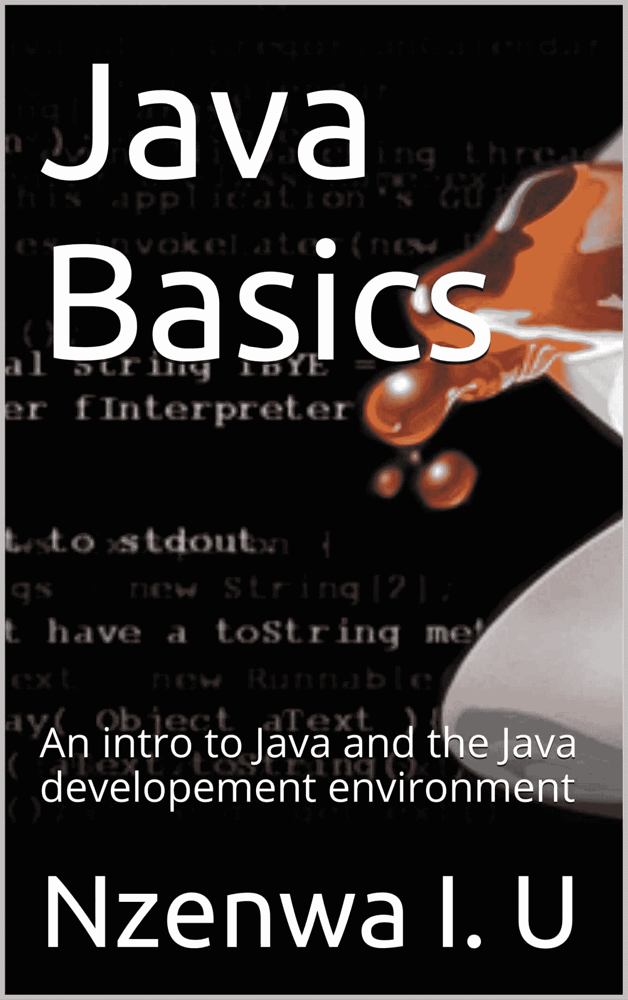

# Java 基础：Java 入门指南与 Java 开发环境



Java 可以在普通的文本编辑器中编写，并在命令提示符（Command Prompt）或终端中编译。编译通过`javac`完成，更多信息请访问 [Oracle](http://docs.oracle.com/javase/7/docs/technotes/tools/windows/javac.html)。

在本书中，我还将解释集成开发环境`Eclipse 4.2`。

## 常用概念

`Eclipse`是一个通用的编程平台，用于创建集成开发环境（IDE）。该平台基于开源构建。虽然`Eclipse`可以作为`C++`、`C#`等其他编程语言的 IDE，但它作为 Java IDE 非常受欢迎，并且内置了 Java 支持。

`Workbench`（工作区）指的是桌面开发环境。`Eclipse`的`Workbench`窗口包含一个或多个视角（perspectives）。视角定义了`Workbench`窗口中视图（views）的初始集合和布局。每个视角都提供一组旨在完成特定类型任务或工作的功能。视角控制某些菜单和工具栏中显示的内容。视角示例包括`Java`、`Debug`、`C++`等。

当第一次启动`Workbench`时，你看到的第一个是对话框，允许你选择`workspace`（工作空间）的位置。`workspace`是存储你工作的目录。选择工作空间位置后，会显示欢迎窗口（“Welcome to Eclipse IDE for Java Developers”）。你可以关闭“欢迎”窗口，并在需要时更改`workspace`。要开始 Java 开发，你应该选择必要的视角（`Window | Open Perspective | Other... | Java`）。在大多数情况下，这是默认视角。

如果`workspace`之前已经创建过，主窗口将根据所选视角打开几个视图。不必要的窗口应该关闭。你可以继续处理之前的项目，或者创建一个新项目。

## 创建新项目

要创建一个新项目，请选择主菜单中的`File | New | Project`功能。选择`Java Project`（适配后的菜单提供了快捷调用方式：`File | New | Java Project`）。现在点击 Next 按钮。在下一步中，你必须输入项目名称，然后点击 Finish 按钮。

所有的 Java 函数只能在类的上下文中实现。现在你应该创建一个带有`static main()`方法的新类，这是你 Java 程序的起点。选择`File | New | Class`功能激活类向导（Class Wizard）。它允许添加一个新的源文件，该文件包含对类的描述。现在你输入包名和类名。新类应该是`public`的。它必须包含`main()`方法。

假设名为`test`的包包含一个名为`TestClass`的类。类向导生成以下代码：

```java
package test;

public class TestClass {
    /**
    * @param args
    */
    public static void main(String[] args) {
        // TODO Auto-generated method stub
    }
}
```

此方法的参数`String[] args`提供了对命令行参数的访问。我的意思是：你想通过终端/cmd 运行程序，并想通过标志控制程序或内联输入值，你必须使用命令行参数。

```cmd
c:\myProgram -f arg3 arg4
```

如你所知，数组是从零索引的。因此，第一个参数是`args[0]`，即`myProgram`。`"-f"`是第二个参数，保存在`args[1]`中，依此类推。

让我们写一个程序读取`a`和`b`的值，然后返回`a+b`作为`c`。

```java
package test;

import java.util.Scanner;

public class TestClass {
    /**
    * @param args
    */
    public static void main(String[] args) {
        Scanner scanner = new Scanner(System.in);
        int a = scanner.nextInt();
        int b = scanner.nextInt();
        int c = a + b;
        System.out.println(c);
    }
}
```

对于那些不知道`import`和`java.util.Scanner`的人：

为了读取变量`a`和`b`的用户输入，你必须从控制台读取。因此，你需要类（`java.util.Scanner`）中的预定义方法。`Scanner`类接受一个参数（`System.in`）。由于你想在控制台扫描输入，你必须定义（`System.in`）。

结果使用`out`对象的`println()`方法打印到标准输出设备（控制台）。该对象是`System`类的静态字段。

如你所见，自动生成的源文件`TestClass.java`存储在`test`子文件夹中。你不能手动修改文件和文件夹的名称。源文件可以包含一个与文件名同名的唯一非嵌套公共类。包的名称始终与子文件夹名称相同。如果你想修改这些名称，应该使用`Refactor | Rename...`功能。

新程序应使用主菜单的`Run | Run (Ctrl-F11)`功能，或右键菜单的`Run as | Java Application`功能启动。你也可以使用`Run | Run Configurations...`功能创建运行时配置。选择 Java application 项然后点击 New。选择必要的项目名和类名并点击 Run 按钮。Eclipse 窗口下部会出现一个名为`Console`的特殊视图。下次你可以点击`"Run project name"`按钮（或`Ctrl-F11`）。

如果项目之前在另一计算机上创建，你可以将其复制到代表工作空间的文件夹，然后使用导入功能导入项目（`File | Import... | General | Existing Project into Workspace`）。导入不涉及项目的物理拷贝。

## 调试程序

调试用于发现和修复运行时错误。选择`Window | Open Perspective | Debug`功能进行调试。你可以添加断点（`Run | Toggle Breakpoint`，或`Ctrl-Shift-B`）。要在调试模式下运行程序，请使用`Run | Debug F11`。你还可以使用 Step Into（`F5`）和 Step Over（`F6`）功能。你可以在提示中获取变量的值。

`Run | Resume`功能允许你恢复执行。`Run | Terminate`功能终止执行。

## 常用程序结构

Java 中没有全局变量。这可以避免命名冲突。同样，也没有全局函数或过程。只有带有字段（数据成员）和方法（成员函数）的类。Java 程序由一个或多个类定义组成。这些类中必须有一个定义`main()`方法，这是程序开始运行的地方。类定义代码应该存储在带有`java`扩展名的文件中。类名（不带扩展名）必须与文件中定义的`public`类名匹配。请记住大写和小写字母是不同的。

每个类都被编译成自己的文件，包含二进制代码和`class`扩展名。与 C++ 不同，这种二进制代码不是特定处理器的机器指令集，而是所谓的字节码（bytecode）。

只有在安装了所谓的虚拟机的情况下，编译后的程序才能在你的计算机上执行。Java 虚拟机（`JVM`）是一个提供字节码解释的特殊程序。这种方法允许你创建可以从一个运行环境（操作系统、硬件平台）传输到另一个环境的应用，而无需额外的编译。与 C++ 不同，Java 不提供将二进制代码静态链接到可执行文件。链接（获取来自不同`class`扩展名文件的字节码并解释字节码）总是动态的。

### 标识符、关键字、保留字和注释

像 C++ 一样，Java 语言对大小写敏感。Java 源代码由标记（tokens）组成。标记是具有某些意义的字符序列。分隔符（空格、制表符、换行等）放置在各个标记之间。

标记分为以下几组：

- 关键字（保留字）
- 标识符
- 字面量（显式常量）
- 运算符

关键字集是有限的。所有关键字都是保留的。关键字不能用作标识符。在 Java 中，还有一些不是关键字的保留字。它们通常不能被使用。这些词是`const`和`goto`。

标识符用于命名变量、函数和其他软件对象。第一个字符必须是字母或下划线字符（`_`）。数字也可以作为非起始字符。在名称开头使用下划线是不理想的。

建议使用反映对象或函数性质的有意义的名称。不要在标识符内部使用空格。因此，如果你需要创建一个包含多个单词的标识符，应该将这些单词写在一起，并从第二个、第三个或其他单词的首字母开始大写。例如，你可以创建一个变量名：

```java
thisIsMyVariable
```

使用英文助记词来创建有意义的名称。类和接口的名称应以大写字母开头，其他名称仅以小写字母开头。静态常量名称由大写字母和下划线组成，例如`PI`、`CONST_VALUE`等。

### 注释

Java 语言支持三种注释：C++ 风格（双斜杠）、C 风格（`/* */`）和文档注释（`/** */`）。

JDK javadoc 工具在准备自动生成的文档时使用文档注释。文档注释必须按照 Javadoc 标准进行格式化。你可以添加类和接口级别的 Javadoc 注释，还可以添加方法、构造函数和字段级别的注释。文档注释必须放置在相应代码之前。每条注释由一个描述和随后的一个或多个标签组成。如果需要，你可以在 Javadoc 注释中使用 HTML 格式。有一组特殊的 Javadoc 标签，如`@author`、`@param`、`@return`等。这些标签允许对类和方法的文档进行标准表示。例如，方法前的以下注释：

```java
/**
* 返回给定索引的文件名。<br>
* 文件名存储在字符串数组中。
* @param i 索引
* @return 文件名。
* */
public String getFileName(int i) {
    return names;
}
```

产生如下 HTML 文档文件片段：

方法详情

`getFileName`

`public String getFileName(int i)`

返回给定索引的文件名。

文件名存储在字符串数组中。

参数：

`i` - 索引

返回值：

文件名。

## 局部变量与原始类型的定义

Java 支持在方法定义内部声明局部变量。这些局部变量的行为与 C++ 中的局部变量完全相同。以下是局部变量定义的示例。

```java
int i = 11;
double d= 0, x;
float f;
int j, k;
```

你可以在函数体或其他代码块的任何地方定义和初始化局部变量。你不能在外部块和内部块中使用相同的变量名：

```java
{
    int i = 0;
    {
        int j = 1; // OK。j 是内部块中定义的局部变量
        int i = 2; // 错误！外部块中已定义变量 i
    }
}
```

你不能只声明变量而不定义！

`final`关键字可以应用于变量。此类变量不能被修改。

```java
final int h = 0;
```

`const`关键字是 Java 中的保留字。这个词不能以任何方式使用。

原始（或基本）数据类型分为整数型（用于整数）、浮点型（用于小数）、字符型（用于 Unicode 字符）或布尔型（指定真/假）。原始类型局部变量的定义看起来类似于 C++ 编程语言。以下是原始数据类型：

### 整数

- `byte`：字节长度整数：8 位
- `short`：短整数：16 位
- `int`：整数：32 位
- `long`：长整数：64 位

### 实数

- `float`：单精度浮点数：32 位
- `double`：双精度浮点数：64 位

### 其他

- `char`：单个 Unicode 字符：16 位
- `boolean`：布尔值（真或假）

在某些语言中（例如 C 和 C++），原始数据类型的格式和大小取决于程序运行的平台。相比之下，Java 编程语言为所有平台指定了其原始数据类型的大小和格式。

整数常量由一系列十进制表示。此类常量的默认类型为`int`。可以通过在常量末尾添加字母`L`或`l`（long 类型）进行调整。整数常量可以用八进制表示，在这种情况下，第一位数字应该是零（`0`），且数字只能包含数字 0 ... 7。整数常量也可以用十六进制表示，在这种情况下，常量以`0x`（或`0X`）字符开头。为了表示 10 到 15 之间的数字，使用字母 a, b, c, d, e 和 f（大或小写）。例如：

```java
int octal = 023; // 19
int hex = 0xEF; // 239
```

字面量字符可以是单引号之间的任何单个 Unicode 字符。你可以使用当前字符集的符号，或者跟在反斜字符之前的整数常量。这是一组特殊的控制字符（这些双字符被称为转义序列）：

- `'\n'` - 换行
- `'\t'` - 水平制表符
- `'\r'` - 跳到行首
- `'\''` - 单引号
- `'\"'` - 双引号
- `'\\'` - 反斜杠

实类型常量可以带有小数点或科学计数法，并默认为`double`。如果需要，可以通过添加后缀`f`或`F`指定`float`类型，添加`d`或`D`指定`double`类型。例如：

`1.5f` // float

`2.4E-2` // double

你不能将浮点值赋值给整数变量。窄转换——从较大类型（例如`double`）转换为较小类型（例如`float`）存在风险。窄转换需要一种特殊操作，强制转换。例如：

```java
int i = 10;
float f = i; // 允许转换
long l = f; // 错误！窄转换
long l1 = (long) f; // 类型转换
```

可以通过数字后加上`L`或`l`来指定长整数。建议使用`L`因为它不会与数字`1`混淆。Java 语言没有无符号数据类型。什么是无符号数据类型？无符号数据类型类似于“无符号整变量”，这些变量不能包含负数。

两个布尔字面量简单的`true`和`false`。布尔类型与其他类型（特别是`int`）之间没有转换。你无法通过显式类型转换从布尔值获取整数，反之亦然。

字符串常量是封装在引号内的系列字符。例如：

`"这是一个字符串"`

将字符串与其他类型的变量相加可以将值转换为其字符串表示。特别是，这种方法用于输出多个变量的值。例如：

```java
int k = 1;
double d = 2.5;
System.out.println(k + " " + d); // 1 2.5
```

## 表达式与操作

Java 类包含字段（数据）和方法（函数）。方法可以包含语句，语句由表达式组成。表达式由一个或多个操作组成。

Java 支持几乎所有的 C++ 数值、逻辑和比较运算符。这些标准运算符在 Java 中的优先级和结合性与 C++ 相同。Java 仅在循环头部支持逗号运算符。

Java 提供了额外的无符号移动运算符（`>>>`）。

由于 Java 不允许直接操作指针，因此它不支持引用和解引用运算符`*`、`->`和`&`（取地址）。

Java 中没有`sizeof()`运算符。在 C++ 中，`sizeof()`运算符用于告知为数据项分配的字节数。Java 不需要为此目的提供`sizeof()`运算符，因为所有数据类型在所有机器上的尺寸都是相同的。

## 语句与程序执行控制

语句是编程语言中最小的独立部分。程序是语句的序列。大多数 Java 语句与 C++ 中的语句相似。

### 空语句

空语句由一个分号组成。

### 表达式语句

表达式语句是以分号结尾的表达式。例如下：

```java
k = i + j + 1; // assignment
Arrays.sort(a); // invocation of function
return; // termination of current function execution
```

### 复合语句

复合语句是封装在大括号中的语句序列。复合语句通常被称为“块”（block）。复合语句在右括号后不包含分号。从语法上讲，块可以被视为独立语句，但它也定义了可见性作用域。在块内部定义的标识符，其作用域从定义点持续到右括号。块可以相互嵌套。

### 选择语句

选择语句可以是常规语句或`switch`语句。条件语句有两种形式，如下：

```java
if (condition_expression)
statement1
else
statement2

//or

if (condition_expression)
statement1
```

如果`condition_expression`为真，则执行`statement1`，否则控制流跳转到`statement2`（第一种形式），或跳转到下一语句（第二种形式）。与 C++ 不同，`expression-condition`只能是布尔类型。

`switch`语句的语法与 C++ 相同。此外，Java 7 允许在`switch()`头部使用字符串表达式并在 case 标签中使用字符串常量。


单独使用的`break`和`continue`语句在 Java 中的行为与 C++ 相同。然而，在 Java 中，它们后面可以可选跟一个指定包含层循环的标签。这些语句的标签形式允许你在方法定义内“跳出”或“继续”任何指定的循环，而不仅仅是最近的包含层循环。例如：

```java
int a;
. . .
double b = 0;
label:
for (int i = 0; i < 10; i++) {
    for (int j = 0; j < 10; j++) {
        if (i + j + a == 0) {
            break label;
        }
        b += 1 / (i + j + a);
    }
}
```

`goto`语句目前不是 Java 语言的一部分，但`goto`是 Java 中的保留字。该词不能以任何方式使用。

Java 中没有`typedef`运算符。Java 不支持 C++ 的`struct`和`union`类型。

# 包与函数

Java 代码不需要头文件。所有代码都是内联的。为了避免命名冲突使用了包（packages）机制。在 Java 语言中，包用于分类类。

包是相关类和接口的集合，提供了访问保护和命名空间管理。

在 Java 语言中，每个类都必须放在一个包中。如果类的源代码顶部没有声明该类所属包的`package`语句，那么该类位于默认包中。

在物理上，每个包本质上是一个与包同名的文件夹。子包反映为子文件夹。

大多数 Java 程序的第一行是所谓的`package`语句。只有空行和注释可以出现在`package`语句之前。

```java
package package_name;
```

`package_name`指定包名。在语言中，每个类都必须放在一个包中。如果类的源代码顶部没有声明该类所属包的`package`语句，那么该类位于默认包中。

通过这种方式，你只能使用当前包或`java.lang`标准包的方法。该包提供了具有有用函数的类。例如，`Math`类提供了数值方法。

如果你想访问在其他包（不在`java.lang`中）中定义的类，你应该使用特殊前缀：`package_name.class_name`。如果你想访问嵌套包的类，前缀将更加复杂。为了避免使用全名，可以使用`import`指令。`import`指令应该放置在源文件的顶部（或紧跟在`package`语句之后）。

要导入位于不同包的类或接口，你有三个选择：

- 导入该类或接口（使用`import`关键字）。
- 导入该类或接口所属的整个包（使用`import`关键字）。
- 静态导入（Static import）

下面的示例演示了这些选择中的两种。

```java
import java.io.FileReader; // 导入类或接口
import java.util.*; // 导入整个包

public class TestClass {
    public static void main(String[] args) {
        java.io.FileWriter fw; // 全限定名
        FileReader fr; // 直接访问导入的名称；
        ArrayList al; // ArrayList 是 java.util 包的一部分
. . .
    }
}
```

你永远不需要`import java.lang.*`语句来使用该包中编译好的类。这个包总是自动导入的。

Java 5 版本中添加了一种新的导入形式，允许导入给定类的静态元素。大多数需要`Math`类数值函数的程序都包含以下语句：

```java
import static java.lang.Math.*;
```

现在你可以在不需要额外修饰符的情况下调用`Math`类的静态方法：

```java
double d = sin(1);
```

# 命令行参数的使用和控制台输入

你可以在 Java 程序中轻松地读取命令行参数。例如，下面的程序会在屏幕上显示第一个命令行参数的值：

```java
public static void main(String[] args) {
    System.out.println(args[0]);
}
```

`main()`函数中的命令行参数可以以字符串数组的形式访问（数组和字符串将在稍后解释）。要访问特定的数组元素，使用`[]`。要获取由字符串表示的数值，则使用`Integer`和`Double`类的静态函数。在下面的示例中，程序从命令行读取整数值和实数值并计算它们的和。

```java
Public class TestArgs {
    public static void main(String[] args) {
        int n = Integer.parseInt(args[0]);
        double x = Double.parseDouble(args[1]);
        double y = n + x;
        System.out.println(y);
    }
}
```

命令行中输入的参数数量可以使用`args.length`表达式来确定。

要在 eclipse 环境中设置命令行参数，可以使用 "Run" 窗口的`Arguments`选项卡。必要的参数应该输入到 "Program arguments:" 文本区域。包含多个单词的字符串类型参数应该加引号。

# 控制台输入与输出

你可以使用`java.util`包中的`Scanner`类从键盘运行时输入数据。对于运行时的键盘输入，你可以使用`java.util`包中的`Scanner`类。首先，我们需要通过`new`操作创建该类的对象。

```java
Scanner s = new Scanner(System.in);
```

现在这个对象可以用于读取不同类型的数据。例如，`next()`函数返回下一个读取的`String`类型值，`nextInt()`允许获取一个整数，`nextDouble()`读取并返回 double 类型数字。还有`nextBoolean()`、`nextByte()`、`nextShort()`、`nextLong()`、`nextFloat()`等函数。所有这些函数都会导致程序终止，并在从键盘读取到相应值后恢复。例如：

```java
Scanner s = new Scanner(System.in);
double d = s.nextDouble();
int i = s.nextInt();
float f = s.nextFloat();
```

输出到控制台窗口基于使用`System`类中声明的`out`对象的方法。`print()`函数可以打印结果而不跳换行，`println()`函数在输出后将光标移动到新行。你也可以使用`printf()`进行格式化输出。使用该函数类似于在 C 语言中使用。

下面的示例程序读取实数和整数，并显示它们的和：

```java
import java.util.Scanner;

public class Average {
    public static void main(String[] args) {
        Scanner s = new Scanner(System.in);
        int i = s.nextInt();
        double d = s.nextDouble();
        double sum = i + d;
        System.out.println("Sum: " + sum);
    }
}
```

# 引用

Java 中没有指针类型。非基本类型变量的本质上是指向对应对象的引用名称。这些非基本类型通常被称为引用类型，因为它们通过引用进行处理。相比之下，基本类型是通过值处理的。Java 中不存在解引用运算符`*`和引用运算符`->`：基本类型总是按值传递的；数组和对象总是按引用传递的。引用类型永远无法转换为基本类型，反之亦然。Java 不允许你进行指针算术。

特殊关键字`null`被用作指向“无”的引用。它表示“引用的缺失”。`null`值可以被赋值给任何引用类型的变量。

你可以使用`new`运算符在动态存储区中创建对象：

```java
SomeType st = newType();
```

由于引用类型是按值传递的，将一个对象赋值给另一个仅仅是赋值引用。

```java
SomeType a = newType();
SomeType b = newType();
a = b;
```

在执行这些行后，变量`a`包含了`b`所指向的对象引用。你不需要释放对象。Java 中没有`delete`运算符。一种特殊的垃圾回收机制用于对象的释放。这意味着每个对象都包含一个引用计数，每当附加引用时，计数增加。每当引用超出作用范围或设置为`null`时，计数减少。

# 数组

Java 数组是零索引的；也就是说，索引从零开始。在声明数组时，方括号`[]`必须放在类型后面。将括号放在标识符后面在 Java 中是合法的但不推荐。

```java
int[] a;
```

在示例中，`a`是一个之后创建的数组引用。数组的大小不是类型的一部分，就像在 C++ 中那样。这允许你声明一个数组并将任何对象数组赋值给它，无论数组长度如何。

```java
int[] numbers; // 声明
```

Java 支持单维数组和多维数组（数组数组）。下面的示例展示了如何声明不同类型的数组引用：

```java
int[] numbers; // 单维数组
byte[][] scores; // 二维数组
```

声明引用不会实际创建数组。在 Java 中，数组是对象，必须进行实例化。下面的示例展示了如何创建数组：

```java
int[] numbers = new int[5]; // 单维数组
String[][] names = new String[5][4]; // 矩形数组
byte[][] scores = new byte[5][]; // 锯齿数组

for (int x = 0; x < 5; x++) {
    scores[x] = new byte[x + 4];
}
```

最后一个示例展示了如何创建行长度不同的二维数组。数组的大小可以使用整数常量、变量以及计算结果为整数的表达式来定义。

在 Java 中，数组持有元素以及它们的数量。元素的数量可以通过特殊的只读字段`length`来获取：

```java
int[] a = new int[10];
System.out.println(a.length); // 10
```

典型的数组遍历如下：

```java
for (int i = 0; i < a.length; i++) {
    a[i] = 0;
}
```

Java 提供了一种在声明时通过将初始值封装在大括号（`{}`）中来初始化数组的简单方法。如果数组在声明时没有初始化，数组成员将自动初始化为该数组类型的默认初始值。

```java
int[] numbers = new int[] {1, 2, 3, 4, 5};
String[] names = new String[] {"Matt", "Joanne", "Robert"};
```

如果提供了初始化器，可以省略`new`语句，如下：

```java
int[] numbers = {1, 2, 3, 4, 5};
String[] names = {"Matt", "Joanne", "Robert"};
```

多维数组可以以类似的方式初始化：

```java
int[][] b = {{1, 2, 3},
{0, 0, 1},
{1, 1, 11},
{0, 0, 0}};
```

在这个示例中，二维数组包含四行三列。

`for`循环的新形式简化了整个数组的遍历。例如，与其使用

```java
int[] nums = {1, 2, 3, 4, 5, 6};
for (int i = 0; i < nums.length; i++)
    System.out.println(nums[i]);
```

你也可以写成

```java
int[] nums = {1, 2, 3, 4, 5, 6};
for(int n : nums)
    System.out.println(n);
```

新形式可以仅用于读取元素（不用于修改）。

将一个数组赋值给另一个数组本质上是引用的复制。如果你想将数组`a`的所有元素赋值给数组`b`的元素，必须创建一个循环。`System`类提供了一种最简单的将数组复制到另一个数组的方法：`arraycopy()`函数：

```java
System.arraycopy(a, a_from, b, b_from, size);
```

这等于以下循环：

```java
for (int i = a_from, j = b_from; i < size + a_from; i++, j++) {
    b[j] = a[i];
}
```

你可以使用此类函数调用将整个数组`a`复制到`b`：

```java
System.arraycopy(a, 0, b, 0, a.length);
```

# 类定义

类是一种结构化数据类型，包含不同类型的数据成员以及处理这些数据的函数。类定义包含修饰符（例如`public`、`final`）、类名、基类名、实现的接口列表以及封装在大括号中的类体。

类体包含字段（C++ 中的数据成员）和方法（C++ 中的成员函数）的声明。变量和方法共同统称为成员。Java 类的声明看起来与 C++ 非常相似。这里有一个简单类的示例：

```java
class Rectangle {
    double width;
    double height;
    double area() {
        return width * height;
    }
}
```

注意，你不需要在右大括号后加分号。在 Java 中，方法始终位于类定义内部，而不是像程序员在 C++ 中通常那样使用`::`运算符放在外部。

Java 使用默认值初始化所有字段。与 C++ 不同，Java 允许在就处初始化字段：

```java
class Rectangle {
    double width = 10;
    double height = 20;
    double area() {
        return width * height;
    }
}
```

你可以在类体内创建初始化块：

```java
class Rectangle {
    double width;
    double height;
    {
        width = 10;
        height = 20;
    }
    double area() {
        return width * height;
    }
}
```

方法和字段可以使用`static`关键字声明。静态方法可以在没有实例的情况下调用。静态字段可以使用类名访问。静态字段是一种在类作用域内定义的全局变量。你不需要在全局作用域内定义静态成员。你可以在就处初始化静态字段：

```java
class SomeClass {
    static double x = 10;
    static int i = 20;
}
```

你可以为静态字段创建初始化块：

```java
class SomeClass {
    static double x;
    static int i;
    static {
        x = 10;
        i = 20;
    }
}
```

与非静态初始化相比，静态字段的创建发生在类的首次使用。Java 不为空闲类创建静态成员。

你可以使用类名和对象名访问静态成员：

```java
SomeClass.x = 30;
SomeClass s = new SomeClass();
s.x = 40;
```

在 Java 方法中，参数是按值传递的。

`this`关键字指向调用方法的实例。所有非静态方法都会隐式地获取`this`。如果你想返回当前对象的引用或需要防止名称冲突，可以显式使用此引用。静态成员函数没有`this`。

# 可见性

像 C++ 一样，Java 支持`private`、`protected`和`public`可见性。类本身可以指定为`public`。与 C++ 不同，Java 要求对任何成员单独定义可见性：

```java
public class SomeClass {
    private int i;
    private double x;
    public void setI(int value) {
        i = value;
    }
    public int getI() {
        return i;
    }
    public void setX(double value) {
        x = value;
    }
    public int getI() {
        return i;
    }
}
```

对`private`类成员的访问限制在类内部的方法。没有`friend`关键字。`public`类成员可以被任何函数访问。

对`protected`类成员的访问限制在类内部的方法、派生类以及当前包。

# 构造函数

用户通过对类应用`new`运算符来实例化。

构造函数是一个名称与类名匹配且不定义任何返回类型的函数。类可以定义多个构造函数。如果类没有定义构造函数，则提供一个默认（无参数）构造函数。默认构造会将所有字段初始化为默认值。


你可以使用`this`从另一个构造函数调用带参数的构造函数：

```java
class Rectangle {
    double width;
    double height;
    Rectangle(double width, double height) {
        this.width = width;
        this.height = height;
    }

    Rectangle() {
        this(10, 20); // 调用另一个构造函数
    }
}
```

Java 中没有析构函数。你可以创建一个特殊的方法`finalize()`。垃圾回收器在对象销毁之前调用`finalize()`方法。对象永远不会被垃圾回收器销，因此`finalize()`方法永远不会调用。

# 字符串

Java 中的字符串是`java.lang.String`类的实例。字符串对象表示 Unicode 字符字符串。

你可以简单地通过封装双引号来创建`String`对象：

```java
String s = "The first string";
```

当一个或两个操作数为字符串类型时，预定义的加运算符会拼接操作数的字符串表示

`String`实例是不可变的，因为一旦创建就无法修改。看似修改字符串的方法实际上返回包含修改内容的字符串。如果你需要修改字符串的内容，必须从字符串对象创建一个`StringBuffer`对象，修改`StringBuffer`的内容，然后从`StringBuffer`的内容创建一个新字符串。

一些重要的字符串方法如下：

`length()`返回字符串中字符的`int`数量。

`charAt(int index)`返回字符串中指定索引处的字符。

`equals(Object obj)`将此字符串与指定对象比较，返回 true 或 false。

`compareTo(String value)`将字符串与参数字符串比较。如果此`String`对象在字典顺序上于参数字符串，结果为负整数。如果此`String`对象在字典顺序上于参数字符串，结果为正整数。如果字符串相等，则结果为零。

`indexOf(char ch)`返回指定字符首次出现的索引位置。

`substring(int beginIndex,int endIndex)`：返回一个作为该字符串的子字符串的新字符串。

`toLowerCase()`：返回小写的字符串。

`toUpperCase()`：返回大写的字符串。

以下示例演示了用于处理字符串数据的方法的使用。

```java
String s1 = new String("Hello World.");

int i = s1.length(); // i = 12

char c = s1.charAt(6); // c = 'W'

i = s1.indexOf('e'); // i = 1 (index of 'e' in "Hello World.")

String s2 = "abcdef".substring(2, 5); // s2 = "cde"

int k = "AA".compareTo("AB"); // k = -1
```

Java 语言对字符串拼接运算符（`+`）提供了特殊支持，并支持将其他对象转换为字符串。“加号”运算符用于字符串拼接：

```java
String s1 = "first";
String s2 = s1 + " and second";
```

如果其中一个操作数不是字符串类型，Java 会自动获取其字符串表示。

```java
int n = 1;
String sn = "n is " + n; // "n is 1"

double d = 1.1;
String sd = d + ""; // "1.1"
```

你也可以使用`+=`运算符。

## Integer 和 Double 类

`Integer`和`Double`类将原始类型`int`和`double`的值封装在适当的对象中。此外，这些类还提供了多种方法将数值转换为`String`以及将字符串转换为数字，以及在处理整数和双精度浮所需的常量和其他方法。

`Double.parseDouble()`函数返回一个新的`double`，其初始化为指定字符串所表示的值：

```java
String s = "1.2";
double d = Double.parseDouble(s);
```

函数`Integer.parseInt()`和`Boolean.parseBoolean()`提供类似的功能。

在 Java 5 (JDK 1.5) 中，`Integer`类型的对象可以使用`int`类型的表达式进行初始化。此类对象可以在表达式中作为整数值使用。`int`类型的常量和表达式可以添加到列表和容器中，会自动创建`Integer`对象。在之前的版本中，你应该这样写：

```java
Integer m = new Integer(10); // Integer 对象的初始化
int k = m.intValue() + 1; // 存储的值在表达式中使用

// 创建数组：
Integer[] a = {new Integer(1), new Integer(2), new Integer(3)};
List li = new ArrayList();
a[2] = new Integer(4); // 用新对象替换给定元素

// 提取 Integer 对象并使用其值：
int i = a[1].intValue() + 2;
```

在 Java 5 中，这段代码可以更简单：

```java
Integer m = 10; // Integer 对象的初始化
int k = m + 1; // 存储的值在表达式中使用

// 创建数组：
Integer[] a = {1, 2, 3};
a[2] = 4; // 用新对象替换给定元素

// 提取 Integer 对象并使用其值：
int i = a[1] + 2;
```

相同的规则也适用于`Double`和`Boolean`类型。事实上，`Integer`、`Double`和`Boolean`对象可以替代`int`、`double`和`Boolean`变量。

### 类组合

类组合假设创建某些类，这些类包含其他类的对象作为类字段。在 Java 中，你不能将对象放入另一个对象中。这里只允许引用。你可以在声明后或在构造函数中创建对象。

```java
ClassX {
}

class Y {
}

class Z {
    X x = new X();
    Y y;
    Z() {
        y = new Y();
    }
}
```

我认为，细节是编程中最重要的部分。因此，我试图解释每一个细节。

希望我没有忘记什么，并且发现这本书有用。如果有任何不理解，请随时向我提问。请发送邮件至`renuxsofttech@gmail.com`。
