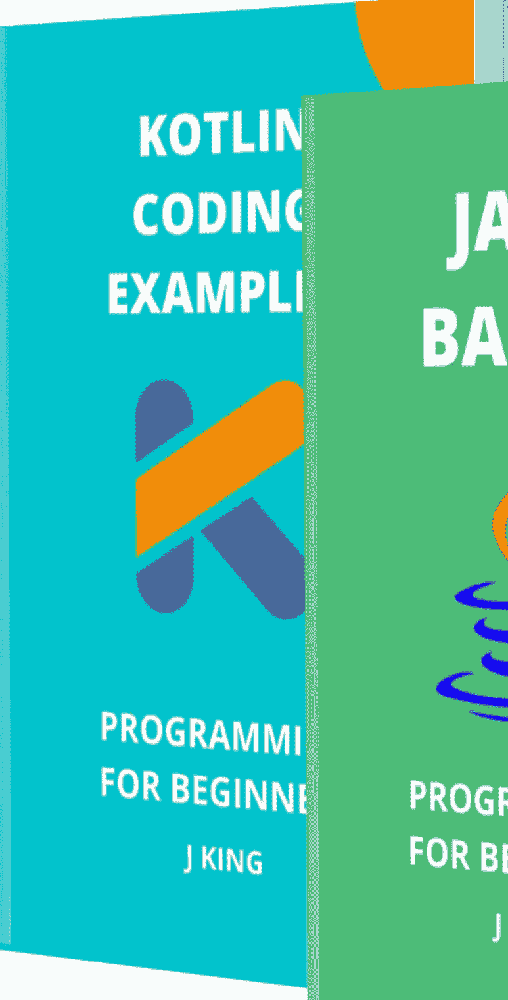
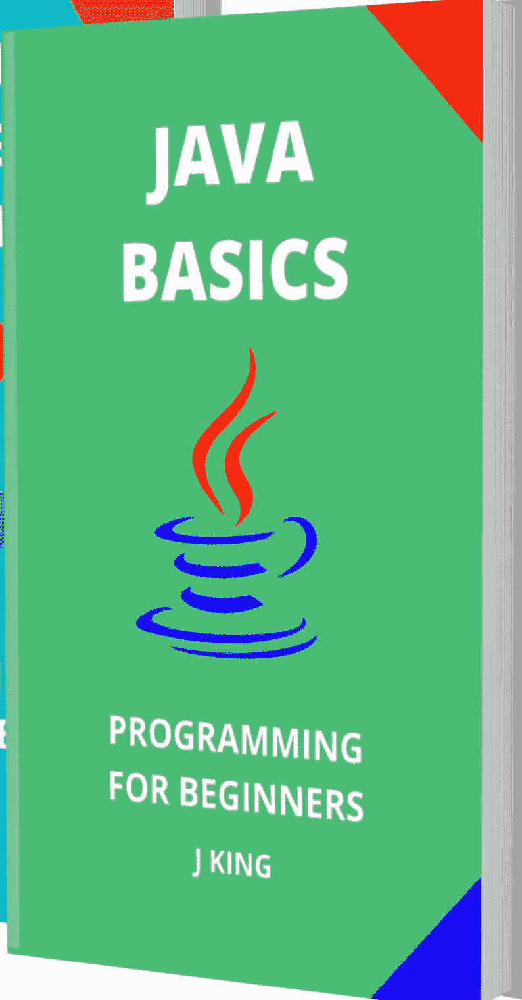
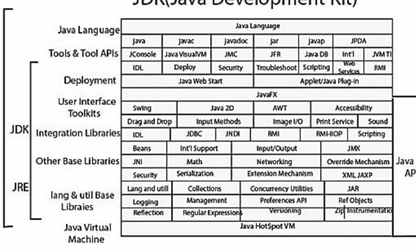
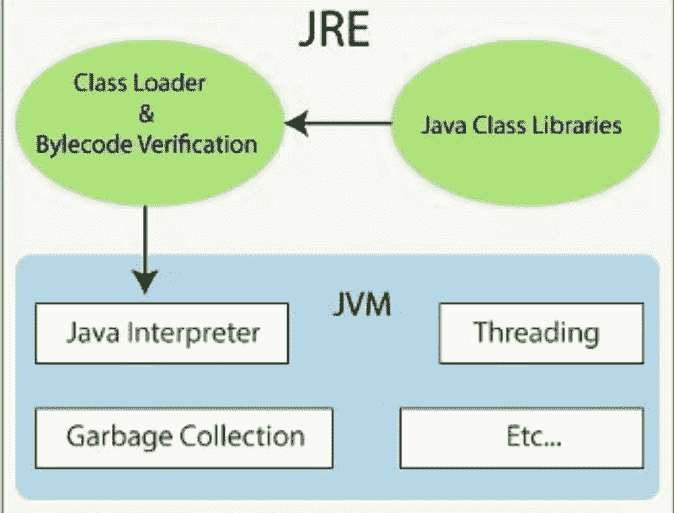
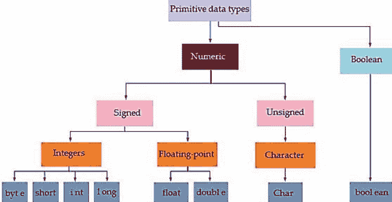
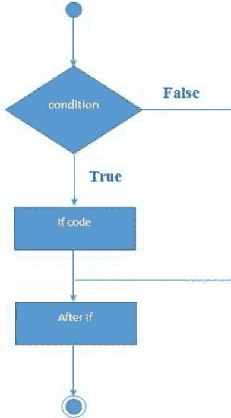
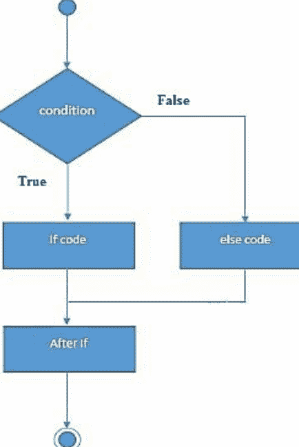
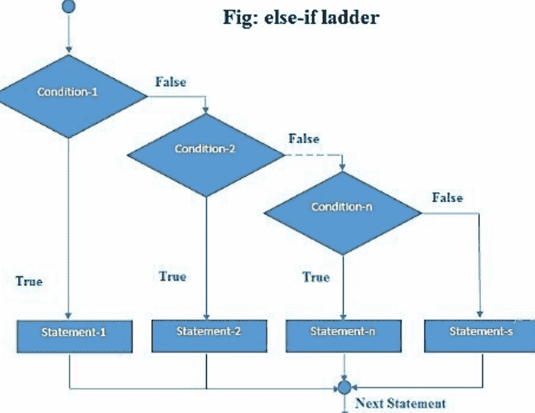
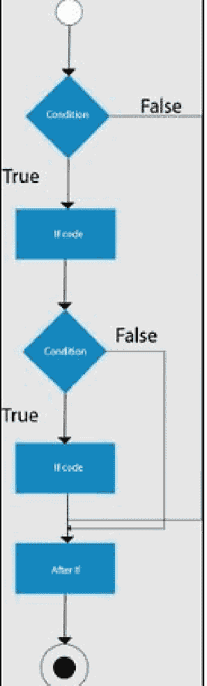

# JAVA 基础与 Kotlin 编码示例：初学者编程指南





## JAVA 简介

Java 语言的设计初衷考虑了可移植性、简单性。

尽管如此，Java 拥有许多特性使其成为一种常用的语言。

我们将程序结构化为一组对象和操作。

Java 是“一次编写，到处运行”（WORA）的语言，它是平台无关的，因为它可以在不同的处理器上运行。

### Java 的演变

| 版本 | 发布日期 | 特性 |
| --- | --- | --- |
| JDK Beta | 1995 | |
| JDK 1.0 | 1996 | 第一个稳定版本 |
| JDK 1.1 | 1997 | |
| JSE 1.2 | 1998 | 引入了 Swing 等 |
| JSE 1.3 | 2000 | |
| JSE 1.4 | 2002 | 引入了本地类、JavaBeans 和远程方法调用。 |
| JSE 5.0 | 2004 | 引入了泛型、注解和自动装箱。 |
| JSE 6.0 | 2006 | 引入了多线程。 |
| JSE 7.0 | 2011 | 引入了异常处理增强。 |
| JSE 8.0 | 2014 | 引入了 Lambda 表达式。 |
| JSE 9 | 2017 | 引入了模块化。 |
| JSE 10 | 2018 | 引入了 `var` 关键字。 |
| JSE 11 | 2018 | 引入了本地变量。 |
| JSE 12 | 2019 | 引入了 HTTP API。 |

### C++ 对比 JAVA

C++ 是一种面向对象的语言。

Java 是一种面向对象的语言，它包含了 C++ 的许多特性。

Java 语言的设计初衷考虑了可移植性、简单性。

尽管如此，Java 拥有许多特性使其成为一种常用的语言。

我们将程序结构化为一组对象和操作。

Java 是“一次编写，到处运行”（WORA）的语言，它是平台无关的，因为它可以在不同的处理器上运行。

| C++ | JAVA |
| --- | --- |
| C++ 是一种面向对象的语言。 | Java 是一种面向对象的语言，它包含了 C++ 的许多特性。 |
| C++ 是平台依赖的。 | Java 是平台无关的，因为它编写的代码可以在任何平台上运行。 |
| C++ 支持直接代码执行。 | Java 使用 JVM（Java虚拟机）。代码会被发送到 JVM 执行。 |
| C++ 是平台依赖的。 | Java 是平台无关的。 |

| 特性 | C++ | Java | C |
| --- | --- | --- | --- |
| own | C++ 支持自底而上的方法。 | Java 也支持自底而上的方法。 | C 支持自顶而下的方法。 |
| 文件生成 | C++ 编译后生成 `.exe` 文件。 | Java 编译程序后生成 `.class` 文件。 | C 也会创建 `.exe` 文件。 |
| 预处理器指令 | C++ 遵循 `#include` 和 `#define` 来包含预处理器指令。 | Java 使用 `import` 选项来导入所需的包。 | C 作为 C++ 的前身，它也遵循 `#include` 和 `#define`。 |
| 关键字 | C++ 语言有 63 个定义关键字。 | Java 语言有 50 个定义关键字。 | C 语言支持 52 个关键字。 |
| 数据类型 | C++ 编程支持联合体（union）和结构体（structure）。 | Java 不支持联合体和结构体。 | C 语言支持联合体和结构体。 |
| 继承 | C++ 和 Java 都支持继承。 | 但 Java 不支持多继承。为了支持多继承，Java 必须使用接口。 | 不支持继承 |
| 范式 | C++ 是一种面向对象的语言。 | Java 是一种面向对象的语言。 | C 是过程化的语言。 |
| 起源 | C++ 由 Bjarne Stroustrup 在 1979 年发明。 | Java 由 James Gosling 在 1991 年发明。 | C 由 Dennis Ritchie 在 1972 年发明。 |
| 翻译 | C++ 使用编译器将代码转换为二进制代码。 | Java 使用解释器处理代码。 | C 使用编译器翻译二进制代码。 |
| 平台依赖 | C++ 编程是平台依赖的。 | Java 是平台无关的，编写的代码可以在任何平台上运行。 | C 也是平台依赖的。 |
| 代码执行 | C++ 支持直接代码执行。 | Java 遵循 JVM（Java虚拟机）。代码会被发送到 JVM 执行。 | C 语言遵循直接代码执行。 |
| 方法 | C++ 支持自底而上的方法。 | Java 也支持自底而上的方法。 | |
| 文件生成 | C++ 编译程序后生成 `.exe` 文件。 | Java 编译程序后生成 `.class` 文件。 | |
| 预处理器指令 | C++ 遵循 `#include` 和 `#define` 来包含预处理器指令。 | Java 使用 `import` 选项来导入所需的包。 | |
| 关键字 | C++ 语言有 63 个定义关键字。 | Java 语言有 50 个定义关键字。 | |
| 数据类型 | C++ 编程支持联合体（union）和结构体（structure）。 | Java 不支持联合体和结构体。 | |
| 继承 | C++ 和 Java 都支持继承。 | 但 Java 不支持多继承。为了支持多继承，Java 必须使用接口。 | |
| 异常处理 | C++ 支持异常处理。 | Java 也支持异常处理。 | C 不支持异常处理。 |
| 模板 | C++ 支持模板。 | Java 不支持模板。 | C 不支持模板。 |
| 析构函数 | C++ 支持 | Java 不认可 | C 既不支持构造函数也不支持析构函数。 |
| 多线程/ 接口 | C++ 编程语言不支持多线程。 | Java 支持多线程以解决多继承问题。 | 作为 C++ 的前身，它也不支持多线程。 |
| 数据库连接 | C++ 不支持数据库连接。 | Java 支持数据库连接。 | C 语言不支持数据库连接。 |
| 存储类 | C++ 支持存储类 | Java 不支持存储类 | C 支持存储类。 |

### Java Hello World

从开始，编写一个简单的程序在输出窗口中打印“Hello World”。

在任何文本编辑器或集成开发环境 (IDE)（如 Eclipse, Netbeans 等）中编写软件，并将其保存为 `a.java` 文件。

你可以通过在命令提示符或 Linux 终端中输入 `javac filename.java>` 来编译文件，或者点击你正在使用的 IDE 工具栏上的播放按钮。

在终端/命令提示符中输入 `java filename>` 来运行你的程序。

```java
public class MyClass //class
{
    //这是 main 方法
    public static void main(String[] args)
    {
        //显示 Hello World
        System.out.println("Hello World");
    }
}
```

在在 Java 中运行的每行代码必须写在类内部。在我们的示例中，我们将类命名为 `MyClass` 并在其中编写了代码。

入口点或起点是上述程序中的关键方法。以下是 `main` 方法中使用的关键字的概述：

- `Public` - 这种方法对所有人可用。
- `Static` - 该方法可以在无需构建包含 `main` 方法的实例的情况下直接运行。
- `Void` - 系统不返回任何值。
- `Main` - 该过程被称为 Primary（主）。
- `String []` - 该方法只接受一个参数：一个 `String` 元素数组。

注释：在程序中，有两种方式来编写注释。它可以是单行语句或多行语句。

单行注释：在任何行的开头使用双正斜杠 ( `//` ) 来定义它。

多行注释：在段落的两端使用单正斜杠和星号 ( `/* comment */` ) 来刻画它。

### JDK | Java 开发工具包

Java Development Kit 是用于开发 Java 程序的软件环境。

JRE (Java 运行环境)、`java` (解释器)、`javac` (编译器)、归档器、文档生成器以及用于 Java 应用开发的其他工具都包含在 JDK 中。

Oracle 公司为在 Solaris、Linux、Windows 或 macOS 上运行的 Java 开发者提供了该平台的二进制产品。



### JRE (Java 运行环境)

JRE 是一个安装在任何操作系统上的安装包，允许你运行 Java 程序。它与应用程序的创建几乎无关。

它包含在 Java 开发工具包 (JDK) 中。

它是一个包含 Java 类库、工具和独立 JVM 的软件工具包。



JRE 是移动设备上运行 Java 程序最流行的环境。

源代码被编译并转换为 Java 字节码。

如果我们想在任何操作系统上运行这些字节码，我们只需要一个对应操作系统的 JRE，它可以在 Oracle 网站上免费获取。

JRE 获取类、验证内存访问并检索生成程序所需的系统资源。

### JRE 的工作

在任何文本编辑器或集成开发环境 (IDE)（如 Eclipse, Netbeans 等）中编写软件，并将其保存为 `a.java` 文件。

你可以通过在命令提示符或 Linux 终端中输入 `javac filename.java>` 来编译文件，或者点击你正在使用的 IDE 工具栏上的播放按钮。

在终端/命令提示符中输入 `java filename>` 来运行你的程序。


## JRE (Java 运行环境)

JRE 是一个安装在任何操作系统上的安装包，允许你运行 Java 程序。它与应用程序的创建几乎无关。

它包含在 Java 开发工具包 (JDK) 中。

它是一个包含 Java 类库、工具和独立 JVM 的软件工具包。


JRE 是移动设备上运行 Java 程序最流行的环境。

源代码被编译并转换为 Java 字节码。

如果我们想在任何操作系统上运行这些字节码，我们只需要一个对应操作系统的 JRE，它可以在 Oracle 网站上免费获取。

JRE 获取类、验证内存访问并检索生成程序所需的系统资源。

| | 处理。 | 异常处理。 | 异常处理。 |
|---|---|---|---|
| 模板 | C++ 支持模板。 | Java 不支持模板。 | C 不支持模板。 |
| 析构函数 | C++ 支持 | Java 不认可 | C 既不支持构造函数也不支持析构函数。 |
| 多线程/ 接口 | C++ 编程语言不支持多线程。 | Java 支持多线程以解决多继承问题。 | 作为 C++ 的前身，它也不支持多线程。 |
| 数据库连接 | C++ 不支持数据库连接。 | Java 支持数据库连接。 | C 语言不支持数据库连接。 |
| 存储类 | C++ 支持存储类 | Java 不支持存储类 | C 支持存储类。 |

## Java Hello World

从开始，编写一个简单的程序在输出窗口中打印“Hello World”。

在任何文本编辑器或集成开发环境 (IDE)（如 Eclipse, Netbeans 等）中编写软件，并将其保存为`a.java`文件。

你可以通过在命令提示符或 Linux 终端中输入`javac filename.java>`来编译文件，或者点击你正在使用的 IDE 工具栏上的播放按钮。

在终端/命令提示符中输入`java filename>`来运行你的程序。

```java
public class MyClass //class
{
    //这是 main 方法
    public static void main(String[] args)
    {
        //显示 Hello World
        System.out.println("Hello World");
    }
}
```

在在 Java 中运行的每行代码必须写在类内部。在我们的示例中，我们将类命名为`MyClass`并在其中编写了代码。

入口点或起点是上述程序中的关键方法。以下是`main`方法中使用的关键字的概述：

- `Public` - 这种方法对所有人可用。
- `Static` - 该方法可以在无需构建包含`main`方法的实例的情况下直接运行。
- `Void` - 系统不返回任何值。
- `Main` - 该过程被称为 Primary（主）。
- `String []` - 该方法只接受一个参数：一个`String`元素数组。

注释：在程序中，有两种方式来编写注释。它可以是单行语句或多行语句。

单行注释：在任何行的开头使用双正斜杠 (`//`) 来定义它。

多行注释：在段落的两端使用单正斜杠和星号 (`/* comment */`) 来刻画它。

## JDK | Java 开发工具包

Java Development Kit 是用于开发 Java 程序的软件环境。

JRE (Java 运行环境)、`java`(解释器)、`javac`(编译器)、归档器、文档生成器以及用于 Java 应用开发的其他工具都包含在 JDK 中。

Oracle 公司为在 Solaris、Linux、Windows 或 macOS 上运行的 Java 开发者提供了该平台的二进制产品。

## JDK(Java 开发工具包)


## JRE (Java 运行环境)

JRE 是一个安装在任何操作系统上的安装包，允许你运行 Java 程序。它与应用程序的创建几乎无关。

它包含在 Java 开发工具包 (JDK) 中。

它是一个包含 Java 类库、工具和独立 JVM 的软件工具包。


JRE 是移动设备上运行 Java 程序最流行的环境。

源代码被编译并转换为 Java 字节码。

如果我们想在任何操作系统上运行这些字节码，我们只需要一个对应操作系统的 JRE，它可以在 Oracle 网站上免费获取。

JRE 获取类、验证内存访问并检索生成程序所需的系统资源。

```java
public static void main(String args[]){
    int a = 10;
    int b = 5;
    System.out.println(a+b); //15
    System.out.println(a-b); //5
    System.out.println(a*b); //50
    System.out.println(a/b); //2
    System.out.println(a%b); //0
}
```

# 输出:

15

5

50

2

0

# Java 算术运算符示例：表达式

```java
class OperatorExample{
    public static void main(String args[]){
        System.out.println(10 * 10 / 5 + 3 - 1 * 4 / 2);
    }
}
```

# 输出:

21

# Java 左移运算符

Java 左移运算符`<<`将值中的所有比特位向左移动指定的位数。

# 示例

```java
class OperatorExample{
    public static void main(String args[]){
        System.out.println(10<<2);//10*2^2=10*4
        System.out.println(10<<3);//10*2^3=10*8
        System.out.println(20<<2);//20*2^2=20*4
        System.out.println(15<<4);//15*2^4=15*16
    }
}
```

输出:

40

80

240

# Java 右移运算符

Java 右移运算符`>>`将左操作数的值按右侧操作数定义的位数向右移动。

# 示例

```java
class OperatorExample{
    public static void main(String args[]){
    System.out.println(10>>2);//10/2^2=10/4=2
    System.out.println(20>>2);//20/2^2=20/4=5
    System.out.println(20>>>3);//20/2^3=20/8=2
    }
}
```

输出:

2

5

2

## Java AND 运算符示例：逻辑 && 与位与 &

如果第一个条件为假，逻辑运算符`&&`运算符将不会验证第二个条件。只有当第一个条件为真时，它才会测试第二个条件。

无论第一个条件为真还是为假，位与运算符`&`总是总是会测试两个条件。

```java
class OperatorExample{
    public static void main(String args[]){
    int a = 10;
    int b = 5;
    int c = 20;
    System.out.println(a<b&&a<c); //false && true = false
    System.out.println(a<b&a<c); //false & true = false
    }
}
```

输出:

false

false

# Java 运算符示例：逻辑 && 与位与 &

```java
class OperatorExample{
    public static void main(String[] args){
        int a = 10 ;
        int b = 5 ;
        int c = 20;
        System.out.println(a<b&&a++c); //false && true = false
        System.out.println(a); //10 因为第二个条件没有被检查
        System.out.println(a<b&&a++c); //false && true = false
        System.out.println(a); //11 因为第二个条件被检查了
    }
}
```

输出:

false

10

false

11

## Java OR 运算符示例：逻辑 || 与位或 |

如果第一个条件为真，逻辑运算符`||`运算符将不会验证第二个条件。只有当第一个条件为假时，它才会测试第二个条件。

无论第一个条件为真还是为假，位或运算符`|`总是会测试两个条件。

```java
class OperatorExample{
    public static void main(String args[]){
        int a=10;
        int b=5;
        int c=20;
        System.out.println(a>b||a<c);//true || true = true
        System.out.println(a>b|a<c);//true | true = true
        //| vs |
        System.out.println(a>b||a++c);//true || true = true
        System.out.println(a>b|a++c);//10 因为第二个条件没有被检查
        System.out.println(a>b|a++c);//true | true = true
        System.out.println(a);//11 第二个条件被检查了
    }
}
```

输出:

true

true

true

10

true

11

## Java 三元运算符

在 Java 编程中，三元运算符是`if-then-else`语句的单行替代方案。它是唯一接受三个操作数的条件运算符。

### 示例 1

```java
class OperatorExample{
  public static void main(String args[]){
    int a=2;
    int b=5;
    int min=(a<b)?a:b;
    System.out.println(min);
  }
}
```

输出:

2

### 示例 2

```java
class OperatorExample{
  public static void main(String args[]){
    int a=10;
    int b=5;
    int min=(a<b)?a:b;
    System.out.println(min);
  }
}
```

输出:

5

## Java 赋值运算符

Java 中常用的运算符之一是赋值运算符。它用于将右侧的值分配给左侧的操作数。

# 示例

```java
class OperatorExample{
public static void main(String args[]){
int a=10;
int b=20;
a+=4;//a=a+4 (a=10+4)
b-=4;//b=b-4 (b=20-4)
System.out.println(a);
System.out.println(b);
}
}
```

# 输出:

14

16

## Java 赋值运算符示例：加 short 类型

```java
class OperatorExample{
public static void main(String args[]){
short a = 10 ;
short b = 10 ;
//a+=b;//a=a+b 内部处理没问题
a=a+b; // 编译错误，因为现在 10+10=20 是 int 类型
System.out.println(a);
}
}
```

# 输出:

Compile time error

## 类型转换后:

```java
class OperatorExample{
  public static void main(String args[]){
    short a = 10 ;
    short b = 10;
    a=(short)(a+b); //20 现在是 int，已转换为 short
    System.out.println(a);
  }
}
```

# 输出:

20

# Java 关键字

在 Java 编程语言中，有 50 个特定的关键字，用于内部过程或描述预定义的操作。

这些 Java 关键字对大小写敏感，并且有特殊的定义。

关键字不允许作为变量、类或方法的标识符。

`True`, `null`, `const`和`goto`都是保留关键字。

这些关键字不包含在变量、类或对象的名称。

| 关键字 | 描述 |
| --- | --- |
| `abstract` | 用于声明抽象类，它提供了实现。 |
| `boolean` | 用于声明布尔类型的变量。它只有`true`和`false`。 |
| `break` | 打断代码流（循环或`switch`语句）。 |
| `byte` | 此关键字声明可以持有 8 位数据的变量。 |
| `case` | 在`switch`语句中定义不同的情况。 |
| `catch` | 用于捕获`try`语句生成的异常。 |
| `char` | 用于声明可以持有 16 位 Unicode 字符的变量。 |
| `class` | 用于声明类。 |
| `continue` | 继续循环（跳过指定条件后的剩余代码）。 |
| `default` | 此关键字用于在`switch`语句中定义默认代码块。 |
| `do` | 此关键字用于控制语句中声明循环。 |
| `double` | 此关键字声明可以持有 64 位浮点数的变量。 |
| `else` | 用于指示“`if`”语句中的替代分支。 |
| `enum` | 此关键字定义一组固定常量。构造函数总是私有的或默认的。 |
| `extends` | 表示类派自另一个类或接口。 |
| `final` | 用于指示变量持有常量值。如果我们用`final`关键字声明，变量的值将保持不变。 |
| `finally` | 指示`try-catch`结构中的代码块。无论是否处理异常，它都会执行。 |
| `float` | 此关键字声明可以持有 32 位浮点数的变量。 |
| `for` | 当某些条件为真时重复执行一组指令或函数。如果迭代次数固定，建议使用“`for`循环”。 |
| `if` | 测试条件，如果条件为真，则执行“`if`块”。 |
| `implements` | 用于实现接口。 |
| `import` | 此关键字使类和接口对当前源码可用且可访问。 |
| `instanceof` | 测试对象是否是指定类的实例或实现了该接口。 |
| `int` | 用于声明可以持有 32 位有符号整数的变量。 |
| `interface` | 声明接口。它只能有抽象方法。 |
| `long` | 声明持有 64 位整数的变量。 |
| `native` | 此关键字指定方法使用原生代码（通过 JNI）实现。 |
| `new` | 创建新对象。 |
| `null` | 此关键字表示引用不指向任何内容。它移除了垃圾值。 |
| `package` | 它声明了一个包含这些类的 Java 包（package）。 |
| `private` | 它是一种访问修饰符，表示方法或变量只能在声明它的类中被访问。 |
| `protected` | 它是一种访问修饰符，可以在包内访问，也可以在包外访问但只能通过继承访问。它不能应用于类本身。 |
| `public` | 它是一种访问修饰符，用于表示项可以在任何地方被访问。在其他修饰符中，它的范围是最的。 |
| `return` | 此关键字用于在方法执行完成后从方法中返回。 |
| `short` | 此关键字声明了一个可以存储 16 位整数的变量。 |
| `static` | 此关键字表示变量或方法是类方法。它主要用于内存管理。 |
| `strictfp` | 它用于限制浮点数计算，以确保代码的可移植性。 |
| `super` | 此关键字是一个引用变量，用于引用父类对象。它也可以用于调用直接父类方法。 |
| `switch` | 它包含一个`switch`语句，根据测试值执行代码。它测试变量与多个值之间的相等性。 |
| `synchronized` | 此关键字用于指定多线程代码中的关键区域或方法。 |
| `this` | 它指方法或构造函数中的当前对象。 |
| `throw` | 它显式地抛出一个异常。“`throw`”关键字用于抛出自定义异常，后跟一个实例。 |
| `throws` | 它声明一个异常。检查异常（checked exception）可以通过`throws`进行管道传递。 |
| `transient` | 此关键字用于序列化。如果我们把任何数据成员定义为`transient`，那么它不能被序列化。 |


| `try` | 它启动一个将进行异常测试的代码块。它必须紧跟一个`catch`或`finally`块。 |
| `void` | `void`关键字指定方法没有返回值。 |
| `volatile` | 此关键字用于表示变量可能会异步变化。 |
| `while` | 它启动一个循环，对程序的某迭代指定的次数。 |

# Java 中的数据类型

数据类型描述了变量中可以存储的不同尺寸和值。在 Java 中，数据类型分为两种：

**基本数据类型**：`Boolean`、`char`、`byte`、`short`、`int`、`long`、`float`和`double`都是基本数据类型的示例。

**非基本数据类型**：类（Classes）、接口（Interfaces）和数组（Arrays）是非基本数据形式的示例。



## Java 基本数据类型

基本数据类型是 Java 编程语言数据操作的基石。这些是 Java 编程中最基础的数据类型。

- `boolean`数据类型
- `byte`数据类型
- `char`数据类型
- `short`数据类型
- `int`数据类型
- `long`数据类型
- `float`数据类型
- `double`数据类型

| 数据类型 | 默认值 | 默认大小 |
|---|---|---|
| `boolean` | `false` | 1 bit |
| `char` | `"\u0000"` | 2 byte |
| `byte` | `0` | 1 byte |
| `short` | `0` | 2 byte |
| `int` | `0` | 4 byte |
| `long` | `0L` | 8 byte |
| `float` | `0.0f` | 4 byte |
| `double` | `0.0d` | 8 byte |

### Boolean 数据类型

`Boolean`数据类型只存储两个可能的值：`true`和`false`。跟踪真/假条件的简单标志存储在这种数据形式中。

`Boolean`数据类型定义了单比特数据，但它的“大小”无法精确指定。

**示例：**

```java
Boolean one = false
```

### Byte 数据类型

基本数据形式`byte`是其中的一个示例。它是一个 8 位的补码符号整数。它的取值范围是 -128 到 127（包含）。

它的最小值为 -128，最大值为 127。默认值为 0。

`byte`数据形式用于在空间昂贵的宽泛数组中节省内存。

由于`byte`比整数小四倍，因此它节省了空间。它也可以替代`"int"`数据类型。

**示例：**

```java
byte a = 10
byte b = -20
```

### Short 数据类型

`short`数据形式是一个 16 位的有符号补码整数。它的取值范围是 -32,768 到 32,767（包含）。它的最小值为 -32,768，最大值为 32,767。默认值为 0。

`short`数据类型和`byte`数据类型一样，可以用来节省内存。`short`数据形式的大小是整数的二倍。

**示例：**

```java
short s = 10000
short r = -5000
```

### Int 数据类型

`int`数据形式表示一个 32 位的有符号补码整数。

它的取值范围是 -2,147,483,648 (-2^31-1) 到 2,147,483,647 (2^31-1)（包含）。

它的最小值为 -2,147,483,648，上限为 2,147,483,647。

它的默认值为 0。

如果有内存限制，`int`数据类型通常用作整数值的默认数据类型。

**示例：**

```java
int a = 100000
int b = -200000
```

### Long 数据类型

`long`数据形式是一个 64 位的补码整数。它的取值范围是 -9,223,372,036,854,775,808 (-2^63-1) 到 9,223,372,036,854,775,807 (2^63-1)（包含）。

它的最小和最大值为 -9,223,372,036,854,775,808 和 9,223,372,036,854,775,807。

它的默认值为 0。当你需要比`int`提供的更广泛的值时，可以使用`long`数据形式。

**示例：**

```java
long a = 100000L
long b = -200000L
```

### Float 数据类型

`float`数据形式是单精度 32 位 IEEE 754 浮点数。

它有一个无限的值集。如果你需要在巨大的浮点数数组中节省内存，请使用`float`（而不是`double`）。

对于精确的值（例如金钱），永远不能使用`float`数据形式。`0.0F`是默认值。

**示例：**

```java
float f1 = 234.5f
```

### Double 数据类型

`double`数据形式是双精度 64 位 IEEE 754 浮点数。

它有一个无限的值集。和`float`一样，`double`数据形式用于小数值。对于精确的值（例如金钱），永远不能使用`double`数据形式。`0.0d`是默认值。

**示例：**

```java
double d1 = 12.3
```

### Char 数据类型

`char`数据类型表示一个 16 位 Unicode 字符。它的取值范围是`'\u0000'`到`'\ffff'`（65535）。字符使用`char`数据形式存储。

**示例：**

```java
char letterA = 'A'
```

# Java 变量

变量是在执行期间包含值的容器。数据类型被分配给变量。

局部变量、实例变量和静态变量是三种变量。变量是预留字段的名字。换句话说，它是内存位置的名字。它由`"vari" + "able"`组成，这意味着它的含义是可以修改的。

```java
int data=50;//这里 data 是变量
```

## 变量的类型

- 局部变量
- 实例变量
- 静态变量

### 1) 局部变量

局部变量是在方法体内部声明的变量。该变量只能在该方法中使用，类的其他方法感知不到它的存在。不能使用`"static"`关键字来描述局部变量。

### 2) 实例变量

实例变量是在类内部但在方法体之外声明的变量。它没有被声明为静态。它被称为实例变量是因为它的值是每个实例独有的，不在这些实例之间共享。

### 3) 静态变量

静态变量是被声明为静态的变量。它不是局部的。你可以为静态变量创建一个副本并在所有类实例中共享。当类加载到内存时，静态变量的内存分配只发生一次。

## 理解 Java 变量类型的示例

```java
class A{
    int data= 50; //实例变量
    static int m= 100; //静态变量
    void method(){
        int n= 90; //局部变量
    }
}//类结束
```

```java
int a= 10 ;
float f=a;
System.out.println(a);
System.out.println(f);
}
```

**输出：**

```
10
10.0
```

## Java 变量示例：收缩（类型强制转换）

```java
class Simple{
public static void main(String[] args){
float f= 10.5;
//int a=f;//编译时错误
int a=(int) f;
System.out.println(f);
System.out.println(a);
}}
```

**输出：**

```
10.5
10
```

## Java 变量示例：溢出

```java
class Simple{
public static void main(String[] args){
//溢出
int a= 130 ;

byte b=( byte )a;
System.out.println(a);
System.out.println(b);
}}
```

**输出：**

```
130
-126
```

## Java 变量示例：低类型类型加

```java
class Simple{
  public static void main(String[] args){
    byte a = 10 ;
    byte b = 10 ;
    //byte c=a+b;//编译错误：因为 a+b=20 会是 int 类型
    byte c=( byte )(a+b);
    System.out.println(c);
}}
```

**输出：**

```
20
```

# 控制语句

## Java if-else 语句

使用 Java `if`语句评估条件。

它决定布尔条件是真还是假。

在 Java 中，有几种类型的`if`语句。

- `if`语句
- `if-else`语句
- `if-else-if`阶梯
- 嵌套`if`语句

## Java if 语句

Java `if`语句用于评估条件。

如果条件有效，则执行`if`块。

**语法：**

```java
if(condition){
  //要执行的代码
}
```



**示例：**

```java
// 演示 if 语句使用的 Java 程序。
public class IfExample {
  public static void main(String[] args) {
    // 定义一个'age'变量
    int age=20;
    // 检查年龄
    if(age>18){
        System.out.print("Age is greater than 18");
    }
  }
}
```

**输出：**

```
Age is greater than 18
```

## Java if-else 语句

同样通过 Java `if-else`参数评估条件。

如果条件为真，则执行`if`块；否则执行`else`块。

**语法：**

```java
if(condition){
// 如果条件为真执行的代码
} else{
// 如果条件为假执行的代码
}
```



**示例：**

```java
// 演示 if-else 语句使用的 Java 程序。
// 这是一个奇偶数程序。

public class IfElseExample {
    public static void main(String[] args) {
        // 定义一个变量
        int number=13;
        // 检查数字是否能被 2 整除
        if(number%2==0){
            System.out.println("even number");
        } else {
            System.out.println("odd number");
        }
    }
}
```

**输出：**

```
odd number
```

## 使用三元运算符

三元运算符 (`? :`) 也可以用于执行`if...else`表达式。

它是评估情况的快速方法。

如果条件为真，则返回`?`后的结果。

如果条件不正确，则返回`:`的结果。

**示例：**

```java
public class IfElseTernaryExample {
    public static void main(String[] args) {
        int number=13;
        // 使用三元运算符
        String output=(number%2==0)?"even number":"odd number";
        System.out.println(output);
    }
}
```

**输出：**

```
odd number
```

## Java if-else 阶梯语句

`if-else`阶梯语句将多个语句合并到一个条件中。

**语法：**

```java
if(condition1){
  // 如果 condition1 为真则执行的代码
} else if(condition2){
  // 如果 condition2 为真则执行的代码
} else if(condition3){
  // 如果 condition3 为真则执行的代码
}
...
else{
  // 如果所有条件为假则执行的代码
}
```



**示例：**

```java
// 演示 if else-if 阶梯使用的 Java 程序。
// 这是一个针对不及格、D级、C级、B级、A级的成绩的评分系统程序。

public class IfElseIfExample {
    public static void main(String[] args) {
        int marks=65;

        if(marks<50){
            System.out.println("fail");
        } else if(marks>=50 && marks<60){
            System.out.println("D grade");
        } else if(marks>=60 && marks<70){
            System.out.println("C grade");
        } else if(marks>=70 && marks<80){
            System.out.println("B grade");
        } else if(marks>=80 && marks<90){
            System.out.println("A grade");
        } else if(marks>=90 && marks<100){
            System.out.println("A+ grade");
        } else {
            System.out.println("Invalid!");
        }
    }
}
```

**输出：**

```
C grade
```

## 检查正数、负数或零的程序

```java
public class PositiveNegativeExample {
    public static void main(String[] args) {
    int number=13;
    if(number>0){
        System.out.println("POSITIVE");
    }else if(number<0){
        System.out.println("NEGATIVE");
    }else{
        System.out.println("ZERO");
    }
}
```

**输出：**

```
NEGATIVE
```

## Java 嵌套 if 语句

另一个块内部`if`块由嵌套`if`语句表示。

只有当外部`if`条件有效时，内部块才会执行。

**语法：**

```java
if(condition){
    // 要执行的代码
    if(condition){
        // 要执行的代码
    }
}
```



**示例：**

```java
// 演示嵌套 if 语句使用的 Java 程序。
public class NestedIfExample {
  public static void main(String[] args) {
    // 定义一个'age'变量
    int age=20;
    // 检查年龄
    if(age>18){
        System.out.print("Age is greater than 18");
    }
  }
}
```

## 执行简单计算的程序

**示例：**

**输入：**

```
first = 30
second = 15
choice = '+'
```

**输出：**

```
30 + 15 = 45
```

**程序：**

```java
/**
 * Kotlin 程序，用于对两个整数进行简单计算
 * 用户输入 (+, -, *, /, % ) 中的任意选择来执行操作
 */
```


```kotlin
package com.includehelp.basic

import java.util.*

// 程序主方法入口
fun main(args: Array<String>) {
    // 使用 InputStream 获取输入
    val reader = Scanner(System.`in`)

    // 输入第一个整数值
    print("Enter Integer Value : ")
    var first = reader.nextInt()

    // 输入第二个整数值
    print("Enter Integer Value : ")
    var second = reader.nextInt()

    // 输入任意字符作为选择
    print("Enter any Action(+, -, *, /, %) : ")
    val choice = reader.next()[0]

    try {
      var result = when(choice) {
        '+' -> first + second
        '-' -> first - second
        '*' -> first * second
        '/' -> first / second
        '%' -> first % second
        else -> {
          System.err.println("Not a Valid Operation choice")
          return
        }
      }
      // 输出结果
      println("Result is : $result")
    } catch (E: Exception) {
      System.err.println("Exception : ${E.toString()}")
    }
}
```

## 输出

运行 1:

```
Enter Integer Value : 35
Enter Integer Value : 8
Enter any Action(+, -, *, /, % ) : %
Result is : 3
```

---

运行 2:

```
Enter Integer Value : 456
Enter Integer Value : 67
Enter any Action(+, -, *, /, % ) : /
Result is : 6
```

# 在运行时输入数字（整数、浮点数、双精度精度）的程序

## 程序

```kotlin
import java.util.*

// 程序主方法入口
fun main(args: Array<String>) {
    // 使用 InputStream 获取输入
    var reader = Scanner(System.`in`)

    // 输入整数值
    println("Enter Integer Value : ")
    val intValue = reader.nextInt()
    println("Integer Number is : $intValue")

    // 输入长值
    println("Enter Long Value : ")
    val longValue = reader.nextLong()
    println("Long Number is : $longValue")

    // 输入浮点数值
    println("Enter Float Value : ")
    val floatValue = reader.nextFloat()
    println("Float Number is : $floatValue")

    // 输入双精度数值
    println("Enter Double Value : ")
    val doubleValue = reader.nextDouble()
    println("Double Number is : $doubleValue")
}
```

## 输出

运行 1:

```
Enter Integer Value :
123
Integer Number is : 123
Enter Long Value :
34355566
Long Number is : 34355566
Enter Float Value :
45.34
Float Number is : 45.34
Enter Double Value :
456.78
Double Number is : 456.78
```

# 寻找三个数中最大值的 Kotlin 程序

示例：

输入：

```
First number: 10
Second number: 20
Third number: 30
```

输出：

```
Largest number: 30
```

## 程序

```kotlin
package com.includehelp.basic

import java.util.*

// 程序主方法入口
fun main(args: Array<String>) {
    // 使用 InputStream 获取输入
    val reader = Scanner(System.`in`)

    // 输入整数值
    println("Enter First Value: ")
    var first = reader.nextInt()

    println("Enter Second Value : ")
    var second = reader.nextInt()
    println("Enter Third Value : ")
    var third = reader.nextInt()

    // 寻找三个数中最大值的条件
    val largest = if (first > second && first > third)
        first
    else if (second > third)
        second
    else
        third

    println("Largest Number is: $largest")
}
```

## 输出

```
Enter First Value :
23
Enter Second Value :
45
Enter Third Value :
89
Largest Number is: 89
```

# 交换两个数字的 Kotlin 程序

示例：

输入：

```
First number: 10
Second number: 20
```

输出：

```
First number: 20
Second number: 10
```

## 程序

```kotlin
import java.util.*

// 程序主方法入口
fun main(arg: Array<String>) {
  // 使用 InputStream 获取输入
  var reader = Scanner(System.`in`)

  // 输入两个值
  println("Enter First Value : ")
  var first = reader.nextInt()
  println("Enter Second Value : ")
  var second = reader.nextInt()

  println("Numbers Before Swap : \n first = $first \n second = $second")
  // 交换数字的代码
  var temp = first
  first = second
  second = temp

  println("Numbers After Swap : \n first = $first \n second = $second")
}
```

## 输出

运行 1:

```
Enter First Value :
45
Enter Second Value :
12
Numbers Before Swap :
first = 45
second = 12
Numbers After Swap :
first = 12
second = 45
```

# 检查数字是偶数还是奇数的 Kotlin 程序

示例：

输入：

```
N = 13
```

输出：

```
"ODD"
```

输入：

```
N = 24
```

输出：

```
"EVEN"
```

## 程序

```kotlin
/**
 * Kotlin 程序，用于输入整数
 * 并检查数字是偶数还是奇数
 */

import java.util.*

// 程序主方法入口
fun main(args: Array<String>) {
    // 使用 InputStream 获取输入
    val reader = Scanner(System.`in`)

    // 输入整数值
    println("Enter Integer Value : ")
    var number = reader.nextInt()

    val str = if (number % 2 == 0) "EVEN" else "ODD"
    println("Number is $str")
}
```

## 输出

运行 1:

```
Enter Integer Value : 34
Number is EVEN
```

---

运行 2:

```
Enter Integer Value : 15
Number is ODD
```

# 打印乘法表的 Kotlin 程序

## 程序

```kotlin
import java.util.*

// 程序主方法入口
fun main(args: Array<String>) {
    // 使用 InputStream 获取输入
    val reader = Scanner(System.`in`)

    // 输入整数值
    println("Enter Integer Value : ")
    val num = reader.nextInt()

    // 打印乘法表
    for (i in 1..10) {
        println("$i = ${num * i}")
    }
}
```

## 输出

运行 1:

```
Enter Integer Value : 5
1 = 5
2 = 10
3 = 15
4 = 20
5 = 25
6 = 30
7 = 35
8 = 40
9 = 45
10 = 50
```

# 计算并显示学生成绩的程序

## 示例：

输入：

```
English = 98
Physics = 42
Maths = 90
```

输出：

```
Total of subjects Marks = 230
Percentage = 76.6
Grade = B
```

## 程序

```kotlin
package com.includehelp

import java.util.*

// 主函数，程序入口
fun main(args: Array<String>) {
  // 数组名称
  val subjectName = arrayOf("English", "Physics", "Maths")

  // 输入流
  val scanner = Scanner(System.`in`)

  // 包含成绩的数组
  val marksArray = DoubleArray(3)

  // 开始输入成绩
  for (i in marksArray.indices) {
    print("${subjectName[i]} : ")
    marksArray[i] = scanner.nextDouble()
  }

  // 计算总分
  val total = marksArray.sum()

  // 计算百分比
  val percentage = total / marksArray.size

  // 输出总分和百分比
  println("Total of subjects Marks : $total")
  println("Percentage : $percentage")

  // 根据百分比查找等级
  val grade = when {
    percentage > 80 -> "A"
    percentage > 60 -> "B"
    percentage > 40 -> "C"
    else -> "D"
  }
  println("Grade : $grade")
}
```

## 输出

运行 1:

```
English : 98
Physics : 42
Maths : 90
Total of subjects Marks : 230.0
Percentage : 76.66666666666667
Grade : B
```

# 转换温度的 Kotlin 程序

示例：

输入：

```
Fahrenheit = 67
```

输出：

```
Celsius = 19.44444444444443
```

## 程序

```kotlin
package com.includehelp

import java.util.*

// 主函数，程序入口
fun main(args: Array<String>) {
    // 输入流
    val scanner = Scanner(System.`in`)

    // 输入华氏度温度
    print("Enter temperature into Fahrenheit : ")
    val fahrenheit = scanner.nextDouble()

    // 将华氏度转换为摄氏度
    val celsius = ((fahrenheit - 32) * 5) / 9

    // 输出摄氏度温度
    println("Temperature in Fahrenheit ($fahrenheit) = Celsius ($celsius))")
}
```

## 输出

输出将是：

运行 1:

```
Enter temperature into Fahrenheit : 67
Temperature in Fahrenheit (67.0) = Celsius (19.444444444444443)
```

# 显示斐波纳契数列的 Kotlin 程序

示例：

输入：

```
term1 = 0
term2 = 1
N = 10
```

输出：

```
斐波纳契数列：0 1 1 2 3 5 8 13 21 34
```

输入：

```
term1 = 0
term2 = 1
N = 5
```

输出：

```
斐波纳契数列：0 1 1 2 3
```

## 程序

```kotlin
/**
* 显示到指定指定项数的斐波纳契数列
* 例如 0 1 1 2 3 5 8 13....n
 */
```

```kotlin
import java.util.*

// 程序的主函数入口点
fun main(args: Array<String>) {
    // 输入流
    val scanner = Scanner(System.`in`)

    // 输入总项数
    println("输入项数个数 : ")
    val n: Int = scanner.nextInt()

    var term1 = 0
    var term2 = 1
    var count = 1

    // 循环打印到指定项数的斐波纳契数列
    while (count <= n){
        print("$term1")
        val s = term1+term2
        term1 = term2;
        term2 = s
        count++
    }
}
```

## 输出

运行 1：

```
输入项数个数：
10
0 1 2 3 5 8 13 21 34
```

---

运行 2：

```
输入项数个数：
5
0 1 2 3
```

# 计算圆面积的 Kotlin 程序

示例：

输入：

```
半径: 3
```

输出：

```
圆面积： 28.259999999999998
```

## 程序

```kotlin
import java.util.*

// PI 常数值
val PI = 3.14

/* 计算给定半径圆面积的函数 */
fun getAreaOfCirce(radius: Double): Double {
    return PI * radius * radius
}

// 程序的主方法入口点
fun main(args:Array<String>){
    val sc = Scanner(System.`in`)
    // 输入半径
    println("输入圆半径 : ")
    val radius = sc.nextDouble()

    // 调用函数获取圆面积
    val areaOfCircle = getAreaOfCirce(radius)

    // 输出圆面积
    println("圆面积 : $areaOfCircle")
}
```

## 输出

运行 1：

```
输入圆半径：
3
圆面积： 28.259999999999998
```

---

运行 2：

```
输入圆半径：
8
圆面积： 200.96
```

# 计算正方形面积的 Kotlin 程序

示例：

输入：

```
边长 = 6
```

输出：

```
面积 = 36.0
```

## 程序


```kotlin
import java.util.*

// 主函数，程序入口点
fun main(args: Array<String>) {

    // 输入流
    val scanner = Scanner(System.`in`)

    // 输入正方形边长
    print("输入正方形边长 : ")
    val side = scanner.nextDouble()

    // 计算正方形面积
    val squareArea = side*side;

    // 输出面积
    println("正方形面积是： $squareArea")
}
```

## 输出

运行 1：

输入正方形边长： 6

正方形面积是： 36.0

---

运行 2：

输入正方形边长： 4.5

正方形面积是： 20.25

## 计算圆柱面积的程序

示例：

输入：

半径 = 5

高度 = 7

输出：

圆柱表面积为：75.39822368615503

## 程序

```kotlin
package com.includehelp
import java.util.*
// 主函数，程序入口点
fun main(args: Array<String>) {
// 输入流
val scanner = Scanner(System.`in`)
// 输入半径
print("输入圆柱半径 : ")
val radius = scanner.nextDouble()
// 输入高度
print("输入圆柱高度 : ")
val height = scanner.nextDouble()

// 圆柱表面积
val areaCylinder = 2*Math.PI*(radius+height)

// 输出面积
println("圆柱表面积为：$areaCylinder")
}
```

## 输出

运行 1：

输入圆柱半径： 5

输入圆柱高度： 7

圆柱表面积为：75.39822368615503

---

运行 2：

输入圆柱半径： 29

输入圆柱高度： 4

圆柱表面积为：207.34511513692635

## 生成 4 位 OTP 的 Kotlin 程序

## 程序

```kotlin
/**
 * 生成 4 位 OTP 的 Kotlin 程序
 */
/**
 * 生成 4 位 OTP 字符串的函数
 * @return
 */
fun generateOTP(): String {
    val randomPin = (Math.random() * 9000).toInt() + 1000
    return randomPin.toString()
}

// 程序的主方法入口点
fun main(args: Array<String>) {
    // 调用函数生成 OTP
    val otp1 = generateOTP()
    // 输出 OTP
    println("OTP : $otp1")
}
```

## 输出

运行 1：

OTP : [随机数字]

运行 2：

OTP : [随机数字]

运行 3：

OTP : [随机数字]

运行 4：

OTP : [随机数字]

## 初学者入门 DJANGO 与 PYTHON：二本合一 - 快速学习编码！

## JAVASCRIPT 与 DART 编码基础：零基础入门

## 初学者入门 TENSORFLOW 与 PYTHON 编码基础：零基础入门

## RUST 编程语言：初教程，快速学习编码！

## 初学者入门 HADOOP 与 PYTHON：二本合一 - 快速学习编码！

## 初学者入门 SELENIUM 与 JAVA：二本合一 - 快速学习编码！

## 初学者入门 ANDROID 与 JAVA：二本合一 - 快速学习编码！

## J KING

PYTHON 与 HADOOP 基础

PYTHON 基础与 PYTHON 编码示例

C# 与 C++ 编码示例

PYTHON 编码与 C 编程示例

C++ 与 JAVA 编码示例

ANDROID 基础与 PYTHON 编码示例

C# 基础与 PYTHON 编码示例

ANGULAR 与 PYTHON 基础

PYTHON 基础与 SCALA 编码示例

JAVA 基础与 PYTHON 编码示例

PYTHON 基础与 C# 编码示例

ANDROID 基础与 JAVA 编码示例

## C# 基础与 C# 编码示例

## JAVASCRIPT 与 HTML 基础

## HTML 与 JAVASCRIPT 编码示例
