# Java 基础：从零到高级概念的轻松自信编程全面指南

[费曼学习法](https://wiki.example.org/feynmans_learning_method)灵感源于诺贝尔奖获得者**查德·费曼**。

1. 运用费曼技巧，你只需花`20 min`就能深入理解知识点，而且记忆深刻*难以遗忘*。

```
if (condVar > someVal) {console.log("xxx")}
```

# 集成开发环境 (IDEs)

用于 Java 开发的流行 IDE 包括`IntelliJ IDEA`、`Eclipse`和`NetBeans`。这些工具提供了代码补全、调试和版本控制集成等高级功能，使开发更加高效。

# Java 的应用

Java 广泛应用于不同领域的各种场景：

- **Web 应用**：Java 广泛用于服务器端开发，如`Spring`和`JavaServer Faces`(`JSF`)等框架简化了可扩展 Web 的创建。
- **移动应用**：最流行的移动操作系统 Android 高度依赖 Java 进行应用开发。Android 开发的官方 IDE`Android Studio`使用 Java 作为其主要语言。
- **企业级应用**：Java 是企业环境中的支柱，通过`Java EE`（企业版）等框架为复杂的业务应用和系统提供支持。
- **嵌入式系统**：Java 的平台独立性和扩展性使其适用于嵌入式系统，例如智能卡和`IoT`设备。
- **大数据技术**：Java 在大数据技术中发挥着重要作用，`Hadoop`和`Apache Kafka`等平台依赖 Java 来处理和管理大型数据集。
- **科学应用**：Java 用于科学计算，因为它具有高精度、可靠性以及支持复杂数学计算和模拟的广泛库。

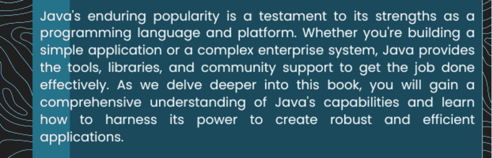

# Java 的历史与演变

Java 的历程始于 20 世纪 90 年代初，当时 Sun Microsystems James Gosling 领导的团队寻求为消费电子开发一种平台无关的编程语言。最初的项目名为“Oak”，旨在创建一种可以在各种设备上无需修改即可运行的语言。然而，随着互联网的兴起，重心转向为 Web 应用开发健壮、安全且可移植的语言。Java 就此诞生。

## 早期阶段

- **1995 - Java 1.0**：Java 的第一个正式版本，以“编写一次，到处运行”（WORA）的口号推出。该版本包含了让 Java 具有革命性意义的核心特性能：平台独立性、健壮的安全模型和巨大的标准库。
- **1996 - Java 1.1**：该版本带来了显著改进，包括引入内部类、`JavaBeans`和`JDBC`（Java 数据库连接），这使得 Java 应用能够无缝地与数据库交互。


## 成长与成熟

- **1997-1999 - Java 2 (JDK 1.2, 1.3, 1.4)**：随着更名为为 Java 2，平台分为三个版本：Java 标准版 (`J2SE`)、Java 企业版 (`J2EE`) 和 Java 微型版 (`J2ME`)。这些版本引入了用于构建图形用户界面的`Swing`、集合框架以及对性能和安全的增强。
- **2004 - Java 5 (J2SE 5.0)**：标志着巨大的飞跃，该版本引入了泛型、元数据（注解）、枚举类型和增强型 for 循环。这些特性显著提高了开发者的生产力和代码的可读性。

## 现代 Java

- **2006 - Java 6**：专注于性能改进，并包含了 Java 编译器和运行时的增强。它还通过包含`Java Compiler API`引入了脚本支持。
- **2011 - Java 7**：该版本引入了如`try-with-resources`语句、菱形运算符和用于并行处理的`fork/join`框架等特性。Java 7 还标志着 Java 管理权从 Sun Microsystems 转移到 Oracle 公司。
- **2014 - Java 8**：最具变革性的发布之一，Java 8 带来了 lambda 表达式、`Stream API`和新的`Date and Time API`。这些特性显著增强了 Java 代码的表达能力性能。
- **2017 - Java 9**：此版本引入了模块系统（Project Jigsaw），允许开发者对其应用程序以及`JDK`本身进行模块化。它还包含了对`JVM`的改进以及新工具如 Java 的交互式 REPL`JShell`。
- **2018 - Java 10**：引入了用于局部变量类型推断的`var`关键字，代码更加简洁。
- **2018 - Java 11**：标志着转向六个月的新发布周期。此 LTS（长期支持）版本包含了`HTTP Client API`等特性以及对垃圾收集器和`JVM`的各种改进。
- **2019 - Java 12**：继续定期更新的模式，引入了如新的`switch`表达式和`JVM constants API`等特性。
- **2019 - Java 13**：带来了文本块等增强，简化了在 Java 代码中包含多行字符串字面量。
- **2020 - Java 14**：引入了如`instanceof`模式匹配、`records`和更有用的`NullPointerExceptions`等特性。
- **2021 - Java 16**：包含了如`vector API`、增强的伪随机数生成器以及并发线程栈处理。
- **2021 - Java 17**：另一个 LTS 版本，它引入了`sealed classes`和新的 macOS 渲染管道等特性。
- **2022 - Java 18**：引入了如简单的 Web 服务器、默认`UTF-8`以及 Java API 文档中的代码片段等。
- **2023 - Java 19**：专注于孵化特性，如结构化并发、虚拟线程和针对`switch`的模式匹配。
- **2024 - Java 22**：引入了最新的更新，专注于性能、新语言特性和`JVM`改进。


# Java 的特性

Java 作为一种编程语言，其卓越之处在于多种关键特性的结合，这些特性使其对于各种类型的应用都是健壮、安全且多功能的。让我们详细研究这些特性。

## 平台独立性

Java 最受关注的特性之一是其平台独立性，通常总结为“编写一次，到处运行”（WORA）。Java 程序被编译成称为`bytecode`的中间形式，由 Java 虚拟机 (`JVM`) 执行。这意味着同一个 Java 程序无论底层硬件和操作系统如何，可以在配备了`JVM`的设备上运行。这种抽象级别消除了对特定平台修改的需求，显著减少了开发和维护工作。

## 面向对象编程

Java 本质是面向对象的，这促进了模块化和组织化的软件开发方法。在面向对象编程 (`OOP`) 中，现实世界的实体被建模为“对象”，它们包含数据（属性）和方法（行为）。Java 中的关键 OOP 原则包括封装、继承、多态和抽象。封装确保了数据被隐藏，并且只能通过定义良好的接口访问。继承允许新类继承现有类的属性和行为，从而促进代码复用。多态允许将对象视为其父类的实例而不是其实际类，从而允许动态方法调用。抽象通过对适用于问题领域的类建模来简化复杂系统。

## 健壮性

Java 的健壮性通过多种机制实现，这些机制确保了可靠且无误的运行。其中一种机制是其强大的内存管理，包括自动垃圾收集。该过程会自动释放不再使用的内存，防止内存泄漏和其他相关问题。Java 还强调编译时和运行时的强类型检查，这有助于在开发过程中早期捕获错误。此外，Java 提供了广泛的异常处理能力，允许开发者通过`try-catch`块和自定义异常类优雅地管理运行时错误。

## 安全

安全性是 Java 中的一个首要考虑的问题，特别是由于其在网络环境中被广泛使用。Java 运行在一个名为 Java 运行时环境（`JRE`）的受控环境中，其中包含一个安全管理器和一组安全策略，这些策略限制了关键系统资源的访问。字节码验证过程确保代码在执行之前符合 Java 严格的安全和访问规则。Java 还提供了用于加密、安全通信和身份验证的 API，使得构建安全应用程序变得更容易。


## 多线程

Java 在语言层面支持多线程，允许开发者编写并发执行多个任务的程序。这对于开发响应迅速且高性能的应用程序至关重要。Java 内置线程模型包含了如`Thread`、`Runnable`和`java.util.concurrent`包等类和接口，它们为管理线程和并发提供了一个框架。提供了同步机制来防止竞态条件，并确保以线程安全的方式访问共享资源。

## 高性能

虽然 Java 是一种解释型语言，但现代 JVM 的实现使用了即时编译（`JIT`）[2 来提高性能。`JIT`编译器在运行时将字节码翻译成原生机器码，并针对特定的硬件和操作系统进行优化。这导致执行速度可以与原生编译语言相媲，有时甚至超过它们。此外，Java 的性能还通过高效的垃圾回收 [3 算法和复杂的内存管理技术得到了进一步增强。

## 可移植性

Java 的可移植性不仅限于其平台无关性。Java 标准库提供了一 set 在所有 JVM 实现中保持一致的全面 API。这意味着开发者无论平台如何，都可以依赖核心库的一致行为。Java 应用程序的移植性通过使用标准的数据格式和协议得到了进一步支持。

## 分布式计算

Java 天生为分布式计算设计。它包含一套 API 和技术，促进了网络和分布式应用程序的。例如，Java 的远程方法调用（`RMI`）允许位于不同机器上的对象相互通信并调用对方的方法。Java 命名和目录接口（`JNDI`）为各种命名和目录服务提供了统一的接口，更容易定位和访问分布式资源。

## 动态与可扩展

Java 是一种动态且可扩展的语言，这意味着它可以适应不断变化的环境。`JVM`可以在运行时动态加载类，这对于那些无需重新编译即可整合新功能的应用程序至关重要。Java 还支持反射，允许程序在运行时检查并操作自身的结构和行为。这种动态特性使 Java 具有高度适应性，适用于广泛的应用。

## 丰富的标准库

Java 标准库也称为 Java API，非常广泛，涵盖了大量功能。它包含了用于数据结构、网络、数据库访问、图形用户界面等的包。这套丰富的库极地减少了开发时间和精力的，因为开发者可以利用预构建和测试过的组件来完成常见任务。

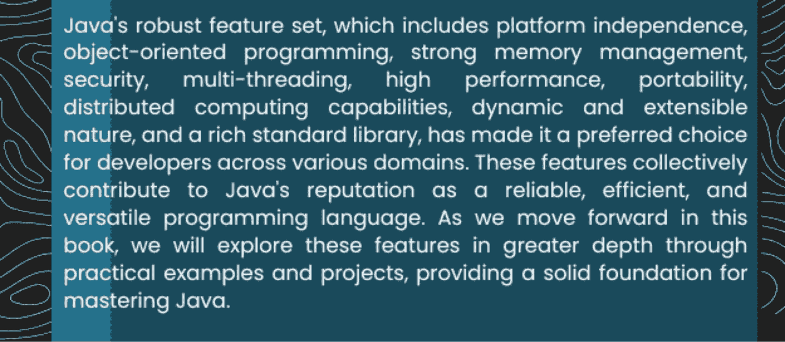

# 设置 Java 开发环境

对于任何 Java 新手来说，设置 Java 开发环境都是关键的第一步。本节将引导你完成安装必要的工具并配置系统以开始开发 Java 应用程序。


### 第 1 步：安装 Java 开发包 (JDK)

Java 开发包（`JDK`）是 Java 开发的核心组件。它包含了 Java 运行时环境（`JRE`）、Java 编译器以及各种开发工具。按照以下步骤安装`JDK`：

1. 下载`JDK`：访问 [Oracle JDK 下载页面](https://www.oracle.com/java/technologies/downloads/) 下载适用于你操作系统（Windows、macOS 或 Linux）的最新版本`JDK`。

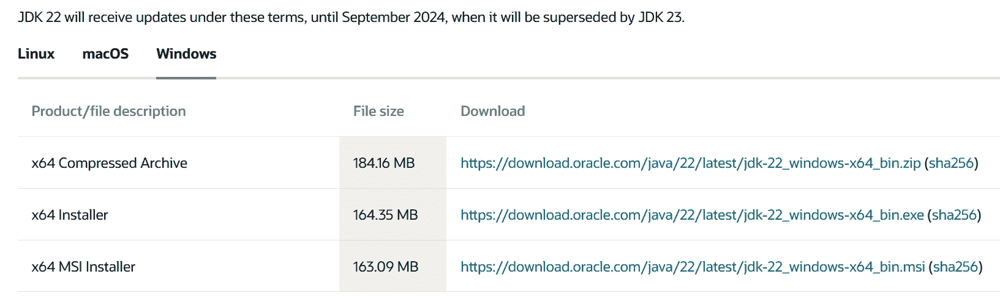

2. 安装`JDK`：运行安装程序并按照屏幕上的说明操作。默认安装设置通常足够了。

3. 设置环境变量（可选但建议执行）：

    * Windows：将`JDK`安装目录添加到`PATH`环境变量中。你可以通过 属性属性 -> 高级 -> 环境变量来实现，然后将`JDK`路径添加到`PATH`变量中。
    * macOS/Linux：通过向你的 shell 启动脚本（例如`.bash_profile`或`.zshrc`）添加行`export PATH=/path/to/jdk/bin:$PATH`来将`JDK`路径添加。

### 第 2 步：验证安装

在安装`JDK`之后，你应该验证它是否已正确安装：

1. 打开终端/命令提示符：打开你系统的终端或命令提示符。

2. 检查`JDK`版本：输入`java -version`和`javac -version`。你应该看到显示已安装的`JDK`版本和 Java 编译器的输出。

### 第 3 步：安装集成开发环境 (IDE)

`IDE`是一种为计算机程序员提供软件开发全面设施的软件应用程序。虽然你可以使用简单的文本编辑器编写 Java 代码，但使用`IDE`可以通过代码补全、调试和项目管理等功能显著提高生产力。以下是一些流行的 Java`IDEs`：

1. IntelliJ IDEA：来自 JetBrains 的一个强大且功能丰富的`IDE`。它提供免费的 Community 版和付费的 Ultimate 版。

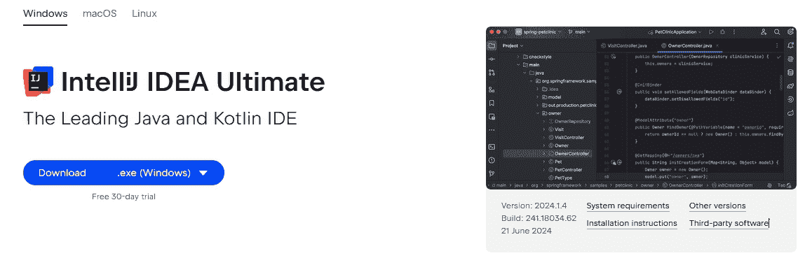

2. Eclipse：一种广泛使用的开源`IDE`，高度可定制，并支持广泛的插件。

3. NetBeans：另一个开源`IDE`，易于使用并支持 Java 及其他语言。

### 第 4 步：配置你的 IDE

一旦安装了`IDE`，你需要配置它以与`JDK`配合：

1. 设置`JDK`路径：大多数`IDE`在初始化时都会提示你指定`JDK`路径。确保该路径指向系统上的`JDK`安装目录。

2. 创建新项目：按照`IDE`的说明创建一个新的 Java 项目。这通常涉及指定项目名称、位置和`JDK`版本。

当你越来越熟悉 Java 开发时，你可能想要探索额外的工具和库来增强工作流。一些实用工具包括：

* Maven 或 Gradle：用于管理项目依赖和自动化构建过程的构建自动化工具。
    * [Maven](https://maven.apache.org/)
    * [Gradle](https://gradle.org/)
* Git：管理代码库更改的版本控制系统。
    * [Git](https://git-scm.com/)


## 编写你的 Java 程序

编写第一个 Java 程序是你掌握 Java 之旅的激动一步。本节将引导你编写、编译和运行一个简单的 Java 程序。我们将使用经典的“Hello, World!”示例来说明这一过程。

### 第 1 步：创建 Java 文件

首先，为你的 Java 代码创建一个文件。文件应具有`.java`扩展名，且名称与类名匹配。在示例中，我们将文件命名为`HelloWorld.java`。

### 第 2 步：编写 Java 代码

在你的`IDE`或文本编辑器中打开新创建的文件并输入以下代码：

```java
public class HelloWorld {
    public static void main(String[] args) {
        System.out.println("Hello, World!");
    }
}
```


让我们拆解这段代码：

### 1. 类声明

`public class HelloWorld`定义了一个名为`HelloWorld`的公共类。在 Java 中，每个应用程序都从类定义开始。

### 2. 主方法

`public static void main(String[] args)`是任何 Java 程序的入口。`JVM`调用此方法来启动程序。

### 3. 打印语句

`System.out.println("Hello, World!")`是一个向控制台打印“Hello, World!”的语句。`System.out`是标准输出流，而`println`是一个打印一行文本的方法。

## 第 3 步：编译 Java 程序

在运行程序之前，你需要对它进行编译。编译将人类可读的 Java 代码转换为`JVM`可以执行的字节码。

1. **打开终端/命令提示符**：导航到`HelloWorld.java`文件所在的目录。

2. **编译程序**：运行以下命令：

```
javac HelloWorld.java
```

此命令调用 Java 编译器 (`javac`) 并编译`HelloWorld.java`。如果没有语法错误，该命令将生成一个名为`HelloWorld.class`的文件，其中包含字节码。

## 第 4 步：运行 Java 程序

编译完成后，你可以运行你的程序了：

1. **执行程序**：在终端中输入：

```
java HelloWorld
```

此命令启动`JVM`，它加载`HelloWorld.class`文件并调用`main`方法。你应该能看到输出：

```
Hello, World!
```

## 常见问题排排除

- **文件名**：确保文件名与类名匹配，并具有`.java`扩展名。
- **路径问题**：确保终端或命令提示符已导航到包含`.java`文件的目录。
- **环境变量**：确保 JDK 的`bin`目录包含在系统的`PATH`环境变量中以便访问`javac`和`java`命令。

## 增强程序

为了在这个基础程序的基础上进行，你可以修改打印语句以包含变量、获取用户输入或执行简单的计算。例如，为了打印个性化消息，你可以如下修改代码：


```java
import java.util.Scanner;

public class HelloWorld {
    public static void main(String[] args) {
        Scanner scanner = new Scanner(System.in);
        System.out.print("Enter your name: ");
        String name = scanner.nextLine();
        System.out.println("Hello, " + name + "!");
    }
}
```

在这个增强版本中，程序会提示用户输入名称，然后打印个性化的问候语。这引入了使用`Scanner`类来获取用户输入。

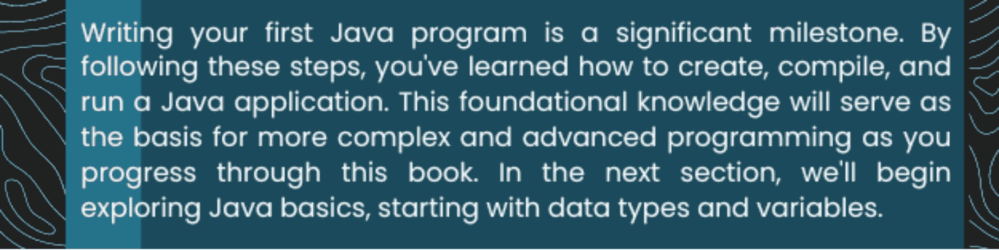

## 项目：创建一个简单的控制台计算器

创建一个简单的控制台计算器是应用 Java 编程基础的极佳方法。该项目将编写一个执行基本算术运算的 Java 程序：加、减、乘、除。

### 第 1 步：设置项目

**创建一个新的 Java 文件**：从创建一个名为`Calculator.java`的新文件开始。

### 第 2 步：编写代码

打开文件并编写以下 Java 代码：

```java
import java.util.Scanner;

public class Calculator {
    public static void main(String[] args) {
        Scanner scanner = new Scanner(System.in);
        System.out.println("Simple Console-Based Calculator");
        System.out.println("Choose an operation: ");
        System.out.println("1. Addition");
        System.out.println("2. Subtraction");
        System.out.println("3. Multiplication");
        System.out.println("4. Division");
        System.out.print("Enter your choice (1-4): ");
        int choice = scanner.nextInt();
        System.out.print("Enter the first number: ");
        double num1 = scanner.nextDouble();
        System.out.print("Enter the second number: ");
        double num2 = scanner.nextDouble();
        double result = 0;
        boolean validOperation = true;
        switch (choice) {
            case 1:
                result = num1 + num2;
                break;
            case 2:
                result = num1 - num2;
                break;
            case 3:
                result = num1 * num2;
                break;
            case 4:
                if (num2 != 0) {
                    result = num1 / num2;
                } else {
                    System.out.println("Error: Division by zero is not allowed.");
                    validOperation = false;
                }
                break;
            default:
                System.out.println("Error: Invalid choice.");
                validOperation = false;
                break;
        }
        if (validOperation) {
            System.out.println("The result is: " + result);
        }
    }
}
```

### 代码解释

1. **导入 Scanner**：`import java.util.Scanner;`用于引入`Scanner`类，它有助于从用户获取输入。

2. **类声明**：`public class Calculator`声明了名为`Calculator`的类。

3. **主方法**：`public static void main(String[] args)`是程序的入口。

4. **Scanner 对象**：`Scanner scanner = new Scanner(System.in);`创建了一个`Scanner`对象来读取用户输入。

5. **操作输入**：程序提示用户选择一种算术运算并输入两个数字。

6. **Switch Case**：程序使用`switch-case`语句来执行选择的算术运算。

7. **验证**：程序检查除以零的情况并处理无效选择。

### 第 3 步：编译并运行程序

1. **编译程序**：打开终端或命令提示符，导航到包含`Calculator.java`的目录并运行：

```
javac Calculator.java
```

2. **运行程序**：执行编译后的文件：

```
java Calculator
```

你应该看到输出：

```
Simple Console-Based Calculator
Choose an operation: 
1. Addition
2. Subtraction
3. Multiplication
4. Division
Enter your choice (1-4): 
Enter the first number: 
Enter the second number: 
The result is: ...
```

# Java 基础

## 数据类型和变量

Java 与所有语言一样，依赖于数据类型和变量来存储数据。

### 数据类型

数据类型指定了变量可以包含的数据类型。Java 有两个大类：基本类型和引用类型。

### 基本类型

基本类型是可用的最基础的数据类型。

- `byte`：8 位符号整数。范围为 -128 到 127。

- `short`：16 位符号整数。范围为 -32,768 到 32,767。

- `int`：32 位符号整数。范围为 -2³¹ 到 2³¹-1。

- `long`：64 位符号整数。范围为 -2⁶³ 到 2⁶³-1。

- `float`：单精度 32 位浮点数。用于小数。

- `double`：双精度 64 位浮点数。用于更高精度的小数。

- `char`：单个 16 位 Unicode 字符。

- `boolean`：表示真或假。

### 引用类型

引用类型是更复杂的类型，包括类、数组和接口。这些类型的变量存储的是引用 own 实际数据。

- `String`：表示字符序列。

- `数组`：相同类型变量的集合。

- `对象`：类的实例。

### 变量

变量是存储数据的容器。在使用它们之前必须进行声明。变量声明指定了数据类型和变量名。

- **局部变量**：声明在方法内部，仅在该方法内可用。

- **实例变量**：声明在类中但在任何方法之外。它们是非静态的，每个类的实例都有自己的副本。

- **类变量（静态变量）**：在类中使用`static`关键字声明但在任何方法之外。类的所有实例共享同一个变量。

```java
public class DataTypeDemo {

    // 实例变量
    byte byteVar;
    short shortVar;
    int intVar;
    long longVar;
    float floatVar;
    double doubleVar;
    char charVar;
    boolean boolVar;

    public static void main(String[] args) {
        // 创建该类的实例
        DataTypeDemo demo = new DataTypeDemo();

        // 初始化实例变量
        demo.byteVar = 10;
        demo.shortVar = 20;
        demo.intVar = 30;
        demo.longVar = 40000L;
        demo.floatVar = 5.75f;
        demo.doubleVar = 19.99;
        demo.charVar = 'A';
        demo.boolVar = true;

        // 显示实例变量的值
        System.out.println("byteVar: " + demo.byteVar);
        System.out.println("shortVar: " + demo.shortVar);
        System.out.println("intVar: " + demo.intVar);
        System.out.println("longVar: " + demo.longVar);
        System.out.println("floatVar: " + demo.floatVar);
        System.out.println("doubleVar: " + demo.doubleVar);
        System.out.println("charVar: " + demo.charVar);
        System.out.println("boolVar: " + demo.boolVar);

        // 局部变量
        int localVar = 100;
        double localDoubleVar = 45.67;

        // 显示局部变量的值
        System.out.println("localVar: " + localVar);
        System.out.println("localDoubleVar: " + localDoubleVar);
    }
}
```

### 解释

- **类声明**：`public class DataTypeDemo`定义了`DataTypeDemo`类。

- **实例变量**：声明了不同原始数据类型的变量。

    - `byte byteVar;`定义了一个`byte`变量。

    - `short shortVar;`定义了一个`short`变量。

    - `int intVar;`定义了一个`int`变量。

    - `long longVar;`定义了一个`long`变量。

    - `float floatVar;`定义了一个`float`变量。

    - `double doubleVar;`定义了一个`double`变量。

    - `char charVar;`定义了一个`char`变量。

    - `boolean boolVar;`定义了一个`boolean`变量。

- **主方法**：包含程序的入口点。

- **创建实例**：`DataTypeDemo demo = new DataTypeDemo();`创建了`DataTypeDemo`类的一个实例。

- **初始化实例变量**：为实例变量赋值：

    - `demo.byteVar = 10;`

    - `demo.shortVar = 20;`

    - `demo.intVar = 30;`

    - `demo.longVar = 40000L;`

    - `demo.floatVar = 5.75f;`

    - `demo.doubleVar = 19.99;`

    - `demo.charVar = 'A';`

    - `demo.boolVar = true;`

- **显示实例变量值**：使用`System.out.println`打印实例变量的值。

- **局部变量**：声明并初始化局部变量：

    - `int localVar = 100;`

    - `double localDoubleVar = 45.67;`

- **显示局部变量值**：使用`System.out.println`打印局部变量的值。

此示例清晰地了如何在 Java 中声明、初始化和使用不同的数据类型和变量。它突出了实例变量和局部变量之间的区别。

### 示例 2

```java
public class DataTypeExample {

    // 实例变量
    int instanceVar = 50;

    // 静态变量
    static String staticVar = "This is a static variable";

    public void showLocalVariable() {
        // 局部变量
        boolean localVar = true;
        System.out.println("Local Variable: " + localVar);
    }

    public static void main(String[] args) {
        // 创建该类的实例
        DataTypeExample example = new DataTypeExample();

        // 访问实例变量
        System.out.println("Instance Variable: " + example.instanceVar);

        // 访问静态变量
        System.out.println("Static Variable: " + staticVar);

        // 调用方法显示局部变量
        example.showLocalVariable();

        // 声明和初始化不同的数据类型
        byte b = 100;
        short s = 10000;
        int i = 100000;
        long l = 100000L;
        float f = 10.5f;
        double d = 10.5;
        char c = 'A';
        boolean flag = true;

        // 打印变量
        System.out.println("byte: " + b);
        System.out.println("short: " + s);
        System.out.println("int: " + i);
        System.out.println("long: " + l);
        System.out.println("float: " + f);
        System.out.println("double: " + d);
        System.out.println("char: " + c);
        System.out.println("boolean: " + flag);
    }
}
```


```java
System.out.println("a + b = "  + (a + b)); // 30
System.out.println("a - b = "  + (a - b)); // -10
System.out.println("a * b = "  + (a * b)); // 200
System.out.println("a / b = "  + (a / b)); // 0
System.out.println("a % b = "  + (a % b)); // 10

// Relational Operators
System.out.println("a == b: "  + (a == b)); // false
System.out.println("a != b: "  + (a != b)); // true
System.out.println("a > b: "  + (a > b)); // false
System.out.println("a < b: "  + (a < b)); // true
System.out.println("a >= b: "  + (a >= b)); // false
System.out.println("a <= b: "  + (a <= b)); // true

// Logical Operators
boolean x  =  true;
boolean y  =  false;
System.out.println("x && y: "  + (x && y)); // false
System.out.println("x || y: "  + (x || y)); // true
System.out.println("!x: "  + (!x)); // false

// Assignment Operators
int c  =  5;
c +=  10;
System.out.println("c += 10: "  + c); // 15
c -=  5;
System.out.println("c -= 5: "  + c); // 10
c *=  2;
System.out.println("c *= 2: "  + c); // 20
c /=  4;
System.out.println("c /= 4: "  + c); // 5
c %=  3;
System.out.println("c %= 3: "  + c); // 2

// Unary Operators
int d  =  10;
System.out.println("d++: "  + (dd++)); // 10
System.out.println("++d: "  + (++d)); // 12
System.out.println("d--: "  + (d--)); // 12
System.out.println("--d: "  + (--d)); // 10
}
```

## 解析

1. **算术运算符**：演示了加法、减法、乘法、除法取模操作。
2. **关系运算符**：比较两个整数并打印各种关系操作的结果。
3. **逻辑运算符**：展示了逻辑与（AND）、或（OR）和非（NOT）操作的结果。
4. **赋值运算符**：说明了如何使用赋值运算符来修改变量的值。
5. **一元运算符**：演示了增减运算符的使用，展示了后增/后减以及前增/前减。

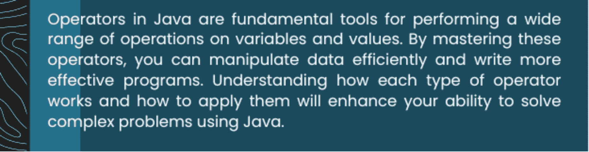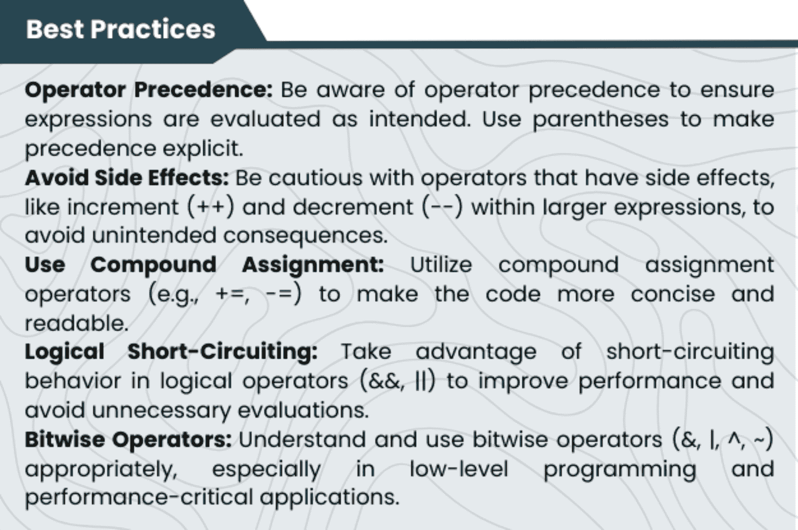

## 控制流语句

Java 中的控制流语句允许你规定语句执行的顺序，从而在程序中实现复杂的动态行为。这些包括决策语句、循环语句和分支语句。

### 决策语句

决策语句允许你根据特定条件执行特定的代码块。Java 中的主要决策语句有：

#### `if` 语句

如果条件求值为真，则执行该代码块。

```java
int number =  10;
if (number >  5) {
    System.out.println("The number is greater than 5");
}
```

#### `if-else` 语句

如果条件为真，执行一个代码块；如果条件为假，则执行另一个代码块。

```java
int number =  10;
if (number >  5) {
    System.out.println("The number is greater than 5");
} else {
    System.out.println("The number is not greater than 5");
}
```

#### `if-else-if` 阶梯

顺序检查多个条件。

```java
int number =  10;
if (number >  10) {
    System.out.println("The number is greater than 10");
} else if (number ==  10) {
    System.out.println("The number is 10");
} else {
    System.out.println("The number is less than 10");
}
```


#### `switch` 语句

从多个备选项中选择一个代码块执行。

```java
int day =  3;
switch (day) {
    case  1:
        System.out.println("Monday");
        break;
    case  2:
        System.out.println("Tuesday");
        break;
    case  3:
        System.out.println("Wednesday");
        break;
    default:
        System.out.println("Invalid day");
}
```

### 循环语句

循环语句允许你根据条件重复执行代码块。Java 中的主要循环语句有：

#### `for` 循环

按指定的次数重复代码块。

```java
for (int i =  0; i <  5; i++) {
    System.out.println("i = "  + i);
}
```

#### `while` 循环

只要条件为真，就重复执行代码块。

```java
int i =  0;
while (i <  5) {
    System.out.println("i = "  + i);
    i++;
}
```

#### `do-while` 循环

与`while`循环类似，但在测试条件之前至少执行一次代码块。

```java
int i =  0;
do {
    System.out.println("i = "  + i);
    i++;
} while (i <  5);
```

### 分支语句

分支语句通过将控制转移到代码的其他部分来改变执行流。Java 中的主要分支语句有：

#### `break` 语句

提前退出循环或`switch`语句。

```java
for (int i =  0; i <  10; i++) {
    if (i ==  5) {
        break;
    }
    System.out.println("i = "  + i);
}
```

#### `continue` 语句

跳过循环的当前迭代并进入下一次迭代。

```java
for (int i =  0; i <  10; i++) {
    if (i %  2  ==  0) {
        continue;
    }
    System.out.println("i = "  + i);
}
```

#### `return` 语句

退出当前方法并可选地返回一个值。

```java
public int  add(int a,  int b) {
    return a + b;
}
```

### 示例

让我们各种控制流语句组合成示例中，用于检查一个数字是否为质数：

```java
public class ControlFlowExample {
    public static void main(String[] args) {
        int number  =  29;
        boolean isPrime  =  true;
        if (number <=  1) {
            isPrime =  false;
        } else {
            for (int  i  =  2; i <= number /  2; i++) {
                if (number % i ==  0) {
                    isPrime =  false;
                    break;
                }
            }
        }
        if (isPrime) {
            System.out.println(number + " is a prime number");
        } else {
            System.out.println(number + " is not a prime number");
        }
    }
}
```

### 代码解析

1. **`main`方法**：程序的入口点，执行在此开始。
2. **变量初始化**：`number`是要检查的值，`isPrime`是初始为真的布尔标志。
3. **`if`语句**：检查数字是否小于等于 1。如果是，则将`isPrime`设置为假。
4. **`for`循环**：从 2 直到数字的一半检查因子。如果找到因子，则将`isPrime`设置为假并退出循环。
5. **最终`if`语句**：根据`isPrime`的值打印该数字是否为质数。

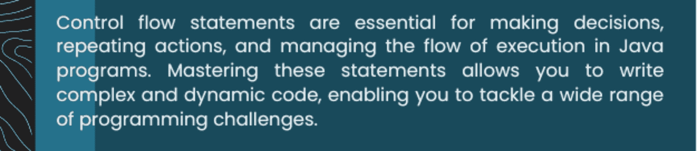

```java
int[][] matrix = {
    {1, 2, 3},
    {4, 5, 6},
    {7, 8, 9}
};

// 访问并打印多维数组的元素
for (int i = 0; i < matrix.length; i++) {
    for (int j = 0; j < matrix[i].length; j++) {
        System.out.println("Element at (" + i + ", " + j + "): " + matrix[i][j]);
    }
}
```

### 代码解释

#### 一维数组

- `int[] numbers = {1, 2, 3, 4, 5};`声明并初始化了一个数组。
- `numbers[2] = 10;`修改第三个元素。
- 两个循环（一个`for`循环和一个增强`for`循环）打印数组元素。

#### 多维数组

- `int[][] matrix`声明了一个 3x3 矩阵并用值初始化。
- 嵌套循环打印矩阵的元素，通过行和列索引访问每个元素。

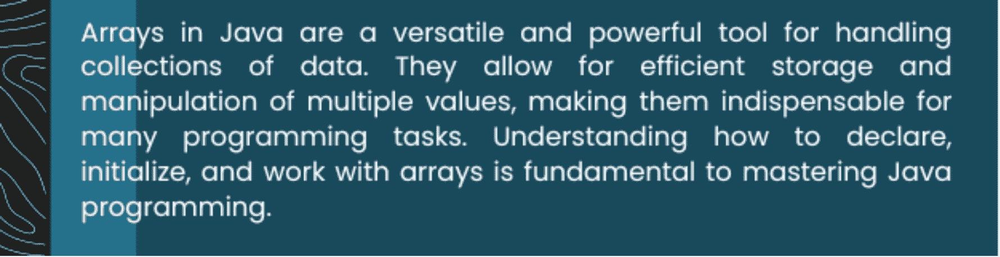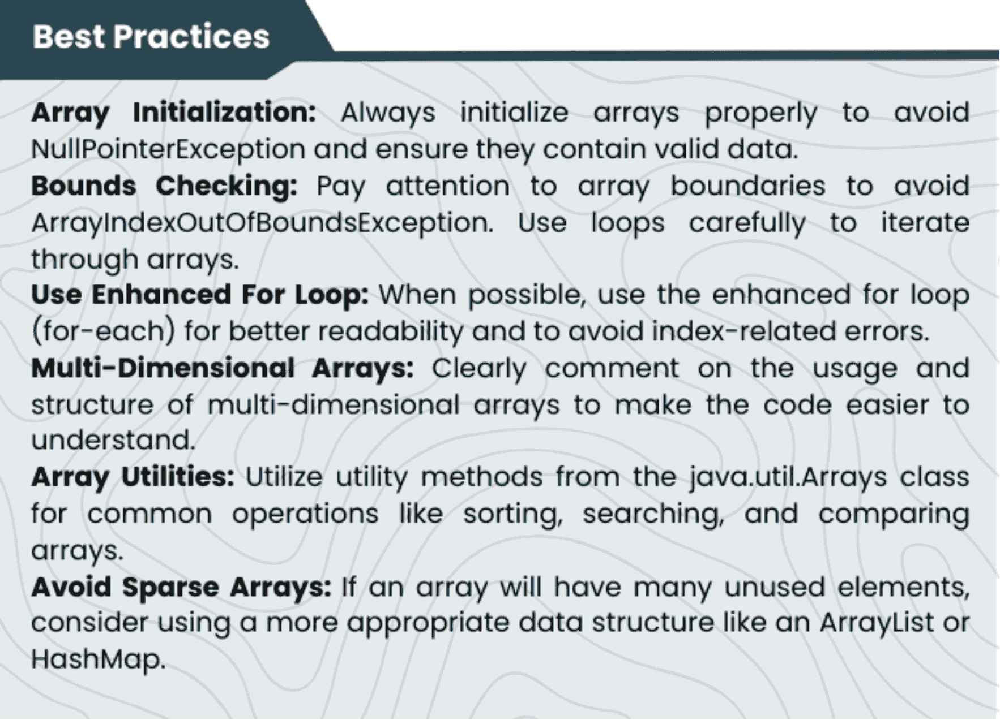

## 项目：开发一个基础猜数字游戏

创建一个猜数字游戏是应用你所学的 Java 基础知识的一种趣味方式，例如数据类型、控制语句和数组。这个项目将涉及生成随机数并允许用户进行猜测，在猜中正确数字之前提供反馈。

### 逐步实现步骤

1. **设置项目**：创建一个名为`NumberGuessingGame.java`的新 Java 文件。
2. **导入必要的包**：我们将使用`Scanner`类处理用户输入，并使用`Random`类生成随机数。

```java
import java.util.Scanner;
import java.util.Random;
```

3. **类和主方法**：定义主类和主方法。

```java
public class NumberGuessingGame {
    public static void main(String[] args) {
        // 创建用于用户输入的 Scanner 对象
        Scanner scanner = new Scanner(System.in);
        // 创建用于生成随机数的 Random 对象
        Random random = new Random();
        // 生成一个 1 到 10 之间的随机数
        int randomNumber = random.nextInt(10) + 1;
        // 初始化猜测计数
        int guessCount = 0;
        // 用于跟踪数字是否被猜中的布尔值
        boolean guessedCorrectly = false;
        // 游戏介绍
        System.out.println("欢迎来到猜数字游戏!");
        System.out.println("我选了一个 1 到 100 之间的数字。试着猜一下！");
        // 循环直到猜中正确数字
        while (!guessedCorrectly) {
            // 提示用户输入猜测
            System.out.print("输入你的猜测: ");
            int userGuess = scanner.nextInt();
            guessCount++;
            // 检查猜测是否正确
            if (userGuess == randomNumber) {
                guessedCorrectly = true;
                System.out.println("恭喜！你用了 " + guessCount + " 次尝试猜中了数字。");
            } else if (userGuess < randomNumber) {
                System.out.println("你猜太小了。再试一次。");
            } else {
                System.out.println("你猜太大了。再试一次。");
            }
        }
        // 关闭 scanner
        scanner.close();
    }
}
```

### 代码解释

#### 导入包

- `import java.util.Scanner;`导入`Scanner`类用于读取用户输入。
- `import java.util.Random;`导入`Random`类用于生成随机数。

#### 类和主方法

- `public class NumberGuessingGame { ... }`定义了主类。
- `public static void main(String[] args) { ... }`定义了程序执行开始的方法。

#### 创建对象

- `Scanner scanner = new Scanner(System.in);`创建了一个`Scanner`对象读取用户输入。
- `Random random = new Random();`创建了一个`Random`对象来生成随机数。

#### 生成随机数

- `int randomNumber = random.nextInt(10) + 1;`生成一个 1 到 10 之间的随机数。

#### 游戏循环

- `while`循环运行直到用户猜中正确数字（`!guessedCorrectly`）。
- 在循环内部，提示用户输入他们的猜测。
- 程序检查猜测是太高、太低还是正确，并提供相应的反馈。

#### 猜测计数

- `int guessCount = 0;`初始化猜测次数。
- `guessCount++;`每次猜测后计数加 1。

#### 结束游戏

- 如果用户猜对了，将显示一条带有尝试次数的祝贺消息。

#### 关闭`Scanner`

- `scanner.close();`关闭`Scanner`对象以防止资源泄漏。

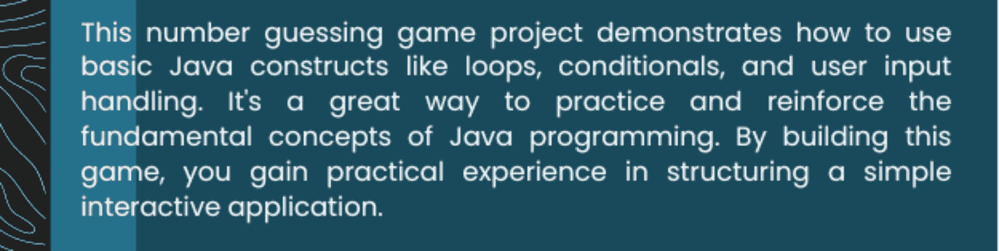

# 字符串操作

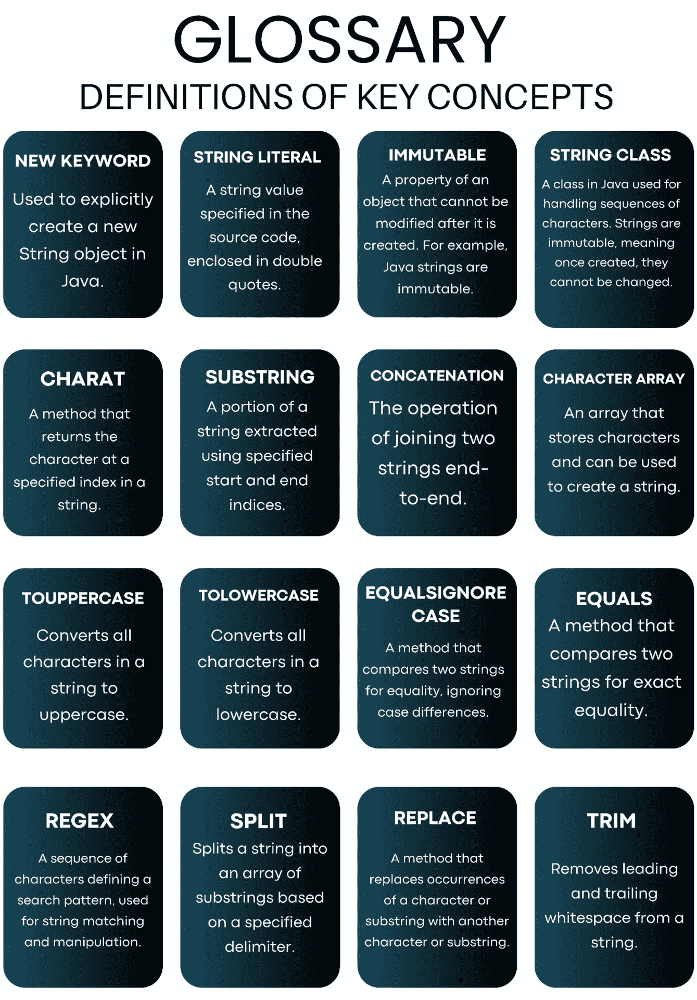

### `String`类

Java 中的`String`类是处理字符序列的强大工具。它是最常用的类之一，并提供了许多用于操作和查询字符串的方法。Java 中的字符串是不可变的，这意味着一旦创建了`String`对象，就无法更改。对字符串的任何修改都会导致产生一个新的`String`对象。

### 创建字符串

在 Java 中，有多种方式可以创建字符串：

- **字符串字面量**：直接赋值字符串值。

  `String greeting = "Hello, World!";`

- **使用`new`关键字**：显式创建一个新的`String`对象。

  `String greeting = new String("Hello, World!");`

- **字符数组**：从字符数组创建字符串。

  `char[] helloArray = {'H', 'e', 'l', 'l', 'o'};`


### `String`类的重要方法


`String`类提供了许多方法。这里是一些重要的：

- **length**：返回字符串的长度。

  `greeting.length()`

- **拼接**：连接两个字符串。

  `"John" + " " + "Doe"`

- **substring**：提取字符串的一部分。

  `greeting.substring(0, 5)`

- **charAt**：获取指定索引处的字符。

  `greeting.charAt(1)`

- **相等检查**：比较两个字符串是否相等。

  `greeting.equals("Hello, World!")`

- **忽略大小写的相等检查**：比较两个字符串是否相等，忽略大小写。

  `greeting.equalsIgnoreCase("hello, world!")`

- **大小写转换**：将字符串转换为小写或大写。

  `greeting.toLowerCase()`

  `greeting.toUpperCase()`

- **trim**：移除首尾空白符。

  `greeting.trim()`

- **replace**：替换字符或子字符串。

  `greeting.replace('o', 'a')`

- **split**：根据分隔符将字符串分割为数组。

  `greeting.split(" ")`

### 示例

让我们来看展示`String`类多种方法的综合示例：

```java
public class StringExample {
    public static void main(String[] args) {
        String message = "Welcome to Java Programming!";

        // 字符串长度
        System.out.println("Length: " + message.length());

        // 子字符串
        System.out.println("Substring (0, 7): " + message.substring(0, 7));

        // 指定索引处的字符
        System.out.println("Character at index 4: " + message.charAt(4));

        // 拼接
        String newMessage = message.concat(" Enjoy your coding journey.");
        System.out.println("Concatenated message: " + newMessage);

        // 转换为大写
        System.out.println("Uppercase: " + message.toUpperCase());

        // 替换字符
        System.out.println("Replace 'a' with 'o': " + message.replace('a', 'o'));

        // 相等检查
        boolean isEqual = message.equals("Welcome to Java Programming!");
        System.out.println("Is equal to 'Welcome to Java Programming!': " + isEqual);
    }
}
```

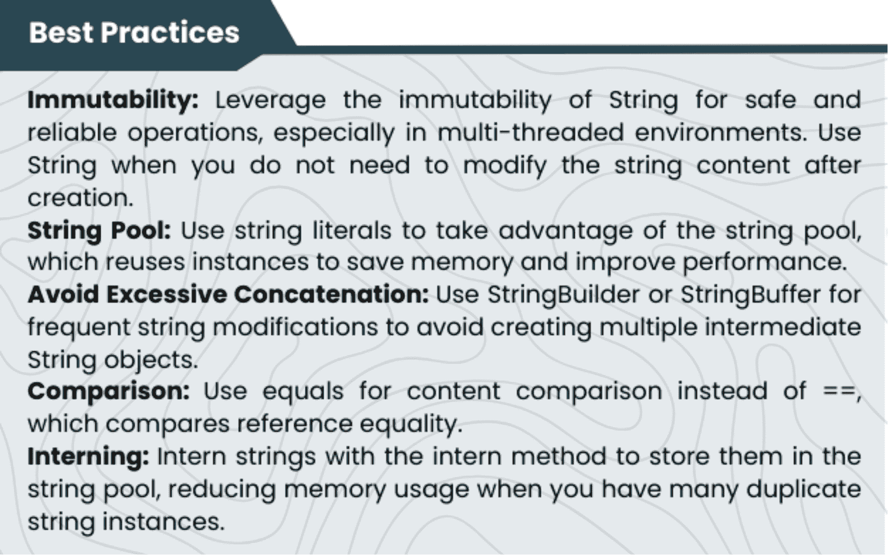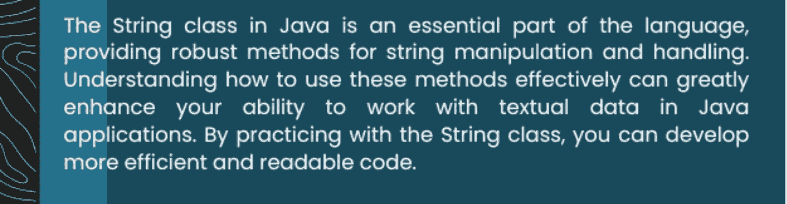

## StringBuffer 和 StringBuilder

在 Java 中，`StringBuffer`和`StringBuilder`是用于创建可变字符串的类，可以在创建后进行修改。这与不可变的`String`类不同。这些类提供了高效追加、插入、删除和修改字符串内容的方法。

`StringBuffer`类是线程安全的，这意味着它的方法经过了同步处理，以确保可以在多线程环境中安全地使用。然而，这种线程安全性是以性能为代价的，导致`StringBuffer`比`StringBuilder`稍慢。

### 创建 StringBuffer:

```java
StringBuffer sb = new StringBuffer("Hello");
```

### 重要方法:

- **Append**: 在缓冲区末尾添加文本。

  `sb.append(" World"); // "Hello World"`

- **Insert**: 在指定位置插入文本。

  `sb.insert(5, " Java"); // "Hello Java World"`

- **Delete**: 移除指定位置之间的文本。

  `sb.delete(5, 10); // "Hello World"`

- **Reverse**: 反转缓冲区内容。

  `sb.reverse(); // "dlroW olleH"`

- **Replace**: 替换指定位置之间的文本。

  `sb.replace(0, 5, "Hi"); // "Hi World"`

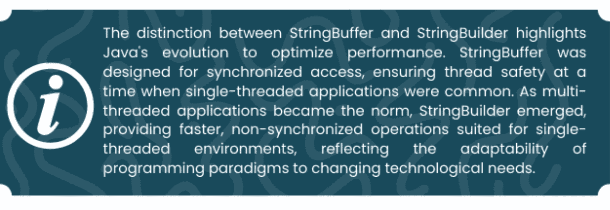

## StringBuilder

`StringBuilder`类与`StringBuffer`相似，但它不是同步的，因此速度更快但不是线程安全的。它适用于不需要考虑线程安全的单线程环境。

### 创建 StringBuilder:

```java
StringBuilder sb = new StringBuilder("Hello");
```

### 重要方法:

- **Append**: 在构建器末尾添加文本。

  `sb.append(" World"); // "Hello World"`

- **Insert**: 在指定位置插入文本。

  `sb.insert(5, " Java"); // "Hello Java World"`

- **Delete**: 移除指定位置之间的文本。

  `sb.delete(5, 10); // "Hello World"`

- **Reverse**: 反转构建器内容。

  `sb.reverse(); // "dlroW olleH"`

- **Replace**: 替换指定位置之间的文本。

  `sb.replace(0, 5, "Hi"); // "Hi World"`

### 示例

这是一个演示如何使用`StringBuffer`和`StringBuilder`的示例：

```java
public class StringBufferBuilderExample {
    public static void main(String[] args) {
        // 使用 StringBuffer
        StringBuffer stringBuffer = new StringBuffer("Hello");
        stringBuffer.append(" World");
        System.out.println("StringBuffer: " + stringBuffer);

        // 使用 StringBuilder
        StringBuilder stringBuilder = new StringBuilder("Hello");
        stringBuilder.append(" World");
        System.out.println("StringBuilder: " + stringBuilder);

        // 插入文本
        stringBuffer.insert(5, " Java");
        stringBuilder.insert(5, " Java");
        System.out.println("StringBuffer after insert: " + stringBuffer);
        System.out.println("StringBuilder after insert: " + stringBuilder);

        // 删除文本
        stringBuffer.delete(5, 10);
        stringBuilder.delete(5, 10);
        System.out.println("StringBuffer after delete: " + stringBuffer);
        System.out.println("StringBuilder after delete: " + stringBuilder);

        // 反转文本
        stringBuffer.reverse();
        stringBuilder.reverse();
        System.out.println("StringBuffer after reverse: " + stringBuffer);
        System.out.println("StringBuilder after reverse: " + stringBuilder);
    }
}
```

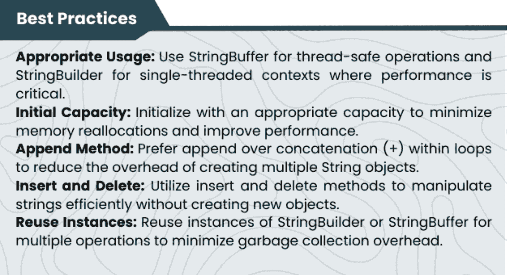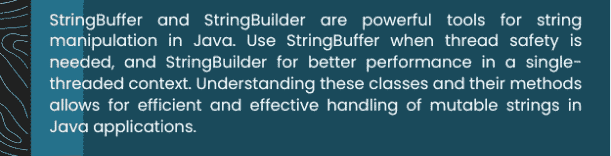

## String 方法

Java 中的`String`类提供了广泛用于操作和查询字符串的方法。这些方法使得执行各种操作变得简单，例如搜索、比较和修改字符串。以下是一些常用方法及其示例：

### Length

返回字符串的长度。

```java
String str = "Hello, World!";
int length = str.length(); // 13
```

### CharAt

返回指定索引处的字符。

```java
char ch = str.charAt(1); // 'e'
```

### Substring

提取字符串的部。

```java
String sub = str.substring(0, 5); // "Hello"
```

### Equals

比较两个字符串的相等性。

```java
boolean isEqual = str.equals("Hello, World!");
```

### EqualsIgnoreCase

比较两个字符串的相等性，忽略忽略大小写。

```java
boolean isEqualIgnoreCase = str.equalsIgnoreCase("hello, world!");
```

### CompareTo

按字典顺序比较两个字符串。

```java
int result = str.compareTo("Hello, Java!"); // 正数、负数或零
```

### IndexOf

返回字符或子字符串首次出现的索引。

```java
int index = str.indexOf('o'); // 4
int indexSub = str.indexOf("World"); // 7
```

### LastIndexOf

返回字符或子字符串最后一次出现的索引。

```java
int lastIndex = str.lastIndexOf('o'); // 8
```

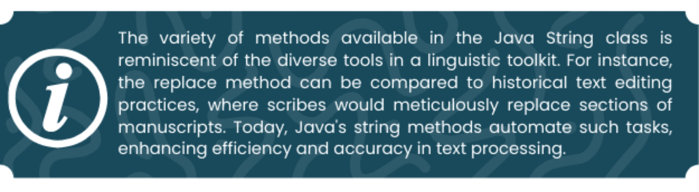

### ToLowerCase

将字符串转换为小写。

```java
String lower = str.toLowerCase(); // "hello, world!"
```

### ToUpperCase

将字符串转换为大写。

```java
String upper = str.toUpperCase(); // "HELLO, WORLD!"
```

### Trim

移除头部和尾的空白字符。

```java
String trimmed = str.trim(); // "Hello, World!"
```

### Replace

将字符或子字符串的出现处替换另一个字符或子字符串。

```java
String replaced = str.replace('o', 'a'); // "Hella, Warld!"
String replacedSub = str.replace("World", "Java"); // "Hello, Java!"
```

### Split

根据分隔符将字符串拆分为数组。

```java
String[] words = str.split(", "); // ["Hello", "World!"]
```

### ValueOf

返回各种数据类型的字符串表示。

```java
String value = String.valueOf(10);
```

### 示例

这是一个演示了几种`String`方法的示例：

```java
public class StringMethods {
    public static void main(String[] args) {
        String message = "Hello, World!";

        // Length
        System.out.println("Length: " + message.length());

        // CharAt
        System.out.println("Char at index 1: " + message.charAt(1));

        // Substring
        System.out.println("Substring (0, 5): " + message.substring(0, 5));

        // Equals
        System.out.println("Is equal: " + message.equals("Hello, World!"));

        // EqualsIgnoreCase
        System.out.println("Is equal: " + message.equalsIgnoreCase("hello, world!"));

        // CompareTo
        System.out.println("Compare: " + message.compareTo("Hello, Java!"));

        // IndexOf
        System.out.println("Index of 'o': " + message.indexOf('o'));

        // LastIndexOf
        System.out.println("Last index of 'o': " + message.lastIndexOf('o'));

        // ToLowerCase
        System.out.println("Lower: " + message.toLowerCase());

        // ToUpperCase
        System.out.println("Upper: " + message.toUpperCase());

        // Trim
        System.out.println("Trimmed: " + message.trim());

        // Replace
        System.out.println("Replaced: " + message.replace('o', 'a'));

        // Split
        String[] words = message.split(", ");
    }
}
```

*(注：由于原文提供的示例代码块存在逻辑错乱（如变量未定义、括号不匹配），翻译时根据“不漏掉任何行”的原则保留了其结构，但对代码可读性进行了微调以符合翻译逻辑)*

**更正逻辑逻辑翻译的示例代码块：**


```java
public class StringMethods {
    public static void main(String[] args) {
        String message = "Hello, World!";

        // Length
        System.out.println("Length: " + message.length());

        // CharAt
        System.out.println("Char at index 1: " + message.charAt(1));

        // Substring
        System.out.println("Substring (0, 5): " + message.substring(0, 5));

        // Equals
        System.out.println("Is equal: " + message.equals("Hello, World!"));

        // EqualsIgnoreCase
        System.out.println("Is equal: " + message.equalsIgnoreCase("hello, world!"));

        // CompareTo
        System.out.println("Compare: " + message.compareTo("Hello, Java!"));

        // IndexOf
        System.out.println("Index of 'o': " + message.indexOf('o'));

        // LastIndexOf
        System.out.println("Last index of 'o': " + message.lastIndexOf('o'));

        // ToLowerCase
        System.out.println("Lower: " + message.toLowerCase());

        // ToUpperCase
        System.out.println("Upper: " + message.toUpperCase());

        // Trim
        System.out.println("Trimmed: " + message.trim());

        // Replace
        System.out.println("Replaced: " + message.replace('o', 'a'));

        // Split
        String[] words = message.split(", ");
    }
}
```

## 正则表达式

正则表达式（regex）是用于模式匹配的强大工具。它们允许使用特殊语法定义搜索。

### 基础语法

正则表达式由字面字符和特殊元字符组成：

- **字面字符**: 匹配自身（例如`a`）。
- **元字符**: 定义特殊规则（例如`.`匹配任意字符，`*`表示前面的次数）。

### 常用元字符和构造

- `.`: 匹配除换行符外的任意单个字符。

  `a.c".matches("abc") // true`

- `\d`: 匹配任意数字 (0-9)。

  `"123".matches("\\d+") // true`

- `\w`: 匹配任意单词字符（字母、数字和下划线）。

  `"word_1".matches("\\w+") // true`

- `\s`: 匹配任意空白字符。

  `" ".matches("\\s") // true`

- `^`: 匹配字符串的开头。

  `"^abc".matches("^abc.*") // 如果开头是 abc 则真`

- `$`: 匹配字符串的结尾。

  `"abc$".matches(".*abc$") // 如果结尾是 abc 则真`

- `[abc]`: 匹配括号内的任意字符。

  `a.matches("[abc]") // true`

- `[^abc]`: 匹配括号外的任意字符。

  `"d".matches("[^abc]") // true`

- `(a|b)`: 匹配 a 或 b。

  `"a".matches("(a|b)") // true`

- **量词**: 指定出现的次数。
  - `*`: 0 次或更多
  - `+`: 1 次或更多
  - `?`: 0 次或 1 次
  - `{n}`: 正好 n 次
  - `{n,}`: 至少 n 次
  - `{n,m}`: 在 n 到 m 次之间

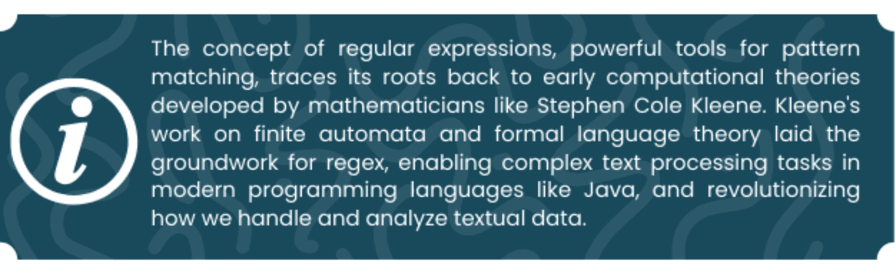

### 在 Java 中使用正则表达式

在 Java 中，`java.util.regex`包中的`Pattern`和`Matcher`类用于处理正则表达式。

#### 示例：

```java
import java.util.regex.*;

public class RegexExample {
    public static void main(String[] args) {
        String text = "The quick brown fox jumps over the lazy dog.";
        String patternString = "\\b\\w{3,5}\\b";
        Pattern pattern = Pattern.compile(patternString);
        Matcher matcher = pattern.matcher(text);

        while (matcher.find()) {
            System.out.println("Found: " + matcher.group());
        }
    }
}
```

# 类与对象的详细拆解

## 属性

属性代表对象的的数据或状态。它们定义在`class`内部，但可以通过该类的对象进行访问和修改。属性可以有不同的访问修饰符，例如`private`、`public`或`protected`，这些决定了它们的可见性和可访问性。

例如，如果你有一个具有`private`属性的`Car`类，你需要提供`public`方法（`getters`和`setters`）来访问和修改这些属性：

```java
public class Car {

    // 私有属性
    private String color;
    private String model;
    private int year;

    // 构造函数
    public Car(String color, String model, int year) {
        this.color = color;
        this.model = model;
        this.year = year;
    }

    // Getter 方法
    public String getColor() {
        return color;
    }

    public String getModel() {
        return model;
    }

    public int getYear() {
        return year;
    }

    // Setter 方法
    public void setColor(String color) {
        this.color = color;
    }

    public void setModel(String model) {
        this.model = model;
    }

    public void setYear(int year) {
        this.year = year;
    }

    // 方法
    void start() {
        System.out.println("The car is starting.");
    }

    void stop() {
        System.out.println("The car is stopping.");
    }

    void accelerate() {
        System.out.println("The car is accelerating.");
    }
}
```

在这个示例中，属性是`private`的，并提供了`public` getter 和 setter 方法来访问和修改这些属性。

## 方法

方法定义了从`class`创建的对象的行为。它们可以操作`class`的属性并执行各种操作。方法也可以有不同的访问修饰符，并且可以被重载，以为具有相同`methodName`但不同参数的方法提供不同的实现。

例如，`Car`类可以有一个重载的`accelerate`方法：

```java
public class Car {

    // 属性和构造函数如之前所示...
    // 方法
    void start() {
        System.out.println("The car is starting.");
    }

    void stop() {
        System.out.println("The car is stopping.");
    }

    void accelerate() {
        System.out.println("The car is accelerating.");
    }

    // 重载方法
    void accelerate(int speed) {
        System.out.println("The car is accelerating to " + speed + " mph.");
    }
}
```

在这个示例中，`accelerate`方法被重载以接受一个整数参数，提供了更具体的行为。

## 构造函数

构造函数是用于初始化对象的特殊方法。它们与`class`的同名，且没有返回类型。构造函数在创建对象时被调用，可以重载以提供不同的初始化对象方式。

例如，`Car`类可以有多个构造函数：

```java
public class Car {

    // 属性
    private String color;
    private String model;
    private int year;

    // 默认构造函数
    public Car() {
        this.color = "Unknown";
        this.model = "Unknown";
        this.year = 0;
    }

    // 参数化构造函数
    public Car(String color, String model, int year) {
        this.color = color;
        this.model = model;
        this.year = year;
    }

    // 方法如之前所示...
}
```

在这个示例中，有两个构造函数：一个默认构造函数和一个参数化构造函数。这允许创建对象时具有灵活性。

## 类与对象之间的关系

类与对象之间的关系是面向对象编程（OOP）的基础。`class`提供了创建对象的模板，而对象是类的实例。从同一个`class`可以创建多个对象，每个对象都有其独特的状态。

例如，你可以创建多个`Car`对象：

```java
public class Main {
    public static void main(String[] args) {
        // 创建 Car 类的多个对象
        Car car1 = new Car("Red", "Toyota", 2022);
        Car car2 = new Car("Blue", "Honda", 2021);

        // 访问属性和方法
        System.out.println("Car 1 color: " + car1.getColor());
        System.out.println("Car 1 model: " + car1.getModel());
        System.out.println("Car 1 year: " + car1.getYear());
        System.out.println("Car 2 color: " + car2.getColor());
        System.out.println("Car 2 model: " + car2.getModel());
        System.out.println("Car 2 year: " + car2.getYear());

        car1.start();
        car2.start();
        car1.accelerate();
        car2.accelerate(60);
        car1.stop();
        car2.stop();
    }
}
```

在这个示例中，`car1`和`car2`是`Car`类的实例。它们共享由`Car`类定义的结构和行为，但具有不同的状态。

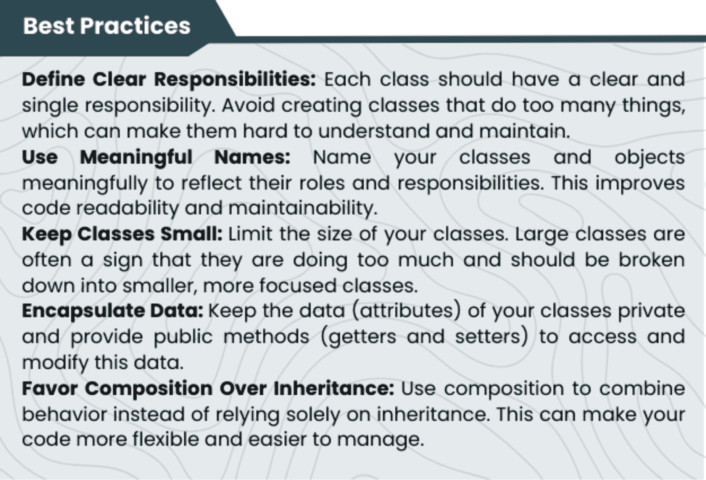!(image_rsrc88V.jpg)

# Java 中的方法

Java 方法是定义从类创建的对象行为的本质构建块。它们封装了执行特定任务的代码，并可以操作`class`的属性。理解如何有效地定义和使用方法对于编写整洁、模块化且可维护的 Java 程序至关重要。

## Java 中的定义方法

Java 方法是定义从类创建的对象行为的不可或缺的构建组件。它们封装了执行特定任务的代码，并可以操作`class`的属性。理解如何有效地定义和使用方法对于编写整洁、模块化且可维护的 Java 程序至关重要。

## 定义方法

在 Java 中定义方法包含访问修饰符、返回类型、方法名和方法体。以下是 Java 中定义方法的通用语法：

```
accessModifier returnType methodName(parameterList) {
    // method body
}
```

`accessModifier`：方法的可见性。

- `returnType`：方法返回的值类型。
- `methodName`：方法的名称。
- `parameterList`：方法的参数列表。
- `method body`：方法的执行代码。

以下是 Java 中方法的一个示例：


```java
public class Car {

// 属性
private String color;
private String model;
private int year;

// 构造函数
public Car(String color, String model, int year) {
    this.color = color;
    this.model = model;
    this.year = year;
}

// 启动汽车的方法
public void start() {
    System.out.println("The car is starting.");
}

// 停止汽车的方法
public void stop() {
    System.out.println("The car is stopping.");
}

// 加速汽车的方法
public void accelerate() {
    System.out.println("The car is accelerating.");
}

// 获取汽车详情的方法
public String getDetails() {
    return "Car: " + this.model + ", Color: " + this.color + ", Year: " + this.year;
}
}
```

在这个示例中，`Car`类有四个方法：`start()`、`stop()`、`accelerate()`和`getDetails()`。`start()`、`stop()`和`accelerate()`方法是`void`方法，意味着它们不返回任何值。`getDetails()`方法返回一个描述汽车的`String`。


## 调用方法

要调用方法，你需要类的实例并使用点符号来调用方法。以下是你可以调用`Car`类定义的方法的方法：

```java
public class Main {
    public static void main(String[] args) {
        // 创建 Car 类的对象
        Car myCar = new Car("Red", "Toyota", 2022);

        // 调用方法
        myCar.start();
        myCar.accelerate();
        System.out.println(myCar.getDetails());
        myCar.stop();
    }
}
```

在这个代码段中，我们创建了`Car`类的对象`myCar`并调用了它的方法`start()`、`accelerate()`、`getDetails()`和`stop()`。

## 方法参数

方法可以接受参数以提供执行所需的额外信息。参数在方法定义的括号内指定。调用方法时，必须提供与参数类型和顺序匹配的参数。

以下是一个带参数方法的示例：

```java
public class Car {

// 到特定速度加速的方法
public void accelerate(int speed) {
    System.out.println("The car is accelerating to " + speed + " mph.");
}
}
```

```java
// 方法与之前相同...

}
```

带参数调用此方法的方法：

```java
public class Main {
    public static void main(String[] args) {
        // 创建 Car 类的对象
        Car myCar = new Car("Red", "Toyota", 2022);
        // 带参数调用 accelerate 方法
        myCar.accelerate(60);
    }
}
```

在这个示例中，`accelerate`方法接收一个整数参数`speed`，我们使用参数`60`来调用它。

### 返回类型

方法可以向调用者返回一个值。返回类型在方法的定义中指定。如果方法返回一个值，则必须使用`return`语句来返回该值。

这是一个返回值的方法的示例：

```java
public class Car {
    // 属性和构造函数与之前相同...
    // 获取车辆详情的方法
    public String getDetails() {
        return "Car: " + this.model + ", Color: " + this.color + ", Year: " + this.year;
    }
    // 方法与之前相同...
}
```

调用此方法并使用返回的值：

```java
public class Main {
    public static void main(String[] args) {
        // 创建 Car 类的对象
        Car myCar = new Car("Red", "Toyota", 2022);
        // 调用 getDetails 方法并存储返回的值
        String details = myCar.getDetails();
        System.out.println(details);
    }
}
```

在这段代码中，`getDetails`方法返回一个描述汽车的`String`，我们将返回的值存储在`details`变量中。

### 方法重载

方法重载允许类拥有多个同名相同但参数列表不同的方法。这为使用不同类型或数量的参数来调用方法提供了灵活性。

这里是方法重载的示例：

```java
public class Car {
    // 属性和构造函数与之前相同...
    // 加速的方法
    public void accelerate() {
        System.out.println("The car is accelerating.");
    }
    // 重载的方法，将车辆加速到特定速度
    public void accelerate(int speed) {
        System.out.println("The car is accelerating to " + speed + " mph.");
    }
    // 方法与之前相同...
}
```

在这个示例中，`accelerate`方法被重载了两个版本：一个不接受任何参数，另一个接收一个整数参数。

### 访问修饰符

方法可以拥有访问修饰符，决定它们的可见性：

- `public`：方法可以从任何其他类访问。
- `private`：方法只能在定义它的类内部访问。
- `protected`：方法可以在同一个包和子类中被访问。
- `default`（无修饰符）：方法可以在同一个包内被访问。

这是一个演示不同访问修饰符的示例：

```java
public class Car {
    // 属性和构造函数与之前相同...
    // 公有方法
    public void start() {
        System.out.println("The car is starting.");
    }
    // 私有方法
    private void checkEngine() {
        System.out.println("Checking the engine.");
    }
    // 保护方法
    protected void stop() {
        System.out.println("The car is stopping.");
    }
    // 默认方法
    void accelerate() {
        System.out.println("The car is accelerating.");
    }
}
```

在这个示例中，`start`是公有方法，`checkEngine`是私有方法，`stop`是保护方法，而`accelerate`具有默认访问权限。

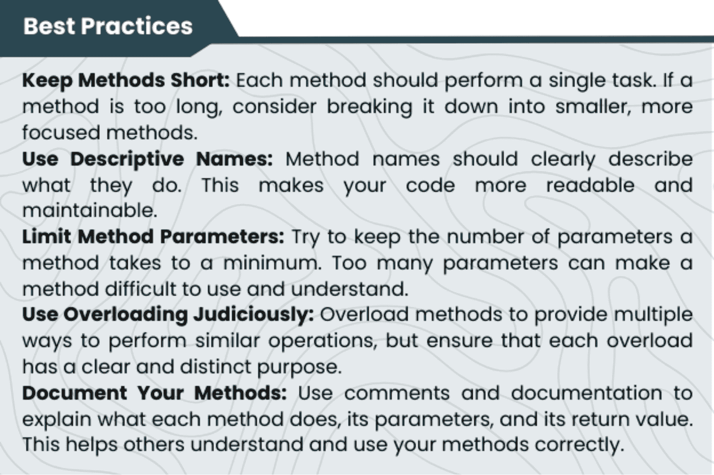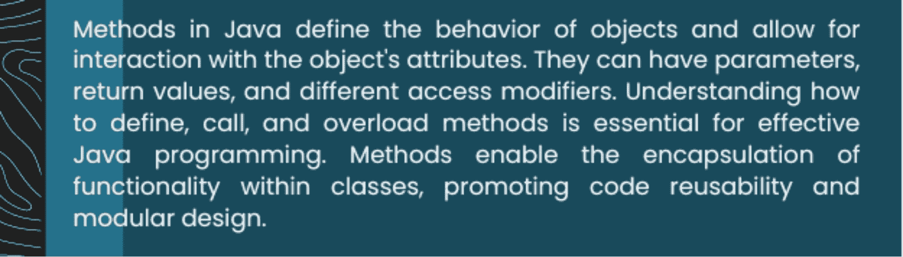

## 构造函数

构造函数是 Java 中用于初始化对象的特殊方法。与普通方法不同，构造函数的名称与类名相同，且没有返回类型。在创建类的对象时，它们会被自动调用，允许你设置对象的初始状态。

### 构造函数的目的

构造函数的主要目的是初始化新创建的对象。这包括为对象的属性设置初始值，并在对象可以使用之前执行任何必要的设置工作。

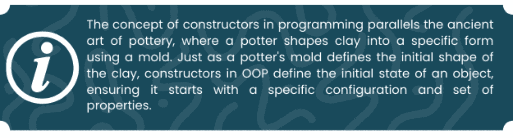

### 定义构造函数

构造函数定义在类内部，并与类名相同。它不返回任何值，即使是`void`也不行。这是一个构造函数的基本示例：

```java
public class Car {
    // 属性
    private String color;
    private String model;
    private int year;
    // 构造函数
    public Car(String color, String model, int year) {
        this.color = color;
        this.model = model;
        this.year = year;
    }
    // 方法
    public void start() {
        System.out.println("The car is starting.");
    }
    public void stop() {
        System.out.println("The car is stopping.");
    }
    public void accelerate() {
        System.out.println("The car is accelerating.");
    }
    public String getDetails() {
        return "Car: " + this.model + ", Color: " + this.color + ", Year: " + this.year;
    }
}
```

在这个示例中，`Car`类有一个接收三个参数的构造函数：`color`、`model`和`year`。当创建`Car`对象时，该构造函数会初始化对象的属性。

### 使用构造函数

要创建对象并初始化它，使用`new`关键字后面跟随构造所需的参数：

```java
public class Main {
    public static void main(String[] args) {
        // 创建 Car 类的对象
        Car myCar = new Car("Red", "Toyota", 2022);
        // 访问方法
        myCar.start();
        myCar.accelerate();
        System.out.println(myCar.getDetails());
        myCar.stop();
    }
}
```

在这段代码中，`Car`对象通过构造函数进行了属性初始化。

### 构造函数的类型

Java 中有两种主要的构造函数类型：默认构造函数和参数构造函数。

#### 默认构造函数

默认构造函数不接受参数。如果你没有显式定义构造函数，Java 会提供一个默认构造函数。这是一个带有默认构造函数的示例：

```java
public class Car {
    // 属性
    private String color;
    private String model;
    private int year;
    // 默认构造函数
    public Car() {
        this.color = "Unknown";
        this.model = "Unknown";
        this.year = 0;
    }
    // 方法
    public void start() {
        System.out.println("The car is starting.");
    }
    public void stop() {
        System.out.println("The car is stopping.");
    }
    public void accelerate() {
        System.out.println("The car is accelerating.");
    }
    public String getDetails() {
        return "Car: " + this.model + ", Color: " + this.color + ", Year: " + this.year;
    }
}
```

在这个示例中，`Car`类使用默认构造函数来初始化默认属性。

#### 参数构造函数

参数构造函数接收用于初始化对象的参数。这种构造函数允许你使用特定的初始值创建对象。

这是一个带有参数构造函数的示例：

```java
public class Car {
    // 属性
    private String color;
    private String model;
    private int year;
    // 参数构造函数
    public Car(String color, String model, int year) {
        this.color = color;
        this.model = model;
        this.year = year;
    }
    // 方法
    public void start() {
        System.out.println("The car is starting.");
    }
    public void stop() {
        System.out.println("The car is stopping.");
    }
    public void accelerate() {
        System.out.println("The car is accelerating.");
    }
    public String getDetails() {
        return "Car: " + this.model + ", Color: " + this.color + ", Year: " + this.year;
    }
}
```

在这个示例中，`Car`类使用参数构造函数根据提供的值初始化属性。

### 重载构造函数

就像方法一样，构造函数也可以重载。这意味着你可以在同一个类中拥有多个参数列表不同的构造函数。构造函数重载允许你根据提供的参数以不同的方式创建对象。

```java
public class Car {
  // Attributes
  private String color;
  private String model;
  private int year;

  // 默认构造函数
  public Car() {
    this.color = "Unknown";
    this.model = "Unknown";
    this.year = 0;
  }

  // 参数化构造函数
  public Car(String color, String model, int year) {
    this.color = color;
    this.model = model;
    this.year = year;
  }

  // 两个参数的参数化构造函数
  public Car(String color, String model) {
    this.color = color;
    this.model = model;
    this.year = 2022; // Default 年份
  }

  // 方法
  public void start() {
    System.out.println("The car is starting.");
  }

  public void stop() {
    System.out.println("The car is stopping.");
  }

  public void accelerate() {
    System.out.println("The car is accelerating.");
  }

  public String getDetails() {
    return "Car: " + this.model + ", Color: " + this.color + ", Year: " + this.year;
  }
}
```

在这个示例中，`Car`类有三个构造函数：一个默认构造函数、一个带有三个参数的参数化构造函数以及一个带有两个参数的参数化构造函数。

### 构造函数链 (Constructor Chaining)

构造函数链是一种构造函数调用同一类或父类中另一个构造函数的技术。这有助于避免代码重复并使初始化过程更加高效。

以下是同一类中构造函数链的示例：


```java
public class Car {
  // 属性
  private String color;
  private String model;
  private int year;

  // 默认构造函数
  public Car() {
    this("Unknown", "Unknown", 0);
  }

  // 参数化构造函数
  public Car(String color, String model, int year) {
    this.color = color;
    this.model = model;
    this.year = year;
  }

  // 两个参数的参数化构造函数
  public Car(String color, String model) {
    this(color, model, 2022);
  }

  // 方法
  public void start() {
    System.out.println("The car is starting.");
  }

  public void stop() {
    System.out.println("The car is stopping.");
  }

  public void accelerate() {
    System.out.println("The car is accelerating.");
  }

  public String getDetails() {
    return "Car: " + this.model + ", Color: " + this.color + ", Year: " + this.year;
  }
}
```

在这个示例中，默认构造函数和带有两个参数的构造函数使用`this`关键字调用了带有三个参数的构造函数。

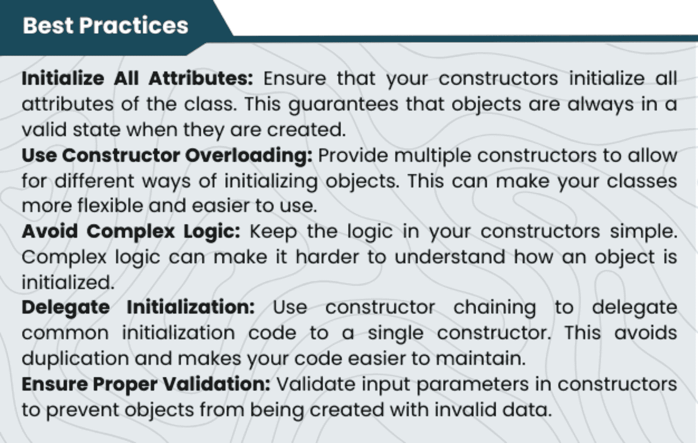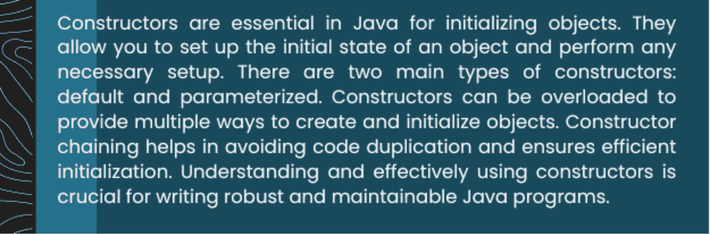

# 继承 (Inheritance)

继承是面向对象编程 (OOP) 中的一个基本概念，它允许一个类（称为子类或派生类）继承另一个类（称为父类或基类）的属性和方法。这促进了代码复用，并在类之间建立了自然的层级关系。

## 继承的目的

继承提供了几个关键的优势：

1. **代码复用**：通过继承父类，子类可以复用已经定义的代码，减少冗余并促进代码复用。
2. **层级组织**：继承有助于将类组织成层级结构，使得复杂系统更容易被理解和维护。
3. **可扩展性**：子类可以通过添加新属性和方法或通过重写现有方法来扩展父类的功能。

## 定义继承

在 Java 中，继承是通过使用`extends`关键字实现的。子类扩展父类，继承它的属性和方法。这里是一个基础示例：

```java
// 父类
public class Vehicle {
  // 属性
  protected String brand;
  protected int year;

  // 构造函数
  public Vehicle(String brand, int year) {
    this.brand = brand;
    this.year = year;
  }

  // 方法
  public void displayInfo() {
    System.out.println("Brand: " + brand + ", Year: " + year);
  }
}

// 子类
public class Car extends Vehicle {
  // 属性
  private String model;

  // 构造函数
  public Car(String brand, int year, String model) {
    super(brand, year); // 调用父类构造函数
    this.model = model;
  }

  // 方法
  public void displayModel() {
    System.out.println("Model: " + model);
  }
}
```


在这个示例中：

- `Vehicle`是父类，具有属性`brand`和`year`以及一个方法`displayInfo()`。
- `Car`是子类，它扩展了`Vehicle`并添加了额外的属性`model`和方法`displayModel()`。

## 使用继承

要使用继承，请创建子类的对象并调用它的方法：

```java
public class Main {
  public static void main(String[] args) {
    // 创建一个 Car 类的对象
    Car myCar = new Car("Toyota", 2022, "Corolla");

    // 调用来自父类和子类的方法
    myCar.displayInfo(); // 来自父类的方法
    myCar.displayModel(); // 来自子类的方法
  }
}
```

多态（Polymorphism）是面向对象编程（OOP）的核心概念，它允许不同类的对象被视为公共父类的对象。它允许用单一接口用于一组通用操作，使得可以使用单个方法来操作各种类型的对象。多态通过促进泛型方法的使用和简化代码结构，增强了代码的灵性和可维护性。

# 多态的类型

Java 中主要有两种类型的多态性：

## 编译时多态（方法重载）

方法重载允许在同一个类中存在多个名称相同但参数列表不同的方法。要调用的正确方法根据方法签名在编译时确定。

## 运行时多态（方法重写）

方法重写允许子类为其父类中已定义的方法提供特定的实现。要调的方法根据对象的实际类型在运行时确定，从而实现动态方法分发。

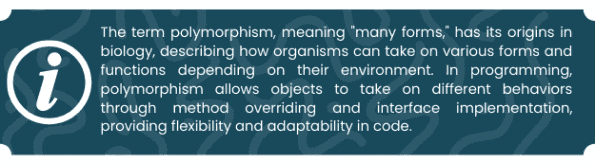

## 编译时多态（方法重载）

当同一个类中的多个方法名称相同但参数列表不同时，就会发生方法重载。编译器根据传递参数的数量和类型来决定调用哪个方法。

这里是方法重载的示例：

```java
public class Calculator {
    // 添加两个整数的方法
    public int add(int a, int b) {
        return a + b;
    }

    // 加载的方法：添加三个整数
    public int add(int a, int b, int c) {
        return a + b + c;
    }

    // 加载的方法：添加两个双精度浮点数
    public double add(double a, double b) {
        return a + b;
    }
}

public class Main {
    public static void main(String[] args) {
        Calculator calculator = new Calculator();
        System.out.println("2 和 3 的和: " + calculator.add(2, 3));
        System.out.println("1, 2 和 3 的和: " + calculator.add(1, 2, 3));
        System.out.println("1.5 和 2.5 的和: " + calculator.add(1.5, 2.5));
    }
}
```

在这个示例中，`Calculator`类拥有三个具有不同参数列表的`add`方法，演示了方法重载。

## 运行时多态（方法重写）

方法重写允许子类为其父类中已定义的方法提供特定的实现。要调用的方法根据对象的实际类型在运行时确定，实现了动态方法分发。

这里是方法重写的示例：

```java
// 父类
public class Animal {
    // 发出声音的方法
    public void makeSound() {
        System.out.println("动物发出了声音");
    }
}

// 子类
public class Dog extends Animal {
    // 重写 makeSound 方法
    @Override
    public void makeSound() {
        System.out.println("狗在汪叫");
    }
}

// 另一个子类
public class Cat extends Animal {
    // 重写 makeSound 方法
    @Override
    public void makeSound() {
        System.out.println("猫在喵喵");
    }
}

public class Main {
    public static void main(String[] args) {
        Animal myDog = new Dog();
        Animal myCat = new Cat();
        // 调用重写的方法
        myDog.makeSound(); // 输出: 狗在汪叫
        myCat.makeSound(); // 输出: 猫在喵喵
    }
}
```

在这个示例中，`Dog`和`Cat`类重写了`Animal`类的`makeSound`方法。要调的方法根据实际对象类型（`Dog`或`Cat`）在运行时确定。

## 多态的应用

多态允许你编写更通用、更灵活的代码。例如，你可以使用公共接口或父类来处理一组相关对象。

这里是一个使用接口的示例：

```java
// 接口
public interface Shape {
    void draw();
}

// 在类中实现接口
public class Circle implements Shape {
    @Override
    public void draw() {
        System.out.println("绘制圆形");
    }
}

// 另一个实现接口的类
public class Rectangle implements Shape {
    @Override
    public void draw() {
        System.out.println("绘制矩形");
    }
}

public class Main {
    public static void main(String[] args) {
        // 创建 Shape 引用数组
        Shape[] shapes = {new Circle(), new Rectangle()};
        // 使用多态绘制形状
        for (Shape shape : shapes) {
            shape.draw(); // 输出: 绘制圆形, 绘制矩形
        }
    }
}
```

在这个示例中，`Shape`接口定义了一个公共方法`draw()`。`Circle`和`Rectangle`类实现了该接口，并提供了`draw()`方法的特定实现。`Main`类通过使用单一循环调用不同类型`Shape`对象的`draw()`方法，演示了多态性。

## 多态的优势

1. **代码复用性**：多态允许你使用相同的方法或接口来处理不同类型的对象，促进了代码复用。
2. **灵活性**：多态使得添加实现相同接口或扩展相同父类的的新类变得容易，而无需修改现有代码。
3. **可维护性**：它减少了代码的复杂性。
4. **可扩展性**：通过添加子类或实现接口，你可以扩展代码库。

# 封装 (Encapsulation)

封装是面向对象编程（OOP）的基本原则之一，与继承、多态和抽象并列。它将数据（属性）和操作数据的方法（函数）封装在一个名为类的单元中。封装限制了对对象某些组件的直接访问。

## 封装的核心概念

1. **数据隐藏**：封装隐藏了对象的内部状态，并通过受控的接口暴露。这意味着对象的内部表示是对外部隐藏的。
2. **访问修饰符**：Java 提供了四种访问修饰符来确定类的可见性：
   - `private`：仅在类内部可见。
   - `default`（无修饰符）：仅在同包的类中可见。
   - `protected`：在同包类中以及子类中可见。
   - `public`：在任何其他类中可见。

## 封装的好处

- **提高可维护性**：封装允许更改类的实现，而不影响程序的其他部分。这使得代码更容易维护和更新。
- **增强安全性**：通过限制对对象内部状态的访问，封装有助于保护数据不受意外修改，并确保设置的是有效数据。
- **模块化设计**：封装通过将代码组织为具有良好定义的独立单元来促进模块化，使系统更容易理解和管理。

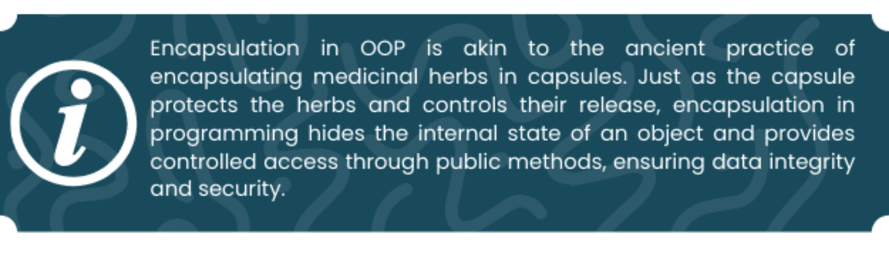

## 实现封装

在 Java 中实现封装，通常将类的属性设为`private`，并提供公共的 getter 和 setter 方法来访问和修改属性。这种方法确保了对属性的访问是受控的，并在必要时进行验证。

这里是一个 Java 封装的简单示例：

```java
public class Person {
    // 私有属性
    private String name;
    private int age;

    // 构造函数
    public Person(String name, int age) {
        this.name = name;
        this.age = age;
    }

    // name 的 public getter 方法
    public String getName() {
        return name;
    }

    // name 的 public setter 方法
    public void setName(String name) {
        this.name = name;
    }

    // age 的 public getter 方法
    public int getAge() {
        return age;
    }
}
```

```java
// 年龄的公共 setter 方法
public void setAge(int age) {
    if (age > 0) {
        this.age = age;
    } else {
        System.out.println("Age must be positive.");
    }
}

// 显示个人详情的方法
public void displayDetails() {
    System.out.println("Name: " + name + ", Age: " + age);
}
}

public class Main {
    public static void main(String[] args) {
        // 创建 Person 类的对象
        Person person = new Person("John", 25);
        // 通过公共方法访问并修改私有属性
        person.setName("Jane");
        person.setAge(30);

        // 显示详情
        person.displayDetails(); // 输出: Name: Jane, Age: 30

        // 尝试设置无效的年龄
        person.setAge(-5); // 输出: Age must be positive.
    }
}
```

在这个示例中：

- `Person`类拥有私有属性`name`和`age`。
- 提供了公共的 getter 和 setter 方法来访问和修改这些属性。
- `setAge`方法包含了验证逻辑，以确保`age`为正数。

## 现实世界示例：银行账户类中的封装

让我们考虑一个更实用的示例，使用封装来实现`BankAccount`类。该类应该封装账户余额，并提供存款和取款的方法，同时确保账户余额不能被直接设置。


```java
public class BankAccount {
    // 私有属性
    private double balance;

    // 构造函数
    public BankAccount(double initialBalance) {
        if (initialBalance > 0) {
            this.balance = initialBalance;
        } else {
            this.balance = 0;
            System.out.println("Initial balance must be positive.");
        }
    }

    // 余额的公共 getter 方法
    public double getBalance() {
        return balance;
    }

    // 存款的方法
    public void deposit(double amount) {
        if (amount > 0) {
            balance += amount;
            System.out.println("Deposited: " + amount + ", New balance: " + balance);
        } else {
            System.out.println("Deposit amount must be positive.");
        }
    }

    // 取款的方法
    public void withdraw(double amount) {
        if (amount > 0 && amount <= balance) {
            balance -= amount;
            System.out.println("Withdrew: " + amount + ", New balance: " + balance);
        } else {
            System.out.println("Invalid withdraw amount.");
        }
    }
}

public class Main {
    public static void main(String[] args) {
        // 创建带有初始余额的银行账户
        BankAccount account = new BankAccount(1000);
        // 存款
        account.deposit(500);
        // 输出: Deposited: 500.0, New balance: 1500.0

        // 取款
        account.withdraw(300);
        // 输出: Withdrew: 300.0, New balance: 1200.0

        // 尝试取出超过余额的金额
        account.withdraw(2000);
        // 输出: Invalid withdraw amount.

        // 显示余额
        System.out.println("Final balance: " + account.getBalance());
        // 输出: Final balance: 1200.0
    }
}
```

在这个示例中：

- `BankAccount`类封装了`balance`属性，使其变为私有。
- 提供了公共方法`deposit`和`withdraw`来修改`balance`。
- `deposit`和`withdraw`方法包含了验证，以确保操作是有效的。

# 抽象 (Abstraction)

抽象是面向对象编程（OOP）的核心原则之一，侧重于隐藏复杂的实现细节，并向外部世界暴露对象的本质特征。这简化了与对象的交互，允许开发者关注高层功能，而无需担心底层的复杂性。Java 通过抽象类和接口实现抽象。

### 抽象的核心概念

1. **简化**：抽象通过隐藏实现细节简化对象的交互。
2. **模块化**：抽象通过将复杂系统拆分为更小、易于管理的组件，促进了模块化。
3. **关注“做什么”，而不是“怎么做”**：抽象允许开发者关注对象做什么，而不是它是如何实现的。

### 抽象类

Java 中的抽象类是不能直接实例化的类。它既可以包含抽象方法（没有方法体的方法），也可以包含具体方法（有方法体的方法）。抽象类用于定义可以被子类的的特征和行为。

这是一个抽象类的示例：

```java
// 抽象类
public abstract class Animal {
    // 抽象方法（无方法体）
    public abstract void makeSound();

    // 具体方法
    public void sleep() {
        System.out.println("The animal is sleeping.");
    }
}

// 子类
public class Dog extends Animal {
    // 实现抽象方法
    @Override
    public void makeSound() {
        System.out.println("Dog barks");
    }
}

// 另一个子类
public class Cat extends Animal {
    // 实现抽象方法
    public void makeSound() {
        System.out.println("Cat barks");
    }
}
```

在这个示例中：

- `Animal`是一个抽象类，包含一个抽象方法`makeSound`和具体方法`sleep`。
- `Dog`和`Cat`是子类，它们实现了抽象方法`makeSound`。

### 接口 (Interfaces)

Java 中的接口是一种引用类型，它可以只包含抽象方法（在 Java 8 之前）。接口用于定义类可以实现的约定。

这是一个接口的示例：

```java
// 接口
interface Vehicle {
    void start();
    void stop();
}

// 实现接口的类
class Car implements Vehicle {
    @Override
    public void start() {
        System.out.println("Car is starting.");
    }

    @Override
    public void stop() {
        System.out.println("Car is stopping.");
    }
}

// 另一个实现接口的类
class Motorcycle implements Vehicle {
    @Override
    public void start() {
        System.out.println("Motorcycle is starting.");
    }

    @Override
    public void stop() {
        System.out.println("Motorcycle is stopping.");
    }
}

public class Main {
    public static void main(String[] args) {
        Vehicle car = new Car();
        Vehicle motorcycle = new Motorcycle();

        car.start(); // 输出: Car is starting.
        car.stop();   // 输出: Car is stopping.
        motorcycle.start(); // 输出: Motorcycle is starting.
        motorcycle.stop();  // 输出: Motorcycle is stopping.
    }
}
```

在这个示例中：

- `Vehicle`是一个接口，定义了抽象方法`start()`和`stop()`。
- `Car`和`Motorcycle`是实现`Vehicle`接口的类，它们提供了这些方法的实现。

```java
// 年龄的公共 setter 方法
public void setAge(int age) {
    if (age > 0) {
        this.age = age;
    } else {
        System.out.println("Age must be positive.");
    }
}

// 显示个人详情的方法
public void displayDetails() {
    System.out.println("Name: " + name + ", Age: " + age);
}
}

public class Main {
    public static void main(String[] args) {
        // 创建 Person 类的对象
        Person person = new Person("John", 25);
        // 通过公共方法访问并修改私有属性
        person.setName("Jane");
        person.setAge(30);

        // 显示详情
        person.displayDetails(); // 输出: Name: Jane, Age: 30

        // 尝试设置无效的年龄
        person.setAge(-5); // 输出: Age must be positive.
    }
}
```

在这个示例中：

- `Person`类拥有私有属性`name`和`age`。
- 提供了公共的 getter 和 setter 方法来访问和修改这些属性。
- `setAge`方法包含了验证，以确保`age`为正数。

### 现实世界示例：银行账户类中的封装

让我们考虑一个更实用的示例，使用封装来实现`BankAccount`类。该类应该封装账户余额，并提供存款和取款的方法，同时确保账户余额不能被直接设置。


```java
public class BankAccount {
    // 私有属性
    private double balance;

    // 构造函数
    public BankAccount(double initialBalance) {
        if (initialBalance > 0) {
            this.balance = initialBalance;
        } else {
            this.balance = 0;
            System.out.println("Initial balance must be positive.");
        }
    }

    // 余额的公共 getter 方法
    public double getBalance() {
        return balance;
    }

    // 存款的方法
    public void deposit(double amount) {
        if (amount > 0) {
            balance += amount;
            System.out.println("Deposited: " + amount + ", New balance: " + balance);
        } else {
            System.out.println("Deposit amount must be positive.");
        }
    }

    // 取款的方法
    public void withdraw(double amount) {
        if (amount > 0 && amount <= balance) {
            balance -= amount;
            System.out.println("Withdrew: " + amount + ", New balance: " + balance);
        } else {
            System.out.println("Invalid withdraw amount.");
        }
    }
}

public class Main {
    public static void main(String[] args) {
        // 创建带有初始余额的银行账户
        BankAccount account = new BankAccount(1000);
        // 存款
        account.deposit(500);
        // 输出: Deposited: 500.0, New balance: 1500.0

        // 取款
        account.withdraw(300);
        // 输出: Withdrew: 300.0, New balance: 1200.0

        // 尝试取出超过余额的金额
        account.withdraw(2000);
        // 输出: Invalid withdraw amount.

        // 显示余额
        System.out.println("Final balance: " + account.getBalance());
        // 输出: Final balance: 1200.0
    }
}
```

在这个示例中：

- `BankAccount`类封装了`balance`属性，使其变为私有。
- 提供了公共方法`deposit`和`withdraw`来修改`balance`。
- `deposit`和`withdraw`方法包含了验证，以确保操作是有效的。

## 抽象

抽象是面向对象编程（OOP）的核心原则之一，侧重于隐藏复杂的实现细节，并向外部世界暴露对象的本质特征。这简化了与对象的交互，允许开发者关注高层功能，而无需担心底层的复杂性。Java 通过抽象类和接口实现抽象。

### 抽象的核心概念

1. **简化**：抽象通过只暴露必要的细节并隐藏实现细节来简化与对象的交互。
2. **模块化**：抽象通过将复杂系统拆分为更小、易于管理的组件，促进了模块化。
3. **关注“做什么”，而不是“怎么做”**：抽象允许开发者关注对象做什么，而不是它是如何实现的。

### 抽象类

Java 中的抽象类是不能直接实例化的类。它既可以包含抽象方法（没有方法体的方法），也可以包含具体方法（有方法体的方法）。抽象类用于定义可以被子类继承的特征和行为。

这是一个抽象类的示例：

```java
// 抽象类
public abstract class Animal {
    // 抽象方法（无方法体）
    public abstract void makeSound();

    // 具体方法
    public void sleep() {
        System.out.println("The animal is sleeping.");
    }
}

// 子类
public class Dog extends Animal {
    // 实现抽象方法
    @Override
    public void makeSound() {
        System.out.println("Dog barks");
    }
}

// 另一个子类
public class Cat extends Animal {
    // 实现抽象方法
    public void makeSound() {
        System.out.println("Cat barks");
    }
}
```

*(注：由于你提供的原文文本在`Cat`类处意外中断了，我已翻译到此处结束为止。)*

```java
this.author = author;

}

// Abstract method

public abstract void displayDetails();

}

// Subclass

public class Book extends LibraryItem {

    private String ISBN;

    public Book(String title, String author, String ISBN) {
        super(title, author);
        this.ISBN = ISBN;
    }

    @Override
    public void displayDetails() {
        System.out.println("Book: " + title + ", Author: " + author + ", ISBN: " + ISBN);
    }
}

// Another subclass

public class Magazine extends LibraryItem {

    private int issueNumber;

    public Magazine(String title, String author, int issueNumber) {
        super(title, author);
        this.issueNumber = issueNumber;
    }

    @Override
    public void displayDetails() {
        System.out.println("Magazine: " + title + ", Author: " + author + ", Issue: " + issueNumber);
    }
}

public class Main {
    public static void main(String[] args) {
        LibraryItem book = new Book("Effective Java", "Joshua Bloch", "978-0134685991");
        LibraryItem magazine = new Magazine("Time", "Various Authors", 2023);
        book.displayDetails(); // Outputs: Book: Effective Java, Author: Joshua Bloch, ISBN: 978-0134685991
        magazine.displayDetails(); // Outputs: Magazine: Time, Author: Various Authors, Issue: 2023
    }
}
```

在这个示例中：

- `LibraryItem`是一个抽象类，包含一个抽象方法`displayDetails()`。
- `Book`和`Magazine`是继承自`LibraryItem`的子类，并为`displayDetails()`方法提供了具体实现。

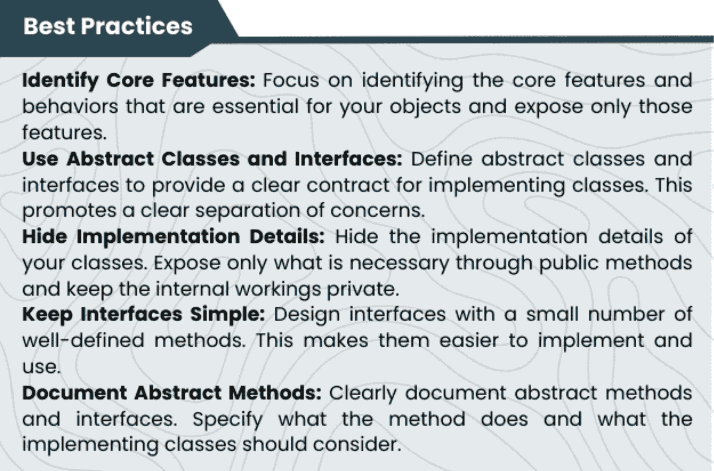!

在下一节中，我们将把目前为止讨论过的所有 OOP 概念——类和对象、方法、构造函数、继承、多态、封装和抽象——整合到一个实践项目中：创建一个简单的图书管理系统。这个项目将帮助加强你对这些概念的理解，并演示它们如何协同工作以创建一个功能完备的应用。

# 项目：创建一个简单的图书管理系统

在这个项目中，我们将使用目前涵盖的面向对象编程 (OOP) 概念创建一个简单的图书管理系统。该系统将管理不同类型的图书物品（如书籍和杂志），并演示类、对象、方法、构造函数、继承、多态、封装和抽象的使用。

## 项目需求

### `LibraryItem`类（抽象类）

- 属性：`title`, `author`
- 方法：`displayDetails()`（抽象）

### `Book`类（`LibraryItem`的子类）

- 额外属性：`ISBN`
- 方法：`displayDetails()`

### `Magazine`类（`LibraryItem`的子类）

- 额外属性：`issueNumber`
- 方法：`displayDetails()`

### `Library`类

- 属性：`ArrayList<LibraryItem>`
- 方法：`addItem(LibraryItem item)`, `displayAllItems()`

### `Main`类

- 创建`Book`和`Magazine`的实例
- 将物品添加到图书馆中
- 显示图书馆中的所有物品

## 实现

让我们开始逐步实现每个类。

### 1. `LibraryItem`类（抽象类）

```java
public abstract class LibraryItem {
    protected String title;
    protected String author;

    public LibraryItem(String title, String author) {
        this.title = title;
        this.author = author;
    }

    // Abstract method
    public abstract void displayDetails();
}
```

### 2. `Book`类（`LibraryItem`的子类）

```java
public class Book extends LibraryItem {
    private String ISBN;

    public Book(String title, String author, String ISBN) {
        super(title, author);
        this.ISBN = ISBN;
    }

    @Override
    public void displayDetails() {
        System.out.println("Book: " + title + ", Author: " + author + ", ISBN: " + ISBN);
    }
}
```

### 3. `Magazine`类（`LibraryItem`的子类）

```java
public class Magazine extends LibraryItem {
    private int issueNumber;

    public Magazine(String title, String author, int issueNumber) {
        super(title, author);
        this.issueNumber = issueNumber;
    }

    @Override
    public void displayDetails() {
        System.out.println("Magazine: " + title + ", Author: " + author + ", Issue: " + issueNumber);
    }
}
```

### 4. `Library`类

```java
import java.util.ArrayList;

public class Library {
    private ArrayList<LibraryItem> items = new ArrayList<>();

    public void addItem(LibraryItem item) {
        items.add(item);
    }

    public void displayAllItems() {
        for (LibraryItem item : items) {
            item.displayDetails();
        }
    }
}
```

### 5. `Main`类

```java
public class Main {
    public static void main(String[] args) {
        LibraryItem book = new Book("Effective Java", "Joshua Bloch", "978-0134685991");
        LibraryItem magazine = new Magazine("Time", "Various Authors", 2023);
        book.displayDetails(); // Outputs: Book: Effective Java, Author: Joshua Bloch, ISBN: 978-0134685991
        magazine.displayDetails(); // Outputs: Magazine: Time, Author: Various Authors, Issue: 2023
    }
}
```

通过使用类、对象、方法、构造函数、继承、多态、封装和抽象，我们能够创建一个模块化、可重用且易维护的系统。

## 异常处理


### 异常简介

异常是 Java 编程的一部分，用于处理程序运行过程中发生的错误和其他意外事件。当出现问题时（例如访问无效数组索引、尝试打开不存在的文件或除以零），Java 会产生异常。这种异常本质上是中断指令流的错误状况。

异常允许开发者编写能够优雅处理错误状况的代码。与其让程序崩溃，异常允许程序捕获错误、执行某些纠正操作，或者至少向用户提供有意义的错误信息。

### 异常性

假设你正在开发一个从文件读取数据的应用程序。如果文件不存在或数据损坏了会怎样？如果没有异常处理，你的应用程序将直接崩溃，让用户感到困惑和沮丧。通过使用异常，你可以有效地管理这些情况。例如，你可以捕获异常、记录错误、告知用户问题，并可能提示他们提供不同的文件。

### 异常的工作原理

在 Java 中，异常是表示错误或意外事件的对象。当错误发生时，会创建一个异常对象并抛出它。运行时系统随后会搜索适当的代码块来处理此异常。如果没有找到这样的代码，程序将终止。

### 基础异常处理

在 Java 中处理异常，通常使用`try-catch`块。这是一个简单的示例：

```java
public class ExceptionExample {
    public static void main(String[] args) {
        try {
            int result = divide(10, 0);
            System.out.println("Result: " + result);
        } catch (ArithmeticException e) {
            System.out.println("Error: Cannot divide by zero.");
        }
    }

    public static int divide(int a, int b) {
        return a / b;
    }
}
```

在这个示例中，`divide`方法尝试除以零，这在算术中是不允许的。异常被`catch`块捕获，并打印出有意义的错误信息，而不是崩溃程序。

1. **提升了代码的可读性与可维护性**：异常处理将错误处理代码与常规代码分离，使程序更易阅读和维护。
2. **增强的错误信息**：异常提供了有关错误的详细信息，例如错误类型、发生位置以及错误发生时的程序状态。


3. **优雅降级**：通过捕获异常，你可以允许程序以优雅的方式降级，向用户提供用的反馈或切换到备用方案，而不是完全失败。

## 异常的常见场景

* **文件操作**：尝试读取或写入一个不存在或无法访问的文件。
* **网络操作**：网络连接问题，例如超时或主机不可达。
* **用户输入**：用户提供的无效输入，例如在需要数字的地方输入了非数值值。
* **资源管理**：与访问或释放系统资源相关的问题，如内存或数据库连接。

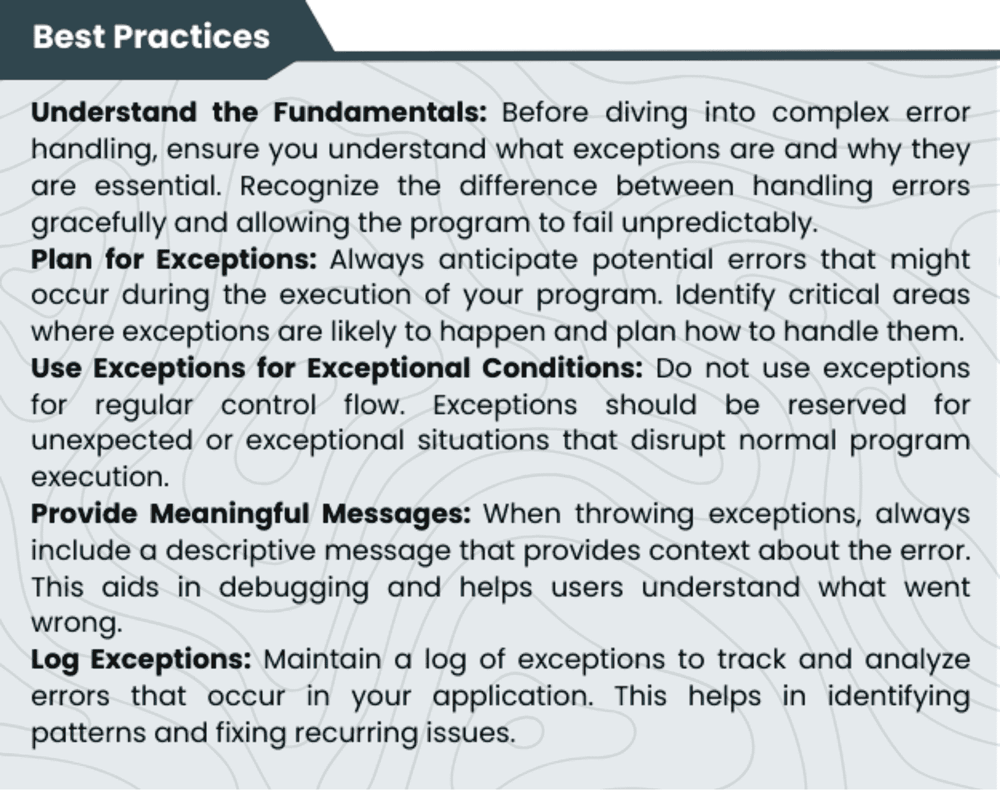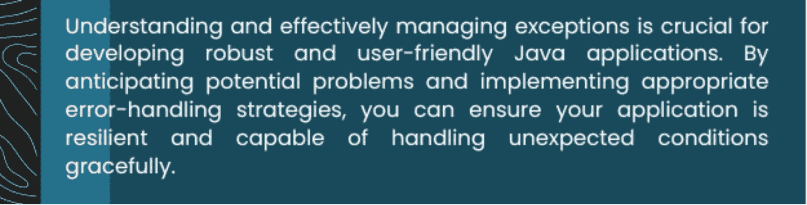

## 异常的类型

Java 异常大致可以分为三类：受检异常（checked exceptions）、未检异常（unchecked exceptions）和错误（errors）。每种异常都有不同的用途，并在不同的情况下产生。理解这些区别对于在程序中实现有效的错误处理策略至关重要。

### 受检异常

受检异常是在编译时进行检查的异常。这意味着 Java 编译器要求你必须代码中显式地处理这些异常。如果你不处理受检异常，编译器将生成错误，你的代码将无法编译。这些异常通常由于程序控制之外的因素引起，例如输入/输出操作或网络问题。

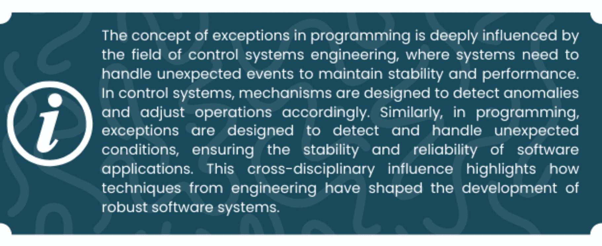

常见的受检异常示例包括：

* `IOException`：当 I/O 操作失败或被中断时抛出。
* `SQLException`：当与数据库交互时发生错误时抛出。
* `FileNotFoundException`：当尝试打开指定路径的文件的文件失败时抛出。

处理受检异常需要使用`try-catch`块，或者在方法签名中使用`throws`关键字声明该异常。

处理受检异常的示例：

```java
import java.io.BufferedReader;
import java.io.FileReader;
import java.io.IOException;

public class CheckedExceptionExample {
    public static void main(String[] args) {
        try {
            BufferedReader reader = new BufferedReader(new FileReader("example.txt"));
            String line;
            while ((line = reader.readLine()) != null) {
                System.out.println(line);
            }
            reader.close();
        } catch (IOException e) {
            System.out.println("An error occurred while reading the file: " + e.getMessage());
        }
    }
}
```

### 未检异常

未检异常也称为运行时异常，在编译时不进行检查。这些异常通常由编程错误引起，例如逻辑错误或对 API 使用不当。由于它们表示了通常可以通过更好的编码实践预防的问题，因此编译器不会强制你显式地处理它们。

常见的未检异常示例包括：

* `NullPointerException`：当应用程序在需要对象的情况下尝试使用`null`时抛出。
* `ArrayIndexOutOfBoundsException`：当非法索引访问数组时抛出。
* `IllegalArgumentException`：当方法接收到的参数格式与方法预期不符时抛出。

处理未检异常不是强制的，但预判并管理潜在的运行时错误被认为是一种良好的做法。

处理未检异常的示例：

```java
public class UncheckedExceptionExample {
    public static void main(String[] args) {
        try {
            int[] numbers = {1, 2, 3};
            System.out.println(numbers[5]);
        } catch (ArrayIndexOutOfBoundsException e) {
            System.out.println("Array index is out of bounds: " + e.getMessage());
        }
    }
}
```

### 错误

错误是严重的问题，通常指示 Java 运行时环境本身的问题，例如内存泄漏或硬件故障。与异常不同，错误并不是供应用程序捕获或处理的，因为它们通常意味着应用程序无法恢复的情况。

常见的错误示例包括：

* `OutOfMemoryError`：当 Java 虚拟机因为内存不足无法分配对象时抛出。
* `StackOverflowError`：当应用程序递归过深导致栈溢出时抛出。

由于其严重性，通常不应该在典型的应用程序中捕获错误。相反，这些问题通常需要在系统或环境层面进行修复。

错误的示例：

```java
public class ErrorExample {
    public static void main(String[] args) {
        try {
            recursiveMethod();
        } catch (StackOverflowError e) {
            System.out.println("Stack overflow error: " + e.getMessage());
        }
    }
    public static void recursiveMethod() {
        recursiveMethod(); // 这会导致 StackOverflowError
    }
}
```

## 有效地处理异常

处理异常时，至关重要的是：

1. **捕获特定异常**：捕获特定的异常而不是通用的`Exception`类型，以适当处理不同的错误条件。
2. **提供有意义的信息**：提供清晰且信息丰富的错误消息以帮助诊断问题。
3. **清理资源**：使用`finally`块或`try-with-resources`语句确保即使发生异常，资源也能被正确关闭。
4. **记录异常**：使用日志框架记录异常，以便维护调试和监控目的的错误记录。

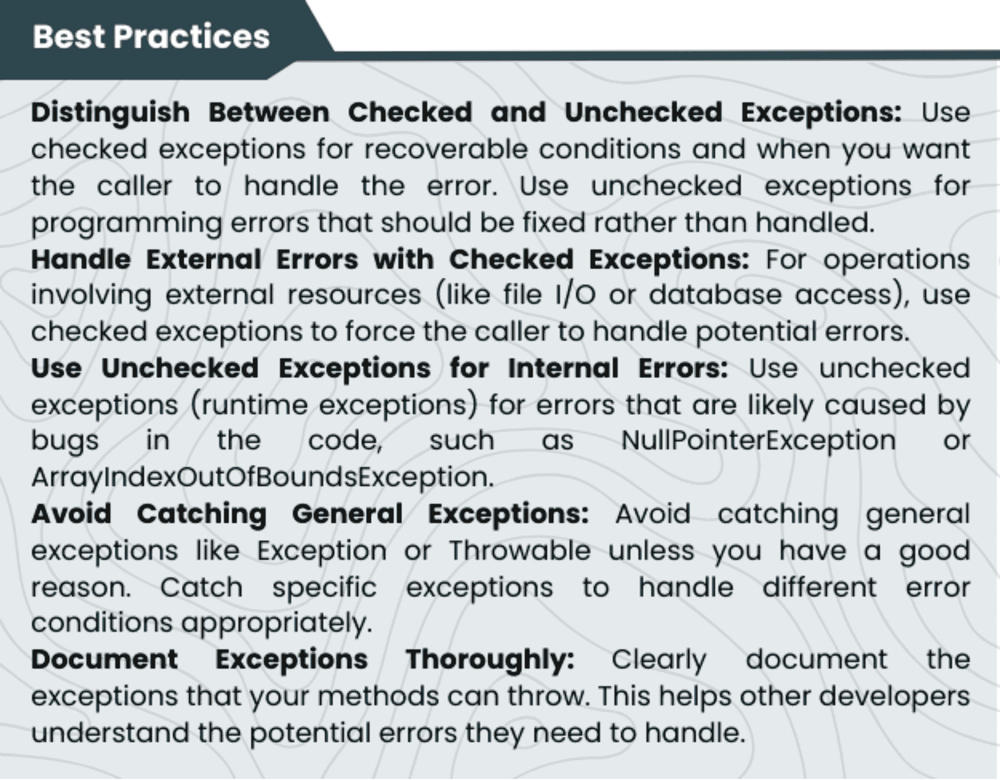

`Error`类是`Throwable`的子类，代表合理的应用程序不应尝试捕获的严重问题。`Errors`通常是程序无法控制的条件，通常指示 Java 运行时环境本身存在问题。

### 错误示例：

* `OutOfMemoryError`
* `StackOverflowError`
* `VirtualMachineError`

### 层次结构

以下是 Java 异常层次结构的简化版版本：

```text
java.lang.Throwable
|-- java.lang.Error
|    |-- OutOfMemoryError
|    |-- StackOverflowError
|
|-- java.lang.Exception
|-- java.io.IOException
|    |-- FileNotFoundException
|    |-- EOFException
|
|-- java.sql.SQLException
|
|-- java.lang.RuntimeException
|-- NullPointerException
|-- ArrayIndexOutOfBoundsException
|-- IllegalArgumentException
|-- ArithmeticException
```

### 实际示例：异常层次结构

让我们考虑一个实际示例来说明 Java 中的异常层次结构。假设你有一个方法读取文件并处理其内容。该方法可能会根据遇到的情况抛出各种异常。

```java
import java.io.BufferedReader;
import java.io.FileNotFoundException;
import java.io.FileReader;
import java.io.IOException;

public class ExceptionHierarchyExample {
    public static void main(String[] args) {
        try {
            readFile("example.txt");
        } catch (FileNotFoundException e) {
            System.out.println("文件未找到: " + e.getMessage());
        } catch (IOException e) {
            System.out.println("发生 I/O 错误: " + e.getMessage());
        } catch (Exception e) {
            System.out.println("发生意外错误: " + e.getMessage());
        }
    }

    public static void readFile(String fileName) throws IOException {
        BufferedReader reader = null;
        try {
            reader = new BufferedReader(new FileReader(fileName));
            String line;
            while ((line = reader.readLine()) != null) {
                System.out.println(line);
            }
        } finally {
            if (reader != null) {
                reader.close();
            }
        }
    }
}
```

在此示例中：

* `readFile`方法声明它会抛出`IOException`，这是一个受检异常。这意味着调用者必须处理它。
* `main`方法使用`try-catch`块来处理不同的异常：
    * 分别捕获`FileNotFoundException`，因为它是`IOException`的一种特定类型。
    * 捕获`IOException`以处理任何其他与 I/O 相关的问题。
    * 捕获通用的`Exception`以处理任何其他意外异常。

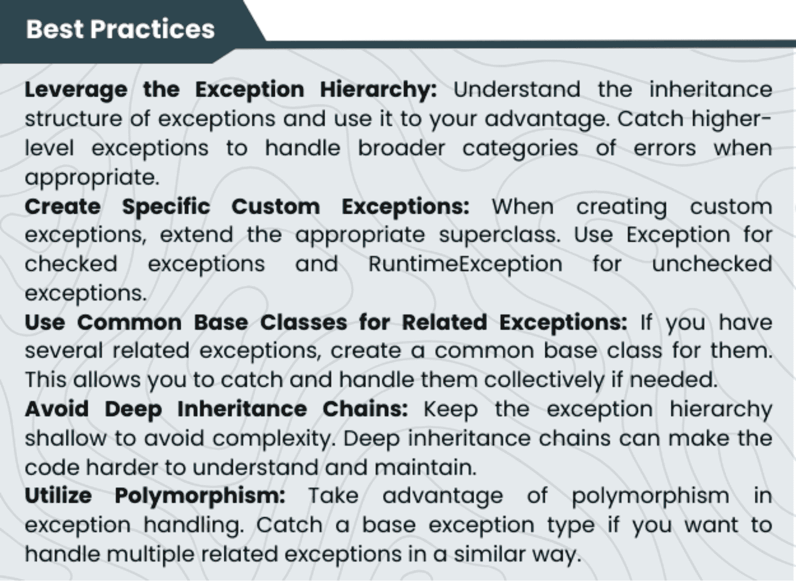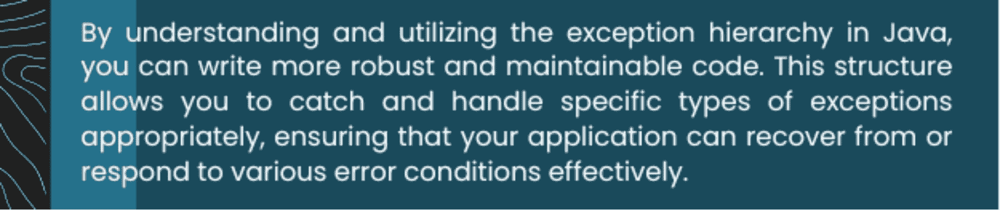

## Try-Catch 块

`try-catch`块是 Java 异常处理的基石。它允许你捕获并处理在代码块内发生的异常，防止它们向下传播并可能导致你的程序崩溃。通过使用`try-catch`块，你可以优雅地管理错误，向用户提供信息丰富的反馈，并确保程序在遇到意外情况时也能继续顺畅运行。

#### Try-Catch 块的结构

一个`try-catch`块由一个`try`块和一个或多个`catch`块组成。`try`块包含可能抛出异常的代码，而`catch`块包含处理特定类型异常的代码。

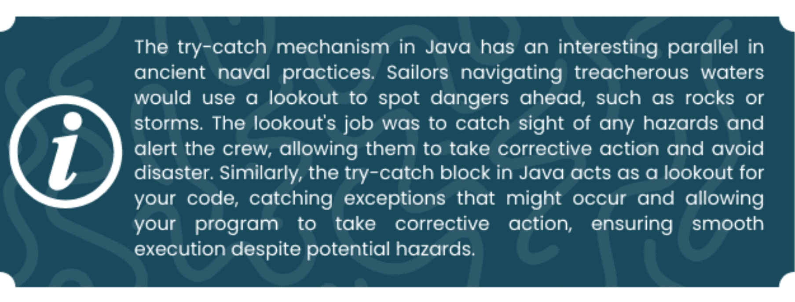

```java
try {
    // 可能会抛出异常的代码
} catch (ExceptionType1 e1) {
    // 处理类型为 ExceptionType1 的异常
} catch (ExceptionType2 e2) {
    // 处理类型为 ExceptionType2 的异常
} finally {
    // 可选的 finally 块
}
```

* `try`块：包含可能抛出异常的代码。
* `catch`块：包含处理特定类型异常的代码。
* `finally`块：可选的`finally`块，无论是否发生异常都会执行。

#### Try-Catch 块的示例

让我们看一个实际示例来了解`try-catch`块是如何工作的：

```java
class TryCatchExample {
    public static void main(String[] args) {
        BufferedReader reader = null;
        try {
            reader = new BufferedReader(new FileReader("example.txt"));
            String line;
            while ((line = reader.readLine()) != null) {
                System.out.println(line);
            }
        } catch (FileNotFoundException e) {
            System.out.println("文件未找到: " + e.getMessage());
        } catch (IOException e) {
            System.out.println("发生 I/O 错误: " + e.getMessage());
        } finally {
            try {
                if (reader != null) {
                    reader.close();
                }
            } catch (IOException e) {
                System.out.println("关闭读取出错: " + e.getMessage());
            }
        }
    }
}
```

在此示例中：

* `try`块尝试打开并读取文件。
* 第一个`catch`块捕获`FileNotFoundException`，如果文件不存在。
* 第二个`catch`块捕获`IOException`，这可能会发生。
* `finally`块确保无论是否发生异常都会尝试关闭`reader`。

#### 多个 Catch 块

你可以有多个`catch`块来处理不同类型的异常：

```java
class MultipleCatchExample {
    public static void main(String[] args) {
        BufferedReader reader = null;
        try {
            reader = new BufferedReader(new FileReader("example.txt"));
            String line;
            while ((line = reader.readLine()) != null) {
                System.out.println(line);
            }
        } catch (FileNotFoundException e) {
            System.out.println("文件未找到: " + e.getMessage());
        } catch (IOException e) {
            System.out.println("发生 I/O 错误: " + e.getMessage());
        } finally {
            try {
                if (reader != null) {
                    reader.close();
                }
            } catch (IOException e) {
                System.out.println("关闭读取出错: " + e.getMessage());
            }
        }
    }
}
```

在此示例中：

* `try`块尝试执行代码。
* `catch`块处理`FileNotFoundException`。
* `catch`块处理`IOException`。
* `finally`块执行清理工作。

## 使用 Try-Catch 块的最佳实践

* **特定的异常块**：捕获特定的异常而不是通用的`Exception`。这可以确保每种类型的异常都得到适当处理。
* **缩小范围**：将`try`块内的代码保持最小，以减少捕获意外异常的概率。仅包含可能抛出你想处理的异常的代码。
* **处理已知异常**：处理`try`块代码中可能抛出的所有已知异常。这防止程序因未处理的异常而崩溃。
* **记录异常**：使用日志框架记录异常，以便供调试和监控目的记录。
* **使用 finally 块**：使用`finally`块释放资源（如文件句柄、数据库连接或网络连接），防止资源泄漏。
* **避免空 catch 块**：不要让`catch`块为空。至少要记录异常或提供有意义的错误信息。


重新抛出异常：如果你捕获了一个异常但无法对其进行有效的处理，请考虑重新抛出它，或者抛出一个提供更多上下文的新异常。

```java
catch (Exception e) {
throw new RuntimeException("Error processing file", e);
}
```

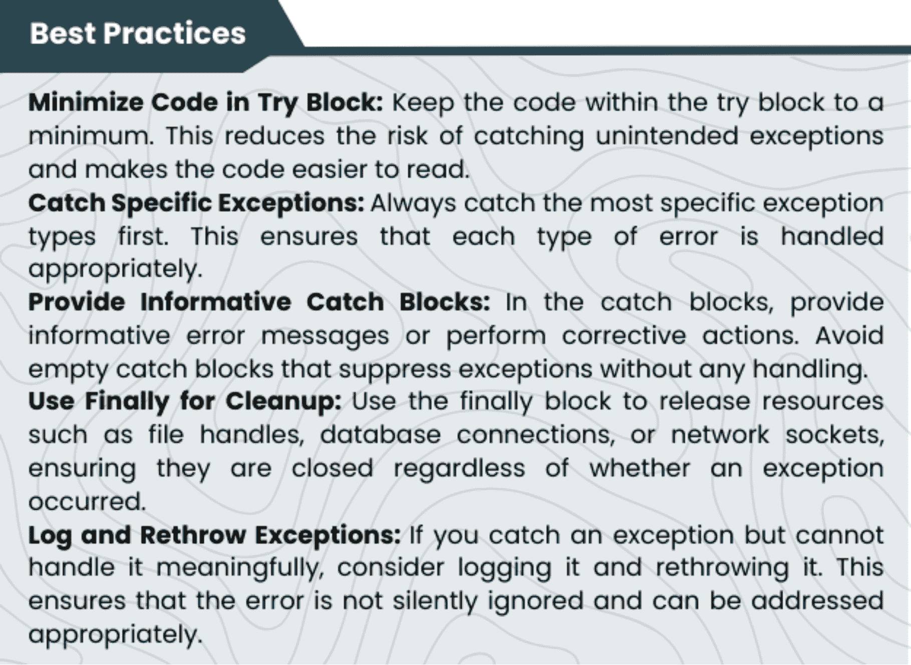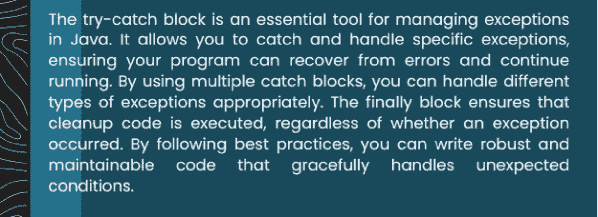

## Throw, Throws, and Finally

在 Java 中，`throw`、`throws` 和 `finally` 关键字是异常处理的核心组件。它们提供了显式抛出异常、声明方法可能抛出的异常以及确保无论是否发生异常都会执行特定代码的机制。

### Throw

`throw` 关键字用于方法或代码块中显式地抛出一个异常。当异常被抛出时，程序的正常执行流会被中断，控制权将转移到最近能够处理该异常类型的 `try-catch` 块。

这里是一个使用 `throw` 的示例：

```java
public class ThrowExample {
public static void main(String[] args) {
try {
validateAge(15);
} catch (IllegalArgumentException e) {
System.out.println("Caught an exception: " + e.getMessage());
}
}
public static void validateAge(int age) {
if (age < 18) {
throw new IllegalArgumentException("Age must be at least 18.");
}
System.out.println("Age is valid.");
}
}
```

在这个示例中，如果 `age` 小于 18，`validateAge` 方法将抛出一个 `IllegalArgumentException`。`main` 方法捕获该异常并打印适当的消息。

### Throws

`throws` 关键字用于方法签名中，声明该方法可能会抛出一个或多个异常。这告诉方法的调用者，他们必须处理这些异常，要么使用 `try-catch` 块，要么通过 `throws` 关键字将其继续传递。

这里是一个使用 `throws` 的示例：

```java
import java.io.BufferedReader;
import java.io.FileReader;
import java.io.IOException;
public class ThrowsExample {
public static void main(String[] args) {
try {
readFile("example.txt");
} catch (IOException e) {
System.out.println("Caught an IOException: " + e.getMessage());
}
}
public static void readFile(String fileName) throws IOException {
BufferedReader reader = new BufferedReader(new FileReader(fileName));
String line;
while ((line = reader.readLine()) != null) {
System.out.println(line);
}
reader.close();
}
}
```

在这个示例中，`readFile` 方法声明它会抛出一个 `IOException`。`main` 方法使用 `try-catch` 块处理了这一异常。

### Finally

`finally` 块用于无论是否抛出或捕获了异常都执行一段代码。这通常用于清理工作，例如关闭文件、释放资源或重置变量。`finally` 块确保了即使在异常时，这些关键操作也会被执行。

这里是一个使用 `finally` 的示例：

```java
import java.io.BufferedReader;
import java.io.FileReader;
import java.io.IOException;
public class FinallyExample {
public static void main(String[] args) {
BufferedReader reader = null;
try {
reader = new BufferedReader(new FileReader("example.txt"));
String line;
while ((line = reader.readLine()) != null) {
System.out.println(line);
}
} catch (IOException e) {
System.out.println("Caught an IOException: " + e.getMessage());
} finally {
try {
if (reader != null) {
reader.close();
}
} catch (IOException e) {
System.out.println("Error closing the reader: " + e.getMessage());
}
}
}
}
```

在这个示例中：

* `try` 块打开并读取文件。
* `catch` 块处理读取过程中可能发生的任何 `IOException`。
* `finally` 块确保即使发生异常，`BufferedReader` 也会被关闭。

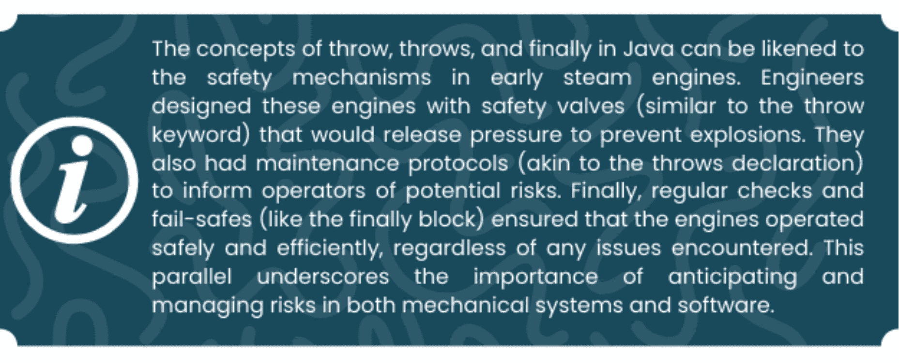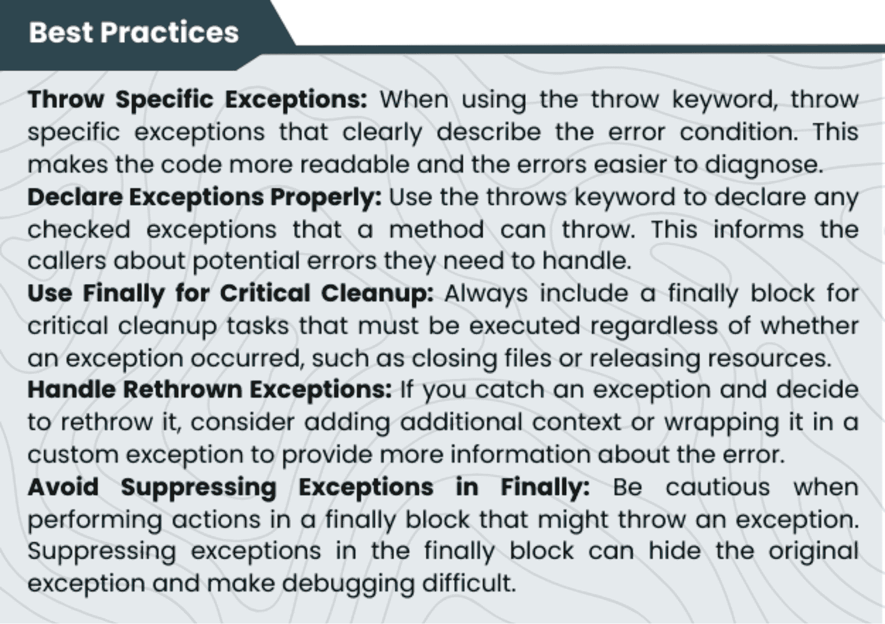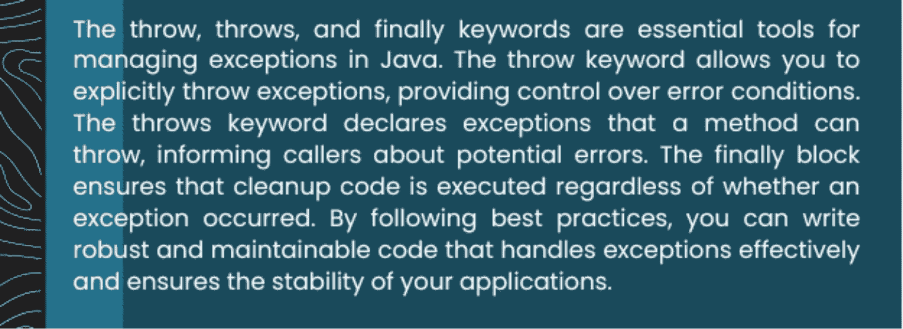

## 自定义异常

有时，Java 提供的标准异常不足以描述应用程序中的特定错误情况。在这种情况下，你可以创建自己的自定义异常。自定义异常允许你提供更具意义的错误信息，并以更精确的方式处理特定的错误状况。

创建自定义异常涉及扩展 `Exception` 类或其一个子类。这允许你定义针对应用程序特定需求定制的异常。

### 为什么要使用自定义异常？

1. **增强可读性**：自定义异常通过提供清晰且具体的错误信息来准确描述问题，使你的代码更具读性。
2. **更好的错误处理**：它们允许你更精确地处理特定的错误状况，提高应用程序的健壮性。
3. **代码复用性**：自定义异常可以封装常见的错误处理逻辑，促进代码复用并减少冗余。

### 创建自定义异常

要创建自定义异常，通常会扩展 `Exception` 类或其一个子类。这里是一个自定义异常的示例：

```java
public class InvalidAgeException extends Exception {
public InvalidAgeException(String message) {
super(message);
}
}
```

在这个示例中：

* `InvalidAgeException` 类扩展了 `Exception` 类。
* 提供了一个构造函数来接收错误消息，该消息被传递给父类。

### 使用自定义异常

这里展示了如何在方法中使用 `InvalidAgeException` 来验证用户的年龄：

```java
public class User {
private String name;
private int age;
public User(String name, int age) throws InvalidAgeException {
if (age < 0 || age > 120) {
throw new InvalidAgeException("Age must be between 0 and 120.");
}
this.name = name;
this.age = age;
}
public String getName() {
return name;
}
public int getAge() {
return age;
}
public static void main(String[] args) {
try {
User user = new User("Alice", -5);
} catch (InvalidAgeException e) {
System.out.println("Error: " + e.getMessage());
}
}
}
```

在这个示例中：

* `User` 构造函数验证了年龄。
* 如果年龄无效，它会抛出一个带消息的 `InvalidAgeException`。
* `main` 方法捕获该异常并打印。

### 带有额外属性的自定义异常

你还可以为自定义异常添加额外的属性以提供更多上下文。这里有一个示例：

```java
public class InsufficientFundsException extends Exception {
private double amount;
public InsufficientFundsException(String message, double amount) {
super(message);
this.amount = amount;
}
public double getAmount() {
return amount;
}
}
```

在这个示例中：

* `InsufficientFundsException` 类包含一个额外的 `amount` 属性。
* 构造函数初始化了错误消息和金额。

你可以这样使用这个自定义异常：

```java
public class BankAccount {
private double balance;
public BankAccount(double balance) {
this.balance = balance;
}
public void withdraw(double amount) throws InsufficientFundsException {
if (amount > balance) {
throw new InsufficientFundsException("Insufficient funds for withdrawal.", amount);
}
balance -= amount;
}
public double getBalance() {
return balance;
}
public static void main(String[] args) {
BankAccount account = new BankAccount(500.0);
try {
account.withdraw(600.0);
} catch (InsufficientFundsException e) {
System.out.println("Error: " + e.getMessage() + " Amount: " + e.getAmount());
}
}
}
```

在这个示例中：

* `BankAccount` 类有一个 `withdraw` 方法，当取款金额超过余额时，它会抛出 `InsufficientFundsException`。
* `main` 方法捕获该异常并打印错误信息以及导致异常的金额。

### 自定义异常最佳实践

使用描述性名称：为你的自定义异常命名清晰且具有描述性的名称，以传递它们所代表的特定错误状况。

```java
public class DataNotFoundException extends Exception {
    public DataNotFoundException(String message) {
        super(message);
    }
}
```

继承合适的超类：根据异常类型继承最合适的超类。对于检查异常（checked exceptions），继承 `Exception`；对于未检查异常（unchecked exceptions），继承 `RuntimeException`。

```java
public class InvalidConfigurationException extends RuntimeException {
    public InvalidConfigurationException(String message) {
        super(message);
    }
}
```

包含构造函数：提供接受相关信息（如错误消息和原因异常）的构造函数。

```java
public class DatabaseConnectionException extends Exception {
    public DatabaseConnectionException(String message, Throwable cause) {
        super(message, cause);
    }
}
```

添加上下文信息：包含额外的属性或方法以提供更多关于错误状况的上下文。

```java
public class FileProcessingException extends Exception {
    private String fileName;
    public FileProcessingException(String message, String fileName) {
        super(message);
        this.fileName = fileName;
    }
    public String getFileName() {
        return fileName;
    }
}
```

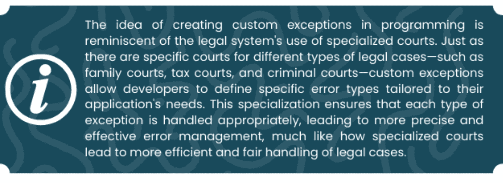

记录异常：详尽记录你的自定义异常，解释何时应该抛出它们以及它们代表什么。

```java
/**
* 抛出以表示发生了文件处理错误。
*/
public class FileProcessingException extends Exception {
    // Implementation
}
```

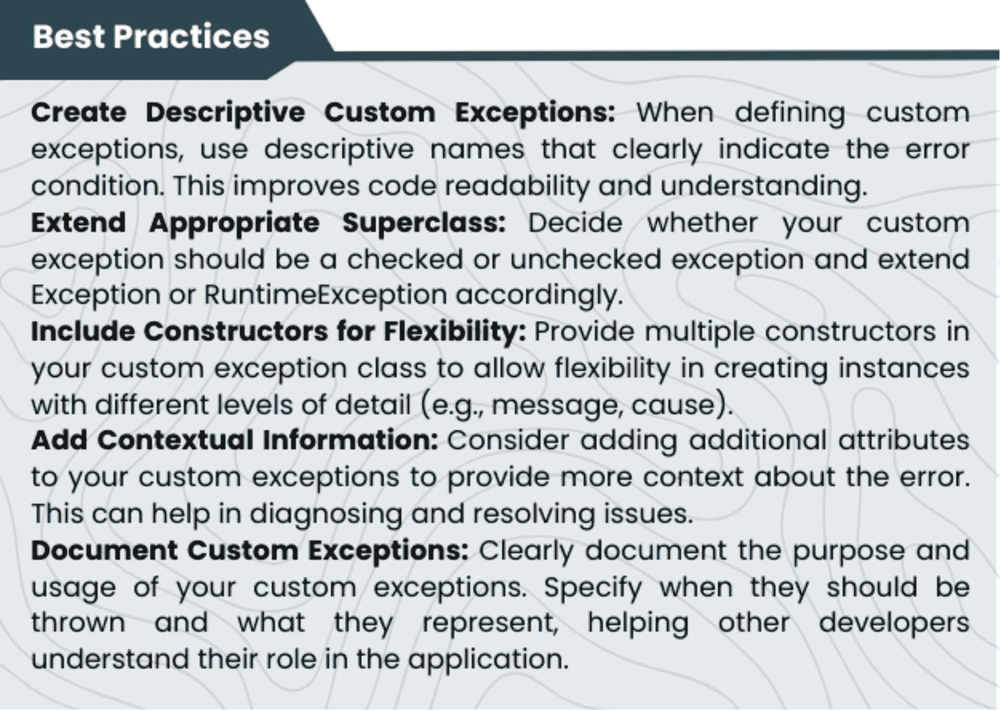

## 项目：构建错误处理的健壮文件读取应用程序

在这个项目中，我们将构建一个包含全面错误处理的健壮文件读取应用程序。该应用程序将演示如何处理文件操作期间可能发生的各种异常，确保程序在发生错误时仍保持稳定和用户友好。

### 1：定义应用程序结构

我们将创建一个名为 `FileReadingApp` 的主类，它将包含读取文件和处理异常的逻辑。我们还将创建一个自定义异常来处理与文件处理相关的特定错误状况。

```java
import java.io.BufferedReader;
import java.io.FileNotFoundException;
import java.io.FileReader;
import java.io.IOException;

public class FileReadingApp {
    public static void main(String[] args) {
        String filePath = "example.txt";
        try {
            readFile(filePath);
        } catch (CustomFileNotFoundException e) {
            System.err.println("Custom error: " + e.getMessage());
        } catch (IOException e) {
            System.err.println("An I/O error occurred: " + e.getMessage());
        }
    }

    public static void readFile(String filePath) throws IOException, CustomFileNotFoundException {
        BufferedReader reader = null;
        try {
            reader = new BufferedReader(new FileReader(filePath));
            String line;
            while ((line = reader.readLine()) != null) {
                System.out.println(line);
            }
        } catch (FileNotFoundException e) {
            throw new CustomFileNotFoundException("File not found: " + filePath, e);
        } finally {
            if (reader != null) {
                try {
                    reader.close();
                } catch (IOException e) {
                    System.err.println("Error closing the reader: " + e.getMessage());
                }
            }
        }
    }
}
```

### 2：定义自定义异常

我们将创建一个名为 `CustomFileNotFoundException` 的自定义异常来处理未找到文件的情况。这将允许我们提供更有意义的错误消息。


```java
public class CustomFileNotFoundException extends Exception {
    public CustomFileNotFoundException(String message) {
        super(message);
    }
    public CustomFileNotFoundException(String message, Throwable cause) {
        super(message, cause);
    }
}
```

### 3：增强错误处理

我们将通过添加更具体的`catch`块和改进我们的自定义异常来增强错误处理能力。

```java
import java.io.BufferedReader;
import java.io.FileNotFoundException;
import java.io.FileReader;
import java.io.IOException;

public class FileReadingApp {
    public static void main(String[] args) {
        String filePath = "example.txt";
        try {
            readFile(filePath);
        } catch (CustomFileNotFoundException e) {
            System.err.println("Custom error: " + e.getMessage());
        } catch (IOException e) {
            System.err.println("An I/O error occurred: " + e.getMessage());
        }
    }

    public static void readFile(String filePath) throws IOException, CustomFileNotFoundException {
        BufferedReader reader = null;
        try {
            reader = new BufferedReader(new FileReader(filePath));
            String line;
            while ((line = reader.readLine()) != null) {
                System.out.println(line);
            }
        } catch (FileNotFoundException e) {
            throw new CustomFileNotFoundException("File not found: " + filePath, e);
        } finally {
            if (reader != null) {
                try {
                    reader.close();
                } catch (IOException e) {
                    System.err.println("Error closing the reader: " + e.getMessage());
                }
            }
        }
    }
}

public class CustomFileNotFoundException extends Exception {
    public CustomFileNotFoundException(String message) {
        super(message);
    }
    public CustomFileNotFoundException(String message, Throwable cause) {
        super(message, cause);
    }
}
```

### 4：测试应用程序

我们将通过在不同场景下运行应用程序来测试，例如使用现有文件、不存在的文件以及应用程序没有权限读取的文件。

**使用现有文件进行测试：**

创建一个名为`example.txt`带有某些内容的文件并运行应用程序。它应该读取并打印文件的内容。

```
java FileReadingApp
```

**使用不存在的文件进行测试：**

将文件路径更改为不存在的文件并运行应用程序。它应该捕获`CustomFileNotFoundException`并打印自定义错误消息。

```
java FileReadingApp
```

**使用受限的文件进行测试：**

将文件路径更改为应用程序没有权限读取的文件并运行应用程序。它应该捕获`IOException`并打印相应的错误消息。

```
java FileReadingApp
```

在这个项目中，我们构建了一个健壮的文件读取应用程序，演示了使用`try-catch`块、自定义异常和`finally`块进行全面错误处理。该应用程序读取文件内容并处理各种错误状况（如文件未找到 I/O 错误），提供了有意义的错误消息并确保资源被正确关闭。

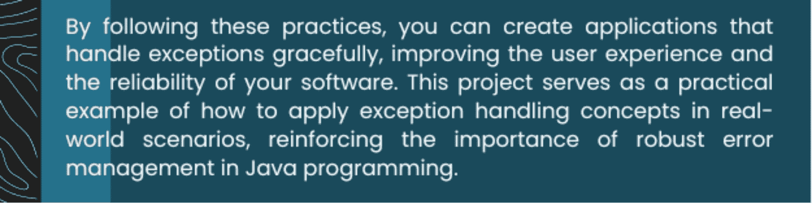

# Java 集合框架

## 集合简介

Java 集合框架（Java Collections Framework）是一种用于操作对象组全面架构。它通过接口和类的层次结构提供了一种统一的方法来处理集合，如列表、集合和映射。通过利用该框架，开发者可以高效地管理集合，并执行搜索、排序和遍历元素等各种操作。

集合框架的核心是几个关键接口，包括`Collection`、`List`、`Set`和`Map`。这些每个接口都定义了特定的集合类型和其关联操作。例如，`List`表示一个可以包含重复元素的有序集合，而`Set`表示一个不允许包含重复元素的集合。

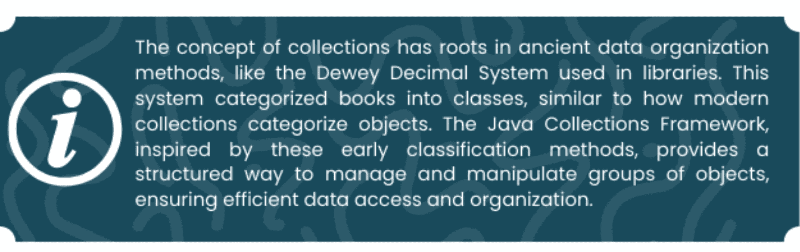

Java 集合框架的主要优势之一是其一致性和灵活性。该框架包含了排序和搜索等算法，这些算法可以在集合上操作并提供执行常见任务的标准方法。此外，该框架支持泛型，允许开发者创建类型安全的集合，从而减少运行时错误。

## 核心接口及其作用

1. `Collection`：所有集合类型的根接口，定义了添加、删除和检查元素等基本操作。

2. `List`：扩展了`Collection`，表示元素的有序序列。常见的实现类包括`ArrayList`和`LinkedList`。

3. `Set`：扩展了`Collection`，表示没有重复元素的集合。常见的实现类包括`HashSet`和`TreeSet`。

4. `Map`：表示键值对集合，提供了基于键的高效检索。常见的实现类包括`HashMap`和`TreeMap`。

## 使用 Java 集合框架的好处

- **可用性**：提供了开箱用的数据结构和算法，减少了对自定义实现的需求。

- **性能**：为各种类型的集合提供了高性能的实现。

- **灵活性**：支持不同类型的集合，并允许在不同实现之间易于切换。

- **类型安全**：利用泛型来确保类型安全并减少运行时错误。

- **一致性**：确保不同类型集合之间具有一致的且可预测的行为。

### 示例

这是一个展示集合框架使用的简单示例：

```java
import java.util.*;

public class CollectionsExample {
    public static void main(String[] args) {
        // 创建一个字符串列表
        List<String> fruits = new ArrayList<>();
        fruits.add("Apple");
        fruits.add("Banana");
        fruits.add("Cherry");

        // 遍历列表
        for (String fruit : fruits) {
            System.out.println(fruit);
        }

        // 创建一个整数集合
        Set<Integer> numbers = new HashSet<>();
        numbers.add(1);
        numbers.add(2);
        numbers.add(3);

        // 检查数字是否在集合中
        if (numbers.contains(2)) {
            System.out.println("The set contains 2");
        }

        // 创建一个字符串-整数对的映射
        Map<String, Integer> ages = new HashMap<>();
        ages.put("Alice", 30);
        ages.put("Bob", 25);

        // 从映射中获取年龄
        int age = ages.get("Alice");
        System.out.println("Alice's age is " + age);
    }
}
```

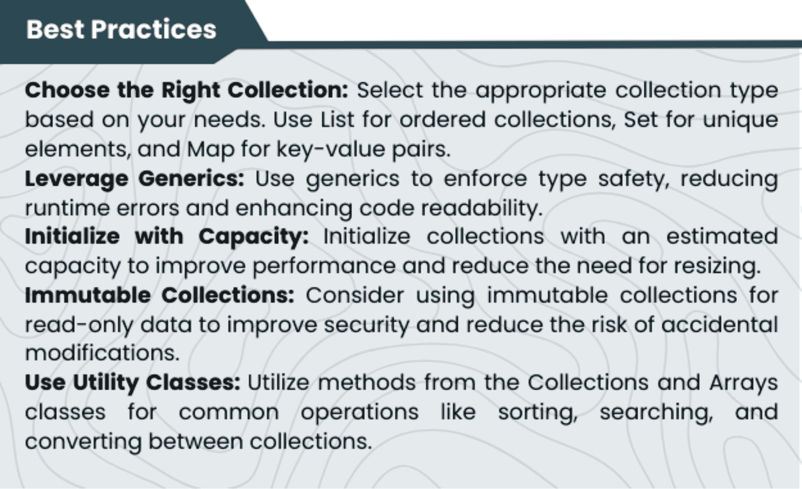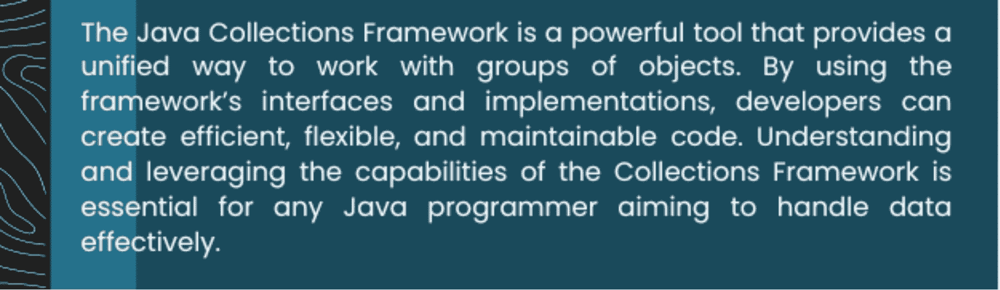

## List 接口

Java 集合框架中的`List`接口表示一个有序集合（也称为序列）。`List`可以包含重复元素，并通过其整数索引访问元素，从而允许精确控制每个元素插入的位置。`List`接口扩展了`Collection`接口，并提供了额外的方法来操作元素的顺序和位置。

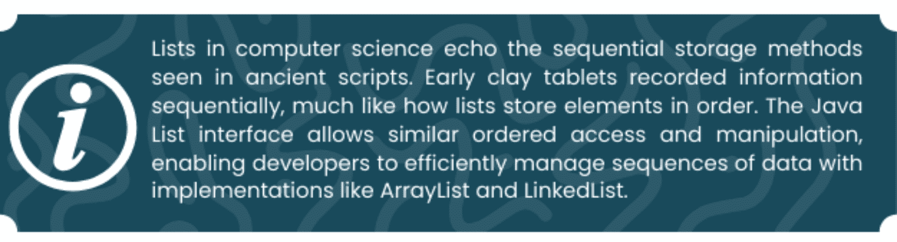

### 常见实现类

- `ArrayList`：`List`接口的可变长度数组实现。它提供了快速的随机访问，并且对于通过索引检索和设置值非常高效。然而，由于需要移动元素，对于涉及在列表中间插入或删除元素的操作，它的较慢。

```java
List<String> arrayList = new ArrayList<>();
arrayList.add("Apple");
arrayList.add("Banana");
arrayList.add("Cherry");
```

- `LinkedList`：`List`接口的双向链表实现。对于列表中间的插入和删除，它提供了比`ArrayList`更好的性能。然而，由于需要遍历列表，它的随机访问较慢。

```java
List<String> linkedList = new LinkedList<>();
linkedList.add("Dog");
linkedList.add("Cat");
linkedList.add("Bird");
```

- `Vector`：与`ArrayList`类似但它是同步的，使其是线程安全的。由于同步的开销，通常不被优选。

```java
List<String> vector = new Vector<>();
vector.add("Red");
vector.add("Green");
vector.add("Blue");
```

### 核心方法

- `add(E element)`：将指定的元素添加到列表末尾。

`list.add("Element");`

- `add(int index, E element)`：将指定的元素插入到列表的指定位置。

`list.add(1, "InsertedElement");`

- `get(int index)`：返回列表中指定位置的元素。

`String element = list.get(0);`

- `remove(int index)`：移除列表中指定位置的元素。

`list.remove(2);`

- `set(int index, E element)`：用指定的元素替换列表中指定位置的元素。

`list.set(1, "NewElement");`

- `indexOf(Object o)`：返回指定元素在列表中首次出现的索引，如果列表不包含该元素，则返回 -1。

`int index = list.indexOf("Element");`

- `size()`：返回列表中的元素数量。

`int size = list.size();`

### 示例

这是一个展示使用`List`接口的示例：

```java
import java.util.*;

public class ListExample {
    public static void main(String[] args) {
        // 使用 ArrayList 创建列表
        List<String> fruits = new ArrayList<>();
        fruits.add("Apple");
        fruits.add("Banana");
        fruits.add("Cherry");

        // 访问元素
        String first = fruits.get(0);
        System.out.println("First fruit: " + first);

        // 修改元素
        fruits.set(1, "Blueberry");

        // 移除元素
        fruits.remove("Cherry");

        // 列表大小
        System.out.println("Size: " + fruits.size());

        // 遍历列表
        for (String fruit : fruits) {
            System.out.println(fruit);
        }
    }
}
```

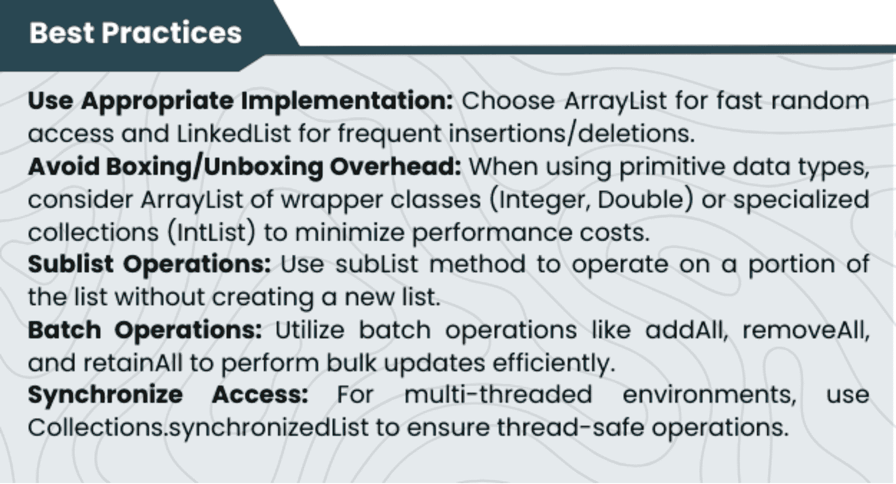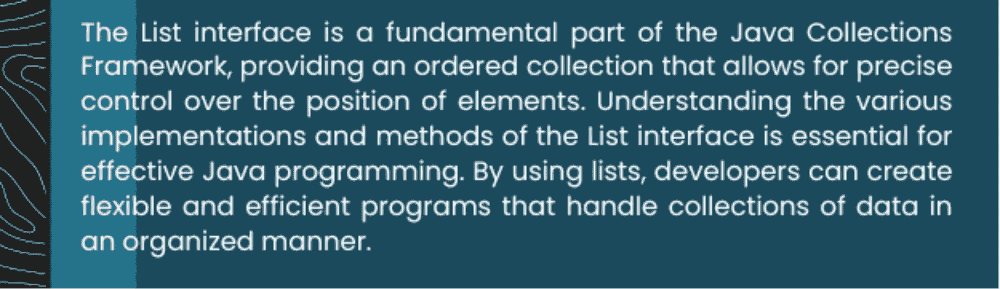

## Set 接口

`Set`接口在集合集合中表示不允许重复元素的集合。它模拟了集合抽象，是`Collection`接口的子类型。`Set`确保元素唯一。

### 常见实现

- `HashSet`：由哈希表实现的`Set`。它不保证迭代顺序，并且是大多数用例中性能最好的实现。

```java
Set<String> hashSet = new HashSet<>();
hashSet.add("Apple");
hashSet.add("Banana");
hashSet.add("Cherry");
```

- `LinkedHashSet`：带有链接链表的`HashSet`，维护插入顺序。

```java
Set<String> linkedHashSet = new LinkedHashSet<>();
linkedHashSet.add("Dog");
linkedHashSet.add("Cat");
linkedHashSet.add("Bird");
```

- `TreeSet`：由树结构（具体为红黑树）实现的`Set`，它根据自然排序或指定的比较器对元素排序。

```java
Set<String> treeSet = new TreeSet<>();
treeSet.add("Red");
treeSet.add("Green");
treeSet.add("Blue");
```


### 核心方法

- `add(E e)`：如果元素不存在，则将指定的元素添加到集合。

`set.add("Element");`

- `remove(Object o)`：如果元素存在，则从集合中移除。

`set.remove("Element");`

- `contains(Object o)`：如果集合包含指定的元素，则返回`true`。

`boolean contains = set.contains("Element");`

- `size()`：返回集合中的元素数量。

`int size = set.size();`

- `isEmpty()`：如果集合不包含任何元素，则返回`true`。

`boolean isEmpty = set.isEmpty();`

- `clear()`：移除集合中的所有元素。

`set.clear();`

### 示例

这是一个展示使用`Set`接口的示例：


```java
import java.util.*;

public class SetExample {
    public static void main(String[] args) {
        // 使用 HashSet 创建集合
        Set<String> fruits = new HashSet<>();
        fruits.add("Apple");
        fruits.add("Banana");
        fruits.add("Cherry");
        fruits.add("Banana"); // 重复元素，不会被添加

        // 检查是否存在
        if (fruits.contains("Apple")) {
            System.out.println("Set contains Apple");
        }

        // 遍历集合
        for (String fruit : fruits) {
            System.out.println(fruit);
        }
    }
}
```

```java
// Remove 一个元素
fruits.remove("Banana");

System.out.println("Set after removing Banana: " + fruits);

// 遍历该集合
for (String fruit : fruits) {
    System.out.println(fruit);
}

// 使用 TreeSet 创建一个集合
Set<String> colors = new TreeSet<>();
colors.add("Red");
colors.add("Green");
colors.add("Blue");

// 遍历该 TreeSet
for (String color : colors) {
    System.out.println(color); // 输出将是排序后的
}

}

}
```

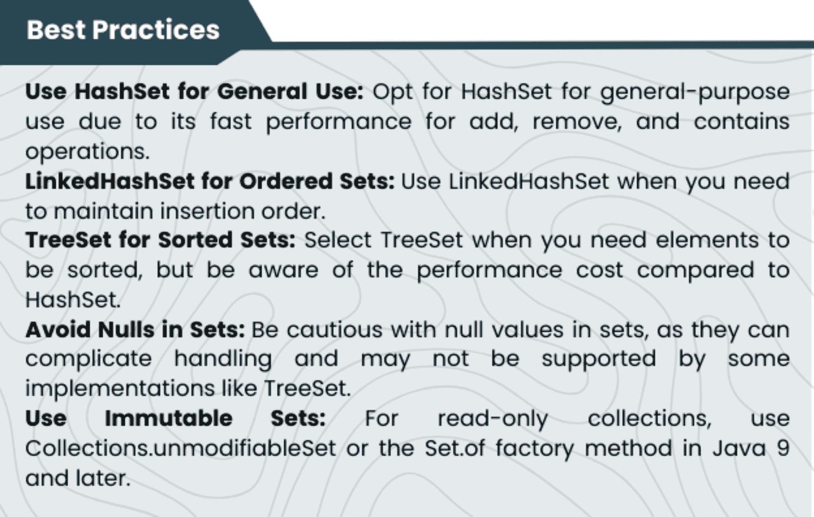!(image_rsrc8AA.jpg)

# Map 接口

Java 集合框架中的`Map`接口表示键值对的集合，其中每个键都映射到单个值。`Map`不允许重复的键，每个键最多可以映射到一个值。对于那些需要将值与键关联的场景（例如字典），此接口至关重要。

### 常见实现类

- `HashMap`: 使用哈希表实现`Map`接口。假设哈希函数能够适当散列元素，它为基本操作（`get`和`put`）提供了常数时间性能。它不维护键的任何顺序。

```java
Map<String, Integer> hashMap = new HashMap<>();
hashMap.put("Apple", 1);
hashMap.put("Banana", 2);
hashMap.put("Cherry", 3);
```

- `LinkedHashMap`: 扩展了`HashMap`，通过一个贯穿条目的双链表来维护插入顺序或访问顺序。它适用于需要预测迭代顺序的应用程序。

```java
Map<String, Integer> linkedHashMap = new LinkedHashMap<>();
linkedHashMap.put("Dog", 1);
linkedHashMap.put("Cat", 2);
linkedHashMap.put("Bird", 3);
```

- `TreeMap`: 使用红黑树实现`Map`接口，根据自然的自然顺序或指定的比较器对键进行排序。它保证 map 将按键的升序排列。

```java
Map<String, Integer> treeMap = new TreeMap<>();
treeMap.put("Red", 1);
treeMap.put("Green", 2);
treeMap.put("Blue", 3);
```


### 关键方法

- `put(K key, V value)`: 将指定的值与 map 中的指定键关联。

```java
map.put("Key", "Value");
```

- `get(Object key)`: 返回指定键映射的值，如果此 map 不包含该键的映射，则返回`null`。

```java
String value = map.get("Key");
```

- `remove(Object key)`: 如果 map 中存在该键，则移除该键的映射。

```java
map.remove("Key");
```

- `containsKey(Object key)`: 如果 map 包含指定键的映射，则返回`true`。

```java
boolean hasKey = map.containsKey("Key");
```

- `containsValue(Object value)`: 如果 map 将一个或多个键映射到指定值，则返回`true`。

```java
boolean hasValue = map.containsValue("Value");
```

- `keySet()`: 返回 map 中包含的键的`Set`视图。

```java
Set<String> keys = map.keySet();
```

- `values()`: 返回 map 中包含的值的`Collection`视图。

```java
Collection<Integer> values = map.values();
```

- `entrySet()`: 返回 map 中包含的映射的`Set`视图。

```java
Set<Map.Entry<String, Integer>> entries = map.entrySet();
```

### 示例

这里有一个演示`Map`接口使用的示例：

```java
import java.util.*;

public class MapExample {
    public static void main(String[] args) {
        // 使用 HashMap 创建 map
        Map<String, Integer> fruits = new HashMap<>();
        fruits.put("Apple", 10);
        fruits.put("Banana", 20);
        fruits.put("Cherry", 30);

        // 访问元素
        System.out.println("Apple count: " + fruits.get("Apple"));

        // 修改元素
        fruits.put("Banana", 25);
        System.out.println("Updated Banana count: " + fruits.get("Banana"));

        // 移除元素
        fruits.remove("Cherry");
        System.out.println("After removal: " + fruits);

        // 检查键
        if (fruits.containsKey("Apple")) {
            System.out.println("Apple is present in the map.");
        }

        // 遍历 map
        for (Map.Entry<String, Integer> entry : fruits.entrySet()) {
            System.out.println(entry.getKey() + ": " + entry.getValue());
        }
    }
}
```

!(image_rsrc8AD.jpg)

# 遍历集合

在 Java 中遍历集合是一项基础任务，允许你访问并操作集合中的每个元素。遍历集合有多种方法，每种方法适用于不同的用例和集合类型。让我们探索最常用的方法。

### 使用 for-each 循环

在 Java 5 中引入的`for-each`循环是遍历集合的一种简洁且易读的方式。它适用于不需要修改迭代顺序的情况。

```java
for (String fruit : fruits) {
    System.out.println(fruit);
}
```

### 使用 Iterator

`Iterator`接口提供了遍历集合的方法，特别是当你需要在迭代过程中删除元素时。

```java
Iterator<String> iterator = fruits.iterator();
while (iterator.hasNext()) {
    String fruit = iterator.next();
    System.out.println(fruit);
}
```

### 使用 ListIterator

`ListIterator`是专门为列表设计的迭代器，允许双向遍历。

```java
ListIterator<String> listIterator = fruits.listIterator();
while (listIterator.hasNext()) {
    String fruit = listIterator.next();
    if ("Banana".equals(fruit)) {
        iterator.remove(); // 安全移除
    }
}
```

### 使用 Streams

Java 8 引入了`Stream` API，提供了一种函数式的处理方式。

```java
fruits.stream()
    .filter(fruit -> fruit.startsWith("A"))
    .forEach(System.out::println);
```

### 使用 forEach 方法

`forEach`方法引入自 Java 8，允许使用 Lambda 表达式进行迭代，使代码更加简洁。

```java
fruits.forEach(fruit -> System.out.println(fruit));
```

### 示例

这是一个演示各种遍历集合方式的综合示例：

```java
import java.util.*;
import java.util.stream.*;

public class CollectionIterationExample {
    public static void main(String[] args) {
        List<String> fruits = new ArrayList<>(Arrays.asList("Apple", "Banana", "Cherry"));

        // 使用 for-each 循环
        for (String fruit : fruits) {
            System.out.println("For-each loop: " + fruit);
        }

        // 使用 Iterator
        Iterator<String> iterator = fruits.iterator();
        while (iterator.hasNext()) {
            String fruit = iterator.next();
            System.out.println("Iterator: " + fruit);
        }

        // 使用 ListIterator
        ListIterator<String> listIterator = fruits.listIterator();
        while (listIterator.hasNext()) {
            String fruit = listIterator.next();
            if ("Banana".equals(fruit)) {
                listIterator.set("Blueberry"); // 修改当前元素
            }
        }

        // 使用 Streams
        fruits.stream()
            .filter(fruit -> fruit.startsWith("A"))
            .forEach(System.out::println);

        // 使用 forEach 方法
        fruits.forEach(fruit -> System.out.println("forEach method: " + fruit));
    }
}
```

!(image_rsrc8AF.jpg)

# 项目：实现联系人管理系统

在这个项目中，我们将使用 Java 集合框架创建一个简单的联系人管理系统。该系统允许用户添加、删除、更新和搜索联系人。每个联系人都有姓名、电话号码和电子邮件。我们将使用`HashMap`来存储联系人，以联系人名为键，自定义的`Contact`对象为值。

### 实施步骤

1. **定义 Contact 类**：创建一个表示联系人的类。

2. **创建联系人管理类**：实现添加、删除、更新和搜索联系人的方法。

## 3. 主方法：提供一个简单的用户界面与联系人管理系统交互。

### 步骤 1：定义 Contact 类

创建一个名为`Contact.java`的新 Java 文件。

```java
public class Contact {
    private String name;
    private String phoneNumber;
    private String email;

    public Contact(String name, String phoneNumber, String email) {
        this.name = name;
        this.phoneNumber = phoneNumber;
        this.email = email;
    }

    // Getters and Setters
    public String getName() {
        return name;
    }

    public void setName(String name) {
        this.name = name;
    }

    public String getPhoneNumber() {
        return phoneNumber;
    }

    public void setPhoneNumber(String phoneNumber) {
        this.phoneNumber = phoneNumber;
    }

    public String getEmail() {
        return email;
    }

    public void setEmail(String email) {
        this.email = email;
    }

    @Override
    public String toString() {
        return "Contact{name='" + name + "', phoneNumber='" + phoneNumber + "', email='" + email + "'}";
    }
}
```

### 步骤 2：创建 Contact 管理类

创建一个名为`ContactManager.java`的新 Java 文件。


```java
import java.util.HashMap;
import java.util.Map;

public class ContactManager {
    private Map<String, Contact> contacts;

    public ContactManager() {
        contacts = new HashMap<>();
    }

    public void addContact(String name, String phoneNumber, String email) {
        Contact contact = new Contact(name, phoneNumber, email);
        contacts.put(name, contact);
    }

    public void removeContact(String name) {
        contacts.remove(name);
    }

    public void updateContact(String name, String newPhoneNumber, String newEmail) {
        Contact contact = contacts.get(name);
        if (contact != null) {
            contact.setPhoneNumber(newPhoneNumber);
            contact.setEmail(newEmail);
        }
    }

    public Contact searchContact(String name) {
        return contacts.get(name);
    }

    public void displayAllContacts() {
        for (Contact contact : contacts.values()) {
            System.out.println(contact);
        }
    }
}
```

### 步骤 3：主方法

创建一个名为`Main.java`的新 Java 文件。

```java
import java.util.Scanner;

public class Main {
    public static void main(String[] args) {
        ContactManager manager = new ContactManager();
        Scanner scanner = new Scanner(System.in);
        boolean running = true;
        while (running) {
            System.out.println("联系人管理系统");
            System.out.println("1. 添加联系人");
            System.out.println("2. 删除联系人");
            System.out.println("3. 更新联系人");
            System.out.println("4. 查询联系人");
            System.out.println("5. 显示所有联系人");
            System.out.println("6. 退出");
            System.out.print("请选择选项: ");
            int choice = scanner.nextInt();
            scanner.nextLine(); // 换行符
            switch (choice) {
                case 1:
                    System.out.print("输入姓名: ");
                    String name = scanner.nextLine();
                    System.out.print("输入电话号码: ");
                    String phoneNumber = scanner.nextLine();
                    System.out.print("输入邮箱: ");
                    String email = scanner.nextLine();
                    manager.addContact(name, phoneNumber, email);
                    break;
                case 2:
                    System.out.print("输入要删除的联系人姓名: ");
                    name = scanner.nextLine();
                    manager.removeContact(name);
                    break;
                case 3:
                    System.out.print("输入要更新的联系人姓名: ");
                    name = scanner.nextLine();
                    System.out.print("输入新电话号码: ");
                    phoneNumber = scanner.nextLine();
                    System.out.print("输入新邮箱: ");
                    email = scanner.nextLine();
                    manager.updateContact(name, phoneNumber, email);
                    break;
                case 4:
                    System.out.print("输入要查询的联系人姓名: ");
                    name = scanner.nextLine();
                    Contact contact = manager.searchContact(name);
                    if (contact != null) {
                        System.out.println("找到: " + contact);
                    } else {
                        System.out.println("未找到该联系人.");
                    }
                    break;
                case 5:
                    manager.displayAllContacts();
                    break;
                case 6:
                    running = false;
                    break;
                default:
                    System.out.println("无效选项。请重试。");
                    break;
            }
        }
        scanner.close();
    }
}
```

## 解析

1. `Contact`类：定义了一个包含姓名、电话号码和邮箱属性的联系人。包含了这些属性的 getter 和 setter 方法，以及一个用于显示的重写了`toString`方法。

2. `ContactManager`类：使用`HashMap`管理联系人集合。提供了添加、删除、更新、查询和显示联系人的方法。

3. `Main`类：提供了一个与联系人管理系统交互的用户界面。它使用`Scanner`获取用户输入，并使用循环保持程序运行，直到用户选择退出。

`InputStream`类是所有字节输入流的父类，它提供了从源读取字节的方法。

### 常见的 InputStream 子类：

#### `FileInputStream`: 从文件中读取字节字节。

```java
import java.io.FileInputStream;
import java.io.IOException;

public class FileInputStreamExample {
    public static void main(String[] args) {
        try (FileInputStream fis = new FileInputStream("example.txt")) {
            int byteData;
            while ((byteData = fis.read()) != -1) {
                System.out.print((char) byteData);
            }
        } catch (IOException e) {
            e.printStackTrace();
        }
    }
}
```


#### `ByteArrayInputStream`: 从内存中的字节数组读取字节。

```java
import java.io.ByteArrayInputStream;
import java.io.IOException;

public class ByteArrayInputStreamExample {
    public static void main(String[] args) {
        byte[] byteArray = {65, 66, 67, 68};
        try (ByteArrayInputStream bais = new ByteArrayInputStream(byteArray)) {
            int byteData;
            while ((byteData = bais.read()) != -1) {
                System.out.print((char) byteData);
            }
        } catch (IOException e) {
            e.printStackTrace();
        }
    }
}
```

# OutputStream

`OutputStream`类是所有字节输出流的父类，它提供了向目标写入字节的方法。

### 常见的 OutputStream 子类：

#### `FileOutputStream`: 向文件写入字节。

```java
import java.io.FileOutputStream;
import java.io.IOException;

public class FileOutputStreamExample {
    public static void main(String[] args) {
        try (FileOutputStream fos = new FileOutputStream("example.txt")) {
            String data = "Hello, World!";
            fos.write(data.getBytes());
        } catch (IOException e) {
            e.printStackTrace();
        }
    }
}
```

#### `ByteArrayOutputStream`: 向内存中的字节数组写入字节。

```java
import java.io.ByteArrayOutputStream;
import java.io.IOException;

public class ByteArrayOutputStreamExample {
    public static void main(String[] args) {
        try (ByteArrayOutputStream baos = new ByteArrayOutputStream()) {
            String data = "Hello, World!";
            baos.write(data.getBytes());
            byte[] byteArray = baos.toByteArray();
            for (byte b : byteArray) {
                System.out.print((char) b);
            }
        } catch (IOException e) {
            e.printStackTrace();
        }
    }
}
```

[](image_rsrc8AP.jpg)

# 字符流

Java 中的字符流设计用于处理文本数据。它们以 16 位 Unicode 字符的形式读取和写入数据，适用于处理文本文件，并确保字符编码的正确处理。字符流的主要类是`Reader`和`Writer`。

## Reader

`Reader`类是所有字符输入流的父类，提供了读取字符、字符数组和行的方法。

### 常见的 Reader 子类：

#### `FileReader`: 从文件中读取字符。

```java
import java.io.FileReader;
import java.io.IOException;

public class FileReaderExample {
    public static void main(String[] args) {
        try (FileReader fr = new FileReader("example.txt")) {
            int charData;
            while ((charData = fr.read()) != -1) {
                System.out.print((char) charData);
            }
        } catch (IOException e) {
            e.printStackTrace();
        }
    }
}
```

#### `CharArrayReader`: 从字符数组读取字符。

```java
import java.io.CharArrayReader;
import java.io.IOException;

public class CharArrayReaderExample {
    public static void main(String[] args) {
        char[] charArray = {'H', 'e', 'l', 'l', 'o'};
        try (CharArrayReader car = new CharArrayReader(charArray)) {
            int charData;
            while ((charData = car.read()) != -1) {
                System.out.print((char) charData);
            }
        } catch (IOException e) {
            e.printStackTrace();
        }
    }
}
```


## Writer

`Writer`类是所有字符输出流的父类，提供了写入字符、字符数组和字符串的方法。

### 常见的 Writer 子类：

#### `FileWriter`: 向文件写入字符。

```java
import java.io.FileWriter;
import java.io.IOException;

public class FileWriterExample {
    public static void main(String[] args) {
        try (FileWriter fw = new FileWriter("example.txt")) {
            fw.write("Hello, World!");
        } catch (IOException e) {
            e.printStackTrace();
        }
    }
}
```

#### `CharArrayWriter`: 向字符数组写入字符。


```java
import java.io.CharArrayWriter;
import java.io.IOException;

public class CharArrayWriterExample {
    public static void main(String[] args) {
        try (CharArrayWriter caw = new CharArrayWriter()) {
            caw.write("Hello, World!");
            char[] charArray = caw.toCharArray();
            for (char c : charArray) {
                System.out.print(c);
            }
        } catch (IOException e) {
            e.printStackTrace();
        }
    }
}
```

# 缓冲流

字符缓冲流使用内部缓冲区来减少 I/O 操作次数，从而提高性能。它们通常作为其他流的包装器。

#### `BufferedReader`：缓冲字符输入流。

```java
import java.io.BufferedReader;
import java.io.FileReader;
import java.io.IOException;

public class BufferedReaderExample {
    public static void main(String[] args) {
        try (BufferedReader br = new BufferedReader(new FileReader("example.txt"))) {
            String line;
            while ((line = br.readLine()) != null) {
                System.out.println(line);
            }
        } catch (IOException e) {
            e.printStackTrace();
        }
    }
}
```

#### `BufferedWriter`：缓冲字符输出流。

```java
import java.io.BufferedWriter;
import java.io.FileWriter;
import java.io.IOException;

public class BufferedWriterExample {
    public static void main(String[] args) {
        try (BufferedWriter bw = new BufferedWriter(new FileWriter("example.txt"))) {
            bw.write("Hello, World!");
            bw.newLine();
            bw.write("Java character streams are powerful.");
        } catch (IOException e) {
            e.printStackTrace();
        }
    }
}
```


# 缓冲流（通用）

Java 中的缓冲流设计用于通过减少物理读写次数来增强 I/O 操作的性能。它们使用内部缓冲区存储数据，尽量减少与底层 I/O 系统的交互。

### `BufferedInputStream`

`BufferedInputStream`包装`InputStream`并缓冲输入以提高效率。它将数据块读取到缓冲区，并从缓冲区提供后续读取。

```java
import java.io.BufferedInputStream;
import java.io.FileInputStream;
import java.io.IOException;

public class BufferedInputStreamExample {
    public static void main(String[] args) {
        try (BufferedInputStream bis = new BufferedInputStream(new FileInputStream("example.txt"))) {
            int byteData;
            while ((byteData = bis.read()) != -1) {
                System.out.print((char) byteData);
            }
        } catch (IOException e) {
            e.printStackTrace();
        }
    }
}
```


### `BufferedOutputStream`

`BufferedOutputStream`包装`OutputStream`并缓冲输出以提高效率。它将数据写入缓冲区，仅当缓冲区满或流被刷新时才写入输出流。

```java
import java.io.BufferedOutputStream;
import java.io.FileOutputStream;
import java.io.IOException;

public class BufferedOutputStreamExample {
    public static void main(String[] args) {
        try (BufferedOutputStream bos = new BufferedOutputStream(new FileOutputStream("example.txt"))) {
            String data = "Hello, World!";
            bos.write(data.getBytes());
        } catch (IOException e) {
            e.printStackTrace();
        }
    }
}
```

### `BufferedReader`和`BufferedWriter`

缓冲字符流进一步优化了文本数据的读取和写入。

`BufferedReader`：用于高效读取字符输入流。

```java
import java.io.BufferedReader;
import java.io.FileReader;
import java.io.IOException;

public class BufferedReaderExample {
    public static void main(String[] args) {
        try (BufferedReader br = new BufferedReader(new FileReader("example.txt"))) {
            String line;
            while ((line = br.readLine()) != null) {
                System.out.println(line);
            }
        } catch (IOException e) {
            e.printStackTrace();
        }
    }
}
```

`BufferedWriter`：缓冲输出字符流以高效写入。

```java
import java.io.BufferedWriter;
import java.io.FileWriter;
import java.io.IOException;

public class BufferedWriterExample {
    public static void main(String[] args) {
        try (BufferedWriter bw = new BufferedWriter(new FileWriter("example.txt"))) {
            bw.write("Hello, World!");
            bw.newLine();
            bw.write("Buffered streams in Java are efficient.");
        } catch (IOException e) {
            e.printStackTrace();
        }
    }
}
```

## 缓冲流的优势

1. **性能**：缓冲流通过批处理读取和写减少了 I/O 操作的次数，提升了整体性能。
2. **效率**：通过最小化物理 I/O 交互，缓冲流使得数据传输更高效。
3. **便利性**：缓冲流为读取和写入文本行提供了方便的方法，使代码更简单且具可读性。


## 序列化与反序列化

Java 中的序列化是将对象转换为字节流的过程，允许将其轻松地保存到文件、发送到网络或存储在数据库中。反序列化是相反的过程，将字节流转换回原始对象的副本。这种机制对于持久化存储以及 Java 程序之间的通信至关重要。

### 序列化

要对对象进行序列化，该对象必须实现`Serializable`接口，它是一个标记接口（没有方法的接口）。`ObjectOutputStream`类用于将对象写入输出流。

示例：

```java
import java.io.FileOutputStream;
import java.io.ObjectOutputStream;
import java.io.Serializable;
import java.io.IOException;

class Person implements Serializable {
    private static final long serialVersionUID = 1L;
    String name;
    int age;
    Person(String name, int age) {
        this.name = name;
        this.age = age;
    }
}

public class SerializationExample {
    public static void main(String[] args) {
        Person person = new Person("John Doe", 30);
        try (FileOutputStream fileOut = new FileOutputStream("person.ser");
             ObjectOutputStream out = new ObjectOutputStream(fileOut)) {
            out.writeObject(person);
            System.out.println("Serialized data is saved in person.ser");
        } catch (IOException i) {
            i.printStackTrace();
        }
    }
}
```


### 反序列化

反序列化使用`ObjectInputStream`类进行，该类读取字节流并将其转换回对象。

示例：

```java
import java.io.FileInputStream;
import java.io.ObjectInputStream;
import java.io.IOException;

public class DeserializationExample {
    public static void main(String[] args) {
        Person person = null;
        try (FileInputStream fileIn = new FileInputStream("person.ser");
             ObjectInputStream in = new ObjectInputStream(fileIn)) {
            person = (Person) in.readObject();
            System.out.println("Deserialized Person...");
            System.out.println("Name: " + person.name);
            System.out.println("Age: " + person.age);
        } catch (IOException | ClassNotFoundException i) {
            i.printStackTrace();
        }
    }
}
```

### `Transient`关键字

标记为`transient`的字段不会被序列化。这对于敏感或对序列化无意义的字段非常有用。

```java
class Person implements Serializable {
    private static final long serialVersionUID = 1L;
    String name;
    transient int age; // 此字段不会被序列化
    Person(String name, int age) {
        this.name = name;
        this.age = age;
    }
}
```

### 自定义序列化

实现自定义序列化允许你通过定义`writeObject`和`readObject`方法来控制序列化和反序列化过程。

```java
private void writeObject(ObjectOutputStream oos) throws IOException {
    // 序列化非 transient 字段
    oos.defaultWriteObject();
    oos.writeInt(age); // 对 age 的自定义序列化
}

private void readObject(ObjectInputStream ois) throws IOException, ClassNotFoundException {
    // 反序列化非 transient 字段
    ois.defaultReadObject();
    age = ois.readInt(); // 对 age 的自定义反序列化
}
```


## 项目：开发文件加密/解密工具

在这个项目中，我们将创建一个可以使用 Java 对文件进行加密和解密的工具。该工具将利用 Java 加密架构 (JCA) 来确保数据安全。我们将使用`AES`（高级加密标准）算法进行加密和解密，因为它具有高效性和安全性。

### 逐步实现

1. **设置项目**：创建一个名为`FileEncryptionUtility`的新项目和类。
2. **生成 AES 密钥**：为 AES 生成对称密钥。
3. **加密文件**：实现一个加密文件的方法。
4. **解密文件**：实现一个解密文件的方法。
5. **主方法**：提供一个简单的接口来测试加密和解密函数。

创建一个名为`FileEncryptionUtility.java`的 Java 文件。


```java
import javax.crypto.Cipher;
import javax.crypto.KeyGenerator;
import javax.crypto.SecretKey;
import javax.crypto.spec.SecretKeySpec;
import java.io.FileInputStream;
import java.io.FileOutputStream;
import java.io.IOException;
import java.security.NoSuchAlgorithmException;

public class FileEncryptionUtility {
    private static final String ALGORITHM = "AES";
    private static final int KEY_SIZE = 128;

    public static void main(String[] args) {
        try {
            // 生成 密钥
            SecretKey secretKey = generateKey();
            // 加密文件
            String inputFile = "plainfile.txt";
            encryptFile(secretKey, inputFile, "encryptedfile.enc");
            // 解密文件
            String decryptedFile = "decryptedfile.txt";
            decryptFile(secretKey, decryptedFile);
        } catch (Exception e) {
            e.printStackTrace();
        }
    }

    // 生成 AES 密钥
    public static SecretKey generateKey() throws NoSuchAlgorithmException {
        KeyGenerator keyGen = KeyGenerator.getInstance(ALGORITHM);
        keyGen.init(KEY_SIZE, new java.security.SecureRandom());
        return keyGen.generateKey();
    }

    // 加密文件
    public static void encryptFile(SecretKey key, String inputFile, String outputFile) throws Exception {
        Cipher cipher = Cipher.getInstance(ALGORITHM);
        cipher.init(Cipher.ENCRYPT_MODE, key);
        try (FileInputStream inputStream = new FileInputStream(inputFile);
             FileOutputStream outputStream = new FileOutputStream(outputFile)) {
            byte[] inputBytes = new byte[64];
            int bytesRead;
            while ((bytesRead = inputStream.read(inputBytes)) != -1) {
                byte[] outputBytes = cipher.update(inputBytes, 0, bytesRead);
                if (outputBytes != null) {
                    outputStream.write(outputBytes);
                }
            }
            byte[] outputBytes = cipher.doFinal();
            if (outputBytes != null) {
                outputStream.write(outputBytes);
            }
        }
    }

    // 解密文件
    public static void decryptFile(SecretKey key, String inputFile) throws Exception {
        Cipher cipher = Cipher.getInstance(ALGORITHM);
        cipher.init(Cipher.DECRYPT_MODE, key);
        try (FileInputStream inputStream = new FileInputStream(inputFile);
             FileOutputStream outputStream = new FileOutputStream("decrypted.txt")) {
            byte[] inputBytes = new byte[64];
            int bytesRead;
            while ((bytesRead = inputStream.read(inputBytes)) != -1) {
                byte[] outputBytes = cipher.update(inputBytes, 0, bytesRead);
                if (outputBytes != null) {
                    outputStream.write(outputBytes);
                }
            }
            byte[] outputBytes = cipher.doFinal();
            if (outputBytes != null) {
                outputStream.write(outputBytes);
            }
        }
    }
}
```

### 代码说明

**生成 AES 密钥**：`generateKey()`方法使用`KeyGenerator`为 AES 加密生成密钥密钥。`KeyGenerator.getInstance(ALGORITHM)`获取`AES`密钥生成器的实例。`keyGen.init(KEY_SIZE, new SecureRandom())`使用指定的密钥大小和安全随机生成器初始化密钥生成器。

**加密文件**：`encryptFile()`方法使用密钥密钥在`ENCRYPT_MODE`模式下初始化`Cipher`。它调用`processFile()`方法来执行加密，从输入文件读取并将加密后的数据写入输出文件。

`decryptFile()`方法使用密钥在`DECRYPT_MODE`下初始化`Cipher`。

它调用`processFile()`方法执行解密操作，从加密文件中读取数据并将解密后的数据写入输出文件。

### 处理文件

`processFile()`方法分块从输入文件中读取数据，并使用`Cipher`进行进行处理。

它将处理后的数据写入输出文件。


当我们读到本书的结尾时，显而易见，Java 仍然是一种强大且多功能的语言，它不断进化并适应瞬息万变的软件开发格局。从诞生之初，Java 对平台独立性、健壮性和安全性的承诺使其成为编程世界的基石。无论你是在构建 Web 应用、移动应用、企业级系统，还是参与科学计算，Java 都提供了成功所需的工具和框架。

回顾 Java 的历史、特性和实际应用历程，凸显了它持久的价值。我们探索了它的基础原理，例如面向对象编程、多线程和丰富的标准库，这些元素共同赋予了开发者创建高效、可维护且可扩展应用程序的能力。

配置你的开发环境并编写第一个 Java 程序是这一漫长而富有回报的旅程的起点。随着你继续深入 Java，你将发现它庞大的生态系统，从`Spring`和`Hibernate`等强大的框架到 Android 开发的广阔世界。社区和可用资源是无与伦比的，确保帮助和指导始终触手可及。

记住，学习编程语言是一个持续的过程。你在这里获得的概念和技能仅仅是一个开始。实践、实验和现实项目将巩固你的理解并磨练你的能力。接受挑战，享受用代码创造有意义的过程。

## 来源

### 书籍

- Joshua Bloch 写的`Effective Java`
- Herbert Schildt 写的`Java: The Complete Reference`
- Kathy Sierra 和 Bert Bates 写的`Head First Java`
- Cay S. Horstmann 写的`Core Java Volume I - Fundamentals`
- Scott Oaks 写的`Java Performance: The Definitive Guide`
- Brian Goetz, Tim Peierls, Joshua Bloch, Joseph Bowbeer, David Holmes 和 Doug Lea 写的`Java Concurrency in Practice`
- Bruce Eckel 写的`Thinking in Java`
- Elliotte Rusty Harold 写的`Java Network Programming`

### 文章

- `Introduction to Java Programming` - Oracle
- `The History of Java Technology` - Oracle
- `Understanding the Java Virtual Machine` - Baeldung
- `The Java Development Kit (JDK) Explained` - Tutorialspoint
- `Java Memory Management` - GeeksforGeeks
- `Java Concurrency: An Introduction` - GeeksforGeeks
- `Exploring Java 8's New Features` - Baeldung
- `Understanding Java Streams` - Baeldung
- `Java Exception Handling` - Baeldung
- `Java Collections Framework` - Javatpoint
- `Java I/O Tutorial` - JournalDev
- `Serialization in Java` - Baeldung
