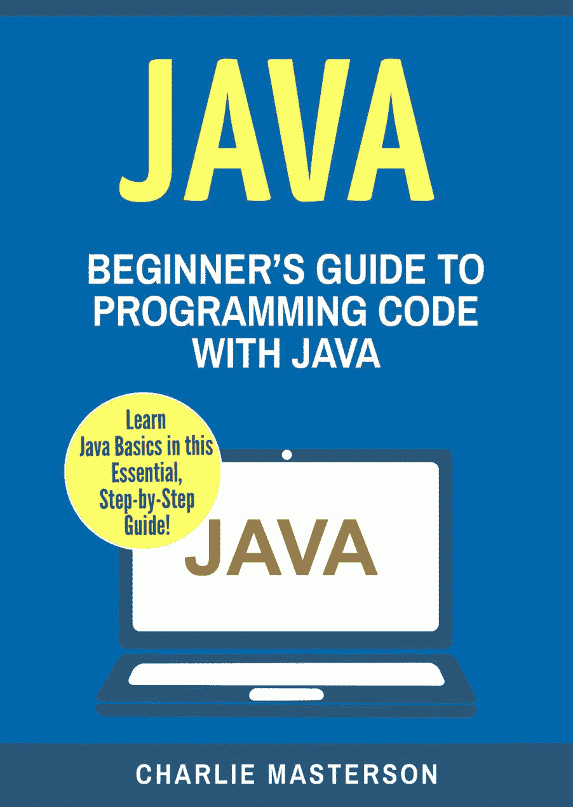

# Java：Java 编程入门指南



## 简介

恭喜下载《Java：Java 编程入门指南》，感谢您的支持。

后续章节将讨论 Java 是什么以及它的用途。

读完此书后，你应该能够像使用任何其他编程语言一样使用 Java。

请记住，Java 与 JavaScript 不同。它们是两种完全不同的语言。

市场上有很多关于这个主题的书籍，再次感谢你选择本！我们已尽全力确保它包含尽可能多的有用信息，请尽情享受！

## 第一章：Java

开始学习 Java 最困难的事情是确保你已经安装了所有你将在 Java 中使用的内容。在能够编写代码之前，你必须拥有所有这些程序，否则你将给自己找麻烦。

### 虚拟机

Java 平台将独立于任何其他程序。因此，它能够在你可能使用的任何操作系统上运行。得益于 Java 虚拟机，它可以运行在任何系统中。这台机器将帮助编程，以确保你的代码被正确处理。在运行任何 Java 代码之前，必须安装虚拟机程序。

一家名为 Oracle 的公司拥有 Java，在他们的网站上你可以找到虚拟机的下载链接，它被称为 Java 运行环境或 `JRE`。

当你检查电脑是否已安装 `JRE` 时，可以点击 Oracle 页面上写有“我有 Java 吗？”的链接。该链接位于页面顶部下载按钮下方。点击此链接后，电脑将进行扫描，然后你将获得是否已安装的结果。如果没有，你将有机会从该页面下载。

虚拟机下载完成后，你需要重启系统以便程序能够正常运行。

### 软件开发包

现在软件已经安装，Java 就能在你的电脑上运行了。但在你编写代码之前，你还需要从 Oracle 网站安装软件开发包。

此套件被称为标准版，而你需要的版本被称为 `NetBeans`。下载文件会很大，但一旦下载完成，你就可以编写 Java 代码了。

### Java 的工作原理

Java 代码将在文本编辑器中编写，代码被称为源代码。你编写的任何代码将保存在扩展名为 `.java` 的文件中。`javac` 程序能够将你编写的任何源代码转换为 Java 字节码（Java Byte Code），这被称为编译。一旦文件编译完成，就会创建一个扩展名为 `.class` 的新文件。

在类文件创建的刻，虚拟机就可以运行该文件了。`NetBeans` 是一个为你处理文件创建和编译的程序。但通过观察幕后，你会发现你的源代码会被创建为一个 Java 文件，然后启动 `javac` 来创建你的类文件。

### NetBeans

首次进入 `NetBeans` 时，你需要等待一会儿，因为这个程序并不快。但当它加载完成后，你需要点击 `file`（文件），然后 `new project`（新建项目），以便创建一个应用程序。

在点击 `Java Application` 后，点击 `next`（下一步）按钮进入下一部分。显然，你需要为项目命名，这将更改窗口底部的文本，使其与你命的项目名称一致。

将根据你的文件名创建一个类。如果你将其命名为 `firstproject.FirstProject`，类名会将 `F` 和 `P` 大写，而包名将是小写。

`NetBeans` 会自动设置保存，但你可以根据需要进行修改以便更好地查找。还会创建一个包含你项目名称的文件夹。点击 `finish`（完成）按钮后，你就已经创建了所需的所有文件。

回到 IDE（集成开发环境）后，你可以查看你的项目，检查是否有正在处理的项目。点击项目名称旁边的加号，你会看到与该项目相关的所有文件夹。每个文件夹都会进一步展开，让你看到存储源代码的文件。

你的源代码应该显示在右侧的文本区域内。如果发现没有代码窗口，你需要双击你的项目，以便代码显示出来并让你开始工作。

你的文件名和类名必须匹配，否则 Java 将无法正常工作，在编译时你将会遇到错误。

在你创建一个新项目后，你会发现文本窗口中有些文本是灰色的，其中包含星号或斜杠。这些区域将成为你的注释，当程序运行时，这些注释将被忽略。你可以在注释中键入任何你想输入的内容，但大多数情况下，注释是用来解释你对代码所的操作。单行注释通过在行前加上两个斜杠来输入。

```
// this is a comment
```

当你需要多行注释时，你有两个选择：

```
// your comment
//and it is going to continue here
```

或者

```
/*
your comment
And it is going to continue here
*/
```

你也可以选择使用所谓的 Javadoc 注释，在那种注释中，你会看到开头是一个带有两个星号的正斜杠，而结尾是以一个单星号和一个斜杠结束。但是，每一行前面都会有一个星号。Javadoc 注释通常用于文档代码。这些代码将被转换为一个 HTML 页面，以帮助他人。

如果你点击 NetBeans 顶部菜单中的“运行（run）”，你可以选择“生成 Javadoc（Generate Javadoc）”。然而，由于你还没有编写任何代码，你什么也看不见。你可以删除 NetBeans 生成的注释。

## Java 结构

包名将出现在你代码的最前面。该行将以分号结束，如果你不小心漏掉了那个分号，程序将无法编译。在你的包名之后，将列出类名。

将你的类名视为一段代码。Java 必须通过大括号来告诉它代码从哪里开始到哪里结束。代码以左括号开始，以右括号结束。每当在这些括号中放置内容时，你就有了一个代码段。

当你编写代码时，你需要包含 `main` 单词，以便 Java 知道它从哪里开始。这个方法将是一段代码，但它将帮助执行 `main` 大括号内部的任何代码。如果你忘记在编写的程序中放入 `main` 入口点，将会发生错误消息。

## 运行 Java 程序

每当程序运行时，它将在屏幕底部显示的输出窗口中运行。你不需要启动任何终端或控制台窗口，因为输出窗口就是你的控制台。

在 NetBeans 中，你有多种方法可以运行程序。但对你来说最简单的方法是直接按 F6。如果你不想这样做，也可以进入菜单并选择“运行项目（run project）”按钮。

在工具栏上还可以找到一个绿色按钮，它可以运行你的程序。另一种运行程序的方法是进入项目窗口。你可以通过右键点击想要运行的项目并选择“运行文件（run file）”来确保运行了正确的代码。这种方法也可以在实际文本窗口内点击有代码的地方。

只要你正确编写了代码，你选择任何方法都会在输出窗口中运行你的程序。

## 第 2 章：变量

大多数程序通过处理放在程序内存中的数据来工作。这些数据可能是对象、数值、文本以及内存区域中的任何指针。当你给数据命名时，你可以在需要时对其重命名，但该名称和值被视为变量。

### 数值

当需要在 Java 中存储一个数值时，有几种选项可以使用。有像 8 或 12 这样的整数，可以存储为 `int` 变量。`int` 代表整数（integer）。

然后是浮点数，例如 8.4 或 10.5，它们被存储为 `double` 变量。当你存储这些数值时，你需要使用等号。

```java
public static void main(String [ ] args) {
int last_amount;
System.out.println (“My Last Project");
}
```

程序需要开发者与其通信，告知想要保存一个整数，因此你需要输入 `int` 并在后面加一个空格。然后你将被允许输入任何你想为变量命的名称。变量可以按你意愿命名，但有一组你必须遵守的特定规则：

- 变量名可以有不同的含义。由于名称对大小写敏感，像 `firstname` 或 `FirstName` 这样的名称是两个不同的。
- 变量名不能以数值作为第一个字符。使用单词拼出数值是可以的，但使用实际数值会导致 Java 抛出错误消息。数值将用于 Java 的其他地方。
- 变量名不允许有空格。`int first amount` 的变量声明将向你抛出错误消息。你可以使用下划线或后续的大写字母。
- 不允许使用关键字作为变量名。Java 中有几个关键字，NetBeans 会在编码时将这些单词显示为蓝色。

当你想要存储一个名为 `last_amount` 的变量时，你会在放入想要存储的值之前输入一个等号。

```java
public static void main(String[] args) {
int last_amount;
last_amount = 10;
System.out.println (“My First Project");
}
```

程序必须理解数值 10 需要被存储为 `last_amount`。如果你喜欢，也可以在一行内完成所有操作。

```java
public static void main(String[] args) {
int last_amount = 10;
System.out.println(“My Last Project");
}
```

为了让代码生效，开发者需要将脚本的最后一行修改为类似的内容：

```java
System.out.println( “Last amount =” + last_amount)
```

圆括号之间的信息是直接文本，必须放在双引号内。加号将表达式的两个部分连接在一起，使得表达式的文本和变量名连接在一起。

一旦你写完所有这些代码，你就可以运行它，以便在底部显示输出的窗口中看到它。

被保存的整数将被称为 `last_amount`。

当你将两个整数相加时，其中一个将存储你相加的两个数值，而另一个将存储结果。每个变量之间用逗号分隔。

```java
last_amount = 30;
third_amount = 60;
result = last_amount + third_amount;
```

你的结果将是最后一个和第三个数值相加的和。加法通过加号完成。当你完成方程后，你的数值将存储在带有 `result` 变量的一侧。在赋值第一个和第三个数值后，在相加之前，数值不会被赋值。

```java
result = 30 + 60;
```

Java 理解为这里有两个变量，你不需要使用名称。你的 `println` 方法也会改变：

```java
System.out.println( “Addition Total =” + result)
```

再次，普通文本将被组合，并且变量名周围将有双引号。你可以运行程序并在输出窗口中获取它以查看运行情况。

也可以直接使用数值以便更改结果。

```java
result = last_amount + third_amount + 12;
```

当再次运行程序时，结果将会不同，你的 `println` 也是如此。

大量的数值可以存储在 `int` 变量中，但限制是 `2147483647`。你也可以输入负数，你能够达到的最低值是 `-2147483648`。更大或更小的数值将使用 `double` 变量类型。

### Double 变量

`Double` 变量可以存储从极大的数值到极小的数值。你能够达到的最高和最低数值将是 `17` 后面跟着大约三百零七个零。`double` 变量将用于存储浮点数。如果你尝试将浮点值存储到任何 `int` 变量中，程序将下划线代码错误的地方，以便你可以在运行之前对其进行修改并接收到错误消息。

```
int last_amount, third_amount, result;

double last_amount, third_amount, result;

last_amount = 11.5;

third_amount = 22.8;

result = last_amount + third_amount ;
```

现在可以运行程序来向你显示效果。

### Short 和 float

`Short` 变量将保存位于 `-32768` 到 `32767` 之间的较小数值。你不会像以前那样使用它，而是你将使用 `short`。当你使用 `short` 时，你需要确保你使用的数值落入这两个数值之间。

`Double` 值将用于存储较大的浮点数。你将不会使用 `double` 而是使用 `float`。当你要存储一个 `float` 变量时，你的数值末尾需要加上字母 `f`。

```
float last_amount, third_amount, result ;

last_amount = 10.5f;

second_number = 20.8f;
```

### 简单算术

当你对变量进行数学运算时，你将使用基本符号进行计算。

- 加法 (`+`)
- 减法 (`-`)
- 乘法 (`*`)
- 除法 (`/`)

#### 优先级

Java 中可以计算两个以上的数值，但你必须确保在计算内容上要小心。

```
last_amount = 200;

third_amount = 85;

fourth_amount = 45;

result = last_amount – third_amount + fourth_amount;
```

计算将按照它们出现的顺序进行。所以你需要做的是从 `200` 中减去 `85` 得到 `115`。然后加上第三个数值得到 `160`。

为了确保 Java 按照你想要的方式运行，你可以使用括号。

```
result = (last_amount – third_amount) + fourth_amount

result = last_amount – (third_amount + fourth_amount)
```

对于乘法，乘法将在执行任何加法或其他操作之前进行。优先级是乘法和除法高于加法或减法。

### 字符串变量

数值不是唯一可以存储的内容，变量也可以存储文本。当你想要存储一个字符时，你需要使用 `char` 关键字，以便 Java 知道你使用的是字符而不是数值。由于你存储的是多个字符，你将使用字符串变量。

像你在第一章做的那样开始一个新项目，将项目标记为类似 `StringVars` 之类的名称。需要勾选框以便创建一个 `main` 类。你可以删除 `stringvarsvars` 之后的 `main`，取而输入 `StringVariables`。

删除所有注释后，你将有一个与之前类似的代码窗口。为了创建一个字符串，你将使用单词 `string` 作为你的关键字，后面跟着变量名。仍然会使用分号。

```
String middle_name;
```

将再次使用等号将值分配给新变量。等号后面的文本将存储在双双引号内。

```
middle_name = “William” ;
```

这段代码也可以放在单行中：

```
String middle_name = “William” ;
```

在另一个字符串中，你将输入客户的姓氏。

```
String inherited_name = “Shakespeare” ;
```

在你的打印语句中，你将把它们结合在一起：

```
System.out.println (middle_name + “ ” + inherited_name) ;
```

括号内的信息将是我们的变量内容。加号后面跟着一个空格，那个空格在双引号中。双引号帮助 Java 识别出这两个字符之间需要一个空格。

你的代码看起来会很乱，但每当代码运行运行时，你只会得到名字和姓氏的打印结果。

关键字 `char` 在存储单个字符时将使用小写的 `c`。也将使用单引号代替双引号。当你用双引号包围 `char` 字符时，代码将被下划线标记，从而给出一个错误代码。单个字符在创建字符串变量时使用双引号。

```
String middle_name = “W”;
```

而上面的语法是正确的：

```
String middle_name = ‘W’;
```

这不是。

### 输入

在 Java 中，有很多库可以使用，以便看到代码应该做什么。如果你需要引用库，你需要引用它。有用的类之一是 `Scanner`。该类位于 `java.util`。你将使用的关键字是 `import`。

```
import java.util.Scanner
```

程序已被告知库中有一个特定的类。

```
import java.util.Scanner ;

public StringVariables {

}
```

完成后，你需要在 `Scanner` 中建立项目。不会设置 `int` 变量，也不会设置 `String` 变量。相反，你正在创建一个名为 `client_input` 的 `Scanner` 变量。等号后面的关键字是 `new`。当你从选择的类创建新对象时，将使用这个关键字。你创建的对象位于两个括号之间。Java 然后必须被告知它是 `System.in`。

```java
Scanner client_input = new Scanner(in);
```

对于客户输入，会对你创建的新对象调用一个方法。你可以使用的方法之一是 `next()` 方法。它将获取客户在程序中输入的下一个字符串。

```
String middle_name;

middle_name = client_input.next();
```

一旦客户输入了数据，你将输入一个点。会弹出一个可用的方法列表。在行行尾输入分号之前，只需双击 `next`。你还可以打印一些文本，以便提示客户输入你想要的数据。

```
String middle_name;

System.out.print (“ Enter your middle name: “ ) ;

middle_name = client_input.next();
```

当你为客户输入提示词时，你不会使用 `println` 而是将使用 `print`。如果你使用 `println`，光标将移动到新行。但使用 `print` 时，它将保持在同一行。


```java
System.out.print("Enter your family name: ");
inherited_name = client_input.next();
```

代码是相同的，但 Java 会保留客户提供的任何输入。

如果你想打印获取到的输入内容，可以这样做：

```java
String complete_name;
complete_name = middle_name + "" + family_name;
System.out.println("You are" + complete_name);
```

当程序运行时，Java 会暂停，以便客户输入数据。一旦输入了所有数据，正确的输出将显示在屏幕上。最后，`Scanner`类将用于从客户端获取输入。客户输入的任何内容将存储在变量中。

## 选项

类似于`Scanner`类，`JOptionPane`类在你尝试从客户端获取输入时非常有用。该类会弹出窗口让客户输入诸如"Hello"之类的数据。

### 代码

```java
import javax.swing.JOptionPane;
```

Java 将被告知使用`JOptionPane`类，它位于`javax.swing`库中。

可以再次开始新项目，如果你不想更改之前的任何代码。当你输入代码时，可能会注意到`import javax.swing.JOptionPane;`是下划线的，这是因为该代码尚未被使用。一旦使用，下划线就会消失。

为了让客户输入某种类型的数据，`showInputDialog`方法会将输入的数据直接存储到相应的变量中。

### 代码

```java
String middle_name;
middle_name = JOptionPane.showInputDialog(" Middle Name ");
```

在你输入`JOptionPane`句号后，列表将弹出。在这里，你可以双击`showInputDialog`，以便在括号之间输入你想要显示的消息。

### 代码

```java
String inherited_name;
inherited_name = JOptionPane.showInputDialog("Family Name");
String complete_name;
complete_name = "You are" + middle_name + "" + inherited_name;
JOptionPane.showMessageDialog(null, complete_name);
```

在此处，你将使用`showMessageDialog`。`null`关键字现在出现在你的括号之间，这让 Java 知道要在对话框中显示的内容。在代码的底部，你可能会看到新的代码：`system.exit(0);`确保从内存中移除任何对象。

当你的代码运行时，将弹出窗口让客户输入你指定的数据。再次点击"确定"，程序将结束。

## 第 3 章：Java 的控制流

在此之前你做的任何编程都属于顺序编程，这意味着代码是从上到下被读取的。然而，并不是所有的程序都是这样工作的。某些代码只有在满足条件时才会运行。对于代码，你可能希望测试特定的年龄，这将通过条件逻辑来实现。

条件语句大多使用`if`单词，但可以使用其他单词来创建条件语句。

### if 语句

每当发生某些情况时，都会执行`if`语句。一个`if`语句看起来像这样：

```java
if ( statement ) {
}
```

`if`单词位于你的括号之前。花括号将用于划分代码块。此部分代码只有在条件满足时才会执行。

### 代码

```java
if( client < 18) {
}
```

此条件表示客户小于 18 岁。与其全部写出来，使用简写方法使代码块更短且更易读。

### 代码

```java
if( client < 18) {
// display message
}
```

因此，如果客户大于 18 岁，花括号中的代码将被跳过，Java 将继续后续执行。另一个简写概念是指指向右，意味着"大于"。

### 代码

```java
if( client > 18) {
//display message
}
```

代码完全相同，只是该条件适用于 18 岁以上的人。

### if ... else

与其使用`if`语句，可以使用`if else`语句。

```java
if( condition_to_test) {
}
else {
}
```

第一行仍然以`if`开头，后面跟着条件。花括号将划分代码的不同部分。第二个选择位于`else`之后并带有它自己的花括号。只有两个选择：客户小于 18 岁或大于 18 岁。你的代码必须匹配你想要发生。

### if ... else if

可以同时测试多个条件。如果你想测试特定的年龄范围，可以使用`if else if`语句。语法如下：

```java
if(condition_one) {
}
else if ( condition_ two ) {
}
else {
}
```

代码的最新部分是`else if ( condition_two) { }`。

当发送`if`语句时，下一个是圆括号。第二个条件位于两个新括号之间，但它不会被第一个条件捕获。每个`if else if`语句仍然用花括号进行隔离开，每个语句都有它自己的花括号。如果你漏掉其中一个，将会收到错误消息。

你需要使用的条件运算符有：

- 大于：`>`
- 小于：`<`
- 大于或等于：`>=`
- 小于或等于：`<=`
- 与 (AND)：`&&`
- 或 (OR)：`||`
- 等于：`==`
- 非 (NOT)：`!`

两个与符号将用于同时测试多个条件。

### 代码

```java
else if ( client > 18 && client < 40)
```

通过这段代码，你将需要相关的知识来获晓客户的年龄，并查看他们是否大于 18 岁但小于 40 岁。你只是试图查看客户输入的变量中的内容。客户必须大于 18 岁且小于 40 岁。由于使用了与（AND）运算符，你的客户必须满足两个条件。

### 嵌套 if

`if`语句可以嵌套，就像`if else`和`if else if`语句一样。嵌套的`if`语句是将一个`if`语句放在另一个里面。

### 代码

```java
if( client < 19) {
System.out.println ( " 18 or younger") ;
}
```

为了检查你的客户是否大于 16，必须在你已经创建的`if`语句内部放置另一个`if`语句。

### 代码

```java
if( client < 20) {
if( client > 20 && client < 23 ) {
System.out.println (" You are 21 or 22") ;
}
}
```

第一个`if`语句是客户小于 19 时被捕获的地方，而第二个将缩小范围，确保他们大于 16。当你想要打印不同的消息时，可以使用`if else`语句。

### 代码

```java
if( client < 20) {
if( client > 20 && client < 23 ) {
    System.out.println( "You are 21 or 22") ;
}
else {
    System.out.println ("22 or younger") ;
}
}
```

代码中的大括号必须完全准确，否则程序将运行。嵌套的`if`语句比较难学，但可以将其简化。

### 布尔值

布尔值只有`true`或`false`、`1`或`0`，甚至是`yes`或`no`。Java 有一个专门用于布尔值的变量：

```java
Boolean client = true;
```

你不需要输入`int`、`string`或`double`，你需要使用小写的`b`来输入`Boolean`。变量名将在其赋值为`true`或`false`值之后出现。赋值将使用一个等号。然而，如果你要评估变量并且它有某个值，你就需要使用两个等号。

#### 代码

```java
Boolean client = true;
if ( client == true) {
    System.out.println ("it's true") ;
}
else {
    System.out.println("it's false") ;
}
```

`if`语句将检查由`client`输入的变量是否为`true`。`else`将检查它是否为`false`。你不需要说"else if ( client == false)"。当某事结果不是`true`时，它显然是`false`。你会使用`else`，因为对于布尔值来说只有两种选择。

另一个用于条件的的运算符是`NOT`运算符，它用于布尔值。

#### 代码

```java
Boolean client = true ;
if( !client) {
    System.out.println ("it's false") ;
}
else {
    System.out.println ("it's true") ;
}
```

`NOT`运算符将位于`client`变量之前。这个运算符将使用单个感叹号，但它会落在必须测试的变量之前。代码将进行取反测试，这意味着它不是它实际的样子。

由于`client`变量已被设置为`true`，`!client`最终将测试`false`值。如果条件被设置为`false`，那么`NOT`运算符将测试`true`的值。

### Switch 语句

为了管理脚本的运行，开发者可以使用`switch`语句。`switch`语句将为你提供在你变量上设置的值范围内的选项。本质上，这些是长且复杂的`if else if`语句。

因此，它的语法如下：

```java
Switch ( variable_to_test) {
    Case value:
        //Code_here;
        Break;
    Case value:
        //Code_here;
        Break;
    Default:
        // The values_that_were_not_caught_from_the _conditions_above;
}
```

这段代码将以关键字`switch`开头，后面跟着一组括号。任何你想评估的变量都将放在`switch`括号的中间。大括号将包含你`switch`语句的所有其他部分。对于你需要检查的每一个分支，开发者将使用一个名为`case`的关键字，以便他们检查该分支的数值。

`case`值后面将跟一个冒号。你想要发生什么事情都将发生，但仅在值正确对应的情况下。你想要执行的代码将被执行。在每个`switch`语句的需要`break`的情况下，将使用`break`单词。

`default`值将被使用，但它是完全可选的。如果你没有在`switch`语句的其他地方检查你的变量，你可以在变量中包含其他值。

#### 代码

```java
public static void main(String[] args) {
    int client = 17;
    switch ( client ) {
        case 19:
            System.out.println(" You are 19") ;
            break ;
        case 20:
            System.out.println (" You are 20") ;
            break ;
        case 21: 
            System.out.println (" You are 21") ;
            break ;
        default:
            System.out.println (" You are  not 19, 20, or 21") ;
    }
}
```

这段代码将设置一个必须测试的值。整数变量将名为`client`。在这段代码中，值已被设置为`18`。通过`switch`语句，将检查该变量。

计数器`loopVal`将达到终点。当你不需要计算一个值而是在检查某个值时，`while`循环是非常好用的。在代码中，当键盘没有按下按键时，它可以保持循环。但是，字母`x`将退出循环。

## do while

`do while`循环与`while`循环相似，但它们看起来不同。

```java
int loopVal = 0;
do {
  System.out.println( "Printing some text") ;
  loopVal++;
}
while ( loopVal < 5 ) ;
```

循环将一直持续，直到满足条件。这两个循环之间最大的区别在于你放在括号中的代码。`do while`循环的代码至少会被执行一次，而`while`循环则会一直执行，直到条件被满足。

Java 将退出循环且不执行括号内的代码。当你想要测试这一点时，你需要先使用一个`while`循环。在代码运行之前，必须更改`loopVal`变量的值。文本将不会被打印。

## 第 4 章：数组

数组一次可以持有多个值；它更像是一个项目列表。当你思考数组时，应该想象电子表格以及它的列。你可以有一列，也可以有许多列。

单列的数组看起来像这样：

0 – 10

1 – 14

2 – 36

3 – 27

4 – 43

5 – 18

就像电子表格一样，每一行都有一个位置索引。位置从零开始，每次增加一。每个位置将像上面的代码中一样存储一个值。

当你想要设置数组时，你需要让 Java 知道你正在向数组放入什么类型的数据。你还需要确切说明数组将拥有多少个位置。

语法为：`int [ ] aryNums;`

区别在于，一旦设置了数据类型，普通的整数变量将放在方括号中。括号会让 Java 知道你已经设置了一个数组。数组的名字是`aryNums`。但像任何普通变量一样，你可以称它们为任何名字。

当你告诉 Java 数组将有多少个位置时，你需要为数组创建一个新对象。

```java
aryNums = new int[ 6 ];
```

首先，你从数组名称开始，然后是一个等号。在到达数据类型之前，等号前面有一个`new`关键字。使用的数据类型后面紧跟着数组的大小。大小会让 Java 知道数组需要多少个位置。

如果你更喜欢代码那样显示，也可以将它们写在一行。

```java
int[ ] aryNums = new int[ 6 ] ;
```

Java 将知道你正在使用一个包含六个位置的数组，并且数据类型是整数。因此，默认值是从零到六。

当你想要给不同数量的位置赋值时，你可以像正常一样操作。

```java
aryNum[ 0 ] = 10 ;
```

十的值将被赋值给数组中的零。

记住，数组始终从零开始，第三个位置的索引是二。

为了让设置数组更简单，你可以这样做：

```java
int[ ] aryNums = { 1, 2, 3, 4 } ;
```

通过这种方法，你将数组的值存放在大括号中。第一个值始终是零。`int`后面会有方括号，但没有`new`关键字，也不会重复任何数据类型。除非你想使用`new`关键字，否则你只能对`int`、`char`和`string`值使用这种方法。

```java
String[ ] aryStrings = { " Autumn", "Spring", "Summer", "Winter" } ;
```

这是可以的

```java
Boolean[ ] aryBools = { false, true, false, true } ;
```

这是的！

在设置`Boolean`数组时，你必须使用`new`关键字：

```java
Boolean[ ]  aryBools = new Boolean[ ]  { false, true, false, true } ;
```

## 循环与数组

数组有自己的循环。当值被赋值给数组时，你将使用上一节中看到的语法。虽然这并不完全实际，但在有很多数量需要赋值给数组时，它是可以的。

```java
package prjarrays ;

public class ArrayTest {
  public static void main (String[]  args) {
    int[ ] lottery_amounts = new int [ 49 ] ;
    int I ;
    for ( I = 0; I < lottery_amounts.length ; i++) {
      lottery_amounts[ I ] = I +1;
      System.out.println ( lottery_amounts[ 1 ] ) ;
    }
  }
}
```

这个数组将包含 49 个不同的整数。循环的结尾有一个`length`，它将显示数组有多少位置。循环将一直持续直到`lottery_amounts[I]`小于大小。

```java
lottery_amounts[ I ] = I +1;
```

此时数组名称被放在括号内。你不需要在数组名称后加上方括号。

当你使用排序方法时，你将以降序顺序排序，但只有在你编写了自己的排序代码，或者你将数组转换为从`Collections`库导入的整数对象时，才会发生。


```java
package prjarrays ;

import java.util.Arrays ;

import java.util.Collections ;

public class SortDescending {
  public class ArrayTest {
    public static void main( String[]  args) {
      int[ ]  aryNums;
      aryNums = new int[ 6 ] ;
      aryNums[ 0 ] = 20 ;  aryNums[ 1 ] = 19 ;  aryNums[ 2 ] = 39 ;
      aryNums[ 3 ] = 26 ; aryNums[ 4 ] = 45 ; aryNums[ 5 ] = 12 ;
      Arrays.sort(aryNums) ;
    }
  }
}
```

## 字符串与数组

数组可以像整数一样放入字符串。

```java
String[] aryString = new String[ 5 ];
aryString[ 0 ] = "this";
aryString[ 1 ] = "is";
aryString[ 2 ] = "a";
aryString[ 3 ] = "string";
aryString[ 4 ] = "array";
```

这段代码有五个不同的位置，每一段文本都被放置在它所属的数组中。

这里有一个循环将使用数组的所有位置，但它会打印每一个位置。

```java
int I ;
for ( I = 0 ; I < aryString.length ; i++ ) {
    System.out.println( aryString[ I ] );
}
```

这个循环将一直重复，直到值小于数组范围所定义的值。数组也可以按字母顺序进行排序，因此`aa`会在`ab`之前。但是，由于 Java 使用了一组被称为 Unicode 的字符，为了将字符串中的字母与其他字母进行比较，大写字母将出现在小写字母之前。

```java
package strings1 ;

import java.util.Arrays ;

public class StringArrays {
    public static void main(String[] args) {
        String[] aryString= new String[ 5 ] ;
        aryString[ 0 ] = "This";
        aryString[ 1 ] = "is";
        aryString[ 2 ] = "a";
        aryString[ 3 ] = "string";
        aryString[ 4 ] = "array";
        Arrays.sort( aryString );
        int I ;
        for ( I = 0; I < aryString.length ; i++) {
            System.out.println ( aryString[ I ] );
        }
    }
}
```

## 多维数组

在本章之前讨论过的数组只有单列数据，但你能够设置具有多个列的数组。这些数组被称为多维数组。

```
0 – 10 – 12 -43 – 11 - 22
1 – 20 – 45 -56 – 1 – 33
2 – 30 – 67 – 32 – 14 – 44
3 – 40 – 12 – 87 – 14 - 55
4 – 50 – 86 – 66 – 13 – 66
5- 60 – 53 – 44 – 12 – 11
```

多维数组的排列方式如下：

```java
int[][] [] aryAmounts = new int[ 6 ] [ 5 ];
```

该数组的设置与普通数组完全一样，但会有两组方括号。第一组括号将告诉 Java 有多少行，而第二组括号告诉有多少列。

```java
aryAmounts[0][0] = 10;
aryAmounts[0][1] = 12;
aryAmounts[0][2] = 43;
aryAmounts[0][3] = 11;
aryAmounts[0][4] = 22;
```

第一行将像一样从零开始，然后列将进行到四，这将导致数组中放置了五个项目。

你的第二行是：

```java
aryAmounts[1][0] = 20;
aryAmounts[1][1] = 45;
aryAmounts[1][2] = 56;
aryAmounts[1][3] = 1;
aryAmounts[1][4] = 33;
```

第一个`for`循环将使用行中金额的位置，而第二个循环将根据列的位置使用。第一个循环将是`I`的值，即为零。嵌套在循环内部的代码将用于另一个循环。下一个循环只要变量`I`为零就会被求值。

## 用于数组的列表

很难确定数组内部确切会有多少个项目，因此对你来说使用`ArrayList`会更简单。`ArrayList`是一种动态数据结构。因此，你的项目可以被添加和删除。普通数组的数据是静态的，因为你无法更改已创建数组的原始大小。

当你设置`ArrayList`时，必须确保使用以下语法从库中提取包：

```java
import java.util.ArrayList;
```

一旦导入完成，你就可以使用此语法在列表上创建新对象：

```java
ArrayList listTest = new ArrayList();
```

在使用 Array List 时，你不需要方括号。

```java
listTest.add( "first item" );
listTest.add( "second item" );
listTest.add( "third item" );
listTest.add( 7 );
```

落在括号内的内容将被添加到列表中。你只能添加对象。列表中的前三个项目是字符串对象。最后一个项目是整数，因为整数对象。

你放在列表中的项目将通过它们的索引引用。

```java
listTest.get( 3 );
```

这意味着该行将获取索引为 3 的项目。索引仍然从零开始。因此，这是你的第四个项目。

也可以根据索引从列表中删除项目。

```java
listTest.remove(2);
```

列表中分配的值也可以可以使用：

```java
listTest.remove( "second item" );
```

每当删除一个项目时，列表将调整大小，这意味着在你尝试使用其索引值从列表中获取项目之前要小心。如果你删除了第二个对象，那么列表将包含三个项目。

当你想要遍历列表中的每个项目以便设计一个迭代器时，这是你可以在`java.util`库中找到的另一个部分：

```java
import java.util.Iterator;
```

从这里开始，开发者可以将`ArrayList`附加到新的`Iterator`对象：

```java
Iterator it = listTest.iterator();
```

迭代器设置好后，它将在项目需要时使用：

```java
while (it.hasNext()) {
    System.out.println(it.next());
}
```

`hasNext()`方法将返回一个布尔值。由于列表中还有其他对象，此项将为假。

当这段代码按字母顺序排序时，`a`不会排在最前面，因为它是小写的。因此，`a`的值将是`\u0061`。大写的`T`值将是`\u0054`。

在处理不同文本的字符串时，你可以使用一些方法：

- `toUpperCase`
- `toLowerCase`
- `compareTo`
- `indexOf`
- `endsWith`, `startsWith`
- `substring`
- `equals`
- `charAt`
- `trim`
- `valueOf`

Java 将以直观的方式将文本转换为小写或大写，并将使用内置的`toUpperCase`和`toLowerCase`方法。

```java
package prjstrings;

public class StringManipulation {
    public static void main (String[] args) {
        String changeCase = "text to change";
        String result;
        result = changeCase.toUpperCase();
        System.out.println(result);
    }
}
```

开头的几行告诉了字符串变量在哪里设置的，同时保留了打印之前需要更改的文本。第三行调用了变量的结果。最后，在第四行中，进行了转换。

`result = changeCase.toUpperCase();`

该字符串方法将适用于任何字符串。你只需要在变量后输入一个点，这样你就可以对你的`changeCase`字符串执行各种操作。如果你想让它变成大写，那么就选择它，但请记住大写方法后面应该有一组空括号。

一旦结果完成转换，它将被存储为新的`result`。如果你不想存储结果，可以使用此方法：

`System.out.println(changeCase.toUpperCase())`

当你想要执行`toLowerCase`时，将使用相同的方法。

### 字符串比较

可以通过十六进制值对字符串进行相互比较。你只需要使用`compareTo`方法即可。

```java
package prjstrings;

public class StringManipulation {
    public static void main (String[] args) {
        int result;
        String Word1 = "Ape";
        String Word2 = "App";
        result = Word1.compareTo(Word2);
        if (result < 1) {
            System.out.println("Word1 is less than word2");
        } else if (result > 0) {
            System.out.println("Word 1 is more than word 2");
        } else if (result == 0) {
            System.out.println("the same word");
        }
    }
}
```

当这两个单词进行比较时，使用了如下语法的`compareTo`方法：

`result = Word1.compareTo(Word2);`

它将返回一个大于零、小于零或等于零的值。

确保分配了正确的值以便将`compareTo`的结果返回给变量将取决于你。代码中将包含`if`语句来测试并查看结果是什么。

但是，当比较两个字符串时，Java 将比较十六进制值而不是单词的字母。由于两者都包含大写字母，`App`的`A`将排在`ape`之前。

### indexOf

`indexOf`将在当前字符串或任何其他字符串内部定位字符。

```java
package prjstrings;

public class StringManipulation {
    public static void main (String[] args) {
        char ampersand = '@';
        String email_address = "meme@me.com";
        int result;
        result = email_address.indexOf(ampersand);
        System.out.println(result);
    }
}
```

这段代码正在检查提供的电子邮件地址中是否存在`@`符号。由于使用了单引号，它是一个`char`变量。一旦电子邮件设置好，你将得到`result`，它是一个`int`变量。因此，得益于`indexOf`方法，你的`result`是一个整数。

由于这一行的存在，你的`ampersand`位置将是这段代码的结果：

`result = email_address.indexOf(ampersand);`

当你指定要使用`indexOf`方法时，首先搜索的字符串将出现在点之后。括号之间是你提供多个选项的地方。首先，你可以输入单个字符。通过这种方式，Java 在存储变量`result`的值之前会告诉你该字符在字符串中的位置。

当代码运行时，输出将是四。由于`indexOf`像其他所有内容一样从零开始，`ampersand`是电子邮件字符串中的第四个字符。

如果你寻找的字符不存在，那么`indexOf`将给你一个负数一的的结果。

```java
package prjstrings;

public class StringManipulation {
    public static void main(String[] args) {
        char ampersand = '@';
        String email_address = "mememe.com";
        int result;
        result = email_address.indexOf(ampersand);
        if (result == -1) {
            System.out.println("invalid email address");
        } else {
            System.out.println("email address is okay");
        }
    }
}
```

你的负数一结果将允许客户端继续。`indexOf`也可以用于测试多个字符。

```java
public static void main (String[] args) {
    String dotcom = ".com";
    String email_address = "meme@me.com";
    int result;
    result = email_address.indexOf(dotcom);
    if (result == -1) {
        System.out.println("invalid email address");
    } else {
        System.out.println("email address is okay");
    }
}
```

虽然这段代码看起来完全一样，但你现在将使用字符串中的变量来存储要检查的文本，而不是使用`char`变量。

由于再次返回了负数一的结果，搜索的文本在`indexOf`方法点之前的字符串中未找到。如果找到了，那么`indexOf`将返回第一个匹配你搜索内容的字符。

在上述列的代码中，如果你从零开始计数，点是电子邮件地址中的第七个字符。

## 结

感谢你读完《Java: 初学者 Java 编程代码指南》的最后，希望它对你有帮助，并能够为你提供实现目标（无论目标是什么）所需的所有工具。

下一步是按照第一章所述的方法下载 Java 并开始编写你的代码。
