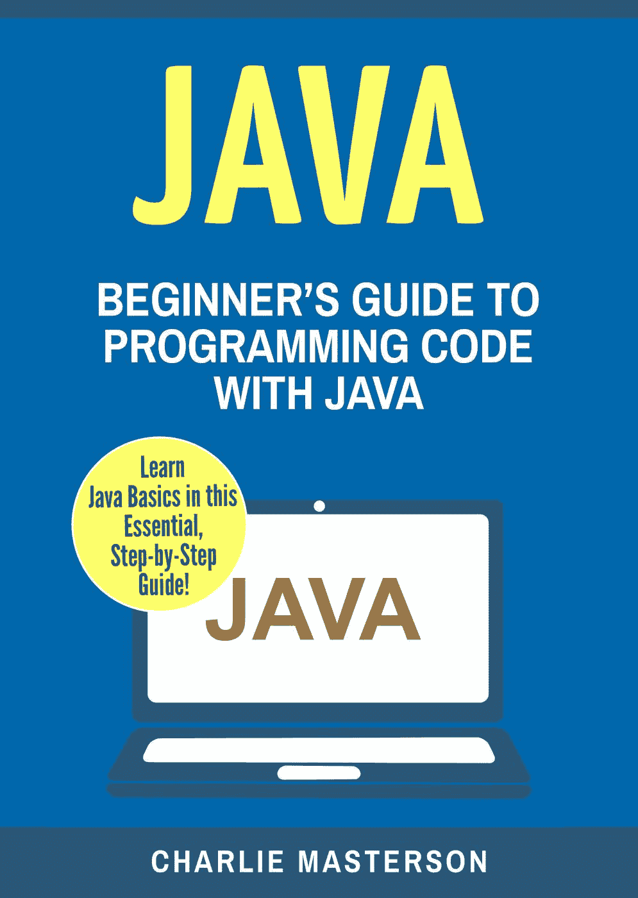

# Java 入门指南



|  |  |  |


## 引言


恭喜下载《Java 编程入门指南》，感谢你的支持。

接下来的章节将讨论 Java 是什么及其用途。

读完此书后，你应该能够像使用其他编程语言一样使用 Java。

请记住，Java 与 JavaScript 并不相同。它们是两种完全不同的语言。

市场上有很多关于这个主题的书，再次感谢你选择这一本！我们已尽力确保它包含尽可能有用的信息，请尽情享受！

|  |  |  |


## 第一章：Java


开始学习 Java 最困难的事情是确保你已经安装了所有将要与 Java 一起使用的。在编写代码之前，你必须拥有所有这些程序，否则你将给自己找麻烦。

### 虚拟机

Java 平台将独立于任何其他程序。因此，它能够在你可能正在使用的任何操作系统上运行。得益于 Java 虚拟机，它可以在任何系统上工作。这台机器将帮助编程，以确保你的代码被正确处理。在运行任何 Java 代码之前，必须安装虚拟机程序。

一家名为 Oracle 的公司拥有 Java，在他们的网站上，你可以找到虚拟机的下载链接，它也被称为 Java 运行环境或 `JRE`。

当你检查计算机是否已经安装了 `JRE` 时，可以点击 Oracle 页面上写有“我有 Java 吗？”的链接。该链接位于页面顶部下载按钮下方。点击此链接后，计算机将进行扫描，然后你将获得是否已安装的结果。如果没有，你就可以从该页面下载它。

一旦下载了虚拟机，你需要重启系统以便程序能够正常运行。

### 软件开发包

现在软件已经安装，Java 就能在你的计算机上运行了。但在你编写代码之前，你还需要从 Oracle 网站安装软件开发包。

这套工具包被称为标准版，你想要使用的版本被称为 `NetBeans`。下载文件相当大，但一旦下载完成，你就可以编写 Java 代码了。

### Java 的工作原理

Java 代码将在文本编辑器中编写，代码被称为源代码。你编写的任何代码都将保存在扩展名为 `.java` 的文件中。`javac` 程序能够将你写的任何代码转换为 Java 字节码，这被称为编译。一旦文件完成编译，就会创建一个名为 `.class` 的新文件。

一旦类文件创建，虚拟机就可以运行该文件。`NetBeans` 是一个为你处理文件创建和编译的程序。但在幕后中，你会注意到你的源代码会被转换为类文件。`NetBeans` 能够在自己的软件中运行程序，从而避免了在输入命令时打开不同窗口的麻烦。

### NetBeans

首次进入 `NetBeans` 时，你需要等待一会儿，因为这个程序并不快。但当它最终加载后，你可以点击“文件”然后“新建项目”来创建一个应用程序。

在点击“Java Application”后，点击“下一步”按钮进入下一个部分。显然，你需要为项目命名，这将使窗口底部的文本与你命名的项目一致。

程序会根据你的文件名创建一个类。如果你将其命名为 `firstproject.FirstProject`，类将大写 `F` 和 `P`，而包名将小写。

`NetBeans` 会自动设置保存，但如果你能找到更好的位置，也可以进行更改。系统还会创建一个包含你项目名称的文件夹。一旦点击“完成”按钮，你就已经创建了所有所需的文件。

你的文件名和类名必须匹配，否则 Java 将无法允许其正常工作，你最终会在编译时遇到错误。

### 注释

在创建一个新项目后，你会发现文本窗口中有一段文字是灰色的，并且包含星号或斜杠。这些区域将是你的注释，当程序运行时，这些注释将被忽略。你可以在注释中输入任何你想输入的内容，但大多数情况下，注释是用来解释你正在对代码做什么的。单行注释通过在行前输入两个斜杠来输入。

```java
// this is a comment
```

当你需要多行注释时，你有两个选择：

```java
// your comment
//and it is going to continue here
```

或者：

```java
/*
your comment
And it is going to continue here
*/
```

你也可以选择使用被称为 Javadoc 的释的内容，在这种注释中，你会看到开头带有两个星号的正斜杠，而结尾以一个单个星号和一个斜杠结束。但是，每一行的前面都会有一个星号。Javadoc 注释通常用于文档代码中。这些代码将被转换为一个 HTML 页面以帮助他人。

如果你点击 NetBeans 顶部菜单中的运行（run），你可以选择生成 Javadoc（Generate Javadoc）。但由于你还没有编写任何代码，你什么也看不到。你可以删除 NetBeans 生成的注释。

### Java 结构

包名将出现在你代码的最。该行以分号结束，如果你不小心漏掉了那个分号，程序将无法编译。在包名之后，将列出类名。

将你的类名视为一段代码。必须使用大括号来告诉 Java 代码从哪里开始到哪里结束。代码以左括号开始，以右括号结束。每当这些括号中放置某些内容时，你就有一个代码段。

在编写代码时，你需要包含 `main` 单词，以便 Java 知道需要从哪里开始。这个方法是一段代码，但它将协助执行你 `main` 大括号内部的任何代码。如果你忘记在编写的程序中放入 `main` 入点，就会发生错误信息。

### 运行 Java 程序

每当程序运行时，它将在屏幕底部的输出窗口中运行。你不需要启动任何终端或控制台窗口，因为输出窗口就是你的控制台。

在 NetBeans 中，你有多种方法可以运行程序。但对你来说，最简单的方法就是直接按 `F6`。如果你不想这样做，也可以进入菜单并选择运行项目（run project）按钮。

工具栏上还可以找到一个绿色按钮，它可以运行你的程序。运行程序的另一种方法是进入项目（projects）窗口。通过右键点击你想运行的项目并选择运行文件（run file），你可以确保正确的代码将运行。这种方法也可以在实际的文本窗口内点击有代码的地方来实现。

只要你正确编写了代码，你选择任何方法都会在输出窗口中运行程序。

## 第 2 章：变量

大多数程序通过处理存放在程序内存中的数据来工作。这些数据将是对象、数值、文本以及内存区域中的任何其他指针。当你给数据命名时，你可以在需要时对其重命名，但该名称和值被视为变量。

### 数值

当需要在 Java 中存储一个数值时，有几种选项可以使用。有像 8 或 12 这样的整数数值，可以存储为 `int` 变量。`Int` 代表整数（integer）。

然后是浮点数，如 8.4 或 10.5，它们被存储为 `double` 变量。当你存储这些数值时，需要使用等号。

```java
public static void main(String [] args) {
    int last_amount;
    System.out.println ("My Last Project");
}
```

程序要求开发者向它通信告知开发者想要保存一个整数，因此你需要输入 `int` 并在后面加一个空格。然后你将被允许输入你想要给变量的名字。变量可以命名为你想要的任何名称，但有一组你必须遵守的特定规则：

- 变量名可以代表不同的含义。由于名称区分大小写，像 `firstname` 或 `FirstName` 将是两个不同的名称。
- 变量名不能以数值作为第一个字符。使用单词拼出数值是可以的，但使用实际数值会导致 Java 抛出错误信息。数值将用于 Java 的其他地方。
- 变量名不允许有空格。`int first amount` 的变量声明将向你抛出错误信息。你可以使用下划线或后续的大写字母。
- 不允许使用关键字作为变量名。Java 中有几个关键字，NetBeans 会在你的编码中将这些词变为蓝色。

当你想要存储一个名为 `last_amount` 的变量时，在你放入想要存储的值之前将输入一个等号。

```java
public static void main(String[] args) {
    int last_amount;
    last_amount = 10;
    System.out.println ("My First Project");
}
```

程序必须理解数值 10 需要被存储为 `Last_amount`。如果你喜欢，也可以将所有这些代码写在一行中。

```java
public static void main(String[] args) {
    int last_amount = 10;
    System.out.println("My Last Project") ;
}
```

为了让代码生效，开发者需要将脚本的最后一行修改为类似的内容：

```java
System.out.printIn( "Last amount =" + last_amount) ;
```

圆括号之间的信息是直接文本，必须放在双引号内。加号将该表达式的两个部分连接在一起，使得表达式的文本和变量名拼接在一起。

一旦你写了所有这些代码，你就可以运行它们，以便在显示输出的窗口中看到它们。

被保存的整数将被称为 `last_amount`。

当你将两个整数相加时，一个将存储你正在相加的两个数值，而另一个将存储结果。每个变量之间将用逗号分隔。

```java
last_amount = 30 ;
third_amount = 60 ;
result = last_amount + third_amount;
```

你的结果将是最后一个和第三个数值之和。加法将通过使用加号完成。

```
System.out.println( “Addition Total =” + result) ;
```

再次强调，纯文本将被组合，并且变量名周围将会有双引号。你将运行程序并在输出窗口中看到结果，以观察它的运行情况。

数值也可以直接使用，从而改变结果。

#### Code

```
result = last_amount + third_amount + 12 ;
```

当再次运行程序时，结果将会有所不同，正如你打印的内容所样。

较大的数值可以存储在 `int` 变量中，但限制是 `2147483647`。你也可以处理负数，你能达到的最低值是 `-2147483648`。更大或更小的数值将使用 `double` 变量类型。

### Double 变量

`Double` 变量可以表示从极大到极小的各种数值。你能够达到的最高和最低数值将是 17 后面跟着大约三百零七个零。`double` 变量将用于存储浮点数。如果你尝试将浮点值存储在任何 `int` 变量中，程序将标出代码错误之处，以便你可以在运行之前进行更改并接收错误消息。

#### Code

```
int last_amount, third_amount, result;

double last_amount, third_amount, result;

last_amount = 11.5;

third_amount = 22.8;

result = last_amount + third_amount ;
```

现在可以运行程序来向你展示它的样子。

### Short 和 float

`Short` 变量将保存于 `-32768` 到 `32767` 之间的较小数值。你将不再像以前那样在代码中使用它，而是将使用 `short`。当你使用 `short` 时，你需要确保你所使用的数值落在这两个数值之间。

`Double` 值将用于存储更大的浮点数。你将不会使用 `double` 而是使用 `float`。当你存储一个 `float` 变量时，你的数值末尾需要加上字母 `f`。

#### Code

```
float last_amount, third_amount, result ;

last_amount = 10.5f;

second_number = 20.8f;
```

### 算术运算

当你对变量进行数学运算时，你将使用基本符号进行计算。

- 加法 (`+`)
- 减法 (`-`)
- 乘法 (`*`)
- 除法 (`/`)

#### 优先级

Java 中可以计算两个以上的数值，但你必须确保在计算内容时要小心。

```go
last_amount = 200;

third_amount = 85;

fourth_amount = 45;

result = last_amount – third_amount + fourth_amount;
```

计算将按照它们出现的顺序进行。因此，你需要从 `200` 中减去 `85` 得到 `115`。然后加上第三个数值得到 `160`。

为了确保 Java 执行你意图的操作，可以使用括号。

```go
result = (last_amount – third_amount) + fourth_amount

result = last_amount – (third_amount + fourth_amount)
```

对于乘法，乘法将先于任何加法或其他操作执行。

优先级的顺序是乘法和除法优于加法或减法。

### String 变量

数值并不是唯一可以存储的内容，变量也可以存储文本。当你想要存储一个字符时，你需要使用 `char` 关键字，以便 Java 知道你使用的是字符而不是数值。由于你存储的是多个字符，你将使用字符串（string）变量。

像你在第一章中那样启动一个新项目，将项目命名为类似 `StringVars`。需要勾选该框以创建一个主类。你可以删除 `stringvars` 之后的 `main`，并代之输入 `StringVariables`。

删除所有注释后，你将拥有一个与之前类似的代码窗口。为了创建一个字符串，你将使用 `string` 作为你的关键字，后面将跟着变量名。仍然会使用分号。

```java
String middle_name;
```

再次使用等号将值赋值给新变量。等号后面的文本将存储在一对双引号内。

```java
middle_name = “William” ;
```

这段代码也可以放在单行中：

```java
String middle_name = “William” ;
```

在另一个字符串中，你将输入客户的姓氏。

```java
String inherited_name = “Shakespeare” ;
```

在你的打印语句中，你将它们结合在一起

```java
System.out.println (middle_name + “ “ + inherited_name) ;
```

括号内部信息将是我们的变量内容。加号后面跟着一个空格，该空格在双引号内。双引号帮助 Java 识别出这两个字符之间需要一个空格。

你的代码看起来会很乱，但你只会得到名字和姓氏的打印。

```java
String middle_name = “W”;
```

虽然上面的语法是正确的：

```java
String middle_name = ‘W’;
```

但这种不对。

### 客户端输入

在 Java 中，有大量的库可以可以使用，以便让你看到代码应该执行什么功能。如果你需要引用该库，你需要使用一个被调用的方法。最有用的类之一是处理来自客户端的输入，名为 `Scanner`。该类可以在 `java.util` 库中获取。使用的 `Scanner` 必须在你的代码中有一个引用。你将使用的关键字是 `import`。

```java
import java.util.Scanner ;
```

权重最大的语句需要在包含该类的语句之前确定。

```java
import java.util.Scanner ;

public class StringVariables {

}
```

程序已被告知库中存在某个类，并且它在 `java.util` 库中。完成此后，你需要在 `Scanner` 类中建立一个实例。这个组仅仅是一系列代码，但在从它创建新对象之前，它不会执行任何操作。

当你使用 `Scanner` 创建新对象时，你将使用一段特定的代码。

```java
Scanner client_input = new Scanner( System.in) ;
```

当你的客户输入数据后，你将输入一个点。此时会弹出一个方法列表，供你选择可用的方法。在行末尾输入分号之前，只需双击下一个选项即可。你还可以打印一些文本，以便提示客户输入你想要的数据。

––––––––


#### 代码

```java
String middle_name;
System.out.print (“ Enter your middle name: “ ) ;
middle_name = client_input.next () ;
```

当你为客户输入提示词时，你将不会使用 `println`，而是要使用 `print`。如果你使用 `println`，在输出内容后光标将移动到新行。但如果使用 `print`，光标将将保持在同一行上。

#### 代码

```java
String inherited_name ;
System.out.print (“Enter your family name: “);
inherited_name = client_input.next() ;
```

代码是相同的，但 Java 会将客户提供的任何输入存储在一个新的变量中。如果你想打印获取到的输入，可以这样做：


```java
String complete_name;
complete_name = middle_name + “” + family_name ;
System.out.println (“You are” + complete_name);
```

运行此程序时，Java 将暂停，以便客户输入数据。一旦输入了所有所需数据，正确的输出将显示在屏幕上。最终，`Scanner`类将用于从客户处获取输入。客户输入的任何内容都将存储在相应的变量中。

### 选项面板 (Option Panes)

类似于`Scanner`类，当你尝试从客户处获取输入时，`JOptionPane`类也非常有用。该类会弹出输入窗口让客户输入正确的数据，并带有类似“Hello”等信息的窗口。

### 代码

```java
import javax.swing.JOptionPane;
```

Java 将被告知你想使用`JOptionPane`类，并且它位于`javax.swing`库中。如果你不想更改之前的代码，可以重新开始一个新项目来练习这个。当你输入代码时，可能会发现`import javax.swing.JOptionPane;`下有下划线。这是因为该代码尚未被使用。一旦使用了它，下划线就会消失。

为了获得一个允许客户输入某种类型数据的框，你将从`JOptionPane`中选择`showInputDialog`方法。这将导致输入的数据直接存储到其正确的变量中。

### 代码

```java
String middle_name;
middle_name = JOptionPane.showInputDialog (“ Middle Name “) ;
```

在你使用`JOptionPane`输入一个句号后，会弹出一个列表。在这里，你可以双击`showInputDialog`，这样你就可以在括号之间输入想要显示的消息。像其他任何内容一样，它应该位于一对双引号之间。

### 代码

```java
String inherited_name;
inherited_name = JOptionPane.showInputDialog (“Family Name”) ;
String complete_name;
complete_name = “You are” + middle_name +”” + inherited_name;
JOptionPane.showMessageDialog (null, complete_name );
```

在此时，你可能想要从选项列表中选择`showMessageDialog`。`null`单词现在会出现在你的括号之间，这个关键字让 Java 知道对话框与程序没有太大关系。标点符号将出现在你想在消息框内显示的文本中。

在代码的底部，你可能会注意到有一段新代码。`system.exit(0);`确保程序能够退出，同时从内存中移除任何对象。当你的代码运行时，你将获得弹出框，询问你指定的客户输入的数据。一旦点击了“确定”按钮，你的输入将显示出来。再次点击“确定”会导致程序结束。

|  |  |  |


# 第 3 章：


## Java 的控制流

在此之前你做的任何编程被称为顺序编程，这基本上意味着你输入的代码是从上到下读取的，每一行都按照其编写的方式进行读取。然而，并不是所有程序都是这样工作的。某些代码必须在满足特定条件的情况下运行。对于代码，你可能希望客户处于某个年龄。这就是你通过条件逻辑控制程序运行流程的地方。条件语句主要使用`if`单词，但也可以使用其他单词来创建条件语句。

### If 语句

每当发生事情时，代码就会执行，而不是等待其他事情，这在编程中是最常见的，因此`if`语句最为常用。有些代码只有在满足条件时才运行。对于代码，你可能希望客户满足某个年龄。这就是你通过条件逻辑控制程序运行流程。。条件语句`if`如下：

```java
if ( client < 18) {
}
```

该条件表示客户小于 18 岁。

，，使用简写方法，使代码更短且易于读。

```java
if ( client < 18) {
    // 显示消息
}
```

因此，如果客户大于 18 。

```java
if ( client > 18) {
    // 显示消息
}
```

代码完全相同，除了条件大于。

### If ... else

除了使用`if`语句，可以使用`if else`语句。

```
if(condition_
)

 {
}
```

第一行仍然以`if`开头，后面跟着条件。大括号将划分代码的不同部分。第二个选择将位于`else`之后，并带有自己的大括号。你只有两个选择：客户小于 18 岁或大于 18 岁。

### If ... else if

可以同时测试多个条件。如果你想测试一个年龄范围，你将使用`if else if`语句。语法如下：

```
if(condition_one) {
}
else if ( condition_ two ) {
}
else {
}
```

代码的新部分是`else if`条件。当`if`语句发送时，下一个将跟随圆括号。第二个条件位于两个括号之间，但它不会被第一个条件捕获。代码仍然用大括号隔开，每个`if else if`语句都有其自己的大括号。如果你漏掉了任何一个，将得到错误消息。

你需要的条件运算符有：

- 大于 (`>`)
- 小于 (`<`)
- 大于等于 (`>=`)
- 小于等于 (`<=`)
- 与 (`&&`)
- 或 (`||`)
- 等于 (`==`)
- 非 (`!`)

两个`&`符号将用于同时测试多个条件。

```java
else if ( client > 18 && client < 40)
```

通过这段代码，你可能需要了解客户年龄的知识，并判断他们是否大于 18 岁且小于 40 岁。你只需要尝试查看客户输入的变量内容。客户年龄必须大于 18 岁且小于 40 岁。由于使用了`AND`运算符，你的客户必须同时满足这两个条件。

### 嵌套 if

`if`语句可以像`if else`和`if else if`语句一样嵌套。嵌套的`if`语句是将一个`if`语句放在另一个`if`语句之中。

### Code

```
if( client < 19) {
    System.out.println ( “ 18 or younger”) ;
}
```

为了检查你的客户是否大于十六岁，需要在已经创建的`if`语句内部放置另一个`if`语句。

### Code

```
if( client < 20) {
  if( client > 20 && client < 23 ) {
    System.out.println (“ You are 21 or 22”) ;
  }
}
```

第一个`if`语句将捕捉客户小于 19 岁的情况，第二个语句将进一步缩小范围，使其大于 16 岁。当你想要打印不同的消息时，可以使用`if else`语句。

### Code

```
if( client < 20) {
  if( client > 20 && client < 23 ) {
    System.out.println( “You are 21 or 22”) ;
  }
  else {
    System.out.println (“22 or younger”) ;
  }
}
```

代码中放置的花括号必须完全精确，否则程序将无法运行。嵌套的`if`语句学习起来比较复杂，但可以拆解来理解。

### 布尔值

布尔值只有`true`或`false`、`1`或`0`，甚至是`yes`或`no`。Java 有一个专门用于布尔值的变量：

```
Boolean client = true;
```

你不需要输入`int`、`string`或`double`，你需要输入使用小写 b 的`Boolean`。变量名将在赋值为`true`或`false`值之后出现。赋值将使用一个等号。然而，如果你要评估变量并且它有某个值，那么你就需要使用两个等号。

### Code

```
Boolean client = true;

if ( client == true) {
    System.out.println (“it’s true”) ;
}
else {
    System.out.println(“it’s false”) ;
}
```

`if`语句将检查客户输入的变量是否为`true`。`else`将检查它是否为`false`。你不需要说`else if ( client == false)`。当结果不是`true`时，它显然是`false`。由于布尔值只有两种选择，所以你会使用`else`。

另一个用于条件的运算符是`NOT`运算符，它被用于布尔值。

### Code

```
Boolean client = true ;

if( !client) {
    System.out.println (“it’s false”) ;
}
else {
    System.out.println (“it’s true”) ;
}
```

---


`NOT`运算符将放在`client`变量之前。该运算符将使用单个感叹号，但它会落在待测试的变量之前。代码将进行取反测试，这意味着它不是它实际所属的。

由于`client`变量已设置为`true`，`!client`最终将测试`false`值。如果条件被设置为`false`，那么`NOT`运算符将测试`true`的值。

### Switch 语句

为了管理脚本的运行，开发者可以使用`switch`语句。`switch`语句将为你提供位于变量设置取值范围内的选项。本质上讲，这些是长而复杂的`if else if`语句。

因此，它的语法如下：

```java
Switch ( variable_to_test) {
  Case value:
    //Code_here;
    Break;
  Case value:
    //Code_here;
    Break;
  Default:
    // 未被从上方条件捕获的值;
}
```

这段代码将以关键字`switch`开始，后面跟着一组括号。你任何想要评估的变量都将放在`switch`括号的中间。花括号将包含你`switch`语句的所有其他部分。对于每一个你需要检查的选项，开发者将使用名为`case`的关键字，以便他们检查该`case`的值。

`case`值将带有一个冒号。无论你想发生什么都会发生，但仅在值正确对应的情况下。你想要执行的代码将将被执行。在`switch`语句的每个情况下，每当需要跳转时就会使用`break`单词。

将使用`default`值，但它是完全可选的。你可以包含它，但完全取决于需求。

```java
public static void main(String[] args) {
  int client = 2;
  switch (client) {
    case 1:
      System.out.println("One");
      break;
    case 2:
      System.out.println("Two");
      break;
    default:
      System.out.println("Default");
  }
}
```

`switch`语句通常用于处理多个可能的条件值。你可以使用`switch`语句来循环。

通过这段代码，你可能需要了解客户年龄的知识，并判断他们是否大于 18 岁且小于 40 岁。你只需要尝试查看客户输入的变量内容。客户年龄必须大于 18 岁且小于 40 岁。由于使用了`AND`运算符，你的客户必须同时满足这两个条件。

### 嵌套 if

`if`语句可以像`if else`和`if else if`语句一样嵌套。嵌套的`if`语句是将一个`if`语句放在另一个`if`语句之中。

### Code

```
if( client < 19) {
    System.out.println ( “ 18 or younger”) ;
}
```

为了检查你的客户是否大于十六岁，需要在已经创建的`if`语句内部放置另一个`if`语句。

### Code

```
if( client < 20) {
  if( client > 20 && client < 23 ) {
    System.out.println (“ You are 21 or 22”) ;
  }
}
```

第一个`if`语句将捕捉客户小于 19 岁的情况，第二个语句将进一步缩小范围，使其大于 16 岁。当你想要打印不同的消息时，可以使用`if else`语句。

### Code

```
if( client < 20) {
  if( client > 20 && client < 23 ) {
    System.out.println( “You are 21 or 22”) ;
  }
  else {
    System.out.println (“22 or younger”) ;
  }
}
```

代码中放置的花括号必须完全精确，否则程序将无法运行。嵌套的`if`语句学习起来比较复杂，但可以拆解来理解。

### 布尔值

布尔值只有`true`或`false`、`1`或`0`，甚至是`yes`或`no`。Java 有一个专门用于布尔值的变量：

```
Boolean client = true;
```

你不需要输入`int`、`string`或`double`，你需要输入使用小写 b 的`Boolean`。变量名将在赋值为`true`或`false`值之后出现。赋值将使用一个等号。然而，如果你要评估变量并且它有某个值，那么你就需要使用两个等号。

### Code

```
Boolean client = true;

if ( client == true) {
    System.out.println (“it’s true”) ;
}
else {
    System.out.println(“it’s false”) ;
}
```

`if`语句将检查客户输入的变量是否为`true`。`else`将检查它是否为`false`。你不需要说`else if ( client == false)`。当结果不是`true`时，它显然是`false`。由于布尔值只有两种选择，所以你会使用`else`。

另一个用于条件的运算符是`NOT`运算符，它被用于布尔值。

### Code

```
Boolean client = true ;

if( !client) {
    System.out.println (“it’s false”) ;
}
else {
    System.out.println (“it’s true”) ;
}
```

---


`NOT`运算符将放在`client`变量之前。该运算符将使用单个感叹号，但它会落在待测试的变量之前。代码将进行取反测试，这意味着它不是它实际所属的。

由于`client`变量已设置为`true`，`!client`最终将测试`false`值。如果条件被设置为`false`，那么`NOT`运算符将测试`true`的值。

### Switch 语句

为了管理脚本的运行，开发者可以使用`switch`语句。`switch`语句将为你提供位于变量设置取值范围内的选项。本质上讲，这些是长而复杂的`if else if`语句。

因此，它的语法如下：

```java
Switch ( variable_to_test) {
  Case value:
    //Code_here;
    Break;
  Case value:
    //Code_here;
    Break;
  Default:
    // 未被从上方条件捕获的值;
}
```

这段代码将以关键字`switch`开始，后面跟着一组括号。你任何想要评估的变量都将放在`switch`括号的中间。花括号将包含你`switch`语句的所有其他部分。对于每一个你需要检查的选项，开发者将使用名为`case`的关键字，以便他们检查该`case`的值。

`case`值将带有一个冒号。无论你想发生什么都会发生，但仅在值正确对应的情况下。你想要执行的代码将将被执行。在`switch`语句的每个情况下，每当需要跳转时就会使用`break`单词。

将使用`default`值，但它是完全可选的。你可以包含它，但完全取决于需求。

```java
public static void main(String[] args) {
  int client = 2;
  switch (client) {
    case 1:
      System.out.println("One");
      break;
    case 2:
      System.out.println("Two");
      break;
    default:
      System.out.println("Default");
  }
}
```

`switch`语句通常用于处理多个可能的条件值。你可以使用`switch`语句来循环。

### 循环


由于循环可能会变得很长，你并不一定需要使用这种方法。你可以使用循环使代码重复直到达到特定的点。一旦到达该点，你就会退出循环并继续下一部分代码。

### 循环

由于循环是顺序的，且流向下进行，你需要告诉 Java 这样做。

```java
int addition = 1 + 2 + 3 + 4 + 5 + 6 + 7 + 8 + 9 + 10;
```

### for 循环

`for` 循环是你会看到的常用循环之一。`for` 语句将执行特定的次数。`for` 循环的语法是：

```java
for ( beginning_value; last_value ; increment_amount) {
  //这是你的代码出现的地方
}
```

在圆括号内将放置三个不同的项目：循环的起始值、循环的结束值，以及它从一个数值到下一个数值的路径。通常增量是是 1。然而，它不必是，如果你希望它是十，你可以将其设置为十。

在括号之后将放置一组花括号，以便将重复的代码隔离开。

```java
package loops ;

public class ForLoops {
  public static void main (String[] args) {
    int loopVal;
    int last_value = 15;
    for (loopVal = 0; loopVal < last_value; loopVal++) {
      System.out.println ( “Loop Value = “ + loopVal) ;
    }
  }
}
```

每当整数值被设置好，它将被称为 `loopVal`。下一行必须设置的是另一个整数变量。这个变量将用于循环结束的值。

在括号内部你会有：

`loopVal = 0; loopVal < last_value ; loopVal++`

Java 将被告知循环的起始数值。这里也是值从 0 赋值给变量 `loopVal` 的地方。第二部分是条件逻辑：

`loopVal < last_value`

`loopVal` 的值将比 `last_value` 的值小。“for”循环将一直持续，直到值小于变量结束的值。只要该值保持真（true），Java 就会继续循环执行大括号之间的代码。

循环的最后部分 `loopVal++` 表示值每次增加 1。

## While 循环

与 `for` 循环相比，`while` 循环更更容易理解。`while` 循环的语法如下：

```
while ( condition) {

}
```

`while` 单词将是小写，你的条件将放在括号之间。大括号内将包含代码

### 代码

```java
int loopVal = 0;

while (loopVal < 5) {

    System.out.println (“Printing some text”);
    loopVal++;
}
```

括号中的条件将正常运行，大括号中的代码是必须打印出来的代码。循环将一直进行，因为没有任何值为 0。

计数器 `loopVal` 将达到条件的终点。当你不需要计数而是在检查某个值时，`while` 循环非常好。对于代码来说，当键盘上没有按下键时，它可以保持循环。但字母 `x` 将退出循环。

## Do while

––––––––


`do while` 循环就像 `while` 循环，但它看起来不同。

```java
int loopVal = 0;

do {
    System.out.println( “Printing some text”) ;
    loopVal++;
}

while ( loopVal < 5 ) ;
```

循环将一直持续直到满足条件。这两个循环最大的区别在于你放在括号中的代码。`do while` 循环的代码至少会被检查一次，而 `while` 循环会一直执行直到条件满足。

Java 将跳出循环且不执行括号内的代码。当你想要测试此功能时，你需要先使用 `while` 循环。在代码运行之前，必须更改 `loopVal` 变量的值。文本将不会被打印。

|  | |  |


# 第 4 章：


## 数组

数组一次可以持有多个值；它更像是一个项目列表。当你考虑数组时，应该考虑到电子表格以及它的列。你可以拥有一列，也可以有许多列。

––––––––


单列数组看起来像这样：

0 – 10

1 – 14

2 – 36

3 – 27

4 – 43

5 – 18

就像电子表格一样，每一行都有一个位置数值。位置从 0 开始，每次增加 1。每个位置将像上面的代码一样持有一个值。

当你想要设置数组时，你需要让 Java 知道你正在向数组中放入什么类型的数据。你还需要确切说明数组将多少个位置。

语法为：`int [] aryNums;`

区别在于，一旦设置了数据类型，普通的整数变量将放在方括号中。括号会让 Java 知道你设置了一个数组。数组的名称为 `aryNums`。但像任何普通变量一样，你可以用任何喜欢的名称来调用它们。

当你告诉 Java 数组将有多少个位置时，你必须为数组创建一个新对象。

### 代码

```java
aryNums = new int[ 6 ];
```

首先，你从数组名称开始，然后是一个等号。在到达数据类型之前，等号前面有一个 `new` 关键字。使用的数据类型后面紧跟着数组的大小。大小会让 Java 知道数组需要多少个位置。

如果你更喜欢代码看起来那样，你也可以将它们写在同一行。

### 代码

```java
int[ ] aryNums = new int[ 6 ] ;
```

Java 将知道你正在使用一个包含六个位置的数组，且数据类型是整数。因此，默认值为 0 到 6。

当你想要将值赋值给不同的位置时，你可以像平常一样操作。

### 代码

```java
aryNum[ 0 ] = 10 ;
```

值 10 将赋值给数组中的 0。

记住数组始终从 0 开始，第三个位置将是索引的。

当你想要设置数组时，你需要让 Java 知道你正在向数组中放入什么类型的数据……就像这样：

`aryNums = { 1, 2, 3 }`

由于导入了 `Arrays` 库，你现在将可以使用 `sort` 方法了。`Arrays.sort( aryNums );`

在你输入点号之前，第一个单词是 `Arrays`。在点号之后，NetBeans 将向你显示你可以对数组进行的所有操作的列表。接下来是 `sort` 单词，然后将数组名称放在括号内。你不需要在你定义的数组名称后面添加方括号。

### Code

```java
package prjarrays;

import java.util.Arrays ;

public class ArraysTest {
    public static void main( String[] args) {
        int[ ] aryNums;
        aryNums = new int[ 6 ] ;
        aryNums[ 0 ] = 20 ;
        aryNums[ 1 ] = 16 ;
        aryNums[ 2 ] = 38 ;
        aryNums[ 3 ] = 29 ;
        aryNums[ 4 ] = 45 ;
        aryNums[ 5 ] = 12 ;
        Arrays.sort(aryNums) ;
        int I;
        for ( I = 0 ; I < aryNums.length ; i++) {
            System.out.println(“num: “ + aryNums[ I ] ) ;
        }
    }
}
```

当你使用排序方法时，你将按降序顺序排序，但只有在你编写了自己的排序代码，或者将数组转换为从 `Collections` 库导入的整数对象时，这种情况才会发生。

### Code

```java
package prjarrays;

import java.util.Arrays ;
import java.util.Collections ;

public class SortDescending {
    public class ArraysTest {
        public static void main( String[] args) {
            int[ ] aryNums;
            aryNums = new int[ 6 ] ;
            aryNums[ 0 ] = 20 ; aryNums[ 1 ] = 19 ; aryNums[ 2 ] = 39 ;
            aryNums[ 3 ] = 26 ; aryNums[ 4 ] = 45 ; aryNums[ 5 ] = 12 ;
            Arrays.sort(aryNums) ;
            int I;
            for ( I = 0 ; I < aryNums.length ; i++) {
                System.out.println (“num: “ + aryNums[ I ] ) ;
            }
        }
    }
}
```

### 字符串与数组

数组可以像整数一样被放入字符串中

### Code

```java
String[ ] aryString = new String[ 5 ] ;
aryString[ 0 ] = “this” ;
aryString[ 1 ] = “is” ;
aryString[ 2 ] = “a” ;
aryString[ 3 ] = “string” ;
aryString[ 4 ] = “array” ;
```

这段代码有五个不同的位置，每一段文本都被放置在了它所属的数组位置上。

这是一个使用数组所有位置的循环，它将打印每一个位置。

```java
int I ;
for ( I = 0 ; I < aryString.length ; i++ ) {
    System.out.println( aryString[ I ] ) ;
}
```

该循环将一直重复，直到值小于数组调用的范围。

数组也可以按字母顺序排序，因此 `aa` 将在 `ab` 之前。但由于 Java 使用了一组被称为 Unicode 的字符，为了将字符串中的字母与其他字母对比，大写字母将出现在小写字母之前。

### Code

```java
package strings1 ;

import java.util.Arrays ;

public class StringArrays {
    public static void main(String[] args) {
        String[ ] aryString= new String[ 5 ] ;
        aryString[ 0 ] = “This” ;
        aryString[ 1 ] = “is” ;
        aryString[ 2 ] = “a” ;
        aryString[ 3 ] = “string” ;
        aryString[ 4 ] = “array” ;
        Arrays.sort( aryString ) ;
        int I ;
        for ( I = 0; I < aryString.length ; i++) {
            System.out.println ( aryString[ I ] ) ;
        }
    }
}
```

### 多维数组

本章之前讨论的数组只有单列数据，但你能够设置具有多个列的数组。这些数组被称为多维数组。

### Code

```
0 – 10 – 12 -43 – 11 - 22
1 – 20 – 45 -56 – 1 – 33
2 – 30 – 67 – 32 – 14 – 44
3 – 40 – 12 – 87 – 14 - 55
4 – 50 – 86 – 66 – 13 – 66
5- 60 – 53 – 44 – 12 – 11
```

多维数组按这种方式排列：

`int[ ] [ ] aryAmounts = new int[ 6 ] [ 5 ] ;`

该数组的设置与普通数组完全一样，但会有组方括号。第一组告诉 Java 有多少行，而第二组告诉有多少列。

### Code

```java
aryAmounts[0][0] = 10;
aryAmounts[0][1] = 12;
aryAmounts[0][2] = 43;
aryAmounts[0][3] = 11;
aryAmounts[0][4] = 22;
aryAmounts[1][0] = 20;
aryAmounts[1][1] = 45;
aryAmounts[1][2] = 56;
aryAmounts[1][3] = 1;
aryAmounts[1][4] = 33;
aryAmounts[2][0] = 30;
aryAmounts[2][1] = 67;
aryAmounts[2][2] = 32;
aryAmounts[2][3] = 14;
aryAmounts[2][4] = 44;
aryAmounts[3][0] = 40;
aryAmounts[3][1] = 12;
aryAmounts[3][2] = 87;
aryAmounts[3][3] = 14;
aryAmounts[3][4] = 55;
aryAmounts[4][0] = 50;
aryAmounts[4][1] = 86;
aryAmounts[4][2] = 66;
aryAmounts[4][3] = 13;
aryAmounts[4][4] = 66;
aryAmounts[5][0] = 60;
aryAmounts[5][1] = 53;
aryAmounts[5][2] = 44;
aryAmounts[5][3] = 12;
aryAmounts[5][4] = 11;
```

```
System.out.println(“Position 1 = “ + listTest.get( 1 ) ) ;
}
```

如果你的列表太长，那么打印整个列表的行将会非常有帮助。可以通过以下语法实现：

```java
System.out.println( "Whole list=" + listTest );
```

运行的代码将在输出窗口中显示如下：

first item

second item

third item

7

Whole list=[first item, third item, 7]

Position 1=third item

# 字符串 (Strings)

字符串与整数变量或双精度整数变量不同。字符串实际上是项。

## 存储字符串

字符串使用变量名下的 Unicode 字符。

### 代码

```java
String someText = "Bill";
```

Java 现在被告知字符串对象包含四个字符。Unicode 字符集为 `\u0042`、`\u0069`、`\u006c`、`\u006c`。Unicode 的值将以十六进制的形式存储。任何大写字母都将以 `\u0041` 到 `\u005a` 的值存储，同时小写字母使用 `\u0061` 到 `\u007a` 的值保留。

### 代码

```java
package strings1 ;

import java.util.Arrays ;

public class StringArrays {
    public static void main(String[] args) {
        String[] aryString = new String [ 5 ] ;
        aryString[ 0 ] = “This” ;
        aryString[ 1 ] = “is” ;
        aryString[ 2 ] = “a” ;
        aryString[ 3 ] = “string” ;
        aryString[ 4 ] = “array” ;
        arrays. Sort( aryString ) ;
        int I ;
        for ( I = 0; I < aryString.length ; i++) {
            System.out.println( aryString[ I ] ) ;
        }
    }
}
```

当这段代码按字母顺序排序时，`a` 不会排在第一，因为它是小写的。因此，`a` 的值为 `\u0061`。大写的 `T` 值为 `\u0054`。

在处理不同文本的字符串时，可以使用一些方法：

* `toUpperCase()`

* `toLowerCase()`

* `compareTo()`

* `indexOf()`

* `endWith()`, `startsWith()`

* `substring()`

* `equals()`

* `charAt()`

* `trim()`

* `valueOf()`

## 大写和小写字母

Java 将以简单的方式将文本转换为小写或大写，并将使用内置的 `toUpperCase()` 和 `toLowerCase()` 方法。

### 代码


```java
Package prjstrings;

Public class StringManipulation {
    Public static void main (String[] args) {
        String changeCase = “text to change” ;
        String result ;
        Result = changeCase. toUpperCase( ) ;
        System. out. printIn( result ) ;
    }
}
```

开头几行告知字符串变量设置，同时保留了打印之前需要更改的文本。第三行调用了变量的结果。最后，在第四行中进行了转换。

`result = changeCase.toUpperCase( )`

该字符串方法适用于任何字符串。你只需要在变量后输入一个点，就可以看到你可以对`changeCase`字符串进行的操作。如果你希望将其转换为大写，则选择它，但请记住大写方法后面应该有一组空括号。

一旦结果完成转换，它将被存储为新的`result`。如果你不想存储结果，可以使用此代码：

```java
System.out.println( changeCase.toUpperCase( ) )
```

当你想要执行`toLowerCase()`时，将使用相同的方法。

## 字符串比较

可以通过十六进制值对字符串进行比较。你只需要使用`compareTo()`方法。

### 代码

```java
package prjstrings ;

public class StringManipulation {
    public static void main (String[] args) {
        int result ;
        String Word1 = ‘Ape” ;
        String Word2 = “App” ;
        result = word 1.compareTo( Word2 ) ;
        if (result < 1 ) {
            System.out.println (“Word1 is less than word2” ) ;
        }
        else if (result > 0 ) {
            System.out.println(“Word 1 is more than word 2” ) ;
        }
        else if (result == 0 ) {
            System.out.println (“the same word”) ;
        }
    }
}
```

当这两个单词进行比较时，使用了带有以下语法的`compareTo()`方法：

`result = Word1.compareTo( Word2 );`

将返回一个大于零、小于零或等于零的值。

确保分配了正确的值以便将`compareTo`的结果返回给变量这取决于你。代码中将会有`if`语句来测试并查看结果是什么。

但是，当两个字符串进行比较时，Java 将比较十六进制值，而不是单词的字母。

感谢你读完《Java：初学者编程代码指南》，希望这本书能为你提供有用的见解，并为你提供实现目标（无论目标为何）所需的所有工具。

下一步是按照第一章所说的下载 Java 并开始编写你的代码。Java 将会有许多不同的规则会让你感到困惑，但这不应该是令你气馁的原因。如果你在练习过程中感到困惑，你随时可以回去重读已写的内容。

你注定会犯错，这是不可所避免的。不要担心你犯的任何错误，当收到错误代码时，你可以删除它们并重新开始。对你的编程能力要有耐心，因为它们在第一次尝试是不可能完美的。要成为 Java 或你在此过程中决定学习的任何其他语言的专家，你需要一些时间。

再次感谢，并祝你好运！


# 关于作者

Charlie Masterson 是一位计算机程序员和导师，开发过多个应用程序和计算机程序。作为一名计算机科学专业的学生，他很早就对编程产生了兴趣，但对学习这些极其复杂的课题感到过挫败。Charlie 想要一种能够让他轻松学习并提高编程技能的教学方法。很快，他发现了一系列让他学得更快、更好的教学课程。通过同样的方法，Charlie 成功学习了不同的编程语言，现在正通过写书教授这些知识。通过他编写的计算机编程书籍，他希望提供巨大的价值，并帮助对学习计算机相关感兴趣的读者。
