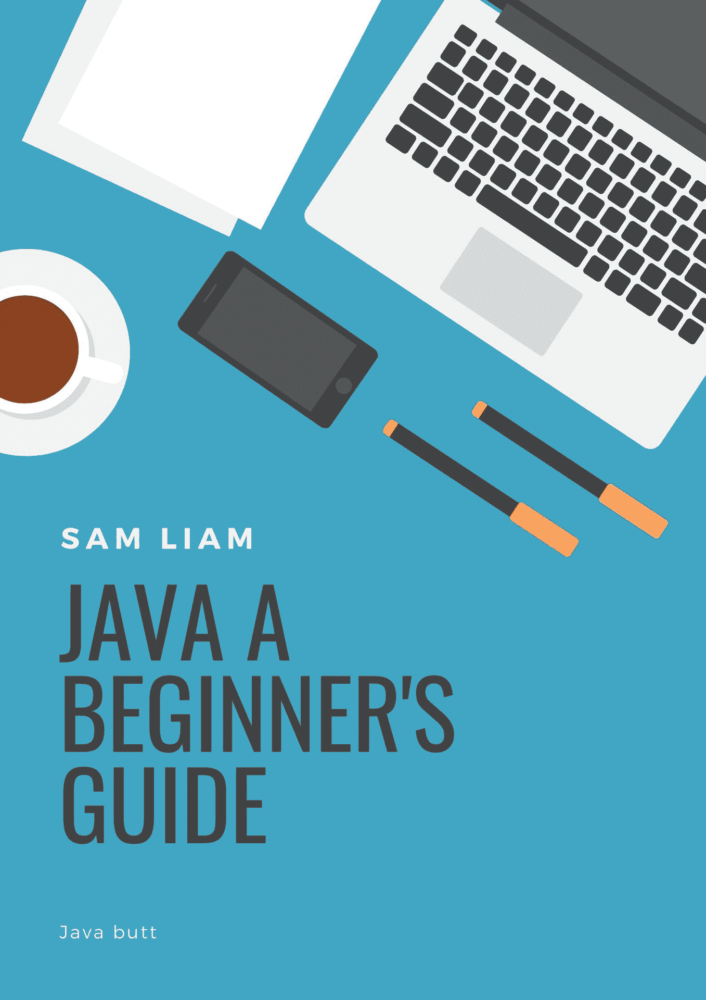

# Java 入门指南



# 第一章：引言

## 1.1 概述

计算机与人之间主要的通信机制之一是发送和接收文本消息：用户使用键盘输入指令，计算机执行该指令，并返回一条关于所执行操作的告知性消息作为结果。

尽管目前计算机的演进正趋向于使用创新且符合人体学的用户界面（如鼠标、触摸屏、图形数位板等），但我们可以说，用户在这些界面上执行的几乎所有操作早晚都会被翻译成命令序列，这些序列的执行方式就像是键盘输入过的一样。

另一方面，从 IT 专业人士的角度来看，在计算机上执行的工作充满了许多需要与机器进行直接文本通信的情况：例如使用命令解释器（`shell`）、构建批处理作业文件、使用各种语言进行编程等。即使是像`WordPerfect`和`MS Word`这样的文字处理器，也使用结构化文本编码存储用户编写的文档，每当文档被打开时，它都会被识别、遍历并显示在屏幕上。

正因如此，任何称职的计算机科学家都无法避免需要深入了解日常工作中使用的、作为人机交互基础的工具的细节：`翻译器`（translator）。在许多情况下，了解编译器的不同部分是如何工作的非常有帮助，特别是那些负责切割源文本将其转换为语法有效短语的部分。例如，如果我们有一个来自数据库合并的`MS Word`文档，并想从中获取原始的`DB`（数据库），可能会出现一个看似复杂的情况。如何解决这个问题呢？基于文档结构是由重复块组成的这一事实，解决方案可以是：

1. 将文档转换为纯文本格式。
2. 使用`翻译器`对该文本进行处理以消除多余字符，生成另一个文本，其中数据库表中的每个字段都包含在引号。
3. 将上述文本导入任何`DBMS`（数据库管理系统）。

`翻译器`构造的其他应用还包括为没有该特性的语言创建预处理器（例如，为了在`C`中方便地使用`SQL`，你可以编写一个预处理器来引入嵌入的`SQL`），甚至将`ASCII 10`（LF）字符转换为 HTML`<br>`以将文本传递到网页。

在本章中，我们将介绍编译器的构造，并描述其组件、它们工作的环境以及一些有助于构建其编译器的软件。

## 1.2 翻译器概念

`翻译器`被定义为一个程序，它将用源语言编写的文本或程序翻译或转换为目标语言编写的相应文本或程序，并可能产生错误信息。翻译器包含了`编译器`（其目标语言通常是机器码）和`解释器`（其目标语言由解释器可以执行的原子操作组成）。图 1.1 显示了构成编译器/解释器的基本框图。

需要强调的是，今天构建一个编译器的速度非常快。在世纪 20 世纪 50 年代，翻译器被认为是极其难编写的程序。例如，第一个`Fortran`编译器（`Formula Translator`）需要等同于 18 年的个人工作（实际上并没有花那么长时间，因为工作是团队合作完成的）。在自动机理论和形式语言理论应用于翻译器的创建之前，它们的开发一直受到问题和错误的困扰。然而，在今天，一个基础的编译器可以是任何计算机科学专业学生的毕业设计项目。

### 1.2.1 翻译器的类型

自从计算诞生以来，人们表达需求的形式与计算机解释指令的方式之间存在着鸿沟。翻译器试图弥越这一鸿沟，让人类的工作变得更容易，这导致了自动机理论应用于计算的不同领域和特定领域，产生了我们接下来将看到的不同类型的翻译器。

#### 1.2.1.1 语言翻译器

它们从一种给定的语言翻译成另一种语言，例如从英语翻译成西班牙语。这类翻译器面临许多问题，即：

- **对人工智能的需求和固定表达问题**：人工智能的问题在于它有许多人工成分而真正的智能很少，因此今天几乎无法翻译具有深层含义的短语。作为一个轶事，在冷战期间，为了尝试从俄语到英语及反之的自动翻译，他们通过输入英文文本测试了一个原型：“The spirit is strong but the flesh is weak”（精神是强大的但肉体是脆弱的），将其翻译成俄语后再译回英语以查看是否与原文匹配。当开发者们得到：“The wine is good but the meat It is rotten”（酒很好，但肉是烂的——在英语中 spirit 既指精神也指酒精）时，他们有多惊讶啊。其他难以翻译的例子由这类短语组成，例如：“Piel of chicken”（鸡皮）、“in case the flies”（如果有苍子的情况下）、“molar mallet”（磨牙器锤）等。
- **难以在词义的规范中进行形式化。**
- **词义随上下文的变化。** 例：“to say that, he took a cookie”（说，他拿了一块饼干）。

通常情况下，语言翻译中最满意的结果出现在语言的限制子集上。甚至如此，出现在文本解释中几乎没有歧义空间的子集中：法律演讲稿、技术文档等。

#### 1.2.1.2 编译器

编译器的输入是形式语言的句子，输出是一个可执行文件，也就是说，它执行了从高级语言代码到机器码的翻译（编译器也被理解为提供目标文件而非最终可执行文件的程序）。

#### 1.2.1.3 解释器

它像编译器，但输出是执行。输入的程序在输入的同时被识别并执行。没有物理结果（机器码），只有逻辑结果（一次执行）。有些语言只能被解释，例如`SNOBOL`（面向字符串的符号逻辑语言）、`LISP`（列表处理语言）、某些版本的`BASIC`（初学者全能符号指令代码）等。

解释器的主要优势是允许易于调试。在缺点方面，我们可以首先提到执行速度慢，因为在与翻译内容同时运行时，无法对其进行高程度的优化；例如，如果程序进入循环且优化不是非常精细，相同的指令将被反复地解释和执行，从而减慢程序的执行速度。另一个缺点是在执行期间，解释器必须驻留在内存中，从而消耗更多资源。

除了翻译能够通过使程序更接近机器来优化程序之外，解释执行型语言还具有特点：它们允许构建它们可以自我修改的程序。某些语言尝试结合编译器和解释器的优点并避免它们的缺点；它们是伪解释语言。在这些语言中，源程序通过伪编译生成一个伪可执行文件。为了执行这个伪可执行文件，使其通过一个可以相对高效解释的执行引擎。这具有可移植性的优点，因为伪可执行文件独立于运行它的机器，目前已知的最佳例子是`Java`语言；某些版本的`Pascal`和`COBOL`（面向业务的通用符号语言）也是伪解释的。

#### 1.2.1.4 预处理器

它们允许在实际编译之前修改源程序。它们利用宏和编译指令。例如，在`C`语言中，预处理器用包含`Uno.c`文件的完整代码替换`#include`指令，这样当编译器开始时，它发现代码已经插入到源程序中了。其他一些预处理指令允许编译可选块：`#ifdef`、`#define`、`#ifndef`。预处理器对程序员来说通常是透明的，甚至可以被认为是编译器的准备阶段。

#### 1.2.1.5 命令解释器

命令解释器将简单语句翻译为对库程序的调用。它们特别用于操作系统（`shell`就是一个命令解释器）。被调用的程序可以驻留在内核（kernel）中，也可以存储在某些外部设备上作为可执行例程按需要调入内存。例如，在`MS-DOS`下输入`copy`命令，其功能是复制操作系统文件，它驻留在内存中。

#### 1.2.1.6 汇编器和宏汇编器

它们是编译器的先驱，因为在计算初期，程序是直接用机器码编写的。汇编语言在每条指令与助记词之间建立一一的关系，使得用户使用助记词编写程序，而汇编器负责将其翻译成机器码。这种方式通常直接产生可执行代码，而不是产生目标文件。汇编器是一个简单的编译器，其源语言的结构非常简单，允许将每个句子翻译为机器码中的单条指令。这种编译器支持的语言被称为汇编语言。例：

```
汇编指令: LD HL, #00
生成的机器码: 65.00h
```

另一方面，存在高级汇编器，它们允许将宏指令翻译成各种机器指令。这些程序被称为宏汇编器。从形式角度看，宏汇编器可以被理解为一种预处理器。

#### 1.2.1.7 源转换器

它们允许将高级语言翻译成另一种高级语言，并可能产生错误信息。例如，由于文档结构是由重复块组成的，解决方案可以是：

1. 将文档转换为纯文本格式。
2. 使用翻译器处理该文本以消除多余字符，并生成另一个文本的文本。
3. 将上述文本导入任何`DBMS`。

#### 1.2.1.8 交叉编译器

它是一种生成在另一种机器上执行的代码的编译器，即使在开发阶段使用的机器与目标机器是不同的。这种情况下，转换器通常使用绝对地址，而不是相对地址。

| `DO5I = 2.5` | (将值 2.5 赋值给变量`DO5I`) |
| `DO 5 I = 2, 5` | (对于`I` = 2, 3, 4 和 5 重循环) |

在这种语言中，在注释和特定类型的字符串之外，空格是没有意义的（在那个信息资源稀缺的时代，为了节省存储空间），因此假设在开始词法分析之前，会抑制所有可移除的空格。在这种情况下，上述命题在词法分析器面前出现的形式将是：`DO5I = 2.5` `DO5I = 2.5`

词法分析器在读取到逗号之前，不知道`DO`是一个保留字还是变量名的的前缀。为了能够识别它，有必要通过执行所谓的`lookahead`（前瞻，或预搜索）操作来检查远超该单词本身的链式输入。这种处理的复杂性建议将其隔离在解析的一个独立阶段中。

无论如何，在像`Fortran`这样的语言中，是先设计语言然后设计编译器，这导致了像刚才那样的问题。今天的语言在设计时已经考虑了构建编译器的可用工具，并避免了这类情况。

## 2.3 Token（标记）、Pattern（模式）和 Lexeme（词法）

从通用的角度来看，我们可以抽象出  实现词法分析的程序，其结构如下：

| (正则表达式) | 一个 | {要执行的动作} | 一个 |
| :--- | :--- | :--- | :--- |
| (正则表达式) | 二 | {要执行的动作} | 二 |
| (正则表达式) | 3 | {要执行的动作} | 3 |
| ... | ... | ... | ... |
| (正则表达式) | n | {要执行的动作} | n |

其中每个要执行的动作都是程序片段，描述了当输入序列匹配正则表达式时，词法分析器应该采取的操作。通常这个动作会以返回一个`Lexical category`（词法类别）而结束。

这一切引导我们得出以下在整个学习过程中至关重要的概念：

- **Pattern (模式)**：是一个正则表达式。
- **Token (标记)**：它是与模式关联的词法类别。每个 token 变成一个唯一的标识符数字或代码。在某些情况下，每个数字都带有后续阶段分析所需的额外信息。token 的概念从语法分析器使用的语法角度来看，与`terminal`（终结符）的概念直接对应。
- **Lexema (词法值)**：它是匹配模式的特定字符序列。例如：`"8"`、`"23"`和`"50"`是符合模式`+('0' | '1' | '2' | ... | '9')`的 lexeme。一个模式可以匹配的 lexeme 数量可以是有限的也可以是无限的，例如，模式`'W''H''I''L''E'`只匹配 lexeme`"WHILE"`。

一旦检测到一组字符匹配模式，就认为检测到了 lexeme。你的词法类别编号以及该数字或`token`将连同额外信息（如果需要）传递给语法分析器。在图 1.13 中可以看到某些类别关联了信息，而另一些则没有。

例如，如果你需要构建一个识别整数、实数和小小写用户 ID 的词法分析器，你可以提出如下结构：

| 正则表达式+ | 关联终结符 |
| :--- | :--- |
| `(0 ... 9)` | `NUM_ENT` |
| `+ (0 ... 9). (0 ... 9)` | `NUM_REAL` |
| `(a ... z) (a ... z 0 ... 9)` | `ID` |

与整数语法类别关联的是 token`NUM_ENT`，它可以等于数字 280；与实数语法类别关联的是 token`NUM_REAL`，它等于数字 281；用户标识符语法类别拥有 token`ID`，它等于数字 282。因此，正则表达式-动作结构如下（假设动作用`C`或`Java`表示）：

```c
+ (0 ... 9) {return 280;}
+ (0 ... 9). (0 ... 9) {return 281;}
(a ... z) (a ... z 0 ... 9) {return 282;}
"" {}
```

通过这种方式，遵循该结构的词法分析器如果在执行过程中  遇到字符串：`95.7 99 cont2942`，词法分析将尝试读取更大的 lexeme，因此尽管文本`"95"`符合第一个模式，但点及其随后的数字`".7"`使得分析器决定识别`"95.7"`为一个整体，而不是独立地识别`"95"`和`".7"`；这就是返回`NUM_REAL` token 的方式。显而易见，除此以外的行为将成为问题的根源。然后模式`""`和关联的动作允许忽略空格。`"99"`匹配`NUM_ENT`模式，而单词`"cont"`匹配`ID`。

为了方便理解与模式关联的动作，我们不再使用数字 280、281 和 282，而是定义了助记符：

```c
#define NUM_ENT 280
#define NUM_REAL 281
#define ID 282 ("" \ T \ n)
```

```c
+ (0 ... 9) {return NUM_ENT;}
+ (0 ... 9). (0 ... 9) {return NUM_REAL;}
(a ... z) (a ... z 0 ... 9) {return ID;}
```

在这个新版本中，通过`"" \ t \ n`进入的 lexeme 没有关联的动作，因此默认情况下执行空动作。

其中`p`是一个正则表达式，`action`是一个程序片段，用于描述词法分析器在遇到符合`p`的词法（lexeme）时应该采取的动作。在`Lex`中，动作是用 C 语言编写的，尽管有许多类似于`PCLex`的元编译器允许使用其他语言进行编码，例如使用 Java 语言的`Jflex`。由`PCLex`创建的词法分析器被设计为与语法分析器同步工作。为了实现这一点，在生成的代码中有一个名为`yylex()`的函数，当它被调用时（通常由语法分析器调用），会开始逐字符地读取输入，直到找到输入中匹配其中一个正则表达式`p`的最长前缀；该前缀构成一个词法，一旦被读取，它就被认为“已消费”，其含义是读取器已移动到该词法之后的第一个字符。然后`yylex()`执行`action`。通常，此动作会将控制权交还给语法分析器，并通知你找到的标记（token）。如果动作没有返回，词法分析器将寻找一个新的词法，并此类推，直到某个动作将控制权返回给语法分析器，或者到达由`EOF`（文件结束）字符表示的末尾。重复搜索词法直到找到显式的返回语句，使得词法分析器能够恰当地处理空格和注释。

在执行与模式关联的动作之前，`yylex()`将读取到的词法存储在变量`yytext`中。除了标记之外，你还想要向调用函数（通常是语法分析器）传递的任何额外信息，必须存储在全局变量`yylval`中，其类型稍后会看到。使用`PCLex`得到的程序相对较大（尽管运行也非常快），但在面对如今处理的海量内存时，这通常不是问题。`PCLex`的巨大优势在于它允许你非常快速地构建复杂的分析器。

### 2.4.2 创建词法分析器

如所述，`PCLex`拥有它自己的语言，我们称之为`Lex`，它允许你指定词法分析器的抽象结构，包括正则表达式以及在找到符合每个模式的词法时所采取的动作。

使用该工具创建词法分析器的步骤如下（图 2.4）：

1. 构建一个`Lex`语言的文本文件，其中包含语法分析器的抽象结构。
2. 使用`PCLex`元编译上述文件。这将获得一个标准 C 字体的文件。有时你必须对此代码进行直接修改，尽管最新版本的`PCLex`已经尽量减少了这种情况。
3. 使用 C 编译器编译`PCLex`生成的 C 源码，从而获得一个遵循 2.4.1 节中描述步骤的可执行程序。

### 图 2.4 从 Lex 规范中获取可执行程序

如果我们运行`prog.exe`，应用程序将等待通过键盘输入字符串，以便对其进行词法切分；通过按下`Ctrl`和`Z`键输入文件结束（屏幕上显示`^Z`）。因此，程序将输入字符串拆分为尽可能长的词法，并为每一个词法执行与其匹配的所符合的模式所关联的动作。

例如，如果`Lex`中的源码形式如下：

```
[0-9] + {printf ("number");} [A-Z] + {printf ("word");}
```

而我们输入：`HELLO 23 ^ z`

当词法匹配模式时，`yylex()`将控制权交给其动作。屏幕上将得到以下结果：

```
word number
```

单词“HELLO”符合第二个模式，单词“23”符合第一个模式。请注意，我们没有对空格指定任何模式；默认情况下，当发现不匹配任何模式的字符或字符序列时，生成的`yylex()`函数将将其直接通过标准输出显示，并继续识别下一个词法。

为了避免通过键盘输入源字符串，而是从文件识别，我们可以通过以下方式重定向输入：

`prog <file.pas> output.txt`

其中：

| `<file.pas` | 重定向输入和 |
| `> output.txt` | 重定向输出， |

或者使用类型为`FILE`的变量`yyin`和`yyout`将它们初始化为相应的文件。这些变量由`PCLex`生成的代码提供，初始它们分别指向`stdin`和`stdout`。

## 2.4.3 Lex 语言

一个`Lex`程序具有以下结构：

```
Lex definitions area %% /* * 是整个程序中唯一强制性的内容 * /
Rules area%%
Function area
```

这是在`Lex`中可以构建的最小程序：


## 2.4.3 Lex 规则与模式

在规则区域（rules area）中，你定义了要在输入中查找词法单元（lexemes）的模式，在这些正则表达式旁边，你用 C 语言详细描述了在找到匹配指定模式的字符串后执行的动作（Actions）。分隔符 `%%` 必须位于第 0 列，就像规则和其他特定于 `Lex` 语言的信息一样。

正如已经提过的，在 `Lex` 中，如果输入字符串不匹配任何模式，所采取的动作是将该输入写入输出。因此，由于程序 `%%` 没有指定任何模式，生成的词法分析器所做的事情是将输入字符串复制到输出（默认情况下，输出是标准输出）。

### 2.4.3.1 识别词法单元的 Lex 前提

`PCLex` 生成的 `yylex()` 在遇到歧义时识别词法单元遵循两个基本原则。这些原则按优先级排序：

1. 始终通过识别最长词法单元的模式进入

2. 发生冲突时，使用出现在第一个模式。

根据第二个前提的结果：识别如 `WHILE` 等保留字的模式和 `WHILE` 模式始终放在用户标识模式之前。

例如，一个 `Pascal` 的词法分析器（其中 `TYPE` 和 `VAR` 是保留字）可能看起来如下：

```
%%"TYPE""VAR"[AZ] [A-Z0-9] *...
```

当 `yylex()` 遇到字符串 `"VAR"` 时会发生冲突（因为该词法单元可以通过第二个和第三个模式进入）。此时取出现在之前的模式，在示例中为 `"VAR"`，将该词法单元识别为保留字。改变这两个模式的顺序将产生严重后果：

```
%%"TYPE"[AZ] [A-Z0-9] *"VAR"...
```

因为这次词法单元 `"VAR"` 将通过用户标识模式进入，它将永远不会被识别为保留字：`"VAR"` 模式变得多余了。

### 2.4.3.2 Lex 特殊字符

`Lex` 依赖 ASCII 字符集来表示正则表达式，因此我们接下来看到的字符对于该目的具有特殊含义：

- `""`：用于包含任何字面量字符串。根据一般规则，除非包含特殊符号，否则字面量不需要包含在引号中，例如 `"WHILE"` 模式和 `WHILE` 模式是等价的；但为了表示例如 Modula-2 中注释的开头，必须对构成模式的字符加引号：`"(*"`，因为它本身包含了特殊符号。

- `\`：使下一个字符变为字面量。例如：`\"` 识别引号。

- `\`：也用于表示那些屏幕上没有直接表示的字符：`\n` 表示换行符，`\t` 表示制表符等。

- `\`：八进制的 `#` 代表 ASCII 值为八进制 `#` 的字符。例如：`\012` 识别十进制字符 10，对应于 `LF`（换行符）。

- `[]`：允许你指定字符列表，即包含在括号内的字符之一，例如：`[abc]` 识别 'a'、'b' 或 'c'（`[abc] / (a | b | c)`）。在括号内部，以下字符也有特殊含义：

    - `-`：表示范围。例如：`[A-Z0-9]` 识别从 'A' 到 'Z' 或从 '0' 到 '9' 的任何字符。

    - `^`：当出现在开头（紧跟 `[` 之后）时表示取反。例如：`[^ abc]` 识别除 'a'、'b' 或 'c' 之外的任何字符。例如：`[^ AZ]` 识别除从 'A' 到 'Z' 之外的字符。

- `?`：前面的字符是可选的。例如：`a? / (a | g)`。例如：`[AZ]?` 识别从 'A' 到 'Z' 或 g。例如：`a? B / ab | gb`。

- `.`：代表任何字符（但只有一个），换行符（`\n`）。它非常有趣，因为它允许我们收集任何未被上述模式识别的字符。

- `|`：表示可选性（或）。例如：`a | b` 识别 'a' 或 'b'。例如：`.: | \N` 识别任何字符。模式 `(. | \N) *` 很奇怪，因为这是整个程序，由于 `yylex()` 有识别最长的前提，它可能会忽略任何其他模式。事实证明，在识别过程中可能会由于变量 `yytext` 的存储空间溢出而发生错误，记住，它存储当前的词法单元。

- `*`：表示前面的内容重复 0 次或多次。

- `+`：表示前面的内容重复 1 次或多次。

- `()`：允许分组（与算术表达式中的相同）。

- `{}`：表示重复范围。例如：`a {1,5} / aa? A? A? A?` 键可以是某种*限制的*。它还允许我们为正则表达式命名，以便在多个模式中重用；这稍后会看到。


在两个程序中，当词法 `"home"` 出现在行首时，两种模式都可以匹配，然后根据现有的二义性，`Lex` 会选择第一个。因此，请注意在第一个程序中，它是由相应的模式匹配的，而第二个程序中是由通用模式匹配的，因此模式 `^ "home"` 永远不会被使用。

`/`：当且仅当其为简单序列（如示例所示）的前缀时，才会识别其置前的模式。例如：`ab / c`；在这种情况下，如果输入的内容是 `"Abcd"`，则词法 `"ab"` 会被识别，因为它后面紧跟着 `'c'`。如果输入的是 `"abdc"`，则该模式将不适用。另一方面，像 `ab / c +` 这样的模式是错误的，因为 `c +` 模式不被认为是简单序列。

### 2.4.3.4 词法状态 (Lexical status)

词法状态变得类似于互斥的逻辑变量（一次只有一个状态处于激活状态），用于指示只有在关联的词法状态激活时才能应用该模式。在我们目前为止看到的示例中，我们一直使用的是默认词法状态，该状态默认在启动 `yylex()` 任务时处于激活状态。由于它是默认词法状态，我们不需要对其进行任何显式引用。

各种词法状态（也称为 `start conditions`）在 Lex 的定义区域中声明，格式如下：

```
% START id, id, ...
```

与模式关联的动作可以通过执行 `BEGIN` 宏来激活词法状态，该宏由 `Lex` 生成的程序提供。因此：

```
BEGIN id;
```

它将激活 `start id` 条件，该条件应该在之前已经声明。激活一个词法状态会自动导致所有其他状态的取消。

另一方面，默认词法状态可以通过以下方式激活：

```
BEGIN 0;
```

要指示某个模式仅在发现 `start id` 条件激活时才作为备选候选，可以在该模式前面加上字符串 `"<id>"`。如果一个模式没有关联显式的起始条件，则假设它关联的是默认词法状态。

以下示例显示了如何显示 Modula-2 程序中所有过程和函数的名称：

```
% START PROC
%%"PROCEDURE" {BEGIN PROC;}
<PROC> [a-zA-Z] [a-zA-Z0-9]* { printf ("%s \n", yytext); BEGIN 0; }
```

### 2.4.3.5 定义区域和函数区域

Lex 程序的定义区域有三个基本用途：

1. 定义词法状态。

2. 为最频繁的模式命名。

3. 编写对整个程序全局有效的 `C` 代码。

已经见过如何定义词法状态，因此我们将继续研究另外两种可能性。

 

在定义区域中，我们可以创建经常使用的辅助正则表达式并为它们命名。稍后，这些模式可以在规则区域中通过简单在大括号 `{}` 中指定它们的名称来引用。例如，以下两个程序是等价的，但第一个更清晰，规则也更简洁：

| 程序 1 | | 程序 2 |
| :--- | :--- | :--- |
| `D` | `[0-9]` | `%%` |
| `L` | `[a-zA-Z]` | `[0-9] +` |
| `%%` | | `[a-zA-Z] [a-zA-Z0-9]*` |

`{D} +{L} ({L} | {D}) *` 请记住，在 Lex 中，所有内容必须从第一列开始。如果某些内容没有从该列开始，`PCLex` 将将其直接传递给生成的 C 程序，而不对其进行处理。通过这种方式，可以创建变量的定义等。然而，不建议这样做，因为 Lex 有一个专门的块用于此操作，在其中你甚至可以处理预处理器指令，而这些指令必须从第一列开始。因此，定义区域还允许你放置纯 C 代码，这些代码将原封不动地翻译到 `PCLex` 生成的 C 程序的开头。对于这些代码，它们使用分隔符 `%{` 和 `%}`。

```c
% {
#include <stdlib.h>
typedef struct _Node {
    int value;
    Node * next; 
} Node;
Node * symboltable;
%}
```

将在此区域使用的全局变量声明放在规则区域的动作（actions）部分中，并包含一个实现符号的文件的 `#include` 是正常的。读者可能想知道 `PCLex` 生成的 C 程序中的 `main()` 函数包含什么。事实是，`PCLex` 并不生成任何 `main()`，相反，它必须由程序员指定。作为一个通用规则，当想要独立运行词法分析器（不带关联的语法分析器）时，通常与每个规则相关的动作不包含任何返回，并且包含一个只调用 `yylex()` 的 `main()`：

```c
void main () {
    yylex ();
};
```

为了指定 `main()` 以及估计合适的额外函数数量，可以使用函数区域。该区域会被 `PCLex` 完全复制到生成的 C 文件中。这就是为什么为了实际目的，在定义区域的 `%{` 和 `%}` 之间编写代码等同于在函数中编写。以下示例显示了字面量 "result" 在输入字符串中出现了几次：

```lex
% {int cont = 0;%}
%%
"Outcome" {cont ++;}
. | \n {;}
%%
void main () {
    yylex ();
    printf ("result appears% d times", cont);
}
```

### 2.4.3.6 PCLex 提供的函数和变量

众所周知，`PCLex` 生成的 C 程序的基础核心是 `yylex()` 函数，它负责查找词元（lexeme）并执行与其相关的动作。这个过程反复执行，直到某个动作找到一个返回或输入结束。此外，`PCLex` 还提供了其他函数、宏和支持变量；下面是按重要性排序的最有趣的列表：

* `yylex()`：实现词法分析器。

* `yytext`：包含当前词元。

* `yyleng`：当前词元的字符数。

* `yylval`：是一个全局变量，允许与语法分析器进行通信。它实际上不是由 `PCLex` 定义的，而是由 `PCYacc` 工具定义的，将在后面的章节中学习它。

* `yyin`：类型为 `* FILE`，指向被读取的输入文件。初始指向 `stdin`，因此输入文件匹配输入标准。

* `yyout`：类型为 `* FILE`，它指向输出文件（初始为 `stdout`）。

* `yyerror()`：这是一个负责输出和处理错误的函数（它会移除屏幕上的错误信息）。它实际上由 `PCYacc` 定义，正如你稍后看到的。

* `yylineno`：整数变量，奇怪的是，它必须由程序员创建、初始化和更新。用于跟踪正在处理的行数。它通常初始化为 1，并在每次遇到回车符时加 1。

* `yywrap()`：`yylex()` 算法每次遇到 EOF 都会自动调用此宏。这个宏的用处是它可以重新定义（为此，你必须先用 `#undef` 指令删除它）。如果输入字符串实际上没有结束，此宏应该返回假（在 C 中用整数 0 表示），这可能发生在两种情况：a）正在处理一个二进制文件，其中间可能包含 EOF 字符，在这种情况下，必须通过对比文件长度与已消耗字符串长度来发现文件的真实结束；b）要识别的字符串被分成几个文件，在这种情况下，当你到达其中一个文件的结尾时，必须在 `yyin` 中加载下一个并继续处理。如果发现的 EOF 确实是待处理字符串的结束，`yywrap()` 应返回真（整数值 1）。

* `yyless(int n)`：将当前词元的前 `n` 个字符留在 `yytext` 中。其余部分返回输入，因此我们可以说它们被取消了。`yyleng` 也会方便地修改。例如，模式 `abc * \n` 等同于：

```c
abc * \n {yyless (yyleng-1); }
```

* `input()`：从输入中读取下一个字符并将其附加到当前词元。例如，程序：

```lex
%%
abc {
    printf ("% s", yytext);
    input ();
    printf ("% s", yytext);
}
```

在输入 "abcde" 之前它将通过此模式进入：`input()` 之前的词元（第一个 `printf` 中）是 "abc"，在 `input()` 之后（第二个 `printf` 中）是 "abce"。

* `output(char c)`：向标准输出输出字符 `c`。`PCLex` 不支持此函数，但 `Lex` 支持。

* `unput(char c)`：取消消耗字符 `c` 并将其放在输入的开头。例如，假设程序：

```lex
%%
abc {
    printf ("% s", yytext);
    unput ('t');
}
such {
    printf ("% s", yytext);
}
```

接收 "abc"。词元的前三个字符与第一个模式匹配。然后 "al" 留在输入中，由于执行了 `unput ('t')`，输入实际上是 "such"，匹配第二个模式。

* `ECHO`：将输入复制到输出宏（不符合任何模式的词元的动作）。

* `yymore()`：允许继续识别下一个词元，但不删除 `yytext` 的当前内容，因此读取的新词元已连接上去。`PCLex` 不支持此函数，但 `Lex` 支持。`yymore()` 的主要用途更容易识别引号中的字面量。假设你想构建一个识别引号字面量的模式，第一个想法可以是：

```lex
[^"]*
```

这会识别如 "Hello"、"bye" 甚至 "Ho"。"Hello comrade" 会产生问题，因为第一个引号被视为结束标记。这个问题通过以下 `Lex` 块解决：

```lex
[^"]* {
    if (yytext[yyleng-1] == '\'')
        yymore ();
    else
        input();
}
```

此模式识别引号字符串（除了最后一个引号），因此带有引号的字符串分部分识别。继续之前的示例，"Hello, comrade" 将通过使用 `unput` 和作为标志的全局变量来解决，`yymore()` 永远不会运行，因为它类似于 `goto`。

* `REJECT`：拒绝当前词元，将其返回输入并寻找另一个模式。`REJECT` 告诉 `yylex()` 找到词元不匹配当前正则表达式。如果 `REJECT` 后面有内容，则不会执行。例如，为了搜索 "keyboard" 和 "side" 出现的次数，可以构造以下 `Lex` 程序：

```lex
% {int t = 0, l = 0;}
%%
keyboard {t ++; REJECT;}
side {l ++;}
```

输入 "keyboard" 时，该程序的行为如下：

1. 通过读取最长词元 "Keyboard" 的模式并执行动作：变量 `t` 增加，当前词元被拒绝，返回整个文本。

2. 屏幕显示不匹配任何模式的字符时的默认动作。

3. 词元 "side" 与第二个模式匹配并执行动作：变量 `l` 增加。

最后，很清楚程序员不应该声明任何与我们学习的相同的函数或变量。事实上，`PCLex` 还会生成一组由单字符组成的辅助变量，因此最好不要命名单字母或以 `yy` 开头的变量或函数。

## 2.5 JFlex 词法分析器生成器

`JFlex` 是由 Gerwin Klein 开发的词法分析器生成器，是普林斯顿大学开发的 `JLex` 工具的扩展。`JFlex` 使用 `Java` 开发并生成 `Java` 代码。为 `JFlex` 编写的程序格式与 `Lex` 编写的类似，因此我们将仅关注模式以及 `JFlex` 输入文件框架之间的差异和扩展。安装和运行 `JFlex` 是非常简单的。一旦有了 `jflex-1.3.5.zip` 文件，我们就有 `JFlex.jar` 文件，它只在元编译时是必要的，生成的解析器是完全独立的。`JFlex` 包的 `Main` 类负责元编译我们的输入 `.jflex` 程序；因此，典型的调用形式如下：

```bash
java JFlex.Main file.jflex
```

这将生成一个实现词法分析器的 `Yylex.java` 文件。图 2.5 展示了要遵循的过程，以及生成的类的默认名称为 `Yylex`。

### 2.5.1 从 JFlex 规范获取可移植的 Java 程序

从一个可以讨论的初步示例开始是有趣的。示例（存储在名为 `test.jflex` 的文本文件中）如下：


```java
/* JFlex example */
import java.io.*;
%%
//% class Lexer
//% int
//% unicode
//% line
//% column
{
    public static void main (String [] args) {
        Yylex parser = new Yylex(new InputStreamReader (System.in));
        try {
            parser.yylex();
        } catch (IOException x) {
            System.out.println ("Error on line" + parser.yyline + "column" + parser.yycolumn);
        }
    }
%}
Line terminator = \r | \n | \r \n
whitespace = {line terminator} | [\t
% state STRING
%%
<YYINITIAL> "IF" {
    System.out.println (“IF”);
}
<YYINITIAL> {
    "=" {
        System.out.println (" =");
    }
    "! =" {
        System.out.println (" =");
    }
    "THEN" {
        System.out.println (" THEN");
    }
    whitespace {
        /* Ignore */
        yybegin(STRING);
    }
}
<STRING> [^"]* {
    System.out.println ("Found an ID");
}
<STRING> "\"" {
    if (yytext[yyleng-1] == '\'')
        yymore ();
    else
        input();
} {
    System.out.println ("A string cannot end in");
} {
    System.out.println("Found" + yytext() + "on string");
} {
    yybegin(YYINITIAL);
} {
    System.out.println ("Found any character");
}
```

如所示，文本被`%%`分成三个部分，就像 Lex 一样。然而，每个部分的内容不同，通用结构是：代码区域、导入、选项和声明。下面描述了后两个区域。

### 2.5.2 选项和声明区域

第一个区域用于在规则区导入包。这里你还可以为 JFlex 生成的`.java`文件指定 clause。

#### 2.5.2.1 选项

此区域允许你向 JFlex 指定一系列适应元编译生成的`.java`文件的选项。以`%`字符开头。

#### 2.5.2.1.1 类选项

最重要的类选项有：

* `class name`：默认，JFlex 生成并实现词法分析器的类名为`Yylex`并位于`yylex.java`中。使用此选项可以更改类的名称。

* `interface`：生成实现指定接口的类（默认`yylex`）。程序员必须输入使实现有效的方法。

* `extends name`：生成自指定类的类。

* `public`：生成公共类。默认生成的类没有可见性范围。

* `final`：生成一个 final 类，没有任何可以继承它。

* `abstract`：生成一个无法创建对象的抽象类。

* `{code}`：程序员可以通过在`%{`和`%}`符号之间向`yylex`类包含自己的声明和方法。

* `{init}`：通过此选项由 JFlex 自动在构造函数中包含代码。

#### 2.5.2.1.2 分析函数选项

这些选项允许修改负责执行词法分析的方法或函数。最重要的选项有：

* `function name`：默认，开始解析的函数名为`yylex()`并返回`Ytoken`值。此选项允许你重命名`yylex()`函数。

* `int`：使`yylex()`函数返回`int`类型的值而不是`Ytoken`。

* `wrap`：使`yylex()`函数返回`Integer`类型的值代替`Ytoken`。

* `type name`：使`yylex()`函数返回指定的类型（基本类型）而不是`Ytoken`。在任何情况下，JFlex 都不会创建`Ytoken`类，必须从外部提供或在代码区域指定。

#### 2.5.2.1.3 文件结束选项

默认，当`yylex()`遇到文件结束字符时，它返回空值。如果在之前的选项中指定了`%int`，它将返回在`Yylex`类中定义为`public static final`的 YYEOF 值。为了改变这种行为，最重要的文件结束选项有：

* `eofclose`：导致`yylex()`一遇到 EOF 就关闭读取通道。

* `eofval {code}`：当`yylex()`发现 EOF 时执行代码块。此选项将用于此处。

#### 2.5.2.1.4 字符集选项

这些选项允许你指定 JFlex 生成的词法解析器的输入编码字符集。可能性有：

* `7bit`：默认选项，假设输入的每个字符由一个最高位为 0 的单字节组成，提供了 128 个字符。

* `8bit`：假设输入的每个字符由一个完整的字节组成，提供了 256 个字符。

* `unicode`：假设输入将由 Unicode 字符组成。这并不意味着每个字符取两个字节，而是字符恢复留给运行`yylex()`的平台。

* `ignore`：通过使用`Character`类的`toUpperCase`和`toLowerCase`方法使`yylex()`忽略大小写。显然，前三个选项是互斥的。

#### 2.5.2.1.5 计数器选项

这些选项导致词法分析器存储词元开始时的字符数、行数或列数。命名为：

* `char`：在`yychar`中存储从输入通道开始到当前词元之间的字符数。

* `line`：在`yyline`中存储词元所在的行号。

* `column`：在`yycolumn`中存储词元所在的列号。所有计数器都从 0 开始。

```java
| "=" | {System.out.println ("Found ="); } |
| "! =" | {System.out.println ("Found! ="); } |
```

### JFlex 与 Lex 的区别

该领域与`Lex`相比的重要区别主要集中在`JFlex`包含了一些用于指定模式的额外功能，如下：

- `\u #hexadecimal`：代表 Unicode 值为`#hexadecimal`的字符。例如：`\u042D`代表字符 "Э"。

- `!`：匹配任何不通过所遇模式进入的词法标记（lexeme）。例如：`! (Ab)`匹配除标记 "ab" 以外的任何内容。

- `~`：匹配以任何内容开头，并以符合后续模式的文本首次出现作为结尾的词法标记。识别 Java 风格注释（非嵌套）变得更简单的方法是模式：`"/ *"` `~`"* /"`

### 预定义字符类

另一方面，`JFlex`包含了一些预定义的字符类。这些类被包含在符号`[:`和`:]`之间，每个类都匹配满足特定谓词的字符集。例如，模式`[: digit:]`匹配满足`Character`类中`isDigit()`逻辑函数的字符。

模式列表如下：

| 模式 | 关联的谓词 |
| :--- | :--- |
| `[: jletter:]` | `isJavaIdentifierStart()` |
| `[: jletterdigit:]` | `isJavaIdentifierPart()` |
| `[: letter:]` | `isLetter()` |
| `[: digit:]` | `isDigit()` |
| `[: uppercase:]` | `isUpperCase()` |
| `[: lowercase:]` | `isLowerCase()` |

最后，与`Lex`的其他两个重要区别是：

每个规则必须有一个关联的词法动作，即使它是空的。

如果一个词法（lexeme）不符合任何模式，则会发生词法错误。

模式`\n`仅包含 ASCII 代码 10 字符，但不包含`ASCII 13`字符，后者由`\r`模式表示。

## 2.5.4 `Yylex`类的函数和变量

我们已经见过`JFlex`生成的两个最重要的函数，程序员可以在词法动作中使用它们。我知道这里处理的是成员函数和变量，因此，如果它们在词法动作之外使用，应该指示它们所属的上下文对象（例如`myAnalyzer.yylex()`）。在这里我们回顾并扩展了它们：

- `Yylex (Reader r)`：词法分析器的构造函数。接受读取字符的输入通道作为参数。

- `Yytoken yylex()`：实现词法分析器的主函数。接收调用`Yylex`构造函数时指定的参数输入。你可以抛出`IOException`，建议在`try-catch`语句内部调用它。

- `String yytext()`：返回当前的词法（lexeme）。

- `int yylength()`：返回当前词法单元的字符数。

- `void yyreset (Reader r)`：关闭当前输入通道并将输入重定向到参数指定的新通道。

- `void yypushStream (Reader r)`：将当前输入流保存到栈中，并在新的指定通道上继续读取。当结束时，将从栈中取出之前的通道并继续读取。该函数对于实现 C 等语言中的`#include`指令具有特殊重要。

- `void yypushback (int n)`：等同于 Lex 的`yyless()`函数。

- `yyline`, `yychar`和`yycolumn`：这些分别是由`% line`、`% char`和`% column`选项生成的变量，并在 2.5.2.1 节中讨论过。

# 第 3 章 语法分析

## 3.1 概述

每种编程语言都遵循描述其所接受的良好程序的语法结构的规则。以 Pascal 为例，一个程序由块（blocks）组成；块由语句（sentences）组成；语句由表达式（expressions）组成；表达式由词法组件（lexical components）组成；以此类推，直到基本字符。你可以通过自由上下文文法或使用`BNF`（Backus-Naur 形式）表示法来描述编程语言构造的语法。

形式文法为语言设计者和编译器开发者带来了显著优势：

- 语法是编程语言的精确的语法规范。

- 可以从语法树中自动生成解析器。

- 上述的自动生成过程可以发现歧义性。

- 语法为编程语言提供了结构，使其更容易生成代码和检测错误。

- 如果用语法描述语言，则更容易扩展/修改语言。

本主题的大部分内容将致力于编译器中常用的语法分析方法。我们将从基础知识和手动应用的的正确技术开始。接下来，我们将讨论管理和语法错误恢复。我们将学习使用下自动机（battery-powered automata）的正式分析方法，最后，我们将深入自动生成语言解析器的元编译器的操作。

## 3.2 解析器概念

它是分析器中的一个阶段，负责根据给定的语法检查代表输入文本的标记序列 A。如果输入程序有效，它将提供基于计算表示识别它的语法树。该树是分析阶段后续阶段（语义分析）的起点。

但这是理论；在实践中，解析器驱动编译过程，使得其余阶段随着语法识别输入序列而不断演进，因此树往往甚至不会被实际生成。

在实践中，解析器还负责：

- 它结合了语义动作，在其中放置编译器的其余阶段（词法分析器除外）：从语义分析到代码生成。

- 报告发现的语法错误的性质，并尝试从中恢复以继续编译。

- 控制词法分析器识别的标记流。

简而言之，它执行了编译几乎所有的操作，产生一种称为语法驱动编译的工作方法。

## 3.3 语法错误处理

如果编译器只能处理正确的程序，它的设计和实现将大大简化。程序的初始版本往往是不正确的，良好的编译器应该帮助程序员识别和定位错误。此外，考虑错误管理可以简化编译器的结构并提高其对错误的响应。

编程错误可以是以下类型：

- 词法错误：由拼错标识符、关键字或操作符引起。

- 语法错误：由算术表达式或括号不平衡引起。

- 语义错误：例如将操作符应用于不兼容的操作数。

- 逻辑错误：可以是无限递归调用。

- 纠正错误：当程序没有按照程序员实际意愿执行时。

显然，纠正错误无法被编译器检测，因为它们涉及到程序员对所构建程序的抽象概念，而这些概念对编译器来说是未知的，而且可能是不可获知的。另一方面，逻辑错误的检测意味着巨大的计算量，因为编译器必须能够发现运行程序可能遵循的不同流，这在许多情况下，这不仅是昂贵的，而且是不可能的。由于于这些原因，目前的编译器侧重于识别前三种类型的错误。在这个主题中，我们将讨论语法错误，即那些阻止正确构建语法树的错误。

从编译器的创建来看，语法错误处理是最复杂的。我们感兴趣的是当编译器发现错误时，不要彻底取消编译，而是恢复并继续寻找错误。恢复错误并不意味着纠正它，而是能够在尽管发现错误的情况下继续构建语法树。鉴于此，解析器的错误处理程序应该实现目标：

- 清晰且准确地指示错误。你必须通过相应的消息报告错误类型及其位置。

- 从错误中恢复，以便继续检查条目。

- 区分错误和警告。警告通常用于报告有效的语句，但因为它们出现频率较低，它们可能是逻辑错误的来源。

- 不要显著减慢编译速度。一个良好的编译器应该考虑到可能发生的错误而制作，从而简化了其结构。此外，如果编译器本身准备好承认即使是最频繁的 bug，那么你就可以改进对这些错误的响应，甚至纠正它们。

下面将依次讨论几种管理错误的策略。

### 3.3.1 忽略问题

这种策略（英语中称为 panic mode，恐慌模式）包括忽略从入口到安全条件的其余部分。这种情况在我们发现一个特殊标记（例如 'END'）时发生。从该点开始，继续正常分析。

### 3.3.2 短语级恢复

在发现错误后尝试纠正它。例如，在上述案例中，你可能足够聪明而插入标记`;`。使用这种方法要小心，因为它可能导致无限恢复，即纠正尝试不是正确的，而是引入了新错误，而新错误反又尝试以同样错误的方式纠正，以此类推。

### 3.3.3 附加产生规则

这种机制在描述语言的正式文法中增加了产生规则，以识别最常见的错误。继续 3.3.1 点的情况，你可能放置类似的内容：

`wrong_sent ÷ sent_unfinished sent_finished`

`sent_finished ÷ statement ';'`

`sent_unfinished ÷ sentence`

这赋予了我们更大的控制权，甚至允许我们恢复并纠正问题，并发布警告消息而不是错误消息。

### 3.3.4 全局纠正

该方法尝试尽一切手段为标记序列获取语法树。如果存在任何错误且序列无法被识别，该方法将推断出一个与原始序列尽可能的语法正确的标记序列，并为该序列生成树。也就是说，解析器向词法询问整个标记序列，它所返回的是与输入字符串最接近但没有错误的内容，以及识别它的树。

## 3.4 解析器使用的语法

我们将精力放在语法分析的研究上

| `E` | `→` | `E + T` |
| `T` | `|` | `T` |
| `T` | `→` | `T * F` |
| `to` | `|` | `F` |


基于形式文法的语言，否则编译的理解工作将变得非常困难。编译器所接受的语言的格式化可以使其构建过程系统化，并允许可能更容易地纠正那些极难定位的错误，例如某些句子识别中的歧义问题。

解析器所接受的语法是上下文无关文法，因为要理解更复杂的语法或自动构建能够识别其所接受句子的归自动机是不的。

请记住，语法`G`是由一个包含四个元素的元组`(N, T, P, S)`定义的：

- `N` = 非终结符（Non-terminals）。

- `T` = 终结符（Terminals）。

- `P` = 产生规则（Production Rules）。

- `S` = 起始公理（Initial Axiom）。

例如，一个识别算术运算的无歧语法可以是表 3.1 中的那个。在表中，`N = {E, T, F}`，因为`E`、`T`和`F`出现在某些规则的左侧；`T = {id, num, (,), +, *}`；`P`是七条产生规则，且`S = E`，因为默认情况下起始公理是第一条产生规则的前驱。

### 3.4.1 推导

产生规则可以被等同于产生规则重写，其中左侧的非终结符被产生式右侧的伪字符串替换。我们可以认为伪字符串是任何终结符和/或非终结符的序列。形式上，当一个伪字符串`α`在伪链`β`中推导出时，记为`α` ⇒ `β`，当：

注意，在`α`内部可能会有多个可以重写的非终结符`A`，导致多种可能的推导。这使得它们产生了以下概念：

- **左推（Bypass to the left）**：是指对起始伪字符串中最左侧的非终结符进行重写。

- **右推（Bypass on the right）**：是指对起始伪字符串中最右侧的非终结符进行重写。

| `F` | `→` | `id` |
| `ç` | `|` | `num` |
| `and` | `|` | `(E)` |

表 3.1 识别算术表达式的无歧语法


### 语法分析

例如，从表 3.2 的语法开始，我们将从起始公理出发，尽可能进行所有的左右向左推导，目标是构建标记链：`(id * id + id)`。在每一个步骤中。伪链由一个小箭头指向，被选择用于进行下一次推导的非终结符。


| `E` | `→` | `E + E` |
| :--- | :--- | :--- |
| `to` | `\|` | `E * E` |
| `to` | `\|` | `num` |
| `to` | `\|` | `id` |
| `ε` | `\|` | `(E)` |

表 3.2 识别算术表达式的歧义语法

左侧的推导为：`EYE + EYE * E + EY id * E + EY id * id + EY id * id + idone one two one two 3 8 8 8 8 8`。

右侧的推导将产生：`EYE + EYE + id YE * E + id YE * id + id Y id * id + id3 3 two 3 one two 3 8 8 8 8 8`。从初始公理开始的任何推导序列后产生的伪字符串称为型式。

### 3.4.2 语言句子的句法树

就像我们可以分析一个西班牙语句子并得到句法树一样，对编程语言的句子也是可能的。基本上，句法树对应于句子，遵守语法规则，并构成一个用于描述该句子推导过程的表示。树的根是初始公理，根据我们的习惯，我们将将其画在树的顶部或底部。

作为树的内部节点，是我们所应用的产生式规则中的非终结元素，每一个元素拥有的子节点数量等于所应用规则右侧符号的数量。

让我们来看一个使用框 3.1 中语法的例子；假设我们必须识别词法分析器提供的字符串 `(a + b) * a + b`，其提供的形式为 `(id + id) * id + id`，我们将构建句法树，它如图 3.2 所示。

注意，从初始公理开始并终到达待识别字符串的推导序列构成了句法树的表示。每一步都会添加树的新部分，因此过程开始时从一个只有一个根（初始公理）的树开始，如下：

```

图 3.2. 对应于序列 `(id + id) * id + id` 识别的句法树，用颜色标记。我们看到的推导也从初始公理开始。通过这样，在每次推导中，从正在形成的树中选择一个叶子节点并添加它们的子节点。每一步，正在构建的树的叶节点构成了推导运行的型式。另一方面，推导序列不仅表示句法树，还提供了产生式规则应用顺序的信息。
```

这棵树的构建涉及产生式规则的智能应用。如果待识别的句子是错误的，即它不属于语法生成的语言，将无法获得其句法树。在其他情况下，一个语句可能允许多个句法树。当这种情况发生时，称该语法是歧义的。必须避免这种情况，因此必须修改语法或应用消除歧义的规则（我们稍后会）。

例如，框 3.2 的语法是歧义的，因为在多次相加之前不区分左和右，也就是说，在由标记 `id aux cont + id + id` 翻译的句子 "aux + cont + i" 之前，你可以得到图中所示两个不同的树：

```

句法分析
图 3.3. 使用歧义语法识别句子的示例。两棵树遵循两个推导序列：
蓝色树：`EYE + id YE + E + id YE + id + Y id + id`
另一棵树：`EYE + EY id + E + EY id + id + id + id`
```

如所所的，问题的关键在于第二次推导：在蓝色的树中，推导是向右进行的，而在另一棵树中是向左的；如果从字符串向初始公理读取树，蓝色树导致和 `((id + id) + id)` 的左结合性，而另一棵产生右结合性 `(id + (id + id))`。这一事实可以让我们意识到，句法树的构建方式也涉及语义方面。

## 3.5 解析的类型

根据构建句法树采用的近似方法：

- **自下法（Descendants）**：它们从初始公理开始，向左进行推导，直到获得识别判定的导符序列。它们可能是：“带回溯的”。使用递归函数。`` 来自 LL(1) 语法。
- **自向上（Ascending）**：它们从输入句子开始，反向推导（从后件到前件），直到初始公理。它们可能是：“带回溯的”。来自 LR(1) 语法。

我们将在下面详细学习这些方法中的每一种。

#### 3.5.1 带回溯的向下分析

由于这是一种自向下的方法，我们从初始公理开始，顺序对正在处理的句子形式的最左侧非终结符应用所有可能的规则。我们可以说，语言中的所有句子都作为树节点存在，表示从任何型式开始的所有可能的推导，并以初始公理为根。这是语法的通用树，因此它的分支是推导序列，并代表了句法树。基本上，我们可以说带回溯的下降分析方法旨在在通用树中搜索待识别的句子；当找到它时，将其与根隔离开的路径就提供了句法树。现在，句子可能是错误的，且没有作为树的节点，加上树很可能是无限的，这导致需要提出一个语句来告诉我们何时取消搜索，因为它被认为是徒劳的。

为了看到这个例子，让我们从表 3.3 的语法开始，它与图 3.1 中的等效，尽管现在提出的这个不是左递归的。并且假设你想识别以下序列：

| E | T + E |
| :--- | :--- |
| E | T |
| T | F * T |
| T | F |
| F | go |
| F | num(E) |

**表 3.3** 不产生歧义且非左递归的用于识别算术表达式的语法

# 语法分析：`(id + num) * id + num`

使用图 3.4 中的树，可以推导出所提语法法可识别的所有可能句子。分析所遵循的带回溯的下降算法，其过程是在这棵树中进行搜索，通过首次深度遍历找到最终终止于待识别句子的分支。

具有句型形式 `τ` 的分支何时会被丢弃呢？例如， 当 `τ` 的第一个非终结符左侧的标记序列与图 3.4（表记语法的通用树）不匹配时。

它们仅表示了左侧的推导符以及树中从待识别序列头部开始的前四层。虽然可以建立其他的剪枝标准，但我们将在研究中使用这一个。

简而言之，其意在于遍历通用树，深入每个分支，直到找到一个无法匹配所搜索句子的句型，在这种情况下该分支被丢弃；或者匹配了所寻求的内容，此时句子被接受。如果通过任何分支都无法确认句子，则该句子被拒绝。

在图 3.4 的通用树中，根据我们的剪枝标准，继续执行已无意义的分支被标记为红色。其余分支将继续对语句 "(id + num) * id + num" 进行搜索。此外，每个轴都用所应用的规则标识符进行了编号。

由于选定了剪枝标准，如果语法是左递归的，深度搜索将无法运行，因为将会存在无限分支，其中句型左侧的终结符数量不会增加，我们的搜索将进入无限递归。在这种情况下，必须引入新的剪枝标准。

带回溯的解析器在实践中很少使用。这是因为回溯效率非常低，而且还有其他基于不同机制的更强大的分析类型，正如我们后面将看到的。即使对于自然语言，回溯也完全无效，人们更倾向于其他方法。  以下是带回溯的自顶向下分析算法：

```
Precondition: Sentential form `/μ A δ`, with `μ 0 T`, `A 0 N`, and `δ 0 (N c T)*`

DescendingWith Backspace Analysis ( sententialform , input )
  Yes `μ †` Left part ( input ) Return End Yes
  For each `p 0 {p 0 P 'p / A ÷ α}i i i* formaSentential´ / μ α δ / μ´ A´ δ´,i​` with `μ´ 0 T`, `A´ 0 N`, `y δ´ 0 (N c T) *`
    If `μ´ / inputSentence` recognized!ReturnEnd yes
DescendingWith Backspace Analysis ( formSentential´ , input )
  Yes Sentence recognized! Return End Yes
End ForForEnd Analysis DescendingWithReverse
而主调用将是：
`Descending AnalysisWith Backspace ( initial axiom , stringAReconocer )`
Yes NOT Acknowledged sentence!Sentence not recognized !!End yes
```

## 语法分析执行

下表显示了识别或拒绝语句 "(id + num) * id + num" 的算法执行过程。推导符始终应用于左侧，“使用的规则栈”列代表你正在处理的通用树分支。回溯已用红色表示。请注意，表格比这里展示的要得多，这估算了该算法的低效性。

| 句型 | 使用的规则栈 |
| :--- | :--- |
| AND | one |
| T + E | 1-3 |
| F * T + E | 1-3-5 |
| id * T + E | 1-3 |
| F * T + E | 1-3-6 |
| num * T + E | 1-3 |
| F * T + E | 1-3-7 |
| (E) * T + E | 1-3-7-1 |
| (T + E) * T + E | 1-3-7-1-3 |
| (F * T + E) * T + E | 1-3-7-1-3-5 |
| (id * T + E) * T + E | 1-3-7-1-3 |
| (F * T + E) * T + E | 1-3-7-1-3-6 |
| (num * T + E) * T + E | 1-3-7-1-3 |
| (F * T + E) * T + E | 1-3-7-1-3-7 |
| ((E) * T + E) * T + E | 1-3-7-1-3 |
| (F * T + E) * T + E | 1-3-7-1 |
| (T + E) * T + E | 1-3-7-1-4 |
| (F + E) * T + E | 1-3-7-1-4-5 |
| (id + E) * T + E | 1-3-7-1-4-5-1 |
| (id + T + E) * T + E | 1-3-7-1-4-5-1-3 |
| (id + F * T + E) * T + E | 1-3-7-1-4-5-1-5 |
| (id + id * T + E) * T + E | 1-3-7-1-4-5-1-3 |
| (id + F * T + E) * T + E | 1-3-7-1-4-5-1-3-6 |
| (id + num * T + E) * T + E | 1-3-7-1-4-5-1-3 |
| (id + F * T + E) * T + E | 1-3-7-1-4-5-1-3-7 |
| (id + (E) * T + E) * T + E | 1-3-7-1-4-5-1-3 |
| (id + F * T + E) * T + E | 1-3-7-1-4-5-1 |
| (id + T + E) * T + E(id + F + E) * T + E.... | 1-3-7-1-4-5-1-4 |
| (id + E) * T + E | 1-3-7-1-4-5-2 |

## 3.5.2 使用递归函数的自顶向下分析

无上下文文法构成了一种表示形式化语言的机制。然而，它并不是唯一的机制，因为 BNF 记法和语法图具有相同的能力。假设 BNF 记法也允许表示形式化语言，下面将给出语法图的定义，并证明这些图至少与上述 BNF 记法具有相同的能力。从现在起，我们将能够使用任何允许递归的编程语言构建一个特殊的解析器（ad hoc parser）。

### 3.5.2.1 语法图

语法图（也称为 Conway 图）是一种图导向的结构，其中非终结元素以矩形形式出现，终结元素以圆形或椭圆形式出现。

每个语法图都有起点和终点，这些点通常不显式表示，但假设起点在图的左侧，终点在右侧。每一条起点为 `α`、终点为 `β` 的弧表示符号 `α` 之后可以跟随 `β`（`α` 和 `β` 都可以是终结符是非终结符）。这构成了从图开始到结束的所有路径，它们代表了有效的句法形式。

### 3.5.2.2 语法图的能力

我们将通过对基本的 BNF 操作进行归纳，证明语法图允许我们表示与 BNF 记法相同的文法：

| 操作 | BNF | 语法图 |
| :--- | :--- | :--- |
| 并列 (Juxtaposition) | `AB` | |
| 选择 (Option) | `A \|\| B` | `g \|\| B` |
| 重复 (Repetition) | 次或多次 `{B}` | 次或多次 `[B]` |

遵循上表假设的“罗塞石石可以将任何 BNF 表达式转换为相应的语法图，因为 `A` 和 `B` 反过来可以是表达式或复杂的图。另一方面，任何深入研究语法图的人可能注意到，并不总是容易将语法图转换为对应的 BNF 记法表示。

### 3.5.2.3 与执行流的对应关系

现在，我们将建立程序执行流与在一个或多个语法图中识别有效语句时可以遵循的路径之间的对应关系。例如，并列操作将如图 3.10 所示。图 3.10。并列语法图与遵循相同流的函数之间的等效性。该函数与图同名。

编程练习由遵循以下演进的相互调用的重要详细过程组成。在开始完整示例之前，最好思考一下当我们需要在语法图中查找终结符号时应该如何操作。在这种情况下，有必要控制词法分析器返回的 token 是否符合语法图的预期。例如，图 3.11 中的图将通过代码块翻译：

```
function Prog () {
    sent ();
    if (token == ';') {
        consume_token ();
    } else {
        Syntactic error!
    }
}
```

其中 `to_consume_token` 指在词法分析器时请求下一个 token。在后续的示例中，我们假设词法分析器提供一个名为 `get_token()` 的函数，它将下一个 token 在全局变量 `token` 中。根据这一标准，如果我们从图 3.12 的图开始，生成的代码将是：

```
function prog2 () {
    get_token ();
    sent ();
    if (token == ';') {
        get_token ();
    } else if (token == END) {
        get_token ();
    } else {
        Syntactic error!
    }
}
```

必须意识到，为了解析器能够开始识别，`token` 变量必须已经预加载了一个值；这个变量被称为预搜索标记（前瞻符，lookahead），它是至关重要的，因为这将允许我们决定在语法图中继续执行流的哪里，正如我们稍后看到的。同样重要的是要理解这里被泛指标记为 `Error` 的内容。图 3.12。一个用于 `prog2` 的新语法图：`prog2 syntactic!`。它实际上由一个指示发现错误行号的消息以及其性质组成，例如：“期望一个 ',' 但发现了 token < ””。

### 3.5.2.4 完整示例

在本节中，我们将为一组表示图构建递归函数，这些图表示一种由逻辑/算术表达式组成的语言，每个表达式都以分号结尾。初始公理由非终结符序列给出，该序列还应该负责执行第一次 `get_token()`，如下所示如何控制词法分析器发送的最后一个伪标记是否为 EOF（文件结束）。图 3.13 序列语法图

```
function Sequence () {
    get_token ();
    do {
        expression ();
        while (token != PUNTOYCOMA) {
            Error in expression!
            get_token ();
        }
        get_token ();
    } while (token != EOF);
}
```

在这种情况下，`;` (`PUNTOYCOMA`) 作为一种安全 token，允许使用 panic 模式进行错误恢复（见点 3.3.1）。图 3.14 表达式语法图

```
function expression () {
    exprSimple (); 
    if ((token == EQUAL) || (token == ME) || (token == MEI) || (token == DIST) || (token == MAI) || (token == MA)) {
        get_token ();
        exprSimple ();
    }
}
```

图 3.15 `exprSimple` 的语法图

```
function exprSimple () {
    if ((token == MORE) || (token == LESS)) {
        get_token ();
    } else {
        finished ();
    }
}
```

图 3.16 项（Term）语法图

```
function Term () {
    factor ();
    while ((token == POR) || (token == DIV) || (token == DIV_ENT) || (token == MOD) || (token == AND)) {
        get_token ();
        finished ();
    }
}
```

图 3.17 因子（Factor）语法图


```
function Factor () {
    switch (token) {
        case ID:
            get_token ();
            break;
        case NUM:
            get_token ();
            break;
        case NOT:
            get_token ();
            factor ();
            break;
        case AB_PAR:
            get_token ();
            if (token != CE_PAR) {
                expression ();
            } else {
                get_token ();
            }
            break;
        default:
            Error: Invalid expression.
    }
}
```

这个示例展示了如何相对容易地获得函数来模拟语法图在识别时遵循的执行路径。

### 3.5.2.5 关于函数自顶向下分析的结论

并不是每个语法图都能如此容易地转换为递归函数；特别是在图中可以遵循多条路径的节点，遵循哪条路径的决定基于输入中的下一个`token`，因此该`token`充当判别器。图 3.18a 有两个以相同`token`开头的备选。情况 b) 消除了这个问题。作为经验，这些图可以被重构，使得它们非常适合我们的函数构造，如图 3.18b 所示。编译器使用 BNF 记法来表示文法，并为文法的每个非终结符构造一个递归函数，其中包含了所有识别的内部逻辑。在冲突情况下（如上所示），编译器开发者可以指示使用更大数量的预搜索标记。

## 3.5.3 LL 文法的自顶向下分析 (1)

这种类型的分析基于表格形式的识别自动机，称为语法检查表。该表以文法的非终结符为纵轴，以终结符（包括`EOF`）为横轴。每个内部单元格（对应于终结符的列和非终结符的行）的内容包含一个产生式，或者为空，空值被解释为对待识别链的拒绝。通常情况下，我们可以说`LL(1)`文法是一种只需检查输入中的一个符号就足以应用哪条规则的文法，从初始公理开始并向左进行推导。该方法由从以下开始的算法组成：要识别的字符串，以及一个指针，该指针告诉我们哪个是当前的预搜索（由所述`token`表示）。一个符号栈（终结符和非终结符）；我们将用`X`表示此栈的顶部。一个与文法唯一关联的语法检查表。在本文中将介绍如何从文法获取此表。我们将用`M`表示此表，它将为文法的每个非终结符有一行，为每个终结符有一列（包括`EOF`）：`。始终，输入字符串将以`EOF`结束，从现在起我们用符号`$`表示。上述算法反复查询`M`表，直到接受或拒绝句子。从带有`$`和初始公理`S`的栈开始，每个步骤都遵循以下一点（它们是互斥的）：

1. 如果`X = a = $`则接受。

2. 如果`X = a...$`则从栈中移除`X`并移动指针。

3. 如果`X = T`且`X...a`则拒绝。

4. 如果`X = N`则查询表中的项`M[X, a]`，并且：

   如果`M[X, a]`为空：拒绝。

   如果`M[X, a]`不空，则从栈中移除`X`并反序放入结果。例如：如果`M[X, a] = {X UVY}`，则从栈中移除`X`并反序放入`UVY`，如图 3.19 所示。

## 3.5.4 LL 方法中的规则应用 (1)

与递归函数的自顶向下分析一样，一旦应用了规则，无法通过任何回的回溯撤销。这种类型分析的主要缺点之一是`LL(1)`文法的数量较少；然而，当文法不是`LL(1)`时，通常可以通过转换来获得一个等效的`LL(1)`文法。例如，以下文法不是`LL(1)`：

```
E -> E + T | T
T -> T * F | F
F -> (E) | go
```

但可以对其进行因子化，使其变为：

```
E -> T E'
E' -> + T E' | g
T -> F T'
T' -> * F T' | g
F -> (E) | go
```

它是等效的是`LL(1)`的。

| TN | go | + | * | ( | ) | $ |
| :--- | :--- | :--- | :--- | :--- | :--- | :--- |
| AND | E ÷ TE ' | | | E ÷ TE ' | | |
| AND' | | E '÷ + TE' | | | E '÷ g | E '÷ g |
| T | T ÷ F T ' | | | T ÷ F T ' | | |
| T ' | | T '÷ g | T '÷ * F | | T '÷ g | T '÷ g |

`T ' F F ÷ id F ÷ (E)`

显然显然，这张表属于语法法部分，可以用于拒绝或识别任何语句。也就是说，该表不是为识别每个句子而构建的，而是专门与语法相关，并成为你的带栈有限自动机的表示。

接下来的序列展示了该算法的执行过程，用于识别  或拒绝语句`id * (id + id) $$`。“Action”（操作）列表示应用了算法的哪一点，而“Input String”（输入字符串）列则表示左侧已消耗的标记，右侧剩余待消耗的标记，下划线部分是当前的预查标记。可以看到，这种方法的执行效率比反向情况要高得多，并且与递归函数分析一样高效。

| 符号栈 | 输入链 | 操作 |
| :--- | :--- | :--- |
| $ E | id * (id + id) $ | 4.- M [E, id] = E ÷ T E ' |
| $ E 'T | id * (id + id) $ | 4.- M [T, id] = T ÷ F T ' |
| $ E 'T' F | id * (id + id) $ | 4.- M [F, id] = F ÷ id |
| $ E 'T' id | id * (id + id) $ | 2.- id = id |
| $ E 'T' | id * (id + id) $ | 4.- M [T ', *] = T' ÷ * F T ' |
| $ E 'T' F * | id * (id + id) $ | 2.- * = * |
| $ E 'T' F | id * ( id + id) $ | 4.- M [F, (] = F ÷ (E) |
| $ E 'T') E ( | id * ( id + id) $ | 2.- (= ( |
| $ E 'T') E | id * ( id + id) $ | 4.- M [E, id] = E ÷ T E ' |
| $ E 'T') E 'T | id * ( id + id) $ | 4.- M [T, id] = T ÷ F T' |
| $ E 'T') E 'T' F | id * ( id + id) $ | 4.- M [F, id] = F ÷ id |
| $ E 'T') E 'T' id | id * ( id + id) $ | 2.- id = id |
| $ E 'T') E 'T' | id * (id + id) $ | 4.- M [T ', +] = T' ÷ g |
| $ E 'T') E ' | id * (id + id) $ | 4.- M [E ', +] = E' ÷ + T E' |
| $ E 'T') E 'T + | id * (id + id) $ | 2.- + = + |
| $ E 'T') E 'T | id * (id + id ) $ | 4.- M [T, id] = T ÷ F T' |
| $ E 'T') E 'T' F | id * (id + id ) $ | 4.- M [F, id] = F ÷ id |
| $ E 'T') E 'T' id | id * (id + id ) $ | 2.- id = id |
| $ E 'T') E 'T' | id * (id + id ) $ | 4.- M [T ',)] = T' ÷ g |
| $ E 'T') E ' | id * (id + id ) $ | 4.- M [E ',)] = E' ÷ g |
| $ E 'T') | id * (id + id ) $ | 2.-) = |
| $ E 'T' | id * (id + id) $ | 4.- M [T ', $] = T' ÷ g |
| $ E ' | id * (id + id) $ | 4.- M [E ', $] = E' ÷ g |
| $ | id * (id + id) $ | 1.- $ = $ ACCEPT |

应用规则的序列（类型 4 步骤序列）提供了向左的推导序列，该序列代表了识别句子的语法树。这种方法与使用递归函数进行解析相比，其优势在于语法检查表的构建可以是自动化的，因此，输入文法发生变化，对于重构该表来说并不是一个大问题。递归语法分析则并非如此，因为它们必须手动重构，这会导致时间浪费且容易出错。

### 3.5.4 自底向上分析概述

在详细介绍不同类型的自底向上分析之前，研究它们所有类型共同拥有的概念和方法论是比较方便的。自底向上分析的目标是从下往上构建语法树，即从标记（`tokens`）开始到初始公理（`initial axiom`），这与自顶向下的情况相比，它减少了误用规则的次数（如果我们指的是考虑回溯的情况的话），或者拓宽了可以分析的文法范围（如果我们说的是`LL(1)`情况）。

无论是否存在回溯，在任何给定时刻，输入字符串都将被分为两个部分，称为`α`和`β`：

* `β`：代表通过`consume: β0T`消耗的输入字符串块（标记序列）。它始终与输入字符串右侧部分的某一部分重合。可以假设，起初`β`与待完全识别的字符串（包括结束符`EOF`）重合。

* `α`：始终匹配输入字符串的剩余部分，即它们反向应用某些产生式规则的块：`α0(NcT)`。

例如，如果我们想要识别`"id + id + id"`，从图 3.3 的文法开始，语法树将从空树（`α = g`）开始构建，并消耗整个输入字符串（`β = id + id + id`）。在消耗第一个标记`:`之后，现在我们可以反向应用规则`æ`，使得`α`变为`F:`，现在可以应用规则`Ñ`，产生`:`。这样，树就一点点构建起来。如所示，`α`代表了从上方观察正在向上构建的语法树：`α`是一个上升的句型。

#### 3.5.4.1 自底向上分析器中的操作

当解析器构建树时，它会面对不同的配置（称为`α-β`对配置），并必须对下一步要执行的操作做出决定。基本上，它有四种不同的操作，每种类型的自底向上解析器根据何时应用这些操作的“智能性”与其他区分开来。任何自底向上分析机制都由从初始配置开始并逐渐应用操作组成，每个操作都允许从一个源配置到另一个目标配置。当目标配置使得`α`代表完整的语法树且`β`已消耗了所有标记时，过程结束。可用的操作如下：

1. **ACCEPT（接受）**：字符串被接受：`β / EOF`和`α / S`（初始公理）。

2. **REJECT（拒绝）**：输入字符串无效。

3. **Reduce（归约）**：由将产生式规则反应用于位于`α`最右端的某些元素组成。例如，如果我们有设定：

    `α / [XX ... X1 two p + 1 p X ... X m ] -β / [a ... am + 1] n`（记住`X0(NcT) ya0T`），并且存在形式为`i A -> 6kp + 1X ... Xm`的规则，那么通过该规则进行的归约就是进入配置：

    `α / [XX ... X1 two k p T O] -β / [a ... am + 1] n`。

    通过 epsilon 规则进行归约是可行的，也就是说如果我们从设定开始：

    `α / [XX ... XX1 two p p + 1 ... X] -β / [a ... a]m m + 1 n`可以通过形式为`A -> 6k`的规则进行归约，得到：

    `α / [XX ... XX1 two p p + 1 ... X km T O] -β / [a ... am + 1] n`。

4. **Move（移位）**：它仅删除`β`中最左边的终结符并放在`α`的右侧。例如，如果我们有配置：

    `α / [XX ... XX1 two p p + 1 ... X] -β / [aa ... a]m m + 1 m + 2 n`

    偏移将变为：

    `α / [XX ... XX1 two p p + 1 ... X a] -β / [a ... a]m m + 1 m + 2 n`。

简而言之，通过归约和移位，我们必须接受或拒绝输入字符串。在进行位移之前，我们必须对`α`进行所有可能的归约，因为这些归约是在`α`的右侧进行的，而不是中间。当`α`是初始公理且`β`是空带（仅包含`EOF`）时，输入字符串被接受。当`β`不是空带或`α`不是初始公理且没有规则可以应用时，链结束。

### 3.5.5 带有回溯的向上分析

与自顶向下的情况一样，这种类型的分析尝试使用暴力法测试所有可能的操作（归约和移位），直到达到语法树，或者耗尽所有选项（在这种情况下字符串被拒绝）。算法如下：

**前提**：`α0 (NcT)`和`β0T`

**带回溯的向上分析 (α, β)**：

```
对于 P 中的每个 p 执行:
    如果 (p) / tail(α):
        α'-β' = reduce α-β by rule i
        If α / S:
            Sentence recognized! (ACCEPT)
        Else:
            AscendingWithBackward Analysis (α ', β')
End for
If β α:
    α'-β' = displace α-β
    AscendingWithBackward Analysis (α ', β')
```

而主调用将是：

```
AnalysisAscendantWithBackspace (g, string)
If Yes:
    Acknowledged!
Else:
    Sentence not recognized (REFUSE)
End
```

正如读者将体会到的，该算法在具有 epsilon 规则的文法之前不会结束（即允许空字符串作为语言的一部分被识别）。这是因为 epsilon 规则总是可以反向应用的，导致无限的向上分支。例如，无论链被识别，让我们回到表 3.1 的文法，查看识别`"id * id"`的过程：

| Rule stack | α | β | Action |
| :--- | :--- | :--- | :--- |
| g | Y | | Displace |
| go | * id | Reduce by F -> id |
| 5 | F | * id | Reduce by T -> F |
| 5-4 | T | * id | Reduce by E -> T |
| 5-4-2 | AND * | Displace |
| 5-4-2 | E * | go | Displace |
| 5-4-2 | E * id | g | Reduce by F -> id |
| 5-4-2-5 | E * F | g | Reduce by T -> F |
| 5-4-2-5-4 | T | g | Reduce by E -> T |
| 5-4-2-5-4 | E | g | Backspace |

### 3.5.6 LR 文法的自底向上分析

在本节中将引入一种用于处理广泛类无关文法的有效语法分析技术。该技术称为`LR(k)`。输入字符串从左到右检查，而`R`表示通过最右推导（`rightmost derivation`）反向提供语法树。最后，`k`指决定是归约还是移位的向前标记数量。省略时假设`k=1`。

LR 分析非常有吸引力，原因有几点：它可以识别使用上下文文法生成的绝大多数编程语言。这些分析器的操作方法的优势在于几乎在错误发生的同时就能定位错误源，而不是通过回溯等程序。该方法的缺点是，对于典型的语言，手动构建 LR 解析器是必要的，因此需要使用自动生成器。幸运的是，有几种生成器。以后我们将学习它们的设计和使用：`Yacc`和`Cup`。使用`Yacc`或`Cup`，你可以自动生成其解析器。如果文法包含歧义或难以理解的构造，编译器可以定位问题规则并报告它们。

这种技术与`LL(1)`类似，其操作基于与文法唯一关联的特殊表。构建该表有几种技术。第一方法`Simple LR (SLR)`最容易应用但最不利。第二方法`Canonical LR`最强大但开销最大。第三方法`LALR`适用于大多数编程语言，并且可以用很小的精力高效地实现。基本上，一种方法优另一种取决于它可以应用的文法数量。支持的文法范围越广，该方法越强大。

从功能上来说，一个 LR 分析器由两个不同的部分组成：a) 程序和 b) 分析表。如下所示，过程程序有一个简单的操作，并且在分析器之间保持不变。根据文法，分析表是完全标识分析器的那个。图中显示了 LR 分析器通用结构的概图。从图中可以看出，解析器处理以`$`符号结束的输入字符串。该链从左到右读取，单符号识别使得做出决策成为可能。

此外，算法使用形式为`s X s X ... X0`的栈，其中符号`s`在位于所示。每个`X`是文法符号`(NcT)`，状态代表栈中并放在自身状态之前的信息。`0`代表初始状态且没有关联符号。查询栈顶的状态和输入中的下一个标记可以决定进行哪种归约或是否移位。


作为通用规则，LR 识别器的分析表包含两个任务：转移到另一个状态的任务（`GOTO`）和要采取的操作的任务（`ACTION`）。`GOTO` 表的形式为 `E × {states}` 并包含 `E` 的状态，而 `ACTION` 的形式为 `E × (terminal)` 并包含我们在 3.5.4 节看到的四种操作之一。假设在任何给定时刻栈顶的状态为 `s`，当前标记为 `a`，LR 解析器通过重复应用以下步骤直到接受或拒绝输入字符串：

1. 咨询 `ACTION` 表中的项 `(s, a)`。内容可以是接受、拒绝、移位或归约。
2. 一旦上一个过程完成，栈顶有一个符号和一个状态（顺序如下），这将为我们提供 `GOTO` 表中的一个项。该项的内容被放在栈顶。

形式上，LR 分析器的配置被定义为上述方式的一个对：`(s X s X ... X s, aa ... a $0)`，其中第一部分是栈的当前内容，第二部分是待识别的输入子串，即预测标记。我们将从这个通用配置开始后续研究。

| 0 T-2 * -7 F-10 | $ | R3-2 |
| 0 T-2 | $ | R2-1 |
| 0 E-1 | $ | Accept |

请注意，使用这种方法，栈承担了 `α` 的功能。在插入状态的存在上的差异在于：栈底部有一个初始状态，且 `α` 的每个符号都有与其关联的状态。另请注意，当通过规则进行归约时，相同的推导结果与 `α` 的最右侧重合。

### 3.5.6.1 关于 LR 分析的考虑 (1)

在构建 `Translator` 过程中应该采取的首要步骤之一是正确选择该语言所识别的文法。这不是一个简单的步骤，因为尽管通常情况下存在许多等价文法，但在实际应用中，等价文法之间的行为差异具有特殊的特殊性。本节提供了关于如何正确选择的一些概念。

| 0 T-2 * -7 (-4 T-20 T-2 * -7 (-4 E-80 T-2 * -7 (-4 E-8 + -60 T-2 * -7 (-4 E-8 + -6 id-50 T-2 * -7 (-4 E-8 + -6 F-30 T-2 * -7 (-4 E-8 + -6 T-90 T-2 * -7 (-4 E-80 T-2 * -7 (-4 E-8) 11 | 78 | + id) $+ id) $ id) $) $) $) $$ | R2-8D-6D-5R6-3R4-9R1-8D-11R5-10 |

 语法法。

#### 3.5.6.1.1 左递归或右递归

最基本的方法之一是决定使用左递归规则还是右递归规则。例如，为了识别由逗号分隔的标识符序列，如 `id, id, id`，可以在两种不同的文法之间进行选择：

a) `list ⌋ ID to list ',' ID`

b) `list ⌋ ID to | ID ',' list`

嗯，当识别一个句子时，我们可以观察到获得了非常不同的树，正如图 `3.26` 中通过识别“go, Yo hice”所示。相反，如果我们应用 `LR` 识别，所执行的步骤序列会有径然不同：在 `b)` 情况下，它们会一个接一个地顺序移动整个链标记，最后根据链的长度连续进行几次归约；在 `a)` 情况下，几个标记（逗号和一个 `ID`）会被移动并由 `⌤` 归约，依此类推进行位移和归约。

通过这样，使用右递归时，栈 `α` 的大小会不断增加直到开始归约。因此，在足够大的标识符列表面前可能会发生溢出。最方便的方法是使用左递归文法，使栈的大小保持稳定。在绝对需要右递归的情况下（这些情况中的某些将在第 7992 章句法分析中介绍），应避免提供可能产生溢出的过长链。

 图 `3.26`。等价文法对同一句子的识别：a) 左递归，b) 右递归

#### 3.5.6.1.2 冲突

当解析器无法为文法生成语法检查时，就会发生冲突。基本上有两种冲突：

- **移进/归约**（`Shift / Reduce`）。它们通常由于歧义文法引起。
- **归约/归约**（`Reduce / Reduce`）。因为文法不接受 `LR(k)` 分析。

`移进/收缩` 冲突出现在动作表中。在同一个单元格中既有用于归约的 `R` 也有用于位移的 `D`，冲突在于程序不知道该归约还是位移。例如，这样一个简单的文法如下：

```
EXPR ⌋ EXPR '+' EXPR
```

 图 `3.27`。歧义示例 8093

显然是歧义的（它同时是左递归和右递归），因此在处理像 `"num + num + num"` 简单的输入之前，可以产生两个不同的语法树（见图 `3.27`）。

另一方面，`归约/归约` 冲突出现在分析器对某些情况可以使用两个或多个规则时。这种情况通常出现在文法不是 `LR(1)`，即前瞻标记不足以做出采取什么动作的决定。例如，假设文法为：

```
S ⌋ aaBdd | aCdd
B ⌋ aN
C ⌋ yy
```

只能识别标记序列 `"aaadd"` 和 `"aaad"`。嗯，如此简单的文法不是 `LR(1)`（见图 `3.28`）。假设在图中   你想识别序列 `"aaad"`；在这种情况下，正确的做法是通过 `N` 进行归约。然而，这完全取决于在前瞻标记（一个“d”）之后是另一个另一个“d”还是我们遇到了 EOF。一个 `LR(2)` 解析器能够做出正确的决定，但 `LR(1)` 则不能。

图 `3.28`。归约/归约冲突示例。问号表示分析器不知道接下来是什么。

`归约/归约` 冲突在大多数情况下是可以消除的。通过在最后时刻延迟归约决定来实现。例如，文法：

```
S ⌋ aaadd | aaadis
```

与上一个等价，但它是 `LR(1)`，因为只有在末尾的 EOF 之前才决定归约，此时它将根据已完全读取的标记处于正确的状态。

### 3.5.6.2 关于 LR 分析的结论 (1)

在标题 `3.5.6` 中，我们通过使用相应的分析表研究了 `LR` 分析器的工作原理。在最后一个示例中可以观察到，位于栈顶的状态始终包含归约（如果进行的话）所必需的信息。此外，我们特意省略了过程程序的结构，因为它本质上是一个带栈的有限自动机。

总来说，可以说明，给定 `LR` 分析器的结构，通过检查输入字符串中最后一个消耗标记右侧的 `k` 个符号，就可以精确决定执行什么动作（归约、位移等）。这就是为什么这种文法通常被称为 `LR(k)` 的原因。正如已经提到的，在实践中几乎所有的编程语言都可以使用 `LR(1)` 文法进行分析。

Knuth 在 1965 年设计的 `LR(1)` 表对于传统编程语言文法来说太大了。1969 年，De Remer 和 Korenjack 发现了紧凑这些表的方法，使得这种类型的分析器变得实用且可管理。应用于这些表的算法与之前看到的相同。我们 true 三种主要类型的 `LR(k)` 文法，它们根据能力相互包含而有所不同，形式如下：

- `SLR(k)`
- `LALR(k)`
- `LR(k)`

但它们各自对应的语言在集合上并不匹配，也就是说，如果存在一个识别语言 `L` 的 `LR(1)` 文法，也存在一个识别语言 `L` 的 `SLR(1)` 文法。Knuth 在 1965 年设计的 `LR(1)` 表对于传统编程语言文法来说太大了。1969 年，De Remer 和 Korenjack 发现了紧凑这些表的方法，使得这种类型的分析器变得实用且可管理。

| 产生规则 | 关联语义动作 |
| :--- | :--- |
| `E ÷ E + Tone two` | `{E = E + T;one two}` |
| `E ÷ T` | `{E = T;}` |
| `T ÷ T * Fone two` | `{T = T * F;one two}` |
| `T ÷ F` | `{T = F;}` |
| `F ÷ (E)` | `{F = E;}` |
| `F ÷ num` | `{F = NUM;}` |

这些操作在每当通过关联规则进行语法规约时都必须执行。根据带有递归函数的解析器的操作方式，就像每个函数都返回一个代表其作为根结的子树的值。LR (1) 情况下的实现要复杂一些，将属性存储在栈 `α` 上，使得除了初始状态外，`α` 存储形式为 `(state, symbol, attribute)` 的元组，因此即使在完全不需要时，每个符号也有一个关联的属性（如上面示例中的标记 `+` 情况）。所产生的更改如图 4.3 所示。

因此，属性是与终结符或非终结符关联的信息。动作或语义规则是一种可以访问终结符和/或非终结符属性的算法。作为语义动作，你不仅可以对属性进行赋值，还可以添加代码；例如，当建立关联时：


```c
E ÷ E + T
two {
    E = E + T;
    one
}
two {
    printf ("% d \n", E)
}
one
```

使用伪 C 语法，那么每当应用 `E` 规则时，屏幕上都会显示该规则属性的值，在示例中，值将是 45 和 65。如果你只想显示全局结果，可以添加一个新规则 `S ÷ E`，并将规则 `E` 的 `printf` 传递给这个规则：

```c
S ÷ E {
    printf ("% d \n", E);
}
```

8598 属性文法

```c
E ÷ E + T
two {
    E = E + T;
    one
}
```

通过这种方式，语法树的构建将多出一次规约，当完成后，结果将出现在屏幕上。注意添加此规则并没有在语法意义上修改语法，因为它继续识别相同的语言，但尽管如此，它通过允许我们只可视化计算的最终结果为我们提供了一个清晰的用途。

图 4.3 不带属性和带属性的栈管理 `α`。

## 4.1.2 语义动作的执行

将语义规则与产生规则关联有两种方法：

- **语法指导定义**：由将语义动作与产生规则关联组成，但这种关联并没有指示何时应该执行该语义动作。假设在第一阶段构建完整的语法树，然后按照允许计算树节点所有属性的顺序执行语义动作。
- **翻译方案**（Translation scheme）：与语法指导定义相同，仅在于额外假设或提供了关于何时必须执行语义动作的信息。此外，还可以在产生规则的后件的符号之间插入动作，例如：`A ÷ cd {A = c + d} B`。

 99

在 LR 情况下，动作在进行规约时运行。在带有递归函数的情况下，递归动作与用于识别每个 BNF 表达式的代码交织在一起。只要我们拥有带有嵌入动作的翻译方案，就可以将其传递给等效的语法指导定义。例如，该方案：

```text
A ÷ cd {action} B
one
```

可以变为：

```text
A ÷ cd N
one
N ÷ g {action}
one
```

这是等价的。基本上，这种变换包括引入一个虚拟终结符（示例中的 `N`）来替换每个中间语义动作（`action`），并创建一个以该非终结符为前导、以该语义动作为动作的新类型 epsilon 的产生规则。

初看之下，这种变换似乎是麻烦的；例如，当将方案：

```c
A ÷ cd {printf ("% d \n", c + d); } B
```

转换为：

```c
A ÷ cd N
one
N ÷ g {printf ("% d \n", c + d); one}
}
```

出现了一个引用 `c` 和 `d` 属性的语义动作，而这些属性关联的规则中 `c` 和 `d` 并不参与。然而，由于只有一个规则在前件中出现 `N`，且也只有一个规则在后件中出现 `N`，很显然，每当分析器尝试规约到 `N` 或调用实现 `N` 的递归函数时，最后消耗的两个标记将是 `c` 和 `d`，因此语义动作可以在处理最后两个标记的属性时执行，尽管当你粗略查看翻译方案转换后得到的语法指导定义时，似乎看起来有些不对劲。

在处理产生规则（而非递归函数）时，我们可能会遇到其他其他问题。例如，如果你有：

```text
A ÷ cd {A = c + d} B
```

并且它变为：

```text
A ÷ cd N
one
N ÷ g {A = c + d}one
```

图 4.4 由规则 `N 6 g. one.` 规约后的栈 `α` 方案。语义动作无法访问 `A` 的属性，因为 `A` 尚未规约，且不在栈上。

87  100

通常情况下，翻译方案中属性的使用一旦经过元编译器自动应用于中间语义动作的变换、尝试 LR 解析器或递归函数后，就符合常识规则。

| $\alpha$ 或 $A$ 剩余符号的属性。 | 一个 | 二 | k |

在任何情况下，属性 `b` 都认为依赖于属性 `c`, `c`, ..., `c`。属性文法是一种语法驱动的定义，其中语义规则中的 `functions` 不能产生副作用。语义规则的赋值通常被写为 `expressions`（表达式）。在某些情况下，语法驱动定义中某个语义规则的唯一目的是创建一个副作用。这些语义规则通常被写为过程调用或程序片段。它们可以被视为定义了关联产生式左导形式中非终符的虚拟合成属性值的规则，因此在显示时既不显示该占位属性，也不显示语义规则的 `: =` 符号。

例如，表 4.1 的语法驱动定义是为一个实现计算器的翻译器设计的。该定义为每个非终符 `E`、`T` 和 `F` 分配了一个取值为 `integer` 的合成属性 `val`。对于 `E`、`T` 和 `F` 的每个产生式，语义规则都根据后导部属性的值来计算左导部符号的 `val` 属性值。

`num` 词法组件有一个合成属性 `val_lex`，其值由词法分析器提供。与产生式 `L ÷ E '\n'`（其中 `L` 是起始公理）关联的规则仅仅是一个过程，其结果是 `E` 生成的算术表达式的值；此规则可以被视为为非终符 `L` 定义了一个伪属性。稍后我们将看到该计算器的 `PCYacc` 规范，这将引导我们说明翻译期间的：

| 产生式规则 | 关联的语义动作 | |
| :--- | :--- | :--- |
| `L ÷ E '\n'` | `printf("% d \n", E.val)` | |
| `E ÷ E + T` | `E.val = E.val + T.val` | |
| `E ÷ T` | `E.val = T.val` | |
| `T ÷ T * F` | `T.val = T.val * F.val` | |
| `T ÷ F` | `T.val = F.val` | |
| `F ÷ (E)` | `F.val = E.val` | |
| `F ÷ num` | `F.val = num.val_lex` | |

表 4.1 简单计算器的语法驱动定义

`LALR (1)` 分析。我们还将看到一个使用 `JavaCC` 的示例，但目前，我们将继续深入研究语法驱动定义。在语法驱动定义中，假设标记（tokens）只有合成属性，因为定义中没有为它们提供任何语义规则。词法分析器通常提供终结符属性的值。此外，假设起始符号没有继承属性（除非另有说明），因为在许多情况下它没有父节点节点。

### 4.2.2.1 合成属性

合成属性在实践中被广泛使用。仅使用合成属性的语法驱动定义被称为“带合成属性的定义”。通过带合成属性的定义，你可以通过向上评估语义规则来装饰语法树，从叶子节点到根节点计算属性。

例如，表 4.1 带合成属性的定义指定了一个计算器，它读取一个包含算术表达式的输入行，该表达式包含数字（我们假设 `num` 标记与模式 `[0-9] +` 关联）、括号、`+` 和 `*` 运算符，随后跟一个回车字符（`'\n'`），并打印表达式的值。例如，给定字符串 `"3 * 5 + 4"` 后跟回车，系统将显示值 `19`。图 4.5 包含了为建议输入装饰的语法树。打印在树根节点的结果是 `E.val` 的值。

图 4.5 用于识别 `"3 * 5 + 4 \n"` 的带注释分析树。

尽管语法驱动定义没有说明如何计算属性值，但显然必须存在一种允许此类计算的有效序列。让我们来看一个可能的序列。考虑左下角对应于产生式 `F ÷ num` 的节点。对应的语义规则 `F.val := num.val_lex` 将节点中的 `F.val` 属性设置为 `3`，因为该节点子节点中 `num.val_lex` 的值为 `3`。同样，在 own `F` 的父节点中，属性 `T.val` 的值为 `3`。

接下来考虑产生式 `T ÷ T * F` 的根节点。该节点中 `T.val` 属性的值由 `T.val := T.val * F.val` 定义。当在该节点上应用语义规则时，`T.val` 的值为 `3`，`F.val` 的值为 `5`。因此，`T.val` 在处获得值 `15`。最后，与起始非终符产生式 `L ÷ E \n` 关联的规则显示 `E` 所代表表达式的值，即 `E.val`。

### 4.2.2.2 继承属性

继承属性在分析树节点的值是由其父节点的属性和/或兄弟节点的属性定义的。继承属性用于表示构造在所出现环境中对编程语言的依赖关系。例如，你可以使用继承属性来检查句柄出现在赋值的左侧还是右侧，以决定标识符是地址还是值。虽然总是可以通过语法重写直接定义以只使用合成属性，但有时使用带继承属性的语法驱动定义会更自然。

在以下示例中，继承属性将类型信息分发给声明中的各种标识符。图 4.2 显示了一种文法，允许允许由公理 `D` 生成的语句，该语句由 `int` 或 `real` 关键字后跟由逗号分隔的标识符列表组成。

| 产生式规则 | 关联的语义动作 | |
| :--- | :--- | :--- |
| `D ÷ TL` | `L.her = T.type` | |
| `T ÷ int` | `T.type = "integer"` | |
| `T ÷ real` | `T.type = "real"` | |
| `L ÷ L, idtwo` | `L.her = L.herone` | |
| | `addtype(id.ptr_tds, L.her)` | |
| `L ÷ id` | `addtype(id.ptr_tds, L.her)` | |


### 表 4.2 带有继承属性 `L.her` 的语法驱动定义

非终结符 `T` 具有一个合成属性，其值由生成它的规则决定。与产生式 `D ÷ TL` 关联的语义规则 `L.her = T.type` 将继承属性 `L.her` 设置为语句的类型。因此，这些规则通过继承属性 `L.her` 将此值沿语法树向下传递。与 `L` 的产生式相关的规则调用 `addtype()` 过程，将标识符的类型添加到符号表中。这一细节对于我们目前处理的问题是无关的。

在图 4.6 显示了带有字符串 `"real id, id"` 的语法树标注](image_rsrcDS.jpg)。在 `L` 的三个节点上，`L.her` 的值是通过计算左子树的 `T.type` 属性值然后评估 `L.her` 得到的。在 `L` 的每个节点上，都调用了 `addtype()` 过程，在符号表中指示每个叶子节点的标识符的类型。

**图 4.6. 每个节点上带有继承属性 `L.her` 的语法树**

#### 4.2.2.3 依赖图

如果语法树节点中的属性 `b` 依赖于属性 `c`，那么该节点 `b` 的语义规则必须在评估 `c` 之后执行。语法树节点之间属性之间的依赖关系可以用依赖图表示。

在构造语法树的依赖图之前，将每个语义规则写成形式 `b := f(c, ..., c)`。如果属性 `b` 依赖于属性 `c`，图中有一个从节点 `c` 到节点 `b` 的边。算法上，给定语法树的依赖图按以下方式构造：

1. 对于语法树中的每个节点 `n`：
   - 对于节点 `n` 处的每个属性 `a`：在依赖图中构造一个节点 `a`。

2. 对于语法树中的每个节点 `n`：
   - 对于与产生式关联的 `n` 处的每个语义规则 `b := f(c, ..., c)`：
     - 从节点 `c` 到节点 `b` 置一条边。

例如，假设 `Aa := f(Xx, Yy)` 是产生式 `A ÷ XY` 的语义规则，该规则定义了合成属性 `Aa` 依赖于属性 `Xx` 和 `Yy`。如果该产生式在语法树中使用，则依赖图中将三个节点 `Aa`、`Xx` 和 `Yy`，其中有一个从 `Xx` 到 `Aa` 的边（因为 `Aa` 依赖于 `Xx`），以及另一条从 `Yy` 到 `Aa` 的边（因为 `Aa` 也依赖于 `Yy`）。如果产生式 `A ÷ XY` 关联了语义规则 `Xi := g(Aa, Yy)`，那么会有一个从 `Aa` 到 `Xi` 的边和另一条从 `Yy` 到 `Xi` 的边，因为 `Xi` 同时依赖于 `Aa` 和 `Yy`。

只要产生式相同，对于每个语义规则添加到依赖图的边总是相同的。

| 产生式 | 关联的语义动作 |
| :--- | :--- |
| `E ÷ E + E` | `E.val := E.val + E.val` (二) |

**表 4.3 带有关联语义动作的产生式示例**

在图 4.3 的语法树中，图 4.7 显示了边](image_rsrcDDT.jpg)。

**图 4.7. `E.val` 由 `E.val_1` 和 `E.val_2` 合成**

依赖图的三个节点（用彩色圈标记）代表对应语法树节点上的合成属性 `E.val_1`、`E.val_2` 和 `E.val_3`。从 `E.val_1` 到 `E.val_3` 的边显示 `E.val_3` 依赖于 `E.val_1`，从 `E.val_2` 到 `E.val_3` 的边显示 `E.val_3` 也依赖于 `E.val_2`。虚线表示语法树，而不是依赖图的一部分。

图 4.8 显示了图 4.6 语法树的依赖图。图中的边进行了编号。从 `T.type` 节点指向 `L.her` 节点的边 (1) 是根据产生式 `D ÷ TL` 的语义规则 `L.her = T.type`，因为继承属性 `L.her` 依赖于属性 `T.type`。指向下方的两条边 (2 和 3) 的出现是因为根据产生式 `L ÷ L, ID` 的语义规则 `L.her = L.her`，`L.her` 依赖于 `L.her_i+1`。与 `L` 产生式关联的每个语义规则 `addtype(ptr_tds, L.her)` 导致了虚属性的创建。黄色节点用于所述虚属性（边 4 和 5）。

**图 4.8. 语法树的依赖图。** 语法显示为蓝色，令牌属性为绿色，虚属性为黄色，所有其他属性为红色。

#### 4.2.2.4 评估顺序

无环有向图的拓扑排序是图中节点的每一个序列 `m_1, ..., m_k`，使得边从顺序中先出现的节点指向后出现的节点；也就是说，如果 `m_i → m_j` 是一条边，则 `m_i` 出现在 `m_j` 之前。依赖图的每个拓扑排序都为树节点关联的语义规则提供了一个有效的评估顺序。也就是说，在拓扑排序中，语义规则 `b := f(c, ..., c)` 中的依赖属性 `c, ..., c` 在节点 `b` 被评估之前在节点处是可用的。

由语法驱动定义指定的翻译可以说明如下：

1. 使用底层文法构建输入的语法树。
2. 按照上述方法构造依赖图。
3. 从依赖图的拓扑排序获取语义规则的评估顺序。按照此顺序评估语义规则将产生输入的翻译并/或触发其解释。

例如，图 4.8 依赖图中边的编号为我们提供了一个拓扑排序，产生序列：

```
T.type = "real"
L.her = T.type
addtype(ptr_tds, L.her)
L.her = L.her
```

（以此此类推）……

最后，如果文法生成的语法树的依赖图存在环，则称该属性文法是循环的。例如，如果类似规则

```
A ÷ BCD
```

具有语义规则：

```
Aa = f(Bb, Cc, Dd)
Cc = g(Aa)
```

那么该规则的任何应用将导致产生如图 4.9 所示的语法树和依赖图。

**图 4.9. 循环依赖图**

是一个 L 属性文法，其中 `D` 指“声明”，`T` 指“类型”，`L` 指“标识符列表”。

| 产生式 | 语义规则 |
| :--- | :--- |
| `D ÷ TL` | `{L.type = T.type;}` |
| `T ÷ integer` | `{T.tipo = "integer";}` |
| `T ÷ real` | `{T.type = "real";}` |
| `L ÷ L, idone` | `{L.type = L.type; one id.type = L.type;}` |
| `L ÷ id` | `{type id = L.type;}` |

然而，接下来的语法不是 L 属性文法，因为它从右到左传播属性：

```
D ÷ id T {type.id = Type.type; D.type = T.type;}
```

## 4.2.2.6 S-属性文法

这是一种仅包含合成属性（synthesized attributes）的属性文法。S-属性文法也是 L 属性文法。由于语法树是在语法分析过程中构建构建的，因此合成属性可以使用自底向上的解析器进行求值。解析器可以将与语法符号相关的合成属性值保存在它的栈中。每当完成一次归约（reduction）时，就会根据所归约的产生式右侧语法符号在栈上出现的属性，计算出新的合成属性值。

图 4.4 展示了 S-属性文法的一个示例，以及下表：

| 产生式 | 语义规则 |
| :--- | :--- |
| `D ÷ id D` | `{id.type = D.type; one D.type = D.type;}` |
| `T ÷ integer` | `{T.tipo = "integer";}` |
| `T ÷ real` | `{T.type = "real";}` |

 一个展示属性如何传播的示例，

| 产生式 | 关联的语义动作 |
| :--- | :--- |
| `L ÷ E '\n'` | `print(E.val)` |
| `E ÷ E + T` | `E.val = E.val + T.val` |
| `E ÷ T` | `E.val = T.val` |
| `T ÷ T * F` | `T.val = T.val * F.val` |
| `T ÷ F` | `T.val = F.val` |
| `F ÷ (E)` | `F.val = E.val` |
| `F ÷ num` | `F.val = num.val_lex` |

表 4.4 S-属性文法示例 (97)

# 110 属性语法

假设输入为 `"3 + 7 \n"`。树 Α 电池（Action）和属性。

```
num.val_lex = 3
F.val = num.val_lex
F.val = 3
T.val = 7
+.nothing = -
E.val = 3
E.val = E.val + T.val
```

一个 (`E.val = 3 + 7 = 10`)

正如之前预期的那样，栈除了包含状态和符号外，还存储了交错排列的属性。

## 4.2.3 翻译方案

翻译方案是一个自由上下文文法，其中我们在产生式规则的右侧发现了穿插的程序片段，我们称这些为**语义动作**（semantic actions）。翻译方案类似于语法驱动的定义，不同之处在于语义规则的评估顺序被显式地显示出来。某些动作执行的位置在大括号中给出并写在产生式规则的右侧。例如：

```
A ÷ cd {printf(c + d)} B
```

在设计翻译方案时，必须遵守某些限制，以确保当动作引用某个属性时，该属性是可用的。这些限制源于构建树时选择的解析类型，它们确保了动作不会引用尚未计算的属性。

最简单的例子是只需要**合成属性**（synthesized attributes）的情况。在这种情况下，可以通过创建一个包含每个语义规则赋值语句的动作，并将该动作放置在相关产生式规则的右侧末尾来构建翻译方案。例如，产生式规则 `T ÷ T * F` 和语义动作 `T.val := T.val * F.val` 导致如下产生式和语义动作：

```
T ÷ T * F {T.val := T.val * F.val}
```

如果你同时拥有**继承属性**（inherited attributes）和合成属性，应该更加谨慎，因此在使用文法符号的属性时需要遵循一些规则：

1. 产生式规则右侧符号的继承属性必须在在该符号之前的动作中被计算出来。
2. 动作不能引用位于该动作右侧符号的合成属性。
3. 左侧非终结元的合成属性只能在它所有相关的属性都计算完毕后才能计算。计算这些属性的动作必须放置在产生式的右侧末尾。

满足这些约束的定义良好的翻译方案被称为良好定义的。示例：

```
D ÷ T {L.her = T.type} L;
T ÷ int {T.tipo = "integer"}
T ÷ real {T.type = "real"}
L ÷ {L.her = L.her} L, id {addtype(id.ptr_tbs, L.her)}
L ÷ id {addtype(id.ptr_tbs, L.her)}
```

## 4.2.4 带有属性的 LALR 分析

在本节中，我们将学习带有属性的 `LALR(1)` 分析是如何构的的。让我们记住，`LALR(1)` 能够在任何时候知道应用哪条规则而没有误差（对于满足 `LALR(1)` 约束的文法）。事实上，这被用于安全地执行动作。在回溯的情况下，可能会在执行一个动作后需要返回，因为我们意识到该规则是不正确的。在这种情况下，如何撤销一个动作呢？由于这是不可能的，在回溯分析中，无法在进行分析的同时执行动作，但必须先处理句子，然后在稍后的阶段安全地执行动作。

### 4.2.4.1 归约/归约冲突

某些翻译方案无法被 `LALR(1)` 解析器直接识别。特别是语义动作通常只在进行归约（reduction）时执行，而永远不在移动（move）时执行。因此，带有穿插动作的翻译方案变成了另一种等效形式，它只包含位于规则末尾的动作，如第 4.1.2 节所示。

尽管如此，这种转换可能导致不再是 `LALR(1)` 的情况，如图 4.10 所示。在这种情况下，存在归约/归约冲突，因为文法不是 `LALR`。正如已经指出的，归约/归约冲突发生在分析的某一个时刻，此时不知道应用哪条规则。在上述用例中，如果输入字符串 `"abcd"`，当前两个 token 被消费（`"A"` 和 `"b"`）时，我们无法知道应用哪条规则 `g`，`U` 还是 `V`，因为前 token 搜索是 `"c"`，而这恰好发生在 `U` 和 `V` 处。要解决这个问题，我们需要 `LALR(3)` 分析，因为只看 `"c"` 是不够的；看 `"d"` 也不够；必须向前看一个字符，到 `"e"` 或 EOF，以便通过哪条规则进行归约，从而应用哪个动作。

### 4.2.4.2 移动/归约冲突

还有更令人困惑的情况，发生在歧义文法中，即一个句子可能有多个语法树的文法。例如一个简单的文法：

```
S ÷ aB
B ÷ aC
```

当读取字符串 `"aad"` 时，当前两个 `"a"` 和 token 被消费时，前置搜索是第三个 `"a"`...（注：原文此处似乎不完整，已按原意翻译）

| 两种主要选项：%% /* 选项 1 */ `[0-9]+ {return NUM;}` `[A-Z][A-Z0-9]* {return ID;}` `[b¯/\t\n] {;}` | |
| :--- | :--- |
| `. {return yytext[0];}` Y%% /* 选项 2 */ `[0-9]+ {return NUM;}` `[A-Z][A-Z0-9]* {return ID;}` `[b¯/\t\n] {;}` | /* 语法错误。将错误传递给 a.si。 */ |
| `'(' \| ')' \| '*' \| '+' {return yytext[0];}` | /* a.si. 只接收有效的标记 */ |
| `. {printf("Lexical error.\n");}` | |

这些选项在面对词法错误时的行为不同，例如当用户在预期输入 `+` 的地方输入 `@` 或任何其他运算符时。在选项 1 中，由于模式 `.` 的存在，解析器将 `@` 的 ASCII 码作为标记接收；在这种情况下，分析器面临一个意外的标记，这导致它通过发布语法错误消息来终止分析。在选项 2 中，词法分析器保护了语法部分，在无效词法单元之前输出错误消息； 在这种情况下错误消息被视为词法错误；此外，开发者可以使用 C 语言的 `halt()` 函数来决定是否继续识别。

在以下示例中，我们选择选项 1，因为这是最省力的方法，并将错误处理集中在分析器的语法上。最后，请注意 Lex 程序不包含 `main()` 函数，因为 PCYacc 提供了一个语法驱动的模型，主控制权必须交给解析器而不是词法器。因此，将由 Yacc 程序的函数区域在 `main()` 中通过 `yyparse()` 函数调用解析器：%

```c
%token ID NUM
%%
...
%%
void main() { yyparse();
```

两个空格将由字符 `"b¯ &"` 表示。104117

### 4.3.1.3 规则区域

这是最重要的区域，因为它规定了构成我们想要识别的语言语法的产生规则。每个规则在语法上都具有形式：`nonTerminal: consistent;`，其中 consequent（后部）代表零或多个终结符和非终结符的序列。

我们示例中的产生规则集将在 Yacc 中编写，如表 4.5 所示。按照惯例，非终结符符号用小写，终结符用大写，箭头被替换为 `:`，并且每个规则必须以 `;` 结尾。

#### 语法 Yacc 表示法

```yacc
%% /* 规则区域 */
E ÷ E + T
e: e '+' t
| T | t;
T ÷ T * F
t: t '*' f
| F | F;
F ÷ I )
f: I ')'
| M id
| m ID
| M num
| m NUM;
M ÷ g
m: /* Epsilon */
| - | '-'
```

 ;

**表 4.5** 形式语法与其等效 Yacc 表示法之间的对应关系。

除了后部的终结符和非终结符外，还可以包含以 `{` 和 `}` 符号分隔的 C 代码形式的语义动作。示例：`e: e '+' t {printf("This is a sum.\n");};`

如果有多个具有相同前部（antecedent）的规则，将它们分组是非常方便的，只需指示一次并用符号 `|` 分隔每个后部，最后在最后一个后部仅加一个分号。因此，规则 105118 属性语法：`e: e '+' t {printf("This is a sum.\n");};` `e: t {printf("This is a term.\n");};` 可以在 Yacc 中表示为：

```yacc
e: e '+' t {printf("This is a sum.\n");}
| t {printf("This is a term.\n");};
```

### 4.3.1.4 函数区域

Yacc 规范的第三部分由用 C 语言编写的支持例程组成。在这里必须提供一个名为 `yylex()` 的函数的词法分析器。如有，可以添加其他过程，例如支持例程或编译总结。

词法分析器 `yylex()` 生成由标记及其关联属性值组成的对。如果返回了如 `NUM` 或 `ID` 的标记，则该标记必须在 Yacc 规范的第一部分声明。与标记关联的属性值通过变量 `yylval` 传递给解析器，如第 4.3.2 节所示。在将 Yacc 与 Lex 集成时，在此部分必须 `#include` 由 PCLex 生成的文件。

具体而言，此部分必须指定指定函数：`main()`，它通过调用 `yyparse()` 启动解析器；`void yyerror(char *s)`，它接收一个描述错误的字符串。此时，变量 `yychar` 包含接收到的预期的终结符。

## 4.3.2 属性管理


如所述，规则可以包含语义动作，，这些仅仅是 C 语言中局部声明和语句的序列。但 Yacc 中动作的真正威力在于每个终结符或非终结符都可以关联一个属性。属性名称始终是相同的，取决于符号在规则中所占的位置，而不是符号本身；通过这样，名称`$$`指向规则前部的属性，而`$ i`指向与后部第 i 个语法符号关联的属性，即：

- 前部属性是`$$`。
- 后部第 1 个符号的属性是`$ 1`。
- 后部第 2 个符号的属性是`$ 2`。
- 等此类推。

只要语义动作被相关的产生规则还原就会执行，因此它通常负责根据`$ i`计算`$$`的值。例如，如果我们假设语法中所有符号（终结符和非终结符）的属性都是整数类型，它将具有：%%

```yacc
Øe: e '+' t {$$ = $1 + $3;}
| t {$$ = $1;}
Út: t '*' f {$$ = $1 * $3; }
| F {$$ = $1;}
Üf: m '(' e ')' {$$ = $1 * $3; }
| m ID {$$ = $1 * $2; }
| m NUM {$$ = $1 * $2; }
```

`; /* Epsilon */ {$$ = +1; } to | '-' | {$$ = -1; };`另一方面，在以前例的规则`Ý`和`Þ`中，可以看到`$2`分别引用与`ID`和`NUM`相关的属性；但是，由于`ID`和`NUM`是终结符（terminal），它们的属性值是什么呢？是谁来决定在它们中保存什么值呢？

答案是，词法分析器负责给终结符的属性赋值。记住在第 2.4.3.6 节中研究过，`PCLex`提供了全局变量`yylval`，它允许与标记（token）关联额外信息。通过这个变量，词法分析器可以将属性传递给语法分析器。这样，当词法分析器接收到类似`"27 + 13 + 25"`的字符串时，它不仅应该生成`NUM` '+' `NUM` '+' `NUM`标记序列，还应该加载每个`NUM`属性的值，并且必须在返回标记之前（在执行`return NUM;`之前）完成。在我们的情况下，我们将为每个`NUM`关联代表其词法单元的整数值，以便语法分析器的语义操作对其进行处理。

Lex 模式及其关联词法动作如下：

```c
[0-9] + {yylval = atoi (yytext); return NUM; }
```

`atoi()`函数将文本转换为整数。注意，每当调用`atoi()`时，转换都将成功，因为由于关联模式，存储在`yytext`中的词法单元不会包含非数字。此外，假设变量`yylval`也是整数类型。

`PCYacc`需要一些额外信息来执行属性管理（attribute management），也就是说，我们必须通知你语法中每个符号关联的属性类型，无论是终结符还是非终结符。为了这一点，必须定义宏`YYSTYPE`，它指示了所有属性的类型；换句话说，`PCYacc`假设所有属性都是`YYSTYPE`类型，因此你必须给这个宏赋值值。这样，如果我们希望所有属性都是`int`类型，只需在定义区域全局声明部分写入：

```c
#define YYSTYPE int
```

事实上，`PCYacc`强制要求 Yacc 程序中包含这样的声明，即使属性没有被任何使用：`PCYacc`要求始终关联属性并感知你的类型。

然而，很明显，语法中的并非所有符号都需要相同类型的属性，非常常见的情况是数字关联一个整数属性，而标识符（identifiers）关联一个符号表指针，该表存储了关于它的重要信息。在这种情况下，可以将`YYSTYPE`声明为 C 联合体（union），这样虽然语法中的所有符号都拥有该联合体作为属性，但每个符号只使用其指定的字段。虽然这种方法可能会稍微浪费内存，但它允许对解析栈进行一致性管理，从而提高效率。

此外，使用联合体作为`YYSTYPE`的机制是一种常见的做法，`PCYacc`通常有一个子句允许在一步内完成定义`YYSTYPE`并声明联合体。该子句的形式为：

```c
%union { /* C 语言联合体的体 */ }
```

记住 C 语言中的联合体允许你定义带有变体部分的记录。此外，在联合体中，所有内容都是变体，也就是说，在联合体体声明的所有字段共享相同的内存空间，因此联合体的大小是其包含的最大字段的大小。继续我们的例子，联合体的形式如下：

```c
%union {
    int number;
    node * ptrNode;
}
```

借此，`YYSTYPE`已经变成了一个联合体（不再需要包含`#define YYSTYPE`），因此任何符号都可以引用`number`字段或`ptrNode`字段，但不能两者都引用。按照规则，每个语法符号无论出现在哪条规则中，都始终使用`% union`的同一个字段；因此，`PCYacc`提供了一种机制来指示每个符号应该使用哪一个字段。在此基础上，我们节省了对`%union`字段的连续引用。

该机制包括在定义的`% token`子句中使用角括号，为语法中的每个终结符指定要使用的字段；为了指示非终结符属性的类型，将使用`% type`子句，它与`% token`等，只是列出的是非终结符而不是终结符。按照这种表示法，我们的示例如下：

```y
%union {
    int number;
    node * ptrNode;
}
%token <number> NUM
%token <ptrNode> ID
%type <number> etfm%%
```

| 规则 | 动作 |
| :--- | :--- |
| `Øe: e '+' t` | `{$$ = $1 + $3;}` |
| `Ù \|; t;` | `{$$ = $1;}` |
| `Út: t '*' f` | `{$$ = $1 * $3; }` |
| `Û \|; F;` | `{$$ = $1; }` |
| `Üf: m '(' e ')'` | `{$$ = $1 * $3; }` |
| `Ý \|; m ID` | `{/* 从 (* $2) 提取一些信息 */ }` |
| `Þ \|; m NUM` | `{$$ = $1 * $2;}` |

/ * Epsilon * / {$$ = +1; } 到 | '-' {$$ = -1 }; 请注意，尽管`YYSTYPE`是`union`类型，但`$$`和`$ i`并不是指向它们的字段，这归功于`%`标记和`%`类型声明为我们生成了这些引用。此外，如果我们在某个点使用了某个符号的属性，而我们又没有在`%`标记或`%`类型子句中指定其类型，`PCYacc`将在元编译期间发出错误信息。这些转换是由`PCYacc`执行的，因此由`PCLex`管理的词法动作在引用`yylval`时，必须显式地指定要操作的字段。一个实现我们语法的词法分析器的`HeLex`程序将是：

```
%%
 /* Option 1 */
[0 - 9] + {yylval.numero = atoi (yytext); return NUM; }
[A- Z] [A -Z0 -9] * {yylval.ptrNode = ...; return ID;}
[b¯ / \ t \ n] {; }
. {return yytext [0]; }
```

我们将与用户标识符相关的属性管理留给专门用于符号表的章节（图 4.12：不涉及标识符的字符串识别的语法树。109 122 属性文法）。现在，我们只关注数值常量。图? 显示了用于识别字符串 "27 + 13 + 25" 的生成的树；属性值以下标的形式出现。

### 4.3.2.1 中间动作

也可以在规则的中间（即在后结的符号之间）放置动作。然而，之前提到过`PCYacc`构建的解析器每当在构建语法树时通过关联规则归约时，都会执行语义动作。那么，中间动作何时执行呢？在这些情况下，`PCYacc`执行文法转换，提供另一种等效形式，其中中间动作出现在形式为`N ÷ g`的新规则右侧，其中`i`是由`iPCYacc`生成的任意数字。例如：

```
A: B {$$ = 1; } C {x = $ 2; y = $ 3; };
Ni: / * Epsilon * / {$$ = 1; };
A: B Ni C {x = $ 2; y = $ 3;};
```

语义动作的执行受点 4.1.2.4 所示机制的影响。

### 4.3.3 歧义

`PCYacc`不仅允许你轻松表达要识别的语法并生成解析器，还提供了辅助消除歧义的工具。 4.3.1 节中提出的语法是一种强制乘法和除法的优先级高于加法和减法的机制，且最小的一元运算符是优先级最高的。然而，从纯语法的角度来看，该语法生成的语言使用语法和 : 表达要简单得多：

```
e '+' e | e '-' e | e '*' e | e '/' e | '-' e | '(' e ')' | ID | NUM;
```

这显而易见是存在歧义的。例如，在处理 "27 * 13 + 25" 之前，可能会得到图 4.13 中的语法树；在情况 a) 中，先乘后加；而在情况 b) 中，先加后乘。由于乘法的优先级高于加法，从语义角度来看，只有情况 a) 是有效的，否则将得到结果 110123图 4.13：根据歧义语法识别有效句的语法树。请注意语义结果如何根据评估顺序的不同产生差异。正确选项是 a)，因为乘法的优先级高于加法。

这种情况发生是因为当解析器拥有`expr. 27'*' expr.`并遇到`'+'`时，会发生移/归约（shift/reduce）冲突：如果移进，你得到树 b)；如果归约，你得到树 a)。如果你有两个加法而不是一个乘法和一个加法，也会发生相同的问题；类似地，像 a) 这样的树将是正确的，因为加法是左结合的。通常，如果一个规则是左递归的，意味着包含它的运算符是左结合的；右递归亦如此。这就是为什么所提语法是有歧义的，因为每个规则同时向右和向左递归，这意味着运算符同时是左结合和右结合的，这没有意义。尽管大多数运算符是左结合的，但也有右结合的情况，例如幂运算符。此外，某些运算符甚至不是结合的，例如除法的取模运算符（余数）。

尽管我们已经看到更改语法可以解决这个问题，但`PCYacc`提供了一种机制来解决由移/归约冲突引起的歧义，而无需引入所提语法。除非另有说明，`PCYacc`将根据以下两个前提解析解析器动作表中的所有冲突：

1. 归约/归约（reduce/reduce）冲突通过选择 Yacc 程序中先写的冲突规则来解决。
2. 移/归约（shift/reduce）冲突倾向于移进。

这些这些之外，`PCYacc`为开发者提供了自行解决语法冲突的可能性。解决方案来自于优先级和结合性子句：`% left`、`% right`、`% nonassoc`和`% prec`。11124 属性文法`% left`、`% right`和`% nonassoc`允许指示运算符的结合性（左左：压缩，右右：移动，非结合-不结合：错误）；此外，子句指定的顺序允许`PCYacc`知道哪些运算符的优先级更高。这些子句放置在定义区域，通常在终符列表之后。例如，`% left '-'` 使规则`e: e '-' e`是无歧义的。注意对于`PCYacc`，没有运算符的概念（无论是算术的），但在这些子句中，任何发生移/归约冲突的符号（无论是终符）。如果多个符号被写在相同的`% left`、`% right`或`% nonassoc`，将指示它们具有相同的优先级。格式如下：

```
% left '-' '+'
% left '*' '/'
```

表示`+`和`-`具有相同优先级且为左结合，`*`和`/`也是。由于`*`和`/`排在`-`和`+`之后，这通知`PCYacc` `*`和`/`的优先级高于`+`和`-`。存在同一终符可以代表多个符号的情况，`% left`、`% right`或`% nonassoc`将指示它们具有相同的优先级。（注：输入文本高度重复性；我将提供清理后的文本流）。

| prog | : | / * Epsilon * / | | |
| :--- | :--- | :--- | :--- |
| | `\|` | prog sent ';' | |
| | `\|;` | prog error ';' | `{yyerrok;}` |
| sent | : | ID '=' NUM | |

运行此此宏会通知解析器恢复成功。如果没有调用，由`PCYacc`生成的解析器将进入一个名为“安全条件”的状态，并保持在该状态直到位移了三个标记。安全条件防止解析器发出更多的错误信息（在出现新的语法错误之前），其目的是避免由于错误恢复不当导致级联错误。调用`yyerrok`会让解析器退出安全条件，这样它就会通知我们所有的、绝对语法错误，即使是由于错误的错误恢复导致的错误。

尽管能够恢复语法错误，但`PCYacc`并没有生成正确报告错误的分析器，而仅限于报告这些错误的存在，而不指定它们的性质。这种缺陷可以通过以下步骤来纠正：

1. 在 Yacc 函数区域，放置指令：`#include "errorlib.c"`，并且不要包含`yyerror(char * s)`函数，该函数已经硬编码在`errorlib.c`文件内部。
2. 编译 YACC 程序为：`pcyacc -d -pyaccpar.c file.yac`。
   - `-d`创建文件`yytab.h`，该文件包含了解析器栈的描述以及与每个标记相关的代码。
   - `-pyaccpar.c`导致一个包含实现`PCYacc`的有限栈自动机的骨架。它没有使用默认骨架，而是使用了`yaccpar.c`，其中包含了 115128 个属性文法的新的错误处理函数。`yaccpar.c`使用了来自`errorlib.h`的文件。
3. 运行程序`tokens.com`。该程序读取`yytab.h`文件并生成`yytok.h`文件，该文件只是带引号并用逗号分隔的标记名称序列。该文件被`errorlib.c`用于指示期望的标记。
4. 编译`file.c`（例如使用 Turbo C）：`tc file.c`。

通过这种方式，当`file.exe`执行并发生语法错误时，你将获得一个清晰的错误信息：`"Error in line ...: found the token ... and expected one of the tokens ..."`，其中省略号由语法分析器自动填充，分别是错误所在的行、导致该错误的错误标记以及有效的标记列表。

### 4.3.5 最终示例

最后，将我们在前面的章节中看到的所有 Yacc 代码块合并，计算器的示例如下：

| % {#define YYSTYPE int%}% token NUMBER% left '+' '-'% left '*' '/'% right LESS_UNARY%%prog​ :​ / * Epsilon * / | | |
| :--- | :--- | :--- | :--- |
| | `\|` | prog expr ';' | `{printf ("=% d \n", $ 2);}` |
| | `\|` | prog error ';'; | `{yyerrok;}` |
| expr | : | expr '+' expr | `{$$ = $ 1 + $3;}` |
| | `\|` | expr '-' expr | `{$$ = $ 1 - $3;}` |
| | `\|` | expr '*' expr | `{$$ = $ 1 * $3;}` |
| | `\|` | expr '/' expr | `{$$ = $ 1 / $3;}` |
| | | '-' expr% prec LESS_UNARY `{$$ = - $ 2;}` |
| | `\|` | '(' expr ')' | `{$$ = $ 2;}` |
| | `\|;` | NUMBER | `{$$ = $ 1;}` |

```
%%
#include "lexico.c"
void main () {
    yyparse ();
}
void yyerror (char * s) {
    printf ("% s \n", s);
}
```

### 4.4 Cup 解析器生成器

`Cup`是在佐治亚理工学院（美国）开发的 LALR 解析器，它生成 Java 代码并允许你输入用该语言编写的语义动作。它使用与`PCYacc`非常类似的符号，并且基于产生规则。

#### 4.4.1 主要区别

作为介绍，它与`PCYacc`的主要区别在于：

- 规则的前驱和后继部分通过`::=`分隔，而不是`:`。
- 不可以在产生规则中使用简单字符（`+`, `-`, `*`, `/`等）作为终端，因此所有终端都必须显式声明：`PLUS`、`MINUS`、`COMMA`等。
- 使用`terminal`代替`% token`。
- 使用`non terminal`代替`% type`。
- 终端列表必须用逗号分隔并以分号结束，类似于非终端列表。在两个列表中，所有的终端和非终端无论其是否具有属性都必须包含。
- 如果终端或非终端关联了属性，它不能是基本类型，而必须是一个对象（`Object`）。因此，你不应该使用`int`而应该使用`Integer`，不使用`char`而应该使用`Character`等。
- 没有`% union`，但每个终端和非终端的类型直接通过对应类的名称来标明：`Integer`、`Character`、`MyRecord`等。也不需要使用角括号来指示这种类型。
- 在中间语义动作中，动作之前的后继部分的属性可以用只读模式使用（就像它们来自最终 Java 类型一样）。


- 分别使用`precedence left`、`precedence right`和`precedence nonassoc`代替`% left`、`% right`和`% nonassoc`。然而，`% prec`子句的用法与`PCYacc`相同。

- 使用`start`代替`% start`。

- 没有用`%%`符号分隔的区域。

- 在开始执行生成的分析器之前，使用子句`init`配合`{Java_block;}`的 Java 代码块。

- 要将生成的分析器与词法分析器连接，使用子句`scan`配合`{return scanner.next_token();}`。

Cup 本身是用 Java 编写的，因此执行它时需要安装某些 JRE（Java 运行时环境）。主程序由`java_cup.Main`类表示，如果计算器示例存储在名为`calculator.cup`的文件中，则可以通过以下形式进行编译：

```
java java_cup.Main calculator.cup
```

这会生成`sym.java`和`parser.java`文件。可见，Cup 遵循了（广泛接受的）类名大写约定。`sym.java`类包含了必要的常量，以便引用终结符：`sym.MAS`、`sym.POR`等，这使得词法分析器在词法上工作起来更容易，它必须通过如下形式的语句返回这些终结符：例如`return new Symbol (sym.MAS);`

继续我们的计算器示例，你需要包含动作语义（actions semantics），并能够引用后续（consequent）符号和前件（antecedent）非终结符的属性。与 Yacc 类似，语义动作被封装在`{:`和`:}`字符之间。然而，引用属性的方法与 Yacc 使用的方法有显著不同。

首先，前件属性不称为`$$`，而是`RESULT`；同样地，后续的属性不是编号的而是命名的，这意味着开发者自己必须决定给后续每个符号的属性起什么名称。该名称通过在产生规则中放在终结符/非终结符之后，并用冒号隔开来指示 Cup。这样，对于类似规则：

`expr ::= expr PLUS expr;`

将赋予它如下形式的语义意义：

`expr ::= expr: eIzq PLUS expr: eRch{: RESULT = new Integer (eIzq.intValue () +eDch.intValue()); :};`

遵循这一机制，将其余语义动作添加到我们的计算器示例中：

```java
import java_cup.runtime.*;
/* 初始化词法分析器（如有） */
init with {: scanner.init (); :};
/* 终结符向词法分析器的请求 */
scan with {: return scanner.next_token (); :};

/* 不带属性的终结符 */
terminal PUNTOYCOMA, PLUS, MINUS, POR, BETWEEN, MODULE;
terminal UMENOS, LPAREN, RPAREN;

/* 关联属性的终结符 */
terminal Integer NUMBER;

/* 不带属性的非终结符 */
non terminal expr_list;
/* 关联属性的非终结符 */
non terminal Integer expr;

/* 优先级 */
precedence left MORE, LESS;
precedence left BY, BETWEEN, MODULE;
precedence left UMENOS;

/* 语法法 */
expr_list ::= expr_list expr: e POINT AND COMMA {: System.out.println ("=" + e); :}
| EXPR_LIST POINT AND COME error
| /;

/* Epsilon */
|;
expr ::= expr: e1 PLUS expr: e2{: RESULT = new Integer (e1.intValue () + e2.intValue()); :}
| expr: e1 MINUS expr: e2{: RESULT = new Integer (e1.intValue () - e2.intValue()); :}
| expr: e1 BY expr: e2{: RESULT = new Integer (e1.intValue () * e2.intValue()); :}
| expr: e1 BETWEEN expr: e2{: RESULT = new Integer (e1.intValue () / e2.intValue()); :}
| expr: e1 MODULE expr: e2{: RESULT = new Integer (e1.intValue ()% e2.intValue()); :}}
| NUMBER: n{: RESULT = n; :}
| LESS expr: e% prec UMENOS{: RESULT = new Integer (0 - e.intValue ()); :}}
| LPAREN expr: e RPAREN{: RESULT = e; :};
```

如之前暗示的，为了让这一切运行，有必要将其与词法分析器连接，该分析器在返回每个终结符之前返回一个`java_cup.runtime.Symbol`类型的对象。该类的对象具有类型为`Object`的`value`字段，代表它们的属性，词法分析器必须分配一个与 Cup 中终结符声明中指定的类一致的对象。

## 4.4.2 完整语法

Cup 文件由五个主要块组成，我们将在后文中看到。

### 4.4.2.1 包规范和导入

在第一个块下，可以选择性指定需要导入的类。你也可以指定生成的类所属的包。

### 4.4.2.2 用户代码

Cup 包含一个独立的非公共类（包含在`parser.java`文件中），用于所有用户指定的语义动作。如果开发者可能使用以下语句在此类内部包含一个 Java 块：

`action code {: java_block:}`

变量、函数等可以在此块中声明，且全部为`static`，因为没有可访问的对象来引用非静态组件。在这里声明的所有内容都将可语义动作访问。

也可以在`parser`类本身中进行 Java 声明，通过声明：

`parser code {: java_block:}`

这对于包含启动应用程序的`main()`方法非常有用。

以下两个语句用于与词法分析器通信。第一条是：`init with {: java_block:}`，它在请求第一个 token 之前执行指定的代码；目标可能是打开文件、初始化存储结构等。最后，Cup 可以与任何词法分析器通信，因为声明：`scan with {: java_block:}`允许你指定在处理输入时返回下一个 token 的代码块。

### 4.4.2.3 符号列表

此节列出了语法中所有的终结符和非终结符。你可以有多个终结符和非终结符列表，只要它们不重复即可。每个终结符列表以单词`terminal`开头，每个非终结符列表以`non terminal`开头。两个列表必须用逗号隔开，并以分号结束。通过这些列表还可以指定每个符号（无论是否为终结符）的属性，这些属性必须继承自`Object`。要做到这一点，可以将属性类型匹配的符号分组同一个列表中，该类型将关联在单词`terminal`之后，形式如下：`terminal ClassName terminal1, terminal2;` `non terminal ClassName noTerminal1, noTerminal2;`。

### 4.4.2.4 结合性和优先级

此节的语义与其 Yacc 中的对应部分相同，即允许在某些终结符之前解决移动/归约 (move / reduce) 冲突。这样，当遇到下一个 token 为`terminal1`或`terminal2`的冲突时，选择归约而不是移位。相反，在相同情况下它选择移位。最后，`nonassoc terminal1, terminal2;`在分析时遇到移位/归约冲突时将抛出语法错误。可以根据需要指示任意数量的此类子句，知道它们出现的顺序会导致在找到最后列表中的终结符时优先进行归约，也就是说，找到的子句越靠后，你进行归约时的优先级就越高。

;未出现在上述任何列表中的符号被认为具有最低优先级。

### 4.4.2.5 语法

Cup 程序的最后一部分是需要识别的语法，它通过产生规则表示，这些规则必须以分号结尾，并且符号`::=`用作箭头。

语法可以从一个语句开始，说明初始公元（axiom）是什么。如果省略了此子句，则假设初始公元是第一个规则的前件。该声明的格式如下：

`start with noTerminal;`

与 Yacc 类似，可以更改产生移动/归约（move / reduce）冲突规则的优先级和优先顺序，方法在其旁边添加子句：`% prec terminal`。产生规则允许在其内部包含语义动作，这些动作由符号`{:`和`:}`隔开。在这些动作中，你可以放置任何 Java 代码块，其中对规则符号属性的访问尤为重要。前件的属性由 Java 变量`RESULT`提供，而后续符号的属性则可以通过用户为每个符号指定的名称来访问。该名称指示在符号的右侧，并用两个冒号与其隔开。在语义动作中的用法必须与在符号列表中指示符号时分配的类型一致。使用中间语义动作时要小心，因为在这种情况下，后续可访问符号的属性只能读取，这通常强制要求从 Jflex 给它们一个初始值。这种情况的示例可以在 8.4.6 节中学习。

另一方面，与 PCYacc 一样，特殊符号`error`允许使用恐慌模式（panic mode）进行错误恢复。在第 7.4.4 节中更详细介绍了 Cup 中正确的错误处理。

### 4.4.3 Cup 的执行

Cup 元编译器本身用 Java 编写，因此它的执行遵循任何 Java 程序的模型。主类是`java_cup.Main`，它从标准输入获取输入：

`java java_cup.Main <inputFile`

也可以按照格式为元编译器指定一些选项：

`java java_cup.Main options <inputFile`

其中最有趣的选项有：

- `-package packagename`: 解析器和符号类将位于指定的包中。

- `-parser parsername`: 解析器将被命名为`parsername`而不是`parser`。

- `-symbols symbolName`:分组语法符号的类将被命名为`symbolName`而不是`sym`。

- `-expect number`: 默认情况下，Cup 在遇到归约/归约冲突时中止元编译。如果你希望行为与 PCYacc 相同，即发生此类冲突时按出现顺序选择第一个规则，则需要告诉 Cup 预期的归约/归约冲突数量。使用此选项指定。

- `-progress`: 让 Cup 在处理输入语法时提供信息。

- `-dump`: 生成语法的可读转储、Cup 生成的自动机状态以及分析表的转储。如果你只想获取分析表（用于解决冲突），可以使用更简洁的选项`-dump_states`，它会跳过语法和表分析。

属性语法

另一方面，为了让 Cup 方便地与词法分析器通信，它必须实现`java_cup.runtime.Scanner`接口，定义如下：

```java
public interface Scanner {
    public Symbol next_token () throws java.lang.Exception;
}
```

最后，为了让应用程序运行，必须包含一个 Java `main()`函数，该函数构造`parser`类型的对象，关联一个`Scanner`类型的对象（它将执行词法分析），并在`try-catch`语句中通过调用`parse()`函数启动过程。可以按照以下格式完成：

```java
parser code {:
public static void main (String [] arg) {
    /* 创建一个解析器对象 */
    parser parserObj = new parser (); 
    /* 分配 Scanner */
    Scanner myAnalyzerLexico = new Yylex (new InputStreamReader (System.in));
    parserObj.setScanner (myLexicScanner);
    try {
        parserObj.parse ();
    } catch (Exception x) {
        System.out.println ("Fatal error.");
    }
}};};
```

假设`Yylex`是实现词法分析器的类。

### 4.4.4 与 JFlex 的通信

JFlex 包含了`% cup`选项，它等同于以下子句：

```java
% cup implements java_cup.runtime.scanner
% function next_token
% type java_cup.runtime.Symbol
% eofval { return new java_cup.runtime.Symbol (sym.EOF); }
% eofclose
```

如果用户更改了分组符号的类名（默认为`sym`），你必须在 JFlex 中也使用指令：

`% cup symbolName`以便`% cup`正确生成代码。

从前面的子句可以看出，词法分析器必须以`Symbol`类对象的形式向语法分析器返回令牌，该类位于`java_cup.runtime`包中，因此必须由词法分析器导入。它有两个构造函数：

- `Symbol (int n)`：利用`sym`类中定义的整数常量，此构造函数允许你创建不关联属性的对象。

- `Symbol (int n, Object o)`：与上一个类似，但多了一个参数，该参数构成了返回令牌的关联属性的值。

这样，识别实现我们计算器的 Cup 语法所需的词法分析器将由以下 JFlex 程序提供：

```java
import java_cup.runtime.*;
%%
%unicode
% cup
% line
%column

"+" | {return new Symbol (sym.MAS); } |
| "-" | {return new Symbol (sym.MENOS); } |
| "*" | {return new Symbol (sym.POR); } |
| "/" | {return new Symbol (sym.ENTRE); } |
| "%" | {return new Symbol (sym.MODULE); } |
| ";" | {return new Symbol (sym.POINTYCOMA); } |
| "(" | {return new Symbol (sym.LPAREN); } |
| ")" | {return new Symbol (sym.RPAREN); } |
| [: digit:] +[\ t \ r \ n] + {;} | {return new Symbol (sym.NUMBER, new Integer (yytext ())); } |
| . | {System.out.println ("Lexical error." + Yytext () + "-"); } |
```

# 第 5 章 JavaCC

## 5.1 简介

JavaCC（Java Compiler Compiler - Java 编写的元编译器）是 JavaCC 中的核心元编译器，无论从其功能还是其传播范围来说都是。它是一种通过递归函数方法辅助构建词法分析和语法分析器的工具，尽管它允许使用非常接近 BNF（巴科斯范式）的松散表示法。通过这种方式，生成的解析器在获取语法树时使用自顶向下技术。

### 5.1.1 通用特性

JavaCC 集成了词法分析器和语法[分析器]，且它生成的代码不依赖于任何外部库，这赋予了它有趣的环境独立性特性。广义来说，其主要特性如下：

- 生成自顶向下的解析器，允许使用通用语言的语法，并在构建语法树过程中使用合成属性（synthesized）和继承属性（inherited）。

- 词法和语法规范位于单个文件中。通过这种方式，可以更轻松地读取和维护语法。然而，在引入语义动作时，我们建议使用某些注释来提高可读性。

- 支持使用词法状态，以及在标记标识符后添加包含 Java 代码块的词法动作。

- 它包含了不同类型的标记：普通的（`TOKEN`）、特殊的（`SPECIAL_TOKEN`）、跳过的（`SKIP`）和延续的（`MORE`）。它允许你使用更清晰的规范，同时允许 JavaCC 在元编译期间更好地处理错误和警告信息。

- 特殊标记会被生成的扫描器忽略，但可以供开发者处理。

- 词法规范可以定义标记，使其在全局或特定模式中均不区分大写和小写字母。

- 它通过使用自己的正则表达式符号（如`(A)*`、`(A)+`）采用了了自己的 BNF 表示法。

- 默认生成`LL (1)`解析器。然而，语法中可能存在`LL (1)`以外的部分，JavaCC 通过在冲突点本地解析位移歧义的能力来解决这个问题。换句话说，仅在这些点允许`a.si. I`转换为`LL (k)`，而在其他规则处保留`LL (1)`以提高效率。

- 在自顶向下的解析器生成器中，JavaCC 是错误处理最好的工具之一。JavaCC 生成的分析器能够准确确定错误位置，提供全面的诊断信息。

- 允许 Unicode 编码的输入，因此词法可以包含任何非 ASCII 字符。这有助于对语言元素的描述。

- 允许对生成的解析器和词法进行调试，使用`DEBUG_PARSER`、`DEBUG_LOOKHEAD`和`DEBUG_TOKEN_MANAGER`。

- JavaCC 提供了许多不同选项来定制你的生成解析器的行为。


- 包含了 `JJTree` 工具，这是一个用于具有强大树功能开发的预处理器。
- 包含了 `JJDoc` 工具，将语法文件转换为文档文件。
- 它非常高效，适用于专业环境，并已成为最流行的元编译器之一（可能是 `JFlex / Cup` 以上）。
- JavaCC 目前由 `java.net` 维护，官方文档可以在 `https://javcc.dev.java.net` 找到。遗憾的是，此类文档过于正式，没有包含任何教程，这正是本节的目标。

### 5.1.2 初步示例

配合 `Cup`，我们将从关于 JavaCC 输入结构的初步示例开始我们的之旅，用于此的表示法 "JavaCC" 将用于引用 JavaCC 工具以及它支持的语法。

我们用 JavaCC 编写的示例如下：

```java
options {
    LOOKAHEAD = 1; 
}

PARSER_BEGIN (Example) 
public class Example { 
    public static void main (String args []) throws ParseException { 
        Example myParser = new Example (System.in); 
        myParser.exprlist ();
    }
}
PARSER_END (Example)

SKIP: {" " | "\t" | "\n" | "\r"}

TOKEN [IGNORE_CASE]: {"a-z" | "0-9"}

void listExpr (): {} { (LOOKAHEAD(2) expr () )*}

void expr (): {} {"@SOMETHING"}
```

JavaCC 程序通常存储在 `.jj` 扩展文件中。因此，之前的示例存储在 `Example.jj` 中，通过调用批处理文件 `javacc` 完成元编译如下：

```bash
javacc Example.jj
```

这将产生以下输出文件：

- `Example.java`：解析器。
- `TokenManager.java`：词法分析器。
- `ExampleConstants.java`：与每个标记关联的接口。

同样，它存储了开发者提供的每个标记，以便解析器可以发布清晰的错误信息。此外还有必要的类：

- `ParseException.java`：实现语法错误。当解析器遇到这些错误之一时，会抛出一个异常，该异常可以在语法树的任何节点处捕获。
- `SimpleCharStream.java`：实现词法分析器可以读取的输入通道。传统的类型是 `InputStream` 和 `Reader`。
- `Token.java`：词法和语法分析器通信的对象。
- `TokenMgrError.java`：实现词法错误。无法被捕获，因此开发者必须在元编译目录中收集所有可能的词法。过程见图 5.1。编译 JavaCC 产生的所有文件（根据图中的 `Example.java`）的编译链。

图 5.1 使用 JavaCC 的元编译过程。从单个文件（`Example.jj`）开始，JavaCC 生成了 3 个依赖文件和其他 4 个相同的文件。

## 5.2 JavaCC 程序结构

如示例所示，JavaCC 程序的的基本结构是：

```java
options {Options area}
PARSER_BEGIN (ClassName)
Java compilation unit with class name Classname
PARSER_END (ClassName)
Area tokens
BNF function area
```

`options area` 允许你指定某些指南，帮助 JavaCC 生成更高效、适应开发者特定需求的词法解析器。在示例中，我们指示默认语法是 `LL (1)` 类型，除非在某点另有指示。

`PARSER_BEGIN` 和 `PARSER_END` 子句用于告诉 JavaCC 我们主类的名称，并包含该类以及任何想要包含支持的其他类，例如符号表管理器。在示例中可以看到主类构成了解析器本身，`main()` 函数创建一个 `Example` 类型的对象，同时向构造函数传递要输入的源：键盘 (`System.in`)。

JavaCC 创建的类将为规则区域的每个非终端包含一个函数。每个函数将负责消耗其在识别树中对应的输入部分。因此，假设初始公式是 `listExpr`，调用 `myParser.exprlist()` 将消耗所有输入（如果这是可以接受的）。

以下两个区域可以混合，尽管通常是先指示标记，最后是 BNF 中的规则，特别是为了代码清晰的原因。在示例中，指示了两种类型的标记。在 `SKIP` 子句下的标记是那些将被消耗但不传递解析器的标记；在我们的情况下，它们是空格、制表符、回车 (CR) 和换行符 (LF)。

### 5.2.1 选项

该部分以 `options` 关键字开头，后面跟着括号中的一个或多个选项列表。整个部分可以省略，因为不是强制性的。选项名称大写，以 `;` 结尾，并通过 `=` 与其关联的值分离。下面是最重要的选项及其执行的功能详情：

- `LOOKAHEAD`：指示解析器在做出决定之前考虑的标记数量。默认值为 1，将执行 `LL (1)` 分析。搜索的标记数越少，分析执行越快。此值可以在某些规则中修改。
- `AMBIGITY_CHECK`：如果 `LOOKAHEAD` 大于 1，JavaCC 会在元编译之前收集所有可能的词法并生成自己的错误。这种类型的错误无法被捕获，因此通过该选项，JavaCC 可以提供更准确的错误信息。
- `FORCE_LA_CHECK`：当该选项为 true 时，JavaCC 会在语法树的任何节点处捕获这些错误。
- `STATIC`：如果该值为 true，JavaCC 将以静态方式处理词法，即使它们不存在于目录中。
- `BUILD_PARSER`：当该选项为 true 时，JavaCC 会生成解析器。
- `COMMON_ACTION`：如果该选项为 true，JavaCC 会在元编译时执行该动作。
- `TOKEN_MGR_DECLS`：通过这种方式，JavaCC 能够跟踪每个标记。
- `DEBUG_TOKEN`：如果该选项为 true，JavaCC 会跟踪。
- `COMMON_ACTION`：其默认值是 1。
- `IGNORE_CASE`：如果指示为 true，词法不区分大写和小写。
- `UNICODE_INPUT`：如果设为 true，词法分析器可以处理 Unicode 字符。
- `OUTPUT_DIRECTORY`：其默认值为当前。控制输出文件的生成位置。

### 5.2.2 标记区域

根据开发者的需求，该区域允许构建语法分析器。在 JavaCC 的术语中，词法分析器被称为标记管理器。

- `SKIP`：忽略词法。
- `MORE`：搜索下一个标记但将其连接到已恢复的标记上。
- `TOKEN`：获取词法并创建一个 `Token` 类型的对象，返回给解析器（或任何调用者）。这种返回自动发生，开发者无需指定任何返回语句。
- `SPECIAL_TOKEN`：与 `SKIP` 相同，但以可以恢复的方式存储词法。这在构造源源代码翻译器时非常有用，尽管它们不影响翻译过程。

```markdown
| "to" {}<S1> MORE: { | Ø;}: S1 |
| "b" {}: S2}<S2> TOKEN: { | ORint long = image.length () - 1; image.setCharAt (long, image.charAt (long) .toUpperCase ());OR |
| "cd" {} | OR ; }: DEFAULT |
```

在输入 "abcd" 之前，变量 `image` 在代码的 `Ø`、`Ù`、`Ú` 和 `Û` 处分别具有值 "a"、ab"、aB" 和 "aBcd"。

`lenghtOfMatch`：整数类型变量，表示最后一个恢复的词法（lexeme）的长度。参考上一个例子，该变量在代码的 `Ø`、`Ù`、`Ú` 和 `Û` 处分别取值为 1、1、1 和 2。完整图像的长度可以通过 `StringBuffer` 类的 `length()` 方法进行计算。

`curLexState`：整数类型变量，表示当前的词法状态。可以通过开发者赋予的名称直接操作词法状态，因为 JavaCC 会在其生成的一个文件中（根据 5.1.2 节的示例为 `ExampleConstants.java`）初始化对应的 Java 常量。

`matchedToken`：Token 类型变量，存储当前标记。参考上一个例子，`matchedToken.token` 在代码的 `Ø`、`Ù`、`Ú` 和 `Û` 处分别取值为 "a"、ab"、ab" 和 "abcd"。

`switchTo(int estadoLéxico)`：允许程序切换到新词法状态的函数。如果从词法动作调用此函数，它必须是执行的最后一个操作。显然，为了使其生效，它不能在词法动作后使用 `: newLexicalState1` 子句。该函数在识别中非常有用，例如处理嵌套注释：

```
TOKEN_MGR_DECLS: { int numComments = 0;}
SKIP: {"/ *" {numComments = 1;}: InsideComment}<InComment> SKIP: {"/ *" {numComments ++;}| "* /" {numComments--; if (numComments == 0) switchTo (DEFAULT); } | <(~ [\ * \\ b¯ / \ t \ n \ r]) +> | <[\ * \\ b¯ / \ t \ n \ t]>}
```

词法动作还可以使用可选子句 `TOKEN_MGR_DECLS` 中声明的任何内容。以下示例显示了如何使用各种模式和公共变量 `longString` 计算字符串的长度（注意最后两个模式顺序的重要性，否则引号将永远无法识别闭合）：

```markdown
TOKEN_MGR_DECLS: {int longString;}
MORE: { "\" "{longString = 0;}: InsideString}<IntroString> TOKEN: {<STRLIT: "\" "> {System.out.println (" Size = "+ longString);}:DEFAULT}<IntroString> MORE: {<~ ["\ n", "\ r"]> {longString ++;}}
```

如果 `COMMON_TOKEN_ACTION` 选项为 true，则必须指定。`TOKEN_MGR_DECLS` 子句是强制性的，它至少必须包含 `CommonTokenAction()` 函数，其头文件为 `void CommonTokenAction (Token t)`，并且每当恢复任何词（无论其类型如何）时都会被调用，如 5.2.1.1 节所示。

#### 5.2.2.3 Token 类和标记管理器

如前所述，每当词法分析器找到与普通标记相对应的词时，都会返回一个 `Token` 类的对象。该类的变量和主函数如下：

- `image`：String 类型变量，存储识别出的词。
- `kind`：对于开发者为每个模式关联的名称，JavaCC 在其生成的常量类中包含一个整数常量。`kind` 变量存储这些整数之一，具体来说是匹配该词的模式名称。
- `beginLine`、`beginColumn`、`endLine` 和 `endColumn`：整数类型变量，分别表示词开始和结束的行号和列号。
- `specialToken`：Token 类型变量，当且仅当上一个标记为特殊类型时引用它；否则它将存储空值。

最后指出，JavaCC 在解析器类 `Lexical`（根据 5.1.2 节的示例为 `ExampleTokenManager`）中提供了两个可能感兴趣的方法，如果你只想构建该解析器的话：

- 一个接收 `CharStream` 类型对象的构造函数，该对象将包含要分析的输入。
- `getNextToken()` 函数，返回在入口找到的后续 `Token` 类型对象。开发者必须控制标记类型 `<EOF>` 以防读取超出输入范围。

以下示例说明了一个仅打算使用词法分析部分的 JavaCC 程序。尽管 `BUILD_PARSER` 选项为 false，但 JavaCC 强制指示 `PARSER_BEGIN` 和 `PARSER_END` 子句，以及内部的同名类，即使它是空的。

```markdown
options {/ * 不要生成类 Example * /BUILD_PARSER = false; }
PARSER_BEGIN (Example) public class Example {}
PARSER_END (Example)
/ * 在标记管理器中声明 main() 函数 * /TOKEN_MGR_DECLS: {public static void main (String args []) throws ParseException {Example TokenManager myLexer = new ExampleTokenManager (new SimpleCharStream (System.in));Token t; while ((t = myLexer.getNextToken ()). kind! = ExampleTokenManager.EOF)
```

```java
System.out.println ("You have written" + t.image); }}SKIP: {""| \ t"| \ n"| \ r"}TOKEN [IGNORE_CASE]: {<ID: (["a" - "z"]) +}>```

通过这种方式，`main()` 函数通过 `TOKEN_MGR_DECLS` 子句直接包含在标记管理器中，我们构建了词法分析器预期的输入通道类型，并传递给构建器。标记管理器可以读取的输入通道来自 `CharStream`；JavaCC 提供了继承自 `CharStream` 的 `SimpleCharStream` 类，以便创建可用于词法分析的有效通道。`SimpleCharStream` 是 `InputStream` 和 `Reader` 类的封装或层，其构造函数接收这两种类型中的对象作为参数。一旦完成，逐个恢复标记并在屏幕上显示相应的消息。通过输入内容也可以相同的效果：

```markdown
options {BUILD_PARSER = false; }

PARSER_BEGIN (Example) public class Example {} PARSER_END (Example)

TOKEN_MGR_DECLS: {public static void main (String args []) throws ParseException { new ExampleTokenManager (new SimpleCharStream (System.in)). getNextToken ();}}
```

```java
SKIP: {""| \ t"| \ n"| \ r"}SKIP [IGNORE_CASE]: {<ID: (["a" - "z"]) +> {System.out.println ("You have written" + image); }} 紧凑得多，并且与之前的等效代码相比进行了修改。(image_rsrcDF7.jpg)
```

### 5.2.3 BNF 函数区域

如前所述，JavaCC 基于递归函数实现的自下降解析器，因此我们语法法中的每个非终结符都将转换为不同的函数，该函数的实现由 JavaCC 生成。该区域具有以下结构：`typeReturn functionJava (param):`

| one​ {codigoJava}​ one​ {exprBNF}​ one | one | one |
| typeReturn functionJava (param):two​ {codigoJava}​ two​ {exprBNF}​ two... | two | two |

由于每个非终符（non-terminal）都会被转换为 `Java` 中的一个函数，开发者不仅必须指定其名称，还要提供该函数的完整头定义（header）。这一事实具有根本性的意义，因为：

“JavaCC 允许通过传递参数和在使用非终符时（或等同于调用实现该非终符的函数）获取结果，在 BNF 规则之间交换属性，这分别相当于在语法树中向下传递属性和向上传递属性。”

另一方面，BNF 表达式 `exprBNF` 可以使用以下组件：

- `noTerminal ()`：表示非终符 `noTerminal` 的使用。注意函数调用的括号。
- `<>`：允许你引用标记区域（token area）中声明的终端（terminal）。
- `Ex.::<NUMBER>"":`：允许表示匿名标记，包含字面量字符串类型的字符。
- `*`：表示括号内内容重复 0 次或多次。
- `+`：表示括号内内容重复 1 次或多次。
- `?`：表示括号内的内容是可选的。
- `[]`：与 `?` 含义相同，因此 `(pattern)?` 等同于 `[Pattern]`。
- `|`：表示可选性。例如：`("text1" | "text2")` 匹配 "text1" 和 "text2"。

通过这种方式，可以通过语法规则提供一种识别表达式的方法：

```java
void expr (): {} { term () ( ( “+” | ”-“ ) term () ) *}
void term (): {} { fact () ( ( “*” | ”/“ ) fact () ) *}
void fact (): {} {<NUMBER> | <ID>| " ( " Expr () " ) " }
```

Java 代码段允许你定位 Java 语句以及非终符函数实现中的 Java 语句绑定。其中，这可以允许你获取解析器在识别句子时所采取操作的轨迹。例如，以下程序：


```java
void expr (): {System.out.println ("Recognizing an expression"); } { term () ( ( “+” | ”-“ ) term () ) *}
void term (): {System.out.println ("Recognizing a term"); } { fact () ( ( “*” | ”/“ ) fact () ) *}
void fact (): {System.out.println ("Recognizing a factor"); } {<NUMBER> | <ID>| " ( " Expr () " ) " }
```

在输入`"23 + 5 * (8-5)"`之前产生输出：

```
Recognizing an expression
Recognizing a term
Recognizing a factor
Recognizing a term
Recognizing a factor
Recognizing a factor
Recognizing an expression
Recognizing a term
Recognizing a factor
Recognizing a term
Recognizing a factor
```

图 5.2. 基于 BNF 规则识别表达式的语法树。为了清晰起见，没有画出`NUMBER`标记，这些标记与识别该句子的语法树的前序遍历一致，如图 5.2 所示。

注意，当使用 BNF 记法时，如果规则中使用了重复，规则下方的符号数量可能会变化。例如，继续上面的语法，`expr`规则可以在语法树中产生任意数量的子节点；作为演示，与`"23 + 5 + 7 + 8 + 5"`识别相关的树如图 5.3 所示，其验证结果由解析器输出给出：

```
Recognizing an expression
Recognizing a term
Recognizing a factor
Recognizing a term
Recognizing a factor
Recognizing a term
Recognizing a factor
Recognizing a term
Recognizing a factor
Recognizing a term
Recognizing a factor
```

图 5.3. 带有`*`或`+`类型展开的 BNF 表达式相关的语法树可能有不确定数量的子节点

如前所述，JavaCC 默认生成 LL (1) 类型解析器，这意味着它们能够通过查询输入中的下一个标记（token）在不同的流选项之间进行选择。然而，我们已知并不是所有的语法都是 LL (1)，因此可能会出现需要查询入口处多个一个标记才能做出决策的情况。例如，以下语法：

```java
void expr (): {} {<ID> | <ID> "." expr () | <ID> "()"}
```

它不是 LL (1)，因为在输入如`"cont.aux ()"`之前，解析器看到的第一个标记是`<ID>`，但由于`expr ()`的三个可能选项都以`<ID>`开头，没有足够的信息来选择哪一个。在这种情况下，预查两个标记将允许我们做出正确判断。

为了实现这一点，第 5.2.1 节看到的`LOOKAHEAD`选项允许你告诉 JavaCC 所提供的语法类型，即在做出决策之前你必须预查的标记数量。尽管如此，在大多数情况下，JavaCC 编程语言的语法包含大部分 LL (1) 表达式，只有少数规则可能需要预查 2 个或最多 3 个。在这些情况下，如果你保持默认的预查（为 1），并告诉 JavaCC 在哪些特定情况下应该使用高级的预查，你将获得更高效的解析器。这是通过预查或局部前瞻（local lookahead）实现的，其形式为：

```
LOOKAHEAD ( n ) pattern
```

一个模式，且它本身也被视为一种模式。该语句的含义非常简单：它告诉解析器在进入 pattern 之前，通过获取`n`个标记来确保这是正确的。通过这种方式，上面的语法可以保持为 LL (1)，并指示如下形式的局部前瞻：

```java
void expr (): {} {LOOKAHEAD (2) <ID> | <ID> "." expr () | <ID> "()"}
```

此外，JavaCC 能够判断开发者指定的预查是否恰当，但允许在每次调用非终符时传递参数并返回值，如第 5.2.3 点所示。通过这种方式，每当调用非终符时，我们可以将返回值赋值给该规则关联的全局变量；该值作为合成属性（synthesized attribute）。此外，当声明非终符时，它可以具有形式参数，以便使用实际参数调用，这些参数将作为继承属性（inherited attributes）。

遗憾的是，JavaCC 也不允许标记关联属性，因此应该是语义动作直接处理词法（lexemes）。虽然在大多数情况下这很麻烦，但它的优点是每个动作可以从词法中提取适合你的信息，而不是在出现相同终端的地方始终使用相同的属性。下一个示例说明了创建计算器的 BNF 规则和相关的语义动作：

```java
int expr (): { int accum1 = 0, accum2 = 0;} {
    accum1 = term () ( 
        "+" accum2 = term () {accum1 += accum2; } |
        "-" accum2 = term () {accum1 -= accum2; } 
    );
    return accum1;
}

int term (): { int accum1 = 0, accum2 = 0;} {
    accum1 = fact () ( 
        "*" accum2 = fact () {accum1 *= accum2; } |
        "/" accum2 = fact () {accum1 /= accum2; } 
    );
    return accum1;
}

int fact (): { int accum = 0;} {
    <NUMBER> {return Integer.parseInt (token.image); } |
    "(" accum = expr () ")" {return accum; }
}
```

 对于某个值，在定义它的每个选项末尾必须包含一个语义动作，并带有一致的返回语句。此外，可以将语义动作放置在 BNF 子表达式中（如`expr`和`term`，在点`Ø`、`Ù`、`Ú`和`Û`处）。每当识别流通过这些点时，语义动作就会执行一次。例如，在处理输入`23 + 5 + 11`之前，它会通过点`Ø`达到次，因为需要通过两次子表达式`("+" Term())`才能识别该输入。

此外，请注意，放置在终结符之后的语义动作可以通过变量`token`访问与之关联的标记对象。尽管提到了预搜索，但这样做仍然可行，因为是解析器在每个每个终结符后立即加载该变量，无论你之前为了决定选择哪个选项而预搜索了哪些标记。

当语义动作被包含在 BNF 表达式内部时，这种情况会变得极其罕见，因为在代码海洋中识别语法非常困难。为了避免这个问题，建议在定义该非终结符的纯 BNF 表达式前面放置注释。

另一方面，当一个终结符`t`在所有出现的后件中始终具有相同的属性时，通常通过创建一个规则`T ::= t`，将从`t`计算出的属性与`T`关联，并在其他规则中使用`T`代替`t`，这样会更具可读性。

遵循上述两个建议，计算器的示例将：

```c
/*expr :: = term (("+" | "-") term) */
int expr (): { int accum1 = 0, accum2 = 0; } {
| accum1 = term () ({return accum1; } |) * | Ø ("+" accum2 = term () {accum1 += accum2;})Ù ("-" accum2 = term () {accum1 -= accum2;})145 |
```

```java
/* 158JavaCC */
/* term :: = fact (("*" | "/") fact) */
int term (): { int accum1 = 0, accum2 = 0;} { 
    accum1 = fact () ( ("*" accum2 = fact () {accum1 *= accum2;}) | ("/" accum2 = fact () {accum1 /= accum2;})) 
    * {return accum1; } 
} 
```


```java
/* fact :: = NUMBER | "(" expr ")" */
int fact (): { int accum = 0;} { 
    accum = number () {return accum; } | "(" accum = expr () ")" {return accum; }} 
}
int number (): {} {
    <NUMBER> {return Integer.parseInt (token.image); }} 
}
```

### 5.4 错误管理

在 JavaCC 中，可以通过两种方式实现错误处理：

1. 自定义错误消息。
2. 从错误中恢复。

#### 5.4.1 JavaCC 的旧版本

在 JavaCC`0.6`版本之前，为了自定义错误消息，必须将`ERROR_REPORTING`选项设置为`true`。开启后，JavaCC 将为解析器类提供以下变量：

- `error_line`, `error_column`: 类型为`integer`的变量，表示检测到错误的行号和列号。
- `error_string`: `String`类型变量，存储发生错误的词法单元（lexeme）。如果预查（`lookahead`）被设置为大于`1`的值，`error_string`可能包含一组词法单元。
- `expected_tokens`: `String []`类型变量，包含可能有效的标记（tokens）。同样，如果预查被设置为大于`1`的值，`expected_tokens`中的每个项目可以是一个标记序列`146159`，而不仅仅一个孤立的标记。

每当解析器遇到语法错误时，它都会调用`token_error()`函数，开发者需要重写该函数。这需要创建一个继承自解析器类的新类。

类似地，词法分析器也可以利用以下元素：

- `error_line`, `error_column`: 词法错误的行号和列号。
- `error_after`: 尝试识别的词法单元片段字符串。
- `curChar`: 产生词法错误的字符。
- `LexicalError()`: 当管理器 token 发现词法错误时调用的函数。


#### 5.4.2 JavaCC 的现代版本

目前，JavaCC 通过启动`TokenMgrError`和`ParseException`异常来处理词法和语法错误，如果这些类在工作目录中不存在，JavaCC 会自动生成它们。其哲学是：开发者应该通过正确控制任何输入词法单元（包括无效单元）来防止词法错误的发生，在这种情况下，应发布相应的错误消息。

通过这种，开发者可以修改`ParseException`类以适应需求。默认情况下，该类拥有以下变量：

- `currentToken`: 类型为`Token`，存储产生错误的标记对象。
- `expectedTokenSequences`: 类型为`int [] []`，目的与上一节中的变量`expected_tokens`相同。
- `tokenImage`: 类型为`String []`，存储最后读取的词法单元。如果预查为`1`，则以下条件成立：`tokenImage[0].equals(currentToken.image)`。

另一方面，错误恢复不需要对`ParseException`类进行任何修改，而是使用类似于`try-catch`的句结构在方便的地方捕获异常。该句结构也被视为一种模式，因此它可以出现在任何预期出现的地方。句结构的形式如下：

```java
try {
    Pattern
} catch (AnyException x) {
    Java Recovery Code
}
```

注意，JavaCC 的`try-catch`句结构可以捕获任何异常，而不仅仅是`ParseException`，因此开发者可以创建自己的异常并在发生的地方和时间抛出它们。例如，创建一个`SymbolsTableException`异常可能会很有用。

恢复代码通常以恐慌模式（panic mode）工作，消耗所有条目直到遇到安全标记（security token）。下面的示例说明了如何从以分号结尾的语句中恢复错误。

```java
void FinishedStatement(): {} {
    try {
        (statement () <POINTANDOMA>)
    } catch (ParseException e) {
        System.out.println (e.toString ());
        Token t;
        do {
            t = getNextToken ();
        } while (t.kind != POINT ANDOMA);
    }}}
```

### 5.5 最终示例

汇总在本章   中见过的不同部分，并参考注释方面的建议，带有错误控制的完整计算器示例如下：

```java
PARSER_BEGIN (Calculator)
public class Calculator {
    public static void main (String args []) throws ParseException {
        new Calculator (System.in).gramma ();
    }
}
PARSER_END (Calculator)

SKIP: {""| "\t"| "\n"| "\r"}
TOKEN [IGNORE_CASE]:{<NUMBER: (["0" - "9"]) +> | <PUNTOYCOMA: ";"}}
```

```java
/*grammar :: = (exprFinished) +/
grammar void (): {} {148161(exprFinished ()) +
/* exprFinished :: = expr ";"/
void exprFinished (): { 
    int result;
} 
    try { 
        result = expr () <POINTANDOMA> 
        System.out.println ("=" + result); 
    } catch (ParseException x) {
        System.out.println (x.toString ()); 
        Token t; 
        do {
            t = getNextToken ();
        } while (t.kind != POINT ANDOMA);
    }}
/* expr :: = term (("+" | "-") term) */
int expr (): { int accum1 = 0, accum2 = 0;} { 
    accum1 = term () (("+" accum2 = term () {accum1+= accum2;}) | ("-" accum2 = term () {accum1-= accum2;})) 
    * {return accum1; } 
}
```

```java
/* term :: = fact (("*" | "/") fact) */
int term (): { int accum1 = 0, accum2 = 0;} { 
    accum1 = fact () ( ("*" accum2 = fact () {accum1 *= accum2;}) | ("/" accum2 = fact () {accum1 /= accum2;})) 
    * {return accum1; } 
} 
```

```
| | | <"//" (~ ["\ n", "\r"]) * ("\n" | "\r" | "\r \n")> |
| | | <"/ *" (~ ["*"]) * "*" (~ ["/"] (~ ["*"]) * "*") * "/"> |
} `TOKEN`: `/ * LITERAL * /{<INT:<DECIMAL>​ |​ <HEX>​ |​ <OCTAL>>|<#DECIMAL: ["1" - "9"] (["0" - "9"]) *>|<#HEX: "0" ["x", "X"] (["0" - "9", "a" - "f", "A" - "F"]) +>|<#OCTAL: "0" (["0" - "7"]) *>}` }-`TOKEN`: `/ * IDENTIFIERS * /{151164JavaCC<IDENTIFIER: <LETTER> (<LETTER> | <DIGIT>) *>|<#LETTER: ["_", "a" - "z", "A" - "Z"]>|<#DIGIT: ["0" - "9"]>}
```


`SimpleNode` `Start()`: {} {`Expression()` ";";{return jjtThis; }} `void` `Expression()`: {} {`ExpSum()` }`void` `ExpSum()`: {}{`ExpMult()` (("+" | "-") `ExpMult()` ()) *} `void` `ExpMult()`: {}{`ExpUnary()` (("*" | "/" | "%") `ExpUnary()` ()) *} `void` `ExpUnaria()`: {}{"(" `Expression()` ")" | `Identifier()` () | <ENTER>}`void` `Identifier()`: {} {<IDENTIFIER>}

`e.printStackTrace()` 语句告诉我当发生错误时，我可以获取堆栈的内容。下面显示了一个示例跟踪；在这种情况下，错误发生在访问一个空内存区域时：...

```java
java.lang.NullPointerExceptionat example4.Identifier (example4.java:228) at example4.ExpUnaria (example4.java:200) at example4.ExpMult (example4.java:139) at example4.ExpSum (example4.java:84) at example4.Expression (example4.java:75) at example4.ExpUnaria (example4.java:196) at example4.ExpMult (example4.java:139) at example4.ExpSum (example4.java:84) at example4.Expression (example4.java:75) at example4.Home (example4.java:45) at example4.Main (example4.java:30)
```

 152165

另一方面，`dump()` 是 `SimpleNode` 类的一个自动生成的方法，它能够自动遍历作为参数传递的父节点的所有子节点。传递给方法的字符串表示在屏幕上显示显示时添加到节点的前缀。这些内容将在整个文档中解释。

如果我们运行 `jjtree example1.jjt`，我们会得到四个文件：`Node.java`、`SimpleNode.java`、`example1TreeConstants.java` 和 `JJTexample1State.java`。`example1TreeConstants.java` 的内容如下：

```java
public interface example1TreeConstants {
    public int JJTHOME = 0;
    public int JJTEXPRESION = 1;
    public int JJTEXPSUMA = 2;
    public int JJTEXPMULT = 3;
    public int JJTEXPUNARIA = 4;
    public int JJTIDENTIFIER = 5;
    public String [] jjtNodeName = { "Start","Expression","ExpSuma","ExpMult","ExpUnaria","Identifier",};
}
```

一旦完成此操作，如果我们希望语法法识别源头文件中分配的输入的句子（在此情况下是键盘），我们必须执行以下命令：

`javacc example1.jj`

`example1.jj` 文件是通过正确识别我们的 JJTree 语法法自动生成的。`javacc` 为任何 `.jj` 源码自动生成的文件在“源文件”部分中指定。

我们使用 `javac` 编译我们得到的 `.java` 文件。该可执行文件可以在 Java JDK 1.5 版本中找到。完成此步骤后，我们获得了将启动字符串读取以识别的可执行文件：

`javac example1.java java example1`

如果我们向你提供以下输入 153166

`JavaCC(id + id) * (id + id)`

生成的树如下：

```
Start
Expression
ExpSuma
ExpMult
Expunary
Expression
ExpSuma
ExpMult
Expunary
Identifier
ExpMult
Expunary
Identifier
ExpunaryExpression
ExpSuma
ExpMult
Expunary
Identifier
ExpMult
ExpunaryIdentifier
```

我们看到每个非终结节点（`.jjt` 文件中的 java 函数）都被唯一地分配了一个整数值，并且默认情况下，每个节点（非终结节点）都被分配一个名称。如果用户没有分配名称，它与实现该非终结方法的名称相同。为了能够分配与默认设置不同的名称，有必要使用字符 `#` 后跟上我们想要分配的名称。

### 5.6.2.1 使用 `##` 重命名节点

`##` 是一个构造函数，用于户可以用不同于 JavaCC 默认调用方式调用每个节点。必须在多模式下操作，以便每个节点都可以从我们紧接着放在 `#` 构造函数之后的名称派生。它还用于简化语法，并从栈中移除对树没有贡献的节点。

在选项区域，多模式必须如下激活：

```java
options {MULTI = true;}
```

如果我们对同一个示例使用后者（`example1.jjt`），语法如下：

`void Expression () #void: {}` 154167

```java
{ExpSum ()}
void ExpSuma () #void: {(("+" | "-") ExpMult ()) *} #Sum (> 1)}
void ExpMult () #void: {(ExpUnaria () (("*" | "/" | "%") ExpUnaria ()) *} #Mult (> 1)}
void ExpUnaria () #void: {"(" Expression () ")" | Identifier () | <INTEGER>}
```

并且 `example1TreeConstants` 文件将：

```java
public interface example1TreeConstants {
    public int JJTHOME = 0;
    public int JJTVOID = 1;
    public int JJTSUMA = 2;
    public int JJTMULT = 3;
    public int JJTIDENTIFIER = 4;
    public String [] jjtNodeName = {"Start","void","Sum","Identifier"};
}
```

再次输入相同的字符串，得到如下输出（栈跟踪）：

StartSumIdentifierSumIdentifier

我们观察到那些重命名为 `#void` 的非终结节点没有出现在对应的栈中。当我们只想使用对树真正有贡献的节点时，这非常有用，如上所述。

### 5.6.2.2 树的构建 `JavaCC`

尽管 `JavaCC` 是一个自顶部的语法生成器，但 JJTree 从底部构建规则序列的树。为了实现这一点，它使用了一个在生成后存储节点的栈。通过为一组节点分配一个父节点，这些子节点从栈中移除并与父节点关联。只要栈可以访问，就可以执行 'push'、pop' 以及任何其他操作。这些方法是自动实现的，因为 JJTree 负责生成上述状态文件（例如 `example1State.java` 和 `example1bisState.java`）。下面是已生成的一些方法：

```java
JJTState () {
    nodes = new java.util.Stack ();
    marks = new java.util.Stack ();
    sp = 0;
    mk = 0;
}
boolean nodeCreated () {
    return node_created;
}
Node rootNode () {
    return (Node) nodes.elementAt(0);
}
void pushNode (Node n) {
    nodes.push (n);
    ++ sp;
}
Node popNode () {
    if (--sp < mk) {
        mk = ((Integer) marks.pop()).intValue();
    }
    return (Node) nodes.pop ();
}
```

### 5.6.2.3 节点类型

JJTree 为两种基本节点类型提供了装饰，此外为了方便使用了一些简化。节点是具有定义数量子节点构建的。记住父节点与从栈中获取的一个多个子节点关联并重新插入其中，形成结构的一部分。定义节点可以如下创建：156169 `#DefiniteNode (INTEGER EXPRESSION)` `EXPRESSION` 可以是任何类型的表达式。常见的是该表达式是一个常量（整数类型）。DefiniteNode 是用来指定它之前的节点（非终结节点、函数）的名称。

只要父节点求值为真，就会构建与范围关联的所有子节点。如果不是，该节点就不会创建，将它们之前关联的子节点返回栈。这表示如下 `#ConditionalNode (BOOLE EXPRESSION)` `BOOLE EXPRESSION` 可以是任何类型的表达式。与上例一样，节点的名称由 `ConditionalNode` 给出。这些节点有两种常见的缩写类型：

- `#IndefiniteNode` 等于 `#IndefiniteNode (true)`。

- `#GTNode (> 1)` 等于 `#GTNode (1)`。

当 `#IndefiniteNode` 后面跟着另一个带有括号的表达式时，会在 JJTree 中导致歧义情况。在这种情况下，你必须将还原的表达式替换为未还原的版本：`(... ..) #N (a ())` 是一个歧义表达式。相反，你应该使用 `(... ..) #N (true)`。注意作为参数传递给节点的表达式必须有副作用。JJTree 没有指定它会被评估多少次。默认情况下，JJTree 将每个非终结节点视为未定义节点，并从其产生式派生名称。用户可以使用以下表达式更改此派生名称，如上述在区域所示：`void Expuma () #expS: {}{ExpMult () (("+" | "-") ExpMult ()) *}`

当解析器识别非终结节点 `Expuma ()` 时，它从一个名为 `expS` 的未定义节点开始。它被画在栈上，因此在扩展 `Expuma ()` 的非终结节点创建并存储在栈上的任何树解析都将从其移除并成为结构 `expS` 的一部分。生成的子节点在栈上为 `ExpMult`。如果你想抑制由节点的创建，可以使用以下语法：`void Expuma () #void: {}{ExpMult () (("+" | "-") ExpMult ()) *}` 1570 现在解析器树存储在栈上的任何由非终结节点 `Expuma ()` 生成的节点将留在栈上成为其子节点。这种操作可以默认对于未装饰的节点（没有属性指定）完成，使用 `NODE_DEFAULT_VOID` 选项。这是通过向 `example1bis.jjt` 的选项区域添加以下代码实现的：

```java
options {MULTI = true;}(image_rsrcDFS.jpg) NODE_DEFAULT_VOID = true; }
```该选项对代码的影响是“保存”每个非终结节点：`:void ExpSum (): {}{ExpMult () (("+" | "-") ExpMult ()) *}`。使用 `#` 构造函数的另一种代码方法是下一个：`void Expuma () #void: {(ExpMult () (("+" | "-") ExpMult ()) *} #Sum (> 1)}` `Expuma ()` 节点将具有一个多个名为 `Sum` 的子节点。`#Sum` 构造函数是条件类型，并表示其元数大于 1。使用条件类型由于不知道有多少个非终结节点要生成后后缀形式的句子，作用域对应于紧接它的扩展单元。

### 5.6.3 节点的作用域和用户操作 15871

每个节点都与一个作用域关联。为了访问节点，用户定义的访问必须与节点相同的作用域，此外，必须使用特殊的 `jjThis` 方法来引用它。该标识隐式声明如下：

```java
SimpleNode Start (): {}{Expression () ";";{return jjtThis; }
``` 171 通过这种方式更容易访问想要访问的节点的字段和方法。该标识始终返回节点的作用域。作用域是紧接节点的扩展单元（装饰节点 `）；例如，它可以是括号中的表达式。当产生式被装饰时（可能是默认节点），作用域是产生式的右部分，包括声明块。你也可以使用 `jjThis` 方法，将其作为引用部分的参数。基于我使用的语法的示例如下：

```java
void ExpUnaria (): {} {"(" Expression () | Identifier () | <ENTER>}
void Identifier () #Identifier: { Token token;}{ token = <IDENTIFIER> {jjtThis.setName (token.image); }}
```  这里 `jjThis` 在调用它的节点的作用域内“工作”。所做的修改将对该节点产生影响。这种操作可以通过使用 `NODE_SCOPE_HOOK` 选项完成，默认设置为 false（更多信息请见“节点钩”部分）。在移除屏幕上栈存储的节点时，我们观察到对应 (a + b) * (c + d) 的输出是：

StartMultSumIdentifierSumIdentifier

为了更新每个节点的 name 字段的值，我们必须实现 `setName()` 方法（或者我们想要的任何其他，如 `setFirstToken()`、`setLastToken()`、`getName()` ...）。形式和位置在节点钩区域中解释。用户对节点作用域采取的最终动作是不同的。当代码执行时，节点的子节点从栈中移除并添加到存储在节点本身，在 159javaCC 中。可以使用 `jjGetChild()` 方法访问父节点。每个节点属性的访问方法已经实现，如上所述。其他用户操作只能访问栈上的子节点，因为它们还没有父节点。具有节点描述符且求值为假的条件节点不会被添加到栈中，任何子节点也不会添加到其结构中。最终用户在作用域内可以通过调用 `nodeCreated()` 方法（在 `SimpleNode.java` 中实现）来指定节点是否已创建。如果节点条件满足且节点已创建，则返回 true。

### 5.6.4 处理异常 172

对节点的任何访问或任何错误操作都会导致错误的生成。如果我们修改它们，我们就确定这些方法执行了分配给它们的默认操作。可以是将解析器对象存储在节点中，以便你可以提供解析器生成的所有节点共享的状态。例如，解析器可以维护一个符号表。162175

### 5.6.6 节点的生命周期

节点在生成过程中会经过一系列步骤。从节点本身看到的序列如下：

1. 调用节点构造函数并带有一个整数整数参数。此参数告诉我们它是什么类型的节点，在简单模式下特别有用。JJTree 自动生成一个名为 `parserConstants.java` 的文件并为节点声明常量。此外，声明一个名为 `jjtNodeName` 的字符串数组将整数分配给节点名称。对于我们的示例，文件如下：

```java
public interface example2 {
    public int JJTHOME = 0;
    public int JJTVOID = 1;
    public int JJTSUMA = 2;
    public int JJTMULT = 3;
    public int JJTIDENTIFIER = 4;
    public int JJTENTERO = 5;
    public String [] jjtNodeName = {"Start","void","Mult","Identifier"};
}
```

2. 调用 `jjOpen()` 方法。如果 `NODE_SCOPE_HOOK` 选项激活，则调用用户定义的 openScope 并节点作为参数。例如，你可以在节点中存储第一个标记：

```java
static void jjtreeOpen (Node node) {
    ((SimpleNode) node).setFirstToken (getToken (1));
}
``` 方法必须在主类 example2.jjt 中实现。如果在节点运行时抛出处理器，JJTree 将永远引用该节点。该节点不会关闭，除非使用节点作为参数调用 closeHook()。否则，如果节点节点求值为假，该节点将被丢弃。`jjClose()` 方法被调用。存储在栈上的节点是定义节点的元数；如果是条件（> 1）定义的，它们添加的顺序是未指定的。

### 5.6.7 执行参数 177

JJTree 为命令行和选项 JavaCC 语句提供了选项：


`BUILD_NODE_FILES`（默认 true）：为语法中的其他节点生成`SimpleNode`实现。`MULTI`（默认 false）：在多模式下生成解析树。每个节点（非终结节点）创建且未声明为 void，生成名为`NodeName.java`的文件，其中每个节点继承`SimpleNode`。这些文件是自动生成的。`NODE_DEFAULT_VOID`（默认 false）：不是创建未装饰输出作为未定义节点，而是创建`NODE_FACTORY`（默认 false）：使用生成方法构建节点，结构如下：`static Node jjtCreate (int id)` `NODE_PREFIX` ("AST") 用于在多模式下从节点 id 构建节点类名。默认自动设置的前缀是包含节点实现的文件扩展`SimpleNode`。`NODE_SCOPE_HOOK`（默认 false）：在每个输入和输出节点作用域上插入用户定义的解析器调用。参见“节点钩子”。`NODE_USERS_PARSER`（默认 false）：JJTree 将使用节点构造的替代方案。例如：

```java
static Node MyNode.jjtCreate(MyParser p, id);
MyNode (MyParser p, id);
```

`STATIC`（默认 true）：为静态解析器生成代码。必须与 JavaCC 提供的等选项使用。该选项的值在 Java 源码所示。`VISITOR`（默认 false）：在节点类中插入`jjAccept()`方法，并为语法中每个类型的节点生成访问者实现。`VISITOR_EXCEPTION` ("默认 false）：如果该选项激活，则用于`jjAccept()`和`visit()`方法的结构。注意该选项将在 JJTree 的后续版本中被移除。

### 5.6.8 JTree 中的状态

JJTree 将其状态保存在解析器类名为`jjtree`的字段中。该成员的方法可以操作节点的栈。上面讨论了该类的自动生成方法，指示生成的代码存储在哪个文件中。

### 5.6.8.1 Node 对象

所有 AST（抽象语法树）节点必须实现此接口。为构建节点之间的父子关系提供基础引擎。JavaCC 此接口对于所有使用`jjtree`可执行文件启动的`.jjt`文件都是通用的。内容如下：

```java
public interface Node {
    /** 此方法在节点成为当前节点后调用。表示可以添加子节点 */
    public void jjtOpen();
    /** 此方法在所有子节点添加后调用 */
    public void jjtClose();
    /** 以下两个方法用于分配/返回节点的父*/
    public void jjtSetParent(Node n); Node jjtGetParent();
    /** 此方法将其参数添加到子节点列表中 */
    public void jjtAddChild(Node n, int i);
    /** 此方法返回一个子节点。它们从左到右编号为 0*/
    public Node jjtGetChild(int i);
    /** 返回节点拥有的子节点数量 */
    int jjtGetNumChildren();
}
```

如果不存在，它是 JJTree 自动生成的。你可以将此类作为模板，作为节点实现的超类。`SimpleNode`类实现了`Node`接口，且如果不存在，它是 JJTree 自动生成的。你可以将此类作为模板，作为节点实现的超类。`SimpleNode`类实现了`Node`接口，且如果不存在，它是 JJTree 自动生成的。你可以将此类作为模板，作为节点实现的超类。`SimpleNode`类实现了`Node`接口，且如果不存在，它是 JJTree 自动生成的。你可以将此类作为模板，作为节点实现的超类。`SimpleNode`类实现了`Node`接口，且如果不存在，它是 JJTree 自动生成的。

| Start | := | `Expression ";"` |
| `Expression` | := | `ExpSuma` |
| `ExpSuma` | := | `(ExpMult (("+" | "-") ExpMult) *)` |
| `ExpMult` | := | `(ExpUnary (("*" | "/" | "%") ExpUnary) *)` |
| `ExpUnary` | := | `"(" Expression ")"` |
| | | `Identifier` |
| | | `Whole` |
| `Identifier` | := | `(<IDENTIFIER>)` |
| `Integer` | := | `DOCUMENT END <ENTER>` |

169182  JavaCC170183

# 第 6 章 符号表

## 6.1 概述

符号表也称为“名称表”或“标识符表”，它简单的高性能数据结构，用于存储所有关于用户标识符的必要信息。它有两个主要功能：

1. 执行语义检查。
2. 生成代码。

此外，该结构仅在编译期间保留在内存中，而在执行期间不保留（但在带有调试选项编译的情况下）。解释器通常在执行期间也在内存中维护符号表，因为这与翻译是同时进行的。

符号表存储了你当前需要的程序变量信息；例如：名称、类型、内存位置地址、大小等。对符号表进行适当且有效的管理非常重要，因为它的操作消耗了大量的编译时间。因此，其效率至关重要。

符号表还用于存储有关  用户创建的数据类型、枚举类型以及任何由用户创建的标识符的信息。在这种情况下，开发者可以选择将不同类型的标识符混合在单个表中，或者设置多个表，每个表容纳不同类别的标识符：变量表、数据类型表、用户函数表等。我们仍然将主要关注于用户变量。

## 6.2 关于用户标识符的信息

开发者决定存储在此表中的信息将取决于你正在开发的翻译器的特定特性。这些信息可能包括：

* **元素的名称。** 可以通过限制或不限制其长度来存储名称或标识符。如果使用每个名称的固定最大尺寸进行限制并存储，可以提高创建速度并提高操作效率，但代价是将名称长度限制在少数几种情况下，并且在大多数情况下浪费空间。171184 符号表用例。另一种方法是为每个用例启用所需的以保存名称的内存。在`C`中，通过`char *`类型很容易实现；例如，如果我们用`Modula-2`编写编译器，则应该使用`ADDRESS`类型。在`Java`的情况下，由于有了`String`类型，这并不涉及困难。符号表搜索通常通过此名称进行；因此，为了加速此操作，符号表通常是一个哈希表（`hash`），其中搜索和插入操作的成本近似为常数（`O(1)`）。

* **元素的类型。** 在存储变量时，知道每个变量所属的数据类型（无论是否为基本类型）至关重要，以便控制对这些变量的使用与其声明时的类型保持一致。第 7 章专门负责这种管理。

* **内存地址。** 运行时存储其值的内存地址。该地址是必要的，因为引用变量的指令必须在执行时知道在哪里找到该变量的值，以便生成机器码，无论是全局变量还是局部变量。在不允许递归的语言中，地址随着语句的生成按顺序分配。在具有块结构的语言中，地址是相对于分配给该特定内存区域（函数或过程）的起始给出的。

* **元素的值。** 在使用简单解释器时，由于解释器中的编译和执行时间是重叠的，如果我们将其值存储在符号表中，你会发现更容易管理变量。然而，在编译器中，符号表绝不存储值

* **维度数量。** 如果要存储的变量是数组，也可以存储它的维度。虽然这些信息可以从类型结构中提取，但可以显式说明以进行更有效的控制。

* **形式参数的类型。** 如果要存储的标识符属于函数或过程，则有必要存储形式参数的类型，以控制此函数的每次调用使用实实参数。返回类型也作为元素的类型存储。

* **其他信息。** 为了获取统计摘要和信息，存储其他数据可能很有趣：使用该标识符的行号、声明它的行号、激活记录大小（见 9.3.2 节）、它是全局变量还是局部变量、如果是局部变量则在哪个函数中声明的等。172185

## 6.3 符号表考虑因素

符号表可以使用有用信息进行初始化，这些信息可以存储在单个结构或多个结构中：

* **常量：** `PI`、`E`、`NUMERO_AVOGADRO`等。
* **库函数：** `EXP`、`LOG`、`SQRT`等。
* **保留字。** 某些词法分析器不直接识别保留字，而是只识别用户。一旦获取输入之一，它们会在保留字表中查找，看其是否与任何保留字匹配；如果找到，它们将标记返回给表中关联的解析器；如果没有找到，则将其作为真正的标识符返回。这便于词法分析的工作，此外，由于此表是不变的，它可以存储在完美哈希表中（即所有搜索都恰好为`O(1)`的表），从而构成了比我们所看到的的`PCLex`或`JavaCC`更高效的替代方案。

图 6.1 编译器不同阶段对符号表的访问

通常情况下，随着分析阶段的进行和新的  标识符声明的发生，词法分析器或取决于我们遵循策略的解析器将在符号表中插入新条目，始终避免重复条目的存在。语义分析器通过符号表执行上下文敏感检查，并且在合成阶段，中间代码生成器使用与每个标识符相关的内存地址生成与输入等效的程序。根据一般规则，代码优化器不需要使用它，尽管没有阻止它访问它。

尽管访问和操作符号表的效率 173186 对应制作一个良好的编译器至关重要，但通常方便对其进行渐进开发。因此，在编译器构建的早期阶段，考虑到其复杂性，最好包含尽可能简单的符号表（例如，基于简单的链表），以避免错误扩散到编译器的其他阶段。一旦各个阶段运行正常，就可以将精力集中在优化符号表的管理上。为了使这个过程不影响已经开发的编译器阶段，有必要为符号表提供一个从开始定义且不变的清晰接口：在优化符号表时，修改其实现，但保持其接口。

| assign | : | ASIG ID expr |
| | `&#124;` | ASIG ID assigned |

`图 . 6.4`展示了该示例所识别的语法树。从图中可以看出，被赋值的非终结符（non-terminal）还必须将`% union`的字段编号作为属性（associated as an attribute）关联，以便在传播表达式的值，并确保在沿着语法树向上移动时能够进行赋值。

符号表由以下代码给出，存储在`TabSimb.c`文件中：

```c
#include <stdlib.h>
#include <stdio.h>
typedef struct _symbol {
    struct _symbol * sig;
    char name [20];
    int value;
} symbol;

symbol * create () {
    return NULL;
};
void insert (symbol ** pT, symbol * s) {
    s-> sig = (* pT);
    (* pT) = s;
};
symbol * search (symbol * t, char name [20]) {
    while ((t != NULL) && (strcmp (name, t-> name)))
        t = t-> sig;
    return (t);
};
void print (symbol * t) {
    while (t != NULL) {
        printf ("% s \n", t-> name);
        t = t-> sig;
    }
};
```

`Lex`程序非常简单。你只需要识别词法（lexemes），并在每个标识符首次出现时将其插入符号表。接的`Calcul.lex`文件演示了如何实现这一点：

```lex
%%
[0-9] + {
    yylval.numero = atoi (yytext);
    return NUMBER;
}
": =" {
    return ASIG;
}
"PRINT" {
    return PRINT;
}
[a-zA-Z] [a-zA-Z0-9] * {
    yylval.ptrSymbol = search (t, yytext);
    if (yylval.ptrSymbol == NULL) {
        yylval.ptrSymbol = (symbol *) malloc (sizeof (symbol));
        strcpy (yylval.ptrSymbol-> name, yytext);
        yylval.ptrSymbol-> value = 0;
        insert (& t, yylval.ptrSymbol);
    }
    return ID;
}
{; }
[\b¯ / \ t \ n] + {
    return yytext [0];
}
```

`Yacc`程序与传统计算器的区别仅在于访问符号表以获取和修改每个变量的值。以下代码应存储在`Calcuy.yac`文件中：

```yacc

% union {
    int number;
    symbol * ptrSymbol;
}
% token <number> NUMBER
% token <ptrSymbol> ID
% ASIG PRINT token
% type <number> assign expr
% left '+' '-'
% left '*' '/'
% right LESS_UNARY

prog :
    prog assign ';' {
        printf ("Assignment (s) made. \n");
    }
  | prog PRINT expr ';' {
        printf ("% d \n", $ 3);
    }
  | prog error ';' {
        yyerrok;
    }
  | /* * Epsilon * */
  | ;

assign :
    ASIG ID expr {
        $$ = $ 3;
        $ 1-> value = $ 3;
    }
  | ASIG ID assigned {
        $$ = $ 3;
        $ 1-> value = $ 3;
    }
  | ;

expr :
    expr '+' expr {$$ = $ 1 + $ 3;}
  | expr '-' expr {$$ = $ 1 - $ 3;}
  | expr '*' expr {$$ = $ 1 * $ 3;}
  | expr '/' expr {$$ = $ 1 / $ 3;}
  | '(' expr ')' {$$ = $ 2;}
  | '-' expr % prec LESS_UNARY {$$ = - $ 2;}
  | ID {$$ = $ 1-> value; }
  | NUMBER {$$ = $ 1;}

%%
```

```c
#include "Calcul.c"
#include "errorlib.c"

void main (){ {
    t = create ();
    yyparse ();
    print (t);
}
```

### 6.4.3 使用 JFlex / Cup 的解决方案

由于 Java 默认包含了`HashMap`类型，我们的符号表将是一个`Tables`类，它在分散内部封装了一个表。

`Symbol.java`如下：

```java
class Symbol {
    String name;
    Integer value;

    public Symbol (String name, Integer value) {
        this.name = name;
        this.value = value;
    }
}
```

`Tables.java`如下：

```java
import java.util.*;

public class SymbolsTable {
    HashMap<String, Symbol> t;

    public SymbolsTable () {
        t = new HashMap<>();
    }

    public void insert (String name, Symbol s) {
        t.put(name, s);
    }

    public Symbol search (String name) {
        return t.get(name);
    }

    public void print () {
        Iterator<Symbol> it = t.values();
        while (it.hasNext()) {
            Symbol s = it.next();
            System.out.println(s.name + ":" + s.value);
        }
    }
}
```

符号表应该被解析器和词法分析器看到，以便访问其元素。虽然在这个示例中不是严格必要的，但通过这种方式`Calcul.jflex`将如下所示：

```flex
import java.cup.runtime.*;
import java.io.*;

% {
    private SymbolsTable table;

    public Yylex (Reader in, SymbolsTable t) {
        this.in = in;
```


```
this.table = t;

}

}

%%

[0-9] + {

    yylval.numero = atoi (yytext());

    return NUMBER;

}

": =" {

    return ASIG;

}

"PRINT" {

    return PRINT;

}

[a-zA-Z] [a-zA-Z0-9] * {

    Symbol s;

    if ((s = table.search (yytext())) == null)

        table.insert (yytext(), new Symbol (yytext(), 0));

    return new Symbol (ID, s);

}

[\b¯ / \ t \ n] + {

    return yytext()[0];

}

. {

    System.out.println ("Lexical error." + yytext() + "-");

}
```

对符号表的操作在`Calcuy.cup`列表中已高亮，如下：

```yacc
import java.cup.runtime.*;

import java.io.*;

parser code {:

    static SymbolsTable table = new SymbolsTable ();

    public static void main (String [] arg) {

        parser parserObj = new parser ();

        Yylex my LexicalAnalyzer = new Yylex (new InputStreamReader (System.in), table);

        parserObj.setScanner (myLexicScanner);

        try {

            parserObj.parse ();

            table.print ();

        } catch (Exception x) {

            x.printStackTrace ();

            System.out.println ("Fatal error. \ N");

        }

    }

}};

%terminal PUNTOYMA, MAS, MINOS, POR, BETWEEN;

terminal UMENOS, LPAREN, RPAREN, PRINT, ASIG;

terminal Symbol ID;

terminal Integer NUMBER;

non terminal listExpr;

non terminal Integer expr, assign;

%preleft MORE, LESS;

%preleft BY, BETWEEN;

%preleft UMENOS;

Expr list

:

    listExpr assign POINT AND EAT {

        System.out.println ("Assignment (s) made.");

    }

  | listExpr PRINT expr: e POINTYCOMA {

        System.out.println ("=" + e);

    }

  | listExpr error POINT AND COME {

        yyerrok;

    }

  | /* * Epsilon * */

  | ;

assign

:

    ID: s ASIG expr: e { 

        $$ = $ 3;

        $ 1-> value = $ 3;

    }

  | ID: s ASIG assign {

        $$ = $ 3;

        $ 1-> value = $ 3;

    }

  | ;

expr

:

    expr '+' expr {$$ = $ 1 + $ 3;}

  | expr '-' expr {$$ = $ 1 - $ 3;}

  | expr '*' expr {$$ = $ 1 * $ 3;}

  | expr '/' expr {$$ = $ 1 / $ 3;}

  | '(' expr ')' {$$ = $ 2;}

  | '-' expr % prec LESS_UNARY {$$ = - $ 2;}

  | ID {$$ = $ 1-> value; }

  | NUMBER {$$ = $ 1;}
```


```
expr​ :: = expr: e1 PLUS expr: e2 

Four. Five​ {: RESULT = new Integer (e1.intValue () + e2.intValue ()); :}|

expr: e1 MINUS expr: e2{: RESULT = new Integer (e1.intValue () - e2.intValue ()); :}|

expr: e1 BY expr: e2{: RESULT = new Integer (e1.intValue () * e2.intValue ()); :} 

fifty | expr: e1 BETWEEN expr: e2{: RESULT = new Integer (e1.intValue () / e2.intValue ()); :}|

ID: s​ {: RESULT = s.value; :}|

NUMBER: n {: RESULT = n; :}|

LESS expr: e% prec UMENOS{: RESULT = new Integer (0 - e.intValue ()); :}|

LPAREN expr: e RPAREN {: RESULT = e; :};
```

### 6.4.4 使用 JavaCC 的解决方案

在`JavaCC`中解决计算器问题的过程与使用`JFlex` / `Cup`几乎相同，只需记住，分配给词法分析器的属性（Attribute）不能超过从输入中读取的词法（lexeme）本身。通过这种，我们选择在与标识符相关的规则中插入符号表，而不是在词法动作中进行。

该方案中最引人注目的是与赋值操作`multiple:182`相关的规则。

```
| assign | ::= | <ID> ": =" expr () |

| | <ID> ": =" assign () |
```

如果`assign`返回表达式的值，这种方法就能解决问题。注意这种解决方案是将语法转换为右递归的，尽管它存在`LL (4)`的问题，因为两个规则都以`<ID>` ": =”开头，由于`expr`和`alloc`都可以以`<ID>`开始。

因此，`JavaCC Calculator.jj`中的程序如下：

```java
PARSER_BEGIN (Calculator)

import java.util.*;

public class Calculator {

    static SymbolTable table = new SymbolTable ();

    public static void main (String args []) throws ParseException {

        new Calculator (System.in).gramma ();

        table.print ();

    }

}

PARSER_END (Calculator)
```

```java
SKIP: {

| 12 | "b¯ /" |

| 13 | "\t" |

| 14 | "\n" |

| fifteen | "\r" |

}
```

```java
TOKEN [IGNORE_CASE]:{

<PRINT: "PRINT"> | <ID: ["A" - "Z"] (["A" - "Z", "0" - "9"]) *> twenty-one | <NUMBER: (["0" - "9"]) +>

}
```


```java
grammar ::= (sentFinished) /

grammar void (): {} {(sentFinished ()) *} /

sentFinished ::= PRINT expr ";"

| (ID ": =") + expr ";"

| error ";" *
```

183196 符号表

```java
void sentFinished (): {

    int result;

    Vector v = new Vector ();

    Symbol s;

} {

    try {

        <PRINT> result = expr () <POINTANDOMA>{

            System.out.println ("=" + result);

        } | (LOOKAHEAD (2) Four. Five s = id () ": =" {v.add (s); }) + result = expr () <POINTANDOMA>{

            Integer value = new Integer (result);

            Iterator it = v.iterator ();

            while (it.hasNext ()) fifty

                ((Symbol) it.next ()).Value = value;

            System.out.println ("Assignment (s) made.");

        }

    } catch (ParseException x) {

        System.out.println (x.toString ());

    }

    Token t;

    do {

        t = getNextToken ();

    } while (t.kind != POINT ANDOMA);

}
```

```java
expr ::= term (("+" | "-") term) *

int expr (): {

    int accum1 = 0, accum2 = 0;

} {

    accum1 = term () (

        ("+" accum2 = term () {accum1 += accum2;})

        | ("-" accum2 = term () {accum1 -= accum2;})

    ) *

    {return accum1; }

}
```

```java
term ::= fact (("*" | "/") fact) *

int term (): {

    int accum1 = 0, accum2 = 0;

} {

    accum1 = fact () (

        ("*" accum2 = fact () {accum1 *= accum2;})

        | ("/" accum2 = fact () {accum1 /= accum2;})

    ) *

    {return accum1; }

}
```

184197


```java
fact ::= ("-") * (ID | NUMBER | "(" expr ")")

int fact (): {

    int accum = 0, sign = 1;

    Symbol s;

} {

    ("-" {sign *= -1;})

    *(

        (s = id () {accum = s.valor.intValue ();})

        | accum = number ()

        | "(" accum = expr () ")"

    )

    {return sign * accum; }

}
```

```java
Symbol id (): {} {<ID> {

    Symbol s;

    if ((s = table.lookup (token.image)) == null)

        s = table.insert (token.image);

    return s;

}}
```

```java
int number (): {} {

<NUMBER> {return Integer.parseInt (token.image); }

}
```

```
}SKIP: {<ILLEGAL: (~ [])> {System.out.println ("Character:" + image + "not expected.");}}
```

如上所述，通过输入规则可以避免在多次赋值中执行所有的`Hit`赋值：
`/ * assign :: = (ID “: =”) + expr* /`

```
int assign (): {

    int result;

    Symbol s;

    

    {(LOOKAHEAD (4)s = id () ": =" result = allo () {s.value = new Integer (result); }

    | s = id () ": =" result = expr () {s.value = new Integer (result); })

    {return result; }}

}
```


```
规则 `id () ": =") + expr () <POINTANDOMMA>185198` 符号表被 `assign () <POINTANDOMA> {System.out.println ("Assignment (s) made."); }186199` Replace
```

# 第 7 章：类型管理


## 7.1 概述

编译器必须检查源程序是否遵循语法约定以及描述源语言的语义。这种验证确保了能够检测并随后通知程序员某些错误，这些错误使得调试变得更简单，但从纯粹的语法角度来看是无法管理的。在这些错误中，最常见的是源于数据类型的使用，这些类型可能是语言本身提供的（基本类型），或者是程序员根据语言提供的语法结构创建的（用户类型）。基本上，数据类型的使用正是为了让程序员声明每个变量的用途（存储整数、实数、字符字符串等），以便编译器能够自动检测出程序员在什么情况下犯了错误（例如，如果你尝试将一个整数和一个字符字符串相加）。

类型管理确保语法结构构件的类型与你语境中的意图相匹配。例如，Modula-2 中预定义的算术运算符 `mod` 需要整数型数值操作数，因此使用类型管理必须确保这些操作数是整数类型。同样地，类型管理还必须确保解引用（dereferencing）仅应用于指针，索引操作仅对数组进行，函数应用了正确数量和类型的参数等。

由类型管理器收集的信息在生成代码时也是很有用的。例如，算术运算符通常适用于整数和实数（可能还有其他类型），并且根据每个运算符的语境来确定存储计算中间结果所需的内存空间。当一个符号或函数在不同语境下表示不同的操作时，称其为重载（overloaded）；例如，加法（由符号 `"+"` 表示）通常对整数和实数进行重载。重载可能伴随着类型转换，即编译器提供运算符将操作数转换为语境预期的类型。例如，考虑像 `"x + i"` 这样的表达式，其中 `x` 是实数类型，`i` 是整数类型。由于计算机内部整数和实数的表示方式不同，且对整数和实数的操作使用不同的机器指令，编译器可能需要首先转换其中一个操作数，以确保两个操作数都具有相同的类型，以便你在 187 200 类型管理处放置求和。

图 7.1 的语法生成了由整数和实数常数组成的表达式，并对这些应用加法算术运算符 `+`。当两个整数相加时，结果是整数，除非它是实数。通过这种方式，每个子表达式都有关联的类型以及依赖于它的存储空间，就像它们在运行时会关联一个值一样，如图右侧的树所示。图 7.1。每个子表达式类型的计算示例。整数之和产生整数，但如果涉及实数值，则结果将是实数。

重载的另一种概念是多态（polymorphism），它出现在面向对象的语言中。在这些语言中，存在继承层次结构，更特化的类型继承自更通用的类型，使得特殊的类型可以包含通用类型所缺乏的特征，甚至可以通过一种被称为“函数重写（function rewriting）”的方法改变祖类中某些方法的操作。在这些语言中，当一个函数具有通用的类型参数时，它是多态的，但可以使用相同继承链中的特化类型参数（即通用类型的后代）来执行它，从而在每种情况下通过动态链接触发不同的动作。根据动态绑定（dynamic bonding），在执行时会检测实际参数的类型并执行它们自己的方法（如果它们被重写了），而不是父类的方法。我们的语言拥有一些重载的预定义函数是一回事，允许定义重载函数是另一回事。对于后者，你必须某种方式解决符号表中的冲突，因为同一个函数名关联了不同的参数和函数体。

## 7.2 标识、结构和函数兼容性

当你准备构建一种新编程语言时，事实类型之间建立严谨且文档良好的兼容性标准是至关重要的，这样使用该语言的程序员就会有预期。

我们理解，当两个类型 `A` 和 `B` 兼容时，给定两个类型分别为 `b A` 和 `B` 的表达式 `e` 和 `et`，它们在给定的语境中可以交换使用。有很多不同的语境，其中最常见的（188201）是赋值，因此如果变量 `v` 的类型为 `A` 且有一个形式 `v: := e` 的赋值，那么 `A` 和 `B` 是兼容的。

另一个语境是算术运算，例如加法：如果语言允许 `e + e` 形式的表达式，我们将说 `A` 和 `B` 在赋值上是兼容的。基本上，类型之间可以建立三种兼容性标准：标识（nominal）、结构（structural）和函数（functional）。标识兼容性是最严格的，即决定两个变量是否可以赋值的强力条件；函数兼容性是最宽松的，而结构兼容性处于中间水平。当然，开发者可以设置这些之间的其他标准。为了解释这些标准的区别，我们将使用 C 中定义的以下类型：

```c
typedef struct {
    char name [20];
    char surnames [35];
    int age;
} employee e1, e2;

typedef struct {
    char name [20];
    char surnames [35];
    int age;
} customer c1, c2;
```

`customer` 和 `employee` 类型名称不同，从标识来看是不同的。然而，它们的内容是相同的，因此从结构来看是等价的。这种情况下，标识兼容性防止了赋值 `e1 = c1`，但允许 `e1 = e2`，因为 `e1` 和 `c2` 属于完全相同的类型（由于它们具有相同的名称）。标识兼容性在声明匿名类型时具有强影响。继续之前的示例，会有：

```c
struct {
    char name [20];
    char surnames [35];
    int age;
} e1, e2;

struct {
    char name [20];
    char surnames [35];
    int age;
} c1, c2;
```

其中变量 `e1`、`e2`、`c1` 和 `c2` 的类型是未命。一般规则，在这些情况下，标识兼容性为每个声明创建一个内部名称的类型，一个 `e1` 和 `e2` 属于（因此是兼容的），另一个 `c1` 和 `c2` 属于（在标识上也是兼容的）。函数兼容性甚至不需要表达式具有相同的结构。两个表达式 `e` 和 `et` 分别类型为 `A` 和 `B`，如果结构不同但在某些语境中可以交换使用。最常见的情况是能够相加整数和实数值。一般来说，整数通常用补码表示，而实数用浮点表示。虽然使用了相同的字节数，它们的结构本质上是不同的，但大多数语言允许它们之间执行算术运算。在这些语言中，整数类型和实数类型之间存在函数兼容性。函数兼容性要求编译器检测不同结构的表达式正确混合的情况，以生成执行表达式类型转换的代码。例如，当将整数与实数相加时，必须将整数转换为实数，然后执行操作。这种自动操作被称为“提升（promotion）”。在面向对象的语言中，还支持继承：如果类 `B` 继承自另一个类 `A`（`B` 是一个 `A`），作为一般规则，类 `B` 的对象应该在任何需要类型 `A` 对象的地方，因为 `B` 是一个 `A`，因此满足模拟它的所有函数要求。

## 7.3 基本类型管理

在此处，将学习一个基础计算器的管理，其中包含了字符字符串类型，以及之前章节已处理过的整数类型。

### 7.3.1 起始语法

...整数和字符字符串类型。字符串可以通过重载运算符 `"+"` 来连接，记住，它也允许相加整数。通过语言部分的两个函数允许两种类型之间的转换。为了避免陷入不必要的细节中，删除了一些算术运算和多次赋值。此外，为了说明回车并不总是被视为分隔符，在建议的语法中它被用作终止符，起到之前示例语法中分号的作用。Yacc 格式的语法如下：

```yacc
prog: prog assign '\ n'
| prog PRINT expr '\ n'
| prog error '\ n'
| / * Epsilon * /;
assign: ASIG ID expr;
expr: expr '+' expr
| expr '*' expr
| TO_ENTER '(' expr ')'
| A_CADENA '(' expr ')'
| ID
| NUMBER
| CHAIN;
```

JavaCC 语法保持不变：

```java
grammar void (): {} {(sentFinished ()) *}
void sentFinished (): {
    <PRINT> expr () <RETURNODECARRO>
    | <ID> <ASIG> expr () <RETORNODECARRO>
    | / * Error handling * /}
void expr (): {term () ("+" term ()) *}
void term (): {fact () ("*" fact ()) *}
void fact (): {
    <ID>
    | <NUMBER>
    | <CHAIN>
    | <To_String> "(" ")"
    | <A_ENTER> "(" ")"
}
```

每个构造的语义角色是：可以将表达式的值赋值给变量。是不可能的多次赋值：`ASIG ID expr` 。你可以处理两种类型的值：字符字符串和整数。语法没有让程序员可以声明每个类型的区域，但将由第一次赋值定义的。也就是说，当变量 `x` 第一次出现时，赋值为 6，所以 `x` 的类型是整数。变量的类型在程序执行期间不能改变。显示表达式的值：`PRINT expr` 。因此，允许显示整数值和字符串，如果我们从函数的角度来看，我们可以说 `PRINT` 是多态函数。对于整数，将能够进行加法和乘法。对于字符串，进行这些操作没有意义，尽管我们将使用函数进行类型转换。这些与内置函数不同，它们被存储在库中。这些函数是：

`A_String (expr)` : 参数是整数类型的表达式并返回代表它的文本。

`A_ENTER (expr)` : 参数是代表数字的字符表达式并返回其整数值作为结果。

### 7.3.2 构建步骤

一旦使用的语法是清晰的，继续下面的步骤以完成构建。这些构造适应编译器的要求。

#### 7.3.2.1 示例建议

为了继续构建步骤，通常是给输入一个示例。输入显示黑色，输出显示蓝色，错误消息显示红色：

```
b = "Comrade Trotsky"
a = 7
c = 12 + 3
PRINT c + 5
PRINT b
字符串和整数不能相加。
PRINT b + "Comrade, founder of the USSR."
PRINT A_ENTER("23") * 4
```

#### 7.3.2.2 符号表定义

在这一步中，定义符号表的结构，如果问题需要的话。在这种情况下，我们需要符号表，因为它存储标识符的值。还需要保存每个变量的类型，以控制其使用符合声明意图（在第一次赋值中）。这种方式，变量的类型将存储在符号表中：

`'c'`: 字符串类型。

`'e'`: 整数类型。

`'i'`: 未定义类型。这种情况发生在尝试给变量赋值错误表达式的结果时。由于存在不同类型，C 语言中用 `union` 结构解决，而在 Java 中你将有一个句柄，取决于变量的类型，它将指向整数或字符串。图 7.2 显示符号表的结构。

图 7.2。进入 7.3.2.1 点句子后符号表的情况。

#### 7.3.2.3 属性映射

下一步是研究哪些属性与终结符和非终结符相关。

##### 7.3.2.3.1 终结符属性

对于 `NUMBER` 和 `CHAIN` 终结符，因为它们代表整数和字符串常量，将它们代表的常量赋值为属性是明智的。对于 `NUMBER`，读取的词转换为相应的整数，因为我们感兴趣对其进行算术操作。对于字符字符串，需要删除双引号，因为它们只是分隔符，不是字面量本身。

另一方面，正如注释过的，由于我们正在定义一种没有显式声明区域的语言，将由词法分析器将标识符插入符号表，以减轻语法的任务。终结符属性 `ID` 因此是该表中的一个条目。基本上，词法分析器在遇到标识符时会查找表；如果是，它将其输入作为属性关联找到的 `ID` 并返回给语法；如果不是，它会在表中创建一个新条目并返回给语法。这里出现的问题是：符号表中的新条目是什么？让我们分析例如，第一个句子：

`b = "Comrade Trotsky"`。当词法分析器找到标识符 `b` 时，它在符号表（初始为空）中查找它，没有找到，在其中创建一个新节点。这个节点将有一个名字 `"b"`，但它的类型是什么？`b` 的类型取决于第一次赋值给出的值（在这种情况下是字符字符串），但问题是词法分析器看不到它当前找到的词 `"b"`，所以仍然无法知道赋值背后表达式的类型。`b` 的类型在程序执行时是确定的。JavaCC 语法保持保持不变：

```java
grammar void (): {} {(sentFinished ()) *}
void sentFinished (): {
    <PRINT> expr () <RETURNODECARRO>
    | <ID> <ASIG> expr () <RETORNODECARRO>
    | / * Error handling * /}
void expr (): {term () ("+" term ()) *}
void term (): {fact () ("*" fact ()) *}
void fact (): {
    <ID>
    | <NUMBER>
    | <CHAIN>
    | <To_String> "(" ")"
    | <A_ENTER> "(" ")"
}
```

| a = 7 | 正常工作 |
| :--- | :--- |
| a = 7 + "hello" | 失败（且类型从 a 变为未定义） |
| a = "bad" | 正常工作（但不应该这样做） |

我会改变 `a` 的值和类型，这相对于我们语言的语义来说是错误的。一旦一旦类型被分配给变量，它将始终保持不变；是的，如果在执行期间分配了一个错误的表达式，变量的类型本身也会保持不变，其值也不会改变。这种行为可以通过在符号表中添加一个布尔变量来修改，用于告知变量的值是否已知，这样错误的赋值就会将这个 `Type management` `variable` 设为 `false`，如图 7.7 所示。图 7.7 包含一个字段，表明尽管知道变量的类型，但由于最后一次赋值是错误的，导致其值是未知的。

### 7.3.3 使用 Lex / Yacc 的解决方案

`C` 语言的解决方案从之前节中建议的符号表结构开始，并使用与 6.4.2 节中引入的相同的接口，如下文件 `TabSimb.c` 所示：

```c
#include <stdio.h>
#include <stdlib.h>

typedef struct _symbol {
    struct _symbol * sig;
    char name [20];
    char type;
    Union {
        char cad_value [100];
        int int_value;
    } info;
} symbol;

void insert (symbol ** p_t, symbol * s) {
    s-> sig = (* p_t);
    (* p_t) = s;
}

symbol * search (symbol * t, char name [20]) {
    while ((t != NULL) && (strcmp (name, t-> name))) {
        t = t-> sig;
    }
    return (t);
}

void print (symbol * t) {
    while (t != NULL) {
        printf("%s:%c:", t-> name, t-> type);
        if (t-> type == 'c') 
            printf("%s \n", t->info.cad_value);
        else if (t-> type == 'e') 
            printf("%d \n", t->info.int_value);
        else 
            printf("Undefined \n");
        t = t-> sig;
    }
}
```

`Lex` 程序的工作方式与第 6 节的计算器类似，但现在我们还必须识别通过 `CHAIN` 令牌返回的字符串类型字面量。其属性是不带引号的词法单元。此外，当第一次识别出用户标识符时，必须将其输入符号表并指示其类型为未定义，这样当通过分配给它的第一个表达式的类型和值时，语法就可以为其分配正确的类型。此外，回车符没有被忽略，而是返回给解析器，因为它是我们语法的一部分。最后，注意令牌 `PRINT` 对应词法单元 `"PRINT"`，因为没有什么是强制令牌命名与它们代表的保留字同名。`TipSimpl.lex` 程序如下：

```lex
%%
[0-9] + { yylval.numero = atoi (yytext); }
\"[^\"]*\" { return NUMBER; }
strcpy (yylval.string, yytext + 1); yylval.string [yyleng-2] = 0; return STRING; }
"PRINT" { return PRINT; }
"A_ENTERO" { return TO_ENTER; }
"A_CADENA" { return TO_String; }
":=" { return ASIG; }
[a-zA-Z] [a-zA-Z0-9]* {
    if (strlen (yytext) > 19) yytext [19] = 0;
    yylval.ptr_simbolo = search (t, yytext);
    if (yylval.ptr_symbol == NULL) {
        yylval.ptr_symbol = (symbol *) malloc (sizeof (symbol));
```


```c
strcpy (yylval.ptr_symbol-> name, yytext);

yylval.ptr_symbol-> type = 'i';

insert (& t, yylval.ptr_symbol);

}

return ID;

}
```

包含第 16 行是为了避免当程序员使用超过 19 个字符的变量名时在`C`中出现严重错误。最后，`Yacc`程序执行了第 7.3.2.4 节中注释的操作。需要将字符串转换为整数的控制应仅由数字组成（开头有一个可选的连字符以表示负数），这是通过使用`C`代码中定义区域定义的`isNumber()`函数实现的。此外，特别注意了确保语义类型错误不会在每个屏幕上产生多于一条消息。每个人都遇到过这样的编译器：在面对代码行中的简单错误时，提供了三或四条错误信息。这些错误链会让程序员感到困惑，因此编译器构造者必须尽可能地避免它们。这样，在处理如`c := 4 * "p" * "k" * 5`这样的条目之前（其树如图 7.8.a) 所示），只会显示一条错误信息。这是因为在加法或乘法时的错误信息只有在每个参数本身是正确的，但与相邻参数的操作会产生错误时才会显示。然而，像这样的条目……

```c
| 109 | printf ("Type of% s not defined. \ n", $ 1-> name); |
| 110 | else |
| 111 | if ($$. type == 'e') |
| 112 | $$. info.int_value = $ 1-> info.int_value; |
| 113 | else |
| 114 | strcpy ($$. info.cad_value, $ 1-> info.cad_value); |
| 115 | } |
| 116 | NUMBER { |
| 117 | $$. type = 'e'; |
| 118 | $$. info.int_value = $ 1; |
| 119 | } |
| 120 | CHAIN { |
| 121 | $$. type = 'c'; |
| 122 | strcpy ($$. info.cad_value, $ 1); |
| 123 | } |
| 124 | ; |
```


```c
#include "TipSimpl.c"

void main () {

    yyparse ();

    print (t);

}

void yyerror (char * s) {

    printf ("% s \ n", s);

}
```

### 7.3.4 使用 JFlex / Cup 的解决方案

使用这两个工具的解决方案遵循与`Lex` / `Yacc`相同的机制。可能最显著的区别在于对表达式或变量类型的处理。在 Java 中，我们利用`Object`类来表示表达式的属性将是一个`Object`，指向`Integer`、`String`或在值未定义时指向`null`。在`Cup`语义作用范围内声明的`type()`函数根据属性实际指向的内容产生字符`'e'`、`'c'`或`'i'`。

另一方面，在函数`TO_ENTER()`中，我们不需要 Java 函数来告诉我们参数字符串是否具有数字格式，因为这可以在转换时通过捕获`NumberFormatException`异常来实现。

因此，`SymbolsTable.java`文件如下：

```java
import java.util.*;

class Symbol {

    String name;

    Object value;

    public Symbol (String name, Object value) {

        this.name = name;

        this.value = value;

    }

}

public class SymbolsTable {

    HashMap t;

    public SymbolTable () {

        t = new HashMap ();

    }

    public Insert symbol (String name) {

        Symbol s = new Symbol (name, null);

        t.put (name, s);

        return s;

    }

    public Symbol search (String name) {

        return (Symbol) (t.get (name));

    }

    public void print () {

        TypemanagementIterator it = t.values (). Iterator ();

        while (it.hasNext ()) {

            Symbol s = (Symbol) it.next ();

            System.out.print (s.name + ":");

            if (s.value == null) 

                System.out.print ("i: Undefined");

            else if (s.value instanceof Integer) 

                System.out.print ("e:" + s.value.toString ());

            else if (s.value instanceof String) 

                System.out.print ("c:" + s.value);

        }

    }

}
```

`TipSimb.jflex`文件如下：

```java
import java_cup.runtime.*;

import java.io.*;

%%



%unicode

% cup

%line

%column

%%

"+" {return new Symbol (sym.MAS); }

"*" {return new Symbol (sym.POR); }

 "(" {return new Symbol (sym.LPAREN); }

")" {return new Symbol (sym.RPAREN); }

"\n" {return new Symbol (sym.RETORNODECARRO); }

":=" {return new Symbol (sym.ASIG); }

"[^ \"] * \"" {return new Symbol (sym.CINGE, yytext (). Substring (1, yytext (). Length () - 1)); }

[:digit:] + {return new Symbol (sym.NUMBER, new Integer (yytext ())); }

"PRINT" {return new Symbol (sym.PRINT); }

"A_CADENA" {return new Symbol (sym.TO_String); }

"A_ENTERO" {return new Symbol (sym.A_ENTER); }
```

`: jletter:` `: jletterdigit:`

```java
{Symbol s;if ((s = table.search (yytext ())) == null)s = table.insert (yytext ());return new Symbol (sym.ID, s);}
```

```java
{System.out.println ("Lexical error." + Yytext () + "-"); }
```

最后，`TipSimp.cup`是：

```java
import java_cup.runtime.*;

import java.io.*;

parser code {:

    static SymbolTable table = new SymbolTable ();

    public static void main (String [] arg) {

        parser parserObj = new parser ();

        Yylex my LexicalAnalyzer =new Yylex (new InputStreamReader (System.in), table);

        parserObj.setScanner (myLexicScanner);

        try {

            parserObj.parse ();

            table.print ();

        } catch (Exception x) {

            x.printStackTrace ();

        }

        System.out.println ("Fatal error. \N");

    }

}};

action code {:

    private static char type (Object o) {

        if (o == null) return 'i';

        else if (o instanceof Integer) return 'e';

        else return 'c';

    }

}};

terminal RETORNODECARRO, MAS, POR;

terminal PRINT, ASIG, LPAREN, RPAREN, A_ENTERO, A_CADENA;

terminal Symbol ID;

Integer terminal NUMBER;

terminal String CHAIN;

non terminal assign, prog;

non terminal Object expr;

precedence left MAS;

precedence left POR;

/* 语法法 */
```

```yacc
prog :: / * Epsilon * /
| prog assign CARRETURN
| prog PRINT expr: e CARRETURN {:
    if (type (e) == 'i')System.out.println ("Undefined.");
    elseSystem.out.println (e.toString ());
:}
| prog error CARRETURN;
```

```yacc
assign :: ID: s ASIG expr: e {:
    if (type (e) == 'i')System.out.println ("Assignment not made.");
    else
    if ((s.value == null) || (type (s.value) == type (e)))s.value = e;
    elseSystem.err.println ("Incompatible type mapping.");
};
```

```yacc
expr :: expr: e1 PLUS expr: e2 {:
    if ((type (e1) == 'c') && (type (e2) == 'c'))RESULT = e1.toString () + e2.toString ();
    else if ((type (e1) == 'e') && (type (e2) == 'e'))RESULT = new Integer (((Integer) e1) .intValue ()+ ((Integer) e2) .intValue ());
    else {
        RESULT = null;
        if ((type (e1)! = 'i') && (type (e2)! = 'i'))System.err.println ("Cannot add strings and integers.");
    }
:}
| expr: e1 BY expr: e2 {:
    if ((type (e1) == 'c') || (type (e2) == 'c')) {
        RESULT = null;
        System.err.println ("A string cannot be multiplied.");
    } else if ((type (e1) == 'e') && (type (e2) == 'e'))RESULT = new Integer (((Integer) e1) .intValue ()* ((Integer) e2) .intValue ());
    elseRESULT = null;
:}
| A_ENTERO LPAREN expr: e RPAREN {:
    if (type (e)! = 'c') {
        RESULT = null;
        System.err.println ("Conversion failed. String is required.");
    } else try {
        RESULT = new Integer (Integer.parseInt (e.toString ()));
    } catch (Exception x) {
        RESULT = null;
        System.err.println ("The string to convert can only have digits.");
    }}|
| A_CADENA LPAREN expr: e RPAREN {:
    if (type (e)! = 'e') {
        RESULT = null;
        System.err.println("Conversion failed. An integer is required.");
    } else
RESULT = e.toString ();
:}
| ID: s {:
    {RESULT = s.value;
    if (type (s.value) == 'i')System.err.println ("Type" + s.name + "undefined.");
:}
| NUMBER: n {:
    { RESULT = n; }:}
| CHAIN: c {:
    { RESULT = c; }
};
```

### 7.3.5 使用 JavaCC 的解决方案

在使用 JFlex / Cup 修复问题后，用 JavaCC 构建解决方案非常简单。基本上遵循了以下步骤：

1. 创建带有`main()`函数的容器类。

2. 识别必要的标记。

3. 包含 7.3.1 点中的语法。

4. 在规则中包含变量以存储非终结符返回的属性。

要包含的语义动作与 JFlex / Cup 中的相同；在这种情况下，我们选择将这些动作包含在`Calculator`类函数中，仅将每个赋值`RESULT = data;`替换为`return data;`并将其作为每个动作的最后语句。将动作提取到单独的函数增加了代码的可读性和清晰度，尽管破坏了规则与其动作之间的空间局部性。

`Calculator.jj`程序如下：


`: jletter:` `: jletterdigit:`

```java
{Symbol s;if ((s = table.search (yytext ())) == null)s = table.insert (yytext ());return new Symbol (sym.ID, s);}
```

```java
{System.out.println ("Lexical error." + Yytext () + "-"); }
```

最后，`TipSimp.cup`是：

```java
import java_cup.runtime.*;
import java.io.*;
parser code {:
    static SymbolTable table = new SymbolTable ();
    public static void main (String [] arg) {
        parser parserObj = new parser ();
        Yylex my LexicalAnalyzer =new Yylex (new InputStreamReader (System.in), table);
        parserObj.setScanner (myLexicScanner);
        try {
            parserObj.parse ();
            table.print ();
        } catch (Exception x) {
            x.printStackTrace ();
        }
        System.out.println ("Fatal error. \N");
    }
}};

action code {:
    private static char type (Object o) {
        if (o == null) return 'i';
        else if (o instanceof Integer) return 'e';
        else return 'c';
    }
}};

terminal RETORNODECARRO, MAS, POR;
terminal PRINT, ASIG, LPAREN, RPAREN, A_ENTERO, A_CADENA;
terminal Symbol ID;
Integer terminal NUMBER;
terminal String CHAIN;
non terminal assign, prog;
non terminal Object expr;
precedence left MAS;
precedence left POR;

/* 语法 */
```

```yacc
prog :: / * Epsilon * /

| prog assign CARRETURN

| prog PRINT expr: e CARRETURN {:

    if (type (e) == 'i')System.out.println ("Undefined.");

    elseSystem.out.println (e.toString ());

:}

| prog error CARRETURN;
```

```yacc
assign :: ID: s ASIG expr: e {:

    if (type (e) == 'i')System.out.println ("Assignment not made.");

    else

    if ((s.value == null) || (type (s.value) == type (e)))s.value = e;

    elseSystem.err.println ("Incompatible type mapping.");

};
```

```yacc
expr :: expr: e1 PLUS expr: e2 {:

    if ((type (e1) == 'c') && (type (e2) == 'c'))RESULT = e1.toString () + e2.toString ();

    else if ((type (e1) == 'e') && (type (e2) == 'e'))RESULT = new Integer (((Integer) e1) .intValue ()+ ((Integer) e2) .intValue ());

    else {

        RESULT = null;

        if ((type (e1)! = 'i') && (type (e2)! = 'i'))System.err.println ("Cannot add strings and integers.");

    }

:}

| expr: e1 BY expr: e2 {:

    if ((type (e1) == 'c') || (type (e2) == 'c')) {

        RESULT = null;

        System.err.println ("A string cannot be multiplied.");

    } else if ((type (e1) == 'e') && (type (e2) == 'e'))RESULT = new Integer (((Integer) e1) .intValue ()* ((Integer) e2) .intValue ());

    elseRESULT = null;

:}

| A_ENTERO LPAREN expr: e RPAREN {:

    if (type (e)! = 'c') {

        RESULT = null;

        System.err.println ("Conversion failed. String is required.");

    } else try {

        RESULT = new Integer (Integer.parseInt (e.toString ()));

    } catch (Exception x) {

        RESULT = null;

        System.err.println ("The string to convert can only have digits.");

    }}|

| A_CADENA LPAREN expr: e RPAREN {:

    if (type (e)! = 'e') {

        RESULT = null;

        System.err.println("Conversion failed. An integer is required.");

    } else

RESULT = e.toString ();

:}

| ID: s {:

    {RESULT = s.value;

    if (type (s.value) == 'i')System.err.println ("Type" + s.name + "undefined.");

:}

| NUMBER: n {:

    { RESULT = n; }:}

| CHAIN: c {:

    { RESULT = c; }

};
```

### 7.3.5 使用 JavaCC 的解决方案

在使用 JFlex / Cup 修复问题后，用 JavaCC 构建解决方案非常简单。基本上遵循了以下步骤：

1. 创建带有`main()`函数的容器类。
2. 识别必要的标记。
3. 包含 7.3.1 点中的语法。
4. 在规则中包含变量以存储非终结符返回的属性。

要包含的语义动作与 JFlex / Cup 中的相同；在这种情况下，我们选择将这些动作包含在`Calculator`类函数中，仅将每个赋值`RESULT = data;`替换为`return data;`并将其作为每个动作的最后语句。将动作提取到单独的函数增加了代码的可读性和清晰度，尽管破坏了规则与其动作之间的空间局部性。

`Calculator.jj`程序如下：

```java
PARSER_BEGIN (Calculator)

import java.util.*;

public class Calculator {

    static SymbolTable table = new SymbolTable ();

    public static void main (String args []) throws ParseException {

        new Calculator (System.in) .gramma ();

        table.print ();

    }

    private static char type (Object o) {

        if (o == null) return 'i';

        else if (o instanceof Integer) return 'e';

        else return 'c';

    }

    private static void use PRINT (Object e) {

        if (type (e) == 'i')System.out.println ("Undefined.");

        elseSystem.out.println (e.toString ());

    }

    private static void useASIG (Symbol s, Object e) {

        if (type (e) == 'i')

            System.out.println ("Assignment not made.");

        else

            if ((s.value == null) || (type (s.value) == type (e)))

            s.value = e;

        elseSystem.err.println ("Incompatible type mapping.");

    }
```

```markdown
| LOOKAHEAD (2) decl () <POINTANDOMA> |

| | expr () <POINTANDOMA> |

| | }decl(): {} { | /* Error handling * /LOOKAHEAD (2)<ID> ":" type () |

| | } type():{}{ | <ID> "," decl () |

| ( | <POINTER> <TO> |

| | <ARRAY> “[“ ”]” <OF> |

| | <PROCEDURE> "(" ")" ":" |

) * (<INTEGER> | <REAL> | <CHAR> | <BOOLEAN>)})expr(): {} { ( <ID> ("^" | "[" <NUM> "]" | "(" ")") * | <NUM> | <NUMREAL> | <CHARACTER> | <CTELOGICA>)}
```


从图中可以看出，这里使用了右递归来辅助属性传播过程，这一点稍后将会看到。此外，该语法不允许`8 ^`这种形式的构造，而通过产生规则给出的形式允许的；因此，在前者中它会被检测为语法错误，而在后者中会被检测为语义类型错误。

### 7.4.2.2 属性管理

终结符属性的管理并不算复杂。表示常数的标记（tokens）不需要任何属性，因为我们的目标不是处理值或生成等效代码。另一方面，由于我们的语言定义了一种显式变量声明的机制，最好由词法分析器提供变量的语法名称，这样就可以根据它们是否出现在语句中，将它们插入符号表或在符号表中查找它们。

一个更复杂的问题是如何识别复杂变量的类型（因为我们已经看到，使用单个词法单元是不可能的）。接下来，假设用户定义了以下变量：`alpha: POINTER TO ARRAY [23] OF POINTER TO PROCEDURE(): ARRAY[2] OF INTEGER;`

毫无疑问，我们需要一个符号表来存储每个变量的名字及其类型。此外，这些信息必须以某种智能的方式存储，以便后续帮助我们检测错误，并允许我们知道哪些数据修饰符可以使用哪些不能。你决定存储变量类型的方法，也应该用于在对变量应用了一系列类型修饰符后，存储该表达式的类型。

解决方案是使用字母对每个类型或类型构造器进行编码，包括用`'u'`表示的未定义类型。

| 类型和构造器 | 字母代码 |
| :--- | :--- |
| POINTER TO | p |
| ARRAY [] OF | to |
| PROCEDURE (): | F |
| BOOLEAN | b |
| INTEGER | i |
| REAL | r |
| CHAR | c |
| UNDEFINED | or |

一个完整的类型将由栈表示，栈中保存这些字母的序列。图 7.9 显示了与`alpha`变量类型相关的字母以及该变量在符号表中的结构。栈是通过从右到左查看类型构建的，这确保了栈顶是`alpha`的主类型：`alpha`首先是一个指针（由`'p'`表示）。正因如此，递归语法是向右递归的，因为归约操作将按照它们必须出现的顺序进行，并必须将项推入栈中。

此外，如果一个表达式关联了类型栈作为属性，那么很容易找到哪些修饰符可以应用于它：如果栈顶是`'p'`，则应用`^`；如果栈顶是`'a'`，则应用`[NUM]`；如果栈顶是`'f'`，则应用`()`。这不仅容易，在应用类型修饰符后计算该表达式的类型栈也很容易。例如，如果变量`gamma`的类型是`POINTER TO X`，那么`gamma ^`的类型就是`X`，只需移除与`gamma`关联的类型栈的顶部即可得到表达式`gamma ^`的类型栈。

### 7.4.2.3 实现类型栈

建议的字符栈可以通过许多不同的方式实现。在我们的情况下，将使用数组作为栈，因此位置`0`将存储元素数量，这些元素从位置`1`开始放置，最高位置对应栈顶。20 个位置就足够。`alpha`类型栈的结构如图 7.10 所示。

使用这种结构，入栈、出栈和顶操作非常简单。假设类型变量为`char [20]`，则：

```c
stack (char x) . 它包含递增的类型 `type [0]`，然后将 `x` 放入 `type [type [0]]` 中；单条语句：`type [++ type [0]] = x;`

unstack () . 它仅包含减小 `type [0]` 的长度，留下 `type [0] -`;

char top () . 位置 0 给出栈顶的位置，然后单条语句：`return type [type [0]];`
```

尽管我们将使用这种方法，但显而易见我们在存储类型时浪费了内存。考虑到今天处理的内存量，这不应该让我们担心。如果内存是一个问题，则必须使用某种基于位的编码。由于我们总共有 8 个字母需要表示，3 个位就足够表示其中的每一个，如下表所示：

| 类型和构造器 | 比特代码 |
| :--- | :--- |
| POINTER TO | p - 100 |
| ARRAY [] OF | a - 101 |
| PROCEDURE (): | f - 110 |
| BOOLEAN | b - 111 |
| INTEGER | i - 001 |
| REAL | r - 010 |
| CHAR | c - 011 |
| UNDEFINED | u - 000 |

此外，假设额外的存储空间填充为 0，由于代码`000`与未定义类型关联，可以不存储栈的大小，而是寻找栈顶只需查找第一个非`000`的三位序列。如果不存在，则类型为未定义。

根据这种编码，代码`111`、`001`、`010`、`011`和`000`只能位于底部；此外，代码`100`、`101`和`110`永远不会位于底部，因为它们需要在另一个类型上应用。这一事实允许我们使用相同的代码来表示原始类型和类型构造器：如果它位于栈底，则引用一个原始类型，否则引用的是构造器。是的，此外我们通过整数指针表示类型，未定义类型将由指向`null`的指针给出，因此编码为：

| 类型和构造器 | 比特代码 |
| :--- | :--- |
| POINTER TO | p - 01 |
| ARRAY [] OF | to - 10 |
| PROCEDURE (): | f - 11 |
| BOOLEAN | b - 00 |
| INTEGER | i - 01 |
| REAL | r - 10 |
| CHAR | c - 11 |

其中相同颜色的行具有相同的位代码。请注意，只要你不想保存类型的长度且未使用的位被填充为`0`，就无法使用代码`00`来表示某种类型的构造函数。这不会产生任何混淆，因为栈底部的只能是基本类型；图 7.11 显示了 alpha 类型如何使用 16 位整数进行编码的。

图 7.11. 基于位的编码 (Bit-based encoding)

## 7.4.2.4. 语义动作 (Semantic actions)

对于语义动作，我们将关注通过`of`产生式规则给出的语法。在我们定义的语言中，通过它存在一个声明区域和一个变量使用区域（尽管它们可以交替出现）。因此，由解析器在标识符声明时将标识符插入到符号表中。

从`prog`规则中可以看出，有一个 epsilon 规则（空产生式），它允许你在分析的最开始处就直接通过它进入，作为`prog`规则自身递归的基步骤。

在`decl`和`type`规则中，我们执行的是右递归语法。因此，类型规则允许从基到顶构建栈，仅执行栈操作。另一方面，`decl`规则允许你为每个声明的标识符分配类型，同样是从右向左的，如图 7.12 所示。由此可见，当分析器在语法上遇到基本类型时，会构建一个包含单个字符的栈（对应找到的类型），并将其赋值为非终结符`type`的属性。当根据右递归规则归约为新的类型非终结符时，后继类型的属性被作为构造前驱类型属性的起点；只需向其添加该情况对应的类型构造器字符（该情况在图 7.12 中用灰色标记）。

一旦构建了完整类型，解析器应通过规则进行归约：

```
decl: ID ':' type
```

以便必须为指示为`ID`属性的变量在符号表中创建一个条目（根据图 7.12 为`c`）；该变量的类型将由`type`属性给出。当然，有必要检查它是否执行了变量重复声明。由于可以同时声明多个变量，其余变量（根据图 7.12 为`b`和`a`）通过归约规则来识别：

```
decl: ID ',' decl
```

 图 7.12. 栈类型的构建以及对符号表中每个变量的赋值。

显然，该过程与上一个规则非常相似，即为`ID`属性变量在符号表中创建一个输入，并为其分配一个`of`类型的栈。当然，这需要将类型栈作为非终结符`decl`的属性，因此栈必须在从后继非终结符到前驱的产生式中传播，即到`decl`。结论是，`type`和`decl`都有一个类型栈作为属性。

现在继续学习表达式的规则。目标是让`expression`也关联一个类型栈，以便在完成整个表达式的解析后，将其类型栈作为参数传递给函数，该函数将其内容翻译成自然语言句子。

表达式可以分为三部分：

1) 基本类型，由任何类型的常量组成；

2) 简单类型，由变量组成；

3) 复杂类型，由右侧带有类型修饰符的简单表达式组成。

类型 1 的表达式关联着一个字符的类型栈，该字符对应识别出的字面量类型：`NUM`为`'i'`，`NUMREAL`为`'r'`，`CHARACTER`为`'c'`，`CTELOGICA`为`'b'`。

类型 2 的表达式拥有的类型栈与它们所代表的变量完全相同。如果变量未声明，则栈类型将仅有一个表示未定义类型的`'u'`（你不能使用字母`'i'`，因为会会与`INTEGER`的`'i'`混淆）。

类型 3 的表达式从一个表达式（关联有类型栈）以及一个类型修饰符开始。在这种情况下，检查主表达式类型（由其类型栈的顶部表示）是否支持该类型修饰符，如节 7.4.2.2 节尾所示。例如，如果我们发现`"expr ^"`、`"expr [NUM]"`或`"expr ()"`，检查类型 alpha 的主体是否分别为`'p'`、`'a'`或`'f'`。假设变量`a`已如图 7.12 所示声明，该图显示了识别表达式`"a ^ [3]"`期间的类型栈。

当它通过规则进行归约时：

```
expr : ID
```

在符号表中查找作为`ID`属性的变量；一旦找到，`expr`的属性将是该变量类型栈的拷贝。

当应用规则时：

```
expr : expr '^' | expr '[' NUM ']' | expr '(' ')'
```

将验证所应用规则的修饰符与应用于它的表达式栈顶部的类型兼容。如果兼容，则结果表达式（前驱）的类型将与后继类型相同，但缺少顶部元素。如果不应发布错误消息，则结果表达式为未定义类型。

简而言之，类型构造器通过向栈中插入字符来构建栈，而类型修饰符通过从顶部移除字符来破坏栈。

## 7.4.3 使用 Lex / Yacc 的解决方案

该解决方案中最有趣的地方在于类型栈数据的实现及其操作，特别是其中包含的数组边界控制。这些操作基本上遵循 7.4.2.3 节中提出的方案，并编码在下文所示`TabSimb.c`文件的第 9 到 32 行之间：

```c
#include <stdio.h>
#include <stdlib.h>
#define TAM_PILA 21
#define SIZE_NAME 20
/* * 字符 0 表示在链
 * 剩余部分中占据的位置数* */
typedef char type_stack [STACK_SIZE];
void createStack (stack_type type, char x) {
    type [0] = 1; 
    type [1] = x; 
    type [SIZE_PILA-1] = 0; 
}
void insertarPila (pila_tipo type, char x) {
    if (type [0] < STACK_SIZE-2) 
        type [++ type [0]] = x;
    else 
        printf ("Type too complex. \n");
}
void eliminarPila (pila_tipo type) {
    if (type [0] > 0) 
        type [0]--; 
}
char topPile (stack_type type) {
    return type [type [0]]; 
}
void copyStack (target_type stack, source_type stack) {
    strcpy (target, source);
}
void seeStack (stack_type type) {
    unsigned char cont;
    printf ("The type is");
    for (cont = type [0]; cont > 0; cont--)
        switch (type [cont]) {
            case ('i'): {
                printf ("an integer. \n"); 
                break; 
            }
            case ('r'): {
                printf ("a real. \n"); 
                break; 
            }
            case ('b'): {
                printf ("a boolean. \n"); 
                break; 
            }
            case ('c'): {
                printf ("one character. \n"); 
                break; 
            }
            case ('p'): {
                printf ("a pointer to"); 
                break; 
            }
            case ('a'): {
                printf ("an array of"); 
                break; 
            }
            case ('f'): {
                printf ("a function that returns"); 
                break; 
            }
            case ('u'): {
                printf ("undefined. \n"); 
                break; 
            }
        }
}
/* 符号表的定义 * */
typedef struct _symbol {
    struct _symbol * sig;
    char name [SIZE_NAME];
    stack_type type;
} symbol;
void insert (symbol ** p_t, char name [SIZE_NAME], stack_type type) {
    symbol * s = (symbol *) malloc (sizeof(symbol));
    strcpy (s-> name, name);
    strcpy (s-> type, type);
    s-> sig = (* p_t);
    (* p_t) = s;
}
symbol * search (symbol * t, char name [SIZE_NAME]) {
    while ((t != NULL) && (strcmp (name, t-> name)))
        t = t-> sig;
    return (t);
};
void print (symbol * t) {
    while (t != NULL) {
        printf ("% s.", t-> name);
        seeStack (t-> type);
        t = t-> sig;
    }
}
```

如`verPile()`函数所示，将类型栈转换为描述它的自然语言句子只需为每个字母或类型代码连接预设的文本即可。

## 类型管理

`TipCompl.lex`文件执行词法分析，确保  程序员没有编写过长的标识符。如果标识符超过 19 个字符，解析器本身将对其进行截断并在屏幕上报告此。报告这种截断非常重要，因为可能存在某些长标识符它们的前 19 个字符相同，在这种情况下我们的编译器将认为它们是同一个标识符。Lex 的程序如下：

```lex
%%
[0-9] + {return NUM;}
[0-9] + \. [0-9] + {return NUMREAL;}
' \ \' {return CHARACTER;}
"TRUE" |"FALSE" {return CTELOGICA;}
"INTEGER" {return INTEGER;}
"REAL" {return REAL;}
9 "CHAR" {return CHAR;}
10 "BOOLEAN" {return BOOLEAN;}
```

```markdown
| 11 "POINTER" | {return POINTER;} |
| 12 "TO" | {return TO;} |
| 13 "ARRAY" | {return ARRAY;} |
| 14 "OF" | {return OF;} |
```

`"PROCEDURE"` {return PROCEDURE;}[a-zA-Z _] [a-zA-Z0-9 _] *​ {if (strlen (yytext)> = SIZE_NAME) {printf ("Variable% s truncated to", yytext);yytext [NAME_SIZE-1] = 0;​ printf ("% s. \ n", yytext); } 22 strcpy (yylval.name, yytext); 2\. 3 return ID;}[b¯ / \ t \ n] +​ {;}.​ {return yytext [0];}解决句法和语义分析器的 Yacc 程序保持相对较小，因为相关功能已经从`TabSimb.c`文件中的独立函数从类型栈和符号表中被移除了。`TipCompy.yac`文件如下：


```yacc
{#include "TabSimb.c"
symbol * table = NULL;
%}
% union {
stack_type type;
char name [20];
}%
% token INTEGER REAL CHAR BOOLEAN POINTER TO
% token ARRAY OF PROCEDURE222235
% token NUM CHARACTER NUMREAL CTELOGICA
% token <name> ID
% type <type> type expr decl
%start prog
```


```yacc
| 16 prog | | : | / * ´Epsilon * / | | |
| 17 | | &#124 | prog decl ';' | {seeStack ($ 2);} |
| 18 | | &#124 | prog expr ';' | {seeStack ($ 2);} |
| 19 | | &#124 | prog error ';' | {yyerrok;} |
| twenty | | ; | | | | | |
| 21 decl | | : | ID ',' decl { | | | |
| 22 | | | | | copyStack ($$, $ 3); |
| 2\. 3 | | | | | | (find (table, $ 1)! = NULL) |
| 24 | | | | | printf ("% s redeclared. \ n", $ 1); |
| 25 | | | | | else |
| 26 | | | | | insert (& table, $ 1, $ 3); |
| 27 | | } | | | |
| 28 | | &#124 | ID ':' type { | | | |
| 29 | | | | | copyStack ($$, $ 3); |
| 30 | | | | | if (find (table, $ 1)! = NULL) |
| 31 | | | | | printf ("% s redeclared. \ n", $ 1); |
| 32 | | | | | else |
| 33 | | | | | insert (& table, $ 1, $ 3); |
| 3\. 4 | | | } | | |
| 35 | | ; | | | |
| 36 type: | | INTEGER | {createStack ($$, 'i'); } |
| 37 | | &#124 | REAL | {createStack ($$, 'r'); } |
| 38 | | &#124 | CHAR | {createStack ($$, 'c'); } |
| | | | | | | |
| BOOLEAN {createStack ($$, 'b'); }| POINTER TO type {copyStack ($$, 3);insertStack ($$, 'p');}|| ARRAY '[' ']' OF type {Four. Five copyStack ($$, 5); 46 insertStack ($$, 'a');}|| PROCEDURE '(' ')' ':' type {copyStack ($$, 5); fifty insertStack ($$, 'f');};expr : : ID {if (find (table, $ 1) == NULL) {createStack ($$, 'u');printf ("% s undeclared. \ n", $ 1);} elsecopyStack ($$, find (table, $ 1) -> type);}223236 类型管理| NUM {createStack ($$, 'i'); } 61 | | NUMREAL {createStack ($$, 'r'); }|| CHARACTER {createStack ($$, 'c'); }|| CTELOGIC {createStack ($$, 'b'); }|| expr '^' {if (topStack ($ 1)! = 'p') {createStack ($$, 'u');printf ("I was expecting a pointer. \ n");} else {copyStack ($$, 1);removeStack ($$);}}
```


```
| expr '[' NUM ']' {if (topStack ($ 1)! = 'a') {createStack ($$, 'u');printf ("I was expecting an array. \ n");} else {copyStack ($$, 1);removeStack ($$);}}|| expr '(' ')' {if (topStack ($ 1)! = 'f') {createStack ($$, 'u');printf ("I was expecting a function. \ n");} else {copyStack ($$, 1);removeStack ($$);}};%%
```

```c
#include "TipCompl.c"
void main () {
    yyparse ();
    print (table);
}
void yyerror (char * s) {
    printf ("% s \ n", s);
}
```

### 7.4.4 使用 JFlex / Cup 的解决方案

Java 的解决方案是创建一个由类型为`String`的名称和类型为`Stack`的字符栈组成的符号。此外，最合理的方法是在同一个类中引入一个函数，用于在自然语言类型栈中生成其描述的文本字符串。`Symbol`类如下：

```java
class Symbol {
    String name;
    Stack type;
    public Symbol (String name, Stack type) {
        this.name = name;
        this.type = type;
    }
    public static String typeToString (Stack st) {
        String return = "";
        for (int cont = st.size () - 1; cont >= 0; cont--) {
            switch (((Character) st.elementAt (cont)). charValue ()) {
                case ('i'): {return += "an integer."; break; }
                case ('r'): {return += "a real."; break; }
                case ('b'): {return += "a boolean."; break; }
                case ('c'): {return += "one character."; break; }
                case ('p'): {return += "a pointer to"; break; }
                case ('a'): {return += "an array of"; break; }
                case ('f'): {return += "a function that returns"; break; }
                case ('u'): {return += "undefined."; break; }
            }
        }
        return return;
    }
}
```


#### SymbolsTable

```java
import java.util.*;
public class SymbolsTable {
    HashMap t;
    public SymbolsTable () {
        t = new HashMap ();
    }
    public Symbol insert (String name, Stack st) {
        Symbol s = new Symbol (name, st);
        t.put (name, s);
        return s;
    }
    public Symbol search (String name) {
        return (Symbol) (t.get (name));
    }
    public void print () {
        Iterator it = t.values ();
        while (it.hasNext ()) {
            Symbol s = (Symbol) it.next();
            System.out.println (s.name +":"+Symbol.typeToString (s.type));
        }
    }
}
```

```
"PROCEDURE" {return new Symbol (sym.PROCEDURE); }"^" {return new Symbol (sym.CIRCUN); }"[" {return new Symbol (sym.LCORCH); } 29 "]" {return new Symbol (sym.RCORCH); }"(" {return new Symbol (sym.LPAREN);}")" {return new Symbol (sym.RPAREN); }":" {return new Symbol (sym.DOSPUN); }";" {return new Symbol (sym.POINTYCOMA); }"," {return new Symbol (sym.COMA); }[: jletter:] [: jletterdigit:] * {return new Symbol (sym.ID, yytext ()); }[b¯ / \ t \ n \ r] +​ {;}.​ {System.out.println ("Lexical error: '" + yytext () + "'."); }
```

最后，`Cup`中的程序在解析器的代码区域实现了一些重要的陈述。具体而言，它创建了符号表，以便通过`parser.table`引用从语义动作进行访问。还创建了一个类型为`Yylex`的词法分析器`miAnalizadorLexico226239`作为实例变量；其目的是在自定义错误消息中引用词法分析器的`line()`和`column()`函数。可以通过重写`syntax_error()`函数来自定义错误消息，该函数接受引起错误的当前标记作为参数。在我们的案例中，该函数在第 20 到 23 行被重写。在这些行中，调用了`report_error()`函数，该函数负责通过错误输出（`System.err`）输出消息，并且如果需要，开发者也可以对其进行重写。事实上，错误输出已用于所有显示的语义错误消息：“未声明的变量”、“重复定义的变量”、“预期指针”等。

另一方面，正如已经指出的，使用`Stack`类型的对象来存储类型栈。注意，作为一般规则，使用了结构化共享，即不生成类型栈的副本。例如，在声明期间，类型栈是通过寻找原始类型构建的，并随着类型构造器的发现，元素被添加到原始栈中，而不会创建其副本（使用的是纯赋值而不是`clone()`函数）。唯一需要处理类型栈副本的情况是，当获取标识符的类型作为基础表达式时，以便在其上应用后修饰符（见第 82 行）；如果此处没有进行`clone()`，那么每应用一次类型修饰符，标识符的类型（以及随后在其旁边声明的所有类型）都会发生变化。

`TipCompl.cup`文件如下：


```java
import java_cup.runtime.*;
import java.io.*;
import java.util.*;
parser code {:
    static SymbolTable table = new SymbolTable ();
    Yylex my Lexical Analyzer;
    public static void main (String [] arg) {
        parser parserObj = new parser (); 
        parserObj.miLexicParser =new Yylex (new InputStreamReader (System.in));
        parserObj.setScanner (parserObj.myLexicScanner);
        try {
            parserObj.parse ();
            table.print ();
        } catch (Exception x) {
            x.printStackTrace ();
            System.err.println ("Fatal error.");
        }
    }
    public void syntax_error (Symbol cur_token) {
        report_error ("Syntax error: line" + myLexicoAnalyzer.line () + ", column" + myLexicanAnalyzer.column (), null);
    }
};
Type management:
terminal INTEGER, REAL, CHAR, BOOLEAN, POINTER, TO;
terminal ARRAY, OF, PROCEDURE;
terminal NUM, CHARACTER, NUMREAL, CTELOGICA;
terminal RPAREN, LPAREN, RCORCH, LCORCH, CIRCUN;
terminal DOSPUN, PUNTOYCOMA, COMA;
terminal String ID;
non terminal Stack type, expr, decl;
non terminal prog;
/* Grammar * /
start with prog;
prog :: /* * Epsilon * / | prog decl: d POINT AND COME{: System.out.println (Symbol.tipoToString(d)); :}
      | prog expr: e PUNTOYCOMA{: System.out.println (Symbol.tipoToString(e)); :}|
| prog error POINT AND COME{:; :};
decl :: = ID: id COMA decl: t {:RESULT = t;
      | if (parser.table.search (id)! = null)System.err.println (id + "redeclared.");elseparser.table.insert (id, t);:}
| ID: id DOSPUN type: t {:RESULT = t;if(parser.table.search (id)! = null)System.err.println (id + "redeclared.");elseparser.table.insert (id, t);:};
type :: = INTEGER {: RESULT = new Stack (); RESULT.push (new Character ('i')); :}|
      | REAL {: RESULT = new Stack (); RESULT.push (new Character ('r')); :}|
      | CHAR {: RESULT = new Stack (); RESULT.push (new Character ('c')); :}|
      | BOOLEAN {: RESULT = new Stack (); RESULT.push (new Character ('b')); :}|
      | POINTER TO type: t {:RESULT = t; RESULT.push (new Character ('p'));:}|
      | ARRAY LCORCH RCORCH OF type: t {:RESULT = t;RESULT.push (new Character ('a'));:}|
      | PROCEDURE RPAREN LPAREN DOSPUN type: t {:RESULT = t;RESULT.push (new Character ('f'));:};
expr :: = ID:
 {:. =;if (. =..
 (
. =......... ( (. is used and not the.clone. function.
      |
 = RESULT = new Stack. RESULT.push (new Character ('i')); :.
      | NUMREAL {: RESULT = new Stack(); RESULT.push (new Character ('r')); :

      | CHARACTER {: RESULT = new Stack. RESULT.push (new Character ('c')); :}|
      | CTELOGICA {: RESULT = new Stack (); RESULT.push (new Character ('b')); :

      expr: t CIRCUN {:if (((Character) t).charValue () = 'p') {RESULT = new Stack(); RESULT.push (new
 ('u


Character) t.charValue () = 'u') {.........

.....

...
if (((Character) t).charValue () = 'u') {System.err.println ("I was expecting a.");} else {RESULT = t;RESULT.pop ();}|
      | expr: t LCORCH RCORCH {:if (((Character) t).charValue () = 'a') {RESULT = new Stack ();.println ("I was expecting an array.");:}|
      | expr: t LPAREN RPAREN {:if (((Character) t).charValue () = 'p') {RESULT = new Stack (); RESULT.push (new Character ('u')); {System.println ("I was expecting a function.");} else {RESULT = t;RESULT.pop ();}:};
```

### 5 JavaCC 解决方案

The JavaCC solution uses semantic actions similar to those of JFlex. In fact, `Table` and `Mark` are exactly the same. On the other hand, the type stack is built in rule `type`, so it is necessary to turn it over before returning on lines 17 to 21. Although an object of type `Stack` has been used to store characters, an array of `char` could have been used, the same way it was done with Lex and Yacc. In such case, it would not have to control the limits of the array since, if they are violated, it would raise an exception that would be caught in try-catch lines 87-92. The file `ComplexTypes.jj`:

```java
import java.util.*;
public class ComplexTypes {
    static SymbolTable table = new SymbolTable ();
    public static void main (String args []) throws ParseException {
        new ComplexTypes (System.in)
        prog ();
        table.print ();
    }
    private static Stack declaration (String id, Stack t) {
        if(table.lookup (id)! = null)
            System.err.println (id + "redeclared.");
        else table.insert (id, t);
        return t;
    }
    private static Stack invert (Stack in) {
        Stack out = new Stack ();
        while (! in.empty ())
            out.push (in.pop)));
        return out;
    }
    private static Stack usage (String id) {
        Symbol s;
        if ((s = table.search (id)) == null) {
            System.err.println (id + "not declared.");
            return newStack ('u');
        } else return (Stack) s ();
    }
    private static Stack newStack (char c) {
        Stack st = new Stack ();
        st.push (new Character (c));
        return st;
    }
    private static Stack check (Stack st, String message, char c) {
        if (((Character) st.peek ()).charValue () = c) {
            if (((Character) st.peek ()).charValue () = 'u')
                System.err.println ("Expected" + message + ".");
            return newStack ('u');
        } else {
            st.pop ();
            return st;
        }
    }
    void prog () {}
    void block () {
        Stack st;
        try {
            st = decl ()
            System.out.println(Symbol.typeToString(st));
            | st = expr ()
            System.out.println(Symbol.typeToString(st));
        } catch (ParseException x) {
            System.err.println(x.toString());
        }
        Token t;
        do {
            t = getNextToken ();
        } while (t.kind! = POINTANDOMA);
    }
    void decl (String id, Stack t) {
        String name;
        Stack t;
        name = id ()
        t = type ()
        return statement (name, t);
    }
    void decl (String id, Stack t) {
        String name;
        Stack t;
        name = id ()
        t = decl ()
        return statement (name, t);
    }
    Stack type () {
        Stack st = new Stack ();
        if (POINTER TO) {
            st.push (new Character ('p'));
        } else if (ARRAY OF) {
            st.push (new Character ('a'));
        } else if (PROCEDURE) {
            st.push (new Character ('f'));
        } else if (INTEGER) {
            st.push (new Character ('i'));
        } else if (REAL) {
            st.push (new Character ('r'));
        } else if (CHAR) {
            st.push (new Character ('c'));
        } else if (BOOLEAN) {
            st.push (new Character ('b'));
        }
        return invert (st);
    }
    Stack expr () {
        String name;
        Stack st;
        name = id ()
        st = usage (name);
        if ("^") {
            st = check (st, "pointer", 'p');
        } else if ("[]") {
            st = check (st, "an array", 'a');
        } else if ("()") {
            st = check (st, "function", 'f');
        }
        return st;
    }
}
```

### 8. Code generation

#### Overview


根据编译器体系结构模型（分为前端和后端），初始阶段将源程序翻译为中间表示，最终阶段从中间表示生成目标代码，可以是机器代码或汇编代码的形式。目标语言的细节被限制在最终阶段，这使得重用前端来为其他平台创建编译器变得容易。这样，尽管直接将源程序翻译为目标语言可能更容易，但使用与目标机器无关的中间代码的两个主要优点是：通过这个阶段便于重定向。编译器构造中的多功能哲学在编译和伪解释执行的语言实现中达到了极致。这意味着在编译时生成虚拟微处理器的代码（在 UCSD 中称为 `P-code`，在 Java 中称为 `bytecodes` 等），在运行时通过虚拟机（`JVM`）进行解释。这种设计的优点是便于程序的移植。

## 8.2 三元组代码

为了便于理解代码生成阶段，我们不会专注于任何微处理器的纯机器代码，而是关注接近它们的中间代码。我们可以生成的每条指令都有四个部分：

1. 第一个操作数（第一个操作数所在的内存地址）。

2. 第二个操作数（第二个操作数所在的内存地址）。

3. 运算符（操作码）。

4. 结果（存储结果的内存地址，或跳转到的地址）。

立即数，即操作数的地址可以被操作数本身替换。这些类型的指令称为三地址代码、三元组。本质上，三元组与任何汇编代码非常相似，有加、减等操作。还有用于执行流程的指令，符号标签可能出现在代码中间，以标识跳转的目标。

我们可以使用的三元组有：

- 二元赋值：`x = op z`，其中 `op` 是二元运算或逻辑运算。

- 一元赋值：`x = op y`，其中 `op` 是一元运算。

- 简单赋值或复制：`x = y`，其中 `y` 的值被赋给 `x`。

- 无条件跳转：`goto tag`。

- 条件跳转：`if x rel goto label`。

从提出的三元组可以推断，内存地址将以符号方式管理，即通过名称而不是数字。当然，为了生成更接近机器代码的三元组，这些名称中的每一个都必须被翻译成唯一的内存地址。例如，可以假设一个整数值占用 16 位，一个实数占用 32 位，一个字符占用 8 位等。使用上述三元组，我们将涵盖本章中提出的所有示例。然而，这些三元组并不包括微处理器所考虑的基本执行的所有可能性。例如，对于调用子程序，有将参数放入堆栈的三元组：

- `param x`：将实参 `x` 放入堆栈。

- `call p, n`：调用从标签 `p` 开始的子程序，并告诉它从堆栈顶部取 `n` 个参数。

- `pop x`：从堆栈中取出一个参数并将其存储在 `x` 地址中。

- `return y`：返回值 `y`。

## 8.3 一个简单的编译计算器

为了说明如何在语法中使用三元组代码，我们将假设我们的计算器不是一个解释型计算器，而是一个编译型计算器，即不是解释表达式，而是生成等效的中间代码。

### 8.3.1 构建步骤

在开始编写词法分析器和解析器之前，必须准确地说明要做什么以及使用什么语法。为此，必须提出一个初步示例，说明计算器应该做什么。

#### 8.3.1.1 示例提案

目标是让计算器在输入文本之前产生输出文本。

## 3.3 使用 JFlex / Cup 的解决方案

使用 `JFlex` 和 `Cup` 的解决方案与在 `Lex/Yacc` 中看到的几乎相同。唯一的区别在于 `newTmp` 函数，它将静态变量 `current` 初始化为 `1` 而不是 `0`，以便与字面量 `"Tmp"` 进行拼接。

`JFlex` 中的代码如下：

```java
import java.cup.runtime.*;
import java.io.*;
%
"+" { return Symbol(sym.MAS); }
"*" { return Symbol(sym.POR); }
"(" { return Symbol(sym.LPAREN); }
")" { return Symbol(sym.RPAREN); }
";" { return Symbol(sym.POINTYCOMA); }
"=" { return Symbol(sym.ASIG); }
[:letter:] { return Symbol(sym.ID, yytext()); }
[:digit:] { return Symbol(sym.NUMBER, yytext()); }
[ / | \t | \r | \. | \n] {; System.out.println("Lexical error." + yytext() + "-"); }
```

对于 `Cup` 部分的代码如下：

```java
import java.cup.runtime.*;
import java.io.*;
parser code {
    public static void main(String[] arg) {
        LexicalAnalyzer lex = new LexicalAnalyzer(new InputStreamReader(System.in));
        parser parserObj = new parser(lexer);
        try {
            parserObj.parse();
        } catch (Exception x) {
            x.printStackTrace();
            System.out.println("Fatal error.");
        }
    }
};
action code {
    private static int current = 0;
    private static String newTmp() {
        return "tmp" + (++current);
    }
}
terminal POINTCOMA, MAS, POR;
terminal ASIG, LPAREN, RPAREN;
terminal String ID, NUMBER;
non terminal String assign, expr;
non terminal prog;
precedence left MAS;
precedence left POR;
/* Grammar */
prog :: = assign POINTCOMA
| prog assign POINTCOMA
| error
| prog error POINTCOMA
;

assign :: = ID:ASIG expr { System.out.println(i + "=" + e); RESULT = i; }
| ID:ASIG assigned { System.out.println(i + "=" + a); RESULT = i; };

expr :: = expr:e1 PLUS expr:e2 { RESULT = newTmp(); System.out.println(RESULT + "=" + e1 + "+" + e2); }
| expr:e1 BY expr:e2 { RESULT = newTmp(); System.out.println(RESULT + "=" + e1 + "*" + e2); }
| LPAREN expr:RPAREN { RESULT = e; }
| ID:i { RESULT = i; }
| NUMBER:n { RESULT = n; };
```

```yacc
| 18 prog | : | assign ';' | |
| 19 | | | prog assign ';' | |
| twenty | | | error ';' | {yyerrok; } |
| twenty-one | | | prog error ';' | {yyerrok; } |
| 22 | ; | | |
| 23 assign | : | ASIG ID expr | { |
| 24 | | | printf ("% s =% s \ n", $ 1, $ 3); |
| 25 | | | strcpy ($$, $ 1); |
| 26 | | | } |
| 27 | | | ASIG ID assigned | { |
| 28 | | | printf ("% s =% s \ n", $ 1, $ 3); |
| 29 | | | strcpy ($$, $ 1); |
| 30 | | | } |
| 31 | ; | | |
| 32 expr | : | expr '+' expr { |
| 33 | | | newTmp ($$); printf ("% s =% s \ n", $ 1, $ 3); |
| 34 | | | expr '*' expr {newTmp ($$); printf ("% s =% s \ n", $$, 1); } |
| 35 | | | '(' expr ')' {strcpy ($$, 2); } |
| 36 | | | ID {strcpy ($$, 1); } |
| 37 | | | NUMBER {strcpy ($$, 1); }; |
%%
#include "Calcul.c"
void main () {
    yyparse ();
}
void yyerror (char * s) {
    printf ("% s \ n", s);
}
```

## 3.4 使用 JavaCC 的解决方案

使用 `JavaCC` 的解决方案遵循与自底向上解决方案完全相同的指南。可能唯一的区别是代码更具结构化，因为每个动作都位于独立的函数中，这使得能够使用 `useArithmetic()` 函数对算术操作进行统一处理。另一方面，多重赋值的识别是通过右递归规则完成的，并使用了必要的 `LOOKAHEAD(4)`（在此例中为 4）。

完整的代码如下：


```java
PARSER_BEGIN (Calculator)
import java.util.*;
public class Calculator {
    private static int current = 0;
    public static void main (String args []) throws ParseException {
        new Calculator (System.in).grammar ();
    }
    private static void useASIG (String s, String e) {
        System.out.println(s + "=" + e);
    }
    private static String useArithmetic (String e1, String e2, String op) {
        current ++;
        String tmp = "tmp" + current;
        System.out.println(tmp + "=" + e1 + op + e2);
        return tmp;
    }
}
PARSER_END (Calculator)
SKIP: {
    " " | "\t" | "\r" | "\." | "\n"
}
TOKEN [IGNORE_CASE]{
    <ID: ["A-Z"] (["A-Z", "0-9"]) *>
    <NUMBER: (["0-9"]) +>
    <POINTCOMA: ";">
}
/* grammar */
grammar :: = (sentFinished)
void grammar (): {} {(sentFinished ())}
/* sentFinish :: = (ASIG ID) + expr ';' | error ';' */
void sentFinish(): {} {
    try {
        CompositeAssign () <POINTANDOMA>
    } catch (ParseException x) {
        System.out.println(x.toString ());
    }
    Token t;
    do {
        t = getNextToken ();
    } while (t.kind != POINTANDOMA);
}
CompositeAssign String (): {
    String s;
    String a, e;
} {
    LOOKAHEAD (4)
    s = id () ": =" a = CompositeAssign () {
        useASIG (s, a);
        return s;
    }
    | s = id () ": =" e = expr () {
        useASIG (s, e);
        return s;
    }
}
/* expr :: = term ('+' term) */
String expr (): {
    String t1, t2;
} {
    t1 = term () ("+" t2 = term () {t1 = useArithmetic (t1, t2, "+");})
}
/* term :: = fact ('*' fact) */
String term (): {
    String f1, f2;
} {
    f1 = fact () ("*" f2 = fact () {f1 = useArithmetic (f1, f2, "*");})
}
/* fact :: = ID | NUMBER | '(' expr ')' */
String fact (): {
    String s, e;
} {
    s = id () {return s; }
    | s = number () {return s; }
    | "(" e = expr () ")" {return e; }
}
```

```java
String id (): {} {<ID> {return token.image; }}
String number (): {} {<NUMBER> {return token.image; }}
SKIP: {<ILLEGAL: (~ [])> {System.out.println ("Character:" + image + "not expected.");}}
```

虽然非终结符 `sentFinished()` 和 `assignedComposite()` 可以合并为一个，但目前更倾向于明确区分通过`<POINTYCOMA>` 终结符错误管理，以及对带有右递归的复合赋值的识别。另外请注意，非终结符 `Code generationAssignComposite()` 也包含了将简单赋值作为其递归基例的概念。

## 8.4 控制语句中的代码生成

在学习了算术表达式中代码生成的通用机制后，下一步是研究等同于控制执行流的高级语句的三元组代码。这些语句包括了 `WHILE` 和 `REPEAT` 循环，以及 `IF` 和 `CASE` 条件语句。

正如我们在第 8.2 节中所看到的，执行流的控制是通过 `goto` 和 `call` 三元组在低层完成的。在本文中不会详细讨论子程序管理，而是专门关注无条件和有条件的 `goto`。

### 8.4.1 起始语法

我们的目标是识别那些允许我们对整数类型变量进行赋值的程序，并根据条件评估进行流程更改。条件可以是简单的也可以是复杂的；在简单情况下，只会出现关系运算符：`>`、`<` `=` 等；在复杂情况下，可以使用逻辑运算符 `AND`、`OR` 和 `NOT` 来连接最基础的条件。

如所示，有 `WHILE` 类型和 `REPEAT` 类型循环。在前者中，在进入循环体之前会评估一个条件；如果条件为真，则执行循环体并重新开始过程；否则，则继续 `WHILE` 之后的下一个语句。因此，只要伴随 `WHILE` 的条件为真，循环体就会一直执行。另一方面，`REPEAT` 循环在执行循环体后评估条件，因此循环体将一直运行，直到循环条件为真。

作为条件语句，允许使用 `IF` 子句，它允许在条件为真时选择性地执行一个代码块。同样，一个 `IF` 也可以带有一个可选的 `ELSE` 部分，当条件为假时执行它。另一方面，还包含了 `CASE` 语句，它评估一个算术表达式并与默认值列表中的每个元素进行比较；如果与其中任何一个匹配，则执行与该值相关的代码块。如果与它们任何一个都不匹配，则执行（可选地）由 `OTHERWISE` 子句指示的代码块。最后，决定不包含 `FOR` 语句，以便让读者尝试编写自己的解决方案，因为这是一个有趣的练习。

为了阐明代码生成的纯机制，并且不混入语义动作（不包含任何与符号表管理或类型控制相关的动作），因此决定我们的小型语言只有 `integer` 类型，且不需要在在使用之前声明变量。

将使用的产生规则格式的语法如下：

```text
prog : prog sent ';' | prog error ';' | / * Epsilon * /
sent : ASIG ID expr 
      | IF cond THEN sent ';' optional FIN IF
      | '{' sent_list '}'
      | WHILE cond DO sent ';' FIN WHILE
      | REPEAT sent ';' UNTIL cond
      | ';' sent_case
optional : ELSE sent ';'
      | ';' / * Epsilon * /
sent_list : / * Epsilon * /
      | sent_list sent ';'
      | ';' sent_list error ';'
sent_case : case_home OTHERWISE sent ';' FIN CASE
      | ';' start_case FIN CASE
home_case : CASE expr OF
      | ';' case_home CASE expr ':' sent ';'
expr : NUMBER
      | ID
      | expr '+' expr
      | expr '-' expr
      | expr '*' expr
      | expr '/' expr
      | '-'expr% prec MINUS_UNARY
      | '(' expr ')'
cond : expr '>' expr
      | expr '<' expr
      | expr 'MAI'expr
      | expr 'MEI'expr
      | expr '=' expr
      | expr 'DIF'expr
      | NOT cond
      | cond AND cond
      | cond OR cond
      | '(' cond ')'
```

 需要注意的是，`WHILE`、`REPEAT`、`IF` 等语句的体由单个语句组成。如果你想包含多个语句，其机制是求助于使用复合语句。复合语句由由大括号分隔的语句列表组成，如规则所示：`sent: '{' sent_list '}'`。此外，没有任何限制阻止在任何流程控制语句的体中进入另一个流程控制语句。更重要的是，判断（Judgments）的嵌套可以在任何深度发生。这一事实使得必须特别注意错误控制。如语法所示，有两个错误规则，一个在程序级，另一个在 `sent_list` 级（即在复合语句的体中）。如果复合语句内部发生语法错误，而你只有程序层级的错误规则，那么恢复将是错误的，因为恐慌模式（panic mode）机制会从栈中弹出项，直到找到 `prog ;`，然后它会提取标记直到找到分号。最后，它将继续解析过程，认为它已经方便地恢复了错误，并且后续语句位于程序级，但这是错误的，因为它们处于复合语句内部。这个问题在图 8.6 中得到了阐明。为了避免这种情况，有必要在复合语句级引入一个新的错误规则。图 8.6 使用复合语句时需要两个错误规则 252265

从 JavaCC 的 BNF 角度来看，语法如下：

```
grammar void (): {} {(sentFinished ()) *}
void sentFinished (): {} {(s = id () <ASIG> e = expr ()​ |​ <IF> cond () <THEN> sentFinished ()[<ELSE> sentFinished ()]<End> <IF>​ |​ <WHILE> cond () <DO>sentFinished ()<End> <WHILE>​ |​ <REPEAT>sentFinished ()<UNTIL> cond ()​ |​ <LKLAVE> grammar () <RLLAVE>​ |​ <CASE> expr () <OF>(<CASE> expr () <TWOPOINTS> sentFinished ()) *[<OTHERWISE> sentFinished ()]<End> <CASE>) <POINTANDOMA>| / * Error handling * /
String expr (): {} { term () (<MORE | <LESS> term ()) *}
String term (): {} {fact () (<POR> | <ENTER> fact ()) *}
String fact (): {} {(<LESS>) *(<ID>​ |​ <NUMBER>​ |​ <LPAREN> expr () <RPAREN>)}
BlockCondition cond (): {} {​ condTerm ()​ (<OR> condTerm ()) *}
BlockCondition condTerm (): {} {c1 = condFact () (<AND> condFact ()) *}
BlockCondition condFact (): {} {(<NOT>) *​ (​ condSimple ()​ |​ <LCOR> cond () <RCOR>)}
```

253 266 代码生成

```
BlockCondition condSimple (): {} {​ expr () (​ <MAX> expr ()​ |​ <MINOR> expr ()​ |​ <EQUAL> expr ()​ |​ <MAI> expr ()​ |​ <MEI> expr ()​ |​ <DIF> expr ())}
```

该语法与产生规则表示的语法相比有两个不同。首先，非终端符 `list_sent` 消失了，因为它在语法上等同于 `prog`（在这里我们命名为 `grammar`）。这导致需要在非终端符 `sentFinished` 的最后一个规则中进行单一错误处理。显然，这也可以通过基于规则的语法来实现，但我们更倾向于在同一个语法中演示多个错误规则的管理。

第二个区别在于通过下降语法对条件进行管理。在处理如字符序列：`"((((27 * 8) ..."` 之前，必须知道省略号的内容，以便判断前三个括号是与表达式关联还是与条件关联：如果我们发现字符 `>`，则括号与条件关联；但如果我们发现 `"7) "`，那么至少第三个括号属于一个表达式，我们仍然需要继续向后看以确定另外两个括号属于什么。这个问题有三个明确区分的解决方案：

1. 建立无限的前瞻查找（infinite lookahead）。

2. 区分表达式的分组和条件的分组；例如，表达式可以分组在圆括号中，条件分组在方括号中。这是本示例采用的解决方案。

3. 将条件视为逻辑类型或布尔类型的表达式。这是最广泛接受的决策，尽管在本例中没有选择它，因为它意味着了我们不希望关注的类型管理。

### 8.4.2 初步示例

下面展示了几个有效程序的示例。这些程序可以被我们的语法识别，并且理想情况下会生成等效的三元组代码。

第一个示例说明了数字 `n` 阶的迭代计算：

```
ALPHA: = n;
FACTORIAL: = 1;
WHILE ALPHA> 1 DO
{
FACTORIAL: = FACTORIAL * ALPHA;
ALPHA: = ALPHA-1;
};
FIN WHILE;
```

254267 等效的三元组代码为：

```
ALPHA = ntmp1 = 1;
FACTORIAL = tmp1label etq1 tmp2 = 1; if ALPHA> tmp2 goto etq2 goto etq3label etq2tmp3 = FACTORIAL * ALPHA; FACTIAL = tmp3 tmp4 = 1; tmp5 = ALPHA -4 goto etq1
```

后续示例展示了 `CASE` 语句生成的代码：

```
CASE OF
* 我们可以为每个 CASE 分配一行。
CASE 5: RATING = OUTSTANDING;
CASE 4: RATING = NOTABLE;
CASE 3: RATING = PASSED;
CASE 2: RATING = INSUFFICIENT;
OTHERWISE: RATING = VERY_INFFICIENT;
FIN CASE;
```

这等同于：

```
tmp1 = 5;
if NOTE! = tmp1 goto etq2
RATING = OUTSTANDING goto etq1
tmp2 = 4;
if NOTE! = tmp2 goto etq3
RATING = NOTABLE goto etq1
tmp3 = 3;
if NOTE! = tmp3 goto etq4
RATING = PASSED goto etq1
tmp4 = 2;
if NOTE! = tmp4 goto etq5
RATING = INSUFFICIENT goto etq1
```

255268 代码生成

```
if NOTE! = tmp4 goto etq5
RATING = INSUFFICIENT goto etq1
```

255 1

最后，上一个示例展示了如何在任何深度上嵌套复合语句：

```
PLAY = USER_WISH;
WHILE PLAY = TRUE DO
{
TOTAL = 64;
SUM_POINTS = 0;
NUMBER_STRIES = 0;
PREVIOUS_ROLL = 0;
REPEAT
{
GIVEN = RANDOM * 5 + 1;
IF PREVIOUS_ROLL = 6 THEN
NUMBER_STRIES = NUMBER_STRIES + 1;
FIN IF;
SUM_POINTS = SUM_POINTS + DICE;
IF SUM_POINTS > TOTAL THEN
SUM_POINTS = TOTAL - (SUM_POINTS);
ELSE
IF SUM_POINTS = TOTAL THEN
CASE GIVEN OF
CASE 1: ONES = ONES + 1;
CASE 2: TWO = TWO + 1;
CASE 3: THREE = THREE + 1;
CASE 4: FOUR = FOUR + 1;
CASE 5: FIVE = FIVE + 1;
OTHERWISE: SIX = SIX + 1;
FIN CASE;
FIN IF;
FIN IF;
PREVIOUS_ROLL = GIVEN;
};
UNTIL SUM_POINTS = TOTAL;
PLAY = USER_WISH;
};
FIN WHILE;
```

在这种情况下，生成的代码非常复杂：


```
PLAY = USER_WISH
etq1
if PLAY = TRUE goto etq2 goto etq3
etq2
tmp1 = 64
tmp2 = 0
etq3
SUM_POINTS = tmp2
tmp3 = 0
NUMBER_STRIES = tmp3
tmp4 = 0
PREVIOUS_ROLL = tmp4
etq4
tmp5 = 5
tmp6 = RANDOM * tmp5
tmp7 = 1
tmp8 = tmp6 + tmp7
GIVEN = tmp8
tmp9 = 6
if PREVIOUS_ROLL = tmp9 goto etq5 goto etq6
etq5
tmp10 = 1
tmp11 = NUMBER_STRIES + tmp10
NUMBER_STRIES = tmp11 goto etq7
etq6
etq7
tmp12 = SUM_POINTS + DICE
SUM_POINTS = tmp12
if SUM_POINTS > TOTAL goto etq8 goto etq9
etq8
tmp13 = SUM_POINTS - TOTAL
tmp14 = TOTAL - tmp13
SUM_POINTS = tmp14 goto etq10
etq9
if SUM_POINTS = TOTAL goto etq11 goto etq12
etq11
tmp15 = 1
if GIVEN = tmp15 goto etq14
tmp16 = 1
tmp17 = ONES + tmp16
ONES = tmp17 goto etq13
etq14
tmp18 = 2
if GIVEN = tmp18 goto etq15
tmp19 = 1
tmp20 = TWO + tmp19
TWO = tmp20 goto etq13
etq15
tmp21 = 3
if GIVEN = tmp21 goto etq16
tmp22 = 1
tmp23 = THREE + tmp22
THREE = tmp23 goto etq13
etq16
tmp24 = 4
if GIVEN = tmp24 goto etq17
tmp25 = 1
tmp26 = FOUR + tmp25
FOUR = tmp26 goto etq13
etq17
tmp27 = 5
if GIVEN = tmp27 goto etq18
tmp28 = 1
tmp29 = FIVE + tmp28
FIVE = tmp29 goto etq13
etq18
tmp30 = 1
tmp31 = SIX + tmp30
SIX = tmp31
etq13 goto etq19
etq12
etq19
etq10
PREVIOUS_ROLL = GIVEN
if SUM_POINTS = TOTAL goto etq20 goto etq21
etq21
goto etq4
etq20
PLAY = USER_WISH goto etq1
etq3
```

256269

### 8.4.3 条件管理

我们刚刚定义的语言所支持的所有流变化都是条件性的。换句话说，程序根据条件的真假值，通过执行一条语句或另一个语句来遵循其执行流。这意味着，我们决定生成的用于评估条件的代码将对管理不同控制语句中的流转起到决定性作用。

在这方面，存在两种基本可能性。也许最简单的方法是认为条件是逻辑类型的特殊表达式，其求值值为 0 或 1（分别为假或真），并像整数类型表达式一样被存储在临时变量中。界定该条件的语句将随时请求变量的值，以决定流流向何处继续。

例如，规则：

`sent: IF cond THEN sent optional FIN IF`

将在点 a 处的动作中建立一个类型如下的三元组组：

`if tmpXX = 0 goto etqFalse`

其中`tmpXX`是存储条件评估结果的变量。如果它的值不为 0（即条件为真），则不发生跳转，执行流继续，这对应于`IF`的体语句。结果是，该语句仅在条件为真时执行。作为可选部分（optional），它对应于`ELSE`的体（可能是空的），因为这正是在条件为假时你应该跳转的地方。在任何情况下，一旦执行了`IF`的体，必须跳转到`FIN IF`之后，以避免顺序执行`ELSE`的可选部分。因此，在点 b 处必须放置三元组：

`goto etq`

`label etqFalse:`

最后，`IF`的结束标签必须放在完整语句之后的点 c 处：

`label etqFINIF:`

生成的完整代码如下：

```text
// 评估 cond 并将其值放入 tmpXX 的代码
if tmpXX = 0 goto etqFalse
// IF 语句的代码
goto etq
label etqFalse:
// ELSE 语句代码
label etqFINIF:
```

为了实现这一目的，必须在语义动作的后件中插入贯穿其中的语义动作。此外，在此处识别为`etqFalse`和`etqFINIF`的标签实际上必须我们的编译器即时生成的任何标签，例如分别是`etq125`和`et5563`。

在任何情况下，这种条件评估机制都会导致效率下降，因为复合条件必须完全经过评估。为了在不精简代码的情况下避免这个问题，使用了一种允许使用短路逻辑评估条件的技术。例如，在形式为`cond OR cond`的复合条件中，如果第一个条件为假，则只评估第二个，因为否则，可以确保无论`cond`的值如何，`OR`的结果都为真。`AND`也会发生类似的情况。我们将使用这种方法，并在下文中详细解释。

#### 8.4.3.1 使用短路逻辑进行条件评估

该机制是每个`cond`生成一个包含两个跳转（`goto`）的代码块：如果满足条件，则跳转到标签`A`；如果不满足条件，则跳转到另一个标签`B`。为简单条件生成此类代码是非常容易的。他们将研究复合条件中的短路逻辑。

##### 8.4.3.11 简单条件

作为起点，假设表达式和赋值生成的与 8.3 节计算器中研究的中间代码相同。因此，面对如下条件：

`7 * a > 2 * b - 1`

将使用规则：

`cond: expr '>' expr one`

根据`expr`的规则，且尚未在`cond`规则中引入任何语义动作，生成了代码：

```text
tmp1 = 7 * a
tmp2 = 2 * b
tmp3 = tmp2 - 1
```

其中 Ø 行对应于`expr`，Ù 行和 Ú 行对应`one expr`。此外，代表`expr`的属性值为`"tmp1"`，而代表另一个`expr`的属性值为`"tmp3"`。

另一方面，我们声称简单条件的产生式规则如：

| `cond: expr op expr one rel` | 生成如下形式的代码块： |
| :--- | :--- |
| `if var op var goto etqone rel` | True (真) |

`goto etq False`其中`var`是第一个表达式的表示，可以是临时变量、一个用户变量或数值常数；`var`代表第二个表达式；`op`代表比较运算符：大于（`>`）、小于（`<`）、不等于（`<>`）等。此外，`etq True`和`etq False`是由编译器按顺序生成的即时标签：`etq001`、`etq002`等，与生成临时变量的方式类似。

继续我们的示例，我们感兴趣的生成的代码是：

```
if tmp1> tmp3 goto etq001 goto etq002
```

其中`etq001`代表`etq True`，`etq002`代表`etq False`。要生成这段代码，只需为条件规则关联一个语义动作即可，使其保持如下：

```c
cond: expr '>' expr one two {
    259272
    newEtq ($$.etqTruth); 
    newEtq ($$.etqFalse);
    printf ("\tif%s>%s goto%s \n", $1, $3, $$.etqTruth); 
    printf ("\tgoto%s \n", $$.etqFalse);
}
```

从这个语义动作可以看出，与条件关联的属性是一对标签，一个真，一个假。此外，生成的代码块有两个`goto`（一个条件跳转和一个无条件跳转）指向标签，但尚未定位任何一个的 set，即它们没有标签。图 8.7 显示了与每个语法块关联的代码。

**图 8.7. 简单条件的代码生成**

这是因为在利用条件的规则（无论是在`IF`中还是在`WHILE`中），你应该适当地放置这些标签。例如，`WHILE`会将真标签的目的放在循环体的开始，而假标签将放在循环体之后；这样，当条件为假时跳过循环体，当条件为真时执行一个新循环。其他语句也会发生类似的情况；图 8.8 显示了`IF`的情况。

**图 8.8. 应生成完整 IF 语句的代码**

### 8.4.3.1.2 复合条件

上述讨论得出的一个事实是，在构建条件（`IF`、`WHILE`等）时的判断，无论是对于简单条件还是对于涉及逻辑运算符`AND`、`OR`和`NOT`的复合条件，都必须进行统一处理。因此，复合条件本身必须生成一个代码块，其中包含两个尚未建立目标。标签目标将赋值为非终结符`cond`的属性，因此复合条件的处理方法与简单条件一致。

此外，希望使用短路技术，即只有当条件的真假值在它所涉及的复合条件的求值中起决定性作用时，才对其进行求。如果我们把条件生成的代码块看作一个黑盒，在某个时刻跳转到一个伪标签或真实标签，如图 8.9.a) 所示，那么下面的解释就能被更好地理解。

因此，在类似`cond: cond AND cond` one two 的规则之前，将生成图 8.9.b) 中的代码块。但由于必须将一切归约为复合条件的集合，图 8.9.b) 中的块应被简化为只有一个，其中只一个真标签和一个假标签，如图 8.9.c) 所示。我们假设流到达了上方一个块。

**图 8.9. 与条件关联的块图**

换句话说，图 8.9.c) 显示，在尚未为规则`cond: cond AND cond`关联任何语义动作的情况下，将生成具有四个 GOTOS 但没有标签的两个块。所以我们的目标是：将四个无标签的 GOTOS 减少到两个 GOTOS，并匹配通用`cond`块的真、假标签。只有当第一个条件为真时，才评估第二个条件；否则，短路技术不需要评估它，因为整体条件已经是假的了。

**图 8.10. 由 AND 组成的条件关联的代码**

通过这种方式，最终结果是我们生成了一个单一的大代码块，其中只有一个真标签和一个假标签。通过获得一个大的代码块，从外部角度来看，我们可以统一处理条件，无论它是简单条件还是复合条件。

我们可以以非常简单的方法实现这两个目标；方法是策略性地放置`cond`标签，以便仅在`cond`满足时跳转到评估`cond`的代码；当`cond`为假时，必须不评估`cond`，而应该跳转到与`cond`为假相同的地方，即`etq_2 False`。通过这样，如果任何一个条件为假，最终结果就是跳转到`etq_2 False`，如果两个都为真，则将跳转到`etq_2 True`。因此，`cond`标签将与全局条件标签匹配，你需要按照指示放置两个语义动作来编写标签。块图将如图 8.11 所示。

**图 8.11. 与 AND 复合条件关联的块图**

如果我们将箭头替换为三元组代码，我们就得到了一个像图 8.10 中的块。如所示，要生成两个条件之间的标签将需要包含一个中间语义动作。同样，从图中也可以看到，用于获取两个条件假结果的权宜之是相同的：只需在第一个目的地之后，定位一个跳转到第二个标签的无条件跳转语句即可。此外，整个块的真、假标签对应于`cond`的真、假，即`etq_2 True`和`etq_2 False`，因此这两个属性必须从`cond`原封不动地复制到相应两个产生式中的前驱`cond`中。图 8.12 显示了针对`a > 3 AND a < 8`条件生成的代码示例。

**图 8.12. 条件 a > 3 AND a < 8 的生成代码**

与中间产生式规则关联的语义动作将是：

```c
cond: cond AND {
    printf ("label%s \n", $1.etqTruth);
}
cond {
    printf ("label%s \n", $1.etqFalse);
    printf ("\tgoto%s \n", $4.etqFalse);
    strcpy ($$.etqTruth, $4.etqTruth);
    strcpy ($$.etqFalse, $4.etqFalse);
}
```

为了很好理解这些语义动作，我们必须记住，中间动作被 Yacc 翻译为一个非终结符，因此在对后续符号进行编号时会被计算在；因此，与第二个条件关联的属性被称为`$4`而不是`$3`；`$3`真的是中间动作本身。另一方面，中间动作也可以放置在`AND`标记之前，产生相同的结果。然而，当语义动作可以放置在规则的多个点时，尽可能推迟它是有方便的，因为可以避免解析器中的移/归冲突。

复合条件的处理相对于简单条件是系统且统一的。这允许我们生成大型代码块，这些块反过来可以参与其他复合条件。换句话说，建议的语义动作允许为形式如`cond AND cond AND cond ... AND cond`的`cond`的条件正确生成代码。

### 8.4.3.2 代码生成

正如读者已经预测的那样，逻辑`OR`运算符的处理遵循类似于研究 DNA 的模式，不同是它们交换了第一个条件中真假标签的角色，这产生了一个类似于图 8.13 的块图。图 8.14 显示了条件`a = 3 OR a = 5`生成的代码示例，而与中间产生式规则关联的语义动作将是：

| cond: cond OR | {printf ("label% s \ n", $ 1.etqFalso);} |
| :--- | :--- |
| cond | {printf ("label% s \ n", $ 1.etqTruth); printf ("\ tgoto% s \ n", $ 4.etqTruth); strcpy ($$. etqTruth, $ 4.etqTruth); strcpy ($$. etqFalso, $ 4.etqFalso); } |

图 8.13. 与 OR 复合条件相关的框图

最后，`NOT`运算符有非常特殊的处理方式。如果你仔细思考，当根据规则`cond: NOT cond`执行时，解析器将已经执行了与后件条件（`cond`）相关的语义动作，因此`sa`已经生成了所有判断其真值所需的必要代码。因此，为`NOT`运算符的出现生成更多相关代码没有意义，只需交换后件真、假标签的角色就足够了，这将变为图 8.14 所示：条件`a = 3 OR a = 5`生成的代码（image_rsrcDK4.jpg），分别是前件的假标签和真标签。换句话之，当`cond`为假时，会跳转到前件的真标签，因为`NOT cond`为真。

图 8.15 显示了上述过程的框图。另一方面，图 8.16 显示了与条件`"a> 3"`和条件`"NOT a> 3"`相关的属性示例，两种情况下生成的代码是相同的。图 8.15. 与 NOT 复合条件相关的框图

中间产生式规则相关的语义动作是：

```
cond: NOT cond {strcpy ($$. etqTruth, $ 2.etqFalse);strcpy ($$. etqFalse, $ 2.etqTrue); }
```

图 8.16. 条件`NOT a> 3`生成的代码

至此，我们完成了该语言提出的所有逻辑运算符。对于其他运算符，如`NAND`、`NOR`、`IMPLIES`（蕴含逻辑）等，处理程序相同。一个特殊情况是`XOR`运算符，其真表如下：

| A | B | A XOR B |
| :--- | :--- | :--- |
| True | True | False |
| True | False | True |
| False | True | True |
| False | False | False |

该运算符不支持短路，因此必须生成支持临时变量的代码，以便在两个条件相等时跳转到假标签情况，否则跳转到真标签。

### 8.4.4 流程控制语句的管理 (image_rsrcDK5.jpg) 代码生成

此时，我们将处理条件及其相关标签，以生成根据这些条件的值改变执行顺序流的语句代码。这些语句是：`IF`、`WHILE`、`CASE`和`REPEAT`。

#### 8.4.4.1 IF-THEN-ELSE 语句

`IF`语句的情况是最简单的。在这里，只需指示条件的真标签与`THEN`之后的代码关联，而假标签与可能位于`ELSE`之后的代码关联。在任何情况下，一旦完成`THEN`语句，在`IF`的末尾必须发生一次跳转，因为我们不希望执行`ELSE`语句。因此，在`THEN`语句之后，我们创建一个新标签并对其产生跳转，将该标签的地址放在`IF`代码的末尾。可以通过一个示例得到很好的理解：

| 源代码 | 中间代码 |
| :--- | :--- |
| `IF A> 0 THEN S1: = 1;ELSE S2: = 2;END IF` | `if A> 0 goto etq1 goto etq2 label etq1: S1 = 1 goto etq3` |
| | `label etq2:S2 = 2 label etq3: ` |

框图可以见图 8.17。粗略来说，要做到这一点你需要插入两个中间语义动作，一个显示红色标记的代码，另一个用于蓝色标记的代码。`etq3`标签存储在我们在我们暂称之为`etqFINIF`的变量中；因此，必要的语义动作如下（这种简单的近似假设每个`IF`都有一个`ELSE`；稍后我将提出一般情况）：


```
{printf ("label% s \ n", $ 2.etqTruth); }
sent: IF cond THEN sent ELSE sent FIN IF {printf ("label% s: \ n", etqFINIF ); }
{newEtq ( etqFINIF ); printf ("\ tgoto% s \ n", etqFINIF ); printf ("label% s: \ n", $ 2.etqFalso); }
```

然而，这里有一个在后续控制语句中将成为常见的问题：`etqFINIF`变量在哪里声明？（注意，该变量在上面的示例中使用了斜体，因为它还没有被声明）。显然，源程序中出现的每个不同的`IF`（image_rsrcDK6.jpg）图 8.17. `IF`语句的框图都需要一个不同的`IF`结束标签。因此，很明显，这个标签不能存储在全局变量中，因为`ELSE`中的中的语句可能是另一个`IF`，这使得有必要通过相同的规则对其进行归约，并在到达最终语义动作（黑色部分）之前覆盖全局变量的值。

另一方面，`etqFINIF`不能在蓝色的语义动作中声明（那里通过作为参数传递给新函数`Etq`给其赋值），因为在这种情况下它将是 C 语言块的局部变量，在结束的语义动作中不可见。因此，你需要在某处声明它，使其足够全局，以便在同一规则的两个语义动作中可见；但它必须足够局部，以便嵌套的`IFs`可以分配局部值而不覆盖外层`IF`的标签。值得注意的是，像 JavaCC 这样的元编译器使用与每个 BNF 规则相关的代码区域来解决这个问题；这里你可以声明变量`etqFINIF`并在相同规则的任何动作中使用它。如果有嵌套的`IFs`，代表非终结符的函数调用递归本身将负责创建带有该变量副本的作用域。JavaCC 采用的解决方案可以为解决 PCYacc 中的问题提供一些线索：我们需要一个对于整个规则局部的变量，你可以在所有语义动作中使用它，但在存在嵌套`IF`时让它变得不同。解决方案是使用`IF`令牌作为该变量的容器，并将其赋值为属性：`IF`令牌属性可以被其后的语义动作访问，如果存在例如三个嵌套的`IFs`，每一个都将有自己的属性。假设于此，规则保持不变：

```
sent: IF cond THEN sent {printf ("label% s \ n", $ 2.etqTruth); }{newEtq ($ 1); }
```

## 280 代码生成

```c
printf (" tgoto% s \ n", $ 1); 
printf ("label% s: \ n", $ 2.etqFalso); } 
optional FIN IF {printf ("label% s: \ n", $ 1); }
```

图 8.18 显示了示例语句生成的代码。 请注意，如果`ELSE`部分不存在（可选非终结符通过`epsilon`规则归约），代码可以正常工作，尽管并非完全最优。图 8.18. 简单`IF`语句生成的代码。

### 8.4.4.2 WHILE 语句

`WHILE`和`REPEAT`的情况非常相似。在这两种情况下，都有必要在循环开始处放置一个标签，该标签将在每次迭代结束时被跳过（此处此处应为跳转以重复）。

在`WHILE`的情况下，条件代码生成在下方，因为在进入执行循环体之前必须对其进行求值。真标签位于组成主体的语句之前，这些是在条件为真时必须执行的内容。在语句末尾将将跳转到循环开始处，再次检查条件。条件的虚假标签将位于与`WHILE`相关的所有内容的末尾，或者说，位于为`WHILE`语句后续语句生成的代码的开头。通过这种方式，当条件不再满足时，将开始执行`WHILE`语句之后的语句序列。

请记住与`WHILE`相关的产生规则是：

`sent: WHILE cond DO sent FIN WHILE`

因此，我们为了正确构建流所需的代码块是图 8.19 中阴影所示的部分。图 8.19 的其余部分显示了条件标签应该的位置，以及创建一个与`WHILE`开头关联的新标签的必要性。此标记的属性与之前一点解释的关于`IF`语句的属性非常相似。换句话说，它将被存储为`WHILE`令牌自身的属性。

通过这种方式，块图完全遵循了`WHILE`循环的语义：

1. 检查条件。

2. 如果为真，则执行`sent`并返回上一点以再次检查条件。

3. 如果为假，则退出循环，流继续执行`WHILE`之后的语句。

最后，与`WHILE`产生规则相关的语义动作将：

```yacc
sent: WHILE {newEtq ($ 1); printf ("label% s: \ n", $ 1); }
cond DO {printf ("label% s: \ n", $ 3.etqTruth); }
sent FIN WHILE {printf ("\ tgoto% s \ n", $ 1); printf ("label% s: \ n", $ 3.etqFalso);}
```

### 8.4.4.3 REPEAT 语句

让我们记住与`REPEAT`语句相关的产生规则：

`sent: REPEAT sent UNTIL cond`

其中你可以看到条件在执行至少一次循环后是如何被求值的。只要条件为假，主体就会一直运行，或者说，直到条件满足为止。

为了让生成的中间代码以相同的方式运行，理想情况下，条件的假标签应该放在主体的开头，该标签允许程序的顺序流继续。因此，紧跟在假标签之后的是语句的代码，因为条件是最后被求值的。在语句之后我们放置条件代码。由于假标签已经放在了循环开头，只需在条件代码之后放置真标签，这将产生一个类似于图 8.20 所示的理想块图。

图 8.20. `REPEAT`语句的理想块图。  然而，能够生成符合图 8.20 所示的代码是不可行的，因为假标签无法放在主体语句之前，因为它们的值尚未知。换句话说，假标签是在条件归约时生成的，而这发生在我们需要可视化你的标签之后。从另一个角度来看，当你知道假标签的值时，再显示它的标签已经太晚了，因为这在归约主体语句之前就必须完成。

注意以下操作是错误的，因为它试图访问一个在执行该操作时是未知的属性：

```yacc
sent: REPEAT {printf ("label% s: \ n", $ 5.etqFalso ); } sent UNTIL cond
```

为了解决这个问题，我们采用所谓的间接法，即创建一个新的`REPEAT`开始标记，然后创建一个代码块并在其中按顺序放置：

1. 假标签。

2. 一个跳转到`REPEAT`开始标记的`goto`。

块图将如图 8.21 所示。这种代码非常低效，可以在以后阶段进行优化。

图 8.21. `REPEAT`语句的块图。

与`REPEAT`产生规则相关的语义动作保持为：

```yacc
sent: REPEAT {newEtq ($ 1);printf ("label% s: \ n", $ 1); }
sent UNTIL cond { printf ("label% s: \ n", $ 5.etqFalso); printf ("\ tgoto% s \ n", $ 1); printf ("label% s: \ n", $ 5.etqTrue);}
```

 图 8.22 显示了示例的`REPEAT`语句生成的代码。

### 8.4.4.4 CASE 语句

`CASE`语句最难翻译，因为它允许内部不确定数量的`CASE`子句，这迫使它们在执行时带入一系列属性。该语句的语义目标与`switch`语言相同，仅需要一个`break`子句在每个 case 处中断流。另一方面，从语法角度来看，不能只使用产生规则来指示它，必须诉诸递归并声明一些新的终结符。识别它的语法部分是：

```yacc
sent : sent_case;
sent_case : start_case FIN CASE|start_case OTHERWISE CASE;
home_case : CASE expr|case_start expr;
```

可见`sent_case`非终结符包含了两种可能性，一种带有`OTHERWISE`子句，另一种没有。两种规则都可以被替换为关于`OTHERWISE`可选性的单一规则，例如：

```yacc
sent_case : start_case optional_case FIN CASE;
optional_case: OTHERWISE;
```

 但我们将保留它，与`IF`语句的决策相同，可以通过不同的方式完成，包括用于生成代码的语义动作。此外，建议的语法允许`CASE OF FIN CASE`构建，其中包含了单个`CASE`子句。从我们的观点来看，它是有效的，但如果我们想避免它，必须替换`home_case`中的第一个，并如下：

`case: CASE ':' sent`

图 8.23 显示了识别`CASE`语句的语法树部分，其中你可以看到`start_case`非终结符上的递归。一旦看到了这些细节，我们现在转向代码生成。首先要实现的是生成代码的主要规则是语法树中出现最多的，即：

`case_start : home_case`

`home_case : CASE ':' sent`

以这种方式，与该规则相关的语义将在整个`CASE`语句的归约期间被重复执行。考虑到这一点，让我们对生成的中间代码结构有一个初步的想法，考虑到每个`CASE`块的结构必须是相同的（但不涉及的变量和标签）。因此，与图 8.23 示例相关的将具有图 8.24 中类似的块。在最后一个图中，它们根据生成的产生规则被标记为不同的颜色。蓝色是`start_case`第二条规则生成的块，绿色是`start_case`第一条规则生成的块，棕色是包含`OTHERWISE`子句的`sent_case`规则生成的块。此外，除了每个`expr`块，还有运行时假设该表达式总结果的变量名称（临时或否）。最后，条纹块代表已由其他产生规则生成的中间代码；因此，所有没有条纹的我们必须在与`CASE`产生规则相关的语义动作中生成。

图 8.24. `CASE`语句的代码块。从图中所示，已经实现了所有蓝色块的形状大致相同：

- 存储在`tmp`中的局部表达式计算

- 将`tmp.`与`tmp`比较。如果不相同，则跳转到`expr`块的结尾

- 与`sent`语句相关的中间代码

- 跳转到`CASE`语句的结尾

显然，此代码生成的最大复杂性在于`CASE`规则（`start_case`的第二条规则），因为它应该是生成图 8.24 中标记为蓝色的所有代码。让我们仔细研究其中一个蓝色块。每个蓝色代码块中我们需要生成的三元组又分为两部分：一部分插入在`expr`和`sent`之间，另一部分在它们的`i`块末尾。下一步是检查此代码以推导出每个非终结符需要哪些属性。专注于出现的变量和标签，可以将它们分为两个部分：

- `tmp`变量和`ietq`标记是每个块局部的，也就是说，它们不会在一个块中使用超过一次。

- 变量`tmp.`和`expretq`标签`FIN_CASE`在所有块中重复使用。它也被用于`sent_case`规则，以便最后查看`etq` `FIN_CASE`。`tmp.`代表将要比较的表达式，`etq`代表`CASE`的结束，即与每个`CASE`语句相关的代码后将跳过的标签。一方面，变量`tmp`是`CASE`局部表达式生成的并存储在非终结符属性`expr`中，因此在任何语义中都是可访问的。

## 数据结构定义

| 字段索引 | 类型 | 字段描述 |
| :--- | :--- | :--- |
| 8 | `char` | `etq_final[21]` |
| 9 | `char` | `variable_expr[21]` |

```c
union {
    char number[21];
    char variable_aux[21];
    char tag_aux[21];
    char next_label[21];
    double_cond block_cond;
} case_data case_block;
```

## 语法规则定义

### Tokens (词法)

```yacc
token <number> NUMBER
token <variable_aux> ID
token <aux_label> IF WHILE REPEAT
token <next_label> CASE
token ASIG THEN ELSE FIN DO UNTIL CASE OF OTHERWISE
token MAI MEI DIF
```

### Non-terminals (非终符)

```yacc
type <variable_aux> expr
type <cond_block> cond
type <case_block> case_start
```

### Operator Precedence (运算符优先级)

```yacc
%left OR
%left AND
%left NOT
%left '+' '-'
%left '*' '/'
%left LESS_UNARY
```

## 语义动作与代码生成

### 流程控制

```c
70: printf (" tgoto%s \n", $1);
71: printf ("label%s \n", $3.etq_false);
72: }
73: REPEAT {
74: newEtq($1);
75: printf ("label%s \n", $1);
76: }
77: sent ';'
78: UNTIL cond {
79: printf ("label%s \n", $6.etq_false);
80: printf (" tgoto%s \n", $1);
}
```

### 赋值与条件判断

```yacc
45: sent : ASIG ID expr {
46: printf (" t%s =%s \n", $1, $3);
47: }

IF cond {
    printf ("label%s \n", $2.etq_true);
}
THEN sent ';' {
    newEtq($1);
    printf (" tgoto%s \n", $1);
    printf ("label%s \n", $2.etq_false);
}
optional END IF {
    printf ("label%s \n", $1);
}
```

### 循环与分支

```yacc
WHILE {
    newEtq($1);
    printf ("label%s \n", $1);
}
cond {
    printf ("label%s \n", $3.etq_true);
}
DO sent ';'
FIN WHILE {
    printf ("label%s \n", $6.etq_true);
}

sent_case;
optional: ELSE sent ';'
sent_list : /* Epsilon */
sent_list sent ';'
sent_list error ';' {yyerrok; };
sent_case : home_case OTHERWISE sent ';'
FIN CASE {
    printf ("label%s \n", $1.etq_final);
}
home_case FIN CASE {
    printf ("label%s \n", $1.etq_final);
};
```

### Case 语句处理

```c
102: home_case : CASE expr OF {
103: strcpy($$.variable_expr, $2);
104: newEtq($$.etq_final);
105: }
106: home_case
107: CASE expr ':' {
108: newEtq($2);
109: printf (" tif%s! =%s goto%s \n",
110: $1.variable_expr, $3, $2);
111: }
112: sent ';' {
113: printf (" tgoto%s \n", $1.etq_final);
114: printf ("label%s \n", $2);
115: strcpy($$.variable_expr, $1.variable_expr);
116: strcpy($$.etq_final, $1.etq_final);
117: }
```

### 算术表达式 (三地址码生成)

```yacc
expr : NUMBER {generateTerceto (" t%s =%s \n", $$, $1, NULL); }
expr : ID {strcpy($$, $1); }
expr '+' expr {generateTerceto (" t%s =%s +%s \n", $$, $1, $3); }
expr '-' expr {generateTerceto (" t%s =%s -%s \n", $$, $1, $3); }
expr '*' expr {generateTerceto (" t%s =%s *%s \n", $$, $1, $3); }
expr '/' expr {generateTerceto (" t%s =%s /%s \n", $$, $1, $3); }
'-' expr % prec MINUS_UNARY {generateTerceto (" t%s = -%s \n", $$, $2, NULL); }
```

### 关系运算符逻辑


```c
expr '>' expr {generateCondition($1, ">", $3); }
expr '<' expr {generateCondition($1, "<", $3); }
expr '>=' expr {generateCondition($1, ">=", $3); }
expr '<=' expr {generateCondition($1, "<=", $3); }
expr '=' expr {generateCondition($1, "=", $3); }
expr '!=' expr {generateCondition($1, "!=", $3); }
```


```c
#include "ejem6l.c"
void main () {
    yyparse ();
}
void yyerror (char * s) {
    fprintf (stderr, "Syntax error in line% d \ n", current_line);
}
void newTmp (char * s) {
    static current = 0;
    sprintf (s, "tmp% d", ++ current);
}
void newEtq (char * s) {
    static current = 0;
    sprintf (s, "etq% d", ++ current);
}
void generateTerceto (char * triplet,char * Lvalue,char * Rvalue1,char * Rvalue2) {
    newTmp (Lvalue);
    printf (triplet, Lvalue, Rvalor1, Rvalor2);
}
void generateCondition (char * Rvalue1,char * condition,char * Rvalue2,double_cond * etqs) {
    newEtq ((* etqs) .etq_true);
    newEtq ((* etqs) .etq_false);
    printf ("\ tif% s% s% s goto% s \ n", Rvalue1, condition, Rvalue2, (* etqs) .etq_true);
    printf ("\ tgoto% s \ n", (* etqs) .etq_false);
}
```

首先，最频繁的三元组（算术表达式和简单条件）的生成被委托给了第 178 到 193 行的 `generateTerceto` 和 `GenerateCondition` 函数，这些函数接收相应的参数，使得第 119 到 134 行的规则变得更加紧凑清晰。

第 13 行紧邻先行项类型声明的 `% union` 为语法的终结符和非终结符建立了属性框架。需要注意的是，`% union` 有多个具有相同类型（`char [21]`）的字段，但名称不同：`number`、`variable_aux`、`label_aux` 和 `next_label`，就像两个内部结构相同的记录（两个字符字符串）：`second_block` 和 `case_block`。这是因为尽管它们在结构上一致，但在语义上它们有不同的目标，因此选择用不同的名称来复制它们。这从效率的角度来看没有影响，因为 `% union` 占据的空间是相同的。

最后，作为标记 `NUMBER` 的属性，字段类型为   文本而不是整数数值值，因为我们的目的是生成三元组，并且不对这些值本身进行算术运算。此外，第 119 行的语义动作强制所有数字字面量通过直接赋值的三元组通过临时变量进行管理。

## 8.4.6 使用 JFlex / Cup 的解决方案

JFlex 和 Cup 的解决方案与上述提供的 Lex 和 Yacc 解决方案非常相似。JFlex 的唯一区别在于必须由它负责为终结符 `IF`、`WHILE`、`REPEAT` 和 `CASE` 分配必要的标签，因为在 Cup 的中间动作中无法修改属性。

为了让这一点更明显，JFlex 代码有一个 `static` 函数，允许生成标签（带有前缀 `etqL` 以区分于 Cup 生成的，后者的前缀为 `etqY`），因为 JFlex 动作无法访问在 Cup 中声明的函数定义。因此代码保持如下：

```java
import java_cup.runtime.*;
import java.io.*;
%%
{
    int currentline = 1;
    private static int actualEtq = 0;
    private static String newEtq () {
        return "etqL" + (++ currentEtq);
    }
}
% unicode
% cup
% line
% column
% state COMENT
%%^ [b¯ / \ t] * "*"
{
    yybegin (COMENT); 
}
<COMMENT>. + {; }
<COMMENT> \ n {currentLine ++; yybegin (YYINITIAL); }
"+" {return new Symbol (sym.MAS); }
"*" {return new Symbol (sym.POR); }
"/" {return new Symbol (sym.ENTER); }
"-" {return new Symbol (sym.LESS); }
"(" {return new Symbol (sym.LPAREN); }
")" {return new Symbol (sym.RPAREN); }
"{" {return new Symbol (sym.LKEY); }
"}" {return new Symbol (sym.RLLAVE); }
";" {return new Symbol (sym.POINTYCOMA); }
":" {return new Symbol (sym.DOSPOINTS); }
":=" {return new Symbol (sym.ASIG); }
">" {return new Symbol (sym.MAJOR); }
"<" {return new Symbol (sym.MENOR); }
"=" {return new Symbol (sym.EQUAL); }
">=" {return new Symbol (sym.MAI); }
"<=" {return new Symbol (sym.MEI); }
"!=" {return new Symbol (sym.DIF); }
CASE {return new Symbol (sym.CASE); }
OF {return new Symbol (sym.OF); }
CASE {return new Symbol (sym.CASE, newEtq ()); }
 OTHERWISE {return new Symbol (sym.OTHERWISE); }
REPEAT {return new Symbol (sym.REPEAT, newEtq ()); }
UNTIL {return new Symbol (sym.UNTIL); }
IF {return new Symbol (sym.IF, newEtq ()); }
THEN {return new Symbol (sym.THEN); }
ELSE {return new Symbol (sym.ELSE); }
WHILE {return new Symbol (sym.WHILE, newEtq ()); }
DO {return new Symbol (sym.DO); }
AND {return new Symbol (sym.AND); }
OR {return new Symbol (sym.OR); }
NOT {return new Symbol (sym.NOT); }
END {return new Symbol (sym.FIN); }
[:letter:] {return new Symbol (sym.ID, yytext ()); }
[:digit:] + {return new Symbol (sym.NUMBER, yytext ()); }
[b¯ / \ t] + {
    currentLine ++;
}
{
    System.out.println ("Lexical error on line" +
}
```

与 Cup 相比，根本区别在于使用了 `CASE` 和 `Condition` 对象来为某些非终结符分配多个属性。另一方面，`generateTerceto` 和 `generateCondition` 函数与 Lex 和 Yacc 不同，现在必须赋值给 `RESULT`。最后，在规则内就地且通过冒号分离的属性名称是为了提高代码的可读性。Cup 程序如下：


```java
import java_cup.runtime.*;
import java.io.*;
parser {:
    public static void main (String args []) throws ParseException {
        ControlTokenManager tm = new ControlTokenManager (new SimpleCharStream (System.in));
        tm.SwitchTo (tm.LINE_HOME);
        parser parserObj = new parser (myLexer);
        try {
            parserObj.parse ();
        } catch (Exception x) {
            x.printStackTrace ();
            System.out.println ("Fatal error.");
        }
    }
};
action {:
class Data {
    String tmpExpr, etqFinal;
}
class Condition {
    String etqTrue, etqFalse;
    private static int actualTmp = 0;
    private static String newTmp () {
        return "tmp" + (++ actualTmp);
    }
    private static int actualEtq = 0;
    private static String newEtq () {
        return "etqY" + (++ actualEtq);
    }
    private String generateTerceto (String third) {
        String tmp = newTmp ();
        System.out.println (tmp + triplet);
        return tmp;
    }
    private BlockCondition generateCondition (String Rvalor1, String condition, String Rvalor2) {
        BlockCondition etqs = new BlockCondition ();
        etqs.etqTrue = newEtq ();
        etqs.etqFalse = newEtq ();
        System.out.println ("\ tif" + Rvalor1 + condition + Rvalor2 + "goto" + etqs.etqTrue);
        System.out.println ("\ tgoto" + etqs.etqFalse);
        return etqs;
    }
}
terminal PUNTOCOMA, DOSPUNTOS, MAS, POR, BETWEEN, MINUS, UMENOS;
terminal LPAREN, RPAREN, LLLAVE, RLLAVE;
terminal MAJOR, MINOR, EQUAL, MAI, MEI, DIF;
terminal AND, OR, NOT;
terminal String ID, NUMBER;
terminal String IF, WHILE, REPEAT, CASE;
terminal ASIG, THEN, ELSE, FIN, DO, UNTIL, CASE, OF, OTHERWISE;
non terminal String expr;
non terminal BlockCondition cond;
non terminal DataCASE startCASE;
non terminal prog, sent, sentCASE, optional, SentList;
precedence left OR;
precedence left AND;
precedence right NOT;
precedence left MORE, LESS;
precedence left BY, BETWEEN;
precedence right UMENOS;
/* Grammar */
prog ::= prog sent COME | prog error COME;
sent ::= id ASIG e {: System.out.println ("\ t" + id + "=" + e); };
IF: etqFinIf c {: System.out.println ("label" + c.etqTruth); }
THEN sent PUNTOCOMA {:
    System.out.println ("\ tgoto" + etqFinIf);
    System.out.println ("label" + c.etqFalse);
};
optional IF {: System.out.println ("label" + etqFinIf); }

| KEYSentlist KEYR {:; :}
WHILE: etqHomeWhile {: System.out.println ("label" + etqHomeWhile); }
cond: c {: System.out.println ("label" + c.etqTruth); }
DO sent PUNTOCOMA FIN WHILE {:
    System.out.println ("\ tgoto" + etqHomeWhile);
    System.out.println ("label" + c.etqFalse);
};
REPEAT: etqInicioRepeat {: System.out.println ("label" + etqRepeatStart); }
sent POINT AND COMAUNTIL cond: c {:
    System.out.println ("label" + c.etqFalse);
    System.out.println ("\ tgoto" + etqRepeatStart);
    System.out.println ("label" + c.etqTruth);
};
sentCASE;
optional ::= ELSE sent PUNTOCOMA | /* Epsilon */;
listSent ::= /* Epsilon */ | listSent sent POINT AND COMA | listSent error POINT AND COMA;
sentCASE ::= homeCASE: ic OTHERWISE sent AND COMAFIN CASE {:
    System.out.println ("label" + icqFinal);
};
homeCASE: icFIN CASE {:
    System.out.println ("label" + icqFinal);
};
startCASE ::= CASE expr: OF {:
    RESULT = new Data ();
    RESULT.tmpExpr = e.variable;
    RESULT.etqFinal = newEtq ();
};
homeCASE: icCASE: etqFin expr: TWO {:
    System.out.println ("\ tif" + ic.tmpExpr + "! =" + "goto" + etqFin);
};
sent POINT AND COMA {:
    System.out.println ("\ tgoto" + icqFinal);
    System.out.println ("label" + etqCase);
    RESULT = ic;
};
;
expr ::= ID: {: RESULT = id; }
NUMBER: n {: RESULT = generateTerceto ("=" + n); }
expr: e1 PLUS expr: e2 {: RESULT = generateTerceto ("=" + e1 + "+" + e2); }
expr: e1 MINUS expr: e2 {: RESULT = generateTerceto ("=" + e1 + "-" + e2); }
expr: e1 BY expr: e2 {: RESULT = generateTerceto ("=" + e1 + "*" + e2); }
expr: e1 BETWEEN expr: e2 {: RESULT = generateTerceto ("=" + e1 + "/" + e2); }
MINUS expr: e1 {: RESULT = generateTerceto ("=" + e1); }
% UMENOS
LPAREN expr: e1 RPAREN {: RESULT = e1; };
cond ::= expr: e1 GREATER expr: e2 {: RESULT = generateCondition (e1, ">", e2); }
expr: e1 MINOR expr: e2 {: RESULT = generateCondition (e1, "<", e2); }
expr: e1 MAI expr: e2 {: RESULT = generateCondition (e1, ">=", e2); }
expr: e1 MEI expr: e2 {: RESULT = generateCondition (e1, "<=", e2); }
expr: e1 EQUAL expr: e2 {: RESULT = generateCondition (e1, "=", e2); }
|
expr: e1 DIF expr: e2 {: RESULT = generateCondition (e1, "!=", e2); }
NOT cond: c {:
    RESULT = new BlockCondition ();
    RESULT.etqdad = c.etqFalse;
    RESULT.etqFalse = c.etqTrue;
};
|
cond: c1 AND {: System.out.println ("label" + c1.etqTruth); }
cond: c2 {:
    System.out.println ("label" + c1.etqFalse);
    System.out.println ("\ tgoto" + c2);
    RESULT = c2;
};
|
cond: c1 OR {: System.out.println ("label" + c1.etqFalse); }
cond: c2 {:
    System.out.println ("label" + c1.etqTruth);
    System.out.println ("\ tgoto" + c2);
    RESULT = c2;
};
|
LPAREN cond: c1 RPAREN {: RESULT = c1; };
```

## 8.4.7 使用 JavaCC 的解决方案

JavaCC 的解决方案与 JFlex 和 Cup 提供的非常相似，只是利用了 BNF 符号来节省了一些属性；例如，`CASEData` 类不再需要了，因为在一个规则中就包含了所有信息。

遗憾的是，JavaCC 在你的词法解析器中对上下文的检测很敏感，因此在启动  行检测注释是通过使用词法状态的，这使得符号变得复杂，并强制在识别语法的每个标记后进入默认状态（`DEFAULT`）。这也导致词法分析从激活的 `LINE_START` 状态开始，该状态通过 `TokenManager` 类的 `SwitchTo` 函数执行 `main()` 函数。因此，完整的解决方案是：

```java
PARSER_BEGIN (Control)
import java.util.*;
public class Control {
    private static class BlockCondition {
        String etqTrue, etqFalse;
    }
    public static void main (String args []) throws ParseException {
        ControlTokenManager tm = new ControlTokenManager (new SimpleCharStream (System.in));
        tm.SwitchTo (tm.LINE_HOME);
        new Control (tm).grammar ();
    }
    private static int actualTmp = 0, actualEtq = 0;
    private static String newTmp () {
        return "tmp" + (++ actualTmp);
    }
    private static String newEtq () {
        return "etq" + (++ actualEtq);
    }
    private static void useASIG (String s, String e) {
        System.out.println(s + "=" + e);
    }
    private static String useAritmetic (String e1, String e2, String op) {
        String tmp = newTmp ();
        System.out.println ("\ t" + tmp + "=" + e1 + op + e2);
        return tmp;
    }
    private static void useLabel (String label) {
        System.out.println ("label" + label);
    }
    private static void useGoto (String label) {
        System.out.println ("\ tgoto" + label);
    }
    private static BlockCondition useRelationalOp (String e1, String e2, String op) {
        BlockCondition blq = new BlockCondition ();
        blq.etqTrue = newEtq ();
        blq.etqFalse = newEtq ();
        System.out.println ("\ tif" + e1 + op + e2 + "goto" + blq.etqTrue);
        System.out.println ("\ tgoto" + blq.etqFalse);
        return blq;
    }
    private static void swapCondition (BlockCondition blq) {
        String aux = blq.etqTrue;
        blq.etqTruth = blq.etqFalse;
        blq.etqFalse = aux;
    }
}
PARSER_END (Control)
```

## 语法定义与 Token 表

| 行号 | 类型 | 定义 | 默认值 |
| :--- | :--- | :--- | :--- |
| 65 | `<DEFAULT, LINE_HOME>` `TOKEN:` | `{` | |
| 66 | | `<ASIG: ": =">` | `: DEFAULT` |
| 67 | `\|` | `<TWOPOINTS: ":">` | `: DEFAULT` |
| 68 | `\|` | `<MORE: "+">` | `: DEFAULT` |
| 69 | `\|` | `<BY: "*">` | `: DEFAULT` |
| 70 | `\|` | `<ENTER: "/">` | `: DEFAULT` |
| 71 | `\|` | `<MINUS: "-">` | `: DEFAULT` |
| 72 | `\|` | `<LPAREN: "(">` | `: DEFAULT` |
| 73 | `\|` | `<RPAREN: ")">` | `: DEFAULT` |

7475

- `<<KEY: "{"RKEY: "}">>>` :: DEFAULT DEFAULT
- `<LCOR: "[">` : DEFAULT
- `<RCOR: "]">` : DEFAULT
- `<MAJOR: ">">` : DEFAULT
- `<MINOR: "<">` : DEFAULT
- `<EQUAL: "=">` : DEFAULT
- `<MAI: "> =">` : DEFAULT
- `<MEI: "<=">` : DEFAULT
- `<DIF: "! =">` : DEFAULT
- `<AND: "AND">` : DEFAULT
- `<OR: "OR">` : DEFAULT
- `<NOT: "NOT">` : DEFAULT


- `<IF: "IF">` : DEFAULT
- `<WHILE: "WHILE">` : DEFAULT
- `<REPEAT: "REPEAT">` : DEFAULT288301
- `<CASE: "CASE">` : DEFAULT
- `<THEN: "THEN">` : DEFAULT
- `<ELSE: "ELSE">` : DEFAULT
- `<END: "END">` : DEFAULT
- `<DO: "DO">` : DEFAULT
- `<UNTIL: "UNTIL">` : DEFAULT
- `<CASE: "CASE">` : DEFAULT
- `<OF: "OF">` : DEFAULT
- `<OTHERWISE: "OTHERWISE">` : DEFAULT

`<DEFAULT, LINE_HOME>` `TOKEN [IGNORE_CASE]: {<ID: ["A" - "Z", "_"] (["A" - "Z", "0" - "9", "_"]) *>:: DEFAULT}`

`<DEFAULT, LINE_HOME>` `SKIP: {<ILLEGAL: (~ [])> {System.out.println ("Character:" + image + "not expected.");}: DEFAULT}`

## 语法规则实现

```grammar
grammar :: = (sentFinalized) *
/grammar void (): {} {(sentFinished ()) *}/
/sentFinished :: = ASIG ID expr ';'
IF cond THEN sentFinished [ELSE sentFinished] FIN IF ';'
WHILE cond DO sentFinished FIN WHILE ';'
REPEAT sentFinished UNTIL cond ';'
'{' (sentFinished) * '}'
CASE expr OF (CASE expr ':' sentFinalized) *[OTHERWISE sentFinished] FIN CASE ';'
error ';'
```

```java
void sentFinished (): {
    String s;
    String e, ei;
    BlockCondition c;
    String etqFinIf, etqStartWhile, etqStartRepeat, etqFinalCase, etqFinCase;
} {
    try {
        (s = id () <ASIG> e = expr () {
            System.out.println (" \t" + s + "=" + e);
        }
        <IF> c = cond () <THEN> {
            useLabel (c.etqTruth);
        }
        sentFinished () {
            useGoto (etqFinIf = newEtq ());
            useLabel (c.etqFalso);
        }
        [<ELSE> sentFinished ()]<End> <IF> {
            useLabel (etqFinIf);
        }
```

## 代码生成 (Code generation)

```java
<WHILE> {
    useLabel (etqWhileHome = newEtq ());
}
c = cond () <DO> {
    useLabel (c.etqTruth);
}
sentFinished ()<End> <WHILE> {
    useGoto (etqWhileHome);
    useLabel (c.etqFalso);
}
<REPEAT> {
    useLabel (etqRepeatStart = newEtq ());
}
sentFinished ()<UNTIL> c = cond () ![]
    useLabel (c.etqFalso);
    useGoto (etqRepeatStart);
    useLabel (c.etqTruth);
}
<LKLAVE> grammar () <RLLAVE>
<CASE> e = expr () <OF> {
    etqFinCase = newEtq ();
}
(<CASE> ei = expr () <TWOPOINTS> {
    System.out.println (" \tif" + e + "! =" + Ei 157 + "goto" + (etqFinalCase = newEtq ()));
}
sentFinished () {
    useGoto (etqFinCase);
    useLabel (etqFinCase);
}) *[<OTHERWISE> sentFinished ()]<End> <CASE> {
    useLabel (etqFinCase);
}) <POINTANDOMA>} catch (ParseException x) {
    System.out.println (x.toString ());
    Token t;
    do {
        t = getNextToken ();
    } while (t.kind! = POINT ANDOMA);
}
```

## 表达式处理

```grammar
expr :: = term (('+' | '-') term *

/String expr (): {

    String t1, t2;

} {

    t1 = term () | (<MAS> t2 = term () {

        t1 = useOpArhythmic (t1, t2, "+");

    }

    | <LESS> t2 = term () {

        t1 = useOpArhythmic (t1, t2, "-");

    }) * {return t1; }

}
```

```grammar
term :: = fact (('*' | '/') fact) *

fact :: = ('-') * (ID | NUMBER | '(' expr ')')*

/String fact (): {

    String s, e, temporal;

    negated boolean = false;

} {

    (<LESS> {

        denied =! Denied;

    }) *(s = id () {

        temporal = s;

    }
```

```java
191

f1 = fact () | (<POR> f2 = fact () {

    f1 = useOpArhythmic (f1, f2, "*");

}

| <ENTER> f2 = fact () {

    f1 = useOpArhythmic (f1, f2, "/");

}) * {return f1; }
```

```grammar
expr :: = (sentFinalized) *

/grammar void (): {} {(sentFinished ()) *}/

/sentFinished :: = ASIG ID expr ';'

IF cond THEN sentFinished [ELSE sentFinished] FIN IF ';'

WHILE cond DO sentFinished FIN WHILE ';'

REPEAT sentFinished UNTIL cond ';'

'{' (sentFinished) * '}'

CASE expr OF (CASE expr ':' sentFinalized) *[OTHERWISE sentFinished] FIN CASE ';'

error ';'
```

```java
void sentFinished (): {

    String s;

    String e, ei;

    BlockCondition c;

    String etqFinIf, etqStartWhile, etqStartRepeat, etqFinalCase, etqFinCase;

} {

    try {

        (s = id () <ASIG> e = expr () {

            System.out.println (" \t" + s + "=" + e);

        }

        <IF> c = cond () <THEN> {

            useLabel (c.etqTruth);

        }

        sentFinished () {

            useGoto (etqFinIf = newEtq ());

            useLabel (c.etqFalso);

        }

        [<ELSE> sentFinished ()]<End> <IF> {

            useLabel (etqFinIf);

        }
```

```java
<WHILE> {

    useLabel (etqWhileHome = newEtq ());

}

c = cond () <DO> {

    useLabel (c.etqTruth);

}

sentFinished ()<End> <WHILE> {

    useGoto (etqWhileHome);

    useLabel (c.etqFalso);

}

<REPEAT> {

    useLabel (etqRepeatStart = newEtq ());

}

sentFinished ()<UNTIL> c = cond () ![]

    useLabel (c.etqFalso);

    useGoto (etqRepeatStart);

    useLabel (c.etqTruth);

}

<LKLAVE> grammar () <RLLAVE>

<CASE> e = expr () <OF> {

    etqFinCase = newEtq ();

}

(<CASE> ei = expr () <TWOPOINTS> {

    System.out.println (" \tif" + e + "! =" + Ei 157 + "goto" + (etqFinalCase = newEtq ()));

}

sentFinished () {

    useGoto (etqFinCase);

    useLabel (etqFinCase);

}) *[<OTHERWISE> sentFinished ()]<End> <CASE> {

    useLabel (etqFinCase);

}) <POINTANDOMA>} catch (ParseException x) {

    System.out.println (x.toString ());

    Token t;

    do {

        t = getNextToken ();

    } while (t.kind! = POINT ANDOMA);

}
```

```grammar
expr :: = term (('+' | '-') term) *

/String expr (): {

    String t1, t2;

} {

    t1 = term () | (<MAS> t2 = term () {

        t1 = useOpArhythmic (t1, t2, "+");

    }

    | <LESS> t2 = term () {

        t1 = useOpArhythmic (t1, t2, "-");

    }) * {return t1; }

}
```

```grammar
term :: = fact (('*' | '/') fact) *

fact :: = ('-') * (ID | NUMBER | '(' expr ')')*

/String fact (): {

    String s, e, temporal;

    negated boolean = false;

} {

    (<LESS> {

        denied =! Denied;

    }) *(s = id () {

        temporal = s;

    }
```

```java
f1 = fact () | (<POR> f2 = fact () {

    f1 = useOpArhythmic (f1, f2, "*");

}

| <ENTER> f2 = fact () {

    f1 = useOpArhythmic (f1, f2, "/");

}) * {return f1; }
```

```grammar
condFact :: = (NOT) * (condSimple | ']')*

/BlockCondition condFact (): {

    BlockCondition c1;

    boolean negated = false;

} {

    (<NOT> {

        denied =! Denied;

    }) *(c1 = condSimple)

}
```

```grammar
condSimple :: = expr (('>' | '<' | '=' | '> =' | '<=' | '! =') Expr)

/BlockCondition condSimple (): {

    String e1, e2;

} {

    e1 = expr () | (<MAX> e2 = expr () {

        e1 = useRelationalOp (e1, e2, ">");

    }

    | <MINOR> e2 = expr () {

        e1 = useRelationalOp (e1, e2, "<");

    })

    | <EQUAL> e2 = expr () {

        e1 = useRelationalOp (e1, e2, "=");

    }

    | <MAI> e2 = expr () {

        e1 = useRelationalOp (e1, e2, "> =");

    }

    | <MEI> e2 = expr () {

        e1 = useRelationalOp (e1, e2, "<=");

    }

    | <DIF> e2 = expr () {

        e1 = useRelationalOp (e1, e2, "! =");

    })

}
```

```java
String id (): {} {

    <ID> {return token.image; }

}
```

```cpp
String number (): {} {<NUMBER> {return useOpArhythmic (token.image, "", ""); }}
```


第 21 到 50 行函数允许对分布在 BNF 规则中的语义动作进行澄清。最后，第 127 行声明的标签可以合并为一个，因为其中两个永远不会同时使用；为了提高代码的可读性，没有进行这种合并。

# 第 9 章：运行时内存管理

## 9.1 执行期间的内存组织

正如在前几节注释过的，为了让程序在操作系统上运行，必须存在一个加载器（loader），它为程序提供一块连续的内存以供执行。因此，由编译生成的程序代码必须组织成利用该内存块的形式，因此编译器必须在目标程序中包含其运行所需的所有代码。

程序执行期间的内存管理技术在不同语言之间、甚至在不同编译器之间也不同。本章研究了`Fortran`、`Pascal`、`C`、`Modula-2`等命令式语言中的内存管理。其他类型语言（函数型、逻辑型等）的内存管理通常与此处出现的组织方式不同。

对于命令式语言，编译器生成的程序在运行时的内存组织（大致）类似于图 9.1 所示。 在图中，以下部分为：

- 代码区
- 固定大小数据区 (Fixed Size Data Zone)
- 栈 (Stack or stack)
- 堆 (Heap or heap)

**图 9.1. 编译程序执行时的内存结构**

## 9.2 代码区

这是可执行程序的指令以机器码存储的区域，同时也包含了你使用的过程和函数对应的代码。其大小和内容在编译时确定，因此说它的大小在运行时是固定的。

这样，编译器在生成代码时，会将代码顺序放置在该区域内，并方便地界定每个函数、过程和主程序（如果有，如在`Pascal`或`Modula-2`等语言中常见的情况）。

最终的可执行程序将由该区域以及关于运行时数据内存需求的信息组成，包括固定大小块和动态数据块大小的估计。这些信息将在加载器（链接器）在将可执行文件加载到主内存时使用，以便进行程序的执行。

### 9.2.1 覆盖（Overlays）

当可用主内存小于完整程序大时，某些编译器使用 覆盖（overlay）或“分段”（flaps）将目标程序代码分。这些覆盖是存储在独立文件中的对象代码段并在动态加载到中央内存中，即在程序执行期间加载。它们被称为“分段”，是因为两个覆盖可以在不同时刻占用同一块内存，产生重叠。为了使内存使用更高效，程序的覆盖部分被分组为区域和模块，每个模块都包含一组完整的函数或过程。图 9.2 显示了若干个部分是如何定位的。

**图 9.2. 在静态内存不同区域使用覆盖的代码区配置示例**。

在运行时，每个覆盖区只能有一个覆盖部分存储在主内存中。编译器在代码段中为每组覆盖留出一个连续的内存区域。该区域的大小必须等于加载其上的最大模块的大小。

程序员负责确定定义多少个覆盖区、每个覆盖模块中封装了哪些函数和过程，以及如何组织这些模块以占据每个覆盖区。需要注意的限制是，模块的函数不应引用同一覆盖中另一个模块的函数，因为它们永远不会同时在内存中。显然，带有覆盖的结构化程序的执行时间高于没有覆盖且所有代码都留在内存中的程序，因为在程序执行期间，当调用其包含的任何函数时，都必须加载每个模块。程序员的任务是设计覆盖结构，以尽可能减少这些操作的次数。覆盖技术不仅用于待编译程序相对于系统可用内存非常大的情况，还用于当你希望在内存较低的情况下获得必须与其他操作系统共存的较小程序时。

## 9.3 数据区

程序处理的数据目前分为三个大块：

1. 一个专门用于存储任何代码行均可访问的全局变量。此块是`永久固定大小数据区` (Size Data Zone Permanent)。
2. 另一个专门用于存储每个函数和过程的局部变量。它们不能存储在前一个块中，主要有两个原因：a) 在调用函数之前没有必要存储其变量，且在执行完成后即可释放；以及 b) 在递归函数执行期间，必须存储多个局部变量的实例，具体取决于对该同一函数的调用次数。此块是栈（the battery）。
3. 最后一个块专门用于存储用户通过`malloc` / `free`、`new` / `dispose`等直接管理的内存块。这些任务所需的内存量随程序运行而异，且所在的数据不属于任何函数的局部，而是持续到释放。此块是`堆` (Heap)。

### 9.3.1 固定大小数据区

运行时内存存储变量内容最简单的方法是在整个程序执行期间使用静态或永久内存。并不是所有对象（变量）都可以静态存储。对象要存储在静态内存中，其大小（存储所需的字节数）必须在编译时已知。由于此限制，以下无法存储在静态内存中：

- 递归过程或函数的局部变量，因为编译时不知道需要的次数。
- 动态数据结构，如列表、树等，因为直到程序运行时才知道其形成的元素数量。

因此，函数的局部变量是定义大小的数据，但对于那些取决于作用域出现次数的情况，则需要根据某些动态标准进行存储。同样无法在此区域存储动态结构，即通过指针动态空间创建的结构：动态列表、动态图等。这些数据的大小是不确定的，因此无法保存在固定大小数据区。虽然可能认为递归函数的代码大小也取决于自调用的次数，但事实并非如此：要执行的指令总是相同的，改变的是你操作的数据，即局部变量。静态内存分配技术是直观的，正如 图 9.3 所示。

**图 9.3. 全局变量 X 的内存分配**

（固定数据区边界）全局变量`X`存储在此，指针移动存储该变量所需的字节数。换句话说，每个变量都分配了一个地址和一段根据其类型对应的内存；这些部分从固定大小数据区的开始顺序放置。例如，如果我们发现 Modula-2 的语句：

```modula
a, b: INTEGER; c: ARRAY [1..20] OF REAL; c: CHAR; d: REAL;
```

并且假设`INTEGER`占用 2 字节，`REAL`占用 5 字节，`CHAR`占用 1 字节，且假设数据区的起始位于`0000h`位置（该地址相对于`DS`数据段，该段可以指向任何内存地址，并将由加载器方便地初始化），那么我们得到地址和大小分配：

| 变量 | 大小 | 起始方向 |
| :--- | :--- | :--- |
| to | 2 bytes | 0000h |
| b | 2 bytes | 0002h |
| c | 100 bytes | 0004h |
| d | 1 byte | 0068h |
| and | 5 byte | 0069h |

这种内存分配是在编译时完成的，对象从程序执行开始到结束期间都是有效且可访问的。每个全局变量关联的方向是固定的，并且相对于数据段，也就是说，从程序加载的内存起始点开始，该方向始终保持相同（该起始点在不同执行之间可能会有所不同）。

在允许子程序的语言中，只要这些小程序的所有对象都可以静态存储（例如在不允许递归的 Fortran-IV 中），就会在静态内存中存储一个与每个子程序对应的激活记录（activation record），其结构如图 9.4.a) 所示。这些激活记录将包含局部变量、形式参数和函数返回的值，并如图 9.4.b) 所示，线性分布在固定大小的数据区域中。

在每个激活记录内部，局部变量被组织成序列。每个过程只有一个激活记录，因此不允许递归调用。当过程`P`调用另一个过程`Q`时，遵循的过程如下：

`P`（调用者）评估实际的调用参数，以防尝试复杂的表达式，并使用一个用于缓冲的临时内存区域。例如，如果对`Q`的调用为`"Q ((3 * 5) + (2 * 2), 7)"`，则机器码中调用本身之前的操作必须在某些临时内存区域上执行。

运行时内存管理（在某个点，必须有一个内存区域，其中包含中间值`15`和中间值`4`，以便于在下方对它们进行相加）。在静态内存利用的情况下，该临时区域可以由整个程序共用，因为它的大小可以在编译时被减去。

`Q`初始化其变量并开始执行。由于变量永久存储在内存中，因此很容易实现每个变量在每个新调用中是否保留其内容的属性（类似于 C 语言中`static`修饰符的行为）。

图 9.4。与非递归函数相关的激活记录结构。每个函数或过程都有一个不同大小的关联激活记录，这取决于它拥有多少个局部变量、返回值的类型等。

### 9.3.2 栈 (Stack)

具有块结构的语言是由模块或代码段组成的，其执行是顺序的；这些模块反过来可以在其指令序列中包含对其他模块的调用，而这些模块有时又可以调用其他子模块，依此类推。

这类语言的出现带来了对更灵活的内存托管技术的需求，这些技术能够适应程序执行期间由于递归调用对内存的需求。在这些语言中，每当一个过程开始执行时，就会产生一个包含其执行所需的对象的激活记录，并在完成后将其消除。

在递归调用期间，只有最后一个被调用的过程在运行，而调用者序列则处于“休眠”状态。这意味着，当被调用的函数结束时，它们必须按照调用序列的反序重新激活调用过程。

出于这个原因，与每个块相关的不同激活寄存器必须放置在一个栈中，它们在块执行开始时进入栈，并在结束时退出。激活记录的结构在不同语言之间不同，甚至在某些编译器之间也不同，这正是有时难以链接两个不同编译器生成的代码的问题之一。通常，过程激活记录通常包含图 9.5 所示的某些字段。

图 9.5。支持递归的语言中激活记录的完整结构

内容存储在对应于在开始进程之前微处理器寄存器中机器状态的区域。这些值必须在执行结束时被替换。负责复制机器状态的代码对所有过程都是通用的。

指向父级激活记录的指针允许访问该人员所涉及的其他过程内部声明的变量。该激活记录属于这些过程。例如，假设有如下的程序块：

```
PROCEDURE A1

VAR A1_a, A1_b: INTEGER;

PROCEDURE B1

VAR B1_c, B1_d: INTEGER;

BEGIN...END B1;

PROCEDURE B2

VAR B2_e, B2_f: INTEGER;

PROCEDURE C2

VAR C2_g, C2_h: INTEGER;

BEGIN...CALL B1;...END C2;

BEGIN...CALL C2;...END B2;

BEGIN (* 主程序 *)...CALL B2;...END;
```

使用指向父级激活记录的指针是因为一个过程可以使用其被声明所在过程的局部变量。在这个例子中，`C2`可以使用变量：`C2_g`和`C2_h`（它们是自己的）。`B2_e`和`B2_f`（来自它们的父级，即声明`C2`的那个过程）。`A1_a`和`A1_b`（来自它们的父父级），但它不能使用`B1_c`或`B1_d`，因为`C2`没有嵌入在`B1`中。

与固定大小的数据区一样，触发日志包含用于存储实际参数（与标头中出现的变量关联的值）和局部变量（在块或过程内部定义的变量）的空间，以及一个用于存储函数返回值的区域和一个用于表达式中间值计算的临时值区域。

任何两个不同的块或过程通常具有不同大小的激活记录。这种大小通常在编译时是已知的，因为关于组成它的对象所占空间有足够的信息。在某些情况下并非如此，例如在`C`中使用不确定长度的数组。在这些情况下，激活记录必须在结尾包含一个溢出区域，其大小在编译时不固定的，只有在过程实际运行时才确定。这使得内存管理变得复杂了一些，因此某些低成本编译器移除了这一功能。

虽然在进行递归调用时保存连续版本的数据是关重要的，但应用于它们的指令总是相同的，因此这些指令只需要保存一次。然而，显而易见的是，在每次递归调用，相同的代码将与不同的数据工作，因此编译器应该生成为这种可能性准备的代码，不要对变量进行绝对引用（全局定义的变量外，其内存位置在程序执行过程中不会改变），而是根据你的激活记录的起始位置进行相对引用。

当一个`P`过程调用另一个过程`Q`时，栈管理程序分为两个阶段开发；第一阶段对应于过程`P`在转移控制权给`Q`之前包含的代码，第二阶段对应于块执行开始时进入栈并在结束时退出的代码。激活记录的结构在语言之间各异，甚至在某些编译器之间也异。示例如下：

```
PROCEDURE A1

VAR A1_a, A1_b: INTEGER;

PROCEDURE B1

VAR B1_c, B1_d: INTEGER;

BEGIN...END B1;

PROCEDURE B2

VAR B2_e, B2_f: INTEGER;

PROCEDURE C2

VAR C2_g, C2_h: INTEGER;

BEGIN...CALL B1;...END C2;

BEGIN...CALL C2;...END B2;

BEGIN (* 主程序 *)...CALL B2;...END;
```

1. 任何两个不同的块或过程通常具有不同大小的激活记录。这种大小通常在编译时是已知的，因为关于组成它的对象所占空间有足够的信息。在某些情况下并非如此，例如在`C`中使用不确定长度的数组时。在这些情况下，激活记录必须在结尾包含一个溢出区域，其大小在编译时不固定的，只有在过程实际运行时才确定。这使得内存管理变得复杂了一些，因此某些低成本编译器移除了这一功能。

2. 虽然在进行递归调用时保存连续版本的数据是关重要的，但应用于它们的指令总是相同的，因此这些指令只需要保存一次。然而，显而易见的是，在每次递归调用相同的代码将与不同的数据工作，因此编译器应该生成为这种可能性准备的代码，不要对变量进行绝对引用（全局定义的变量外，其内存位置在程序执行过程中不会改变），而是根据你的激活记录的起始位置进行相对引用。

3. 当一个`P`过程调用另一个过程`Q`时，栈管理程序分为两个阶段开发；第一阶段对应于过程`P`在转移控制权给`Q`之前包含的代码，第二阶段对应于块执行开始时进入栈并在结束时退出的代码。

4. 任何两个不同的块或过程通常具有不同大小的激活记录。这种大小通常在编译时是已知的，因为关于组成它的对象所占空间有足够的信息。在某些情况下并非如此，例如在`C`中使用不确定长度的数组时。在这些情况下，激活记录必须在结尾包含一个溢出区域，其大小在编译时不固定的，只有在过程实际运行时才确定。这使得内存管理变得复杂了一些，因此某些低成本编译器移除了这一功能。
