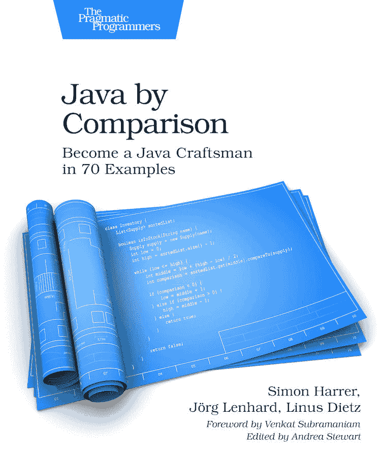

# Java 对比：70 个示例助你成为 Java 大师



版本：P1.0 (2018 年 3 月)

## 关于 Pragmatic Bookshelf

Pragmatic Bookshelf 是一家敏捷出版公司。我们在这里是因为希望改善开发者的生活。我们通过创建由程序员为程序员编写的及时、实用的著作来实现。

我们的 Pragmatic 课程、工作坊和其他产品可以帮助你和你的团队创建更好的软件并增加乐趣。有关更多信息以及最新的 Pragmatic 著作，请访问我们的 [`pragprog.com`](http://pragprog.com)。

我们的电子书不包含任何数字版权管理（DRM），并且一直都是无 DRM 的。我们开创了测试版书籍概念，即你可以在书籍编写期间购买并阅读，并向作者提供反馈，以帮助为所有人写出一本书。所有购买者的免费资源包括源代码下载（如适用）、勘误和讨论论坛，所有内容都可以在 `pragprog.com` 的书籍主页找到。我们在这里是为了让你的生活变得更轻松。

### 新书公告

想关注我们的最新著作、公告以及偶尔的特别优惠吗？只需在 [`pragprog.com`](https://pragprog.com) 上创建一个账户（只需一个电子邮件地址和一个密码）并勾选框框接收新闻邮件。你也可以在 Twitter 上通过 `@pragprog` 关注我们。

### 关于电子书格式

如果你直接从 [`pragprog.com`](https://pragprog.com) 购买，你可以以一个价格获得所有可用格式的电子书。你可以通过 Dropbox 在所有设备（包括 iPhone/iPad、Android、笔记本电脑等）之间同步你的电子书。在版本的有效期内，你可以获得免费更新。当然，当你需要时可以随时回来重新下载书籍。从 Amazon Kindle 商店购买的电子书受 Amazon 政策限制。Amazon 文件格式的限制可能会导致电子书在不同设备上的显示不同。更多信息，请参见我们在 [`pragprog.com/frequently-asked-questions/ebooks`](https://pragprog.com/frequently-asked-questions/ebooks) 中的常见。要了解更多关于本书的信息并访问免费资源，请访问书籍主页 [`pragprog.com/book/javacomp`](https://pragprog.com/book/javacomp)。

感谢你的持续支持，

Andy Hunt

The Pragmatic Programmers

本书的团队包括：Andy Hunt（出版）、Janet Furlow（运营副总裁）、Brian MacDonald（执行编辑）、Jacquelyn Carter（主管编辑）、Andrea Stewart（开发编辑）、Liz Welch（文字编辑）、Potomac Indexing, LLC（索引）、Gilson Graphics（排版）

如需客户支持，请联系 `support@pragprog.com`。

如需国际版权，请联系 `rights@pragprog.com`。

## 对比学习 Java 的早期评价

这是我自开始中级 Java 编程课程以来一直在等待的书。没有在基础知识上花费过多时间，`Java by Comparison` 引导你一步步获得对良好编码实践的新见解。具有启发性的示例对比了“要做”和“不应该”，让初学者轻松掌握要点。这本书大放异彩，显示了它是基于长期的课堂经验。幸运的是，这本书可以作为教科书阅读，也可以作为参考。我期待在课堂中使用它。你确定你的风格是完美的吗？买它吧！

| → | Guido Wirtz 博士 |
|  | 班贝格大学计算机科学教授/分布式系统组主管 |

我希望 `Java by Comparison` 在我开始编程时就在那里，它就像一个导师，站在你身后，耐心地帮助你将你的编程技能提升到下一个水平。

| → | Achim Weimert |
|  | wOndary LTD 首席官 |

`Java by Comparison` 对所有想要提升 Java 技能的人来说都是一本极佳的读物。它包含了 `Effective Java` 和 `Clean Code` 的精髓，并使用 `JUnit 5` 和 `Java 8` 更新。

| → | Johannes Schwalb |
|  | uniVersa Versicherungen Java 架构师 |

学生跨越初级和中级水平差距的权威指南。

| → | Oliver Kopp 博士 |
|  | 斯图加特大学博士后 |

`Java by Comparison` 是一部制作精良的快速读物，具有良好简洁的示例。强烈推荐给职业几年的 Java 开发者。

| → | Ashish Bhatia |
|  | 软件工程师 |

我认为 `Java by Comparison` 在提供有用内容和不刻意追求深度之间找到了平衡点。对于初级开发者来说，它比 `Effective Java`（最好的 Java 书）更容易读且更具直接应用性。经验丰富的开发者会对此点头表示认同，并可能在这一旅程中中学到一些东西。这将是开发者的必读之物。

| → | Sebastian Larsson |
|  | Cybercom Sweden 能力团队组长 |

要成为一名软件工艺师，你需要练习、练习、再练习。`Java by Comparison` 可以在这些练习过程中伴随你。通过对比的方法，从坏代码到更好的代码，它可以在你练习期间作为参考。

| → | Zulfikar Dharmawan |
|  | 软件工程师 |

`Java by Comparison` 展示了许多如何提高你的编码技能的示例，并作为初学者或中级程序员成为资深程序员的捷径。在某种意义上，这本书提供了一个低级版本的设计模式，关注代码结构而非高层构造体。

| → | Martin Blom 博士 |
|  | 卡尔尔斯塔德大学副教授 |

如果你想将 Java 知识提升一个台阶，`Java by Comparison` 是一本很棒的读物。我希望我在刚开始学 Java 时能读这本书或类似的书；它轻松地解释了许多我必须通过痛苦才能学会的内容。如果你想从一名优秀的程序员变成一名伟大的程序员，它是必读的。

| → | Ramaninder Singh Jhajj |
|  | Betsson Group 大数据工程师 |

`Java by Comparison` 组织严谨且充满示例，无论你是学生还是拥有多年经验的开发者，它都能帮助你。

| → | Emanuele Origgi |
|  | Funambol Inc. Android 软件工程师 |

对于任何语言，一旦你掌握了它的语法，下一步就是学习如何用惯用的方法使用它。无论你是刚开始学习 Java 的初学者，还是一个从其许多早期版本之一开始的资深 Java 开发者，我都认为 `Java by Comparison` 是成为精练使用 Java 的大一步。

| → | Stefan Tilkov |
|  | INNOQ 首席执行官 |

我们可以从观察他人身上学到很多。假设你和一位女性正走向同一栋建筑，你走在她后面几步远。当她进入建筑时，她暂时地为你扶着门。这就是她同理心和人性的表现。当她专注于前行时，她也关注着身后的人，并希望让你的旅程至少愉快一点。你们是完全的陌生人，可能永远不会再见面，但她展现了善意。

编程对许多人来说是一种热情，但它深度涉及到同理心和人性。

当我们编写代码时，身后总会有人。有时是几个小时、几天、几周或几个月后的我们自己。但通常是一位同事过来修改代码、修复错误、添加功能或扩展软件。让代码对那个人更容易维护，这不仅仅是一个善意的行为。这是专业素养的一部分，是实践技艺的一部分。

编写代码很容易。编写高质量的代码则需要努力、纪律和大量的练习。代码质量有许多不同的定义。以下是我的：

### 代码质量

代码的质量与理解它所需的努力投入成反比。

良好的代码是透明的。它让逻辑对读者来说一目易见，以便他们继续自己的工作。糟糕的代码是晦涩的，隐藏了逻辑。读者必须花费时间和精力和从编写得糟糕的代码中推断出细节。

当我们坐下来编写一个功能或特定的逻辑时，我们正深度专注于如何让它运行起来。编程是一系列微型实验和发现。我们经常需要设计解决方案和方法来解决眼下的问题。创建代码只是第一步。代码被编写一次，但会被阅读和演进多次。如果我们创建的代码质量很差，即使它看起来运行完美无缺，我们也随着时间的推移增加了该代码的拥有成本。

大多数被雇佣编写代码的程序员都能交付可运行的软件。普通程序员和优秀程序员之间的区别在于，让其他人遵循他们的工作变得有多容易。

编写高质量的代码是一项技能。与任何技能一样，为了获得和提高，我们必须做出主观努力，接受批评，并花时间学习。通过持续的努力，编写高质量的代码将成为本能，并开始显得毫不费力。这段旅程是艰辛的，但同时也是一次美妙的学习体验。这种学习的一部分可以来自阅读伟大的书籍，比如你即将开始阅读的这一本。

在我三十多年的编程生涯中，我犯过书中提到的大多数错误。如今，我花大量时间审阅学生以及行业专业人士编写的代码。我看到学生和专业人士都犯了许多相同的错误。当你读这本书时，你很快就会对自己可能已经犯过的错误产生共鸣。解决问题的第一步是意识到它。这本书的作者做了一个非常好的工作，引导我们识别每一段坏代码的异味（smells）、问题和后果。然后他们向我们展示了避免混乱的方法、如何编写高质量代码，以及我们从更好的质量中获得的益处。

我敦促不要急于读完这本书。有时我们必须慢下来才能获得速度。当你阅读这本书时，请花时间阅读每一段坏代码，并花些时间识别错误之处。把它们记录下来。然后阅读作者的解释。这将有助于更好地吸收，并帮助你培养对质量和风格的感悟。然后，在跳入阅读所给出的解决方案和推理之前，再次思考可能的解决方案。

编写代码是有趣的。编写更易理解和演进的代码是纯粹的享享。看到一本为了帮助有志的程序员成为受尊敬的专业人士的书，真的是一种荣幸。让 Simon、Jörg 和 Linus 成为你的向导——你处于可靠的人手中。

让我们编程变成一种美妙的技艺。

Venkat Subramaniam 博士

Agile Developer, Inc. 总裁 2018 年 3 月

Copyright © 2018, The Pragmatic Bookshelf.

## 致谢

一本书从最初的想法到印刷可能需要很长时间。这本书始于 2016 年欧洲杯锦标赛期间（欧洲足球锦赛）。当时，Simon 和 Linus 在班姆贝格大学教授一门名为“高级 Java 编程”的课程——这是一门由 Simon 和 Jörg 共同开发并教学了五年的课程。

随着学生人数的增加，对学生的编程作业代码质量提供详细的书面反馈变得非常艰巨。由于代码质量可能会变成一种执念，Simon 和 Linus 在看足球比赛时讨论了这个问题。显而易见，尽管他们很有才华，学生们仍然一遍又一遍犯着同样的错误。最终，这两个伙子想出了解决方案：一个常见问题集。他们不再反复解释问题，而是给每个错误起一个名字，提供一个简练的代码解决方案，并解释学生对此需要知道的所有信息。现在他们只需让学生参考这些项目，节省了大量时间，甚至提高了反馈的质量！

`Java by Comparison` 的想法诞生了，原本看电视足球赛的悠闲晚上很快变成了黑客活动和起草代码对比。最终，Simon 和 Linus 意识到这实际上可能成为一本有用的编程书，并邀请了 Jörg 加入。他们准备了一份提交给 Pragmatic Bookshelf 的草案提案，经过了提交、接受，然后真正的工作开始了……

如果没有许多人的贡献，这本书就不会有现在的面貌。首先，最重要的是，我们对 Guido Wirtz 教授表示感谢，感谢他在他的分布式系统小组将我们聚集在一起，并提供了一个支持的环境，让我们在其中成长（并完成博士学位），并使这样本书得以诞生。我们想感谢 Venkat Subramaniam，我们在课程中使用过他编写的优秀书籍，他为本书撰写了序言。

我们还感谢所有允许我们在章节开头添加他们的引言的人。特别感谢 David Heinemeier Hanson、Martin Fowler、Sean Parent、Steve McConnell、Phil Karlton、Alan J. Perlis、Dave Thomas、Andy Hunt、David Wheeler、Michael Feathers 和 Tom Cargill。

此外，许多人自愿阅读这本书，并在书的 Beta 阶段之前和期间提供了卓越的技术评审。他们指出了错误，提出了改进建议，并使这本书整体变得好得多。感谢 Cedric Röck、Oliver Kopp、Michael Träger、Jan Boockmann、Venkat Subramaniam（再次）、Matthias Geiger、Johannes Schwalb、Hendrick Cech、Klaus Stein、Ivo Balbaert、Al Scherer、Philipp Neugebauer、Emanuele Origgi、Ashish Bhatia、Zulfikar Dharmawan、Achim Weimert、Sebastian Larsson、Ramaninder Singh Jhajj、Martin Blom 和 Marcus Biel。

最后，我们要对 Pragmatic Bookshelf 的同事表示感谢。特别感谢我们的编辑 Andrea Stewart。感谢你的耐心，感谢无休止地将被动句改为主动语态，并帮助我们适应务实的写作风格。但在背后还有更多人让这本书变成了现实。非常感谢 Susannah Pfalzer、Jackie Carter、Katie Dvorak、Brian MacDonald 和 Andy Hunt！

Copyright © 2018, The Pragmatic Bookshelf.

如果你不能为你的模式提供一个有说服力的修改前后代码对比，你就是在卖药水。

David Heinemeier Hanson

## 欢迎！

我们同意 David Heinemeier Hanson 的观点。

如果你提出了一种编程技术，你应该尽可能简洁地证明你的提议比之前的方案更好。这种“前后对比”（before/after）的方法将所有事实都摆在了台面上：你可以直接将新代码与旧代码进行比较。只有这样，你才能对哪一个更好做出明智的决策。

在学习编程时也是如此。当你试图弄如何在 `Java` 中编写代码时，将良好的代码与坏代码进行对比非常有帮助。

我们曾在大学里教了六多年的编程。在几次课程后，总会有几个学生问我们：“我该如何进一步提高我的编码技能？”尽管这些学生在编程作业中表现优异，但我们给了他们一个标准的建议：“阅读专业人士的代码。”

老实说，我们的建议并没有很大帮助。开源软件世界有大量的代码，但很难判断从哪里开始。初学者会很快被现实项目中专业代码的复杂性所击倒。而且，你如何知道一段源代码实际上是高质量的呢？即使确实如此，一个只有几个月编程经验的人又如何将其与一个拙劣的临时方案（hack）区分开来呢？

这正是本书大显用场的地方。它是一本指南，引导你的阅读走向正确的方向。我们将帮助你通过对比坏代码和好代码，来学习如何编写良好的 `Java` 代码。请放心：多年来，我们见过了大量的坏代码和好代码，评审过学术界学生、工业界专业人士以及开源项目贡献者编写的代码。

这让我们回到了“前后对比”的方法。在本书中，我们将为你提供 70 组前后对比的代码片段。这些片段将帮助任何 `Java` 编程初学者提高水平。我们是在大学教授本科生 `Java` 的期间识别出这些片段的。它们基于我们在批改学生编程作业时遇到的代码。

我们在书中使用的方法很简单：给定一段代码片段，我们首先解释问题所在以及为什么。然后，我们将向你展示如何将代码转换为更好的解决方案。

## 谁应该读这本书

本书适合处于初级或中级水平的学习 `Java` 编程的人员。它也可以作为指导新开发者走上程序员之路的教师的课堂资源。在这里，我们为你提供了基于较新的 `Java 8` 语法的资源处理、函数式编程或测试的技巧和窍门。

你应该在学习了基础 `Java` 语法之后阅读这本书——在你能够编写带有条件和循环的小型程序，并了解面向对象编程基础知识之后。你应该能够编写出可以编译、运行并解决如 `FizzBuzz` 等小任务的代码。你应该能够实现简单的算法，并知道如何使用基本的数据结构，如 `list`、`queue`、`stack` 或 `map`。显然，在做所有这一切时，你应该乐在其中！

如果你在解决复杂问题时感到深深的满足感，那么这是一个极佳的开始。但当然，你也知道自己还有很多东西要学。当你反思自己的技能，并不得不承认自己在 `Java` 编程（甚至是通用编程）方面没有多少经验时，你就能从书中获得最大的收益。这意味着你可能还没有建立起对整洁代码以及经验丰富的开发人员所采用的最佳实践的直觉。

是时候改变现状了！

当然，如果你已经了解过更多关于 `Java` 代码质量、可读性、可维护性和整洁代码的高级书籍，例如《Effective Java》和《Clean Code》，那你已经走了很远的一步。尽管如此，你仍然可以在这里发现一些新东西。

### 使用本书教授整洁代码

如果你作为公司的高级开发人员向新手教授编程，你肯定意识到我们在书中将涵盖的一些最佳实践。根据你工作的内容，你可能对其中某些观点不同意。尽管如此，在培训初级开发人员时，这本书可以让你的工作变得更容易——只需将其作为参考。当你发现徒弟代码中存在问题时，指他们看这本书中对应的章节。你的学生可以针对你暗示的问题阅读一个简洁简单的示例，以及如何获得该问题的解决方案。至少，这为你节省了时间，因为你不需要自己写解释了。

我们在为二三级 `Java` 学习者开发教学理念的经验，对学术界的教学也有帮助。这本书是我们结合了十五多年在高级课程中教授本科生 `Java` 并侧重代码质量的知识的结晶。它可能不会从零开始教 `Java`，但它可以配合几乎任何涉及编程任务的课程。特别是，正如我们在工作坊论文《Teaching Clean Code》中所描述，你可以在评估学生代码时将其作为参考。

### 你准备好了吗？尝试自测

如果你是一个新程序员，我们建议你进行简短的自测，看看你是否准备好学习书中的内容：`FizzBuzz 测试`。有些雇主在工作面试中使用这个测试来确定申请人是否会编程。任务如下：


> 编写一个 Java 程序，在控制台上打印 1 到 100 的数字。但对于三的倍数，打印 Fizz 而不是数字；对于五的倍数，打印 Buzz。对于三和五的公倍数，打印 FizzBuzz。

为了让测试更有趣，我们将稍微扩展一下，确保你能够应用面向对象，并使用类和接口。你应该在一个名为`ConsoleBasedFizzBuzz`的类中实现`FizzBuzz`算法，该类实现了`FizzBuzz`接口。该接口提供了一个接受第一个和最后一个数字作为参数的方法。在另一个`Main`类的主方法中，你应该使用`FizzBuzz`接口及其`ConsoleBasedFizzBuzz`实现从 1 计数到从控制台传递的值。在这里，你将在简短的模板中看到结构。

```java
interface FizzBuzz {
    void print(int from, int to);
}

class ConsoleBasedFizzBuzz implements FizzBuzz {
    // TODO implement FizzBuzz interface
}

class Main {
    // TODO use a main method
    // TODO print fizz buzz from 1 to max
    // TODO max is passed from the console
}
```

你应该能在大约 15 分钟内完成这个练习。我们列出的链接之一也包含了 FizzBuzz 挑战的解决方案，你可以与自己的答案进行对比。如果你能做到，那么你就准备好从书中获得最大的收益了。如果没做到，别担心！继续读下去。你可能需要花多一点时间，理解这里的某些对比可能会有些困难。但如果你通过解决像书中这样的这类练习来练习编程，你会很快进入正轨。

网络上有许多优秀的资源可以用来练习编程技能并对你的代码获取反馈。看一眼`codewars.com`或`cyber-dojo`。这些页面可以让你在不同难度级别训练你的编程技能。如果你有数学背景，你会发现解决`Project Euler`的问题非常有吸引力。

另一方面，如果你觉得`FizzBuzz`测试简单得离谱，而且你的解决方案在几秒钟内编译并运行，请注意，你可能已经掌握了我们在书中列出的一些实践方法。当然，你仍然可以从中获益。我们已经让所有的对比都是自包含包含的。所以，请随意翻阅查阅，跳过你已经熟悉的部分。

# 为什么要读这本书？

每位开发者在心中都有若干要求，他们认为这些要求是编写良好或整洁代码的前提。只要一段代码没有违反这些任何一项要求，从开发者的角度来看，它就是良好或整洁的。不同人的要求不同。而且，编程语言自然也不同。但尽管如此，对于一种特定的语言，通常有一组“核心”要求和最佳实践。这些是开发者社区认可并接受的方面，即使它们没有被明确地写下来。在本书中，我们正试图为你——一个可能还不知道 Java 社区中许多实践方法的人——提供一套 Java 整洁代码的最佳实践。

作为一个初学者，你对良好 Java 代码的要求列表可能像这样短：

* 代码必须能够编译。
* 输出必须正确。

这些项目关乎你程序的功能正确性，但它们并没有告诉你太多关于代码质量的知识。一位经验程序员关心的比这多得多，她的清单要长得多。她只需要扫一眼代码就能检测出缺陷、糟糕的命名、难以测试的方法、不一致之处、糟糕的实践等等。

本书的目标是训练你的大脑，使以内化更多的清单项，帮助你通往成为丰富且专业的程序员的道路。书中的每一项都代表了这样一个清单项。

## 本书中使用的惯例

在整本书中，我们使用一种特定的结构来解释每一个清单项。我们称之为“对比”，并忠诚地坚持它。

每个对比都有一个引朗上口的名字。这有助于你将其记住并放入你的心理清单中。看看目录——它就是本书书的清单。对比的名称让你更容易与他人讨论你所读的内容。我们命名对比的方式鼓励你将它们视为一种建议。你也可以在对比名称前面加上“你应该”——例如：你应该避免不必要的对比。对于接下来的示例，我们选择了引朗上口的名字“永远不要信任你的输入”。

紧接名称之后，我们将展示一段代码片段并突出其中的一个问题。这可以是一个几行的代码块，也可以只是单行，如下所示：

```java
class HelloWorld {
    public static void main(String[] args) {
        System.out.println("Hello " + args[0]);
    }
}
```

在这些代码片段中，我们尽可能减少对你的干扰。这就是为什么我们必须稍微缩短代码以获取核心：

1. 我们省略了`import`语句和包声明。当然，可下载的代码包含了这些声明——否则它将无法编译。
2. 我们避免使用可见性修饰符，如`public`或`private`，除非它们被显式要求。

在代码片段之后，我们会向你解释问题所在。在此过程中，我们提供了进一步阅读的引用，例如 JavaDoc、相关项目或网页。

然后，我们向你展示解决方案的代码，并突出特定于解决方案的部分。

```java
class HelloWorld {
    public static void main(String[] arguments) {
        if (isEmpty(arguments)) {
            return;
        }
        System.out.println("Hello " + arguments[0]);
    }

    private static boolean isEmpty(String[] array) {
        return (array == null) || (array.length == 0);
    }
}
```

有时，问题代码和解决方案之间的区别非常小。有时，区别又很大。无论如何，片段本身就应该已经教你一些东西——一种帮助你产生更好代码的风格。我们刻意将每个对比保持在两页。左侧（或第一页）显示问题，右侧（或第二页）显示解决方案。这样，你就可以一直比较两个代码片段，而无需来回翻页。这让一切变得容易得多

### 我为什么应该学习这个？我有静态分析工具了

你可能会想，已经有了静态分析工具，例如`Checkstyle`、`FindBugs`、`SpotBugs`、`Error Prone`和`PMD`，它们可以检测代码中的缺陷。那么为什么要学习这些呢？

对于某些人来说确实如此，但对于书中的所有问题并非如此。我们希望看到一种能够自动且正确评估这些关注点的工具。现有的工具是好的，但它们并不完美。把它们想象成严谨、不妥协、挑剔的机器人，它们学习了一套规则并寻找任何违反行为。它们无法理解有时你必须违反规则来改进代码。要成功使用它们，需要对其进行精调，这需要对代码质量和当前项目有深入的了解。即便如此，它们也永远比不过经验丰富的程序员，尽管它们可以帮助避免忽略一些问题。

这是一个好消息，因为这意味着作为经验丰富的程序员，你的技能将大受需要。工具可以检查很多事情，但它们往往缺乏对为何检测某些内容的详细解释。而且它们很少展示如何解决特定问题。通常，解决方案对于工具的警告并不显而易见，代码很少自动修复，过程很容易出错——尤其是当你还在学习 Java 的时候。作为一个新手程序员，工具无法引导你做出合理的修正。这就是本书可以帮助你的地方。

## 如何阅读这本书

如果你是 Java 第一一年，我们建议你从头到尾读这本书。它从相当基础的对比开始，然后转向更具挑战性的主题，如测试、面向对象设计和 Java 函数式编程。如果你更有经验，可能可以跳过前两章，直接进入更专门的主题。

以下是简要大纲：

* 在第一章 *开始清理* 中，我们将提供关于如何编写正确、易读且易理解的代码的通用建议。我们将涉及许多与基础 Java 语法相关的内容，例如条件和大括号。
* 在第 2 章提升你的代码风格中，我们将讨论更多进阶的编码概念和问题，例如迭代、格式化以及使用 Java API。
* 第 3 章明智使用注释关于如何良好记录代码。我们将提供一些关于如何编写注释以及何时应该删除注释的建议。
* 在第 4 章命命名要正确将让你意识到应该如何处理 Java 异常异常。
* 第 6 章确保万无一失概述了面向对象的设计原则。
* 第 8 章让数据流起来侧重于使用 lambda 表达式进行 Java 函数式编程。
* 最后，第 9 章为现实世界做好准备将引导你获取关于在现实世界构建、发布和维护软件的大量材料。

所以让我们继续前进，享受其中吧！

## 在线资源

本书在`www.pragprog.com`有其自己的网页。[[14]](#part0011.html_FOOTNOTE-14) 在那里，你可以在讨论论坛与我们联系，^([[15]](#part0011.html_FOOTNOTE-15))，发布勘误，^([[16]](#part0011.html_FOOTNOTE-16)) 或下载本书的源代码^([[17]](#part0011.html_FOOTNOTE-17))。

## 为你的火星之旅做好准备

作为一名初级或中级程序员，获得一种让他人认可的良好且整洁代码感感，对你来说似乎是一个遥不可及的目标，一个几乎无法实现的梦想——一段充满意料之外的问题和未知体验的长漫旅程。这有点就像穿越太空前往一个人类尚未到达的目的地：通往火星的之旅！我们多年前开始学习编程时的感觉正是如此。

我们在书中编写代码时是以“火星任务”为主题编写的，因此所有的代码示例都带有太空色彩。但真正的原因是我们不希望代码背景分散你对代码片段本身问题的注意力。我们使用航员主题是为了为你提供更好的阅读体验，避免像`x`和`y`这样无意义的变量名，或者从动物到哺乳动物再到猫的数不清的继承体系。（我们对猫并没有意见——我们只是觉得它们在教学材料中被过度使用了。）

我们的比较是基于我们发现的初级或中级程序员在学习编程时经常遇到的代码和编码问题。我们提取了这些底层问题，并将它们置于太空旅行领域，以便更容易想象它们周围的上下文。

我们无法保证你在读完这本书后会成为一名航员，但我们非常有信心你会成为一名更好的程序员。所以系好安全带，向着（程序员的）太空进！

### 脚注

[[1]](#part0007.html_FNPTR-1)

我们知道 Oracle 已经发布了 Java 9。请放心，书中的内容在 Java 9 中仍然有效。

[[2]](#part0007.html_FNPTR-2)

[`c2.com/cgi/wiki?FizzBuzzTest`](http://c2.com/cgi/wiki?FizzBuzzTest)

[[3]](#part0007.html_FNPTR-3)

[`imranontech.com/2007/01/24/using-fizzbuzz-to-find-developers-who-grok-coding/`](https://imranontech.com/2007/01/24/using-fizzbuzz-to-find-developers-who-grok-coding/)

[[4]](#part0007.html_FNPTR-4)

[`www.codewars.com/?language=java`](https://www.codewars.com/?language=java)

[[5]](#part0007.html_FNPTR-5)

[`cyber-dojo.org/`](http://cyber-dojo.org/)

[[6]](#part0007.html_FNPTR-6)

[`projecteuler.net`](https://projecteuler.net)

[[7]](#part0008.html_FNPTR-7)

[`pragprog.com/titles/javacomp/source_code`](https://pragprog.com/titles/javacomp/source_code)

[[8]](#part0008.html_FNPTR-8)

[`checkstyle.sourceforge.net/`](http://checkstyle.sourceforge.net/)

[[9]](#part0008.html_FNPTR-9)

[`findbugs.sourceforge.net/`](http://findbugs.sourceforge.net/)

[[10]](#part0008.html_FNPTR-10)

[`github.com/spotbugs/spotbugs`](https://github.com/spotbugs/spotbugs)

[[11]](#part0008.html_FNPTR-11)

[`errorprone.info/`](http://errorprone.info/)

[[12]](#part0008.html_FNPTR-12)

[`pmd.github.io/`](https://pmd.github.io/)

[[13]](#part0008.html_FNPTR-13)

记住：拿着工具的傻瓜仍然是傻瓜！

[[14]](#part0010.html_FOOTNOTE-14)

[[15]](#part0011.html_FOOTNOTE-15)

[[16]](#part0011.html_FOOTNOTE-16)

[[17]](#part0011.html_FOOTNOTE-17)

你最初学习编写的逻辑条件可能由整数和比较运算符组成，初学者可能会用同样的方式用布尔值来实现条件。但这些比较完全没有必要——它们就像是你代码中的噪音。

在这里你可以看到一个`Laboratory`组件的代码，它通过两个嵌套的`if-else`块根据条件对`Sample`进行分析。

这段代码显式地将布尔返回值与布尔原始类型（`true`和`false`）进行比较。这是你可以在初学者编写的代码中经常看到的反模式。

如果你用布尔类型以外的数据类型构建逻辑条件（例如整数），你需要将它们与实际值进行比较（例如`myNumber == 25`、`input > 0`）。但对于布尔变量或返回类型，你不需要这样做。

相反，你已经有了可以操作的布尔表达式。没有必要将它们与布尔原始值进行比较。这些比较会让代码变得杂乱，并使阅读变得稍微困难。

大多数情况下，你会发现去掉此类不必要的比较是非常简单的。这不仅减少了代码量，而且读起来也更轻松。

现在来看看没有了这些比较后，代码是多么直观。

```java
class Laboratory {
  Microscope microscope;

  Result analyze(Sample sample) {
    if (microscope.isInorganic(sample)) {
      return Result.INORGANIC;
    } else {
      return analyzeOrganic(sample);
    }
  }

  private Result analyzeOrganic(Sample sample) {
    if (!microscope.isHumanoid(sample)) {
      return Result.ALIEN;
    } else {
      return Result.HUMANOID;
    }
  }
}
```

在这里，我们移除了对布尔原始值的比较。在`laboratory.isHumanoid(sample)`的情况下，我们必须对表达式取反以保留语义。除此之外，代码保持不变。你现在可以更轻松地阅读条件表达式了。

任何编译器都会开箱即用此类删除。在实际执行方面，这两个代码片段可能没有区别。这里的收益完全在于代码的可读性。这只是某些简单代码中的微小修复，但想象一下你正在处理一个大型代码库——可读性的每一个微小改进都有帮助！

考虑到避免否定，你可以进一步改进条件。请继续读下去吧！

## 方法多次返回 vs. 单次返回

开发者投入了无数小时（读：浪费了小时）来讨论在方法内部使用单个返回语句还是多个返回语句更好。这没有绝对的对错。每个`return`语句都标记了方法的出口点。单一出口点使得控制流更加结构化；你始终知道它将结束。但有时你想提前退出方法——例如，当输入参数无效时。在这里，我们使用多次返回是因为它需要的代码行更少——书的空间总是有限的。在你的代码中，尝试看看是否需要提前退出，如果需要，使用多次返回。

## 避免否定

```java
class Laboratory {
  Microscope microscope;

  Result analyze(Sample sample) {
    if (microscope.isInorganic(sample)) {
      return Result.INORGANIC;
    } else {
      return analyzeOrganic(sample);
    }
  }

  private Result analyzeOrganic(Sample sample) {
    if (!microscope.isHumanoid(sample)) {
      return Result.ALIEN;
    } else {
      return Result.HUMANOID;
    }
  }
}
```

是否有人告诉过你“积极思考”？事实证明，代码中的积极表达式比否定性表达式更好，因为它们通常更容易理解，且占据的空间略小。

这里显示的问题代码是`Laboratory`组件的另一个变体。它提供了两个接收`Sample`并返回`Result`的方法。代码本身没有明显的错误。它能实现目的，但它比需要的更复杂。

考虑一下`if`语句的条件：两者都表达了一个否定条件。第一个测试样本是否`isInorganic()`。第二个甚至使用了用于否定的布尔逻辑运算符：感叹号`!`。

在绝大多数情况下，当你阅读代码时，你会发现理解积极表达式更容易。否定表达式增加了一层额外的间接层。与其简单地理解“X 适用”，你必须理解一个额外的标记：“X 不适用”。

这个额外的标记通常是不必要的。尽管这看起来像是一个微小的变化，但每一个细微的简化对于更复杂的表达式（那些你在实际代码中看到的表达式）都有帮助。


记住：每个人都喜欢没有否定。

现在看看这个简化版本：

```java
class Laboratory {
  Microscope microscope;

  Result analyze(Sample sample) {
    if (microscope.isOrganic(sample)) {
      return analyzeOrganic(sample);
    } else {
      return Result.INORGANIC;
    }
  }

  private Result analyzeOrganic(Sample sample) {
    if (microscope.isHumanoid(sample)) {
      return Result.HUMANOID;
    } else {
      return Result.ALIEN;
    }
  }
}
```

我们只修改了代码，但这已经产生了影响。我们没有调用`isInorganic()`，而是调用了`isOrganic()`，它使用了积极的措辞而不是否定的。这意味着，我们必须交换`if`块的体内容。

到第二部分，我们调用了相同的方法`isHumanoid()`，但我们消除了否定。这是代码的真正简化。

总而言之，这些变动非常简单，你可能会想：为什么要费这个劲？你应该费这个劲，因为它们提高了代码的可理解性，而且几乎没有成本。你通常不需要添加额外的代码行。

然而，有时你需要适当的方法，例如在这里使用`isOrganic()`而不是`isInorganic()`。如果你调用的代码来自第三方库，你可能没有选择调用不同方法。但当你控制它时，不要犹豫要向相应的类添加该方法——这几行代码是值得的，因为它们会让你的代码在其他地方更清晰。根据我们的经验，最好消除否定的方法。

## 直接返回布尔表达式

```java
class Astronaut {
  String name;
  int missions;

  boolean isValid() {
    if (missions < 0 || name == null || name.trim().isEmpty()) {
      return false;
    } else {
      return true;
    }
  }
}
```

此外，它不应为空，因为每位航天员应该有一个真实的姓名。`name.trim()`调用会移除各种前导或尾空格字符，例如空格或制表符。如果在调用`trim()`之后还有剩余，那么它将是一个真实的字符序列。

代码中没有功能性错误。正如常见的情况，问题在于代码比需要的更复杂，可读性更差。准确地说，`if`语句完全没有必要。它是冗余代码，只会分散对实际语义的注意力。

让我们来看看能做些什么！关键在于我们方法的返回类型：`boolean`。正因如此，我们不需要将一切都封装在`if`语句中——我们可以直接返回值，如下：

```java
class Astronaut {
    String name;
    int missions;

    boolean isValid() {
        return missions >= 0 && name != null && !name.trim().isEmpty();
    }
}
```

这一更改消除了了一层缩进和分支。现在该方法非常简洁，且更容易阅读！

我们将五行的`if`语句压缩成了单行代码。为了保持相同的语义，我们对条件应用了布尔算术。本质上，我们应用了德·摩根定律并对条件进行了否定。这里是这些著名定律的快速定义，你会经常需要它们：

```java
!A && !B == !(A || B) // true
!A || !B == !(A && B) // true
```

有时条件会比这个更复杂。如果是这样，你应该考虑将其拆分为更小的部分。我们的建议是使用具有意义名称变量来捕获条件的部分。考虑以下示例：

```java
boolean isValid() {
    boolean isValidMissions = missions >= 0;
    boolean isValidName = name != null && !name.trim().isEmpty();
    return isValidMissions && isValidName;
}
```

作为一个经验法则，如果你组合了两个以上不同的条件，应该考虑这种简化。如果你在其他地方需要条件的部分，考虑将它们放入单独的方法中，正如*简化布尔表达式*中所解释的。

注意，此处的解决方案仅适用于`boolean`返回类型。

## 简化布尔表达式

```java
class SpaceShip {
    Crew crew;
    FuelTank fuelTank;
    Hull hull;
    Navigator navigator;
    OxygenTank oxygenTank;

    boolean willCrewSurvive() {
        return hull.holes == 0 &&
               fuelTank.fuel >= navigator.requiredFuelToEarth() &&
               oxygenTank.lastsFor(crew.size) > navigator.timeToEarth();
    }
}
```

组合了多个条件的布尔表达式通常难以理解且容易出错。但你可以通过一些简单的技巧让它们变得更容易理解。

与之前的比较一样，你可以看到一个验证方法的示例。该条件比上一个更复杂，但根据*直接返回布尔表达式*，它已经压缩在单个返回语句中。

条件的庞尺寸使得它难以理解。它跨越了多行代码，并结合了来自五个不同对象的检查。由于其规模很大，当你需要更改它的部分时，很容易引入故障。但在更改它之前，你可能就会花费宝贵的编程时间来理解它的含义。

当你必须将几个条件组合进单个检查中时，最好以某种方式对它们进行分组。良好的分组取决于条件的语义，你可以尝试按主题或抽象级别进行分组。

在方法内部，你应该组合处于相似抽象层的语句。理想情况下，高层方法应该调用下一低层级的方法。

### 括号也有帮助

布尔条件可能会变得棘手，特别是当它们缺少括号时。许多开发者（我们也是其中一员）并没有内化布尔运算符的优先级，必须思考一下才能确定`x && y || z`是指`(x && y) || z`还是`x && (x || z)`。或者你不知道`&&`始终在`||`之前求值？

在这里，`willCrewSurvive()`方法在同一个条件中验证了每个底层细节。你能想出一个中间的抽象层吗？比如这样：

```java
class SpaceShip {
    Crew crew;
    FuelTank fuelTank;
    Hull hull;
    Navigator navigator;
    OxygenTank oxygenTank;

    boolean willCrewSurvive() {
        boolean hasEnoughResources = hasEnoughFuel() && hasEnoughOxygen();
        return hull.isIntact() && hasEnoughResources;
    }

    private boolean hasEnoughOxygen() {
        return oxygenTank.lastsFor(crew.size) > navigator.timeToEarth();
    }

    private boolean hasEnoughFuel() {
        return fuelTank.fuel >= navigator.requiredFuelToEarth();
    }
}
```

哇，这里发生了很大变化！`willCrewSurvive()`方法仍然存在，但现在它调用了其他方法并聚合了它们的返回值。

首先，我们添加了一个变量按主题将相似方面结合在一起：消耗性资源。我们还给它一个有意义的名字`hasEnoughResources`。该变量结合了两个方法调用的结果`hasEnoughOxygen()`和`hasEnoughFuel()`。你将在这两个方法内部找到条件的实际细节。

接下来，我们将变量`hasEnoughResources`与原始条件的最后部分`hull.holes == 0`结合。然而，我们使用了`Hull`类中的方法`hull.isIntact()`。它已经有一个有意义的名字，所以没有理由将其存储在另一个布尔变量中。

虽然现在代码更多了，但我们提高了代码的可理解性。你不再需要一次理解整个条件。得益于分组，你可以逐步进行。此外，变量和方法的名称表达了预期的结果。每个方法本身都是简单且一目了然的。

## 在条件中避免空指针

```java
class Logbook {
    void writeMessage(String message, Path location) throws IOException {
        if (Files.isDirectory(location)) {
            throw new IllegalArgumentException("路径无效!");
        }
        if (message.trim().equals("") || message == null) {
            throw new IllegalArgumentException("消息无效!");
        }
        String entry = LocalDate.now() + ": " + message;
        Files.write(location, Collections.singletonList(entry),
                   StandardCharsets.UTF_8, StandardOpenOption.CREATE,
                   StandardOpenOption.APPEND);
    }
}
```

该方法的当前版本已经执行了一些验证。遗憾的是，它有两个严重的问题。首先，该方法没有正确地检查空引用。如果`location`为`null`，则调用`Files.isDirectory()`将失败并抛出一个未记录的`NullPointerException`。第二种情况也是如此，如果`message`为`null`，因为我们先检查了`message.equals("")`，会导致报错。

在验证参数时，必须注意顺序：首先检查`null`，然后才检查特定领域的“非法”值。我们建议你先检查空字符串或空列表等常见的默认值，然后再进行更具体的检查。

将`null`作为参数传递给方法是一种非常糟糕的写法——这意味着该方法在没有此参数的情况下也可以运行。如果确实如此，请将方法重构为两个：一个带参数，另一个不带参数。请注意，参数为`null`通常意味着调用方存在编程错误。

以下是正确的验证方式示例。

```java
class Logbook {
    void writeMessage(String message, Path location) throws IOException {
        if (message == null || message.trim().isEmpty()) {
            throw new IllegalArgumentException("The message is invalid!");
        }
        if (location == null || Files.isDirectory(location)) {
            throw new IllegalArgumentException("The path is invalid!");
        }
        String entry = LocalDate.now() + ": " + message;
        Files.write(location, Collections.singletonList(entry),
            StandardCharsets.UTF_8, StandardOpenOption.CREATE,
            StandardOpenOption.APPEND);
    }
}
```

我们已经在新版本中解决了所有问题：首先，我们检查所有参数是否为`null`。之后，我们检查特定领域的限制。

此外，我们更改了检查的顺序，以反映方法签名中参数的顺序。这是一个良好的做法，因为合理安排参数验证的顺序可以提高阅读流畅性。你也不可能忘记验证其中一个参数。最后，我们使用了一个内置方法来检查`String`是否为空。

你可能会问自己：这种级别的参数验证总是必要的吗？并不是。

根据经验法则，对于`public`、`protected`和默认（`default`）权限的方法，你需要进行参数验证。这是因为代码的任何部分都可以访问它们，而你可能无法控制访问是如何发生的。

相比之下，当你构建`private`方法时，你可以确保永远不会向它们传递`null`。因此，在这种情况下，你不需要进行大量的验证。

### 文件打开选项

你可能好奇这些`StandardOpenOptions`意味着什么。它们指定了`Files.write()`方法的行为。这些名称非常直观易懂，但你应该意识到你可以组合使用它们。

这是很有用的，因为如果同时也设置了`CREATE`标志，我们就不需要担心我们想要`APPEND`（追加）的文件是否在文件系统中已经存在了。

## 避免 switch 贯穿透（Switch Fallthrough）

```java
class BoardComputer {
    CruiseControl cruiseControl;

    void authorize(User user) {
        Objects.requireNonNull(user);
        switch (user.getRank()) {
            case UNKNOWN:
                cruiseControl.logUnauthorizedAccessAttempt();
            case ASTRONAUT:
                cruiseControl.grantAccess(user);
                break;
            case COMMANDER:
                cruiseControl.grantAccess(user);
                cruiseControl.grantAdminAccess(user);
                break;
        }
    }
}
```

某些编程语言构造因为多年来引起的所有 bug 而臭名昭著。其中之一就是`switch`，在你在使用它时应该小心。

你在这里看到的`authorizeUser()`方法验证了它的参数并检查了空引用。它使用了`Objects.requireNonNull()`，这是 Java API 中一个实用的参数验证方法，在输入为`null`时会触发异常。但`authorizeUser()`仍然包含一个经典的 bug：switch 贯穿透（fallthrough）。

bug 出在`switch`语句的第一个`case`中。在`case`结束没有`break`语句。这意味着`switch`会继续执行到下一个`case`——它会向下贯穿并始终执行`cruiseControl.grantAccess()`。

`switch`语句因这种行为臭名昭著。它会一直持续执行直到遇到`break`语句或块结束。你在任何 C 风格语言中都能找到`switch`的这种执行语义。此外，Java 是从 C 继承了这一点。

`switch`之所以这样是因为它允许你编写更紧凑、字符更少的代码，通过这种方式你可以避免评估几个条件表达式。而且从 Java 7 开始，`switch`语句不仅支持整数和枚举，还支持字符串。

看一看无 bug 的版本：

```java
class BoardComputer {
    CruiseControl cruiseControl;

    void authorize(User user) {
        Objects.requireNonNull(user);
        switch (user.getRank()) {
            case UNKNOWN:
                cruiseControl.logUnauthorizedAccessAttempt();
                break;
            case ASTRONAUT:
                cruiseControl.grantAccess(user);
                break;
            case COMMANDER:
                cruiseControl.grantAccess(user);
                cruiseControl.grantAdminAccess(user);
                break;
        }
    }
}
```

修复这种无意的 switch 贯穿透很容易：确保每个`case`结束都有一个`break`语句。我们在代码示例中已经做到了。现在代码没有 bug 了——但`switch`在这里真的是完美的选择吗？不！！


在示例中，`switch` 混合了本该分开的关注点：它将未授权访问和授权访问合并到了一个代码块中。

根据经验法则，你应该将不同的关注点放在不同的代码块中。首先，这样做会让代码更具可读性。其次，发生像 switch 贯穿透这种意外 bug 的概率更小。

你会很难用 `switch` 实现这种关注点的分离。这就是为什么我们倾向于使用 `if` 语句。但即使在那里，正如你在下一节中看到的，switch 贯穿透仍然可能困扰我们。

如果增加了另一个等级怎么办？你需要调整这个条件，但这很容易被忘记。代码会继续运行，你甚至不会注意到漏掉了什么！这就是为什么你应该始终有一个捕获未编码值的回退分支。`switch` 语句通过 `default` 分支内置了这一点。或者，你也可以抛出一个 `AssertionError` 以万无一失。

### 始终使用大括号

```java
class BoardComputer {
    CruiseControl cruiseControl;

    void authorize(User user) {
        Objects.requireNonNull(user);
        if (user.isUnknown()) {
            cruiseControl.logUnauthorizedAccessAttempt();
        }
        if (user.isAstronaut()) {
            cruiseControl.grantAccess(user);
        }
        if (user.isCommander()) {
            cruiseControl.grantAccess(user);
            cruiseControl.grantAdminAccess(user);
        }
    }
}
```

在这里，我们将上一个比较中的 `switch` 语句转换为了独立的 `if` 语句。但这里有一个问题：代码段中的缩进极具误导性。由于 `if` 之后没有大括号，因此条件仅适用于随后的那行。这导致整个方法的行为变得非常糟糕——`cruiseControl.grantAdminAccess(user);` 这一行始终会被执行，并向任何用户授予管理员权限！真是一团糟。

这个问题的根源不在于缩进，而是缺少定义作用域的大括号。本质上，这是我们在 *避免 Switch 穿透* 中见过的 `switch` 穿透（fallthrough）的一种变体。

如果你已经意识到 `switch` 存在这个问题，在处理 `if` 时可能仍然会忽视它。即使你缩进正确，也无法保证在截止日期前那个总是忙碌的冲刺阶段，有人能发现这个 Bug。这就是为什么我们建议大家始终使用大括号。

### 右侧的内容并不总是完美的

实现整洁的代码很难。正如你可能已经注意到的，我们有时会在两次或多次比较的过程中迭代地改进代码。我们的目标是一次改进一个点，有时会忽略其他代码质量标准，以保持对当前主题的关注。在阅读右页的解决方案时请记住。通常情况下，还有更多可以改进的地方。

看看修正后的版本。

```java
class BoardComputer {
    CruiseControl cruiseControl;

    void authorize(User user) {
        Objects.requireNonNull(user);
        if (user.isUnknown()) {
            cruiseControl.logUnauthorizedAccessAttempt();
        }
        if (user.isAstronaut()) {
            cruiseControl.grantAccess(user);
        }
        if (user.isCommander()) {
            cruiseControl.grantAccess(user);
        }
        cruiseControl.grantAdminAccess(user); // 安全威胁
    }
}
```

在这里，我们按照编译器处理代码的方式添加了大括号。你可以很容易地发现错误：没有条件保护对 `grantAdminAccess()` 的调用。得益于大括号，代码现在变得更易读了。即使时间紧迫，别人也更有可能发现这个关键 Bug。

现在添加新行代码也安全了。之前，你可能会忽略没有大括号这一事实，并在其中一个块中添加一行代码。

误导性的缩进导致了我们示例中的 Bug。这是危险的，尤其是因为它结合了“字符越少代码越好”的错误思维。记住：代码并非越少越好——代码可读性越高越好！

你可能会认为这种错误是不现实的，在安全关键型代码中几乎不会发生。历史事实并非如此；2014 年，Apple 工程师在实现 iOS 的 SSL/TLS 协议时曾有一个非常类似的 Bug。^[19] 利用该漏洞的攻击者可以监听 Apple 设备的任何安全连接。可怕，不是吗？

习惯性地使用大括号是防止穿透 Bug 的良好防御，正如始终使用 IDE 的自动缩进一样。但解决这个问题的方案还不完美，因为它违反了 *快速失败* 和 *确保代码对称*。请务必继续阅读！

### 确保代码对称

```java
class BoardComputer {
    CruiseControl cruiseControl;

    void authorize(User user) {
        Objects.requireNonNull(user);
        if (user.isUnknown()) {
            cruiseControl.logUnauthorizedAccessAttempt();
        } else if (user.isAstronaut()) {
            cruiseControl.grantAccess(user);
        } else if (user.isCommander()) {
            cruiseControl.grantAccess(user);
            cruiseControl.grantAdminAccess(user);
        }
    }
}
```

我们已经强调过几次，可读性对于你的代码至关重要。通过对称的方式构建你的条件分支，你将使代码更容易理解和掌握。未来任何维护此类代码的人（很有可能是你）都能更快地定位功能，并更容易发现 Bug。

这是对你在 *避免 Switch 穿透* 和 *始终使用大括号* 中看到的代码的另一种修改。我们将不同的条件合并到了一个 `if` 语句中。

代码中的不对称性源于我们将授权代码与非授权代码混合在了一起。如果我们将它们分离到不同的代码块中，就可以提高代码的对称性。

每个部分通过单独的 `if` 语句封装不同类型的访问权限。这并不多。本质上，问题在于缺乏对称性。看看 Kent Beck 的这个定义^[20]：“几乎相同的事情可以分为不同的部分。”思考一下：所有的分支都在表达相似的问题吗？换句话说，所有分支真的是对称的吗？答案是：并不真正。在第一个分支中，访问被拒绝；在第二个和三个分支中，访问被允许。这并不对称。

那么，对称的版本看起来是什么样呢？

```java
class BoardComputer {
    CruiseControl cruiseControl;

    void authorize(User user) {
        Objects.requireNonNull(user);
        if (user.isUnknown()) {
            cruiseControl.logUnauthorizedAccessAttempt();
            return;
        }

        if (user.isAstronaut()) {
            cruiseControl.grantAccess(user);
        } else if (user.isCommander()) {
            cruiseControl.grantAccess(user);
            cruiseControl.grantAdminAccess(user);
        }
    }
}
```

## 你学到了什么？

所以你已经读完了第一组比较并来到了这一页。首先，感谢！我们很高兴你能坚持到这里。你已经学习了许多关于一个重要的话题：编写可读的代码。维护现有代码是我们现在投入大部分精力的事情，你很少会从零开始一个项目。大多数时候，你的老板会扔给你一大堆巨大的代码，让你你去修复和扩展它们。

当这种情况发生时，如果你写代码的人关注可读性，你将会感激不尽。所以，请对你的程序员同事友好，并努力代码的可读性！而且，你永远不知道；即使你认为自己完成了一个项目，老板也可能重新分配任务，然后你的代码就会又回来找扰你。

这就是我们向你展示如何避免不必要的代码的原因。你学习了如何简化布尔表达式，并将避开许多由于代码可读性差导致的错误，例如 `switch` 穿透（fallthrough）。

你现在能做的最好的事情就是尝试你读过的那些内容。拿你很久前写的一段代码来看一看。你能应用这里读到的某些建议吗？重构后你的代码看起来变成什么了？务必保留原始版本的副本，以便与改进后的版本进行比较。毕竟，这就是这本书的主题！

当你准备好后，请翻到下一章。我们将深入探讨代码可读性和理解性的主题，并提供关于代码风格和 Java API 使用的更多高级建议。所以，请务必继续阅读！

### 脚注

[[18]](#part0015.html_FNPTR-18)

[`en.wikipedia.org/wiki/De_Morgan%27s_laws`](https://en.wikipedia.org/wiki/De_Morgan%27s_laws)

[[19]](#part0019.html_FNPTR-19)

[`embeddedgurus.com/barr-code/2014/03/apples-gotofail-ssl-security-bug-was-easily-preventable/`](http://embeddedgurus.com/barr-code/2014/03/apples-gotofail-ssl-security-bug-was-easily-preventable/)

[[20]](#part0020.html_FNPTR-20)

[`www.facebook.com/notes/kent-beck/mastering-programming/1184427814923414/`](https://www.facebook.com/notes/kent-beck/mastering-programming/1184427814923414/)

Copyright © 2018, The Pragmatic Bookshelf.

好的代码是简洁、简单且对称的——挑战在于如何实现这一点。

Sean Parent

# 第 2 章

## 提升你的代码风格

在角色扮演游戏中，无论是数字游戏还是桌面游戏，你通常都扮演一个拥有独特技能组合的角色。随着游戏的进行，你的角色在游戏世界中移动，与居民互动，并通过任务积累经验。最终，你的角色将获得新技能并将其技能“升级”到一个新的精通阶段，变得更快、更强、更聪明，或者无论你之前练习的是什么。

编程与玩游戏相似，而且可能同样令人上瘾。这是现实，所以你不是在控制一个角色——你就在游戏中。你穿梭于数字世界并积累经验。你发现了具有完全不同语言范式的编程语言语言领域。你遇到了其他程序员，他们对风格最细微的方面有不同的观点，例如是否将大括号放在新的一行。你通过编程来练习技能，学习你以前未接触过的新框架或语言概念，并深化对你已经熟悉概念的理解。最终，你的编程熟练程度将达到一个新的水平。

这一章是对上一章讨论的更基础条目的提升。我们将介绍 Java 语言的一些更高级的概念，以及代码风格的各个方面。

你将学习如何处理魔数——通过将它们替换为常量，或者更好的是使用枚举（enums），你并将看到为什么使用换行来分组代码是有意义的。此外，我们将向你展示为什么应该尽可能依赖 Java API，并回顾在这样做时你应该避免的几个典型陷阱。你将看到如何最好地遍历数据结构而不会触发意外的异常或引起性能问题。最后，我们将为你提供一种在代码中格式化字符串的方便方法。让我们让我们进入下一个水平吧！

## 用常量替换魔数

```java
class CruiseControl {

    private double targetSpeedKmh;

    void setPreset(int speedPreset) {
        if (speedPreset == 2) {
            setTargetSpeedKmh(16944);
        } else if (speedPreset == 1) {
            setTargetSpeedKmh(7667);
        } else if (speedPreset == 0) {
            setTargetSpeedKmh(0);
        }
    }

    void setTargetSpeedKmh(double speed) {
        targetSpeedKmh = speed;
    }
}
```

通常当程序员需要在代码中表示一组选项时，他们使用一组数字。在没有额外上下文的情况下，我们将这些数字称为 `magic numbers`（魔数）：即没有明显含义的数字。它们让代码更难理解且容易出错。实际上，当前的解决方案很容易被误用。如果你调用 `setPreset()`，你需要了解 `CruiseControl` 的内部实现。否则，你必须背下这些选项。

让我们看看如何改进代码并消除这些数字。

```java
class CruiseControl {
    static final int STOP_PRESET = 0;
    static final int PLANETARY_SPEED_PRESET = 1;
    static final int CRUISE_SPEED_PRESET = 2;

    static final double STOP_SPEED_KMH = 0;
    static final double PLANETARY_SPEED_KMH = 7667;
    static final double CRUISE_SPEED_KMH = 16944;

    private double targetSpeedKmh;

    void setPreset(int speedPreset) {
        if (speedPreset == CRUISE_SPEED_PRESET) {
            setTargetSpeedKmh(CRUISE_SPEED_KMH);
        } else if (speedPreset == PLANETARY_SPEED_PRESET) {
            setTargetSpeedKmh(PLANETARY_SPEED_KMH);
        } else if (speedPreset == STOP_PRESET) {
            setTargetSpeedKmh(STOP_SPEED_KMH);
        }
    }
    void setTargetSpeedKmh(double speed) {
        targetSpeedKmh = speed;
    }
}
```

这一次，我们消除了魔数。我们通过为每个数字分配有意义的名字来实现这一点。在这个代码中，我们为所有可用的预设和目标速度增加了变量。这些变量是 `static` 且 `final` 的——也就是说，它们是常量。修饰符确保了变量只存在一次且不可被修改。

根据变量名，现在哪些预设和目标速度变得清晰了。但我们可以做得更好！查看枚举优于整数。

## 枚举优于整数

```java
class CruiseControl {
    static final int STOP_PRESET = 0;
    static final int PLANETARY_SPEED_PRESET = 1;
    static final int CRUISE_SPEED_PRESET = 2;

    static final double STOP_SPEED_KMH = 0;
    static final double PLANETARY_SPEED_KMH = 7667;
    static final double CRUISE_SPEED_KMH = 16944;
```


```java
class CruiseControl {
    private double targetSpeedKmh;

    void setPreset(int speedPreset) {
        if (speedPreset == CRUISE_SPEED_PRESET) {
            setTargetSpeedKmh(CRUISE_SPEED_KMH);
        } else if (speedPreset == PLANETARY_SPEED_PRESET) {
            setTargetSpeedKmh(PLANETARY_SPEED_KMH);
        } else if (speedPreset == STOP_PRESET) {
            setTargetSpeedKmh(STOP_SPEED_KMH);
        }
    }

    void setTargetSpeedKmh(double speedKmh) {
        targetSpeedKmh = speedKmh;
    }
}
```

正如你在之前的比较中看到的，常量用常量代替魔数数字相比魔数数字是一个巨大的改进。但如果你可以枚举所有选项，Java 的类型系统提供了一个更好的解决方案。

在这段代码中，输入参数`speedPreset`仍然是一个整数。这意味着仍然可以向`setPreset()`传入任何整数值，甚至是负数。毕竟，没有人强迫你实际上使用如`STOP_PRESET`之类的常量。

如果你向`setPreset()`传入一个无效的整数值，该方法几乎无所作为。它检查条件，然后在不改变状态或不抛出错误的情况下返回。这比崩溃要好，但它仍然会导致程序中出现各种 bug。

在 Java 这样的静态类型语言中，你应该使用某些特性尽早地发现此类错误，甚至在程序首次执行之前。越早发现错误，修复成本就越低！

那么，我们该如何转换这段代码以确保编译器拒绝非法值呢？

```java
class CruiseControl {
    private double targetSpeedKmh;

    void setPreset(SpeedPreset speedPreset) {
        Objects.requireNonNull(speedPreset);
        setTargetSpeedKmh(speedPreset.speedKmh);
    }

    void setTargetSpeedKmh(double speedKmh) {
        targetSpeedKmh = speedKmh;
    }
}

enum SpeedPreset {
    STOP(0), PLANETARY_SPEED(7667), CRUISE_SPEED(16944);

    final double speedKmh;

    SpeedPreset(double speedKmh) {
        this.speedKmh = speedKmh;
    }
}
```

Java 的类型系统在像这样的情况下对于防止非法输入值非常有帮助。如果你能像示例中那样枚举所有可用选项，那么使用枚举（`enum`）类型始终比使用整数更好。

在解决方案中，我们创建了一个名为`SpeedPreset`的新枚举，它包含一个变量，用于记录特定实例的`speedKmh`。该枚举了所有可用选项：`STOP`、`PLANETARY_SPEED`和`CRUISE_SPEED`。

这里的关键优势是，你无法再向`setPreset()`方法传入一个不存在的`SpeedPreset`。即使你尝试，Java 编译器也会阻止你。

我们仍然在使用具有含义的名称而不是原始数字，就像在用常量代替魔数数字中一样。此外，我们去除了实际`targetSpeedKmh`的常量，因为它们已经是枚举的一部分了。

最后，我们甚至可以移除`setPreset()`中的`if-elseif`块。现在，代码不再那么复杂，看起来更加简洁。

## 优先使用 For-Each 循环而非 For Loop

```java
class LaunchChecklist {
    List<String> checks = Arrays.asList("Cabin Pressure", "Communication", "Engine");

    Status prepareForTakeoff(Commander commander) {
        for (int i = 0; i < checks.size(); i++) {
            boolean shouldAbortTakeoff = commander.isFailing(checks.get(i));
            if (shouldAbortTakeoff) {
                return Status.ABORT_TAKE_OFF;
            }
        }
        return Status.READY_TAKE_OFF;
    }
}
```

遍历数据结构有很多方法。初学者通常被教的是带索引的`for`循环。这通常与数组相关，但在 Java 中，它适用于所有索引的集合。你可能会问自己，什么时候使用传统的索引迭代方式更合适？答案是：几乎从不。大多数情况下，你只需要处理数据结构中的每一个元素。

如果是这样，那么处理索引就是你不应该担心的实现细节。基于索引迭代有意义的罕见情况是：当你只遍历集合的特殊部分，或者你显式需要索引用于其他目的。

```java
class LaunchChecklist {
    List<String> checks = Arrays.asList("Cabin Pressure", "Communication", "Engine");

    Status prepareForTakeoff(Commander commander) {
        for (String check : checks) {
            boolean shouldAbortTakeoff = commander.isFailing(check);
            if (shouldAbortTakeoff) {
                return Status.ABORT_TAKE_OFF;
            }
        }
        return Status.READY_TAKE_OFF;
    }
}
```

这种语法初看起来看起来有点奇怪，但事实证明非常方便。将其读作“对于`checks`中的每一个`check`，执行以下操作……”它定义了一个局部变量，我们可以用它来访问集合中的项——在示例中是`check`——后面跟着一个冒号和被迭代的数据结构——`checks`。

在每次迭代中，Java 都会确保将数据结构中的新对象赋值给`check`。不再需要处理迭代索引了！它甚至适用于`Set`这样没有索引的集合。

在大多数情况下，这应该是你应该使用的语法。它显而易见地处理了集合中的每个元素，而且这种语法保护了迭代状态（问题中的索引`i`）免受篡改。注意，有一种命名约定是使用`类型单数 : 复数`作为变量名。

另一种替代循环机制是使用迭代器（`iterator`），如迭代期间避免修改集合中所示。

我们经常需要遍历数组、列表或其他数据结构。大多数时候，我们只从这些数据结构中读取数据——例如，根据订单项目列表创建发票，或者通过名称在列表中搜索项目。但在修改结构时，你必须小心。否则，可能会面临程序崩溃的风险。

这段代码描述了对数据结构非常简单的遍历：一个包含物资的`List`。如果`Supply.isContaminated()`为真，库存系统就会将其从`List`中移除。

这段代码看起来完全无害的，不是吗？

尽管代码看起来没问题，但当库存列表中至少有一个`Supply`被污染时，它就会可靠地崩溃。糟糕糟糕，在这种情况第一次发生之前，它运行良好。更糟糕，如果所有物资都是干净的，它也能正常工作，使得这个 bug 难以检测。

问题在于，我们在遍历物资的`for`循环内部调用了`supplies.remove(supply)`。在这种情况下，`List`接口的标准实现，或者说其他`Collection`接口（如`Set`或`Queue`），都会抛出`ConcurrentModificationException`。我们不能在遍历`List`的同时直接修改它。

`ConcurrentModificationException`这个名字让许多人对他们单线程应用中的并发产生好奇。这非常有误导性，因为这里并没有发生实际的并发！相反，我们正在遍历`Collection`，并且在操作的同时修改了该集合。不幸的是，Java 中没有编译时检查可以让我们免于这种错误。

那么，你如何在不引发`ConcurrentModificationException`的情况下正确地这样做呢？

```java
class Inventory {
    private List<Supply> supplies = new ArrayList<>();

    void disposeContaminatedSupplies() {
        Iterator<Supply> iterator = supplies.iterator();
        while (iterator.hasNext()) {
            if (iterator.next().isContaminated()) {
                iterator.remove();
            }
        }
    }
}
```

针对这个问题的直观解决方案是：我们会遍历列表寻找任何被污染的物资，然后移除之前发现的物资。将其设为两步走的方法：先遍历，后修改。

这种方法行得通，但它需要大量的代码。而且我们需要在遍历期间将污染的物资保存在临时数据结构中。这将消耗额外的时间和内存。

我们这里描述的解决方案使用了另一种遍历方式：一个依赖于物资集合`Iterator`的`while`循环。`Iterator`是我们的救星。它像一个指向列表中元素的指针，从第一个元素开始。我们可以通过`hasNext()`询问是否还有元素，通过`next()`获取元素，并安全地`remove()`上一个返回的元素。

虽然我们不能直接修改`List`，但迭代器完全有能力做到。它的工作是确保在遍历期间一切运行正常。

从技术上讲，上一个示例中的`for-each`循环也是基于这样的迭代器，但它向程序员隐藏了这一事实。这很好，因为它降低了代码的复杂性。但也阻止了我们使用迭代器本身的`remove()`方法。

某些特殊的`List`实现（如`CopyOnWriteArrayList`）可以处理遍历期间的修改。这种特性是有代价的。你真的想在每次添加或删除元素时都复制整个列表吗？从 Java 8 开始，你还可以使用利用 lambda 的新`Collection.removeIf()`方法。在使用该方法之前，务必阅读第 8 章，让你的数据流起来！

## 在遍历期间避免计算密集型操作

```java
class Inventory {
    private List<Supply> supplies = new ArrayList<>();

    List<Supply> find(String regex) {
        List<Supply> result = new LinkedList<>();
        for (Supply supply : supplies) {
            if (Pattern.matches(regex, supply.toString())) {
                result.add(supply);
            }
        }
        return result;
    }
}
```

当你遍历数据结构时，需要对你执行什么类型的操作保持小心。如果你执行了计算密集型操作，它很容易变成性能陷阱。上面的代码展示了其中的典型例子，通过`find()`方法使用正则表达式定位`Supply`对象。

在 Java 或任何其他编程语言中，你都会使用正则表达式（简写为`regex`）来构建查询字符串。正则表达式允许对大型文本数据集进行高效查询。

为了熟悉正则表达式，我们建议你查看 Java API 中的`java.util.regex.Pattern`。该类是 Java 对正则表达式的表示，并它提供了多种构建和执行它们的方法。最直接的方法可能是你在上面代码段中看到的：你只需要调用静态方法`matches()`并为其提供一个`regex` `String`和一个要搜索的`String`。这很方便，但它是性能陷阱。在执行期间，Java 会获取表达式`String` `regex`并据此构建一个特殊的自动机。这个自动机将接受符合模式的字符串，拒绝所有其他字符串。

在`Pattern.matches(regex, supply.toString())`中，我们既编译了这样一个自动机，又尝试将其与`supply.toString()`匹配。编译正则表达式自动机消耗时间和处理能力，就像编译类需要时间一样。通常，这是一次性的工作，但在这里，正则表达式在每次迭代时都会编译。

请注意，Java API 中其他非常流行的方法（如`String.replaceAll()`）其行为也是相同的！

那么，你如何防止反复编译同一个正则表达式呢？

```java
class Inventory {
    private List<Supply> supplies = new ArrayList<>();

    List<Supply> find(String regex) {
        List<Supply> result = new LinkedList<>();
        Pattern pattern = Pattern.compile(regex);
        for (Supply supply : supplies) {
            if (pattern.matcher(supply.toString()).matches()) {
                result.add(supply);
            }
        }
        return result;
    }
}
```

解决潜在性能陷阱的方案非常简单：确保计算密集型操作尽可能少地发生。

在这里，你应该为每次方法调用只编译一次正则表达式。毕竟，在循环的每次迭代之间，表达式字符串并没有改变。

幸运的是，我们可以通过`Pattern` API 轻松实现单次编译。为了做到这一点，我们需要将`Pattern.matches()`调用中的两个操作分开。首先是表达式的编译，其次是针对搜索字符串的执行。

我们可以通过调用`Pattern.compile()`提取第一步，它会创建一个编译后的正则表达式，即`Pattern`实例。这是计算密集型步骤，我们可以将其结果存储在局部变量中。

第二步，执行编译后的表达式是简单且快速的。这也是我们需要为每个`Supply`实例执行的操作，因此它需要进入循环体。

在这里，我们首先为要搜索的`String`创建一个`Matcher`。这是以不同方式（甚至是迭代）进行搜索的句柄。在这种情况下，我们只需要检查物资是否匹配正则表达式，可以通过调用`matches()`来。

总结来说，对于正则表达式，微小的修改就能带来巨大的性能差异！

## 使用换行分组

```java
enum DistanceUnit {
    MILES, KILOMETERS;

    static final double MILE_IN_KILOMETERS = 1.60934;
    static final int IDENTITY = 1;
}
```

```java
static final double KILOMETER_IN_MILES = 1 / MILE_IN_KILETERS;

double getConversionRate(DistanceUnit unit) {
    if (this == unit) {
        return IDENTITY;
    }
    if (this == MILES && unit == KILOMETERS) {
        return MILE_IN_KILOMETERS;
    } else {
        return KILOMETER_IN_MILES;
    }
}
```

如果代码块紧挨在一起，你会产生它们属于同一个整体的印象。如果你通过换行分隔不同的代码块，可以大大提高代码的可读性。

这里的代码显示了一个返回英里和公里之间转换率的枚举（`enum`）。实际上，这段代码的语义没有问题，而且问题非常隐蔽。我们已经应用了用常量替换魔术数字，那么可能出在什么问题呢？

很简单：缺失的是空间！特别是`getConversionRate()`将所有代码行粘在了一起。但这真的是一个代码块吗？还是由不同的部分组成？我们可以通过添加空行作为分隔符来提高代码的可读性。这与这本书相似，它在通过换行分隔的段落中捕捉单一的观点或论点。

我们已经通过空行将枚举值与常量分开了。但请看那两行高亮的代码。你觉得这样对吗？

这引出了一个问题：在哪里添加空行是有意义？哪些部分应该分开？哪些部分应该保持在一起？


```java
enum DistanceUnit {

    MILES, KILOMETERS;

    static final int IDENTITY = 1;

    static final double MILE_IN_KILOMETERS = 1.60934;
    static final double KILOMETER_IN_MILES = 1 / MILE_IN_KILOMETERS;

    double getConversionRate(DistanceUnit unit) {
        if (this == unit) {
            return IDENTITY;
        }

        if (this == MILES && unit == KILOMETERS) {
            return MILE_IN_KILOMETERS;
        } else {
            return KILOMETER_IN_MILES;
        }
    }
}
```

在解决方案中，我们通过换行分隔了代码的部分内容。

首先，我们将`IDENTITY`字段与其他常量隔离开。这个字段应该独立存在，因为它独立于特定的单位，并且比英里和公里之间的两个转换率更抽象。

在`getConversionRate()`中，我们将两个`if`语句相互分开。我们这样做是因为它们检查的是不同的内容：第一个执行等性检查，第二个执行转换检查。一个空行通过垂直上的分离，让读者更明显地看到这一点。

根据经验法则，你应该尝试将相关的代码和概念组合在一起，并通过空行将不同的组分开。

垂直空间的概念更进一步。Robert C. Martin 在他的书整洁代码 中使用了报纸的比喻来描述垂直格式化。一篇好的文章从标题（类名）开始，经过章节标题（公共成员、构造函数和方法），一直到具体的细节（私有方法）。如果你这样组织代码，你会发现即使只是滚动查看代码，也能更容易理解一个类。很有可能，在类中定位功能也会更容易。

## 优先格式而非拼接

```java
class Mission {

    Logbook logbook;
    LocalDate start;

    void update(String author, String message) {
        LocalDate today = LocalDate.now();
        String month = String.valueOf(today.getMonthValue());
        String formattedMonth = month.length() < 2 ? "0" + month : month;
        String entry = author.toUpperCase() + ": [" + formattedMonth + "-" +
        today.getDayOfMonth() + "-" +
        ChronoUnit.DAYS.between(start, today) + 1 + "] " + message;
        logbook.write(entry);
    }
}
```

```java
class Inventory {
    private List<Supply> supplies = new ArrayList<>();

    int getQuantity(Supply supply) {
        if (supply == null) {
            throw new NullPointerException("supply must not be null");
        }
        int quantity = 0;
        for (Supply supplyInStock : supplies) {
            if (supply.equals(supplyInStock)) {
                quantity++;
            }
        }
        return quantity;
    }
}
```

在编程的早期，你必须亲力完成一切。例如在`C`语言中，你仍然需要使用`char[]`创建`String`，或者实现你自己的`list`。你必须对所有各种数据结构和算法执行这些操作。虽然这是一个很好的练习，但也非常耗时且容易出错。

时代已经改变了。`Java API`非常庞大，而且它包含了许多可以帮助你完成任务的类，例如`String`或`List`。你不应该去重新实现 API 中的功能，而应该尽可能地重用它。专家们随着时间的推移编写并优化了`Java API`，得到了快速且几乎没有 bug 的标准库。

你已经通过[避免在迭代期间修改集合]以及其他比较了解了库存系统。在上面，你可以看到`getQuantity()`方法，它告诉我们库存中`Supply`的数量。

一眼看去，代码看起来很好。该方法验证了其输入参数以避免空值。它在内部数据结构上使用了抽象类型，正如我们在[优先使用抽象类型而非具体类型]中所建议的那样。它还使用`for-each`循环遍历数据结构，而不是普通的`for`循环，正如我们在[优先使用 for-each 循环而非 for 循环]中所建议的。

我们可以大幅改进这段代码——它比需要的冗长得多。

```java
class Inventory {
    private List<Supply> supplies = new ArrayList<>();

    int getQuantity(Supply supply) {
        Objects.requireNonNull(supply, "supply must not be null");
        return Collections.frequency(supplies, supply);
    }
}
```

现在短多多了！这个版本产生相同的结果，但它使用了`Java API`的功能而不是自定义代码。由于它更短了，它的可读性更高，也更容易理解。

工具类`Collections`提供了一个`frequency()`方法，用于计算对象在`Collection`中出现的次数。此外，我们还使用了之前见过的工具类`Objects`中的`requireNonNull()`方法，例如在[避免 switch 穿透]中。如果一个对象为空，该方法将抛出一个带有消息的`NullPointerException`。通过这些方法，我们能够将十二行代码压缩为单条返回语句！

`Java 类库`（简称为`Java API`）是庞大的。它包含了数千个类，具有各种实用的功能，你可以在代码的任何时候使用它们。它还提供了几个工具类，你通常可以通过结尾添加的`s`来识别它们，例如用于与集合相关的辅助方法的`Collections`类，或用于对对象进行通用途操作的`Objects`类。

如果你了解`API`，通常可以更简洁地解决代码中的问题。同样重要的是，`API`在全球范围内接收并进行了广泛的测试，这可能比你所做的得多。你的代码比`API`更容易出现 bug。

熟悉`API`是成为真正的 Java 专业人士的关键。如果你不重新实现（并测试）已经存在的功能，就能节省时间。

除了我们展示的内容之外，还有很多功能——例如使用`TimeUnit`转换时间值。我们鼓励你探索`Java API`！

## 你学了什么？

你已经完成了又一个章节。欢迎来到下一个阶段！

现在你知道如何处理魔术数字，并且可以根据需要用常量或枚举替换它们。你能够以最符合你需求的方式实现迭代，并且在此过程中避开异常或性能陷阱。你知道如何以可读的方式格式化代码，并且已经看到`Java API`如何帮助你让代码更加简洁高效。

最后一部分很重要，学习并没有到此结束。`Java API`非常巨大——真的巨大。在`Java 9`中，仅公开的`API`类就有超过 4000 个。其中每一个都有一个可以帮助你的目的。我们不建议你现在遍历所有的类。但当你编程时，偶尔问问自己：“这段代码在不同的语境下是否也有用？”如果答案是定的，那么你可能在`Java API`中找到有帮助的类。所以你应该尝试至少搜索一下`API`。

最终，你会学习其他有用的类，类似于`Collections`或`Objects`。随着时间的推移，你会变得越来越精通使用它们。最后，了解你的`API`才是成为真正专业人士的。

在下一章中，我们将更加具体，并专注于编程的一个特定方面：代码注释。它们不会影响你代码的执行，这就是为什么许多程序员并不很重视它们。但良好的注释对代码的可读性意味着巨大的差异。正如我们时不时提到的（读作：一直如此），这真的非常重要。所以请确保你能以正确的方式使用注释！

### 注脚

- [21]

- [`docs.oracle.com/javase/9/docs/api/java/util/Pattern`](https://docs.oracle.com/javase/9/docs/api/java/util/Pattern)

- [22]

- [23]

- [`docs.oracle.com/javase/9/docs/api/java/util/Formatter`](https://docs.oracle.com/javase/9/docs/api/java/util/Formatter)

- [24]

- [`www.stringtemplate.org/`](http://www.stringtemplate.org/)

用户手册旨在告诉你某个东西是如何工作的。代码中的注释也是如此：它们的目的是告诉你是某段代码是如何工作的。遗憾的是，代码注释往往像我们智能电视的说明书一样——毫无帮助。例如，它们可能只是在重复代码中已经存在的内容。或者更糟糕的是——它们描述的内容与实际代码完全不符。

在本章中，你将学习如何让你的注释更有帮助性。在接下来的页面中，我们将帮助你敏锐提升何时何注释、何时避免注释的直觉。我们将向你展示哪些是完全多余的注释类型，告诉你该如何处理被注释掉的代码，并介绍一些你可以用代码替换注释的技巧。最后，我们将探索 Java 的注释规范，这样你就能编写出高质量的 JavaDoc 注释。让我们开始吧。

## 多余的注释

```java
class Inventory {
    // 字段（我们只有一个）
    List<Supply> supplies = new ArrayList<>(); // 供应列表。

    // 方法
    int countContaminatedSupplies() {
        // TODO: 检查字段是否已经初始化（非空）
        int contaminatedCounter = 0; // 计数器
        // 没有供应 => 没有污染
        for (Supply supply : supplies) { // 开始 FOR
            if (supply.isContaminated()) {
                contaminatedCounter++; // 计数器加 1！
            } // 结束 IF 被污染
        } // 结束 FOR

        // 返回污染供应的数量。
        return contaminatedCounter; // 小心处理！
    }
} // Inventory 类结束
```

你可能听过注释非常重要。它们确实很重要，但前提是它们添加了重要的信息（即“为什么”）。如果没有这些信息，那么它们只会碍事。

上面的代码展示了你之前在几次比较中过的`Inventory`类。如你从绿色文本的量所示，它包含了大量的注释。

如果你只是快速扫一眼代码，可能会认为它的文档写得非常好。代码质量工具也会在注释方面将这段代码标记为“良好”。但事实并非如此。

这些注释大部分都是多余的，因为它们只是重复代码所表达的内容。两条注释说明了`Fields`（字段）或`Methods`（方法），但这从 Java 的语法中已经显而易见。其他几个注释旨在标记代码块的结束，例如`End IF`、`End FOR`或`End of Inventory class`。这通过缩进已经很清楚了。

最关键的注释可能是这一条：`TODO: check if field is already initialized (not null)`。在这里，注释确实偏离了代码，因此这表明存在一个实际问题。

我们可以让它变得简洁得多！考虑一下这个：

```java
class Inventory {
    List<Supply> supplies = new ArrayList<>();

    int countContaminatedSupplies() {
        if (supplies == null || supplies.isEmpty()) {
            // 没有供应 => 没有污染
            return 0;
        }

        int contaminatedCounter = 0;
        for (Supply supply : supplies) {
            if (supply.isContaminated()) {
                contaminatedCounter++;
            }
        }

        return contaminatedCounter;
    }
}
```

我们对代码的修改非常小，但几乎没有剩下绿色文本了。

首先，我们删除了所有仅仅描述你可以从代码行直接读出的注释。所有标记代码块结束的注释（`End IF`、`End FOR`等）都消失了。缩进已经告诉了我们这一点，但你会惊讶地发现，这些注释不仅出现在遗留代码中，也出现在著名的库中。

我们对所有高亮类结构的注释（`Fields`、`Methods`、`Returns`）也做了同样的处理。如果你遵循 Java 代码规范设定的类结构，就不需要这种指示性标记。

接下来，我们删除了所有只是转述代码的注释，例如`contaminatedCounter++; // increment counter`。如果一条注释没有在代码的基础上增加任何内容，那么留它就没有意义。

我们还修复了`TODO`注释，并代之添加了`null`和`isEmpty()`检查。如果你无法修复`TODO`，不如在你的问题跟踪器中创建一个 issue（问题），在那里你可以讨论并跟踪该问题，直到它被修复。

我们保留的唯一注释是添加了非明显信息的注释。

## 被注释的代码

```java
class LaunchChecklist {
    List<String> checks = Arrays.asList(
        "机舱泄漏",
        // 通信：我们想和休斯顿通话吗？
        "引擎",
        "船体",
        // 漫游器：我想我们不需要它……
        "氧气罐",
        // 物资：实际上真的需要
        "物资"
    );

    Status prepareLaunch(Commander commander) {
        for (String check : checks) {
            boolean shouldAbortTakeoff = commander.isFailing(check);
            if (shouldAbortTakeoff) {
                //System.out.println("REASON FOR ABORT: " + item);
                return Status.ABORT_TAKE_OFF;
            }
        }
        return Status.READY_FOR_TAKE_OFF;
    }
}
```

在任何较大的代码中，你都能找到一些被注释掉的代码段。这类注释仅仅是杂乱。

在这个示例中，你看到了我们访问过的 Favor for-each 代替循环`LaunchChecklist`。多个列表项被注释掉了。这些这些项的注释也被注释掉了。这对于我们来说有点过分。

除了列表项，`prepareLaunch()`方法还包含一个被注释掉的打印语句。如果你仔细观察，会发现打印语句访问了未声明的`item`——这导致你无法简单地取消注释。

被注释的代码是一个巨大的问题。与普通注释不同，它们并不是为了澄清任何事情。它只是在代码中增加了混乱行。

程序员通常注释掉代码是因为它们阻止了功能的实现。他们正在关注其他方面，而注释他们提供了一个方便的退路。有些人还担心丢失未来可能需要的代码，因此倾向于将其注释掉。

## 解决方案

幸运的是，处理被注释的代码非常好：直接删掉即可。

被注释的代码总是会降低理解性。它没有添加任何新信息。它只是在代码中增加了不执行的行。

如今，几乎每一个专业项目都托管在版本控制系统上。该系统跟踪代码的每一次变化，包括代码的删除。如果你在寻找某些代码部分，可以轻松地检查更改并追溯过去。在我们的项目中，我们从未遇到过开发者想要取消对被注释代码注释的情况。相反，他们都试图将其删掉它们。

总而言之，删除被注释掉的代码是一件不言而喻的事——它只会损害代码的可读性，而且当你使用版本控制系统时，你实际上并不会丢失这些代码（尽管你可能不会再尝试寻找那些被注释掉的代码了）。

## 版本控制系统


虽然有很多版本控制系统，但现在你可能只需要一个：`Git`。它运行极快，而且你可以从许多供应商那里获得免费的公共仓库，有时甚至是免费的私有仓库，例如 [`github.com`](http://github.com)、[`gitlab.com`](http://gitlab.com) 或 [`bitbucket.org`](http://bitbucket.org)。

## 用常量替换注释

```java
enum SmallDistanceUnit {
    CENTIMETER,
    INCH;

    double getConversionRate(SmallDistanceUnit unit) {
        if (this == unit) {
            return 1; // 单位转换率
        }
        if (this == CENTIMETER && unit == INCH) {
            return 0.393701; // 厘米转英寸
        } else {
            return 2.54; // 英寸转厘米
        }
    }
}
```

注释是为了解释代码。但如果代码本身就能自说明，效果会更好！

在这个示例中，你看到了一个单位转换。这与你在 *带换行行的分组* 中看到的非常相似，只是针对小距离而不是大距离。`getConversionRate()` 方法返回一个转换率数字。对于每个数字，都有一个注释解释了该数字的含义。第一个是恒等转换，另外两个是从厘米转换为英寸以及反之亦然。

如果没有这些注释，这些数字将变成“魔数”，你已经在 *用常量替换魔数* 中见过它们。在这里，注释消除了“魔力”并赋予了数字意义。

这是一个很好的开始。毕竟，有注释的存在显然是有益的。但我们有一种方法可以让代码本身更具意义。

考虑这里的解决方案：

```java
enum SmallDistanceUnit {
    CENTIMETER,
    INCH;

    static final double INCH_IN_CENTIMETERS = 2.54;
    static final double CENTIMETER_IN_INCHES = 1 / INCH_IN_CENTIMETERS;
    static final int IDENTITY = 1;

    double getConversionRate(SmallDistanceUnit unit) {
        if (this == unit) {
            return IDENTITY;
        }
        if (this == CENTIMETER && unit == INCH) {
            return CENTIMETER_IN_INCHES;
        } else {
            return INCH_IN_CENTIMETERS;
        }
    }
}
```

我们在这里基本上应用了 *用常量替换魔数*。在这么做的同时，我们删除了注释并将它们合并到了常量名称中。因此，在某种意义上，我们将注释“嵌入”了代码中。

代码变得更加自显其义。由于我们添加了几个常量，代码量更多了。这些常量的用处在于它们在名称中解释了自身的含义。这就是为什么不再需要额外的注释解释：注释已经变成了实际的代码。

注释始终存在过时的风险。程序员对注释的严谨程度很少能达到代码。有人可能会更改代码但忽略注释，或者可能会添加一个新的转换率但不进行记录。

如果你通过命名等方式捕捉代码的说明，那么人们在更改代码时忽略它的可能性就会降低。根据经验法则，每当你可以将注释合并到常量、变量、字段或方法的名称中时，尽管去做吧！

## 用方法替换注释

```java
class FuelSystem {
    List<Double> tanks = new ArrayList<>();

    int getAverageFilling() {
        double sum = 0;
        for (double tankFilling : tanks) {
            sum += tankFilling;
        }
        double averageFuel = sum / tanks.size();
        return roundToPercent(averageFuel);
    }

    static int roundToPercent(double value) {
        return Math.toIntExact(Math.round(value * 100));
    }
}
```

## 文档实现决策

```java
class Inventory {
    private List<Supply> list = new ArrayList<>();

    void add(Supply supply) {
        list.add(supply);
        Collections.sort(list);
    }

    boolean isInStock(String name) {
        // 快速实现
    }
}
```

```java
return Collections.binarySearch(list, new Supply(name)) != -1;
}
```

决策让生活变得艰难。对代码也是如此。

有时候，你必须在代码中做出艰难的决定——这种决定没有绝对的对错之分，而是有优劣之。这时你就需要注释了！

考虑上面的代码。你是否在奇怪程序员为什么决定使用 `binarySearch`？嗯，至少他为我们留下了一个（有帮助的）注释：它必须很快。

程序员做出了使用 `binarySearch` 的决定，但通过选择这个选项，你也就拒绝了许多其他选项。这个注释真的是这种做法的合理理由吗？思考你想在这里知道什么。再想想这个注释给予了你什么答案。

这里是我们想知道的：为什么它快？为什么代码必须快？`binarySearch` 方法真的快吗？这种快速解决方案导致了什么成本或权衡？

那么注释又说明了什么呢？显然，这些问题并没有答案。那么，我们该如何改进呢？

看一眼这个新的且扩展的注释：

```java
class Inventory {
    /**
     * 保持此列表排序。参见 isInStock()。
     */
    private List<Supply> list = new ArrayList<>();

    void add(Supply supply) {
        list.add(supply);
        Collections.sort(list);
    }

    boolean isInStock(String name) {
        /**
         * 在按名称检查物资可用性的背景下，
         * 面对超过 1000 种物资时严重的性能问题，
         * 我们决定使用二分查找算法
         * 以现在 1 秒内完成物品检索，
         * 同时接受我们必须保持物资排序。
         */
        return Collections.binarySearch(list, new Supply(name)) != -1;
    }
}
```

现在的注释包含的信息多得多。它说明了用例、关注点、解决方案，以及我们必须付出的任何权衡或成本。

这个注释不仅更有帮助，而且更容易编写。我们只是使用了一个模板并填充了必要的片段。看这里：

```text
在 [USE CASE] 的背景下，
面对 [CONCERN]
我们决定采用 [OPTION]
以实现 [QUALITY]，
接受 [DOWNSIDE]。
```

你可以轻松地识别这种结构并在代码中找到它。有了这样的模板，你就不可能忘记重要的方面。而且，对于你的开发者同事来说，遵循清晰且预定义结构的注释会更容易理解。这就是团队规范发挥作用的地方。

我们的建议：使用这个模板来记录代码中重要的决策或复杂的部分。不需要完全像你看到的这种，但规范会有帮助。所以当你第一次在项目中遇到这种情况时，召开团队会议并决定你们的项目模板！并确保标记代码中受影响的地方，就像我们对 `list` 字段的注释所做。

## 使用示例编写文档

```java
class Supply {
    /**
     * 代码通用地标识物资。
     * 它遵循严格的格式，以 S（代表 supply）开头，后面跟着
     * 五位库存编号。接下来是一个反斜杠，将国家代码
     * 与之前的库存编号隔开。这个国家代码必须恰好是两个大写字母，
     * 代表参与的国家之一（US, EU, RU, CN）。此之后是一个点，以及
     * 物资的实际名称名称。
     */
    static final Pattern CODE =
        Pattern.compile("^S\\d{5}\\(US|EU|RU|CN)\\.[a-z]+$");
}
```

某些编程结构非常强大，但也非常复杂。正则表达式就属于这一类。你应该以一种更容易理解的方式来记录复杂的结构。

上面，你看到一个很长的正则表达式。它的名字 `CODE` 并不能帮助你理解它有什么用，但这里有一段很长的注释。

这似乎是一个很好的解决方案。毕竟，至少有注释而不仅仅是代码。注释描述了正则表达式将匹配的字符串类型，代码甚至确保了正则表达式只被编译一次。

问题不在于文档是错误的（它并不是）。问题在于它没有应该的那么精确，它仅仅重复了熟练的开发者从正则表达式代码本身就能读出的内容。

“以身作则”始终是一个好的建议。这在记录正则表达式时非常有用。

### 注释模式

你也可以像这样在正则表达式中添加注释，例如：`[1-9]# Beta Release Numbers`。为了让其生效，你需要传入 `Pattern.COMMENTS` 标志。这些注释会有帮助，特别是对于长且复杂的正则表达式，但我们认为示例更有帮助。

看一看我们如何改进文档：

```java
class Supply {
    /**
     * 该表达式通用地标识物资代码。
     * 格式："S<inventory-number>\<COUNTRY-CODE>.<name>"
     * 有效示例："S12345\US.pasta","S08342\CN.wrench",
     * "S88888\EU.laptop", "S12233\RU.brush"
     * 无效示例：
     * "R12345\RU.fuel" (资源，不是物资)
     * "S1234\US.light" (需要五位数)
     * "S01234\AI.coconut" (国家代码错误。使用 US, EU, RU 或 CN)
     * " S88888\EU.laptop " (末尾空格)
     */
    static final Pattern SUPPLY_CODE =
        Pattern.compile("^S\\d{5}\\(US|EU|RU|CN)\\.[a-z]+$");
}
```

上面的注释稍微长了一，但它更有结构化，提供了更多信息。简而言之，它用半自然语言描述了格式，并给出了几个有效和无效的示例。

起始句与之前相同，但 `Format:` 部分将之前的示例内容浓缩为一行。这一行只是代码的变体，但使用的是实际语义而不是正则表达式语法。`<inventory-number>` 比 `\d{5}` 要易理解得多。那些仅仅是语法的部分，如 `\` 或 `.`，不需要进一步解释。

接下来，是具体的示例。通常，一个有效示例可以让你在一秒内理解该表达式。这是代码或长篇解释无法做到的。无效示例在出现问题时是很好的快速参考。

当然，示例通常不会涵盖所有可能的情况。但在 90% 的情况下它们足够了，而且你会发现它们更容易理解。此外，我们认为你应该将这些示例作为单元测试！

最后，我们还利用机会给变量起了一个更有意义的名字，`SUPPLY_CODE`。

## 包的 JavaDoc

```java
/**
 * 这个名为 logistics 的包包含了物流的类。
 * 此包中的 inventory 类可以从货船上提取货物，
 * 并处理任何污染的物资。
 * 此包的类：
 * - Inventory
 * - Supply
 * - Hull
 * - CargoShip
 * - SupplyCrate
 *
 * @author A. Lien, H. Uman
 * @version 1.8
 * @since 1.7
 */
package logistics;
```

JavaDoc 是 Java API 的文档工具。你使用它来记录代码中任何公共的内容，包括包。如果你正在编写一个 API 并希望他人使用它，这是必须的。

这里我们有 `logistics` 包的 JavaDoc。乍看之下，上面的 JavaDoc 注释看起来不错，不是吗？它以一个简洁的总结句开头，随后是更详细的内容以及该包中所有类的列表。它甚至使用了特殊的注解来标记 `@author`、当前发布版本的 `@version` 以及该包添加时的版本 `@since`。但仔细看第二眼、第三眼，我们可以发现这里有很多问题！

这句总结句基本上是多余的。如果我们是根据字数而不是质量来付工资的话，我们可能会写这种话。

其余的描述真的太抽象了。我们实际上应该如何使用这个包中的类呢？真的需要列出所有的类吗？不，不需要！JavaDoc 无论会自动生成这些。

最后，这些注解也没有什么实际用。它们重复了版本控制系统中已经存在的信息。谁来保持它们与代码同步呢？有谁请举手？

总而言之，这里的大部分信息都是多余且不必要的。相反，你可以直接从源代码中获取。

但是一个包的 JavaDoc 文档应该包含什么？这里是我们的建议：

```java
/**
 * 用于管理物资库存的类。
 * <p>
 * 核心类是 {@link logistics.Inventory}，它允许你
 * <ul>
 * <li> 从 {@link logistics.CargoShip} 处补货，
 * <li> 处理任何受污染的 {@link logistics.Supply}，
 * <li> 并按名称搜索任何 {@link logistics.Supply}。
 * </ul>
 * <p>
 * 这些类让你卸下物资并立即处理任何受污染的物资。
 * <pre>
 * Inventory inventory = new Inventory();
 * inventory.stockUp(cargoShip.unload());
 * inventory.disposeContaminatedSupplies();
 * inventory.getContaminatedSupplies().isEmpty(); // true
 * </pre>
 */
package logistics;
```

这里三个部分，用垂直间隔分隔，没有更多多余的信息。

引言句对通过此包中的类可以实现的目标提供了一个（非常）短的总结。

第二部分描述了通过此包中最重要的类可以完成什么。这为你提供了深入研究该包的起点，也让你对是否需要它有一个很清楚的想法。通过使用 `@link` 注解，你可以只需点击类并直接跳转到它——JavaDoc 工具在生成文档时甚至会检查这些引用的类是否存在。

与其使用像 `@author` 这样的注解（它们捕捉了版本控制系统中已有的信息），我们在第三部分提供了一个如何实现最重要的用例的具体示例。这是开发者可以立即使用的内容。

良好的包文档确实可以对可理解性产生巨大影响。它降低了包中所有类的准入门槛。确保你的 API 有良好的文档记录，这样你可能在 Github 上获得更多星标了！

## 类和接口的 JavaDoc 结构

```java
/**
 * 此类代表一艘货船。它可以卸下一堆 {@link Stack} 物资，装载一组 {@link Queue} 物资，并以 long 类型显示 remainingCapacity。
 */
interface CargoShip {
    Stack<Supply> unload();
    Queue<Supply> load(Queue<Supply> supplies);
    int getRemainingCapacity();
}
```

你可能已经知道了，但你应该用 JavaDoc 文档每一个公共类或接口。这几乎是所有 Java 项目的规则。

问题是，开发者通常在截止日期临近时最后才写 JavaDoc。如果发生这种情况，它看起来就像上面的注释一样。从表面上看，看起来还可以。

JavaDoc 注释包含了两个部分——简短的总结和对类功能的更详细描述。它甚至使用了 `@link` 注解来连接所使用的数据结构类。

但与 *包的 JavaDoc 结构* 类似，它缺乏结构。总结和细节紧挨在一起，没有垂直分隔。这使得更难将它们识别为独立的整体。但不仅如此，注释中甚至存在错误。

总结句简单地重复了接口名称，这并没有增加多少价值。糟糕糟糕，它是错误的，因为 `CargoShip` 是一个接口，而不是注释所说的类。

详细描述只是简单地复述了接口的方法签名。这可能很快与实际代码不同步：`getRemainingCapacity()` 不再返回 `long` 类型的值了。

那么，我们如何写出一个有用的注释，而不仅仅是重复带有方法的接口呢？

```java
/**
 * 此接口可以装载和卸下物资。
 * <p>
 * 物资根据（后进先出）顺序进行装载和卸载。货船可以存储直到容量内的物资。它的容量永远不会为负。
 */
```


```java
interface CargoShip {
    Stack<Supply> unload();
    Queue<Supply> load(Queue<Supply> supplies);
    int getRemainingCapacity();
}
```

现在总结句显然位于 JavaDoc 的顶部。它传达了有帮助的信息，而不仅仅是重复接口名称。

后续描述提供了更多关于行为的细节：例如使用后进先出。

此外，它说明了接口保证的条件。你可能知道这些条件永远有效。

所以这里是我们对接口和类的良好 JavaDoc 的建议：首先，以简洁的总结开头。将其与细节垂直分隔。不要只重复方法签名。

示例总是有帮助的！所以为上面的接口写一个示例吧。

## 方法的 JavaDoc 结构

```java
interface CargoShip {
    Stack<Supply> unload();
    Queue<Supply> load(Queue<Supply> supplies);
    int getRemainingCapacity();
}
```

```
/**
 * 装载 {@link Supply}。
 *
 * @param supplies {@link Queue} 类型物资
 * @return {@link Queue} 类型未装载物资
 */
```

从类和接口（类和接口的 JavaDoc 结构），我们现在更深一层到了方法的 JavaDoc 注释。

方法代表对象的行为。调用方法会触发状态更改和副作用。这就是为什么为方法编写 JavaDoc 比任何其他类型的 JavaDoc 注释都更重要。你可以在大多数现代 IDE 中看到这一点。它们会在选择要调用的方法时通过从方法的 JavaDoc 注释中快速提取来指导程序员。它们还会支持 JavaDoc 的快速查找功能。

你注意到这里使用的总结句和`@link`注解了吗？像很多时候一样，它们没有增加多少有用的信息。

那么注释中的另外两行——用`@param`标记的输入参数和用`@return`标记的返回值呢？在这里注释没有描述任何新内容——它只是重复了方法签名。

那么这段注释足够吗？你知道当你传递`null`而不是`Queue`实例时会发生什么吗？对于某些输入会发生运行时异常吗？

不。不。完全不知道。我们完全不清楚该方法将如何表现，尽管它有一段 JavaDoc 注释。所以，如果我们使用这个方法，我们就再无法确定我们的代码将如何运行。如果你正在构建一个 API，这会特别麻烦。

让我们来看看能做些什么：

```java
interface CargoShip {

    Stack<Supply> unload();

    /**
     * 将物资装载到货轮。
     *
     * 仅允许加载与剩余容量数量的物资。
     *
     * 示例：
     * int capacity = cargoShip.getRemainingCapacity(); // 1
     * Queue<Supply> supplies = Arrays.asList(new Supply("Apple"));
     * Queue<Supply> spareSupplies = cargoShip.load(supplies);
     * spareSupplies.isEmpty(); // true;
     * cargoShip.getRemainingCapacity() == 0; // true
     *
     * @param supplies 要装载的物资；不能为 null
     * @return 因为容量不足而未能装载的物资；如果所有物资已装载，则为空
     * @throws NullPointerException 如果 supplies 为 null
     * @see CargoShip#getRemainingCapacity() 检查容量
     * @see CargoShip#unload() 卸载物资
     */
    Queue<Supply> load(Queue<Supply> supplies);

    int getRemainingCapacity();
}
```

现在好多了。JavaDoc 注释读起来像一份合同。它说明了输入及其内部状态必须满足什么，才能保证特定的输出和状态变化。

合同通过描述和代码示例涵盖了一个良好的用例。注意`<`字符必须使用`&lt;`转义，因为`<pre>`是 XML 环境。

即使是无效输入（如`null`），在`@param`描述中也进行了说明，以及违反规则的后果：`@throws` `NullPointerException`。

此外，注释通过`@see`注解引用了其他方法。它描述了你如何撤销该方法的影响，或者观察调用方法引起的状态变化。

只需记住这一点：合同的比喻并不完全适用——如果实现与规范不符，你通常无法起诉某人。

## 构造函数的 JavaDoc 结构

```java
class Inventory {

    List<Supply> supplies;

    /**
     * 创建新 Inventory 的构造函数。
     */
    Inventory() {
        this(new ArrayList<>());
    }

    /**
     * 新 Inventory 的另一个构造函数。
     * 可以向 Inventory 添加一些物资。
     */
    Inventory(Collection<Supply> initialSupplies) {
        this.supplies = new ArrayList<>(initialSupplies);
    }
}
```

Java 中有一种特殊类型的方法，你无法给它起良好且有意义的名字：构造函数。它们的名称始终与类相同。它们可能比其他方法有更明确的目的（它们总是构造对象），但如果你误用了它们，这些对象将是有缺陷的。这就是为什么你必须用良好且信息量丰富的 JavaDoc 注释来解释构造函数。

在上面的示例中，JavaDoc 写得很糟糕。总结句都没有传载任何新信息，而且它们相当过时了。下方构造函数中的第二个句子也漏掉了重点。物资究竟是如何添加的？这种添加是指参数`initialSupplies`，还是有另一个方法来执行？

另外，没有关于这两个构造函数之间相互关系的提示。通常当你使用第三方类时，你不会阅读源码——只看 JavaDoc。这就是为什么构造函数的 JavaDoc 注释必须解释程序员使用它所需的所有信息。

那么为了正确使用这个类，你需要知道什么？

```java
class Inventory {

    List<Supply> supplies;

    /**
     * 创建一个空的库存。
     */
    Inventory() {
        this(new ArrayList<>());
    }

    /**
     * 创建带有初始物资的 inventory。
     *
     * @param initialSupplies 不能为 null，可以为空
     * @throws NullPointerException 如果 initialSupplies 为 null
     * @see Inventory#Inventory(Collection)
     */
    Inventory(Collection<Supply> initialSupplies) {
        this.supplies = new ArrayList<>(initialSupplies);
    }
}
```

现在好多了。JavaDoc 注释读起来像一份合同。它说明了输入及其内部状态必须满足什么，才能保证特定的输出和状态变化。

合同通过描述和代码示例涵盖了一个良好的用例。注意`<`字符必须使用`&lt;`转义，因为`<pre>`是 XML 环境。

即使是无效输入（如`null`），在`@param`描述中也进行了说明，以及违反规则的后果：`@throws` `NullPointerException`。

此外，注释通过`@see`注解引用了其他方法。它描述了你如何撤销该方法的影响，或者观察调用方法引起的状态变化。

只需记住这一点：合同的比喻并不完全适用——如果实现与规范不符，你通常无法起诉某人。

## 你学了什么？

在本章中，你学习了何时以及如何编写有用的注释。这可能看起来无关紧要。毕竟，谁会在乎编译器删除的东西呢？

事实上，恰恰相反！良好的注释可以帮助你让代码库更具可读性、更容易理解。它们是帮助未来维护者的极佳方式——前提是你只在真正需要时使用它们。

这就是为什么我们这一章从首先回顾了什么时候应该使用注释，什么时候应该删掉它们。你学会了移除冗余注释甚至被注释掉的代码总是好的。毕竟，版本控制系统不会忘记它们。现在你还可以通过提取常量或工具方法将注释转换为代码。这能让你获得更多的编译器支持。

但当然，不仅仅是移除注释！你还学习了如何以一种帮助的方式组织你的文档，无论你是在解释实现决策还是正则表达式。

由于文档也涉及规范，我们向你展示了如何利用 JavaDoc 构建文档良好的包、接口和方法。

此模板实际上源自《可持续建筑设计决策》（*Sustainable Architectural Design Decisions* ZCTZ13 的科学建议。更多模板可以在[`adr.github.io`](http://adr.github.io)获取。

[[26]](#part0039.html_FNPTR-26)

[`www.oracle.com/technetwork/articles/java/index-137868.html`](http://www.oracle.com/technetwork/articles/java/index-137868.html)

[[27]](#part0039.html_FNPTR-27)

你需要将包的 JavaDoc 放入`package-info.java`文件中。同样，对于 Java 9 中的模块，有一个专门的`module-info.java`文件。

[[28]](#part0042.html_FNPTR-28)

然而，有时完全隐藏构造函数并暴露一个具有意义名称的静态方法（该方法在内部调用隐藏的构造函数）会更简单——这就是所谓的工厂方法。

Copyright © 2018, The Pragmatic Bookshelf.

计算机科学中只有两个难题：缓存失效和命名命名。

Phil Karlton

# 第 4 章：正确地命名

在挪威语中，“驼鹿”（moose）一词是“elg”。当第一批来自欧洲的北方定居者来到北美，看到森林中这种巨大的像 elg 的动物时，他们决定：“好吧，这儿就叫它 elg 了”（或者英语拼写为 elk）。事实证明，他们完全错了。定居者恰好先遇到的是一种马鹿（wapiti）——一种完全不同的鹿。北美确实有一种与欧洲“elg”亲缘很近的动物，那是驼鹿。直到，这个命名错误导致了北美和欧洲荒野爱好者之间深刻的困惑，并在斯堪的纳维亚的每一次“elg 之旅”开始时引发关于词源学的讨论。

起好名字可能很难。即使是专家也很难第一次就出一个好名字。欧洲定居者对驼鹿有一个概念，但他们仍然成功地将其分配错误的动物身上。

对于代码来说，命名更加困难。代码没有角或其他大多数人能识别的属性。它是抽象的，而且大多数时候，它也是完全全新的且具有高度领域特定性的。

这就是为什么良好的命名在编程中更重要。我们必须为大量东西命名：包、类、方法、字段、参数和局部变量。这些元素通常代表某些未知或难以理解的东西。这使得寻找一个好名字非常困难，特别是在开始阶段。之后，在大量使用某个元素后，你可能会发现更容易起一个更好的名字，因为你能很容易地联系到该概念。

本节中的比较将帮助为你的代码元素找到更好的名字。我们将为你展示为什么在涉及命名时 Java 规范很重要，为什么在为方法命名时应该简洁，以及如何避免无意义或单字母的命名。

## 使用 Java 命名规范

```java
class Rover {

    static final double WalkingSpeed = 3;

    final String SerialNumber;
    double MilesPerHour;

    Rover(String NewSerialNumber) {
        SerialNumber = NewSerialNumber;
    }

    void Drive() {
        MilesPerHour = WalkingSpeed;
    }

    void Stop() {
        MilesPerHour = 0;
    }
}
```

在 Java 中我们必须为很多东西命名：包、类、接口、枚举、方法、变量、字段、参数和常量。看看上面的代码——它包含了很多名字。你发现任何奇怪的地方了吗？你能看到这种模式吗？

我们一致地使用驼峰命名法（CamelCase）命名所有内容：没有空格，所有单词的首字母大写。只要我们保持一致，我们可以选择任何命名方式，不是吗？

嗯，在理论上可以，但实践中不行！那些被认为是专业的 Java 代码遵循不同的风格。对我们来说，上面的代码不仅难读——甚至感觉非常糟糕。在此说明一下：这没有功能性错误。但对于一个 Java 程序员来说，这读起来不像 Java 代码。

### 但包名呢？

是的，你被我们抓破了。我们在代码段中没有涵盖包名。实际上，我们在书中从未涉及过它们。但它们也很重要。包的作用就像全局命名空间，你不应该出现一个包与另一个包具有相同标识符的命名冲突。在互联网上，域名系统（DNS）是我们所知的最大的全局命名空间。因为我们程序员不想又一遍地重新造轮子，我们通常简单地将域名转换为包名。例如，我们书的 URL `pragprog.com/book/javacomp`导致包名为`com.pragprog.book.javacomp`。就像域名一样，我们在 Java 包名中也不使用大写字母。

### 我们如何修改代码让它看起来也像 Java？

```java
class Rover {

    static final double WalkingSpeed = 3;

    final String SerialNumber;
    double MilesPerHour;

    Rover(String NewSerialNumber) {
        SerialNumber = NewSerialNumber;
    }

    void Drive() {
        MilesPerHour = WalkingSpeed;
    }

    void Stop() {
        MilesPerHour = 0;
    }
}
```

在 Java 中我们要为很多东西命名：包、类、接口、枚举、方法、变量、字段、参数和常量。看看上面的代码——它包含了很多名字。你发现任何奇怪的地方了吗？你能看到这种模式吗？

我们一致地使用驼峰命名法（CamelCase）命名所有内容：没有空格，所有单词的首字母大写。只要我们保持一致，我们可以选择任何命名方式，不是吗？

嗯，在理论上可以，但实践中不行！那些被认为是专业的 Java 代码遵循不同的风格。对我们来说，上面的代码不仅难读——甚至感觉非常糟糕。在此说明一下：这没有功能性错误。但对于一个 Java 程序员来说，这读起来不像 Java 代码。

### 但包名呢？

是的，你被我们抓破了。我们在代码段中没有涵盖包名。实际上，我们在书中从未涉及过它们。但它们也很重要。包的作用就像全局命名空间，你不应该出现一个包与另一个包具有相同标识符的命名冲突。在互联网上，域名系统（DNS）是我们所知的最大的全局命名空间。因为我们程序员不想又一遍地重新造轮子，我们通常简单地将域名转换为包名。例如，我们书的 URL `pragprog.com/book/javacomp`导致包名为`com.pragprog.book.javacomp`。就像域名一样，我们在 Java 包名中也不使用大写字母。

### 我们如何修改代码让它看起来也像 Java？

```java
class Rover {

    static final double WalkingSpeed = 3;

    final String SerialNumber;
    double MilesPerHour;

    Rover(String NewSerialNumber) {
        SerialNumber = NewSerialNumber;
    }

    void Drive() {
        MilesPerHour = WalkingSpeed;
    }

    void Stop() {
        MilesPerHour = 0;
    }
}
```

在 Java 中我们要为很多东西命名：包、类、接口、枚举、方法、变量、字段、参数和常量。看看上面的代码——它包含了很多名字。你发现任何奇怪的地方了吗？你能看到这种模式吗？

我们一致地使用驼峰命名法（CamelCase）命名所有内容：没有空格，所有单词的首字母大写。只要我们保持一致，我们可以选择任何命名方式，不是吗？


嗯，在理论上可以，但实践中不行！那些被认为是专业的 Java 代码遵循不同的风格。对我们来说，上面的代码不仅难读——甚至感觉非常糟糕。在此说明一下：这没有功能性错误。但对于一个 Java 程序员来说，这读起来不像 Java 代码。

### 但包名呢？

是的，你被我们抓破了。我们在代码段中没有涵盖包名。实际上，我们在书中从未涉及过它们。但它们也很重要。包的作用就像全局命名空间，你不应该出现一个包与另一个包具有相同标识符的命名冲突。在互联网上，域名系统（DNS）是我们所知的最大的全局命名空间。因为我们程序员不想又一遍地重新造轮子，我们通常简单地将域名转换为包名。例如，我们书的 URL `pragprog.com/book/javacomp` 导致包名为 `com.pragprog.book.javacomp`。就像域名一样，我们在 Java 包名中也不使用大写字母。

### 我们如何修改代码让它看起来也像 Java？

| | `class Rover` |
| :--- | :--- |
| » | `static final double WalkingSpeed = 3;` |
| | |
| » | `final String SerialNumber;` |
| » | `double MilesPerHour;` |
| | |
| » | `Rover(String NewSerialNumber) {` |
| | `SerialNumber = NewSerialNumber;` |
| | `}` |
| | |
| » | `void Drive() {` |
| | `MilesPerHour = WalkingSpeed;` |
| | `}` |
| » | `void Stop() {` |
| | `MilesPerHour = 0;` |
| | `}` |
| | `}` |

在 Java 中我们要为很多东西命名：包、类、接口、枚举、方法、变量、字段、参数和常量。看看上面的代码——它包含了很多名字。你发现任何奇怪的地方了吗？你能看到这种模式吗？

我们一致地使用驼峰命名法（CamelCase）命名所有内容：没有空格，所有单词的首字母大写。只要我们保持一致，我们可以选择任何命名方式，不是吗？

嗯，在理论上可以，但实践中不行！那些被认为是专业的 Java 代码遵循不同的风格。对我们来说，上面的代码不仅难读——甚至感觉非常糟糕。在此说明一下：这没有功能性错误。但对于一个 Java 程序员来说，这读起来不像 Java 代码。

### 遵循遵循 Getter/Setter 规范

| | `class Astronaut` |
| :--- | :--- |
| | `String name;` |
| » | `boolean retired;` |
| | |
| » | `Astronaut(String name) {` |
| | `this.name = name;` |
| | `}` |
| | |
| » | `String getFullName() {` |
| | `return name;` |
| | `}` |
| | |
| » | `void setFullName(String name) {` |
| | `this.name = name;` |
| | `}` |
| | |
| » | `boolean getRetired() {` |
| | `return retired;` |
| | `}` |
| | |
| » | `void setRetiredState(boolean retired) {` |
| | `this.retired = retired;` |
| | `}` |
| | `}` |

在面向对象的编程语言中，我们通常尝试避免从外部直接访问类的字段。这就是为什么我们要编写 getter 和 setter 方法来控制这种访问。

getter 和 setter 的结构和命名非常标准化，以至于许多框架都深度依赖它们。Hibernate 使用它们来转换 Java 实例和 SQL 数据库中的行，Jackson 使用它们处理 JSON 消息，甚至 Play Framework 也用它们来构建 HTML 表单。这就是为什么 getter 和 setter 有它们自己的规范，即 JavaBeans 规范。我们将遵循该惯例的类称为 `JavaBeans`，没错，这在某种程度上确实呼应了 `Java` 那个关于咖啡的隐喻。

看看上面的代码。每个字段是否都有命名正确的 getter 和 setter？是否 ers 有一个不带任何参数的构造函数？可见性级别是否正确？

不，它们并不是。当你在框架中使用该类的实例时，可能会发生奇怪的事情。大多数框架不会抛出异常，而是会静默失败——或者简单地以你无法预料的方式运行。

那么，我们需要做什么才能将这个类转换为 JavaBean 呢？

```java
class Astronaut {
    private String name;
    private boolean retired;

    public Astronaut() {
    }

    public Astronaut(String name) {
        this.name = name;
    }

    public String getName() {
        return name;
    }

    public void setName(String name) {
        this.name = name;
    }

    public boolean isRetired() {
        return retired;
    }

    public void setRetired(boolean retired) {
        this.retired = retired;
    }
}
```

我们以多种方式对代码进行了重构。现在上面的类是一个有效的 JavaBean 了。首先，我们将字段的修饰符改为 `private`，并将 getter 和 setter 改为 `public`。这确保了框架将使用 getter 和 setter，而不会通过直接访问字段来绕过它们。

接下来，我们添加了一个默认构造函数。大多数框架都需要它来创建类的空白实例，它们通过调用 setter 给字段赋值来配置这些实例。你可以很容易忽略这部分，因为如果你添加另一个带参数的构造函数，默认构造函数就不再存在了。

最后，我们重命名了 setter 和 getter 以反映字段名称。如果字段名为 `foo`，那么 getter 和 setter 应该命名为 `getFoo()` 和 `setFoo()`。请注意，这对于布尔类型字段来说略有不同。setter 的名称保持不变，但 getter 变为 `isFoo()`——读起来像一个问题。遗憾的是，Java 不允许我们在那里加一个问号。

最后一点：我们并不是说 JavaBeans 是编写代码的极佳方法，但对于某些框架，你必须使用它们。

## 避免单字母命名

```java
class Inventory {
    List<Supply> sl = new ArrayList<>();

    boolean isInStock(String n) {
        Supply s = new Supply(n);
        int l = 0;
        int h = sl.size() - 1;

        while (l <= h) {
            int m = l + (h - l) / 2;
            int c = sl.get(m).compareTo(s);
            if (c < 0) {
                l = m + 1;
            } else if (c > 0) {
                h = m - 1;
            } else {
                return true;
            }
        }
        return false;
    }
}
```

在大多数代码库中，你经常会发现变量名只是单个字母的变量。它们很常见，因为输入速度更快，而且有些 IDE 会以这种方式生成名称。但它们让代码变得难以阅读得多。毕竟，单一个字母能传达多少意义呢？

看看上面的代码。它展示了一个带有 `isInStock` 方法的 `Inventory` 类。此方法内部所有的变量都是单字母：`n`、`l`、`h`、`m`、`s`。你能理解发生了什么吗？实际上，这只是一个普通的搜索。但因为这些变量名，我们读起来很困难。使用单字母没有任何理由。尽管一些理论者可能喜欢这样做，但代码远不仅仅是纯数学。平均程序员每天阅读数千行代码。如果变量名称相同且与代码上下文无关，这项任务并不会变得更容易。这就是为什么我们应该给变量名赋予意义，而这仅仅靠一个字母是做不到的。

顺便提一下：代码使用了小字母 `l` 和数字 `1`。在大多数字体中它们非常难以区分。我们的建议是：简单地避免使用单字母 `l` 作为变量名。大写的 `O` 和数字 `0` 也是如此。

来看看变量名能带来多大的差异。

```java
class Inventory {
    List<Supply> sortedList = new ArrayList<>();

    boolean isInStock(String name) {
        Supply supply = new Supply(name);
        int low = 0;
        int high = sortedList.size() - 1;

        while (low <= high) {
            int middle = low + (high - low) / 2;
            int comparison = sortedList.get(middle).compareTo(supply);
            if (comparison < 0) {
                low = middle + 1;
            } else if (comparison > 0) {
                high = middle - 1;
            } else {
                return true;
            }
        }
        return false;
    }
}
```

令人惊讶，不是吗？如果没有全称，每个阅读者都必须在脑海中构建并记住下面这张表：

| n | name | m | middle | sl | sortedList |
| l | low | c | comparison | | |
| h | high | s | supply | | |

我们可以直接在代码中使用全称来省去这张表。而且这种方案没有缺点。有些人人担心较长的名称会降低效率，但这并非事实。编译器在编译时会替换这些名称，而且在字节码中，全称和单字母名是一样的。区别在于字节码只给机器读，而不是人类读。

正如我们上面提到的，代码使用了二分查找。这使其成为改进的绝佳候选，例如，“记录决策”（Document Decisions）或“优先使用 Java API 而非自造 Favor Java API Over DIY）。我们还可以“用常量替换魔法数”（Replace Magic Numbers with Constants）。

## 避免缩写

```java
class Logbook {
    static final Path DIR = Paths.get("/var/log");
    static final Path CSV = DIR.resolve("stats.csv");
    static final String GLOB = "*.log";

    void createStats() throws IOException {
        try (DirectoryStream<Path> dirStr = Files.newDirectoryStream(DIR, GLOB);
             BufferedWriter bufW = Files.newBufferedWriter(CSV)) {
            for (Path lFile : dirStr) {
                String csvLn = String.format("%s,%d,%s",
                    lFile,
                    Files.size(lFile),
                    Files.getLastModifiedTime(lFile));
                bufW.write(csvLn);
                bufW.newLine();
            }
        }
    }
}
```

缩写是单字母命名的进阶，我们的世界充满了缩写：ASAP、FYI、TGIF、AFK、NASA、FBI、CYA、NYPD 等。许多程序员喜欢在代码中创建自己的缩写。明显的问题是，只有他们自己知道这些缩写——其他人必须先学习它们。而学习需要时间。这就是为什么完全避免缩写更好，这样其他人就能更快地理解代码（并少有一些感到 WTF 的时刻）。

你可以在上面的代码中看到很多缩写：`DIR`、`CSV``GLOB`、`dirStr`、`bufW`、`lFile` 和 `csvLn`。你立刻知道它们指的是什么吗？对于某些你可能知道，但可能并不是。

脱离上下文，很难确定 `bufW` 或 `dirStr` 的含义。结合变量类型 `BufferedWriter` 和 `DirectoryStream`，就变得明显了，但仍然没有必要那么困难。

而且 `GLOB` 到底代表什么？它实际上是指在 Unix 环境中常见的一组文件路径，这正是上面代码的作用——例如通过 `*.java` 所有的 Java 文件。但你必须先知道这一点。

有时人们只缩写变量的一部分：如 `lFile` 或 `csvLn`。我们必须发挥内在的夏洛克·福尔摩斯精神才能找出 `l` 或 `Ln` 是什么意思。

那么我们应该如何处理缩写呢？

```java
class Logbook {
    static final Path LOG_FOLDER = Paths.get("/var/log");
    static final Path STATISTICS_CSV = LOG_FOLDER.resolve("stats.csv");
    static final String FILE_FILTER = "*.log";

    void createStatistics() throws IOException {
        try (DirectoryStream<Path> logs = Files.newDirectoryStream(LOG_FOLDER, FILE_FILTER);
             BufferedWriter writer = Files.newBufferedWriter(STATISTICS_CSV)) {
            for (Path log : logs) {
                String csvLine = String.format("%s,%d,%s",
                    log,
                    Files.size(log),
                    Files.getLastModifiedTime(log));
                writer.write(csvLine);
                writer.newLine();
            }
        }
    }
}
```

规则非常明显：只使用非常常见的缩写，对其余部分使用长名称。

看看上面的代码。它更容易理解了，而且我们再也不会遇到奇怪的变量名了。

首先，我们将三个字段从 `DIR`、`CSV` 和 `GLOB` 重命名为 `LOG_FOLDER`、`STATISTICS_CSV` 和 `FILE_FILTER`。在我们看来，`CSV`（逗号分隔值）是代码中唯一足够为人知的缩写。我们保留了它，并为其增加了一些上下文。接下来，我们用简洁的非缩写名称替换了 `DIR` 和 `GLOB`。`FILE_FILTER` 比 `GLOB` 更好地表达了变量的意图。

你不总是得完整写出缩写。对于 `bufW`，全名应该是 `bufferedWriter`。我们只使用第二个单词 `writer`，因为那是它这里的用途。它具有缓冲区这一事实并不重要。作为 `dirStr` 的替代方案，短名称 `logs` 似乎比全名 `directoryStream` 包含更多信息。

最后，我们将变量 `csvLn` 重命名为 `csvLine`。它的目的是指示它包含一行（CSV 文件），那么为什么我们不能也直接叫它 line 呢？

总结一下，你应该尽量避免缩写，只在它们非常常见时才使用。如果不确定，就写全！

## 避免毫无意义的术语


```java
class MainSpaceShipManager {
    AbstractRocketPropulsionEngine abstractRocketPropulsionEngine;
    INavigationController navigationController;
    boolean turboEnabledFlag;

    void navigateSpaceShipTo(PlanetInfo planetInfo) {
        RouteData data = navigationController.calculateRouteData(planetInfo);
        LogHelper.logRouteData(data);
        abstractRocketPropulsionEngine.invokeTask(data, turboEnabledFlag);
    }
}
```

良好的命名不仅仅是写出短名称并让名称变得更长。有时，长名称可能同样是一种负担。而且程序员经常使用的某些术语已经失去了所有意义。

看看上面的代码。它不包含像“避免缩写”一节中那样的缩写，而且所有名称都写全了，但这并不意味着命名是好的。里面有各种毫无意义的词，你可以直接删掉它们。我们在真实的生产代码中见过很多这样的命名。

你能认出哪些词是毫无意义且仅仅是增加文本的吗？哪些部分可以省去而不影响理解性？

有一些“触手可得的果实”——人们经常使用的毫无意义的术语，如“main”、“manager”、“data”、“info”或“flag”。它们很容易发现。但术语“abstract”、一个名为“invoke”的方法，或者方法名中的参数类型呢？这些有意义吗？并不完全如此。

### 简洁与命名：永恒的斗争

命名中的简洁并不一定是一种美德。通常情况下，拥有一一个冗长但具有描述性的名称，比一个晦涩的缩写更好，后者的唯一优点是易于输入。通常，你不会输入全名。名称被阅读的次数比写的次数多。

那么哪些部分可以省去而不丢失意义？

```java
class SpaceShip {
    Engine engine;
    Navigator navigator;
    boolean turboEnabled;

    void navigateTo(Planet destination) {
        RouteData route = navigator.calculateRouteData(destination);
        Logger.log(route);
        engine.follow(route, turboEnabled);
    }
}
```

实际上，我们可以省去很多。比较这两个片段：我们删除了超过 100 个字符（约代码的四分之一）。阅读和思考的内容少得多。首先，我们简单地删除了像“data”、“info”或“flag”之类的毫无意义的术语。这类术语很少增加任何意义。接下来，当阅读一个类型名称时，我们不在乎它是枚举、类、接口还是抽象类。毕竟，类型本身已经说明了这一点。这就是为什么“abstract”或“impl”在类名中没有帮助，接口名称的前缀“I”也是如此。

类的名称为它的成员提供了上下文，并已经传达了大量意义。这就是为什么你可以从名为`SpaceShip`的类删除像“rocket”这样的领域修饰符。你对方法名中重复的参数类型也可以这样做，例如`logData()`，我们将其重命名为`log()`。参数`route`本身说明了记录的是什么。

动词如`invoke`、`call`或`do`在方法名中也没有什么意义。与其使用这些词，你应该尝试寻找更精确、更有意义的动词。最后，我们经常在包名中看到毫无意义的术语。注意像`misc`、`other`或`util`这样的词。

我们的建议是留意这里术语，每你想写它们时都要想两次。一个术语是否有意义取决于具体的上下文。许多框架也很难决定这一点。Spring 框架中的一个类名很有名：玫瑰是红色的，叶子是绿色的，但只有 Java 有`AbstractSingletonFactoryBean`。

## 使用领域术语

```java
class Person {
    String lastName;
    String role;
    int travels;
    LocalDate employedSince;

    String serializeAsLine() {
        return String.join(",",
            Arrays.asList(lastName,
            role,
            String.valueOf(travels),
            String.valueOf(employedSince))
        );
    }
}
```

你工作的代码通常属于一个特定的领域，而领域有自己的词汇。想想运动吧；不同的运动对于击球、投掷、踢、弯曲或扣篮不同类型的球有自己的领域特定名称。你向代码中插入越多程序领域术语，就越好。

在上面的代码中，你看到一个表示类人的类，包含姓氏、角色、旅行次数和入职日期。这个类非常通用，你可能在大多数存储员工数据的系统中找到类似的结构。你可能仍然会疑惑，为什么代码恰好使用了这些属性。为什么它只考虑了姓氏而不考虑名字呢？为什么它要追踪旅行次数呢？

方法名`serializeAsLine()`也也相当通用。从这个名字中，我们只知道这个人的字段被序列化成了一行不带换行符的字符串。但我们不知道该格式是否有特殊之处。

## 所有的名字都同等重要吗？

好的名字至关重要，但简短的回答是否定的。根据经验法则，名称的作用范围越大，其重要性越高。原因很简单：大范围的名称（如`class`或`package`）与小范围名称（如方法内部的`variable`）相比，被读取的概率要高得多。这就是为什么你应该在更重要的名字上花费更多精力。

来看领域特定命名是如何提高代码可读性的：

```java
class Astronaut {
  String tagName;
  String rank;
  int missions;
  LocalDate activeDutySince;

  String toCSV() {
    return String.join(",",
      Arrays.asList(tagName,
        rank,
        String.valueOf(missions),
        String.valueOf(activeDutySince))
    );
  }
}
```

在本书中，我们将代码示例置于一个受火星任务启发的领域，并将所有的名字都融入这个特定的领域中。这自动让代码变得清晰得多。

当处于语境中，不同属性的含义就更容易理解了。首先，我们想要存储关于`Astronaut`（宇航员）的数据而不仅仅是`Person`（人），这从类名应该是显而易见的。当然，宇航员在现实也是人，但我们只对宇航员相关的方面。在这种设定下，`lastname`是宇航员佩戴标签上的文字，`role`实际上指的是她所处的`rank`，而现在`travels`也变得清晰了，因为它指的是太空任务次数。同样，`employedSince`实际上指的是`activeDutySince`。

但火星任务并不是类中唯一的领域。代码处理的是技术概念，这意味着你总是隐含地处于一个拥有自己术语的技术领域中。正因如此，我们将方法`serializeAsLine()`重命名为`toCSV()`。毕竟，宇航员序列化表示的最终格式是一逗号分隔的值。这使得大多数程序员对方法的理解更加明显，仅仅因为`CSV`术语在编程领域非常常见，正如我们在避免缩写 中看到那样。

总结一下：你应该尽可能让代码中的名称与其所属的领域保持一致，并避免通用的名称。

## 你学到了什么？

命名是你在开发生活中面临的最困难的任务之一。糟糕的命名通常不会阻止你的代码编译（所以没有编译器能帮助你发现真正糟糕的名字），但它会让代码变得更难阅读和理解。这可能会让你的代码维护变成一场噩梦。

这就是为什么我们在书中增加了这一关于命名的章节。良好的命名不像你在此处其他一些比较中看到的问题那样有清晰且良好的定义。根据我们的经验，恰的命名永远没有完点。当你回看以前写的一段代码时，很可能会发现命名上可以改进的地方，仅仅是因为你有了更多时间来熟悉该领域的术语。我们的建议是，当脑海中出现更好的名字时，始终进行重构。

在命名方面，约定占了一半的成功。即使你想出了一个好名字，如果它违反了 Java 约定，它看起来也会很糟糕。约定对于命名 getters 和 setters 特为重要，这是 Java 中在使用某些框架时，糟糕的命名可能导致编译或运行时错误的唯一部分。但除了约定之外，好的名字不应该太短（小心单字母和缩写），也不应该太长（充斥无意义的术语），要达到平衡点真的很困难。你最好的办法是始终让名称与你编写代码的领域保持一致。

在下一章中，我们将回到一个不仅影响代码的可理解性，而且影响其功能正确性的主题：异常处理。无论你写什么类型的程序，意外情况都会发生，准备这些情况是你的工作。但由于异常处理打破了常规控制流，它伴随着引入微妙 bug 或以难以理解的方式实现的巨大潜在风险。我们将向你展示一些技巧来避免这些情况。

### 脚注

[[29]](#part0045.html_FNPTR-29)

[`www.oracle.com/technetwork/java/codeconventions-150003.pdf`](http://www.oracle.com/technetwork/java/codeconventions-150003.pdf)

[[30]](#part0046.html_FNPTR-30)

[`www.oracle.com/technetwork/java/codeconventions-150003.pdf`](http://www.oracle.com/technetwork/java/codeconventions-150003.pdf)

[[31]](#part0046.html_FNPTR-31)

[`www.oracle.com/technetwork/java/codeconventions-150003.pdf`](http://www.oracle.com/technetwork/java/codeconventions-150003.pdf)

[[32]](#part0048.html_FNPTR-32)

[`www.osnews.com/story/19266/WTFs_m`](http://www.osnews.com/story/19266/WTFs_m)

[[33]](#part0049.html_FNPTR-33)

[`www.bash.org/?96218`](http://www.bash.org/?96218)

在 Java 中，我们通过捕获和抛出异常来确保程序处理错误。本章将探索的对比将向你展示与异常处理相关的几个重要的“要做”和“不要做”。你将学习如何在快速失败（fail fast）的同时，尽可能收集有关错误的信息（同时不破坏异常原因链），并学会如何显式地吞掉错误。在处理异常时，你的程序会离开正常的执行路径。这就是为什么你需要确保始终关闭你的稀缺资源。记住：**防患于胜于治疗！** 让我们开始吧。

## 快速失败 (Fail Fast)

```java
class CruiseControl {
    static final double SPEED_OF_LIGHT_KMH = 1079252850;
    static final double SPEED_LIMIT = SPEED_OF_LIGHT_KMH;

    private double targetSpeedKmh;

    void setTargetSpeedKmh(double speedKmh) {
        if (speedKmh < 0) {
            throw new IllegalArgumentException();
        } else if (speedKmh <= SPEED_LIMIT) {
            targetSpeedKmh = speedKmh;
        } else {
            throw new IllegalArgumentException();
        }
    }
}
```

让我们来看`setTargetSpeedKmh()`方法。这个带有三个分支的`if`条件判断确实进行了一些异常处理。但你一眼就能理解它为什么要这样结构化吗？可能并不会。

该方法中的正常路径稍微有点隐蔽。它是三个分支中的第二个，被两个错误处理分支包围（或隐藏在它们之间）。我们主要感兴趣的是这条正常路径，因为那里才是实际的功能，而且这条路径会在大多数时候执行。上面的代码仅仅为了在参数验证之间发现这条路径，就浪费了开发者宝贵的时间。

当你顺序读取这些分支时，最后一个分支是有麻烦的。第一个分支是验证，第二个是正常路径。此时，你可能认为你已经知道该方法是如何运行的以及它接受什么参数。但随后最后一个分支带着另一个验证条件出现了。你必须进行头脑中的“回滚”，并更新你对参数验证的理解。这是一种完全没有必要的精力浪费。

代码中还有另一个不必要的复杂性。条件的所有分支都是连接的，因此你必须同时理解所有条件。对于条件`speedKmh <= 0`的第一个分支来说，这很容易，但对于另外两个分支，就变得复杂了。究竟哪个条件适用于第二和第三分支？是`!(speedKmh <= 0) && speedKmh <= SPEED_LIMIT`以及`!(!(speedKmh <= 0) && speedKmh <= SPEED_LIMIT)`。对于 JVM 来说没问题，但对我们人类来说并不容易。

那么，我们如何让这段代码更易读呢？通过快速失败：

```java
class CruiseControl {
    static final double SPEED_OF_LIGHT_KMH = 1079252850;
    static final double SPEED_LIMIT = SPEED_OF_LIGHT_KMH;

    private double targetSpeedKmh;

    void setTargetSpeedKmh(double speedKmh) {
        if (speedKmh < 0 || speedKmh > SPEED_LIMIT) {
            throw new IllegalArgumentException();
        }

        targetSpeedKmh = speedKmh;
    }
}
```

我们将正常路径与参数验证分离离开，并将两个组合后的条件放置在方法的顶部。如果其中一个条件成立，方法将立即返回并抛出`IllegalArgumentException`。换句话说，该方法快速失败了。

快速失败让整个方法更具可读性和易理解！不仅如此，我们还为正常路径减少了一层缩进。

将验证块想象成你俱乐部的保镖，将正常路径块想象成舞池。保镖确保没有未成年人客可以进入你的俱乐部。我们信任保镖正在履行职责，所以我们知道不需要在舞池上再次进行检查。这意味着我们可以专注于正常路径，而不需要回想所有的验证条件。

有了这个解决方案，你可以立即看出由空行隔开的两个部分结构。首先是参数验证，然后是方法的正常路径。这意味着你可以直接进入方法最重要的部分——正常路径，而不需要预读整个验证逻辑。

现在方法的结构已经很好了，但我们还可以进一步改进这个方案：我们应该应用在消息中解释原因。

## 始终捕获特定异常

```java
class TransmissionParser {
    static void parse(String rawMessage) {
        if (rawMessage == null || rawMessage.length() != MESSAGE_LENGTH) {
            throw new IllegalArgumentException("Bad received!");
        }

        String rawId = rawMessage.substring(0, ID_LENGTH);
        String rawContent = rawMessage.substring(ID_LENGTH);
        try {
            int id = Integer.parseInt(rawId);
            String content = rawContent.trim();
            return new Transmission(id, content);
        } catch (Exception e) {
            throw new IllegalArgumentException("Bad received!");
        }
    }
}
```

Java 中的异常是一个相当复杂的层次结构的一部分。当你捕获异常时，应该始终捕获最具体的类型。如果你捕获一个更通用的类型，就有可能吞掉你不该吞掉的错误。

上面的代码解析了一个`String`类型的消息并将其拆分为`id`和`content`部分。问题出在`catch`语句。这里捕获了任何类型的`Exception`。

`Exception`是 Java 中最通用的异常类型。唯一比它更通用的是它的父类：`Throwable`。如果你捕获了`Throwable`，你甚至会捕获虚拟机中的错误，例如`OutOfMemoryError`。不要这样做！

许多初学者发现捕获一个非常通用的类型很有诱惑力。毕竟，你用一条语句就处理了任何类型的错误。


但这只是表面看起来好。这意味着你捕获了你不想在这里处理的异常，例如`NullPointerException`。在大多数情况下，这种异常表示你的代码中存在一个需要修复的 Bug。当它发生时，你希望希望程序崩溃，这样你就能察觉到问题。

仅仅通过捕获异常来隐藏 Bug 并不意味着它被修复了。它只是会在更不方便的时间点让你的程序崩溃。

那么你在这里在这里捕获什么类型的异常呢？

```java
class TransmissionParser {
    static void parse(String rawMessage) {
        if (rawMessage == null || rawMessage.length() != MESSAGE_LENGTH) {
            throw new IllegalArgumentException("Bad received!");
        }

        String rawId = rawMessage.substring(0, ID_LENGTH);
        String rawContent = rawMessage.substring(ID_LENGTH);
        try {
            int id = Integer.parseInt(rawId);
            String content = rawContent.trim();
            return new Transmission(id, content);
        } catch (NumberFormatException e) {
            throw new IllegalArgumentException("Bad received!");
        }
    }
}
```

解决这个问题的办法非常简单。你只需要捕获`try`块中代码可能抛出的最具体的异常，而不是`Exception`。

这里有一种特定的异常需要我们处理：`NumberFormatException`。如果`rawId`包含`Integer`类无法转换为整数值的字符，`Integer.parseInt(rawId)`就会抛出此异常。基本上，任何非数字字符都会导致该异常发生。

所以，你只需要将`Exception`替换为`NumberFormatException`。这样，代码将再也不会吞掉不该吞掉的错误，例如`NullPointerException`。

有时候，捕获最具体的异常意味着你需要捕获许多异常。这可能意味着你必须编写许多`catch`块，而不是仅仅一个。不要让需要更多代码这一事实误导你，让你认为捕获通用的异常类型更好！毕竟，代码多但 Bug 少比代码少但 Bug 多要好。

如果你对所有异常都进行相同的处理，也有一种方便的方法可以绕过多个`catch`块。从 Java 7 开始，有了多捕获块（multi-catch block）。假设你想以相同的方式处理`NumberFormatException`和`IOException`。只需编写`catch(NumberFormatException | IOException e)`并将两个`catch`块合并为一个。无论你使用哪种方法来组织你的`catch`块，请确保只捕获最具体的异常。

## 在消息中解释原因

```java
class TransmissionParser {
    static Transmission parse(String rawMessage) {
        if (rawMessage != null && rawMessage.length() != Transmission.MESSAGE_LENGTH) {
            throw new IllegalArgumentException();
        }

        String rawId = rawMessage.substring(0, Transmission.ID_LENGTH);
        String rawContent = rawMessage.substring(Transmission.ID_LENGTH);
        try {
            int id = Integer.parseInt(rawId);
            String content = rawContent.trim();
            return new Transmission(id, content);
        } catch (NumberFormatException e) {
            throw new IllegalArgumentException("Bad message received!");
        }
    }
}
```

异常处理不仅关于捕获异常，还关于抛出异常。在抛出异常时，你应该遵循类型约定，以便更容易处理异常。

异常的类型已经描述了哪里出了问题：方法的错误参数会导致`IllegalArgumentException`；读取不存在的文件会导致`FileNotFoundException`。但仅有类型是不够的，因为它缺乏上下文：哪个参数是错误的？为什么？文件系统中哪个文件不可用？

我们只能修复可以复现的 Bug。否则，我们不知道是否真的修复了它们。通常，我们从异常的堆栈跟踪开始，并在代码中不断回溯，直到找到根源。如果异常本身提供了详细的上下文，这将简单得多。

然而，上述代码抛出的异常缺乏上下文。第一个`IllegalArgumentException`是使用默认构造函数创建的，没有提供任何上下文。第二个接收了一个消息作为构造函数的输入，但它并没有真正的帮助。遗憾的是，这种类型的消息非常常见。

我们建议对它们多花些心思。

那么，如何在异常的消息中包含上下文呢？

```java
class TransmissionParser {
    static Transmission parse(String rawMessage) {
        if (rawMessage != null && rawMessage.length() != Transmission.MESSAGE_LENGTH) {
            throw new IllegalArgumentException(
                String.format("Expected %d, but got %d characters in '%s'",
                Transmission.MESSAGE_LENGTH, rawMessage.length(),
                rawMessage));
        }

        String rawId = rawMessage.substring(0, Transmission.ID_LENGTH);
        String rawContent = rawMessage.substring(Transmission.ID_LENGTH);
        try {
            int id = Integer.parseInt(rawId);
            String content = rawContent.trim();
            return new Transmission(id, content);
        } catch (NumberFormatException e) {
            throw new IllegalArgumentException(
                String.format("Expected number, but got '%s' in '%s'",
                rawId, rawMessage));
        }
    }
}
```

与其缺失或无用的信息，我们提供了一个三元组：我们预期的、我们得到的以及整体上下文。追溯异常的开发者通过这种详细信息可以更快地找到源。

此外，我们可以更容易地复现导致异常的情况。更好的是，我们可以将这些三元组重用为测试用例——只需要将它们转换为 JUnit 测试。

你可能注意到：我们为异常消息使用了模板。`EXPECTED`、`ACTUAL`和`CONTEXT`。例如：`140`、`3`和`abc`。

## 避免原因链

```java
class TransmissionParser {
    static Transmission parse(String rawMessage) {
        if (rawMessage != null && rawMessage.length() != Transmission.MESSAGE_LENGTH) {
            throw new IllegalArgumentException(
                String.format("Expected %d, but got %d characters in '%s'",
                Transmission.MESSAGE_LENGTH, rawMessage.length(),
                rawMessage));
        }

        String rawId = rawMessage.substring(0, Transmission.ID_LENGTH);
        String rawContent = rawMessage.substring(Transmission.ID_LENGTH);
        try {
            int id = Integer.parseInt(rawId);
            String content = rawContent.trim();
            return new Transmission(id, content);
        } catch (NumberFormatException e) {
            throw new IllegalArgumentException("Bad message received!");
        }
    }
}
```

异常会引发更多的异常。当异常被捕获但无法处理时，必须将其重新抛出。如果涉及 Bug，这可能会一直传播直到程序崩溃。如果错误处理得当，你将看到一个代表原因链的堆栈跟踪——一个列表，每个异常都与导致它的异常相关联。

这就是为什么你需要确保永远不要破坏这个链。例如，看上面的代码。它捕获了`NumberFormatException`，并抛出一个具有信息量的新`IllegalArgumentException`。这本身并不是坏异常处理——但它破坏了原因链！

你能看出问题所在吗？问题是`IllegalArgumentException`没有获取它的原因引用，即`NumberFormatException`。没有这个链接，就没有原因链。当你查看此`IllegalArgumentException`的堆栈跟踪时，你不会发现任何提示它源自`NumberFormatException`或代码中的某一行。

那么我们如何保持因链链而不是中断它呢？

```java
class TransmissionParser {
    static Transmission parse(String rawMessage) {
        if (rawMessage != null
        && rawMessage.length() != Transmission.MESSAGE_LENGTH) {
            throw new IllegalArgumentException(
                String.format("Expected %d, but got %d characters in '%s'",
                Transmission.MESSAGE_LENGTH, rawMessage.length(),
                rawMessage));
        }

        String rawId = rawMessage.substring(0, Transmission.ID_LENGTH);
        String rawContent = rawMessage.substring(Transmission.ID_LENGTH);
        try {
            int id = Integer.parseInt(rawId);
            String content = rawContent.trim();
            return new Transmission(id, content);
        } catch (NumberFormatException e) {
            throw new IllegalArgumentException(
                String.format("Expected number, but got '%s' in '%s'",
                rawId, rawMessage), e);
        }
    }
}
```

异常有多种构造函数，其中一些允许我们传入一个`Throwable`作为原因（cause）。通过传入一个`Throwable`，我们将异常与其原因链接起来，从而构建起因链。我们建议你使用`Exception(String message, Throwable cause)`构造函数并同时提供消息。

我们在实际代码中见过许多种断裂的因链。来看看最糟糕的一种情况：

```java
catch (NumberFormatException e) {
    // 糟糕！因链被中断了！
    throw new IllegalArgumentException(e.getCause());
}
```

这看起来没问题。`throw`语句将`e.getCause()`作为输入参数并创建了因链，但它从中移除了一个异常，即`NumberFormatException`，因为它只链接了它的原因，而没有链接异常本身。这比没有因链还要糟，因为遗漏选部分可能会误导你。

所以，如果你需要在`catch`块中抛出异常，只需将消息和捕获的异常直接作为原因传入：

```java
throw new IllegalArgumentException("Message", e);
```

## 在变量中暴露原因

```java
class TransmissionParser {
    static Transmission parse(String rawMessage) {
        if (rawMessage != null
        && rawMessage.length() != Transmission.MESSAGE_LENGTH) {
            throw new IllegalArgumentException(
                String.format("Expected %d, but got %d characters in '%s'",
                Transmission.MESSAGE_LENGTH, rawMessage.length(),
                rawMessage));
        }

        String rawId = rawMessage.substring(0, Transmission.ID_LENGTH);
        String rawContent = rawMessage.substring(Transmission.ID_LENGTH);
        try {
            int id = Integer.parseInt(rawId);
            String content = rawContent.trim();
            return new Transmission(id, content);
        } catch (NumberFormatException e) {
            throw new IllegalArgumentException(
                String.format("Expected number, but got '%s' in '%s'",
                rawId, rawMessage), e);
        }
    }
}

final class MalformedException extends IllegalArgumentException {
    final String raw;

    MalformedException(String message, String raw) {
        super(String.format("%s in '%s'", message, raw));
        this.raw = raw;
    }

    MalformedException(String message, String raw, Throwable cause) {
        super(String.format("%s in '%s'", message, raw), cause);
        this.raw = raw;
    }
}
```

我们有时忘记了异常也仅仅是拥有自己的字段、方法和构造函数的类——而不仅仅是标准的那些。我们可以利用它们以机器可读的方式暴露异常的原因。

在上面的代码中，你可以发现两个问题：代码重复和信息隐藏。


代码重复在于，我们以相同的方式向`IllegalArgumentException`的消息中两次添加了`rawMessage`：`" in ’%s’"`。随着软件的增长，这很快就会变得不一致。

信息隐藏更具问题。我们将`rawMessage`编码在异常的消息中。在以后，例如当我们想告知软件的终端用户什么种消息导致了错误时，无法轻易提取这个元素。它对任何进一步的处理都是隐藏的。而且我们还很容易忘记将其添加到异常消息中。

那么，我们如何让异常的上下文更容易被检查呢？

```java
class TransmissionParser {
    static Transmission parse(String rawMessage) {
        if (rawMessage != null
        && rawMessage.length() != Transmission.MESSAGE_LENGTH) {
            throw new IllegalArgumentException(
                String.format("Expected %d, but got %d characters in '%s'",
                Transmission.MESSAGE_LENGTH, rawMessage.length(),
                rawMessage));
        }

        String rawId = rawMessage.substring(0, Transmission.ID_LENGTH);
        String rawContent = rawMessage.substring(Transmission.ID_LENGTH);
        try {
            int id = Integer.parseInt(rawId);
            String content = rawContent.trim();
            return new Transmission(id, content);
        } catch (NumberFormatException e) {
            throw new IllegalArgumentException(
                String.format("Expected number, but got '%s' in '%s'",
                rawId, rawMessage), e);
        }
    }
}
```

我们建议你定义一个自定义异常，带有带有`raw`字段的`MalformedException`。我们以后可以获取它以提供详细的终端用户信息。如果我们将消息提取到单独的方法中，也也就消除了代码重复。你只需要确保你的自定义异常是不可变的，我们通过将类和字段声明为`final`来做到。

## 始终先检查类型

```java
class Network {
    ObjectInputStream inputStream;
    InterCom interCom;

    void listen() throws IOException, ClassNotFoundException {
        while (true) {
            Object signal = inputStream.readObject();
            CrewMessage crewMessage = (CrewMessage) signal;
            interCom.broadcast(crewMessage);
        }
    }
}
```

在上面的代码中，你可以看到一个类通过调用其`readObject()`方法从`InputStream`读取消息。这种流在 Java 中非常灵活。例如，你可以从文件或网络读取输入。但为了具有这种灵活性，它们没有类型类型，只提供一个普通的`Object`。将其转换为你的程序可以处理的内容是你的责任。

但当流返回了错误的类型时，对戏就结束了！该方法无法控制哪些类型实际上被写入流中。如果流的另一端有人插入了不同的消息类型——例如，`ClassifiedMessage`会怎样？无论原因如何，你可以确定在某个时刻，会出现一个不是`CrewMessage`的对象。这时，该方法（可能是整个程序）将抛出`ClassCastException`并崩溃。

你可以捕获这个异常吗？你可以捕获，但不应该这样做，因为这通常表明代码中存在一个你可以修复的 bug。因此，你应该修复代码。

幸运的是，你只需要在类型转换之前进行正确的类型检查：

```java
class Network {
    ObjectInputStream inputStream;
    InterCom interCom;

    void listen() throws IOException, ClassNotFoundException {
        while (true) {
            Object signal = inputStream.readObject();
            if (signal instanceof CrewMessage) {
                CrewMessage crewMessage = (CrewMessage) signal;
                interCom.broadcast(crewMessage);
            }
        }
    }
}
```

上面的代码首先将从流读取的结果存储在名为`signal`的局部变量中。变量的类型是`Object`，因此这行代码不会因为类型问题而失败。毕竟，所有非原始 Java 类型都继承自`Object`。

接下来，我们通过使用`instanceof`运算符进行类型检查，确保我们可以读取该信号。如果`signal`可以转换为`CrewMessage`类型，则该运算符返回`true`，否则返回`false`。只有在检查通过时，我们才允许进行显式转换。这确保了这里不会发生`ClassCastException`。我们了！

这需要额外的代码行，但在 Java 中没有其他方法可以避免`ClassCastException`。当你预期一组不同的类型（在我们的示例中是不同类型的消息）时，你必须对`instanceof`进行一系列检查。

方法签名中还有另一种异常类型，你不应该将其与`ClassCastException`混淆。当`ObjectInputStream`尝试读取类型不在程序类路径（classpath）中的对象时，会触发`ClassNotFoundException`异常。显然，你无法通过类型检查避免这一点。通常，这种异常意味着你的执行环境出了问题，但它并不一定源于你代码中的 bug。在生产环境中，你也应该捕获并记录它。在开发期间，最好让程序崩溃并在继续之前更新环境。

所以请记住，每当你的程序与外部交互（例如使用流）时，你都需要确保它能够处理意外的输入。

## 始终关闭资源

```java
class Logbook {
    static final Path LOG_FOLDER = Paths.get("/var/log");
    static final String FILE_FILTER = "*.log";

    List<Path> getLogs() throws IOException {
        List<Path> result = new ArrayList<>();

        DirectoryStream<Path> directoryStream = Files.newDirectoryStream(LOG_FOLDER, FILE_FILTER);
        for (Path logFile : directoryStream) {
            result.add(logFile);
        }
        directoryStream.close();
        return result;
    }
}
```

程序需要系统资源，例如磁盘空间、数据库或网络连接、CPU 线程和内存。这些资源是有限的，程序必须在它们之间共享。如果一个程序获取了资源后没有释放，它可能会导致整个环境崩溃。关于此问题的更深入的解释，请参阅这篇文章。

我们这些程序员需要防止这一点！计划听起来很简单：在资源不再需要时立即释放。但像往常一样，魔鬼隐藏在细节（或者说隐藏在代码中）。

看看上面的方法。它使用了`DirectoryStream`，这是一种系统资源。它通过调用`close()`方法来释放资源。一切看起来都是正确的，不是吗？

遗憾的是并不是。当一切顺利时，程序打开资源、使用它，然后通过`close()`方法关闭它。但如果程序打开了资源，在使用过程中发生了异常，导致它在调用`close()`释放资源之前报错呢？异常将阻止`close()`的执行。

这被称为“资源泄漏”。如果程序稍后尝试获取相同的资源，可能会损害程序本身。这绝对不是构建长期运行应用程序的方法。

那么，我们如何确保我们的代码始终关闭其已使用的资源呢？

```java
class Logbook {
    static final Path LOG_FOLDER = Paths.get("/var/log");
    static final String FILE_FILTER = "*.log";

    List<Path> getLogs() throws IOException {
        List<Path> result = new ArrayList<>();

        try (DirectoryStream<Path> directoryStream = Files.newDirectoryStream(LOG_FOLDER, FILE_FILTER)) {
            for (Path logFile : directoryStream) {
                result.add(logFile);
            }
        }
        return result;
    }
}
```

自 Java 7 以来，我们可以使用`try-with-resources`安全且优雅地关闭资源。这适用于任何实现了`AutoCloseable`接口的类，几乎所有资源都是如此。我们需要在`try`后括号内打开资源。然后该资源在`try`的作用范围内可用。编译器将其展开为如下内容：

```java
DirectoryStream<Path> resource = Files.newDirectoryStream(LOG_FOLDER, FILE_FILTER);
try {
    // usage of resource
} finally {
    if (resource != null) {
        resource.close();
    }
}
```

这段代码在`try`之前打开资源，并使用`finally`块确保资源在正常和异常执行时都能关闭，但只有在它不为空时关闭，以避免下一行出现`NullPointerException`。这显然没有`try-with-resources`那么优雅简单。

你并不真的需要编译器——你可以自己实现资源的关闭。事实上，在 Java 7 之前，这正是你必须做的。但我们的建议是：让你的代码保持优雅，让编译器去工作。

## 始终关闭多个资源

```java
class Logbook {
    static final Path LOG_FOLDER = Paths.get("/var/log");
    static final Path STATISTICS_CSV = LOG_FOLDER.resolve("stats.csv");
    static final String FILE_FILTER = "*.log";

    void createStatistics() throws IOException {
        DirectoryStream<Path> directoryStream = Files.newDirectoryStream(LOG_FOLDER, FILE_FILTER);
        BufferedWriter writer = Files.newBufferedWriter(STATISTICS_CSV);

        try {
            for (Path logFile : directoryStream) {
                final String csvLine = String.format("%s,%d,%s", logFile, Files.size(logFile), Files.getLastModifiedTime(logFile));
                writer.write(csvLine);
                writer.newLine();
            }
        } finally {
            directoryStream.close();
            writer.close();
        }
    }
}
```

正如你之前看到的，正确地关闭资源对程序的稳定性至关重要。如果你同时使用许多资源，关闭资源就会变得格外困难。

始终关闭多个资源很容易出错，因为每个资源都可能以某种方式失败。在不使用`try-with-resources`结构的情况下，手动关闭资源是非常困难的。

让我们看看上面的代码。它使用了两个资源：一个`DirectoryStream`和一个`BufferedWriter`。这是你经常看到的场景：从一个资源读取并写入另一个资源。

资源在`try`之前打开，并在随后的`finally`块中关闭。这看起来几乎像 始终关闭资源 中的手动解决方案。但异常也可能在这里给你“使绊子”：

* 如果写入器的创建失败，方法将抛出异常退出，且`directoryStream`将不会被关闭。
* 如果关闭`directoryStream`导致异常，那么`writer`将不会被关闭。

我们可以再次使用`try-with-resources`。

```java
class Logbook {
    static final Path LOG_FOLDER = Paths.get("/var/log");
    static final Path STATISTICS_CSV = LOG_FOLDER.resolve("stats.csv");
    static final String FILE_FILTER = "*.log";

    void createStatistics() throws IOException {
        try (DirectoryStream<Path> directoryStream = Files.newDirectoryStream(LOG_FOLDER, FILE_FILTER);
             BufferedWriter writer = Files.newBufferedWriter(STATISTICS_CSV)) {
            for (Path logFile : directoryStream) {
                String csvLine = String.format("%s,%d,%s", logFile, Files.size(logFile), Files.getLastModifiedTime(logFile));
                writer.write(csvLine);
                writer.newLine();
            }
        }
    }
}
```

`try-with-resources`块不仅限于一个资源——它可以同时处理多个资源。即使发生了错误，它也能确保所有资源都始终被关闭。要在`try-with-resources`中使用多个资源，只需用分号将它们隔开：

```java
try (open resource1; open resource2) {
    // use resources
}
```

在内部，编译器会展开`try-with-resources`块中的每个资源，并创建多个块的嵌套。最内层的`try-finally`块使用已打开的资源。

```java
// open resource1
try {
    // open resource2
    try {
        // use resource1 and resource2
    } finally { resource2.close(); }
} finally { resource1.close(); }
```

听从我们的建议：不要手动管理资源——你只会自食其果。在`try-with-resources`块中打开资源——这样你的脚就能完无恙。

## 解释空 catch 块


```java
class Logbook {
    static final Path LOG_FOLDER = Paths.get("/var/log");
    static final String FILE_FILTER = "*.log";

    List<Path> getLogs() throws IOException {
        List<Path> result = new ArrayList<>();

        try (DirectoryStream<Path> directoryStream = Files.newDirectoryStream(LOG_FOLDER, FILE_FILTER)) {
            for (Path logFile : directoryStream) {
                result.add(logFile);
            }
        } catch (NotDirectoryException e) {

        }

        return result;
    }
}
```

在本章的最后比较中，我们回到了捕获异常。上面你可以看到前几页`LogBook`示例的不同版本。它正确地关闭了资源，但还有其他奇怪的地方：`catch`块。

只有当你能够以有意义的方式处理异常时，你才捕获异常。`catch`块包含了处理异常的代码。你可以以许多方式处理异常。例如，你可以重试其他操作，或者仅仅记录异常的发生。

有时，吞掉异常并什么都不做实际上是正确的做法。尽管如此，当我们遇到一个空`catch`块时，我们总会有一种奇怪的感觉：这是一个 Bug 吗？`catch`是不是无意中添加（例如由 IDE 添加），它是否隐藏了异常？或者这是一种特性？程序员是故意留空`catch`块的吗？

最终，我们并不知道。一个没有任何说明为什么是空的`catch`看起来总是像是一个 Bug。我们无法确定它是有意的。这意味着我们不得不浪费宝贵的编程时间来双重检查。

毕竟，有患于未然。

那么，我们该如何解释这里的意图呢？

```java
class Logbook {
    static final Path LOG_FOLDER = Paths.get("/var/log");
    static final String FILE_FILTER = "*.log";

    List<Path> getLogs() throws IOException {
        List<Path> result = new ArrayList<>();

        try (DirectoryStream<Path> directoryStream = Files.newDirectoryStream(LOG_FOLDER, FILE_FILTER)) {
            for (Path logFile : directoryStream) {
                result.add(logFile);
            }
        } catch (NotDirectoryException ignored) {
            // No directory -> no logs!
        }

        return result;
    }
}
```

这看起来好多了。`catch`块不再向我们发出可能出问题的信号。

我们通过两个变化实现了这一点。

首先，我们将异常变量`e`重命名为`ignored`。它更具自解释性，并明确表示我们想要忽略该异常。这个名字几乎是一种约定。现代 IDE 也能理解它，不再警告存在空`catch`块。

其次，我们添加了注释来说说明为什么要忽略该异常。这很重要，因为其他程序员将更容易理解这个决策。由于这是一种设计决策，我们建议你在这里使用模板，类似于 文档实现决策。我们建议的模板是`CONDITION -> EFFECT`。条件捕获异常抛出的原因，效果说明了我们为什么可以吞掉并忽略它。

你可能会说，光有注释就足够。但我们建议你进行重命名并添加注释。最终，异常变量总是需要一个名字，我们应该给它一个比`e`更好的。

## 你学了什么？

在你编写的任何程序中，处理异常都是不可避免的。正如你在这一章看到的，处理异常时很容易在细微细节上出错，例如忘记将异常链接到原因链中，或未能正确关闭资源。

当你犯此类错误时，你的程序仍然可以编译。Java 并不强制你为异常提供良好的信息，或将它们相互关联。这是一个问题，因为你可能只有在后期才意识到这些问题，通常当你的程序部署到生产环境并处理真实数据时。那时，你会收到带有损坏堆栈跟踪或无意义错误信息的错误报告，这使得追踪它们变得非常困难。所以，从一开始就编写适当的异常处理代码，让你未来的工作生活更轻松！

这就是为什么我们向你展示了如何编写有助于调试的告知性异常信息，以及如何在程序中暴露这些信息。你还意识到以错误方式处理异常时可能发生的问题——所以你不会因捕获过于通泛的类型而意外吞掉异常，忘记在使用`instanceof`运算符进行转换之前检查类型，或因未能正确关闭资源而导致内存泄漏。最后，我们向你展示了如何组织异常处理代码，使其更易读和理解：通过快速失败和解释空`catch`块。

本章的大部分内容都是关于确保你的程序在出现问题时也能正常运行。毕竟，像文件处理或网络连接等某些方面是你无法控制的，你无法阻止此类错误的发生。但有很多问题是你可以且也应该避免的。你的程序不应该包含编程错误，也不应该包含那些你本可以在自己修复的 bug。

这说起来容易做起来难，但在确保编程在功能上正确时，有一种技术是你的首要工具：单元测试。这是下一章的主题。我们将向你展示如何编写高质量的测试代码，这些代码不仅能发现 bug，而且其质量与你的业务代码一样高。千万不要错过！

### 脚注

[[34]](#part0054.html_FNPTR-34)

当然，在某些情况下，具体的异常实际上就是`Exception`，那么直接捕获它是可以的。这些情况非常罕见。

[[35]](#part0059.html_FNPTR-35)

[`www.oracle.com/technetwork/articles/java/trywithresources-401775.html`](http://www.oracle.com/technetwork/articles/java/trywithresources-401775.html)

Copyright © 2018, The Pragmatic Bookshelf.

测试你的代码，否则你的用户会来。

Dave Thomas 和 Andrew Hunt

# 第 6 章：断言一切正常

人非完人。换句话说，我们都会犯错。无论你多么才华、受过良好教育或经验丰富，偶尔还是会写出带有错误的代码。NASA 的 bug 导致它的火星机器人着陆时过猛，它的火箭在起飞时加速过快。吃豆人在第 256 层遇到了死亡屏。有些极其糟糕的软件错误甚至伤害或夺了人的生命——例如一台辐射过量的 X 射线机。

当然，你会尝试让你的软件尽可能没有 bug。测试就是你发现缺陷的技巧之一。它并不完美——无论如何测试都无法保证没有错误。但并不是不写测试的理由。通过本章我们将向你展示的几个非常简单的技术，你可以取得很大的进展。

幸运的是，我们今天对编写测试有了很好的支持——你可以为每次代码更改（无论多小）运行自动化测试，以确保曾经正常的功能不会损坏。Java 没有内置的测试支持，但它有一个非常接近的东西：`JUnit`([[[36]](#part0073.html_FOOTNOTE-36)) 框架。这是 Java 自动化测试执行的事实标准。因为它非常重要，在接的比较中，我们假设你已经熟悉基础的`JUnit`。你至少应该运行一个`JUnit test`。

即使你知道如何使用`JUnit`，第一次编写一个良好的测试套件也是挑战性的。你需要适当设计测试用例、为它们命名，并使用带有所有类、方法和注解的`JUnit API`。本章将向你展示如何检测测试用例中的常见问题以及如何改进它们。我们将介绍如何构建测试、描述测试并使其独立，以便下一个开发者能够更快速地孤立理解它。

## 将测试结构为 Given-When-Then 模式

```java
class CruiseControlTest {

    @Test
    void setPlanetarySpeedIs7667() {
        CruiseControl cruiseControl = new CruiseControl();
        cruiseControl.setPreset(SpeedPreset.PLANETARY_SPEED);
        Assertions.assertTrue(7667 == cruiseControl.getTargetSpeedKmh());
    }
}
```

上面，你可以看到用`JUnit5`编写的简单测试。虽然它不是 Java 类库的一部分，但`JUnit`是 Java 编写单元测试的事实标准，而`JUnit5`是最新的修订。定义测试非常简单，你可能已经熟悉它：你只需要在方法上添加`@Test`注解，`JUnit`就可以将其作为测试执行。

上面的测试是物有所值——它运行正确，并且能够检测出代码中的 bug。由于它是断言的一部分，我们不需要对`7667`采用 *将魔术数字替换为常量*。但问题是，正如我们多次看到的那样，它的结构和可读性并不如理想。可读性对于测试代码来说和源代码一样重要。毕竟，测试代码也是代码。但这里的测试看起来像是匆忙完成的，没有经过尽职调查。

通常，一个测试由三个核心部分组成：given（假设）、when（当）和 then（那么）。考虑以下示例测试规范：

* given（假设）：一个显示数字 2 的计算器

* when（当）：加上数字 3 时

* then（那么）：它应该显示数字 5。

`given`部分为实际测试搭建舞台，并捕获执行我们想要测试的功能的所有前提条件。`when`部分触发我们实际上想要测试的操作。在`then`部分中，我们断言`when`触发产生的结果确实是我们预期的。

如果你在代码中让这种结构脱颖而出，可以让你的测试代码变得易读得多。你能看出上面的测试中哪条语句属于哪个部分吗？三行代码和三个概念（given, when, then）相匹配，所以你会认为它是理所当然的。在这种情况下，你会遇到一个小惊喜。

你可以这样构建测试以更清晰地传达各个部分：

```java
class CruiseControlTest {

    @Test
    void setPlanetarySpeedIs7667() {
        CruiseControl cruiseControl = new CruiseControl();

        cruiseControl.setPreset(SpeedPreset.PLANETARY_SPEED);

    }
}
}
```

通过这些微小的更改，在可读性方面你可以取得很大进展。使用换行来分离 given-when-then 部分已经是一个巨大的改进。在某种意义上，我们刚刚应用了 *换行分组 来突出测试结构。

得益于分割语句的额外空行，given、when 和 then 现在清晰可见。这让它变得清晰得多。为了练习，你可以在测试中添加注释以使结构更加明显。考虑以下：

```java
// given
CruiseControl cruiseControl = new CruiseControl();

// when
cruiseControl.setPreset(SpeedPreset.PLANETARY_SPEED);

// then
Assertions.assertTrue(7667 == cruiseControl.getTargetSpeedKmh());
```

在教学时，我们有时建议添加这些注释，让学生习惯正确构建测试。但当你习惯这种结构后，垂直空行就足够了。像`JGiven`([[37]](#part0073.html_FOOTNOTE-37)) 这样的框架会让结构更加显式。

但代码中还有另一个问题，正如你将在下一个比较中看到的。

## 使用有意义的断言

```java
class CruiseControlTest {

    @Test
    void setPlanetarySpeedIs7667() {
        CruiseControl cruiseControl = new CruiseControl();

        cruiseControl.setPreset(SpeedPreset.PLANETARY_SPEED);

        Assertions.assertTrue(7667 == cruiseControl.getTargetSpeedKmh());
    }
}
```

在`JUnit`中找到的最基础断言是`assertTrue()`。最终，一切都归结为布尔值，取决于条件是否成立。对于 Java 来说解释布尔表达式毫无问题，但通过以更易理解的方式编写断言，可以让你的同事的生活变得轻松。而你通常不会通过`assertTrue()`这样做。

查看上面的代码。断言检查了`targetSpeedKmh`的值是否等于`7667`。在这里使用`==`运算符进行标识性检查是可以的，因为我们只比较了基本类型：两个整数。对于对象，你应该使用`equals()`。

这个测试在功能上是正确的，但当测试失败时，会暴露出一个随之的问题。如果发生这种情况，我们将得到一个带有`java.lang.AssertionError`的堆栈跟踪，其中包含了失败断言的类名和行号，但没有任何错误消息。因此，我们只知道哪个断言失败了，而不知道为什么失败。

当你试图理解哪里出了问题时，这条消息（或者说，缺失的消息）并没有帮助。你并没有被引导到 Bug 的位置。这是因为断言根本不在乎两个值是否相互比较——它只在乎某个布尔值应该是真但实际上为假。因此，根本无法更详细地描述失败的断言。

那么，我们如何通过断言提供更多信息，以便获得更好的错误信息呢？

```java
class CruiseControlTest {
    @Test
    void setPlanetarySpeedIs7667() {
        CruiseControl cruiseControl = new CruiseControl();
        cruiseControl.setPreset(SpeedPreset.PLANETARY_SPEED);
        Assertions.assertEquals(7667, cruiseControl.getTargetSpeedKmh());
    }
}
```

解决方案实际上非常简单。我们使用一个不同的断言，一个专门用于检查两个值是否相同的断言：`assertEquals()`。使用这个断言，JUnit 在测试失败时可以提供更好的错误信息。它看起来会像这样：

```
expected: <7667> but was <1337>
```

这包含的信息多得多。之前，我们只知道测试失败了。现在，我们还知道测试失败的原因：我们期望值等于`7667`，但实际上是`1337`。

我们必须承认，使用`assertTrue()`也可以提供更详细的消息。大区别在于，你必须自己构建这条消息并将其传递给`assertTrue()`，以便在发生失败时显示它。这意味着你必须为代码库中的每一个`assertTrue()`构建一条消息。直接使用开箱即用实现此功能的断言（如`assertEquals()`）要好得多。

你可能已经认出了这种消息格式。我们在不久前的某个比较中使用过它：*在消息中解释原因。在某种意义上，异常与失败的测试非常相似，消息格式对于开发者判断为什么某些功能没有按预期工作非常有帮助。

JUnit 中的内容远不止`assertEquals()`和`assertTrue()`。当然，你还可以使用`assertFalse()`、`assertNotEquals()`和`assertSame()`。你可以使用`assertArrayEquals()`、`assertLinesMatch()`和`assertIterableEquals()`来检查数组或数据结构是否相等（即：包含相等的内容）；使用`assertAll()`将多个断言组合在一起；以及使用`assertTimeout()`检查执行时间足够短。在任何情况下，你都应该选择最适合你测试的断言，因为这将产生更好的消息。

## 预期值与 实际值

```java
class CruiseControlTest {
    @Test
    void setPlanetarySpeedIs7667() {
        CruiseControl cruiseControl = new CruiseControl();
        cruiseControl.setPreset(SpeedPreset.PLANETARY_SPEED);
        Assertions.assertEquals(cruiseControl.getTargetSpeedKmh(), 7667);
    }
}
```

上面的测试看起来很正确，不是吗？你可以看到它被结构分为不同的部分，它使用`assertEquals()`来比较结果，并且有一个有意义的名字。你需要仔细观察才能发现代码中的问题。

当你运行测试且断言失败时，问题变得更加显而易见了。如果发生这种情况，你将得到像这样的消息：

```
expected: <1337> but was <7667>
```

消息告诉你`assertEquals()`方法中的两个值是不相等的。这就是测试如预期失败的原因。到目前为止一切正常，但消息的语义是错误的。在测试中，我们期望数字`7667`是正确的结果，而`1337`是`cruiseControl`返回的错误结果。但消息告诉你的情况恰恰相反。


错误源于`assertEquals()`参数的混淆——它们的顺序反了。不幸的是，Java 或 JUnit 在此无法提供类型检查支持。毕竟，预期值和实际值的类型必须相同。顺序是一个纯粹的语义问题，很容易不小心出错。

在这个简单的测试中，我们可以快速确定消息应该是什么样的。这里没有真正的问题。但想象一下更复杂的`assertEquals()`调用，比较的是大型对象，这些对象并不能像这里的`int`值那样给你提供直观的视图。你很难理解这个错误，并且可能在调试其原因时走入错误的胡同，仅仅是因为你假设消息是正确的。至少当你阅读失败测试的消息时，这是底线假设，你最好确保这一点成立。

在这里，处理`assertEquals()`参数的顺序很重要：

```java
class CruiseControlTest {
    @Test
    void setPlanetarySpeedIs7667() {
        CruiseControl cruiseControl = new CruiseControl();
        cruiseControl.setPreset(SpeedPreset.PLANETARY_SPEED);
        Assertions.assertEquals(cruiseControl.getTargetSpeedKmh(), 7667);
    }
}
```

正如你可能猜到的，在这种情况下，解决方案非常简单。我们只需要交换`assertEquals()`方法的两个参数。

我们的断言消息就会变为：

```
expected: <7667> but was <1337>
```

这好得多！现在，消息提供了正确的信息，并且不再误导你。我们的准则是：首先思考你期望的是什么。

困难的部分不是修复 Bug，而是从源上避免它。我们在 Java 初学者的代码中经常观察这种错误，在专业代码中也见过。是的，这看起来是一个小问题。但本章也提醒我们要预料意外之外的情况。当代码出现问题时，确保你手头所有信息，以便快速理解正确的行为应该是怎样的以及哪些部分导致了问题。正确的参数顺序是一个方面。其他方面是使用合适的断言（如前面的比较所示）并对其进行正确配置，你将在下一节学习：使用合理的容差。

## 使用合理的容差

```java
class OxygenTankTest {
    @Test
    void testNewTankIsEmpty() {
        OxygenTank tank = OxygenTank.withCapacity(100);
        Assertions.assertEquals(0, tank.getStatus());
    }

    @Test
    void testFilling() {
        OxygenTank tank = OxygenTank.withCapacity(100);
        tank.fill(5.8);
        tank.fill(5.6);
        Assertions.assertEquals(0.114, tank.getStatus());
    }
}
```

在这里，你可以看到使用浮点数而不是整数值的测试。从源代码来看，这些测试看起来很好。问题在于，它们将会失败，即使被测试的代码在功能上是正确的。

你能想到为什么吗？这里有一个提示：在我们的机器上，第二次测试失败了，错误信息为期望`<0.114>`但实际为`<0.11399999999999999>`。显然，小数位数并不是我们预期的那样。

这里的问题在于浮点算术，即用 64 位或 32 位表示小数的方式。Java 按照《浮点算术标准 (IEEE 754)》来执行此操作。我们在这里不讨论细节，但简而言之，无法用有限的位数来表示每一个浮点数。这就是为什么包括 Java 在内的几乎所有编程语言只对浮点数进行近似。例如，小数`0.1`很容易在内存中变成一个非常接近的近似值，如`0.100000000000000005551115123126`。如果你只对事物进行近似，就会产生舍入误差。

在上面的测试中，所有的小数`5.6`、`5.8`和`0.114`都是用`double`进行近似的。当然，我们可以在代码中直接指定这些数字，但由于它们在运行时通过算术运算结合，结果将只是预期数值的一个非常接近的近似值。这就是为什么上面的断言失败了。

当你测试浮点计算时，你需要指定一个精度：

```java
class OxygenTankTest {
    static final double TOLERANCE = 0.00001;

    @Test
    void testNewTankIsEmpty() {
        OxygenTank tank = OxygenTank.withCapacity(100);
        Assertions.assertEquals(0, tank.getStatus(), TOLERANCE);
    }

    @Test
    void testFilling() {
        OxygenTank tank = OxygenTank.withCapacity(100);
        tank.fill(5.8);
        tank.fill(5.6);
        Assertions.assertEquals(0.114, tank.getStatus(), TOLERANCE);
    }
}
```

在浮点算术中，精确匹配是不可靠的。与其死板地坚持精确匹配，我们需要容忍期望值和实际值之间微小的差异。

使用 JUnit 实现这一点很容易。断言`assertEquals(double expected, double actual, double delta)`支持一个名为`delta`的容差值。如果你需要精确到两位小数，请使用容差值`0.1*10^-2=0.001`。在这里，我们需要四位小数的精度，产生的容差值至少为`0.00001`。

总结一下，每当你对`float`或`double`使用`assertEquals()`时，应该意识到精度问题并指定一个可接受的容差水平。

## 永远不要用浮点算术处理货币！

当你需要在代码中表示货币值时，使用`float`或`double`似乎很有吸引力，而这正是初学者通常会做的事情。毕竟，我们在日常生活中以浮点形式使用货币——例如支付 1.99 美元买巧克力。浮点值看起来似乎是它们的自然表示方式。千万不要这样做！

迟早，你的程序都会因为舍入误差而产生错误的计算。涉及到钱时，即使是微小的差异也会被注意到。幸运的是解决方案很简单：不要在`double`值中存储美元；相反，在`long`变量中存储分，或者像大多数银行和保险公司在他们的 Java 系统中那样使用`BigDecimal`。

## 让 JUnit 处理异常

```java
class LogbookTest {
    @Test
    void readLogbook() {
        Logbook logbook = new Logbook();
        try {
            List<String> entries = logbook.readAllEntries();
            Assertions.assertEquals(13, entries.size());
        } catch (IOException e) {
            Assertions.fail(e.getMessage());
        }
    }

    @Test
    void readLogbookFail() {
        Logbook logbook = new Logbook();
        try {
            logbook.readAllEntries();
            Assertions.fail("read should fail");
        } catch (IOException ignored) {}
    }
}
```

测试和异常通常是密不可分的。我们确保没有发生异常，或者抛出了特定的异常。让我们来看代码。测试异常有两种方法。第一种使用带有`fail()`的`try-catch`块，第二种使用`assertThrows()`。

第二种方法看起来漂亮得多，因为我们不需要完全添加`try-catch`块和`fail()`。每当发生异常时，JUnit 都会显示完整的堆栈追踪。在第二个测试中，我们使用了`assertThrows()`。这个断言显式地标记了应该抛出哪种异常。我们只需要将我们预期触发异常的方法传递到断言中。这种事的传统方法是创建一个匿名类，但我们想提前介绍一种更具读性的替代方案。

## 描述你的测试

```java
class OxygenTankTest {
    static final double PERMILLE = 0.001;

    @Test
    @Disabled
    void testFill() {
        OxygenTank tank = OxygenTank.withCapacity(50);
        tank.fill(22);
        Assertions.assertEquals(0.44, tank.getStatus(), PERMILLE);
    }

    @Test
    private void testFill2() {
        OxygenTank bigTank = OxygenTank.withCapacity(10_000);
        bigTank.fill(5344.0);
        Executable when = () -> bigTank.fill(6000);
        Assertions.assertThrows(IllegalArgumentException.class, when);
    }
}
```

最终，测试会失败。这正是它们存在的意义——告诉你何时弄坏了某些东西。当测试失败时，你首先看到的是它们的名称。良好的命名非常有价值——它们能帮助你更快地找到失败的原因。

在上面的代码中，我们已经做了很多很好的工作：我们应用了将测试结构化为 Given-When-Then 以及之前的比较方法。我们甚至使用了`assertThrows()`断言，它期望在`Executable`内部抛出一个特定的异常。但代码仍然缺少一些关键点：良好的命名和文档。这些测试实际上在检查什么？

失败的测试起初只向我们显示类名和方法名。我们知道这个类包含了对`OxygenTank`类的测试，因为它遵循了`[ProductionClass]Test`的命名规范。这很有帮助，但方法名就没无于事了；它们只列出了正在测试哪个方法（`fill()`方法）以及一个测试编号。从这个名称中，仍然不清楚它们实际上在测试什么（除了它们测试了`fill()`方法之外）。遗憾的是，你会在实际代码中经常看到这样的测试名称，因为大多数 IDE 使用`test[MethodName]`规范自动生成它们。

添加注释可能是一种选择。但使用`JUnit5`，有更好的解决方案。

那么，我们如何改进这里的测试描述呢？

```java
class OxygenTankTest {
    static final double PERMILLE = 0.001;

    @Test
    @DisplayName("Expect 44% after filling 22l in an empty 50l tank")
    @Disabled("We don't have small tanks anymore! TODO: Adapt for big tanks")
    void fillTank() {
        OxygenTank smallTank = OxygenTank.withCapacity(50);
        smallTank.fill(22);
        Assertions.assertEquals(0.44, smallTank.getStatus(), PERMILLE);
    }

    @Test
    @DisplayName("Fail if fill level > tank capacity")
    void failOverfillTank() {
        OxygenTank bigTank = OxygenTank.withCapacity(10_000);
        bigTank.fill(5344.0);
        Executable when = () -> bigTank.fill(6000);
        Assertions.assertThrows(IllegalArgumentException.class, when);
    }
}
```

我们做的第一件事是去掉方法名中的多余术语。它们不再以`test`等单词开头。相反，它们描述了上下文、被测试的方法以及我们检查的断言。命名为`failOverfillTank()`的测试意图比`testFill2()`清得多！尽管如此，这些名称仍有限制：没有空格，只允许字母和数字。

使用`JUnit5`，有一种可以在不修改方法名的情况下添加良好测试描述的解决方案：`@DisplayName("描述")`。通过这个注解，你可以使用空格和符号（例如`%`或`>`）来编写真正丰富且简洁的测试描述。空格让它们像句子一样易读，而符号允许对单位进行简短的描述。

描述为什么要禁用某个测试是很重要的，因为这是你不仅仅是删除代码的动力。我们建议使用`@Disabled("[为什么被禁用] TODO: [重新启用的计划]")`格式。这 a) 强制你在禁用测试时考虑该测试的未来，b) 为未来的开发者提供重新启用它的必要信息（而不是让他们毫无头绪地陷入困）。

## 偏好独立测试

```java
class OxygenTankTest {
    OxygenTank tank;

    @BeforeEach
    void setUp() {
        tank = OxygenTank.withCapacity(10_000);
        tank.fill(5_000);
    }

    @Test
    void depressurizingEmptiesTank() {
        tank.depressurize();
        Assertions.assertTrue(tank.isEmpty());
    }

    @Test
    void completelyFillTankMustBeFull() {
        tank.fillUp();
        Assertions.assertTrue(tank.isFull());
    }
}
```

当我们使用`@BeforeEach`和`@BeforeAll`时，我们经常会创建隐式依赖，使测试更难以理解。虽然框架可以轻松处理这些，但它们会让程序员认为代码可读性降低。

关键在于让测试独立。考虑一下：

```java
class OxygenTankTest {
    static OxygenTank createFilledTank() {
        OxygenTank tank = OxygenTank.withCapacity(10_000);
        tank.fill(5_000);
        return tank;
    }

    @Test
    void depressurizingEmptiesTank() {
        OxygenTank tank = createFilledTank();
        tank.depressurize();
        Assertions.assertTrue(tank.isEmpty());
    }

    @Test
    void completelyFillTankMustBeFull() {
        OxygenTank tank = createFilledTank();
        tank.fillUp();
        Assertions.assertTrue(tank.isFull());
    }
}
```

通过将设置逻辑提取到像`createFilledTank()`的命名方法中，每个测试都变得独立。你只需要查看测试方法就可以理解整个测试，而无需到处寻找隐式的设置代码。

## 参数化你的测试

```java
class DistanceConversionTest {
    @Test
    void testConversionRoundTrip() {
        assertRoundTrip(1);
        assertRoundTrip(1_000);
        assertRoundTrip(9_999_999);
    }

    private void assertRoundTrip(int kilometers) {
        // implementation
    }
}
```

```java
Distance expectedDistance = new Distance(
    DistanceUnit.KILOMETERS,
    kilometers
);

Distance actualDistance = expectedDistance
    .convertTo(DistanceUnit.MILES)
    .convertTo(DistanceUnit.KILOMETERS);

Assertions.assertEquals(expectedDistance, actualDistance);
```


有时，你需要以相同的方式测试一个方法或方法链，但使用许多不同的输入参数。这时，你想确保该方法对于很大范围的值都有效。在测试方法中列举参数很容易的（如上面的代码所示），但这会让测试变得复杂。

上面的方法测试了你可以来回转换距离值并获得相同的结果。你能发现这个方法的问题吗？看一看，它看起来整洁且易读。私有方法 `assertRoundTrip()` 也符合我们的“给定-当-那么（given-when-then）”结构。

考虑一下测试执行。如果第一个断言（调用 `assertRoundTrip(1)`）已经失败了会发生什么？在这种情况下，JUnit 会将整个测试标记为失败，并跳过整数 `1000` 和 `9999999` 的另外两个断言。你必须修复导致 `assertRoundTrip(1)` 失败的错误，重新运行测试，结果发现现在第二个断言 `assertRoundTrip(1000)` 也失败了。换句话说，断言隐藏了上面代码中后续的断言。

你无法通过测试方法中使用一个遍历参数集合的 `for` 循环来解决这个问题。唯一的解决方案是为每个参数执行不同的测试，并在每个测试中保留一个断言。添加新的测试方法很容易，但如果你需要对三十个不同的整数进行测试怎么办？这将导致大量的代码重复。

幸运的是，JUnit 专门为这种情况情况提供了特殊的断言：

```java
class DistanceConversionTest {

    @ParameterizedTest(name = "#{index}: {0}km == {0}km->mi->km")
    @ValueSource(ints = {1, 1_000, 9_999_999})
    void testConversionRoundTrip(int kilometers) {
        Distance expectedDistance = new Distance(
            DistanceUnit.KILOMETERS,
            kilometers
        );

        Distance actualDistance = expectedDistance
            .convertTo(DistanceUnit.MILES)
            .convertTo(DistanceUnit.KILOMETERS);

        Assertions.assertEquals(expectedDistance, actualDistance);
    }
}
```

这里的解决方案是由带有 `@ParameterizedTest` 和 `@ValueSource` 注解的参数化测试。它们允许我们将参数（即输入和预期输出）与实际测试代码分离。在执行时，JUnit 会为每个参数运行一个单独测试。

我们在 `@ValueSource(ints = { ... })` 注解中将参数声明为整数数组。在这里，由于测试的往返性质，我们很幸运输入与预期输出是匹配。有时，你只需要预期不会抛出任何异常（参见 让 JUnit 处理异常）。

我们在这里还应用了描述你的测试，在 `@ParameterizedTest(name = "")` 内部使用了 `name` 变量。变量 `{index}` 指测试的索引，我们也可以用大括号引用测试方法的参数。`{0}` 代表第一个，在本例中也是唯一的。这样，我们的测试描述读起来就像整个测试的压缩形式。

你可以从不同的源注入参数，例如 CSV 文件、方法的返回值，或像我们所做的那样显式写在代码中根据经验，如果你只有几个参数，最好显式声明它们。如果数量非常大，则 CSV 文件或方法返回值更好。

参数化测试只是开始。自动生成输入和预期输出的属性测试库（如 `junit-quickcheck`^40）是下一步。通过这种技术，可以很容易覆盖很大范围的参数，而无需在代码中维护大量的参数列表。

## 覆盖边界情况

```java
class TransmissionParserTest {

    @Test
    void testValidTransmission() {
        TransmissionParser parser = new TransmissionParser();

        Transmission transmission = parser.parse("032Houston, UFO sighted!");

        Assertions.assertEquals(32, transmission.getId());
        Assertions.assertEquals("Houston, UFO sighted!", transmission.getContent());
    }
}
```

在完美的世界里，你会测试每一个可能的输入。但大多数时候，你根本做不到。相反，你应该覆盖最可能出错的场景。换句话说，你应该覆盖边界情况。

让我们来看看我们应该覆盖哪些边界情况：

```java
class TransmissionParserTest {

    @Test
    void testValidTransmission() {
        TransmissionParser parser = new TransmissionParser();

        Transmission transmission = parser.parse("032Houston, UFO sighted!");

        Assertions.assertEquals(32, transmission.getId());
        Assertions.assertEquals("Houston, UFO sighted!", transmission.getContent());
    }

    @Test
    void nullShouldThrowIllegalArgumentException() {
        Executable when = () -> new TransmissionParser().parse(null);
        Assertions.assertThrows(IllegalArgumentException.class, when);
    }

    @Test
    void malformedTransmissionShouldThrowIllegalArgumentException() {
        Executable when = () -> new TransmissionParser().parse("t͡ɬɪŋɑn");
        Assertions.assertThrows(IllegalArgumentException.class, when);
    }
}
```

这很多，但不是全部。例如，电子邮件地址或上传的照片的边界情况是什么？在上面的上面的示例中，哪些传输字符串是边界情况？边界情况是进一步测试的理想备选对象。

我们添加了两个新测试：一个针对 `null`，另一个针对 `"t͡ɬɪŋɑn"`。在这两种情况下，解析器都应该响应 `IllegalArgumentException`，以指示输入无效。检查 `null` 是后果最严重的标准边界情况。另一个测试涵盖了包含许多不同 Unicode 符号的输入，表示由于任意输入导致了格式不错误的字符串^41

当然，我们还可以添加许多额外的测试——例如，添加与预期格式有细微偏差的消息，或者消息中部分顺序调换的消息。在这里，你的想象力是没有边界的。但在测试时你必须保持节约。与上述边界情况相比，这些额外的测试不太可能发现 bug。当你遇到测试未覆盖的 bug 时，你仍然可以添加更多测试，以确保该 bug 被持续修复。

边界情况并不非都是无效的，尽管它们通常是。有时，你可能允许特殊的输入组合。在这种情况下，你仍然应该对它们进行测试，以确保它们确实可以工作。

## 你学到了什么？

如果没有代码测试，你就无法编写出复杂的软件。有时（读作：经常），你为测试而编写的代码可能与实现实际功能的代码一样多，甚至更多。你甚至可以尝试测试驱动开发——在编写要测试的实际源代码之前编写测试，并让测试来驱动程序的设计。我们都清楚：测试是至关重要的！这就是为什么你必须确保你的测试套件设计良好并符合最高标准。

保持测试简洁且直击要点非常重要。每当其中一个测试失败时，代码应该给你一个非常清晰的指示，告诉你在哪里寻找错误。本章中的大多数比较都关注这一方面。我们向你展示了一个结构化测试的模板，由 `given-when-then`（假设-当-那么）组成，使它们更易于理解。你知道测试应该是独立的，并且学习了如何通过注释和选择正确的断言来进一步提高可理解性。你意识了人们在使用 JUnit 测试时会犯的一些常见错误——例如，混淆预期值和实际值，或者选择了不恰的精度级别。最后但同样重要的是，你现在掌握了一些技术，可以帮助你在减少测试代码量的同时测试大量的代码库。你可以通过测试最关键的设置、边界情况或对测试进行参数化来实现。

本章让你初步了解了 JUnit 框架的能力。这已经非常丰富了。事实上，它的能力远超我们在这里能够合理涵盖的范围——我们不想写一整本关于用 JUnit 进行单元测试的书。我们的目标只是通过一些最佳实践让你在 JUnit 上有一个良好的开始。幸运的是，那本书已经写好了：*Pragmatic Unit Testing in Java 8 with JUnit* [LHT15]。

现在你已经学习了如何设计测试代码，已经准备好进入下一章了——是时候回到实际源代码并更仔细地观察它的设计了。接下来，我们将向你展示一些你可以应用的设计原则，以使你的程序更加面向对象且更健壮。

### 脚注

[[36]](#part0063_split_001.html_FNPTR-36)

[`junit.org/`](http://junit.org/)

[[37]](#part0064.html_FNPTR-37)

[`jgiven.org/`](http://jgiven.org/)

[[38]](#part0067.html_FNPTR-38)

如果你对全面的解释感兴趣，我们建议你阅读 *What Every Computer Scientist Should Know About Floating-Point Arithmetic* [Gol91]。

[[39]](#part0069.html_FNPTR-39)

从 Java 7 开始，你可以使用任何通过 `Character.isJavaIdentifierPart(int)` 的 Unicode 字符。尽管如此，我们的建议是在方法名中使用数字和字母。

[[40]](#part0071.html_FNPTR-40)

[`github.com/pholser/junit-quickcheck`](https://github.com/pholser/junit-quickcheck)

[[41]](#part0072.html_FNPTR-41)

实际上，对于“Klingon”这个词就是克林贡语本身。你通常不需要在程序中支持那种语言，但像中文或土耳其这样的语言呢？你的程序也能处理这些语言吗？

Copyright © 2018, The Pragmatic Bookshelf.

计算机科学中的任何问题都可以通过另一层间接来解决。但这通常会产生另一个问题。

David Wheeler

# 第 7 章：设计你的对象

设计在许多学科中都是重要的。例如，建筑师可以建造一栋功能完备且准备好入住的房子。屋顶、窗户、电力、净水、供暖——一切都可以就位并正常运行。

尽管如此，你可能并不想住在那里。也许它很丑；霓虹色的墙壁和天花板虽然让你免受雨淋，但你不想一直盯着那些鲜艳的颜色。也许它很不方便；客厅中心的一根柱子支撑着屋顶，但它让你无法从沙发上看电视。

这些都是夸张（希望如此！），但可能存在较小的瑕疵让你在新家里感到恼恼。

这就是设计大显身场的地方。我们的房子应该仅仅具有功能性。我们希望建筑师能让它既美又方便。我们的 Java 中的类和对象也是如此。它们不应该仅仅是功能上正确的。它们看起来应该很好看。

## 带有布尔参数的方法拆分

```java
class Logbook {
    static final Path CAPTAIN_LOG = Paths.get("/var/log/captain.log");
    static final Path CREW_LOG = Paths.get("/var/log/crew.log");

    void log(String message, boolean classified) {
        if (classified) {
            writeMessage(message, CAPTAIN_LOG);
        } else {
            writeMessage(message, CREW_LOG);
        }
    }

    void writeMessage(String message, Path location) throws IOException {
        String entry = LocalDate.now() + " " + message;
        Files.write(location, Collections.singleton(entry), StandardCharsets.UTF_8, StandardOpenOption.APPEND);
    }
}
```

通常情况下，一个方法应该专注于单一任务。布尔方法参数表明一个方法至少做了两件事。

在例例中，我们重新审视一个改进版的 `Logbook` 类。我们通过 `log()` 方法的布尔参数将消息分为机密消息和非机密消息。这里有一个用法示例：

```java
logbook.log("Aliens sighted!", true);
logbook.log("Toilet broken.", false);
```

这段代码没有包含 bug，但它的可读性和结构没有它本该那么好。每个阅读它的人都必须去弄清楚那个布尔参数的作用。即使人们弄清楚了意图，仍然存在他们误读意图从而在船员日志中写入机密消息的风险。

将布尔值作为方法参数可以帮助你大声地宣告该方法做的不止一件事。这有时是可以接受的，但它通常会让你的代码更难理解，因为在调用侧很难看出看出布尔参数实际上实现了什么。此外，两个日志是耦合的。如果你想修改船长日志的逻辑，可能会冒险影响到船员日志，因为它们是在同一个方法中处理的。这不是你想要的，对吧？

看看我们如何改进这段代码：

```java
class Logbook {
    static final Path CAPTAIN_LOG = Paths.get("/var/log/captain.log");
    static final Path CREW_LOG = Paths.get("/var/log/crew.log");

    void writeToCaptainLog(String message) throws IOException {
        writeMessage(message, CAPTAIN_LOG);
    }

    void writeToCrewLog(String message) throws IOException {
        writeMessage(message, CREW_LOG);
    }

    void writeMessage(String message, Path location) throws IOException {
        String entry = LocalDate.now() + " " + message;
        Files.write(location, Collections.singleton(entry),
            StandardCharsets.UTF_8, StandardOpenOption.APPEND);
    }
}
```

当你看到一个使用布尔输入参数的方法时，很可能可以通过将其拆分为多个方法来改进代码。

要做到，你需要移除布尔方法参数，并为该参数区分的每种控制流路径添加一个新方法。你甚至可以为新方法赋予富有表达力且意义的名字，进一步增强代码的可读性！

这也是我们在上面的代码中所做的：我们添加了两个新方法 `writeToCaptianLog()` 和 `writeToCrewLog()`。现在考虑新的用法：

```
logbook.writeToCaptainLog("Aliens sighted!");
logbook.writeToCrewLog("Toilet broken. Again...");
```

如你所见，这比之前的版本要易读得多。方法名清楚地表明了消息属于哪条日志，你可以从调用代码看出该方法的意图实现什么。

### 记住：良好的设计是很困难的

几乎没有人第一次尝试就能做对。归结底，这是一个好消息，因为当你掌握了面向对象设计时，你的技能将非常受欢迎。但请注意，识别好设计和坏设计比发现某行写烂的代码要困难。良好的设计并不那么直观，它需要你对其有直觉和“感觉”。获得这种直觉的唯一真实方法就是大量的编码，尝试不同的设计，并观察哪些失败了，哪些恰恰合适。

## 使用可选参数的方法拆分


看看我们如何改进这段代码：

```java
class Logbook {
    static final Path CAPTAIN_LOG = Paths.get("/var/log/captain.log");
    static final Path CREW_LOG = Paths.get("/var/log/crew.log");

    void writeToCaptainLog(String message) throws IOException {
        writeMessage(message, CAPTAIN_LOG);
    }

    void writeToCrewLog(String message) throws IOException {
        writeMessage(message, CREW_LOG);
    }

    void writeMessage(String message, Path location) throws IOException {
        String entry = LocalDate.now() + " " + message;
        Files.write(location, Collections.singleton(entry),
            StandardCharsets.UTF_8, StandardOpenOption.APPEND);
    }
}
```

当你看到一个使用布尔输入参数的方法时，很可能可以通过将其拆分为多个方法来改进代码。

要做到，你需要移除布尔方法参数，并为该参数区分的每种控制流路径添加一个新方法。你甚至可以为新方法赋予富有表达力且意义的名字，进一步增强代码的可读性！

这也是我们在上面的代码中所做的：我们添加了两个新方法`writeToCaptianLog()`和`writeToCrewLog()`。现在考虑新的用法：

```
logbook.writeToCaptainLog("Aliens sighted!");
logbook.writeToCrewLog("Toilet broken. Again...");
```

如你所见，这比之前的版本要易读得多。方法名清楚地表明了消息属于哪条日志，你可以从调用代码看出该方法的意图实现什么。

### 记住：良好的设计是很困难的

几乎没有人第一次尝试就能做对。归结底，这是一个好消息，因为当你掌握了面向对象设计时，你的技能将非常受欢迎。但请注意，识别好设计和坏设计比发现某行写烂的代码要困难。良好的设计并不那么直观，它需要你对其有直觉和“感觉”。获得这种直觉的唯一真实方法就是大量的编码，尝试不同的设计，并观察哪些失败了，哪些恰恰合适。

## 使用可选参数的方法拆分

```java
class Logbook {
    static final Path CREW_LOG = Paths.get("/var/log/crew.log");

    List<String> readEntries(LocalDate date) throws IOException {
        final List<String> entries = Files.readAllLines(CREW_LOG, StandardCharsets.UTF_8);
        if (date == null) {
            return entries;
        }

        List<String> result = new LinkedList<>();
        for (String entry : entries) {
            if (entry.startsWith(date.toString())) {
                result.add(entry);
            }
        }
        return result;
    }
}
```

正如你在*带布尔参数的方法拆分*中看到的，布尔值并不是方法职责过多的唯一指标。可选参数也有同样的问题，但它们更难发现。

这一次，我们来看如何通过`readEntries()`方法从日志中读取数据。日志条目有日期，我们可以根据输入参数`date`选择条目。如果你插入`null`而不是具体的日期值，`readEntries()`将返回所有日志条目。考虑以下用法：

```
List<String> completeLog = logbook.readEntries(null);
final LocalDate moonLanding = LocalDate.of(1969, Month.JULY, 20);
List<String> moonLandingLog = logbook.readEntries(moonLanding);
```

这里`null`的语义实际上意味着`date`参数是可选的。这实际上只是布尔方法参数的另一种版本。

和之前一样，带可选参数的方法也承担了太多职责，但它们更隐蔽。

看看我们可以这样重构它：

## 优先使用抽象而非具体类型

```java
class Logbook {
    static final Path CREW_LOG = Paths.get("/var/log/crew.log");
    // ...
}
```


这也是我们在上面的代码中所做的：我们添加了两个新方法`writeToCaptianLog()`和`writeToCrewLog()`。现在考虑新的用法：

```
logbook.writeToCaptainLog("Aliens sighted!");
logbook.writeToCrewLog("Toilet broken. Again...");
```

如你所见，这比之前的版本要易读得多。方法名清楚地表明了消息属于哪条日志，你可以从调用代码看出该方法的意图实现什么。

### 记住：良好的设计是很困难的

几乎没有人第一次尝试就能做对。归结底，这是一个好消息，因为当你掌握了面向对象设计时，你的技能将非常受欢迎。但请注意，识别好设计和坏设计比发现某行写烂的代码要困难。良好的设计并不那么直观，它需要你对其有直觉和“感觉”。获得这种直觉的唯一真实方法就是大量的编码，尝试不同的设计，并观察哪些失败了，哪些恰恰合适。

## 使用可选参数的方法拆分

```java
class Logbook {
    static final Path CREW_LOG = Paths.get("/var/log/crew.log");

    List<String> readEntries(LocalDate date) throws IOException {
        final List<String> entries = Files.readAllLines(CREW_LOG, StandardCharsets.UTF_8);
        if (date == null) {
            return entries;
        }

        List<String> result = new LinkedList<>();
        for (String entry : entries) {
            if (entry.startsWith(date.toString())) {
                result.add(entry);
            }
        }
        return result;
    }
}
```

正如你在*带布尔参数的方法拆分*中看到的，布尔值并不是方法职责过多的唯一指标。可选参数也有同样的问题，但它们更难发现。

这一次，我们来看如何通过`readEntries()`方法从日志中读取数据。日志条目有日期，我们可以根据输入参数`date`选择条目。如果你插入`null`而不是具体的日期值，`readEntries()`将返回所有日志条目。考虑以下用法：

```
List<String> completeLog = logbook.readEntries(null);
final LocalDate moonLanding = LocalDate.of(1969, Month.JULY, 20);
List<String> moonLandingLog = logbook.readEntries(moonLanding);
```

这里`null`的语义实际上意味着`date`参数是可选的。这实际上只是布尔方法参数的另一种版本。

和之前一样，带可选参数的方法也承担了太多职责，但它们更隐蔽。

## 优先使用抽象而非具体类型

```java
class Logbook {
    static final Path CREW_LOG = Paths.get("/var/log/crew.log");
    // ... (此处省略重复代码块)
}
```

```java
void stockUp(Collection<Supply> delivery) {
    supplies.addAll(delivery);
}

List<Supply> getContaminatedSupplies() {
    List<Supply> contaminatedSupplies = new LinkedList<>();
    for (Supply supply : supplies) {
        if (supply.isContaminated()) {
            contaminatedSupplies.add(supply);
        }
    }
    return contaminatedSupplies;
}
```

上述解决方案在三个方面有所不同。

首先，`supplies`字段使用了接口类型`List`而不是`LinkedList`。这告诉我们`supplies`是有序存储的，但并没有说明具体的存储方式（在`ArrayList`中通过数组，或在`LinkedList`中通过链接包装对象）。

其次，`stockUp()`方法现在接受任何`Collection`。这是 Java 中用于在数据结构中存储对象的最通用接口。这意味着你可以将`Collection`的任何子类、即 Java 中的任何复杂数据结构传递给该方法。

第三，`getContaminatedSupplies()`方法返回一个`List`而不是更具体的类型。我们只保证`supplies`是有序的，但并不保证列表的内部实现方式。这使得代码更具活性。

```java
Stack<Supply> delivery = cargoShip.unload();
inventory.stockUp(delivery);
```

现在，`Inventory`直接接受`Stack`而无需进行任何转换，因为`Stack`是一个`Collection`。`Inventory`现在可以处理从`Sets`、`Lists`或者在需要时甚至从`Vectors`和其他特殊用途数据结构的加载。

## 优先使用不可变状态而非可变状态

```java
class Distance {
    DistanceUnit unit;
    double value;

    Distance(DistanceUnit unit, double value) {
        this.unit = unit;
        this.value = value;
    }

    static Distance km(double value) {
        return new Distance(DistanceUnit.KILOMETERS, value);
    }

    void add(Distance distance) {
        distance.convertTo(unit);
        value += distance.value;
    }

    void convertTo(DistanceUnit otherUnit) {
        double conversionRate = unit.getConversionRate(otherUnit);
        unit = otherUnit;
        value = conversionRate * value;
    }
}
```

默认情况下，对象的状态是可变的。只要可能，你应该让状态变为不可变，因为这使得对象更难以被误用。

这里的代码计算并转换了路线规划的距离。代码没有没有错误，但问题在于`Distance`类没有防止自己被误用。考虑以下代码：

```java
Distance toMars = new Distance(DistanceUnit.KILOMETERS, 56_000_000);
Distance marsToVenus = new Distance(DistanceUnit.LIGHTYEARS, 0.000012656528);
Distance toVenusViaMars = toMars;
toVenusViaMars.add(marsToVenus);
```

我们首先在变量`toMars`中创建从地球到火星的距离，在变量`marsToVenus`中创建从火星到金星的距离。然后我们在变量`toVenusViaMars`中计算从地球经过火星到达金星的距离。

问题是`toVenus`和`toMars`指向同一个对象。当我们调用`toVenusViaMars.add(marsToVenus)`时，我们实际上接改变了`toMars`的值。如果以后重用`toMars`，我们将得到一个错误的距离值——特别是当我们在较大的应用程序中传递`toMars`实例时，此时任何代码都可以修改它。

让编译器来确保这种情况不会发生。

```java
final class Distance {
    final DistanceUnit unit;
    final double value;

    Distance(DistanceUnit unit, double value) {
        this.unit = unit;
        this.value = value;
    }

    Distance add(Distance distance) {
        return new Distance(unit, value + distance.convertTo(unit).value);
    }

    Distance convertTo(DistanceUnit otherUnit) {
        double conversionRate = unit.getConversionRate(otherUnit);
        return new Distance(otherUnit, conversionRate * value);
    }
}
```

`Distance`类没有防止自己被误用。注意类定义前的`final`关键字：`unit`和`value`字段也是`final`的，以确保它们之后无法被更改。

## 结合状态与行为

```java
class Hull {
    int holes;
}

class HullUnit {
    void repairHole(Hull hull) {
        if (isIntact(hull)) {
            return;
        }
        hull.holes--;
    }

    boolean isIntact(Hull hull) {
        return hull.holes == 0;
    }
}
```

状态与行为的结合是面向对象编程的基石之一。包含行为但缺乏状态的类表明存在面向对象的设计问题。

在代码片段中，`Hull`类捕捉了状态并跟踪洞的数量。`HullUnit`可以修复这些洞，它捕捉了行为。

上面的代码将状态和行为分为两个不同的类。这种分离在初学者代码中非常常见。常见的例子有`User`和`UserController`，或者`Order`和`OrderManager`。

问题是这种分离禁止了信息隐藏，并使得代码更加冗肿。`Hull`类必须向`HullUnit`提供其状态的读取和（糟糕得多）写入访问。很难防止其他对象通过这种方式访问并修改洞的数量。此外，对`hull`参数也没有任何验证。

上述解决方案需要的代码要少得多。`HullRepairUnit`完全消失了。相反，`Hull`会自我修复。这起初看起来可能很奇怪，因为在现实中，可能确实有一个机器人负责修理`Hull`。但只要这个单元在我们的程序中没有状态和行为，就不应该存在一个类来表示它。

`Hull`类可以自己提供这些功能。同样，在不同类型的系统中，`Order`或`User`也可以独立提供功能，而不需要管理器、控制器、服务或其他任何无状态类。

总的来说，我们在解决方案中将状态和行为结合在了一起。在问题描述中，它们被分成两个类；而在解决方案中，它们靠得很近，位于同一个类内部。类的方法可以直接处理内部状态。我们还减少了方法参数的数量，使方法更易理解。之前，必须对参数进行验证，但现在不再需要了。而且也不再需要通过 getter 或 setter 向外部暴露`holes`属性了。

总结一下，注意那些只与其输入参数工作，而不与其所属类的实例变量工作的方法。这些方法指示了状态与行为的分离，并防止了信息隐藏。如果公开的信息过多，很容易发生 bug。

有时，框架要求你违背这一规则。例如，Web 框架中的控制器通常是无状态的——也就是说，它们没有字段，只有方法参数。这种设计是为了能够能够创建大量此类控制器来处理大量的并行请求——而状态仅储存在数据库中。

## 避免引用泄漏

```java
class Inventory {
    private final List<Supply> supplies;

    Inventory(List<Supply> supplies) {
        this.supplies = supplies;
    }

    List<Supply> getSupplies() {
        return supplies;
    }
}
```

实际上，任何非平凡的对象都具有可以从外部访问的内部状态。你需要小心如何提供这些状态。否则，你可能会面临严重 bug 的风险。

这里的`Inventory`展示了一个维护数据结构的类的典型示例。该数据结构在外部初始化并插入到`Inventory`的构造函数中。类本身没有明显的问题，但让我们来看看用法：

```java
List<Supply> externalSupplies = new ArrayList<>();
Inventory inventory = new Inventory(externalSupplies);
inventory.getSupplies().size(); // == 0
externalSupplies.add(new Supply("Apple"));
inventory.getSupplies().size(); // == 1
inventory.getSupplies().add(new Supply("Banana"));
inventory.getSupplies().size(); // == 2
```

首先，我们将空的`externalSupplies`传递给新的`Inventory`，`getSupplies()`返回一个空列表。但库存并没有保护其内部的供应列表。相反，我们可以通过向`externalSupplies`列表添加供应，或对`getSupplies()`返回的列表进行其他更改操作来改变库存的状态。注意，`supplies`字段的`final`关键字并阻止这种行为！而且现在我们还可以向构造函数传递`null`，这在以后很容易触发异常。

问题是内存中只有一个列表——由`new ArrayList<>()`创建的那个。库存只是在它的`supplies`字段中存储了该列表的引用，并通过`getSupplies()`返回该引用。本质上，`Inventory`通过 getter 向外部泄漏了其内部结构的引用。这是糟糕的！但有一种方法可以避免。

如何防止类的内部结构在实例化后被操纵呢？

```java
class Inventory {
    private final List<Supply> supplies;

    Inventory(List<Supply> supplies) {
        this.supplies = new ArrayList<>(supplies);
    }

    List<Supply> getSupplies() {
        return Collections.unmodifiableList(supplies);
    }
}
```

`Inventory`现在保护其内部结构方面做得好得多。它不再仅仅使用我们传递的列表引用，而是只使用其中的`Supply`对象来填充一个内部的`ArrayList`。如果你尝试传入`null`，它也会立即触发异常。

此外，它没有通过`getSupplies()`直接暴露内部列表，而是在将其封装为`unmodifiableList()`之后才暴露。这确保了只读访问。如果调用想要向列表添加元素，我们需要为该操作编写一个显式方法。

内部`ArrayList`的实例保持在`Inventory`内部的私有。它的引用从未离开过该类。它被隐藏了。被保护了。`Inventory`的新用法展示了这一点：

```java
List<Supply> externalSupplies = new ArrayList<>();
Inventory inventory = new Inventory(externalSupplies);
inventory.getSupplies().size(); // == 0
externalSupplies.add(new Supply("Apple"));
inventory.getSupplies().size(); // == 1
```

更改`externalSupplies`或`getSupplies()`返回的列表对`Inventory`的状态没有影响。更好的是，任何修改`getSupplies()`返回列表的尝试都会导致`UnsupportedOperationException`。这种技术被称为防御性拷贝（defensive copying）。与其复用数据结构，不如创建一个副本。始终记住：保护 setter 和 getter 都是重要的。

## 避免返回 Null

```java
class SpaceNations {
    static List<SpaceNation> nations = Arrays.asList(
        new SpaceNation("US", "United States"),


```java
new SpaceNation("RU", "Russia")
);

static SpaceNation getByCode(String code) {
    for (SpaceNation nation : nations) {
        if (nation.getCode().equals(code)) {
            return nation;
        }
    }
    return null;
}
}
```

当方法调用没有合适的值可以返回时，某些程序员直接返回`null`。这会损害程序的稳定性！

在这里的代码中，我们在`SpaceNations`类中模拟了国家代码与国家名称之间的关系。用法非常简单：你向方法传递一个`String`，它返回对应的`SpaceNation`实例——如果国家代码未知，则返回`null`。

```java
String us = SpaceNations.getByCode("US").getName(); // "United States"
String anguilla = SpaceNations.getByCode("AI").getName(); // NullPointerException
```

这是容易出错的。正如你所看到的，如果你使用未知的国家代码，很容易触发`NullPointerException`。因为方法可能返回`null`，你每次都显式检查返回值。否则，你就会触发`NullPointerException`的风险。

该方法是一个糟糕设计的示例。即使你记录了检查`null`的必要性，最终也会有人忘记并触发异常。

如果`null`是糟糕的，你应该返回什么？

```java
class SpaceNations {
    /** 空对象。 */
    static final SpaceNation UNKNOWN_NATION = new SpaceNation("", "");
    static List<SpaceNation> nations = Arrays.asList(
        new SpaceNation("US", "United States"),
        new SpaceNation("RU", "Russia")
    );
```

```java
for (SpaceNation nation : nations) {
    if (nation.getCode().equals(code)) {
        return nation;
    }
}
return UNKNOWN_NATION;
}
}
```

一种解决方案是抛出异常——例如，`IllegalArgumentException`或`NoSuchElementException`。这是出现问题的强力信号。你必须在调用端显式地处理它。

在这种情况下，我们建议你使用**空对象模式**（null object pattern）。与其返回`null`，不如返回一个空对象，一个显式表示它没有真实值的对象。在这里，这就是`UNKNOWN_NATION`。这样，你就不会干扰程序的流程并避免了异常：

```java
String us = SpaceNations.getByCode("US").getName(); // -> "United States"
String anguilla = SpaceNations.getByCode("AI").getName(); // -> ""
```

当遇到`UNKNOWN_NATION`时，该做什么仍然取决于调用端的决定。区别在于，如果我们想忽略该值或抛出异常，我们现在有了选择。

空对象有不同的形式：空字符串、空集合或类的特殊实例化，正如你可以在这里找到的那样。但无论其形式如何，它们都帮助克服了“十亿美元错误”：由·霍尔（Tony Hoare）引入的空引用！

在优先使用`Optional`而`Null`中，我们将向你展示如何强制开发者处理该值的存在与缺失。

## 你学到了什么？

良好的设计是可行的，不是吗？正是细节改善了整体局面，而艺术在于发现手头类中的缺陷。

在大多数时候，你可能并没有编写屏幕上看到的大部分代码。因此，你可能需要花精力去理解编码人员在其设计决策背后的逻辑。而且在设计代码时，你总有很多选择要面对。你的工作是权衡每个解决方案带来的收益和顾虑。你必须做出明智的决策，这些权衡会影响代码的属性，如可读性、可测试性、可维护性和性能。

后者通常是最不需要的，至少在开始时如此。在编写 Java 时，你通常编写的是冗长但易懂的代码——这与在 C 和汇编中常见的复杂的指针算术和位向量操作形成对比。这并不意味着 Java 程序是缓慢的。只是在开始阶段，代码的可读性比性能更重要。当你对代码进行基准测试并发现瓶颈时，可以随时回来优化代码。如果你的代码易于理解，这会容易得多。

这就是本章的全部：通过以直观的方式编写类和方法，来提高它们的可理解性，并减少误用的途径。如果团队中的每一个人都遵循这些规则，开发就会变得更容易。

有时你必须将方法和类拆分为几个部分，而在另一些情况下你必须结合状态和行为。然后是你该如何处理引用。你不应该泄露内部对象的引用，如果你的对象是完全不可变的会更好。这使得它们易于理解，因为每个对象只有一个状态。最后，一个设计良好的类是灵活的，并能引导用户正确使用。你可以通过不返回空引用以及使用抽象类型而非非常具体的类型作为输入参数来实现这一点。

大型软件系统的设计极其困难，但已经有了很多探索。如果你想了解更多方面的内容，我们推荐阅读经典著作[*Design Patterns [GHJV95]*](#part0106.html_d2831e141)。

在下一章中，我们将探索 Java 8 引入的一个新功能：使用 Java Streams 和 lambda 表达式进行函数式编程。Streams 为更简单的数据操作、更快的计算、并行处理以及更高的稳定性提供了巨大的潜力。所以请继续读下去！

### 脚注

- 42: [`martinfowler.com/bliki/ValueObject.html`](https://martinfowler.com/bliki/ValueObject.html)
- 43: [`en.wikipedia.org/wiki/Tony_Hoare`](https://en.wikipedia.org/wiki/Tony_Hoare)

Copyright © 2018, The Pragmatic Bookshelf.

面向对象的编程通过封装活动部分使代码易于理解。函数式编程通过最小化活动部分使代码易于理解。

Michael Feathers

# 第 8 章：让你的数据流动

在 16 世纪上半叶，天文学家尼古拉斯·哥白尼发表了他关于日心说的观点——这是一种天文模型，地球绕太阳运行，而不是相反。在当时，这是一场思想的根本革命，也是人类看待宇宙及自身地位的方式革命。

Java 8 的发布对 Java 世界来说是一场类似的革命。从那时起，在常规 Java 程序中使用 lambda 表达式和 streams 使用函数式编程范式成为可能。在此之前，你只能通过 Scala 等语言在 JVM 上使用函数式编程。现在，你可以在 Java 中轻松结合所有主要的编程风格。

与天文模型不同，这里没有对错之分。没有一种编程风格能描述基本的真理。没有一种风格在所有应用场景下都优于其他风格。每种风格都有优缺点，取决于开发者发现哪种最适合特定情况。

本章向你介绍了 Java 函数式编程的核心概念。我们将回顾许多对比，向你展示函数式风格何时真正优于命令式风格。你将学习匿名类的优雅替代方案、更高效的数据结构迭代方法，以及如何使用`Optional`使得你的程序不再那么脆弱。

但函数式编程并非易事，它存在许多陷阱。这就是为什么我们将解释为什么你应该对副作用非常小心，以及你如何在函数式编程中处理异常。你将看到尽管`Optional`有其优势，但你不应该过度使用它们，以及你如何以最小阻力从函数式风格切换回命令式风格。让我们开始！

## 优先使用 Lambda 而非匿名类

```java
class Calculator {
    Map<Double, Double> values = new HashMap<>();
    Double square(Double x) {
        Function<Double, Double> squareFunction = new Function<Double, Double>() {
            @Override
            public Double apply(Double value) {
                return value * value;
            }
        };
        return values.computeIfAbsent(x, squareFunction);
    }
}
```

在 Java 8 中，几个现有类（如`Map`）通过更多实用的方法得到了增强。在上面的代码中，你可以看到其中名为`computeIfAbsent()`的方法。该方法使用键从 map 中获取值，如果 map 中已不存在，它会先计算该值。非常巧妙。我们以前很多次手写过类似的代码。

但要使用这个新方法，你需要提供逻辑（即 map 应如何为缺失的键计算值）作为输入参数。否则，它就无法工作。

从类型角度来看，`computeIfAbsent()`要求一个实现了`Function<Double, Double>`接口的类实例，其方法为`Double apply(Double value)`。`Double`类型来自 values map 内部的类型，不同的 map 将会有不同的类型。

在上面的代码中，程序员实例化了一个匿名类来实现该接口。它之所以被称为匿名类，是因为没有类名，且该类只有一个实例。

然而，匿名类往往会导致代码变得膨胀。它们让代码变得相当庞大，并增加了额外的缩进层级。这是因为你需要重复接口类型和方法。实际的计算——在我们的示例中，就是那单行代码的返回值`value * value`——隐藏在所有这些冗余代码中了。

在 Java 8 中，我们拥有了编写匿名类的绝佳替代方案。

Lambda 表达式在这里可以极大改进代码：

```java
class Calculator {
    Map<Double, Double> values = new HashMap<>();
    Double square(Double value) {
        Function<Double, Double> squareFunction = factor -> factor * factor;
        return values.computeIfAbsent(value, squareFunction);
    }
}
```

现在这要短得多且更具可读性。你可以直接看出计算逻辑，所有的冗余代码都彻底消失了。确实简洁得多。

Lambda 为函数式接口提供了实现——即只有一个单个抽象方法的接口。在这里，lambdas 是完美契合的，因为`Function`接口只有一个抽象方法：`apply()`。我们可以以多种方式编写 lambda：单行或多行。让我们来看。

```java
// one-liner
Function<Double, Double> squareFunction = factor -> factor * factor;
// multi-liner
Function<Double, Double> squareFunction = factor -> {
    return factor * factor;
};
```

在这里，你可以直接比较单行和多行版本。单行版本没有`return`关键字，也没有大括号。它最适合非常短且简洁的胶水代码。你应该尽可能避免使用多行版本，转而优先使用方法引用而非 Lambda。还有更多：你可以拥有隐式或显式的类型声明。

```java
// without type definition and braces
Function<Double, Double> squareFunction = factor -> factor * factor;
// with type definition and braces
Function<Double, Double> squareFunction = (Double factor) -> factor * factor;
```

在 Java 中，你通常需要显式地在每个地方指定类型。但对于 lambda 表达式的参数，编译器在（几乎）所有情况下都能推断出类型：它会搜索 lambda 表达式实现的单个抽象方法，并使用该方法的签名及其类型规范。这被称为类型推断。我们可以在这里提供类型，但何必说显而易见的事呢？

注意，大括号对于单个参数是可选的，如果有多个参数或显式声明了类型，则你必须使用它们。

## 优先使用函数式风格而非命令式风格

```java
class Inventory {
    List<Supply> supplies = new ArrayList<>();
    long countDifferentKinds() {
        List<String> names = new ArrayList<>();
        for (Supply supply : supplies) {
            if (supply.isUncontaminated()) {
                String name = supply.getName();
                if (!names.contains(name)) {
                    names.add(name);
                }
            }
        }
        return names.size();
    }
}
```

处理集合时，函数式编程风格比它的命令式兄弟要可读得多。

在上面，你可以看到一个简短但相对复杂的方法，它执行了一些非常常见的操作：遍历集合并进行一些条件计算。

如何通过 Lambda 实现代码？

```java
class Inventory {
    List<Supply> supplies = new ArrayList<>();
```


```java
long countDifferentKinds() {
    return supplies.stream()
        .filter(supply -> supply.isUncontaminated())
        .map(supply -> supply.getName())
        .distinct()
        .count();
}
```

令人惊讶，不是吗？与其编写命令式，我们只需要描述什么，这让代码简洁得多。让我们逐步分析代码。

首先，我们进入`stream()`。这是启动操作符，将集合转换为流。

其次，我们通过`filter()`过滤掉受污染的物品。`filter`就像一个允许符合条件的物品通过的门。从类型上讲，它是一个`Predicate`——其抽象方法的签名是`boolean test(Supply)`。

第三，我们通过`map()`转换我们的“物品”。在这种情况下，我们提取`Supply`的名称并丢弃其他的。在 Java 术中，`Function`将一种类型（`Supply`）映射到另一种（`String`）。

第四，我们通过`distinct()`进行更多过滤：名称只允许通过一次；任何重复项都会被丢弃。

最后，我们`count()`流中的剩余元素。这是一个终止操作符，结束了流并将我们带回命令式。

这只是处理集合所能操作的冰角。`java.util.stream`包的 JavaDoc [45) 已经包含了编写良好的指南。对于更全面的介绍，《Functional Programming in Java》 14 是一本极佳的参考。

## 优先使用方法引用而非 Lambda

```java
class Inventory {
    List<Supply> supplies = new ArrayList<>();

    long countDifferentKinds() {
        return supplies.stream()
            .filter(supply -> !supply.isContaminated())
            .map(supply -> supply.getName())
            .distinct()
            .count();
    }
}
```

正如你在上一个比较中看到的，Lambda 表达式可以让你的代码更具可读性。但这些好处是有代价的：你无法部分执行 lambda 表达式——只能运行整个流。这意味着很难像你在单元测试中想要的那样测试 lambda 表达式的部分。

上面，你可以看到从上一个比较中稍微修改的方案：优先使用函数式风格而非命令式风格，使用了逻辑取反。它包含了两个 lambda 表达式，一个用于过滤的`Predicate`和用于映射的`Function`。我们内联定义它们是为了使代码更简洁——它们没有被变量引用，因此我们无法在其他地方使用它们。它们只是所属方法的一部分。

你可能在想：为什么这是一个问题呢？在非常简单的情况下，并不是。但如果 lambda 表达式包含了更多的逻辑——例如，如果`Predicate`是一个复杂的条件，或者`Function`是多行转换——那么就存在错误的风险。而且由于我们无法引用这些 lambda 表达式，我们也就无法通过单元测试对它们进行隔离测试，以确保它们的运行符合预期。这并不好。

另一方面，基于方法调用的代码更容易测试，因为你可以于其集成之外单独调用这些方法。幸运的是，Java 的函数式编程也提供了一种处理这种问题的机制：方法引用（method references）。使用方法引用，你可以直接将方法调用作为 lambda 表达式嵌入其中，这使得质量保证变得更加容易。

那么，让我们看看如何通过方法引用来改进代码：

```java
class Inventory {
    List<Supply> supplies = new ArrayList<>();

    long countDifferentKinds() {
        return supplies.stream()
            .filter(Supply::isUncontaminated)
            .map(Supply::getName)
            .distinct()
            .count();
    }
}
```

这种语法非常简单。与其定义一个普通的 lambda 表达式，我们可以直接在流中引用现有方法。

看看这段代码。我们把之前代码段中的 lambda 表达式替换为了方法引用。这样，我们甚至可以避免否定！现在，流只负责调度现有的（当然是经过测试的）方法。这结合了这两者的优点。

而且不仅于此：通过方法引用，代码变得更短、更易读，即使你起初可能需要习惯这种语法。

方法引用需要`ClassName::methodName`的特殊（且新的）语法。例如，`Supply::getName`的是`Supply`类`getName()`方法。

当然，你引用的方法必须符合使用它们的地方。`filter`操作需要一个符合`Predicate`接口的方法引用（一个接收对象并返回`Boolean`方法），而`map`操作需要一个符合`Function`接口的方法引用（一个接收对象并返回对象的方法）。

到这里，你可能会考虑将你的 lambda 表达式转换为方法。当表达式相当复杂或当你需要多次使用它以避免“lambda 重复”时，你应该这样做。

顺便提一下，方法引用非常灵活：你甚至可以以`ClassName::new`的形式引用构造函数。这在你将流转换为集合时（使用`collect(Collectors.toCollection(TreeSet::new))`）非常有用。

## 避免副作用

```java
class Inventory {
    List<Supply> supplies = new ArrayList<>();

    long countDifferentKinds() {
        List<String> names = new ArrayList<>();
        Consumer<String> addToNames = name -> names.add(name);
        supplies.stream()
            .filter(Supply::isUncontaminated)
            .map(Supply::getName)
            .distinct()
            .forEach(addToNames);
        return names.size();
    }
}
```

从理论上说，函数式编程没有副作用。一切只是一个接收数据作为输入并产生新数据作为输出的函数。传递的数据是不可变的。

但在命令式面向对象编程中，我们一直依赖副作用（我们通过过程或方法改变数据和状态）。在 Java 中，我们现在可以混合所有这些风格。这非常强大，但也非常容易出错。这就是为什么你应该尽量减少代码中的副作用。

看看上面的代码。它为了实现目标甚至大量使用了副作用。

问题出在流的`forEach()`部分调用的`Consumer addToNames`上。这个`Consumer`在 lambda 表达式之外的列表中添加了一个元素。这就是副作用。

上面的代码没有函数逻辑上的错误，但一旦你添加并发，它就可能会崩溃。Java 不对不同线程之间副作用的可见性提供保证。而且如果你在这里对 lambda 表达式进行并行处理，它也会（偶尔）产生错误的结果，因为`ArrayList`不是线程安全的。

Java 函数式编程的新手倾向于编写这样的代码。虽然`filter()`和`map()`运算符只作用于流元素本身而不会引起任何副作用，但初学者往往回退到命令式风格来终止流——而这只能通过副作用来实现。

那么，我们如何避免副作用并以更好的方式终止 lambda 表达式呢？

```java
class Inventory {
    List<Supply> supplies = new ArrayList<>();

    long countDifferentKinds() {
        List<String> names = supplies.stream()
            .filter(Supply::isUncontaminated)
            .map(Supply::getName)
            .distinct()
            .collect(Collectors.toList());
        return names.size();
    }
}
```

关键部分是来自`collect()`的结果列表。我们不是自己填充这个列表，而是`collect()`流中的每一个元素。对于列表，你将需要`Collectors.toList()`来结束流。当然，你可以通过`Collectors.toSet()`获取 Set 或其他数据结构。

在上面的示例中，我们仍然需要结果列表的大小。看看是否可以做得更好：

```java
return supplies.stream()
    .filter(Supply::isUncontaminated)
    .map(Supply::getName)
    .distinct()
    .count();
```

是的，我们可以。`count()`运算符返回剩余元素的数量——这正是我们需要的。它是`Stream`类 46 运算符运算符`reduce(0, (currentResult, streamElement) -> currentResult + 1)`。这里的零是初始值，我们为每个结果加 1。你应该尽量避免使用`forEach()`来终止流，因为它很容易引起副作用。尝试改用`collect()`和`reduce()`，我们将在避免副作用 中详细解释。这些运算符直接终止流并产生你需要的数据结构，无论是`List`、`Set`还是`long`。

## 使用 Collect 处理复杂流

```java
class Inventory {
    List<Supply> supplies = new ArrayList<>();

    Map<String, Long> countDifferentKinds() {
        Map<String, Long> nameToCount = new HashMap<>();
        Consumer<String> addToNames = name -> {
            if (!nameToCount.containsKey(name)) {
                nameToCount.put(name, 0L);
            }
            nameToCount.put(name, nameToCount.get(name) + 1);
        };
        supplies.stream()
            .filter(Supply::isUncontaminated)
            .map(Supply::getName)
            .forEach(addToNames);
        return nameToCount;
    }
}
```

在之前的比较避免副作用 中，我们向你展示了如何使用`reduce()`运算符及其特例`count()`运算符将流转换为单个 long 值。我们还暗示了`collect()`运算符。这一个最适用于终止产生比基本类型值更复杂的流。

上方，你可以看到代码与之前的比较相比略有不同。这段代码不再仅仅统计`supplies`列表中所有不同元素的数量，而是按名称分组，并以`Map<String, Long>`的形式计算每个可用物品的数量。如果你是 SQL 粉丝，你会感到很高兴，因为它实际上与对`supplies`表执行的`SELECT name, count(*) FROM supplies GROUP BY name` SQL 查询非常相似。

这段代码包含了与之前比较中相同的问题：我们依赖副作用来计算`Map<String, Long> nameToCount`的内容。此外，`addToNames`的实现比`避免副作用（Avoid Side Effects）`中的实现要复杂一些。在实践中，这种代码几乎注定会更加复杂。而越复杂，越难以理解。

那么，我们该如何让这个复杂的流终结操作摆脱副作用，并使其变得易于理解呢？

```java
class Inventory {
    List<Supply> supplies = new ArrayList<>();

    Map<String, Long> countDifferentKinds() {
        return supplies.stream()
            .filter(Supply::isUncontaminated)
            .collect(Collectors.groupingBy(Supply::getName,
                Collectors.counting()));
    }
}
```

如果你想让流的结果是一个`Collection`，Java 为你提供了`collect()`操作符，也就是我们在`避免副作用（Avoid Side Effects）`中提到过的它，以及许多可以开箱即用的预定义`Collectors`。

你已经知道了其中一些，比如`toList()`、`toSet()`或`toMap()`。但还有其他几种，而且它们非常强大。

考虑上面的代码。首先，我们在`Supply`实例的流上使用了`Collectors.groupingBy()`操作符。该运算符将始终返回一个`Map`数据结构。

在这里，我们希望按名称对`Supply`对象分组。为了实现这一点，我们传递了方法引用`Supply::getName`。这同时也指定了结果`Map`的键类型，在我们的例子中是`String`。如果我们只使用它，那么表达式将返回类似于`Map<String, Collection<Supply>>`的内容。你可能已经发现了：得益于`groupingBy()`，我们在这里不再需要 map 操作符。

但我们并未停留在此。我们在`groupingBy()`调用中的第二个参数是`Collectors.counting()`。它统计每个组内`Supply`实例的数量。结果是，我们得到了一个每个名称物品数量的`Map<String, Long>`，正预期。

花点时间比较两种解决方案的表达能力。这里使用`collect()`的方案比上一页的方案要精确且直接得多，不是吗？而且读起来几乎就像一条描述性很强的 SQL 查询。

你知道什么很棒的吗？还有许多额外的实用收集器可用，如`partitioningBy()`、`maxBy()`、`joining()`、`mapping()`、`summingInt()`、`averagingLong()`，当然，还有`reducing()`。在 Java 9 中，你甚至可以使用`filtering()`和`flatMapping()`！

## 在流中避免异常

```java
class LogBooks {
    static List<LogBook> getAll() throws IOException {
        return Files.walk(Paths.get("/var/log"))
            .filter(Files::isRegularFile)
            .filter(LogBook::isLogbook)
            .map(path -> {
                try {
                    return new LogBook(path);
                } catch (IOException e) {
                    throw new UncheckedIOException(e);
                }
            })
            .collect(Collectors.toList());
    }
}
```


正如你在第 5 章`准备应对意外情况（Prepare for Things Going Wrong）`中所看到的，你应该准备好处理异常。不幸的是，使用 Lambda 表达式处理异常可能很难。

在上面的代码中，我们使用 Java NIO API 通过流遍历文件系统。`Files.walk()`打开了一个从给定`Path`开始的`Stream<Path>`，包含了该`Path`下的所有文件和目录。

但当你操作文件系统时，总有触发`IOException`的可能。例如，文件可能位于已断的外部驱动器，或者目录可能在运行时被另一个进程删除。

从设计上来说，流与检查异常并不兼容。你必须在流内部处理它们。这就是为什么我们在`map()`操作中捕获了`IOException`并将其转换为`RuntimeException`的子类`UncheckedIOException`。

这是让整个表达式通过编译的方法，但并不优美。在 Java 的函数式风格中，没有任何适当的机制来处理异常（即使是非检查异常）。本质上，这源于范式的不匹配。函数作用于输入并产生输出。函数不会抛出（或捕获）异常。

### 关闭 I/O 流

文件系统是稀缺资源，你需要在代码中正确地关闭它。`始终关闭资源（Always Close Resources）`会出现在你的脑海中。这里是这种情况吗？嗯，你看到任何关闭它的操作了吗？我们显然没有。

那么，我们如何在不破坏这里函数式编程风格的情况下处理异常呢？

```java
class LogBooks {
    static List<LogBook> getAll() throws IOException {
        try (Stream<Path> stream = Files.walk(Paths.get("/var/log"))) {
            return stream.filter(Files::isRegularFile)
                .filter(LogBook::isLogbook)
                .flatMap(path -> {
                    try {
                        return Stream.of(new LogBook(path));
                    } catch (IOException e) {
                        return Stream.empty();
                    }
                })
                .collect(Collectors.toList());
        }
    }
}
```

你可以看到，在上面的代码中仍然有一个`try-catch`块。这是无法避免的，但我们不再将检查异常转换为非检查异常。相反，我们只是从流中移除异常元素。

为了做到这一点，我们使用了`flatMap()`操作符。它与`map()`类似，但不是将类型映射到另一种类型，而是将类型映射到另一种类型的`Stream`。如果一切顺利，我们为单个元素创建一个新流`Stream.of(element)`。如果出现问题，我们只需返回`Stream.empty()`。

这更符合该范式。无论如何，异常都不会导致整个计算崩溃，而且流根据其输入产生输出。这使得理解和记录该代码更加直观。当然，你也可以通过日志记录处理异常，但请记住这很容易导致副作用，从而违反纯函数范式。

简而言之：如果你能避免异常，你在函数式风格下会过得更好。

## 使用 Optional 替代 null

```java
class Communicator {
    Connection connectionToEarth;
    void establishConnection() {
        // 用于设置 connectionToEarth，但可能不可靠
    }
    Connection getConnectionToEarth() {
        return connectionToEarth;
    }
}
```

不指向对象的引用则指向`null`引用。如果你尝试对`null`引用调用方法，就会导致`NullPointerException`。这可能是 Java 中最著名的异常。

对于内部状态，如果你完全控制引用的访问方式，那么使用空引用（null references）是可以的。但将其暴露出来会让程序变得脆弱，因为每个调用者都需要检查是否为 null，而这是人们很容易忘记的。这就是我们在避免返回 null 中讨论过的内容。但从 Java 8 和 lambda 表达式开始，我们有了一种替代空对象方案的备选方案。

在上面的代码中，`Connection`可能并不总是可用的，且`connectionToEarth`可能为`null`。如果调用代码没有检查 null，就会出现问题。考虑以下情况：

```java
communicator.getConnectionToEarth()
  .send("Houston, we got a problem!");
```

如果没有可用的连接，这段代码可能会触发可怕的`NullPointerException`。但这很容易修复。我们只需要添加一个`if`语句来检查从 getter 方法获取的连接是否为`null`。

尽管如此，编写修复代码并不是困难之处。困难之处在于代码进入生产环境之前检测出问题。因为你在 Java 中随处使用引用，空引用侵入的潜力实在太大了。每个 Java 程序在开发过程中某个时刻都会遇到`NullPointerException`。

更重要的是，你无法以优雅的方式将`if`语句修复方案与 lambda 表达式结合。你不得不将表达式拆分成几行。但有一个更好的解决方案。

我们如何才能显式地表示`connectionToEarth`可能缺失？

```java
class Communicator {
  Connection connectionToEarth;
  void establishConnection() {
    // 用于设置 connectionToEarth，但可能不可靠
  }
  Optional<Connection> getConnectionToEarth() {
    return Optional.ofNullable(connectionToEarth);
  }
}
```

使用`Optional`。`Optional`是可能存在也可能不存在的对象占位符。你通过调用`Optional.ofNullable()`并传入一个可能指向对象或`null`的引用来创建它。在这里，`connectionToEarth`要么存在，要么不存在。

巨大的区别在于，你现在可以在方法签名中发现潜在的不可用性。考虑以下用法：

```java
Connection connection = communicator.getConnectionToEarth()
  .orElse(null);
connection.send("Houston, we got a problem!");
```

这重现了之前用法相同的行为，包括`NullPointerException`。但它显示了我们要么得到一个`Connection`对象，要么得到`null`。

`Optional`没有在`Communicator`中隐藏空值，而是在发生访问的调用者代码中揭示了它。这样，`Optional`强制要求调用者考虑如何处理缺失的值。如果你像上面那样这样做（`orElse(null)`），你仍然会引发异常。所以让我们现在就修复它吧：

```java
communicationSystem.getConnectionToEarth()
  .ifPresent(connection ->
    connection.send("Houston, we got a problem!")
  );
```

如果没有`Optional`可用，我们将用`if`语句修复它。但`Optional`提供了一个方便的方法：`ifPresent()`。该方法会执行你传递的`Consumer`，但仅当`Optional`内部的值不为`null`时执行。在这里，我们简单传递了一个发送消息的`Consumer`。`NullPointerException`被防止了！

`Connection`的空对象也可以解决这个问题。但在这里我们求助于一个通用的空对象：`Optional.empty()`。这节省了我们的开发工作，但代价是每次都必须显式地处理空对象。使用 lambda，`Optional`类通常是更好的选择。

## 避免使用 Optional 字段或参数

```java
class Communicator {
  Optional<Connection> connectionToEarth;
  void setConnectionToEarth(Optional<Connection> connectionToEarth) {
    this.connectionToEarth = connectionToEarth;
  }
  Optional<Connection> getConnectionToEarth() {
    return connectionToEarth;
  }
}
```

在优先使用 Optional 而不是 Null 中，你已经看到应该返回`Optional`值而不是空引用。当人们学习`Optional`时，开始到处对任何事情都应用它。不要犯这个错误！在某些情况下，`Optional`会让你的代码变得复杂且不方便使用。让我们回顾一下应该避免它的地方。

在上面的代码中，我们有一个带有 setter 和 getter 的`Optional`字段。从外部看，这段代码与优先使用 Optional 而不是 Null 中的解决方案几乎相同。getter 返回一个`Optional<Connection>`。这显式地表示`Connection`可能缺失。

问题是，字段`connectionToEarth`本身被类型化为可选。而且还有一个接受`Optional<Connection>`的 setter。这引入的问题比解决的要多。你想出为什么吗？

我们知道`Optional`有两个状态：缺失（或`Optional.empty()`）或存在。这些状态是有意义的。但如果你有一个可选字段或方法参数，那么这个变量也可以是`null`。突然之间你有了三个状态：存在、缺失或`null`。从语义角度来看，如果`Optional`是`null`意味着什么？它是更程度的缺失吗？这真的说不通。也许在这种情况下，`null`意味着当前连接应该重置？从代码中并不清楚。

使用`Optional`对字段或参数进行类型定义会让一切变得复杂。即使对于`Optional`字段或参数，我们也可以将字段设置为`null`并向方法传递`null`。如果你使用它们，你不仅需要检查`null`值，还需要检查值是否存在。

所以如果你遇到`Optional`字段或参数，该怎么办？

```java
class Communicator {
  Connection connectionToEarth;
  void setConnectionToEarth(Connection connectionToEarth) {
    this.connectionToEarth = Objects.requireNonNull(connectionToEarth);
  }
  Optional<Connection> getConnectionToEarth() {
    return Optional.ofNullable(connectionToEarth);
  }
  void reset() {
    connectionToEarth = null;
  }
}
```

这相对直接：你应该移除字段和方法参数类型中的`Optional`部分。你应该只保留`Optional`类型作为返回值。这消除了`Optional.empty()`和`null`值之间的语义重载。

但如果你看上面的代码，你会发现这不仅仅是简单的更改类型。当我们移除 setter 方法参数的`Optional`类型时，我们需要处理可以插入`null`的事实。这在之前的代码中被方便地忽略了。在这种情况下，我们通过实用的 API 方法`Objects.requireNonNull()`来检查`null`值。

我们还添加了一个额外的方法`reset()`，它赋予了`null`输入参数意义。有了`reset()`方法，现在可以中断当前连接，而无需在 setter 中显式插入`null`。这更健壮，并且正如你可能注意到的，这是拆分可选参数方法的应用。

所有对引用的使用完全在类内部，在这里我们完全控制字段的访问方式。

getter 与优先使用 Optional 而不是 Null 中的相同。我们通过调用`Optional.ofNullable()`将字段转换为`Optional`。这与`reset()`方法相辅得成，`reset()`将字段设置为`null`，而`Optional.ofNullable(null)`等于`Optional.empty()`。

你现在可能会指出，由于类型不同，getter 和 setter 不再符合 JavaBeans 规范。如果你必须与依赖此规范的框架集成，这可能会成为一个问题。在这种情况下，你被迫无法使用`Optional`返回类型。否则，`Optional`仍然可以通过避免空值来让你的程序更加健壮。

## 将 Optional 作为流使用

```java
class BackupJob {
    Communicator communicator;
    Storage storage;
    void backupToEarth() {
        Optional<Connection> connectionOptional = communicator.getConnectionToEarth();
        if (!connectionOptional.isPresent()) {
            throw new IllegalStateException();
        }
        Connection connection = connectionOptional.get();
        if (!connection.isFree()) {
            throw new IllegalStateException();
        }
        connection.send(storage.getBackup());
    }
}
```

在之前的比较中，我们已经展示了`Optional`可以作为`null`的良好替代品。但不仅如此，Java 将该类添加到 lambda 表达式也有充分的原因。`Optional`也是一种特殊的流，它包含零个元素或恰好有一个元素。

这意味着你可以直接对`Optional`应用所有常规流操作，例如`filter()`或`map()`。这为编写更简洁的代码提供了极佳的机会。

看看上面的代码。它将一个（可能不存在的）值存储在名为`connectionOptional`的变量中。这是必要的，因为我们需要 a) 通过调用`isPresent()`检查是否存在实际值，以及 b) 通过调用`get()`获取该值。但作为一个变量名，它并不够好，也不具有描述性。

将`Optional`存储在变量中以及使用这个拙名字的原因在于阻抗不（impedance mismatch）。尽管这在代码中几乎可见，但`Optional`类是为函数式编程风格设计的，而方法的其余部分遵循命令式风格。当你在这两种风格之间切换时，必须使用`get()`等方法来进行切换。只需避免这种上下文切换，你就能让代码的可读性提高得多。

在实践中，你经常会发现这样的切换。函数式编程风格对于 Java 来说仍然非常新。许多开发者还不熟悉它，或者在完全应用它时遇到问题。这就是为什么他们经常切换回命令式风格，即使他们开始时不是这样做的。

看看通过完全函数化实现，你可以改进多少代码：

```java
class BackupJob {
    Communicator communicator;
    Storage storage;
    void backupToEarth() {
        Connection connection = communicator.getConnectionToEarth()
            .filter(Connection::isFree)
            .orElseThrow(IllegalStateException::new);
        connection.send(storage.getBackup());
    }
}
```


这实际上非常简单。只需使用`Optional`类提供的方法库即可：中间操作`filter()`、`map()`和`flatMap()`，以及终结操作`orElse()`、`orElseThrow()`、`orElseGet()`和`ifPresent()`。

在上面的代码中，我们使用`filter()`来检查连接是否可用且空闲，并使用`orElseThrow()`在运行时触发异常。这大幅减少了代码量。对比一下代码列表即可。在这种情况下，少即是多！

现在代码简洁得多。这不仅仅是因为我们去掉了那个奇怪的`connectionOptional`变量。代码还通过`orElseThrow()`操作清晰地信号了连接不存在或未空闲时会发生什么。之前，这分布在两个独立的`if`条件中。

在其他情况下，`Optional`的其他可能可能合适。例如，如果你真的不在乎值不存在，可以只调用`ifPresent()`。如果你只对读取`Optional`感感兴趣，可以通过`.map().orElse(defaultValue)`对其进行转换并提供默认值。

后者的用法非常常见。看看下面代码中的示例：

```java
String state = communicator.getConnectionToEarth()
    .map(Connection::isFree)
    .map(isFree -> isFree ? "free" : "busy")
    .orElse("absent");
```

## 你学到了什么？

正如你在本章看到的，函数式风格确实为编写 Java 提供了一种不同的方式。如果你只需描述你想实现什么，而不是指示计算机逐步操作，代码就会变得简洁得多。

如果用命令式编码仍然感觉更自然，请记住你可能只是更熟悉这种风格。毕竟，这是你最初学习的方式。请记住，不熟悉并不意味着更复杂——你只需要习惯它。但你已经掌握了基础知识。

通过将数据结构转换为流，你可以更高效地对它们进行迭代。

你已经学习了许多编写清洁且可维护 Java 代码的知识，但专业的软件开发远不止于此。生产环境软件有百万个崩溃的原因。只要它在使用，就必须有人来维护它。用户的预期会不断增长，他们对想用你的软件完成什么任务感知通常在使用过程中会发生变化。在生产环境中运行一段时间后，一切都可能需要更改：

* 你的软件应该能够容纳大量新功能，即使积压了大量的 Bug。
* 用户量不再是几百个，而是每天有数百万人使用。
* 你的软件不再运行在本地数据中心的一台机器上，而是运行在世界上几个数据中心的机架级服务器上。

应对这种节奏的关键在于拥抱变化——这是敏捷哲学的一部分。不要将需求和环境的变化视为烦扰，而要将其看作你的软件很有用的信号，并准备好随时调整。这就是为什么你必须确保调整代码不会以不可预见的方式使其崩溃。让代码具有可读性和可维护性是本书所介绍的内容之一，这也是实现这一点的前提。

在最后一章中，我们将触及关于构建和运行软件的通用方面，例如应用静态分析工具、自动化构建以实现持续集成和交付、在生产环境中监控你的软件，以及通过并发来加速。这些内容，以及整个章节，都是作为一种展望，并不是所有内容都能在两页的代码对比中很好地解释。这就是为什么我们在最后一章中将偏离全书的代码片段风格。但我们仍然会将一些对比与针对某些技术的良好的（且刻意简短的）文本大纲结合起来，让你了解它们是做什么的，以及可以去哪里学习更多知识。

## 使用静态代码分析工具

在跳高这项奥林匹运动项目中，运动员必须跳过一个横杆，在比赛过程中，横杆会越放越高，直到只有一名运动员能跳过去它。世界记录是 2.45 米。静态分析工具为你的代码质量提供了这样一个“横杆”。它们会检查你的代码并寻找潜在的 Bug 或代码异味（code smells）。这不仅仅是编译和运行测试；因此，这是你必须跨越的一道更高的标准。它让你离真实的开发和生产环境更近一步。这些工具通常高效且易于使用。即使它们并不完美并可能报告误报，它们也能帮助你发现那些不会导致代码崩溃但会降低代码质量的错误。

书中的大多数对比描述了意外错误和代码异味，这些在某种意义上与静态分析工具寻找的内容相似。如果你是初学者，这些内容可能需要一些时间才能吸收，并且你需要通过练习才能在真实项目中识别出它们。当没有足够的时间停下来思考代码质量时，情况通常也是如此——例如，在大型代码库中快速移动时。当然，经验丰富的开发者会在代码审查期间发现此类问题，但他们的时间是昂贵的。此外，如果你淹没在静态分析工具可以发现的各种小问题海中，那么你很可能会忽略那些它无法发现的大问题。

静态代码分析工具可以自动检测代码中除编译和功能错误之外某些类型的问题，某些工具甚至帮助你修复它们。分析大型代码库对它们不是问题。最棒的一点是：许多工具都是开源且免费的。没有人说你应该应用市场上所有的工具，但至少使用其中一个也有充分的理由——它也能提高你代码的质量。本节的目的是为你提供 Java 最重要工具的概述。

`SpotBugs`或其前身`FindBugs`是 Java 最古老的静态代码分析工具之一。它能检测出 400 多种类型的潜在 Bug。是的，这非常多。`SpotBugs`仅提供文本帮助——它在报告文件或你的 IDE 中指向有问题的代码段，但不会提供可以直接复制粘贴的修复建议。它发现的某些 Bug 可能是误报，所以每当你收到警告时，都应该检查它是否是真实问题。`SpotBugs`很有帮助，因为有一个庞大的开发者社区致力于构建良好的 Bug 检测策略。

`Checkstyle`和`PMD`是另外两个与`SpotBugs`非常相似的流行工具。它们的主要区别在于它们是高度可配置的，如果你想确保某种特定的代码风格，它们将是强有力的帮助。缺点是它们非常啰嗦，你通常需要针对你的项目对它们进行特定配置，这可能是很棘的。在包含全规则集的默认配置下，它们报告的问题数量会比`SpotBugs`高出一个数量级——其中某些问题甚至带有主观色彩或相互相互矛盾。这就是为什么我们通常会根据对我们项目重要的规则构建一个自定义配置，特别是那些强制 Java 代码编码规范并检查本书所涵盖的问题的规则。

`Error Prone`是另一个流行的静态分析工具，它更像是 Java 编译器的增强。它执行更高级的类型检查，并且幸运的是，为它能发现的众多问题提供了修复建议。它是由 Google 为自己的代码库构建的，但该工具是开源的。`Error Prone`在检测到`ConcurrentHashMap`中的一个 Bug 时闻名，这个 API 类已经在生产环境中运行了一段时间，并被广泛认为没有 Bug。我们喜欢在项目中使用`Error Prone`，因为它产生的误报率极低，而且如果它发现了什么，还会提供修复建议。

最后，一些 Java IDE 内置了静态分析支持。例如，`IntelliJ IDEA`拥有一个名为`Code Inspection`的功能，它可以检测代码中的问题，与我们讨论的工具非常相似。最棒的部分是它还会修复修复，你可以点击即可重构代码。即使你没有使用`IntelliJ`，也应该检查你的 IDE 开箱即能为你提供什么。

总结来说，静态分析工具对于发现编译器或测试无法发现的问题非常有用且高效。Java 生态系统中有很多工具可用，你应该至少使用其中一个来帮助你维护质量。它们还帮助在团队中执行通用的 Java 代码格式。

## 在团队中约定 Java 格式

当你专业地构建软件时，你是在团队中进行的。诚然，有些程序员是独立自由职业者工作，但大多数人都在团队中工作。这是件好事，因为团队编程更有趣，你有机会从同事那里学习。

当然，也有许多挑战：你们需要进行协调、规划和沟通，而 Scrum 或 XP 等敏捷流程会教你如何做这一点。这本书并不是关于团队合作的——它是关于代码质量的，我们不会在这个方向上深入探讨。我们提到这一点是因为有一个对代码有影响的团队挑战：格式。

代码格式化是一个容易引发激烈争论的话题，即使当你讨论的是同一种语言时也是如此。单行代码的长度就可以被讨论。一行代码应该像传统那样设置为 80 个字符，还是因为我们现在有了宽屏显示器而设置为 120 个字符？也许 100 个字符是一个很好的折中方案？最著名的讨论点可能是你应该使用制表符（tabs）还是空格来缩进代码。在开发者之间，没有什么事情比这更具争议了。归根结底，这里没有对错分。问题在于，所有团队成员都需要对一种格式格式达成一致，以避免不断的重新格式化甚至产生 Bug。

通常情况下，只要你找到一种大家都能认可的格式就可以——至少只要你不会花费无数小时去尝试达成共识并在你的 IDE 中创建相应的配置。

更好的方法是避免所有讨论，并使用行业标准。我们提到几次的 Java 代码规范（Java code conventions）是一个很好的开始，但它们相对较短，而且已经很久没有更新了。这就是为什么我们建议你求助于 Google Java Style Guide，^([[55]](#part0105.html_FOOTNOTE-55))，这是 Google 的 Java 格式指南。本质上，它们是 Java 代码规范的更新版本，具有更合理的默认设置。如果这能适用于 Google 的所有 Java 代码格式化，那么它很可能也你的团队。关键在于还有 Google Java Format，^([[56]](#part0105.html_FOOTNOTE-56))，这是一个用于检查和强制执行这种格式的工具。最好将其作为你构建过程的一部分。每当你进行更改更改时，只需运行该工具即可完成。

## 自动化你的构建

有人说，在你可以运行（在 IDE 中编写 Java 代码）之前，你先需要学习学会走路（使用 Java 命令行工具）。我们认为对于你软件的完整构建过程来说，这种说法是成立的。

你可能在一个简单的文本编辑器中写了你的第一个 Java 程序，并使用命令行工具`javac`编译代码并使用`java`命令运行它。只要事情保持（非常）简单，这种方法就行得通。根据我们的教学经验，这对于初学者掌握源代码和字节码之间的区别也非常有帮助。

但在任何半写实的项目中，你都将以`JARs`（Java 归档）的形式使用外部库，执行`JUnit`测试，并构建基于`JavaDoc`的文档。如果你只想在命令行上执行这些操作，你将面临许多不同且非常长的调用。

这就是为什么几乎每个 Java 开发者都会使用如`IntelliJ IDEA`、`Eclipse`或`NetBeans`等 IDE 来编写 Java。IDE 可以处理我们需要执行的所有必要任务，例如执行带有`main`方法的 Java 类或调试单个`JUnit`测试。如果能在团队内部对这些进行标准化就太好了，但通常人们希望在不同的操作系统和/或 IDE 上工作。在这种情况下，你真的不能再依赖单一 IDE 了。

正确的做法是使用专门的构建工具或语言来自动化你的构建，这种工具在所有系统上的工作方式都是相同的，并且独立于开发者的机器。`Gradle`^([[57]](#part0105.html_FOOTNOTE-57))就是这样一种工具。它是 Java 领域的新星，Android 的默认构建系统，但你经常也会使用`Apache Maven`，^([[58]](#part0105.html_FOOTNOTE-58))，这种既定的企业级标准，或`Apache Ant`^([[59]](#part0105.html_FOOTNOTE-59))。

为了自动化你的构建，你需要编写一个构建文件并放入项目中。该文件使用取决于构建工具的特殊语法，在文件中，你描述了源代码的位置、你的依赖和外部库是什么，以及为了成功构建你还需要做哪些事情。然后，构建工具会解析这些文件，下载任何外部库，运行所有测试，如果成功，则构建一个可执行文件。现代 IDE 也可以解析这些构建文件，并且它们与构建工具集成，因此你可以从 IDE 内部运行任何内容。当你自动化了这一切时，你就已经向通往真正的交付流水线迈出了第一步。

## 使用持续集成

使用构建工具在本地自动化你的构建是一个非常好的开始。你可以随时在本地开发者的机器机器上运行测试并构建可执行文件。但在真实的开发环境中，你还会想要更多。这就是[*持续集成 [DMG07]](#part0106.html_d2831e33)*发挥用场的地方。

当你在本地更改代码时，你当然应该运行单元测试，以确保在将其提交到版本控制之前没有破坏任何内容。但在企业级项目中，全套测试可能是巨大的，而且构建一个完全集成的可执行文件可能需要长时间。我们谈论的是几分钟，甚至是几小时，这并不是你希望为机器上的每处微小代码更改都触发的过程。

此外，我们已经告诉过你要使用静态代码分析工具。这些工具均在代码库上运行，并向你展示其中的潜在问题。你可能会直接修复某些问题并忽略假阳性。你最感兴趣的是你最后的更改是如何影响代码质量的。你是否引入了之前不存在的新问题？

所有这些事情——广泛的测试、集成和质量检查——都可以外包给专门的机器：集成服务器。这一切背后的原理非常简单：对于每一次提交（commit），一个专用服务器都会拉取所有代码，运行所有测试，如果成功，则构建一个可执行文件。它运行质量检查并根据提交的数据生成结果。这样可以确保你的项目始终可构建且质量不会下降。

这里有很多不同的工具你可以使用。在自己的服务器上，你可以安装`Jenkins`^([[60]](#part0105.html_FOOTNOTE-60))，它是 Java 世界最流行的持续集成系统之一。它可以运行你的测试，并且有很多质量检查的插件。但你也可以使用专用的质量分析服务器。在这里，市场领导者是`SonarQube`^([[61]](#part0105.html_FOOTNOTE-61))，你可以自行托管或使用他们的云解决方案。最后一点很有趣。许多你可以用于测试和质量分析的云服务，如`Travis CI`^([[62]](#part0105.html_FOOTNOTE-62))或`Codacy`^([[63]](#part0105.html_FOOTNOTE-63))都是提供的。如果你的代码是开源的，这些工具非常方便。

但仅仅构建和测试你的软件并不是全部。还需要交付。

## 准备并交付到生产环境

生产环境改变一切。你的客户将以许多未曾测试的方式使用你的软件，导致你会遇到很多慢请求、错误和意外行为。为了修复这些问题，你需要关于产生这些问题的洞察。因此，为这些准备至关重要。

这种准备工作的一部分是以日志、指标、仪表板和告警的形式实施监控。首先，你应该优先使用日志而非控制台输出，我们稍后会详细解释。接下来，你应该设置一个所有日志都去的地方。如果日志也是可搜索的并且你可以对其进行分析、计算指标并在仪表板中可视化，那就完美了。然后，你可能推导出关键洞察和阈值，例如过去 24 小时内下单了多少订单。如果这样一个指标低于目标阈值，你可能希望告警那个可以使该指标回升的人。对于这类事情，我们可以推荐开源的 Elastic Stack^([[64]](#part0105.html_FOOTNOTE-64))和`Graylog`([[65]](#part0105.html_FOOTNOTE-65))。

生产环境中的错误和异常值得我们特别关注。它们是代码中 Bug 和测试中漏洞的“霓虹灯”，这使得它们的堆栈轨迹和上下文信息非常有价值。因此，自动收集并跟踪任何发生的异常至关重要。如果你正在构建桌面端、移动端或单页应用程序，不要忘记前端——那里会发生大量的异常。我们建议后端使用 Airbrake^(#part0105.html_FOOTNOTE-66)，前端使用 Sentry^(#part0105.html_FOOTNOTE-67)。

但即使你已经为生产环境做好了准备，还有另一个问题：你将单行代码的更改投入到生产环境需要多长时间？你能为当前的项目回答这个问题吗？到生产环境的时间越长，就越难以快速修复问题、回滚更改或发布已就绪的新功能。持续集成系统是你的朋友。大多数系统都可以配置为不仅构建一个完整的集成系统，还能将其部署到生产环境中。

当然，我们无法在这一节涵盖整个发布策略，但如果你想了解更多，有一本专门介绍该主题的优秀书籍：*Release It!* Nyg18。

## 优先使用日志而非控制输出

```java
class LaunchChecklist {
    List<String> checks = Arrays.asList("Cabin Pressure", "Communication", "Engine");
    Status prepareAscend(Commander commander) {
        System.out.println("Prepare ascend");
        for (String check : checks) {
            if (commander.isFailing(check)) {
                System.out.println(check + " ... FAILURE");
                System.err.println("Abort take off");
                return Status.ABORT_TAKE_OFF;
            }
            System.out.println(check + " ... OK");
        }
        System.out.println("Read for take off");
        return Status.READY_FOR_TAKE_OFF;
    }
}
```


当你运气好，仅仅通过观察代码就能发现错误。但很多时候这是不够的，你必须运行代码并调查内存来发现 Bug。在开发环境中，你通常有一个可以使用的调试模式来停止执行并查看内存。但当你将程序交付到生产环境时，这种方法就不再起了。在这种情况下，你需要有意义输出。

在上面的代码中，我们通过调用`System.out.println()`和`System.err.println()`获取程序状态的洞察。错误进入`System.err`，所有其他信息进入`System.out`。通过这种分离，代码已经提供了我们可能需要的所有信息，不是吗？

嗯，显然不是。我们实际上遗漏了很多信息。我们不知道：

* 语句是在什么时间打印的
* 执行打印的代码行号
* 方法参数的值
* 是否所有打印的语句都同等重要

而且不仅如此。所有语句都去控制台，因此我们无法将语句的子集写入文件，并通过电子邮件将重要信息发送给需要的人。最后但同样重要的一点是，字符串拼接是有开销的，我们在上面的代码中一直在这样做，即使我们并不对它们感兴趣。

解决这个问题的办法是使用适当的日志框架：

```java
class LaunchChecklist {

    private static final Logger LOGGER = LogManager.getLogger(LaunchChecklist.class);

    List<String> checks = Arrays.asList("Cabin Pressure", "Communication", "Engine");

    Status prepareAscend(Commander commander) {

        LOGGER.info("{}: Prepare ascend", commander);

        LOGGER.debug("{} Checks: {}", checks.size(), checks);

        for (String check : checks) {

            if (commander.isFailing(check)) {

                LOGGER.warn("{}: {} ... FAILURE", commander, check);

                LOGGER.error("{}: Abort take off!", commander);

                return Status.ABORT_TAKE_OFF;

            }

            LOGGER.info("{}: {} ... OK", commander, check);

        }

        LOGGER.info("{}: Read for take off!", commander);

        return Status.READY_FOR_TAKE_OFF;

    }

}
```

## 最小化并隔离多线程代码

到本章为止，我们已经为你提供了关于如何简化开发的提示。但当然，你还必须确保程序在生产环境中的表现良好。关键在于并发，利用当今机器的多核能力。到目前为止我们几乎没有触及这一点，基本上是因为这会让内容量翻倍。尽管如此，我们将在接几页中为你提供一些基础提示和指向进一步资源的引导。

并发并不容易理解，编写正确的并发代码更困难。根据 *An Investigation of the Therac-25 Accidents* LT93，并发软件中的 Bug 可能导致巨大的问题甚至人员死亡。坏消息还在继续：测试和静态分析在确保并发代码的正确性方面是著名的糟糕。尽管成本高昂，但手动代码审查通常是更好的选择。

在这种情况下你能做什么？嗯，首先，在你有充分理由（例如性能基准测试结果糟糕）之前，避免过早优化和使用多线程代码。你的第一个判断应该是顺序解决方案已经足够快。只有当你衡量了代码并发现它太慢时，才应该考虑多线程。

但如果你编写并发代码，你应该注意构建良好的程序结构。我们建议将多线程代码尽可能地隔离——例如限制在代码库的少数包中——并对其进行详细文档。

此外，在可能的情况下*优先使用不可变状态而非可变状态* (#part0078.html_sec.favor_immutable_over_mutable_state)。可变数据容易引发并发 Bug，例如竞态条件或丢失更新。使用的可变数据越少，这些 Bug 出现的概率就越小。

这就是为什么你应该在代码中对可变数据的并发访问进行记录，特别是这些数据是如何受到并发 Bug 保护的。我们建议你使用源自著名书籍 *Java Concurrency in Practice* Goe06 的 JCIP 注解^(Annotations)，该书也解释了 Java 并发的所有细节。

## 使用高级别并发抽象

有时候（实际上是大多数时候），你只需要让程序实现多线程。例如，在 Web 应用程序中，你可能需要同时处理多个用户。或者你可能有一个桌面或 Android 应用，它在 UI 线程中与用户和屏幕交互，并在后台线程执行计算密集型任务。

在这些情况下，你通常会让线程通过共享内存进行通信：一个线程写入变量，另一个线程读取，反之亦然。Java 从诞生之初就支持这种内置的线程模型和同步原语。这与当时的其他高级语言相比，是它的主要优势之一。

这些原语是如`volatile`和`synchronized`等关键字，你可以用它们来标记代码中的临界区域。你还可以通过`Thread`类的`start()`和`join()`方法来操作线程，并在任何`Object`上使用`wait()`和`notify()`来让线程睡眠和唤醒。这些原语是有效的，仅使用它们就能构建出正确的多线程程序。但它们也很容易误用，如果你有特殊的多线程需求（如公平性），处理起来会非常棘手。

Java 的并发原语属于过去。这门语言已经进化了许多，在编写并发代码的高级类方面经历了许多改进。我们建议你完全依赖这些高级类。这些类的数量出了我们在这里合理涵盖的范围，但示例包括同步类如`Semaphore`、`CountDownLatch`或`CyclingBarrier`，以及数据结构如`AtomicInteger`、`LongAdder`、`ConcurrentHashMap`、`CopyOnWriteArrayList`或`BlockingQueue`。

要正确使用这些类，你需要对 Java 内存模型以及模型中状态变化之间的“发生之前”（happens-before）关系有深入的理解。也许我们会针对这些内容写第二本书，但如果我们没来得及，那里也有几本关于该主题的优秀书籍等着：我们之前提到过的《Java 并发编程》Goe06，以及《Java 虚拟机深入 JVM 的并发编程》Sub11。

## 加速你的程序

```java
class Inventory {

    List<Supply> supplies;

    long countDifferentKinds() {

        return supplies.stream()

            .sequential() // 这可以省略

            .filter(Supply::isUncontaminated)

            .map(Supply::getName)

            .distinct()

            .count();

    }

}
```

虽然我们在这书中没有关注并发，但我们不想在不给你任何具体提示——一个对比——的情况下展示你如何利用并发来加速代码。你可能在偏好函数式优于命令式风格中见过上面的代码。

如果你仔细观察，可以看到代码中对`sequential()`方法的调用。这个调用确保了整个流顺序处理元素。它一次处理一个元素。实际上，这是通过`stream()`创建的流的默认行为——你不需要显式地调用该方法，我们在这里这样做只是为了说明这一点。如果列表中的元素是顺序处理的，那么显然处理包含数百万供应品的列表比处理包含数百个供应品的列表花费更长时间。假设我们已经做了基准测试，发现这段代码对于我们的应用场景太慢了。但我们可以做什么让它变快呢？

如果我们顺序执行整个计算，那么最多只有一个 CPU 核心在计算结果。然而，今天的计算机（包括手机）有多个核心，通常在 4 到 8 个之间。这意味着我们可以通过并发使用所有核心来加速程序。

当你有一个像上面代码那样没有副作用的顺序流时，就有潜力通过将工作分配到多个核心上来并行运行。我们可以并发地对数百万个供应品应用`filter()`操作，因为该操作仅取决于某个供应品。一旦某个项目通过了过滤器，就可以立即使用`map()`进行转换，同样是因为此操作不依赖于其他项目。即使`distinct()`和`count()`运算符也可以在某种程度上实现并行化，尽管不像`filter()`和`map()`运算符那样直接。

那么，我们如何将工作分配到多个核心上并加速程序呢？

```java
class Inventory {

    List<Supply> supplies;

    long countDifferentKinds() {

        return supplies.stream()

            .parallel()

            .filter(Supply::isUncontaminated)

            .map(Supply::getName)

            .distinct()

            .count();

    }

}
```

通常情况下，需要一位高薪专家才能将顺序代码转换为并行代码。但流的众多优势之一就是它们让并行化变得简单得多。我们甚至不需要编写任何多线程代码。记住，流定义了应该计算什么，而不是列出发生的每一个细节。现在我们只需告诉流它应该并行执行，就将这种范式推向了顶点——漂亮！这将在底层使整个计算并行化。或者，你可以直接通过`parallelStream()`从任何集合（Collection）创建并行流。但许多其他方法并没有提供这种方便的方法。有时，只需这样简单就能获得 n 倍的性能提升其中 n 等于可用核心数。在内部，JVM 提供了一个所有并行流共享的线程池。

但请注意，这种解决方案仅在流没有副作用且单个处理步骤相互独立的情况下才有效。如果你使用了强制流再次同步的操作（如`sort()`或`forEachOrdered()`），将会产生巨大的开销。在这种情况下，`sequential()`选项可能更快。所以，当你通过这种方式提高性能时，应该对代码进行基准测试，并确保改进达到了预期效果。注意，你无法对流的部分进行并行化。如果你在流中多次调用`sequential()`或`parallel()`，则以最后一次调用为准。

## 了解你的错误

```java
class NameTag {

    final String name;

    NameTag(String fullName) {

        this.name = parse(fullName).toUpperCase();

    }

    String parse(String fullName) {

        String[] components = fullName.split("[, ]");

        if (components == null || components.length < 2) {

            return fullName;

        }

        if (fullName.contains(",")) {

            return components[0];

        } else {

            return components[components.length - 1];

        }

    }

}
```

我们用用奇特的对比来结束本书。无论你在哪个领域，你的代码质量仅取决于你对现实世界的理解水平，而不会因此更好。而现实世界是复杂的。这就是为什么你不应该假设太多，并让你的代码具有灵活性以应对被证明是错误的情况。

上面的代码显示了一个`NameTag`类，它接收一个人的全名并将其转换为姓名牌的特定格式。例如，“Neil Alden Armstrong”会获得姓名牌“ARMSTRONG.”。我们假设全名是按照常规格式提供的，用空格或逗号分隔。这可能是姓在后面有名和中间名，或者反过来，即姓在前面并用逗号分隔。

这种格式中的许多假设很容易被打破。月球上第二个人的名字是“Edwin Eugene Aldrin, Jr.”。在这里，我们的算法返回了“EDWIN”，这是他的名。名字是非常复杂的，还有很多可能出现问题的地方。看下表：

| Name | 计算出的标签 | 预期标签 | 是否正确？ |
| --- | --- | --- | --- |
| Neil Alden Armstrong | ARMSTRONG | ARMSTRONG | ✓ |
| Edwin Eugene Aldrin, Jr. | EDWIN | ALDRIN | ✗ |
| 費俊龍 | 費俊龍 | 費 | ✗ |

那么当我们的假设被证明是错误的时，我们该怎么办？

```java
class NameTag {

  final String name;

  NameTag(String name) {

    Objects.requireNonNull(name);

    this.name = name;

  }

}
```


从表格开始，我们可以为这些名称构建单元测试并编写代码解决方案。但这只是拼写或格式化名称的方式中的一小部分，而且它很可能是不完整的。在现实场景中，你会有更多组合，以及许多尚未被列出的组合。

对于所有这些问题，有一个更简单、更好的解决方案。你不应该在代码中假设太多，而只需将该任务交给类的使用者。让她直接设置姓名牌标签，并接受任何有效的非空`String`作为标签名。毕竟，如果你对某种格式并不太了解，那么最好的办法就是尽可能少地做假设。

这看起来可能很奇怪。但请看看 W3C 对世界个人姓名的概述。名字确实可以复杂。每种文化都有自己书写名字的方式（是的，有多种方式！）。在没有任何上下文的情况下，无法确定名字的哪部分是姓。

有些名字，即使是简单的名字，在其他方面也是特殊的，这会导致问题。看看 Christopher Null 的案例，他的姓是……嗯，是“Null”——这导致他无法在网页上提交许多表单。一些框架和程序将他的名字解释为`null`引用——并阻止这个可怜的人在表单中输入他的名字。

但错误的列表并不仅于此。电子邮件地址、邮政编码、CSV 文件以及我们最喜欢的：时区。正确计算两个本地化时间之间的分钟差异是一项极具挑战性的任务。

要点是让你意识到，在编程时应对假设要谨慎。在理论上，它们看起来可能没问题。但在实践中，它们往往会崩溃。在让你的代码受纯假设的引导之前，务必考虑两次，让你的代码准备好面对现实！

## 你学到了什么？

你做到了！这本书到此结束。我们很高兴你与我们共同度了这段旅程，我们希望你记住：旅程本身就是奖励。一路上你学了很多。

我们涵盖了 70 个示例，包括代码风格、注释、命名、异常、测试、面向对象设计和函数式编程，以加强你对高质量代码的理解。

现在，你能够：

* 快速发现有问题的 Java 代码并知道如何改进它。
* 识别常见类型的 Bug 并知道如何避免它们。
* 解释为什么某段代码是整洁的，而另一段不是。

不仅如此……在最后一章中，你学习了真实软件开发中许多最佳实践的基本思想。这关乎从静态代码分析、约定的代码格式、自动化构建到最终交付的整个过程。你已经意识到并发是让你的程序在现实世界中高效运行的工具，但也意识到在应用它时必须小心。毕竟，能力越大，风险也越大，在这种情况下，风险是产生新类型的 Bug。最后，你学到了在编程时，必须始终对你对世界的假设提出挑战。

我们在整个比较中引用了许多优秀书籍，所以如果你渴望更多，你知道该去哪里继续。如果你还没有读过它们，有两本我们想要反复推荐的经典：

* *Effective Java*（Effective Java）
* *Clean Code*（整洁代码）

我们书的副标题承诺帮助你“通过 70 个示例成为 Java 工匠”。显然，这不仅仅关乎阅读书籍，更关乎在实践中应用这些原则。所以请务必练习。当你这样做时，使用书中的对比来帮助你编写更好的代码。注意问题，并在你编写和审查的代码中应用解决方案，成为 Java 工匠也（读：全部）都取决于经验！

### 脚注

* [47](https://spotbugs.github.io/)
* [48](https://spotbugs.github.io/en/latest/bugDescriptions.html)
* [49](http://checkstyle.sourceforge.net/)
* [50](https://pmd.github.io/)
* [51](http://errorprone.info)
* [52](https://bugs.openjdk.net/browse/JDK176402)
* [53](https://www.jetbrains.com/help/idea/code-inspection.html)
* [54] 如果你想了解更多，我们推荐 Robert C. Martin 的《Agile Software Development, Patterns, and Practices》。
* [55](https://google.github.io/styleguide/javaguide.html)
* [56](https://github.com/google/java-format)
* [57](https://gradle.org/)
* [58](https://maven.apache.org/)
* [59](http://ant.apache.org/)
* [60](https://jenkins.io/)
* [61](https://www.sonarqube.org/)
* [62](https://travis-ci.org/)
* [63](https://www.codacy.com/)
* [64](https://www.elastic.co/products)
* [65](https://www.graylog.org/)
* [66](https://airbrake.io/)
* [67](https://sentry.io)
* [68] 可自`http://logging.apache.org/log4j`。支持流行的日志门面 SLF4J`http://slf4j.org`。
* [69](http://jcip.net/annotations/doc/)
* [70](https://www.w3.org/International/questions/qa-personal-names.en)
* [71](https://www.wired.com/2015/11/null/)

[`github.com/kdeldycke/awesome-falsehood`](https://github.com/kdeldycke/awesome-falsehood)

Copyright © 2018, The Pragmatic Bookshelf.

# 参考文献

[Blo18]
Joshua Bloch. *Effective Java*. Addison-Wesley, Boston, MA, 2018.

[DMG07]
Paul Duvall, Steve Matyas, and Andrew Glover. *Continuous Integration: Improving Software Quality and Reducing Risk*. Addison-Wesley, Boston, MA, 2007.

[DMHL18]
Linus Dietz, Johannes Manner, Simon Harrer, and Jörg Lenhard. Teaching Clean Code. *Proceedings of the 1st Workshop on Innovative Software Engineering Education*. 2018, March.

[GHJV95]
Erich Gamma, Richard Helm, Ralph Johnson, and John Vlissides. *Design Patterns: Elements of Reusable Object-Oriented Software*. Addison-Wesley, Boston, MA, 1995.

[Goe06]
Brian Goetz. *Java Concurrency in Practice*. Addison-Wesley, Boston, MA, 2006.

[Gol91]
David Goldberg. What Every Computer Scientist Should Know About Floating-Point Arithmetic. *Computing Surveys*. 23[1], 1991.

[LHT15]
Jeff Langr, Andy Hunt, and Dave Thomas. *Pragmatic Unit Testing in Java 8 with JUnit*. The Pragmatic Bookshelf, Raleigh, NC, 2015.

[LT93]
Nancy Leveson and Clark Turner. An Investigation of the Therac-25 Accidents. *IEEE Computer*. 26[7], 1993.

[Mar02]
Robert C. Martin. *Agile Software Development, Principles, Patterns, and Practices*. Prentice Hall, Englewood Cliffs, NJ, 2002.

[Mar08]
Robert C. Martin. *Clean Code: A Handbook of Agile Software Craftsmanship*. Prentice Hall, Englewood Cliffs, NJ, 2008.

[Nyg18]
Michael Nygard. *Release It! Second Edition*. The Pragmatic Bookshelf, Raleigh, NC, 2018.

[Sub11]
Venkat Subramaniam. *Programming Concurrency on the JVM*. The Pragmatic Bookshelf, Raleigh, NC, 2011.

[Sub14]
Venkat Subramaniam. *Functional Programming in Java*. The Pragmatic Bookshelf, Raleigh, NC, 2014.

[ZCTZ13]
Uwe Zdun, Rafael Capilla, Huy Tran, and Olaf Zimmermann. Sustainable Architectural Design Decisions. *IEEE Software*. 30[6], 2013.

Copyright © 2018, The Pragmatic Bookshelf. 感谢！

你觉得这本书怎么样？请让我们知道。请花一点时间，电子邮件邮件至`support@pragprog.com`并提供你的反馈。告诉我们你的故事，你有机会获得免费电子书。请使用邮件主题“Book Feedback”。

准备好阅读下一本优秀的 Pragmatic Bookshelf 书籍了吗？快访问[`pragprog.com`](https://pragprog.com)并使用优惠码`BUYANOTHER2018`在购买下一本电子书时享受 7 折优惠。

在法律禁止、限制或在不受欢迎的情况下无效。不要在水附近使用电子书。如果皮疹持续，请咨询医生。此说明不适用于《The Pragmatic Programmer》电子书，因为它比 Pragmatic Bookshelf 本身还要老。副作用可能包括知识和技能的增加、市场能力的提升以及深度的满足感。请定期增加剂量。

感谢你的持续支持，

Andy Hunt, 出版人


你可能感兴趣的……

*选择封面获取更多信息*

### 软件设计 X 射线


你是否正在处理一个成本超支、死亡行军以及与遗留代码怪兽进行英雄式战斗成为常态的代库？根据开发人员处理代码的行为数据，通过新颖的方法识别并优先处理技术债务，来对抗这些敌人。这仅仅是一个开始。因为良好的代码涉及社交设计，同时也涉及技术设计，你可以发现人与代码之间惊讶的依赖关系，从而解决团队之间的协作瓶颈。最棒的是，这些技术基于你已经拥有的行为数据：你的版本控制系统。加入编写更好代码的战斗吧！

Adam Tornhill

(274 页) ISBN: 9781680502725 $45.95

### 《Release It! 第二版


单次戏剧性的软件失败可能会让公司损失数百万美元——但可以通过对设计和架构进行简单更改来避免。这本畅销行业标准的新版本将向你展示如何创建一个运行更长、故障更少且在故障发生时恢复能力更好的系统。新内容涵盖了 DevOps、微服务和云原生架构。稳定性反模式已经扩展到大规模系统中的系统性问题。这是一本关于生产系统工程的必备实用指南。

Michael Nygard

(376 页) ISBN: 9781680502398 $47.95

### 数据结构与算法的常识指南


如果你上一次看到算法是在大学课程或工作面试中，那么你就错过了它们能为你的代码做的一切。学习不同的排序和搜索技术，以及何时使用每种技术。发现如何有效地使用递归。发现适用于特殊应用的结构，如树和图。使用`Big O`表示法来决定哪些算法最适合你的生产环境。初学者将从开始学习使用这些技术，而经验丰富的开发者将重新发现他们可能忘记的方法。

Jay Wengrow

(218 页) ISBN: 9781680502442 $45.95

### 《Design It!


不要凭偶然进行工程——要像你认真那样设计它！这本书以基础知识为基础，并充满了实用的设计方法，为准备好提升设计技能的程序员提供了软件架构的完美介绍。向正确的利益相关者提正确的问题，探索设计方案，分享你的设计决策，并促进快速、高效且有趣的协作工作坊。成为一名更好的程序员、领导者和设计师。使用你的新技能带领你的实现实现出软件！

Michael Keeling

(358 页) ISBN: 9781680502091 $41.95

### tmux 2


你的鼠标正在降低你的速度。你在编辑器和控制台之间切换的时间消耗了你的效率。通过`tmux`控制你的环境，这是一种可以根据你的工作流定制的终端复用器。通过针对`tmux 2`的更新版本，你将自定义、脚本并利用`tmux`的独特能力，创建一个让手指留在键盘上的高效环境。

Brian P. Hogan

(102 页) ISBN: 9781680502213 $21.95

### Modern Vim


使用`Vim 8`的新功能以及深受爱的畅销书《Practical Vim》续作，将`Vim`转换为完整的开发环境。将你的编辑器与构建、测试、静态检查、索引和搜索代码库的工具集成。通过`Neovim`发现`Vim`的未来：它是`Vim`的分支，包含内置终端模拟器，将改变你的工作流。无论你选择切换到`Neovim`还是坚持使用`Vim 8`，你都会成为更好的开发者。

Drew Neil

(190 页) ISBN: 9781680502626 $39.95

### Functional Programming in Java


准备好以全新的方式编程。《Java 函数式编程》将帮助你快速掌握全新的`Java 8`语言特性以及改变并改进代码的函数式风格。这本针对性的书籍将帮助你从旧命令式方式转向不易出错、优雅、简洁且易于并行的编码风格。你将探索 Lambda 表达式、方法和构造函数引用以及函数式接口的语法和语义。你将使用`Java 8`和`JDK`的新标准更好地设计和编写应用程序。

Venkat Subramaniam

(196 页) ISBN: 9781937785468 $33


停止对并发带来的烦恼感到恐惧，开始享受现代多核硬件的纯粹力量。学习如何避免共享可变状态，以及如何在`Java`或其他 JVM 语言（包括`Clojure`、`JRuby`、`Groovy`或`Scala`）编写安全、优雅、显式的无同步程序。

Venkat Subramaniam

(280 页) ISBN: 9781934356760 $35

## 采用 Elixir


采用不仅仅是编程。`Elixir`是一门令人兴奋的新语言，但要让你的应用程序成功从开始到结束，你需要的不仅仅是语言本身。你需要书中的案例研究和策略。学习应用程序全生命周期的最佳实践，从设计和团队建设，到利益相关者管理，以及部署和监控。超越语法和工具，学习从概念到生产开发你的 Elixir 应用所需的技巧。

Ben Marx, José Valim, Bruce Tate

(242 页) ISBN: 9781680502527 $42.95

## Programming Elixir ≥ 1.6


这本书是面向经验丰富的程序员的`Elixir`入门指南，已针对`Elixir 1.6`及更高版本完全更新。探索没有学术韵味的函数式编程（别再跟我谈单选择了）。创建并发应用程序，并在没有任何锁定和一致性头疼问题的正确实现它们。认识`Elixir`，一种构建在坚固的`Erlang VM`之上的现代函数式并发语言。`Elixir`务实的语法和对元编程内置支持将让你保持高效，并长久保持兴趣。也许现在是迎接“下一个大趋势”的时候了。也许它就是`Elixir`。

Dave Thomas

(398 页) ISBN: 9781680502992 $47.95

## 好的数学


数学是优美的——它既实用，也可以有趣且兴奋。`Good Math`是你探索两千年数学中一些引人入胜话题的指南：从埃及分数到`Turing machines`；从数字的真实含义到证明树、群对称性和机械计算。如果你曾好奇在高中几何题中那些你苦苦完成的证明之外还有什么，或者你桌上电脑的性能极限在哪里，那么这本书就是适合你的。

Mark C. Chu-Carroll

(282 页) ISBN: 9781937785338 $34

## 健康的程序员


为了继续做你热爱的事，你需要维护自己的系统，而不仅仅是你编写代码的那些系统。定期的锻炼和适当的营养有助于你学习、记忆、专注和创造力——这些技能对于胜任工作至关重要。学习如何改变工作习惯，掌握让在电脑前工作更舒适的练习，并制定计划在未来几年保持健康、活力和敏锐。本书仅作为那些希望了解更多健康问题的人的参考指南。本书绝不替代、撤销或冲突你的医疗保健提供人员（包括医生、执业医师、医生助理、注册营养师和其他执业专业人士）提供给你的建议。

Joe Kutner

(254 页) ISBN: 9781937785314 $36
