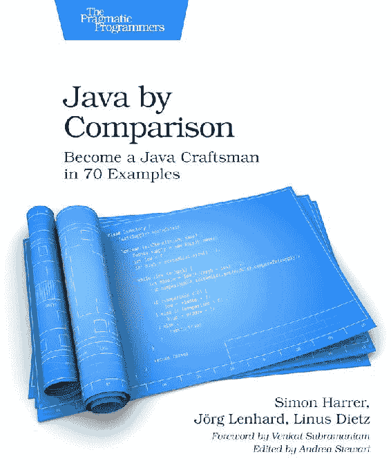

# Java 对比指南



## 关于 Pragmatic Bookshelf

Pragmatic Bookshelf 是一家敏捷的出版公司。我们在这里是因为我们想要改善开发者的生活。我们通过创建由程序员为程序员编写的、及时且实用的书籍来实现这一点。

我们的 Pragmatic 课程、研讨会和其他产品可以帮助您和您的团队创建更好的软件并增加更多乐趣。欲更多信息以及最新的 Pragmatic 书籍，请访问我们的网站 [`pragprog.com`](http://pragprog.com)。

我们的电子书不包含任何数字版权管理（DRM），并且一直都是无 DRM 的。我们开创了测试书（beta book）概念，您可以在书籍编写期间进行购买并阅读，并向作者提供反馈，以帮助为所有人出一本更好的书。所有购买者的免费资源包括源代码下载（如果适用）、勘误表和讨论论坛，均可在 `pragprog.com` 的书籍首页获取。我们在这里是为了让您的生活变得更轻松。

### 新书公告

想关注我们的最新书籍、公告以及偶尔的特别优惠吗？只需在 [pragprog.com](https://pragprog.com) 上创建一个账户（只需一个电子邮件地址和一个密码）并勾选选择框接收新闻邮件。您还可以在 twitter 上关注我们 @pragprog。

### 关于电子书格式

如果您直接从 [pragprog.com](https://pragprog.com) 购买，您将能以一个价格获得所有可用格式的电子书。您可以通过 Dropbox 在所有设备上（包括 iPhone/iPad、Android、笔记本电脑等）之间同步您的电子书。在版本的有效期内，您可以获得免费更新。当然，您在需要时可以随时回来重新下载书籍。从 Amazon Kindle 商店购买的电子书受 Amazon 政策限制。Amazon 文件格式的限制可能会导致电子书在不同设备上的显示不同。更多信息，请参阅我们在 [pragprog.com/frequently-asked-questions/ebooks](https://pragprog.com/frequently-asked-questions/ebooks) 的常见问题解答。欲了解更多关于本书的信息并访问免费资源，请前往书籍首页 [`pragprog.com/book/javacomp`](https://pragprog.com/book/javacomp)。

感谢您的持续支持，

Andy Hunt

The Pragmatic Programmers

制作本书的团队包括：Andy Hunt（出版商）、Janet Furlow（运营副总裁）、Brian MacDonald（执行编辑）、Jacquelyn Carter（总编辑）、Andrea Stewart（开发编辑）、Liz Welch（文字编辑）、Potomac Indexing, LLC（索引）、Gilson Graphics（排版）

需客户支持，请联系 support@pragprog.com。

需国际版权，请联系 rights@pragprog.com。

# 对《对比 Java》的早期评价

这就是我从开始中级 Java 编程课程以来一直期待的书。在没有在基础上浪费过多时间的情况下，“对比 Java` 引导你一步步对良好的编码实践获得新见解。富有启发性的示例对比了“做什么”和“不做什么”，让初学者轻松掌握要点。书中大放异彩，展示了它是基于长期的课堂经验。幸运的是，这本书可以作为教科书阅读，也可以作为参考书。我期待在我的课堂中使用它。你确定你的风格是完美的吗？买它吧！

| → | Guido Wirtz 博士 |

| | 班贝大学计算机科学教授/分布式系统组负责人 |

我希望 `对比 Java` 在我开始编程时就在那里，它就像一个导师，在你肩后，耐心地帮助你将你的编程技能提升到下一个水平。

| → | Achim Weimert |

| | wOndary LTD 首席官 |

`对比 Java` 对所有想要提升 Java 技能的人来说都是的一本极佳的读物。它包含了 `Effective Java` 和 `Clean Code` 的精髓，并更新了 `JUnit 5` 和 `Java 8`。

| → | Johannes Schwalb |

| | uniVersa 架构师 |

缩小新手与中间水平差距的权威指南。

| → | Oliver Kopp |

| | 斯图加特大学博士后 |

`对比 Java` 对那些工作几年的 Java 开发者来说是一本制作精良的读物，更新了最新的 Java 8。相比 `Effective Java`，它更容易读且更具实用性。

| → | Ashish Bhatia |

| | 软件工程师 |

我认为 `对比 Java` 恰好落在一个平衡点，既提供了实用的内容，又没有试图过于复杂。经验丰富的开发者会对此表示认同，并在阅读过程中可能会学到一些东西。这是开发者的必读之。

| → | Sebastian Larsson |

| | Cybercom 技术主管 |

要成为软件工匠，你需要练习、练习、练习。`对比 Java` 可以伴随你的这些练习。通过从坏代码到好代码的对比方法，它可以作为练习期间的参考。

| → | Zulfikar Dharmawan |

| | 软件工程师 |

`对比 Java` 展示了许多改进编码技能的示例，并为初学者或中间级程序员成为经验程序员提供了捷径。这本书在某种程度上提供了关注代码结构而非高级结构的低级设计模式。

| → | Martin Blom |

| 卡尔斯塔德大学教授 |

`对比 Java` 对于想要将 Java 知识提升一个台阶的人来说是一本很棒的读物。我希望当我开始学习 Java 时能读到这本书类似的书；它轻松地解释了我许多通过摸索学会的主题。如果你想从一名优秀的程序员变成伟大的程序员，它是必读的。

| → | Ramaninder Singh Jhajj |

| | Betsson Group 大数据工程师 |

组织良好且充满示例，`对比 Java` 无论你是一个学生还是多年经验的开发者都能帮助到你。

| → | Emanuele Origgi |

| | Funambol Inc. Android 软件工程师 |

对于任何语言，一旦你掌握了它的语法，下一步就是学习如何惯用地使用它。无论你是刚开始 Java 的初学者，还是从使用其许多早期版本开始的资深 Java 开发者，我都认为 `对比 Java` 是精通使用 Java 的良好一步。

| → | Stefan Tilkov |

| | INNOQ 首席执行官 |

# 前言

我们可以从观察他人身上学习到很多。假设你和一位女性正走向同一栋建筑，你走在她后面几步。当那位女性进入建筑时，她暂时为你扶住门。这是她对同理心和人性的表达。当她专注于向前行同时，她也关心身后的人，并希望让你的旅程至少愉快一点。你们是完全的陌生人，可能永远不会再次相遇，但她展现了善意。

编程对许多人来说是一种热情，但它深度涉及同理心和人性。

当我们编写代码时，身后总会有人。有时是几个小时、几天、几周或几个月后的我们自己。但通常是某位同事，他们过来修改代码、修复漏洞、添加功能或扩展软件。让代码对那个人来说更容易维护，这远是一个善意之举。它是成为专业人士的一部分，是实践技艺的一部分。

写代码很容易。但写高质量的代码需要努力、纪律和大量的练习。代码质量有许多不同的定义。以下是我的观点：

## 代码质量

代码的质量与理解它所需的付精力成反比。

良好的代码是透明的。它让逻辑对读者来说显而易见，以便他们可以继续工作。糟糕的代码是不透明的，隐藏了逻辑。读者必须花费时间和精力的从编写得糟糕的代码中弄清细节。

当我们坐下来编写一个功能或特定逻辑时，我们正深度专注于让它运行。编程是一系列微型实验和发现。我们通常必须设计解决方案和方法来解决眼下的问题。创建代码只是第一步。代码被编写一次，但会被阅读和演进多次。如果我们创建的代码质量不高，即使它看起来运行完美无缺，我们也随着时间的推移增加了该代码的拥有成本。

大多数被雇佣写代码的程序员都能交付可运行的软件。普通程序员和优秀程序员之间的区别在于，让其他人遵循他们的工作有多容易。

编写高质量代码是一项技能。和任何技能一样，为了获得和提高它，我们必须有意识地努力，接受批评，并花时间学习。通过不断的努力，编写高质量代码将成为本能，并开始显得毫不费力。这段旅程是艰辛的，但同时，这也是美妙的学习体验。这种学习的一部分可以来自阅读优秀的书，比如你即将开始的这一本。

在我编程的三十多年里，我犯过书中提到的大多数错误。如今，我花大量时间审阅由学生以及行业专业人士编写的代码。我看到学生和专业人士犯了许多相同的错误。当你读这本书时，你很快就会对可能已经犯过的错误产生共鸣。解决问题的第一步是意识到它。这本书的作者们做得非常好，引导我们了解每一段坏代码的“气味（smells）”、问题和后果。然后他们向我们展示了避免混乱的方法、如何编写高质量代码，以及我们从更好的质量中获得的益处。

我敦促不要快速读完这本书。有时我们必须慢慢下来才能获得速度。当你阅读这本书时，花时间阅读每一段坏代码，并花些时间识别错误之处。把它们记录下来。然后阅读作者的解释。这将有助于更好地吸收，并帮助你培养对质量和风格的直感。然后，在跳入阅读给出的解决方案和推理之前，再次思考可能的解决方案。

写代码是有趣的。编写更易理解和演进的代码是纯粹的享受。看到一本旨在帮助有志的程序员成为受尊敬的专业人士的书，真的是一种荣幸。让 Simon、Jörg 和 Linus 成为你的指南——你得到了很好的照顾。

让我们编程变成一种美妙的技艺吧。

Venkat Subramaniam 博士

Agile Developer, Inc. 总裁 2018 年 3 月

# 致谢

书从最初的想法到打印可能需要很长时间。这本书始于 2016 年 UEFA 欧洲杯期间（欧洲足球锦标赛）。那时，Simon 和 Linus 在班贝格大学教一门名为“高级 Java 编程”的课程——这门课程是 Simon 和 Jörg 共同开发并教授了五年。

随着学生人数的增加，对学生编程作业的代码质量提供详细的书面反馈变得非常困难。由于代码质量可能会变成一种执念，Simon 和 Linus 在看足球比赛时讨论这个问题。显而易见，尽管他们很有才华，学生仍然反复一次地犯同样的错误。最终，这两个家伙想出了解决方案：一个常见问题集。他们不再反复解释问题，而是给每个错误起一个名字，提供一个简练的代码解决方案，并解释学生对此需要知道的一切内容。现在他们只需要引导学生参考这些项目，节省了大量时间，甚至提高了反馈质量！

`Java by Comparison` 的构想诞生了，原本放松看球的晚上很快变成了黑客编程和起草代码对比。最终，Simon 和 Linus 意识到这实际上可能成为一本有用的编程书籍，并邀请了 Jörg 加入。他们准备了一份给 Pragmatic Bookshelf 的草案提案，提交、被接纳，然后真正的工作工作开始了……

如果没有许多人的贡献，这本书就不会有现在的成型。首先，最重要的是，我们感谢 Guido Wirtz 教授，通过他的分布式系统小组将我们聚集在一起，并提供了支持的环境，让我们在其中成长（并完成博士学位），并让这本书得以问世。我们还要感谢 Venkat Subramaniam，我们在课程中用过他的优秀著作，他为这本书写了序言。

我们还感谢所有允许我们在章节开头加入他们的引言的人。特别感谢 David Heinier Hanson（应为 Hanson）、Martin Fowler、Sean Parent、Steve McConnell、Phil Karlton、Alan J. Perlis、Dave Thomas、Andy Hunt、David Wheeler、Michael Feathers 和 Tom Cargill。

此外，还有许多志愿者在书的测试阶段之前和期间阅读这本书并为我们提供出色的评论。他们指出了错误，提出了改进建议，并使整本书变得好得多。感谢 Cedric Röck、Oliver Kopp、Michael Träger、Jan Boockmann、Venkat Subramaniam（再次）、Matthias Geiger、Johannes Schwalb、Hendrick Cech、Klaus Stein、Ivo Balbaert、Al Scherer、Philipp Neugebauer、Emanuele Origgi、Ashish Bhatia、Zulfikar Dharmawan、Achim Weimert、Sebastian Larsson、Ramaninder Singh Jhajj、Martin Blom 和 Marcus Biel。

最后，我们想要感谢 Pragmatic Bookshelf 的同事。特别感谢我们的编辑 Andrea Stewart。感谢你的耐心，不断将被动态句子改写为主动态，并帮助我们适应实用的写作风格。但幕后还有更多让这本书成为现实的人。非常感谢 Susannah Pfalzer、Jackie Carter、Katie Dvorak、Brian MacDonald 和 Andy Hunt！

# 如果你不能为你的模式提供有说服力的前后代码对比，你就是在卖药。

David Heinemeier Hanson

# 欢迎！

我们同意 David Heinemeier Hanson 的观点。

如果你提出了一种编程技术，你应该能够尽可能简洁地证明你的提案比之前的方案好在哪里。“之前/之后”（before/after）的方法能将所有事实摆在台面上：你可以直接将新代码与旧代码进行比较。只有这样，你才能对哪一个更好做出明智的决策。

在学习编程时情况也是如此。当你试图弄如何在 `Java` 中编写代码时，将良好的代码与坏代码进行比较非常有帮助。

我们曾在大学教了六多年的编程。在几次课程后，总会有几个学生问我们：“我该如何进一步提高我的编码能力？”无论如何，这些学生在编程作业中表现都很优异，所以我们给他们一个标准的建议：“读人士的代码。”

老实说，我们的建议并没有什么帮助。开源软件世界有大量的代码，但很难判断从何处开始。初学者很快会被现实项目中专业代码的复杂性所击垮。而且，你如何知道一段源代码是否真的是高水平的呢？即使确实如此，一个只有几个月编程经验的人又该如何将其与一个拙劣的凑合方案（hack）区分来呢？

这这本书派上用场了。它是一本引导你向正确方向阅读的伴读读。我们将通过对比坏代码和好代码，帮助你学习如何编写良好的 `Java` 代码。请放心：多年来，我们见过大量的坏代码和好代码，评审过学术界学生、工业界专业人士以及开源项目贡献者编写的代码。

这让我们回到了“之前/之后”的方法。在书中，我们将为你提供 70 组“之前/之后”的代码片段。这些片段将帮助任何 `Java` 编程初学者提高水平。我们是在大学教本科生 `Java` 的期间识别出这些片段的。它们都基于我们在批改学生编程作业时遇到的代码。

我们在书中的方法很简单：给出一个代码片段，我们首先解释哪里错了以及为什么。然后，我们将向你展示如何将代码转换为更好的解决方案。

## 谁应该读这本书

这本书是为那些处于初级或中级水平学习 `Java` 编程的人准备的。它也可以作为指导新开发者成为程序员之路程的教师的课堂资源。在这里，我们将为你提供基于较新的 `Java 8` 语法的资源处理、函数式编程或测试的技巧窍门。

你应该在学习了基础的 `Java` 语法后读这本书——在你能够编写带有条件和循环的小型程序，并掌握了面向对象编程基础知识之后。你应该能够编写出可以编译、运行并解决如 `FizzBuzz` 这类小任务的代码（参见*你准备好了吗？尝试自我评估*）。你应该能够实现简单的算法，并且应该知道如何使用基础数据结构，如 `list`、`queue`、`stack` 或 `map`。显然，在做所有这一切时你应该乐在其中！

如果你在解决一个复杂问题时感到深层的满足感，那么这是一个极佳的开始。但当然，你也知道还有很多东西要学。当你反思自己的技能并不得不承认自己在 `Java` 编程（甚至是通用的编程）方面缺乏经验时，你就能从这本书中获得最大的收益。这意味着你可能还没有对对整洁代码以及经验丰富的开发者所采用的最佳实践的直觉。

是时候改变这一点了！

当然，如果你已经了解了更多关于 `Java` 代码质量、可读性、可维护性和整洁代码的高级书籍，例如《Effective Java》（Effective Java）和《整洁代码》（Clean Code），那么你已经走得很远了。尽管如此，你仍然可以在这里那儿发现一些新东西。

### 使用本书教授整洁代码

如果你作为公司里的资深开发人员向新手教授编程，你肯定意识到我们在书中将过的最佳实践。取决于你正在工作的内容，你甚至对其中某些观点持不同意见。尽管如此，在培训初级开发人员时，这本书可以让你的生活变得更轻松——只需将其作为参考。当你发现徒弟的代码中存在问题时，指引他们看书中对应的条目。你的学生可以针对你暗示的问题阅读一个简洁简单的示例，以及如何获得该问题的解决方案。至少，这为你节省了时间，因为你不需要自己手写解释说明了。

我们为二、三年级 `Java` 学习者开发教学理念的经验，对于学术界的教学也有帮助。这本书是我们结合十五多年在侧重代码质量的高级课程中向本科生教授 `Java` 的知识的结晶。它可能不会从零开始教 `Java`，但它可以伴随几乎任何涉及编程任务的课程。特别是，你在评估学生代码时可以使用这本书作为参考，正如我们在研讨会论文中所描述的：*教学整洁代码》（Teaching Clean Code）。

### 你准备好了吗？尝试自我评估

如果你是一个新程序员，我们建议你进行简短的自我评估，看看你是否准备好学习书中的内容：`FizzBuzz 测试` 或 `使用 FizzBuzz 寻找懂编程的开发者》（Using FizzBuzz to Find Developers who Grok Coding）。有些雇主在面试中使用此测试来确定申请人是否会编程。任务如下：

```
编写一个 Java 程序，在控制台打印从 1 到 100 的数字。但对于三的倍数，打印 Fizz 而不是数字，对于五的倍数，打印 Buzz。对于既是三又是五的倍数，打印 FizzBuzz。
```


为了让测试更有趣，我们在这里稍微扩展一下，确保你能够应用面向对象并使用类和接口。你应该在一个名为`ConsoleBasedFizzBuzz`的类中实现`FizzBuzz`算法，该类实现了`FizzBuzz`接口。该接口提供了一个接收两个数字作为参数的方法。在独立的`Main`类的`main`方法中，你应该使用`FizzBuzz`接口及其`ConsoleBasedFizzBuzz`实现从 1 计数到控制台传递的值。在这里，你会在简短模板中看到大结构。

```
interface FizzBuzz {
    void print(int from, int to);
}

class ConsoleBasedFizzBuzz implements FizzBuzz {
    // TODO implement FizzBuzz interface
}

class Main {
    // TODO use a main method
    // TODO print fizz buzz from 1 to max
    // TODO max is passed from the console
}
```

你应该能在大约 15 分钟内完成这个练习。我们列出的链接之一也包含了挑战的解决方案，你可以与自己的答案进行对比。如果你能做到，你就准备好从书中获得最大收益了。如果不能，别担心！继续读下去。这可能需要你花更长时间，你可能理解某处的比较会比较困难。但如果你通过解决书中的这类小练习来练习编程，你很快就能进入正轨。

网络上有许多优秀的资源可以用来练习你的编程技能并获取代码反馈。你可以去看看`codewars.com`或`cyber-dojo`。这些页面让你能够在不同难度级别上训练你的编程技能。如果你有数学背景，你会发现解决`Project Euler`的问题非常有吸引力。

另一方面，如果你觉得 FizzBuzz 测试简单得离谱，而且你的解决方案可以在几秒钟内编译并运行，那么请注意，你可能已经掌握了我们在书中概述的一些实践方法。当然，你仍然可以从中获益。我们将所有的对比都设计成了自包含模式。所以，请尽管自由翻阅并跳过你已经熟悉的部分。

## 为什么要读这本书？

每位开发者心中都有若干要求，他们认为这些要求是编写良好或整洁代码的前提条件。只要代码没有违反这些任何一项要求，从开发者的角度来看，它就是良好或整洁的。不同人的要求不同。而且，编程语言自然也不同。但尽管如此，对于一种特定的语言，通常会有一套“核心”要求和最佳实践。这些是开发者社区认可并接受的方面，即使它们没有被显式地写下来。在本书书中，我们正试图为你——一个可能还没有意识到 Java 社区中许多实践方法的人——提供一套 Java 整洁代码的最佳实践。

作为一个初学者，你对良好 Java 代码的要求列表可能短到只有这些：

* 代码必须能够编译。
* 输出必须是正确的。

这些项目涉及你程序的逻辑正确性，但它们并没有说明太多关于代码质量的内容。一位丰富的程序员关注的远比这多得多，她的清单也要长得多。她只需要扫一眼代码就能检测出缺陷、糟糕的命名、难以测试的方法、不一致之处、糟糕的实践等许多问题。

本书的目标是训练你的大脑，使其内化更多的清单项目，帮助你通往成为丰富且专业的程序员的道路。书中的每一项都代表了这样一个清单项目。

### 本书使用的惯例

在整书中，我们使用一种特定的结构来解释每个清单项目。我们称之为“对比（comparison）”，并严格遵守这一习惯。

每个对比都有一个朗朗上口的名称。这有助于将其记住并放入你的心理清单中。看看目录——它充当了本书的清单。对比的名称让你更容易与他人讨论你读过的内容。我们命名的方式鼓励你将它们视为一种建议。你也可以在对比名称前加上“你应该”——例如：你应该避免不必要的对比。对于接下来的示例，我们选择了朗朗上口的名称“永远不要信任你的输入（Never Trust Your Input）”。

在名称之后，我们将展示一段代码并突出其中的问题。这可能是一个几行的块，也只有一行，如下：

```java
class HelloWorld {
    public static void main(String[] args) {
        System.out.println("Hello " + args[0]);
    }
}
```

在这些代码片段中，我们希望尽可能减少你的干扰。因此，我们必须精简代码以获取核心：

1. 我们省略了`import`语句和包声明。当然，可下载的代码包含了这些声明——否则它将无法编译。
2. 我们避免使用可见性修符（如`public`或`private`），除非它们被明确要求。

在代码片段之后，我们会向你解释问题所在。途中，我们会提供进一步阅读的引用，例如 JavaDoc、相关项目或网页。

然后，我们将向你展示解决方案的代码，并突出解决方案特定的部分。

```java
class HelloWorld {
    public static void main(String[] arguments) {
        if (isEmpty(arguments)) {
            return;
        }
        System.out.println("Hello " + arguments[0]);
    }

    private static boolean isEmpty(String[] array) {
        return (array == null || (array.length == 0);
    }
}
```

有时，问题代码和解决方案之间的区别非常小。有时，区别又很大。无论如何，片段本身就应该已经教你一些东西——一种帮助你产出更好代码的风格。我们刻意将每个对比保持在两页。左侧（或第一页）显示问题，右侧（或第二页）显示解决方案。这样，你一直对比两个代码片段，而不需要来回翻页。这让学习某项内容变得容易得多。如果你使用 Adobe Reader 阅读 PDF 版书籍，请确保你已开启双页视图并显示了封面——这就像在读纸质书一样。

### 我为什么要学习这个？已经静态代码分析工具了……

你可能认为自己已经有了静态代码分析工具，例如`Checkstyle`、`FindBugs`、`SpotBugs`、`Error Prone`和`PMD`，它们可以检测你代码中的缺陷。那么为什么要继续读下去呢？

对某些人来说确实如此，但对于书中所有的问题并非如此。我们希望看到一种工具能够自动且正确地评估你代码中存在的问题。现有的工具很好，但它们并不完美。把它们想象成严谨、不容忍、吹毛求会的机器人，它们被教授了一 set 规则并寻找任何违反行为。它们无法理解，有时你必须违反规则来改进代码。要成功使用它们，需要进行微调，这需要对代码质量和项目的深度理解。但即便如此，它们也永远比不上丰富的程序员，尽管它们可以帮助不遗漏某些问题。

这是一个好消息，因为这意味着作为丰富的程序员，你的技能将非常。。工具可以检查很多，但它们往往缺乏对检测到某事的详细解释。而且它们很少展示如何解决特定问题。通常情况下，解决方案对于检测工具的警告并不显而易见，也很少可以自动修复。你必须手动完成，而这个过程很容易出错——特别是当你仍在学习 Java 时。作为一个新程序员，工具不会引导你给出合理的修正。这正是本书可以帮助你的地方。

## 如何阅读本书

如果你是 Java 第一年级，我们建议你从头到尾阅读。它从相当基础的对比开始，然后我们将进入更具挑战性的主题，如测试、面向对象设计和 Java 函数式编程。如果你更有经验，可能可以跳过前两章直接进入更专业的主题。

以下是简单的大纲：

* 在第一章*开始清理（Start Cleaning Up）*中，我们将提供关于如何编写正确、易读且易理解的通用建议。我们将涉及许多与基础 Java 语法相关的内容，例如条件和和大括号。
* 在第 2 章提升你的代码风格中，我们将讨论更多高级的编码概念和问题，例如迭代、格式化以及 Java API 的使用。
* 第 3 章明智地使用注释将关于如何编写良好的代码文档。我们将为你提供一些关于如何编写注释的建议，以及你什么时候应该删掉它们。
* 在第 4 章正确命名中，我们将解释如何为 Java 代码中的各个元素分配恰当且简洁的名字，以便其他程序员能够轻松理解。
* 第 5 章为出错做好准备将让你意识到你应该如何在 Java 中处理异常。
* 第 6 章断言一切正常将提供关于如何使用`JUnit5`编写良好的单元测试的建议。
* 第 7 章设计你的对象概述了面向对象的设计原则。
* 第 8 章让你的数据流动起来侧重于使用 lambda 表达式在 Java 中进行函数式编程。
* 最后，第 9 章准备面对现实将引导你学习关于在现实世界中构建、发布和维护软件的大量材料。

让我们继续前进，并享受其中吧！

## 在线资源

本书在`www.pragprog.com`有自己的网页。^([[14]](#f_0011.xhtml_FOOTNOTE-14)) 在那里，你可以在讨论论坛与我们联系，^([[15]](#f_0011.xhtml_FOOTNOTE-15))，发布勘误，^([[16]](#f_0011.xhtml_FOOTNOTE-16)) 或者下载本书的源代码^([[17]](#f_0011.xhtml_FOOTNOTE-17))。

## 为你的火星之旅做好准备

作为一名初级或中级程序员，获得那种他人能够认可为良好且整洁代码的感觉，对你来说可能似乎是一个遥不可及的东西，一个几乎无法实现的目标——一段充满意想不到的问题和未知体验的长途旅程。这有点像穿越太空前往一个人类尚未到达的地方：通往火星的之旅！在多年前我们开始学习编程时的感觉正是如此。

我们在书中编写代码是以“火星任务”为主题的，因此所有的代码示例都带有一些太空色彩。但真正的原因是，我们不希望让代码所在的设置分散你对代码段本身中问题的注意力。我们使用了航员主题来给你提供更好的阅读体验，避免使用像`x`和`y`这样无意义的变量名，或者使用从动物到哺乳动物再到猫的无数次继承层次结构。（我们对猫并没有意见——我们只是觉得它们在教学材料中被过度使用了。）

我们的比较是基于我们发现的、初级或中级程序员在学习编程时经常遇到的代码和编码问题。我们提取了这些底层问题并将它们置于太空旅行领域，以便更容易想象它们周围的背景。

我们无法保证你在读完这本书后会成为一名航员，但我们非常有信心你会成为一名更好的程序员。所以系好安全带，向着（程序员的）太空前进吧！

### 脚注

[[1]](#f_0007.xhtml_FNPTR-1)

我们知道 Oracle 已经发布了 Java 9。请放心，书中的所有内容在 Java 9 中仍然有效。

[[2]](#f_0007.xhtml_FNPTR-2)

[`c2.com/cgi/wiki?FizzBuzzTest`](http://c2.com/cgi/wiki?FizzBuzzTest)

[[3]](#f_0007.xhtml_FNPTR-3)

[`c2.com/cgi/wiki?FizzBuzzTest`](http://c2.com/cgi/wiki?FizzBuzzTest)

[[4]](#f_0007.xhtml_FNPTR-4)

[`c2.com/cgi/wiki?FizzBuzzTest`](http://c2.com/cgi/wiki?FizzBuzzTest)

[[5]](#f_0007.xhtml_FNPTR-5)

[`c2.com/cgi/wiki?FizzBuzzTest`](http://c2.com/cgi/wiki?FizzBuzzTest)

[[6]](#f_0007.xhtml_FNPTR-6)

[`c2.com/cgi/wiki?FizzBuzzTest`](http://c2.com/cgi/wiki?FizzBuzzTest)

[[7]](#f_0007.xhtml_FNPTR-7)

[`c2.com/cgi/wiki?FizzBuzzTest`](http://c2.com/cgi/wiki?FizzBuzzTest)

[[8]](#f_0007.xhtml_FNPTR-8)

[`c2.com/cgi/wiki?FizzBuzzTest`](http://c2.com/cgi/wiki?FizzBuzzTest)

[[9]](#f_0007.xhtml_FNPTR-9)

[`c2.com/cgi/wiki?FizzBuzzTest`](http://c2.com/cgi/wiki?FizzBuzzTest)

[[10]](#f_0007.xhtml_FNPTR-10)

[`c2.com/cgi/wiki?FizzBuzzTest`](http://c2.com/cgi/wiki?FizzBuzzTest)

[[11]](#f_0007.xhtml_FNPTR-11)

[`c2.com/cgi/wiki?FizzBuzzTest`](http://c2.com/cgi/wiki?FizzBuzzTest)

[[12]](#f_0007.xhtml_FNPTR-12)

[`c2.com/cgi/wiki?FizzBuzzTest`](http://c2.com/cgi/wiki?FizzBuzzTest)

[[13]](#f_0007.xhtml_FNPTR-13)

[`c2.com/cgi/wiki?FizzBuzzTest`](http://c2.com/cgi/wiki?FizzBuzzTest)

[[14]](#f_0007.xhtml_FNPTR-14)

[`c2.com/cgi/wiki?FizzBuzzTest`](http://c2.com/cgi/wiki?FizzBuzzTest)

[[15]](#f_0007.xhtml_FNPTR-15)

[`c2.com/cgi/wiki?FizzBuzzTest`](http://c2.com/cgi/wiki?FizzBuzzTest)

[[16]](#f_0007.xhtml_FNPTR-16)

[`c2.com/cgi/wiki?FizzBuzzTest`](http://c2.com/cgi/wiki?FizzBuzzTest)

[[17]](#f_0007.xhtml_FNPTR-17)

[`c2.com/cgi/wiki?FizzBuzzTest`](http://c2.com/cgi/wiki?FizzBuzzTest)

你学习编写的首批逻辑条件可能由整数和比较运算符组成，初学者可能会用同样的方式使用布尔值来实现条件。但这些比较是完全没有必要的——它们就像是你代码中的噪声。

在这里，你可以看到一个`Laboratory`组件的代码，它通过两个嵌套的`if-else`块中的条件来对`Sample`进行分析。

这段代码显式地将布尔值返回值与布尔原始类型类型（`true`和`false`）进行比较。这在初学者编写的代码中经常能发现的一种反模式。

如果你使用布尔类型以外的数据类型构建逻辑条件（例如使用整数），你需要将它们与实际值进行比较（例如`myNumber == 25`、`input > 0`）。但对于布尔变量或返回类型，你不需要这样做。

相反，你已经有了布尔表达式可以操作了。没有必要将它们与布尔原始值类型进行比较。这些比较会让代码变得杂乱，并使阅读变得稍微困难。

大多数情况下，你会发现去掉这些不必要的比较是非常简单的。这不仅能减少代码量，还能让代码更易读。

现在来看看去掉了这些比较后，这段代码有多么简单。

```java
class Laboratory {
  Microscope microscope;

  Result analyze(Sample sample) {
    if (microscope.isInorganic(sample)) {
      return Result.INORGANIC;
    } else {
      return analyzeOrganic(sample);
    }
  }

  private Result analyzeOrganic(Sample sample) {
    if (!microscope.isHumanoid(sample)) {
      return Result.ALIEN;
    } else {
      return Result.HUMANOID;
    }
  }
}
```

在这里，我们删除了对布尔原始值的比较。在`laboratory.isHumanoid(sample)`的情况下，我们必须对表达式取反以保留语义。但除此之外，代码保持不变。你现在可以更轻松地阅读条件表达式了。

任何编译器都会自动执行这种删除。在实际执行方面，这两个代码片段之间可能没有区别。这里的收益完全在于代码的可读性。这只是某些简单代码中一个微小的修复，但想象一下你正在处理一个大型代码库——可读性的每一次小改进都有帮助！

考虑到避免否定，你可以进一步改进条件。请继续读下去！

### 方法多次返回 vs 单次返回

开发者投入了无数小时（读：浪费了小时）来讨论在方法内部使用单个`return`语句还是多个返回语句更好。这没有绝对的对错分。每个`return`语句都标记了方法的出口点。单一出口使得控制流更具结构化；你总是知道它会在哪里结束。但有时你想提前退出方法——例如，当输入参数无效时。在这里，我们使用多次返回是因为它需要的代码行更少——而且书的空间总是有限的。在你的代码中，尝试看看是否需要提前退出，如果需要，请使用多次返回。

## 避免否定


```java
class Laboratory {
  Microscope microscope;

  Result analyze(Sample sample) {
    if (microscope.isInorganic(sample)) {
      return Result.INORGANIC;
    } else {
      return analyzeOrganic(sample);
    }
  }

  private Result analyzeOrganic(Sample sample) {
    if (!microscope.isHumanoid(sample)) {
      return Result.ALIEN;
    } else {
      return Result.HUMANOID;
    }
  }
}
```

有没有人告诉过你要“积极思考”？事实证明，代码中的正向表达式比否定表达式更好，因为它们通常更容易理解，且占据的空间略小。

这里显示的问题代码是`Laboratory`组件的另一个变体。它提供了两个接收`Sample`并返回`Result`的方法。这段代码没有明显的错误。它能实现其目的，但它比必要的要复杂。

考虑一下`if`语句的条件：两者都表达了一个否定条件。第一个测试样本是否`isInorganic()`（是无机的）。第二个甚至使用了用于否定的布尔运算符：感叹号`!`。

在大多数情况下，当你阅读代码时，会发现正向表达式更容易理解。否定表达式增加了一层额外的间接层。与其说简单的“X 适用”，你必须理解一个额外的标记：“X 不适用”。

这个额外的标记通常是不必要的的。尽管这看起来像是一个微小的改动，但每一点微小的改进都有帮助。记住：每个人都喜欢没有否定。现在，看看这个简化后的版本：

```java
class Laboratory {
  Microscope microscope;

  Result analyze(Sample sample) {
    if (microscope.isOrganic(sample)) {
      return analyzeOrganic(sample);
    } else {
      return Result.INORGANIC;
    }
  }

  private Result analyzeOrganic(Sample sample) {
    if (microscope.isHumanoid(sample)) {
      return Result.HUMANOID;
    } else {
      return Result.ALIEN;
    }
  }
}
```

我们只更改了代码，但这已经产生了影响。我们没有调用`isInorganic()`，而是调用了`isOrganic()`，它使用的是正向措辞而不是否定措辞。

然而，有时你需要适当的方法，比如在此处用`isOrganic()`而不是`isInorganic()`。如果你调用的代码来自第三方库，你可能没有调用不同方法的选择。但如果你控制它，不要犹豫向相应的类中添加该方法——这几行代码是值得的，因为它们会让你的代码其他地方更加清晰。总而言之，这些变化非常简单，你可能会问：为什么要这么麻烦？根据我们的经验，最好的办法是去掉否定方法——没有必要维护两个相似的方法。

## 直接返回表达式

```java
class Astronaut {
  String name;
  int missions;

  boolean isValid() {
    if (missions < 0 || name == null || name.trim().isEmpty()) {
      return false;
    } else {
      return true;
    }
  }
}
```

接下来，让我们看看另一种减少代码中杂杂的方法。在这种情况下，我们不需要`if`语句来实现我们的目标。让我们找出原因。

你在片段中看到了一个典型的验证方法。该方法检查对象的几个属性，一个整数和一个字符串。该整数属性指的是任务数量。这个数字不应该是负数。该字符串属性不应为空；否则我们可能会担心`NullPointerException`在某处导致执行崩溃。

此外，它不应该为空，因为每个宇航员都应该有一个真实的名字。`name.trim()`调用会移除各种前导或尾空格字符，例如空格或制表符。如果在调用`trim()`之后还有剩余内容，它将是一个真实的字符序列。

代码中没有功能性错误。问题正如常见的情况那样，代码比本需要的复杂，可读性也差。更准确地说，`if`语句完全没有必要。它是冗余代码，只会分散对实际语义的注意力。

让我们看看能做什么吧！关键在于我们方法的返回类型：`boolean`。正因如此，我们不需要将一切封装在`if`语句中——我们可以直接返回值，如下：

```java
class Astronaut {
  String name;
  int missions;

  boolean isValid() {
    return missions >= 0 && name != null && !name.trim().isEmpty();
  }
}
```

这一更改消除了了一层缩进和分支。现在方法变得非常简洁且更容易阅读！

我们将五行`if`语句压缩了一行代码。为了保持相同的语义，我们必须对条件应用布尔运算。本质上，我们应用了德摩根定律并对条件进行了否定。这里是这些著名定律的快速定义，你将经常用到：

| `!A && !B == !(A || B)` // true |

| `!A || !B == !(A && B)` // true |

有时条件会比这个更复杂。如果是这样，你应该考虑将其拆分为更小的部分。我们的建议是使用具有意义名称变量来捕捉条件的部分。考虑以下示例：

```java
boolean isValid() {
  boolean isValidMissions = missions >= 0;
  boolean isValidName = name != null && !name.trim().isEmpty();
  return isValidMissions && isValidName;
}
```

根据经验法则，如果你组合了两个以上不同的条件，就应该考虑进行这种简化。如果你在其他地方需要条件的部分，请考虑将它们放入单独的方法中，正如*简化布尔表达式*中所解释。

注意，这里描述的解决方案仅适用于布尔返回类型。

## 简化布尔表达式

```java
class SpaceShip {
  Crew crew;
  FuelTank fuelTank;
  Hull hull;
  Navigator navigator;
  OxygenTank oxygenTank;

  boolean willCrewSurvive() {
    return hull.holes == 0 &&
           fuelTank.fuel >= navigator.requiredFuelToEarth() &&
           oxygenTank.lastsFor(crew.size) > navigator.timeToEarth();
  }
}
```

组合了多个条件的布尔表达式通常难以理解且容易出错。但你可以通过一些简单的技巧让它们变得更容易理解。

与之前的比较一样，你可以看到一个验证方法的示例。这个条件比上一个更复杂，但根据*直接返回布尔表达式*，它已经被压缩在单个返回语句中。

条件的极其庞大使得它难以理解。它跨越了好行代码，并结合了来自五个不同对象的检查。由于其规模很大，当你必须更改其中一部分时，很容易引入故障。但即使在更改它之前，你可能也会花费宝贵的编程时间来理解它的含义。

当你必须将几个条件组合进单个检查中时，最好以某种方式对它们进行分组。良好的分组取决于条件的语义，你可以尝试按主题或抽象级别进行分组。

在方法内部，你应该组合处于相似抽象层级的语句。理想情况下，较高层的方法应该调用下一层的方法。

### 括号也有帮助

布尔条件可能会变得棘手，尤其是当它们缺少括号时。许多开发者（我们也是这一员）没有内化布尔运算符的优先级，必须思考一下才能确定`x && y || z`是指`(x && y) || z`还是`x && (x || z)`。或者你不知道`&&`始终在`||`之前被评估吗？

在这里，`willCrewSurvive()`方法在同一个条件中验证了每个低级细节。你想出一个中间的抽象层吗？比如这样：

```java
class SpaceShip {
  Crew crew;
  FuelTank fuelTank;
  Hull hull;
  Navigator navigator;
  OxygenTank oxygenTank;

  boolean willCrewSurvive() {
    boolean hasEnoughResources = hasFuel() && hasOxygen();
    return hull.isIntact() && hasEnoughResources;
  }

  private boolean hasOxygen() {
    return oxygenTank.lastsFor(crew.size) > navigator.timeToEarth();
  }

  private boolean hasFuel() {
    return fuelTank.fuel >= navigator.requiredFuelToEarth();
  }
}
```

哇，发生了很多变化！`willCrewSurvive()`方法仍然存在，但现在它调用了其他方法并聚合它们的返回值。

首先，我们添加了一个`boolean`变量，通过主题（资源）将相似方面组合在一起。我们还给它了一个有意义的名字`hasEnoughResources`。该变量结合了方法调用的结果`hasOxygen()`和`hasFuel()`。你会在这两个方法内部找到条件的实际细节。

接下来，我们将变量`hasEnoughResources`与原始条件中最后一个缺失的部分`hull.holes == 0`结合起来。然而，我们使用了`Hull`类中的`isIntact()`方法。由于它已经有了意义的名字，我们没有理由将其存储另一个布尔变量中。

虽然代码行变多了，但我们大大提高了代码的可理解性。你不再需要一次理解整个条件。得于分组，你可以一步步进行。

## 在条件判断中避免空指针异常

```java
class Logbook {
  void writeMessage(String message, Path location) throws IOException {
    if (Files.isDirectory(location)) {
      throw new IllegalArgumentException("路径无效！");
    }
    if (message.trim().equals("") || message == null) {
      throw new IllegalArgumentException("消息无效！");
    }
    String entry = LocalDate.now() + ": " + message;
    Files.write(location, Collections.singletonList(entry),
               StandardCharsets.UTF_8, StandardOpenOption.CREATE,
               StandardOpenOption.APPEND);
  }
}
```

该方法的当前版本已经执行了一些验证。遗憾的是，它存在两个严重的问题。首先，该方法没有正确检查空引用。如果`location`为`null`，对`Files.isDirectory()`的调用将失败并抛出一个未记录的`NullPointerException`。如果`message`为`null`，第二种情况也会发生这种情况，因为我们先检查了`message.equals("")`。

在验证参数时，必须注意顺序：首先检查空值，然后再检查特定域的“非法”值。我们建议你先检查空字符串或空列表等常见的默认值，然后再进行更具体的检查。

将`null`作为参数传递给方法是一种非常糟糕的风格——这意味着该方法在没有此参数的情况下也可以运行。如果确实如此，请将该方法重构为两个：一个带参数，另一个不带参数。请注意，参数为`null`通常意味着调用方存在编程错误。

以下是适当验证的示例。

```java
class Logbook {
    void writeMessage(String message, Path location) throws IOException {
        if (message == null || message.trim().isEmpty()) {
            throw new IllegalArgumentException("The message is invalid!");
        }
        if (location == null || Files.isDirectory(location)) {
            throw new IllegalArgumentException("The path is invalid!");
        }
        String entry = LocalDate.now() + ": " + message;
        Files.write(location, Collections.singletonList(entry),
            StandardCharsets.UTF_8, StandardOpenOption.CREATE,
            StandardOpenOption.APPEND);
    }
}
```

我们在新版本中解决了所有问题：首先，我们检查所有参数是否为空值。之后，我们检查特定域的限制。

此外，我们更改了检查顺序，以反映方法签名中参数的顺序。这是一个良好的做法，因为参数验证的合理排序可以提高阅读的流畅性。你也不可能忘记验证其中一个参数。最后，我们使用了内置方法来检查`String`是否为空。

你可能会问自己：这种程度的参数验证总是必要的吗？并不是。

根据经验法则，对于`public`、`protected`和`default`方法需要进行参数验证。这是因为代码的任何部分都可以访问它们，而你可能无法控制这种访问是如何发生的。

相反，当你构建`private`方法时，你能够确保永远不会向它们传递`null`。因此在这种情况下，你不需要进行过多的验证。

### 文件打开选项

你可能好奇这些`StandardOpenOptions`意味着什么。它们指定了`Files.write()`方法的行为。这些名称直观易懂，但你应该意识到你可以组合使用它们。

这是很有用的，因为如果也设置了`CREATE`标志，那么我们就不需要担心想要`APPEND`的文件在文件系统中是否已经存在。

## 避免 switch 穿透（Switch Fallthrough）

```java
class BoardComputer {
    CruiseControl cruiseControl;

    void authorize(User user) {
        Objects.requireNonNull(user);
        switch (user.getRank()) {
            case UNKNOWN:
                cruiseControl.logUnauthorizedAccessAttempt();
            case ASTRONAUT:
                cruiseControl.grantAccess(user);
                break;
            case COMMANDER:
                cruiseControl.grantAccess(user);
                cruiseControl.grantAdminAccess(user);
                break;
        }
    }
}
```

某些编程语言构造因为多年来引起的许多 Bug 而臭名昭著。其中之一就是`switch`，在使用它时你应该小心。

你在这里看到的`authorizeUser()`方法验证了它的参数并检查了空引用。它使用了`Objects.requireNonNull()`，这是 Java API 中一个方便的参数验证方法，它会在输入为 null 时触发异常。但`authorizeUser()`仍然包含一个经典的 Bug：switch 穿透。

这个 Bug 出现在`switch`语句的第一个`case`中。在`case`结束没有`break`语句。这意味着`switch`将继续执行下一个`case`——它会向下穿透并始终执行`cruiseControl.grantAccess()`。

`switch`语句因这种行为而臭名昭著。它一直继续执行直到遇到`break`语句或块结束。你在任何 C 风格语言中都能找到`switch`的这种执行语义。此外，Java 是从 C 继承而来的。

`switch`之所以这样是因为这允许你编写更紧凑、字符更少的代码，通过这种方式避免评估几个条件表达式。而且从 Java 7 开始，`switch`语句除了整数和枚举外，还支持字符串。

但多年来，它弊大于利，相当多的 Bug 是由于忘记写`break`导致的。看看这个无 Bug 的代码。


```java
class BoardComputer {
    CruiseControl cruiseControl;

    void authorize(User user) {
        Objects.requireNonNull(user);
        switch (user.getRank()) {
            case UNKNOWN:
                cruiseControl.logUnauthorizedAccessAttempt();
                break;
            case ASTRONAUT:
                cruiseControl.grantAccess(user);
                break;
            case COMMANDER:
                cruiseControl.grantAccess(user);
                cruiseControl.grantAdminAccess(user);
                break;
        }
    }
}
```

修复无意的`switch`穿透很容易：确保每个`case`结束处都有`break`语句。我们在代码示例中已经这样做。现在代码没有 Bug 了——但`switch`在这里真的是完美的选择吗？并不是！

在示例中，`switch`混合了本该分离的两个关注点：它将未经授权的授权访问合并到一个代码块中。

根据经验法则，你应该将不同的关注点放在不同的代码块中。首先，这样做会让代码更具可读性。其次，发生`switch`穿透等意外 Bug 的概率更小。

你会发现很难用`switch`实现这种关注点的分离。这就是为什么我们更倾向于使用`if`语句。但即使在那里，`switch`穿透也可能困扰我们，正如你将在后面看到的。

如果增加了一个等级怎么办？你必须调整这个条件判断，但这很容易被忘记。代码仍会运行，而你甚至不会察觉漏掉了什么！这就是为什么你应该始终有一个捕获未显式编码值的回退分支。`switch`语句通过`default`情况内置了这一功能。或者，你也可以抛出一个`AssertionError`以防万无。

### 始终使用大括号

```java
class BoardComputer {
    CruiseControl cruiseControl;

    void authorize(User user) {
        Objects.requireNonNull(user);
        if (user.isUnknown()) {
            cruiseControl.logUnauthorizedAccessAttempt();
        }
        if (user.isAstronaut()) {
            cruiseControl.grantAccess(user);
        }
        if (user.isCommander()) {
            cruiseControl.grantAccess(user);
            cruiseControl.grantAdminAccess(user);
        }
    }
}
```

在这里，我们将之前比较中的`switch`语句转换成了独立的`if`语句。然而，这里存在一个问题：代码段中的缩进极具误导性。由于`if`后面没有大括号，该条件仅适用于随后的那行。这导致整个方法的行为变得非常“恶意”——`cruiseControl.grantAdminAccess(user);`这一行始终会被执行，并向任何用户授予管理员权限！真是一团糟。

这个问题的根源不在于缩进，而是缺少定义作用域的大括号。本质上，这是我们在避免`switch`贯穿中看到过的`switch`贯穿（fallthrough）的一种变体。

如果你已经意识到`switch`存在这个问题，在面对`if`时你仍然可能忽视它。即使你缩进正确，也无法保证在截止日期前总是忙碌的冲刺阶段，有人能发现这个 bug。这就是为什么我们建议大家始终使用大括号。

### 右侧的内容并不总是完美的

实现整洁的代码是很的。正如你可能已经注意到的，我们有时会在两次或多次比较的过程中迭代地改进代码。我们的目标是一次改进一个点，有时为了保持对当前主题的关注而忽略其他的代码质量标准。在阅读右页的解决方案时，请记住这一点。通常，你还有更多可以改进的地方。

看看这个修正后的版本。

```java
class BoardComputer {
    CruiseControl cruiseControl;

    void authorize(User user) {
        Objects.requireNonNull(user);
        if (user.isUnknown()) {
            cruiseControl.logUnauthorizedAccessAttempt();
        }
        if (user.isAstronaut()) {
            cruiseControl.grantAccess(user);
        }
        if (user.isCommander()) {
            cruiseControl.grantAccess(user);
        }
        cruiseControl.grantAdminAccess(user); // SECURITY THREAT
    }
}
```

在这里，我们按照编译器处理代码的方式添加了大括号。你可以很容易地发现错误：没有条件保护对`grantAdminAccess()`的调用。得益于大括号，代码现在更具可读性。即使时间紧迫，别人也可能发现这个关键 bug。

现在添加新行代码也更安全了。之前，你可能会忽视没有大括号的事实，并在其中一个块中添加一行代码。

误导性的缩进导致了我们示例中的 bug。这是危险的，特别是因为它结合了“字符越少代码越好”的错误思维。记住：代码越少并不总是更好——可读性高的代码才是！

你可能会认为这种错误是不切实际的，对于安全关键代码来说几乎不会发生。历史事实并非如此；2014 年，Apple 工程师在实现适用于 iOS 的 SSL/TLS 协议时遇到过非常类似的 bug。利用该 bug 的攻击者可以监听 Apple 设备的任何安全连接。可怕，不是吗？

习惯性地始终使用大括号是对防止贯穿 bug 的良好防御，始终使用 IDE 的自动缩进也是如此。但目前这个问题的解决方案还不完美，因为它违反了快速失败和确保代码对称性。请继续读下去！

### 确保代码对称性

```java
class BoardComputer {
    CruiseControl cruiseControl;

    void authorize(User user) {
        Objects.requireNonNull(user);
        if (user.isUnknown()) {
            cruiseControl.logUnauthorizedAccessAttempt();
        } else if (user.isAstronaut()) {
            cruiseControl.grantAccess(user);
        } else if (user.isCommander()) {
            cruiseControl.grantAccess(user);
            cruiseControl.grantAdminAccess(user);
        }
    }
}
```

我们已经强调过几次，可读性对于你的代码来说至关重要。通过对称的方式构建你的条件分支，你将使代码更容易理解、更容易掌握。未来任何维护此类代码的人（很有可能是你）将能够更快地定位功能，并且更容易发现 bug。

这是对你在避免`switch`贯穿和始终使用大括号中看到的代码的另一种修改。

问题在于缺乏对称性。思考一下。是否所有的分支都表达了类似的内容吗？换句话说，所有的分支都是对称的吗？答案是：不是。

```java
class BoardComputer {
    CruiseControl cruiseControl;

    void authorize(User user) {
        Objects.requireNonNull(user);
        if (user.isUnknown()) {
            cruiseControl.logUnauthorizedAccessAttempt();
            return;
        }
        if (user.isAstronaut()) {
            cruiseControl.grantAccess(user);
        } else if (user.isCommander()) {
            cruiseControl.grantAccess(user);
            cruiseControl.grantAdminAccess(user);
        }
    }
}
```

代码中的非对称性源于我们将授权代码与非授权代码混合在了一起。如果我们将它们分成不同的代码块，就可以提高代码的对称性。

每个部分将不同类型的访问封装在单独`if`语句中。首先，我们处理未经授权的访问，记录它并退出方法。然后，我们在一个`if`和连接的`else if`块中处理另外两种情况。

第二部分现在是对称的，因为它包含了两种类型的授权访问。新的结构让读者更清晰地理解该条件的意图。它再也不可能意外引入我们在避免`switch`贯穿中看到的贯穿 bug。

这里还有优化空间。例如，`grantAccess()`在第二个条件的两个分支中以相同的参数被调用。此外，我们可以将这两个条件提取到独立的私有方法中。这将为我们的代码提供更好的指引。

注意，这引申了后面的快速失败，因为我们将未经授权访问的代码移动到了顶部。

## 你学到了什么？

所以你已经读完了第一组比较并来到了这一页。首先，感谢！我们很高兴你能坚持走到这里。你已经学习了关于一个重要主题的很多知识：编写可读的代码。如今我们的大部分精力都花在维护现有代码上，你很少从零开始一个项目。

当这种情况发生时，如果写代码的人关注过可读性，你会心存感激的。所以，请对你的同事友好，并努力代码的可读性！而且，你永远无法；即使你认为自己完成了一个项目，老板也可能会重新分配任务，然后你的代码就会会回来困扰你。

这就是为什么我们向你展示如何避免不必要的代码。你学习了如何简化布尔表达式，并将避开许多由于代码可读性差导致的 Bug，例如`switch`穿透（fallthrough）。

你现在能做的最好的事情就是尝试你读过的内容。拿一段你以前写的代码来看，审视一下它。你能应用这里读到的某些建议吗？经过这些重构后，你的代码看起来是什么样？务必保留原始版本的副本，以便与改进后的版本进行比较。毕竟，这就是本书的主题！

当你准备好后，翻到下一章。我们将深入探讨代码可读性和可理解性的话题，并针对代码风格和 Java API 的提供更多高级的建议。所以请务必继续读下去！

### 脚注

[[18]](#f_0015.xhtml_FNPTR-18)

[德·摩根定律](https://en.wikipedia.org/wiki/De_Morgan%27s_laws)(https://en.wikipedia.org/wiki/De_Morgan%27s_laws)

[[19]](#f_0019.xhtml_FNPTR-19)

[Apple 的 SSL 安全漏洞本可以轻易避免](http://embeddedgurus.com/barr-code/2014/03/apples-gotofail-ssl-security-bug-was-easily-preventable/](http://embeddedgurus.com/barr-code/2014/03/apples-gotofail-ssl-security-bug-was-easily-preventable/)

[[20]](#f_0020.xhtml_FNPTR-20)

[精通编程](https://www.facebook.com/notes/kent-beck/mastering-programming/1184427814923414/](https://www.facebook.com/notes/kent-beck/mastering-programming/1184427814923414/)

Copyright © 2018, The Pragmatic Bookshelf.

好代码是简洁、简单且对称的——挑战在于如何实现这一点。

Sean Parent

# 第 2 章

## 提升你的代码风格

在角色扮演游戏中，无论是数字游戏还是桌面游戏，你通常都扮演一个拥有一套独特技能的角色。随着游戏的进行，你的角色在游戏世界中移动，与居民互动，并通过任务收集经验。最终，你的角色将获得新技能，并将技能“升级”到新的精通阶段，变得更快、更强、更聪明，或者无论你练习的是什么。

编程与玩游戏相似，而且同样令人上瘾。这是现实生活，所以你不是控制一个角色——你就在游戏中。你穿梭于数字世界并收集经验。你发现了具有非常不同语言范式的编程语言遥远领域。你遇到了对风格最复杂方面有不同观点的程序员同行们，例如是否要将大括号另起一行。你通过编程来练习技能，学习你之前未察觉的新框架或语言概念，并深化对已熟悉知识的理解。最终，你在编程能力上达到了新的水平。

本章是对上一章中讨论的更基础条目的升级。我们将介绍 Java 语言的一些更高级的概念，以及代码风格的方面。

你将学习如何处理“魔法数字”——要么用常量替换它们，要么更好，用枚举（enums）——你将看到为什么使用换行对代码分组是有意义的。此外，我们将向你展示为什么应该尽可能依赖 Java API，并回顾在这样做时你应该避免的几个典型陷阱。你将看到如何最好地遍历数据结构，而不会触发意外的异常或引起性能问题。最后，我们将为你提供一种在代码中格式化字符串的方便方法。所以，让我们进入下一个水平吧！

## 用常量替换魔法数字

```java
class CruiseControl {
    private double targetSpeedKmh;

    void setPreset(int speedPreset) {
        if (speedPreset == 2) {
            setTargetSpeedKmh(16944);
        } else if (speedPreset == 1) {
            setTargetSpeedKmh(7667);
        } else if (speedPreset == 0) {
            setTargetSpeedKmh(0);
        }
    }

    void setTargetSpeedKmh(double speed) {
        targetSpeedKmh = speed;
    }
}
```

通常，当程序员需要在代码中表示一组选项时，他们会使用一组数字。在没有额外上下文的情况下，我们称这些为“魔法数字”：没有意义数字。它们让代码难以理解且容易出错。

这段代码片段描述了巡航控制。它很容易出错，因为你必须知道预设的内部细节。否则，你需要背记于心。它也很容易误用。

让我们看看如何改进代码并消除魔法数字。

```java
class CruiseControl {
    static final int STOP_PRESET = 0;
    static final int PLANETARY_SPEED_PRESET = 1;
    static final int CRUISE_SPEED_PRESET = 2;

    static final double STOP_SPEED_KMH = 0;
    static final double PLANETARY_SPEED_KMH = 7667;
    static final double CRUISE_SPEED_KMH = 16944;

    private double targetSpeedKmh;

    void setPreset(int speedPreset) {
        if (speedPreset == CRUISE_SPEED_PRESET) {
            setTargetSpeedKmh(CRUISE_SPEED_KMH);
        } else if (speedPreset == PLANETARY_SPEED_PRESET) {
            setTargetSpeedKmh(PLANETARY_SPEED_KMH);
        } else if (speedPreset == STOP_PRESET) {
            setTargetSpeedKmh(STOP_SPEED_KMH);
        }
    }

    void setTargetSpeedKmh(double speed) {
        targetSpeedKmh = speed;
    }
}
```

这一次，我们消除了魔法。我们通过为每个数字分配一个有意义且可访问的名字来实现。

在这段代码中，我们为所有预设和目标速度添加了变量。这些变量是`static`且`final`的也就是说它们是常量。修饰符确保了变量只存在一次（`static`）且不可更改（`final`）。我们使用大写字母命名常量，这是 Java 的规范。


可以说，`static`修饰符是一种优化。毕竟我们可能有合理的理由将变量与`CruiseControl`实例绑定。在任何情况下，你都应该将变量设为`final`。否则它们是可变的，可以在任何时间被更改。

根据变量名，现在更清楚存在哪些速度预设和目标速度。但我们可以做得更好！查看*用枚举替换常量*。

## 用枚举替换常量

```java
class CruiseControl {
    static final int STOP_PRESET = 0;
    static final int PLANETARY_SPEED_PRESET = 1;
    static final int CRUISE_SPEED_PRESET = 2;

    static final double STOP_SPEED_KMH = 0;
    static final double PLANETARY_SPEED_KMH = 7667;
    static final double CRUISE_SPEED_KMH = 16944;

    private double targetSpeedKmh;
}
```

```java
class Example {
    private double targetSpeedKmh;

    void setPreset(int speedPreset) {
        if (speedPreset == CRUISE_SPEED_PRESET) {
            setTargetSpeedKmh(CRUISE_SPEED_KMH);
        } else if (speedPreset == PLANETARY_SPEED_PRESET) {
            setTargetSpeedKmh(PLANETARY_SPEED_KMH);
        } else if (speedPreset == STOP_PRESET) {
            setTargetSpeedKmh(STOP_SPEED_KMH);
        }
    }

    void setTargetSpeedKmh(double speedKmh) {
        targetSpeedKmh = speedKmh;
    }
}
```

正如你在之前的比较中看到的，常量（用常量替换魔数）相比于魔数是一个巨大的改进。但如果你可以列出所有选项，Java 的类型系统提供了一个更好的解决方案。

在这段代码中，输入参数`speedPreset`仍然是一个整数。这意味着仍然可以向`setPreset()`传入任何整数值，甚至是负数。毕竟，没有人强迫你真正使用如`STOP_PRESET`之类的常量。

如果你向`setPreset()`传入一个无效的整数值，该方法什么都没做。它检查了条件，然后返回，而不改变状态或抛出错误。这比崩溃要好，但它仍然会导致你的程序中出现各种 Bug。

在 Java 等静态类型语言中，你应该利用某些特性来尽早地发现此类错误，甚至在程序第一次运行之前。你发现错误越早，修复它的成本就越低！

那么，我们如何转换这段代码以确保编译器拒绝非法值呢？

```java
class CruiseControl {
    private double targetSpeedKmh;

    void setPreset(SpeedPreset speedPreset) {
        Objects.requireNonNull(speedPreset);
        setTargetSpeedKmh(speedPreset.speedKmh);
    }

    void setTargetSpeedKmh(double speedKmh) {
        targetSpeedKmh = speedKmh;
    }
}

enum SpeedPreset {
    STOP(0), PLANETARY_SPEED(7667), CRUISE_SPEED(16944);

    final double speedKmh;

    SpeedPreset(double speedKmh) {
        this.speedKmh = speedKmh;
    }
}
```

Java 的类型系统在在这种情况下对防止非法输入值非常有帮助。如果你能像这个示例一样列出所有可用选项，那么使用枚举（`enum`）类型始终比整数更好。

在解决方案中，我们创建了一个名为`SpeedPreset`的新枚举，它包含一个变量，用于捕获给定实例的`speedKmh`。这个枚举列出了所有可用选项：`STOP`、`PLANETARY_SPEED`和`CRUISE_SPEED`。

这里的关键优势是，你无法再向`setPreset()`方法传入一个不存在的`SpeedPreset`。即使你尝试这样做，Java 编译器也会阻止你。

我们仍然在使用具有描述性的名称而不是裸数字，就像在 用常量替换魔数 中一样。此外，我们去掉了实际`targetSpeedKmh`的常量，因为它们已经是枚举的一部分。

最后，我们甚至可以移除`setPreset()`中的`if-elseif`块。现在，代码变得不那么复杂，看起来更加简洁。

## 优先使用 For-Each 循环代替 For Loop

```java
class LaunchChecklist {
    List<String> checks = Arrays.asList("Cabin Pressure", "Communication", "Engine");

    Status prepareForTakeoff(Commander commander) {
        for (int i = 0; i < checks.size(); i++) {
            boolean shouldAbortTakeoff = commander.isFailing(checks.get(i));
            if (shouldAbortTakeoff) {
                return Status.ABORT_TAKE_OFF;
            }
        }
        return Status.READY_FOR_TAKE_OFF;
    }
}
```

遍历数据结构有很多方法。初学者通常学到的方法并不最好。

这里的代码展示了对名为`checks`的`List`数据结构进行迭代。它使用`for`循环并使用索引变量`i`遍历`checks`。

这是一种非常传统的迭代方式，适用于所有 C 风格的编程语言。它通常与数组相关，但在 Java 中，它适用于所有索引集合（但不支持`Set`或`Map`）。它的优点是你可以随地获取当前的迭代索引`i`。

但在代码片段中，除了访问列表的下一个元素外，我们没有使用该索引。那么我们为什么要跟踪它呢？

此外，索引变量为错误打开了大门。它是不保护的，你可以随时覆盖它。正确设置终止条件是初学者们臭名昭著困难的问题。这可能导致尴尬的`IndexOutOfBoundsException`。

```java
class LaunchChecklist {
    List<String> checks = Arrays.asList("Cabin Pressure", "Communication", "Engine");

    Status prepareForTakeoff(Commander commander) {
        for (String check : checks) {
            boolean shouldAbortTakeoff = commander.isFailing(check);
            if (shouldAbortTakeoff) {
                return Status.ABORT_TAKE_OFF;
            }
        }
        return Status.READY_FOR_TAKE_OFF;
    }
}
```

这种语法初看起来看起来很奇怪，但证明非常方便。它可以读作“对于`checks`中的每一个`check`，执行以下操作……” 它定义了一个局部变量，可以通过它访问集合中的项——在我们的示例中是`check`，后面跟着冒号和被迭代操作的数据结构——`checks`。

在每次迭代中，Java 确保将数据结构中的新对象赋值给`check`。不再需要处理迭代索引了！它甚至适用于数组和`Set`等无索引集合。

在大多数情况下，这是你应该采用的语法。显而易见，集合中的每个元素都被处理了，这种语法保护了迭代状态（问题中的索引`i`）免受篡改。注意有一个命名约定使用`(类型 : 复数)`作为变量名。

另一种循环机制是使用迭代器，如 在迭代期间修改集合 中。

你可能会问自己什么时候使用传统的索引迭代方式更合适。答案是：几乎没有。大多数时候，你只是想处理数据结构的每一个元素。

如果是这样，那么处理索引就是一个你不必担心的实现细节。

## 在迭代期间修改集合

```java
class Inventory {
    private List<Supply> supplies = new ArrayList();

    void disposeContaminatedSupplies() {
        for (Supply supply : supplies) {
            if (supply.isContaminated()) {
                supplies.remove(supply);
            }
        }
    }
}
```

我们经常需要遍历数组、列表或其他数据结构。大多数时候，我们只是从这些数据结构中读取数据——例如，从订单项目列表中创建发票，或者通过名称在列表中搜索项目。但在修改结构时，必须小心。否则，你可能会面临程序崩溃的风险。

这段代码描述了对数据结构的一次非常简单的遍历：一个包含物资的`List`。如果某个`Supply`满足`isContaminated()`（已污染），库存系统就会将其从`List`中移除。

这段代码看起来完全无害的，不是吗？

尽管代码看起来没问题，但当库存列表中至少有一个`Supply`被污染时，它会可靠地崩溃。更糟糕的是，在第一次发生这种情况之前，它运行良好。更过的是，如果所有物资都是干净的，它也能正常工作，这使得 bug 很难检测。

问题在于，我们在遍历`supplies`的`for`循环内部调用了`supplies.remove(supply)`。在这种情况下，`List`接口的标准实现，或者说其他`Collection`接口（如`Set`或`Queue`），都会抛出`ConcurrentModificationException`。我们不能在遍历列表的同时对它进行修改。

`ConcurrentModificationException`这个名字让很多人怀疑他们的单线程应用程序中是否存在并发问题。这非常具有误导性，因为这里并没有发生实际的并发！相反，我们正在遍历`Collection`，而在在此过程中我们又修改了该集合。遗憾的是，Java 中没有编译时检查可以让我们避免这个错误。

那么，你如何在不抛出`ConcurrentModificationException`的情况下正确这样做呢？

```java
class Inventory {
    private List<Supply> supplies = new ArrayList<>();

    void disposeContaminatedSupplies() {
        Iterator<Supply> iterator = supplies.iterator();
        while (iterator.hasNext()) {
            if (iterator.next().isContaminated()) {
                iterator.remove();
            }
        }
    }
}
```

针对这个问题的直观解决方案是：我们遍历列表寻找任何污染的物资，然后移除之前发现的物资。将其设为两步法：先遍历，后修改。

这种方法行得通，但需要很多行代码。而且我们需要在遍历期间将污染的物资保存在临时数据结构中。这将消耗额外的时间和内存。

我们这里描述的解决方案使用了另一种遍历方式：一个依赖于物资集合`Iterator`的`while`循环。`Iterator`是我们的救星。它像一个指向列表元素的指针，从第一个元素开始。我们可以通过`hasNext()`检查是否还有元素，获取`next()`元素，并安全地`remove()`返回的最后一个元素。

虽然我们不能直接修改`List`，但迭代器完全能够做到这一点。它的工作是确保遍历期间一切运行正常。

从技术上讲，上一个示例中的`for-each`循环基于这种迭代器，但它向程序员隐藏了这一事实。这很不错，因为它降低了代码的复杂性。但也阻止了我们使用迭代器的`remove()`方法。

某些特殊的`List`实现如`CopyOnWriteArrayList`可以处理遍历期间的修改。但这种特性是有代价的。你真的想在每次添加或删除元素时都复制整个列表吗？从 Java 8 开始，你还可以使用利用 lambda 的新`Collection.remove()`方法。但在使用该方法之前，请务必阅读第 8 章！

## 在遍历期间避免计算密集型操作

```java
class Inventory {
    private List<Supply> supplies = new ArrayList<>();

    List<Supply> find(String regex) {
        List<Supply> result = new LinkedList<>();
        for (Supply supply : supplies) {
            if (Pattern.matches(regex, supply.toString())) {
                result.add(supply);
            }
        }
        return result;
    }
}
```

当你遍历数据结构时，需要对你执行的操作类型保持小心。如果你执行了计算密集型操作，它很容易变成性能陷阱。上面的代码展示了这方面的典型例子，通过`find()`方法使用正则表达式定位`Supply`对象。

在 Java 或任何其他编程语言中，你都会使用正则表达式（简称为 regex）来构建查询。正则表达式能够对大型文本数据集进行高效查询。为了熟悉正则表达式，我们建议你查查看 Java API 中的`java.util.regex.Pattern`。该类是 Java 对正则表达式的表示，并提供了多种构建和执行它们的方法。最直接的方法可能是你在上面代码中看到的：你只需要调用静态方法`matches()`，并为其提供一个正则表达式`String`和一个要搜索的`String`。这很方便，但它是一个性能陷阱。在执行期间，Java 会获取表达式字符串、正则表达式，并据此构建一个特殊的自动机。该自动机将接受符合模式的字符串，拒绝所有其他字符串。

在`Pattern.matches(regex, supply.toString())`中，我们既编译了自动机，又尝试将`supply.toString()`与其匹配。编译正则表达式自动机会消耗时间和处理能力，就像编译类需要时间一样。通常这是一一次性的工作，但在这里正则表达式每次迭代时都会被编译。注意，Java API 中的一些其他非常流行的方法（如`String.replaceAll()`）行为也是类似的！

那么，你如何防止重复编译同一个正则表达式？

```java
class Inventory {
    private List<Supply> supplies = new ArrayList<>();

    List<Supply> find(String regex) {
        List<Supply> result = new LinkedList<>();
        Pattern pattern = Pattern.compile(regex);
        for (Supply supply : supplies) {
            if (pattern.matcher(supply.toString()).matches()) {
                result.add(supply);
            }
        }
        return result;
    }
}
```

解决潜在性能陷阱的方案非常简单：确保计算密集型操作发生的频率尽可能低。在这里，你应该对每次方法调用只编译一次正则表达式。毕竟，在循环的每次迭代之间，表达式字符串并没有改变。

幸运的是，我们可以通过`Pattern`API 轻松实现单次编译。为了做到，我们需要将`Pattern.matches()`调用中捆的两个操作分开。首先是表达式的编译，其次是针对搜索字符串的执行。

我们可以通过调用`Pattern.compile()`来提取第一步，它会创建一个编译后的正则表达式，即`Pattern`实例。这是计算密集型步骤，我们可以将其结果存储在局部变量中。

第二步是执行编译后的表达式，它是简单且快速的。这也是我们对每个`Supply`实例都需要执行的操作，因此它需要放入循环体中。

在这里，我们首先为要搜索的`String`创建一个`Matcher`。这是一个用于不同方式（甚至是迭代方式）搜索的句柄。在这种情况下，我们只需要检查物资是否匹配正则表达式，这可以通过调用`matches()`实现。

总而言之，对于正则表达式来说，微小的修改可能意味着性能上的巨大差异！


## 使用换行分组

```java
enum DistanceUnit {
    MILES, KILOMETERS;

    static final double MILE_IN_KILOMETERS = 1.60934;
    static final int IDENTITY = 1;
}
```

```java
static final double KILOMETER_IN_MILES = 1 / MILE_IN_KILOMETERS;

double getConversionRate(DistanceUnit unit) {
    if (this == unit) {
        return IDENTITY;
    }
    if (this == MILES && unit == KILOMETERS) {
        return MILE_IN_KILOMETERS;
    } else {
        return KILOMETER_IN_MILES;
    }
}
```

`if`代码块紧挨在一起，会让你产生它们属于同一个整体的印象。如果你能通过换行将不同的块隔离开，可以大大提高代码的可读性。

这里的代码显示了一个返回英里和公里之间转换率的枚举。实际上，这段代码的语义是没问题的^([22)，而且问题非常隐藏。我们已经应用了用常量替换魔术数字，那么哪里可能出问题呢？

很简单：缺失的是空间！特别是`getConversionRate()`将所有代码行粘在了一起。但这真的是一个单一块吗？还是它由不同的部分组成？我们可以通过添加空行作为分隔符来提高代码的可读性。这与本书类似，它在通过换行分隔的段落中捕捉单一的想法或论点。

我们已经通过空行将枚举值与常量分离开来。但请看那两行高亮的代码。你觉得这对的吗？

这引出了一个问题：在哪里添加空行是有意义的？哪些部分应该被隔开？哪些部分应该保持在一起？

```java
enum DistanceUnit {

    MILES, KILOMETERS;

    static final int IDENTITY = 1;

    static final double MILE_IN_KILOMETERS = 1.60934;
    static final double KILOMETER_IN_MILES = 1 / MILE_IN_KILOMETERS;

    double getConversionRate(DistanceUnit unit) {
        if (this == unit) {
            return IDENTITY;
        }

        if (this == MILES && unit == KILOMETERS) {
            return MILE_IN_KILOMETERS;
        } else {
            return KILOMETER_IN_MILES;
        }
    }
}
```

在我们的解决方案中，我们通过换行将代码的部分部分隔离开。

首先，我们把`IDENTITY`字段与其他常量隔离开。这个字段应该是独立的，因为律不依赖于特定的单位，并且比英里和公里之间的两个转换率更抽象。

在`getConversionRate()`中，我们将两个`if`语句相互隔离开。我们这样做是因为它们检查的是不同的内容：第一个执行等性检查，第二个执行转换。空行通过垂直方向的分隔，让这一点对读者来说更加明显。

根据经验法则，你应该尝试将相关的代码和概念组合在一起，并通过空行将不同的组相互隔开。

垂直空间的概念更进一步。Robert C. Martin 在他的书[整洁代码 [Mar08]](#f_0106.xhtml_d2831e398)中使用报纸的比喻来描述垂直格式化。良好的文章从标题（类名）开始，经过章节标题（公共成员、构造函数和方法），一直深入到具体的细节（私有方法）。如果你这样构建你的代码，你会发现即使只是滚动查看代码，也更容易理解一个类。很有可能，在类中定位功能也会更容易。

## 优先使用格式而非拼接

```java
class Mission {

    Logbook logbook;
    LocalDate start;

    void update(String author, String message) {
        LocalDate today = LocalDate.now();
        String month = String.valueOf(today.getMonthValue());
        String formattedMonth = month.length() < 2 ? "0" + month : month;
        String entry = author.toUpperCase() + ": [" + formattedMonth + "-" +
        today.getDayOfMonth() + "-" + ChronoUnit.DAYS.between(start, today) + 1 + "] " +
        message + System.lineSeparator();
        logbook.write(entry);
    }
}
```

`if`代码块紧挨在一起，会让你产生它们属于同一个整体的印象。如果你能通过换行将不同的块隔离开，可以大大提高代码的可读性。

这里的代码显示了一个返回英里和公里之间转换率的枚举。实际上，这段代码的语义是没问题的^([22)，而且问题非常隐藏。我们已经应用了用常量替换魔术数字，那么哪里可能出问题呢？

很简单：缺失的是空间！特别是`getConversionRate()`将所有代码行粘在了一起。但这真的是一个单一块吗？还是它由不同的部分组成？我们可以通过添加空行作为分隔符来提高代码的可读性。这与本书类似，它在通过换行分隔的段落中捕捉单一的想法或论点。

我们已经通过空行将枚举值与常量分离开来。但请看那两行高亮的代码。你觉得这对的吗？

这引出了一个问题：在哪里添加空行是有意义的？哪些部分应该被隔开？哪些部分应该保持在一起？

格式化字符串有助于解决这个问题，而且它们在几乎任何编程语言中可用——而不仅仅是 Java。关键在于将字符串的布局（如何打印）与数据（打印什么）隔离开。

```java
class Inventory {
    private List<Supply> supplies = new ArrayList<>();

    int getQuantity(Supply supply) {
        if (supply == null) {
            throw new NullPointerException("supply must not be null");
        }

        int quantity = 0;
        for (Supply supplyInStock : supplies) {
            if (supply.equals(supplyInStock)) {
                quantity++;
            }
        }

        return quantity;
    }
}
```

在编程的早期，你必须亲力完成一切。例如，在`C`语言中，你仍然需要使用`char[]`创建`String`，或者实现你自己的`list`。你必须对各种类型的数据结构和算法执行这些操作。虽然这是一个很好的练习，但它既耗时又容易出错。

时代已经改变了。`Java API`是庞大的，它带有很多许多可以帮助你完成工作的类，例如`String`或`List`。与其重新实现`API`中的功能，不如你应该尽可能地重用它。专家们随着时间的推移编写并优化了`Java API`，得到了一个快速且几乎没有 Bug 的标准库。

你已经通过*在迭代期间修改集合*以及其他对比了解了库存系统。上面，你可以看到`getQuantity()`方法，它告诉我们库存中`Supply`的数量。

从乍看，代码看起来很不错。该方法验证了输入参数以避免空值。它在内部数据结构上使用了抽象类型，正如我们在*优先使用抽象类型而非具体类型*中推荐的那样。它还使用`for-each`循环而不是普通的`for`循环来遍历数据结构，正如我们在*优先使用 for-each 循环代替 for 循环*中推荐的那样。

我们可以大幅改进这段代码——它比需要的要冗长得多。

```java
class Inventory {
    private List<Supply> supplies = new ArrayList<>();

    int getQuantity(Supply supply) {
        Objects.requireNonNull(supply, "supply must not be null");

        return Collections.frequency(supplies, supply);
    }
}
```

现在它短多了！这个版本产生相同的结果，但它使用了`Java API`的功能而不是自定义代码。由于它更短了，它更具可读性且更容易理解。

工具类`Collections`提供了一个`frequency()`方法，它用于计算对象在`Collection`中出现的次数。此外，我们还使用了你之前见过的工具类`Objects`中的`requireNonNull()`方法，例如在*避免 switch 穿透*中所示。如果对象为`null`，该方法将抛出一个带有消息的`NullPointerException`。通过这些方法，我们能够将 12 行代码压缩成单条返回语句！

`Java 类库`，简称为`Java API`，是庞大的。它包含了数千个类，具有各种实用的功能，你可以在代码的任何时候使用这些这些功能。它还提供了几个工具类，你通常可以通过结尾的`s`来识别它们，例如用于与`Collection`相关辅助方法的`Collections`类，或用于对`Objects`进行通用操作的`Objects`类。

如果你了解`API`，通常可以更简洁地解决代码中的问题。同样重要的是，`API`在全球范围内接受并经历了广泛的测试，这可能比你能做的多得多。你的代码可能比`API`更容易出现 Bug。

熟悉`API`是成为真正的`Java 专业人士`的关键。如果你不重新实现（并测试）已经存在，就能节省时间。

除了我们展示的，还有很多功能——例如使用`TimeUnit`时间值。我们鼓励你去探索`Java API`！

## 你学了什么？

你又完成了一个章节。欢迎来到下一个阶段！

现在你知道如何处理魔法数字，并且可以根据需要将它们替换为常量或枚举。你能够以最符合你需求的方式迭代，并且在此过程中避开异常或性能陷阱。你知道如何以易读的方式格式化你的代码，并且看到了`Java API`如何帮助你让代码更简洁、高效。

最后一部分很重要，学习并没有到此结束。`Java API`是庞大的——真的非常大。在`Java 9`中，仅公共`API 类`就超过 4000 个。每一个都有其可以帮助你的目的。我们不建议你浏览所有的它们。

用户手册旨在告诉您某物是如何工作的。代码中的注释也是同样的：它们的目的是告诉您某段代码是如何工作的。遗憾的是，代码注释往往像我们智能电视的说明书一样——毫无用处。例如，它们可能只是在重复代码中已经存在的内容。或者更糟——它们描述的内容与实际代码完全不符。

在本章中，你将学习如何让你的注释更有帮助性。在接下来的页面中，我们将帮助你更敏锐地判断何时该使用注释，何时该避免使用。我们将向你展示哪些是完全多余的注释类型，告诉你如何处理被注释掉的代码，并向你介绍一些可以用代码来替代注释的小技巧。最后，我们将探索 Java 的注释规范，这样你就能编写出高质量的 JavaDoc 注释。让我们开始吧。

## 删除多余的注释

```java
class Inventory {
    // Fields（我们只有一个）
    List<Supply> supplies = new ArrayList<>(); // 物资列表。

    // Methods
    int countContaminatedSupplies() {
        // TODO: 检查字段是否已初始化（非空）
        int contaminatedCounter = 0; // 计数器
        // 没有物资 => 没有污染
        for (Supply supply : supplies) { // 开始 FOR
            if (supply.isContaminated()) {
                contaminatedCounter++; // 计数器加 1！
            } // 结束 IF 已污染
        } // 结束 FOR

        // 返回污染物资的数量。
        return contaminatedCounter; // 小心处理！
    }
} // Inventory 类结束
```

你可能听过注释非常重要的说法。它们确实很重要，但仅限于当它们添加了重要信息（“为什么”）时如此。如果没有，那么它们就只是在碍事。

上面的代码展示了你之前见过的`Inventory`类。正如你从绿色文本的数量中所看到的，它包含了大量的注释。如果你只是扫一眼代码，可能会认为它的文档写得很好。代码质量工具也会在注释方面将这段代码标记为“良好”。但这仅仅是表面。

这些注释大部分都是多余的，因为它们只是在重复代码所表达的内容。两个注释标明了`Fields`（字段）或`Methods`（方法），但这从 Java 的语法中已经显而易见。其他几个注释是为了标记代码的结束，例如`End IF`、`End FOR`或`End Inventory class`。这从缩进中已经很清楚了。

最关键的注释可能是这一个：`TODO: check if field is already initialized (not null)`。在这里，注释确实偏离了代码，这表明存在实际的问题。

我们可以让它变得简洁得多！考虑一下这个：

```java
class Inventory {
    List<Supply> supplies = new ArrayList<>();

    int countContaminatedSupplies() {
        if (supplies == null || supplies.isEmpty()) {
            // 没有物资 => 没有污染
            return 0;
        }

        int contaminatedCounter = 0;
        for (Supply supply : supplies) {
            if (supply.isContaminated()) {
                contaminatedCounter++;
            }
        }

        return contaminatedCounter;
    }
}
```

我们对代码的很少，但几乎没有剩下绿色文本了。

首先，我们删除了所有直接从某行代码就能读出来的注释。所有标记代码块结束的注释（`End IF`、`End FOR`等）都消失了。缩进已经告诉了我们这一点，但你会惊讶地发现，这些注释不仅出现在遗留代码中，也出现在著名的库中。

我们对所有凸显类结构的注释（`Fields`、`Methods`、`Returns`）也做了同样的处理。如果你遵循 Java 代码设定的类结构，那么就不需要这种指示标记。

接下来，我们删除了所有只是转述代码的注释，例如`contaminatedCounter++; // increment counter`。如果一个注释没有在代码的基础上增加任何内容，那么留它就没有意义。

我们还修复了`TODO`注释，并代之增加了`null`和`isEmpty()`检查。如果你无法修复`TODO`，请在你的问题跟踪器中创建一个 issue（事项），在那里你可以讨论并跟踪该问题，直到它被修复。

我们唯一保留的注释是添加了代码中显而易见的信息。在`supplies`为`null`或空的情况下，我们选择通过返回零来优雅地继续。我们本可以抛出异常，所以包含这条注释是有理由的。你可以说记录了一个设计决策。

## 删除被注释的代码

```java
class LaunchChecklist {
    List<String> checks = Arrays.asList(
        "Cabin Leak",
        // Communication, 我们真的想和休斯顿通话吗？
        "Engine",
        "Hull",
        // Rover, 我觉得我们不需要它...
        "OxygenTank"
        // Supplies
    );

    Status prepareLaunch(Commander commander) {
        for (String check : checks) {
            boolean shouldAbortTakeoff = commander.failing(check);
            if (shouldAbortTakeoff) {
                //System.out.println("REASON FOR ABORT: " + item);
                return Status.ABORT_TAKE_OFF;
            }
        }
        return Status.READY_FOR_OFF;
    }
}
```


在任何大型代码中，你都能发现被注释掉的代码段。这些类型的注释完全是杂质。

在例子中，你看到了`LaunchChecklist`。多个列表项被注释掉了。甚至附加在这些项上的注释也被注释掉了。这对于我们来说有点太过了。

除了列表项之外，`prepareLaunch()`方法包含一个被注释掉的打印语句。如果你仔细观察，你会发现打印语句访问了未声明的变量`item`——这阻止了你简单地取消注释。

被注释的代码是一个巨大的问题。与普通注释不同，它们并不是为了澄清任何事情。相反，它们增加了代码负担，只会增加困惑。程序员注释掉代码是因为这阻止了功能的实现。他们专注于其他方面，而注释给他们提供了一个方便的退路。有些人还担心丢失可能需要的代码，因此倾向于将它们注释掉。

你可能对这种解决方案感到意外：

```java
class LaunchChecklist {
    List<String> checks = Arrays.asList(
        "Cabin Leak",
        "Engine",
        "Hull",
        "OxygenTank"
    );

    Status prepareLaunch(Commander commander) {
        for (String check : checks) {
            boolean shouldAbortTakeoff = commander.failing(check);
            if (shouldAbortTakeoff) {
                return Status.ABORT_TAKE_OFF;
            }
        }
        return Status.READY_FOR_OFF;
    }
}
```

幸运的是，被注释的代码很容易处理：直接删掉即可。

今天，几乎每个专业项目都托管在版本控制系统上。该系统跟踪代码的每一次更改，包括代码删除。如果你在寻找某些特定的代码，可以轻松检查更改并追溯到过去。在我们的项目中，我们从未遇到过开发者想要取消注释被注释掉代码的情况；相反，他们都倾向于将其删除。

总而言之，删除被注释掉的代码是一件显而易见的事——它只会损害代码的可读性，而且在使用版本控制系统时，你实际上不会真的丢失它（尽管你可能也不会再尝试寻找那些被注释掉的代码了）。

## 版本控制系统

虽然有很多版本控制系统，但现在你可能只需要一个：`Git`。它的运行极快，你可以从许多供应商处获取免费的公共仓库，有时甚至是免费的私有仓库，例如[`github.com`](http://github.com)、[`gitlab.com`](http://gitlab.com)或[`bitbucket.org`](http://bitbucket.org)。

## 用常量替换注释

```java
enum SmallDistanceUnit {
    CENTIMETER,
    INCH;

    double getConversionRate(SmallDistanceUnit unit) {
        if (this == unit) {
            return 1; // 单位转换率
        }
        if (this == CENTIMETER && unit == INCH) {
            return 0.393701; // 厘米转换为英寸
        } else {
            return 2.54; // 英寸转换为厘米
        }
    }
}
```

注释是为了解释代码。但如果代码本身就能自说明，效果会更好！

在这个示例中，你看到了一个单位转换。这与你在*带换行的分组*中看到的非常相似，只是针对短距离而非长距离。`getConversionRate()`方法返回一个转换率数字。对于每个数字，都有一个注释解释该数字的含义。第一个是恒等转换，另外两个是从厘米到英寸以及反之的转换。

如果没有注释，这些数字将变成“魔法数字”，你已经在*用常量替换魔法数字*中见过它们了。在这里，注释消除了“魔法性”，并赋予了数字意义。

这是一个良好的开始。毕竟，有注释的存在显然是有益的。但我们有一种方法可以让代码本身更具意义。

考虑这里的解决方案：

```java
enum SmallDistanceUnit {
    CENTIMETER,
    INCH;

    static final double INCH_IN_CENTIMETERS = 2.54;
    static final double CENTIMETER_IN_INCHES = 1 / INCH_IN_CENTIMETERS;
    static final int IDENTITY = 1;

    double getConversionRate(SmallDistanceUnit unit) {
        if (this == unit) {
            return IDENTITY;
        }
        if (this == CENTIMETER && unit == INCH) {
            return CENTIMETER_IN_INCHES;
        } else {
            return INCH_IN_CENTIMETERS;
        }
    }
}
```

我们在这里应用了*用常量替换魔法数字*。在这样做的同时，我们删除了注释并将它们合并到了常量的名称中。因此，从某种意义上说，我们将注释“嵌入”到了代码中。

代码变得更具自解释性了。由于我们添加了几个常量，代码量变大了。这些常量的用处是它们在名称中解释了自身的含义。这就是为什么不再需要额外的注释来解释的原因：注释已经变成了实际的代码。

注释始终有变得过时的风险。程序员对注释的严谨程度很少能像代码那样严格。有人可能会更改代码但忽略注释，或者可能在添加了新的转换率而不做记录。

如果你通过命名等方式捕获了代码的说明，那么人们在更改代码时忽略它的概率就会更小。根据经验，每当你可以将注释合并到常量或变量的名称中时，尽管去做吧。

## 用方法替换注释

```java
class FuelSystem {
    List<Double> tanks = new ArrayList<>();

    int getAverageFilling() {
        double sum = 0;
        for (double tankFilling : tanks) {
            sum += tankFilling;
        }
        double averageFuel = sum / tanks.size();
        return roundToPercent(averageFuel);
    }

    static int roundToPercent(double value) {
        return Math.round(value * 100);
    }
}
```

与注释或额外的变量相比，使用工具方法可以获得几个优势。

首先，方法消除了注释，因为它在名称中就说明了代码的功能。这你通过变量也能获得。但还有更多优势。

其次，你不需要在第一个方法中增加行。相反，你现在有两个方法。每个方法都短了一些，更容易独立理解。

第三，新方法可以被其他方法复用。即使现在并非如此，你也通过这种方式让代码变得稍微模块化了。

第四，你获得了一个方法层次：顶层方法`getAverageFilling()`调用低层方法`roundToPercent()`。这提高了高层方法的可理解性。

理想情况下，每个方法都由一组处于相似抽象层级的命名语句组成。为了实现这一点，我们还可以将计算平均值的代码提取到另一个工具方法中。这样我们就有了三个在同一层级工作的方法。

## 记录实现决策

```java
class Inventory {
    private List<Supply> list = new ArrayList<>();

    void add(Supply supply) {
        list.add(supply);
        Collections.sort(list);
    }

    boolean isInStock(String name) {
        //快速实现
    }
}
```

```java
return Collections.binarySearch(list, new Supply(name)) != -1;
}
}
```

决策让生活变得艰难。代码也是如此。

有时候，你必须在代码中做出一个艰难的决定——这种决定没有绝对的对错之分，而是有优有劣的。这时，你就需要注释了！

考虑上面的代码。你是否在疑惑程序员为什么要决定使用`binarySearch`？嗯，至少他为我们留下了一个（有帮助的）注释：它必须很快。

程序员做出了使用`binarySearch`的决定，但通过选择这个选项，你也就拒绝了许多其他选项。这个注释真的是这种做法的良好理由吗？想想你在这里想知道什么。再想想注释给了你什么答案。

以下是我们想知道的：为什么它快？为什么代码必须快？`binarySearch`方法真的快吗？这种快速解决方案导致了什么成本或权衡？

而注释又说明了什么呢？显然，这些问题并没有答案。那么，我们该如何改进它呢？

看看这个新的且扩展的注释：

```java
class Inventory {
    /** 保持此列表排序。参见 isInStock()。*/
    private List<Supply> list = new ArrayList<>();

    void add(Supply supply) {
        list.add(supply);
        Collections.sort(list);
    }

    boolean isInStock(String name) {
        /**
         * 在按名称检查物资可用性的背景下，
         * 考虑到超过 1000 物资时面临严重的性能问题，
         * 我们决定使用二分查找算法
         * 以在 1 秒内获取物品，
         * 同时接受我们必须保持物资排序。
         */
        return Collections.binarySearch(list, new Supply(name)) != -1;
    }
}
```

现在的注释信息量大得多。它说明了用例、关注点、解决方案，以及我们必须支付的任何权衡或成本。

这个注释现在不仅更有帮助，而且也更容易编写。我们只是使用了一个模板并填充了必要的部分。来看看它：

```text
在 [用例] 的背景下，
面对 [关注点]
我们决定采用 [选项]
为了实现 [质量属性]，
接受 [缺点]。
```

你可以轻松地识别出这种结构并在代码中找到它。有了这样的模板，你就不可能忘记重要的方面。更重要的是，对于你的同事来说，理解遵循清晰且预定义结构的注释会变得更容易。这就是团队规范发挥作用的地方。

我们的建议：使用这个模板来记录代码中重要的决策或棘手部分。它不需要与你看到的完全一样，但规范是有帮助的。所以，当你第一次在项目中遇到这种情况时，开个团队会议并决定你们的项目模板！并务要标记代码中受影响的地方，就像我们对`list`字段的注释做的那样。

### 使用示例编写文档

```java
class Supply {
    /**
     * 代码通用地标识一种物资。
     * 它遵循严格的格式，以 S（代表 supply）开头，后面跟着
     * 五位数字库存编号。接下来是一个反斜杠，
     * 将国家代码与之前的编号隔开。这个国家代码
     * 必须恰好是两个大写字母，代表参与的国家之一（US, EU, RU, CN）。
     * 之后是一个点以及物资的实际小写名称。
     */
    static final Pattern CODE = Pattern.compile("^S\\d{5}\\(US|EU|RU|CN)\\.[a-z]+$");
}
```

某些编程结构非常强大，但也非常复杂。正则表达式就属于这一类。你应该以易于理解的方式来记录复杂的结构。

在上面，你看到一个很长的正则表达式。它的名字`CODE`并不能帮助你理解它是做什么的，但这里还有一段很长的注释。

这看起来似乎是一个不错的解决方案。毕竟，至少有注释，而不仅仅是代码。注释描述了正则表达式将匹配的字符串类型，代码甚至——

问题不在于注释是错误的。问题在于它没有它所应该的那么精确。

注释

你可以像这样给正则表达式添加注释：

```java
class Supply {
    /**
     * 代码通用地标识一种物资。
     * 格式：S<库存编号>.<名称>
     *
     * 有效示例：
     * "S12345.US", "S08342.CN", "S8888.EU", "S12233.RU"
     *
     * 无效示例：
     * "R12345.RU" (前缀错误)
     * "S01234.AI" (代码错误)
     * "S8888.EU " (末尾空格)
     */
    static final Pattern CODE = Pattern.compile("^S\\d{5}\\(US|EU|RU|CN)\\.[a-z]+$");
}
```

上面的注释稍长一点，但它更有结构，并且提供了更多信息。简而言之，它用半自然语言描述了格式。`<inventory-number>`比`\d{5}`要易理解得多。那些仅仅是语法的部分（如`\`或`.`）不需要进一步解释。

接下来，是具体的示例。通常，一个有效的示例能让你在一秒内理解该表达式。这是代码或长篇解释无法做到的。无效示例在出错时是一个很好的快速参考。

当然，示例通常不能涵盖所有情况。但在 90% 的情况下它们足够了，而且你会发现它们容易理解得多。此外，我们认为你应该把这些示例作为单元测试！

最后，我们还借机会给变量起了一个更有意义的名字，`SUPPLY_CODE`。

### 包的 JavaDoc 结构

```java
/**
 * 此名为 logistics 的包包含了用于类的类
 * 该包中的 inventory 类可以从货船上补充
 * 并处理任何受污染的物资。
 *
 * 该包的类：
 * - Inventory
 * - Supply
 * - Hull
 * - CargoShip
 * - SupplyCrate
 *
 * @author A. Lien, H. Uman
 * @version 1.8
 * @since 1.7
 */
package logistics;
```

JavaDoc 是 Java API 的文档工具。你用它来记录代码中任何公共内容，包括包。

这里我们有`logistics`包的 JavaDoc。乍看之下，上面的 JavaDoc 注释看起来很不错，对吧？它以一个简洁的总结句开头，随后是更详细的说明以及该包中所有类的列表。它甚至使用了特殊的注解来标记`@author`、当前发布版本的`@version`以及该包添加时的版本`@since`。但从第二眼、第三眼看，我们可以发现这里有很多问题！

这句总结句基本上是多余的。如果我们的工资是按字数而不是按质量计费的话，我们可能就会写成那样。

描述的其余部分实在太抽象了。我们究竟该如何使用包中的类呢？真的需要列出所有的类吗？不，不需要！JavaDoc 无论如何都会自动生成。

最后，这些注解也没有什么用用。它们重复了版本控制系统中已经存在的信息。谁来保持它们与代码的同步呢？有人举手吗？

总而言之，这里的大部分信息都是多余且必要的。相反，你可以直接从源码中获取这些信息。

但是一个包的 JavaDoc 文档应该包含什么？以下是我们的建议：

```java
/**
 * 用于管理库存的类。
 * <p>
 * 核心类是 {@link logistics.Inventory}，它允许你
 * <ul>
 * <li>从 {@link logistics.CargoShip} 补货，
 * <li>处理掉任何受污染的 {@link logistics.Supply}，
 * <li>并且通过名称搜索任何 {@link logistics.Supply}。
 * </ul>
 * <p>
 * 这些类让你卸下物资并立即处理任何受污染的物资。
 * <pre>
 * Inventory inventory = new Inventory();
 * inventory.stockUp(cargoShip.unload());
 * inventory.disposeContaminatedSupplies();
 * inventory.getContaminatedSupplies().isEmpty(); // true
 * </pre>
 */
package logistics;
```

这里有三个部分，用垂直间隔分开，没有任何多余的信息。

引导句对通过此包中的类可以实现的功能提供了一个（非常）短的总结。

第二部分描述了通过该包中最重要的类可以完成什么。这为你深入研究该包提供了起点，并让你很直观地判断你是否需要它。通过使用`@link`注解，你可以简单地点击类并直接跳转到那里——JavaDoc 工具在生成文档时甚至会检查这些引用的类是否存在。

与其使用像`@author`这种捕获了版本控制系统中已存在信息的注解，不如我们在第三部分提供一个如何实现最重要用例的具体示例。这是开发者可以立即使用的内容。

一份良好的包文档确实可以对可读性产生巨大影响。它降低了包中所有类的入门门槛。确保你的 API 有良好的文档记录，这样你可能会在 Github 上获得更多星标！

### 类和接口的 JavaDoc 结构


| » | 此类代表一个货轮。 |

| | 它可以卸载一组 `{@link Stack}` 物资，装载一组 `{@link Queue}` 物资，并以 `long` 类型显示 `remainingCapacity`。 |

| | /* |

```java
interface CargoShip {
Stack<Supply> unload();
Queue<Supply> load(Queue<Supply> supplies);
int getRemainingCapacity();
}
``` |

你可能已经知道这一点，但你应该为每个公共类或接口编写 JavaDoc。这几乎是所有 Java 项目的通用规则。

问题是，开发者通常在最后截止日期临近时才写 JavaDoc。如果发生这种情况，它看起来就像上面的注释一样。从表面上看，它看起来还行。

JavaDoc 注释包含了两个部分——简短的总结和对类功能更详细的描述。它甚至使用了 `@link` 注解来连接到所使用的数据结构类。

但与*包的 JavaDoc 结构 (Structure JavaDoc of Packages)* 类似，它缺乏结构。总结和细节挨在一起，没有垂直间隔。这使得更难将它们识别为独立的整体。但不仅如此，注释中甚至存在错误。

总结句简单地重复了接口的名称，这并没有增加多少价值。更糟糕的是，它是错误的，因为 `CargoShip` 是一个接口，而不是注释中所说的是一个类。

详细的描述只是简单地重述了接口的方法签名。这可能很快与实际代码不同步：`getRemainingCapacity()` 不再返回 `long` 类型的值了。

那么，我们该如何写出一个有帮助的注释，而不是仅仅重复接口呢？

| | */*** |

| » | 货轮可以装载和卸载物资。 |

| | *** |

| » | <p> |

| | 物资按顺序（后进先出）装载。货轮只能存储不超过其容量的物资。它的容量永远不会为负数。 |

| | /* |

```java
interface CargoShip {
Stack<Supply> unload();
Queue<Supply> load(inventory);
int getRemainingCapacity();
}
``` |

现在，总结句清晰地出现在 JavaDoc 的顶部。它传达了有用的信息，而不仅仅是重复接口的名称。

接下来的描述提供了关于其行为的更多细节：例如使用后进先出。

所以这是我们对接口和类良好的 JavaDoc 注释的建议：首先，以一个简短简洁的总结开头。将其与不变式垂直分开。不要只重复方法签名。

示例总是有帮助的！所以坐下来写一个如何使用该接口的示例。

### 方法的 JavaDoc 结构

| | interface CargoShip { |

| | |

Stack<Supply> unload(); |

| | */*** |

| » | 加载 `{@link Supply}`。 |

| | *** |

| » | @param supplies `{@link Queue}` 物资 |

| » | @return 未装载的 `{@link Queue}` 类型物资 |

| | /* |

```java
Queue<Supply> load(Queue<Supply> supplies);
```

```
} |

从类和接口（*Structure JavaDoc of Classes and Interfaces*），我们现在深入到方法的 JavaDoc 注释。

方法代表对象的行为。通过调用方法，你会触发状态更改和副作用。这就是为什么用 JavaDoc 文档方法比任何其他类型的 JavaDoc 注释都更重要。你可以在大多数现代 IDE 中都看到这一点。在选择要调的方法时，它们通过从方法的 JavaDoc 注释中快速提取来引导程序员。它们通常还支持 JavaDoc 的快速查找功能。

你注意到这里使用的总结句和 `@link` 注解了吗？像之前的很多很多次一样，它们在注释中并没有增加多少有用的信息。

那么注释中的另外两行——用 `@param` 标记的输入参数和用 `@return` 标记的返回值呢？在这里，注释没有描述任何新内容——它只是重复了方法签名。

那么这段注释足够吗？你知道当你传递 `null` 而不是 `Queue` 实例时会发生什么吗？对于某些输入会发生运行时异常吗？

不。不。而且一无所知。我们完全不知道该方法如何表现，尽管它有一段 JavaDoc 注释。所以，如果我们使用这个方法，就不再确定我们的代码将如何运行。如果你正在构建一个 API，这将会成问题。

让我们看看能做些什么：

```
interface CargoShip {

    Stack<Supply> unload();

    /**

     * 将货物装载到货船上。

     *

     * 仅允许加载等于剩余容量的货物。

     * 示例：

     * int capacity = cargoShip.getRemainingCapacity(); // 1*

     * Queue<Supply> supplies = Arrays.asList(new Supply("Apple"));

     * Queue<Supply> spareSupplies = cargoShip.load(supplies);

     * spareSupplies.isEmpty(); // true;

     * cargoShip.getRemainingCapacity() == 0; // true

     *

     * @param supplies 要加载的货物；不能为 null

     * @return 因为容量不足而未能加载的货物；如果所有货物已加载，则为空

     * @throws NullPointerException 如果 supplies 为 null

     * @see CargoShip#getRemainingCapacity() 检查容量

     * @see CargoShip#unload() 卸载货物

     */

    Queue<Supply> load(Queue<Supply> supplies);

}
```

现在好得多了。JavaDoc 注释读起来像是一份合同。它规定了输入及其内部状态必须处于什么状态，以保证特定的输出和状态变化。

该合同涵盖了一个带有描述和代码示例的用例。注意，`<` 字符必须使用 `&lt;` 转义，因为 `<pre>` 是 XML 环境。

即使是无效输入（如 `null`），在 `@param` 描述中也有说明，并指出了违反的后果：`@throws` `NullPointerException`。

此外，注释通过 `@see` 注解引用了其他方法。它描述了你如何撤销该方法的影响，或者观察调用该方法引起的状态变化。

只需记住：这种“合同”的比喻并不完全适用——如果实现与与其规范不符，你通常无法起诉某人。

## 构造函数的 JavaDoc 结构

```
class Inventory {

    List<Supply> supplies;

    /**

     * 创建新 Inventory 的构造函数。

     */

    Inventory() {

        this(new ArrayList<>());

    }

    /**

     * 创建新 Inventory 的另一个构造函数。

     * 可以向 Inventory 中添加一些货物。

     */

    Inventory(Collection<Supply> initialSupplies) {

        this.supplies = new ArrayList<>(initialSupplies);

    }

}
```

在 Java 中有一种特殊类型的方法，你无法给它起良好且有意义的名字：构造函数。它们的名称与类名相同。它们的目的可能比其他方法更明确（它们总是用于构建对象），但如果你误用了它们，这些对象将是有缺陷的。这就是为什么你必须用良好且信息丰富的 JavaDoc 注释来解释构造函数。

在上面的示例中，JavaDoc 写得很糟糕。总结句都没有传载任何新信息，而且它们相当过时了。下方构造函数中的第二个句子也错掉了重点。货物究竟是如何添加的？这种添加是指参数 `initialSupplies`，还是有另一个方法来执行此操作？

此外，没有关于这两个构造函数之间相互关系的提示。通常当你使用第三方类时，你不会阅读源码——只看 JavaDoc。这就是为什么构造函数的 JavaDoc 注释必须解释程序员使用它所需的所有信息。

那么，要正确使用这个类你需要知道什么呢？

```
class Inventory {

    List<Supply> supplies;

    /**

     * 创建一个空的库存。

     * @see Inventory#Inventory(Collection<Supply>)

     */

    Inventory() {

        this(new ArrayList<>());

    }

    /**

     * 创建一个带有货物的库存。

     * @param initialSupplies 不能为 null，可以为空

     * @throws NullPointerException 如果 initialSupplies 为 null

     */

    Inventory(Collection<Supply> initialSupplies) {

        this.supplies = new ArrayList<>(initialSupplies);

    }

}
```

此模板实际上源自 *Sustainable Architectural Design Decisions* ZCTZ13 的科学建议。更多模板可以在 [`adr.github.io`](http://adr.github.io) 获取。

26

[`www.oracle.com/technetwork/articles/java/index-137868.html`](http://www.oracle.com/technetwork/articles/java/index-137868.html)

27

你需要将包的 JavaDoc 放入 `package-info.java` 文件中。同样，对于 Java 9 中的模块，有一个专门的 `module-info.java` 文件。

28

然而，有时完全隐藏构造函数并暴露一个具有意义的静态方法会更好，该方法在内部调用隐藏的构造函数——这就是所谓的“工厂方法”。

Copyright © 2018, The Pragmatic Bookshelf.

计算机科学只有两个棘手的问题：缓存失效和命名。

Phil Karlton

# 第 4 章：正确命名

## 命名的词源

在挪威语中，“驼鹿（moose）”一词是“elg”。当第一批来自欧洲的北方定居者来到北美，在森林里看到这种巨大的像 elg 的动物时，他们决定：“好吧，那这里就叫它 elg 吧”（或者英语拼写为 elk）。结果证明，他们完全错了。定居者恰好先遇到的是一种马鹿（wapiti）——一种完全不同的鹿。北美确实有一种与欧洲“elg”亲缘很近的动物，但那是驼鹿。直到今天，这个小命名错误导致了北美和欧洲荒野爱好者之间巨大的困惑，并导致在斯堪堪纳维亚的每次“elg 之游”开始时引发关于词源的讨论。

起一个好名字非常困难。即使是专家也很难第一次就出一个好名字。欧洲定居者对驼鹿有一个概念，但他们仍然不小心把它分配给了错误的动物。

对于代码来说，命名更加困难。代码没有角或其他大多数人能识别的属性。它是抽象的，而且在大多数时候，它也是完全全新的且具有高度领域性的。

这就是为什么良好的命名在编程中更重要。我们需要为很多东西命名：包、类、方法、字段、参数和局部变量。这些元素通常代表了某些未知或难以理解的东西。这使得寻找一个好名字变得非常困难，尤其是在开始阶段。之后在大量使用某个元素后，你可能会发现更容易起一个更好的名字，因为你能够轻松地联系到该概念。

本节中的对比将帮助你为代码元素找到更好的名字。我们将向你展示为什么在命名时 Java 规范很重要，为什么在命名方法时应该保持简洁，以及如何避免无意义或单字母的命名。

## 使用 Java 命名规范

```java
class Rover {

    static final double WalkingSpeed = 3;

    final String SerialNumber;

    double MilesPerHour;

    Rover(String NewSerialNumber) {

        SerialNumber = NewSerialNumber;

    }

    void Drive() {

        MilesPerHour = WalkingSpeed;

    }

    void Stop() {

        MilesPerHour = 0;

    }

}
```

在 Java 中我们需要命名很多东西：包、类、接口、枚举、方法、变量、字段、参数和常量。看看上面的代码——它包含了许多名字。你发现什么奇怪的地方了吗？你看出规律来了吗？

我们一致地使用驼峰命名法（CamelCase）命名了一切：没有空格，且所有单词的首字母都大写。只要我们保持一致，我们就可以选择任何命名方式，不是吗？

嗯，理论上可以，但实践中不行！市面上那些被认为是专业的 Java 代码遵循不同的风格。对我们来说，上面的代码不仅难以阅读——甚至感觉非常糟糕。为了清楚起见：这没有功能性上的错误。但对于一个 Java 程序员来说，这读起来不像 Java 代码。

### 包名又是怎样的？

是的，你被我们抓了。我们没有在代码段中介绍包名。实际上，我们在书中也从未涉及过。但它们也很重要。包的作用类似于全局命名空间，你不应该在在两个包具有相同标识符的情况下发生命名冲突。在互联网上，域名系统（DNS）是我们已知的最大的全局命名空间。因为我们程序员不想重复造轮子，所以通常简单地将域名转换为包名。例如，我们书的 URL `pragprog.com/book/javacomp` 对应的包名为 `com.pragprog.book.javacomp`。就像域名中一样，我们在 Java 包名中也不使用大写字母。

### 如何修改代码

```java
class Rover {

    static final double WALKING_SPEED = 3;

    final String serialNumber;

    double milesPerHour;

    Rover(String serialNumber) {

        this.serialNumber = serialNumber;

    }

    void drive() {

        milesPerHour = WALKING_SPEED;

    }

    void stop() {

        milesPerHour = 0;

    }

}
```

自 1997 年以来，我们有了格式的 Java 规范。上面我们修改了代码以符合 Java 规范：类和接口使用驼峰命名。为了让常量（final 和 static 变量）脱颖而出，你应该使用大写下划线（CAPITAL_SNAKE_CASE）编写它们的名称。这意味着名称中的所有字母都是大写的，并用下划线分隔。

方法、字段、参数和变量使用驼峰命名法（camelCase）的变体，首字母小写。这种方法的缺点是会导致方法（行为）和变量（状态）名称的混淆，因为它们的命名方案相同。这就是为什么名称应该告诉读者它是方法还是变量。你应该用动词命名方法，如上面代码中的 `drive()`，或者让它们以 `is`、`has`、`save`、`get` 或 `set` 开。对于变量，使用名词，例如 `serialNumber` 或 `milesPerHour`。

Java 规范只是良好的第一步。关键在于如果不符合规范，你永远不会好名字（相反，符合规范的好名字是完全可能的且随处可见）。

## 为框架遵循 Getter/Setter 规范

```java
class Astronaut {

    String name;

    boolean retired;

    Astronaut(String name) {

        this.name = name;

    }

    String getFullName() {

        return name;

    }

    void setFullName(String name) {

        this.name = name;

    }

    boolean getRetired() {

        return retired;

    }

    void setRetiredState(boolean retired) {

        this.retired = retired;

    }

}
```


在面向对象的编程语言中，你通常会避免从外部直接访问类的字段。这就是你编写 getter 和 setter 方法来控制这种访问的原因。

getter 和 setter 的结构和命名非常标准化，以至于许多框架深度依赖它们。Hibernate 使用它们来将 Java 实例转换为 SQL 数据库中的行，Jackson 使用它们处理 JSON 消息，甚至 Play Framework 也使用它们来构建 HTML 表单。这就是为什么 getter 和 setter 有它们自己的规范，即 JavaBeans 规范。我们将遵循该惯的类称为`JavaBeans`，是的，这在某种程度上延伸了 Java 那个关于咖啡的隐喻。

看看上面的代码。每个字段都有一个命名正确的 getter 和 setter 吗？是否存在一个没有任何参数的构造函数？可见性级别是否正确？

不，它们并不是。在框架中使用该类的实例时，可能会发生奇怪的事情。大多数框架不会抛出异常，而是会静默失败——或者仅仅以你无法预料的方式运行。

那么，我们需要修改什么才能这个类转换为 JavaBean 呢？

```java
class Astronaut {
    private String name;
    private boolean retired;

    public Astronaut() {
    }

    public Astronaut(String name) {
        this.name = name;
    }

    public String getName() {
        return name;
    }

    public void setName(String name) {
        this.name = name;
    }

    public boolean isRetired() {
        return retired;
    }

    public void setRetired(boolean retired) {
        this.retired = retired;
    }
}
```

我们以多种方式重构了代码。现在，上面的类是一个有效的 JavaBean。首先，我们将字段的修饰符改为`private`，并将 getter 和 setter 改为`public`。这确保了框架将使用 getter 和 setter，而不会通过直接访问字段来绕过它们。

接下来，我们添加了一个默认构造函数。大多数框架需要它来创建类的空实例，它们通过调用 setter 来为字段赋值。你可以很容易忽略这部分，因为如果你添加另一个带参数的构造函数，默认构造函数就不再可用。

最后，我们重命名了 setter 和 getter 以反映字段名。如果字段名为`foo`，那么 getter 和 setter 应该命名为`getFoo()`和`setFoo()`。请注意，这对于布尔字段来说略有不同。setter 的名称保持不变，但 getter 变为`isFoo()`——它读起来像一个问题。遗憾的是，Java 不允许我们在那里加问号。

最后一点说明：我们并不是说 JavaBeans 是编写代码的好方法，但在 Java 的某些框架中，你必须使用它们。

## 避免单字母命名

```java
class Inventory {
    List<Supply> sl = new ArrayList<>();

    boolean isInStock(String n) {
        Supply s = new Supply(n);
        int l = 0;
        int h = sl.size() - 1;

        while (l <= h) {
            int m = l + (h - l) / 2;
            int c = sl.get(m).compareTo(s);

            if (c < 0) {
                l = m + 1;
            } else if (c > 0) {
                h = m - 1;
            } else {
                return true;
            }
        }
        return false;
    }
}
```

在大多数代码库中，你经常会发现变量名只有一个字母的变量。它们很常见，因为输入起来更快，而且某些 IDE 仍然以这种方式生成名称。但它们让代码变得难以阅读得多。毕竟，一个字母能能达多少意义呢？

看看上面的代码。它展示了一个带有`isInStock`方法的`Inventory`类。此方法内部的所有变量都是单字母命名的：`n`、`l`、`h`、`m`、`c`、`s`。

你能理解方法内部发生了什么吗？实际上，它只是一个普通的二分查找。但由于变量名的原因，很难从代码中读出来。

使用单字母命名没有任何理由。尽管某些理论者希望如此，但代码远不仅仅是纯数学。一个普通的程序员每天要阅读数千行代码。如果她每看一眼，变量的都是相同的名字，且与代码的上下文无关，那么这项任务并不会变得更容易。这就是为什么我们应该给变量名赋予意义，而仅仅靠一个字母是做不到的。

顺便提一下：代码使用了小写字母`l`和数字`1`。在大多数字体中它们非常难以区分。我们的建议是：简单避免使用单字母`l`作为变量名。大写的`O`和数字`0`也是如此。

让我们看看更长的变量名能带来什么区别。

```java
class Inventory {
    List<Supply> sortedList = new ArrayList<>();

    boolean isInStock(String name) {
        Supply supply = new Supply(name);
        int low = 0;
        int high = sortedList.size() - 1;

        while (low <= high) {
            int middle = low + (high - low) / 2;
            int comparison = sortedList.get(middle).compareTo(supply);

            if (comparison < 0) {
                low = middle + 1;
            } else if (comparison > 0) {
                high = middle - 1;
            } else {
                return true;
            }
        }
        return false;
    }
}
```

令人惊讶，不是吗？如果没有全称，每个读者都必须在脑海中构建并记住下面这幅表：

| n | name | m | middle | sl | sortedList |
| :--- | :--- | :--- | :--- | :--- | :--- |
| l | low | c | comparison | | |
| h | high | s | supply | | |

我们可以直接在代码中使用全称来省去这张表。这种解决方案没有任何坏处。有些人担心较长的名称会降低代码效率，但事实并非如此。编译器在编译时仍然会替换这些名称，而且在字节码中，全称和单字母名称看起来是一样的。区别在于字节码只由机器读取，而不是人类人类。

正如我们上面提到的，代码使用了二分查找。这使其成为进一步改进的绝佳候选对象，例如，*记录实现决策*或*优先使用 Java API 而非自造轮*。我们还可以*用常量替换魔法数字*。

## 避免缩写

```java
class Logbook {
    static final Path DIR = Paths.get("/var/log");
    static final Path CSV = DIR.resolve("stats.csv");
    static final String GLOB = ".log";

    void createStats() throws IOException {
        try (DirectoryStream<Path> dirStr = Files.newDirectoryStream(DIR, GLOB);
             BufferedWriter bufW = Files.newBufferedWriter(CSV)) {
            for (Path lFile : dirStr) {
                String csvLn = String.format("%s,%d,%s",
                    lFile,
                    Files.size(lFile),
                    Files.getLastModifiedTime(lFile));
                bufW.write(csvLn);
                bufW.newLine();
            }
        }
    }
}
```

缩写是单字母命名的进阶，我们的世界充满了这类缩写：ASAP、FYI、TGIF、AFK、NASA、FBI、CYA、NYPD 等。许多程序员喜欢在代码中创建自己的缩写。显而易见的问题是，只有他们知道这些缩写——其他人都必须先学习。而学习需要时间。这就是为什么完全避免缩写更好，这样其他人就能更快地理解代码（并且有更少的 WTF 瞬间）。

在上面的代码中可以看到很多缩写：`DIR`、`CSV`、`GLOB`、`dirStr`、`bufW`、`lFile`和`csvLn`。你能立刻看出它们指的是什么吗？对于某些你可能知道，但可能并不是所有的。

脱离上下文，很难确定`bufW`或`dirStr`的含义。结合变量类型`BufferedWriter`和`DirectoryStream`，它们就变得显而易见了，但这仍然是不必要的困难。

而且`GLOB`到底代表什么意思？它实际上是指代 Unix 环境中常见的通路径集，这正是上面代码的用途——例如，通过`*.java`所有的 Java 文件。但你必须先知道这一点。

有时候人们只缩写变量的一部分：`lFile`或`csvLn`。我们不得不发挥内心的夏洛克·福尔摩斯精神来找出`l`或`Ln`代表什么。

那么，我们该如何处理缩写呢？

```java
class Logbook {
    static final Path LOG_FOLDER = Paths.get("/var/log");
    static final Path STATISTICS_CSV = LOG_FOLDER.resolve("stats.csv");
    static final String FILE_FILTER = "*.log";

    void createStatistics() throws IOException {
        try (DirectoryStream<Path> logs = Files.newDirectoryStream(LOG_FOLDER, FILE_FILTER);
            BufferedWriter writer = Files.newBufferedWriter(STATISTICS_CSV)) {
            for (Path log : logs) {
                String csvLine = String.format("%s,%d,%s",
                    log,
                    Files.size(log),
                    Files.getLastModifiedTime(log));
                writer.write(csvLine);
                writer.newLine();
            }
        }
    }
}
```

规则非常显而易见：只使用非常常见的缩写，对其他部分使用长名称。

看看上面的代码。它变得更容易理解了，而且我们再也不会遇到奇怪的变量名了。

首先，我们将`DIR`、`CSV`和`GLOB`这三个字段重命名为`LOG_FOLDER`、`STATISTICS_CSV`和`FILE_FILTER`。在我们看来，`CSV`（逗号分隔值）是代码中唯一一个足够为人知的缩写。我们保留了它，并为其增加了一点背景信息。接下来，我们将缩写`DIR`和`GLOB`替换为简洁的非缩写名称。`FILE_FILTER`比`GLOB`更好地表达了变量的意图。

你不总是总是写出缩写的全称。对于`bufW`，全称应该是`bufferedWriter`。我们只使用第二个单词`writer`，因为那是它在这里的用途。它带有缓冲区这一事实并不重要。作为`dirStr`的替代品，短名称`logs`似乎比全称`directoryStream`包含更多信息。

最后，我们将变量`csvLn`重命名为`csvLine`。它的目的是表示它包含一行（CSV 文件的一行），那么为什么我们不能也直接叫它`line`呢？

总结一下，你应该尽量避免缩写，只有在它们非常常见时才使用。如果有疑问，就写全！

## 避免无意义的术语

```java
class MainSpaceShipManager {
    AbstractRocketPropulsionEngine abstractRocketPropulsionEngine;
    INavigationController navigationController;
    boolean turboEnabledFlag;

    void navigateSpaceShipTo(PlanetInfo planetInfo) {
        RouteData data = navigationController.calculateRouteData(planetInfo);
        LogHelper.logRouteData(data);
        abstractRocketPropulsionEngine.invokeTask(data, turboEnabledFlag);
    }
}
```

良好的命名不仅仅是写出短名称并让名称变长。有时，长名称可能同样是一种负担。而且程序员经常使用的某些术语已经失去了所有意义。

看看上面的代码。它不包含像*避免缩写*章节那样的缩写，而且所有的名称都写全了，但这并不意味着命名是好的。里面有各种无意义的词，你可以直接删除它们。我们已经在真实的生产代码中见过很多这样的名称。

你能看出哪些词是没有任何意义、仅仅增加文本的吗？哪些部分可以在不影响理解力的情况下删掉？

这里有一些“触手可得”的果实——人们经常使用的无意义术语，如“main”、“manager”、“data”、“info”或“flag”。它们很容易发现。但术语“abstract”、一个名为“invoke”的方法，或者一个方法名中的参数类型呢？这些有意义吗？其实并不真的。

### 简洁与命名：永恒的斗争

命名的简洁并不一定是一种美德。大多数情况下，拥有一个冗长但描述性的名称优于一个晦涩的缩写，后者的唯一好处是容易输入。通常，你也不会输入全称。你 IDE 的自动补全会为你完成这一切。

那么，哪些部分可以在不影响理解的情况下删掉？

```java
class SpaceShip {
    Engine engine;
    Navigator navigator;
    boolean turboEnabled;

    void navigateTo(PlanetInfo destination) {
        RouteData route = navigator.calculateRouteData(destination);
        Logger.log(route);
        engine.follow(route, turboEnabled);
    }
}
```

实际上，我们可以删掉很多。比较一下这两个片段：我们删除了 100 个字符（约占代码的四分之一）。阅读和思考的内容少了很多。不错！让我们来过一遍。

首先，我们简单地删除了“data”、“info”或“flag”等无意义的术语。

接下来，当阅读类型时，我们并不关心它是枚举、类、接口还是抽象类。毕竟，类型本身已经说明了这些。这就是为什么在类名为`SpaceShip`的类中可以去掉像`rocket`这样的领域限定符。接口名称的前缀`I`也是如此。不要这样做！

类的名称为它的成员提供了上下文并传达了大量信息。这就是为什么你可以在方法名中去掉重复的类型，例如`logRouteData()`，我们将其重命名为`log()`。

像`invoke`、`call`或`do`这样的动词在方法名中传达的意义也很。与其使用这些词，你应该尝试寻找更精确、更有意义的动词。最后，我们经常在包名中看到无意义的术语。注意`misc`、`other`或`util`等词。

我们的建议是注意这里提到的术语，每当你想写它们时，都仔细考虑一下。一个术语是否有实际意义取决于具体的上下文。许多框架在决定方面也存在困难。Spring 框架中的一个类名很有名：玫瑰是红的，叶子是绿的，但只有 Java 有 AbstractSingletonFactoryBean。

## 使用领域术语


```java
class Person {

    String lastName;

    String role;

    int travels;

    LocalDate employedSince;

    String serializeAsLine() {

        return String.join(",",

            Arrays.asList(lastName,

            role,

            String.valueOf(travels),

            String.valueOf(employedSince))

        );

    }

}
```

你工作的代码通常属于一个特定的领域，而领域有自己的词汇。想想运动；不同的运动对于投掷、抛出、踢、弯曲或篮入不同的球有自己的领域特定术语。你将程序领域的术语插入代码得越多，就越好。

在上面的代码中，你看到一个表示事人的类，它包含姓氏、角色、旅行次数和入职日期。这个类非常通用，你可能在大多数存储员工数据的系统中都能找到类似的内容。你可能仍然会疑惑，为什么代码恰好使用了这些属性。为什么它只考虑了姓氏而没有考虑名字？为什么它要记录旅行次数呢？

方法名`serializeAsLine()`也相当相当通用。从这个名字中，我们只知道这个人的字段被序列化成了一个不带换行符的字符串。但我们不知道这种格式是否有什么特殊之处。

## 所有的名字都同等重要吗？

好的命名很重要，但简单来说的回答是否定的。根据经验法则，名称的作用范围（scope）越大，它的重要性就越高。原因很简单：大范围名称（如`class`或`package`）与小范围名称（如`method`内部的`variable`）相比，更有可能被读取。这就是为什么你应该在更重要的名称上花费更多精力。

来看领域特定的命名是如何提高代码可读性的：

```java
class Astronaut {

  String tagName;

  String rank;

  int missions;

  LocalDate activeDutySince;

  String toCSV() {

    return String.join(",",

      Arrays.asList(

        tagName,

        rank,

        String.valueOf(missions),

        String.valueOf(activeDutySince))

    );

  }

}
```

在本书中，我们将代码示例放在一个受火星任务启发的领域中，并将所有的名称都融入到这个特定的领域中。这自动让代码变得清晰得多。

当置于语文中时，不同属性的含义就更容易理解了。首先，我们想要存储关于`Astronaut`（航员）的数据，而不仅仅是`Person`（人），这从类名应该是显而易见的。当然，在现实生活中航员也是人，但我们只感兴趣于与航员相关的方面。在这个设定下，`lastname`指的是航员佩戴的标签上的文字，`role`实际上指的是她所处的`rank`（军衔），而现在`travels`也变得清晰清晰了，因为它指的是太空任务的次数。同样，`employedSince`实际上指的是`activeDutySince`（现役起始日期）。

但火星任务并不是类中唯一的领域。代码处理的是技术概念，这意味着你总是隐含地处于一个拥有自己一套术语的技术领域中。正因如此，我们将方法`serializeAsLine()`重命名为`toCSV()`。毕竟，航员的序列化表示的结果格式是一行用逗号分隔的值。这使得方法的含义对大多数程序员来说更加显而易见，仅仅因为`CSV`这个术语在编程领域非常常见，正如我们在避免缩写中看到的。

总结一下：你应该尽可能让代码中的名称与其所属的领域保持一致，并避免通用的名称。

## 你学到了什么？

命名是你日常开发工作中面临的最困难的任务之一。糟糕的命名通常不会阻止你的代码编译（所以没有哪个编译器能帮助你发现真正糟糕的名字），但它会使代码变得更难阅读和理解。这可能会让你的代码维护变成一场噩梦。

这就是为什么我们在书中增加了命名这一章。良好的命名并不像你在这里看到的其他对比中看到的某些问题那样界限明确和定义良好。根据我们的经验，适当的命名永远没有完结的时候。当你看到一段自己以前写的代码时，很有可能你会发现命名上可以改进的地方，仅仅是因为你现在有更多的时间来熟悉领域的术语。我们的建议是，当脑子里出现更好的名字时，始终要重构。

说到命名，惯例占了一半功。即使你想了一个好名字，如果它违反了 Java 惯例，它看起来也会糟糕。惯例在命名 getter 和 setter 时尤为重要，这是 Java 中唯一当你在使用某些框架时，糟糕的命名可能导致编译或运行时错误的部分。但除了惯例不谈，好的名字不应该太短（注意单字母字母和缩写），也不应该太长（充满了无意义的术语），要达到正确的平衡点真的非常困难。最好的办法是始终让名称与你编写代码所属的领域保持一致。

在下一章中，我们将回到一个不仅影响你代码的可理解性，而且影响其功能正确性的主题：异常处理。无论你写的是什么种程序，意外都是可能发生的，准备应对意外是你的工作。但由于异常处理打破了常规控制流，它带来了引入微妙 bug 或以难以理解的方式实现它的巨大风险。我们将向你展示一些避免这种情况的技巧和窍门。

### 注脚

- 29 : [`www.oracle.com/technetwork/java/codeconventions-150003.pdf`](http://www.oracle.com/technetwork/java/codeconventions-150003.pdf)
- 30 : [`download.oracle.com/otndocs/`](http://download.oracle.com/otndocs/)
- 31 
- 32 
- 33 

在 Java 中，我们通过捕获和抛出异常来确保程序处理错误。在本章中探讨的比较将向你展示几个与处理异常相关的重要的“要做”和“不要做”。你将学习如何在尽可能收集错误信息的同时实现快速失败（fail fast）（且不破坏异常原因链），以及如何显式地处理吞吞错误。在处理异常时，你的程序会离开正常的执行路径。这就是为什么你必须确保始终关闭你的稀缺资源。记住：未患于胜于于医！让我们开始吧。

## 快速失败 (Fail Fast)

```java
class CruiseControl {

    static final double SPEED_OF_LIGHT_KMH = 1079252850;

    static final double SPEED_LIMIT = SPEED_OF_LIGHT_KMH;

    private double targetSpeedKmh;

    void setTargetSpeedKmh(double speedKmh) {

        if (speedKmh < 0) {

            throw new IllegalArgumentException();

        } else if (speedKmh <= SPEED_LIMIT) {

            targetSpeedKmh = speedKmh;

        } else {

            throw new IllegalArgumentException();

        }

    }

}
```

让我们来看`setTargetSpeedKmh()`方法。这个带有三个分支的`if`条件确实进行了一些异常处理。但你能立即理解为什么要设计成那个结构吗？可能不能。

这个方法中的正常路径有点隐晦。它是三个分支中的第二个，被两个错误处理分支包围（或隐藏在之间）。我们主要感兴趣的是这条正常路径，因为那里存在实际的功能，而且它会在大多数时候执行。上面的代码浪费了开发者宝贵的时间，仅仅是为了在参数验证之间找到这条路径。

当你顺序读取这些分支时，最后一个是有麻烦的。第一个分支是验证，第二个是正常路径。此时，你可能认为你已经知道该方法是如何工作的以及它接受什么参数。但随后最后一个分支带着另一个验证条件出现了。你必须进行心理上的回滚，并更新你对参数验证的理解。这是一种完全没有必要的精力浪费。

代码中还有另一个不必要的复杂性。条件的所有分支都是连接的，因此你必须一起理解所有条件。对于条件`speedKmh <= 0`的第一个分支来说这很容易，但对于另外两个分支就变得复杂了。究竟哪个条件适用于第二个和第三个分支？是`!(speedKmh <= 0) && speedKmh <= SPEED_LIMIT`和`!(!(speedKmh <= 0) && speedKmh <= SPEED_LIMIT)`。这对 JVM 来说没问题，但对我们人类来说并不容易。

那么，我们如何让这段代码更易读呢？通过快速失败：

```java
class CruiseControl {

    static final double SPEED_OF_LIGHT_KMH = 1079252850;

    static final double SPEED_LIMIT = SPEED_OF_LIGHT_KMH;

    private double targetSpeedKmh;

    void setTargetSpeedKmh(double speedKmh) {

        if (speedKmh < 0 || speedKmh > SPEED_LIMIT) {

            throw new IllegalArgumentException();

        }

        targetSpeedKmh = speedKmh;

    }

}
```

我们将正常路径与参数验证分离开，并将两个组合条件放在了方法的顶部。如果其中一个成立，方法将立即返回并抛出`IllegalArgumentException`。换句话说，方法是快速失败。

快速失败使得整个方法更具可读且易于理解！不仅如此，我们甚至为正常路径减少了一层缩进。

将验证块想象成你俱乐部的保镖，将正常路径块想象成舞池区域。保镖确保没有未成年人可以进入你的俱乐部。我们信任保镖她正在工作，所以我们知道不需要在舞池上再次检查。这意味着我们可以专注于正常路径，而无需回想所有的验证条件。

有了这个解决方案，你可以立即一眼看出由空行隔开的两个部分结构。首先是参数验证，然后是方法的正常路径。这意味着你可以直接进入方法最重要的部分——正常路径，而不需要预先读取整个验证逻辑。

方法的结构现在很不错，但我们还可以进一步改进这个解决方案：我们应该应用 [在消息中解释原因]。

## 始终捕获特定异常

```java
class Transmission {

    static Transmission parse(String rawMessage) {

        if (rawMessage != null && rawMessage.length() != MESSAGE_LENGTH) {

            throw new IllegalArgumentException("Bad message!");

        }

        String rawId = rawMessage.substring(0, ID_LENGTH);

        String rawContent = rawMessage.substring(ID_LENGTH);

        try {

            int id = Integer.parseInt(rawId);

            String content = rawContent.trim();

            return new Transmission(id, content);

        } catch (Exception e) {

            throw new IllegalArgumentException("Bad message!");

        }

    }

}
```

Java 异常是一个相对复杂的层次结构的一部分。当你捕获异常时，你应该始终捕获最具体的类型。如果你捕获更通用的类型，就有可能吞掉你不该吞掉的错误。

上面的代码解析了一个`String`类型的消息，并将其分解为`id`和`content`部分。问题在于`catch`语句。任何类型的`Exception`在这里都被捕获了。

`Exception`是 Java 中最通用的异常类型。唯一更通用的是`Exception`的超类：`Throwable`。如果你捕获`Throwable`，你甚至会捕获虚拟机中的错误，例如`OutOfError`。不要这样做！

许多初学者发现捕获非常通用的类型很有吸引力。毕竟，你只需要一条语句就能消耗任何类型的错误。

但这只是表面上好。这意味着你捕获了在这里不想处理的异常类型，例如`NullPointerException`。在大多数情况下，这种异常指示你的代码中存在需要你修复的 bug。当它发生时，你希望程序崩溃，以便你能够意识到这个问题。

仅仅通过捕获异常来隐藏 bug 并不意味着它被修复了。它只是会在另一个时间点搞掉你的程序。

那么，你应该在这里捕获什么类型的异常呢？

```java
class Transmission {

    static Transmission parse(String rawMessage) {

        if (rawMessage != null && rawMessage.length() != MESSAGE_LENGTH) {

            throw new IllegalArgumentException("Bad message!");

        }

        String rawId = rawMessage.substring(0, ID_LENGTH);

        String rawContent = rawMessage.substring(ID_LENGTH);

        try {

            int id = Integer.parseInt(rawId);

            String content = rawContent.trim();

            return new Transmission(id, content);

        } catch (NumberFormatException e) {

            throw new IllegalArgumentException("Bad message!");

        }

    }

}
```

解决问题的办法非常简单。你只需要捕获`try`块中代码可能抛出的最具体的异常，而不是`Exception`。

这里有一种我们需要处理的特定异常：`NumberFormatException`。如果`rawId`包含`Integer`类无法转换为整数值的字符，`Integer.parseInt(rawId)`就会抛出此异常。基本上，任何非数字字符都会导致它的产生。

所以，你做的仅仅是将`Exception`替换为`NumberFormatException`。这样，代码就不会再吞掉那些不该吞掉的错误，例如`NullPointerException`。

有时，捕获特定的异常意味着你需要捕获许多异常。这可能意味着你需要编写许多`catch`块，而不是只写一个。不要被需要更多代码这一事实误导，导致你认为捕获通用异常类型更好！毕竟，代码多但 Bug 少总比代码少但 Bug 多好。

如果你对所有异常都采用相同的处理方式，有一种方便的方法可以避免多个`catch`块。从 Java 7 开始，引入了多捕获块（multi-catch block）。假设你想以相同的方式处理`NumberFormatException`和`IOException`。只需编写`catch(NumberFormatException | IOException e)`并将两个`catch`块合并为一个。无论你使用哪种方法来组织`catch`块，请务必只捕获最具体的异常。

## 在消息中解释原因

```java
class TransmissionParser {

    static Transmission parse(String rawMessage) {

        if (rawMessage != null && rawMessage.length() != Transmission.MESSAGE_LENGTH) {

            throw new IllegalArgumentException();

        }

        String rawId = rawMessage.substring(0, Transmission.ID_LENGTH);

        String rawContent = rawMessage.substring(Transmission.ID_LENGTH);

        try {

            int id = Integer.parseInt(rawId);

            String content = rawContent.trim();

            return new Transmission(id, content);

        } catch (NumberFormatException e) {

            throw new IllegalArgumentException("Bad message received!");

        }

    }

}
```


异常处理不仅关乎捕获异常，还关乎抛出异常。在抛出异常时，你应该遵循类型规范，以便于异常的异常。

异常的类型已经描述了哪里错了：方法的非法参数会导致`IllegalArgumentException`；读取不存在的文件会导致`FileNotFoundException`。但仅有类型是不够的，因为它缺乏上下文：哪个参数错了？为什么错？哪个文件在文件系统中不可用？

我们只能修复可以复现的 Bug。否则，我们不知道自己是否真的修复了它们。通常，我们从异常的堆栈跟踪开始，在代码中回溯，直到找到根源。如果异常本身提供了详细的上下文，这将简单得多。

然而，上述代码抛出的异常缺乏上下文。第一个`IllegalArgumentException`是使用默认构造函数创建的，没有提供任何上下文。第二个虽然带有一个消息作为构造函数的输入，但它并没有真正的帮助。遗憾的是，这类消息非常常见。

我们建议对它们多花些心思。

那么，我们如何在异常的消息中包含上下文呢？

```java
class TransmissionParser {
    static Transmission parse(String rawMessage) {
        if (rawMessage != null && rawMessage.length() != Transmission.MESSAGE_LENGTH) {
            throw new IllegalArgumentException(
                String.format("Expected %d, but got %d characters in '%s'",
                    Transmission.MESSAGE_LENGTH, rawMessage.length(),
                    rawMessage));
        }
        String rawId = rawMessage.substring(0, Transmission.ID_LENGTH);
        String rawContent = rawMessage.substring(Transmission.ID_LENGTH);
        try {
            int id = Integer.parseInt(rawId);
            String content = rawContent.trim();
            return new Transmission(id, content);
        } catch (NumberFormatException e) {
            throw new IllegalArgumentException(
                String.format("Expected number, but got '%s' in '%s'",
                    rawId, rawMessage));
        }
    }
}
```

我们提供的不是缺失或无用的信息，而是一个三元组：我们预期的、我们得到的以及整体上下文。追溯异常到源头的开发者会发现这些详细信息让他们更快地找到源头。

此外，我们可以更容易地复现导致异常的情况。更好，我们可以将这些三元组重用为测试用例——我们只需要将它们转换为 JUnit 测试来驱动 Bug 的修复，并在以后作为回归测试。我们将在下一章讨论测试。

你可能已经注意到：我们在异常消息中使用模板，格式为`Expected [EXPECTED], but got [ACTUAL] in [CONTEXT]`。它强迫我们包含关于预期内容（例如 140 个字符）和实际得到内容（例如 3 个字符）的信息，并提供上下文（例如消息“abc”）。例如：`Expected 140, but got 3 characters in message 'abc'`。当然，你可以使用任何你喜欢的格式。对我们来说，这种格式非常有回报——当（不是如果）生产环境中发生异常时。

但我们还没有结束。有时，异常无法直接处理。相反，你必须重新抛出它们将其转换为更通用的异常类型。当你这样做时，请避开我们在下一个比较中解释的陷阱。

## 避免破坏原因链

```java
class TransmissionParser {
    static Transmission parse(String rawMessage) {
        if (rawMessage != null && rawMessage.length() != Transmission.MESSAGE_LENGTH) {
            throw new IllegalArgumentException(
                String.format("Expected %d, but got %d characters in '%s'",
                    Transmission.MESSAGE_LENGTH, rawMessage.length(),
                    rawMessage));
        }
        String rawId = rawMessage.substring(0, Transmission.ID_LENGTH);
        String rawContent = rawMessage.substring(Transmission.ID_LENGTH);
        try {
            int id = Integer.parseInt(rawId);
            String content = rawContent.trim();
            return new Transmission(id, content);
        } catch (NumberFormatException e) {
            throw new IllegalArgumentException(
                String.format("Expected number, but got '%s' in '%s'",
                    rawId, rawMessage));
        }
    }
}
```

异常会引发更多异常。当异常被捕获但无法处理时，必须重新抛出它。如果涉及 Bug，这种异常会一直传播直到程序崩溃。如果错误处理得当，你将看到一个代表原因链的堆栈跟踪——一个列表，每个异常都链接到导致它的那个异常。在追踪 Bug 时，详细的原因链价值价值连城。

这就是为什么你必须确保永远不要破坏这条链。例如，看上面的代码。它捕获了`NumberFormatException`，并转而抛出一个带有信息消息的新`IllegalArgumentException`。这本身并不是错误的异常处理——但它破坏了原因链！

你能看出问题所在吗？问题在于`IllegalArgumentException`没有获取其原因`NumberFormatException`的引用。没有这个链接，就没有原因链。当你查看这个`IllegalArgumentException`的堆栈跟踪时，你找不到任何关于它源自`NumberFormatException`或源自代码哪一行的提示。我们丢失了大量有用信息——`NumberFormatException`拥有自己的消息提供了另一个抽象层面的更多信息和上下文，以及它带有行号的独立堆栈跟踪。

那么我们如何保持因果链而不是将其断开呢？

```java
class TransmissionParser {
    static Transmission parse(String rawMessage) {
        if (rawMessage != null 
        && rawMessage.length() != Transmission.MESSAGE_LENGTH) {
            throw new IllegalArgumentException(
                String.format("Expected %d, but got %d characters in '%s'",
                Transmission.MESSAGE_LENGTH, rawMessage.length(),
                rawMessage));
        }
        String rawId = rawMessage.substring(0, Transmission.ID_LENGTH);
        String rawContent = rawMessage.substring(Transmission.ID_LENGTH);
        try {
            int id = Integer.parseInt(rawId);
            String content = rawContent.trim();
            return new Transmission(id, content);
        } catch (NumberFormatException e) {
            throw new IllegalArgumentException(
                String.format("Expected number, but got '%s' in '%s'",
                rawId, rawMessage), e);
        }
    }
}
```

异常有多种构造函数，其中某些函数允许我们传入一个`Throwable`作为原因。通过传入一个`Throwable`，我们将异常与其原因链接起来，从而构建因果链。我们建议你使用`Exception(String message, Throwable cause)`构造函数并提供一条消息。

我们在实际代码中见过许多种被断开的因果链。来看看最糟糕的一种：

```java
catch (NumberFormatException e) {
    // 糟糕！因果链中断了！
    throw new IllegalArgumentException(e.getCause());
}
```

这看起来没问题。`throw`将`e.getCause()`作为输入参数并创建了因果链，但它从中移除了一个异常，即`NumberFormatException`，因为它只链接了它的原因，而没有异常本身。这比没有因果链更糟，因为遗漏选部分可能会误导你。

所以，如果你需要在 catch 块中抛出异常，只需直接传入消息并将捕获的异常作为原因即可：

```java
throw new IllegalArgumentException("Message", e);
```

## 在变量中暴露原因

```java
class TransmissionParser {
    static Transmission parse(String rawMessage) {
        if (rawMessage != null 
        && rawMessage.length() != Transmission.MESSAGE_LENGTH) {
            throw new IllegalArgumentException(
                String.format("Expected %d, but got %d characters in '%s'",
                Transmission.MESSAGE_LENGTH, rawMessage.length(),
                rawMessage));
        }
        String rawId = rawMessage.substring(0, Transmission.ID_LENGTH);
        String rawContent = rawMessage.substring(Transmission.ID_LENGTH);
        try {
            int id = Integer.parseInt(rawId);
            String content = rawContent.trim();
            return new Transmission(id, content);
        } catch (NumberFormatException e) {
            throw new IllegalArgumentException(
                String.format("Expected number, but got '%s' in '%s'",
                rawId, rawMessage), e);
        }
    }
}
```

我们有时会忘记异常也是简单的类，可以拥有自己的字段、方法和构造函数——而不仅仅是标准的那些。我们可以利用它们以机器可读的方式暴露异常的原因。

在上面的代码中，你可以发现两个问题：代码重复和信息隐藏。

代码重复在于我们两次以相同的方式（`" in '%s'"`）向`IllegalArgumentException`的消息中添加`rawMessage`。随着软件规模的扩大，这很快就会变得不一致。

信息隐藏更具问题。我们将`rawMessage`编码在异常的消息中。在以后的某个时候，例如当我们告知软件终端用户是哪种消息导致了错误时，这个元素无法被轻松提取。它对任何后续处理都是隐藏的。而且我们也很容易忘记将其添加到异常消息中。

那么，我们如何让异常的上下文更容易检查呢？

```java
class TransmissionParser {
    static Transmission parse(String rawMessage) {
        if (rawMessage != null 
        && rawMessage.length() != Transmission.MESSAGE_LENGTH) {
            throw new IllegalArgumentException(
                String.format("Expected %d, but got %d characters in '%s'",
                Transmission.MESSAGE_LENGTH, rawMessage.length(),
                rawMessage));
        }
        String rawId = rawMessage.substring(0, Transmission.ID_LENGTH);
        String rawContent = rawMessage.substring(Transmission.ID_LENGTH);
        try {
            int id = Integer.parseInt(rawId);
            String content = rawContent.trim();
            return new Transmission(id, content);
        } catch (NumberFormatException e) {
            throw new IllegalArgumentException(
                String.format("Expected number, but got '%s' in '%s'",
                rawId, rawMessage), e);
        }
    }
}

final class MalformedException extends IllegalArgumentException {
    final String raw;
    MalformedException(String message, String raw) {
        super(String.format("%s in '%s'", message, raw));
        this.raw = raw;
    }
    MalformedException(String message, String raw, Throwable cause) {
        super(String.format("%s in '%s'", message, raw), cause);
        this.raw = raw;
    }
    public String getRaw() {
        return raw;
    }
}
```

## 在转换前始终检查类型

```java
class Network {
    ObjectInputStream inputStream;
    InterCom interCom;
    void listen() throws IOException, ClassNotFoundException {
        while (true) {
            Object signal = inputStream.readObject();
```


```java
CrewMessage crewMessage = (CrewMessage) signal;
interCom.broadcast(crewMessage);
```

但当流返回了错误的类型时，派对就结束了！该方法无法控制哪些类型实际上被写入流中。如果流的另一端有人插入了不同的消息类型怎么办——例如，`ClassifiedMessage`？无论原因如何，你可以确定，在某个点，会出现一个不是`CrewMessage`的对象。这时，该方法（甚至可能是整个程序）将会抛出`ClassCastException`并导致崩溃。

你可以捕获这个异常吗？你可以捕获，但不应该这样做，因为这通常意味着代码中存在一个你可以修复的 bug。因此，你应该修复代码。

幸运的是，你只需要在转换之前进行适当的类型检查：

```java
class Network {
    ObjectInputStream inputStream;
    InterCom interCom;

    void listen() throws IOException, ClassNotFoundException {
        while (true) {
            Object signal = inputStream.readObject();
            if (signal instanceof CrewMessage) {
                CrewMessage crewMessage = (CrewMessage) signal;
                interCom.broadcast(crewMessage);
            }
        }
    }
}
```

上面的代码首先将从流读取的结果存储在一个名为`signal`的本地变量中。变量的类型是`Object`，因此这行代码不会因为类型问题而失败。毕竟，所有非原生 Java 类型都继承自`Object`。

接下来，我们通过使用`instanceof`运算符进行类型检查，确保我们可以读取该信号。如果`signal`可以转换为`CrewMessage`类型，该运算符返回`true`，否则返回`false`。只有在检查通过时，我们才允许进行显式转换。这确保了这里不会发生`ClassCastException`。我们安全了！

这需要额外的代码行，但在 Java 中没有其他方法可以避免`ClassCastException`。当你预期一组不同的类型（在我们的示例中是不同类型的消息）时，你必须对`instanceof`进行一系列检查。

方法签名中还有另外一种异常类型，你不应该将其与`ClassCastException`混淆。当`ObjectInputStream`尝试读取一个类型不在程序类路径（classpath）中的对象时，会触发`ClassNotFoundException`异常。显然，你无法通过类型检查避免这一点。通常，此异常意味着你的执行环境出了问题，但它并不一定源于代码中的 bug。在生产环境中，你也应该捕获并记录它。在开发期间，最好让程序崩溃并在继续之前更新环境。

所以请记住，每当你的程序与外部交互（例如使用流）时，你都需要确保它能够处理意外的输入。

## 始终关闭资源

```java
class Logbook {
    static final Path LOG_FOLDER = Paths.get("/var/log");
    static final String FILE_FILTER = "*.log";

    List<Path> getLogs() throws IOException {
        List<Path> result = new ArrayList<>();
        DirectoryStream<Path> directoryStream = Files.newDirectoryStream(LOG_FOLDER, FILE_FILTER);
        for (Path logFile : directoryStream) {
            result.add(logFile);
        }
        directoryStream.close();
        return result;
    }
}
```

程序需要系统资源，例如磁盘空间、数据库或网络连接、CPU 线程和内存。这些资源是有限的，程序必须在它们之间共享。如果某个程序获取了资源而不释放，它可能会导致整个环境崩溃。关于关于该问题的更深入的解释，请参阅这篇文章。

我们程序员需要防止这一点！这个计划听起来很直接：在不再需要资源时立即释放。但一如既往，魔鬼隐藏在细节中（或者代码中）。

看看上面的方法。它使用了`DirectoryStream`，这是一种系统资源。它通过调用`close()`方法来释放资源。一切看起来都正确，不是吗？

遗憾并非如此。当一切顺利时，程序打开资源、使用它，然后通过`close()`方法将其关闭。但如果程序打开了资源，在在使用过程中发生了异常，导致还没来得及调用`close()`释放资源了呢？异常将阻止`close()`的执行。那么，资源在程序终止之前就不会被释放。

这被称为“资源泄漏”。如果程序稍后尝试再次获取相同的资源，可能会损害程序本身。这绝对不是构建长期运行应用程序的方法。

那么，我们如何确保代码始终关闭其已使用的资源呢？

```java
class Logbook {
    static final Path LOG_FOLDER = Paths.get("/var/log");
    static final String FILE_FILTER = "*.log";

    List<Path> getLogs() throws IOException {
        List<Path> result = new ArrayList<>();
        try (DirectoryStream<Path> directoryStream = Files.newDirectoryStream(LOG_FOLDER, FILE_FILTER)) {
            for (Path logFile : directoryStream) {
                result.add(logFile);
            }
        }
        return result;
    }
}
```

自 Java 7 以来，我们可以安全且优雅地使用`try-with-resources`关闭资源。这适用于任何实现了`AutoCloseable`接口的类，而资源类基本上如此。我们需要在`try`后括号中打开资源。然后，资源在`try`的作用范围内可用，并且无论块结束后，Java 都会处理`close()`。

实际上，`try-with-resources`只是语法糖。编译器将其展开为类似的内容：

```java
DirectoryStream<Path> resource = Files.newDirectoryStream(LOG_FOLDER, FILE_FILTER);
try {
    // usage of resource
} finally {
    if (resource != null) {
        resource.close();
    }
}
```

这段代码在`try`之前打开资源，并使用`finally`块确保资源被关闭，但只有在它不为空时才关闭，以避免下一行出现`NullPointerException`。这显然没有`try-with-resources`那样优雅和简单。

你并不真的需要编译器——你可以自己实现资源的关闭。事实上，在 Java 7 之前，你正是必须这样做。但我们的建议是：让你的代码保持优雅，让编译器去工作。

## 始终关闭多个资源

```java
class Logbook {
    static final Path LOG_FOLDER = Paths.get("/var/log");
    static final Path STATISTICS_CSV = LOG_FOLDER.resolve("stats.csv");
    static final String FILE_FILTER = "*.log";

    void createStatistics() throws IOException {
        DirectoryStream<Path> directoryStream = Files.newDirectoryStream(LOG_FOLDER, FILE_FILTER);
        BufferedWriter writer = Files.newBufferedWriter(STATISTICS_CSV);
        try {
            for (Path logFile : directoryStream) {
                final String csvLine = String.format("%s,%d,%s",
                    logFile,
                    Files.size(logFile),
                    Files.getLastModifiedTime(logFile));
                writer.write(csvLine);
                writer.newLine();
            }
        } finally {
            directoryStream.close();
            writer.close();
        }
    }
}
```

正如你之前看到的那样，正确关闭资源对程序的稳定性至关重要。如果你同时使用多个资源，关闭操作就会变得格外困难。

始终关闭多个资源很容易出错，因为每个资源都可能以某种方式失败。在没有`try-with-resources`结构的情况下，手动关闭资源是非常困难的。

让我们看看上面的代码。它使用了两个资源：一个`DirectoryStream`和一个`BufferedWriter`。这是你常见的场景：从一个资源读取并写入另一个资源。

资源在`try`之前打开，并在随后的`finally`块中关闭。这看起来几乎像*始终关闭资源*中的手动解决方案。但异常也可能在这里给你出麻烦：

* 如果创建`writer`失败，方法将抛出异常并退出，`directoryStream`将不会被关闭。
* 如果关闭`directoryStream`导致异常，那么`writer`将不会被关闭。

我们可以再次使用`try-with-resources`。

```java
class Logbook {
    static final Path LOG_FOLDER = Paths.get("/var/log");
    static final Path STATISTICS_CSV = LOG_FOLDER.resolve("stats.csv");
    static final String FILE_FILTER = "*.log";

    void createStatistics() throws IOException {
        try (DirectoryStream<Path> directoryStream = Files.newDirectoryStream(LOG_FOLDER, FILE_FILTER);
             BufferedWriter writer = Files.newBufferedWriter(STATISTICS_CSV)) {
            for (Path logFile : directoryStream) {
                String csvLine = String.format("%s,%d,%s",
                    logFile,
                    Files.size(logFile),
                    Files.getLastModifiedTime(logFile));
                writer.write(csvLine);
                writer.newLine();
            }
        }
    }
}
```

`try-with-resources`块并不局限于一个资源——它可以同时处理多个资源。即使发生问题，它也能确保所有资源始终始终被关闭。要在`try-with-resources`中使用多个资源，你只需要用分号将它们分隔开：

```java
try (open resource1; open resource2) {
    // use resources
}
```

在内部，编译器会展开`try-with-resources`块中的每个资源，并创建多个块的嵌套。最内层的`try-finally`块使用已打开的资源。

```java
// open resource1
try {
    // open resource2
    try {
        // use resource1 and resource2
    } finally { resource2.close(); }
} finally { resource1.close(); }
```

听从我们的建议：不要手动管理资源——你只会自讨苦吃。在`try-with-resources`块中打开资源——这样你的脚就会安然无恙。

## 解释空 catch

```java
class Logbook {
    static final Path LOG_FOLDER = Paths.get("/var/log");
    static final String FILE_FILTER = "*.log";

    List<Path> getLogs() throws IOException {
        List<Path> result = new ArrayList<>();
        try (DirectoryStream<Path> directoryStream = Files.newDirectoryStream(LOG_FOLDER, FILE_FILTER)) {
            for (Path logFile : directoryStream) {
                result.add(logFile);
            }
        } catch (NotDirectoryException e) {
        }
        return result;
    }
}
```

在本章的最后一个比较中，我们回到了捕获异常。上面，你可以看到前面页面中`LogBook`示例的不同版本。它正确地关闭了资源，但另有地方很奇怪：`catch`块。

只有当你以有意义的方式处理异常时，才应该捕获异常。`catch`块包含处理异常的代码。你可以通过许多方式处理异常。例如，你可以重试其他操作，或者仅仅记录异常的发生。

有时，吞掉异常并什么都不做实际上是正确的做法。尽管如此，当我们遇到空`catch`块时，总会有一种奇怪的感觉：这是一个 bug 吗？`catch`是不是无意中添加的（例如通过 IDE），并隐藏了异常？还是这是一种功能？

```java
class Logbook {
    static final Path LOG_FOLDER = Paths.get("/var/log");
    static final String FILE_FILTER = "*.log";

    List<Path> getLogs() throws IOException {
        List<Path> result = new ArrayList<>();
        try (DirectoryStream<Path> directoryStream = Files.newDirectoryStream(LOG_FOLDER, FILE_FILTER)) {
            for (Path logFile : directoryStream) {
                result.add(logFile);
            }
        } catch (NotDirectoryException e) {
        }
        return result;
    }
}
```


在本章的最后一个比较中，我们回到了捕获异常。上面，你可以看到前面页面中 LogBook 示例的不同版本。它正确地关闭了资源，但另有地方很奇怪：`catch` 块。

只有当你以有意义的方式处理异常时，才应该捕获异常。`catch` 块包含处理异常的代码。你可以通过许多方式处理异常。例如，你可以重试其他操作，或者仅仅记录异常的发生。

有时，吞掉异常并什么都不做实际上是正确的做法。尽管如此，当我们遇到空 `catch` 块时，总会有一种奇怪的感觉：这是一个 bug 吗？`catch` 是不是无意中添加的（例如通过 IDE），并隐藏了异常？还是这是一种功能？

本章的大部分内容都在于确保即使出现问题，你的程序也能正常运行。毕竟，诸如文件处理或网络等某些方面是你无法控制的，你无法阻止此类错误的发生。但有很多问题是你完全可以且应该避免的。你的程序不应该包含编程错误，也不应该包含那些你本可以在自己这边修复的 bug。

这说起来容易做起来难，但在确保编程在功能上正确时，有一种技术是你首要且最核心的工具：单元测试。这是下一章的主题。我们将向你展示如何编写高质量的测试代码，这些代码不仅能发现 bug，而且质量与你的业务代码一样高。不要错过这一部分！

### 脚注

[[34]](#f_0054.xhtml_FNPTR-34)

当然，在某些情况下，最具体的异常实际上就是 `Exception`，那么直接捕获它是可以的。

[[35]](#f_0059.xhtml_FNPTR-35)

[`www.oracle.com/technetwork/articles/java/trywithresources-401775.html`](http://www.oracle.com/technetwork/articles/java/trywithresources-401775.html)

版权 © 2018, The Pragmatic Bookshelf.

测试你的代码，否则你的用户会来。

Dave Thomas 和 Andrew Hunt

# 第 6 章：确保一切正常

人非无错。或者换句话说，我们都会犯错。无论你多么优秀、受过良好教育或富有经验，你偶尔都会写出带有错误的代码。NASA 自己的 bug 导致其火星机器人着陆时过猛，其火箭在起飞时加速过快。吃豆人游戏在 256 层结束在了死亡屏幕。一些极其糟糕的软件错误甚至伤害或夺了人的生命——例如，一台辐射过量的 X 射线机。

当然，你会尝试让你的软件尽可能没有 bug。测试就是你用来发现缺陷的技术之一。它并不完美——再多的测试也永远无法保证没有任何错误。但这并不是完全不写测试的理由。通过我们在本章中向你展示的几个非常简单的技巧，你可以取得很大的进展。

幸运的是，我们现在对编写测试有了非常好的支持——你可以为每次代码更改（无论多小）运行自动化测试，以确保曾经运行正常的功能没有损坏。Java 没有内置的测试支持，但它有某种非常接近的东西：`JUnit`^([[36]](#f_0073.xhtml_FOOTNOTE-36)) 框架。这是 Java 自动化测试执行的实事实标准。因为它如此重要，在后续的比较中，我们假设你对 `JUnit` 有了基础了解。你至少应该能够运行 `JUnit` 测试。

即使你知道如何使用 `JUnit`，第一次编写良好的测试套件也是具有挑战性的。你需要适当设计测试用例、为它们命名，并使用 `JUnit` API 及其所有的类、方法和注解。本章将向你展示如何检测用例中的常见问题以及如何改进它们。我们将介绍如何构建测试、描述测试并使其独立存在，以便下一位开发者能够在孤立的情况下更快地理解它。

## 将测试结构为 Given-When-Then

```java
class CruiseControlTest {
    @Test
    void setPlanetarySpeedIs7667() {
        CruiseControl cruiseControl = new CruiseControl();
        cruiseControl.setPreset(SpeedPreset.PLANETARY_SPEED);
        Assertions.assertTrue(7667 == cruiseControl.getTargetSpeedKmh());
    }
}
```

上面，你可以看到一个用 `JUnit5` 编写简单测试。虽然它不是 Java 类库的一部分，但 `JUnit` 是 Java 编写单元测试的实事实标准，而 `JUnit5` 是最新的版本。定义一个测试非常简单，你可能已经熟悉它了：你只需要在方法上添加 `@Test` 注解，`JUnit` 就可以将其作为测试执行。

上面的测试物物有所值——它运行正确，并且能够检测出代码中的 bug。而且由于它是断言的一部分，我们不需要对 `7667` 应用将魔术数字替换为常量。问题是，正如我们以前多次看到的，它的结构并没有预想的那么良好，也不易读。可读性对于测试代码来说和源代码一样重要。毕竟，测试代码也是代码。但这里的测试看起来像是匆忙写出来的，而且没有经过尽职调查。

通常，一个测试由三个核心部分组成：given（前提）、when（当...时）和 then（那么）。考虑以下示例性的测试规范：

* given 一台计算器显示数字 2
* when 加上数字 3 时
* then 它应该显示数字 5。

`given` 部分为实际测试搭建舞台，并捕获执行我们想要测试的功能的所有先决条件。`when` 部分触发我们实际上想要测试的操作。在 `then` 部分，我们断言结果符合我们的预期。

你可以通过对其进行结构化来让测试变得清晰得多：

```java
class CruiseControlTest {
    @Test
    void setPlanetarySpeedIs7667() {
        // given
        CruiseControl cruiseControl = new CruiseControl();
        // when
        cruiseControl.setPreset(SpeedPreset.PLANETARY_SPEED);
        // then
        Assertions.assertTrue(7667 == cruiseControl.getTargetSpeedKmh());
    }
}
```

在教学时，我们有时建议添加这些注释，让学生习惯于正确构建测试。但当你习惯了这种结构后，垂直空行就足够了。像 `JGiven`^([[37]](#f_0073.xhtml_FOOTNOTE-37)) 这样的框架会让这种结构更加显式。

## 使用有意义的断言

```java
class CruiseControlTest {
    @Test
    void setPlanetarySpeedIs7667() {
        CruiseControl cruiseControl = new CruiseControl();
        cruiseControl.setPreset(SpeedPreset.PLANETARY_SPEED);
        Assertions.assertTrue(7667 == cruiseControl.getTargetSpeedKmh());
    }
}
```

在 `JUnit` 中能找到的最基础断言是 `assertTrue()`。归结底，一切都归为一个布尔值，取决于条件是否成立。Java 解释布尔表达式完全没有问题，但通过以更易于理解的方式编写断言，你可以让你同事的生活变得轻松很多。而你通常不会通过 `assertTrue()` 做到。

查看上面的代码。断言检查了 `targetSpeedKmh` 的值是否等于 `7667`。在这里使用 `==` 运算符进行标识性检查是可以的，因为我们只比较了基本类型：两个 `ints`。但对于对象，你应该使用 `equals()` 而不是它。

这个测试在功能上是正确的，但当测试失败时，会产生一个显现出来的问题。如果发生这种情况，我们将得到一个带有 `java.lang.AssertionError` 的堆栈跟踪，其中包含了失败断言的类名和行号，但没有任何错误消息。因此，我们只知道哪个断言失败了，却不知道它失败的原因。

当你试图理解哪里出了问题时，那条消息（或者说，缺失的消息）并没有什么帮助。它没有引导你找到 Bug 的位置。这是因为断言本身并不关心两个值是否在相互比较——它只关心某个 `Boolean` 值是否应该是 true 但现在是 false。因此，根本无法对失败的断言进行更具体的描述。

那么，我们该如何通过断言提供更多信息，以便获得更好的错误信息呢？

```java
class CruiseControlTest {
    @Test
    void setPlanetarySpeedIs7667() {
        CruiseControl cruiseControl = new CruiseControl();
        cruiseControl.setPreset(SpeedPreset.PLANETARY_SPEED);
        Assertions.assertEquals(7667, cruiseControl.getTargetSpeedKmh());
    }
}
```

解决方案实际上非常简单。我们使用另一个断言，一个专门用于检查两个值是否相同的：`assertEquals()`。使用这个断言，JUnit 在测试失败时可以提供更好的错误信息。它看起来像这样：

```
expected: <7667> but was <1337>
```

这包含的信息多得多。之前，我们只知道测试失败了。现在，我们知道了测试失败的原因：我们期望值等于 `7667`，但实际上它是 `1337`。

我们必须承认，使用 `assertTrue()` 也可以提供更详细的消息。主要的区别在于，你必须自己构建这条消息并将其传递给 `assertTrue()`，以便在失败时显示它。这意味着你必须为代码库中的每一个 `assertTrue()` 构建消息。直接使用这种开箱即用此类功能的断言（如 `assertEquals()`）要好得多。

你可能认出了这种消息格式。我们在不久前的某次比较中使用过它：在消息中解释原因。在某种意义上，异常与失败的测试非常相似，消息格式对于开发者判断为什么功能没有按预期工作非常有帮助。

JUnit 中提供的远不止于 `assertEquals()` 和 `assertTrue()`。当然，你还可以使用 `assertFalse()`、`assertNotEquals()` 和 `assertSame()`。你可以使用 `assertArrayEquals()`、`assertLinesMatch()` 和 `assertIterableEquals()` 来检查数组或数据结构是否相等（即：是否包含相等的内容）；可以使用 `assertAll()` 将多个断言组合在一起；还可以使用 `assertTimeout()` 确保执行时间足够短。无论如何，你都应该选择最适合你测试的断言，因为这会产生更好的消息。

## 预期值先于实际值

```java
class CruiseControlTest {
    @Test
    void setPlanetarySpeedIs7667() {
        CruiseControl cruiseControl = new CruiseControl();
        cruiseControl.setPreset(SpeedPreset.PLANETARY_SPEED);
        Assertions.assertEquals(cruiseControl.getTargetSpeedKmh(), 7667);
    }
}
```

上面的测试看起来是正确的，对吧？你可以看到它被分成了不同的部分，使用了 `assertEquals()` 来比较结果，并且有一个有意义的名字。你需要仔细观察才能发现代码中的问题。

当你运行测试且断言失败时，问题就变得更加明显了。如果发生这种情况，你会得到像这样的消息：

```
expected: <1337> but was <7667>
```

这条消息告诉你 `assertEquals()` 方法中的两个值是不等的。这就是测试如预期所失败的原因。到目前为止都很好，但消息的语义是错误的。在测试中，我们期望数字 `7667` 是正确的结果，而 `1337` 是 `cruiseControl` 返回的错误结果。但消息告诉你的情况恰恰相反。

错误源于 `assertEquals()` 参数的混淆——它们的顺序错了。不幸的是，Java 或 JUnit 在此处无法无法提供类型检查支持。毕竟，预期值和实际值的类型必须相同。顺序是一个纯粹的语义问题，很容易在无意间出错。

在这个简单的测试中，我们可以快速确定消息应该是什么样的。这里没有真正的问题。但想象一个更复杂的 `assertEquals()` 调用，它比较的是大型对象，无法给你提供那样直观的视图。你将花费时间来理解错误，并且可能在调试时走入错误的道路，仅仅是因为你假设消息是正确的。在这里，注意 `assertEquals()` 参数的顺序非常重要：

```java
class CruiseControlTest {
    @Test
    void setPlanetarySpeedIs7667() {
        CruiseControl cruiseControl = new CruiseControl();
        cruiseControl.setPreset(SpeedPreset.PLANETARY_SPEED);
        Assertions.assertEquals(7667, cruiseControl.getTargetSpeedKmh());
    }
}
```

你可能猜到了，在这种情况下解决方案非常简单。我们只需要交换 `assertEquals()` 方法的两个参数。错误消息就会变为：

```
expected: <7667> but was <1337>
```

好多了！现在，消息提供了正确的信息，不再会误导你。我们的经验之则是：先思考你期望什么。困难的部分不是修复 Bug，而是避免它的出现。清晰且描述性的断言消息在需要时（测试失败）非常有帮助；你会非常感激那些引导你走向修复而非反方向的消息。我们曾多次感激这些消息。

本章还提醒我们要预料意外。当代码出现问题时，确保你手头有所有信息，以便快速理解正确的行为应该是怎样的以及哪部分导致了问题。参数顺序只是其中方面。其他方面包括使用合适的断言（如前面的比较）并对其进行正确配置，你将在接下来学到：*使用合理的容差。

```java
class OxygenTankTest {
    @Test
    void testNewTankIsEmpty() {
        OxygenTank tank = OxygenTank.withCapacity(100);
        Assertions.assertEquals(0, tank.getStatus());
    }

    @Test
    void testFilling() {
        OxygenTank tank = OxygenTank.withCapacity(100);
        tank.fill(5.8);
        tank.fill(5.6);
        Assertions.assertEquals(0.114, tank.getStatus());
    }
}
```

你能想到为什么吗？这里有一个提示：在我们的机器上，第二次测试失败了，信息为 `expected: <0.114> but was <0.11399999999999999>`。显然，小数位数并不是我们预期的。

这里的问题在于浮点数算术，即用 64 位或 32 位表示小数的方式。Java 根据 IEEE 浮点算术标准（IEEE 754）来执行此操作。我们在这里不讨论细节，但简而言之，无法用有限的位数来表示每一个浮点数。这就是为什么包括 Java 在内的几乎所有编程语言只对浮点数进行近似处理。例如，小数 `0.1` 很容易变成内存中一个接近的近似值，如 `0.100000000000000005551115123126`。如果你只进行近似处理，就会产生舍入误差。

在上面的测试中，所有的小数 `5.6`、`5.8` 和 `0.114` 只是用 `double` 进行近似表示的。当然，我们可以在代码中直接指定这些数字，但由于它们在运行时通过算术运算组合，结果将只是与预期数值非常接近的近似值。这就是为什么上面的断言失败了。

当你测试浮点计算时，你需要指定一个精度：

```java
class OxygenTankTest {
    static final double TOLERANCE = 0.00001;

    @Test
    void testNewTankIsEmpty() {
        OxygenTank tank = OxygenTank.withCapacity(100);
        Assertions.assertEquals(0, tank.getStatus(), TOLERANCE);
    }

    @Test
    void testFilling() {
        OxygenTank tank = OxygenTank.withCapacity(100);
        tank.fill(5.8);
        tank.fill(5.6);
        Assertions.assertEquals(0.114, tank.getStatus(), TOLERANCE);
    }
}
```


在浮点数算术中，精确匹配是不可靠的。与其死板地坚持精确匹配，我们需要容忍预期值和实际值之间的微小差异。

使用 JUnit 这一点非常简单。断言 `assertEquals(double expected, double actual, double delta)` 支持一个名为 `delta` 的容差值。如果你需要精确到两位小数，请使用 `0.1*10^-2=0.001` 的容差值。在这里，我们需要四位小数的精度，产生的容差值至少为 `0.00001`。

总结来说，当你对 `float` 或 `double` 使用 `assertEquals()` 时，应该意识到精度问题并指定一个可以的容差水平。

## 永远不要对货币使用浮点算术！

当你需要在代码中表示货币值时，使用 `float` 或 `double` 似乎很有吸引力，而这正是初学者通常会做的。毕竟，我们在日常生活中浮点形式使用货币的——例如支付 1.99 美元购买巧克力。浮点值似乎是这种数值的自然表示方式。千万不要这样做！

早晚，你的程序都会因为舍入误差产生错误的计算。当涉及到钱时，即使是微小的差异也会被。幸运的是，解决方案很简单：不要在 `double` 值中存储美元；而是在 `long` 变量中存储分，或者像大多数银行和保险公司在他们的 Java 系统中那样使用 `BigDecimal`。

## 让 JUnit 处理异常

```java
class LogbookTest {

    @Test
    void readLogbook() {
        Logbook logbook = new Logbook();
        try {
            List<String> entries = logbook.readAllEntries();
            Assertions.assertEquals(13, entries.size());
        } catch (IOException e) {
            Assertions.fail(e.getMessage());
        }
    }

    @Test
    void readLogbookFail() {
        Logbook logbook = new Logbook();
        try {
            logbook.readAllEntries();
            Assertions.fail("read should fail");
        } catch (IOException ignored) {}
    }
}
```

测试和异常通常是密不可分的。我们确保没有抛出异常，或者抛出了特定的异常。让我们来看代码。测试异常有两种方法。第一种使用 `try-catch` 块和 `fail()`，但它看起来并没有好在哪里。第二种使用 `assertThrows()`。这个断言标记了我们预期抛出特定类型的异常。看代码可以发现没有 `try-catch` 块，也没有 `fail()`。相反，一切都由 `assertThrows()` 处理。我们只需要将预期触发异常的方法传递到断言中。

最终，测试将会失败。这正是它们存在的意义——在你弄坏某些东西时提醒你。当测试失败时，你首先看到的是它们的名称。良好的名称非常有价值——它们能帮助你更快地找到失败原因。

在上面的代码中，我们已经做了很多很好的事情：我们应用了`将测试结构化为 Given-When-Then` #f_0064.xhtml_sec.item.structure_tests_into_given_when_then 以及之前的比较方法。我们甚至使用了 `assertThrows()` 断言，它期望在 `Executable` 内部抛出一个特定的异常。但代码仍然仍然缺少了一些关键点：良好的名称和文档。这些测试实际上在检查什么？

失败的测试起初只向我们显示类名和方法名。我们知道这个类包含了对 `OxygenTank` 类的测试，因为它遵循了 `[ProductionClass]Test` 的命名规范。这很有帮助，但方法名却没那么用；它们只列出了正在测试哪个方法（`fill()` 方法）以及一个测试编号。从这个名称中，仍然不清楚它们实际上在测试什么（除了它们测试了 `fill()` 方法之外）。遗憾的是，你会在真实代码中经常看到这样的测试名称，因为大多数 IDE 会使用 `test[MethodName]` 规范自动生成它们。

添加注释可能是一种选择。但使用 `JUnit5`，有更好的解决方案。

那么，我们该如何改进这里的测试描述呢？

```java
class OxygenTankTest {

    static final double PERMILLE = 0.001;

    @Test
    @DisplayName("期望在 50l 空水箱中填充 22l 后比例为 44%")
    @Disabled("我们不再使用小水箱了！待办: 适配大水箱")
    void fillTank() {
        OxygenTank smallTank = OxygenTank.withCapacity(50);
        smallTank.fill(22);
        Assertions.assertEquals(0.44, smallTank.getStatus(), PERMILLE);
    }

    @Test
    @DisplayName("如果填充水位 > 水箱容量则失败")
    void failOverfillTank() {
        OxygenTank bigTank = OxygenTank.withCapacity(10_000);
        bigTank.fill(5344.0);
        Executable when = () -> bigTank.fill(6000);
        Assertions.assertThrows(IllegalArgumentException.class, when);
    }
}
```

我们做的第一件事是去掉方法名中多余的术语。它们不再以 `test` 等单词开头。相反，它们描述了上下文、被测试的方法以及我们检查的断言。`failOverfillTank()` 名称的意图比 `testFill2()` 清晰得多！尽管如此，这些名称仍有局限：不能有空格，且只允许字母和数字。

使用 `JUnit5`，有一种可以在不修改方法名的情况下添加良好测试描述的解决方案：`@DisplayName("带有空格和符号的描述")`。通过这个注解你可以你可以空格和符号（例如 `%` 或 `>`）来编写非常具表现力且简洁的测试描述。空格让它们看起来像句子一样易读，而符号则允许对单位进行简短的描述。

描述为什么要禁用测试是很重要的，因为这是你没有直接删除代码的动力。我们建议使用这种格式：`@Disabled("[为什么禁用] TODO: [再次启用的计划]")`。这 a) 强迫你在禁用测试时思考该测试的未来，b) 为未来的开发者提供再次启用的必要信息（而不是让他们无所措地陷入困境）。

## 偏好独立测试

```java
class OxygenTankTest {

    OxygenTank tank;

    @BeforeEach
    void setUp() {
        tank = OxygenTank.withCapacity(10_000);
        tank.fill(5_000);
    }

    @Test
    void depressurizingEmptiesTank() {
        tank.depressurize();
        Assertions.assertTrue(tank.isEmpty());
    }

    @Test
    void completelyFillTankMustBeFull() {
        tank.fillUp();
        Assertions.assertTrue(tank.isFull());
    }
}
```

当我们教学时，经常会看到初学者喜欢使用 `@BeforeEach` 和 `@BeforeAll`。他们创建了框架可以轻松处理的隐式依赖，但对于程序员程序员来说，这降低了代码的可读性。

本质上，我们让测试变得独立了。当你直接在测试方法内部链接 `given`、`when` 和 `then` 部分时，测试就是独立的。与其将测试的 `given` 部分分离到 `@BeforeEach` 设置方法中，我们将该部分放回每个测试中。当然，我们并不是说你应该重复代码。这就是为什么我们将设置部分提取到一个静态方法，并给它一个有意义的名字：`createFilledTank()`。

现在你可以独立理解每个测试，而不需要寻找在其他地方隐式链接设置逻辑。将测试从一个测试类移动到另一个测试类也更容易，因为你不再有隐式依赖。编译器会告诉你你是否忘记了什么。这是可能的因为测试是独立的——所有依赖都是显式的。

```java
class OxygenTankTest {

    static OxygenTank createFilledTank() {
        OxygenTank tank = OxygenTank.withCapacity(10_000);
        tank.fill(5_000);
        return tank;
    }

    @Test
    void depressurizingEmptiesTank() {
        OxygenTank tank = createFilledTank();
        tank.depressurize();
        Assertions.assertTrue(tank.isEmpty());
    }

    @Test
    void completelyFillTankMustBeFull() {
        OxygenTank tank = createFilledTank();
        tank.fillUp();
        Assertions.assertTrue(tank.isFull());
    }
}
```

总结一下：我们建议你避免 `@BeforeEach` 和 `@BeforeAll` 注解，尽管它们的使用很常见。它们创建了框架可以轻松处理的隐式依赖，但它们降低了你代码的可读性。如果测试是独立的，它们会更好，你只需要通过查看测试方法就能理解整个测试，而不需要在代码中来回滚动。如果你的测试设置包含两个以上的变量，请不要回退到 `@BeforeEach`，而是为整个测试设置创建一个类。

## 参数化你的测试

```java
class DistanceConversionTest {

    @Test
    void testConversionRoundTrip() {
        assertRoundTrip(1);
        assertRoundTrip(1_000);
        assertRoundTrip(9_999_999);
    }

    private void assertRoundTrip(int kilometers) {
    }
}
```

```java
Distance expectedDistance = new Distance(DistanceUnit.KILOMETERS, kilometers);
Distance actualDistance = expectedDistance
    .convertTo(DistanceUnit.MILES)
    .convertTo(DistanceUnit.KILOMETERS);
Assertions.assertEquals(expectedDistance, actualDistance);
```

有时，你需要以相同的方式测试一个方法或方法链，但使用许多不同的输入参数。这时，你想确保该方法在很大的范围内范围内工作。在测试方法中列举参数很容易的（如上面的代码所示），但这会使测试变得复杂。

上面的方法测试了你可以在距离值之间回转换并获得相同的结果。你能发现这个方法中的问题吗？乍一看，它看起来整洁且易读。私有方法 `assertRoundTrip()` 也符合我们的“给定-当-那么”（given-when-then）结构。

考虑一下测试执行。如果第一个断言（调用 `assertRoundTrip(1)`）已经失败了会怎样？在这种情况下，JUnit 会将整个测试标记为失败，并跳过整数 1000 和 9999999 的另外两个断言。你必须修复导致 `assertRoundTrip(1)` 失败的错误，重新运行测试，结果发现现在第二个断言 `assertRoundTrip(1000)` 也失败了。换句话说，断言隐藏了上面代码后续的断言。

你无法通过测试方法中使用遍历参数集的 `for` 循环来解决这个问题。唯一的解决方案是为每个参数执行不同的测试，并在每个测试中使用一个断言。添加新的测试方法很容易，但如果你在这里需要对三十个不同的整数进行测试呢？这将导致大量的重复。

幸运的是，JUnit 恰好为这种情况提供了特殊的断言：

```java
class DistanceConversionTest {

    @ParameterizedTest(name = "#{index}: {0}km == {0}km->mi->km")
    @ValueSource(ints = {1, 1_000, 9_999_999})
    void testConversionRoundTrip(int kilometers) {
        Distance expectedDistance = new Distance(DistanceUnit.KILOMETERS, kilometers);
        Distance actualDistance = expectedDistance
            .convertTo(DistanceUnit.MILES)
            .convertTo(DistanceUnit.KILOMETERS);
        Assertions.assertEquals(expectedDistance, actualDistance);
    }
}
```

这里的解决方案是由带有 `@ParameterizedTest` 和 `@ValueSource` 注解的参数化测试组成的。它们允许我们将参数（即输入和预期输出）与实际测试代码分离。执行时，JUnit 会为每个参数运行单独的测试。

我们在 `@ValueSource(ints = { ... })` 注解中将参数声明为整数数组。在这里，由于测试的往返性质，我们很幸运输入匹配了预期输出。有时，你只期望不抛出异常（参见 让 JUnit 处理异常）。

我们在这里还应用了描述你的测试，在 `@ParameterizedTest(name = "")` 内部使用了 `name` 变量。变量 `{index}` 指测试的索引，我们也可以用大括号引用测试方法的参数。`{0}` 代表第一个，在这种情况下也是唯一的。这样，我们的测试描述就像是整个测试的压缩形式。

你可以从不同的源注入参数，例如 CSV 文件、方法的返回值，或像我们做的那样显式地在代码中指定。根据经验，如果你只有几个参数，最好显式地声明它们。如果数量非常大，CSV 文件或方法返回值更好。

参数化测试只是开始。自动生成输入和预期输出的基于属性的测试库（如 `junit-quickcheck`^40）是下一步。通过这种技术，很容易覆盖很大范围的参数，而无需在代码中维护大量的参数列表。

## 覆盖边界情况

```java
class TransmissionParserTest {

    @Test
    void testValidTransmission() {
        TransmissionParser parser = new TransmissionParser();
        Transmission transmission = parser.parse("032Houston, UFO sighted!");
        Assertions.assertEquals(32, transmission.getId());
        Assertions.assertEquals("Houston, UFO sighted!", transmission.getContent());
    }
}
```


在完美的世界里，你应该为每个可能的输入参数测试你的代码。但大多数时候，你根本做不到。仅仅一个简单的 32 位整数就需要 2³² 次测试。那超过了 40 亿次！与其测试每一种可能性，不如覆盖正常执行路径和最可能出错的设置。换句话说，你应该覆盖边界情况。

上面的代码包含一个测试。它是对正常路径的测试——即有效输入（`String` 消息）产生典型输出（非空 `Transmission`）的场景。但如果输入的 `String` 不是正规的呢？

- `null`（空引用）
- `""`（空字符串）
- `" "`（仅包含空白字符的字符串）
- 或 `"a\nt͡ ɬɪŋɑn\nb"`（包含特殊非英语字符的字符串）

你可以测试许多不同版本的正规输入，但上述情况通常更容易发现你系统中的错误。边界情况对于特定的代码具有高度的特殊性，但通常你至少应该尝试参数的边界。你上面已经看了 `String`，这里是一些例子：

- `int`: `0`, `1`, `-1`, `Integer.MAX_VALUE`, `Integer.MIN_VALUE`
- `double`: `0`, `1.0`, `-1.0`, `Double.MAX_VALUE`, `Double.MIN_VALUE`
- `Object[]`: `null`, `{}`, `{null}`
- `List<Object>`: `null`, `Collections.emptyList()`, `Collections.singletonList(null)`, `Arrays.asList(new Object(), null)`

这很多，但不是全部。例如，电子邮件地址或上传的照片的边界情况是什么？在我们上面的例子中，哪些字符串是边界情况？让我们来看看这里应该覆盖哪些边界情况：

```java
class TransmissionParserTest {
    @Test
    void testValidTransmission() {
        TransmissionParser parser = new TransmissionParser();
        Transmission transmission = parser.parse("032Houston, UFO sighted!");
        Assertions.assertEquals(32, transmission.getId());
        Assertions.assertEquals("Houston, UFO sighted!", transmission.getContent());
    }

    @Test
    void nullShouldThrowIllegalArgumentException() {
        Executable when = () -> new TransmissionParser().parse(null);
        Assertions.assertEquals(IllegalArgumentException.class, when);
    }

    @Test
    void malformedTransmissionShouldThrowIllegalArgumentException() {
        Executable when = () -> new TransmissionParser().parse("t͡ɬɪŋɑn");
        Assertions.assertEquals(IllegalArgumentException.class, when);
    }
}
```

我们添加了两个新测试：一个 `null`，一个 `t͡ ɬɪŋɑn`。在这两种情况下，解析器都应该响应 `IllegalArgumentException` 以表示输入无效。检查 `null` 是标准的边界情况，后果最严重。另一个测试涵盖了包含许多不同 Unicode 符号的输入，表示具有任意输入的错误字符串^41。

当然，我们可以添加许多额外的测试——例如，测试一个与预期格式略有偏差的消息，或者消息中各个部分的顺序被调换了的情况。你的想象力在这里没有边界。但在测试时，你必须节约。这些额外的测试相比上述的边界情况，不太可能发现 bug。当你遇到测试未覆盖的 bug 时，你仍然可以添加更多测试来确保该 bug 被修复。

边界情况并不一定得是无效的，尽管它们通常是无效的。有时你可能希望允许特殊的输入组合。在这种情况下，你仍然应该测试它们，以确保它们确实可以工作。

## 你学到了什么？

如果没有代码测试，你就无法编写出复杂的软件。有时（读作：非常频繁），你为测试而编写的代码甚至多于你实现实际功能而编写的代码。你甚至可以尝试测试驱动开发——在编写要测试的实际源代码之前先编写测试，并让测试来驱动程序的设计。我们都知道：测试至关重要！这就是为什么你必须确保你的测试套件设计良好，并符合最高标准。

保持测试简洁且切中至关重要。每当其中一个测试失败时，代码应该给你一个非常清晰的指示，去哪里寻找错误。本章中的大多数比较都关注这一方面。我们向你展示了一个构建测试的模板，它由 `given-when-then` 组成，使它们更易于理解。你知道测试应该是独立的，并且你学习了如何通过注解描述测试并选择正确的断言来进一步提高它们的可理解性。你已经意识到人们在进行 `JUnit` 测试时会犯的一些常见错误——例如，混淆了预期值和实际值，或者选择了不恰的精度级别。最后但同样重要的是，你现在掌握了一些技术，它们可以帮助你在减少测试代码量的同时测试大量的代码库。你可以通过测试最关键的设置、边界情况或对测试进行参数化来实现这一点。

本章让你初步了解了 `JUnit` 框架的能力。这确实是非常多的了。事实上，它的能力远超我们在这里合理的涵盖范围——我们不想写一整本关于使用 `JUnit` 进行单元测试的书。目标仅仅是通过一些最佳实践让你在 `JUnit` 上有一个良好的开端。幸运的是，那本书已经写好了：*Pragmatic Unit Testing in Java 8 with JUnit* LHT15。

现在你已经学会了如何设计测试代码，准备好进入下一章了——是时候回到实际源代码并更仔细地观察它的设计了。接下来，我们将向你展示一些可以应用于程序的设计原则，使你的程序更加面向对象且更健壮。

### 脚注

[[36]](#f_0063_split_001.xhtml_FNPTR-36)

[`junit.org/`](http://junit.org/)

[[37]](#f_0064.xhtml_FNPTR-37)

[`jgiven.org/`](http://jgiven.org/)

[[38]](#f_0067.xhtml_FNPTR-38)

如果你对全面的解释感兴趣，我们建议你阅读 *What Every Computer Scientist Should Know About Floating-Point Arithmetic* Gol91。

[[39]](#f_0069.xhtml_FNPTR-39)

从 Java 7 开始，你可以使用任何通过 `Character.isJavaIdentifierPart(int)` 的 unicode 字符。尽管如此，我们的建议是在方法名中使用数字和字母。

[[40]](#f_0071.xhtml_FNPTR-40)

[`github.com/pholser/junit-quickcheck`](https://github.com/pholser/junit-quickcheck)

[[41]](#f_0072.xhtml_FNPTR-41)

实际上，“Klingon”这个词本身就是克林贡语。你通常不需要在程序中支持那种语言，但中文或土耳其语之类的语言呢？你的程序也能处理这些语言吗？

Copyright © 2018, The Pragmatic Bookshelf.

计算机科学中的任何问题都可以通过增加间层来解决。但通常会产生另一个问题。

David Wheeler

# 第 7 章：设计你的对象

设计在许多学科中都是重要的。例如，建筑师可以建造一个功能完备且准备好入住的房子。屋顶、窗户、电力、清洁水、暖气——一切都可以就位并正常工作。

尽管如此，你可能不想住在那里。也许它很丑；霓虹色的墙壁和天花板保护你免受雨淋，但你不想一直盯着那些鲜艳的颜色。也许它很不方便；客厅中心的一根柱子支撑着屋顶，但它也让你无法从沙发上上看电视。

这些都是夸张（希望如此！），但可能有一些小瑕疵让你在新家里感到苦恼。

这就是设计大显身场的地方。我们的房子不应该仅仅是功能性的。我们希望建筑师让它既美又方便。对于我们在 `Java` 中的类和对象也是如此。它们不应该仅仅是功能上正确的。它们应该是美且方便的。

你在本章中中学到的最佳实践正是本章的核心。它们将帮助你产出面向对象且健壮的代码。`Java` 不应该仅仅是功能上正确的。

## 使用布尔参数拆分方法

```java
class Logbook {
  static final Path CAPTAIN_LOG = Paths.get("/log/captain.log");
  static final Path CREW_LOG = Paths.get("/log/crew.log");

  void log(String message, boolean classified) throws IOException {
    if (classified) {
      writeMessage(message, CAPTAIN_LOG);
    } else {
      writeMessage(message, CREW_LOG);
    }
  }

  void writeMessage(String message, Path location) throws IOException {
    String entry = LocalDate.now() + " " + message;
    Files.write(location, Collections.singleton(entry), StandardCharsets.UTF_8, StandardOpenOption.APPEND);
  }
}
```

通常情况下，方法应该只专注于单一任务。布尔方法参数表明一个方法做了了不止一件事。

在这个例子中，我们重新回顾了 `Logbook` 类的改进版本。我们通过 `log()` 方法的布尔参数将消息分为机密和非机密消息。这里是一个用法示例：

```java
logbook.log("Aliens sighted!", true);
logbook.log("Toilet broken.", false);
```

这段代码并没有 bug，但它的可读性和结构并不如本该那样好。每个阅读它的人都必须弄清楚这个布尔参数的作用。即使人们弄清楚了作用，仍然存在误读的风险，从而在船员日志中写入机密消息。使用布尔值作为方法参数可以帮助你大声宣告该方法执行了不止一件事。这有时是可以接受的，但通常会使你的代码更难理解，因为在调用端很难看出该布尔参数实际上实现了什么。此外，这两个日志是耦合的。

看看我们如何改进代码：

```java
class Logbook {
    static final Path CAPTAIN_LOG = Paths.get("/var/log/captain.log");
    static final Path CREW_LOG = Paths.get("/var/log/crew.log");

    void writeToCaptainLog(String message) throws IOException {
        writeMessage(message, CAPTAIN_LOG);
    }

    void writeToCrewLog(String message) throws IOException {
        writeMessage(message, CREW_LOG);
    }

    void writeMessage(String message, Path location) throws IOException {
        String entry = LocalDate.now() + " " + message;
        Files.write(location, Collections.singleton(entry),
            StandardCharsets.UTF_8, StandardOpenOption.APPEND);
    }
}
```

每当你看到使用布尔输入参数的方法时，很可能你可以通过将其拆分为多个方法来改进代码。

这样做时，你需要移除布尔方法参数，并为该参数所区分的每种控制流路径添加新方法。你甚至可以给新方法赋予富有表现力且意义明确的名字，从而增强代码的可读性！

这正是我们在上面的代码中所做的：我们添加了两个新方法 `writeToCaptianLog()` 和 `writeToCrewLog()`。现在考虑一下新的用法：

```java
logbook.writeToCaptainLog("Aliens sighted!");
logbook.writeToCrewLog("Toilet broken. Again...");
```

如你所见，这比之前的版本易读得多。方法名清楚地表明消息属于哪条日志，你可以从调用代码看出该方法的意图实现什么。

记住：良好的设计是困难的

几乎没有人能第一次就做对。归结底，这是一个好消息，因为当你掌握了面向对象的设计时，你的技能将非常受欢迎。但请注意，区分好设计和坏设计比发现一行写烂的代码要困难。良好的设计并不那么一而易见，它需要你对其有直觉和“感觉”。获得这种直觉的唯一真实方法就是大量的编码，尝试不同的设计，并观察哪些是失败的，哪些恰恰合适。

## 带可选参数的拆分方法

```java
class Logbook {
    static final Path CREW_LOG = Paths.get("/var/log/crew.log");

    List<String> readEntries(LocalDate date) throws IOException {
        final List<String> entries = Files.readAllLines(CREW_LOG,
            StandardCharsets.UTF_8);
        if (date == null) {
            return entries;
        }
        List<String> result = new LinkedList<>();
        for (String entry : entries) {
            if (entry.startsWith(date.toString())) {
                result.add(entry);
            }
        }
        return result;
    }
}
```

正如你在*带布尔参数的拆分方法*中看到的，布尔值并不是方法承担过多的唯一指标。可选参数具有相同的问题，但它们更难发现。

这次，我们查看如何通过 `readEntries()` 方法从日志中读取数据。日志项包含日期，我们可以根据输入参数 `date` 选择标记的项。如果你插入 `null` 而不是具体的日期值，`readEntries()` 将返回所有日志项。考虑以下用法：

```java
List<String> completeLog = logbook.readEntries(null);
final LocalDate moonLanding = LocalDate.of(1969, Month.JULY, 20);
List<String> moonLandingLog = logbook.readEntries(moonLanding);
```

这里 `null` 的语义本质上意味着 `date` 参数是可选的。这实际上是布尔方法参数的不同版本。

和之前一样，带可选参数的方法是一个执行了多一件事的方法。更糟糕的是，很难看出带有 `null` 参数的方法调用期望得到什么。

以下是我们可以如何重构它：

```java
class Logbook {
    static final Path CREW_LOG = Paths.get("/var/log/crew.log");

    List<String> readEntries(LocalDate date) throws IOException {
        Objects.requireNonNull(date);
        List<String> result = new LinkedList<>();
        for (String entry : readAllEntries()) {
            if (entry.startsWith(date.toString())) {
                result.add(entry);
            }
        }
        return result;
    }

    List<String> readAllEntries() throws IOException {
        return Files.readAllLines(CREW_LOG, StandardCharsets.UTF_8);
    }
}
```

这里的解决方案本质上与*带布尔参数的拆分方法*中相同：我们将方法拆分为两个方法。每个方法都捕获了一个控制流分支。在上面的代码中，`readEntries()` 不再允许可选参数。这使得使用变得更加容易。现在的用法看起来如下：

```java


```java
List<String> completeLog = logbook.readAllEntries();

final LocalDate moonLanding = LocalDate.of(1969, Month.JULY, 20);

List<String> moonLandingLog = logbook.readEntries(moonLanding);
```

如你所见，这更容易理解得多，因为方法名清楚地传达了将读取所有项的信息。除了消灭`null`，我们现在还避免了`null`值。

## 优先使用抽象而非具体类型

```java
class Inventory {

    List<Supply> supplies = new LinkedList<>();

    void stockUp(ArrayList<Supply> delivery) {

        supplies.addAll(delivery);

    }

    LinkedList<Supply> getContaminatedlies() {

        LinkedList<Supply> contaminatedSupplies = new LinkedList<>();

        for (Supply supply : supplies) {

            if (supply.isContaminated()) {

                contaminatedSupplies.add(supply);

            }

        }

        return contaminatedSupplies;

    }

}
```

接口和类通常形成巨大的层次结构——只需查看 Java API。如果你对变量使用更抽象的类型，你的代码将更加灵活。

上面，你可以看到库存系统的一部分。`getContaminatedlies()`方法遍历`Supply`对象列表，你可以通过`stockUp()`方法填充它。你可以这样使用该类：

```java
Stack<Supply> delivery = cargoShip.unload();

ArrayList<Supply> loadableDelivery = new ArrayList<>(delivery);

inventory.stockUp(loadableDelivery);
```

在示例中，数据在不同数据结构之间转换，大部分实际上是不必要的。此外，`Inventory`的变化很容易传播到其他地方。

我们可以通过使用更抽象的类型来消除这些问题。

```java
class Inventory {

    List<Supply> supplies = new LinkedList();

}
```

```java
void stockUp(Collection<Supply> delivery) {

    supplies.addAll(delivery);

}

List<Supply> getContaminatedSupplies() {

    List<Supply> contaminatedSupplies = new LinkedList<>();

    for (Supply supply : supplies) {

        if (supply.isContaminated()) {

            contaminatedSupplies.add(supply);

        }

    }

    return contaminatedSupplies;

}
```

上面的解决方案在三个方面有所不同。

首先，`supplies`字段使用了接口类型`List`而不是`LinkedList`。这告诉我们`supplies`是按顺序存储的，但并没有说明它们是如何存储的（在`ArrayList`中通过数组，或在`LinkedList`中通过链接对象）。

其次，`stockUp()`方法现在接受任何`Collection`。这是`Java`中用于数据结构中存储对象的最通用的接口。这意味着你可以将任何`Collection`的子类型或`Java`中的任何复杂数据结构传递给该方法。

第三，`getContaminatedSupplies()`方法返回一个`List`而不是更具体的类型。我们只保证`supplies`是有序的，但并不保证列表的内部实现方式。这使得代码更具活性。

```java
Stack<Supply> delivery = cargoShip.unload();

inventory.stockUp(delivery);
```

现在，`Inventory`直接接受`Stack`而无需任何转换，因为`Stack`是一个`Collection`。`Inventory`现在可以处理来自`Sets`、`Lists`，或者如果需要，甚至可以来自`Vectors`以及其他特殊用途的数据结构的加载。

## 优先使用不可变状态而非可变状态

```java
class Distance {

    DistanceUnit unit;

    double value;

    Distance(DistanceUnit unit, double value) {

        this.unit = unit;

        this.value = value;

    }

    static Distance km(double value) {

        return new Distance(DistanceUnit.KILOMETERS, value);

    }

    void add(Distance distance) {

        distance.convertTo(unit);

        value += distance.value;

    }

    void convertTo(DistanceUnit otherUnit) {

        double conversionRate = unit.getConversionRate(otherUnit);

        unit = otherUnit;

        value = conversionRate * value;

    }

}
```

默认情况下，对象的状态是可变的。只要可能，你应该让状态变为不可变，因为这会让对象更难被误用。

这里的代码为路线规划计算并转换距离。代码中没有明显的错误，但问题在于`Distance`类没有防御被误用。考虑以下代码：

```java
Distance toMars = new Distance(DistanceUnit.KILOMETERS, 56_000_000);

Distance marsToVenus = new Distance(DistanceUnit.LIGHTYEARS, 0.000012656528);

Distance toVenusViaMars = toMars;

toVenusViaMars.add(marsToVenus);
```

我们首先在变量`toMars`中创建从地球到火星的距离，在变量`marsToVenus`中创建从火星到金星的距离。然后我们在变量`toVenusViaMars`中计算从地球经火星到金星的距离。

问题是`toVenusViaMars`和`toMars`指向同一个对象。当我们调用`toVenusViaMars.add(marsToVenus)`时，我们间接地改变了`toMars`的值。如果稍后重用`toMars`，我们将得到一个错误的距离值——特别是当我们在较大的应用程序中传递`toMars`实例时，任何代码都可能修改它。

让编译器来确保这种情况不会发生。

```java
final class Distance {

    final DistanceUnit unit;

    final double value;

    Distance(DistanceUnit unit, double value) {

        this.unit = unit;

        this.value = value;

    }

    Distance add(Distance distance) {

        return new Distance(unit, value + distance.convertTo(unit).value);

    }

    Distance convertTo(DistanceUnit otherUnit) {

        double conversionRate = unit.getConversionRate(otherUnit);

        return new Distance(otherUnit, conversionRate * value);

    }

}
```

对象应该防御无效的更改，你可以通过限制它们的可变性来实现这一点。

注意上述代码中`final`关键字的使用。现在你需要在构造函数中设置`value`和`unit`字段，并且之后无法更改它们。如果你计算一个距离，每次都需要创建一个新实例：

```java
Distance toMars = new Distance(DistanceUnit.KILOMETERS, 56_000_000);

Distance marsToVenus = new Distance(DistanceUnit.LIGHTYEARS, 0.000012656528);

Distance toVenusViaMars = toMars.add(marsToVenus).convertTo(DistanceUnit.MILES);
```

如你所见，我们无法再犯之前的那个错误了。`Distance`的不可变状态阻止了这种行为。这种解决方案的缺点是我们创建了更多对象，但在`Java`中小对象是廉价的。

在软件设计中，这种解决方案是所谓的“值对象”的趋势：百分比、金额、货币、时间、日期、坐标，当然还有距离。如果值相等，它们是无法区分的：10 美元就是 10 美元，即使有不同的对象来代表每一个美元。所以，要留意值对象并让它们变为不可变！

关于类定义之前的`final`关键字另另一点：这是为了确保该类不再被扩展。这样做可能会允许我们再次添加可变状态。

## 结合状态与行为

```java
class Hull {

    int holes;

}

class HullRepairUnit {

    void repairHole(Hull hull) {

        if (isIntact(hull)) {

            return;

        }

        hull.holes--;

    }

    boolean isIntact(Hull hull) {

        return hull.holes == 0;

    }

}
```

状态与行为的结合是面向对象编程的基石之一。包含行为但缺乏状态的类表明存在面向对象的设计问题。

在此代码段中，`Hull`类捕捉状态并跟踪漏洞的数量。`HullRepairUnit`可以修复这些漏洞，它捕捉了行为。

入门代码中常见的例子是`User`和`UserController`，或者`Order`和`OrderManager`。

问题是这种分离禁止了信息隐藏，并使得代码更加冗肿。`Hull`类必须向`HullRepairUnit`提供其状态的读取和（糟糕糟糕）写入访问。很难防止其他对象以此方式访问并修改漏洞的数量。此外，对`hull`参数也没有验证。

状态与行为的分离有时很难检测。根据经验，你可以留意那些过于庞大或仅对其参数进行操作的类。尝试通过将执行相似任务的变量和方法分组到一个类中来简化此类类。之后，确保进行改进后的对比，以看看你是否改进了设计。

让我们看看如何构建一个更有说服力的状态与行为结合！

```java
class Hull {

    int holes;

    void repairHole() {

        if (isIntact()) {

            return;

        }

        holes--;

    }

    boolean isIntact() {

        return holes == 0;

    }

}
```

上述解决方案需要的代码要少得多。`HullRepairUnit`完全消失了。相反，`Hull`自身进行修复。起初看起来可能很奇怪，因为在现实中可能有一个机器人在修复`Hull`。但只要这个单元在我们的程序中没有状态和行为，就不应该有一个类来表示它。

`Hull`类可以可以自己提供这些功能。同样，不同类型系统中的`Order`或`User`也可以独立提供功能，而不需要管理器、控制器、服务或其他任何无状态类。

总的来说，我们在解决方案中将状态和行为结合在了一起。在问题描述中，它们被分成两个类。而在解决方案中，它们靠得很近，位于同一个类内部。类的方法可以直接处理内部状态。我们还减少了方法参数的数量，使方法更易于理解。之前，必须对参数进行校验，但现在不再需要了。而且不再需要通过 getter 或 setter 向外部暴露`holes`属性了。

总而言之，注意那些只与其输入参数工作，而不与其所属类的实例变量相互作用的方法。这些方法指示了状态与行为的分离，并防止了信息隐藏。如果公开的信息过多，很容易发生 bug。

有时，框架要求你违背这条规则。例如，Web 框架中的控制器通常是无状态的——也就是说，它们没有字段，只有方法参数。这种设计是为了能够创建许多此类控制器来处理大量的并行请求——状态仅储存在数据库中。

## 避免引用泄漏

```java
class Inventory {

    private final List<Supply> supplies;

    Inventory(List<Supply> supplies) {

        this.supplies = supplies;

    }

    List<Supply> getSupplies() {

        return supplies;

    }

}
```

实际上，任何非平凡的对象都具有可以从外部访问的内部状态。你需要小心处理如何提供这些状态。否则，你将面临出现严重 bug 的风险。

这里的`Inventory`展示了一个维护数据结构的相当常见的示例。该数据结构是在外部初始化并插入到`Inventory`构造函数的。类本身没有明显的错误，但让我们来看看它的用法：

```java
List<Supply> externalSupplies = new ArrayList<>();

Inventory inventory = new Inventory(externalSupplies);

inventory.getSupplies().size(); // == 0

externalSupplies.add(new Supply("Apple"));

inventory.getSupplies().size(); // == 1

inventory.getSupplies().add(new Supply("Banana"));

inventory.getSupplies().size(); // == 2
```

首先，我们将空的`externalSupplies`传递给新的`Inventory`，`getSupplies()`返回一个空列表。但库存并没有保护其内部的供应列表。相反，我们可以通过向`externalSupplies`列表添加供应，或者通过对`getSupplies()`返回的列表进行其他更改操作来改变库存的状态。注意，`supplies`字段的`final`关键字并阻止这种行为！而且现在我们还可以向构造函数传递`null`，这在以后很容易触发异常。

问题在于内存中只有一个列表——即由`new ArrayList<>()`创建的那个。库存只是在它的`supplies`字段中存储了该列表的引用，并通过`getSupplies()`返回该引用。本质上，`Inventory`通过 getter 向外部泄漏了其内部结构的引用。这是糟糕的！但有方法避免这一点。

如何保护类的内部结构在实例化后被操纵呢？

```java
class Inventory {

    private final List<Supply> supplies;

    Inventory(List<Supply> supplies) {

        this.supplies = new ArrayList<>(supplies);

    }

    List<Supply> getSupplies() {

        return Collections.unmodifiableList(supplies);

    }

}
```

现在`Inventory`更好地保护了它的内部结构。它不再仅仅使用我们传递的列表的引用，而是只使用其中的`Supply`对象来填充一个内部的`ArrayList`。如果你尝试输入`null`，它也会立即触发异常。

更重要的是，它没有通过`getSupplies()`直接暴露内部列表，而是在将其封装为`unmodifiableList()`之后才暴露。这确保了只读访问。如果某个调用想要向列表添加元素，我们需要为之编写一个显式的方法。

内部`ArrayList`的实例保持在`Inventory`私有范围内。它的引用从未离开该类。它被隐藏了。被保护了。`Inventory`的新用法展示了这一点：

```java


```
List<Supply> externalSupplies = new ArrayList<>();

Inventory inventory = new Inventory(externalSupplies);

inventory.getSupplies().size(); // == 0

externalSupplies.add(new Supply("Apple"));

inventory.getSupplies().size(); // == 0

inventory.getSupplies().add(new Supply("Banana"));

inventory.getSupplies().size(); // UnsupportedException
```

更改`externalSupplies`列表或`getSupplies()`返回的列表对库存的内部状态没有影响。更好的是，任何修改`getSupplies()`返回列表的尝试都会导致`UnsupportedOperationException`。这种技术也称为防御拷贝（defensive copying）。你不是复用数据结构，而是创建一个副本来保护 setter 和 getter。

## 避免返回 Null

```java
class SpaceNations {

    static List<SpaceNation> nations = Arrays.asList(

        new SpaceNation("US", "United States"),

        new SpaceNation("RU", "Russia")

    );

    static SpaceNation getByCode(String code) {

        for (SpaceNation nation : nations) {

            if (nation.getCode().equals(code)) {

                return nation;

            }

        }

        return null;

    }

}
```

当方法调用没有适当的值返回时，一些程序员直接返回`null`。这会损害你程序的稳定性！

在此代码中，我们在`SpaceNations`类中建模了国家代码和国家名称之间的关系。用法非常直观：你向方法传递一个`String`，它返回对应的`SpaceNation`实例——如果国家代码未知则返回`null`。

```java
String us = SpaceNations.getByCode("US").getName(); // "United States"

String anguilla = SpaceNations.getByCode("AI").getName(); // NullPointerException
```

这是容易出错的。如你所见，如果你使用未国家代码，很容易触发`NullPointerException`。因为方法可能返回`null`，你必须每次都显式地检查返回值。否则，你将面临触发`NullPointerException`的风险。

这个方法是一个设计不良的示例。即使你说明了检查`null`的必要性，最终也会有人忘记并触发异常。

如果`null`是坏的，那么应该返回什么呢？

```java
class SpaceNations {

    /** Null object. */

    static final SpaceNation UNKNOWN_NATION = new SpaceNation("", "");

    static List<SpaceNation> nations = Arrays.asList(

        new SpaceNation("US", "United States"),

        new SpaceNation("RU", "Russia")

    );
```

```java
for (SpaceNation nation : nations) {

    if (nation.getCode().equals(code)) {

        return nation;

    }

}

return UNKNOWN_NATION;
```

一种解决方案是抛出异常——例如，`IllegalArgumentException`或`NoSuchElementException`。这是出现问题的强烈信号。你需要在调用端显式地处理它。

但在这种情况下，我们建议你使用空对象模式（null object pattern）。与其返回`null`，不如返回一个空对象，一个显式表示它没有真实值的对象。在这里，这是一个`UNKNOWN_NATION`。这样，你就不会干扰程序流并避免了异常：

```java
String us = SpaceNations.getByCode("US").getName(); // -> "United States"

String anguilla = SpaceNations.getByCode("AI").getName(); // -> ""
```

当遇到`UNKNOWN_NATION`时该做什么，仍然取决于调用方的决定。区别在于，如果我们想忽略该值或抛出异常，我们现在有了选择。

空对象有不同的形式：空字符串、空集合或类的特殊实例化，你可以在这里找到它们。但无论形式如何，它们都帮助克服了“十亿美元错误”：托尼·霍尔（Tony Hoare）对`null`引用的引入！

在优先使用 Optional 而 Null 中，我们将向你展示如何强制开发者处理值的存在与缺失。

## 你学到了什么？

良好的设计是可行的，不是吗？是细节改善了整体局面，而艺术在于发现手头类中的缺陷。

在大多数时间里，你可能并没有编写屏幕上看到的大部分代码。因此，你可能需要花精力去理解编码人员在其设计决策背后的逻辑。而且在设计代码时，你有很多选择可以做。你的工作是权衡每个解决方案带来的收益和顾虑。你必须通过权衡做出明智的决策，这些权衡会影响代码的属性，如可读性、可测试性、维护性和性能。

后者通常是最少关心的，至少在开始时如此。在编写 Java 时，你通常在编写冗长但易懂的代码——这与在 C 和汇编中经常处理指针算术和位向量形成对比。这并不意味着 Java 程序很慢。只是在开始阶段，代码的可读性比性能更重要。当你对代码进行基准测试并发现瓶颈时，随时回去优化代码。如果你的代码易于理解，这会容易得多。

这就是本章的核心：通过以更直观且减少误用方式的方式来提高类和方法的可理解性。如果团队中的每个人都遵循这些规则，开发就会变得更容易。

有时你必须将方法和类分成几个部分，而在其他情况下，你必须结合状态和行为。还有如何处理引用。你不应该泄露内部对象的引用，如果你的对象是完全不可变的会更好。这使得它们易于理解，因为每个对象只能有一个状态。最后，一个设计良好的类是灵活的，并引导用户正确使用。你可以通过不返回`null`引用以及使用抽象类型而非非常具体的类型作为输入参数来实现这一点。

大型软件系统的设计极其困难，但已经有了很多探索。如果你想阅读更多相关内容，我们推荐阅读经典书籍[设计模式 [GHJV95]](#f_0106.xhtml_d2831e141)。

在下一章中，我们将探索 Java 8 引入的一项新特性：使用 Java 流和 lambda 表达式进行函数式编程。流为更简单的数据处理、更快的计算、并行性和更高的稳定性提供了巨大的潜力。所以，请继续阅读吧！

### 注脚

[42 [`martinfowler.com/bliki/ValueObject.html`](https://martinfowler.com/bliki/ValueObject.html)

43 [`en.wikipedia.org/wiki/Tony_Hoare`](https://en.wikipedia.org/wiki/Tony_Hoare)

Copyright © 2018, The Pragmatic Bookshelf.

面向对象的编程通过封装移动部分使代码变得易于理解。函数式编程通过减少移动部分使代码变得易于理解。

Michael Feathers

# 第 8 章：让你的数据流动起来

## 优先使用 Lambda 替匿名类

```java
class Calculator {

    Map<Double, Double> values = new HashMap<>();

    Double square(Double x) {

        Function<Double, Double> squareFunction = new Function<Double, Double>() {

            @Override

            public Double apply(Double value) {

                return value * value;

            }

        };

        return values.computeIfAbsent(x, squareFunction);

    }

}
```

在 Java 8 中，许多现有类（如`Map`）通过更有实用的方法得到了增强。在上面的代码中，你可以看到其中一个名为`computeIfAbsent()`的方法。

从类型来说，`computeIfAbsent()`需要一个实现了`Function<Double, Double>`接口的类实例，这里的方法是`Double apply(Double value)`。Double 类型来自 values 映射内部的类型。程序员实例化了一个匿名类来实现该接口。它被称为匿名类是因为它没有类名，且该类只有一个实例。

第 8 章：让你的数据流动起来

在 16 世纪上半叶，天文学家尼古拉拉斯·哥白尼（Nicolaus Copernicus）发表了他关于日心说的观点——这是一种地球绕太阳运行而非反之的天文学模型。在当时，这是一场基础性的思想革命，改变了我们人类看待宇宙以及我们在宇宙中地位的方式。

Java 8 的发布对 Java 世界来说是一场类似的革命。从那时起，可以在常规 Java 程序中直接使用 lambda 表达式和流的函数式编程范式。在此之前，你只能在 JVM 上通过 Scala 等不同语言使用函数式编程。现在，你可以在 Java 中轻松地结合所有主要的编程风格。

与天文模型不同，这里没有对错之分。没有单一的编程风格能描述真理。没有一种风格在所有应用场景下都优于其他风格。每种风格都有其优缺点，由开发者发现哪种最适合特定情况。

本章将向你介绍 Java 函数式编程的核心概念。我们将回顾许多对比，向你展示何时函数式风格真正优于命令式风格。你将学习匿名类的优雅替代方案、更高效的数据结构迭代方法，以及如何使用 Optional 让你的程序变得不那么脆弱。

但函数式编程并非易事，而且存在许多陷阱。这就是为什么我们将解释为什么你对副作用要非常小心，以及你如何在函数式编程中处理异常。你会看到为什么尽管 Optional 有许多好处，但不应过度使用，以及你如何以最小的摩擦从函数式风格切换回命令式风格。让我们开始吧！

然而，匿名类往往会导致代码膨肿。它们让代码变得庞大得多，并增加了额外的缩进层级。这是因为你需要重复编写接口类型和方法。实际的计算——在我们的示例中，就是单行代码的返回值`value * value`——隐藏在所有这些冗长的代码中。

通过 Java 8，我们有了编写匿名类的绝佳替代方案。

Lambda 表达式可以极大地改进代码：

```java
class Calculator {

    Map<Double, Double> values = new HashMap<>();

    Double square(Double value) {

        Function<Double, Double> squareFunction = factor -> factor * factor;

        return values.computeIfAbsent(value, squareFunction);

    }

}
```

现在这要短得多且更具可读性。你可以直接看出计算逻辑，所有的冗余代码都彻底消失了。确实更加简洁。

Lambdas 为函数式接口提供了实现——即带有一个抽象方法的接口。在这里，lambdas 是完美匹配的，因为`Function`接口只有一个抽象方法：`apply()`。我们可以以多种方式编写 lambda：作为单行代码或多行代码。

```java
// 单行代码

Function<Double, Double> squareFunction = factor -> factor * factor;

// 多行代码

Function<Double, Double> squareFunction = factor -> {

    return factor * factor;

};
```

在这里，你可以直接比较单行和多行代码。单行代码没有`return`关键字，也没有大括号。它是编写简短简洁的胶水代码的最佳选择。尽可能避免多行代码，转而使用方法引用代替 Lambdas。此外，你可以拥有隐式或显式的类型声明。

```java
// 没有类型定义和大括号

Function<Double, Double> squareFunction = factor -> factor * factor;

// 有类型定义和大括号

Function<Double, Double> squareFunction = (Double factor) -> factor * factor;
```

在 Java 中，你通常需要显式指定类型。但对于 lambda 表达式的参数，编译器在几乎所有情况下都能自动推导出类型。我们可以在这里提供类型，但有必要显而易见吗？

注意，对于单个参数，大括号是可选的，但如果有多个参数或显式指定类型，则必须使用它们。

## 优先使用函数式而非命令式

```java
class Inventory {

    List<Supply> supplies = new ArrayList<>();

    long countDifferentKinds() {

        List<String> names = new ArrayList<>();

        for (Supply supply : supplies) {

            if (supply.isUncontaminated()) {

                String name = supply.getName();

                if (!names.contains(name)) {

                    names.add(name);

                }

            }

        }

        return names.size();

    }

}
```

在处理集合时，函数式编程风格比其命令式兄弟更易读。上面你可以看到一个短但相对复杂的方法，它执行了一些常见操作：遍历集合并进行条件计算。尽管代码很短且命名正确，你仍需要花时间理解它在做什么。

这段代码是命令式的。它通过循环、条件、赋值和方法调用告诉计算机做什么以及怎么做。机器逐行执行该配方。你可以通过调试器观察它。

但通常，我们更感兴趣代码做了什么，而不是如何实现目标。这就是为什么我们在编写良好的注释和选择良好的名称上投入了这么多精力。

在这里，代码的大小和我们需要逐行阅读的文本模糊了方法的意图。通过 lambda 表达式，我们可以只指定想要完成的任务，而不关心如何实现。这使得代码更加简洁、易读。

那么，我们如何通过 lambdas 来阐明代码呢？

```java
class Inventory {

    List<Supply> supplies = new ArrayList<>();

    long countDifferentKinds() {

        return supplies.stream()

            .filter(supply -> supply.isUncontaminated())

            .map(supply -> supply.getName())

            .distinct()

            .count();

    }

}
```


令人惊讶，不是吗？我们没有编写如何做，只是陈述了做什么，这让变得非常短。让我们逐行分析代码。

首先，我们进入`stream()`。这是起始运算符，将集合转换为流并为我们开启了函数式编程的世界！

其次，我们`filter()`过滤掉任何污染的物品。过滤器就像一个大门，只允许符合条件的物品通过。从类型上来说，过滤器是一个评估结果为真或假的`Predicate`。

第三，我们在河流上转换（或`map`）我们的“小船”。在这种情况下，我们提取`Supply`的部分——其名称，并将其余。在 Java 术中，`Function`将一个类型映射到另一个类型。

第四，我们`count()`流中剩余的元素。这是一个终止运算符，结束流并将我们带回命令式风格。

这仅仅是集合和 lambda 表达式可以做到的表面内容。`java.util.stream`包的 JavaDoc 已经包含了一个编写良好的指南。对于更全面的介绍，Java 函数式编程 Sub14;

```java
long countDifferentKinds() {
    return supplies.stream()
        .filter(supply -> !supply.isContaminated())
        .map(supply -> supply.getName())
        .distinct()
        .count();
}
```

你在之前的比较中看到的 Lambda 表达式可以让你的代码更易读。但这些好处是有代价的：你不能部分执行 lambda 表达式——你只能运行整个流。这意味着很难像在单元测试中想要的那样测试 lambda 表达式的部分。

在上面，你可以看到从之前的比较中稍作修改的方案：优先使用函数式而非命令式，它使用了逻辑否定。它包含两个 lambda 表达式，一个用于过滤的`Predicate`和一个用于映射的`Function`。我们内联定义它们是为了使代码更简洁——它们没有被变量引用，因此我们无法在其他地方使用它们。它们仅是所属方法的一部分。

你可能在想：为什么这是一个问题呢？在非常简单的情况下，并不是。但如果 lambda 表达式包含了更多的逻辑——例如，如果`Predicate`是一个复杂的条件，或者`Function`是多行转换——那么就存在出错的可能。而且由于我们无法引用这些 lambda 表达式，因此无法通过单元测试对它们进行隔离测试，以确保它们的运行符合预期。这并不好。

另一方面，基于方法调用的代码更容易测试，因为你可以独立于集成之外单独调用这些方法。幸运的是，`Java`中的函数式编程也提供了一种处理这种问题的机制：方法引用。使用方法引用，你可以直接将方法调用作为 lambda 表达式嵌入，这使得质量保证变得更容易。

让我们看看如何通过方法引用来改进代码：

```java
class Inventory {
    List<Supply> supplies = new ArrayList<>();

    long countDifferentKinds() {
        return supplies.stream()
            .filter(Supply::isUncontaminated)
            .map(Supply::getName)
            .distinct()
            .count();
    }
}
```

语法非常简单。我们不再定义普通的 lambda 表达式，而是可以直接在流中引用现有方法。

看看这段代码。我们把之前代码段中的 lambda 表达式替换成了方法引用。这样一来，我们甚至可以避免否定！现在，流只负责调度现有的（当然是经过测试的）方法。这结合了良者的优势。

而且不仅于此：通过方法引用，代码变得更短更具可读性，即使起初可能需要习惯这种语法。

方法引用需要形式为`ClassName::methodName`的特殊（新的）语法。例如，`Supply::getName`引用了`Supply`类的`getName()`方法。

当然，你引用的方法必须符合使用它的地方。`filter`操作需要一个符合`Predicate`接口的方法引用（一个接受对象并返回`Boolean`的方法），而`map`操作需要一个符合`Function`接口的方法引用（一个接受对象并返回对象的方法）。

在此时，你可能会考虑将你的 lambda 表达式转换为方法。当表达式相当复杂，或者当你需要多次使用它以避免“lambda 重复”时，你应该这样做。

顺便提一下，方法引用非常灵活：你甚至可以以`ClassName::new`的形式引用构造函数。这在将流转换为集合时`collect(Collectors.toCollection(TreeSet::new))`可能会大有用场。

## 避免副作用

```java
class Inventory {
    List<Supply> supplies = new ArrayList<>();

    long countDifferentKinds() {
        List<String> names = new ArrayList<>();

        Consumer<String> addToNames = name -> names.add(name);

        supplies.stream()
            .filter(Supply::isUncontaminated)
            .map(Supply::getName)
            .distinct()
            .forEach(addToNames);
        return names.size();
    }
}
```

理论上，函数式编程没有副作用。一切都只是接收数据作为输入并产生新数据作为输出的函数。你传递的数据是不可变的。

但在命令式和面向对象的编程中，我们一直依赖副作用（我们通过过程或方法改变数据和状态）。在`Java`中，我们现在可以混合所有这些风格。这非常强大，但也很容易出错。这就是为什么你应该尝试尽量减少代码中的副作用。

看看上面的代码。它为了实现目标甚至大量使用了副作用。

问题出在流的`forEach()`部分中调用的`Consumer addToNames`。这个`Consumer`在 lambda 表达式之外的列表中添加了一个元素。这就是副作用。

上面的代码没有逻辑上的错误，但一旦你添加并发处理，它就很容易崩溃。`Java`对于不同线程之间副作用的可见性不做任何保证。即使在这里对 lambda 表达式进行并行化，它也会（偶尔）产生错误的结果，因为`ArrayList`不是线程安全的。

`Java`函数式编程的新手倾向于编写这样的代码。虽然`filter()`和`map()`操作符只作用于流元素本身且不会引起任何副作用，但初学者往往退回到命令式样式来结束流——而这只能通过副作用来实现。

那么，我们如何避免副作用并以更好的方式结束 lambda 表达式呢？

```java
class Inventory {
    List<Supply> supplies = new ArrayList<>();

    long countDifferentKinds() {
        List<String> names = supplies.stream()
            .filter(Supply::isUncontaminated)
            .map(Supply::getName)
            .distinct()
            .collect(Collectors.toList());
        return names.size();
    }
}
```

关键部分是 lambda 表达式产生的列表。我们不是自己填充这个列表，而是通过`collect()`将流中的每个剩余元素收集到集合中。对于列表，你需要用`collect(Collectors.toList())`结束流。当然，你也可以通过`Collectors.toSet()`获取`Set`或其他数据结构。

在上面的示例中，我们仍然需要获取列表的大小来完成任务。让我们看看是否可以做得更好：

```java
return supplies.stream()
    .filter(Supply::isUncontaminated)
    .map(Supply::getName)
    .distinct()
    .count();
```

是的，我们可以。终止操作符`count()`返回流中剩余元素的数量——这正是我们需要的。它是`Stream`类中`reduce`操作的简写^[46: `reduce(0, streamElement -> streamResult + 1)`。11 列表还原为单个值。这里的零是初始值，我们为流中的每个元素加 1。

总结来说，你应该尽量避免使用`forEach()`来结束流，因为它很容易引起副作用。尝试改用`collect()`和`reduce()`，我们将在真正避免副作用 中详细解释。这些操作符会结束流并产生你需要的数据结构，无论是`List`、`Set`甚至是`long`。

## 使用 Collect 结束流

```java
class Inventory {
    List<Supply> supplies = new ArrayList<>();

    Map<String, Long> countDifferentKinds() {
        Map<String, Long> nameToCount = new HashMap<>();

        Consumer<String> addToNames = name -> {
            if (!nameToCount.containsKey(name)) {
                nameToCount.put(name, 0L);
            }
            nameToCount.put(name, nameToCount.get(name) + 1);
        };

        supplies.stream()
            .filter(Supply::isUncontaminated)
            .map(Supply::getName)
            .forEach(addToNames);
        return nameToCount;
    }
}
```

在之前的避免副作用 对中，我们向你展示了如何通过`reduce()`操作符及其特殊情况`count()`操作符将流转换为单个 long 值。我们还提到了`collect()`操作符。这一个最适合结束产生结果比原始值更复杂的流。

上方，你可以看到代码与上一次比较相比略有不同。这段代码不再仅仅计算`supplies`列表中所有元素的数量，而是计算按名称分组的可用物品数量，并以`Map<String, Long>`的形式呈现出来。如果你是 SQL 粉丝，你会觉得很高兴，因为这实际上与针对`supplies`表的 SQL 查询`SELECT name, count(*) FROM supplies GROUP BY name`非常相似。

这段代码包含了与上一次比较相同的问题：我们依赖副作用来计算`Map<String, Long> nameToCount`的内容。此外，`addToNames`的实现也比避免副作用 中的实现稍微复杂一点。在实践中，这种代码几乎保证会更加复杂。而越复杂，就越难以理解。

那么，我们如何让这个复杂的流终止操作从副作用中解脱，并让它变得更易理解呢？

```java
class Inventory {
    List<Supply> supplies = new ArrayList<>();

    Map<String, Long> countDifferentKinds() {
        return supplies.stream()
            .filter(Supply::isUncontaminated)
            .collect(Collectors.groupingBy(Supply::getName,
                Collectors.counting())
            );
    }
}
```

如果你想让流的结果是一个`Collection`，Java 为你提供了`collect()`操作符（我们在我们在避免副作用`、`toSet()`或`toMap()`。但还有其他几个，它们非常强大。

考虑上面的代码。首先，我们在`Supply`实例的流上使用了`Collectors.groupingBy()`操作符。该操作符将始终为你返回一个`Map`数据结构。

在这里，我们希望按名称对`Supply`对象分组。为了实现这一点，我们传递了方法引用`Supply::getName`。这也指定了结果`Map`的键类型，在我们的例子中是`String`。如果我们只使用它，那么表达式将返回类似`Map<String, Collection<Supply>>`的内容。你可能已经发现了：得益于`groupingBy()`，我们在这里不再需要 map 操作符了。

但我们并未于此。`groupingBy()`的第二个参数是`Collectors.counting()`。它统计了每个组内`Supply`实例的数量。结果，我们得到了一个每个名称物品数量的`Map<String, Long>`，正符合所需。

花一点时间比较一下两种解决方案的表达能力。这里使用`collect()`的方案比上一页的精确且直接得多，不是吗？而且读起来几乎就像描述性很强的 SQL 查询。

你知道什么很棒的吗？还有许多额外的辅助收集器可用，如`partitioningBy()`、`maxBy()`、`joining()`、`mapping()`、`summingInt()`、`averagingLong()`，当然还有`reducing()`。在 Java 9 中，你甚至可以使用`filtering()`和`flatMapping()`！

## 在流中避免异常

```java
class LogBooks {
    static List<LogBook> getAll() throws IOException {
        return Files.walk(Paths.get("/var/log"))
            .filter(Files::isRegularFile)
            .filter(LogBook::isLogbook)
            .map(path -> {
                try {
                    return new LogBook(path);
                } catch (IOException e) {
                    throw new UncheckedIOException(e);
                }
            })
            .collect(Collectors.toList());
    }
}
```

正如你在第 5 章中所看到的，为错误做好准备，你应该准备好处理异常。不幸的是，这对于 lambda 表达式可能很困难。

在上面的代码中，我们使用 Java NIO API 通过流来遍历文件系统。`Files.walk()`打开了一个从给定`Path`开始的`Stream<Path>`，包含了该路径下的所有文件和目录。

但当你处理文件系统时，总有可能触发`IOException`。例如，文件可能在已断的外部驱动器上，或者目录在运行时被另一个进程删除。

从设计上来说，流与检查异常并不兼容。你必须在流内部处理它们。这就是为什么我们在`map()`操作中捕获了`IOException`并将其转换为自`RuntimeException`的`UncheckedIOException`。

这是让整个表达式通过编译的一种方法，但并不美观。在 Java 的函数式风格中，没有任何恰机制来处理异常（即使是未检查异常）。本质上，这源于范式的不匹配。函数处理输入并产生输出。函数不抛出（或捕获）异常。

### 关闭 I/O 流

文件系统是一种资源，你需要照顾它。始终关闭资源 出现在你脑海中。这里是这种情况吗？嗯，你看到任何关闭它的操作了吗？我们显然没有。


```java
class LogBooks {
    static List<LogBook> getAll() throws IOException {
        try (Stream<Path> stream = Files.walk(Paths.get("/var/log"))) {
            return stream
                .filter(Files::isRegularFile)
                .filter(LogBook::isLogbook)
                .flatMap(path -> {
                    try {
                        return Stream.of(new LogBook(path));
                    } catch (IOException e) {
                        return Stream.empty();
                    }
                })
                .collect(Collectors.toList());
        }
    }
}
```

你可以看到，在上面的代码中我们仍然有一个`try-catch`块。这是无法避免的，但我们不再将检查异常转换为未检查异常。相反，我们简单地从流中移除异常元素。

为了实现这一点，我们使用了`flatMap()`操作符。它与`map()`类似，但不是将一个类型映射到另一个类型，而是将一个类型映射到另一个类型的`Stream`。如果一切顺利，我们只需通过`Stream.of(element)`为单个元素创建一个新流。如果出现问题，我们只需返回`Stream.empty()`。

这更符合函数式风格的范式。无论如何，异常都不会导致整个计算崩溃，流根据其输入产生输出。这使得对代码的推理和文档记录更加直观。当然，你也可以通过日志处理异常，但请记住这很容易导致副作用，从而违反纯函数范式。

简而言之：如果你能避免异常，在函数式风格中会更好。

## 关闭 I/O 流

我们在上面的代码中对`Stream`使用了`try-with-resources`以确保资源被关闭。诚然，它看起来没有以前那么整洁，但它能完成工作。不要忘记这一点！

## 优先使用 Optional 代替 null

```java
class Communicator {
    Connection connectionToEarth;

    void establishConnection() {
        // 用于设置 connectionToEarth，但可能不可靠
    }

    Connection getConnectionToEarth() {
        return connectionToEarth;
    }
}
```

不指向对象的引用则指向空引用。如果你尝试在空引用上调用方法，就会导致`NullPointerException`。这可能是 Java 中最为人知的异常。

对于内部状态，由于你完全控制了引用的访问方式，使用`null`引用是可以接受的。但将其暴露出来会使程序变得脆弱，因为每个调用者都需要检查`null`，而这正是人们容易忘记的。这就是我们在避免返回 null 中讨论过的内容。但自 Java 8 和 lambda 表达式出现以来，我们有了空空对象方案的替代方案。

在上面的代码中，`Connection`可能并不总是可用的，且`connectionToEarth`可能为`null`。如果调用代码没有检查`null`，就会导致问题。考虑以下情况：

```java
communicator.getConnectionToEarth()
  .send("Houston, we got a problem!");
```

如果没有可用的连接，这段代码可能会触发令人可怕的`NullPointerException`。

但这很容易修复。我们只需要添加一个`if`语句来检查从调用 getter 获取的连接是否不为`null`。

尽管如此，编写修复并不是难点。难点在于代码进入生产环境之前检测这些问题。因为在 Java 中你处处使用引用，所以`null`引用渗透进来的可能性太大了。每个 Java 程序在开发过程中某个时刻都会遇到`NullPointerException`。

此外，你无法以优雅的方式将`if`语句修复方案与 lambda 表达式结合起来。你不得不将表达式拆分成几行。但有一个更好的解决方案。

我们如何才能显式地表示`connectionToEarth`可能缺失？

```java
class Communicator {

    Connection connectionToEarth;

    void establishConnection() {
        // 用于设置 connectionToEarth，但可能不可靠
    }

    Optional<Connection> getConnectionToEarth() {
        return Optional.ofNullable(connectionToEarth);
    }
}
```

使用`Optional`。`Optional`是一个可能存在也可能不存在的对象的占位符。你通过调用`Optional.ofNullable()`并传入一个可能指向对象或`null`的引用来创建它。在这里，`connectionToEarth`要么存在，要么不存在。

巨大的区别在于，你现在可以在方法签名中发现潜在的不可用性。考虑以下用法：

```java
Connection connection = communicator.getConnectionToEarth()
  .orElse(null);
connection.send("Houston, we got a problem!");
```

这重现了之前用法相同的行为，包括`NullPointerException`。但它显示了我们要么得到`Connection`对象，要么得到`null`。

`Optional`并没有在`Communicator`中隐藏`null`值，而是在调用者代码中发生访问的地方揭示了它。这样，`Optional`强制要求调用者思考如何处理缺失的值。如果你像上面那样这样做（`orElse(null)`），你仍然会引发异常。所以让我们现在就修复它：

```java
communicationSystem.getConnectionToEarth()
  .ifPresent(connection ->
    connection.send("Houston, we got a problem!")
  );
```

如果没有`Optional`可用，我们将用`if`语句修复此问题。但`Optional`提供了一个方便的方法：`ifPresent()`。该方法会执行你传入的`Consumer`，但只有当`Optional`内部的值不为`null`时才会执行。在这里，我们只需传入一个发送消息的`Consumer`。`NullPointerException`被防止了！

`Connection`的`null`对象也可以解决这个问题。但在这里我们求助于通用的空对象：`Optional.empty()`。这节省了我们的开发精力，但代价是每次都必须显式处理`null`对象。配合 lambda，`Optional`类通常是更好的选择。

## 避免使用 Optional 字段或参数

```java
class Communicator {

    Optional<Connection> connectionToEarth;

    void setConnectionToEarth(Optional<Connection> connectionToEarth) {
        this.connectionToEarth = connectionToEarth;
    }

    Optional<Connection> getConnectionToEarth() {
        return connectionToEarth;
    }
}
```

在优先使用 Optional 而不是 Null 中，你已经看到应该返回`Optional`值而不是`null`引用。当人们学习`Optional`时，他们开始到处对任何事情应用它。不要犯这个错误！在某些情况下，`Optional`会让你的代码变得复杂且不便于使用。所以让我们来看看你应该避免使用它的地方。

在上面的代码中，我们有一个带有 setter 和 getter 的`Optional`字段。从外部看，代码看起来与优先使用 Optional 而不是 Null 中的解决方案几乎相同。getter 返回一个`Optional<Connection>`。这显式地表示了`Connection`可能缺失。

问题是字段`connectionToEarth`本身被类型化为可选。而且还有一个接受`Optional<Connection>`的 setter。这引入的问题比解决的要多。你想出为什么吗？我们知道`Optional`有两个状态：缺失（`Optional.empty()`）或存在。但如果你有可选字段或方法，那么变量可以是`null`。所以你突然有了三种状态：存在、缺失或`null`。如果`Optional`是`null`意味着什么？从代码中这并不清楚。

在字段或参数上使用`Optional`只会让一切变得更复杂。我们可以将字段设置为`null`并向方法传递`null`。所以，如果你遇到可选的字段或参数，你该怎么办？

```java
class Communicator {

    Connection connectionToEarth;

    void setConnectionToEarth(Connection connectionToEarth) {
        this.connectionToEarth = Objects.requireNonNull(connectionToEarth);
    }

    Optional<Connection> getConnectionToEarth() {
        return Optional.ofNullable(connectionToEarth);
    }

    void reset() {
        connectionToEarth = null;
    }
}
```

这非常直接：你应该移除字段和方法参数类型中的`Optional`部分。你应该只在返回值上保留`Optional`类型。这消除了`Optional.empty()`和`null`值之间的语义重载。

你现在可能会指出，getter 和 setter 不再符合 JavaBeans 规范，因为它们的类型不同。如果你必须与依赖此规范的框架集成，这可能会成为一个问题。在这种情况下，你被迫无法使用`Optional`返回类型。否则，`Optional`仍然可以通过避免空值来让你的程序更加健壮。

## 将 Optional 用作流使用

```java
class BackupJob {
    Communicator communicator;
    Storage storage;

    void backupToEarth() {
        Optional<Connection> connectionOptional = communicator.getConnectionToEarth();
        if (!connectionOptional.isPresent()) {
            throw new IllegalStateException();
        }

        Connection connection = connectionOptional.get();
        if (!connection.isFree()) {
            throw new IllegalStateException();
        }

        connection.send(storage.getBackup());
    }
}
```

在之前的比较中，我们已经展示了`Optional`可以作为`null`的良好替代方案。但不仅如此，Java 将该类添加到 lambda 表达式中是有充分理由。`Optional`也是一种特殊的流（stream），它包含零个或恰好有一个元素。

这意味着你可以直接对`Optional`应用所有常规流操作，例如`filter()`或`map()`。这为编写更简洁的代码提供了极好的机会。

看看上面的代码。它将一个（可能不存在的）值存储在名为`connectionOptional`的变量中。这是必要的，因为我们需要 a) 通过调用`isPresent()`检查是否存在实际值，以及 b) 通过调用`get()`获取该值。但这个变量名并不理想，也不具有描述性。

将`Optional`存储在变量中以及使用这个别扭名称的原因在于阻抗不匹配（impedance mismatch）。虽然这在代码中几乎不可见，但`Optional`类是为了为函数式编程风格设计的，而方法的其余部分遵循命令式风格。当你这些风格之间切换时，你必须使用`get()`等方法来进行切换。只需避免这种上下文切换，你就能让代码变得易读得多。

在实际实践的代码中，你会经常发现这样的切换。函数式编程风格对 Java 来说仍然非常新。许多开发者还不熟悉它，或者在完全应用它方面存在问题。这就是为什么他们经常切回命令式风格，即使他们开始时是不同的。

看看通过函数式地实现一切，你可以改进多少代码：

```java
class BackupJob {
    Communicator communicator;
    Storage storage;

    void backupToEarth() {
        Connection connection = communicator.getConnectionToEarth()
            .filter(Connection::isFree)
            .orElseThrow(IllegalStateException::new);
        connection.send(storage.getBackup());
    }
}
```

其实非常简单。只需使用`Optional`类提供的各种方法库：中间操作`filter()`、`map()`和`flatMap()`，以及终端操作`orElse()`、`orElseThrow()`、`orElseGet()`和`ifPresent()`。

在上面的代码中，我们使用`filter()`来检查连接是否可用且空闲，使用`orElseThrow()`在其不存在时触发异常。这大幅减少了代码量。对比一下代码列表即可。在这种情况下，少即是多！

代码现在简洁得多。这不仅仅是因为我们去掉了奇怪的`connectionOptional`变量。代码还通过`orElseThrow()`操作清晰地信号了当连接不存在或空闲时会发生什么。之前，这分布在两个独立的`if`条件中。

在不同的情况下，`Optional`的其他方法可能更合适。例如，如果你真的不在乎缺失的值，可以只调用`ifPresent()`。如果你只对从`Optional`中读取感兴趣，你可以对它进行转换并使用`.map().orElse(defaultValue)`提供一个默认值。

后者的用法非常常见。看看下面代码中的示例：

```java
String state = communicator.getConnectionToEarth()
    .map(Connection::isFree)
    .map(isFree -> isFree ? "free" : "busy")
    .orElse("absent");
```

## 你学到了什么？

正如你在这一章看到的，函数式风格确实为 Java 编程提供了一种不同的方式。如果你只需描述你想实现什么，而不是一步一步地指示计算机，你就可以变得简洁得多。

如果用命令式编写代码仍然感觉更自然，请记住你可能只是更熟悉这种风格。毕竟，这是你先学习的方式。记住，不熟悉并不意味着更复杂——你只需要习惯它就好。但你已经掌握了基础知识。

通过将数据结构转换为流，你可以更高效地遍历数据结构，并且知道即使在复杂情况下也如何回到命令式风格。你还学习了如何在最合适的情况下通过方法引用的帮助，整齐地交织函数式和命令式风格——例如为了提高方法的可测试性。匿名类将不再用无关的语法干扰你的代码，因为你可以直接将它们替换为 lambda 表达式。你学习了如何通过`Optional`返回类型而不是`null`值来让你的程序不那么脆弱，以及如何将`Optionals`与流集成。

但这不仅仅关乎应用函数式编程。你还看到了哪里可能会出错以及你应该何处格外小心。你意识到副作用会破坏代码的正确性，而且如果存在大量异常，函数式风格并不会让代码更易读。尽管`Optional`值很有帮助，但你也知道如果过度使用它们，它们就不那么好。

你已经学习了许多关于编写清洁且可维护的 Java 代码知识，但专业的软件开发远不止于此。生产环境中的软件有百万个崩溃的原因。只要它还在使用，就有人必须维护它。用户的预期会不断增长，他们对“想用你的软件做什么”的感知通常在使用过程中会发生变化。在生产环境中运行一段时间后，一切可能都必须发生改变：

* 你的软件应该容纳大量新功能，即使在积压了大量 Bug 的情况下。

* 用户不再是几百个，而是每天有数百万在使用。

* 你的软件不再运行在本地数据中心的一台机器上，而是运行在全球几个数据中心的机架级服务器上。


应对这种节奏的关键是接受变化——这是敏捷哲学的一部分。不要将需求的变化和环境的变化视为烦恼，而要将其视为你的软件很有用的信号，并准备好随时调整。这就是为什么你必须确保调整代码不会以不可预见的方式破坏它。让代码具有可读性和可维护性（这也是本书的内容之一），是实现这一点的决决。

在最后一章中，我们将涉及有关构建和运行软件的一般方面，例如应用静态分析工具、自动化构建以实现持续集成和交付、在生产环境中监控你的软件，以及通过并发提高其速度。这些内容以及整个章节的内容，都是作为一种展望，而且并非所有内容都能在两页的代码对比中很好地解释。这就是为什么我们在最后一章中将偏离本书的代码片段风格。但我们仍然会将一些对比与针对某些技术的、良好的（且刻意简短的）文本大纲相结合，让你了解它们是怎样的，以及可以去哪里学习更多信息。

## 使用静态代码分析工具

在跳高这项奥林匹克项目中，运动员必须跳过一根横杆，在比赛过程中，横杆会越放越高，直到只有一名运动员能跳过去。世界纪录是 2.45 米。静态分析工具就为你的代码质量提供了这样的一根横杆。它们会检查你的代码并寻找潜在的 Bug 或代码味（code smells）。这不仅仅是编译和运行测试；因此这是你必须跨越的一道更高的障碍。它让你离真实的开发和生产环境更近一步。这些工具通常高效且易于使用。即使它们并不完美并可能报告误报，它们也能帮助你发现那些不会破坏代码但会降低质量的错误。

书中的大多数对比描述了无意错误和代码味，这些错误在某种意义上与静态分析工具寻找的内容相似。如果你是初学者，这些内容可能需要一些时间来消化，你需要通过练习才能在实际项目中发现它们。当没有足够的时间停下来思考代码质量时，情况也是如此——例如，当在大型代码库中快速移动时。当然，经验丰富的开发者会在代码审查期间发现此类问题，但他们的时间是昂贵的。此外，如果你淹没在静态分析工具可以发现的众多小问题海中，你很可能会忽略那些它无法发现的大问题。

静态代码分析工具可以自动检测代码中除编译和功能错误之外的某些类型问题，有些甚至可以帮助你修复它们。分析大型代码库对它们不是问题。最棒的一点是：许多工具都是开源且免费的。没有人说你应该应用市面上所有的工具，但使用至少其中一个也有充分的理由——它也能提高你代码的质量。本节的重点是为你提供 Java 最重要的工具概述。

`SpotBugs`或其前身`FindBugs`是 Java 最古老的静态代码分析工具之一。它能检测出 400 多种类型的潜在 Bug。是的，这非常多。`SpotBugs`只提供文本帮助——它在报告文件或你的 IDE 中指向一段有问题的代码，但它不会提供可以复制粘贴即可的修复方案。它发现的某些 Bug 可能是误报，所以每当你收到警告时，都应该检查它是否是真实问题。`SpotBugs`很有帮助，因为有一个庞大的开发者社区致力于构建良好的 Bug 检测策略。

`Checkstyle`和`PMD`是另外两个与`SpotBugs`非常类似的流行工具。它们的主要区别在于它们具有高度的可配置性，如果你想确保某种代码风格，这会是很有有力的帮助。缺点是它们非常啰嗦，你通常需要针对你的项目对其进行特定配置，这可能是很棘手的。在带有全规则集的默认配置下，它们报告的问题数量会比`SpotBugs`高出一个数量级——其中某些问题可能带有主观性或相互矛盾。这就是为什么我们通常会根据对项目重要的规则构建自定义配置，特别是那些强制执行 Java 代码规范并检查本书涵盖的问题的规则。

`Error Prone`是另一个流行的静态分析工具，它更多是 Java 编译器的增强。它执行更高级的类型检查，幸运的是，它为能发现的众多问题提供了修复建议。它由 Google 为其自有的 Java 代码库构建，但该工具是开源的。`Error Prone`在检测到`ConcurrentHashMap`中的一个 Bug 时声名大起，这是一个已经在生产环境中运行了一段时间且被广泛认为没有 Bug 的 API 类。我们喜欢在项目中使用`Error Prone`，因为它产生的误报非常少，而且如果它发现了什么，还会提供修复建议。

最后，一些 Java IDE 内置了对静态分析的支持。例如，`IntelliJ IDEA`有一个名为`Code Inspection`的功能，可以自动检测代码中的问题，与我们讨论的工具非常相似。最棒的部分是它还会提出修复，你可以通过点击来重构代码。即使你不使用`IntelliJ`，也应该检查你的 IDE 开箱能为你提供什么。

总结来说，静态分析工具对于发现代码中编译器或测试无法发现的问题非常有用且高效。Java 生态系统中有很多工具，你至少应该应用其中一个来帮助维护质量。它们还有助于在团队中统一 Java 代码格式。

## 在团队中约定 Java 格式

当你专业地构建软件时，你是在团队中进行的。诚然，有些程序员是独立自由职业者，但绝大多数人都在团队中工作。这是好事，因为团队编程更有趣，而且你有机会从同事那里学习。

当然，这也带来了许多挑战：你们需要进行协调、计划和沟通，敏捷流程（如 Scrum 或 XP）告诉你们如何做。这本书不是关于团队合作的——它是关于代码质量的，我们不会在这个方向上继续深入。我们提到这一点是因为有一个对代码有影响的团队挑战：格式。

代码格式是一个很容易引发激烈辩论的话题，即使当你讨论的是同一种语言时也是如此。单行代码的长度就可以被讨论。代码行应该像传统那样设置为 80 个字符，还是因为我们现在有了宽屏显示器而设置为 120 个字符？也许 100 个字符是一个很好的折中方案？最著名的讨论点可能过于你应该使用制表符（tabs）还是空格（spaces）来缩进代码。开发者之间没有什么能比这更有争议了。最终，这里没有对错之分。问题在于，所有团队成员都需要同意一致的格式风格，以避免频繁的重新格式化甚至 Bug 的产生。

通常情况下，只要你能找到大家都能同意的格式就可以了——至少只要你没有浪费无数小时去尝试达成共识并在你的`IDEs`中创建相应的配置。

更好的方法是避开所有讨论并使用行业标准。我们提到过的几次 Java 代码规范是一个很好的开始，但它们相对简短，而且已经很久没有更新了。这就是为什么我们建议你求助于`Google Java Style Guide`，即 Google 提供的 Java 格式化指南。本质上，它们是 Java 代码规范的更新版本，具有更合理的默认设置。如果这适用于 Google 的所有 Java 代码格式，那么它可能也适用于你的团队。关键在于有一个名为`Google Java Format`的工具，它可以检查并强制执行这种格式。最好的做法是将其成为你构建过程的一部分。每当你进行更改更改时，只需运行该工具即可完成。

## 自动化你的构建

有些人说，在你运行（在`IDE`中编写 Java 代码）之前，你得先学会走路（使用 Java 命令行工具）。我们认为，对于你软件的完整构建过程来说，这句话是真理。

你可能在一个简单的文本编辑器中写了你的第一个 Java 程序，并使用命令行工具`javac`编译代码，然后使用`java`命令运行它。只要事情保持（非常）简单，这种方法就行得通。根据我们的教学经验，这对于初学者掌握源代码和字节码之间的区别也非常有帮助。

但在任何半个现实的项目中，你将会以`JARs`（Java 归文件）的形式使用外部库，执行`JUnit`测试，并构建基于`JavaDoc`的文档。如果你只想在命令行上执行这些操作，你最终会导致许多不同且非常长的调用。

这就是为什么几乎每个 Java 开发者都会使用如`IntelliJ IDEA`、`Eclipse`或`NetBeans`等`IDE`来编写 Java。`IDEs`可以处理我们需要执行的所有必要任务，例如执行带有`main`方法的 Java 类或调试单个`JUnit`测试。如果你能在团队范围内对这些进行标准化，那就很好，但通常人们希望在不同的操作系统和/或`IDEs`上工作。在这种情况下，你不能再依赖单一的`IDE`了。

正确的做法是使用专用的构建工具或语言来自动化你的构建，这种工具在所有系统上的工作方式相同，并且独立于开发者的机器。`Gradle`就是这样的工具。它是 Java 领域的新星，也是 Android 的默认构建系统，但你也会经常使用成熟的企业级标准`Apache Maven`或`Apache Ant`。

为了自动化你的构建，你需要编写一个构建文件并将其项目中。该文件使用取决于构建工具的特殊语法，你在其中描述你的源代码位置、你的依赖项和外部库是什么，以及为了成功构建你还需要做什么。然后，构建工具会解释这些文件，下载任何外部库，运行所有测试，如果成功，则构建一个可执行文件。现代`IDEs`也可以解释这些构建文件，并且它们与构建工具集成，因此你可以在`IDE`内部运行任何内容。当你自动化了这一切时，你就迈出了通向真正的交付流水线的第一步。

## 使用持续集成

使用构建工具在本地自动化你的构建是一个非常好的开始。你可以随时在本地的开发者机器上运行测试并构建可执行文件。但在真实的开发环境中，你想要更多。这就是`Continuous Integration`（持续集成）大用场。

当你在本地进行代码更改时，你当然应该在提交到版本控制之前运行单元测试，以确保你没有破坏任何内容。但在企业项目中，全套测试可能是巨大的，构建一个完全集成的可执行文件可能需要很长时间。我们说的是几分钟，甚至是几小时，这不是你希望为机器上的每个微小代码更改都触发的过程。

此外，我们告诉过你要`使用静态代码分析工具`。这些工具都可以在代码库上运行并向你展示其中的潜在问题。你可以直接修复某些问题并忽略误报。你最感兴趣的是你最后的更改是如何影响代码质量的。你是否引入了以前不存在的新问题？

所有这些事情——广泛的测试、集成和代码质量检查——都可以外包给专用机器：持续集成服务器。其后的原理非常简单：对于提交到版本控制的每一次提交，专用服务器都会取所有代码，执行所有测试并构建一个完全集成的可执行文件。它运行质量检查并将结果与提交进行比较，从而为质量建立一条时间线。这里有很多不同的工具可以可以使用。在你自己的服务器上，你可以安装`Jenkins`，它是 Java 世界最流行的持续集成系统之一。它可以运行你的测试，并且有很多用于质量检查的插件。但你也可以使用专用的质量分析服务器。在这里，市场领导者是`Sonarube`，你可以自行托管，或使用他们的云解决方案。最后一点很有趣。许多你可以用于测试和质量分析的云服务，例如`Travis CI`或`Codacy`。如果你的代码是开源的，它们非常方便。

## 准备并发布到生产环境

生产环境改变一切。你的客户将以许多未经测试的方式使用你的软件，导致你会遇到慢请求、错误和意外行为。为了修复这些问题，你需要关于产生这些问题的洞察。因此，为这些做准备至关重要。

这种准备的一部分是实施日志、指标、仪表板和告警形式的监控。首先，你应该`优先使用日志而非控制输出`，我们稍后会详细解释。接下来，你应该设置一个所有日志都去往的中心位置。如果日志是可以搜索的，并且你可以对其进行分析、计算指标并在仪表板中可视化，那就完美了。然后，你可能推导出关键的洞察和阈值，例如过去 24 小时内放置的订单数量。如果此类指标低于目标阈值，你可能希望告警能够使该指标恢复的人。对于这类事情，我们可以推荐`Open Source Elastic Stack`和`Graylog`。

生产环境中的错误和异常值得我们特别关注。它们是代码中 Bug 和测试漏洞的霓虹灯，这使得它们的堆栈跟踪（stack traces）和上下文信息非常有价值。因此，自动收集并跟踪任何发生的异常至关重要。如果你正在构建桌面、移动端或单页应用程序，不要忘记前端——那里会发生大量的异常。我们建议后端使用 Airbrake，前端使用 Sentry。

但即使你已经为生产环境做好了准备，还有另一个问题：将单行代码更改部署到生产环境需要多久？你能为你当前的项目回答这个问题吗？到生产环境的时间越长，修复问题、回滚更改或发布已就绪的新功能就越困难。持续集成系统是你的朋友。大多数系统都可以配置为不仅能构建一个完整的集成系统，还能将其部署到生产环境中。

当然，我们无法在这一节中涵盖整个发布策略，但如果你想了解更多，有一本专门介绍该主题的好书籍：*Release It!*

## 优先使用日志而非控制台输出

```java
class LaunchChecklist {
    List<String> checks = Arrays.asList("Cabin Pressure", "Communication", "Engine");

    Status prepareAscend(Commander commander) {
        System.out.println("Prepare ascend");
        for (String check : checks) {
            if (commander.isFailing(check)) {
                System.out.println(check + " ... FAILURE");
                System.err.println("Abort take off");
                return Status.ABORT_TAKE_OFF;
            }
            System.out.println(check + " ... OK");
        }
        System.out.println("Read for take off");
        return Status.READY_FOR_TAKE_OFF;
    }
}
```

运气好的话，你只需通过代码就能发现错误。但通常情况下，这是不够的，你必须运行代码并调查内存才能发现 Bug。在开发环境中，你通常有一个调试模式可以停止执行并查看内存。但当你把程序交付到生产环境时，这不再有效。在这种情况下，你需要有意义的输出。

在上面的代码中，我们通过调用`System.out.println()`和`System.err.println()`来了解程序的状态。错误进入`System.err`，所有其他信息进入`System.out`。通过这种分离，代码已经提供了我们可能需要的所有信息，不是吗？

嗯，显然不是。我们实际上遗漏了很多信息。我们不知道：

* 语句在什么时间打印的
* 执行打印操作的代码行号
* 方法参数的值
* 是否所有打印的语句同等重要

而且不仅如此。所有语句都去控制台，所以我们无法将语句子集写入文件，并通过电子邮件将重要信息发送给需要的人。最后但同样重要的一是，字符串拼接是有开销的，而我们在上面的代码中一直在这样做，即使我们并不对它们真的感兴趣。

解决问题的办法是使用适当的日志框架：

```java
class LaunchChecklist {
    private static final Logger LOGGER = LogManager.getLogger(LaunchChecklist.class);

    List<String> checks = Arrays.asList("Cabin Pressure", "Communication", "Engine");

    Status prepareAscend(Commander commander) {
        LOGGER.info("{}: Prepare ascend", commander);
        LOGGER.debug("{} Checks: {}",", checks.size(), checks);
        for (String check : checks) {
            if (commander.isFailing(check)) {
                LOGGER.warn("{}: {} ... FAILURE", commander, check);
                LOGGER.error("{}: Abort take off!", commander);
                return Status.ABORT_TAKE_OFF;
            }
            LOGGER.info("{}: {} ... OK", commander, check);
        }
        LOGGER.info("{}: Read for take off!", commander);
        return Status.READY_FOR_TAKE_OFF;
    }
}
```

Java 有许多日志框架，关于它们有很多带有观点性的讨论。据我们所知，Log4j 是最广泛使用的框架之一，这也是我们在这里使用它的原因。通过 Log4j，你可以使用内部的`Logger`，根据全局配置写入特定特定类的消息。

日志记录器会自动写入更多信息，这使得追踪 Bug 变得更容易。它会记录执行语句的时间以及代码行。通过参数为语句写入所有上下文信息也相当容易。

我们可以配置日志框架，使得某些日志语句存储在文件中，某些发送到网络，另一些甚至打印到控制台。此外，我们还可以使用日志级别来标记消息的严重程度——例如 debug、info、warn、error 或 fatal——通过调用正确的方法来实现。在运行时，我们可以配置日志只记录重要消息并跳过其余。不写所有调试消息可以大幅提升性能。总而言之，除了在构建中增加另一个库外，使用日志框架没有真正的缺点。这就是为什么在任何生产应用中都会使用它们。

## 最小化并隔离线程代码

到本章为止，我们已经提供了关于如何优化开发以面向生产环境的提示。但，你还必须确保程序在生产环境中运行良好。关键在于并发，利用当今机器的多核能力。这是我们到目前几乎没有触及的内容，基本上是因为这会让书籍增加一倍。尽管如此，我们将在后面的页面中提供一些基础提示和参考来源。

并发并不容易，编写起来更难。根据《An Investigation of the Therac-25 Accidents》，并发软件中的 Bug 可能导致巨大的问题甚至死亡。坏消息还有：测试和静态分析在确保并发代码正确性方面异常糟糕。尽管很高，人工代码审查通常是更好的选择。


在这种情况下你能做什么？嗯，首先避免过度优化和线程代码，除非你有充分的理由，例如基准测试的结果糟糕。你的直觉应该是顺序方案是足够的。只有当你衡量代码并发现它太慢时，才考虑多线程。

但如果你编写并发代码，你应该注意良好的组织程序结构。我们建议将线程代码尽可能隔离——例如限制在代码库的少数包中——并对其进行彻底的记录。

此外，你应该尽可能*使用不可变性优于可变状态*。可变数据容易产生并发 Bug，例如竞态条件或丢失更新。可变数据越少，这些 Bug 的概率就越小。

这就是为什么你应该在代码中对可变数据的并发访问进行记录，特别是如何保护这些数据免受并发 Bug 的影响。

有时候（实际上大部分时候），你只需要让你的程序支持多线程。例如，在 Web 应用中，你可能需要同时处理多个用户。或者你可能有一个桌面或 Android 应用，在 UI 线程中与用户和屏幕交互，并在后台线程中执行计算密集型任务。

在这种情况下，你通常会让线程通过共享内存进行通信：一个线程写入一个变量，另一个线程读取，反之亦然。Java 从诞生起就支持这种内置的线程模型和同步原语。与当时的其他高级语言相比，这是它的主要优势之一。

这些原语是如 `volatile` 和 `synchronized` 之类的关键字，你可以它们来标记代码中的关键区域。你还可以通过 `Thread` 类的 `start()` 和 `join()` 方法来操作线程，并并在任何 `Object` 上使用 `wait()` 和 `notify()` 让线程休眠和唤醒。这些原语是有效的，你仅用它们就能构建出正确的多线程程序。但它们也很容易误用，如果你有特殊的多线程需求（如公平性），它们会非常棘手。

Java 中的并发原语已经属于过去了。这种语言已经进化很大，在编写并发代码的高级类方面经历了许多改进。我们建议你完全依赖这些高级类。这些类多于我们在这里合理涵盖的范围，但示例包括同步类如 `Semaphore`、`CountDownLatch` 或 `CyclingBarrier`，以及数据结构如 `AtomicInteger`、`LongAdder`、`ConcurrentHashMap`、`CopyOnWriteArrayList` 或 `BlockingQueue`。

要正确使用这些类，你需要对 Java 内存模型以及状态变化之间的“发生之前”（happens-before）关系有坚固的理解。也许有一天我们会针对这一切写另一本书，但如果我们没抽出时间写，那里有几本关于该主题的好书等你：*Java Concurrency in Practice* Goe06（我们之前提到过），以及 *Programming Concurrency on the JVM* Sub11。

## 加速你的程序

```java
class Inventory {
    List<Supply> supplies;

    long countDifferentKinds() {
        return supplies.stream()
            .sequential() // 这可以省略
            .filter(Supply::isUncontaminated)
            .map(Supply::getName)
            .distinct()
            .count();
    }
}
```

虽然我们在这书中重点关注并发，但我们不想不留给你一个具体的提示——一个对比——来展示你如何使用并发来加速代码。你可能在 偏好函数式风格优于命令式风格 中见过上面的代码。

如果你仔细看，可以看到代码中对 `sequential()` 方法的调用。这个调用确保整个流按顺序处理元素。它一次处理一个元素。实际上，这是通过 `stream()` 创建的流的默认行为——你不需要显式地调用该方法，我们在这里写它是为了说明这一点。如果列表中的元素是顺序处理的，那么显然处理包含数百万个供应品的列表比处理包含数百个供应品的列表需要更长时间。假设我们已经进行了基准测试，发现这段代码对于我们的应用场景太慢了。但我们可以做什么让它变快呢？

如果我们顺序执行整个计算，那么最多只有一个 CPU 核心在计算结果。然而，今天的计算机（包括手机）有多个核心，通常在 4 到 8 个之间。这意味着我们可以通过并发使用所有核心来加速程序。

当你有一个像上面代码那样没有副作用的顺序流时，就有潜力通过将工作分配到几个核心上来并行运行。我们可以并发地对数百万个供应品应用 `filter()` 操作，因为该操作只依赖于某个供应品。一旦项目通过了过滤器，就可以立即使用 `map()` 进行转换，同样是因为此操作不依赖于其他项目。即使是 `distinct()` 和 `count()` 运算符也可以在一定程度上并行化，尽管不像 `filter()` 和 `map()` 运算符那样直接。

那么，我们如何将工作分配到几个核心上并加速程序呢？

```java
class Inventory {
    List<Supply> supplies;

    long countDifferentKinds() {
        return supplies.stream()
            .parallel()
            .filter(Supply::isUncontaminated)
            .map(Supply::getName)
            .distinct()
            .count();
    }
}
```

通常情况下，需要一位高薪专家来将顺序代码转换为并行代码。但流的许多优势之一就是它们让并行化变得简单得多。我们甚至不需要编写任何多线程代码。记住，流定义了应该计算什么，而不是列出发生的每一个细节。现在我们只需将 `sequential()` 切换为 `parallel()`，就将这种范式推向顶点。

搞定！这将在底层将整个计算并行化。或者，你可以直接通过 `parallelStream()` 从任何 `Collection` 创建并行流。但后者更具通用性。有时只需这样简单就能获得 n 倍性能提升，其中 n 等于核心数。在内部，JVM 提供了一个所有并行流共享的线程池。

但请注意，这种解决方案仅在流没有副作用且单个处理步骤独立的情况下有效。如果你使用了强制流再次同步的操作（例如 `sort()` 或 `forEachOrdered()`），会有巨大的开销。在这种情况下，`sequential()` 选项可能更快。因此，当你通过这种方式提高性能时，应该对代码进行基准测试，并确保你的改进达到了预期。注意，你不能对流的部分进行并行化。如果你在流中多次调用 `sequential()` 或 `parallel()`，则以最后一次调用为准。

## 认识你的错误

```java
class NameTag {
    final String name;

    NameTag(String fullName) {
        this.name = parse(fullName).toUpperCase();
    }

    String parse(String fullName) {
        String[] components = fullName.split("[, ]");
        if (components == null || components.length < 2) {
            return fullName;
        }
        if (fullName.contains(",")) {
            return components[0];
        } else {
            return components[components.length - 1];
        }
    }
}
```

我们用一个奇特的对比来结束本书。无论你处于哪个领域，你的代码质量只等于你对现实世界的理解水平，不会更好。而现实世界是复杂的。这就是为什么你不应该假设太多，并让你的代码具有灵活性以应对被证明是错误的。

上面的代码显示了一个 `NameTag` 类，它接收人的全名并将其转换为特定标签的格式。例如，“Neil Alden Armstrong”会获得标签“ARMSTRONG.”。我们假设全名是以常规格式提供的，由空格或逗号分隔。这要么是在姓之前有名和中间名，要么是反过来，即姓在名之前并用逗号隔开。

这种格式中的许多假设很容易出错。月球上第二个人的名字是“Edwin Eugene Aldrin, Jr.”。在这里，我们的算法返回了“EDWIN”，这是他的名字。名字是复杂的，还有许多其他可能出现的问题。请看这张表：

| 姓名 | 计算出的标签 | 预期标签 | 是否正确 |
| --- | --- | --- | --- |
| Neil Alden Armstrong | ARMSTRONG | ARMSTRONG | ✓ |
| Edwin Eugene Aldrin, Jr. | EDWIN | ALDRIN | ✗ |
| 費俊龍 | 費俊龍 | 費 | ✗ |

那么，当我们的假设被证明是错误的时，我们该怎么办呢？

```java
class NameTag {
  final String name;

  NameTag(String name) {
    Objects.requireNonNull(name);
    this.name = name;
  }
}
```

从表格开始，我们可以为这些名称构建单元测试并编写解决方案。但这只是姓名拼写或格式化的少数方式中的一小部分样本，而且它可能是不完全的。在现实场景中，你将遇到更多的组合，以及许多尚未被列出的拼法。

对于所有这一切，有一个更简单、更好的解决方案。你不应该在代码中假设太多，而应该将该任务交给类的使用者。让她直接设置名标签，并接受任何有效的非空 `String` 作为标签名。毕竟，如果你对某种格式不是太了解，最好的办法就是尽可能少地做假设。

这看起来可能很奇怪。但请看看 W3C 对全球个人姓名的概览。名字确实可以非常复杂。每种文化都有自己的命名方式（是的，是多种！）。在没有任何上下文的情况下，无法确定名字的哪个部分是姓。

有些名字即使是简单的名字，在其他方面也是特殊的，这可能会导致问题。看看 Christopher Null 的案例，他的姓是，嗯，“Null”——这导致他无法在网页上提交许多表单。某些框架和程序将他的名字解释为空引用——并阻止这个可怜的人在表单中输入他的名字。

但错误的列表并不止于此。电子邮件地址、邮政编码、CSV 文件以及我们最喜欢的：时区。正确计算两个本地化时间之间的分钟差是一项极具挑战性的任务。

重点是让你意识到，在编程时应对假设要谨慎。在理论上，它们可能看起来没问题。但在实践中它们往往会失效。在让你的代码受纯假设引导之前，务必想两次，让你的代码准备好面对世界！

## 你学到了什么？

你做到了！本书到此结束了。我们很高兴你与我们共同度了这段旅程，我们希望你记住：旅程本身就是奖励。在这一路上你学了这么多。

我们涵盖了 70 个示例，包括代码风格、注释、命名、异常、测试、面向对象设计和函数式编程，以深化你对高质量代码的理解。

现在，你能够：

*   快速发现问题的 Java 代码并知道如何改进它。
*   识别常见类型的 Bug 并知道如何避免它们。
*   解释为什么某些代码是整洁的，而另一些不是。

不仅如此……在最后一章中，你学习了实际软件开发中许多最佳实践的基本思想。这关乎从静态代码分析、约定的代码格式、自动化构建到最终交付的整个过程。你意识到了并发是让你的程序在现实世界中运行的工具，但同时也意识到在应用它时必须小心。毕竟，能力越大，风险越大，而在这种情况下，还意味着新类型的 Bug。最后，你学到了在编程时，始终要对你对世界的假设提出挑战。

我们在对比中引用了许多好书，所以如果你渴望了解更多，你知道去何处继续。如果你还没有读过它们，有两本我们想要反复推荐的经典之作：

*   `Effective Java`
*   `Clean Code`

我们书的副标题承诺帮助你“通过 70 个示例成为 Java 工匠”。显然，这不仅仅是关于读这本书，而是关于将原则应用到实践中。所以请务必练习。当你这样做时，使用书中的对比来帮助你编写更好的代码。注意问题，并在你编写和审查的代码中应用解决方案，因为成为工匠也需要经验！

### 脚注

*   [47]
*   [48]
*   [49]
*   [50]
*   [51]
*   [52]
*   [53]
*   [54]
*   [55]
*   [56]
*   [57]
*   [58]
*   [59]
*   [60]
*   [61]
*   [62]
*   [63]
*   [64]
*   [65]
*   [66]
*   [67]
*   [68]
*   [69]
*   [70]
*   [71]
*   [72]


[`github.com/kdeldycke/awesome-falsehood`](https://github.com/kdeldycke/awesome-falsehood)

Copyright © 2018, The Pragmatic Bookshelf.

# 参考文献

[Blo18]

Joshua Bloch. *Effective Java*. Addison-Wesley, Boston, MA, 2018.

[DMG07]

Paul Duvall, Steve Matyas, and Andrew Glover. *Continuous Integration: Improving Software Quality and Reducing Risk*. Addison-Wesley, Boston, MA, 2007.

[DMHL18]

Linus Dietz, Johannes Manner, Simon Harrer, and Jörg Lenhard. Teaching Clean Code. *Proceedings of the 1st Workshop on Innovative Software Engineering Education*. 2018, March.

[GHJV95]

Erich Gamma, Richard Helm, Ralph Johnson, and John Vlissides. *Design Patterns: Elements of Reusable Object-Oriented Software*. Addison-Wesley, Boston, MA, 1995.

[Goe06]

Brian Goetz. *Java Concurrency in Practice*. Addison-Wesley, Boston, MA, 2006.

[Gol91]

David Goldberg. What Every Computer Scientist Should Know About Floating-Point Arithmetic. *Computing Surveys*. 23[1], 1991.

[LHT15]

Jeff Langr, Andy Hunt, and Dave Thomas. *Pragmatic Unit Testing in Java 8 with JUnit*. The Pragmatic Bookshelf, Raleigh, NC, 2015.

[LT93]

Nancy Leveson and Clark Turner. An Investigation of the Therac-25 Accidents. *IEEE Computer*. 26[7], 1993.

[Mar02]

Robert C. Martin. *Agile Software Development, Principles, Patterns, and Practices*. Prentice Hall, Englewood Cliffs, NJ, 2002.

[Mar08]

Robert C. Martin. *Clean Code: A Handbook of Agile Software Craftsmanship*. Prentice Hall, Englewood Cliffs, NJ, 2008.

[Nyg18]

Michael Nygard. *Release It! Second Edition*. The Pragmatic Bookshelf, Raleigh, NC, 2018.

[Sub11]

Venkat Subramaniam. *Programming Concurrency on the JVM*. The Pragmatic Bookshelf, Raleigh, NC, 2011.

[Sub14]

Venkat Subramaniam. *Functional Programming in Java*. The Pragmatic Bookshelf, Raleigh, NC, 2014.

[ZCTZ13]

Uwe Zdun, Rafael Capilla, Huy Tran, and Olaf Zimmermann. Sustainable Architectural Design Decisions. *IEEE Software*. 30[6], 2013.

Copyright © 2018, The Pragmatic Bookshelf. 感谢！

你觉得这本书怎么样？请告诉我们。请抽空时间通过邮件 `support@pragprog.com` 向我们发送你的反馈。告诉我们你的故事，你就有机会赢得免费的电子书。请使用主题行“Book Feedback（书籍反馈）”。

准备好下一本优秀的 Pragmatic Bookshelf 书籍了吗？快访问 [`pragprog.com`](https://pragprog.com) 并使用优惠码 `BUYANOTHER2018` 购买下一本电子书时享受 7 折优惠。

在法律禁止、限制或不受欢迎的情况下无效。请勿水边使用电子书。如果皮疹持续存在，请咨询医生。此规定不适用于《The Pragmatic Programmer（程序员程序员）》电子书，因为它比 Pragmatic Bookshelf 本身还要老。副作用包括知识和技能的增加、市场能力的提升以及深度的满足。请定期增加剂量。

感谢你的持续支持，

Andy Hunt, 出版


## 你可能感兴趣……

*点击封面获取更多信息*

### 软件设计 X 射线（深度透视）


你是否正在处理一个成本超支、死亡行军以及与遗留代码怪物进行英雄式战斗成为常态的代码库？根据开发者处理代码的行为数据，通过新颖的方法识别并优先处理技术债，来对抗这些敌人。这仅仅是一个开始。因为良好的代码涉及社交设计以及技术设计，你可以发现人与代码之间令人惊讶的依赖关系，从而解决团队之间的协作瓶颈。最棒的是，这些技术基于你已经拥有的行为数据：你的版本控制系统。加入为了更好代码的战斗吧！

Adam Tornhill

(274 页) ISBN: 9781680502725 $45.95

### Release It! 第二版


一次重大的戏剧性软件故障可能会让公司损失数百万美元——但可以通过对设计和架构进行简单更改来避免。这本畅销行业标准的新版将向你如何创建一个运行更长、故障更少且在糟糕情况发生时恢复更好的系统。新内容涵盖了 DevOps、微服务和云原生架构。稳定性反模式已扩展到大型系统中的系统性问题。这是一本生产环境系统工程的必备实务指南。

Michael Nygard

(376 页) ISBN: 9781680502398 $47.95

### 数据结构与算法的常识指南


如果你上一次是在大学课程或工作中看到算法，那么你就错过了它们能实现的功能。学习不同的结构并将它们应用于特定场景，如树和图。

Jay Wengrow

(218 页) ISBN: 9781680502442 $45.95

### Design It!


不要偶然工程——要要有目的地去设计！这本书立足于基础并充满了实战案例，是准备好成长的程序员的完美介绍。提出正确的问题，探索设计，并引导团队实现新功能。

Michael Keeling

(358 页) ISBN: 9781680502091 $41.95

### tmux 2


你的鼠标慢了你的速度。你在编辑器和控制之间切换的时间消耗了你的生产力。使用 `tmux` 这种可以定制的终端复用器来控制你的环境。凭借针对 `tmux 2.3` 的更新第二版，你将自定义、脚本并利用 `tmux` 的独特能力。

Brian P. Hogan

(102 页) ISBN: 9781680502213 $21.95

### Modern Vim


使用 Vim 8 的新功能以及本备受喜爱的《Practical Vim》续作，将 Vim 变成一个功能完备的开发环境。将你的编辑器集成到构建、测试、代码检查工具中。发现 Neovim 的未来：一个内置终端模拟器的 Vim 分支，它将改变你的工作流。

Drew Neil

(190 页) ISBN: 9781680502626 $39.95

### Java 函数式编程


准备好以全新的方式编程。Java 函数式编程将帮助你快速掌握全新的、核心的 Java 8 语言特性以及将改变并改进你代码的函数式风格。这本短小且针对性强的书籍将帮助你完成从旧命令式到不易出错、优雅且易于并化的编码风格转变。你将探索 Lambda 表达式、方法和构造函数引用以及函数接口的语法和语义。你将利用 Java 8 的新标准和 JDK 更好地设计和编写应用程序。

Venkat Subramaniam

(196 页) ISBN: 9781937785468 $33


别再对并发带来的烦恼感到恐惧，开始享受现代多核硬件的纯粹力量。学习如何避免共享可变状态，以及如何在 Java 或其他 JVM 语言（包括 Clojure、JRuby、Groovy 或 Scala）中编写安全、优雅、显式的无同步程序。

Venkat Subramaniam

(280 页) ISBN: 9781934356760 $35

## 采用 Elixir


采用不仅仅是编程。Elixir 是一门令人兴奋的新语言，但要让你的应用程序从开始到结束成功运行，你需要的不仅仅是语言本身。你需要这本书中提供的案例研究和策略。学习应用程序整个生命周期的最佳实践，从设计和团队建设，到利益相关者管理，再到部署和监控。超越语法和工具，学习将你的 Elixir 应用从概念开发到生产所需的技巧。

Ben Marx, José Valim, Bruce Tate

(242 页) ISBN: 9781680502527 $42.95

## 编程 Elixir ≥ 1.6


本书是面向经验丰富的程序员的 Elixir 入门指南，已针对 Elixir 1.6 及更高版本进行了完全更新。探索没有学术气息的函数式编程（别再跟我提一遍 Monad 了）。创建并发应用程序，且无需所有锁定和一致性的痛苦就能正确实现它们。认识 Elixir，这是一种构建在稳健的 Erlang 虚拟机上的现代函数式并发语言。Elixir 实用的语法和对元编程的内置支持将让你保持高效并长久地产生兴趣。也许现在是时候“下一个大趋势”的时候了。也许它就是 Elixir。

Dave Thomas

(398 页) ISBN: 9781680502992 $47.95

## 优良数学


数学是美的——而且也可以既有趣又兴奋且实用。《优良数学》将带你进入两千年数学史上一些最引人入胜的话题：从埃及分数到图灵机；从数字的真实含义到证明树、群对称性和机械计算。如果你曾好奇在你在高中几何题中苦苦完成的证明之外还有什么，或者你你桌上计算机的能力局限性在哪里，那么这本书就是适合你的。

Mark C. Chu-Carroll

(282 页) ISBN: 9781937785338 $34

## 健康的程序员


为了继续做你热爱的事，你需要维护自己的系统，而不仅仅是你为你编写代码的那些系统。定期的锻炼和适当的营养有助于你学习、记忆、专注和创造力——这些技能对于胜任工作至关重要。学习如何改变工作习惯，掌握让电脑办公更舒适的运动，并制定计划以在未来多年保持保持、健康和敏锐。本书仅作为希望了解更多健康问题读者的信息指南。本书绝不旨在替代、取消或与你的医疗保健人员（包括医生、护士、助理医师、注册营养师和其他执业专业人士）提供的建议相冲突。

Joe Kutner

(254 页) ISBN: 9781937785314 $36

***
