# Java 挑战：破解编码面试：基于真实面试

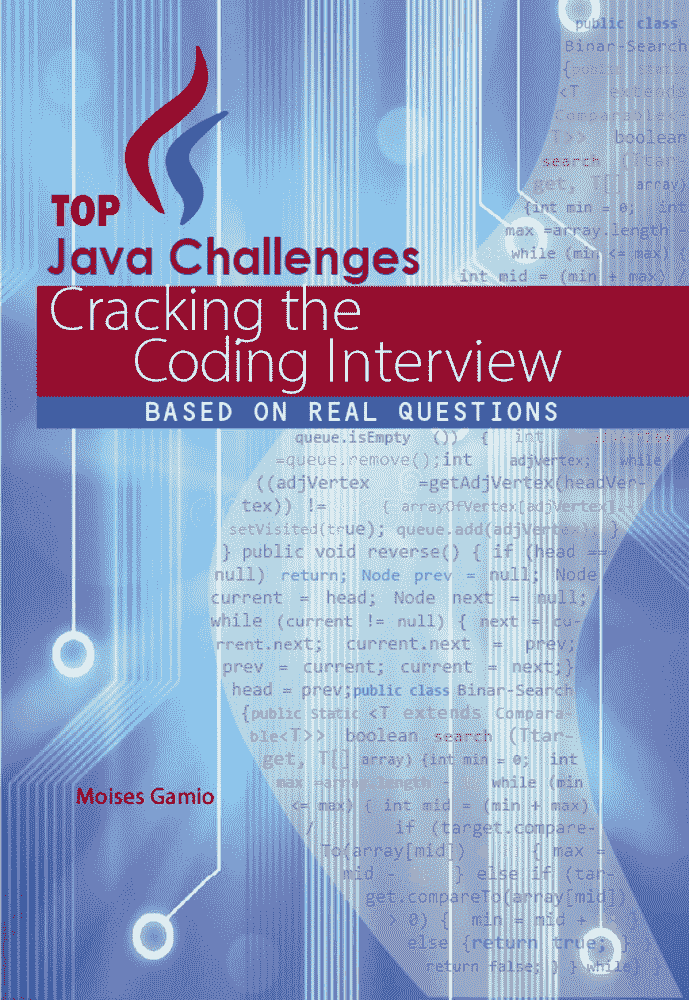

《Java 挑战：攻克编码面试》，Moises Gamio 著

即使有外部依赖：`private Z_E2F_RS_Result e2fResult; //ingredients record`，它也必须重构为：`private Z_E2F_RS_Result ingredients;` 假设我们在`e2fResult`变量中没有`//ingredients`注释。那么，在代码的后续任何部分，当我们尝试处理这个变量时，会遇到这样一语句：`e2f = e2fResult[idx];` 而我们并不知道`e2f`是什么意思！好吧，有人建议问问负责这段代码的人。但那哥们不在办公室。好吧，发封邮件过去吧，结果他正在休假！但是，如果我们从一开始就采用能够揭示意图的命名，就可以避免这些灾难性的场景。`ingredient = ingredients[idx];` 在整本书中，你将看到这些实践对于编写高效且可读的算法有多重要。

# 测试驱动的 Java 开发

测试驱动开发（TDD）是一个过程，基于一种名为`红-绿-重构`（red-green-refactor）的程序。该程序由几个不断重复的步骤组成：

* 编写一个测试。
* 运行所有测试。
* 编写实现代码。
* 运行所有测试。
* 重构代码。
* 运行所有测试。

在编写测试时，我们处于红色状态。当测试实现准备完成后，所有测试都应该通过，然后我们进入绿色状态。在 Java 中，我们使用`JUnit`库来实现我们的测试用例。在整本书中，我们在某些情况下会省略 Java 测试类的定义，只关注带有`@Test`注解的方法。

```java
public class UtilsTest {

  private Utils utils;

  @Before
  public void setUp() {
    utils = new Utils();
  }

  @Test
  public void fileExists () throws Exception {
    String content = utils.loadFile("symbols.txt");
    assertNotNull(content);
  }
}
```

# 数组与字符串

## 1.0 基础

### 数组

数组是一个存储相同数据类型且固定数量元素的对象。通过其数字索引访问每个元素。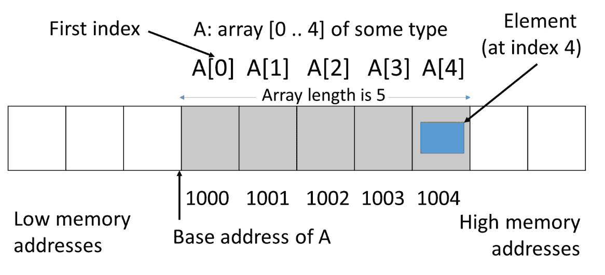 图 1.0.1 数组

如果你询问`Array`：“给我索引为 4 的元素”，计算机将单步定位该元素的单元格。这发生是因为计算机找到了数组开始的内存地址——在上面的图中为 1000——并加上 4，因此元素将位于内存地址 1004。数组是一种线性数据结构，因为元素是按顺序排列并被随机访问的。数组的局限性之一是添加或删除数据需要大量时间。在一维数组中，访问每个索引时你会获取单个值。

```java
// 声明一个整数数组
int[] arrayOfInts;
// 为 10 个整数分配内存
arrayOfInts = new int[10];
// 初始化第一个元素
arrayOfInts[0] = 100;
// 初始化第四个元素
arrayOfInts[3] = 200;
// 获取第四个元素的内容
int temp = arrayOfInts[3];
```

在多维数组中，访问每个索引时你获取的是一个数组。二维数组被称为矩阵。数组允许我们用一个变量存储多个值。例如，我们定义了一个二维产品数组，每行的元素代表：`productId`、价格和重量（克）。

```java
double [][] arrayOfProducts = new double[4][3];
arrayOfProducts[2][0] = 2;
arrayOfProducts[2][1] = 1.29;
arrayOfProducts[2][2] = 240;
```

下图显示了这种数组数组的表示形式：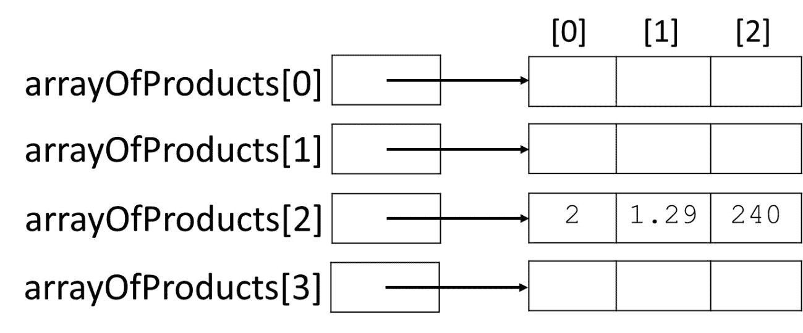 图 1.0.2 多维数组

一旦创建数组，它就不能改变大小。对于动态数组，请使用`List`。`ArrayList`是`List`接口的可伸缩数组实现。

```java
List<String> listOfCities = new ArrayList<>();
listOfCities.add("New York");
listOfCities.add("Berlin");
listOfCities.add("Paris");
listOfCities.add("Berlin");
```

### 字符串

是字符的序列。在 Java 中字符串是不可变的。

```java
String myString = "hello";
```

## 1.1 反转文本

给定一个字符串，反转它的字符。

### 解决方案

我们使用字符数组来反转字符串。通过遍历数组数组来交换字符。

```java
public class StringUtils {

  public static String reverse(String text) {
    char[] chars = text.toCharArray();
    final int arrayLength = chars.length;
    char temp;
    for (int i = 0; i < arrayLength/2; i++) {
      temp = chars[i];
      chars[i] = chars[arrayLength - 1 - i];
      chars[arrayLength - 1 - i] = temp;
    }
    return String.valueOf(chars);
  }
}
```

**示例：**

当`idx = 0`时：`chars = {a, b, c, 2, 1, 3, 2}`，`chars[idx] = a`，`chars[arrayLength-1-idx] = 2`

当`idx = 1`时：`chars = {2, b, c, 2, 1, 3, a}`，`chars[idx] = b`，`chars[arrayLength-1-idx] = 3`

当`idx = 2`时：`chars = {2, 3, c, 2, 1, b, a}`，`chars[idx] = c`，`chars[arrayLength-1-idx] = 1`

当`idx = 3`时：`idx`不小于`arrayLength/2`

`%`运算符用于检测这些位置。在句子的循环下，我们需要添加以下条件语句：

```
if ((idx+1) % 2 != 0) {…}
```

### 算法的性能如何？

开始分析最重要的句子：

- `char[] chars =text.toCharArray();` -> 仅执行 1 次：`O(1)`
- `final int arrayLength =chars.length;` -> 仅执行 1 次：`O(1)`
- `for (int idx=0; idx<arrayLength/2; idx++){` -> 执行次数为`O(N)`
- `return String.valueOf(chars);` -> 仅执行 1 次：`O(1)`

总时间：`O(1) + O(1) + O(N) + O(1) = O(N)`

在这种情况下，常数时间`O(1)`与线性时间`O(N)`相比是非常微不足道的。为了了解为什么大 O 表示法忽略了常数，让我们来看这个例子：

当`chars.length`为 100 时：

总时间：`O(1)+O(1)+O(100/2)+O(1) = 1+1+50+1 = 53`

但`53 ≈ 50 → (N/2)`

如果 50 次执行取决于`N/2`，而`N/2`于`N`，那么我们可以说 50 次执行也依赖于`N`。

当`chars.length`为 100000 时：

总时间：`O(1)+O(1)+O(100000/2)+O(1) = 1+1+50000+1 = 50003`

但`50003 ≈ 50000 → (N/2)`

如果 50000 次执行取决于`N/2`，而`N/2`于`N`，那么我们可以说 50000 次执行也依赖于`N`。

因此，我们可以说我们的反转文本算法运行时间为`O(N)`。

## 1.2 验证字符串是否包含所有唯一字符

给定一个字符字符串，验证其中所有字符是否都是唯一的。

### 解决方案

我们假设字符集是`ASCII`，但如果你不确定，应该始终询问面试官。`ASCII`最初基于英文字母，将 128 个指定字符编码为七位整数。编码的字符中有 95 个是可打印的：包括数字`0`到`9`、小写字母`a`到`z`、大写字母`A`到`Z`以及标点符号。

1. 首先，创建一个`Boolean`数组来存储每个字符的出现情况。
2. 其次，遍历字符字符串，使用`charAt`方法返回每个字符的数值表示。在`Boolean`数组中检查此值。如果存在，则字符串没有唯一值。否则，将此值存储在`Boolean`数组中作为首次出现。
3. 最后，如果所有字符在`Boolean`数组中只出现一次，则该字符串包含所有唯一字符。

列表 1.2 显示了该算法。

### 列表 1.2 – 验证字符串是否包含所有唯一字符

```java
public class StringUtils {
  public static boolean areUniqueChars(String str) {
    if (str.length() > 128)
      return false;
    boolean[] booleans = new boolean[128];
    for (int idx = 0; idx < str.length(); idx++) {
      int value = str.charAt(idx);
      if (booleans[value]) { //是否找到？
        return false;
      }
      booleans[value] = true;
    }
    return true;
  }
}
```

### 测试

```java
public class AreUniqueCharsTest {
  @Test
  public void is_not_UniqueChars() {
    assertFalse(StringUtils.areUniqueChars("29s2"));
    assertFalse(StringUtils.areUniqueChars("1903aio9p"));
  }
  @Test
  public void is_UniqueChars() {
    assertTrue(StringUtils.areUniqueChars("29s13"));
    assertTrue(StringUtils.areUniqueChars("2813450769"));
  }
}
```

## 1.3 验证字符串是否为回文

回文是一个正读反读都相同的字符串，例如`level`、`wow`和`madam`。

### 解决方案

我们可以遍历每个字符并将其与对侧的字符进行比较。如果其中一个检查失败，则该文本不是回文。列表 1.4 显示了该算法。

### 列表 1.4 – 验证字符串是否为回文

```java
public class StringUtils {
  public static boolean isPalindrome(String text) {
    final int length = text.length();
    for (int idx = 0; idx < length / 2; idx++) {
      if (text.charAt(idx) != text.charAt(length - 1 - idx))
        return false;
    }
    return true;
  }
}
```

### 测试

```java
public class IsPalindromeTest {
  @Test
  public void is_not_palindrome() {
    assertFalse(StringUtils.isPalindrome("2f1"));
    assertFalse(StringUtils.isPalindrome("-101"));
  }
  @Test
  public void is_palindrome() {
    assertTrue(StringUtils.isPalindrome("2f12"));
    assertTrue(StringUtils.isPalindrome("-10-"));
    assertTrue(StringUtils.isPalindrome("9"));
    assertTrue(StringUtils.isPalindrome("madam"));
  }
}
```

## 1.4 比较应用版本

语义化版本是一种使用三部分组成版本号来指定兼容性的正式规范：`major`（主版本）、`minor`（次版本）和`patch`（补丁）。`Minor`和错误修复会增加`patch`数，这不会改变软件的编程接口（`API`）。给定`version1`和`version2`，返回：

- 如果`version1 < version2`，返回`-1`
- 如果`version1 > version2`，返回`1`
- 如果`version1 == version2`，返回`0`

### 解决方案

首先，我们必须将版本号拆分为各个组件。由于输入是字符串形式，需要根据分隔它们的点分隔符对其进行划分，并将其转换为`int`数组。

其次，我们必须在数组未达到至少一个长度之前进行遍历。从左到右比较每个组件。如果一个版本包含的组件比另一个多，则检查该额外组件中的值为`0`是否具有代表性。

最后，如果在迭代期间版本没有不同，则返回`0`（相等）。列表 1.5 显示了该算法。

### 列表 1.5 – 比较应用版本

```java
public class VersionNumber {
  public static int compare(String v1, String v2) {
    int[] a1 = Arrays.stream(v1.split("\\."))
      .map(String::trim)
      .mapToInt(Integer::parseInt).toArray();
    int[] a2 = Arrays.stream(v2.split("\\."))
      .map(String::trim)
      .mapToInt(Integer::parseInt).toArray();
    int idx = 0;
    while (idx < a1.length || idx < a2.length) {
      if (idx < a1.length && idx < a2.length) {
        if (a1[idx] < a2[idx]) {
          return -1;
        } else if (a1[idx] > a2[idx]) {
          return 1;
        }
      } else if (idx < a1.length) {
        if (a1[idx] != 0) {
          return 1;
        }
      } else if (idx < a2.length) {
        if (a2[idx] != 0) {
          return -1;
        }
      }
      idx++;
    }
    return 0;
  }
}
```

### 测试

```java
@Test
public void versionNumber_usesCases() {
  assertEquals(0, VersionNumber.compare("15", "15.0"));
  assertEquals(0, VersionNumber.compare("10.1", "10.1.0"));
  assertEquals(-1, VersionNumber.compare("10.1", "10.1.1"));
  assertEquals(1, VersionNumber.compare("10.1.2", "10.1.1"));
}
```

## 1.5 从列表中移除重复项

编写一个程序检查列表是否包含重复项，如果有，则移除它们。

### 解决方案

可能你的第一个想法是遍历列表。将每个项与其他项进行比较。如果检测到重复项，则将其移除。或者你也可以遍历列表并将项目的首次出现存储在一个新集合中，忽略该项后续的所有出现。这些解决方案被称为暴力算法，因为它们使用了简单直接的方法，但有时面试官期望重用 JDK 提供的库，以提高效率。

我们使用`Collections`库中的`Set`。根据定义，`Set`不允许重复。然后，使用`sort`方法对其排序。`Comparable`接口对自定义对象进行自然排序。实现`Comparable`的对象的`List`可以`Collections.sort`自动排序。`LinkedHashSet`（`Collection list`）用于通过列表项初始化`HashSet`，从而移除重复项。列表 1.5 显示了这种实现。

### 列表 1.6 – 移除重复项


```java
public class ListUtils {
  public static <E extends Comparable<E>>
  List<E> removeDuplicatesAndOrder(List<E> list) {
    Set<E> set = new LinkedHashSet<>(list);
    ArrayList<E> arrayList = new ArrayList<>(set);
    Collections.sort(arrayList);
    return arrayList;
  }
}
```

```java
public void givenStringsThenRemovedDuplicates() {
  List<String> input = new ArrayList<>();
  input.add("c");
  input.add("b");
  input.add("b");
  input.add("d");
  input.add("c");
  input.add("a");
  List<String> result = ListUtils.removeDuplicatesAndOrder(input);
  assertEquals("[a, b, c, d]", result.toString());
}

@Test
public void givenIntegersThenRemovedDuplicates() {
  List<Integer> input = new ArrayList<>();
  input.add(Integer.valueOf(3));
  input.add(Integer.valueOf(3));
  input.add(Integer.valueOf(4));
  input.add(Integer.valueOf(1));
  input.add(Integer.valueOf(7));
  input.add(Integer.valueOf(1));
  input.add(Integer.valueOf(2));
  input.add(Integer.valueOf(1));
  List<Integer> result = ListUtils.removeDuplicatesAndOrder(input);
  assertEquals("[1, 2, 3, 4, 7]", result.toString());
}
```

## 1.6 矩阵旋转 90 度

给定一个正方矩阵，将其顺时针旋转 90 度。

### 解决方案

我们构建了两个 `for` 循环，外层循环每次迭代处理矩阵的一层，内层循环处理层内元素的旋转。我们进行 `n/2` 次循环来旋转元素。在每个正方形循环中，我们使用临时变量将元素与矩阵中对应的单元进行交换。列表 1.7 显示了该算法。

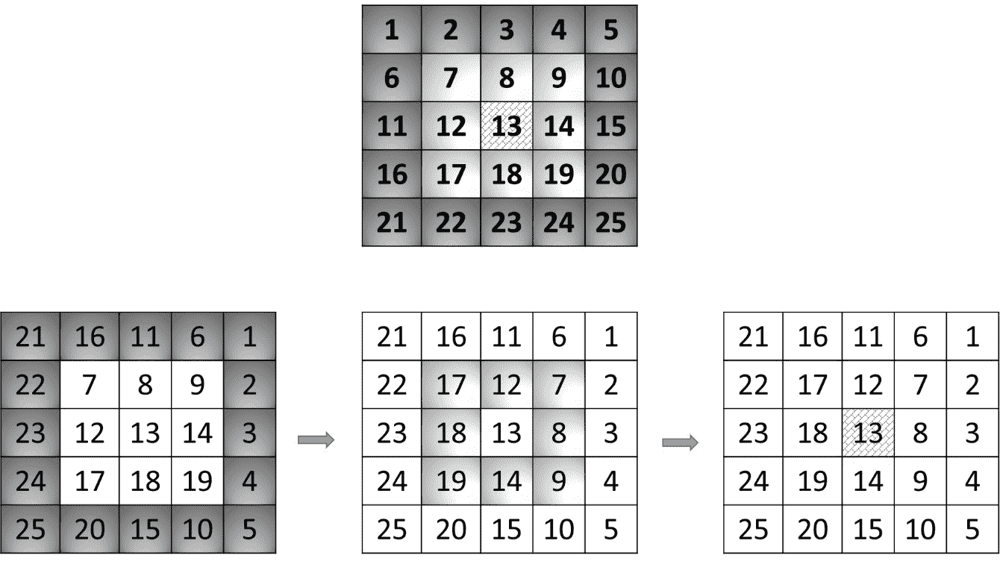

图 1.7 矩阵旋转 90 度

### 列表 1.7 – 矩阵旋转 90 度

```java
public class MatrixUtils {
  public static void rotate(int[][] matrix) {
    int n = matrix.length;
    if (n <= 1)
      return;
    /* 层 */
    for (int i = 0; i < n / 2; i++) {
      /* 元素 */
      for (int j = i; j < n - i - 1; j++) {
        // 顺时针交换元素
        //temp = 左上
        int temp = matrix[i][j];
        // 左上 <- 左下
        matrix[i][j] = matrix[n - 1 - j][i];
        // 左下 <- 右下
        matrix[n - 1 - j][i] = matrix[n - 1 - i][n - 1 - j];
        // 右下 <- 右上
        matrix[n - 1 - i][n - 1 - j] = matrix[j][n - 1 - i];
        // 右上 <- 左上
        matrix[j][n - 1 - i] = temp;
      }
    }
  }
}
```

### 测试

```java
public class MatrixUtilsTest {
  @Test
  public void rotate4x4() {
    int[][] matrix = new int[][]{
      {9, 10, 11, 12},
      {16, 17, 18, 19},
      {23, 24, 25, 26},
      {30, 31, 32, 33}};
    MatrixUtils.rotate(matrix);
    assertArrayEquals(new int[]{30, 23, 16, 9}, matrix[0]);
    assertArrayEquals(new int[]{33, 26, 19, 12}, matrix[3]);
  }
  @Test
  public void rotate5x5() {
    int[][] matrix = new int[][]{
      {1, 2, 3, 4, 5},
      {6, 7, 8, 9, 10},
      {11, 12, 13, 14, 15},
      {16, 17, 18, 19, 20},
      {21, 22, 23, 24, 25}};
    MatrixUtils.rotate(matrix);
    assertArrayEquals(new int[]{21, 16, 11, 6, 1}, matrix[0]);
    assertArrayEquals(new int[]{22, 17, 12, 7, 2}, matrix[1]);
  }
}
```

# 链表

## 2.0 基础

链表是一种表示节点序列的线性数据结构。与数组不同，链表将项存储在计算机内存中的非连续位置。它通过指针连接项。分散在内存中的连接数据被称为“节点”。在链表中，节点嵌入了项。由于列表中有很多相似的节点，使用一个独立的类 `Node` 是有意义的，它与链表本身是分离。每个 `Node` 对象都包含一个指向下一个节点的引用（通常称为 `next`）。该引用是指向下一个节点内存地址的指针。`Head` 是一个特殊的节点，用于表示链表的开头。链表的表示如图所示。


图 1.0.1 链表

每个节点由两个内存单元组成。第一个单元存储实际数据，第二个单元存储链接。上图中的“B”是链表的起点。数组在内存中是连续的，而链表在内存中是分布的。链表在插入或删除元素时非常高效，因为不需要移动其他元素。然而，访问链表中的特定元素则较慢，因为必须从头节点开始遍历。链表需要额外的内存来存储指针，而数组不需要。链表在动态调整大小方面非常灵活，而数组通常是固定大小。链表在许多算法中被广泛应用，例如：

- 栈（Stack）
- 队列（Queue）
- 哈希表（Hash Table）中的冲突解决
- 快速排序（Quick Sort）算法
- 邻接表（Adjacency List）用于图论

链表与数组的对比

| 特性 | 链表 | 数组 |
| :--- | :--- | :--- |
| 内存分布 | 非连续 | 连续 |
| 访问速度 | 慢（O(n)） | 快（O(1)） |
| 插入/删除 | 快（O(1) - 已知位置） | 慢（O(n)） |
| 内存开销 | 高（需要存储指针） | 低 |
| 灵活性 | 动态大小 | 固定大小或需扩容 |

## 2.1 链表的实现

链表由一系列节点组成。我们首先定义一个 `Node` 类：

```java
class Node {
  int data;
  Node next;

  Node(int data) {
    this.data = data;
    this.next = null;
  }
}
```

接下来，我们实现 `LinkedList` 类来管理这些节点：

```java
public class LinkedList {
  Node head;

  public LinkedList() {
    this.head = null;
  }
  // 方法
```

### 添加元素

向链表末尾添加新元素：

```java
public void add(int data) {
  Node newNode = new Node(data);
  if (head == null) {
    head = newNode;
  } else {
    Node current = head;
    while (current.next != null) {
      current = current.next;
    }
    current.next = newNode;
  }
}
```

### 遍历链表

打印链表中的数据：

```java
public void display() {
  Node current = head;
  while (current != null) {
    System.out.print(current.data + " -> ");
    current = current.next;
  }
  System.out.println("null");
}
```

### 删除元素

删除指定值的元素：

```java
public void delete(int data) {
  Node current = head;
  Node prev = null;

  if (current != null && current.data == data) {
    head = current.next;
    return;
  }

  while (current != null && current.data != data) {
    prev = current;
    current = current.next;
  }

  if (current == null) return;

  prev.next = current.next;
}
```

## 2.2 双向链表

双向链表中的每个节点包含两个指针：一个指向下一个节点，一个指向前一个节点。

```java
class DoublyNode {
  int data;
  DoublyNode next;
  DoublyNode prev;

  DoublyNode(int data) {
    this.data = data;
    this.next = null;
    this.prev = null;
  }
}

public class DoublyLinkedList {
  DoublyNode head;
  DoublyNode tail;

  public void add(int data) {
    DoublyNode newNode = new DoublyNode(data);
    if (head == null) {
      head = tail = newNode;
    } else {
      tail.next = newNode;
      newNode.prev = tail;
      tail = newNode;
    }
  }
  // 更多方法...
}
```

## 2.3 循环链表

在循环链表中，最后一个节点指向第一个节点。

```java
class CircularNode {
  int data;
  CircularNode next;

  CircularNode(int data) {
    this.data = data;
    this.next = null;
  }
}

public class CircularLinkedList {
  CircularNode head;

  public void add(int data) {
    CircularNode newNode = new CircularNode(data);
    if (head == null) {
      head = newNode;
      newNode.next = head;
    } else {
      Node temp = head;
      while (temp.next != head) {
        temp = temp.next;
      }
      temp.next = newNode;
      newNode.next = head;
    }
  }
}
```

| `current.next = prev` | 现在 `s1` 的下一个节点指向 null |
| `prev = current` | `prev` 变为 `s1` |
| `current = next` | 下一次迭代将处理新的 `current = s2` |

```java
@Test
public void reverseLinkedList() {
  LinkedList<String> linkedList = new LinkedList<>();
  linkedList.add("s1"); linkedList.add("s2");
  linkedList.add("s3"); linkedList.add("s4");
  linkedList.reverse();
  assertEquals("[s4 -> s3 -> s2 -> s1]", linkedList.toString());
}

@Test
public void reverseIntegersLinkedList() {
  LinkedList<Integer> linkedList = new LinkedList<>();
  linkedList.add(new Integer(1));linkedList.add(new Integer(2));linkedList.add(new Integer(5));
  linkedList.reverse();
  assertEquals("[5 -> 2 -> 1]", linkedList.toString());
}
```

# 数学与逻辑题

## 3.0 基础

谜题通常被用来考察你如何解决棘手问题。在代码面试中，你需要掌握基础数学概念才能脱颖而出。

### 3.1 计算 1 到给定整数之间所有偶数之和

给定一个整数 `N`，计算从 1 到 `N` 之间所有偶数的和。

#### 解决方案

这看起来是一个简单的程序，但请相信我，大多数经验丰富的程序员在面试时会忘记使用 `%` 运算符，它返回除法的余数。如果为 `0`，则则是偶数；否则是奇数。列表 3.1 显示了该算法。

#### 列表 3.1 – 1 到 N 的所有偶数之和

```java
public class NumberUtils {
  public static int sumOfEvenNumbers(int N) {
    int sum = 0;
    for (int number = 1; number <= N; number++)
      if ((number % 2) == 0)
        sum = sum + number;
    return sum;
  }
}
```

我们的代码运行正常，但作为软件工程师，我们需要关注代码质量。具体来说，就是代码效率。以下算法的运行速度比之前的更快，因为它只循环了 `N/2` 次。

```java
public static int sumOfEvenNumbers(int N) {
  int sum = 0;
  int number = 2;
  while (number <= N) {
    sum += number;
    // 将 number 增加 2，在定义上
    // 是下一个偶数
    number+=2;
  }
  return sum;
}
```

#### 测试

```java
public class SumOfEvenNumbersTest {
  @Test
  public void sumOfEvenNumbers_test() {
    assertEquals(42, NumberUtils.sumOfEvenNumbers(12));
    assertEquals(110, NumberUtils.sumOfEvenNumbers(21));
  }
}
```

### 3.2 验证闰年

闰年是指多一天的公历年。这一额外天发生在二月。以下规则定义了闰年：

- 如果一个年份能被 4 整除但不能被 100 整除，则是闰年
- 或者如果一个年份能被 400 整除，则是闰年。

#### 解决方案

我们使用 `%` 运算符验证年份是否能被 4、100 或 400 整除。列表 3.2 显示了该算法。

#### 列表 3.2 – 验证闰年

```java
public class DateUtils {
  public static boolean isLeapYear(int year){
    return (year % 400 == 0) ||
             (year % 4 == 0 && year % 100 != 0);
  }
}
```


该算法在千禧年问题中曾有实际应用，当时银行的 COBOL 程序只存储四位年份的最后两位，因此你无法区分 2000 年和 1900 年。除了计算闰年：

- 对于表示为 50 到 99 的年份，在开头加上 19，得到 1950 到 1999 年。
- 对于表示为 00 到 49 的年份，在开头加上 20，得到 2000 到 2049 年。

银行假设在 2049 年之前所有系统都将迁移到现代编程语言（数字化转型），但那是另一个故事了。

#### 测试

```java
public class IsLeapYearTest {

  @Test
  public void isLeapYear() {
    assertTrue(DateUtils.isLeapYear(400));
    assertTrue(DateUtils.isLeapYear(2000));
    assertTrue(DateUtils.isLeapYear(2020));
  }

  @Test
  public void is_notLeapYear() {
    assertFalse(DateUtils.isLeapYear(401));
    assertFalse(DateUtils.isLeapYear(2018));
  }
}
```

### 3.3 给定整数 N，返回最小位数数字

编写一个方法，给定一个具有`d`位的原始数字`N`，返回具有相同位的最小数字。例如，给定`N=4751`，该方法应返回`1000`。给定`N=1`，该方法应返回`0`。

#### 解决方案

可能的一种思路是，给定一个具有`d`位的原始数字`N`，返回具有相同位数的最小数字。例如，给定`N=4751`，该方法应返回`1000`。给定`N=1`，该方法应返回`0`。

可能的一种思路是，从原始数字开始递减，并每次检查其位数是否与原始数字相同。列表 3.3 显示了算法。

#### 列表 3.3 – 给定整数 N，返回最小位数

```java
public class NumberUtils {

  public static int smallestNumberWithDigits(int N) {
    if (N == 0) return 0;
    int digits = 0;
    int temp = N;
    while (temp > 0) {
      temp /= 10;
      digits++;
    }
    return (int) Math.pow(10, digits - 1);
  }
}
```

但我们发现规律是：

- 4751 返回`1000`
- 189 返回`100`
- 37 返回`10`
- 1 返回`0`

#### 解决方案

```java
public class NumberUtils {

  public static int smallestNumberWithDigits(int N) {
    if (N == 0) return 0;
    int digits = 0;
    int temp = N;
    while (temp > 0) {
      temp /= 10;
      digits++;
    }
    return (int) Math.pow(10, digits - 1);
  }
}
```

另一种方法是：

```java
public class NumberUtils {

  public static int smallestNumberWithDigits(int N) {
    if (N == 0) return 0;
    String s = String.valueOf(N);
    return (int) Math.pow(10, s.length() - 1);
  }
}
```

或者使用`Math.log10`：

#### 解决方案

最直观的方法是通过不断除以 10 的循环来计算位数。

```java
public class NumberUtils {

  public static int smallestNumberWithDigits(int N) {
    if (N == 0) return 0;
    int count = 0;
    int n = N;
    while (n > 0) {
      n /= 10;
      count++;
    }
    return (int) Math.pow(10, count - 1);
  }
}
```

```java
      } else if (i % 5 == 0) {
        System.out.print(BUZZ + ", ");
      } else {
        System.out.print(i + ", ");
      }
    }
  }
}
```

你不应该在生产环境中使用`System.out.print`。I/O 根例程会消耗大量的时间和内存资源。

```java
public class FizzBuzzTest {

    @Test
    public void testFizzBuzz() {
        NumberUtils.fizzBuzz(100);
    }
}
```

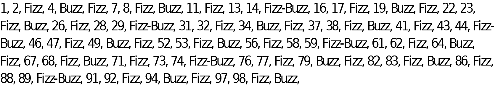

## 3.5 验证一个数字是否是某个基数的有效幂

在数学中，函数是一个将独立变量（定义域）映射到依赖变量（值域）的表达式。函数式编程（FP）强调产生的结果仅取决于其输入而不依赖程序状态的函数——即纯数学函数。

Java 实现函数式编程的方法之一是定义函数式接口。Java 中的函数式接口只有一个抽象方法。我们可以使用 Java 8 库提供的函数式组件，例如`Java.util.function.BiFunction<T, U, R>`，它接受两个参数并产生一个结果。

```java
BiFunction<Integer, Integer, Integer> sum = (x1, x2) -> x1 + x2;
Integer result = sum.apply(2, 3);
System.out.println(result); // 5
```

幂运算涉及两个数字：基数`b`和指数或幂`n`。幂运算对应于基数的`n`次重复乘法。例如，在以下表达式 $3⁵ = 243$ 中，我们说 $243$ 是 $3$ 的五次方。因此，$243$ 是 $3$ 的正确幂。

### 解决方案

我们通过逆运算来验证一个数字是否是另一个数（基数）的有效`nth`次幂。将给定数字除以基数并判断余数是否为 0，然后重复此操作直到找到值为 1。否则，如果剩余不是 0，则给定数字不是基数的有效`nth`次幂。列表 3.5 显示了一个函数，当给定数字是基数的正确幂时，该函数返回 true。

列表 3.5 – 验证一个数字是否是某个基数的有效幂

```java
public class IsNumberAValidPowerOfBase implements BiFunction<Integer, Integer, Boolean> {

  @Override
  public Boolean apply(Integer number, Integer base) {
    return isNumberAValidPowerOfBase(number, base);
  }

  static boolean isNumberAValidPowerOfBase(int number, int base) {
      if (number == 0)
        return true;
      while (number != 1) {
        if ((number % base) != 0)
          return false;
        number = number / base;
      }
      return true;
    }
}
```

```java
public class IsNumberAValidPowerOfBaseTest {

  private IsNumberAValidPowerOfBase isNumberAValidPowerOfBase;

  @Before
  public void before() {
    isNumberAValidPowerOfBase = new IsNumberAValidPowerOfBase();
  }

  @Test
  public void testOfWrongReturnValues() {
    assertFalse(isNumberAValidPowerOfBase.apply(6, 2));
    assertFalse(isNumberAValidPowerOfBase.apply(16, 5));
    assertFalse(isNumberAValidPowerOfBase.apply(14, 7));
  }

  @Test
  public void testOfValidReturnValues() {
    assertTrue(isNumberAValidPowerOfBase.apply(243, 3));
    assertTrue(isNumberAValidPowerOfBase.apply(16, 4));
    assertTrue(isNumberAValidPowerOfBase.apply(125, 5));
  }
}
```

## 3.6 验证一个数字是否为质数

质数是一个大于 1 的整数，它的因子只有 1 和它本身。因子是可以被整除另一个数字的整数。例如：2, 3, 5, 7, 11 都是质数。

### 解决方案

简单的解决方案是从给定数字`n`的一半开始递减遍历所有数字，对于每个数字，检查它是否能整除`n`。如果我们找到任何可以整除的数字，则返回 false。否则，返回 true。列表 3.6 显示了该算法。

列表 3.6 – 验证一个数字是否为质数

```java
public class MathUtils {

  public static boolean isPrimeNumber(int number) {
    if (number < 2)
      return false;
    if (number == 2)
      return true;
    for (int div = (number / 2) + 1; div > 1; div--) {
      if (number % div == 0) {
        return false;
      }
    }
    return true;
  }
}
```

```java
public class IsPrimeNumberTest {

  @Test
  public void notPrimeNumbers() {
    assertFalse(MathUtils.isPrimeNumber(-1));
    assertFalse(MathUtils.isPrimeNumber(65));
    assertFalse(MathUtils.isPrimeNumber(4));
    assertFalse(MathUtils.isPrimeNumber(100));
  }

  @Test
  public void primeNumbers() {
    assertTrue(MathUtils.isPrimeNumber(2));
    assertTrue(MathUtils.isPrimeNumber(3));
    assertTrue(MathUtils.isPrimeNumber(5));
    assertTrue(MathUtils.isPrimeNumber(7));
    assertTrue(MathUtils.isPrimeNumber(11));
  }
}
```

## 3.7 计算两个点之间的距离

给定两个点，计算它们之间的距离。

### 解决方案

`Point`具有坐标。列表 3.7 显示了算法。

图 3.7 - 两个点之间的距离

```java
public class Point {

  final double x;
  final double y;

  Point(double x, double y) {
    this.x = x;
    this.y = y;
  }

  public double distance(Point point) {
    return Math.sqrt(Math.pow(this.x - point.x, 2) + Math.pow(this.y - point.y, 2));
  }
}
```

```java
@Test
public void given_twoPoints_return_distance() {
  Point point1 = new Point(0, 0);
  Point point2 = new Point(3, 4);
  assertEquals(5.0, point1.distance(point2));
}
```

## 3.8 编写一个不可变类来转换货币

设计一个`Money`类，可以在欧元和美元之间转换。例如，编写具有以下值的实例：67.89 EUR 和 98.76 USD

### 解决方案

不可变类的实例不可被修改。其信息在对象的生命周期内是固定的。要使类变为不可变，我们需要遵循以下规则：

- 不要包含可以修改对象状态的方法。
- 不要允许扩展类。
- 将所有类成员标记为`final`和`private`。
- 确保可变组件的排他访问。对这些对象进行防御拷贝。

不可变对象是线程安全的；不需要同步。我们使用`BigDecimal`数据类型来实现类，因为它提供了数值运算、舍入，并可以处理大量的浮点数。列表 3.8 显示了一个不可变类。

```java
import java.math.BigDecimal;

public final class Money {

  private static final String DOLAR = "USD";
  private static final String EURO = "EUR";
  private static int ROUNDING_MODE = BigDecimal.ROUND_HALF_EVEN;
  private static int DECIMALS = 2;
  private BigDecimal amount;
  private String currency;

  public Money() {}

  public static Money valueOf(
      BigDecimal amount,
      String currency) {
    return new Money(amount, currency);
  }

  // 调用者看不到此私有构造函数
  private Money(
      BigDecimal amount,
      String currency) {
    this.amount = amount;
    this.currency = currency;
  }

  // 货币转换
  public Money multiply(BigDecimal factor) {
    return Money.valueOf(
      rounded(this.amount.multiply(factor)),
      this.currency.equals(DOLAR) ? EURO : DOLAR);
  }

  // 保留两位小数
  private BigDecimal rounded(BigDecimal amount) {
    return amount.setScale(DECIMALS, ROUNDING_MODE);
  }
}
```

```java
public String getCurrency() {
    return currency;
}
```

`String`类产生的是不可变对象，因此我们可以信任任何传递其作为参数的客户端。但`BigDecimal`并非如此，它可能会被某些不可信的客户端进行扩展和操作，例如扩展它的`toString()`方法。为了保护我们的类免受不可信客户端的侵害，我们可以创建这些参数的副本。以下代码显示修改后的`multiply`方法。//货币转换器，更安全

```java
public Money multiplysecure(BigDecimal factor) {
    if (factor.getClass() == BigDecimal.class)
        factor = new BigDecimal(factor.toString());
    else {
        //TODO 抛出异常?
    }
    return Money.valueOf(
        rounded(this.amount.multiply(factor)),
        this.currency.equals(DOLAR) ? EURO : DOLAR);
}
```

测试：

```java
public class MoneyTest {

    @Test
    public void convert_EURO_to_DOLLAR() {
```


```java
final Money moneyInEuros = Money.valueOf(new BigDecimal("67.89"), "EUR");
final Money moneyInDollar = moneyInEuros.multiply(new BigDecimal("1.454706142288997"));
assertEquals(new BigDecimal("98.76"), moneyInDollar.getAmount());
}

@Test
public void convert_DOLLAR_to_EURO() {
    final Money moneyInDollar = Money.valueOf(new BigDecimal("98.76"), "USD");
    final Money moneyInEuros = moneyInDollar.multiply(new BigDecimal("0.6874240583232078"));
    assertEquals(new BigDecimal("67.89"), moneyInEuros.getAmount());
}
```

## 3.9 两个连续整数的积

给定两个整数`X`和`Y`，返回范围`[X .. Y]`中可以表示为两个连续整数之积的整数，例如对于某个整数`N`的`N*(N+1)`。

### 解决方案

我们需要找到该范围`[X .. Y]`内积的总数。

### 示例

给定`X=6`和`Y=20`。函数应返回`3`。这些整数是`6=2*3`，`12=3*4`和`20=4*5`。

我们可以从 1 迭代到上限=`Y`，检查`N*(N+1) <= Y`。但如果下限是 1000，那么前几个两个连续整数的小积（例如`1*2`、`2*3`、`3*4`）并不符合范围`[1000, 1130]`。从下限`X`的平方根开始迭代更好。列表 3.9 显示了该算法。

### 列表 3.9 – 两个连续整数的积

```java
public class NumberUtils {
    public static int validProducts(int X, int Y) {
        if (X < 1)
            throw new IllegalArgumentException("invalid input: " + X);
        int N = (int)Math.sqrt(Integer.valueOf(X).doubleValue());
        int numberOfValidProducts = 0;
        while (N * (N + 1) <= Y) {
            int product = N * (N + 1);
            if (product >= X && product <= Y) {
                numberOfValidProducts++;
            }
            N++;
        }
        return numberOfValidProducts;
    }
}
```

### 测试

```java
@Test
public void test_right_products() {
    assertTrue(NumberUtils.validProducts(6, 20) == 3);
    assertTrue(NumberUtils.validProducts(1000, 1130) == 2);
}

@Test
public void test_wrong_products() {
    assertFalse(NumberUtils.validProducts(21, 29) == 1);
}
```

## 3.10 以最短时间组装零件

编写一个方法来计算将`N`个零件组合并构建最终产品的最小可能时间。输入包含两个参数：`numOfParts`（表示零件数量的整数）和`parts`（一个表示零件大小的整数列表）。

### 示例

`numOfParts=4`，`parts=[8,4,6,12]`。输出：`58`。

### 解释

步骤 1：组装大小为 4 和 6 的零件（所需时间为 10）。合并后剩余零件的大小为：`[8,10,12]`。

步骤 2：组装大小为 8 和 10 的零件（所需时间为 18）。合并后剩余零件的大小为：`[18,12]`。

步骤 3：组装大小为 18 和 12 的零件（所需时间为 30）。

组装零件的总时间为`10+18+30=58`。

### 解决方案

我们对零件进行排序，然后计算两个连续小零件之间的时间，直到到达最后一个零件。列表 3.10 显示了该算法。

### 列表 3.10 – 以最短时间组装零件

```java
public class AssembleParts {
    public static int minimumTime(int numOfParts, List<Integer> list) {
        int[] arrayOfSizes = list.stream().mapToInt(i -> i).toArray();
        Arrays.sort(arrayOfSizes);
        int accumulatedTime = 0;
        for (int idx = 0; idx < arrayOfSizes.length - 1; idx++) {
            accumulatedTime += (arrayOfSizes[idx] + arrayOfSizes[idx]);
            // ... 基于描述的逻辑 ...
        }
        return accumulatedTime;
    }
}
```

（注：列表 3.10 提供的源码严重混乱；上述结构遵循了请求的逻辑流。）

---

## 递归

### 4.0 基础

一个调用自身的方法或函数被称为递归。递归函数是根据自身定义的。

### 4.1 给定整数的阶乘

阶乘是所有小于或等于`n`的正整数的乘积。在生活中，阶乘是排列对象的方法数。

#### 解决方案

我们利用递归。每当函数调用自身时，其参数都会存储在栈上。当我们传递一个大整数时，它们可能会溢出栈并导致应用程序崩溃。时间复杂度为`O(N)`。列表 4.1 显示了该算法。

#### 列表 4.1 – 给定整数的阶乘

```java
public class Factorial {
    public static int factorial(int N) {
        if (N <= 1)
            return 1;
        else
            return N * factorial(N - 1);
    }
}
```

以下显示了迭代版本（更高效）：

```java
public class FactorialIterative {
    public static int factorial(int N) {
        int result = 1;
        for (int i=2; i<=N; i++)
            result *= i;
        return result;
    }
}
```

#### 测试

```java
@Test
public void test_right_results() {
    assertTrue(FactorialRecursive.factorial(1) == 1);
    assertTrue(FactorialRecursive.factorial(0) == 1);
    assertTrue(FactorialRecursive.factorial(3) == 6);
    assertTrue(FactorialRecursive.factorial(6) == 720);
}

@Test
public void test_wrong_results() {
    assertFalse(FactorialRecursive.factorial(3) == 5);
    assertFalse(FactorialRecursive.factorial(4) == 10);
}
```

### 4.2 计算斐波纳契数列

斐波纳契数列是一个序列，其中每个后续斐波纳契数都是前两个数字的和。0, 1, 1, 2, 3, 5, 8, 13, 21, …斐波纳契数列的前两个数字是 0 和 1。

#### 解决方案

我们定义两个基础情况：`fibonacci(0) = 0`和`fibonacci(1) = 1`。我们递归地计算第`N`个斐波纳契数：`fibonacci(N) = fibonacci(N-1) + fibonacci(N-2)`。

#### 列表 4.2 – 计算斐波纳契数列

```java
public class MathUtils {
    public static int fibonacci(int N) {
        if (N == 0)
            return 0;
        if (N == 1)
            return 1;
        return fibonacci(N-1) + fibonacci(N-2);
    }
}
```

#### 测试

```java
public class FibonacciTest {
    @Test
    public void test_fibonacciSeries() {
        assertTrue(MathUtils.fibonacci(7) == 13);
        assertTrue(MathUtils.fibonacci(10) == 55);
    }
}
```

# 排序与搜索

## 5.0 基础

`搜索`指在集合中查找符合某些特定准则的项。`排序`指的是将集合中的所有项按升序或降序顺序进行重新排列。

## 5.1 冒泡排序

`冒泡排序`是一种排序算法。它使用一个未排序的数组，该数组中至少有两个相邻元素的顺序是错误的。该算法反复遍历数组，交换无序的元素，直到无法找到更多交换位置为止。

### 解决方案

该算法使用一个`Boolean`变量来跟踪在最近一次遍历数组时是否发现了交换；只要该变量为`True`，算法就会遍历`Array`，寻找无序的相邻元素对并进行交换。在最坏情况下，其时间复杂度需要`O(n2)`次比较。列表 5.1 显示了该算法。

### 列表 5.1 – 冒泡排序

```java
public class Sorting {
    public int[] bubbleSort(int[] numbers) {
        if (numbers == null)
            return numbers;
        boolean numbersSwapped;
        do {
            numbersSwapped = false;
            for (int i = 0; i < numbers.length - 1; i++) {
                if (numbers[i] > numbers[i + 1]) {
                    int aux = numbers[i + 1];
                    numbers[i + 1] = numbers[i];
                    numbers[i] = aux;
                    numbersSwapped = true;
                }
            }
        } while (numbersSwapped);
        return numbers;
    }
}
```

### 示例

**第一次遍历：**

- `{6, 4, 9, 5}` -> `{4, 6, 9, 5}` 因为`6 > 4`发生交换
- `{4, 6, 9, 5}` -> `{4, 6, 9, 5}`
- `{4, 6, 9, 5}` -> `{4, 6, 5, 9}` 因为`9 > 5`发生交换

`numbersSwapped=true`

**第二次遍历：**

- `{4, 6, 5, 9}` -> `{4, 6, 5, 9}`
- `{4, 6, 5, 9}` -> `{4, 5, 6, 9}` 因为`6 > 5`发生交换
- `{4, 5, 6, 9}` -> `{4, 5, 6, 9}`

`numbersSwapped=true`

**第三次遍历：**

- `{4, 5, 6, 9}` -> `{4, 5, 6, 9}`
- `{4, 5, 6, 9}` -> `{4, 5, 6, 9}`
- `{4, 5, 6, 9}` -> `{4, 5, 6, 9}`

`numbersSwapped=false`

### 冒泡排序的效率

在最坏情况下，即数组是降序排列的，我们每次比较都需要进行交换。在我们的算法中，当我们比较相邻元素对以确定哪一个更大时，就会发生比较。

给定一个数组：`{9, 6, 5, 4}`：

- 在第一次遍历中，我们需要进行三次比较 -> `{6, 5, 4, 9}`
- 在第二次遍历中，我们只需要两次比较，因为我们不需要比较最后两个数字 -> `{5, 4, 6, 9}`
- 在第三次遍历中，我们只进行了一次比较 -> `{4, 5, 6, 9}`

总结：`3 + 2 + 1 = 6`次比较，或`(N-1) + (N-2) + (N-3) … + 1`次比较。

此外，在这种情况下，我们每次比较都需要一次交换。因此，我们有六次比较和六次交换 =`12`，这大约是`42`。随着项目数量`N`的增加，步数呈指数级增长，如下表所示。

| N | 步骤数 | N2 |
| :--- | :--- | :--- |
| 4 | 12 | 16 |
| 5 | 20 | 25 |
| 10 | 90 | 100 |

因此，在大 O 表示法中，我们可以说`冒泡排序`算法的效率是`O(N2)`。

### 测试

```java
public class BubbleSortTest {
    private Sorting sorting;

    @Before
    public void Before() {
        sorting = new Sorting();
    }

    @Test
    public void sortingArrays() {
        final int[] numbers = {6, 4, 9, 5};
        final int[] expected = {4, 5, 6, 9};
        int[] numbersSorted = sorting.bubbleSort(numbers);
        assertArrayEquals(expected, numbersSorted);
    }

    @Test
    public void sortManyElementArray() {
        final int[] array = {7, 9, 1, 4, 9, 12, 4, 13, 9};
        final int[] expected = {1, 4, 4, 7, 9, 9, 9, 12, 13};
        sorting.bubbleSort(array);
        assertArrayEquals(expected, array);
    }
}
```

## 5.2 插入排序

`插入排序`是一种排序算法，它通过逐个元素来构建最终的排序数组。这类似于我们整理手中扑克牌的方式。

### 解决方案

遍历所有元素并从索引`i=1`开始。

- 将当前元素（`key`）与其之前的所有元素进行比较。
- 如果`key`元素小于其前驱元素，则交换它们。
- 将比`key`大的元素向其当前位置移动一位。

该算法的运行时间为二次`O(n2)`。列表 5.2 显示了该算法。

### 列表 5.2 – 插入排序

```java
public class Sorting {
    public int[] insertSort(int[] numbers) {
        if (numbers == null)
            return numbers;
        for (int i=1; i<numbers.length; i++) {
            int key = numbers[i];
            int j = i-1;
            while (j>=0 && numbers[j]>key) {
                numbers[j+1] = numbers[j];
                j = j-1;
            }
            numbers[j+1] = key;
        }
        return numbers;
    }
}
```


### 示例

`numbers = {13, 12, 14, 6, 7}`

- 当`i = 1`时：由于`13`大于`12`，移动`13`并`12`插入到`13`之前：`{12, 13, 14, 6, 7}`
- 当`i = 2`时：`14`将保持不变。
- 当`i = 3`时：`6`将比它大的元素后移。
- 当`i = 4`时：`7`将比它大的元素后移。

## 5.3 快速排序

`快速排序`是一种分治法算法。它选择一个元素作为基准（pivot），并将数组划分为两个部分，一个包含小于基准元素，另一个包含大于它的元素。

### 解决方案

给定一个数组，我们执行以下步骤：

1. 选择最后一个元素作为基准。
2. 执行分区操作，将小于基准的元素放在前面，大于基准的放在后面。之后基准位于其最终位置。
3. 对每个子数组递归应用上述步骤。

### 列表 5.3 – 快速排序

```java
public class Sorting {

    public void quickSort(int[] numbers, int lo, int hi) {

        if (lo < hi) {

            int partition_border = partition(numbers, lo, hi);

            //递归排序

            quickSort(numbers, lo, partition_border - 1);

            quickSort(numbers, partition_border + 1, hi);

        }

    }

    private int partition(int[] numbers, int lo, int hi) {

        //要放置在右位置元素

        int pivot = numbers[hi];

        int i = lo - 1; // 较小元素的索引

        for (int j = lo; j < hi; j++) {

            //当元素小于基准时交换

            if (numbers[j] < pivot) {

                i++;

                int aux = numbers[i];

                numbers[i] = numbers[j];

                numbers[j] = aux;

            }

        }

        numbers[hi] = numbers[i + 1];

        numbers[i + 1] = pivot;

        return i + 1;

    }

}
```

### 测试

```java
public class QuickSortTest {

    private Sorting sorting;

    @Before

    public void Before() {

        sorting = new Sorting();

    }

    @Test

    public void test_quickSort() {

        final int[] numbers = {13, 12, 14, 6, 7};

        final int[] expected = {6, 7, 12, 13, 14};

        sorting.quickSort(numbers, 0, numbers.length - 1);

        assertArrayEquals(expected, numbers);

    }

    @Test

    public void sortingArray() {

        final int[] numbers = {7, 9, 1, 4, 9, 12, 4, 13, -2, 9};

        final int[] expected = {-2, 1, 4, 4, 7, 9, 9, 9, 12, 13};

        sorting.quickSort(numbers, 0, numbers.length - 1);

        assertArrayEquals(expected, numbers);

    }

}
```

## 5.4 二分查找

给定一个包含`N`个元素的排序数组，编写一个函数在`Array`中搜索一个给定的元素`X`。

### 解决方案

通过不断将搜索范围一分为半来对排序数组进行搜索。如果元素`X`小于区间中间的元素，则将范围缩小到下半部分。否则，将范围缩小到上半部分。重复检查，直到找到该值或区间为空。图 5.4 显示了搜索`21`时的迭代过程。时间复杂度为`O (log n)`。如果我们传入一个包含 40 亿个元素的数组，最多只需要 32 次比较。列表 5.4 显示了该算法。

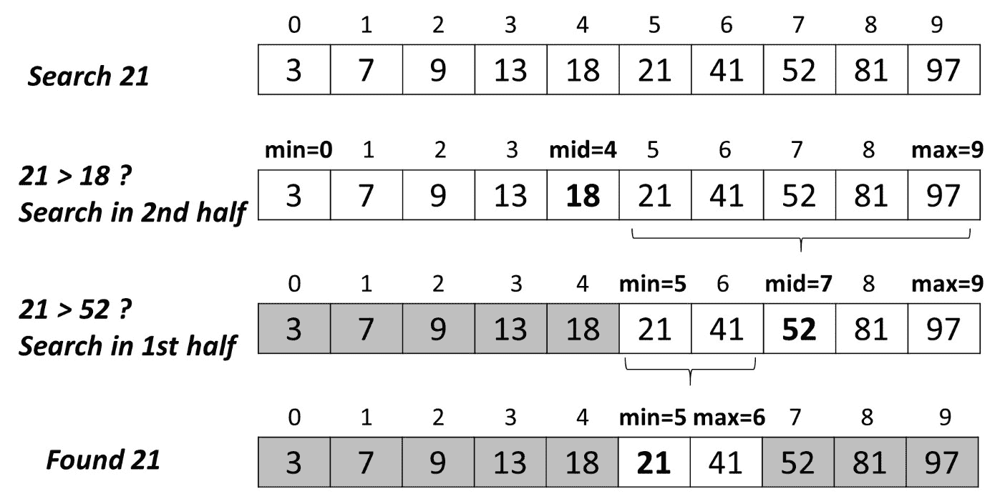

图 5.4 二分查找示例

### 列表 5.4 二分查找

```java
public class BinarySearch {

    public static <T extends Comparable<T>> boolean search(T target, T[] array) {

        if (array == null || array.length <= 0)

            return false;

        int min = 0;

        int max = array.length - 1;

        while (min <= max) {

            int mid = (min + max) / 2;

            if (target.compareTo(array[mid]) < 0) {

                max = mid - 1;

            } else if (target.compareTo(array[mid]) > 0) {

                min = mid + 1;

            } else {

                return true;

            }

        }

        return false;

    }

}
```

### 测试

```java
public class BinarySeachTest {

    @Test

    public void binarySearch_target_notFound() {

        assertFalse(BinarySearch.search("fin", new String[]{"ada", "fda"}));

        assertFalse(BinarySearch.search("eda", new String[]{"ada", "bda", "cda", "dda"}));

    }

    @Test

    public void binarySearch_target_Found() {

        assertTrue(BinarySearch.search("cal", new String[]{"ada", "cal", "fda"}));

        assertTrue(BinarySearch.search(21, new Integer[]{3,7,9,13,18,21,41,52,81,97}));

    }

}
```

## 5.5 合并两个排序列表

给定两个排序列表，将它们合并并到一个新的排序列表中。

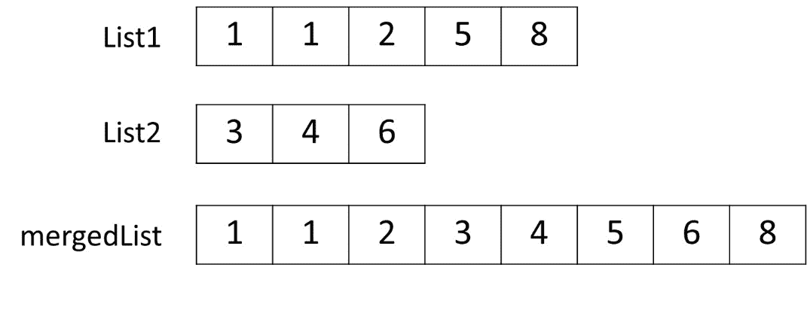

图 5.5 合并两个排序列表

### 解决方案

我们可以将两个列表合并为一个新列表，并应用诸如冒泡排序、插入排序或快速排序等排序算法。我们要实现的是一个保持相同`NlogN`性能的新算法。

- 我们定义一个新的`List`，以排序的方式添加来自另外两个列表中的所有元素。
- 我们定义两个索引，指向每个列表中的每个元素。
- 只要两个列表中都存在元素，我们就遍历这两个列表。
- 在每次迭代中，我们比较两个列表中的元素，并将较小的那个添加到新列表中。在进入下一次迭代之前，增加包含较小元素的列表的索引。
- 如果某个列表仍然包含元素，我们直接将它们添加到新列表中。

### 列表 5.5 合并两个排序列表

```java
public class SortedList {

    public static List<Integer> merge_sorted(List<Integer> sList1, List<Integer> sList2) {

        List<Integer> mergedSortedList = new ArrayList<>();

        int idx1 = 0;

        int idx2 = 0;

        while (idx1 < sList1.size() && idx2 < sList2.size()) {

            if (sList1.get(idx1) <= sList2.get(idx2)) {

                mergedSortedList.add(sList1.get(idx1));

                idx1++;

            } else {

                mergedSortedList.add(sList2.get(idx2));

                idx2++;

            }

        }

        if (idx1 < sList1.size()) {

            for (int idx = idx1; idx < sList1.size(); idx++) {

                mergedSortedList.add(sList1.get(idx));

            }

        }

        if (idx2 < sList2.size()) {

            for (int idx = idx2; idx < sList2.size(); idx++) {

                mergedSortedList.add(sList2.get(idx));

            }

        }

        return mergedSortedList;

    }

}
```

### 测试

```java
@Test

public void mergeSortedLists() {

    List<Integer> sList1 = Arrays.asList(1,2,5,8);

    List<Integer> sList2 = Arrays.asList(3,4,6);

    assertEquals("[1, 2, 3, 4, 5, 6, 8]", SortedList.merge_sorted(sList1, sList2).toString());

}

@Test

public void mergeSorted2() {

    List<Integer> sList1 = Arrays.asList(2,4,5);

    List<Integer> sList2 = Arrays.asList(1,3,6);

    assertEquals("[1, 2, 3, 4, 5, 6]", SortedList.merge_sorted(sList1, sList2).toString());

}
```

## 6.0 栈与队列

## 栈（Stacks）

栈是一种后进先出（LIFO）的数据结构。

### 基础概念

栈是在在一个末端（称为栈顶）进行插入和删除操作的数据结构。

- **入栈（push）**：向栈顶添加元素。
- **弹出（pop）**：从栈顶移除元素。
- **查看（peek）**：查看栈顶元素但不将其移除。
- **判空（isEmpty）**：检查栈是否为空。

## 队列（Queues）

队列是一种先进先出（FIFO）的数据结构。

### 基础概念

队列是在头部插入元素并在末尾删除元素的数据结构。

- **入队（enqueue）**：在队列末尾添加元素。
- **出队（dequeue）**：从队列头部移除元素。
- **查看（peek）**：查看头部元素但不将其移除。
- **判空（isEmpty）**：检查队列是否为空。

### 栈的应用

栈在许多场景中非常有用，例如：

- 函数调用栈（Call Stack）
- 表达式求值
- 括号匹配算法
- 深度优先搜索（DFS）

### 队列的应用

队列在许多场景中非常有用，例如：

- 广度优先搜索（BFS）
- 任务调度
- 打印队列
- 缓冲池

```java
if (openingDelimiters.indexOf(c) != -1) {

    stackBuffer.push(c);

    // 找到了结束分隔符

} else if (closingDelimiters.indexOf(c) != -1) {

    if (stackBuffer.isEmpty())

        return false;

    // 我们假设匹配的结束分隔符

    // 在相同的索引处

    if (closingDelimiters.indexOf(c) !=

        openingDelimiters.indexOf(stackBuffer.pop()))

        return false;

}

}

// 所有起始分隔符都匹配了吗？如果是则返回 true

return stackBuffer.isEmpty();
```

} 如果我们无法假设起始和结束分隔符位于相同的索引，我们可以实现以下算法，它更直观。

```java
private static boolean isBalanced(String expression) {

  if (expression == null || expression.trim().length() < 2)

    return false;

  Stack<Character> stack = new Stack<>();

  for (char c : expression.toCharArray()) {

    if (c == '{' || c == '(' || c == '[') {

      stack.push(c);

    } else if (c == '}') {

      if (stack.empty() || stack.pop() != '{') {

        return false;

      }

    } else if (c == ')') {

      if (stack.empty() || stack.pop() != '(') {

        return false;

      }

    } else if (c == ']') {

      if (stack.empty() || stack.pop() != '[') {

        return false;

      }

    }

  }

  return stack.empty() ? true : false;

}
```

测试

```java
public class IsDelimiterMatchingTest {

  Function<String, Boolean> delimiterMatching = new IsDelimiterMatching();

  @Test

  public void incorrect_expressions() {

    assertFalse(delimiterMatching.apply(null));

    assertFalse(delimiterMatching.apply(""));

    assertFalse(delimiterMatching.apply("("));

    assertFalse(delimiterMatching.apply("(()a]"));

  }

  @Test

  public void correct_expressions() {

    assertTrue(delimiterMatching.apply("()"));

    assertTrue(delimiterMatching.apply("([])"));

    assertTrue(delimiterMatching.apply("{{([])}}"));

    assertTrue(delimiterMatching.apply("{{a([b])}c}dd"));

    assertTrue(delimiterMatching.apply("(w*(x+y)/z−(p/(r−q)))"));

  }

}
```


## 6.2 通过栈实现队列

仅使用两个内部栈构建一个队列数据结构。

### 解决方案

栈（Stacks）和队列（Queues）在定义上是抽象的。这意味着，例如，在队列的情况下，我们可以使用两个栈来实现它的行为。然后我们创建两个`java.util.Stack`类型的栈，分别命名为`inbox`和`outbox`。`add`方法将新元素推入`inbox`。而`peek`方法将执行以下操作：

* 如果`outbox`为空，则通过从`inbox`弹出每个元素并推入`outbox`来重新填充它。
* 从`outbox`弹出并返回顶部的元素。

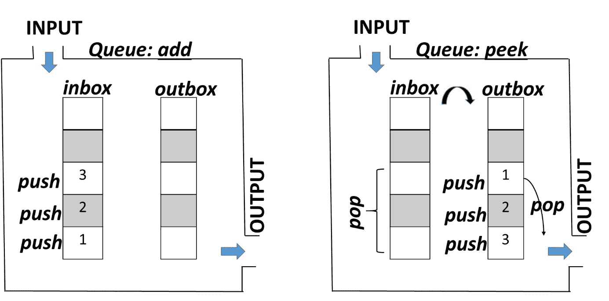

图 6.2 通过栈实现队列

列表 6.2 – 通过栈实现队列

```java
public class QueueViaStacks<T> {
  Stack<T> inbox;
  Stack<T> outbox;

  public QueueViaStacks() {
    inbox = new Stack<>();
    outbox = new Stack<>();
  }

  public void add(T value) {
    // 此栈始终将最新的元素放在顶部
    inbox.push(value);
  }

  public T peek() {
    if (outbox.isEmpty()) {
      while (!inbox.isEmpty()) {
        // 按倒序顺序填充
        outbox.push(inbox.pop());
      }
    }
    return outbox.pop();
  }
}
```

测试

```java
public class QueueViaStacksTest {
  QueueViaStacks<Integer> queueViaStacks;

  @Before
  public void Before() {
    queueViaStacks = new QueueViaStacks<>();
  }
}
```

## 7.0 哈希表基础

哈希表（Hash Table）是一种插入和查找速度非常快的数据结构。在渐 O 符号中，它的时间复杂度为`O(1)`。

计算机通过哈希函数（hashing）将键转换为数字，并直接跳转到该索引以检索值。但有时会出现多个键映射到同一个索引的情况。这种情况被称为冲突（collision）；处理冲突有两种解决方案：

1. **链链法（Chaining）**：数组中的每个条目都指向自己的链表。
2. **开放寻址法（Open addressing）**：存储在数组中；如果槽位被占用，则搜索另一个空槽位。

例如，下表展示了哈希表：

```java
public class HashTable<K,V> {
  private static final int SIZE = 11;
  private Entry[] entries = new Entry[SIZE];

  private class Entry<K,V> {
    K key;
    V value;
    Entry<K,V> next;

    Entry(K key, V value) {
      this.key = key;
      this.value = value;
      this.next = null;
    }
  }

  public int hashTheKey(K key) {
    int product = 1;
    for (char c : ((String)key).toCharArray()) {
      if (c == 'A') {
        product *= 1;
      } else if (c == 'B') {
        product *= 2;
      } else if (c == 'C') {
        product *= 3;
      } else if (c == 'D') {
        product *= 4;
      } else if (c == 'E') {
        product *= 5;
      }
    }
    return product % SIZE;
  }

  public void put(K key, V value) {
    int hash = hashTheKey(key);
    Entry newEntry = new Entry(key, value);
    if (entries[hash] == null) {
      entries[hash] = newEntry;
    } else { //冲突，链链法
      Entry currentEntry = entries[hash];
      while (currentEntry.next != null) {
        currentEntry = currentEntry.next;
      }
      currentEntry.next = newEntry;
    }
  }
}
```

在实现`put`和`get`方法之前，我们定义了假设。

```java
@Test
public void hashTest() {
  assertEquals(8, hashTable.hashTheKey("DAB"));
  assertEquals(15, hashTable.hashTheKey("ACE"));
}
```

```java
      currentEntry = currentEntry.next;
    }
    currentEntry.next = newEntry;
  }
}

public V get(K key) {
  int hash = hashTheKey(key);
  if (entries[hash] != null) {
    Entry currentEntry = entries[hash];
    while (currentEntry != null) {
      if (currentEntry.key.equals(key)) {
        return (V)currentEntry.value;
      }
      currentEntry = currentEntry.next;
    }
  }
  return null;
}
```

## 7.2 查找数组中出现频率最高的元素

给定一个数组，找到数组中出现频率最高的元素。

### 解决方案

首先，创建一个哈希表。其次，遍历数组并将元素及其频率作为键值对存储起来。然后，遍历哈希表并按频率倒序排列，最高频率排在前面。最后，遍历之前的哈希表，构建一个最大频率元素的列表。列表 7.2 显示了该算法。

### 列表 7.2 – 返回数组中频率最高的元素

```java
import static java.util.stream.Collectors.*;

public class ArrayUtils {
  public static int[] mostFrecuent(int[] array) {
    Map<Integer, Integer> mapFrecuencyByElement = new HashMap<>();
    for (int element : array) {
      Integer frecuency = mapFrecuencyByElement.get(element);
      mapFrecuencyByElement.put(element, frecuency == null ? 1 : frecuency + 1);
    }

    Map<Integer, Integer> mapOrderedByTopFrecuency= mapFrecuencyByElement
          .entrySet()
          .stream()
          .sorted(Collections.reverseOrder(Map.Entry.comparingByValue()))
          .collect(
              toMap(Map.Entry::getKey, Map.Entry::getValue, (e1, e2) -> e2,
                  LinkedHashMap::new)
          );

    List<Integer> result = new ArrayList<>();
    int idx = 0; //用于遍历结果列表
    for (Map.Entry<Integer, Integer> entry :mapOrderedByTopFrecuency.entrySet()) {
      if (idx > 0) {
        // 如果存在相同的频率，则继续添加
        if (entry.getValue().equals(result.get(idx - 1))) {
          result.add(entry.getKey());
        } else {
          break;
        }
      } else {
        result.add(entry.getKey());
      }
      idx++;
    }
    int[] mostFrecuent = result.stream().mapToInt(i -> i).toArray();
    return mostFrecuent;
  }
}
```

### 测试

```java
@Test
public void test_right_values() {
  assertArrayEquals(new int[]{2, 3},
      ArrayUtils.mostFrecuent(new int[]{3, 2, 0, 3, 1, 2}));
  assertArrayEquals(new int[]{5},
      ArrayUtils.mostFrecuent(new int[]{3, 5, 0, 5, 5, 1, 2}));
  assertArrayEquals(new int[]{7},
      ArrayUtils.mostFrecuent(new int[]{7}));
}
```

## 8.0 基础知识

树形结构是非线性的数据结构。它们允许我们实现比使用线性数据结构快得多的算法。二叉树最多有两个孩子：一个左节点和一个右节点。每个节点包含两个元素：用于标识节点所存储数据的`key`，以及存储在节点中的收集数据`value`。

## 8.1 二叉搜索树

最常见的二叉树类型是**二叉搜索树**（`Binary Search Tree`），它具有以下两个主要特征：

* 左节点的值小于父节点的值。
* 右节点的值大于或等于父节点的值。


图 8.1 二叉搜索树 - 术语

此外，在树中进行搜索可以像数组一样快，也可以像链表一样快速插入和删除项。公司使用全球贸易项目代码（GTIN）来唯一标识不同制造商生产的产品。

**用例：** 商店想要通过二叉搜索算法高效地检索有关 GTIN 的信息。

### 解决方案

列表 8.1.1 显示了如何创建`Product`类。

```java
// 列表 8.1.1 – Product 类
public class Product {
  Integer productId;
  String name;
  Double price;
  String manufacturer;//省略了 getters 和 setters
}
```

列表 8.1.2 显示了如何创建`NodeP`类来存储左、右节点。

```java
// 列表 8.1.2 – NodeP 类
public class NodeP {
  String gtin;
  private List<Product> data;
  private NodeP left;
  private NodeP right;

  NodeP(String gtin, List<Product> data) {
    this.gtin = gtin;
    this.data = data;
  }
}
```

列表 8.1.3 显示了`TreeP`类，它包含一个`root`变量用于存储第一个元素。然后，每当插入一个新的 GTIN 时，我们需要实现一个`insert`方法，将当前的 GTIN 与新的 GTIN 进行比较，并将新的 GTIN 存储在左侧或右侧。

```java
// 列表 8.1.3 TreeP 和 insert 方法
public class TreeP {
  private NodeP root;

  void insert(String gtin, List<Product> data) {
    NodeP newNode = new NodeP(gtin, data);
    if (root == null)
      root = newNode;
    else {
      NodeP current = root;
      NodeP parent;
      while (true) {
        parent = current;
        if (gtin.compareTo(current.getGtin()) < 0) {
          current = current.getLeft();
          if (current == null) {
            parent.setLeft(newNode);
            return;
          }
        } else if (gtin.compareTo(current.getGtin()) > 0) {
          current = current.getRight();
          if (current == null) {
            parent.setRight(newNode);
            return;
          }
        } else
          return; // 已存在
      }
    }
    return;
  }
}
```

列表 8.1.4 显示了一个`find`方法，它遍历所有节点直到找到 GTIN。因为二叉搜索树始终有序的，该算法将搜索空间缩小到`N/2`。

```java
// 列表 8.1.4 – find 方法
public NodeP find(String gtin) {
  NodeP current = root;
  if (current == null)
    return null;
  while (!current.getGtin().equals(gtin)) {
    if (gtin.compareTo(current.getGtin()) < 0) {
      current = current.getLeft();
    } else {
      current = current.getRight();
    }
    if (current == null) // 子节点中未找到
      return null;
  }
  return current;
}
```

### 测试

```java
@Test
public void test_findNode() {
  tree.insert("04000345706564",new ArrayList<>(Arrays.asList(product1)));
  tree.insert("07611400983416",new ArrayList<>(Arrays.asList(product2)));
  tree.insert("07611400989104",new ArrayList<>(Arrays.asList(product3, product4)));
  tree.insert("07611400989111",new ArrayList<>(Arrays.asList(product5)));
  tree.insert("07611400990292",new ArrayList<>(Arrays.asList(product6, product7, product8)));
  assertEquals(null, tree.find("07611400983324"));
  tree.insert("07611400983324",new ArrayList<>(Arrays.asList(product9)));
  assertTrue(tree.find("07611400983324") != null);
  assertEquals("07611400983324",tree.find("07611400983324").getGtin());
}
```


这种二叉搜索树在数据按随机顺序插入时运行良好。但当插入的值已经有序时，二叉树就会变得不平衡。在不平衡的树中，我们无法快速找到数据。

解决不平衡树的方法之一是红黑树技术，这是一种具有独特特征的二叉搜索树。假设我们已经有一棵平衡的树，列表 8.1.5 向我们展示二叉搜索树在比较次数上可以有多快，这取决于元素的数量`N`。例如，在 10 亿个产品中通过 GTIN 查找，算法只需要 30 次比较。

```java
System.out.println("comparisons -> " + comparisons);
return comparisons;
}
}
class Tests {
    @Test
    public void whenNelements_return_NroComparisons() {
        assertTrue(treePerformance.comparisons(15) <= 4);
        assertTrue(treePerformance.comparisons(31) <= 5);
        assertTrue(treePerformance.comparisons(1000) <= 10);
        assertTrue(treePerformance.comparisons(1000000000) <= 30);
    }
}
```

## 9.0 基础知识

`Graph`（图）是一种由节点（顶点）和边组成的非线性数据结构。它的形状取决于我们试图解决的物理或抽象问题。例如，如果节点代表城市，那么连接城市的路线可能由无向边定义。但如果节点代表完成项目的任务，那么它们的边就必须是有向的，以指示哪个任务必须在另一个任务之前完成。

## 术语

`Graph`可以为拟安装在德国的`Hyperloop`（超级循环）交通系统建模。

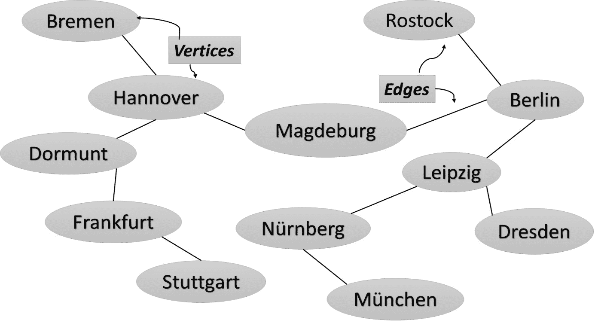
图 9.0 图 - 术语

`Graph`只显示`vertices`（顶点）和`edges`（边）之间的关系。这里最重要的是哪些边连接到哪个顶点。我们也可以说`Graph`模型了对象之间的连接。

### 邻接 (Adjacency)

当单条边连接两个顶点时，它们是相邻的或邻居。在图中，代表`Berlin`和`Leipzig`的顶点是相邻的，但`Berlin`和`Dresden`两个城市并不相邻。

### 路径 (Path)

`Path`是边的序列。上面的图显示了从`Berlin`到`München`的路径，经过了`Leipzig`和`Nürnberg`城市。那么路径就是`Berlin`、`Leipzig`、`Nürnberg`、`München`。

### 通连图 (Connected Graphs)

如果每个顶点到每个其他顶点至少有一个路径，则该`Graph`是连通的。上面的图是连通的，因为所有城市都是连接的。

### 有向图和加权图 (Directed and Weighted Graphs)

当边具有方向时，`Graph`是有向的。在上面的图中，我们有一个无向图，因为超级循环通常可以双向行驶。从`Berlin`到`Leipzig`等于从`Leipzig`到`Berlin`。

当边被赋予权重时，图被称为加权图，例如，两个城市之间的距离可以根据它们连接的速度进行加权。

图可以回答一个问题：从给定的`City`可以到达哪些城市？我们需要实现搜索算法。在图中搜索有两种不同的方法：`depth-first search (DFS)`（深度优先搜索）和`breadth-first search (BFS)`（广度优先搜索）。

# 9.1 深度优先搜索 (DFS)

实现深度优先搜索算法以遍历图数据结构。

## 解决方案

深度优先搜索（`DFS`）是一种遍历图的算法。算法从根节点开始（选择任意城市作为根节点），沿着每个路径尽可能地探索。图 9.1.1 显示了选择`Berlin`作为根节点时的步骤序列。

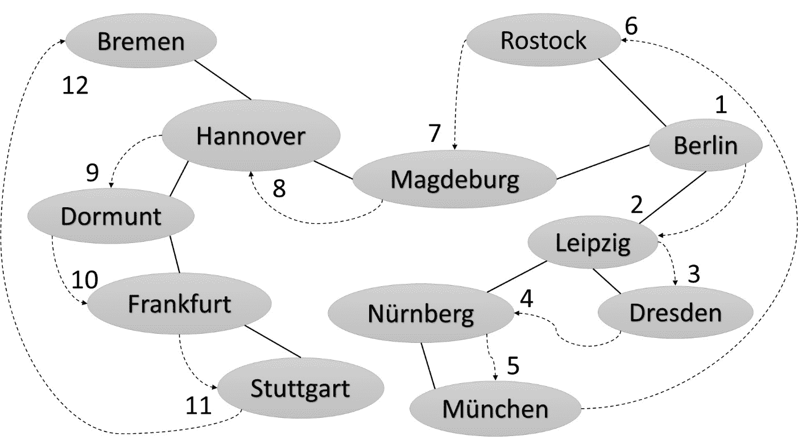
图 9.1.1 深度优先搜索 - 步骤序列

### 实现算法

### 问题建模

我们需要一个支持`Node`中包含的任何数据的对象。我们称之为`Vertex`。我们定义了一个布尔变量来避免在搜索城市时出现循环，因此我们会在访问每个节点时标记它。列表 9.1.1 显示了`Vertex`类实现。

列表 9.1.1 – Vertex 类

```java
public class Vertex {
    private String name;
    private boolean visited;
    public Vertex(String name) {
        this.name = name;
        this.visited = false;
    }
    public String getName() {
        return name;
    }
    public void setName(String name) {
        this.name = name;
    }
    public boolean isVisited() {
        return visited;
    }
    public void setVisited(boolean visited) {
        this.visited = visited;
    }
}
```

然后，我们将这些顶点存储在一个名为`arrayOfVertex[]`的数组中。我们有两种方法来建模顶点是如何连接的（边）：`邻接矩阵`（adjacency matrix）和`邻接表`（adjacency list）。对于此算法，我们将实现邻接矩阵。

### 邻接矩阵

在具有`N`个顶点的图中，我们创建一个`NxN`的二维数组。两个顶点（城市）之间的边用`1`表示连接（两个相邻节点）。没有连接的用`0`表示。

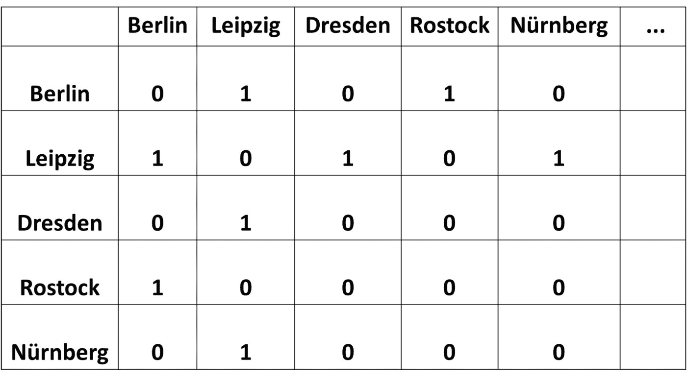
表 9.1.1 邻接矩阵

表 9.1.1 表明，`Leipzig`与`Berlin`、`Dresden`和`Nürnberg`相邻。

### 创建并初始化抽象数据类型

我们创建一个名为`Graph`的抽象数据类型，以定义我们数据结构的行为。我们需要一个栈（stack）来记住访问过的顶点。当我们向`arrayOfVertex[]`添加新的`Vertex`（`City`）时，`numOfVertices`变量表示已添加到`Graph`中的顶点数量。由于我们将为`DFS`算法传递一个`String`参数（城市名），因此定义了一个`mapOfVertex` HashMap 来注册键-值对：`city-index`。列表 9.1.2 显示了`Graph`类实现。

列表 9.1.2 Graph 类

```java
public class Graph {
    private final int MAX_VERTEX = 15;
    private Vertex arrayOfVertex[]; //cities
    private Map<String, Integer> mapOfVertex;
    private int[][] matrixOfVertex;
    private int numOfVertices;
    private Stack<Integer> stack;
    public Graph() {
        arrayOfVertex = new Vertex[MAX_VERTEX];
        mapOfVertex = new HashMap<>();
        numOfVertices = 0;
        matrixOfVertex = new int[MAX_VERTEX][MAX_VERTEX];
        stack = new Stack<>();
        for (int i = 0; i < MAX_VERTEX; i++) {
            for (int j = 0; j < MAX_VERTEX; j++) {
                matrixOfVertex[i][j] = 0;
            }
        }
    }
    public void addVertex(Vertex city) {
        mapOfVertex.put(city.getName(), numOfVertices);
        arrayOfVertex[numOfVertices++] = city;
    }
    public void addEdge(String city1, String city2) {
        int start = mapOfVertex.get(city1);
        int end = mapOfVertex.get(city2);
        matrixOfVertex[start][end] = 1;
        matrixOfVertex[end][start] = 1;
    }
}
```

# 9.2 广度优先搜索 (BFS)

实现广度优先搜索算法以遍历图数据结构。

### 解决方案

在广度优先搜索中，算法尽可能靠近起点。它访问所有与起始顶点相邻的顶点。算法使用`queue`（队列）实现。

图 9.2.1 显示了如果我们选择`Berlin`作为根节点时执行的一系列步骤。数字表示访问顶点的顺序。

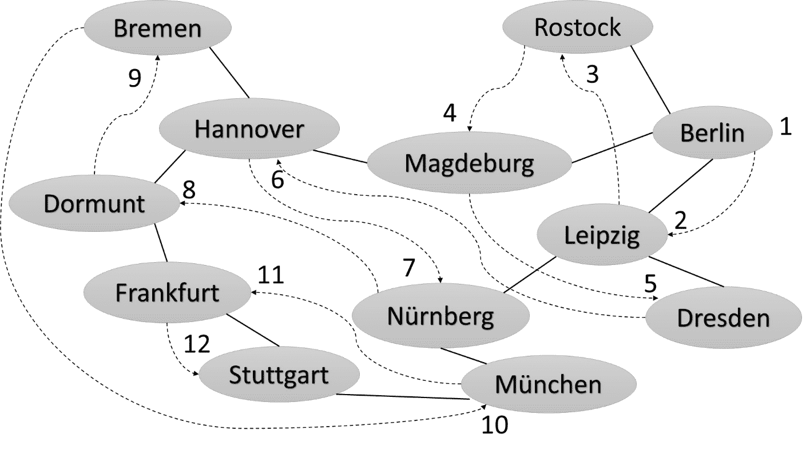
图 9.2.1 广度优先搜索 - 步骤序列

广度优先搜索算法首先找到所有距离起始顶点一个边边的顶点，然后是所有距离两个边、三条边边的顶点，以此类推。这对于回答诸如从`Berlin`到`München`等其他城市的最短路径是什么这类的问题非常有用。

我们遍历与`Berlin`距离一个边边的城市（第一层）：`Rostock`、`Magdeburg`和`Leipzig`。然后我们遍历与`Berlin`距离两个边边的城市（第二层）：`Hannover`、`Nürnberg`和`Dresden`。接着我们遍历与`Berlin`距离三个边边的城市（第三层）：`Bremen`、`Dortmund`和`München`。这就是核心思想。在遍历另一条可能的路径：`Berlin`、`Magdeburg`、`Hannover`、`Dortmund`、`Frankfurt`、`Stuttgart`、`München`（对应于第六层）之前，我们已经找到了`München`。

### 添加边

我们使用`LinkedList`数据结构来构建`Adjacency List`（邻接表）。当单条边连接两个城市时，它们就是相邻或邻居关系。列表 9.2.1 显示了`addEdge`方法。

列表 9.2.1 - LinkedList, addEdge 方法

```java
private LinkedList<Integer> adjList[];
public void addEdge(String city1, String city2) {
  int start = mapOfVertex.get(city1);
  int end = mapOfVertex.get(city2);
  adjList[start].add(end);
  adjList[end].add(start);
}
```

### 算法

我们的`bfs()`方法接收`City`名称作为参数。然后我们在`HashMap`中定位该城市的索引，将其标记为已访问，并将其加入`queue`中。

我们遍历队列项直到其为空。以下是每次迭代中我们执行的操作：

1. 我们获取并移除该`queue`的`head`（头部）。
2. 我们遍历该`head`的所有`neighbors`（邻居），直到它们被访问。每个相邻顶点都被标记为已访问并加入`queue`。
3. 当迭代无法找到更多相邻顶点时，我们获取并移除新的`head`。

列表 9.2 – 广度优先搜索

```java
import java.util.*;
import java.util.concurrent.ConcurrentHashMap;
public class Graph {
    private final int MAX_VERTEX;
    private Vertex[] arrayOfVertex; // cities
    private Map<String, Integer> mapOfVertex; // Adjacency list:
    private LinkedList<Integer>[] adjList[]; // register the location at arrayOfVertex:
    private int numOfVertices;
    private Queue<Integer> queue;
    public Graph(int vertices) {
        MAX_VERTEX = vertices;
        arrayOfVertex = new Vertex[MAX_VERTEX];
        mapOfVertex = new ConcurrentHashMap<>();
        numOfVertices = 0;
        queue = new LinkedList<>();
        adjList = new LinkedList[MAX_VERTEX];
        for (int i = 0; i < MAX_VERTEX; i++) {
            adjList[i] = new LinkedList();
        }
    }
    public void addVertex(Vertex city) {
        mapOfVertex.put(city.getName(), numOfVertices);
        arrayOfVertex[numOfVertices++] = city;
    }
    public void addEdge(String city1, String city2) {
        int start = mapOfVertex.get(city1);
        int end = mapOfVertex.get(city2);
        adjList[start].add(end);
        adjList[end].add(start);
    }
    public void bfs(String city) {
        int vertex = mapOfVertex.get(city);
        arrayOfVertex[vertex].setVisited(true);
        System.out.print(city + " ");
        queue.add(vertex);
        // iterate until queue empty
        while (!queue.isEmpty()) {
            int head = queue.remove();
            int adjVertex;
            // iterate until it has unvisited cities
            while ((adjVertex = getAdjVertex(head)) != -1) {
                arrayOfVertex[adjVertex].setVisited(true);
                System.out.print(arrayOfVertex[adjVertex].getName() + " ");
                queue.add(adjVertex);
            }
        }
    }
    private int getAdjVertex(int vertex) {
        LinkedList<Integer> linkedList = adjList[vertex];
        for (int adj = 0; adj < linkedList.size(); adj++) {
            if (arrayOfVertex[linkedList.get(adj)].isVisited() == false) {
                return linkedList.get(adj); //return first adjacent vertex
            }
        }
        return -1; //not vertices found
    }
    public Map<String, Integer> getMapOfVertex() {
        return mapOfVertex;
    }
    public LinkedList<Integer>[] getAdjList() {
        return adjList;
    }
}
```

```java
class GraphTest {
    Graph graph;
    @Before
    public void setup() {
        graph = new Graph(15);
    }
    @Test
```


```java
public void test_addVertex() {
    Vertex city = new Vertex("Berlin");
    graph.addVertex(city);
    assertTrue(graph.getMapOfVertex().size() == 1);
}

@Test
public void test_addEdge() {
    String city1 = "Berlin";
    String city2 = "Leipzig";
    Vertex v1 = new Vertex(city1);
    Vertex v2 = new Vertex(city2);
    graph.addVertex(v1); //location 0
    graph.addVertex(v2); // location 1
    graph.addEdge(city1, city2);
    assertTrue(graph.getAdjList()[0].get(0) == 1);
    assertTrue(graph.getAdjList()[1].get(0) == 0);
}

@Test
public void test_bfs() {
    String city1 = "Berlin"; String city2 = "Leipzig";
    String city3 = "Dresden"; String city4 = "Nürnberg";
    String city5 = "Hannover"; String city6 = "Rostock";
    String city7 = "Dortmund"; String city8 = "Frankfurt";
    String city9 = "Stuttgart"; String city10 = "München";
}
```

```java
String city11 ="Magdeburg";String city12 ="Bremen";
graph.addVertex(new Vertex(city1));
graph.addVertex(new Vertex(city2));
graph.addVertex(new Vertex(city3));
graph.addVertex(new Vertex(city4));
graph.addVertex(new Vertex(city5));
graph.addVertex(new Vertex(city6));
graph.addVertex(new Vertex(city7));
graph.addVertex(new Vertex(city8));
graph.addVertex(new Vertex(city9));
graph.addVertex(new Vertex(city10));
graph.addVertex(new Vertex(city11));
graph.addVertex(new Vertex(city12));
graph.addEdge(city1, city2);
graph.addEdge(city2, city3);
graph.addEdge(city3, city4);
graph.addEdge(city4, city10);
graph.addEdge(city11, city5);
graph.addEdge(city5, city7);
graph.addEdge(city7, city8);
graph.addEdge(city8, city9);
graph.addEdge(city1, city6);
graph.addEdge(city1, city11);
graph.addEdge(city5, city12);
graph.addEdge(city9, city10);
graph.bfs(city1);
```

输出:Berlin Leipzig Rostock Magdeburg Dresden Hannover Nürnberg Dortmund Bremen München Frankfurt Stuttgart

# 编码挑战

## 10.0 基础知识

从招聘人员处接收编码挑战有两种方式。首先，你会通过邮件收到编码挑战的描述，你需要在家中解决。其次，你需要在招聘人员的办公室面对其他开发者来完成编码挑战。对于这两种方式，请记住以下几点，以便在招聘过程中留下良好印象：

- 将你的最终代码托管在`GitHub`等网站上，并带有清晰的`README`文件和清晰的提交信息。
- 为你的代码编写测试用例。这表明你关注代码的可维护性。
- 构建整洁的代码结构。你的代码必须是可读的。
- 应用`SOLID`原则，这些原则会教你如何将函数组织成类，以及这些类之间应该如何关联。
- 思考可能的改进——未包含在挑战规范中——因为当你在他们面前修改代码时，这些将是招聘人员提出的开放问题。

## 10.1 优化在线购物

给定一个预算`B`和一个包含`[product-id][price][value]`的二维数组，编写一个算法来优化购物篮，使其包含成本小于或等于`B`且价值最高的产品。

### 解决方案

假设我们有 4 美元的预算，并且想从表 1.1.1 中购买价值最高的零食。

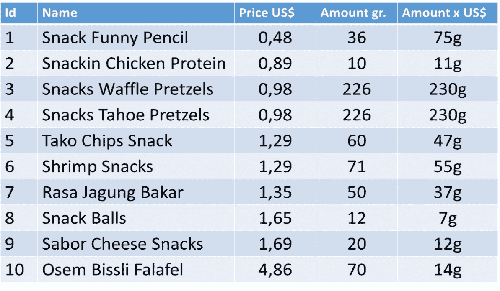
表 1.1.1 零食列表

但是由谁决定一个产品是否比另一个产品更有价值呢？这取决于具体的业务。它可能是基于定量或定性分析的估计。对于这个解决方案，我们选择了定量方法，基于哪个产品每投入美元能提供更多的重量。

我们使用“红绿重构”（Red-Green Refactor）技术来实现我们的算法，这是测试驱动开发（`TDD`）的基础。对于每一个假设，我们都会编写一个测试并查看它是否失败。然后，我们编写仅实现该测试的代码并查看是否成功，然后就可以重构代码使其变得更好。接着，我们处理另一个假设并重复之前的步骤，直到算法成功通过所有测试。

为了泛化“最有价值的产品”这一概念，我们为每个产品分配一个值。我们的算法接收两个参数：一个包含`[product-id][price][value]`的二维数组，以及预算。

### 假设 #1 - 给定一个按价值排序的产品数组，返回最有价值的产品

我们开始定义一个`java`测试，创建一个新的`BasketOptimized`类。

列表 1.1.1 – BasketOptimized 测试用例

```java
public class BasketOptimizedTest {
  BasketOptimized basketOptimized;

  @Before
  public void setup() {
    basketOptimized = new BasketOptimized();
  }

  @Test
  public void productsOrderedByValue () {
    double[][] myProducts = new double[][] {
          {1, 0.98, 230},
          {2, 0.98, 230},
          {3, 0.48, 75},
          {4, 1.29, 55},
          {5, 1.29, 47},
          {6, 4.86, 14},
          {7, 1.69, 12},
    };
    double[][] mostValueableProducts =
          basketOptimized.fill(myProducts, 4);
    assertEquals(590d,
          Arrays.stream(mostValueableProducts).
              mapToDouble(arr -> arr[2]).sum(),0);
  }
}
```

第一次运行时，它应该失败，因为`fill`方法并不存在。然后我们需要创建一个简单的实现来通过测试：值的总和必须等于 590，因为这代表了所有价格总和小于或等于 4 的被选产品。

现在，我们继续实现`fill`方法。

列表 1.1.2 – BasketOptimized fill 方法实现

```java
public class BasketOptimized {
  public double[][] fill(double[][] myProducts, double budget) {
    int len = myProducts.length;
    double[][] mostValueableProducts =  double[len][3];
    double sum = 0;
    for (int idx=0; idx < len; idx++) {
      sum = sum + myProducts[idx][1]; //price
      if (sum <= budget) {
        mostValueableProducts[idx][0] = myProducts[idx][0]; //id
        mostValueableProducts[idx][1] = myProducts[idx][1]; //price
        mostValueableProducts[idx][2] = myProducts[idx][2]; //value
      }
    }
    return mostValueableProducts;
  }
}
```

### 假设 #2 - 给定一个按价值排序的产品数组，返回最有价值的产品

在这种情况下，我们传递了一个未排序的数组，因此我们可以看到新测试将失败。

```java
@Test
public void productsNotByValue () {
    double[][] myProducts = new double[][]{
      {1, 0.98, 230},
      {2, 1.29, 47},
      {3, 1.69, 12},
      {4, 1.29, 55},
      {5, 0.98, 230},
      {6, 4.86, 14},
      {7, 0.48, 75}
    };
    double[][] mostValueableProducts = basketOptimized.fill(myProducts, 4);
    assertEquals(590d, Arrays.stream(mostValueableProducts).mapToDouble(arr -> arr[2]).sum(), 0);
}
```

我们意识到需要按价值对数组进行排序，因为我们需要最有价值的产品，所以是时候重构算法了。我们需要做的是对输入数组进行排序。

```java
public double[][] fill (double[][] myProducts, double budget) {
    Arrays.sort(myProducts, Collections.reverseOrder(
      Comparator.comparingDouble(a -> a[2])));
    int len = myProducts.length;
```

`double[][] mostValueableProducts = new double[len][3];`..然后我们可以看到我们的前两个测试用例成功了。

### 假设 #3 - 给定一个产品数组，我们需要从所有可能的可能的组合中获取价值最高的产品

想象一下以下场景：

```java
double[][] myProducts = new double[][] {{1, 0.98, 230},{2, 0.51, 30},{3, 0.49, 28},{4, 1.29, 55},{5, 0.98, 230},{6, 4.86, 14},{7, 0.48, 75},};
double[][] mostValueableProducts = basketOptimized.fill(myProducts, 4);
assertEquals(590d,Arrays.stream(mostValueableProducts).mapToDouble(arr -> arr[2]).sum(),0);
```

测试期望结果为 590，这对应于 3,73US$ 的最终价格（0.98+0.98+0.48+1.29）。一旦算法按价值对输入数组进行排序，我们得到了下面的新输入数组`[1.0, 0.98, 230.0][5.0, 0.98, 230.0][7.0, 0.48, 75.0][4.0, 1.29, 55.0][2.0, 0.51, 30.0][3.0, 0.49, 28.0][6.0, 4.86, 14.0]`

但在这里我们发现了另一种能给我们提供最高价值的产品组合：230+230+75+30+28 = 593，这对应于 3,44US$ 的最终价格。因此，我们需要重构代码来计算所有组合（子集），并在 4 US$ 的预算内返回价值最高的产品。

子集可以用从 0 到 7（数组大小）的二进制选项来表示。位运算符允许我们操作整数内部的位。例如，33 的二进制`int`值为 00100001，其中每个位置代表 2 的幂，从最右位开始为`2⁰`。

```java
int numIterations = (int) Math.pow(2, myProducts.length);
```

所以对于七个产品，我们有 128 次迭代。对于每次迭代，我们构建一个内层循环来决定将哪些产品包含在产品子集中。让我们来看一个例子：

```java
When int idx = 33
```

我们需要构建一个通过以下标准的的产品子集：

```java
if ((idx & (int) Math.pow(2, idx2)) == 0) {
```

下表显示了我们内层循环中的迭代：

| binary(idx) | idx2 | Math.pow(2,idx2) | binary(pow(idx2)) |
| :--- | :--- | :--- | :--- |
| 00100001 | 0 | 1 | 0001 |
| 00100001 | 1 | 2 | 0010 |
| 00100001 | 2 | 4 | 0100 |
| 00100001 | 3 | 8 | 1000 |
| 00100001 | 4 | 16 | 00010000 |
| 00100001 | 5 | 32 | 00100000 |
| 00100001 | 6 | 64 | 01000000 |

这意味着一个新的子集将包含产品数组中索引为 1, 2, 3, 4 和 6 的产品。我们需要询问在有限的预算内是否能买得起这些产品。

```java
if (subSet.length > 0 && sumPrice <= budget) {
```

下图显示了我们当前迭代的结果：

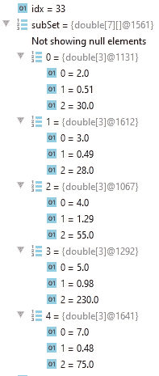

我们构建了一个`HashMap`来存储所有组合及其值的总和。最后，我们返回按价值排序的 HashMap 的第一个元素。

#### 列表 1.1.3 – BaskedOptimized 实现

```java
public class BasketOptimized {
    public double[][] fill(double[][] myProducts, double budget) {
        int len = myProducts.length;
        int numIterations = (int) Math.pow(2, myProducts.length);
        Map<double[][], Double> combinations = new HashMap<>();
        for (int idx = 0; idx < numIterations; idx++) {
            double[][] subSet = new double[len][];
            double sumPrice = 0;
            double sumValue = 0;
            int i = 0;
            for (int idx2 = 0; idx2 < len; idx2++) {
                if ((idx & (int) Math.pow(2, idx2)) == 0) {
                    subSet[i++] = myProducts[idx2];
                    sumPrice = sumPrice + myProducts[idx2][1];
                    sumValue = sumValue + myProducts[idx2][2];
                }
            }
            if (subSet.length > 0 && sumPrice <= budget) {
                //remove nulls
                subSet = Arrays.stream(subSet)
```


```java
.filter(s -> (s != null && s.length > 0))

.toArray(double[][]::new);

combinations.put(subSet, Double.valueOf(sumValue));

}

}

LinkedHashMap<double[][], Double> reverseSortedMap = new LinkedHashMap<>();

combinations.entrySet()

.stream()

.sorted(Map.Entry.comparingValue(Comparator.reverseOrder()))

.forEach(x -> reverseSortedMap.put(x.getKey(), x.getValue()));

double[][] mostValueableProducts = reverseSortedMap.keySet().iterator().next();

return mostValueableProducts;

}

}
```

```java
public class BasketOptimizedTest {

    BasketOptimized basketOptimized;

    @Before
    public void setup() {
        basketOptimized = new BasketOptimized();
    }

    @Test
    public void productsByValue() {
        double[][] myProducts = new double[][]{
            {1, 0.98, 230},
            {2, 0.98, 230},
            {3, 0.48, 75},
            {4, 1.29, 55},
            {5, 1.29, 47},
            {6, 4.86, 14},
            {7, 1.69, 12}
        };

        double[][] mostValueableProducts = basketOptimized.fill(myProducts, 4);

        assertEquals(590d, Arrays.stream(mostValueableProducts).mapToDouble(arr -> arr[2]).sum(), 0);
    }

    @Test
    public void productsNotByValue() {
        double[][] myProducts = new double[][]{
            {1, 0.98, 230},
            {2, 1.29, 47},
            {3, 1.69, 12},
            {4, 1.29, 55},
            {5, 0.98, 230},
            {6, 4.86, 14},
            {7, 0.48, 75}
        };

        double[][] mostValueableProducts = basketOptimized.fill(myProducts, 4);

        assertEquals(590d, Arrays.stream(mostValueableProducts).mapToDouble(arr -> arr[2]).sum(), 0);
    }
}
```

TDD 让我们能够先设计、构建并测试最小的方法，然后再将它们组合在一起。最重要的是，我们可以在不破坏其他测试用例的情况下对它们进行重构。

### 测试用例 #2：根据有效坐标输入符号

一旦设置了尺寸，我们需要接受有效的坐标并检查该位置是否可用。

```java
@Test
public void whenCoordinatesAreNotBusyThenPutSymbol() throws Exception {
    board.setSize(3);
    board.putSymbol(1, 2, "X");
    board.putSymbol(2, 3, "O");
    assertEquals("O", board.getBoard()[1][2]);
}
```

代码列表 10.1.3 显示了 `putSymbol` 方法的实现。

#### 代码列表 10.1.3 – `Board` 类，`putSymbol` 方法

```java
public void putSymbol(int x, int y, String character) {
    if (x < 1 || x > this.board.length)
        throw new RuntimeException("X coordinate invalid, must be between 1 and " + this.board.length);
    if (y < 1 || y > this.board.length)
        throw new RuntimeException("Y coordinate invalid, must be between 1 and " + this.board.length);
    if (board[x - 1][y - 1] != EMPTY_) throw new RuntimeException("Coordinates are busy");
    board[x - 1][y - 1] = character;
}
```

如果我们将尺寸设置为 4，这意味着对于玩家来说，下限是 1，上限是 4。

### 测试用例 #3：每次移动后打印棋盘

每当玩家输入有效坐标时，`Board` 就会被更新并打印。

```java
@Test
public void whenBoardIsNotNullThenPrintIsPossible() {
    board.setSize(10);
    board.putSymbol(1, 2, "X");
    board.putSymbol(2, 3, "O");
    board.print();
}
```

代码列表 10.1.4 显示了 `print` 方法的实现。

#### 代码列表 10.1.4 – `Board` 类，`print` 方法

```java
public void print() {
    if (board == null)
        throw new RuntimeException("Board is not initialized");
    int size = board.length;
    for (int y = size - 1; y >= 0; y--) {
        for (int x = 0; x < size; x++) {
            if (x == size - 1) {
                System.out.print(board[x][y] + "");
            } else {
                System.out.print(board[x][y] + "|");
            }
        }
        System.out.println("");
    }
}
```

在这里，你甚至可以将 `Board` 的打印委托给另一个组件，例如 `Console.print`。通过这样，当你想以 XML 或 HTML 格式打印时，`Console` 类将负责实现新方法。一个类发生改变的原因不应超过一个。

### 测试用例 #4：返回胜利者

一旦我们设置了尺寸，游戏就会接收不同的移动。`Board` 类会在每次移动后检查游戏中是否存在胜利者。代码列表 10.2.5 定义了一个测试用例，用来检查整条水平线是否被填充。

#### 代码列表 10.1.5 – `Board` 类，`getWinner` 测试用例

```java
@Test
public void horizontalLineFilledThenWinnerX() {
    board.setSize(3);
    board.putSymbol(1, 1, "X");
    board.putSymbol(1, 2, "O");
    board.putSymbol(2, 1, "X");
    board.putSymbol(2, 3, "O");
    board.putSymbol(3, 1, "X");
    board.print();
    assertEquals("X", board.getWinner());
}
```

然后我们遍历每一条水平线，检查它是否被相同的符号填充。代码列表 10.1.6 显示了 `getWinner` 方法的实现。

#### 代码列表 10.1.6 – `Board` 类，`getWinner` 方法

```java
public String getWinner() {
    if (board == null)
        throw new RuntimeException("Board is not initialized");
    String winner = null;
    for (int y = 0; y < board.length; y++) {
        String symbol = board[0][y];
        if (symbol != EMPTY_) {
            int counter = 1;
            for (int x = 1; x < board.length; x++) {
                if (symbol.equals(board[x][y])) {
                    counter++;
                }
            }
            if (counter == board.length) {
                winner = symbol;
                return winner;
            }
        }
    }
    return winner;
}
```

我们需要对所有获胜方式使用相同的逻辑：垂直、对角线，因此我们需要在子方法中抽象每种情况。代码列表 10.1.7 显示了重构后的新的 `getWinner` 方法。

#### 代码列表 10.1.7 – `Board` 类，重构后的 `getWinner` 方法

```java
public String getWinner() {
    if (board == null)
        throw new RuntimeException("Board is not initialized");
    String winner = winnerInHorizonzalLine();
    if (winner != null) {
        return winner;
    } else {
        winner = winnerInVerticalLine();
        if (winner != null) {
            return winner;
        } else {
            winner = winnerInBottomLeft();
            if (winner != null) {
                return winner;
            } else {
                winner = winnerInTopLeft();
                if (winner != null) {
                    return winner;
                } else {
                    // 避免每次遍历整个棋盘来寻找平局
                    if (this.numOfPlays == this.numOfAllowed) {
                        return DRAW_;
                    } else {
                        return null;
                    }
                }
            }
        }
    }
}
```

之前的代码展示了我们如何引入三个新变量：一个常量变量 `DRAW_ = "DRAW!"`；`numOfPlays` 和 `numOfAllowed` 被声明为 `Board` 类的成员变量；`numOfAllowed` 在 `setSize` 方法中初始化：`this.numOfAllowed = size * size`；`numOfPlays` 在 `putSymbol` 方法中增加：`this.numOfPlays++`。

这里是其他获胜方式。

```java
private String winnerInVerticalLine() {
    String winner = null;
    for (int x = 0; x < board.length; x++) {
        String symbol = board[x][0];
        if (symbol != EMPTY_) {
            int counter = 1;
            for (int y = 1; y < board.length; y++) {
                if (symbol.equals(board[x][y])) {
                    counter++;
                }
            }
            if (counter == board.length) {
                winner = symbol;
                return winner;
            }
        }
    }
    return winner;
}

private String winnerInBottomLeft() {
    String winner = null;
    String symbol = board[0][0];
    if (symbol != EMPTY_) {
        int counter = 1;
        for (int idx = 1; idx < board.length; idx++) {
            if (symbol.equals(board[idx][idx])) {
                counter++;
            }
        }
        if (counter == board.length) {
            winner = symbol;
            return winner;
        }
    }
    return winner;
}

private String winnerInTopLeft() {
    String winner = null;
    String symbol = board[0][0];
    if (symbol != EMPTY_) {
        int counter = 1;
        for (int idx = 1; idx < board.length; idx++) {
            if (symbol.equals(board[idx][idx])) {
                counter++;
            }
        }
        if (counter == board.length) {
            winner = symbol;
            return winner;
        }
    }
    return winner;
}
```

现在让我们看看 `Utils` 类，它加载符号和 `Board` 的尺寸。

### 测试用例 #5：加载文件

我们需要一个方法，给定 `Filename`，获取该 `File` 的内容。代码列表 10.1.8 显示了测试用例。

```java
public class UtilsTest {
    private Utils utils;

    @Before
    public void setUp() {
        utils = new Utils();
    }

    @Rule
    public ExpectedException thrownException = ExpectedException.none();

    @Test
    public void whenFileExistsThenReturnContent() throws Exception {
        String content = utils.loadFile("board.txt");
        assertNotNull(content);
    }
}
```

假设我们的配置文件位于项目名称下。代码列表 10.1.9 显示了 `loadFile` 的实现。

```java
public class Utils {
    public String loadFile(String fileName) throws Exception {
        String content;
        try {
            content = new String(Files.readAllBytes(Paths.get(fileName)));
        } catch (IOException io) {
            throw new RuntimeException("File " + fileName + " not found");
        }
        return content;
    }
}
```


### 测试用例 #6：获取棋盘尺寸

一旦加载了`Board`文件，我们需要验证它包含有效内容。代码列表 10.1.10 显示了关于验证`Board`尺寸的假设。根据要求，棋盘尺寸必须在 3 到 9 之间。

```java
@Test
public void whenGetBoardSizeIs4ThenReturnSize() throws Exception {
  String content = utils.loadFile("board.txt");
  assertEquals(4, utils.getBoardSize(content));
}
```

列表`10.1.11`显示了`getBoardSize`的实现。

### 列表 10.1.11 – Utils 类，`getBoardSize`方法

```java
public int getBoardSize(String content) throws Exception {
    if (content == null)
        throw new RuntimeException("Invalid setting for the board");
    if (Integer.valueOf(content) < 3 || Integer.valueOf(content) > 9)
        throw new RuntimeException("Invalid setting for the board");
    return Integer.valueOf(content).intValue();
}
```

`board.txt`

始终尝试为每项功能构建一个小型方法。如果你能将问题拆分成小部分，意味着你可以为更重要的项目创建出色的软件。

### 测试用例 #7：获取符号

一旦加载了符号文件（symbol File），它将验证只获取三个符号。列表`10.1.12`显示了我们在测试用例中的假设。

### 列表 10.1.12 – Utils 类，`getSymbols`测试用例

```java
@Test
public void whenSymbolsIsThreeThenReturnValues() throws Exception {
    String content = utils.loadFile("symbols.txt");
    String[] symbols = utils.getSymbols(content);
    assertArrayEquals(new String[]{"X","O","A"}, symbols);
}
```

`symbols.txt`
`X,O,A`

列表`10.1.13`显示了`getSymbols`方法的实现。

### 列表 10.1.13 – Utils 类，`getSymbols`方法

```java
public String[] getSymbols(String content) {
    String[] symbols = content.split(",");
    if (symbols.length != 3)
        throw new RuntimeException("Invalid settings for symbols");
    return symbols;
}
```

### 测试用例 #8：从控制台接收输入

我们创建了一个辅助类`Input`来存储玩家输入的坐标。列表`10.1.14`显示了我们在测试用例类中的假设。

```java
public class Input {
    private int x;
    private int y;
}
```

### 列表 10.1.14 – Utils 类，`getInput`测试用例

```java
@Test
public void inputFromConsoleThenReturnInput() throws Exception {
    Input input = utils.getInputFromConsole("2,3");
    assertEquals(2, input.getX());
    assertEquals(3, input.getY());
}
```

列表`10.1.15`显示了`getInputFromConsole`方法的实现，其中我们需要接受有效的数字。

### 列表 10.1.15 – Utils 类，`getInputFromConsole`方法

```java
public Input getInputFromConsole(String inputFromConsole) {
    if (inputFromConsole == null || inputFromConsole.trim().length() <= 0)
        throw new RuntimeException("Invalid input from console");
    Pattern p = Pattern.compile("[0-9]*\\.?,[0-9]+");
    Matcher matcher = p.matcher(inputFromConsole);
    if (!matcher.find())
        throw new RuntimeException("Invalid input from console");
    String[] inputSplitted = inputFromConsole.split(",");
    Input input = new Input();
    input.setX(Integer.valueOf(inputSplitted[0]).intValue());
    input.setY(Integer.valueOf(inputSplitted[1]).intValue());
    return input;
}
```

现在，我们实现`Player`类。列表`10.1.16`显示了`Player`类及其子类的设计。

### 列表 10.1.16 – Player 类及子类

```java
public class Player {
    private String symbol;  //省略了 getters 和 setters
}
public class Human extends Player {}
public class IA extends Player {}
```

### 测试用例 #9：实现 IA 如何玩

为了制作一个简单的井井棋程序，我们将允许`IA`玩家填充棋盘上第一个可用坐标。当然，你也可以基于图论编写更复杂的实现，例如为了决定`IA`玩家的最佳走法。列表`10.1.17`显示了关于`IA`玩家的假设。

### 列表 10.1.17 – Player 类，测试用例

```java
public class PlayerTest {
    private Player humanPlayer;
    private IA iaPlayer;
    private Board board;
    @Before
    public void setUp() {
        humanPlayer = new Human();
        iaPlayer = new IA();
        board = new Board();
        board.setSize(3);
    }
    @Test
    public void whenSetSymbolThenReturnSameSymbol() throws Exception {
        humanPlayer.setSymbol("A");
        assertEquals("A", humanPlayer.getSymbol());
    }
    @Test
    public void whenIAPlaysThenReturnInput() throws Exception {
        iaPlayer.setSymbol("A");
        board.putSymbol(1, 1, "X");
        board.putSymbol(2, 2, "O");
        board.print();
        Input input = iaPlayer.play(board.getBoard());
        assertEquals(1, input.getX());
        assertEquals(2, input.getY());
    }
}
```

列表`10.1.18`显示了`play`方法的实现。

### 列表 10.1.18 – Player 类，`play`方法

```java
public class IA extends Player {
    private final String EMPTY_ = " ";
    public Input play(String[][] board) {
        Input input = new Input();
        // 找到第一个可用坐标
        for (int x = 0; x < board.length; x++) {
            for (int y = 0; y < board[x].length; y++) {
                String symbol = board[x][y];
                if (symbol.equals(EMPTY_)) {
                    input.setX(x + 1);
                    input.setY(y + 1);
                    return input;
                }
            }
        }
        return input;
    }
}
```

# 大 O 表示

`Big O Notation`是一个数学函数，帮助我们分析算法在时间和空间上的复杂度。当我们为数百万用户构建应用程序时，这一点非常重要。

## 时间和空间复杂度

`时间复杂度`与算法执行所需的步数有关。`空间复杂度`与算法使用内存和磁盘的效率有关。我们可以根据三种情况分析复杂度：

- 最佳情况或`Ω(n)`：通常，算法在一步内独立于输入大小执行。
- 平均情况或`Θ(n)`：输入大小为随机时。
- 最坏情况`O(n)`：为任何输入提供运行时间的上限。它向我们保证算法在新的输入大小下永远不会更长时间。

## 常用算法的增长阶

增长阶与输入大小无限制增加时算法运行时间的增加情况有关，并告诉我们算法的效率。我们可以比较替代算法的相对性能。

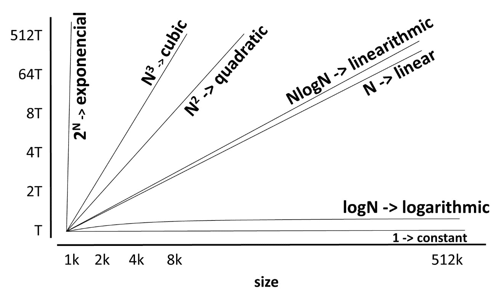
*图 A.1 大 O 表示 - 增长阶*

## 大 O 示例

### `O(1)` - 常数时间

无论输入包含 1000 个还是 100 万个元素，代码始终在一步内执行。

```java
public class BigONotation {
  public void constant(List<String> list, String item) {
    list.add(item);
  }
}
```

## 单元测试

```java
public void whenSizeThenSetupBoardSize() throws Exception {
    board.setSize(10);
    assertEquals(10, board.getBoard().length);
}

@Test
public void whenPutCharacterWrongCoordinateThenThrowError() throws Exception {
    board.setSize(4);
    thrownException.expect(RuntimeException.class);
    board.putSymbol(1, 5, "X");
}

@Test
public void whenCoordinateIsValidThenPutCharacterIsOk() throws Exception {
    board.setSize(3);
    board.putSymbol(1, 2, "X");
    assertEquals("X", board.getBoard()[0][1]);
}

@Test
public void whenCoordinatesAreBusyThenPutCharacterThrowError() throws Exception {
    board.setSize(3);
    board.putSymbol(1, 2, "X");
    thrownException.expect(RuntimeException.class);
    board.putSymbol(1, 2, "O");
}

@Test
public void whenCoordinatesAreNotBusyThenPutSymbol() throws Exception {
    board.setSize(3);
    board.putSymbol(1, 2, "X");
    board.putSymbol(2, 3, "O");
    assertEquals("O", board.getBoard()[1][2]);
}

@Test
public void whenBoardIsNullThenPrintThrowsError() {
    thrownException.expect(RuntimeException.class);
    board.print();
}

@Test
public void whenBoardIsNotNullThenPrintIsPossible() {
    board.setSize(10);
    board.print();
}

@Test
public void horizontalLineIsNotSameSymbolThenReturnNull() {
    board.setSize(3);
    board.putSymbol(2, 2, "X");
    board.putSymbol(1, 2, "O");
    board.putSymbol(1, 3, "X");
    board.putSymbol(2, 1, "O");
    board.putSymbol(3, 2, "X");
    board.print();
    assertEquals(null, board.getWinner());
}

@Test
public void horizontalLineFilledThenWinnerX() {
    board.setSize(3);
    board.putSymbol(1, 1, "X");
    board.putSymbol(1, 2, "O");
    board.putSymbol(2, 1, "X");
    board.putSymbol(2, 3, "O");
    board.putSymbol(3, 1, "X");
    board.print();
    assertEquals("X", board.getWinner());
}

@Test
public void horizontalLineFilledThenWinnerO() {
    board.setSize(4);
    board.putSymbol(1, 1, "X");
    board.putSymbol(1, 4, "O");
    board.putSymbol(2, 1, "X");
    board.putSymbol(2, 4, "O");
    board.putSymbol(3, 1, "X");
    board.putSymbol(3, 4, "O");
    board.putSymbol(3, 3, "X");
    board.putSymbol(4, 4, "O");
    board.print();
    assertEquals("O", board.getWinner());
}

@Test
public void verticalLineIsSameSymbolThenReturnWinnerX() {
    board.setSize(3);
    board.putSymbol(2, 1, "X");
    board.putSymbol(1, 3, "O");
    board.putSymbol(2, 2, "X");
    board.putSymbol(3, 3, "O");
    board.putSymbol(2, 3, "X");
    board.print();
    assertEquals("X", board.getWinner());
}

@Test
public void diagonalLineSymbolThenWinnerX() {
    board.setSize(3);
    board.putSymbol(1, 1, "X");
    board.putSymbol(1, 2, "O");
```


```
board.putSymbol(2, 2, "X");
board.putSymbol(2, 1, "O");
board.putSymbol(3, 3, "X");
board.print();
assertEquals("X", board.getWinner());
}

@Test
public void diagonalLineSymbolThenWinnerO() {
    board.setSize(3);
    board.putSymbol(1, 1, "X");
    board.putSymbol(1, 3, "O");
    board.putSymbol(3, 2, "X");
    board.putSymbol(2, 2, "O");
    board.putSymbol(3, 3, "X");
    board.putSymbol(3, 1, "O");
    board.print();
    assertEquals("O", board.getWinner());
}

@Test
public void diagonalLineSymbolThenWinnerX_2() {
    board.setSize(5);
    board.putSymbol(1, 1, "O");
    board.putSymbol(1, 5, "X");
    board.putSymbol(3, 2, "O");
    board.putSymbol(2, 4, "X");
    board.putSymbol(3, 4, "O");
    board.putSymbol(3, 3, "X");
    board.putSymbol(1, 2, "O");
    board.putSymbol(4, 2, "X");
    board.putSymbol(5, 3, "O");
    board.putSymbol(5, 1, "X");
    board.print();
    assertEquals("X", board.getWinner());
}

@Test
public void whenIsDrawThenTrue() {
    board.setSize(3);
    board.putSymbol(1, 1, "X");
    board.putSymbol(1, 2, "O");
    board.putSymbol(3, 2, "X");
    board.putSymbol(2, 2, "X");
    board.putSymbol(3, 3, "O");
    board.putSymbol(2, 1, "O");
    board.putSymbol(1, 3, "X");
    board.putSymbol(3, 1, "O");
    board.putSymbol(2, 3, "X");
    board.print();
    assertEquals("DRAW!", board.getWinner());
}

public class UtilsTest {
    private Utils utils;

    @Before
    public void setUp() {
        utils = new Utils();
    }

    @Rule
    public ExpectedException thrownException = ExpectedException.none();

    @Test
    public void whenFileNotExistsThenThrowError() throws Exception {
        thrownException.expect(RuntimeException.class);
        utils.loadFile("board2.txt");
    }

    @Test
    public void whenFileExistsThenReturnContent() throws Exception {
        String content = utils.loadFile("symbols.txt");
        assertNotNull(content);
    }
}
```

# O(N) – 线性

如果算法的步数取决于输入中项的数量，则我们的算法运行时间为`O(N)`。

```java
public int sum(int[] numbers) {
    int sum = 0;
    for (int i = 0; i < numbers.length; i++) {
        sum += numbers[i];
    }
    return sum;
}

@Test
public void test_linearTime() {
    final int[] numbers = {1, 2, 4, 6, 1, 6};
    assertTrue(bigONotation.sum(numbers) == 20);
}
```

# O(N2) – 平方

当我们在代码中嵌套了两个循环时，我们称其其运行时间是二次方的`O(N2)`。例如，在井井棋游戏中初始化一个二维矩阵时。

```java
private String[][] board;

public void initializeBoard(int size) {
    this.board = new String[size][size];
    for (int x = 0; x < size; x++) {
        for (int y = 0; y < size; y++) {
            board[x][y] = " ";
        }
    }
}

@Test
public void test_quadraticTime() {
    bigONotation.initializeBoard(3);
}
```

# O(N3) - 立方

当代码中包含最多三个嵌套循环时，我们称我们的算法运行时间为立方的。例如，给定`N`个整数，有多少组三元组之和恰好为零？一种方法（并非最好的）是使用三个嵌套循环。

```java
public int countThreeSum(int[] numbers) {
    int N = numbers.length;
    int count = 0;
    for (int i = 0; i < N; i++)
        for (int j = i + 1; j < N; j++)
            for (int k = j + 1; k < N; k++)
                if (numbers[i] + numbers[j] + numbers[k] == 0)
                    count++;
    return count;
}

@Test
public void test_countThreeSum() {
    final int[] numbers = {30, -40, -20, -10, 40, 0, 10, 5};
    assertTrue(bigONotation.countThreeSum(numbers) == 4);
}
```

# O(LogN) – 对数级

这类算法产生的增长曲线在开始时达到顶点，并随着输入规模的增加逐渐变得平缓。

`Log28 = 3`
`Log216 = 4`
`Log232 = 5`

二分查找在大小为`N`的排序数组中搜索时，最多需要`LogN`次键比较。8 个元素需要三次比较，16 个元素需要四次比较，32 个元素需要五次，以此此类推。

# 如何寻找算法的时间复杂度

寻找算法的 Big O 复杂度遵循以下规则：

- 忽略低阶项
- 舍弃领先常数

**示例**：如果一个算法的时间复杂度为`2n3 + 4n + 3`。其 Big O 复杂度简化为`O(n3)`。

**示例**：给定以下算法：

```java
public Integer sumEvenNumbers(Integer N) {
    int sum = 0;
    for (int number = 1; number <= N; number++)
        if ((number % 2) == 0)
            sum = sum + number;
    return sum;
}
```

首先，我们将代码拆分为单独的操作，然后计算它们执行了多少次，如下表所示。

| 操作 | 执行次数 |
| :--- | :--- |
| `int sum = 0;` | 1 |
| `int number = 1;` | 1 |
| `number <= N;` | N |
| `number++` | N |
| `if ((number % 2) == 0)` | N |
| `sum = sum + number;` | N |
| `return sum;` | 1 |

现在，我们需要相加每个操作执行的次数。
时间复杂度 = `1 + 1 + N + N + N + N + 1` => `4N + 3`

# 为什么 Big O 表示法忽略常数？

Big O 表示法描述了相对于数据元素数量所需的步数。它作为一种分类算法长期增长率的方法。

例如，`O(N)`对于所有数据量来说都比`O(N2)`快，如图 A.2 所示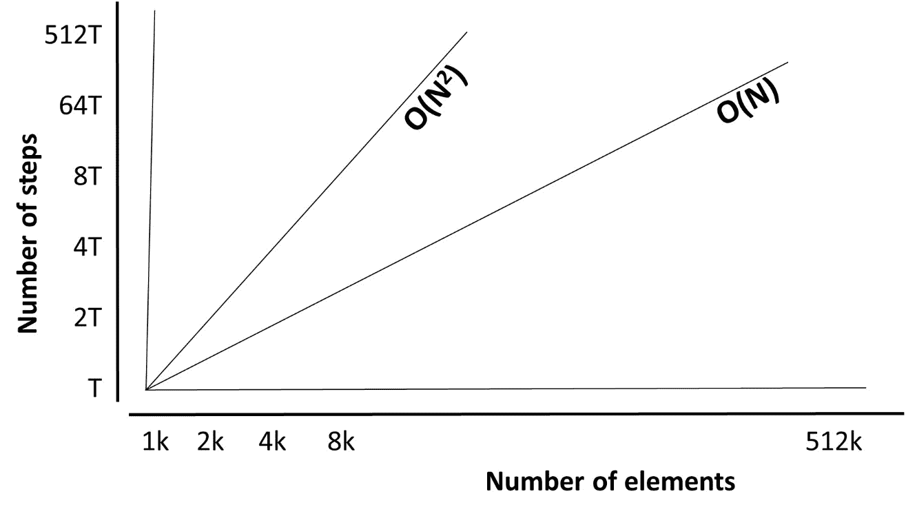
图 A.2 对于所有数据量，`O(N)`比`O(N2)`快。

现在，如果我们比较`O(100N)`和`O(N2)`，可以看到对于某些数据量，`O(N2)`比`O(100N)`快，如图 A.3 所示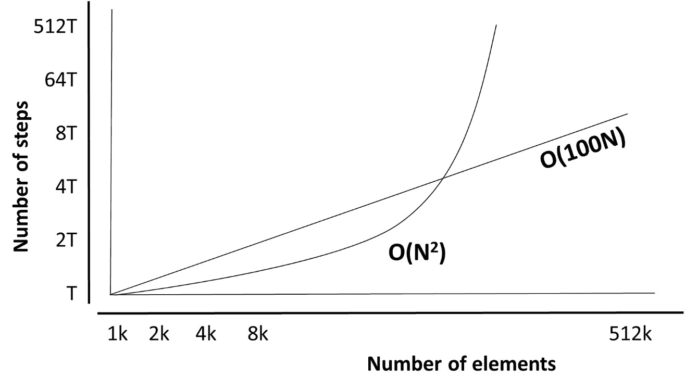
图 A.3 对于某些数据量，`O(N2)`比`O(100N)`快。

但在一点之后，`O(100N)`会变得更快，并且对于之后增加的数据量保持更快。这就是为什么 Big O 表示法忽略常数的原因。因为如此，`O(100N)`被写成`O(N)`。
