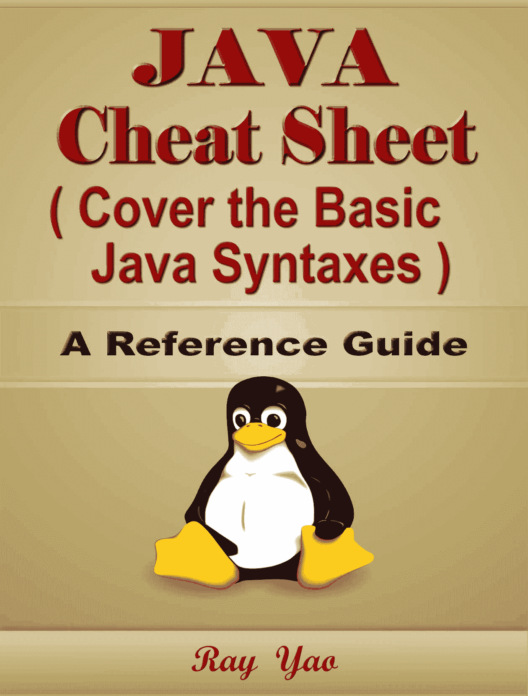

# Java 快速查表：基础 Java 语法详解，参考指南



## 关于本书

本书涵盖了基础 Java 语法。我们可以快速参考最有帮助的编程语法，例如常用命令语法、字符串函数语法、集合函数语法、类与对象语法等……所有这些语法对于编程都非常有用。

我们可以将此书视为一本基础语法手册，因为它的条目是按字母顺序排列的，方便我们轻松参考重要的语法。

无论现在还是未来，这本 Java 语法书都能为我们的学习和工作编码提供巨大的帮助。

## 免责声明

本书仅作为基础语法手册；它不能包含该主题的所有条目。其目的是作为快速查表书籍的补充，而不是完整的 Java 字典。

## 附录

- Java 关键字
- 数据类型
- 算术运算符
- 赋值运算符
- 逻辑运算符
- 比较运算符
- 条件运算符
- 重载与重写
- 默认、公共、受保护
- 抽象、接口
- 数据类型
- 修饰符
- 日期、文件
- 语法

## 逻辑运算符

### `&` 语法

`&`用于位与运算。如果两个位都为 1，则返回 1；如果其中一位为假，返回 0。

例如：

```java
public class Main {
    public static void main(String[] args) {
        int x = 100, y = 90, z = 60;
        System.out.println(x & y);
    }
}
```

输出：`92`

### `|` 语法

`|`用于位或运算。如果其中一个位为 1，则返回 1；如果所有位均为假，返回 0。

例如：

```java
public class Main {
    public static void main(String[] args) {
        int x = 4, y = 6;
        System.out.println(x | y);
    }
}
```

输出：`6`

### `^` 语法

`^`用于位异异运算。如果位不同，则返回 1，否则返回 0。

例如：

```java
public class Main {
    public static void main(String[] args) {
        int x = 4, y = 6;
        System.out.println(x ^ y);
    }
}
```

输出：`2`

### `<<` 语法

`<<`用于左移。它将所有位向左移动指定的位数。

例如：

```java
public class Main {
    public static void main(String[] args) {
        int operand = 2;
        System.out.println(operand << 2);
    }
}
```

输出：`8`

### `>>` 语法

`>>`用于右移。它将所有位向右移动指定的位数。

例如：

```java
public class Main {
    public static void main(String[] args) {
        int operand = 8;
        System.out.println(operand >> 2);
    }
}
```

输出：`2`

### `>>>` 语法

`>>>`用于无符号右移。它将所有位向右移动指定的位数。左侧的空位用 0 填充。

例如：

无符号右移：

-2 = `11111110`（二进制），`-2 >>> 1`返回`01111111`

### `abs()` 语法

`Math.abs(number)`返回数字的绝对值。

例如：

```java
public class Main {
    public static void main(String[] args) {
        System.out.println(Math.abs(-168.88));
        System.out.println(Math.abs(168.88));
    }
}
```

输出：

`168.88`

`168.88`

### `abstract` 语法

`abstract`用于类或方法。抽象类作为父类工作，可被子类扩展。子类的方法将重写抽象类的抽象方法。`abstract class`无法创建任何对象。`abstract method`仅用于抽象类；它是没有方法体的空方法。

```java
abstract class Book { // 创建一个抽象类
    abstract void read(); // 创建一个抽象方法
}

class eBook extends Book { // 扩展父类
    void read() { // 重写抽象方法
        System.out.println("I override that abstract method.");
    }
}

public class AbstractDemo {
    public static void main(String[] args) {
        eBook obj = new eBook();
        obj.read();
    }
}
```

// 输出: I override that abstract method.

---

### `acos()` 语法

`Math.acos(number)`

// 返回数字的余弦值

e.g.

```java
public class Main {
    public static void main(String[] args) {
        System.out.println(Math.acos(0.88));
        System.out.println(Math.acos(-0.88));
        System.out.println(Math.acos(0));
        System.out.println(Math.acos(-1));
        System.out.println(Math.acos(1));
    }
}
```

// 输出:

`0.4949341263408955`

`2.646658527248898`

`1.5707963267948966`

`3.141592653589793`

`0.0`

---

### `addExact()` 语法

`Math.addExact(num1, num2)`

// 返回两个数字之和

e.g.

```java
class Main {
    public static void main(String[] args) {
        int x = 36;
        int y = 52;
        System.out.println(Math.addExact(x, y)); 
    }
}
```

// 输出: 88

---

### 算术运算符语法

算术运算符意味着`+`, `-`, `*`, `/`, `%`, `++`, `--`

// `%`获取余数。

// `++`增加 1

// `--`减 1。

e.g.

```java
public class Main {
    public static void main(String[] args) {
        int x1 = 10; int y1 = 2;
        System.out.println(x1 + y1); // 10+2=12
        int x2 = 10; int y2 = 2;
        System.out.println(x2 - y2); // 10-2=8
        int x3 = 10; int y3 = 2;
        System.out.println(x3 * y3); // 10*2=20
        int x4 = 10; int y4 = 2;
        System.out.println(x4 / y4); // 10/2=5
        int x5 = 10; int y5 = 2;
        System.out.println(x5 % y5); // 10%2=0
        int x6 = 10;
        System.out.println(++x6); // 10+1=11
        int x7 = 10;
        System.out.println(--x7); // 10-1=9
    }
}
```

---

### 数组语法

`int array-name[] = {"value0", "value1", "value2",…};`

// 创建一个数组

e.g.

```java
int arr[] = { 10, 11, 12, 13 }; // 创建一个数组
```

// 上述代码创建了一个名为`arr`的数组，它有四个元素：

- 编号 0 的元素是`arr[0]`，值为 10。Key 为 0。
- 编号 1 的元素是`arr[1]`，值为 11。Key 为 1。
- 编号 2 的元素是`arr[2]`，值为 12。Key 为 2。
- 编号 3 的元素是`arr[3]`，值为 13。Key 为 3。

在数组中，Key 的别名是“index（索引）”。Index 的别名是“key”。

请注意 index 从 0 开始。

---

### 数组语法

- `int array-name[] = new int [number of elements];`
- `int array-name[index0] = "value0";`
- `int array-name[index1] = "value1";`
- `int array-name[index2] = "value2";`

// 创建一个数组

e.g.

```java
int arr[] = new int [3]; // 创建一个数组
arr[0] = 10;
arr[1] = 20;
arr[2] = 30;
```

// 上述代码创建了一个数组，数组名为`arr`，它有三个元素：`arr[0]`、`arr[1]`、`arr[2]`。它们的索引是 0, 1 和 2。它们的值是 10, 20 和 30。请注意索引数字从 0 开始。

---

### 数组元素语法

`int value = array[index];`

// 从元素中获取值。

`int array[index] = value;`

// 给元素设置一个值。

e.g.

```java
int myArr[] = {10, 20, 300, 40, 50};
int val = myArr[2]; // 从元素中获取值。
System.out.println(val);
```

// 输出: 300

e.g.

```java
int myNum[] = new int [5];
myNum[2] = 80; // 给元素设置一个值。
System.out.println(myNum[2]);
```

// 输出: 80

---

### 数组长度语法

`array_name.length;`

// 返回数组元素的总数。

e.g.

```java
public class ArrLen {
    public static void main(String[] args) {
        int myArr[] = {100, 200, 300}; // 创建数组“myArr”
        int len = myArr.length; // 获取数组长度
        System.out.print(len);
    }
}
```

// 输出: 3

---

### 数组排序语法

`Arrays.sort(array_name);`

// 对数组排序并显示结果。

在使用`Arrays.sort()`之前，必须`import java.util.Arrays;`。

e.g.

```java
package try;
import java.util.Arrays;
public class SortArr {
    public static void main(String[] args) {
        String arr[] = {"Cod", "App", "Bay"};
        Arrays.sort(arr); // 排序数组
        for(int n=0; n<arr.length; n++) { // 运行次数
            System.out.print(arr[n] + " ");
        }
    }
}
```

// 输出: App Bay Cod 

---

### `ArrayList` 语法

`ArrayList<String> obj = new ArrayList<>();`

// 创建`ArrayList`对象

`ArrayList`类是可调整的数组，可以修改大小。

e.g.

```java
import java.util.ArrayList;
public class Main {
    public static void main(String[] args) {
        ArrayList<String> colors = new ArrayList<>();
        colors.add("Red"); // 添加元素
        colors.add("Yellow");
        colors.add("Green");
        System.out.println(colors); // 显示值
        for (int i = 0; i < colors.size(); i++) { // 遍历
            System.out.println(colors.get(i));
        }
        System.out.println(colors.get(0)); // 获取元素
        colors.set(1, "White"); // 设置元素值
        System.out.println(colors);
        colors.remove(2); // 删除元素值
        System.out.println(colors);
        System.out.println(colors.size()); // 获取 ArrayList 大
        colors.clear(); // 清除所有元素
        System.out.println(colors);
    }
}
```

// 输出:

`[Red, Yellow, Green]`

`Red`

`Yellow`

`Green`

`[Red, White]`

`2`

`[]`

---

### `asin()` 语法

`Math.asin(number)`

// 返回数字的正弦值

e.g.

```java
public class Main {
    public static void main(String[] args) {
        System.out.println(Math.asin(0.88));
        System.out.println(Math.asin(-0.88));
    }
}
```

// 输出: `0.9688918399818517`

`-0.9688918399818507`

---

### 断言语法

`assert condition: "message";`

// 断言通过检查我们假设为真来检测任何问题。

// 如果条件为假，JVM 将停止程序。

// 运行文件时需要使用`java -ea`。

e.g.

```java
import java.util.Scanner;
public class Assertion {
    public static void main(String args[]) {
        int value = 100;
        assert value > 100 : "The value is not greater than 100";
        System.out.println("The value is " + value);
    }
}
```

// 输出: Exception in thread "main" java.lang.AssertionError: The value is not greater than 100

---

### 赋值运算符

赋值运算符意味着`=`, `+=`, `-=`, `*=`, `/=`, `%=`, `&=`, `|=`, `^=`, `>>=`, `<<=`。

e.g.


```java
public class Main {
    public static void main(String[] args) {
        int n1 = 6; n1 += 2;
        System.out.println(n1); // n1 = 6+2, 8
        int n2 = 6; n2 -= 2;
        System.out.println(n2); // n2 = 6-2, 4
        int n3 = 6; n3 *= 2;
        System.out.println(n3); // n3 = 6*2, 12
        int n4 = 6; n4 /= 2;
        System.out.println(n4); // n4 = 6/2, 3
        int n5 = 6; n5 %= 2;
        System.out.println(n5); // n5 = 6%2, 0
        int n6 = 6; n6 &= 2;
        System.out.println(n6); // n6 = 6&2, 2
        int n7 = 6; n7 |= 2;
        System.out.println(n7); // n7 = 6|2, 6
        int n8 = 6; n8 ^= 2;
        System.out.println(n8); // n8 = 6², 4
        int n9 = 6; n9 >>= 2;
        System.out.println(n9); // n9 = 6>>2, 1
        int n10 = 6; n10 <<= 2;
        System.out.println(n10); // n10 = 6<<2, 24
    }
}
```

## `atan()` 语法

syntax: `Math.atan(number)`

// 返回介于 `-PI/2` 和 `PI/2` 弧之间的数字的正反正函数值

e.g.

```java
public class Main {
  public static void main(String[] args) {
    double x = 0.88;
    double y = 0.0;
    double z = 1.0;
    System.out.println(Math.atan(x)); 
    System.out.println(Math.atan(y)); 
    System.out.println(Math.atan(z)); 
  }
}
```

// 输出:

0.7216548508647612

0.0

0.7853981633974483

---

## `atan2()` 语法

syntax: `Math.atan2(y, x)`

// 通过将直角坐标 `(x, y)` 转换为极坐标 `(r, theta)` 来返回角度 `theta`。

e.g.

```java
class Main {
  public static void main(String[] args) {
    double x = 4.2;
    double y = 5.9;
    double theta = Math.atan2(y, x);
    System.out.println(theta);              
    System.out.println(Math.toDegrees(theta));    
  }
}
```

// 输出:

0.9521519758701495

54.554289672401765

---

## `boolean` 语法

syntax: `boolean variable`

// 一种具有 `true` 或 `false` 值的数据类型

e.g.

```java
boolean good = true;
boolean bad = false;   
System.out.println(good);
System.out.println(bad);
```

// 输出: true, false

---

## `break` 语法

syntax: `break;`

// 终止循环或 `switch` 块

e.g.

```java
for (int n = 1; n < 8; n++) {
  if (n == 6) {
    break;
  }
  System.out.print(n);
}
```

// 输出: 12345

---

## `byte` 语法

syntax: `byte variable`

// 一种从 `-128` 到 `127` 的数字数据类型

e.g.

```java
byte myNum = 88;
System.out.println(myNum);
```

// 输出: 88

---

## `case` 语法

syntax: `case value:`

// 在 `switch` 语句中标记代码块

e.g.

```java
int number = 2;
switch (number) {
  case 1:
    System.out.println("Number 1");
    break;
  case 2:
    System.out.println("Number 2");
    break;
}
```

// 输出: Number 2

---

## `catch` 语法

syntax: `catch (Exception e)`

// 捕获从 `try` 语句抛出的异常

e.g.

```java
try {
    int[] arr = {10, 20, 30};
    System.out.println(arr[5]);
}
catch (Exception e) {
    System.out.println("Out of range!");
}
```

// 输出: Out of range!

---

## `cbrt()` 语法

syntax: `Math.cbrt(number)`

// 返回数字的立方根值

e.g.

```java
class Main {
  public static void main(String[] args) {
    double a = 125.0;
    double b = -27;
    double c = 0.0;
    System.out.println(Math.cbrt(a)); 
    System.out.println(Math.cbrt(b)); 
    System.out.println(Math.cbrt(c)); 
  }
}
```

// 输出:

5.0

-3.0

0.0

---

## `ceil()` 语法

syntax: `Math.ceil(number)`

// 返回大于或等于其参数的最近整数。

e.g.

```java
public class Main {
  public static void main(String[] args) {
    double num = 3.14;
    System.out.println(Math.ceil(num));
  }
}
```

// 输出: 4.0

---

## `char` 语法

syntax: `char variable`

// 用于单个字符的数据类型

e.g.

```java
char ch = 'C';
System.out.println(ch);
```

// 输出: C

---

## `charAt()` 语法

syntax: `string.charAt(index)`

// 返回指定索引处的字符

e.g.

```java
public class Main{
  public static void main(String []args){
    String str = "kindle";
    char c = str.charAt(2);
    System.out.println(c);
  }
}
```

// 输出: n

---

## `class` 语法

syntax:

```java
class Class_name {
  variable;
  method_name() { }
}
```

`class` 是对象的模板，并用于创建对象。`class Class_name` 定义了一个类。

e.g.

```java
public class MyClass { // 定义一个类
  int num = 100;
  public static void main(String[] args) {
    MyClass myObj = new MyClass(); // 创建一个对象
    System.out.println(myObj.num);
  }
}
```

// 输出: 100

---

## `class` 对象 语法

syntax:

```java
class Class_name { // 定义一个类
}
obj = new Class_name(); // 创建一个对象
```

e.g.

```java
class Colour { // 定义一个类
  String co1, co2;
  void bright () { 
    System.out.println("This flower is " + co1);
    System.out.println("That flower is " + co2);
  }
  public static void main(String[] args) {
    Colour obj = new Colour(); // 创建一个对象
    obj.co1= "red.";  obj.co2="blue."; // 引用
    obj.bright (); // 对象引用一个方法
  }
}
```

// 输出:

This flower is red.

That flower is blue.

---

## attribute 语法

syntax:

```java
class Class_name {
  variable1;
  variable2;
}
```

`class Class_name` 定义了属性 `variable1` 和 `variable2`。

e.g.

```java
public class Main {
  int num = 10;
  public static void main(String[] args) {
    Main obj = new Main();
    System.out.println(obj.num);
  }
}
```

// 输出: 10

---

## `class` 对象 语法

syntax:

```java
public class Main {
  int num = 10;
}
```

创建一个 `Main` 类。

```java
public static void main(String[] args) {
  Main obj = new Main();
  System.out.println(obj.num);
}
```

// 输出: 10

---

## `codePointAt()` 语法

syntax: `string.codePointAt(index)`

// 返回指定索引处的 Unicode 值。

e.g.

```java
public class Main{
  public static void main(String []args){
    String str = "kindle";
    int u = str.codePointAt(2);
    System.out.println(u);
  }
}
```

// 输出: 110

---

## `codePointBefore()` 语法

syntax: `string.codePointBefore(index)`

// 返回指定索引之前的 Unicode 值。

e.g.

```java
public class Main{
  public static void main(String []args){
    String str = "kindle";
    int u = str.codePointBefore(2);
    System.out.println(u);
  }
}
```

// 输出: 105

---

## `codePointCount()` 语法

syntax: `string.codePointCount(beginIndex, endIndex)`

// 返回字符串指定范围内的 Unicode 值数量。

e.g.

```java
public class Main {
  public static void main(String[] args) {
    String str = "Hello World";
    int num = str.codePointCount(0, 8);
    System.out.println(num);
  }
}
```

// 输出: 8

---

## comment 语法

单行注释以两个斜杠 `//` 开始。多行注释以 `/*` 开始并以 `*/` 结束。

e.g.

```java
public class Main {
  public static void main(String[] args) {
    // 这是一个单行注释
    System.out.println("Hello World");
    /* 这是一个多行注释。
    此程序将打印我们的 Hello World*/
  }
}
```

// 输出: Hello World

---

## `compareTo()` 语法

syntax: `str1.compareTo(str2)`

根据 Unicode 值按字母顺序比较两个字符串。如果两个字符串相等，返回零；如果不相等，返回非零。如果第一个字符串的 Unicode 值大于第二个字符串，则返回正值。如果第一个字符串的 Unicode 值小于第二个字符串，则返回负值。

e.g.

```java
public class Main {
  public static void main(String[] args) {
    String str1 = "vacation";
    String str2 = "vocation";
    System.out.println(str1.compareTo(str2));
  }
}
```

// 输出: -14

---

## `compareToIgnoreCase()` 语法

### `str1.compareToIgnoreCase(str2)`

// 根据 Unicode 值对两个字符串进行字母顺序比较，忽略大小写差异。
// 如果两个字符串相等，返回零；如果两个字符串不相等，返回非零。
// 如果第一个字符串的 Unicode 值大于第二个字符串，返回一个正值。
// 如果第一个字符串的 Unicode 值小于第二个字符串，返回一个负值。

e.g.

```java
public class Main {
  public static void main(String[] args) {
    String str1 = "JQuery in 8 Hours";
    String str2 = "jQuery in 8 hours";
    System.out.println(str1.compareToIgnoreCase(str2));
  }
}
```

// 输出: 0

---

### `concat()` 语法:

`str1.concat(str2)`

// 拼接两个字符串

e.g.

```java
public class Main {
  public static void main(String[] args) {
    String str1 = "Python ";
    String str2 = "Syntax Book";
    System.out.println(str1.concat(str2));
  }
}
```

// 输出: Python Syntax Book

---

### 条件运算符语法:

`(布尔表达式) ? (如果为真则执行此操作) : (如果为假则执行此操作);`

// 根据布尔表达式的结果执行执行语句中的之一

e.g.

```java
int a=100; int b=300;
String outcome1 = (a<b) ? "orange" : "pineapple";
System.out.print ( outcome1);
```

// 输出: orange

e.g.

```java
int a=100; int b=300;
String outcome2 = (a>b) ? "orange" : "pineapple";
System.out.print ( outcome2 );
```

// 输出: pineapple

---

### 构造函数语法:

```java
class Class_name {  
  Class_name () {…} // 构造函数
}
```

// 构造函数用于初始化变量。构造函数名与类名相同。
// 在创建对象时，构造函数会被自动调用。

e.g.

```java
public class Colour { // 定义一个类
  String co1, co2;
  public Colour ( ) {co1="red"; co2="blue";}  // 构造函数
  void bright ( ) {
```


```java
System.out.println("This flower is " + co1);
System.out.println("That flower is " + co2);
}

public static void main(String[] args) {
    Colour obj = new Colour(); // 创建对象，调用构造函数
    obj.bright();
}
}
```

```
// 输出:
This flower is red.
That flower is blue.
```

---

### `contains()` 语法

`str1.contains(str2)`

// 如果字符串包含指定的字符或字符序列，返回`true`；否则返回`false`。

e.g.

```java
public class Main {
    public static void main(String[] args) {
        String str = "RayYao";
        System.out.println(str.contains("Ray"));
        System.out.println(str.contains("Yao"));
        System.out.println(str.contains("R"));
        System.out.println(str.contains("Hay"));
    }
}
```

```
// 输出: true, true, true, false
```

---

### `contentEquals()` 语法

`str1.contentEquals(str2)`

// 如果字符串与另一个字符串完全相等，返回`true`；否则返回`false`。

e.g.

```java
public class Main {
    public static void main(String[] args) {
        String str = "RayYao";
        System.out.println(str.contentEquals("RayYao"));
        System.out.println(str.contentEquals("Yao"));
        System.out.println(str.contentEquals("Hay"));
    }
}
```

```
// 输出: true, false, false
```

---

### `continue` 语法

`continue;`

### 继续循环的下次迭代

e.g.

```java
for (int n = 1; n < 8; n++) {
    if (n == 6) {
        continue;
    }
    System.out.print(n);
}
```

```
// 输出: 123457
```

---

### `copySign()` 语法

`Math.copySign(x, y)`

// 复制第二个参数的符号并将该符号赋值给第一个参数。

e.g.

```java
class Main {
    public static void main(String[] args) {
        float x = 1.68f;
        float y = -3.14f;
        System.out.println(Math.copySign(x, y));
    }
}
```

```
// 输出:
-1.68
```

---

### `copyValueOf()` 语法

`str1.copyValueOf(str2, beginIndex, endIndex)`

// 通过复制数组元素返回一个字符串。

e.g.

```java
public class Main {
    public static void main(String[] args) {
        String str1 = ""; // 定义一个空字符串
        char[] str2 = {'R', 'a', 'y', 'Y', 'a', 'o'};
        System.out.print(str1.copyValueOf(str2, 0, 6));
    }
}
```

*(注：原文示例代码中`copyValueOf`参数不全，此处根据逻辑补全以保持完整)*

```
// 输出: RayYao
```

---

### `cos()` 语法

`Math.cos()`

// 返回余弦值

e.g.

```java
public class Main {
    public static void main(String[] args) {
        System.out.println(Math.cos(Math.PI));
    }
}
```

```
// 输出: -1.0
```

---

### `cosh()` 语法

`Math.cosh()`

// 返回双曲余弦值

e.g.

```java
public class Main {
    public static void main(String[] args) {
        System.out.println(Math.cosh(1));
    }
}
```

```
// 输出: 1.5430806348152427
```

---

### `sin()` 语法

`Math.sin()`

// 返回正弦值

e.g.

```java
public class Main {
    public static void main(String[] args) {
        System.out.println(Math.sin(Math.PI / 2));
    }
}
```

```
// 输出: 1.0
```

---

### `tan()` 语法

`Math.tan()`

// 返回正切值

e.g.

```java
public class Main {
    public static void main(String[] args) {
        System.out.println(Math.tan(Math.PI / 4));
    }
}
```

```
// 输出: 1.0
```

---

### `sqrt()` 语法

`Math.sqrt()`

// 返回平方根数

e.g.

```java
public class Main {
    public static void main(String[] args) {
        System.out.println(Math.sqrt(16));
    }
}
```

```
// 输出: 4.0
```

---

### `pow()` 语法

`Math.pow(base, exponent)`

// 返回幂值

e.g.

```java
public class Main {
    public static void main(String[] args) {
        System.out.println(Math.pow(2, 3));
    }
}
```

```
// 输出: 8.0
```

---

### `abs()` 语法

`Math.abs()`

// 返回绝对值

e.g.

```java
public class Main {
    public static void main(String[] args) {
        System.out.println(Math.abs(-10));
    }
}
```

```
// 输出: 10
```

---

# 从 1.7e−308 到 1.7e+308 的数值数据类型

e.g.

```java
double num = 166.88d;
System.out.println(num);
```

```
// 输出: 166.88
```

## `else` 语法

```java
else {}
```

// 用于条件语句，当条件为假时

e.g.

```java
int score = 60;
if (score < 60) {
    System.out.println("Failed!");
} else {
    System.out.println("Passed!");
}
```

```
// 输出: Passed!
```

## 封装语法

```java
public class Encapsulation {
    private String value; // 私有属性

    public String getValue() { // Getter
        return value;
    }

    public void setValue(String newValue) { // Setter
        this.value = newValue;
    }
}
```

// 封装的意义向用户隐藏敏感数据。
// 将类变量/属性声明为`private`
// 提供公共的`getter`和`setter`方法来访问

e.g.

```java
class Encap {
    private String name;

    public String getName() {
        return name;
    }

    public void setName(String newValue) {
        name = newValue;
    }
}

public class Main {
    public static void main(String args[]) {
        Encap obj = new Encap();
        obj.setName("Ray Yao");
        System.out.println("My name is " + obj.getName());
    }
}
```

```
// 输出: My name is Ray Yao
```

## `endwith()` 语法

```java
str1.endwith(str2)
```

// 如果字符串以指定的字符结束，则返回`true`，否则返回`false`。

e.g.

```java
public class Main {
    public static void main(String[] args) {
        String str = "RayYao";
        System.out.println(str.endsWith("Ray"));
        System.out.println(str.endsWith("Yao"));
        System.out.println(str.endsWith("o"));
    }
}
```

```
// 输出: false, true, true
```

## `enum` 语法

```java
enum Enum_name { constants }
```

// 声明一个带有某些常量的枚举类型类
// `enum`类包含一组`constants`

e.g.

```java
enum Color {
    RED,
    YELLOW,
    GREEN
}

public class Main {
    public static void main(String[] args) {
        Color flower = Color.RED;
        System.out.println(flower);
    }
}
```

```
// 输出: RED
```

## `equals()` 语法

```java
str1.equals(str2)
```

// 比较两个字符串，如果两个字符串相等，则返回`true`，否则返回`false`。

e.g.

```java
public class Main {
    public static void main(String[] args) {
        String str1 = "RayYao";
        String str2 = "RayYao";
        String str3 = "Java Programming";
        System.out.println(str1.equals(str2));
        System.out.println(str1.equals(str3));
    }
}
```

```
// 输出: true, false
```

## `equalsIgnoreCase()` 语法

```java
str1.equalsIgnoreCase(str2)
```

// 忽略大小写比较两个字符串，如果两个字符串相等，则返回`true`，否则返回`false`。

e.g.

```java
public class Main {
    public static void main(String[] args) {
        String str1 = "JQuery in 8 Hours";
        String str2 = "jQuery in 8 hours";
        System.out.println(str1.equalsIgnoreCase(str2));
    }
}
```

```
// 输出: true
```

## `exp()` 语法

```java
Math.exp(num)
```

// 返回 e 的次方
// 即：`Math.exp(n) = e^n`

e.g.

```java
class Main {
    public static void main(String[] args) {
        double n = 3.14d;
        System.out.println(Math.exp(n));
    }
}
```

```
// 输出: 23.103866858722185
```

## `expm1()` 语法

```java
Math.expm1(num)
```

// 返回 e^n - 1
// 即`Math.expm1(n) = e^n-1.`

e.g.

```java
class Main {
    public static void main(String[] args) {
        double n = 3.14d;
        System.out.println(Math.expm1(n));
    }
}
```

```
// 输出: 22.103866858722185
```

## `exports` 语法

```java
module a.module {
    exports a.package to b.module;
}
```

// 将包导出到一个或多个特定的模块，以便该包可以被指定的模块访问。

e.g.

```java
module java.base { // 来自模块 'java.base'
    // ......
    exports jdk.internal to jdk.jfr
    // ......
}
```

// 将包`jdk.internal`导出到模块`jdk.jfr`

## `extends` 语法

```java
class Child_Class extends Parent_Class
```

// 子类继承自父类
// 子类继承父类的所有特征

e.g.

```java
class Book {
    protected String title = "Shell Scripting";

    public void fun() {
        System.out.println("Recommend Book:");
    }
}

class Ebook extends Book {
    private String ebookName = "in 8 Hours";

    public static void main(String[] args) {
        Ebook myEbook = new Ebook();
        myEbook.fun();
        System.out.println(myEbook.title + " " + myEbook.ebookName);
    }
}
```

```
// 输出: Shell Scripting in 8 Hours
```

## `File` 类语法

```java
File myfile = new File(file_name);
```

// 创建一个文件对象

e.g.

```java
File f = new File(aFile.txt); // 创建一个文件对象

if (f.exists()) {
    System.out.println("Is existing?" + f.exists());
    System.out.println("Can read?" + f.canRead());
    System.out.println("Can write?" + f.canWrite());
    System.out.println("Is a file?" + f.isFile());
}
```

```
// 输出:
Is existing? true
Can read? true
Can write? false
Is a file? true
```

## 创建文件语法

```java
File obj = new File("myFile.txt");
```

// 创建一个文件对象

e.g.

```java
import java.io.File;
import java.io.IOException;

public class Main {
    public static void main(String[] args) {
        try {
            File obj = new File("myFile.txt");
            if (obj.createNewFile()) {
                System.out.println("The file created is " + obj.getName());
            } else {
                System.out.println("The file already exists.");
            }
        }
    }
}
```


```java
} catch (IOException e) {
    System.out.println("Error occurred.");
    e.printStackTrace();
}
}
// 输出: The file created is myFile.txt
```

## 删除文件语法

```java
fileObj.delete()
```
// 删除文件

e.g.

```java
import java.io.File;

public class DeleteFile {
    public static void main(String[] args) {
        File obj = new File("myFile.txt");
        if (obj.delete()) {
            System.out.println("The file deleted is " + obj.getName());
        } else {
            System.out.println("Failed to delete the file.");
        }
    }
}
// 输出: The file deleted is myFile.txt
```

## 读取文件语法

```java
Scanner obj = new Scanner(fileObj);
```
// 创建一个文件读取对象

e.g.

```java
// 假设 myFile.txt 的内容为 "Java in 8 Hours".
import java.io.File;
import java.io.FileNotFoundException;
import java.util.Scanner;

public class Main {
    public static void main(String[] args) {
        try {
            File fileObj = new File("myFile.txt");
            Scanner obj = new Scanner(fileObj);
            while (obj.hasNextLine()) {
                String content = obj.nextLine();
                System.out.println(content);
            }
            obj.close();
        } catch (FileNotFoundException e) {
            System.out.println("Error occurred.");
            e.printStackTrace();
        }
    }
}
// 输出: Java in 8 Hours
```

## 写入文件语法

```java
FileWriter obj = new FileWriter("myFile.txt");
```
// 创建一个文件写入对象

e.g.

```java
import java.io.FileWriter;
import java.io.IOException;

public class Main {
    public static void main(String[] args) {
        try {
            FileWriter obj = new FileWriter("myFile.txt");
            obj.write("Java in 8 Hours");
            obj.close();
        } catch (IOException e) {
            // 处理异常
        }
    }
}
```

```java
System.out.println("Write file successfully!");
} catch (IOException e) {
    System.out.println("Error occurred.");
    e.printStackTrace();
}
```
// 输出: Write file successfully!

---

### FileInputStream

```java
FileInputStream fin = new FileInputStream(file_name);
fin.read(); // 读取文件内容
```

- `FileInputStream` 类用于处理输入流。
- `new FileInputStream(file_name)` 创建一个输入流。
- `fin.read()` 读取文件的内容。

例如：
（假设 `D:` 盘中有一个名为 `myFile.txt` 的文件，内容为 “PHP in 8 Hours!”）

```java
import java.io.*;

public class InputFile {
    public static void main(String[] args) {
        int num;
        try {
            FileInputStream fin = new FileInputStream("D:\\myFile.txt");
            while ((num = fin.read()) != -1) // 读取文件
                System.out.print((char)num); // 转换为字符
            fin.close();
        } catch (FileNotFoundException e) {
            System.err.println(e);
        } catch (IOException e) {
            System.err.println(e);
        }
    }
}
```
// 输出: PHP in 8 Hours

- `fin` 是一个输入流对象。
- `fin.read()` 读取 `myFile.txt`。
- `-1` 表示文件结束。

---

### FileOutputStream

```java
FileOutputStream fout = new FileOutputStream(file_name);
System.in.read(); // 读取输入的字符
fout.write(); // 将字符写入文件
```

- `FileOutputStream` 类用于处理输出流。
- `new FileOutputStream(file_name)` 创建一个输出流。
- `System.in.read()` 从键盘读取输入的字符。
- `fout.write()` 将字符写入文件。

例如：
（假设我们要在 `D:` 盘中写入一个文件 “myFile.txt”）

```java
import java.io.*;

public class OutputFile {
    public static void main(String[] args) {
        char ch;
        try {
            FileOutputStream fout = new FileOutputStream("D:\\myFile.txt");
            System.out.println("请输入一个句子，以 # 键结束并按回车:");
            while ((ch = (char)System.in.read()) != '#') /*从键盘读取输入的字符*/
                fout.write(ch); // 将字符写入文件
            fout.close();
        } catch (FileNotFoundException e) {
            System.err.println(e);
        } catch (IOException e) {
            System.err.println(e);
        }
    }
}
```
// （ 运行程序，并在键盘上输入 “PHP in 8 Hours!” ）
// 结果：
// 请检查 `D:` 盘中的 `myFile.txt`，你会发现内容是 “PHP in 8 Hours!”。

---

## final syntax

### `final class/variable/method`

- 修饰符使类/变量/方法不可更改、不可继承且不可重写。

例如：

```java
public class Main {
    final int n = 100;
    public static void main(String[] args) {
        Main obj = new Main();
        obj.n = 200; // 错误！
        System.out.println(obj.n);
    }
}
```
// 输出：（ 错误信息…… ）

### `final class` 语法

- `final` 是一个关键字。
- `final class` 意味着该类不能被扩展。

例如：

```java
final class FnClass { // 声明 final 类
    //……
}

class SubClass extends FnClass { // 错误！无法继承
    //……
}
```
// 输出：错误信息

### `final method` 语法

- `final` 是一个关键字。
- `final method()` 意味着该方法不能被重写。

例如：

```java
class Animal {
    final void study() { // 声明 final 方法
        System.out.print("Animal");
    }
}

class Tiger extends Animal {
    void study() { // 错误！因为 study() 想要重写……
        System.out.print("Tiger");
    }
}
```
// 输出：错误

### `final variable` 语法

- `final` 是一个关键字。
- `final variable` 意味着值不能被修改。

例如：

```java
public class FnClass {
    final int n = 10; // 声明 final 变量
    void study() {
        n = 20; // 错误！
    }
}
```
// 输出：错误

#### `finally` 语法

- 用于异常语句，无论是否发生异常都必须执行。

例如：

```java
try {
    // 代码
} catch (Exception e) {
    // 处理
} finally {
    // 代码
}
```

#### `float` 语法

- 一种数据类型。

例如：

```java
float num = 3.4f;
System.out.println(num);
```
// 输出：3.4

#### `floor()` 语法

- 返回小于或等于参数的最接近整数。

例如：

```java
double num = 3.14;
System.out.println(Math.floor(num));
```
// 输出：3.0

#### `for` 语法

- 创建循环。

例如：

```java
for (int n = 0; n < 5; n++) {
    System.out.print(n);
}
```
// 输出：01234

#### `format()` 语法

- 使用指定的参数返回格式化字符串。
- 参数 `d` 指定数字值，`s` 指定字符串值，`f` 浮点值，`x` 十进制值，`c` 字符值。

例如：

```java
String s1 = String.format("%d", 100);
String s2 = String.format("%s", "R in 8 Hours");
String s3 = String.format("%f", 2.99);
String s4 = String.format("%x", 100);
String s5 = String.format("%c", 'W');
```
// 输出：100, R in 8 Hours, 2.990000, 64, W

#### `getBytes()` 语法

- 使用字符集编码字符串，返回字节数组。

例如：

```java
import java.util.Arrays;
import java.nio.charset.Charset;

public class Main {
    public static void main(String[] args) {
        String myStr = "Good";
        byte[] myArray;
        // 使用 UTF-8 字符集编码
        myArray = myStr.getBytes(Charset.forName("UTF-8"));
        System.out.println(Arrays.toString(myArray));
        // 使用 UTF-16 字符集编码
        myArray = myStr.getBytes(Charset.forName("UTF-16"));
        System.out.println(Arrays.toString(myArray));
    }
}
```
// 输出：[71, 111, 111, 100], [-2, -1, 0, 71, 0, 111, 0, 111, 0, 100]

#### `getChars()` 语法

- 将字符从字符串复制到字符数组。

例如：

```java
public class StringGetCharsExample {
    public static void main(String args[]) {
        String str = new String("Shell Scripting in 8 Hours");
        char[] arr = new char[10];
    }
}
```

```java
try {
    str.getChars(6, 15, arr, 0);
    System.out.println(arr);
} catch (Exception ex) {
    System.out.println(ex);
}
```
// 输出: Scripting

## `getExponent()` 语法

`getExponent(number)`

从数字中返回无偏指数。

e.g.

```java
public class Main {
    public static void main(String[] args) {
        float x = 60.3f;
        System.out.println(Math.getExponent(x));
        double y = 82.9d;
        System.out.println(Math.getExponent(y));
    }
}
```
// 输出:
5
6

## 全局变量语法

`type globalVariable = value;`

```java
myMethod(){{
}
```

全局变量定义在方法外部。它在当前方法之外也有效。

e.g.

```java
class MyClass {
    int m = 1000, n = 2000; // 全局变量
    void meth() {
        int m = 10, n = 20; // 地变量
    }
}
```

`int m = 1000, n = 2000;` 在方法外定义了两个全局变量。

## `hashCode()` 语法

`str.hashCode()`

返回 `String` 的哈希值。

e.g.

```java
public class Main {
    public static void main(String[] args) {
        String str = "good";
        System.out.println(str.hashCode());
    }
}
```
// 输出: 3178685

## `HashMap` 语法

`HashMap<Type, Type> obj = new HashMap<Type, Type>();`

创建一个 `HashMap` 对象。
`HashMap` 是一个包含键/值元素的数组。

e.g.

```java
import java.util.HashMap;

public class Main {
    public static void main(String[] args) {
        HashMap<String, String> colors = new HashMap<String, String>(); // 创建一个 HashMap 对象
        colors.put("Apple", "Red"); // 添加一个 HashMap
        colors.put("Banana", "Yellow");
        colors.put("Cashew", "Brown");
        System.out.println(colors);
    }
}
```


```java
for (String fruit : colors.keySet()) { // 遍历 HashMap
  System.out.println(fruit);
}
System.out.println(colors.get("Cashew")); // 获取元素值
colors.remove("Banana"); // 删除一个元素
System.out.println(colors);
System.out.println(colors.size()); // 获取元素大小
colors.clear(); // 清空所有元素
System.out.println(colors);
```

```
// 输出:
{Apple=Red, Cashew=Brown, Banana=Yellow}
Apple
Cashew
Banana
Brown
{Apple=Red, Cashew=Brown}
2
{ }
```

## HashSet 语法:

`HashSet<String> colors = new HashSet<String>();`

创建一个`HashSet`对象。`HashSet`的元素是唯一的。

e.g.

```java
import java.util.HashSet;

public class Main {
  public static void main(String[] args) {
    HashSet<String> colors = new HashSet<String>();
    colors.add("Red"); // 添加一个元素
    colors.add("Yellow");
    colors.add("Green");
    System.out.println(colors); // 显示元素值
    for (String v : colors) { // 遍历
      System.out.println(v);
    }
    System.out.println(colors.size()); // 获取大小
    System.out.println(colors.contains("Yellow")); // 检查包含
    colors.remove("Green"); // 删除元素
    System.out.println(colors);
    colors.clear(); // 清空所有元素
    System.out.println(colors);
  }
}
```

```
// 输出:
[Red, Yellow, Green]
Red
Yellow
Green
3
true
[Red, Yellow]
[ ]
```

## hypot() 语法:

`Math.hypot(x, y)`

返回`sqrt(x22 +y2)`的值且不溢出。

e.g.

```java
public class Main {
  public static void main(String[] args) {
    double a = 4.0;
    double b = 3.0;
    System.out.println(Math.hypot(a, b));
  }
}
```

```
// 输出: 5.0
```

## IEEEremainder() 语法:

`Math.IEEEremainder(x,y)`

根据 IEEE 754 标准返回余数。

e.g.

```java
public class Main {
  public static void main(String[] args) {
    double x = 21.0;
    double y = 2.0;
    System.out.println(Math.IEEEremainder(x,y));
  }
}
```

```
// 输出: 1.0
```

## if 语法:

`if (condition)`

创建一个条件语句。

e.g.

```java
if (100 < 200) {
    System.out.println("100 is less than 200");
}
```

```
// 输出: 100 is less than 200
```

## if-else 语法:

`if ( bool-expression) { // 如果为真则执行此; }`
`else { // 如果为假则执行此; }`

`if...else statement`在条件为真时运行某些代码，在条件为假时运行另一部分代码。

e.g.

```java
public class IfElse{
  public static void main (String[] args) {
    int x=120; int y=500;
    if (x>y){ // 如果为真
      System.out.print ("x is greater than y.");
    }
    else { // 如果为假
      System.out.print ("x is less than y");
    }
  }
}
```

```
// x is less than y
```

## implement 语法:

`class MyClass implements interface`

`implement`用在`interface`中。`interface`是一个特殊的`class`，会被一个类实现。

e.g.

```java
interface Book{
  void myBook();
}

class eBook implements Book{ // 实现
  void myBook(){ // 实现
    System.out.println("Implement method.");
  }
}
```

```
// 输出: Implement method.
```

## import 语法:

`import Package/Class/Interface`

用于导入`package`、`class`、`interface`。

e.g.

```java
import java.util.Scanner;

public class Main {
  public static void main(String[] args) {
    Scanner obj = new Scanner(System.in);
    System.out.println("Please enter your name:");
    String name = obj.nextLine();
    System.out.println("My name is: " + name);
  }
}
```

```
// 输出:
Please enter your name:
My name is: Ray
```

在创建`Scanner`对象之前，你需要先导入`java.util.Scanner`类。

例如：

```java
import java.util.Scanner;

public class Example{
  public static void main(String args[]){
    String myStr;
    Scanner obj = new Scanner(System.in);
    System.out.println("Please input your name: ");
    myStr = obj.nextLine();
    System.out.println("My name is: " + myStr);
  }
}
```

```
// 输出: 
Please input your name:
My name is: Ray Yao
```

---

### instanceof 语法:

```
object instanceof class
```

如果对象是某个特定类的实例，则返回 true

例如：

```java
public class Main { 
  public static void main(String[] args) { 
    Main obj = new Main(); 
    System.out.println(obj instanceof Main);
  }
}
```

```
// 输出:  true
```

---

### int 语法:

```
int variable
```

范围从 -2147483648 到 2147483647 的数字类型

例如：

```java
int num = 168168;
System.out.println(num); 
```

```
// 输出:  168168
```

---

### interface 语法:

```
class MyClass implement Interface
```

接口是一种特殊的类，会被类实现。接口包含一个或多个空方法，这些方法将由类的方法来实现。

例如：

```java
interface Book{ // 定义一个接口
  public void myBook(); // 定义一个空方法
}

class eBook implements Book{ // 实现接口
  public void myBook(){ // 实现空方法
    System.out.println("Implement an empty method.");
  }
}

public class InterfaceExmp {
  public static void main(String[] args) {
    eBook obj = new eBook();
    obj.myBook();
  }
}
```

```
// 输出:  Implement an empty method.
```

---

## intern()

```
str.intern()
```

用于从内存中获取字符串，这确保了所有相同的字符串共享相同的内存。

```java
public class InternExample2 { 
  public static void main(String[] args) {          
    String s1 = "RayYao"; 
    String s2 = s1.intern(); 
    String s3 = new String("RayYao");              
    System.out.println(s1==s2); // true 
    System.out.println(s1==s3); // false  
    System.out.println(s2==s3); // false 
  }
}
```

```
// 输出: true, false, false
```

---

### isEmpty() 语法:

```
str.isEmpty()
```

如果字符串为空则返回 true，否则返回 false。

例如：

```java
public class Main {
  public static void main(String[] args) {
    String str1 = "";
    String str2 = "Good";
    System.out.println(str1.isEmpty());
    System.out.println(str2.isEmpty());
  }
}
```

```
// 输出: true, false
```

---

### iterator 语法:

```
Iterator<String> it = collection.iterator();
```

创建一个集合对象。`Iterator`对象用于遍历集合。

例如：

```java
import java.util.LinkedList;
import java.util.Iterator;

public class Main {
  public static void main(String[] args) {
    LinkedList<String> colors = new LinkedList<String>();
    colors.add("Red"); // 添加一个元素
    colors.add("Yellow");
    colors.add("Green");
    System.out.println(colors); // 显示元素值
    Iterator<String> it = colors.iterator(); // 创建一个 LinkedList 对象
    while(it.hasNext()) { // 遍历
      System.out.println(it.next());
    }
  }
}
```

```
// 输出:
[Red, Yellow, Green]
Red
Yellow
Green
```

---

### lambda 语法:

```
(parameter1, parameter2) -> expression
```

Lambda 表达式是一个匿名函数；它是一个可以返回值的简短代码块。

例如：

```java
import java.lang.FunctionalInterface;

interface MyClass{ // 接口
  double piValue(); // 抽象方法
}

public class Main {
  public static void main(String[] args ) {
    MyClass refer; // 声明对 MyClass 的引用
    refer = () -> 3.1415; // lambda 表达式
    System.out.println("The Pi value is " + refer.piValue());
  }
}
```

```
// 输出: The Pi value is 3.1415
```

---

### lastIndexOf() 语法:

```
str.lastIndexOf('string') or str.lastIndexOf('character')
```

返回指定字符串或字符在字符串中一次出现的索引

例如：

```java
public class Main {
  public static void main(String[] args) {
    String str = "This book is a good book";
    System.out.println(str.lastIndexOf("book"));
  }
}
```

```
// 输出:  20
```

---

### length() 语法:

```
str.length()
```

返回字符串的长度

例如：

```java
public class Main {
  public static void main(String[] args) {
    String str = "This book is a good book";
    System.out.println(str.length());
  }
}
```

```
// 输出:  23
```

---

### LinkedList 语法:

```
LinkedList<String> obj = new LinkedList<>();
```

创建一个`LinkedList`对象。`LinkedList`类是可调整的。

例如：

```java
import java.util.LinkedList;

public class Main {
  public static void main(String[] args) {
    LinkedList<String> colors = new LinkedList<>();
    colors.add("Red"); // 添加一个元素
    colors.add("Yellow");
    colors.add("Green");
    System.out.println(colors); // 显示元素值
    Iterator<String> it = colors.iterator(); // 创建一个 LinkedList 对象
    while(it.hasNext()) { // 遍历
      System.out.println(it.next());
    }
  }
}
```

```
// 输出: 
[Red, Yellow, Green]
Red
Yellow
Green
```

`obj.addFirst("value");` // 在开头添加元素  
`obj.addLast("value");` // 在末尾添加元素  
`obj.getFirst();` // 获取第一个元素  
`obj.getLast();` // 获取最后一个元素  
`obj.removeFirst();` // 删除第一个元素  
`obj.removeLast();` // 删除最后一个元素  
`obj.clear();` // 清空所有元素  
`obj.size();` // 获取大小  
`obj.set(index, element);` // 设置指定索引的值  
`obj.get(index);` // 获取指定索引的值  
`obj.contains(object);` // 判断是否包含某个元素  
`obj.indexOf(object);` // 获取元素首次出现的索引  
`obj.lastIndexOf(object);` // 获取元素最后一次出现的索引

---

### Array 语法:


```
int[] arr = new int[5];
```

```
// 创建一个数组
// 数组是固定长度的
```

例如：

```java
public class Main {
  public static void main(String[] args) {
    int[] arr = new int[3];
    arr[0] = 10;
    arr[1] = 20;
    arr[2] = 30;
    System.out.println(arr[0]);
  }
}
```

```
// 输出: 10
```

---

### `for`循环 语法:

```
for (int i = 0; i < 5; i++) {
  // 代码块
}
```

```
// 重复执行代码块
```

例如：

```java
public class Main {
  public static void main(String[] args) {
    for (int i = 0; i < 3; i++) {
      System.out.println(i);
    }
  }
}
```

```
// 输出:
0
1
2
```

---

### 增强型循环 (`for-each`) 语法:

```
for (Type item : collection) {
  // 代码块
}
```

```
// 用于遍历集合或数组
```

例如：

```java
public class Main {
  public static void main(String[] args) {
    String[] fruits = {"Apple", "Banana", "Cherry"};
    for (String fruit : fruits) {
      System.out.println(fruit);
    }
  }
}
```

```
// 输出:
Apple
Banana
Cherry
```

---

### `while`循环 语法:

```
while (condition) {
  // 代码块
}
```

```
// 只要条件为真，就执行代码块
```

例如：

```java
public class Main {
  public static void main(String[] args) {
    int i = 0;
    while (i < 3) {
      System.out.println(i);
      i++;
    }
  }
}
```

```
// 输出:
0
1
2
```

---

### `do-while`循环 语法:

```
do {
  // 代码块
} while (condition);
```

```
// 至少执行一次代码块，然后检查条件
```

例如：

```java
public class Main {
  public static void main(String[] args) {
    int i = 0;
    do {
      System.out.println(i);
      i++;
    } while (i < 3);
  }
}
```

```
// 输出:
0
1
2
```

## `log10()`语法

`Math.log10(number)`

```
// 返回数字的底数为 10 的对数
```

例如

```java
public class Main {
  public static void main(String[] args) {
    // 为 double 类型计算 log10()
    System.out.println(Math.log10(8.0));
    // 计算零值的 log10()
    System.out.println(Math.log10(0.0));
  }
}
```

```
// 输出:
0.9030899869919435
-Infinity
```

## `log1p()`语法

`Math.log1p(number)`

```
// 返回数字与 1 之和的自然对数（底为 e）
```

例如

```java
public class Main {
  public static void main(String[] args) {
    // 为 double 类型计算 log1p()
    System.out.println(Math.log1p(8.0));
    // 计算零值的 log1p()
    System.out.println(Math.log1p(0.0));
  }
}
```

```
// 输出:
2.1972245773362196
0.0
```

## `long`语法

`long variable`

```
// 一个从 -9223372036854775808 到 9223372036854775807 的数字的数据类型
```

例如

```java
long num = 16816800000L;
System.out.println(num);
```

```
// 输出: 16816800000
```

## `matches()`语法

`str.matches('正则表达式的字符串')`

```
// 检查字符串是否匹配指定的正则表达式。匹配则返回 true，不匹配则返回 false。
```

例如

```java
import java.io.*;
public class Main {
public static void main(String args[]) {
String str = new String("Shell Scripting in 8 Hours");
System.out.println(str.matches("(.*)Scripting(.*)"));
System.out.println(str.matches("Scripting"));
System.out.println(str.matches("Shell(.*)"));
System.out.println(str.matches("(.*)Hours"));
}} // (.*) 表示所有字符和空格
```

```
// 输出: true, false, true, false
```

## `max()`语法

`Math.max(num1, num2)`

```
// 返回两个数字之间的最大值
```

例如

```java
public class Main {
  public static void main(String[] args) {
    System.out.println(Math.max(102, 168));
    // 返回 102 和 168 之间的最大值
  }
}
```

```
// 输出: 168
```

# 方法语法

`type method_name( ){…..};` // 声明一个方法。

`method_name( );` // 调用一个方法。

```
// 方法是一个可以重复使用的代码块。
```

例如

```java
public class MethClass{
public static void main(String args[ ]){
meth( ); } // 调用 “meth”
static void meth( ) { // 声明一个方法
System.out.print( "Here is a method" );
}}
```

```
// 输出: Here is a method
```

## 方法与参数语法

`type method_name ( argument ) {……};`

`method_name ( arg );`

```
// 在调用方法时，可以同时将 `arg` 传递给方法。
```

例如

```java
public class MethArg{
public static void main ( String [ ] args ) {
meth( "with param" );  // 调用 meth 并传递参数
}
static void meth(String argument) { // 声明方法
System.out.print( "Here is a method " + argument );
}}
```

```
// 输出: Here is a method with param
```

## `min()`语法

`Math.min(num1, num2)`

```
// 返回两个数字之间的最小值
```

例如

```java
public class Main {
  public static void main(String[] args) {
    System.out.println(Math.min(102, 168));
    // 返回 102 和 168 之间的最小值
  }
}
```

```
// 输出: 102
```

## 模块（`module`）语法

`module myModuleName { }`

```
// 声明一个模块
// Java 模块是 Java 应用程序或 Java API 的包
```

例如

```java
module myModule {
  exports myPackage;
}
```

```
// 将 `myPackage` 导出以便在 `myModule` 外部使用
```

## `multiplyExact()`语法

`Math.multiplyExact(num1, num2)`

```
// 返回 `num1` 和 `num2` 的乘积
```

例如

```java
class Main {
  public static void main(String[] args) {
    System.out.println(Math.multiplyExact(x, y));
  }
}
```

```
// 输出: 18
```

## `native`语法

`native()`

```
// `native` 只是一个修饰符，仅表示该方法是用原生代码实现的
```

例如

```java
public native int method1(int);
public native boolean method2(boolean);
```

## `negate()`语法

`negate(num)`

```
// 返回 `num` 的符号反转
```

例如

```java
class Main {
  public static void main(String[] args) {
    int x = 100;
    System.out.println(negate(x));
  }
}
```

```
// 输出: -100
```

## `new`语法

`new Class_name();`

```
// 创建一个对象
// 对象是类的实例
```

例如

```java
Colour obj = new Colour(); // 创建对象 `obj`
obj.co1 = "red"; // 对象引用变量 `co1`
obj.co2 = "blue"; // 对象引用变量 `co2`
obj.bright(); // 对象引用方法 `bright()`
```

## `offsetByCodePoints()`语法

`str.offsetByCodePoints(int index, int codePointOffset)`

```
// 返回字符串内部的索引，该索引是给定索引的偏移
// 偏移量基于 `codePointOffset` 的代码点
// index: 需要偏移的索引。
// codePointOffset: 代码点单位的偏移量。
```

例如

```java
import java.lang.*;
public class Main {
public static void main(String[] args) {
String str = "JavaScript";
System.out.println("The String is " + str);
int offset = str.offsetByCodePoints(3, 5);
System.out.println("The index is " + offset);
}
}
```

```
// 输出:
The String is JavaScript
The index is 8
```

## `nextAfter()`语法

`Math.nextAfter(x, y)`

```
// 返回在 `y` 方向上相邻 `x` 的数值
```

例如

```java
public class Main {
  public static void main(String[] args) {
    double x = 6.5;
    double y = 9.0;
    System.out.println(Math.nextAfter(x, y));
  }
}
```

```
// 输出: 6.500000000000001
```

## `nextDown()`语法

`Math.nextDown(num)`

```
// 返回负无穷方向上相邻 `num` 的数值
```

例如

```java
public class Main {
  public static void main(String[] args) {
    double num = 6.8;
    System.out.println(Math.nextDown(num));
  }
}
```

```
// 输出: 6.799999999999999
```

## `nextUp()`语法

`Math.nextUp(num)`

```
// 返回正无穷方向上相邻 `num` 的数值
```

例如

```java
public class Main {
  public static void main(String[] args) {
    double num = 6.8;
    System.out.println(Math.nextUp(num));
  }
}
```

```
// 输出: 6.800000000000001
```

## 重载（`overloading`）语法

`public method_name(arg1){ }`

```java
public method_name(arg2){ }
```

## 方法重载 (`Overloading`)

```
// 重载意味着类中存在两个或多个同名方法，但它们的参数不同。
```

例如：

```java
class Colour{
  String x,y; // 声明一个类
  public Colour ( String a, String b) { x=a; y=b; } // 重载
  public Colour ( ) { x="red "; y="blue ";} // 重载
  public static void main (String args[ ]) {
    Colour obj1=new Colour("pink ", "white "); 
    Colour obj2=new Colour( );
    System.out.println(obj1.x + obj1.y);
    System.out.println(obj2.x + obj2.y);
  }
}
```

```
// 输出：
pink white
red blue
```

---

## 方法重写 (`Overriding`)

重写语法：

```java
public method_name(arg){ } // 父类中的此方法
public method_name(arg){ } // 子类中的此方法
```

```
// 如果方法名和参数相同，子类的方法可以重写父类的方法。
```

例如：

```java
class Parent_Class{
  int meth( int n ) { return n; } // 重写
}
class Child_Class extends Parent_Class{
  int meth( int n ) { return 100 + n; } // 重写
}
public class OverrideClass {
  public static void main (String args[ ]){
    Child_Class obj=new Child_Class( );
    System.out.print( obj.meth( 200 ));
  }
}
```

```
// 输出：300
```

---

## 包语法 (`Package Syntax`)

包的语法：

```java
package packageName
```

```
// 创建一个包
```

例如：

```java
package myPackage;
public class MyClass {
  public static void main(String[] args) {
    System.out.println("This is a package!");
  }
}
```

```
// 输出：This is a package!
```

---

## `PI`语法 (`PI Syntax`)

`PI`的语法：

### `Math.PI`

```
// `Math.PI` 是一个存储 π 值的常量。
```

例如：

```java
public class PIRandom{
  public static void main (String [ ] args){
    double p = Math.PI;
    System.out.println("The PI value is" + p);
  }
}
```

```
// 输出：The PI value is 3.14159265358979
```

---

## 多态语法 (`Polymorphism Syntax`)

多态的语法：

```java
class Parent{ }  // 父类
class Child1 extends Parent{ }  // 子类 1
```


```java
class Child2 extends Parent { }  // 子类 2

obj = new Child1();  // 创建一个 child1 对象

obj = new Child2();   // 创建一个 child2 对象
```

// 多态意味着父类可以被多个子类扩展。
// 多态描述了对对象执行不同方法的能力。

例如：

```java
class Animals { // 父类
  void yell() {
    System.out.println("yelling......");
  }
}

class Dogs extends Animals { // 子类
  void yell() { // 重写
    System.out.println("Woww, Woww......");
  }
}

class Cats extends Animals { // 子类
  void yell() { // 重写
    System.out.println("Meaw, Meaw......");
  }
}

public class PolymorphismClass {   
  public static void main(String args[]) { // 主函数
    Animals animalObj;
    animalObj = new Dogs(); // 创建一个狗对象
    animalObj.yell(); // 狗对象调用 yell()
    animalObj = new Cats(); // 创建一个猫对象
    animalObj.yell(); // 猫对象调用 yell()
  }
}
```

// 输出：
```
Woww, Woww……
Meaw, Meaw……
```

---

## `pow()` 语法 (pow() Syntax)

`pow()` 语法：

`Math.pow(x, y)`

// 返回 `x` 的 `y` 次。

例如：

```java
public class Main {
  public static void main(String[] args) {
    // 计算 2 的 3 次方
    System.out.println(Math.pow(2, 3));
  }
}
```

// 输出：
```
8.0
```

---

## `print()` 语法 (print() Syntax)

`print()` 语法：

`System.out.print();` // 在同一行打印结果。

`System.out.println();` // 在不同的行打印结果。

例如：

`System.out.print("A ");`

`System.out.print("B ");`

`System.out.print("C");`

// 输出：`A B C`

`System.out.println("A ");`

`System.out.println("B ");`

`System.out.println("C");`

// 输出：
```
A
B
C
```

---

## 私有语法 (Private Syntax)

私有语法：

`private` 变量/方法/构造函数

// 一种访问修饰符。私有变量、方法或构造函数只能在声明的类内部被访问

例如：

```java
private int x;
private void method() {}
private MyClass() {}
```

---

## 受保护语法 (Protected Syntax)

受保护语法：

`protected` 变量/方法/构造函数

// 一种访问修饰符。受保护变量、方法或构造函数只能在声明的类或子类中被访问

例如：

```java
protected int x;
protected void method() {}
protected MyClass() {}
```

---

## 公有语法 (Public Syntax)

公有语法：

`public` 变量/方法/构造函数

// 一种访问修饰符。公共变量、方法或构造函数可以被任何类访问

例如：

```java
public int x;
public void method() {}
public MyClass() {}
```

---

## `Random` 语法 (Random() Syntax)

`random` 语法：

`Math.random()`

// 返回 0.0 到 1.0 之间的随机数

例如：

```java
public class Main {
  public static void main(String[] args) {
    // 生成 0.0 到 1.0 之间的随机数
    System.out.println(Math.random());
  }
}
```

// 输出：`0.54002666301429`

---

## 递归语法 (Recursion Syntax)

递归语法：

```java
myFunction() {
  myFunction(); // 调用 myFunction()
}
```

// 递归意味着函数内部调用了自身。

例如：

```java
public class Factorial {
  static int fact(int n) {
    if (n != 0) // 停止条件
      return n * fact(n-1); // 递归调用
    else
      return 1;
  }
  public static void main(String[] args) {
    int num = 5, result;
    result = fact(num);
    System.out.println(num + " factorial is " + result);
  }
}
```

// 输出：`5 factorial is 120`

---

## `regionMatches()` 语法 (regionMatches())

`regionMatches()`

`str1.regionMatches(int offset1, String str2, int offset2, int len)`

// 检查字符串区域是否相等，如果区域相等则返回 `true`，否则返回 `false`。
// `offset1`: 字符串中子区域的起始偏移。
// `offset2`: 参数字符串中子区域的起始偏移。

例如：

```java
import java.io.*;

public class Main {
  public static void main(String args[]) {
    String Str1 = new String("Shell Scripting in 8 Hours");
    String Str2 = new String("Scripting");
    String Str3 = new String("SCRIPTING");
    System.out.print("Return Result: ");
    System.out.println(Str1.regionMatches(6, Str2, 0, 9));
    System.out.print("Return Result: ");
    System.out.println(Str1.regionMatches(6, Str3, 0, 9));
  }
}
```

返回结果: `true`

返回结果: `false`

## `replace()` 语法

```java
str.replace('old', 'new')
```

// 返回一个新的字符串，其中一个字符被替换另一个字符

e.g.

```java
public class Main {
  public static void main(String[] args) {
    String str = "JavaScript";
    System.out.println(str.replace('a', 'e'));
  }
}
```

// 输出: `JeveScript`

## `replaceFirst()` 语法

```java
str.replaceFirst('regex', 'new')
```

// 将第一个匹配指定正则表达式的子字符串替换为新子字符串

e.g.

```java
public class Main {
    public static void main(String[] args) {
        String str = "This book is brilliant!";
        String result = str.replaceFirst("[b]", "c");
        System.out.println(result);
    }
}
```

// 输出: `This cook is brilliant!`

## `replaceAll()` 语法

```java
str.replaceAll('regex', 'new')
```

// 将字符串中每个匹配指定正则表达式的子字符串替换为新子字符串。

e.g.

```java
public class Main {
  public static void main(String[] args) {
    String str = "He sings 18 songs every 3 days";
    String result = "\\d+";
    System.out.println(str.replaceAll(result, " "));
  } // 将数字替换为空字符串
}
```

// 输出: `He sings  songs every  days`

## `requires` 语法

```java
requires module
```

// `requires` 关键字用于对其他模块的依赖

e.g.

```java
module myModule {
    requires javafx.graphics;
}
```

// 要求一个名为 `javafx.graphics` 的标准 Java 模块。

## `return` 语法

```java
return value;
```

// 向函数调用者返回一个值

e.g.

```java
public class Main {
  static int fun(int num) {
    return 10 + num;
  }
  public static void main(String[] args) {
    System.out.println(fun(20)); // fun(20) 是调用者
  }
}
```

// 输出: `30`

## `rint()` 语法

```java
Math.rint(num)
```

// 返回最接近 `num` 且等于数学整数的值

e.g.

```java
class Main {
  public static void main(String[] args) {
    System.out.println(Math.rint(3.14)); // 3.0
    System.out.println(Math.rint(3.54)); // 4.0
    System.out.println(Math.rint(-1.3)); // -1.0
    System.out.println(Math.rint(-1.8)); // -2.0  
  }
}
```

// 输出:

`3.0`

`4.0`

`-1.0`

`-2.0`

## `round()` 语法

```java
Math.round(num)
```

// 返回 `num` 四舍五入到最邻整数的值

e.g.

```java
public class Main {
  public static void main(String[] args) {
    double num = 3.14;
    System.out.println(Math.round(num));
  }
}
```

// 输出: `3`

## `short` 语法

```java
short variable
```

// 范围从 -32768 到 32767 的数字类型

e.g.

```java
short num = 1000;
System.out.println(num);
```

// 输出: `1000`

## `signum()` 语法

```java
Math.signum(num)
```

// 返回 `num` 的符号
// 仅返回 `-1.0` 或 `1.0`

e.g.

```java
public class Main {
  public static void main(String[] args) {
    double num1 = -3.14;
    System.out.println(Math.signum(num1));
    double num2 = 678;
    System.out.println(Math.signum(num2));
  }
}
```

// 输出:

`-1.0`

`1.0`

## `sin()` 语法

```java
Math.sin(radian)
```

// 返回 `radian` 的正弦值

e.g.

```java
class Main {
  public static void main(String[] args) {
    double degr = 30; // 度
    double radi = Math.toRadians(degr); // 弧度
    System.out.println(Math.sin(radi)); 
  }
}
```

// 输出: `0.49999999999999994`

## `sinh()` 语法

```java
Math.sinh(radian)
```

// 返回 `radian` 的双曲正弦值

e.g.

```java
class Main {
  public static void main(String[] args) {
    double degree1 = 60.0; // 度
    double degree2 = 0.0;
    double radian1 = Math.toRadians(degree1); // 弧度
    double radian2 = Math.toRadians(degree2);
    System.out.println(Math.sinh(radian1)); 
    System.out.println(Math.sinh(radian2)); 
  }
}
```

// 输出:

`1.2493670505239751`

`0.0`

## `split()` 语法

```java
str.split('delimiter/regex')
```

// 根据指定的分隔符或正则表达式将字符串拆分为若干子字符串，并返回数组。

e.g.

```java
public class Main {
  public static void main(String []args) {
    String str = "ant, bat, cat, dog";
    String[] arr = str.split(", ");
    for (int i=0; i < arr.length; i++) {
      System.out.println(arr[i]);
    }
  }
}
```

// 输出:

`ant`

`bat`

`cat`

`dog`

## `sqrt()` 语法

```java
Math.sqrt(num)
```

// 返回 `num` 的平方根

e.g.

```java
class Main {
  public static void main(String[] args) {
    double num = 9;
    System.out.println(Math.sqrt(num));
  }
}
```

// 输出: `3.0`

## `startsWith()` 语法

```java
str.startsWith("characters")
```

// 检查字符串是否以指定的字符开头

e.g.

```java
public class Main {
  public static void main(String[] args) {
    String str = "JavaScript";
    System.out.println(str.startsWith("Java"));
    System.out.println(str.startsWith("Script"));
  }
}
```

// 输出:

`true`

`false`

## `static variable` 语法

```java
static variable
```

// 修改变量或方法的数据类型，使其可以直接通过类引用，而不是通过对象。
// `static variable` 被称为类变量，可以通过类或对象引用。

e.g.

```java
public class Main {
  static void fun() { // 静态方法
    System.out.println("Static methods can be referenced by a class");
  }
}
```


```java
public static void main(String[] args) {
    Main.fun(); // 类引用了静态方法
}
```

// 输出: `Static methods can be referenced by a class`

## `static method` 语法

```java
static method
```

// 修改变量或方法的数据类型，使其可以直接通过类引用，而不是通过对象。
// `static method` 被称为类方法，可以通过类或对象调用。

e.g.

```java
public class StaClass {
    static int calculate() { return 10; } // 声明一个静态方法
    public static void main(String args[]) {
        System.out.print(StaClass.calculate()); // StaClass 直接调用静态方法 "calculate()"
    }
}
```

// 输出: `10`

## `strictfp` 语法

```java
strictfp class/method
```

// `strictfp` 是限制类或方法中浮点计算的修饰符。它确保跨不同 Java 平台的所有浮点操作都提供一致且相同的结果。

e.g.

```java
public strictfp class Main {
    public static void main(String[] args) {
        System.out.println(Double.MAX_VALUE);
    }
}
```

// 输出: `1.7976931348623157E308`

## `string` 语法

```java
String variable = "value";
```

// 字符串值必须包含双引号内

e.g.

```java
public class Main {
    public static void main(String[] args) {
        String str = "Hello World";
        System.out.println(str);
    }
}
```

// 输出: `Hello World`

## `string length` 语法

```java
int len = String.length();
```

```java
// `String.length()` 可以获取字符串的长度。
```

e.g.

```java
public class StrLen {
    public static void main(String[] args) {
        String myStr = "Here is a string";
        int len = myStr.length(); // 获取字符串长度
        System.out.println("The length of the string is " + len);
    }
}
```

// 输出: The length of the string is 16

---

### 字符串连接语法

```java
str = str1 + str2;
```

```java
str = str1.concat(str2);
```

// `+` 可以连接两个字符串。
// `concat()` 可以连接两个字符串。

e.g.

```java
String s1 = "Hello"; String s2 = "Friends";
System.out.print(s1 + s2); // 连接两个字符串
System.out.print(s1.concat(s2)); // 连接两个字符串
```

// 输出: Hello Friends
// 输出: Hello Friends

---

### `StringBuffer` 语法

```java
StringBuffer str = new StringBuffer();
```

// 创建一个 `StringBuffer` 对象。
// `StringBuffer` 代表一个值可以动态改变的字符串。

e.g.

```java
StringBuffer str = new StringBuffer("abcde");
str.insert(2, "1234"); // 输出: abc1234de
str.append("5678"); // 输出: abc1234de5678
str.reverse(); // 输出: 8765ed4321cba
```

// `StringBuffer str = new StringBuffer("abcde")` 创建了一个对象 `str`，其值为 `"abcde"`。

---

### `subSequence()` 语法

```java
str.subSequence(startIndex, endIndex)
```

// 从字符串返回返回字符序列

e.g.

```java
public class Main {
    public static void main(String[] args) {
        String str = "Shell Scripting in 8 Hours";
        System.out.println(str.subSequence(6, 15));
    }
}
```

// 输出: Scripting

---

### `subString()` 语法

```java
str.substring(startIndex)
```

```java
str.substring(startIndex, int endIndex)
```

// 返回字符串的子字符串

e.g.

```java
public class Main {
    public static void main(String args[]) {
        String str = "Shell Scripting in 8 Hours";
        System.out.println(str.substring(6));
        System.out.println(str.substring(6, 15));
    }
}
```

// 输出:
Scripting in 8 Hours
Scripting

---

## `subtractExact()` 语法

```java
Math.subtractExact(num1, num2)
```

// 返回 `num1` 和 `num2` 之间的差

e.g.

```java
class Main {
    public static void main(String[] args) {
        int x = 100;
        int y = 20;
        System.out.println(Math.subtractExact(x, y));
    }
}
```

// 输出: 80

---

## `super` 语法

```java
super.method or super.variable
```

// `super` 代表父类的对象

e.g.

```java
class Book { // 父类
    public void title() {
        System.out.println("Ray Yao's Books");
    }
}

class eBook extends Book { // 子类
    public void title() {
        super.title(); // 调用父类方法
        System.out.println("C# Syntax Chart");
    }
}

public class Main {
    public static void main(String[] args) {
        Book myeBook = new eBook();
        myeBook.title(); // 调用子类方法
    }
}
```

// 输出:
Ray Yao's Books
C# Syntax Chart

---

## `super` 语法

```java
super(argument);
```

// 在子类中，`super` 用于调用父类的构造函数。

e.g.

```java
class Parent_Class {
    Parent_Class(int m, int n) { // 构造函数
        this.m = m;
        this.n = n;
    }
}

class Child_Class extends Parent_Class {
    Child_Class(int m, int n) { // 构造函数
        super(m, n); // 调用父类的构造函数
    }
}
```

// `super(argument);` 放置在子类构造函数的第一行，用于调用父类的构造函数。

---

## `switch` 语法

```java
switch (condition) {
    case value1:
        statement;
        break;
    case value2:
        statement;
        break;
    case value3:
        statement;
        break;
    default:
        statement;
}
```

// `switch` 满足条件时

```java
int weekday = 2;
switch (weekday) {
    case 1:
        System.out.println("Monday");
        break;
    case 2:
        System.out.println("Tuesday");
        break;
    case 3:
        System.out.println("Wednesday");
        break;
    default:
        System.out.println("Invalid weekday");
}
```

// 输出: Tuesday

---

## `switch` 语法

```java
switch (expression) {
    case value1:
        statement;
        break;
    case value2:
        statement;
        break;
    case value3:
        statement;
        break;
    default:
        statement;
}
```

// `switch` 匹配表达式

```java
String fruit = "Apple";
switch (fruit) {
    case "Apple":
        System.out.println("Apple");
        break;
    case "Banana":
        System.out.println("Banana");
        break;
    case "Cherry":
        System.out.println("Cherry");
        break;
    default:
        System.out.println("Unknown fruit");
}
```

// 输出: Apple

---

## `synchronized` 语法

```java
synchronized method() {
    statement
}
```

// `synchronized` 饰符指定方法一次只有一个线程访问

```java
public class MyClass {
    public synchronized void method() {
        // 语句
    }
}
```

---

## `synchronized` 语法

```java
synchronized (object) {
    statement
}
```

// `synchronized` 块指定代码块一次只有一个线程访问

```java
public class MyClass {
    public void method() {
        synchronized (this) {
            // 语句
        }
    }
}
```

---

## `volatile` 语法

```java
volatile boolean variable
```

// `volatile` 饰符确保变量的值总是从主内存中读取

```java
public class MyClass {
    volatile boolean flag = false;
    public void setFlag() {
        flag = true;
    }
    public boolean getFlag() {
        return flag;
    }
}
```

---

## `final` 语法

```java
final int VARIABLE
```

// `final` 饰符表示变量一旦后不能被修改

```java
public class MyClass {
    final int CONSTANT = 10;
    public void method() {
        // CONSTANT = 20; // 编译错误
    }
}
```

```java
final class Class { }
```

// `final` 饰符表示类不能被继承

```java
final void method() { }
```

// `final` 饰符表示方法不能被重写

# `MyClass` 在创建线程对象和运行线程任务之前需要继承 `Thread` 类

例如：

```java
public class ThreadClass extends Thread { // extends
    public void run() { // 线程体
        for (int n = 0; n < 3; n++) {
            System.out.println("Thread!");
        }
    }
    public static void main(String[] args) {
        ThreadClass threadObj = new ThreadClass();
        threadObj.start(); // start 线程
    }
}
```

# 输出:

```
Thread!
Thread!
Thread!
```

---

## thread 实现 `runnable` 语法

```java
public class MyClass implements Runnable { }
```

`MyClass` 在创建线程对象和运行线程任务之前需要实现 `Runnable`

例如：

```java
public class ThreadClass implements Runnable {
    // implements
    public void run() { // 线程体
        for (int n = 0; n < 3; n++) {
            System.out.println("Thread!");
        }
    }
}
```


```java
public static void main(String[] args) {
    Thread threadObj = new Thread(new ThreadClass());
    threadObj.start(); // start 线程
}
```

# 输出:

```
Thread!
Thread!
Thread!
```

---

## `throw` 语法

```java
throw new Exception("message");
```

生成一个错误和错误消息。

例如：

```java
public class Main {
    public static void main(String[] args) {
        System.out.println(100/0);
        throw new ArithmeticException("/ by zero");
    }
}
```

# 输出:

```
Exception in thread "main" java.lang.ArithmeticException: / by zero
at Main.main(Main.java:5)
```

---

## `throw` 语法

```java
catch(ArithmeticException e) {
    throw e;
}
```

从 `try` 中捕获错误并抛出异常

例如：

```java
public class Main {
    static void fun() {
        try {
            System.out.println(100/0);
        }
        catch(ArithmeticException e) {
            throw e; // 抛出异常
        }
    }
    public static void main(String[] args) {
        fun();
    }
}
```

# 输出:

```
Exception in thread "main" java.lang.ArithmeticException: / by zero
at Main.fun(Main.java:4)
at Main.main(Main.java:11)
```

---

## `throws` 语法

```java
type method() throws exception { }
```

方法可能会抛出异常

例如：

```java
public class Main {
    static void fun() throws ArithmeticException {
        System.out.println(100/0);
    }
    public static void main(String[] args) {
        fun();
    }
}
```

# 输出:

```
Exception in thread "main" java.lang.ArithmeticException: / by zero
at Main.fun(Main.java:3)
at Main.main(Main.java:6)
```

---

## `time` 语法

```java
LocalTime obj = LocalTime.now();
```

创建一个时间对象

例如：

```java
import java.time.LocalTime; // LocalTime 类

public class Main {
    public static void main(String[] args) {
        LocalTime obj = LocalTime.now(); // 创建一个时间对象
        System.out.println(obj); // 显示当前时间
    }
}
```

# 输出: `13:56:28.939`

---

# `toCharArray()` 语法

```java
str.toCharArray()
```

将字符串转换为字符序列或字符数组。

例如：

```java
public class Main {
    public static void main(String args[]) {
        String str = "RayYao";
        char[] c = str.toCharArray();
        for (int i = 0; i < c.length; i++) {
            System.out.println(c[i]);
        }
    }
}
```

# 输出:

```
R
a
y
Y
a
o
```

---

# `toDegrees()` 语法

```java
Math.toDegrees(radian)
```

将弧度转换为角度

例如：

```java
class Main {
    public static void main(String[] args) {
        double radian1 = 0.5235987755982989;
        double radian2 = 1.0471975511965978;
        System.out.println(Math.toDegrees(radian1));
        System.out.println(Math.toDegrees(radian2));
    }
}
```

# 输出:

```
30.0
60.0
```

---

# `toIntExact()` 语法

```java
Math.toIntExact(long num)
```

将 `Long` 类型数字转换为 `Int` 类型。

例如：

```java
class Main {
    public static void main(String[] args) {
        long x = 2000000L;
        long y = -1000000L;
        int num1 = Math.toIntExact(x);
        int num2 = Math.toIntExact(y);
        System.out.println(num1);
        System.out.println(num2);
    }
}
```

# 输出:

```
2000000
-1000000
```

---

# `toLowerCase()` 语法

```java
str.toLowerCase()
```

将字符串的字母转换为小写。

例如：

```java
public class Main {
    public static void main(String[] args) {
        String str = "Shell";
        System.out.println(str.toLowerCase());
    }
}
```

修正后的示例逻辑对应的翻译：

```java
public class Main {
    public static void main(String[] args) {
        String str = "Shelling in 8";
        System.out.println(str.toLowerCase());
    }
}
```

# 输出: `shelling in 8`

---

# `toRadians()` 语法

```java
Math.toRadians(angle)
```

将角度转换为弧度

例如：

```java
class Main {
    public static void main(String[] args) {
        double angle1 = 30.0;
        double angle2 = 60.0;
        System.out.println(Math.toRadians(angle1));
        System.out.println(Math.toRadians(angle2));
    }
}
```

# 输出:

```
0.5235987755982989
1.0471975511965978
```

---

# `toString()` 语法

```java
obj.toString()
```

返回一个表示该对象的字符串。

例如：

```java
public class Main {
    public static void main(String[] args) {
        int num = 10;
        System.out.println(num.toString());
    }
}
```

# 输出: `10`

---

# `toUpperCase()` 语法

```java
str.toUpperCase()
```

将字符串的字母转换为大写。

例如：

```java
public class Main {
    public static void main(String[] args) {
        String str = "shelling in 8";
        System.out.println(str.toUpperCase());
    }
}
```

# 输出: `SHELLING IN 8`

---

# `transient` 语法

```java
transient type variable;
```

`transient` 修饰符使任何变量不被序列化。

例如：

```java
import java.io.Serializable;

public class MyClass implements Serializable {
    transient int myVar;
}
```

---

# `trim()` 语法

```java
str.trim()
```

移除字符串前后的所有空格。

例如：

```java
public class Main {
    public static void main(String[] args) {
        String str = "      Ray Yao      ";
        System.out.println(str.trim());
    }
}
```

# 输出: `Ray Yao`

---

## 用户输入语法

```java
Scanner obj = new Scanner(System.in);
String variable = obj.nextLine();
```

创建一个 `Scanner` 对象，读取用户输入。在创建 `Scanner` 对象之前，你需要先导入 `java.util.Scanner` 类。

例如：

```java
import java.util.Scanner;

public class Example {
    public static void main(String args[]) {
        String myStr;
        Scanner obj = new Scanner(System.in);
        System.out.println("Please input your name: ");
        myStr = obj.nextLine();
        System.out.println("My name is: " + myStr);
    }
}
```

# 输出:

```
Please input your name:
My name is: Ray Yao
```

---

## `valueOf()` 语法

```java
type.valueOf(value)
```

将不同类型的值转换为字符串

例如：

```java
public class Main {
    public static void main(String args[]) {
        Integer i = Integer.valueOf(10);
        Double d = Double.valueOf(20);
        Float f = Float.valueOf("30");
        System.out.println(i);
        System.out.println(d);
        System.out.println(f);
    }
}
```

# 输出:

```
10
20.0
30.0
```

---

## `var` 语法

```java
var variable
```

在 Java 10 中声明变量的任意数据类型。`var` 可以自动检测数据类型

例如：

```java
var v1 = 10; // int
var v2 = 3.14; // double
var v3 = 'C'; // char
var v4 = "R in 8 Horus"; // string
var v5 = true; // boolean

System.out.println(v1);
System.out.println(v2);
System.out.println(v3);
System.out.println(v4);
System.out.println(v5);
```

# 输出:

```
10
3.14
C
R in 8 Hours
true
```

---

## 变量语法（声明并赋值）

```java
type variableName = value;
```

要定义一个变量，我们必须指定类型并为变量赋值。

例如：

```java
public class Main {
    public static void main(String[] args) {
        String book = "Python Syntax Book"; // 'book' 是一个变量
        System.out.println(book);
    }
}
```

# 输出: `Python Syntax Book`

---

## 变量语法（先声明后赋值）

```java
type variableName;
variable = value;
```

要定义一个变量，我们必须指定类型并为变量分配值。

例如：

```java
public class Main {
    public static void main(String[] args) {
        int num; // 声明变量 'num'
        num = 100;
        System.out.println(num);
    }
}
```

# 输出: `100`

---

## `void` 语法

```java
void method() {…}
```

指定一个没有返回类型的方法

例如：

```java
public class Main {
    static void fun() {
        System.out.println("Scala in 8 Hours");
    }
    public static void main(String[] args) {
        fun();
    }
}
```

# 输出: `Scala in 8 Hours`

---

## `volatile` 语法

```java
volatile type variable = value;
```

使变量值在线程间可见且不可缓存。确保变量值可以被多个线程读取、写入和修改

例如：

```java
public class MyClass {
    public volatile int counter = 0;
}
```

变量 `counter` 可以被其他线程读取或写入

---

## `while` 语法

```java
while (condition) {
    code
}
```

`while` 循环在条件为真时持续运行代码。

例如：

```java
int n = 1;
while (n < 6) {
    System.out.print(n);
    n++;
}
```

# 输出: `12345`

---

## 包装类语法

```java
Wrapper_class variable = value; // 创建一个包装对象
```

包装类意味着 `Byte`, `Short`, `Integer`, `Long`, `Float`, `Double`, `Boolean`, `Character`, `ArrayList`, `LinkedList`, `HashMap`, `HashSet` 类。我们必须使用包装类来创建包装对象。

例如：

```java
public class Main {
    public static void main(String[] args) {
        Integer i = 100; // Integer 是一个包装类
        Double d = 100.88; // Double 是一个包装类
        String s = "good"; // String 是一个包装类
        System.out.println(i);
        System.out.println(d);
        System.out.println(s);
    }
}
```


```
// 输出: 100    100.88    good
```

# 目录

## Java 关键字

| | |
| :--- | :--- |
| `abstract` | |
| `boolean` | |
| `break` | |
| `byte` | |
| `case` | |
| `catch` | |
| `char` | |
| `class` | |
| `const` | |
| `continue` | |
| `default` | |
| `do` | |
| `double` | |
| `else` | |
| `extends` | |
| `false` | |
| `final` | |
| `finally` | |
| `float` | |
| `for` | |
| `if` | |
| `implements` | |
| `import` | |
| `int` | |
| `interface` | |
| `new` | |
| `null` | |
| `package` | |
| `private` | |
| `protected` | |
| `public` | |
| `return` | |
| `static` | |
| `String` | |
| `super` | |
| `switch` | |
| `this` | |
| `throw(s)` | |
| `true` | |
| `try` | |
| `void` | |
| `while` | |

## 数据类型

| 数据类型 | 大小 | 描述 |
| :--- | :--- | :--- |
| `byte` | 1 byte | -128 到 127 的整数 |
| `short` | 2 bytes | -32,768 到 32,767 的整数 |
| `int` | 4 bytes | -2,147,483,648 到 2,147,483,647 的整数 |
| `long` | 8 bytes | -9,223,372,036,854,775,808 到 9,223,372,036,854,775,807 的整数 |
| `float` | 4 bytes | 小数。足以存储 6 到 7 位小数。 |
| `double` | 8 bytes | 小数。足以存储 15 位小数。 |
| `boolean` | 1 bit | 真或假值 |
| `char` | 2 bytes | 单个字符/字母或 ASCII 值 |

## 算术运算符

| 运算符 | 名称 | 描述 | 示例 |
| :--- | :--- | :--- | :--- |
| `+` | 加法 | 两个值相加 | `x + y` |
| `-` | 减法 | 从一个值中减去另一个值 | `x - y` |
| `*` | 乘法 | 两个值相乘 | `x * y` |
| `/` | 除法 | 将一个值除以另一个 | `x / y` |
| `%` | 取模 | 返回除法的余数 | `x % y` |
| `++` | 递增 | 变量值加 1 | `++` |
| `--` | 递减 | 变量值减 1 | `--` |

## 赋值运算符

| 运算符 | 示例 | 等于 |
| :--- | :--- | :--- |
| `=` | `x = 8` | |
| `+=` | `x += 8` | `x + 8` |
| `-=` | `x -= 8` | `x - 8` |
| `*=` | `x *= 8` | `x * 8` |
| `/=` | `x /= 8` | `x / 8` |
| `%=` | `x %= 8` | `x % 8` |
| `&=` | `x &= 8` | `x & 8` |
| `\|=` | `x \|= 8` | `x \| 8` |
| `^=` | `x ^= 8` | `x ^ 8` |
| `>>=` | `x >>= 8` | `x >> 8` |
| `<<=` | `x <<= 8` | `x << 8` |

## 逻辑运算符

| 运算符 | 名称 | 等效 |
| :--- | :--- | :--- |
| `&&` | 与 | |
| `\|` | 或 | |
| `!` | 非 | |
| `true && true;` returns `true`; | `true && false;` returns `false`; | `false && false;` returns `false`; |
| `true \| true;` returns `true`; | `true \| false;` returns `true`; | `false \| false;` returns `false`; |
| `! false;` returns `true`; | `! true;` returns `false`; | |

## 比较运算符

| 运算符 | 名称 | 运行 |
| :--- | :--- | :--- |
| `>` | 大于 | |
| `<` | 小于 | |
| `>=` | 大于等于 | |
| `<=` | 小于等于 | |
| `==` | 等于 | |
| `!=` | 不等于 | |

## 三元运算符

| | |
| :--- | :--- |
| `(test-expression) ? (if-true-do-this) : (if-false-do-this);` | |

## 继承结构

### 父类

| |
| :--- |
| V |
| V |
| X |
| V |

### 同包（子类）

| |
| :--- |
| V |
| V |
| X |
| V |

### 不同包（父类）

| |
| :--- |
| X |
| V |
| X |
| X |

### 不同包（子类）

| |
| :--- |
| X |
| V |
| X |
| V |

## 抽象类与接口

### 抽象类结构

```java
abstract class books{

    //定义一个抽象类

    abstract int read( ); //定义一个抽象方法

}

class eBooks extends books{

    //继承父类

    int read ( ){ return …; } //重写抽象方法

}
```

### 接口结构

```java
interface books {

    //定义一个接口

    int booknumber( ); //定义一个空方法

}

class eBooks implement books {

    //实现接口

    public int booknumber ( ) { //实现空方法

        return …;

    }

}
```

## 数据类型

| 数据类型 | 大小 | 描述 |
| :--- | :--- | :--- |
| `byte` | 1 字节 | -128 到 127 的整数 |
| `short` | 2 字节 | -32,768 到 32,767 的整数 |
| `int` | 4 字节 | -2,147,483,648 到 2,147,483,647 的整数 |
| `long` | 8 字节 | -9,223,372,036,854,775,808 到 9,223,372,036,854,775,807 的整数 |
| `float` | 4 字节 | 小数。足以存储 6 到 7 位小数 |
| `double` | 8 字节 | 小数。足以存储 15 位小数 |
| `boolean` | 1 位 | 真或否尔值 |
| `char` | 2 字节 | 单个字符/字母或 ASCII 值 |

## 修饰符

| 修饰符 | 描述 |
| :--- | :--- |
| `final` | 不能被重写/修改 |
| `static` | 属于类，而不是对象 |
| `abstract` | 方法不包含方法体 |
| `transient` | 在序列化包含它们的对象时被跳过 |
| `synchronized` | 一次只能由一个线程访问 |
| `volatile` | 不在线程本地缓存，而是从“主内存”读取 |

## 日期与时间类

| 类 | 描述 |
| :--- | :--- |
| `LocalDate` | 日期(年、月、日 (yyyy-MM-dd)) |
| `LocalTime` | 时间(时、分、秒和纳秒 (HH-mm-ss-ns)) |
| `LocalDateTime` | 日期和时间(yyyy-MM-dd-HH-mm-ss-ns) |
| `DateTimeFormatter` | 用于显示和评估日期时间对象的格式化器 |

## 文件与目录

| 方法 | 描述 |
| :--- | :--- |
| `canRead()` | 检查文件是否可读 |
| `canWrite()` | 检查文件是否可写 |
| `createNewFile()` | 创建一个空文件 |
| `delete()` | 删除文件 |
| `exists()` | 检查文件是否存在 |
| `getName()` | 返回文件名 |
| `getAbsolutePath()` | 返回文件的绝对路径 |
| `length()` | 返回以字节为单位的文件大小 |
| `list()` | 返回目录中文件的数组 |
| `mkdir()` | 创建目录 |

[Ray Yao 推荐书目](http://mybook.to/yaowining)

- [8 小时精进 C++](http://mybook.to/yaowining), [8 小时精进 Java](http://mybook.to/yaowining), [8 小时精进 Ajax](http://mybook.to/yaowining), [8 小时精进 AngularJs](http://mybook.to/yaowining), [8 小时精进 Asp.Net](http://mybook.to/yaowining), [C# 考试](http://mybook.to/yaowining), [C# 示例](http://mybook.to/yaowining), [C# 编程](http://mybook.to/yaowining), [C++ 考试](http://mybook.to/yaowining), [C++ 示例](http://mybook.to/yaowining), [C++ 编程](http://mybook.to/yaowining), [8 小时精进 Dart](http://mybook.to/yaowining), [8 小时精进 Django](http://mybook.to/yaowining), [8 小时精进 Erlang](http://mybook.to/yaowining), [8 小时精进 Git Github](http://mybook.to/yaowining), [8 小时精进 Go](http://mybook.to/yaowining), [8 小时精进 Haskell](http://mybook.to/yaowining), [Html Css 考试](http://mybook.to/yaowining), [Html Css 示例](http://mybook.to/yaowining), [Html Css 编程](http://mybook.to/yaowining), [Java 考试](http://mybook.to/yaowining), [Java 示例](http://mybook.to/yaowining), [Java 编程](http://mybook.to/yaowining), [JavaScript 考试](http://mybook.to/yaowining), [JavaScript 示例](http://mybook.to/yaowining), [JavaScript 编程](http://mybook.to/yaowining), [JQuery 考试](http://mybook.to/yaowining), [JQuery 编程](http://mybook.to/yaowining), [8 小时精进 Jsp Servlets](http://mybook.to/yaowining), [8 小时精进 Kotlin](http://mybook.to/yaowining)
- [Linux 命令行](http://mybook.to/yaowining), [Linux 考试](http://mybook.to/yaowining), [8 小时精进 Lua](http://mybook.to/yaowining), [8 小时精进 Matlab](http://mybook.to/yaowining), [8 小时精进 Matplotlib](http://mybook.to/yaowining), [MySql 数据库](http://mybook.to/yaowining), [8 小时精进 Node.Js](http://mybook.to/yaowining), [8 小时精进 NumPy](http://mybook.to/yaowining), [8 小时精进 Pandas](http://mybook.to/yaowining), [8 小时精进 Perl](http://mybook.to/yaowining), [Php MySql 考试](http://mybook.to/yaowining), [Php MySql 示例](http://mybook.to/yaowining), [Php MySql 编程](http://mybook.to/yaowining), [8 小时精进 PowerShell](http://mybook.to/yaowining), [Python 考试](http://mybook.to/yaowining), [Python 示例](http://mybook.to/yaowining), [Python 编程](http://mybook.to/yaowining), [Python 备查表](http://mybook.to/yaowining), [R 编程](http://mybook.to/yaowining), [8 小时精进 React.Js](http://mybook.to/yaowining), [Ruby 编程](http://mybook.to/yaowining), [8 小时精进 Rust](http://mybook.to/yaowining), [8 小时精进 Scala](http://mybook.to/yaowining), [8 小时精进 Shell 脚本](http://mybook.to/yaowining), [8 小时精进 Swift](http://mybook.to/yaowining), [8 小时精进 TypeScript](http://mybook.to/yaowining), [Visual Basic 考试](http://mybook.to/yaowining), [Visual Basic 编程](http://mybook.to/yaowining), [8 小时精进 Vue.Js](http://mybook.to/yaowining), [8 小时精进 Xml Json](http://mybook.to/yaowining)
