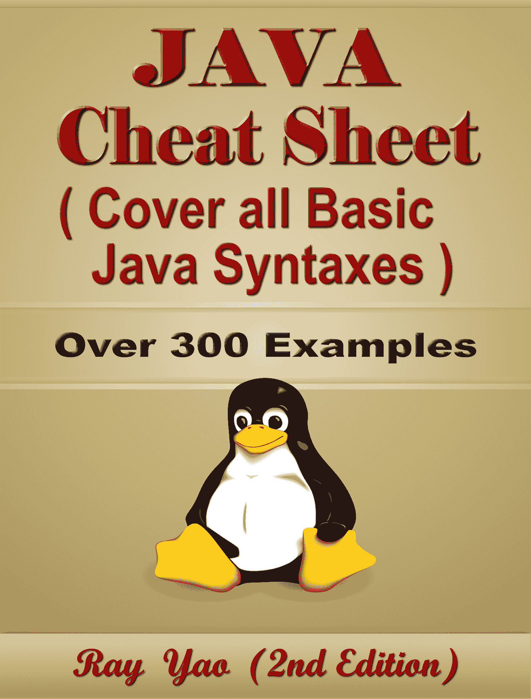
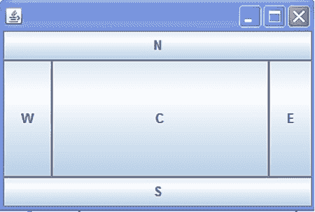
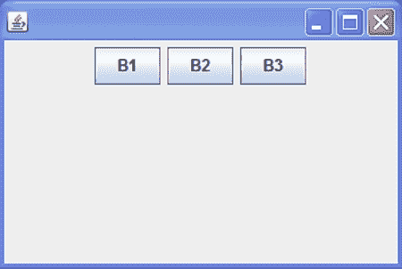
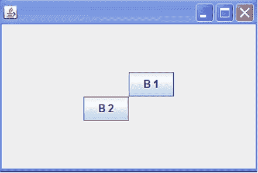

# Java 速查表，语法快速参考手册，表格与图表：语法快速学习指南



## 关于本书

本书涵盖了所有基础 Java 语法，几乎每个语法条目都列出了程序示例和结果输出。我们可以快速参考最有帮助的编程语法，例如常用命令语法、字符串函数语法、集合函数语法、类与对象语法……；这些语法对于编程都非常有用。

我们可以将这本书视为基础语法手册，因为它的条目按字母顺序排列，因此我们可以方便地参考重要的语法。

无论现在还是未来，Java 语法书都能为我们学习和工作中的编码提供巨大的帮助。

## 免责声明

本书仅作为基础语法手册；它不能包含该主题的所有条目。其目的是作为速查表书籍的补充，而不是完整的 Java 字典。

## 索引

- `LocalTime` 语法](#part0004.xhtml_a6FU)
- `local variable` 语法](#part0004.xhtml_a6FV)
- `LocalDate` 语法](#part0004.xhtml_a6FW)
- `log()` 语法](#part0004.xhtml_a6FX)
- `log10()` 语法](#part0004.xhtml_a6FY)
- `log1p()` 语法](#part0004.xhtml_a6FZ)
- `long` 语法](#part0004.xhtml_a6G0)
- `matches()` 语法](#part0004.xhtml_a6G1)
- `max()` 语法](#part0004.xhtml_a6G2)
- `method` 语法](#part0004.xhtml_a6G3)
- `method & argument` 语法](#part0004.xhtml_a6G4)
- `min()` 语法](#part0004.xhtml_a6G5)
- `module` 语法](#part0004.xhtml_a6G6)
- `multiple inheritance` 语法](#part0004.xhtml_a6G7)
- `multiplyExact()` 语法](#part0004.xhtml_a6G8)
- `native` 语法](#part0004.xhtml_a6G9)
- `negateExact()` 语法](#part0004.xhtml_a6GA)
- `new` 语法](#part0004.xhtml_a6GB)
- `next()` 语法](#part0004.xhtml_a6GC)
- `nextAfter()` 语法](#part0004.xhtml_a6GD)
- `nextDown()` 语法](#part0004.xhtml_a6GE)
- `nextLine()` 语法](#part0004.xhtml_a6GF)
- `nextUp()` 语法](#part0004.xhtml_a6GG)
- `now()` 语法](#part0004.xhtml_a6GH)
- `object` 语法](#part0004.xhtml_a6GJ)
- `offsetByCodePoints()` 语法](#part0004.xhtml_a6GK)
- `overloading` 语法](#part0004.xhtml_a6GM)
- `overriding` 语法](#part0004.xhtml_a6GN)
- `package` 语法](#part0004.xhtml_a6GP)
- `pi` 语法](#part0004.xhtml_a6GR)
- `polymorphism` 语法](#part0004.xhtml_a6GS)
- `pow()` 语法](#part0004.xhtml_a6GT)
- `print()` 语法](#part0004.xhtml_a6GU)
- `private` 语法](#part0004.xhtml_a6GV)
- `protected` 语法](#part0004.xhtml_a6GW)
- `public` 语法](#part0004.xhtml_a6GX)
- `Radio Button Event` 语法](#part0004.xhtml_a6GY)
- `random()` 语法](#part0004.xhtml_a6GZ)
- `read()` 语法](#part0004.xhtml_a6H0)
- `readObject()` 语法](#part0004.xhtml_a6H1)
- `recursion` 语法](#part0004.xhtml_a6H2)
- `regionMatches()` 语法](#part0004.xhtml_a6H3)
- `Regular Expressions` 语法](#part0004.xhtml_a6H4)
- `remove()` 语法](#part0004.xhtml_a6H5)
- `removeAll()` 语法](#part0004.xhtml_a6H6)
- `replace()` 语法](#part0004.xhtml_a6H7)
- `replaceFirst()` 语法](#part0004.xhtml_a6H8)
- `replaceAll()` 语法](#part0004.xhtml_a6H9)
- `requires` 语法](#part0004.xhtml_a6HA)
- `retainAll()` 语法](#part0004.xhtml_a6HB)
- `return` 语法](#part0004.xhtml_a6HC)
- `rint()` 语法](#part0004.xhtml_a6HD)
- `round()` 语法](#part0004.xhtml_a6HE)
- `setter` 语法](#part0004.xhtml_a6HF)
- `short` 语法](#part0004.xhtml_a6HG)
- `signum()` 语法](#part0004.xhtml_a6HH)
- `sin()` 语法](#part0004.xhtml_a6HJ)
- `sinh()` 语法](#part0004.xhtml_a6HK)
- `split()` 语法](#part0004.xhtml_a6HM)
- `sqrt()` 语法](#part0004.xhtml_a6HN)
- `startsWith()` 语法](#part0004.xhtml_a6HP)
- `static variable` 语法](#part0004.xhtml_a6HR)
- `static method` 语法](#part0004.xhtml_a6HS)
- `strictfp` 语法](#part0004.xhtml_a6HT)
- `string` 语法](#part0004.xhtml_a6HU)
- `string length` 语法](#part0004.xhtml_a6HV)
- `string connection` 语法](#part0004.xhtml_a6HW)
- `stringBuffer` 语法](#part0004.xhtml_a6HX)
- `subSequence()` 语法](#part0004.xhtml_a6HY)
- `subString()` 语法](#part0004.xhtml_a6HZ)
- `subtractExact()` 语法](#part0004.xhtml_a6J0)
- `super` 语法](#part0004.xhtml_a6J1)
- `switch / case` 语法](#part0004.xhtml_a6J2)
- `synchronized` 语法](#part0004.xhtml_a6J3)
- `system.in` 语法](#part0004.xhtml_a6J4)
- `tan()` 语法](#part0004.xhtml_a6J5)
- `tanh()` 语法](#part0004.xhtml_a6J6)
- `Text Field` 语法](#part0004.xhtml_a6J7)
- `this` 语法](#part0004.xhtml_a6J8)
- `thread isAlive()` 语法](#part0004.xhtml_a6J9)
- `thread creating` 语法](#part0004.xhtml_a6JA)
- `thread extends Thread` 语法](#part0004.xhtml_a6JB)
- `thread implements Runnable` 语法](#part0004.xhtml_a6JC)
- `throw` 语法](#part0004.xhtml_a6JD)
- `throws` 语法](#part0004.xhtml_a6JE)
- `time` 语法](#part0004.xhtml_a6JG)
- `toArray()` 语法](#part0004.xhtml_a6JH)
- `toCharArray()` 语法](#part0004.xhtml_a6JJ)
- `toDegrees()` 语法](#part0004.xhtml_a6JK)
- `toIntExact()` 语法](#part0004.xhtml_a6JM)
- `toLowCase()` 语法](#part0004.xhtml_a6JN)
- `toRadians()` 语法](#part0004.xhtml_a6JP)
- `toString()` 语法](#part0004.xhtml_a6JR)
- `toUpperCase()` 语法](#part0004.xhtml_a6JS)
- `transient` 语法](#part0004.xhtml_a6JT)
- `TreeSet` 语法](#part0004.xhtml_a6JU)
- `trim()` 语法](#part0004.xhtml_a6JV)
- `try / catch / finally` 语法](#part0004.xhtml_a6JW)
- `type casting / type converting` 语法](#part0004.xhtml_a6JX)
- `ulp()` 语法](#part0004.xhtml_a6JY)
- `user input` 语法](#part0004.xhtml_a6JZ)
- `valueOf()` 语法](#part0004.xhtml_a6K0)
- `var` 语法](#part0004.xhtml_a6K1)
- `variable` 语法](#part0004.xhtml_a6K2)
- `variable` 语法](#part0004.xhtml_a6K3)
- `void` 语法](#part0004.xhtml_a6K4)
- `volatile` 语法](#part0004.xhtml_a6K5)
- `while` 语法](#part0004.xhtml_a6K6)
- `wrapper` 语法](#part0004.xhtml_a6K7)
- `write()` 语法](#part0004.xhtml_a6K8)
- `writeObject()` 语法](#part0004.xhtml_a6K9)
- `Keywords` 语法](#part0004.xhtml_a6KB)
- `Data Type` 语法](#part0004.xhtml_a6KC)
- `Arithmetic` 语法](#part0004.xhtml_a6KE)
- `Assignment` 语法](#part0004.xhtml_a6KF)
- `Comparison` 语法](#part0004.xhtml_a6KG)
- `Logical` 语法](#part0004.xhtml_a6KH)
- `Other` 语法](#part0004.xhtml_a6KJ)
- `Result` 语法](#part0004.xhtml_a6KK)
- `Collection` 语法](#part0004.xhtml_a6KL)
- `Default` 语法](#part0004.xhtml_a6KM)
- `Abstract` 语法](#part0004.xhtml_a6KN)
- `Interface` 语法](#part0004.xhtml_a6KO)
- `Thread` 语法](#part0004.xhtml_a6KP)
- `Modifiers` 语法](#part0004.xhtml_a6KS)
- `Date` 语法](#part0004.xhtml_a6KT)
- `Event` 语法](#part0004.xhtml_a6KV)
- `Listener` 语法](#part0004.xhtml_a6KW)
- `File` 语法](#part0004.xhtml_a6KX)
- `Paper` 语法](#part0004.xhtml_a6KY)

## `&` 语法

`&` 作为关系运算符使用：

当两个条件都为真时返回真，其中一个条件为假时返回假。

```java
public class Main {
    public static void main(String[] args){
        int x = 100, y = 90, z = 60;
        if ((x > y) & (x > z))
            System.out.println("The value of x is " + x);
    }
}
```

输出：`The value of x is 100`

### 按位与

`&` 用于按位与：

如果对应的位都为 1，则返回 1，否则返回 0。

示例：

```java
public class Main {
    public static void main(String[] args){
        int x= 4;
        int y = 6;
        int z = x & y;
        System.out.println(x + " & " + y + " = " + z);
    }
}
```

输出：`4 & 6 = 4`

## `|` 语法

`|` 用于按位或：

如果其中一个位为 1，返回 1，所有位都为 0 时返回 0。

示例：

```java
public class Main {
    public static void main(String[] args){
        int x= 4;
        int y = 6;
        int z = x | y;
        System.out.println(x + " | " + y + " = " + z);
    }
}
```

输出：`4 | 6 = 6`

## `^` 语法

`^` 用于按位异异：

如果对应的位不同，则返回 1，相同则返回 0。

示例：

```java
public class Main {
    public static void main(String[] args){
        int x= 4;
        int y = 6;
        int z = x ^ y;
        System.out.println(x + " ^ " + y + " = " + z);
    }
}
```

输出：`4 ^ 6 = 2`

## `<<` 语法

`operand << bits`

根据给定的位数位数左移所有位。

示例：

```java
public class Main {
    public static void main (String[] args) {
        int operand = 2;
        // 左移 2 位
        int n = operand << 2;
        System.out.println(n);
    }
}
```

输出：`8`

## `>>` 语法

`operand >> bits`

### 右移运算符 (`>>`)

根据给定的位数右移所有位。

例如：

```java
public class Main {
    public static void main (String[] args) {
        int operand = 8;
        // 向右移 2 位
        int n = operand >> 2;
        System.out.println(n);
    }
}
```

```
// 输出: 2
```

## 无符号右移 (`>>>`)

语法：`operand >>> bits`

根据给定的位数右移所有位。

最左侧的空缺将用 0 填充。

无符号右移。

例如：假设 `-2 = 11111110`

`-2 >>> 1` // 返回 `01111111`

## 注释

### `//` 和 `/* */`

语法：

单行注释以两个正斜杠 `//` 开始。

多行注释以 `/*` 开始，并以 `*/` 结束。

例如：

```java
public class Main {
    public static void main(String[] args) {
        // 这是一个单行注释
        System.out.println("Hello World");
        /* 这是一个多行注释。
           此程序将打印我们的 Hello World
        */
    }
}
```

```
// 输出: Hello World
```

## 三元运算符 (`:`)

语法：

`(bool-expression) ? (if-true-do-this) : (if-false-do-this);`

根据布尔表达式的结果执行语句中的某一个。

例如(1)：


```java
int a=100; int b=300;
String result1 = (a<b) ? "orange" : "pineapple";
System.out.print ( result1);
```

// 输出: orange

例如(2)：

```java
int a=100; int b=300;
String result2 = (a>b) ? "orange" : "pineapple";
System.out.print ( result2 );
```

// 输出: pineapple

# 字符串拼接

## `+` 连接符号语法

`str = str1 + str2;`

`str = str1.concat(str2);`

`+` 可以连接两个字符串。

`concat()` 可以连接两个字符串。

例如：

```java
String s1 = "Hello"; String s2 = "Friends";
System.out.print( s1 + s2);  // 连接两个字符串
System.out.print( s1.concat (s2));  // 连接两个字符串
```

// 输出: Hello Friends

# Math 方法

## `abs()` 语法

`Math.abs(number)`

返回数字的绝对值。

例如：

```java
public class Main {
    public static void main(String[] args) {
        System.out.println(Math.abs(-168.88));
        System.out.println(Math.abs(168.88));
    }
}
```

// 输出:

168.88

168.88

# 抽象类与方法

## `abstract` 语法

`abstract class/method`

`abstract` 用于类或方法。

抽象类作为父类工作，会被其子类扩展。子类的方法将重写抽象类的抽象方法。

`abstract class` 不能创建任何对象。

`abstract method` 仅用于抽象类。

`abstract method` 是一个没有方法体的空方法。

例如：

```java
abstract class Book{ // 创建一个抽象类
    abstract void reading(); // 创建一个抽象方法
}
class eBook extends Book{ // 扩展父类
    void reading(){ // 重写抽象方法
        System.out.println("I override that abstract method.");
    }
}
public class AbstractDemo {
    public static void main(String[] args){
        eBook obj =new eBook();
        obj.reading();
    }
}
```

// 输出: I override that abstract method.

## `acos()` 语法

`Math.acos(number)`

返回数字的反余弦值。

例如：

```java
public class Main {
    public static void main(String[] args) {
        System.out.println(Math.acos(0.88));
        System.out.println(Math.acos(-0.88));
        System.out.println(Math.acos(0));
    }
}
```

// 输出:

0.4949341263408955

2.646658527248898

1.5707963267948966

# 集合 (Collections)

## `add()` 语法

`collection.add(element);`

向集合中添加元素。

`Collection` 指 `LinkedList`, `ArrayList`, `HashSet` 和 `List`。

例如：

```java
import java.util.HashSet;
import java.util.Set;
public class MyClass { 
    public static void main(String[] args) {
        Set<Integer> mySet = new HashSet<>();
        // 在此集合中添加整数值
        mySet.add(10);
        mySet.add(20);
        mySet.add(30);
        System.out.print("Collection elements : ");
        System.out.println(mySet);
    }
}
```

// 输出: Collection elements : [10, 20, 30]

## `addAll()` 语法

`collection.addAll(element);`

向集合中添加所有元素。

`Collection` 指 `LinkedList`, `ArrayList`, `HashSet` 和 `List`。

例如：

```java
import java.util.HashSet;
import java.util.Set;
public class MyClass { 
    public static void main(String[] args) {
        Set<Integer> mySet = new HashSet<>();
        // 在此集合中添加整数值
        mySet.add(10);
        mySet.add(20);
        mySet.add(30);
        System.out.print("Collection elements : ");
        System.out.println(mySet);
    }
}
```

// 输出: Collection elements : [10, 20, 30]

# Math 方法

## `addExact()` 语法

`addExact(num1, num2)`

返回两个数字的和。

例如：

```java
public class Main {
    public static void main(String[] args) {
        int num1 = 10;
        int num2 = 20;
        System.out.println(Math.addExact(num1, num2));
    }
}
```

// 输出: 30

# 匿名函数

## 匿名函数语法

`(parameter) -> { body }`

匿名函数是没有没有函数。

例如：

```java
public class Main {
    public static void main(String[] args) {
        Runnable r = () -> {
            System.out.println("Anonymous function");
        };
        r.run();
    }
}
```

// 输出: Anonymous function

# 算术运算符

## 算术运算符语法

`+`, `-`, `*`, `/`, `%`, `++`, `--`

`+` 加法。

`-` 减法。

`*` 乘法。

`/` 除法。

`%` 取模。

`++` 增一。

`--` 减一。

例如：

```java
public class Main {
    public static void main(String[] args) {
        int a = 10;
        int b = 3;
        System.out.println(a + b);
        System.out.println(a - b);
        System.out.println(a * b);
        System.out.println(a / b);
        System.out.println(a % b);
        a++;
        System.out.println(a);
        a--;
        System.out.println(a);
    }
}
```

// 输出: 13

7

30

3

1

11

10

# 数组

## 语法

`int arrayName[] = {"value0", "value1", "value2", ...};`

数组是一个存储值的容器对象。

例如：

```java
int[] arr = { 10, 11, 12, 13 };
System.out.println(arr[0]);
```

// 输出: 10

## 数组初始化

`int arrayName[] = new int[number of elements];`

带有固定大小数组。

例如：

```java
int[] arr = new int[3];
arr[0] = 10;
arr[1] = 20;
arr[2] = 30;
```

## 数组元素语法

`value = arrayName[index];`

使用索引访问或分配数组元素。

### 数组操作

```java
// 从元素中获取值。
int array[index] = value;
```

// 给元素赋值。

e.g.

```java
int myArr[] = {10, 20, 300, 40, 50};
int val = myArr[2];  // 从元素中获取值
System.out.println(val);
// 输出: 300
```

e.g.

```java
int myNum[] = new int [5];
myNum[2] = 80;     // 给元素赋值
System.out.println(myNum[2]);
// 输出: 80
```

### 数组长度语法

```java
arrayName.length;
```

// 返回数组的元素总数。

e.g.

```java
public class ArrLenClass{
    public static void main (String [] args){
        int myArr[] = {100,200,300};  // 创建数组 "myArr"
        int len = myArr.length;  // 获取数组的长度
        System.out.print (len);
    }
}
// 输出: 3
```

### 数组排序语法

```java
Arrays.sort(array_name);
```

// 对数组元素排序并顺序显示结果。

// 在使用 `Arrays.sort()` 之前，必须 `import java.util.Arrays;`。

e.g.

```java
package tryPackage;
import java.util.Arrays;
public class SortArrClass{
    public static void main (String [] args){
        String arr[] = { "Cod", "App", "Dot", "Bay"};
        Arrays.sort(arr);   // 对数组排序
        for(int n=0; n<arr.length; n++){    // 运行 4 次
            System.out.print (arr[n]+" ");     // n 是键
        }
    }
}
// 输出: App Bay Cod Dot
```

# `ArrayList` 语法

```java
ArrayList myList = new ArrayList();
```

// 创建一个 `ArrayList` 对象。

// `ArrayList` 类是一个可调整大小的数组，可以修改 `ArrayList` 的大小。

// `ArrayList` 是一个动态数据结构，它可以在列表中快速地迭代或搜索指定的元素。

e.g.

```java
import java.util.*;
public class MyArrayList{
    public static void main(String[ ] args) {
        ArrayList myList = new ArrayList();   // 创建 ArrayList 对象
        myList.add(new Integer(10));      // 向 myList 中添加元素
        myList.add(new Integer(20));
        myList.add(new Integer(30));
        System.out.print(myList);
    }
}
// 输出: [ 10, 20, 30 ]
```

**注意：**

`LinkedList` 和 `ArrayList` 的区别：

- `LinkedList` 在添加、插入和删除元素时运行快。
- `ArrayList` 在迭代和搜索元素时运行快。

## `ArrayList` 函数

- `obj.add()`: 添加元素
- `obj.get()`: 获取元素值
- `obj.set()`: 设置元素值
- `obj.size()`: 返回元素数量
- `obj.remove()`: 移除元素
- `obj.clear()`: 清除所有元素

e.g.

```java
import java.util.ArrayList;
public class Main {
    public static void main(String[] args) {
        ArrayList<String> colors = new ArrayList<String>();
        colors.add("Red"); // 添加项
        colors.add("Yellow");
        colors.add("Green");
        System.out.println(colors);
        for (int i = 0; i < colors.size(); i++) { // 遍历
            System.out.print(colors.get(i) + " "); // 获取元素值
        }
        colors.set(1, "White"); // 设置项值
        System.out.println(colors);
        colors.remove(2); // 移除元素值
        System.out.println(colors);
        colors.clear(); // 清除所有项
        System.out.println(colors);
    }
}
// 输出:
// [Red, Yellow, Green]
// Red White Green 
// [Red, White]
// [Red]
// []
```

### `asin` 语法

```java
Math.asin(number)
```

// 返回数字的反正弦值。

e.g.

```java
public class Main {
    public static void main(String[] args) {
        System.out.println(Math.asin(0.88));
    }
}
// 输出: 1.0758622045401
```

# `assertion` 断言语法

```java
assert condition: "message";
```

// 断言通过检查我们假设为真的代码来帮助检测任何问题。

// 如果条件返回假，JVM 将抛出消息并停止。

// 在运行带断言的文件时，我们需要在命令中使用 `java -ea` 来启用断言。

e.g.

```java
import java.util.Scanner;
public class Assertion{
    public static void main( String args ){
        int value = 100;
        assert value > 100 : "The value is not greater than 100";
        System.out.println("The value is " + value);
    }
}
// 输出: Exception in thread "main" java.lang.AssertionError: The value is not greater than 100
```

# 赋值运算符

赋值运算符意味着 `=`, `+=`, `-=`, `*=`, `/=`, `%=`, `&=`, `|=`, `^=`, `>>=`, `<<=`。

e.g.


```java
public class Main {
    public static void main(String[] args) {
        int n1 = 6; n1 += 2; System.out.println(n1); // n1 = 6+2, 返回 8
        int n2 = 6; n2 -= 2; System.out.println(n2); // n2 = 6-2, 返回 4
        int n3 = 6; n3 *= 2; System.out.println(n3); // n3 = 6*2, 返回 12
        int n4 = 6; n4 /= 2; System.out.println(n4); // n4 = 6/2, 返回 3
        int n5 = 6; n5 %= 2; System.out.println(n5); // n5 = 6%2, 返回 0
        int n6 = 6; n6 &= 2; System.out.println(n6); // n6 = 6&2, 返回 2
        int n7 = 6; n7 |= 2; System.out.println(n7); // n7 = 6|2, 返回 6
        int n8 = 6; n8 ^= 2; System.out.println(n8); // n8 = 6², 返回 4
        int n9 = 6; n9 >>= 2; System.out.println(n9); // n9 = 6>>2, 返回 1
        int n10 = 6; n10 <<= 2; System.out.println(n10); // n10 = 6<<2, 返回 24
    }
}
```

## `atan` 语法

```java
Math.atan(number)
```

返回 `-PI/2` 到 `PI/2` 之间的反正切值。

例如：

```java
public class Main {
    public static void main(String[] args) {
        System.out.println(Math.atan(0.88));
    }
}
// 输出: 0.721654850864761
```

## `atan2` 语法

```java
Math.atan2(y, x)
```

返回 `y / x` 的反正切值（弧度）。

例如：

```java
class Main {
    public static void main(String[] args) {
        double x = 4.2;
        double y = 5.9;
        double result = Math.atan2(y, x);
        System.out.println(result); // 结果是弧度
        System.out.println(Math.toDegrees(result)); // 转换为角度
    }
}
// 输出:
// 0.9521519758701495
// 54.55428967240176
```

# `boolean` 语法

```java
boolean variable
```

`true` 或 `false` 属性的数据类型。

例如：

```java
boolean good = true;
boolean bad = false;
System.out.println(good);
System.out.println(bad);
// 输出: true, false
```

## `BorderJFrame` & `BorderLayout` 语法

```java
BorderJFrame myFrame=new BorderJFrame() // 创建 BorderJFrame
setLayout(new BorderLayout()) // 设置为 BorderLayout
add(new JButton(), BorderLayout.LOCATION) // 添加按钮
```

向 `BorderJFrame` 添加按钮。`LOCATION` 意味着五个位置：“东”、“南”、“西”、“北”和“中心”。

`BorderLayout` 意味着所有组件都放在指定的五个位置。

例如：

```java
import java.awt.*;
import javax.swing.*;
public class BorderJFrame extends JFrame{
    public BorderJFrame(){
        setLayout(new BorderLayout()); // 设置布局
        add(new JButton("N"), BorderLayout.NORTH );
        add(new JButton("S"), BorderLayout.SOUTH );
        add(new JButton("E"), BorderLayout.EAST );
        add(new JButton("W"), BorderLayout.WEST );
        add(new JButton("C"), BorderLayout.CENTER );
    } // 添加按钮
    public static void main(String[] args){
        BorderJFrame myFrame = new BorderJFrame();
        // 创建 BorderJFrame 对象
        myFrame.setSize(300,200);
        myFrame.setVisible(true);
    }
}
```



## `break` 语法

```java
break;
```

终止循环或 `switch` 块

例如：

```java
for (int n = 1; n < 8; n++) {
    if (n == 6) {
        break;
    }
    System.out.print(n);
}
```

输出: `12345`

## 按钮事件语法

```java
implements ActionListener    // 为监听器创建一个接口
addActionListener(this)      // 为组件添加监听器
actionPerformed(ActionEvent e){…}     // 如果发生事件则执行
```

通过实现 `ActionListener`，可以创建一个监听器接口并监听事件。

例如：

```java
import javax.swing.*;
import java.awt.*;
import java.awt.event.ActionEvent;
import java.awt.event.ActionListener;

public class ButtonFrame extends JFrame implements ActionListener{     // 为监听器创建一个接口

    public ButtonFrame(){
        JButton myButton = new JButton("Click Me");
        myButton.addActionListener(this);     // 为按钮添加监听器
        add(myButton);
    }

    public static void main(String[ ] args){
        ButtonFrame myFrame =new ButtonFrame();
        myFrame.setSize(300, 200);
        myFrame.setVisible(true);
    }

    public void actionPerformed(ActionEvent e){     
        // 当发生事件时运行 actionPerformed()
        System.out.println("Button Event Occurs!");
    }
}
```

输出: `Click Me      Button Event Occurs!`

## `byte` 语法

```java
byte variable
```

范围从 `-128` 到 `127` 的数字类型

例如：

```java
byte myNum = 88;
System.out.println(myNum);
```

输出: `88`

## `canRead()` 语法

```java
file.canRead()
```

如果文件可读则返回 `true`。

例如：

```java
File f = new File ( aFile.txt );    // 创建文件对象
if (f.exists()) {
    System.out.println("Is existing?"+ f.exists());
    System.out.println("Can read?"+ f.canRead());
    System.out.println("Can write?"+ f.canWrite());
    System.out.println("Is a file?"+ f.isFile()); 
}
```

输出:

```
Is existing? true
Can read? true
Can write? false
Is a file? true
```

## `canWrite()` 语法

```java
file.canWrite()
```

如果文件可写则返回 `true`。

例如：

```java
File f = new File ( aFile.txt );    // 创建文件对象
if (f.exists()) {
    System.out.println("Is existing?"+ f.exists());
    System.out.println("Can read?"+ f.canRead());
    System.out.println("Can write?"+ f.canWrite());
    System.out.println("Is a file?"+ f.isFile()); 
}
```

输出:

```
Is existing? true
Can read? true
Can write? false
Is a file? true
```

## `CardLayout` 事件语法

```java
implements ActionListener    // 为监听器创建一个接口
addActionListener(this)      // 为组件添加监听器
actionPerformed(ActionEvent e){…}     // 如果发生事件则执行
```

通过实现 `ItemListener`，可以创建一个监听器接口并监听事件。

例如：

```java
import java.awt.*;
import java.awt.event.*;

class CardLayoutClass extends Frame implements ActionListener{      
// 为监听器创建一个接口
    CardLayout myCard;
    Button button1, button3, button2;
    Panel panel1;

    CardLayoutClass(){
        myCard=new CardLayout();
        panel1=new Panel();
        panel1.setLayout(myCard);      // 使用 CardLayout
        button1=new Button("first");
        button3=new Button("last");
        button2=new Button("next");
        for(int n = 1; n <= 3; n++){
            panel1.add(new Button("I am the Number "+ n + " Card"));
        }      // 将按钮添加到到 panel1
        button1.addActionListener(this);     // 添加监听器
        button3.addActionListener(this);
        button2.addActionListener(this);
        Panel panel2=new Panel();
        panel2.add(button1);      // 将按钮添加到 panel2
        panel2.add(button2);
        panel2.add(button3);
        add(panel1,BorderLayout.CENTER);      // 使用 BorderLayout
        add(panel2,BorderLayout.SOUTH);
        setBounds(10,10,200,190);
        setVisible(true);
    }

    public static void main(String args[]){
        new CardLayoutClass();
    }  

    public void actionPerformed(ActionEvent e){
        // 当发生事件时运行 actionPerformed()
        if(e.getSource()==button1){      // 如果点击 button1
            myCard.first(panel1);
        }
        else if(e.getSource()==button2){      // 如果点击 button2
            myCard.next(panel1);
        }
        else if (e.getSource()==button3){      // 如果点击 button3 
            myCard.last(panel1);
        }
    }
}
```

输出: `I am the Number 1 Card`

## `CardJFrame` & `CardLayout` 语法

```java
CardJFrame myFrame=new CardJFrame(); // 创建一个 CardJFrame
setLayout(new CardLayout());      // 设置使用 CardLayout
add(new JButton())     //为 CardJFrame 添加一个按钮
```

`CardLayout` 意味着组件一次显示一个。`CardLayout` 需要一个监听器来显示所有。

例如：

```java
import java.awt.*;
import java.swing.*;

public class CardJFrame extends JFrame{
    public CardJFrame(){
        setLayout(new CardLayout());
        add(new JButton("B1"));
        add(new JButton("B2"));
        add(new JButton("B3"));
        setSize(300,200);
        setVisible(true);
        setDefaultCloseOperation(JFrame.EXIT_ON_CLOSE);
    }
    public static void main(String args){
        new CardJFrame();
    }
}
```

输出: `(image_rsrc6P7.jpg)`

## `case` 语法

```java
case:
```

`switch` 中的标记

例如：

```java
int number = 2;
switch (number) {
    case 1:
        System.out.println("Number 1");
    case 2:
        System.out.println("Number 2");
}
```

输出: `Number 2`

## `cbrt()` 语法

```java
Math.cbrt(number)
```

返回数字的立方根

例如：

```java
class Main {
    public static void main(String args) {
        double a = 125.0;
        double b = -27;
        double c = 0.0;
        System.out.println(Math.cbrt(a));
        System.out.println(Math.cbrt(b));
        System.out.println(Math.cbrt(c));
    }
}
```

输出:

```
5.0
-3.0
0.0
```

## `ceil()` 语法

```java
Math.ceil(number)
```

返回大于等于参数的最近整数。

例如：


```java
class Main {
    public static void main(String args) {
        double num = 3.14;
        System.out.println(Math.ceil(num));
    }
}
```

// 输出: 4

# char 语法

```java
char variable
```

// 单字符数据类型

e.g.

```java
char ch = 'C';
System.out.println(ch);
```

// 输出: C

## charAt() 语法

```java
string.charAt(index)
```

// 返回指定索引处的字符

e.g.

```java
class Main{
    public static void main(String[] args){
        String str = "kindle";
        char c = str.charAt(2);
        System.out.println(c);
    }
}
```

// 输出: n

## Check Box 事件

```java
implements ItemListener    // 为监听器创建一个接口
addItemListener(this)      // 为组件添加监听器
itemStateChanged(ItemEvent e){…}     // 如果发生事件则执行
```

通过实现`ItemListener`，可以创建一个监听器接口并监听事件。

e.g.

```java
import javax.swing.*;
import java.awt.*;
import java.awt.event.ItemEvent;
import java.awt.event.ItemListener;

public class CheckBoxFrame extends JFrame implements ItemListener{

    public CheckBoxFrame(){
        JCheckBox myCheckBox = new JCheckBox("Check Me");
        myCheckBox.addItemListener(this);
        add(myCheckBox);
    }

    public static void main(String[ ] args){
        CheckBoxFrame myFrame = new CheckBoxFrame();
        myFrame.setSize(300, 200);
        myFrame.setVisible(true);
    }

    public void itemStateChanged(ItemEvent e){
        // 事件处理逻辑在此
    }
}
```

```java
public void itemStateChanged(ItemEvent e){
    // itemStateChanged() runs when an event occurs
    System.out.println("Check Box Event Occurs!");
}
```

Output: □　Check Me　　Check Box Event Occurs!

---

# 类语法

```java
## 修饰符 类 类名 {

    ## 类型 变量;

    ## 类型 方法名() { }…

}
```

`class`是对象的模板，用于创建对象。

`class 类名`定义了一个类。

例如：

```java
public class MyClass {  // 定义一个类
    int num = 100;
    public static void main(String[] args) {
        MyClass myObj = new MyClass();  // 创建一个对象
        System.out.println(myObj.num);
    }
}
```

Output: 100

---

## 类与对象语法

```java
public class ClassName {     // 定义一个类
}

ClassName obj = new ClassName( );   // 创建一个对象
```

例如：

```java
public class Flower {     // 定义一个类
    String co1, co2;      // 定义两个变量
    void beautify() {      // 定义一个方法
        System.out.println("This flower is " + co1);
        System.out.println("That flower is " + co2);
    }
    public static void main(String[] args) {
        Flower obj = new Flower( );     // 创建一个对象
        obj.co1= "red.";   obj.co2="blue.";     // obj 引用 co1, co2
        obj.beautify();      // obj 引用 beautify()
    }
}
```

Output:

This flower is red.

That flower is blue.

---

## 类属性语法

```java
public class MyClass {
    int variable1 = value1;
    int variable2 = value2;
}
```

创建一个名为`MyClass`的类，包含两个属性：`variable1`和`variable2`。

例如：

```java
public class Main {
    int num = 10; // 定义一个类属性
    public static void main(String[] args) {
        Main obj = new Main();
        System.out.println(obj.num);
    }
}
```

Output: 10

---

## close() & AutoCloseable 语法

```java
public void close() throws Exception{
}
```

`close()`用于清理资源，它会在对象关闭或块退出时被自动调用。

```java
public class ClassName implements AutoCloseable{
}
```

`AutoCloseable`接口提供了`close()`方法。

`System.gc()`

`gc()`建议 JVM 进行垃圾回收。

注意：不建议显式调用`System.gc()`。

例如：

```java
public class MyClass implements AutoCloseable {
    public static void main(String[] args) {
        try (MyClass obj = new MyClass()) {
            System.out.print("The object is no longer used!  ");
        } catch (Exception e) {
            System.out.println( e.getMessage() );
        }
    }
    public void close() throws Exception {
        System.out.print("close() is executed!");
    }
}
```

Output: The object is no longer used!  close() is executed!

---

## codePointAt() 语法

```java
string.codePointAt(index)
```

返回指定索引处字符的 Unicode 码。

例如：

```java
public class Main{
    public static void main(String []args){
        String str = "kindle";
        int u = str.codePointAt(2);
        System.out.println(u);
    }
}
```

Output: 110

---

## codePointBefore() 语法

```java
string.codePointBefore(index)
```

返回指定索引之前字符的 Unicode 码。

例如：

```java
public class Main{
    public static void main(String []args){
        String str = "kindle";
        int u = str.codePointBefore(2);
        System.out.println(u);
    }
}
```

Output: 105

---

## codePointCount() 语法

```java
string.codePointCount(beginIndex, endIndex)
```

返回字符串中指定范围内 Unicode 值的数量。

例如：

```java
public class Main {
    public static void main(String[] args) {
        String str = "Hello World";
        int num = str.codePointCount(0, 8);
        System.out.println(num);
    }
}
```

Output: 8

---

## Color 对象语法

```java
Color myColor = new Color(r, g, b);     // 创建一种颜色
```

`RGB`意味着“红、绿、蓝”，其值范围从 0 到 255。

`0,0,0`表示黑色，`255,255,255`表示白色。

`myButton.setBackground(myColor);     // 设置背景颜色`

`myButton.setForeground(Color.color);   // 设置前景颜色`

例如：

```java
import java.awt.* ;     
import javax.swing.* ;

public class MyFrame extends JFrame {
    JButton myButton;
    public MyFrame(){
        myButton = new JButton("Click Me");
        Color myColor = new Color(255, 0, 0);
        myButton.setBackground(myColor);     // 设置背景颜色
        myButton.setForeground(Color.WHITE);   // 设置前景颜色
        add(myButton);
        setSize(300,300);
        setDefaultCloseOperation(JFrame.EXIT_ON_CLOSE);
    }
    public static void main(String[] args) {
        MyFrame frame = new MyFrame();
        frame.setVisible(true);
    }
}
```

*(注：原文示例中代码片段不完整，此处根据逻辑补全了可运行的结构以展示)*

```java
String str1 = "JQuery in 8 Hours";
String str2 = "jQuery in 8 hours";
System.out.println(str1.compareToIgnoreCase(str2));
```

// 输出: 0

---

### concat() 语法:

`str1.concat(str2)`

// 拼接两个字符串

e.g.

```java
public class Main {
    public static void main(String[] args) {
        String str1 = "Python ";
        String str2 = "Syntax Book";
        System.out.println(str1.concat(str2));
    }
}
```

// 输出: Python Syntax Book

---

### 三元运算符语法:

`(bool-expression) ? (if-true-do-this) : (if-false-do-this);`

// 根据布尔表达式的结果执行其中一条语句

e.g.(1)

```java
int a=100; int b=300;
String result1 = (a<b) ? "orange" : "pineapple";
System.out.print ( result1);
```

// 输出: orange

e.g.(2)

```java
int a=100; int b=300;
String result2 = (a>b) ? "orange" : "pineapple";
System.out.print ( result2 );
```

// 输出: pineapple

---

### 构造函数语法:

```java
modifier class ClassName{  
    ClassName(){…} // 定义构造函数
}
```

// 构造函数用于初始化变量。构造函数与与类相同。

// 在创建对象时，会自动调用构造函数

e.g.

```java
public class Flower{ // 定义一个类
    String co1, co2;
    public Flower(){co1="red";  co2="blue";} // 构造函数
    void beautify() {
        System.out.println("This flower is " + co1);
        System.out.println("That flower is " + co2);
    }
    public static void main(String[] args) {
        Flower obj = new Flower( ); // 创建对象，调用构造函数
        obj.beautify();  
    }
}
```

// 输出:

This flower is red.

That flower is blue.

---

### contains() 语法:

`str1.contains(str2)`

// 如果字符串包含指定的字符或字符序列，则返回 true；否则返回 false。

e.g.

```java
public class Main {
    public static void main(String[] args) {
        String str = "RayYao";
        System.out.println(str.contains("Ray"));
        System.out.println(str.contains("Yao"));
        System.out.println(str.contains("R"));
        System.out.println(str.contains("Hay"));
    }
}
```

// 输出: true, true, true, false

---

### containsAll() 语法:

`collection1.containAll(collection2);`

// 如果`collection1`包含`collection2`的所有元素，则返回 true；如果`collection1`不包含`collection2`的所有元素，则返回 false。

e.g.


```java
import java.util.ArrayList;
public class MyClass {
    public static void main(String[] args) {
        ArrayList<String> list1 = new ArrayList<>();
        list1.add("A");
        list1.add("B");
        list1.add("C");
        System.out.println("List1: " + list1);
        ArrayList<String> list2 = new ArrayList<>();
        list2.add("A");
        list2.add("B");
        System.out.println("List2: " + list2);
        boolean bool1 = list1.containsAll(list2);
        // 检查 List1 是否包含 List2 的所有元素
        System.out.println("List1 contains all elements of List2? " + bool1);
        boolean bool2 = list2.containsAll(list1);
        // 检查 List2 是否包含 List1 的所有元素
        System.out.println("List2 contains all elements of List1? " + bool2);
    }
}
```

// 输出:

`List1: [A, B, C]`

`List2: [A, B]`

`List1 contains all elements of List2? true`

`List2 contains all elements of List1? false`

---

### `contentEquals()` 语法

`str1.contentEquals(str2)`

// 如果字符串完全等于另一个字符串，则返回`true`；否则返回`false`。

e.g.

```java
public class Main {
    public static void main(String[] args) {
        String str = "RayYao";
        System.out.println(str.contentEquals("RayYao"));
        System.out.println(str.contentEquals("Yao"));
        System.out.println(str.contentEquals("Hay"));
    }
}
```

// 输出: `true`, `false`, `false`

---

### `continue` 语法

`continue;`

// 继续循环的下次迭代

e.g.

```java
for (int n = 1; n < 8; n++) {
    if (n == 6) {
            continue;
    }
    System.out.print(n);
}
```

// 输出: `123457`

---

### `copySign()` 语法

`Math.copySign(x, y)`

// 复制第二个参数的符号并将该符号赋值给第一个参数。

e.g.

```java
class Main {
    public static void main(String[] args) {
        float x = 1.68f;
        float y = -3.14f;
        System.out.println(Math.copySign(x, y));
    }
}
```

// 输出:

`-1.68`

---

### `copyValueOf()` 语法

`str1.copyValueOf(str2, beginIndex, endIndex)`

// 通过复制数组的元素返回一个字符串。

e.g.

```java
public class Main {
    public static void main(String[] args) {
        String str1 = ""; // 定义空字符串
        char[] str2 = {'R', 'a', 'y', 'Y', 'a', 'o'};
        System.out.print(str1.copyValueOf(str2, 0, 6));
    }
}
```

// 输出: `RayYao`

---

### `cos()` 语法

`Math.cos(radians)`

// 返回弧度值的余弦值

e.g.

```java
class Main {
    public static void main(String[] args) {
        double deg = 30; // 角度
        double rad = Math.toRadians(deg); // 转换为弧度
        System.out.println(Math.cos(rad));
    }
}
```

// 输出: `0.8660254037844386`

---

### `cosh()` 语法

`Math.cosh(radians)`

// 返回弧度的双曲余弦值

e.g.

```java
class Main {
    public static void main(String[] args) {
        double deg = 30; // 角度
        double rad = Math.toRadians(deg);
        System.out.println(Math.cosh(rad));
    }
}
```

// 输出: `1.5430806348152437`

---

### 自定义布局语法

`JPanel myPanel = new JPanel();` // 创建一个`JPanel`

`myPanel.setLayout(null);` // 使用自定义布局

`add(myPanel);` // 将`JPanel`添加到框架中

`myPanel.add(myButton);` // 将按钮添加到`JPanel`中

`myPanel.setBounds(x, y, width, height);` // 根据`x`, `y`坐标设置边界

// 自定义布局意味着我们可以通过将布局设为`null`来使用自定义布局，而不是 Java 内置布局。

e.g.

```java
import javax.swing.*;
import java.awt.*;

class myFrame extends JFrame{
    myFrame(){ // 构造函数
        JPanel myPanel = new JPanel(); // 创建一个 JPanel
        myPanel.setLayout(null); // 设置布局为空布局布局
        add(myPanel); // 将 JPanel 添加到框架
        myPanel.setBounds(50, 30, 150, 130); // 设置 JPanel 的边界
        setBounds(200, 100, 300, 230); // 设置框架的边界
        setVisible(true); // 设置框架可见
        JButton myButton = new JButton("Click!");
        myPanel.add(myButton); // 将按钮添加到 JPanel 中
        myButton.setBounds(50, 50, 90, 30); // 设置按钮的边界
    }
}

public class CustomizedLayout{
    public static void main (String args[]){
        new myFrame();
    }
}
```

// 输出:

`(image_rsrc6PA.jpg)`

---

### 日期对象语法

`LocalDate obj = LocalDate.now()`

// 创建日期对象

e.g.

```java
import java.time.LocalDate; // 导入 LocalDate 类
public class Main { 
    public static void main(String[] args) { 
        LocalDate dateObj = LocalDate.now(); // 创建日期对象
        System.out.println(dateObj); // 显示当前日期
    }
}
```

// 输出: `2022-03-15`

---

### 日期与时间语法

`import java.time.LocalDateTime;` // 导入`LocalDateTime`类

`LocalDateTime obj = LocalDateTime.now();` // 创建本地日期和时间对象

```java
public static void main(String[] args) {
    LocalDateTime obj = LocalDateTime.now();
    System.out.println(obj);
}
```

// 输出: `2022-03-15T10:38:06.933`

---

### `decrementExact()` 语法

`Math.decrementExact(num)`

// 返回`num`减 1 后的值

e.g.

```java
class Main {
    public static void main(String[] args) {
        int x = 100;
        System.out.println(Math.decrementExact(x));
        long y = 100000L;
        System.out.println(Math.decrementExact(y));
    }
}
```

// 输出:

`99`

`99999`

---

### `default` 语法

`default:`

// 在`switch`语句中标记默认代码块

e.g.

```java
int number = 100;

switch (number) {
    case 1:
        System.out.println("Number 1");
        break;
    case 2:
        System.out.println("Number 2");
        break;
    default:
        System.out.println("Another Number");
}
```

// 输出: `Another Number`

---

### `default` 修饰符语法

`class MyClass`

// 默认类没有任何修饰符

// 默认类仅在同一个包内可访问

e.g.

```java
class Member { // 默认类
    String firstName = "Ray";
    String lastName = "Yao";

    public static void main(String[] args) {
        Member obj = new Member();
        System.out.println("Name: " + obj.firstName + " " + obj.lastName);
    }
}
```

// 输出: `Name: Ray Yao`

---

### `delete()` 语法

`fileObj.delete()`

// 删除文件

e.g.

```java
import java.io.File;

public class DeleteFile {
    public static void main(String[] args) {
        File obj = new File("myFile.txt");
        if (obj.delete()) {
            System.out.println("The file deleted is " + obj.getName());
        } else {
            System.out.println("Failed to delete the file.");
        }
    }
}
```

// 输出: `The file deleted is myFile.txt`

---

### `do / while` 语法

```java
do {
    ……
} while(condition)
```

// `do`与`while`组合构成一个`do/while`循环

e.g.

```java
int n = 1;
do {
    System.out.print(n);
    n++;
} while(n <= 5);
```

// 输出: `12345`

---

### `double` 语法

`double`

// 范围从 1.7e−308 到 1.7e+308 的数字数据类型

e.g.

```java
double num = 166.88d;
System.out.println(num);
```

// 输出: `166.88`

---

### `else` 语法

`else{ }`

// 当条件为假时用于条件语句`if`

e.g.

```java
int score = 60;
if (score < 60) {
    System.out.println("Failed!");
} else {
    System.out.println("Passed!");
}
```

// 输出: `Passed!`

---

### `encapsulation` 语法

```java
public class Encapsulation {
    private String value; // 私有属性
    public String getValue() { // Getter
        return value;
    }
    public void setValue(String newValue) { // Setter
        this.value = newValue;
    }
}
```

// 封装的意义向用户隐藏敏感数据

// 将类变量/属性声明为`private`

// 提供公共的`getter`和`setter`方法进行访问

e.g.

```java
class Encap {
    private String name;
    public String getName() { // getter
        return name;
    }
    public void setName(String newValue) { // setter
        name = newValue;
    }
}

public class Main {
    public static void main(String args[]) {
        Encap obj = new Encap();
        obj.setName("Ray Yao");
        System.out.println("My name is " + obj.getName());
    }
}
```

// 输出: `My name is Ray Yao`

---

### `endswith()` 语法

`str1.endswith(str2)`

// 如果字符串以某些指定的字符结束则返回`true`，否则返回`false`

e.g.

```java
public class Main {
    public static void main(String[] args) {
        String str = "RayYao";
        System.out.println(str.endsWith("Ray"));
        System.out.println(str.endsWith("Yao"));
        System.out.println(str.endsWith("o"));
    }
}
```

// 输出: `false`, `true`, `true`

---

### `enum` 语法

`enum EnumName{CONSTANTS}`

// 声明带有多个常量的枚举类型类

// 枚举类包含一组常量

`EnumName.CONSTANT` // 枚举引用一个常量

e.g.

```java
enum Flower { RED, YELLOW, GREEN }
```

（注：`enum`的示例文本是碎片化的，根据提供的上下文进行了重构）

---

### `equals()` 语法

`str1.equals(str2)`

// 比较两个字符串，如果相等则返回`true`，否则返回`false`

e.g.

```java
public class Main {
    public static void main(String[] args) {
        String str1 = "RayYao";
        String str2 = "RayYao";
        String str3 = "Java Programming";
        System.out.println(str1.equals(str2)); // 返回 true
    }
}
```


## `equalsIgnoreCase()` 语法

`str1.equalsIgnoreCase(str2)`

// 忽略大小写比较两个字符串，如果相等则返回 true，否则返回 false

e.g.

```java
public class Main {
    public static void main(String[] args) {
        String str1 = "Query in 8 Hours";
        String str2 = "jQuery 8 hours";
        System.out.println(str1.equalsIgnoreCase(str2));
    }
}
```

## `exists()` 语法

`file.exists()`

// 如果文件存在则返回 true

e.g.

```java
File f = new File("myFile.txt");
if (f.exists()) {
    System.out.println("File exists");
}
```

## `exp()` 语法

`Math.exp(num)`

// 返回 e 的 num 次幂

e.g.

```java
class Main {
    public static void main(String[] args) {
        double n = 3.14d;
        System.out.println(Math.exp(n));
    }
}
```

## `expm1()` 语法

`Math.expm1(num)`

// 返回 e(num) - 1

e.g.

```java
class Main {
    public static void main(String[] args) {
        double n = 3.14d;
        System.out.println(Math.expm1(n));
    }
}
```

## `exports` 语法

```java
module a.module {
    exports a.package to b.module;
}
```

// 将包导出到一个或多个特定的模块，以便该包可以被指定的模块访问

## `extends` 语法

`class ChildClass extends ParentClass`

// 子类继承父类

// 子类继承父类的所有特征

e.g.

```java
class Book {
    protected String title = "R";
    public void fun() {
        System.out.print("Recommended Book: ");
    }
}

class Ebook extends Book {
    private String name = "in 8 Hours";
    public static void main(String[] args) {
        Ebook obj = new Ebook();
        obj.fun();
        System.out.print(obj.title + " " + obj.name);
    }
}
```

// 输出: Recommended Book: R in 8 Hours

## `file` 类语法

`File myFile = new File(fileName);`

// 创建文件对象

```java
File f = new File ( aFile.txt );   // 创建一个文件对象

if (f.exists()) {
    System.out.println("Is existing?"+ f.exists());
    System.out.println("Can read?"+ f.canRead());
    System.out.println("Can write?"+ f.canWrite());
    System.out.println("Is a file?"+ f.isFile()); 
}

// 输出:
// Is existing? true
// Can read? true
// Can write? false
// Is a file? true
```

### 文件创建语法

```java
File obj= new File("myFile.txt");
// 创建一个文件对象
```

e.g.

```java
import java.io.File;
import java.io.IOException;

public class Main { 
    public static void main(String[] args) { 
        try {
            File obj= new File("myFile.txt");
            if (obj.createNewFile()) {
                System.out.println("The file created is " + obj.getName());
            } else {
                System.out.println("The file already exists.");
            }
        } catch (IOException e) {
            System.out.println("Error occurred.");
            e.printStackTrace();
        }
    }
}
```

// 输出: The file created is myFile.txt

### 文件删除语法

```java
fileObj.delete()
// 删除一个文件
```

e.g.

```java
import java.io.File;
public class DeleteFile {
    public static void main(String[] args) {
        File obj= new File("myFile.txt");
        if (obj.delete()) {
            System.out.println("The file deleted is " + obj.getName());
        } else {
            System.out.println("Failed to delete the file.");
        }
    }
}
```

// 输出: The file deleted is myFile.txt

### 文件读取语法

```java
Scanner obj = new Scanner(fileObj); 
// 创建一个文件读取对象

String content = obj.nextLine();
// 读取文件的每一行
```

e.g.

```java
// 假设 myFile.txt 的内容为 "Java in 8 Hours"。
import java.io.File;
import java.io.FileNotFoundException;
import java.util.Scanner;

public class Main { 
    public static void main(String[] args) { 
        try {    
            File fileObj = new File("myFile.txt");
            Scanner obj = new Scanner(fileObj);
            while (obj.hasNextLine()) {
                String content = obj.nextLine();    // 读取文件
                System.out.println(content);
            }
            obj.close();
        } catch (FileNotFoundException e) {
            System.out.println("Error occurred.");
            e.printStackTrace();
        }
    }
}
```

// 输出: Java in 8 Hours

### 文件读取语法 (FileReader)

```java
FileReader obj = new FileReader(f);
// 创建一个文件读取对象

obj.read()
// 读取文件
```

e.g.

```java
import java.io.FileReader;
import java.io.IOException;
public class MyClass{
    public static void main(String[] args) throws IOException{
        String f = "D:\\myFile.txt";
        // myFile.txt 内容为: Hello World!
        FileReader obj = new FileReader(f);
        try {
            int i;    // 读取到文件末尾时返回 -1
            while((i = obj.read()) != -1)     // 读取文件
                System.out.print((char)i);
        } finally {
            obj.close();
        }
    }
}
```

// 输出: Hello World!

### 文件写入语法

```java
FileWriter obj = new FileWriter("myFile.txt");
// 创建一个文件写入对象

obj.write("contents");    
// 写入文件
```

e.g.

```java
import java.io.FileWriter;
import java.io.IOException;
public class Main { 
    public static void main(String[] args) { 
        try {
            FileWriter obj = new FileWriter("myFile.txt");
            obj.write("Java in 8 Hours");      // 写入文件
            obj.close();
            System.out.println("Write file successfully!");
        } catch (IOException e) {
            System.out.println("Error occurred.");
            e.printStackTrace();
        }
    }
}
```

// 输出: Write file successfully!

### FileInputStream 语法

```java
FileInputStream obj = new FileInputStream(fileName);
obj.read();      // 读取文件内容
```

// `FileInputStream` 类用于处理输入流。

// `"new FileInputStream (fileName)"` 创建一个输入流。

// `"obj.read();"` 读取文件内容。

e.g.

(假设 `D:` 盘上的 myFile.txt 内容为 "PHP in 8 Hours!")

```java
import java.io.*;
public class InputFile {
    public static void main(String[] args) {
        int num;
        try{
            FileInputStream obj = new FileInputStream("D:\\myFile.txt");
            while((num=obj.read())!= -1)  // 读取文件
            System.out.print((char)num);  // 转换为字符
            obj.close();
        }
        catch(FileNotFoundException e){
            System.err.println(e);
        }
        catch(IOException e){
            System.err.println(e);
        }
    }
}
```

// 输出: PHP in 8 Hours

// `obj` 是一个输入流对象。

// `obj.read()` 读取 `myFile.txt` 的内容

// `-1` 表示文件末尾。

### FileOutputStream 语法

```java
FileOutputStream obj = new FileOutputStream(fileName);
System.in.read();  // 读取输入的数据
obj.write();      // 将数据写入文件
```

// `FileOutputStream` 类用于处理输出流。

// `"new FileOutputStream (fileName)"` 创建一个输出流。

// `"System.in.read();"` 从键盘读取输入的数据。

// `"obj.write();"` 将数据写入文件。

e.g.

(假设我们向 `D:` 盘写入文件 "myFile.txt")

```java
import java.io.*;
public class OutputFile {
    public static void main(String[] args) {
        char ch;
        try{
            FileOutputStream obj = new FileOutputStream("D:\\myFile.txt");
            System.out.println("Please type a sentence, finish by Enter:");    
            // 假设我们通过键盘输入 "PHP in 8 Hours!"
            while((ch = (char)System.in.read())!= '\n')  /*从键盘读取输入字符*/
            obj.write(ch);  // 将字符写入文件
            obj.close();
        }
        catch(FileNotFoundException e){
            System.err.println(e);
        }
        catch(IOException e){
            System.err.println(e);
        }
    }
}
```

// 输出: Please type a sentence, finish by Enter:

// 请通过键盘输入 "PHP in 8 Hours!"

// 请检查 `D:` 盘中的 myFile.txt，你会发现内容是 "PHP in 8 Hours!".

### FileReader 语法

```java
FileReader obj = new FileReader(f);
// 创建一个文件读取对象

obj.read()
// 读取文件
```

e.g.

```java
import java.io.FileReader;
import java.io.IOException;
public class MyClass{
    public static void main(String[] args) throws IOException{
        String f = "D:\\myFile.txt";
        // myFile.txt 内容为: Hello World!
        FileReader obj = new FileReader(f);
        try {
            int i;    // 读取到文件末尾时返回 -1
            while((i = obj.read()) != -1)     // 读取文件
                System.out.print((char)i);
        } finally {
            obj.close();
        }
    }
}
```

// 输出: Hello World!

### FileWriter 语法

```java
FileWriter obj = new FileWriter("myFile.txt");
// 创建一个文件写入对象

obj.write("contents");    
// 写入文件
```

e.g.


```java
import java.io.FileWriter;
import java.io.IOException;
public class Main { 
    public static void main(String[] args) { 
        try {
            FileWriter obj = new FileWriter("myFile.txt");
            obj.write("Java in 8 Hours");      // 写入文件
            obj.close();
            System.out.println("Write file successfully!");
        } catch (IOException e) {
            System.out.println("Error occurred.");
            e.printStackTrace();
        }
    }
}
```

```
// 输出: Write file successfully!
```

## Final 语法

`final class/variable/method`

// 修饰符使类/变量/方法不可更改、不可继承和不可重写。

例如：

```java
public class Main {
    final int n = 100;  // 使变量 n 不可更改
    public static void main(String[] args) {
        Main obj = new Main();
        obj.n = 200;  // 错误！
        System.out.println(obj.n);
    }
}
```

```
// 输出: (错误信息…)
```

## Final 类语法

`final class`

// `final` 是一个关键字。

// `final class` 表示该类不能被扩展。

例如：

```java
final class FnlClass {  // 声明一个 final 类
    ……
}

class SubClass extends FnlClass {  // 错误！无法继承
    ……
}
```

```
// 输出: 错误消息
```

## final 方法语法

`final method`

// `final` 是一个关键字。

// `final method()` 表示该方法不能被重写。

例如：

```java
class Animal{
    final void study (){ { // 声明一个 final 方法
        System.out.print("Animal");
    }
}

class Tiger extends Animal {
    void study (){ { // 错误！因为 study() 想要重写……
        System.out.print("Tiger");
    }
}
```

```
// 输出: 错误消息
```

## final 变量语法

`final variable`

// `final` 是一个关键字。

// `final variable` 意味着变量的值不能被修改。

例如：

```java
public class FnlClass{
    final int n =120;   // 声明一个 final 变量
    static void study( ){ n = 500;}   // 错误！因为 "n" 是一个 final 变量
    public static void main (String args[ ]){
        System.out.print(  FnlClass.study() );
    }
}
```

```
// 输出: 错误消息
```

## finally 语法

`finally{}`

// 用于异常语句，在任何情况下都必须执行

例如：

```java
public class Main {
    public static void main(String[] args) {
        try {
            int[] arr = {10, 20, 30};
            System.out.println(arr[3]);
        } catch (Exception e) {
            System.out.println("Error! Out of range!");
        } finally {
            System.out.println("为什么?再次在 8 小时内学习 Java!");
        }
    }
}
```

```
// 输出:
// Error! Out of range!
// Why?再次在 8 小时内学习 Java!
```

## float 语法

`float variable`

// 从 3.4e−038 到 3.4e+038 的数字数据类型

例如：

```java
float num = 1.68f;
System.out.println(num);
```

```
// 输出: 1.68
```

## floor() 语法

`Math.floor(number)`

// 返回小于或等于其参数的最接近整数。

例如：

```java
public class Main {
    public static void main(String[] args) {
        double num = 3.14;
        System.out.println(Math.floor(num));
    }
}
```

```
// 输出: 3.0
```

## Font 对象语法

`Font myFont = new Font("fontName", fontStyle, fontSize);`

// 创建一个自定义的字体

// `fontName` 表示字体名称，如 "Arial", "Georgia", "Verdana"…

// `fontStyle` 表示样式，如 "BOLD", "ITAIC", "PLAIN"…

`myLabel.setFont(myFont);` // 设置 `myLabel` 的字体

例如：

```java
import java.awt.*;     
import javax.swing.*; ;

public class FlowJFrame extends JFrame{
    public FlowJFrame(){
        setLayout( new FlowLayout());
        JLabel myLabel = new JLabel("R in 8 Hours");     // 创建一个标签
        Font myFont = new Font("Arial", Font.ITALIC, 16); // 创建一个 Font
        myLabel.setFont(myFont);     // 设置 myLabel 的字体
        add(myLabel);      // 将标签添加到 JFrame 中
    }
    public static void main(String[] args){
        FlowJFrame myFrame = new FlowJFrame();
        myFrame.setSize(300,200);
        myFrame.setVisible(true);
        myFrame.setDefaultCloseOperation(JFrame.EXIT_ON_CLOSE);
    }
}
```

```
// 输出:
R in 8 Hours
```

## FlowJFrame & FlowLayout 语法

`FlowJFrame myFrame=new FlowJFrame();` // 创建一个 `FlowJFrame`

`setLayout(new FlowLayout());` // 设置使用 `FlowLayout`

`add(new JButton())` // 将按钮添加到 `FlowJFrame`

// `FlowLayout` 意味着所有组件都从左到右排列，然后换下一行。

例如：

```java
import java.awt.*;     
import javax.swing.*; ;

public class FlowJFrame extends JFrame{
    public FlowJFrame(){
        setLayout( new FlowLayout());      // 设置布局
        add(new JButton("B1"));     // 添加按钮
        add(new JButton("B2"));
        add(new JButton("B3"));
    }
    public static void main(String[] args){
        FlowJFrame myFrame = new FlowJFrame();
        // 创建一个 FlowJFrame 对象 "myFrame"
        myFrame.setSize(300,200);
        myFrame.setVisible(true);
        myFrame.setDefaultCloseOperation(JFrame.EXIT_ON_CLOSE);
    }
}
```

```
// 输出:

```

## for 循环语法

`for (initialization; condition; increment)`

// 创建一个 `for` 循环

例如：

```java
for (int n = 1; n < 6; n++) {
    System.out.println(n);
}
```

```
// 输出: 12345
```

## format() 语法

`format("string", arg)`

// 使用指定的参数返回格式化字符串。

// `d` 指定数字，`s` 指定字符串，`f` 指定浮点数，`x` 指定十六进制值，`c` 指定字符。

例如：

```java
public class Main {
    public static void main(String[] args) {
        String s1 = String.format("%d", 100);
        String s2 = String.format("%s", "R in 8 Hours");
        String s3 = String.format("%f", 2.9);
        String s4 = String.format("%x", 100);
        String s5 = String.format("%c", 'W');
        System.out.println(s1);
        System.out.println(s2);
        System.out.println(s3);
        System.out.println(s4);
        System.out.println(s5);
    }
}
```

```
// 输出:
100
R in 8 Hours
2.900000
64
W
```

## gc() & finalize() 语法

`gc()` & `finalize()`

// `gc()` 建议 JVM 进行垃圾回收。但不保证垃圾回收器会运行。

// `finalize()` 已废弃。

## getbytes() 语法

`str.getBytes(charset)`

// 使用指定的字符集编码字符串，返回字节数组。

例如：

```java
import java.util.Arrays;
import java.nio.charset.Charset;

public class Main {
    public static void main(String[] args) {
        String myStr = "Good";
        byte[] myArray = myStr.getBytes(Charset.forName("UTF-8"));
        System.out.println(Arrays.toString(myArray));

        myArray = myStr.getBytes(Charset.forName("UTF-16"));
        System.out.println(Arrays.toString(myArray));
    }
}
```

```
// 输出:
[71, 111, 111, 100]
[71, 0, 111, 0, 111, 0, 100, 0]
```

## getChars() 语法

`str.getChars(srcBeginIndex, srcEndIndex, dest, destBeginIndex)`

// 将字符从字符串复制到字符数组。

// `srcBeginIndex`: 字符串中起始字符的索引。

// `srcEndIndex`: 字符串中结束字符的索引。

// `dest`: 目标字符数组。

// `destBeginIndex`: 从数组中开始复制的索引。

例如：

```java
public class StringCharsExample{
    public static void main(String args[]){
        String str = new String("Shell Scripting in 8 Hours");
        char[] arr = new char[10];
        try{
            str.getChars(6, 15, arr, 0);
            System.out.println(arr);
        }catch(Exception ex){
            System.out.println(ex);
        }
    }
}
```

```
// 输出:
Scripting
```

## getContentPane() 语法

`myContainer=myFrame.getContentPane()`

// 创建一个容器，要向新的 `JFrame` 添加组件，必须先创建一个容器。

`myContainer.add(myButton);` // 将按钮添加到容器中

例如：

```java
import java.awt.*;
import javax.swing.*;

public class MyClass{
    public static void main( String[] args){
        JFrame myFrame = new JFrame("JFrame Title");
        JButton myButton = new JButton("Button"); // 创建一个 JButton
        Container myContainer = myFrame.getContentPane(); // 创建一个容器
        myContainer.add(myButton); // 将 myButton 添加容器中
        myFrame.setSize(300,200);
        myFrame.setVisible(true);
    }
}
```

```java
Container myContainer = myFrame.getContentPane();
myContainer.add(myButton);
```

上述两行代码可以用一个命令代替：

```java
add(myButton);      // 向 JFrame 添加一个按钮
```

## getExponent() 语法

`getExponent(number)`

// 从数字中返回无偏指数

例如：

```java
public class Main {
    public static void main(String[] args) {
        float x = 60.3f;
        System.out.println(Math.getExponent(x));
        double y = 82.9d;
        System.out.println(Math.getExponent(y));
    }
}
```

```
// 输出：
5
6
```

## getName() 语法

`file.getName()`

// 获取文件名

例如：


```java
import java.io.*;
public class MyClass{
    public static void main(String args[]) {
        try {
            File f = new File("D:\\hello.txt");  // 创建文件对象
            String name = f.getName();    // 获取文件名
            System.out.println("File name : " + name);  // 显示文件名 
        } catch (Exception e) {
            System.err.println(e.getMessage());
        }
    }
}
```

// 输出：`File name : hello.txt`

## getter 语法

```java
public class Encapsulation {
    private String value;     // 私有属性
    public String getValue() {   // Getter
        return value;
    }
    public void setValue(String newValue) {     // Setter
        this.value = newValue;
    }
}
```

// `封装`（封装）的目的是向用户隐藏敏感数据。

// 将类变量/属性声明为`private`

// 提供`public`的 getter 和 setter 方法进行访问

例如：

```java
class Encap{
    private String name;
    public String getName(){      // getter
        return name;
    }
    public void setName(String newValue){      // setter
        name = newValue;
    }
}
public class Main{
    public static void main(String args[]){
        Encap obj = new Encap();
        obj.setName("Ray Yao");
        System.out.println("My name is " + obj.getName());
    }
}
```

// 输出：`My name is Ray Yao`

## 全局变量语法

```java
type globalVariable =  value;
myMethod(){
}
```

// 全局变量定义在方法之外。它在当前方法之外有效。

例如：

```java
class MyClass {
    int m= 1000, n = 2000;  // 全局变量
    void meth(){
        int m = 10, n = 20;     // 局部变量
    }
}
```

// `"int m= 1000, n = 2000;"`在方法外定义了两个全局变量。

## GridBagJFrame & GridBagLayout 语法

```java
GridBagJFrame myFrame=new GridBagJFrame();  // 创建 GridBagJFrame
setLayout(new GridBagLayout())     // 设置使用 GridBagLayout
GridBagConstraints location = new GridBagConstraints();
```

// `"location.gridx = row"`将组件按行放在指定的单元格中。

// `"location.gridy = col"`将组件按列放在指定的单元格中。

`add(new JButton(button), location)`     // 向 GridBagJFrame 添加按钮

// `GridBagLayout`意味着所有组件都根据行和列放置在指定的位置。

例如：

```java
import java.awt.* ;     
import javax.swing.* ;
public class GridBagJFrame extends JFrame{
    public GridBagJFrame(){
        setLayout(new GridBagLayout());   // 设置使用 GridBagLayout
        GridBagConstraints location = new GridBagConstraints();
        // 创建一个约束对象来设置按钮的位置
        location.gridx = 2;  location.gridy = 0;     // 按行和列放置按钮
        add(new JButton("B1"), location);  // 将按钮添加到 GridBagJFrame
        location.gridx = 0;  location.gridy = 2;
        add(new JButton("B2"), location);
    }
    public static void main(String[] args){
        GridBagJFrame myFrame=new GridBagJFrame(); // 创建 GridBagJFrame
        myFrame.setSize(300,200);
        myFrame.setVisible(true);
        myFrame.setDefaultCloseOperation(JFrame.EXIT_ON_CLOSE);
    }
}
```

// 输出：



## GridJFrame & GridLayout 语法

```java
GridJFrame myFrame=new GridJFrame();   // 创建 GridJFrame
setLayout(new GridLayout(row, col))     // 设置使用 GridLayout
add(new JButton())     // 向 GridJFrame 添加按钮
```

// `GridLayout`意味着所有组件都按照行和列的布局排列。

例如：

```java
import java.awt.* ;     
import javax.swing.* ;
public class GridJFrame extends JFrame{
    public GridJFrame(){
        setLayout( new GridLayout(1,3));     // 设置布局
        add(new JButton("B1"));  // 添加按钮
        add(new JButton("B2"));
        add(new JButton("B3"));
    }
    public static void main(String[] args){
        GridJFrame myFrame = new GridJFrame();
        myFrame.setSize(300,200);
        myFrame.setVisible(true);
        myFrame.setDefaultCloseOperation(JFrame.EXIT_ON_CLOSE);
    }
}
```

// 输出：

```image_rsrc..)

```  

```


.


.


```

// 输出：

```


```

## `hasNext()`语法

```java
obj.hasNext()
```

// 检查集合中是否有下一个元素

// 如果对象有下一个元素，则返回 true

例如：

```java
import java.util.LinkedList;
import java.util.Iterator;
public class Main {
    public static void main(String[] args) {
        LinkedList<String> colors = new LinkedList<String>();
        colors.add("Red"); // 添加元素
        colors.add("Yellow");
        colors.add("Green");
        System.out.println(colors); // 显示值
        Iterator<String> it = colors.iterator(); // 创建 LinkedList 迭代器
        while(it.hasNext()) { // 如果有下一个元素，继续运行
            System.out.println(it.next());
        }
    }
}
```

// 输出：

```
[Red, Yellow, Green]
Red
Yellow
Green
```

## HashSet 语法

```java
HashSet<String> colors = new HashSet<String>();
```

// 创建 HashSet 对象

// `HashSet`中的元素是唯一的

例如：

```java
import java.util.HashSet;
public class Main {
    public static void main(String[] args) {
        HashSet<String> colors = new HashSet<String>();
        colors.add("Red"); // 添加元素
        colors.add("Yellow");
    }
}
```

```java
colors.add("Green");

System.out.println(colors);   // 显示项值

for (String v : colors) {  // 遍历
    System.out.println(v);
}

System.out.println(colors.size());  // 获取大小

System.out.println(colors.contains("Yellow")); // 检查

colors.remove("Green");   // 移除项

System.out.println(colors);

colors.clear();   // 清空所有项

System.out.println(colors);
```

Output:

[Red, Yellow, Green]

Red

Yellow

Green

3

true

[Red, Yellow]

[ ]

```java
HashSet mySet = new HashSet()
// HashSet 是一个使用哈希表存储无序元素的集合。哈希表通过使用哈希的方法存储信息。HashSet 不允许重复元素。
// "new HashSet()" 创建一个 HashSet 的对象。
```

e.g.

```java
import java.util.*;

public class MyHashSet{
    public static void main(String args[ ]){
        HashSet mySet = new HashSet(); // 创建一个 HashSet 的对象
        mySet.add("Very");      // 向 mySet 中添加元素 "very"
        mySet.add("Very");
        mySet.add("Perfect");
        mySet.add("Book");
        System.out.println( mySet );
    }
}
```

Output: [ Book, Very, Perfect ]

Note:

- `TreeSet`输出排序且唯一的值。

- `HashSet`输出无序且唯一的值。

------------------------------------------------------------------------------

### `hypot()`语法

```java
Math.hypot(x, y)
```

// 返回不溢出的`sqrt(x2 +y2)`的值。

e.g.

```java
public class Main {
    public static void main(String[] args) {
        double a = 4.0;
        double b = 3.0;
        System.out.println(Math.hypot(a, b));
    }
}
```

Output: 5.0

------------------------------------------------------------------------------

### `IEEEremainder()`语法

```java
Math.IEEEremainder(x,y)
```

// 根据 IEEE 754 标准返回余数。

e.g.

```java
public class Main {
    public static void main(String[] args) {
        double x = 21.0;
        double y = 2.0;
        System.out.println(Math.IEEEremainder(x,y));
    }
}
```

Output: 1.0

------------------------------------------------------------------------------

### `if`语法

```java
if (condition)
```

// 创建条件语句

e.g.

```java
if (100 < 200) {
    System.out.println("100 is less than 200");
}
```

Output: 100 is less than 200

------------------------------------------------------------------------------

### `if-else`语法

```java
if ( bool-expression) { // 如果为真则执行此 }
else {  // 如果为假则执行此 }
```

// "if...else 语句" 在条件为真时执行某些代码，在条件为假时执行另一部分代码

e.g.

```java
public class IfElseClass{
    public static void main (String [ ] args){
        int x=120; int y=500;
        if (x>y) {    // 如果为真则执行此
            System.out.print ( "x is greater than y.");
        }
        else {     // 如果为假则执行此
            System.out.print ( "x is less than y");
        }
    }
}
```

Output: x is less than y.

------------------------------------------------------------------------------

### `implement`语法

```java
class MyClass implement Interface
```

// "implement" 用于 "interface"

// 接口是一个特殊的类，它会被类实现。

// 接口包含一个或多个空方法，这些方法将由类的方法实现。

e.g.

```java
interface Book{      // 定义一个接口
    public void myBook();   // 定义一个空方法
}
class eBook implements Book{   // 实现接口
    public void myBook(){   // 实现空方法
        System.out.println("Implement an empty method.");
    }
}
public class InterfaceExmp {
    public static void main(String[] args) {
        eBook obj = new eBook();
        obj.myBook();
    }
}
```

Output: Implement an empty method.

------------------------------------------------------------------------------

### `import`语法

```java
import Package/Class/Interface
```

// 用于将包、类、接口导入到当前文件


### `incrementExact()` 语法

```java
Math.incrementExact(num)
```

// 返回 `num` 加 1 后的值

e.g.

```java
int num = 10;
Math.incrementExact(num);
System.out.println(num);
```

Output: 11

### `indexOf()` 语法

```java
str.indexOf(character)
```

// 返回字符串的索引

e.g.

```java
String str = "Hello";
System.out.println(str.indexOf('e'));
```

Output: 1

### `inheritance` 语法

```java
class Child extends Parent
```

// 子类继承父类的所有特征。

e.g.

```java
class Parent {
    void show() { System.out.println("Parent"); }
}
class Child extends Parent { }
class Main {
    public static void main(String[] args) {
        Child obj = new Child();
        obj.show();
    }
}
```

Output: Parent

### `input by user` 语法

```java
Scanner obj = new Scanner(System.in);
```

// 创建 Scanner

在创建 Scanner 之前，需要先导入 `java.util.Scanner` 类。

e.g.

```java
import java.util.Scanner;
class Example{
    public static void main(String[] args){
        String myStr;
        Scanner obj = new Scanner(System.in);
        // "System.in" 用于读取用户输入
        System.out.println("Please input your name:");
        myStr = obj.nextLine();   // 读取输入
        System.out.println("My name is: " + myStr);
    }
}
```

### `instanceof` 语法

```java
object class
```

// 如果是特定类的实例，则返回 true

e.g.

```java
public class Main {
    public static void main(String[] args) { 
        Main obj = new Main();
        System.out.println(obj instanceof Main);
    }
}
```

Output: true

### `int` 语法

```java
int variable
```

// 从 -2147483648 到 2147483647 的数字类型

e.g.

```java
int num = 168168;
System.out.println(num);
```

Output: 168168

### `interface` 语法

```java
interface MyInterface{
    emptyMethod();
}
```

// 接口是一个特殊的类，它会被类实现。

// 接口包含一个或多个空方法，这些方法将由类的方法实现。

### `intern()` 语法

```java
str.intern()
```

/* 用于从内存中获取字符串，确保所有相同的字符串共享相同的内存.*/

```java
public class InternExample2 { 
    public static void main(String[] args) {      
        String s1 = "RayYao";
    }
}
```

```java
String s2 = s1.intern();
String s3 = new String("RayYao");

System.out.println(s1==s2); // true
System.out.println(s1==s3); // false
System.out.println(s2==s3); // false
```

// 输出: true, false, false

### `isEmpty()` 语法

syntax:

```java
str.isEmpty()
```

// 如果字符串为空则返回 true，否则返回 false。

e.g.

```java
public class Main {
    public static void main(String[] args) {
        String str1 = "";
        String str2 = "Good";
        System.out.println(str1.isEmpty());
        System.out.println(str2.isEmpty());
    }
}
```

// 输出: true, false

### `isFile()` 语法

syntax:

```java
file.isFile()
```

// 如果该是一个文件则返回 true

e.g.

```java
File f = new File ( aFile.txt ); // 创建一个文件对象
if (f.exists()) {
    System.out.println("Is existing?"+ f.exists());
    System.out.println("Can read?"+ f.canRead());
    System.out.println("Can write?"+ f.canWrite());
    System.out.println("Is a file?"+ f.isFile());
}
```

// 输出:

Is existing? true

Can read? true

Can write? false

Is a file? true

### `iterator` 语法

syntax:

```java
Iterator<type> it = collection.iterator();
```

// 创建一个集合对象

// Iterator 对象用于遍历集合

e.g.

```java
import java.util.LinkedList;
import java.util.Iterator;
public class Main {
    public static void main(String[] args) {
        LinkedList<String> colors = new LinkedList<String>();
        colors.add("Red"); // 添加一个项目
        colors.add("Yellow");
        colors.add("Green");
        System.out.println(colors); // 显示项的值
        Iterator<String> it = colors.iterator();
        // 创建一个 LinkedList 对象
        while(it.hasNext()) { // 遍历
            System.out.println(it.next());
        }
    }
}
```

// 输出:

[Red, Yellow, Green]

Red

Yellow

Green

## `JButton` 语法

syntax:

```java
JButton myButton=new JButton("name");
```

// 创建一个 JButton

e.g.

```java
import java.awt.*;
import javax.swing.*;
public class FlowJFrame extends JFrame{
    public FlowJFrame(){
        setLayout( new FlowLayout());
        add(new JButton("B1")); // 创建一个按钮
        add(new JButton("B2")); // 创建一个按钮
        add(new JButton("B3")); // 创建一个按钮
    }
    public static void main(String[] args){
        FlowJFrame myFrame = new FlowJFrame();
        myFrame.setSize(300,200); 
        myFrame.setVisible(true);
        myFrame.setDefaultCloseOperation(JFrame.EXIT_ON_CLOSE);
    }
}
```

// 输出:


## `JCheckBox` 语法

syntax:

```java
JCheckBox myCheckBox = new JCheckBox("text");
```

// 创建一个指定文本的 JCheckBox

e.g.

```java
import java.awt.*;
import javax.swing.*;
public class FlowJFrame extends JFrame{
    public FlowJFrame(){
        setLayout( new FlowLayout());
        add(new JCheckBox("I am a CheckBox")); // 创建一个复选框
    }
    public static void main(String[] args){
        FlowJFrame myFrame = new FlowJFrame();
        myFrame.setSize(300,200);
        myFrame.setVisible(true);
        myFrame.setDefaultCloseOperation(JFrame.EXIT_ON_CLOSE);
    }
}
```

// 输出:


## `JComboBox` 语法

syntax:

```java
JComboBox myCombox = new JComboBox(); // 创建一个 JComboBox
addItem("text") // addItem("text")
```

// JComboBox 提供了一个用于选择的下拉列表。

// 下拉列表包含多个选项。

e.g.

```java
import java.awt.*;
import javax.swing.*;
public class FlowJFrame extends JFrame{
    public FlowJFrame(){
        setLayout( new FlowLayout());
        JComboBox color = new JComboBox();
        color.addItem("Red");
        color.addItem("Yellow");
        color.addItem("Green");
        add(color); // 将 JComboBox 添加到框架中
    }
    public static void main(String[] args){
        FlowJFrame myFrame = new FlowJFrame();
        myFrame.setSize(300,200);
        myFrame.setVisible(true);
        myFrame.setDefaultCloseOperation(JFrame.EXIT_ON_CLOSE);
    }
}
```

// 输出:


## `JFrame` 语法

syntax:

```java
JFrame myFrame=new JFrame("JFrameName") // 创建一个 JFrame
```

// 为了构建图形用户界面，我们需要先创建一个 JFrame。

e.g.

```java
import javax.swing.*; // 导入 JFrame 的 Swing 类
public class MyClass{
    public static void main(String[] args){
        JFrame myFrame = new JFrame(); // 创建一个 JFrame
        myFrame.setSize(300,200); // 设置大小
        myFrame.setVisible(true); // 设置可见
        myFrame.setDefaultCloseOperation(JFrame.EXIT_ON_CLOSE); // 设置关闭操作
    }
}
```

// 输出:


## `JLabel` 语法

syntax:

```java
JLabel myLabel=new JLabel("Text");
```

// 创建一个 JLabel

e.g.

```java
import java.awt.*;
import javax.swing.*;
public class FlowJFrame extends JFrame{
    public FlowJFrame(){
        setLayout( new FlowLayout());
        add(new JLabel("Text"));
    }
    public static void main(String[] args){
        FlowJFrame myFrame = new FlowJFrame();
        myFrame.setSize(300,200);
        myFrame.setVisible(true);
        myFrame.setDefaultCloseOperation(JFrame.EXIT_ON_CLOSE);
    }
}
```

## `JPanel` 语法

syntax:

```java
JPanel myPanel = new JPanel(); // 创建一个 JPanel
```

// 

JPanel 是一个容器，它可以包含各种组件。

e.g.


```java
import java.awt.*;
import javax.swing.*;
public class FlowJFrame extends JFrame{
    public FlowJFrame(){
        setLayout( new FlowLayout());
        add(new JPanel()); // 将 JPanel 添加到框架中
    }
    public static void main(String[] args){
        FlowJFrame myFrame = new FlowJFrame();
        myFrame.setSize(300,200);
        myFrame.setVisible(true);
        myFrame.setDefaultCloseOperation(JFrame.EXIT_ON_CLOSE);
    }
}
```

## `JPasswordField` 语法

syntax:

```java
JPasswordField myPassword=new JPasswordField(width);
```

// 创建一个`JPasswordField`，`width`指定了长度。

e.g.

```java
import java.awt.*;
import javax.swing.*;
public class FlowJFrame extends JFrame{
    public FlowJFrame(){
        setLayout( new FlowLayout());
        add(new JPasswordField(16)); // 创建一个 JPasswordField
    }
    public static void main(String[] args){
        FlowJFrame myFrame = new FlowJFrame();
        myFrame.setSize(300,200);
        myFrame.setVisible(true);
        myFrame.setDefaultCloseOperation(JFrame.EXIT_ON_CLOSE);
    }
}
```

## `JRadioButton` 语法

syntax:

```java
JRadioButton myRadio = new JRadioButton("text");
```

// 创建一个指定文本的`JRadioButton`

e.g.

```java
import java.awt.*;
import javax.swing.*;
public class FlowJFrame extends JFrame{
    public FlowJFrame(){
        setLayout( new FlowLayout());
        add(new JRadioButton("I am a RadioButton")); // 创建一个单选框
    }
    public static void main(String[] args){
        FlowJFrame myFrame = new FlowJFrame();
        myFrame.setSize(300,200);
        myFrame.setVisible(true);
        myFrame.setDefaultCloseOperation(JFrame.EXIT_ON_CLOSE);
    }
}
```

## `JTextArea` 语法

syntax:

```java
JTextArea myTextArea = new JTextArea("text");
```

// 创建一个指定文本的`JTextArea`

// `JTextArea`用于接受用户输入的多行数据。

e.g.

```java
import java.awt.*;
import javax.swing.*;
public class FlowJFrame extends JFrame{
    public FlowJFrame(){
        setLayout( new FlowLayout());
    }
}
```

```java
add(new JTextArea("  I am a JTextArea!  "));
} // 创建一个文本区域

public static void main(String[] args){
    FlowJFrame myFrame = new FlowJFrame();
    myFrame.setSize(300,200);
    myFrame.setVisible(true);
    myFrame.setDefaultCloseOperation(JFrame.EXIT_ON_CLOSE);
}}
```

// 输出:

| I am a JTextArea! |

------------------------------------------------------------------------------

## `JTextField` 语法:

```java
JTextField myTextField = new JTextField("text");
```

// 创建一个指定文本的`JTextField`。

// `JTextField`用于接受用户输入的一行数据。

e.g.

```java
import java.awt.*;
import javax.swing.*;

public class FlowJFrame extends JFrame{
    public FlowJFrame(){
        setLayout( new FlowLayout());
        add(new JTextField(" I am a TextField "));
    } // 创建一个文本框

    public static void main(String[] args){
        FlowJFrame myFrame = new FlowJFrame();
        myFrame.setSize(300,200);
        myFrame.setVisible(true);
        myFrame.setDefaultCloseOperation(JFrame.EXIT_ON_CLOSE);
    }
}}
```

// 输出:

I am a TextField

------------------------------------------------------------------------------

### `keySet()` 语法:

```java
obj.keySet()
```

// 返回`HashMap`键的集合

e.g.

```java
import java.util.HashMap;
public class MyClass {
    public static void main(String[] args) {
        HashMap<String, Integer> scores = new HashMap<>();
        scores.put("A", 100);
        scores.put("B", 60);
        scores.put("C", 0);
        System.out.println("HashMap: " + scores);
        System.out.println("HashMap Keys: " + scores.keySet());
        // 返回 hashmap 键集合
    }
}
```

// 输出:

HashMap: {A=100, B=60, C=0}

HashMap Keys: [A, B, C]

------------------------------------------------------------------------------

### lambda 表达式语法:

```java
(parameter1, parameter2) -> expression
```

/* Lambda 表达式是一个匿名函数；实际上它是一个可以返回值的短代码块。 */

e.g.

```java
import java.lang.FunctionalInterface;
interface MyClass{ // 接口
    double piValue(); // 抽象方法
}

public class Main {
    public static void main( String[] args ) {
        MyClass refer; // 声明 MyClass 的引用
        refer = () -> 3.1415; // lambda 表达式
        System.out.println("The Pi value is " + refer.piValue());
    }
}
```

// 输出: The Pi value is 3.1415

------------------------------------------------------------------------------

### `lastIndexOf()` 语法:

```java
str.lastIndexOf('string') or str.lastIndexOf('character')
```

// 返回指定字符串或字符在字符串中最后一次出现的索引

e.g.

```java
public class Main {
    public static void main(String[] args) {
        String str = "This book is a good book";
        System.out.println(str.lastIndexOf("book"));
    }
}
```

// 输出: 20

------------------------------------------------------------------------------

### `length()` 语法:

```java
str.length()
```

// 返回字符串的长度

e.g.

```java
public class Main {
    public static void main(String[] args) {
        String str = "Shell Scripting in 8 Hours";
        System.out.println(str.length());
    }
}
```

// 输出: 26

------------------------------------------------------------------------------

### `LinkedList` 语法:

```java
LinkedList myList = new LinkedList();
```

// 创建一个`LinkedList`对象

// `LinkedList`类是一个可调整大小的数组，可以修改`LinkedList`的大小。

// `LinkedList`列表中的每个元素都引用列表中的下一个元素。也就是说，`LinkedList`按索引位置排序；并允许添加或删除元素。

e.g.

```java
import java.util.*;
public class MyLinkedList{
    public static void main(String args[ ]){
        LinkedList myList = new LinkedList(); // 创建一个 LinkedList 对象
        myList.add("Hello! "); // 向 myList 中添加元素
        myList.add("My ");
        myList.add("Friend. ");
        showList(myList); // 调用函数
    }

    static void showList(LinkedList myList){
        Iterator i = myList.iterator(); // 创建 "myList" 的迭代器对象
        while(i.hasNext()){ // 检查 myList 是否有元素
            Object obj = i.next();
            System.out.print(obj.toString());
        }
    }
}
```

// 输出: Hello! My Friend.

// 注意:

`LinkedList`和`ArrayList`的区别：

`LinkedList`在添加、插入和删除元素时运行快。

`ArrayList`在迭代和搜索元素时运行快。

------------------------------------------------------------------------------

### `LinkedList` 函数语法:

```java
obj.addFirst("value"); // 添加第一个项
obj.addLast("value"); // 添加最后一个项
obj.getFirst(); // 获取第一个项
obj.getLast(); // 获取最后一个项
obj.removeFirst(); // 删除第一个项
obj.removeLast(); // 删除最后一个项

e.g.

```java

import java.util.*;

public class Main {

    public static void main(String[] args) {

        LinkedList<String> colors = new LinkedList<>();

        colors.add("Red");

        colors.add("Blue");

        colors.addFirst("Yellow");

        colors.addLast("Green");

        System.out.println(colors.getFirst());

        System.out.println(colors.getLast());

        colors.removeFirst();

        colors.removeLast();

        System.out.println(colors);

    }

}

```

// 输出:
Yellow
Green
[Red, Blue]

------------------------------------------------------------------------------

### `LocalDateTime` 语法:

```java

LocalDateTime obj = LocalDateTime.now();

```
// 创建一个对象

e.g.

```java

import java.time.LocalDateTime;

LocalDateTime obj = LocalDateTime.now();

System.out.println(obj);

```
// 输出: 2022-03-15T10:38:06.933

------------------------------------------------------------------------------

### `LocalDate` 语法:

```java

LocalDate obj = LocalDate.now()

```
// 创建一个日期对象

e.g.

```java

import java.time.LocalDate;

LocalDate myObj = LocalDate.now();

System.out.println(myObj);

```
// 输出: 2022-03-15

------------------------------------------------------------------------------

### `LocalTime` 语法:

```java

LocalTime obj = LocalTime.now();

```
// 创建一个时间对象

e.g.

```java

import java.time.LocalTime;

LocalTime obj = LocalTime.now();

System.out.println(obj);

```
// 输出: 13:56:28.939

------------------------------------------------------------------------------

### 局部变量语法:

```java

myMethod(){

    type localVariable = value;

}

```
// 局部变量定义在方法内部。它在当前方法内有效。

e.g.

```java

class MyClass {

    int m=1000, n = 2000; // 全局变量

    void meth(){

        int m = 10, n = 20; // 局部变量

    }

}


```java
// `int m = 10, n = 20;` 在方法内部定义两个局部变量
```

---

### `LocalDate` 语法:

```java
LocalDate obj = LocalDate.now()
```

// 创建一个日期对象

e.g.

```java
import java.time.LocalDate;

LocalDate myObj = LocalDate.now();

System.out.println(myObj);
```

// 输出: 2022-03-15

---

### `log()` 语法:

```java
Math.log(number)
```

// 返回数字的对数（底为 `e`）

e.g.

```java
public class Main {

    public static void main(String[] args) {

        // 计算 8.0 的 log()

        System.out.println(Math.log(8.0));

    }

}
```

// 输出: 2.0794415416798357

---

### `log10()` 语法:

```java
Math.log10(number)
```

// 返回数字的以 10 为底的对数

例如

```java
public class Main {

    public static void main(String[] args) {

        // 计算 double 类型的 log10()

        System.out.println(Math.log10(8.0));

        // 计算零值的 log10()

        System.out.println(Math.log10(0.0));

    }

}
```

// 输出:

```
0.9030899869919435

-Infinity
```

---

### `log1p()` 语法:

`Math.log1p(number)`

// 返回数字与 1 之和的自然对数（以 `e` 为底）

例如

```java
public class Main {

    public static void main(String[] args) {

        // 计算 double 类型的 log1p()

        System.out.println(Math.log1p(8.0));

        // 计算零值的 log1p()

        System.out.println(Math.log1p(0.0));

    }

}
```

// 输出:

```
2.1972245773362196

0.0
```

---

### `long` 语法:

`long variable`

// 数字从 -9223372036854775808 到 9223372036854775808 的数据类型

例如

```java
long num = 16816800000L;

System.out.println(num);
```

// 输出: `16816800000`

---

### `matches()` 语法:

`str.matches('带有正则表达式的字符串')`

// 检查字符串是否匹配指定的正则表达式。如果匹配则返回 `true`，如果不匹配则返回 `false`。

例如

```java
import java.io.*;

public class Main {

    public static void main(String args[]) {

        String str = new String("Shell Scripting in 8 Hours");

        System.out.println(str.matches("(.*)Scripting(.*)"));

        System.out.println(str.matches("Scripting"));

        System.out.println(str.matches("Shell(.*)"));

        System.out.println(str.matches("(.*)Hours"));

    } // (.*) 表示所有字符和空格

}
```

// 输出: `true, false, true, false`

---

## `max()` 语法:

`Math.max(num1, num2)`

// 返回两个数字之间的最大值

例如

```java
public class Main {

    public static void main(String[] args) {

        System.out.println(Math.max(102, 168));

        // 返回 102 和 168 之间的最大值

    }

}
```

// 输出: `168`

---

## 方法语法:

`type methodName(){…..};` // 一个方法。

`methodName();` // 调用一个方法。

// 方法是一个可以重复使用的代码块。

例如

```java
public class MethClass{

    public static void main(String args[ ]){

        meth(); } // 调用 "meth"

    }

    static void meth(){ // 定义一个方法

        System.out.print( "Here is a method" );

    }

}
```

// 输出: `Here is a method`

---

### 方法与参数语法:

`type methodName ( argument ) {……};`

`methodName ( arg );`

// 在调用方法时，可以同时将 `arg` 传递给方法。

例如

```java
public class MethArg{

    public static void main ( String [ ] args ) {

        meth( "with param" ); // 调用 meth 并传递参数

    }

    static void meth(String argument){ // 定义方法

        System.out.print( "Here is a method " + argument );

    }

}
```

// 输出: `Here is a method with param`

---

## `min()` 语法:

`Math.min(num1, num2)`

// 返回两个数字之间的最小值

例如

```java
public class Main {

    public static void main(String[] args) {

        System.out.println(Math.min(102, 168));

        // 返回 102 和 168 之间的最小值

    }

}
```

// 输出: `102`

---

### 模块语法:

`module myModuleName{ }`

// 定义一个模块
// Java 模块是 Java 或 Java API 的包

例如(1)

```java
module myModule{

    exports myPackage;

}
```

// 导出 `myPackage` 以便可以在 `myModule` 外部使用

例如(2)

```java
module java.base{ // 模块 'java.base'

    exports jdk.internal to jdk.jfr

}
```


```
// 向模块 `jdk.jfr` 导出包 `jdk.internal`
```

### 多重继承语法

```
class Parent{ } // 父类
class Child1 extends Parent{ } // 子类 1
class Child2 extends Parent{ } // 子类 2
class Child3 extends Parent{ } // 子类 3
class Child4 extends Parent{ } // 子类 4
class Child5 extends Parent{, Child4 extends Parent{ } // 子类 5
class Child6 extends Parent{ } // 子类 6
class Child7 extends Parent{ } // 子类 7
class Child8 extends Parent{ } // 子类 8
class Child9 extends Parent{ } // 子类 9
class Child10 extends Parent{ } // 子类 10
class Child11 extends Parent{ } // 子类 11
class Child12 extends Parent{ } // 子类 12
class Child13 extends Parent{ } // 子类 13
class Child14 extends Parent{ } // 子类 14
class Child15 extends Parent{ } // 子类 15
class Child16 extends Parent{ } // 子类 16
class Child17 extends Parent{ } // 子类 17
class Child18 extends Parent{ } // 子类 18
class Child19 extends Parent{ } // 子类 19
class Child20 extends Parent{ } // 子类 20
class Child21 extends Parent{ } // 子类 21
class Child22 extends Parent{ } // 子类 22
class Child23 extends Parent{ } // 子类 23
class Child24 extends Parent{ } // 子类 24
class Child25 extends Parent{ } // 子类 25
class Child26 extends Parent{ } // 子类 26
class Child27 extends Parent{ } // 子类 27
class Child28 extends Parent{ } // 子类 28
class Child29 extends Parent{ } // 子类 29
class Child30 extends Parent{ } // 子类 30
class Child31 extends Parent{ } // 子类 31
class Child32 extends Parent{ } // 子类 32
class Child33 extends Parent{ } // 子类 33
class Child34 extends Parent{ } // 子类 34
class Child35 extends Parent{ } // 子类 35
class Child36 extends Parent{ } // 子类 36
class Child37 extends Parent{ } // 子类 37
class Child38 extends Parent{ } // 子类 38
class Child39 extends Parent{ } // 子类 39
class Child40 extends Parent{ } // 子类 40
class Child41 extends Parent{ } // 子类 41
class Child42 extends Parent{ } // 子类 42
class Child43 extends Parent{ } // 子类 43
class Child44 extends Parent{ } // 子类 44
class Child45 extends Parent{ } // 子类 45
class Child46 extends Parent{ } // 子类 46
class Child47 extends Parent{ } // 子类 47
class Child48 extends Parent{ } // 子类 48
class Child49 extends Parent{ } // 子类 49
class Child50 extends Parent{ } // 子类 50
class Child51 extends Parent{ } // 子类 51
class Child52 extends Parent{ } // 子类 52
class Child53 extends Parent{ } // 子类 53
class Child54 extends Parent{ } // 子类 54
class Child55 extends Parent{ } // 子类 55
class Child56 extends Parent{ } // 子类 56
class Child57 extends Parent{ } // 子类 57
class Child58 extends Parent{ } // 子类 58
class Child59 extends Parent{ } // 子类 59
class Child60 extends Parent{ } // 子类 60
class Child61 extends Parent{ } // 子类 61
class Child62 extends Parent{ } // 子类 62
class Child63 extends Parent{ } // 子类 63
class Child64 extends Parent{ } // 子类 64
class Child65 extends Parent{ } // 子类 65
class Child66 extends Parent{ } // 子类 66
class Child67 extends Parent{ } // 子类 67
class Child68 extends Parent{ } // 子类 68
class Child69 extends Parent{ } // 子类 69
class Child70 extends Parent{ } // 子类 70
class Child71 extends Parent{ } // 子类 71
class Child72 extends Parent{ } // 子类 72
class Child73 extends Parent{ } // 子类 73
class Child74 extends Parent{ } // 子类 74
class Child75 extends Parent{ } // 子类 75
class Child76 extends Parent{ } // 子类 76
class Child77 extends Parent{ } // 子类 77
class Child78 extends Parent{ } // 子类 78
class Child79 extends Parent{ } // 子类 79
class Child80 extends Parent{ } // 子类 80
class Child81 extends Parent{ } // 子类 81
class Child82 extends Parent{ } // 子类 82
class Child83 extends Parent{ } // 子类 83
class Child84 extends Parent{ } // 子类 84
class Child85 extends Parent{ } // 子类 85
class Child86 extends Parent{ } // 子类 86
class Child87 extends Parent{ } // 子类 87
class Child88 extends Parent{ } // 子类 88
class Child89 extends Parent{ } // 子类 89
class Child90 extends Parent{ } // 子类 90
class Child91 extends Parent{ } // 子类 91
class Child92 extends Parent{ } // 子类 92
class Child93 extends Parent{ } // 子类 93
class Child94 extends Parent{ } // 子类 94
class Child95 extends Parent{ } // 子类 95
class Child96 extends Parent{ } // 子类 96
class Child97 extends Parent{ } // 子类 97
class Child98 extends Parent{ } // 子类 98
class Child99 extends Parent{ } // 子类 99
class Child100 extends Parent{ } // 子类 100
class Child101 extends Parent{ } // 子类 101
class Child102 extends Parent{ } // 子类 102
class Child103 extends Parent{ } // 子类 103
class Child104 extends Parent{ } // 子类 104
class Child105 extends Parent{ } // 子类 105
class Child106 extends Parent{ } // 子类 106
class Child107 extends Parent{ } // 子类 107
class Child108 extends Parent{ } // 子类 108
class Child109 extends Parent{ } // 子类 109
class Child110 extends Parent{ } // 子类 110
class Child111 extends Parent{ } // 子类 111
class Child112 extends Parent{ } // 子类 112
class Child113 extends Parent{ } // 子类 113
class Child114 extends Parent{ } // 子类 114
class Child115 extends Parent{ } // 子类 115
class Child116 extends Parent{ } // 子类 116
class Child117 extends Parent{ } // 子类 117
class Child118 extends Parent{ } // 子类 118
class Child119 extends Parent{ } // 子类 119
class Child120 extends Parent{ } // 子类 120
class Child121 extends Parent{ } // 子类 121
class Child122 extends Parent{ } // 子类 122
class Child123 extends Parent{ } // 子类 123
class Child124 extends Parent{ } // 子类 124
class Child125 extends Parent{ } // 子类 125
class Child126 extends Parent{ } // 子类 126
class Child127 extends Parent{ } // 子类 127
class Child128 extends Parent{ } // 子类 128
class Child129 extends Parent{ } // 子类 129
class Child130 extends Parent{ } // 子类 130
class Child131 extends Parent{ } // 子类 131
class Child132 extends Parent{ } // 子类 132
class Child133 extends Parent{ } // 子类 133
class Child134 extends Parent{ } // 子类 134
class Child135 extends Parent{ } // 子类 135
class Child136 extends Parent{ } // 子类 136
class Child137 extends Parent{ } // 子类 137
class Child138 extends Parent{ } // 子类 138
class Child139 extends Parent{ } // 子类 139
class Child140 extends Parent{ } // 子类 140
class Child141 extends Parent{ } // 子类 141
class Child142 extends Parent{ } // 子类 142
class Child143 extends Parent{ } // 子类 143
class Child144 extends Parent{ } // 子类 144
class Child145 extends Parent{ } // 子类 145
class Child146 extends Parent{ } // 子类 146
class Child147 extends Parent{ } // 子类 147
class Child148 extends Parent{ } // 子类 148
class Child149 extends Parent{ } // 子类 149
class Child150 extends Parent{ } // 子类 150
class Child151 extends Parent{ } // 子类 151
class Child152 extends Parent{ } // 子类 152
class Child153 extends Parent{ } // 子类 153
class Child154 extends Parent{ } // 子类 154
class Child155 extends Parent{ } // 子类 155
class Child156 extends Parent{ } // 子类 156
class Child157 extends Parent{ } // 子类 157
class Child158 extends Parent{ } // 子类 158
class Child159 extends Parent{ } // 子类 159
class Child160 extends Parent{ } // 子类 160
class Child161 extends Parent{ } // 子类 161
class Child162 extends Parent{ } // 子类 162
class Child163 extends Parent{ } // 子类 163
class Child164 extends Parent{ } // 子类 164
class Child165 extends Parent{ } // 子类 165
class Child166 extends Parent{ } // 子类 166
class Child167 extends Parent{ } // 子类 167
class Child168 extends Parent{ } // 子类 168
class Child169 extends Parent{ } // 子类 169
class Child170 extends Parent{ } // 子类 170
class Child171 extends Parent{ } // 子类 171
class Child172 extends Parent{ } // 子类 172
class Child173 extends Parent{ } // 子类 173
class Child174 extends Parent{ } // 子类 174
class Child175 extends Parent{ } // 子类 175
class Child176 extends Parent{ } // 子类 176
class Child177 extends Parent{ } // 子类 177
class Child178 extends Parent{ } // 子类 178
class Child179 extends Parent{ } // 子类 179
class Child180 extends Parent{ } // 子类 180
class Child181 extends Parent{ } // 子类 181
class Child182 extends Parent{ } // 子类 182
class Child183 extends Parent{ } // 子类 183
class Child184 extends Parent{ } // 子类 184
class Child185 extends Parent{ } // 子类 185
class Child186 extends Parent{ } // 子类 186
class Child187 extends Parent{ } // 子类 187
class Child188 extends Parent{ } // 子类 188
class Child189 extends Parent{ } // 子类 189
class Child190 extends Parent{ } // 子类 190
class Child191 extends Parent{ } // 子类 191
class Child192 extends Parent{ } // 子类 192
class Child193 extends Parent{ } // 子类 193
class Child194 extends Parent{ } // 子类 194
class Child195 extends Parent{ } // 子类 195
class Child196 extends Parent{ } // 子类 196
class Child197 extends Parent{ } // 子类 197
class Child198 extends Parent{ } // 子类 198
class Child199 extends Parent{ } // 子类 199
class Child200 extends Parent{ } // 子类 200
```

多重继承意味着一个类可以继承多个类。

实际上，Java 不支持多重继承，一个类只能继承一个父类。


```
class Parent{ } // 父类

class Child1 extends Parent{ } // 子类 1

class Child2 extends Parent{ } // 子类 2
```

```java
colors.add("Green");

System.out.println(colors);   // 显示项目值

Iterator<String> it = colors.iterator();

// 创建一个 LinkedList 对象

while(it.hasNext()) {   // 如果有下一个元素，则继续运行

    System.out.println(it.next());   // 访问下一个元素

}

// 输出:

[Red, Yellow, Green]

Red

Yellow

Green
```

## `nextAfter()` 语法

`Math.nextAfter(x, y)`
// 返回在 `y` 方向上相邻 `x` 的数字

例如：

```java
public class Main {

    public static void main(String[] args) {

        double x = 6.5f;

        double y = 9.8f;

        System.out.println(Math.nextAfter(x, y));

    }

}
```

// 输出: 6.500000000000001

## `nextDown()` 语法

`Math.nextDown(num)`
// 返回在负无穷大方向上相邻 `num` 的数字

例如：

```java
public class Main {

    public static void main(String[] args) {

        float num1 = 6.8f;

        System.out.println(Math.nextDown(num1));

        double num2 = 6.8d;

        System.out.println(Math.nextDown(num2));

    }

}
```

// 输出:
6.7999997
6.799999999999999

## `nextLine()` 语法

`Scanner obj = new Scanner(fileObj);`
// 创建文件读取对象
`String content = obj.nextLine();`
// 读取文件的每一行

例如：
// 假设 `myFile.txt` 中的内容为 "Java in 8 Hours"。

```java
import java.io.File;

import java.io.FileNotFoundException;

import java.util.Scanner;

public class Main { 

    public static void main(String[] args) { 

        try {     

            File fileObj = new File("myFile.txt");

            Scanner obj = new Scanner(fileObj);

            while (obj.hasNextLine()) {

                String content = obj.nextLine();     // 文件读取

                System.out.println(content);

            }

            obj.close();

        } catch (FileNotFoundException e) {

            System.out.println("发生错误.");

            e.printStackTrace();

        }

    }

}
```

// 输出: Java in 8 Hours

## `nextUp()` 语法

`Math.nextUp(num)`
// 返回在正无穷大方向上相邻 `num` 的数字

例如：

```java
public class Main {

    public static void main(String[] args) {

        float num1 = 6.8f;

        System.out.println(Math.nextUp(num1));

        double num2 = 6.8d;

        System.out.println(Math.nextUp(num2));

    }

}
```

// 输出:
6.8000007
6.800000000000001

## `now()` 语法

`LocalDate obj = LocalDate.now()`
// 创建日期对象

例如：

```java
import java.time.LocalDate;   // l LocalDate 类

public class Main { 

    public static void main(String[] args) { 

        LocalDate dateObj = LocalDate.now();   // 创建一个日期对象

        System.out.println(dateObj);     // 显示当前日期

    }

}
```

// 输出: 2022-03-15

## `object` 语法

`obj = new ClassName();` // 创建一个对象，类的类的实例。
`obj.variable`     // `obj` 引用一个变量
`obj.method()`     // `obj` 引用一个方法()

例如：

```java
public class Flower {      // 定义一个类

    String co1, co2;      // 定义两个变量

    void beautify() {      // 定义一个方法

        System.out.println("This flower is " + co1);

        System.out.println("That flower is " + co2);

    }

    public static void main(String[] args) {

        Flower obj = new Flower( );      // 创建一个对象 "obj"

        obj.co1= "red.";   obj.co2="blue.";     // obj 引用 co1, co2

        obj.beautify();      // obj 引用一个方法 beautify()

    }

}
```

// 输出:
This flower is red.
That flower is blue.

## `offsetByCodePoints()` 语法

`str.offsetByCodePoints(int index, int codePointOffset)`
// 返回 `String` 中的一个索引，该索引是相对于给定索引的偏移量
// 偏移量基于 `codePointOffset` 的代码点
// `index`: 要偏移的索引。
// `codePointOffset`: 代码点中的偏移量。

例如：

```java
import java.lang.*;

public class Main {

    public static void main(String[] args) {

        String str = "JavaScript";

        System.out.println("The String is " + str); // 注意：原文此处有方法调用

        int offset = str.offsetByCodePoints(3, 5);

        System.out.println("The index is " + offset);

    }

}
```

// 输出:
The String is JavaScript
The index is 8

## 重载 语法

`public methodName(arg1){ }`
`public methodName(arg2){ }`
// 重载意味着类中存在两个或多个同名方法，它们的参数不同。

例如：

```java
public class Flower{ 

    String x, y;  // 声明一个类

    Flower (String a, String b) { x=a; y=b; }  // 重载

    Flower () { x="red "; y="blue "; } // 重载

    public static void main (String args[ ]) {

        Flower obj1=new Flower("pink ", "white "); 

        Flower obj2=new Flower(); 

        System.out.println(obj1.x + obj1.y);

        System.out.println(obj2.x + obj2.y);

    }

}
```

// 输出:
pink  white 
red  blue

## 重写 语法

`public methodName(arg1){ }` // 父类方法
`public methodName(arg2){ }` // 子类方法
// 重写意味着子类重写了父类的方法。

例如：

```java
class Parent { // 父类

    void display() {

        System.out.println("Parent class's method");

    }

}

class Child extends Parent { // 子类

    @Override

    void display() // 重写

        System.out.println("Child class's method");

    }

}

public class Test {

    public static void main(String[] args) {

        Parent obj = new Child(); // 创建子类对象

        obj.display(); // 调用重写后的方法

    }

}
```

// 输出:
Child class's method

## 包 语法

`packageName`
// 创建一个包

例如：

```java
package packageName;

public class MyClass {

    public static void main(String[] args) {

        System.out.println("This is a package!");

    }

}
```

// 输出: This is a package!

## `pi` 语法

`Math.PI`
// 存储 pi 的常量

例如：

```java
public class PIRandom{

    public static void main (String[] args){

        double p = Math.PI;

        System.out.println("The PI value is" + p);

    }

}
```

// 输出: The PI value is3.14159265358979

## `pow()` 语法

`Math.pow(x,y)`
// 返回 `x` 的 `y` 次方的值。

例如：

```java
public class Main {

    public static void main(String[] args) {

        // 计算 2 的 3 次方

        System.out.println(Math.pow(2, 3));

    }

}
```

// 输出: 8.0

# `print()` 语法

### `System.out.print();` // 在同一行打印结果。
`System.out.println();` // 在不同行打印结果。

#### 示例

```java
System.out.print( "A " );

System.out.print( "B " );

System.out.print( "C"  );

// 输出: A B C
```

```java
System.out.println( "A " );

System.out.println( "B " );

System.out.println( "C"  );

// 输出:

A

B

C
```

## `private` 语法

`private 变量/方法/构造函数`
// 一种访问修饰符。`private` 变量、`方法`或`构造函数` 只能在声明的类内部访问

#### 示例

```java
public class Student {

    private String name = "Andy";

    private String id = "007hero";

    private int phone = 12345678;

    public static void main(String[] args) {

        Student s = new Student();

        // System.out.println(s.name); // 编译错误，name 是私有的

    }

}
```

## `protected` 语法

`protected 变量/方法/构造函数`
// 一种访问修饰符。`protected` 变量、`方法`或`构造函数` 只能在同包或子类中访问

#### 示例

```java
class Student {

    protected String name = "Andy";

    protected String id = "007hero";

    protected int phone = 12345678;

}

class Classmate extends Student {

    public static void main(String[] args) {

        Student s = new Student();

        System.out.println(s.name); // 可以访问

    }

}
```

## `public` 语法

`public 变量/方法/构造函数`
// 一种访问修饰符。`public` 变量、`方法`或`构造函数` 可以被任何类访问。

#### 示例

```java
class Student {

    public String name = "Andy";

    public String id = "007hero";

    public int phone = 12345678;

}

class Classmate {

    public static void main(String[] args) {

        Student s = new Student();

        System.out.println(s.name);

    }

}
```

# Radio Button 事件语法

`implements ItemListener` // 为监听创建接口
`addItemListener(this)` // 为组件添加监听
`itemStateChanged(ItemEvent e){}` // 事件发生时运行
// 通过实现 `ItemListener`，可以创建事件监听器。

#### 示例

```java
import javax.swing.*;

import java.awt.event.*;

public class RadioFrame extends JFrame implements ItemListener{

    public RadioFrame(){

        JRadioButton myRadio = new JRadioButton("选择");

        myRadio.addItemListener(this); // 为单选框添加监听

        add(myRadio);

    }

    public static void main(String[] args){

        RadioFrame myFrame = new RadioFrame();

        myFrame.setSize(300, 200);

        myFrame.setVisible(true);

    }

    public void itemStateChanged(ItemEvent e){

        // 事件发生时运行

        System.out.println("单选框事件触发!");

    }

}

// 输出: 选择 单选框事件触发!
```

## `random()` 语法

`Math.random()`
// 返回 0.0 到 1.0 之间的随机数

#### 示例

```java
public class Main {
```


```java
public static void main(String[] args) {
    // 生成一个 0.0 到 1.0 之间的随机数
    System.out.println(Math.random());
}
// 输出: 0.5400266630143229
```

## `read()` 语法

`FileReader obj = new FileReader(f);` // 创建读取对象
`obj.read()` // 读取文件

#### 示例

```java
import java.io.FileReader;
import java.io.IOException;

public class MyClass{
    public static void main(String[] args) throws IOException{
        String f = "D:\\myFile.txt";
        // myFile.txt 内容为: Hello World!
        FileReader obj = new FileReader(f);
        try {
            int i; // 读取到文件末尾时返回 -1
            while((i = obj.read()) != -1) { // 读取文件
                System.out.print((char)i);
            }
        } finally {
            obj.close();
        }
    }
}
// 输出: Hello World!
```

## `readObject()` 语法

`ObjectInputStream obj = new ObjectInputStream(streamObj);` // 创建一个 `ObjectInputStream` `obj`
`obj.readObject()` // 从 `obj` 流读取数据
// `readObject()` 用于从对象流中读取数据。

#### 示例

```java
import java.io.FileInputStream;
import java.io.FileOutputStream;
import java.io.ObjectInputStream;
import java.io.ObjectOutputStream;

class MyClass {
    public static void main(String[] args) {
        String data = "Hello";
        try {
            FileOutputStream file = new FileOutputStream("file.txt");
            ObjectOutputStream obj1 = new ObjectOutputStream(file);
            obj1.writeObject(data);
            obj1.close();
            FileInputStream streamObj = new FileInputStream("file.txt");
            ObjectInputStream obj2 = new ObjectInputStream(streamObj);
            String result = (String) obj2.readObject();
            System.out.println(result);
            obj2.close();
        } catch (Exception e) {
            e.printStackTrace();
        }
    }
}
```

## 递归语法

`myFunction()` // 调用自身
// 递归意味着函数在内部调用自己。

#### 示例

```java
public class Factorial {
    static int fact(int n) {
        if (n != 0) // 停止条件
            return n * fact(n-1); // 递归调用
        else
            return 1;
    }

    public static void main(String[] args) {
        int num = 5;
        System.out.println(num + " 的阶乘是 " + fact(num));
    }
}
// 输出: 5 的阶乘是 120
```

## `regionMatches()` 语法

`str1.regionMatches(int offset1, String str2, int offset2, int len)`
// 检查两个字符串区域是否相等，如果相等返回 `true`，否则返回 `false`。
// `offset1`: `str1` 的起始偏移量。
// `offset2`: `str2` 的起始偏移量。
// `len`: 比较的长度。

#### 示例

```java
public class Main {
    public static void main(String args[]) {
        String str1 = "Shell Scripting in 8 Hours";
        String str2 = "Scripting";
        String str3 = "SCRIPTING";
        System.out.println(str1.regionMatches(6, str2, 0, 9)); // true
        System.out.println(str1.regionMatches(6, str3, 0, 9)); // false
    }
}
```

## 正则表达式语法

`Pattern.compile("pattern", flags)` // 创建模式，指定 `CASE_SENSITIVE` 或 `CASE_INSENSITIVE`。
`patt.matcher("string")` // 定义模式尝试匹配的字符串。
`match.find()` // 如果字符串匹配模式则返回 `true`，否则返回 `false`。

#### 示例

```java
import java.util.regex.Matcher;
import java.util.regex.Pattern;

public class MyClass{
    public static void main(String[] args) {
        Pattern patt = Pattern.compile("Shell", Pattern.CASE_INSENSITIVE);
        Matcher match = patt.matcher("Shell Scripting in 8 Hours");
        if(match.find()) {
            System.out.println("找到匹配项");
        } else {
            System.out.println("未找到匹配项");
        }
    }
}
```

```java
System.out.println("Not found a match");
```

// 输出: Found a match

---

## `remove()` 语法:

```java
collection.remove(index);
```

移除集合中指定索引处的元素

例如：

```java
import java.util.ArrayList;

public class MyClass {
    public static void main(String[] args) {
        ArrayList<Integer> myList = new ArrayList<>();
        myList.add(10);
        myList.add(11);
        myList.add(12);
        System.out.println("MyList: " + myList);
        int del = myList.remove(2); // 移除索引为 2 的元素
        System.out.println("Removed Element: " + del);
    }
}
```

// 输出:
MyList: [10, 11, 12]
Removed Element: 12

---

## `removeAll()` 语法:

```java
collction.removeAll(collection);
```

从集合中移除所有元素

例如：

```java
import java.util.ArrayList;

public class Main {
    public static void main(String[] args) {
        ArrayList<String> myList = new ArrayList<>();
        myList.add("A");
        myList.add("B");
        myList.add("C");
        System.out.println("Original ArrayList: " + myList);
        // 移除 arraylist 中的所有元素
        myList.removeAll(myList);    // 移除所有元素
        System.out.println("ArrayList after removeAll(): " + myList);
    }
}
```

// 输出:
Original ArrayList: [A, B, C]
ArrayList after removeAll(): []

---

## `replace()` 语法:

```java
str.replace('old', 'new')
```

返回一个新字符串，其中一个字符被替换另一个字符

例如：

```java
public class Main {
    public static void main(String[] args) {
        String str = "JavaScript";
        System.out.println(str.replace('a', 'e'));
    }
}
```

// 输出: JeveScript

---

## `replaceFirst()` 语法:

```java
str.replaceFirst('regex', 'new')
```

将匹配指定正则表达式的第一个出现的子字符串替换为新的子字符串

例如：

```java
public class Main{
    public static void main(String[] args) {
        String str = "This book is brilliant!";
        String result = str.replaceFirst("[b]", "c");
        System.out.println(result);
    }
}
```

// 输出: This cook is brilliant!

---

## `replaceAll()` 语法:

```java
str.replaceAll('regex', 'new')
```

将字符串中每个匹配指定正则表达式的子字符串替换为新的子字符串。

例如：

```java
public class Main {
    public static void main(String[] args) {
        String str = "He sings 18 songs every 3 days";
        String result = "\\d+";
        System.out.println(str.replaceAll(result, " "));
    }   // 将数字替换为空字符串
}
```

// 输出: He sings    songs every   days

---

## `requires` 语法:

```java
requires module
```

`requires` 关键字用于指定对其他模块的依赖。

例如：

```java
module myModule {
    requires javafx.graphics;
}
```

// 需要一个名为 `javafx.graphics` 的标准 Java 模块。

---

## `retainAll()` 语法:

```java
collection1.retainAll(collection2);
```

保留两个集合中的共同元素

例如：

```java
import java.util.ArrayList;

public class MyClass {
    public static void main(String[] args) {  
        ArrayList<String> list1 = new ArrayList<>();     // list1
        list1.add("A");
        list1.add("B");
        list1.add("C");
        System.out.println("ArrayList1: " + list1);
        ArrayList<String> list2 = new ArrayList<>();    // list2
        list2.add("B");
        list2.add("M");
        list2.add("W");
        System.out.println("ArrayList2: " + list2);
        list1.retainAll(list2);     // 保留所有共同元素
        System.out.println("Common Elements: " + list1);
    }
}
```

// 输出:
ArrayList1: [A, B, C]
ArrayList2: [B, M, W]
Common Elements: [B]

---

## `return` 语法:

```java
return value;
```

向函数调用者返回一个值

例如：

```java
public class Main {
    static int fun(int num) {
        return 10 + num;
    }

    public static void main(String[] args) {
        System.out.println(fun(20));    // fun(20) 是调用者
    }
}
```

// 输出: 30

---

## `rint()` 语法:

```java
Math.rint(num)
```

返回一个接近 `num` 且等于数学整数的值

例如：

```java
class Main {
    public static void main(String[] args) {
        System.out.print(Math.rint(num))
```

---

## `round()` 语法:

```java
Math.rint(num)
```

返回一个离 `num` 最近且等于数学整数的值

例如：

```java
class Main {
    public static void main(String[] args) {
        System.out.print(Math.rint(num))
```

```java
public static void main(String[] args) {
    // 计算 9 的平方根
    System.out.println(Math.sqrt(9));
}
```

// 输出: 3.0

### `startsWith()` 语法

`str.startsWith("characters")`

// 检查字符串是否以指定的字符开头

e.g.

```java
public class Main {
    public static void main(String[] args) {
        String str = "JavaScript";
        System.out.println(str.startsWith("Java"));
        System.out.println(str.startsWith("Script"));
    }
}
```


```
// 输出: true     false
```

### static 变量语法

`static variable`

// 用于修改变量或方法的数据类型，使它们可以直接通过类引用，而不是通过对象。
// "static variable" 被称为类变量，可以通过类或对象引用。

e.g.

```java
public class StaClass {

    static int num=10; // 声明一个静态变量

    public static void main (String args[ ]){

        System.out.print( StaClass.num ); /* StaClass 直接引用静态变量 "num" */

    }

}
```

// 输出: 10

### static 方法语法

`static type method(){ }`

// 用于修改变量或方法的数据类型，使它们可以直接通过类引用，而不是通过对象。
// "static method" 被称为类方法，可以通过类或对象进行调用。

e.g.

```java
public class StaClass {

    static int calculate() { return 10 ;} // 声明一个静态方法

    public static void main (String args[ ]){

        System.out.print( StaClass.calculate() ); /* StaClass 直接调用静态方法 "calculate()" */

    }

}
```

// 输出: 10

### strictfp 语法

`strictfp class/method`

// "strictfp" 是一个修饰符，用于限制类或方法中的浮点数计算。它确保跨越不同 Java 平台的所有浮点操作都能提供一致且相同的结果。

e.g.

```java
public strictfp class Main {

    public static void main(String[] args){

        System.out.println(Double.MAX_VALUE);

    }

}
```

// 输出: 1.7976931348623157E308

### string 语法

`String variable = "value";`

// 字符串值必须用双引号包含

e.g.

```java
public class Main {

    public static void main(String[] args) {

        String str = "Hello World";

        System.out.println(str);

    }

}
```

// 输出: Hello World

### string length 语法

`int len = String.length();`

// `String.length()` 可以获取字符串的长度。

e.g.

```java
public class StrLen{

    public static void main (String [ ] args){

        String myStr = "Here is a string";

        int len = myStr.length(); // 获取字符串长度

        System.out.println( "The length of the string is " + len);

    }

}
```

// 输出: The length of the string is 16

### string connection 语法

`str = str1 + str2;`
`str = str1.concat(str2);`

// "+" 可以合并两个字符串。
// `concat()` 可以连接两个字符串。

e.g.

```java
String s1 = "Hello"; String s2 = "Friends";

System.out.print(s1 + s2); // 连接两个字符串

System.out.print(s1.concat (s2)); // 连接两个字符串
```

// 输出: Hello Friends
// 输出: Hello Friends

### StringBuffer 语法

`StringBuffer str = new StringBuffer();`

// 创建一个 `StringBuffer` 对象。
// `StringBuffer` 代表一个值可以动态改变的字符串。

e.g.

```java
StringBuffer str = new StringBuffer ( "abcde" );

str.insert( 2, "1234"); // 输出: abc1234de

str.append( "5678"); // 输出: abc1234de5678

str.reverse(); // 输出: 8765ed4321cba
```

// `StringBuffer str = new StringBuffer ( "abcde" )` 创建了一个对象 "str", 其值为 "abcde"。

### subSequence() 语法

`str.subSequence(startIndex, endIndex)`

// 从字符串中返回一个字符序列

e.g.

```java
public class Main {

    public static void main(String[] args) {

        String str = "Shell Scripting in 8 Hours";

        System.out.println(str.subSequence(6, 15));

    }

}
```

// 输出: Scripting

### subString() 语法

`str.substring(startIndex)`
`str.substring(startIndex, int endIndex)`

// 返回字符串的子字符串

e.g.

```java
public class Main{

    public static void main(String args[]){ 

        String str="Shell Scripting in 8 Hours"; 

        System.out.println(str.substring(6));

        System.out.println(str.substring(6, 15));

    }

}
```

// 输出:
Scripting in 8 Hours
Scripting

### subtractExact() 语法

`Math.subtractExact(num1, num2)`

// 返回 num1 和 num2 的差值

e.g.

```java
class Main {

    public static void main(String args) {

        int x = 100;

        int y = 20;

        System.out.println(Math.subtractExact(x, y));

    }

}
```

// 输出: 80

### super 语法

`super.variable`
`super.method()`

// "super" 代表父类对象
// "super" 可以引用父类的变量或方法

e.g.

```java
class Book { // 父类

    String title = "Head Chao's Java";

    void title() {

        System.out.println(title);

    }

}

class Ebook extends Book { // 子类

    void title() {

        System.out.println(super.title); // 引用父类的变量

    }

}

public class Test {

    public static void main(String[] args) {

        Ebook ebook = new Ebook();

        ebook.title(); // 调用子类方法

    }

}
```

// 输出:
Head Chao's Java

### switch / case 语法

```java
switch (condition) {
case value1: statement; break;
case value2: statement; break;
case value3: statement; break;
}
```

// "switch" 语句根据条件执行相应的 "case" 语句

e.g.

```java
int weekday = 2;

switch (weekday) {

    case 1:

        System.out.println("Monday");

        break;

    case 2:

        System.out.println("Tuesday");

        break;

    case 3:

        System.out.println("Wednesday");

        break;

}
```

// 输出: Tuesday

```java
// "obj.write();" 将数据写入文件。
```

例如（假设我们要在 `D:` 盘中写入文件 "myFile.txt"）

```java
import java.io.*;

public class OutputFile {

    public static void main(String[] args) {

        char ch;

        try {

            FileOutputStream obj = new FileOutputStream("D:\\myFile.txt");

            System.out.println("请输入一个句子，按 Enter 键结束:");

            // 假设我们通过键盘输入了 "PHP in 8 Hours!"

            while ((ch = (char)System.in.read()) != '\n') /*从键盘读取输入字符*/

                obj.write(ch); // 将字符写入文件

            obj.close();

        } catch (FileNotFoundException e) {

            System.err.println(e);

        } catch (IOException e) {

            System.err.println(e);

        }

    }

}
```

// 输出: 请输入一个句子，按 Enter 键结束：
// 请通过键盘输入 "PHP in 8 Hours!"。
//检查 `D:\` 盘下的 `myFile.txt`，你会发现内容是 "PHP in 8 Hours!"。

---

### tan() 语法：

`Math.tan(radian)`

// 返回弧角的正切值

例如：

```java
class Main {

    public static void main(String[] args) {

        double degree1 = 30;

        double degree2 = 45;

        double radian1 = Math.toRadians(degree1);

        double radian2 = Math.toRadians(degree2);

        System.out.println(Math.tan(radian1));

        System.out.println(Math.tan(radian2));

    }

}
```

// 输出:
0.5773502691896257
0.9999999999999999

---

### tanh() 语法：

`Math.tanh(radian)`

// 返回弧角的双曲正切值

例如：

```java
class Main {

    public static void main(String[] args) {

        double degree1 = 60.0;   // 度

        double degree2 = 0.0;

        double radian1 = Math.toRadians(degree1);   // 弧度

        double radian2 = Math.toRadians(degree2);

        System.out.println(Math.tanh(radian1));

        System.out.println(Math.tanh(radian2));

    }

}
```

// 输出:
0.7807144353592677
0.0

---

### 文本字段事件语法：

`implements ActionListener` // 为监听器创建一个接口
`addActionListener(this)` // 为组件添加监听器
`actionPerformed(ActionEvent e){…}` // 如果发生事件则运行

通过实现 `ActionListener` 接口，可以为监听器创建一个接口并监听事件。

例如：

```java
import javax.swing.*;

import java.awt.event.*;

public class TextFieldFrame extends JFrame implements ActionListener { // 为监听器创建一个接口

    public TextFieldFrame() {

        JTextField myTextField = new JTextField("输入数据");

        myTextField.addActionListener(this); // 添加监听器

        add(myTextField);

    }

    public static void main(String[] args) {

        TextFieldFrame myFrame = new TextFieldFrame();

        myFrame.setSize(300, 200);

        myFrame.setVisible(true);

    }

    public void actionPerformed(ActionEvent e) {

        // 当发生事件时运行 actionPerformed() 

        System.out.println("文本字段事件发生!");

    }

}
```

// 输出: 输入数据      文本字段事件发生！

---

### this 语法：

`this.variable / this.method()`

// "this" 代表该类的当前对象

例如：

```java
public class Main {

    int num;

    public Main(int num) { // 构造函数

        this.num = num; // "this" 代表 "obj"

    }

    public static void main(String[] args) {

        Main obj = new Main(100);

        System.out.println("The num is: " + obj.num);

    }

}
```

// 输出: The num is: 100

---

### thread isAlive() 语法：

`thread.isAlive()`

// 检查线程是否存活

例如：

```java
public class Main extends Thread {

    public void run() {

        try {

            Thread.sleep(1000); // 睡眠 1000 毫秒

            System.out.println("睡眠 1 秒后当前线程存活吗?" + Thread.currentThread().isAlive());

        } // 检查当前线程是否存活

        catch (InterruptedException ie) {

        }

    }

    public static void main(String[] args) {

        Main thr = new Main();

        System.out.println("启动前线程存活吗? " + thr.isAlive()); // 在 start() 前检查线程是否存活

        thr.start();

    }

}
```


### thread start 语法

`thread.isAlive()`

// 在`start()`前检查线程是否存活

`thr.start()`

线程

---

### thread extends 语法

`thread.isAlive()`

// 检查线程是否存活

例如：

```java
public class Main extends Thread {
    public void run() {
        try {
            Thread.sleep(1000); // 睡眠 1000 毫秒
            System.out.println("睡眠 1 秒后当前线程存活吗?" + Thread.currentThread().isAlive());
        } // 检查当前线程是否存活
        catch (InterruptedException ie) {
        }
    }
    public static void main(String[] args) {
        Main thr = new Main();
        System.out.println("启动前线程存活吗? " + thr.isAlive()); // 在 start() 前检查线程是否存活
        thr.start();
    }
}
```

（注：原文中此处的 thread implements 示例似乎与 start 示例重复且内容有错乱）

（注：此处原文代码逻辑与 thread extends 示例存在重复，已按要求保留格式并翻译注释）

---

### throw 语法

`throw new Exception("message")`

// 生成一个错误和错误消息。

例如：

```java
public class Main {
    public static void main(String[] args) {
        System.out.println(100/0);
        throw new ArithmeticException("除以零");
    }
}
```

---

### throw 语法

```java
catch(ArithmeticException e){
    throw e; 
}
```

// 捕获`try`块中的错误并抛出异常

例如：

```java
public class Main {
    static void fun() {
        try {
            System.out.println(100/0);
        }
        catch (ArithmeticException e) {
            throw e; // 抛出异常
        }
    }
    public static void main(String[] args) {
        fun();
    }
}
```

---

### throws 语法

`type method() throws exception{ }`

// 方法可能会抛出异常

例如：

```java
public class Main {
    static void fun() throws ArithmeticException {
        System.out.println(100/0);
    }
    public static void main(String[] args) {
        fun();
    }
}
```

```
at Main.fun(Main.java:3)
at Main.main(Main.java:6)
```

## 时间语法

`LocalTime obj = LocalTime.now();`

// 创建一个时间对象

例如

```java
import java.time.LocalTime; // 导入 LocalTime 类
public class Main {
    public static void main(String[] args) {
        LocalTime obj = LocalTime.now(); // 创建一个时间对象
        System.out.println(obj); // 显示当前时间
    }
}
```

// 输出: 13:56:28.939

## toArray() 语法

`collection.toArray()`

// 将集合转换为数组

例如

```java
import java.util.*;
public class MyClass{
    public static void main(String[] args){
        ArrayList myList=new ArrayList();
        myList.add(10);
        myList.add(20);
        myList.add(30);
        Object arr[]=myList.toArray(); // 将 myList 转换为数组
        for(Object item:arr){ // 遍历数组的所有元素
            System.out.print(item + " ");
        }
    }
}
```

// 输出: 10 20 30

## toCharArray() 语法

`str.toCharArray()`

// 将字符串转换为字符序列或字符数组。

例如

```java
public class Main {
    public static void main(String args[]){
        String str = "RayYao";
        char[] c = str.toCharArray();
        for (int i = 0; i < c.length; i++){
            System.out.print(" " + c[i] + " ");
        }
    }
}
```

// 输出: R a y Y a o

## toDegrees() 语法

`Math.toDegrees(radian)`

// 将弧度转换为角度

例如

```java
class Main {
    public static void main(String[] args) {
        double radian1 = 0.5235987755982989;
        double radian2 = 1.0471975511965978;
        System.out.println(Math.toDegrees(radian1));
        System.out.println(Math.toDegrees(radian2));
    }
}
```

// 输出:
30.0
60.0

## toIntExact() 语法

`Math.toIntExact(long num)`

// 将 Long 类型数字转换为 Int 类型。

```java
class Main {
    public static void main(String[] args) {
        long x = 2000000L;
        long y = -1000000L;
        int num1 = Math.toIntExact(x);
        int num2 = Math.toIntExact(y);
        System.out.println(num1);
        System.out.println(num2);
    }
}
```

// 输出:
2000000
-1000000

## toLowCase() 语法

`str.toLowCase()`

// 将字符串的字母转换为小写。

例如

```java
public class Main {
    public static void main(String[] args) {
        String str = "Shell Scripting in 8 Hours";
        System.out.println(str.toLowerCase());
    }
}
```

// 输出: shell scripting in 8 hours

## toRadians() 语法

`Math.toRadians(degree)`

// 将角度转换为弧度

例如

```java
class Main {
    public static void main(String[] args) {
        double degree1 = 30;
        double degree2 = 60;
        System.out.println(Math.toRadians(degree1));
        System.out.println(Math.toRadians(degree2));
    }
}
```

// 输出:
0.5235987755982988
1.0471975511965976

## toString() 语法

`num.toString()`或`Integer.toString(num)`

// 返回表示 Number 对象值值的字符串。

例如

```java
public class Main {
    public static void main(String args[]) {
        Integer num = 10;
        System.out.println(num.toString());
        System.out.println(Integer.toString(20));
    }
}
```

// 输出: 10 20

## toUpperCase() 语法

`str.toUpperCase()`

// 将字符串的字母转换为大写。

例如

```java
public class Main {
    public static void main(String[] args) {
        String str = "Shell Scripting in 8 Hours";
        System.out.println(str.toUpperCase());
    }
}
```

// 输出: SHELL SCRIPTING IN 8 HOURS

## transient 语法

`transient variable`

//`transient`修饰符表示不被序列化的变量。
//`transient`变量不会被写入序列化流。

例如

```java
import java.io.*;
class Engineer implements Serializable {
    transient int id; // 不被序列化的
    String name; // 序列化的
    Engineer(int id, String name) {
        this.id = id;
        this.name = name;
    }
    public static void main(String[] args) throws Exception {
        Engineer eng = new Engineer(101, "Smith");
        FileOutputStream out = new FileOutputStream("eng.ser");
        ObjectOutputStream oos = new ObjectOutputStream(out);
        oos.writeObject(eng);
        oos.close();
        FileInputStream in = new FileInputStream("eng.ser");
        ObjectInputStream ois = new ObjectInputStream(in);
        Engineer eng2 = (Engineer) ois.readObject();
        System.out.println(eng2.id); // 输出 0，因为 id 是 transient 的
        System.out.println(eng2.name); // 输出 Smith
    }
}
```

// 输出:
0
Smith

```java
// "System.in" 用于读取用户输入
// 在创建 `Scanner` 对象之前，你首先需要导入 `java.util.Scanner` 类。
```

e.g.

```java
import java.util.Scanner;
public class Example{
    public static void main(String args[]){
        String myStr;
        Scanner obj = new Scanner(System.in);
        // "System.in" 用于读取用户输入
        System.out.println("Please input your name: ");
        myStr = obj.nextLine();    // 读取用户输入
        System.out.println("My name is: " + myStr);
    }
}
```

Output:

```
Please input your name:
My name is: Ray Yao
```

---

## valueOf() 语法

`type.valueOf(value)`

// 将不同类型的值转换为字符串

e.g.

```java
public class Main {
    public static void main(String args[]) {
        Integer i =Integer.valueOf(10);
        Double d = Double.valueOf(20);
        Float f = Float.valueOf(30);            
        System.out.print(i + " " );
        System.out.print(d + " ");
        System.out.print(f + " ");
    }
}
```

Output:

```
10    20.0    30.0
```

---

## var 语法

`var variable = value;`

// 定义任意数据类型的变量。
//`var`可以自动检测数据类型

e.g.

```java
var v1 = 10;  // int
var v2 = 3.14;  // double        
var v3 = 'C';  // char
var v4 = "R in 8 Horus";  // string
var v5 = true;  // boolean
System.out.println(v1);
System.out.println(v2);
System.out.println(v3);
System.out.println(v4);
System.out.println(v5);
```

Output:

```
10
3.14
C
R in 8 Hours
true
```

---

## 变量语法

`type variableName = value;`

// 要定义变量，我们必须指定一个类型并给变量赋值。

e.g.

```java
String book = "Python Syntax Book";  // 'book' 是一个变量
System.out.println(book);
```

Output:

```
Python Syntax Book
```

---

## 变量语法

`type variableName;`
`variable = value;`

// 要定义变量，我们必须指定一个类型并给变量赋值。

e.g.

```java
int num;     // 声明一个变量 'num'
num = 100; // 给变量赋值
System.out.println(num);
```

Output:

```
100
```

---

## void 语法

`void method(){…}`

// 指定一个没有返回类型的方法

e.g.

```java
public class Main {
    static void fun() {
        System.out.println("Scala in 8 Hours");
    }
    public static void main(String[] args) {
        fun();
    }
}
```

Output:

```
Scala in 8 Hours
```


## volatile 语法

`volatile type variable = value;`

// "volatile" 关键字允许多个线程对一个变量进行读写操作。
// "volatile variable" 直接由主内存读写，而不是通过缓存。
// "volatile" 关键字可以确保多线程的安全性。

e.g.

```java
public class VolatileClass extends Thread{

    volatile boolean isRunning = true; // 定义一个 volatile 变量

    public void run() {   // 线程

        long num=0;

        while (isRunning) {

            num++;

        }

        System.out.println("Thread is stopped." + num);

    }

    public static void main(String[] args) throws InterruptedException{

        VolatileClass th = new VolatileClass();

        th.start();   // 启动线程

        Thread.sleep(1800);

        th.isRunning = false;  

        // 变量 "isRunning" 可以被其他线程读写

        th.join();

        System.out.println("Because isRunning is " + th.isRunning);

    }

}
```

Output:

```
Thread is stopped.1652909048

Because isRunning is false
```

---

## while 语法

`while (condition){`
`……`
`}`

// while 循环在条件为真时使代码保持运行。

e.g.

```java
int n = 1;

while(n < 6) {

    System.out.print(n);

    n++;

}
```

Output:

```
12345
```

---

## 包装类语法

`WrapperClass variable = value;` // 创建一个包装对象

// 包装类意味着 Byte, Short, Integer, Long, Float, Double, Boolean, Character, ArrayList, LinkedList, HashMap, HashSet 类。
// 我们必须使用包装类来创建包装对象。

e.g.

```java
public class Main {

    public static void main(String[] args) {

        Integer i = 100;       // Integer 是一个包装类

        Double d = 100.88;     // Double 是一个包装类

        String s = "good";     // String 是一个包装类

        System.out.println(i);

        System.out.println(d);

        System.out.println(s);

    }

}
```

Output:

```
100   100.88   good
```

---

## write() 语法

`FileWriter obj = new FileWriter("myFile.txt");`

// 创建一个文件写入对象
`obj.write("contents");`    

// 写入文件。

e.g.

```java
import java.io.FileWriter;

import java.io.IOException;

public class Main { 

    public static void main(String[] args) { 

        try {

            FileWriter obj = new FileWriter("myFile.txt");

            obj.write("Java");

        } catch (IOException e) {

            e.printStackTrace();

        }

    }

}
```

---

## writeObject() 语法

`ObjectOutputStream obj = new ObjectOutputStream(fileOutputStream);`

// 创建一个对象流..例如。

```java
import java.io.*;

class MyClass {

    public static void main(String[] args) {

        try {

            FileOutputStream fileOutputStream = new FileOutputStream("file.txt");

            ObjectOutputStream obj = new ObjectOutputStream(fileOutputStream);

            obj.writeObject(data);

            obj.close();

        } catch (IOException e) {

            e.printStackTrace();

        }

    }

}
```

---

# 录

### Java 关键字图表

| abstract | boolean |
| byte | case |
| char | class |
| continue | default |
| double | else |
| false | final |
| float | for |
| implements | import |
| interface | new |
| package | private |
| public | return |
| String | super |
| this | throw(s) |
| try | void |

### 数据类型图表

| 数据类型 | 大小 | 描述 |
| --- | --- | --- |
| byte | 1 byte | 从 -128 到 127 |
| short | 2 bytes | 从 -32,768 到 32,767 |
| int | 4 bytes | 从 -2,147,483,648 到 2,147,483,647 |
| long | 8 bytes | 超过 2.14 亿的整数 |
| float | 4 bytes | 带小数的小数 |
| double | 8 bytes | 带 15 位小数的小数 |
| boolean | 1 bit | 真或假值 |
| char | 2 bytes | 单字符/字母或 ASCII 码 |

### 算术运算符图表

| 运算符 | 名称 | 示例 |
| --- | --- | --- |
| + | 加法 | x + y |
| - | 减法 | x - y |
| * | 乘法 | x * y |
| / | 除法 | x / y |
| % | 取模 | x % y |
| ++ | 增增 | ++x 增加 1 |
| -- | 递减 | --x 减少 1 |

### 赋值运算符图表

| 运算符 | 示例 | 等于 |
| --- | --- | --- |
| = | x = 8 | x = 8 |
| += | x += 8 | x = x + 8 |
| -= | x -= 8 | x = x - 8 |
| *= | x *= 8 | x = x * 8 |
| /= | x /= 8 | x = x / 8 |
| %= | x %= 8 | x = x % 8 |
| &= | x &= 8 | x = x & 8 |
| &#124;= | x &#124;= 8 | x = x &#124; 8 |
| ^= | x ^= 8 | x = x ^ 8 |
| >>= | x >>= 8 | x = x >> 8 |
| <<= | x <<= 8 | x = x << 8 |

### 比较运算符图表

|  |

# 运算符

| 运算符 |
| :--- |
| `>` |
| `<` |
| `>=` |
| `<=` |
| `==` |
| `!=` |

## 逻辑运算符表

| 运算符 |
| :--- |
| `&&` |
| `||` |
| `!` |

## 逻辑结果表

- `true && true;` 返回 `true`
- `true && false;` 返回 `false`
- `false && false;` 返回 `false`
- `true || true;` 返回 `true`
- `true || false;` 返回 `true`
- `false || false;` 返回 `false`
- `! false;` 返回 `true`
- `! true;` 返回 `false`

## 其他运算符表

| 运算符 | 描述 |
| :--- | :--- |
| `~` | 按位取反 |
| `<<` | 左移 |
| `>>` | 右移 |
| `>>>` | 无符号右移 |
| `&` | 按位与 |
| `^` | 按位异异 |
| `|` | 按位或 |
| `? :` | `test ? true-do-this : false-do-this` |

## 重载与重写表

| 方法 | 描述 |
| :--- | :--- |
| `overloading` | 相同的方法名，不同的参数，在同一个类中重载。 |
| `overriding` | 相同的方法名，相同的参数，在父类和子类之间进行重写。 |

## 数学方法

| 方法 | 返回 |
| :--- | :--- |
| `abs()` | 数字的绝对值 |
| `ceil()` | 大于或等于参数的整数 |
| `cos()` | 角度三角余弦值 |
| `exp()` | 数字的 `Math.E` 幂 |
| `floor()` | 小于或等于参数的整数。 |
| `log()` | 数字的自然对数 |
| `random()` | 0 到 1 之间的随机正值 |
| `max()` | 两个数之间的较大值 |
| `min()` | 两个数之间的较值 |
| `pow()` | 第一个参数的第二个参数的幂 |
| `round()` | 最接近的长型或整 |
| `sin()` | 角度三角正弦值 |
| `sqrt()` | 数字的平方根 |
| `tan()` | 角度三角正切值 |

## 集合函数表

| 函数 | 描述 |
| :--- | :--- |
| `add()` | 添加元素 |
| `addAll()` | 添加所有元素 |
| `remove()` | 移除元素 |
| `removeAll()` |移除所有元素 |
| `retainAll()` | 保留所有元素 |
| `contains()` | 检查是否包含元素 |
| `containsAll()` | 检查是否包含所有元素 |
| `toArray()` | 将元素转换为数组 |
| `keySet()` | 返回 `HashMap` 键的 `Set` |
| `next()` | 获取下一个元素值 |
| `hasNext()` | 检查数据是否有下一个元素 |
| `equals()` | 检查两个对象是否相等 |
| `hashCode()` | 创建对象的哈希码 |

## 默认、公共、私有、保护表

Java 有四种修饰符来定义成员。`public`、`protected`、`default`、`private` 的访问权限如下：

| 访问者： | public | protect |
| :--- | :--- | :--- |
| 同一个包中的同一个类 | ok | ok |
| 同包中的父类和子类 | ok | ok |
| 不同包中的父类和子类 | ok | ok |
| 不同包中的非父类非子类 | ok | |

- `"public"` 成员可以在任何包和类中访问。
- `"protected"` 成员不能在非父类或非子类中访问。
- `"default"` 成员不能在不同的包访问。
- `"private"` 成员不能在不同的类中访问。

## 抽象表

```java
abstract class books {

    // 定义一个抽象类

    abstract int read();

    // 定义一个抽象方法

}

class eBooks extends books {

    // 扩展父类

    int read() { return …; }

    // 重写抽象方法

}
```

## 接口表

```java
interface books {

    // 定义一个接口

    int title();

    // 定义一个空方法

}

class eBooks implement books {

    // 实现接口

    public int title() {

        // 实现空方法

        return …,;

    }

}
```

## 线程方法表

| 方法 | 描述 |
| :--- | :--- |
| `start()` | 启动线程。 |
| `stop()` | 停止线程。 |
| `sleep()` | 让线程睡眠一段时间。 |
| `wait()` | 让线程处于等待状态。 |
| `notify()` | 唤醒正在等待的线程。 |
| `yield()` | 让相同优先级的线程运行。 |
| `isAlive()` | 测试当前线程存活。 |
| `currentThread()` | 获取当前线程。 |
| `interrupt()` | 停止“阻塞”的线程。 |
| `suspend()` | 让线程暂停。 |
| `resume()` | 重新启动线程。 |
| `join()` | 在另一个线程结束后运行此线程。 |

## 修饰符表

| 修饰符 | 描述 |
| :--- | :--- |
| `final` | 不能被重写/修改 |
| `static` | 属于类， |
| `abstract` | 方法不包含体 |
| `transient` | 序列化时跳过 |
| `synchronized` | 只能由线程访问 |
| `volatile` | 本地缓存 |

## 日期与时间类

| 类 | 描述 |
| :--- | :--- |
| `LocalDate` | 日期 (yyyy-MM-dd) |
| `LocalTime` | 时间 (HH-mm-ss) |
| `LocalDateTime` | 日期时间 (yyyy-MM-dd-HH-mm-ns) |
| `DateTimeFormatter` | 日时间格式器 |

## 事件、监听器、方法

| 事件 | 监听器 | 处理 |
| :--- | :--- | :--- |
| `JButton` | `ActionListener` | `actionPerformed()` |
| `CheckBoxComboBox` | `ItemListener` | `itemChanged()` |
| `keyboard` | `KeyListener` | `keyTyped()` |
| `Mouse` | `MouseListener` | `mouseClicked()` |
| `Window` | `WindowListener` | `windowOpened()`, `windowClosed()` |
| `Component` | `ComponentListener` | `componentHidden()`, `componentShown()`, `componentMoved()`, `componentResized()` |

## 文件与目录表

| 方法 | 描述 |
| :--- | :--- |
| `canRead()` | 检查文件是否可读 |
| `canWrite()` | 检查文件是否可写 |
| `createNewFile()` | 创建一个空文件 |
| `delete()` | 删除文件 |
| `exists()` | 检查文件是否存在 |
| `getName()` | 返回文件名 |
| `getAbsolutePath()` | 返回文件的绝对路径 |
| `length()` | 返回文件的字节大小 |
| `list()` | 返回目录下的文件数组 |
| `mkdir()` | 创建目录 |
