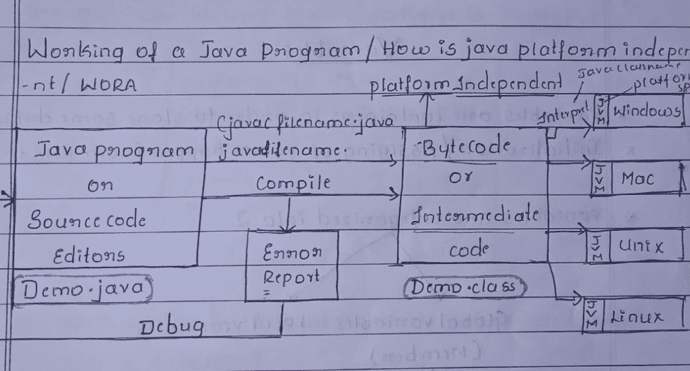
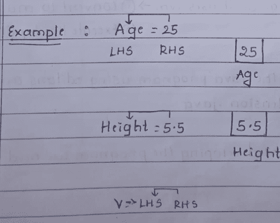
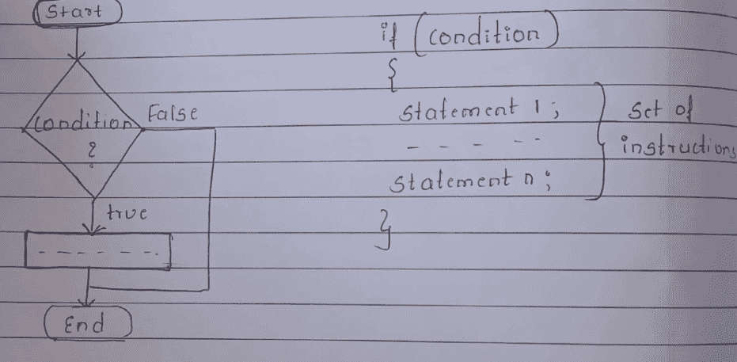
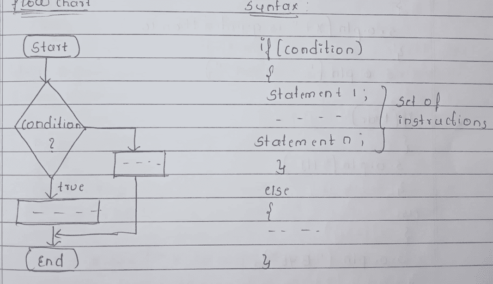
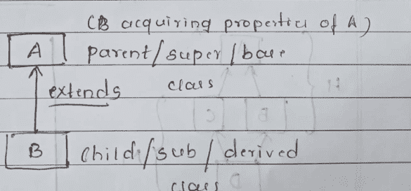
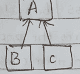
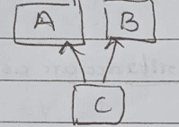
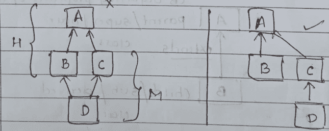
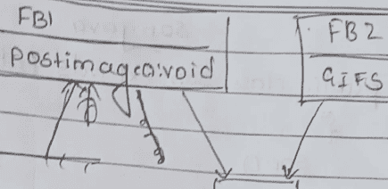
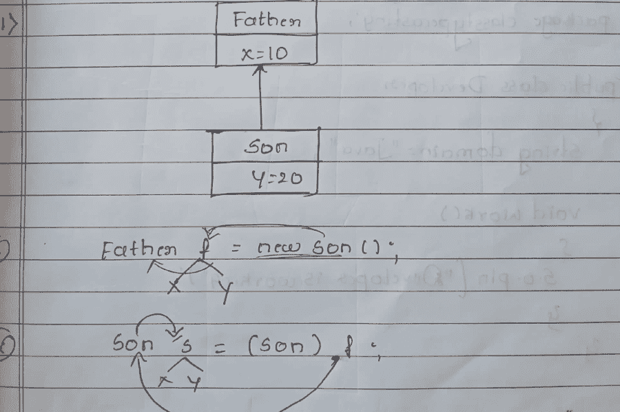

# Java 类笔记教程 1

- Java 是一种高级编程语言
- 编程语言是人与硬件/软件交互的媒介
- 高级语言是一种非标准英语的语言，人类可以理解
- James Gosling（詹姆斯·高斯）是引入 Java 的人
- 创立 Java 的公司是太阳系统系统（Sun Microsystems）
- 目前 Java 属于 Oracle 公司

## Java 程序的工作原理 / 如何实现平台无关 / WORA



`JVM`：Java 虚拟机（依赖平台）

`WORA`：写一次，处处运行（Write Once Run Anywhere）

字节码是一种中间形式，既不是低级语言也不是高级语言，因此它使用`jvm` -> (1) 转换为机器级 (2) 逐行执行

- 首先，我们使用编辑器构建 Java 程序并以`.java`扩展名保存
- 一旦我们完成程序开发，我们需要对其进行编译（Compile）
- 编译是一个检查我的 Java 程序中是否存在任何错误的过程
- 如果编译失败，我们会得到错误报告，根据错误报告我们需要对程序进行调试（debug）
- 如果编译成功，我们会生成字节码，它是中间代码 / 平台无关的代码
- 所有字节码的扩展名都可以在所有平台上执行，即所有操作系统
- 此字节码可以在所有平台上执行，即所有操作系统

## 变量

- 变量被包含是为了存储某些数据/信息。初始化/赋值发生从右侧（RHS）到左侧（LHS）
- 变量分为两类

| 全局变量 | 局部变量 |
| --- | --- |
| (成员) | |
| 静态非静态变量 | 变量 |



示例：`Age = 25`

| 左侧 | 右侧 |
| --- | --- |
| `Age` | `25` |

`Height = 5.5`

| 左侧 | 右侧 |
| --- | --- |
| `Height` | `5.5` |

## 数据类型

- 数据类型用于指示存储在变量中的数据类型
- 数据类型分为两类

1) 原始数据类型（primitive）

2) 非原始数据类型（Nonprimitive）

- 为了存储非小数数值，我们有以下数据类型
- 这些数据类型之间的区别在于内存大小（MemorySize）

| 数据类型 | 内存大小（字节 Bytes） | 内存大小（比特 Bits） |
| --- | --- | --- |
| `byte` | 1 | 8 |
| `short` | 2 | 16 |
| `Int` | 4 | 32 |
| `long` | 8 | 64 |

- 为了存储小数数值，我们有以下数据类型

| 数据类型 | 内存大小（字节 Bytes） | 内存大小（比特 Bits） |
| --- | --- | --- |
| `float` | 4 | 32 |
| `double` | 8 | 64 |

小数广泛使用的默认数据类型。

- 为了存储真/假，我们有以下数据类型

| 数据类型 | 内存大小（字节 Bytes） | 内存大小（比特 Bits） |
| --- | --- | --- |
| `Boolean` | 1 | 8 |

- 为了存储单个字符，我们使用`char`，
- `char`数据应该被括在'单引号'（`' '`）中
- `char`的内存大小为 2 字节：16 比特

注意：上述所有 8 种数据类型合称为原始数据类型

`String`是一种存储字符序列的数据类型

- `String`数据必须括在“双引号”（`" "`）中

注意：Java 是大小敏感的，小写字母的值不等于于大写字母（`a≠A`）

## 32/01/2020 变量声明

语法：

`数据类型 变量名;`

`int age;`

`double salary;`

语法； 变量初始化

`变量名 = 值;`

| `age = 20;` | `20 Age` |
| --- | --- |
| `salary = 5000-69` | `5000-69 Salary` |

变量声明与初始化

语法：初始化

```
数据类型 变量名 = 值;
声明
boolean x = true;
false;
```

```java
String Subject = "Java",
String count = "jsp2020",
char gender = 'M';
```

## Java 程序的结构

1) 类（Class）

2) 主方法（Main method）

3) 打印语句（Print Statement）

```java
class className {
    类的范围 {
        public static void main(String[] args) {
            System.out.println("-----");
        }
    }
}
```

保存文件时文件名应与`className`相同

```java
例:1 类 Firstprogram
{
    public static void main(String[] args) {
        System.out.println("Hello world");
    }
}
```

```text
输出: 打开 cmd
cd desktop
cd java programs
javac Firstprogram.java (编译)
java Firstprogram (打印)
Hello world!!!
// cd: 切换到中心保存文件
```

## 例：2) 类 Demo

```java
class Demo {
    public static void main(String[] args) {
      System.out.println(10);
      System.out.println(45.67);
      System.out.println(true);
      System.out.println('2');
      System.out.println("jsp@2020");
    }
}
```

输出：`javac Demo.java`

`java Demo`

| `10` |
| `45.67` |
| `true` |
| `2` |
| `jsp@2020` |

## 例 3) 编写一个 Java 程序以遵循以下场景

i) 创建一个名为`student`的类

ii) 定义`main`方法

iii) 在`main`方法下初始化为相应的值

```java
Class student {
  public static void main(String[] args) {
  String name="Bhagi";
  int age = 23;
  System.out.println(name);
  System.out.println(age);
  }
}
```

| `Bhagi` |
| `23` |

注意：在 Java 中为了执行字符串拼接使用`+`运算符

```java
class Employee {
    public static void main(String[] args) {
        int id = 10;
        String name = "Bhagi";
        double salary = 23;
        System.out.println("Employee Id: " + id);
        System.out.println("Employee name is: " + name);
        System.out.println("Employee Salary: " + salary);
    }
}
```

输出

`java Employee`

`Employee Id: 10`

`Employee name is: Bhagi`

`Employee Salary: 23`

## 运算符

1) 算术运算符

`+`加

`-`减

`*`乘

`/`除

`%`取模

2) 赋值运算符

`=`

`+=`

`-=`

`*=`

```java
例 赋值运算符
{
    public static void main(String[] args) {
        int x=10;
        System.out.println("value of x: " + x);
        x+=20;
        System.out.println("value of x: " + x);
        int a=6;
        System.out.println("value of a: " + a);
        a*=5;
        System.out.println("value of a: " + a);
    }
}
```

| `Value of x is 10` |
| `value of x is 30` |
| `Value of a is 6` |
| `value of a is 30` |

3) 关系/条件运算符

`<`小于

`>`大于

`<=`小于等于

`>=`大于等于

`==`等

`!=`不等于

注意：比较运算符总是返回布尔值（`true`/`false`）

```java
Class Comparison
{
    public static void main(String[] args) {
        int x=10;
        int y=20;
        boolean result1 = x<y;
        boolean result2 = y>x;
        System.out.println(result1 + "\t" + result2);
        System.out.println("x == y: " + (x == y));
        System.out.println("x<=10: " + (x<=10));
        System.out.println("3>=4: " + (3>=4));
        System.out.println("-- == --: " + ("-- == --"));
        System.out.println("x==10: " + (x==10));
        System.out.println("y==30: " + (y==30));
        System.out.println("-- != --: " + ("-- != --"));
        System.out.println("x!=10: " + (x!=10));
        System.out.println("y!=30: " + (y!=30));
    }
}
```

4) 逻辑运算符

AND => `&&` true = 1

OR => `||` 返回 => 布尔 false = 0

NOT => `!`

| AND | OR | NOT |
| --- | --- | --- |
| T T T | T T | T F |
| T F F | F T T | F F |
| F F F | F F | F F |

```java
例: 逻辑运算符
{
    public static void main(String[] args) {
    int x = 10;
    int y = 20;
    boolean result1 = x<y && y>x;
    boolean result2 = x<y && x==y;

    System.out.println(result1);
    System.out.println(result2);
    System.out.println("-\-");
    System.out.println(1<2||12>10);
    System.out.println(2<1||2==3);
    System.out.println("-\-");
    System.out.println(!true);
    System.out.println(!false);
    System.out.println("-\-");
    System.out.println(!(1<2));
    }
}
```

### 5) 一元运算符

- `++` (加 1)
- `--` (减 1)
- `++`前置自增
- `++`后置自增
- 前置自减
- 后置自减

### 示例：类的一元运算符

```java
{
    public static void main(String[] args) {
        int x = 5;
        System.out.println("x:" + x);
        x++;
        System.out.println("x:" + x);
        x++;
        System.out.println("x:" + x);
        x--;
        System.out.println("x:" + x);
        x--;
        System.out.println("x:" + x);
    }
}
```

输出 => `x:5`

`x:6`

`x:7`

`x:6`

`x:5`

```java
int x = 10;
int y = ++x;
// 后置自增
// 先赋值，后自增

int a = 5;
int b = --a;
// 前置自增
// 先自增，后赋值
```

```java
x = y / 10
a = 6
b = 6
```

```java
int i = 2;
j = i --;
// 后置自减；
// 先赋值，后自减；
if (i < j)
```

```java
int a = 5;
int beta = a++;
// 自增；
// 先自增，后赋值；
```

```java
int p = 50;
int q = --p;
// 自减；
// 先自减，后赋值；
if (p >= 56 && q <= 49)
```

```java
class Unary {
    void psm(String[] args) {
        int q = 123;
        int w = q++;
        System.out.println(q + " " + w);

        int o = 444;
        int p = --o;
        System.out.println(o + " " + p);
    }
}
```

## 决策 / 条件语句

这些语句用于根据指定的条件做出决策。不同的决策语句如下：

1. 1) 简单`if`

2. 2)`if else`

3. 3)`if else if`

4. 4) 嵌套`if`

5. 5)`Switch`

简单`if`是一种决策语句，只有在条件为真时才执行一组指令。

示例：流程图

语法：



示例：类`SimpleIfDemo`

```java
{
    public void main(String[] args) {
        System.out.println("START");
        int a=10;
        int b=10;
    }
}
```

## `if (a<=b)`

`System.out.println("a 小于或等于 " + b);`

`System.out.println("end");`

# `if else`:-

`if else`是一种决策语句。如果条件为真，我们执行`if`块；否则，如果条件为假，则执行`else`块。



```java
class IfElseDemo
{
    public void main(String[] args) {
      System.out.println("START");
      int x = 100;

      if (x<=10)
      {
        System.out.println(x+" 小于或等于 10");
      }
      else
      {
        System.out.println(x+" 大于 10");
      }

      if(true)
      {
        System.out.println("HI");
      }
      else
      {
        System.out.println("BYE");
      }

      if(false)
      {
        System.out.println("WELCOME");
      }
    }
}
```

```java
else
{
    System.out.println("Thank you");
    System.out.println("END");
}
```

```
if: START
    100 大于 10
    Hi
    Thank you
    END
```

q) 编写一个 Java 程序判断一个数字是正还是负

```java
class Number
{
    public void main(String[] args) {
        int x = 5;
        if(x > 0){
            System.out.println("x 是正数");
        }
        else{
            System.out.println("x 是负数");
        }
    }
}
```


# Java 条件语句与循环语句

## 1. 基础条件判断

### 1.1 判断数字是偶数还是奇数

```java
class Number {
    public static void main(String[] args) {
        int num=4;
        if (num % 2 == 0) {
            System.out.println(num+" 是偶数");
        } else {
            System.out.println(num+" 是奇数");
        }
    }
}
```

### 1.2 找到两个数中的最大值

```java
class Number2 {
    public static void main(String[] args) {
        int x=5;
        int y=10;
        if(x>y) {
            System.out.println(x+" 大于 "+y);
        } else {
            System.out.println(x+" 小于 "+y);
        }
    }
}
```

## 2. `if-else-if` 语句

`if-else-if` 是一种决策语句，用于检查多个条件。

### 语法

```
if (条件) {
  ---
}
else if (条件) {
  ---
}
else if (条件) {
  ---
}
else {
  ---
}
```

### 示例

```java
class IfElseDemo {
    public static void main(String[] args) {
      int num = 25;
      if (num<10) {
        System.out.println(num+" 小于或等于 10");
      }
    }
}
```

```java
// 继续
else if (num<=20) {
  System.out.println(num+" 小于或等于 20");
  } else if (num<=30) {
  System.out.println(num+" 小于或等于 30");
  } else {
  System.out.println("未匹配");
  }
}
```

输出：未匹配

```java
class ElIfDemo {
  public static void main(String[] args) {
    int marks=25;
    if(marks>=0 && marks<=34) {
      System.out.println("fail");
    } else if (marks>=35 && marks<=59) {
      System.out.println("pass");
    }
  }
}
```

| marks | 结果 |
| :--- | :--- |
| 0-34 | F |
| 35-59 | C |
| 60-100 | A |

```java
else if (marks >= 60 && marks <= 100)
{
    System.out.println("F");
}
else
{
    System.out.println("Invalid");
}
```

输出：Fail

## 3. 嵌套 `if`

嵌套 `if` 是一种决策语句，其中 `if` 出现在条件内部。

### 语法

```
if (条件)
{
    if (条件)
    {
        ---
    }
    else
    {
        ---
    }
}
```

### 示例

```java
class NestedIf Demo
public static void main(String[] args) {
    char id = 'b';
    int password = 123;
    if (id=='a') {
        System.out.println("user id is valid");
        if (password==123) {
            System.out.println("password is valid");
            System.out.println("Successful");
        }
    } else {
        System.out.println("password is invalid");
        System.out.println("Unsuccessful");
    }
    else {
        System.out.println("user id is Invalid");
        System.out.println("Unsuccessful");
    }
}
```

输出：
1. 用户 ID 无效
2. 用户 ID 有效密码有效 不成功

### 示例场景

- 男性 21 -> 已结婚
- 女性 21 -> 已结婚
- 女性 18

```java
class NestedIfDemo {
    public void main(String[] args) {
        char gender = 'M';
        int age = 24;
        if (gender == 'M') {
            System.out.println("Male");
            if (age >= 21) {
                System.out.println("Age is : "+age);
                System.out.println("Get married & stay happy");
            } else {
                System.out.println("Age is : "+age);
                System.out.println("Have patience");
            }
        } else if (gender == 'F') {
            if (age >= 18) {
                System.out.println("Female");
                System.out.println("Age is : "+age);
            }
        }
        else {
        System.out.println("Age is "+age);
    } else {
        System.out.println("Gender is Invalid");
    }
}
```

输出：
- 男性
- 年龄: 21
- 已结婚 & 快乐
- 保持快乐

## 4. 找到三个数中的最大值

```java
class largest of threeNumbers {
  public static void main(String[] args) {
    int a = 10;
    int b = 5;
    int c = 3;
    System.out.println("a:"+a+" b:"+b+" c:"+c);
    if (a>b) {
    } else if (a>c) {
      System.out.println("a rs largest");
    }
  }
}
```

```java
else
{
    System.out.println("c is largest");
} else if (b>c)
{
    System.out.println("b is largest");
} else if (c>b)
{
    System.out.println("c is largest");
}
else
{
    System.out.println("Invalid");
}
System.out.println("-----");
if (a>b && a>c)
{
    System.out.println("a is largest");
}
else if (b>a && b>c)
{
    System.out.println("b is largest");
}
else if (c>a && c>b)
{
    System.out.println("c is largest");
}
```

## 5. `switch` 语句

`switch` 是一种通常用于字符比较的条件语句

### 语法

```
switch (选择/输入) {
  case 1:
    break;
  case 2:
    break;
  case n:
    default;
}
```

### 示例

```java
class switch Demo {
  public void main(String[] args) {
    int choice=3;
    switch (choice) {
      case 1:
        System.out.println("In case 1");
        break;
      case 2:
        System.out.println("In case 2");
        break;
      case 3:
        System.out.println("In case 3");
        break;
      default:
        System.out.println("Invalid choice");
    }
  }
  输出：情况3
}
```

注意 `break`：是一个关键字，用于将控制转移到当前执行块之外

### 示例：类 `monthvalidation`

```java
void psm(String[] args) {
    System.out.println("start");
    char month = 'Z';
    switch (month) {
        case 'J': System.out.println("In January");
            break;
        case 'F': System.out.println("In February");
            break;
        case 'M': System.out.println("In March");
            break;
        default: System.out.println("Invalid month");
    }
    System.out.println("End");
}
```

输出：
- 开始
- 无效月份
- 结束

## 6. 循环语句

循环语句通常用于重复特定任务

- 循环语句通常也用于遍历数据
- 不同的循环语句如下：
  1. `for` 循环
  2. `while` 循环
  3. `do while` 循环
  4. 嵌套循环

### 6.1 `for` 循环

`for` 循环是一种循环语句，用于按指定的次数重复执行任务

- 当我们知道逻辑起点和逻辑终点时，使用 `for` 循环

#### 语法

```java
for (initialisation; condition; updation)
{
    要重复的指令集;
}
```

#### 示例：打印 5 次 Hello world

```java
for (int i=1; i<=5; i++)
{
    System.out.println("Hello world");
}
```

| 追踪 | i | 输出 |
|---|---|---|
| 1 | i<=5 -> T | HW |
| 2 | i<=5 -> T | HW |
| 3 | i<=5 -> T | HW |
| 4 | i<=5 -> T | HW |
| 5 | i<=5 -> T | HW |
| 6 | i<=5 | P |

```java
class FonloopDemo
{
    public static void main (String[] args)
    {
        for (int i=1; i<=5; i++)
        {
            System.out.println(i=1 ; i<=5 ; i++)
        }
        System.out.println("Hello world");
    }
    for (int i=1; i<=5; i++)
    {
        System.out.print("i: " + i);
    }
    for (int i=256; i<161; i++) //(int i=256; 2<161; 2++i) 
    {
        System.out.print("2");
    }
    System.out.print(" - - - - ");
    }
    for (int event=2; event<=10; event=event+2)
    {
        System.out.println(event);
    }
    System.out.println(" - - - - ");
    }
    for (int i=156; i<256; i++) // for (int i=156; 2<=256; 2H)
    {
        System.out.print(2);
    }
    System.out.print(" - - - - ");
    }
}
```

### 6.2 练习

```java
for (int i=1; i<9; i+=2)
{
  System.out.println(i);
}
System.out.println(" "); ");
for (int i=2; i<=15; i+=3)
{
  System.out.println(i);
}
```

**Q) 写一个程序按倒序打印 1 到 10 的数字**

```java
Class Reverseorder
{
  public static void main (String[] args)
  {
    for (int i=10; i>=1; i--)
    {
      System.out.println(i);
    }
  }
}
```

5>4>3>2>1

```java
for (int i=5; i>=1; i-=2)
{
  System.out.println(i);
}
无限循环
for (int i=5; i>=0; i++)
{
  System.out.println(i);
}
```

```java
Ex) Class ForLoopDemo
{
  public static void main (String[] args) {
    for (int i=1; i<=10; i++) {
      if (i%2 == 0) {
        System.out.println(i); // i%2==0
      }
    }
    System.out.print("...");
  }
}
```

```java
for (int i=1; i<=10; i++) {
  if (i%2 == 1) {
    System.out.println(i);
  }
}
```

```java
for (int i=1; i<=30; i++) {
  if (i%3 == 0) // if (i%5 == 0) 5的倍数 {
    System.out.println(i);
  }
}
```

**a) 打印 'n' 个自然数的和。**

```java
Class NaturalNumbers {
    public void main(String[] args) {
        int sum=0;
        for (int i=1; i<=n; i++) {
            sum=sum+i;
        }
        System.out.println(sum);
    }
}
```

**b) 写一个程序求 1 到 10 之间偶数的和。**

```java
Class EvenNum {
    public void main(String[] args) {
        for (int i=1; i<=10; i+=2) {
            int result=result+i;
            System.out.println("sum of Even nums: "+result);
        }
    }
}
```

### 6.3 `while` 循环

`while` 循环是一种循环语句，用于执行一组指令，直到条件为假

换句话说，如果条件为真，`while` 循环继续执行，当条件为假时停止

#### 语法

```java
while (condition)
{
    实现
}
```

#### 示例

```java
int i=1;
while(i<=5)
{
```


```java
System.out.println(i);
}

i++;
```

```
输出
1
2
3
4
5
6
```

```java
Ex) int n=5;
while(n>=1)
{
    System.out.println(n);
    n--;
}
```

## do while 循环

do while 循环是一种与 while 循环类似的循环语句

它持续执行直到条件为假

While 和 do 循环的区别在于：

-> While 循环先检查条件再执行指令

-> do 循环先执行指令再检查条件。

```java
Syntax: do
{
    任务
} while (Condition);
```

```java
ex) int i=1;
do
{
  System.out.print(i);
  i++;
} while (i<=5);

Ex) int x=5;
do
{
  System.out.println(x);
  x--;
} while (x>=1);
```

### While 与 do 循环的区别

While 循环 do

- While 循环先检查条件再执行指令
- do 循环先执行指令再检查条件
- 如果条件为假，While 循环不执行
- 如果条件为假，do 循环至少执行一次

```java
while(i) {
  int i=10;
  while(i<5) {
    System.out.print(i);
  }
}
```

```java
Ex) do {
    System.out.print(n);
  } while(n<5);
```

嵌套 for 循环是在另一个 for 循环内部的 for 循环

内部 for 循环的值执行

```java
for (int i=1; i<3; i++) {
  System.out.println("HI");
  for (int j=5; j<=6; j++) {
    System.out.println("inside loop " + i + ": " + j);
  }
  System.out.println("bye");
}
```

```
Java nestedforloop
outer loop start
inner loop i:1 j:1
inner loop i:1 j:2
outer loop end
outer loop start
inner loop i:2 j:1
inner loop i:2 j:2
outer loop end
```

```java
class nestedforloop
{
    public static void main(String[] args) {
        for (int i=1; i<=2; i++) {
            System.out.println("outer loop start");
            for (int j=1; j<=2; j++) {
                System.out.println("inside loop " + i + ": " + j);
            }
            System.out.println("outer loop end");
        }
    }
}
```

使用 for 循环、while 循环、do while 循环编写一个 Java 程序倒序打印 16 到 10 的偶数。

```java
for (int i=16; i>=10; i-=2) {
    System.out.println(i);
}
```

```java
int n=16;
while (n>=10) {
    System.out.println(n);
    n-=2;
}
```

```java
int n=10;
do {
    System.out.println(n);
    n-=2;
} while (n>=10);
```

## 面对象编程

对象：对象是现实世界的实体

- 现实世界中任何具有物理存在的物体都可以对象

例如：笔、人类

- 对象的属性通常分为两类：

1) 状态 (States)

2) 行为 (Behaviour)

- 状态用于存储对象的某些值
- 行为用于执行某些任务/动作
- 例如：当我们考虑汽车对象时，以下是它的状态和行为

| 状态 | 行为（执行任务） |
|---|---|
| 数据 | 启动汽车 |
| 颜色 | 停止汽车 |
| 型 | 换挡 |

- 从编程的角度来看，对象名视为类名，状态视为变量，行为视为方法/函数
- 类是对象的蓝图
- 类提供了存储特定对象状态和行为的平台
- 类是逻辑实体
- 类必须使用`class`关键字来指示
- 类也可以作为数据类型

```java
类的语法 - class className {
  类的范围 {
    //变量
    //方法/函数
    //构造函数
    //代码块
  }
}
```

## 对象创建

- 对象创建是在内存中存储或加载非静态属性的过程
- 对象创建在名为堆区的内存区域内
- 我们可以为特定类创建任意数量的对象
- 简单来说，对象是类的拷贝或实例

```java
语法:- 对象创建
className 引用名=new className();
```

```java
Ex: 类 pen { pl = new pen(); }
Ex: 类 Boy { bl = new Boy(); }
```

- 为了访问对象内的非静态属性，我们使用点运算符()

```
语法: 对象名=变量名
运算符
```

- Q) 如何区分静态变量和非静态变量？
- 如果使用`static`关键字声明变量，我们将其称为静态变量，否则将其称为非静态变量

```
变量
静态 非静态
```

```
Ex: Static int a=10; int a=5;
```

```java
访问同一类中非静态变量的程序
类 car {
    String Brand = "Suzuki";
    int cost = 5000;
}

public static void main(String[] args) {
    car c = new car();
    c.objectname = operator c();
    System.out.println(c.brand);
    System.out.println(c.cost);
}

Class student {
    int id = 101;
    String name = "Tom";
    int marks = 45;
}

public static void main(String[] args) {
    System.out.println("Stant");
    student s = new Student();
    System.out.println(s.id);
    System.out.println(s.name);
    System.out.println(s.marks);
    System.out.println(s.id + " " + s.marks);
    System.out.println(s.name + " of " + s.id + " has scored " + s.marks);
    System.out.println("end");
}
}
```

注意：同类或另一个类中的非静态属性都可以通过创建对象来访问

Q) 编写一个访问另一个类中非静态属性的程序。

```java
class Employee {
    String name = "Jerry";
    int salary = 12000;
}
```

```java
// 创建 employee 类的对象
class Test {
    public static void main(String[] args) {
        Employee emp = new Employee();
        System.out.println(emp.name + " earns " + emp.salary);
    }
}
```

输出

```
java TestEmployee.java
java TestEmployee
Jerry earns: $12000
```

注意：我们可以为特定类创建任意数量的对象，对一个对象的修改不会反映在另一个对象上

```java
class pen {
  int cost=100; //非静态变量
}
```

```java
public static void main(String[] args) {
  //为 pen 类创建了 2 个实例拷贝
  pen p1 = new pen();
  pen p2 = new pen();
  System.out.println(p1.cost + " " + p2.cost);
  p1.cost=300; // 为 pen 对象 p1 重新初始化 cost 为 300
}
```

## 输出

```
pen.java
java pen
100 100
300 100
```

如果一个变量仅声明但未初始化任何值，编译器将自动将其初始化为默认值

| 数据类型 | 内存大小 | 默认值 |
| --- | --- | --- |
| 非十进制字节 | 字节 位 1 8 | |
| 数型 short | 2 16 | |
| 数值 int | 4 32 | |
| long | 8 64 | 0.0 |
| 小数 float | 8 32 | |
| 数值 double | 8 64 | |
| 真/假 boolean | 1 8 | |
| 单例 char | 2 16 | false unicode 字符 '\0' |
| 序列字符串 string | X X | 空格, null |

默认值同时适用于静态和非静态变量：

```java
CLASS defaultValuesDemo
{
  int a;
  float b;
  boolean c;
  char j;
  string i;
}
```

```java
public static void main(String[] args)
{
  defaultValuesDemo dvd = new defaultValuesDemo();
  System.out.println(dvd.a);
  System.out.println(dvd.b);
  System.out.println(dvd.c);
  System.out.println(dvd.i);
  System.out.println(dvd.j);
}
```

编写一个 java 程序存储学生详情，每个学生将有 name 和 age 属性。 类 student

```java
class student {
    int age = 25;
    String name = "Tom";
    public static void main(String[] args) {
        student std1 = new student();
        System.out.println();
    }
}
```

```java
Class student {
    String name;
    int age;
    public static void main(String[] args) {
        student s1 = new student();
        student s2 = new student();
        System.out.println(s1.name + " " + s1.age);
        System.out.println(s2.name + " " + s2.age);
        //在 s1 对象中重新初始化
        s1.name = "Tom";
        s1.age = 20;
        //在 s2 对象中重新初始化
        s2.name = "jerry";
        s2.age = 15;
        System.out.println(s1.name + " is " + s1.age + " years old");
        System.out.println(s2.name + " is " + s2.age + " years old");
    }
}
```

输出

```
null 0
null 0
Tom is 20 years old
Jerry is 15 years old
```

# 31/11/2020 方法/函数

- 方法是用于执行特定任务的代码块
- 换句话说，方法是表示对象行为的指令集
- 方法也可以称为函数（Functions）

编写方法的不同方式如下

i) 无参数无返回值的方法
ii) 带参数无返回值的方法
iii) 无参数有返回值的方法
iv) 带参数有返回值的方法

```java
语法; 访问修饰符 返回类型 方法名() {
    语句 1;
    语句 n;
    return 值;
}
```

注意：方法只有在调用它或调用它时才会执行

```java
语法 : 对象名.方法名();

Q) 演示无参数无返回值方法的程序

class Demo {
    void display() {
        System.out.println("HelloWorld");
    }
    public static void main(String[] args) {
        System.out.println("Start");
        Demo d = new Demo();
        d.display(); // (调用方法)
        System.out.println("End");
    }
}
```

```
Start
HelloWorld
End
```

P) 带参数无返回值的方法

```java
class Addition {
    //带参数且无返回值的方法
    void add(int a, int b) { // 参数
        System.out.println(a + b);
    }
}
```

```java
public static void main(String[] args) {
    Addition obj = new Addition();
    obj.add(10, 20); // 参数
    obj.add(5, 7); // 元组
}
```

```
30
12
```

Q) 创建一个名为`multiply`方法，接受 3 个参数并打印它们的积

```java
class multiply {
    public static void multi(int a, int b, int c) {
        System.out.println(a*b*c);
    }
}
```

```java
public static void main(String[] args) {
    multiply obj = new multiply();
    obj.multi(10, 20, 30);
}
```

```
600
```

```java
class Test {
    int display() {
        System.out.println("start");
        Test t = new Test();
        int result = t.display();
        System.out.println(result);
        System.out.println("end");
    }
}
```

## 无参数且有返回值的方法

```java
class Test {
    // 无参数且有返回值的方法
    String display() {
        return "Hello";
    }
    public static void main(String[] args) {
        Test t = new Test();
        String result = t.display();
        System.out.println(result);
        System.out.println(t.display());
        System.out.println("End");
    }
}
```

## 带参数且有返回值的方法

```java
class calculation {
    int test(int a) {
        return a;
    }
}

public static void main(String[] args) {
    Calculation c = new Calculation();
    int res = c.test(2);
    System.out.println(res);
    System.out.println("5 " + c.test(2));
}
```

```
4
25
```

使用哪种返回类型

```java
int test() {
    return 10;
}

boolean test() {
    return false;
}

String test() {
    return "Dinga";
}
String name = "tom";
```

```
Name: tom
```

# 纸

```java
double test() {
  return 10.5;
}
```


```java
String test(int age) {
    return "Age: " + age;
}

String test(double age) {
    int a = 5+5;
    return "weight: " + a;
}
```

## 写一个检查奇偶数的程序

```java
class solution {
    String checkEvenodd(int num) {
        if (num%2==0) {
            return num+" is Even num";
        } else {
            return num+" is odd num";
        }
    }
}

public static void main(String[] args) {
    Solution sol= new Solution();
    System.out.println(sol.checkEvenodd(10));
}
```

## 方法重载

- 方法重载是具有多个方法的过程
- 换句话说，在一个类中具有相同名称但参数不同的多个方法
- 为了实现方法重载，我们必须满足以下规则之一：
  - 规则1：参数的数量发生变化-参数长度
  - 规则2：参数的数据类型发生变化
  - 规则3：参数的类型顺序发生变化
- 注意：变量名必须相同
- 注意：通过方法重载可以实现编译时多态

## 类 Mo

```java
class MO {
    void display(int a) {
        System.out.println(a);
    }

    void display(int a, double b) {
        System.out.println("\t" + b);
    }

    void display (string a, string b) {
        System.out.println("\t" + b);
    }

    void display (int a, string b ) {
        System.out.println("\t" + b);
    }

    void display (string a ) {
        System.out.println(a);
    }
}
```

## 另一个类

```java
class TestMO {
    public static void main (String[] args) {
        MO m = new MO();
        m.display(10);
        m.display("Hello");
        m.display(10, "Hello");
        m.display("Hi", 50);
        m.display(10, 10.5);
    }
}
```

输出:
```
10
Hello
10 Hello
Hi 50
10 10.5
```

```java
ps vm(string[] a) -> execution starts from this
{
}
```

```java
ps vm(int[] a)
{
}
```

在 Java 中，我们不能拥有嵌套方法，但方法可以在调用时调用另一个方法。

## Static 关键字

- `Static` 是一个可以用于变量和方法的关键字
- 静态属性每个类只有一个副本
- 所有的静态属性都被加载到名为类区域（class Area）/ 静态池（static pool）/ 静态变量池的内存位置
- 为了定义静态变量，我们必须使用 `static` 关键字
- 如果我们有任何静态属性，应该始终通过类名访问它

```java
class student {
    static int age = 20;
    static void study() {
        system.out.println("studying");
    }
}
```

```java
public static void main(String[] args) {
    System.out.println("start");
    System.out.println("student age" + lastname.method);
    Student.study();
    System.out.println("End");
}
```

```java
Student {
    int age = 20;
    void study() {
        System.out.println("studying");
    }
}

static class Area {
```

输出
```
Start
20
studying
End.
```

注意：静态属性可以直接访问，也可以在同一个类中通过 `lastname` 访问

```java
class Employee {
    static double salary = 102;
    static void work() {
        System.out.println("Employee is working");
    }
}
```

```java
public static void main(String[] args) 
{
    System.out.println(Employee.salary);
    Employee.work();
    // className salary -> Employee.salary
    System.out.println(salary);
    work(); // 内部类似于 className works() -> Employee.work()
}
}
```

输出
```
Emp sal : 1.2
Employee is working
1.2
Employee is working
```

```java
class car {
    static int price = 12000;
    static void stunt() {
        System.out.println("car started");
    }
}
```

```java
class TestCar {
    public static void main(String[] args) {
    }
}
```

```java
System.out.println(can.price);
car.stant();
```

```java
/* ERROR
so.println(price);
Slant();*/
```

内部是 `Testcanprice` & `Testcarstant`
其中 `Testcan` 没有一个名为 `price` 的变量
且没有名为 `stant` 的方法，所以报错

Y
Y

输出
```
javac Testcan.java
java Testcan
12000
carstatic
```

Class Pen
```java
$ static int cost = 50; // 静态变量
public static void main(String[] args) //
{
    \ystem.out.println(cost); // pen.cost
    cost = 70; // pen-cost = 70;
    system.out.println(pen.cost); //hp
}
```

Y
Y

输出
```
50
70
```

| Pen | |
| --- | --- |
| cost | 50 70 |

| | 访问方式 | 访问方式 | 内存位置 | 副本数量 |
| --- | --- | --- | --- | --- |
| Static | 在同一个类内 | 类外 | 类 | 仅一个 |
| 变量 | (1) 直接或 | (1) 通过类名 | 类区域 / | |
| & 方法 | (2) 通过类名 | | 静态池 | |
| 非静态属性 | 对象创建 | 对象创建 | 堆区域 | 取决于 |
| 变量 | | | | 的对象的对象数量 |

```java
class person {
    int age=10;
    person p1 = new person(
        p2 - new,
        p3 - new
    );
}
```

3 个副本 / 实例
P1 P2 P3

age=10 age=10

我们可以通过类名访问静态属性吗？
是的

我们可以通过对象引用名访问非静态变量吗？
是的

我们可以通过对象引用名访问静态属性吗？
是的，每个对象都会隐式指向静态池

我们可以通过类名访问非静态属性吗？
否，因为非静态属性只在创建对象时加载

```java
class pen {
    static int a=10; // 静态变量
    int b=20; // 非静态变量
}
```

```java
public static void main(String[] args) {
    system.out.println(pen.a);
    //system.out.println(pen.b);
    pen p = new pen();
    system.out.println(p.b); // 使用对象引用访问静态和非静态
    system.out.println(p.a); // 使用类名访问静态变量
}
```

```java
pen {
    10
    20
}
```

| 类名 | 对象引用 |
| --- | --- |
| 静态属性 (变量 & 方法) | ✓ | (创建对象后) ✓ |
| 非静态属性 (变量 & 方法) | X | ✓ |

## Java 开发包 (JDK)

- JDK 代表 Java 开发包
- JDK 是一个用于开发和执行程序的工具包

## Java 运行时环境 (JRE)

- JRE 代表 Java 运行时环境
- JRE 是一个用于执行程序的平台
- 只能安装 JRE 而不能开发它

## JIT (即时编译)

- JIT 代表即时编译
- JIT 负责将字节码转换为机器级语言

## 类加载器 (ClassLoader)

- 类加载器从次级存储加载类

## 解释器 (Interpreter)

- 解释器用于执行 Java 程序

## JVM

- JVM 代表 Java 虚拟机
- JVM 在 JRE 上

## JVM 架构

内存位置分类如下：

1) 堆区域：所有对象都存储在堆区域，即非静态属性
2) 类区域/静态池：所有静态属性加载到类区域
3) 方法区域：方法定义始终存储在方法区域
4) 栈：Java 程序的执行发生在栈中

| JRE | 开发工具 |
| --- | --- |
| 1) JIT | 编译器 |
| 2) 类加载器 | 调试器 |
| 3) 解释器 | |
| 4) JVM | |

- 堆区域
- 类区域
- 方法区域
- 栈

## 块 (Blocks)

块是一组指令，通常分为类型：

i) 静态块
ii) 非静态块

静态块是用于初始化静态变量的指令，在类加载时执行。我们可以有多个静态块，且执行将按顺序进行。

非静态块是用于初始化非静态变量的指令，在创建对象时执行。如果有多个非静态块，执行将按顺序进行。静态块与非静态块的区别：

```java
package Com;

public class Demo {
    static {
        System.out.println("static block-1");
    }

    static {
        System.out.println("static block-2");
    }

    public static void main(String[] args) {
        System.out.println("Hello");
    }

    static {
        System.out.println("static block-3");
    }
}

public class StaticBlock1
    int i = 2;
    int j = 3;
    Hello
}
```

```java
package com;

public class Demo {
    static int x=10;

    static {
        system.out.println("initializing to 20");
        x=20;
    }

    public static void main(String[] args) {
        system.out.println("start");
        system.out.println(x);
        system.out.println("End");
    }

    static {
        system.out.println("initializing to 30");
        x=30;
    }
}
```

输出
```
Initializing to 20 30
Start
End
```

| I | -- 20 |
| --- | --- |
| J | -- 30 |
| | 20 |
| | 30 |

Demo
类区域/静态池

## 非静态块的示例

```java
package com;

public class Test {
    System.out.println("In Non-static Block-1");

    public static void main(String[] args) {
        System.out.println("start");
        Test t = new Test(); // 创建对象
        System.out.println("End");
    }
}
```

```java
static {
    System.out.println("In Non-static Blocks-2");
}
```

输出：
```
start
In non static Blocks-1
In Non static Blocks-2
start End
```

```java
package com;

public class student {
    int age;
    System.out.println("Initializing to 20");
    age=20;
}
```

```java
public static void main(String[] args) {
    system.out.println("start");
    student s = new student();
    s.out.println("Age: " + age);
    s.out.println("end");
}
```

```java
{
    s.out.println("initializing to 30");
    age=30;
}
```

输出
```
start
initializing to 20
initializing to 30
Age:30
end
```

```java
// 115
System.out.println("NSB-1");

public static void main(String[] args) {
    System.out.println("Hello");
    System.out.println(can);
    Scanner c = new Scanner();
    System.out.println(c.next);
}
```

输出
```
in NSB-1
Hello
10
in NSB-1
20
```

`Scanner` 是 `java.util` 包中的一个预定义类。

`Scanner` 类用于动态接收来自用户的输入。

- 使用 `Scanner` 类的规则
  1) 创建 `scanner` 类的对象
  2) 将 `system.in` 传递给 `scanner` 对象的构造函数调用（以接收输入）
     语法：`Scanner sc = new Scanner(System.in);`
  3) 使用以下语法导入 `scanner` 类
     `import java.util.Scanner;`

利用预定义方法来增强特定类型的输入

```java
package org;
import java.util.Scanner;

public class Demo {
    public static void main(String[] args) {
        System.out.println("start");
        Scanner scan = new Scanner(System.in);
        System.out.println("Enter a:");
        int a = scan.nextInt();
        System.out.println("value of a is: " + a);
        System.out.println("Enter b:");
        int b = scan.nextInt();
        System.out.println("value of b is: " + b);
        int sum = a + b;
        System.out.println("Sum: " + sum);
        System.out.println("End");
    }
}
```


```
start
Enter a
10
Value of a is: 10
Enter b
20
value of b is: 20
Sum: 30
End
```

1. `byte` - `nextByte()`
2. `short` - `nextShort()`
3. `int` - `nextInt()`
4. `long` - `nextLong()`
5. `float` - `nextFloat()`
6. `double` - `nextDouble()`
7. `boolean` - `nextBoolean()`
8. `string` - `nextChar()` 或 `nextLine()`

a) `char` -> `next(Q)` - `charAt(Q)` 位于 `pos(th)` 处的索引值

```java
"Java".charAt(0)
```

# 构造函数

- 构造函数是用于初始化和实例化的特殊指令集
- 初始化意味着赋值
- 实例化意味着创建对象
- 构造函数名与类名应始终保持一致
- 构造函数永远没有返回类型
- 构造函数在对象创建时执行

语法：可选输入 / 参数

```
访问修饰符 类名 ( { )
```

## 构造函数的范围

构造函数通常分为 2 类：

1. 默认构造函数
2. 自定义/用户定义的构造函数

### 默认构造函数

- 如果一个类没有任何显式构造函数，则编译器会自动生成一个构造函数，因此该构造函数被称为默认构造函数
- 默认构造函数既不接受任何参数也没有任何实现

### 自定义构造函数

- 如果程序员显式定义了一个构造函数，则它被称为自定义构造函数
- 自定义构造函数可以进一步分为 2 类：
  1. 无参数构造函数
  2. 带参数构造函数

注意：如果存在默认构造函数，则不能存在自定义构造函数；反之，如果存在自定义构造函数，则不能存在默认构造函数。

```java
public class pen {
    // 无参数或非参数构造函数
    pen() {}
    // 自定义构造函数
    pen("in pen class constructor") {}
}
```

```java
pvsm(String[] args) {
    System.out.println("start");
    Pen p = new Pen();
    System.out.println("end");
}
```

```
olp
Start
in pen constructor()
End
```

## 带参数/带参数构造的示例

```java
class Can {
    Can(int a) {
        System.out.println(a);
    }
}
```

```java
=> pvsm(--)
-> System.out.println("start");
Can c = new Can(50);
System.out.println("end");
```

构造函数调用输出：

```
Start
50
End
```

## 全局成员变量与局部变量

- 如果变量直接在类内部声明，则我们称其为全局变量或成员变量
- 成员变量可以被所有人全局访问
- 如果变量在特定范围内声明（如方法构造等），则我们称其为局部变量
- 局部变量只能在特定范围内访问

默认值仅适用于全局/成员变量。它可以是静态或非静态的。

```java
public class Demo {
    int as // 全局或成员变量;
    void display(int b) // b & c 是局部变量 {
        int c=20;
        System.out.println("bt" + c);
    }
}
```

```java
Demo(int x) // x 和 y 是局部变量 {
    int y=40;
    S.out.println("xt" + y);
}
```

```java
public static void main(String[] args) {
    Demo obj=new demo(50);
    obj.display(30);
    S.out.println(obj.a);
}
```

## `this` 关键字

- `this` 是用于指向的关键字
- 在 Java 中，成员变量与局部变量同名是可能的，局部变量将占优

```java
public class Kangaroo {
    double height = 5;
}
```

```java
void display() {
    this.height
}
```

```java
public void main(String[] args) {
    Kangaroo k = new Kangaroo();
    k.display();
}
```

```java
class person {
    int age;
    String name;
}
```

```java
person(int age, String name) {
    this.age = age;
    this.name = name;
}
```

```java
public void main(String[] args) {
    person p = new person(25, "B");
    System.out.println(p.age);
}
```

```java
class person {
    int age;
    String name;
}
```

```java
person(int age, String name) {
    this.age = age;
    this.name = name;
}
```

```java
void display() {
    System.println("Employee Id: " + age);
    System.println("Employee Name: " + name);
    System.println("Employee Salary: " + salary);
}
```

```java
public class Employee {
    int empid;
    string empName;
    double emsalary;
    Employee(int empid, string empName, double salary) {
        this.empid = empid;
        this.empName = empName;
        this.emsalary = salary;
    }
    static void main(String[] args) {
        Employee e1 = new Employee(1, "A", 12);
        Employee e2 = new Employee(2, "B", 23);
        Employee e3 = new Employee(3, "C", 33);
        e1.display();
        e2.display();
        e3.display();
    }
}
```

## 构造函数重载

- 构造函数重载在类中定义多个构造函数被称为构造函数重载
- 构造函数在参数列表中在参数类型或参数长度上不同
- 类中的任何两个构造函数都不应匹配
- 重载构造函数根据参数/参数类型进行调用

```java
class program {
    int x;
    int y;
```

```java
program(int ang1) {
    x = ang1;
}
```

```java
program(double ang2) {
    y = ang2;
}
```

```java
program(int ang1, double ang2) {
    x = ang1;
    y = ang2;
}
```

```java
void display() {
    System.out.println("x value" + x);
    System.out.println("y value" + y);
}
```

```java
class Main {
    public static void main(String args[]) {
        program p1 = new program(2);
        p1.display();
        program p2 = new program(3.4);
        p2.display();
        program p3 = new program(12, 3.4);
        p3.display();
    }
}
```

## 构造方法链

- 构造方法链是指一个构造函数调用另一个构造函数的过程。
- 构造方法链可以通过调用语句 `this()` 来实现。
- 为了实现构造方法链，我们需要具备构造方法重载。
- `this()` 调用语句应该是构造函数中的第一行可执行代码。
- `this()` 调用语句用于调用同一类中的另一个构造函数。

### 示例：`class Demo`

```java
class Demo {
    Demo() {
        this(10);
        System.out.println(1);
    }
    Demo(int a) {
        System.out.println(2);
    }
    public static void main(String[] args) {
        System.out.println("start");
        Demo d = new Demo();
        System.out.println("End");
    }
}
```

输出：
```
start
2
end
```

> 注意：Java 中是不存在递归链的。如果有 n 个构造方法，我们最多可以有 n-1 个调用语句。

### 示例：`class Demo`（递归调用）

```java
class Demo {
    Demo() {
        this(10);
        System.out.println(1);
    }
    Demo(int a) {
        this();
        System.out.println(2);
    }
}
```

```java
void main(String[] args) 
```

输出：
```
无限循环 (Infinite)
```

```java
Demo d = new Demo();
```

### 示例：包方法链

```java
class student {
    Student(int id) {
        System.out.println("Id:"+id);
    }
    student(int age, int marks) {
        this("Tom");
        System.out.println("Age:"+age+" Marks:"+marks);
    }
    public static void main(String[] args) {
        student s = new student(25, 67);
    }
    student(String name) {
        this(101);
        System.out.println("Name:"+name);
    }
}
```

| 输出 |
| :--- |
| Id:101 |
| Name:Tom |
| Age:25 |
| Marks:67 |

```java
package chaining;
public class student {
    int id;
    String name;
    student(int id) {
        this.id = id; // 当前对象 id=101;
    }
    student(int id, String name) {
        this(id); // this(101);
        this.name = name;
    }
    public void prSM() {
        student s = new student(101, "Jerry");
        System.out.println(s.id + " " + s.name);
    }
}
```

输出：
```
101 Jerry
```

| id | null |
| :--- | :--- |
| name | Jerry |

## 数据类型

- 数据类型是指赋值给变量的数据种的规范说明。
- 数据类型通常分为：
  1. 基本数据类型关键字
  2. 非基本数据类型类

### 基本数据类型

如果一个关键字作为数据类型使用，那么它就是基本数据类型。

- 所有基本数据类型都有固定大小。

Java 仅支持 8 种基本类型，它们是：

1. `int`, `float`
2. `byte`, `double`
3. `short`, `boolean`
4. `long`, `char`

### 非基本数据类型

- 如果一个类作为数据类型使用，那么它就是非基本数据类型。
- 非基本数据类型没有固定大小。
- 我们可以拥有任意数量的非基本类型。
- 最好的例子是 `string`。

注意：接口类型上任何非基本或类类型的默认值为 `null`。

## 数组

- 数组是一个用于存储一组数据对象的容器。
- 数组始终是固定大小的对象。
- 数组是同质类型，即只能存储相似类型的数据。
- 数组是基于索引的，索引位置从 0 开始。

### 数组声明

```java
语法：datatype[] arrayName;
{ arrayName; }
datatype[] arrayName;
```

### 数组创建

```java
arrayName = new datatype[size];
marks = new int[5];
names = new String[3];
```

| marks | 0 | 1 | 2 | 3 | 4 |
| :--- | :--- | :--- | :--- | :--- | :--- |
| names | null | null | null | | |

### 数组声明与创建合并进行

```java
语法：datatype[] arrayName = new datatype[size];
```

```java
double[] Salary = new double[3];
Salary[0] = 0.0;
Salary[1] = 10.56;
Salary[2] = 12.34;
```

### 数组初始化

```java
语法：arrayName[Index] = value;
Salary[1] = 10.56;
Salary[2] = 12.34;
```

```java
int[] a = new int[3];
// a(0) a(1) a(2)
// a = {500, 300, 100};
```

```java
a[0] = 500;
a[1] = 300;
a[2] = 100;
```

### 直接初始化数组

```java
语法：datatype[] arrayName = {v1, v2, v3};
int[] a = {10, 20, 30};
```

```java
for (int i=0; i<length; i++) {
    system.out.println(brand + " " + cost);
    system.out.println(" = =" + cost);
}
```

输出：
```
org.car@7852c922
BMK 100
org.car@4e251548
Suzuki 200
```

```java
C[0] = C1
C C[1] = C2 222
```

```java
for (int i=0; i<length; i++) {
    C[1] = C2;
    System.out.println(C[i].brand + " " + C[i].cost);
}
```

```
111-brand 111-cost "Bmw"
BYW
Cost 100
C2 -> 222
brand "SOU 52"
Cost 2004
```


```java
class student {
    int id;
    String name;
    int marks;

    Student(int id, String name, int marks) {
        this.id = id;
        this.name = name;
        this.marks = marks;
    }

    public static void main(String[] args) {
        student s1 = new Student(1, "Bhagya", 100);
        student s2 = new student(2, "Rekha", 200);
        student s3 = new student(3, "Nivi", 300);
        students[] s = {s1, s2, s3};
        for(int i=0; i<s.length; i++) {
            System.out.println(s[i]);
            System.out.println(s[i].id + " " + s[i].name);
        }
    }
}
```

```java
for (int i=0; i<std.length; i++) {
    //student s = std[i];
    //System.out.println(s.id + " " + s.name + " " + std[i].id + " " + std[i].marks);
}
```

`org-123`

1 Bhagya 100

`org-222`

2 Rekha 200

`org-333`

3 Nivi 300

## 继承

继承是一个类从另一个类获取属性的过程。

共享属性的类被称为父类 / 超类 / 基类。

获取属性的类被称为子类 / 衍生类 / 派生类。

Java 中的继承通过使用`extends`关键字实现。继承也被称为“是一个...”的关系（Is-A Relationship）。

在 Java 中，只有变量和方法不会被继承，而块和构造函数是不继承的。

- 继承的不同方式如下：

1) 单级继承

2) 多级继承

3) 单层级继承

4) 多重继承

5) 混合继承

### 单级继承

1 个父类和 1 个子类的组合被称为单级继承。



### 多级继承

多个父类和多个子类按顺序组合。B 是 A 的父类也是子类。

### 单层级继承

1 个父类和多个子类的组合被称为单层级继承。



### 多重继承

1 个子类和多个父类的组合被称为多重继承。



### 混合继承

它是两种或更多类型继承的组合。

在 Java 中，混合继承在一定程度上被支持，但不完全支持。

**注意：Java 不支持多重继承**



### 单级继承示例

```java
class Father {
    int x = 10;
}

class Son extends Father {
    int y = 20;
}

public static void main(String[] args) {
    Son s = new Son();
    System.out.println(s.x + " " + s.y);
}
```

| Father |
| :--- |
| `x = 10` |
| Son |
| `y = 20` |

`Son`隐式地期望父类的属性。

### 多级继承示例

```java
class University {
    String universityName = "VTU";
}

class College extends University {
    int noOfcollege;
    System.out.println("NO of college or " + noOfcollege);
}
```

```java
class college extends University {
    String collegeName = "Spiders";
    void noofstudents() {
        System.out.println("No of students are 400");
    }
}
```

```java
class Department extends college {
    String departmentName = "CSE";
    void favsubject() {
        System.out.println("Fav subject is JAVA");
    }
}

public class solution {
    public static void main(String[] args) {
        Department d = new Department();
        System.out.println("university Name: VTU");
        System.out.println("collegeName: Spiders");
        System.out.println("departmentName: departmentName");
    }
}
```

...

`d.noofcollege();`

`d.noofstudents();`

输出

University Name : VTU

College Name : Spiders

Department Name : CSE

NO of colleges are 200

NO of students are 400

Fav subject is JAVA

## 类图

| University | creation |
| :--- | :--- |
| college | 2 |
| Department | 4 |
| Department | 6 |
| car | bike |
| : | : |
| int | string |
| driving | `ride()` void |
| vehicle | brand: |
| & 4 wheels | |

## vehicle

```java
class vehicle {
    String brand = "BMW";
}
```

```java
class car extends vehicle {
    int cost = 1000;
    void driver() {
        System.out.println("BMW cost is 1000");
    }
}
```

```java
class bike extends vehicle {
    String color = "Black";
    void ride() {
        System.out.println("COLOR is black");
    }
}
```

```java
public class runner {
    public static void main(String[] args) {
        Car c = new Car();
        Bike b = new Bike();
        System.out.println(c);
        System.out.println(b);
        System.out.println("-----");
        c.drive();
        b.ride();
    }
}
```

## Super 关键字

`Super`是用于指向或访问父类的关键字。`Super`关键字可以用于变量和方法。

```
语法：
super.variableName
super.methodName();
```

注意：使用`super`关键字是强制的。

```java
package com;
public class Father {
    int x = 10;
}
```

```java
package com;
public class Son extends Father {
    int x = 20;
    void display() {
        int x = 10;
        System.out.println(x);
        System.out.println(this.x);
        System.out.println(super.x);
    }
}
```

# 格

```java
public static void main(String[] args) {
    Son s = new Son();
    s.display();
}
```

| 输出/输出 |
| :--- |
| 10 |
| 20 |
| 30 |

## 方法链

方法链调用另一个方法的过程。

```java
class Father {
    void work() {
        System.out.println("Father is working");
    }
}
```

// `this`关键字：同类方法

// `super`关键字：另一个类方法是父类方法

// 使用`super`关键字需要继承关系

```java
public class Son extends Father {
    void eat() {
        this.play();
        super.work();
        System.out.println("eating");
        play();
    }
    void play() {
        System.out.println("playing");
    }
    public static void main(String[] args) {
        Son s = new Son();
        s.eat();
    }
}
```

playing

father is working

eating

playing

## 方法重写

| 方法 | 说明 |
| :--- | :--- |
| 方法重写 | 是继承方法并更改被继承方法的实现的过程 |
| 为了实现方法重写必须遵循以下规则 | |
| 规则 | |
| Rule1 | 方法名应相同 |
| Rule2 | 参数应相同 |
| Rule3 | 返回类型应相同 |

访问修饰符应相同或可见性更高。

为了实现方法重写，继承是必要的。

可选地，在重写时可以使用注解`@override`, `@Override`。

> `@Override`是向程序员和 JVM 表明该方法已被继承并重写的指示。

> `@Override`从 jdk 1.5 开始引入。

```java
public class Father {
    public void bike() {
        System.out.println("Father's Bike");
    }
}
```

## son.java

```java
public class son extends Father {
    @Override
    void bike() {
        System.out.println("Son's Bike");
    }

    void eat() {
        System.out.println("son is Eating");
    }
}
```

## Solution.java

```java
public class solution {
    public static void main(String[] args) {
        Son s = new Son();
        s.bike();
        s.eat();
    }
}
```

Son's Bike

Son is Eating

# 格

日期: / / /

```java
void mic() -> 方法声明 / 头 - 已理解
{}
```

```java
-> 方法实现 / 定义 / 主体
```

```
}
```

```java
3 -> ... 解引用
void bike() {
OX1 -> FSBike
OX2 -> S S Bike
}
```

## Bank java

```java
class Bank {
    void RateOfInterest() {
        System.out.println("ROI IS 10%");
    }
}
```

```java
class IC ICICI extends Bank {
    @Override
    void RateOfInterest() {
        System.out.println("ROI IS 6%");
    }
}
```

```java
public class SBI extends Banks {
    Void RateOfInterest() {
        String s_plan = "ROI is 9%";
        super.RateOfInterest(double x);
    }
}
```

```java
public class test {
    public static void main (String[] args) {
        ICICI i = new ICICI();
        i.rateOfInterest();
        s_plan(" = = "");

        SBI s = new SBI();
        s.rateOfInterest();
    }
}
```

利率为 0%;

利率为 6.%.

e = =

利率为 9%;

利率为 0.

```

# papergrid
日期: / /

```java

WAI

message(): void

```

```java

WAZ

message(): void ST

call(): void DT

语音通话

```

```java

WA3

message(): void ST, DT, BT

call(): void voice, videoCall

payment(): void

```

- 1) 单张图片
- 2) 单张 GIF
- 3) 视频 3

```java

public class WhatsApp {

    void message() {

        System.out.println("Supports singleTicks");

    }

}

```

```java

public class WhatsApp2 extends WhatsApp {

    @Override

    void message() {

        super.message();

        System.out.println("Supports DoubleTicks");

    }

}

```

```java

void call()

{

  System.out.println("supports voice call");

}

public class WhatsApp3 extends WhatsApp2 { 

  @Override

  void message() {

    super.message();

    System.out.println("we can pay through WhatsApp");

  }

  @Override

  void call() {

    super.call();

    System.out.println("supports video call");

  }

  void payment() {

    System.out.println("can pay through whatsapp");

  }

}

public class user {

  void main(String[] args) {

    WhatsAppApp a = new WhatsAppApp(c);

    a.message();

    a.call();

    a.payment();

  }

}

```

# papergrid
日期: / /



视频

- 继承的构造函数链
- 子类构造函数调用父类构造函数的过程被称为继承的构造函数链。
- 为了在另一个类中实现构造函数链，必须继承。
- 我们使用了`super`调用语句。
- 为了在另一个类中实现构造函数链。
- 构造函数链分为两种两种方式：

- 隐式构造函数链
- 显式构造函数链

### 隐式构造函数链

- 当我们创建一个类的对象时，如果该类有一个父类，且该父类有一个无参数构造函数，该构造函数会被隐式执行。

父类 java

```java

public class Father {

    Father() {

        System.out.println(1);

    }

}
```


## Son.java

```java
public class Son extends Father {
    Son() {
        // 隐式 super();
        System.out.println("java");
    }
}

public class Test {
    public static void main(String[] args) {
        System.out.println("start");
        Son s = new Son();
        System.out.println("end");
        int output;
        int start = 1;
        int end = 2;
    }
}
```

# papergrid

日期: / /

## 显式构造函数链

当我们创建一个类的对象时，如果该类有一个父类，且该父类有一个参数化构造函数，则子类构造函数必须显式调用父类构造函数，否则将得到编译时错误。

## Father.java

```java
public class Father {
    Father(int x) {
        System.out.println(1);
    }
}
```

## Son.java

```java
public class Son extends Father {
    Son() {
        super(100);
        System.out.println(2);
    }
}
```

## Test.java

```java
public class Test {
    public static void main(String[] args) {
        System.out.println("start");
        Son s = new Son();
        System.out.println("End");
    }
}
```

## 类 A 类 B 继承 A 类 Test

```java
class A {
    A() {
        this(5);
        System.out.println(1);
    }
    A(int x) {
        System.out.println(n);
    }
}

class B extends A {
    B(string j) : A(j) {
        this(10,2d);
        System.out.println(3);
    }
    B(int a, int b) {
        super(a);
        System.out.println(b);
    }
}

class Test {
    B obj = new B[1];
}
```

# papergrid

日期: / /

构造函数链类

相同(`this`)
另一个(`super()`)

隐式
显式

- 递归链（在 Java 中不可行）
- 第一条可执行语句：`this()` & `super()` 不能出现在同一个构造函数中

## 继承的优点

- 增加了代码复用性
- 避免了代码冗余

## 问题描述

| 员工 ID | 学生 ID |
|---|---|
| 姓名 薪水 | 分数 |
| P | 姓名 |
| E | S |
| E(id, s) | S(id, m) |
| this-id | this-id |

## 问题陈述

| E | S |
|---|---|
| E(id, s) | S(id, m) |
| this-id | this-id |

person.java

```java
class person {
    int id;
    string name;
    person(int id, string name) {
        this.id = id;
        this.name = name;
    }
}
```

Employee.java

```java
public class Employee extends person {
    double salary;
    Employee(int id, string name, double salary) {
        super(id, name);
        this.salary = salary;
    }
}
```

Student.java

```java
public class student extends person {
    int marks;
    student(int id, string name, int marks) {
        super(id, name);
        this.marks = marks;
    }
}
```

Runner.java

```java
public class Runner {
    public static void main(String[] args) {
        Employee e = new Employee(1, "D", 124);
        System.out.println(e.id + " " + e.name + " " + e.salary);
        student s = new student(2, "A", 122);
        System.out.println(s.id + " " + s.name + " " + s.marks);
    }
}
```

输出

```
1 D 124
2 A 122
```

访问修符

- 访问修符用于指定成员的可见性
- `public` 是全局可见的

1) `public`
2) `protected`
3) `default`（默认）
4) `private`

| 外部类 | 同包类 | 不同包类 |
|---|---|---|
| public | ✓ | ✓ |
| protected | ✓ | ✗ |
| default | ✓ | ✗ |
| private | ✗ | ✗ |

访问修符如下：

1) `public`
2) `protected`
3) `default`
4) `private`

# 21/2/2020

## default (默认)

`default` 是一种访问修饰符，它可以在同一个类、同一个包内被访问。

当我们不使用任何访问修饰符时，它将默认为默认。

`default` 意味着包级别。

```java
// 在同一类中访问默认属性
package com;

class Mobile {
  int cost=2000;
  public static void main(String[] args) { // 输出: 200
    Mobile m = new Mobile();
    System.out.println(m.cost);
  }
}
```

```java
// 在同一包的另一个类中访问默认属性
package com;

class student {
  static int rollNO=123;
  void study() {
    System.out.println("studying");
  }
}
```

```java
package com;

public class solution {
    public static void main(String[] args) {
        System.out.println(student.rollNO);
        Student s = new student();
        s.study();
    }
}
```

输出 :- 123
studying

## 全限定类名 (Fully Qualified Class Name)

全限定类名是指从包级别开始考虑类名。

```java
import java.util.Scanner;

java.util.Scanner s;
```

```java
package Demo.java

a.b.c.Demo.java
```

```java
package com.pen;

public class Pen {
    public static int cost=20;
    public int x=10;
}
```

```java
package org;

//import java.util.Scanner;

public class Runner {
    public void main(String[] args) {
        System.out.println(com.pen.cost);
    }
}
```

```java
com.pen p = new com.pen();
System.out.println(p.x);
```

```java
java.util.Scanner s=new java.util.Scanner(System.in);
```

输出 20
10

- `protected` 是一种访问修饰符，它可以在同一个类、同一个包内以及包外部、在存在 Is-A 关系的情况下的另一个包内访问。

```java
// 在包外访问受保护成员
package com;

public class Father {
    protected int age=40;
}
```

```java
package com2;

import com.Father;

public class Son extends Father {
    public static void main(String[] args) {
        Son s = new Son();
        System.out.println(s.age);
    }
}
```

输出: 40

## final 关键字

`final` 是一个可以与变量、类的关键字。

- Final 变量（Final Variables）不能重新初始化，即它充当常量。
- Final 方法（Final method）可以被继承但不能被重写。
- Final 类（Final class）不能被继承。

## 命名规范 (Naming Conventions)

1) 类 => PascalCase (大驼命名法)
2) 变量 => camelCase (驼峰命名法)
3) 方法 => camelCase (驼峰命名法)
4) 常量 => UPPER_CASE (大写下划线)
5) 包 => lowercase (小写)

## 封装 (Encapsulation)

- 封装是将数据成员绑定并保护在单个实体中的过程。
- 绑定（Binding）也可以称为分组。
- 数据成员（Data members）也称为状态。
- 成员函数（Member Functions）通常称为方法。
- 封装的最佳示例是 Java Bean。

创建 Java Bean 的规范：

1) 创建一个公共非抽象类
2) 声明私有数据成员
3) 定义公共的 setter 和 getter 方法
4) 类必须实现 `Serializable` 接口
5) 类应该有一个带参构造函数

```java
public class person {
    private int age;
    public static void main(String[] args) {
        person p = new person();
        // p.age=60; age 无法访问，因为它是私有的
        // (我们无法修改该值)
    }
}
```

Setter 方法设置值，Getter 方法返回值。

```java
public class person {
    private int age;
    public void setAge(int age) {
        this.age = age;
    }
    public int getAge() {
        return this.age;
    }
}

class Test {
    public static void main(String[] args) {
        person p = new person();
        p.setAge(25);
        int age = p.getAge();
        System.out.println(age);
    }
}
```

- i) 创建一个名为 `employee` 的公共非抽象类
- ii) 声明私有变量 `id`, `name`
- iii) 分别拥有公共 getter 和 setter 方法
- iv) 创建另一个名为 `solution` 的类并在 `main` 方法来调用这些相应的方法

```java
public class employee {
    private int id;
    private String name;
    public void setId(int id) {
        this.id = id;
    }
    public int getId() {
        return this.id;
    }
    public void setName(String name) {
        this.name = name;
    }
    public String getName() {
        return name;
    }
}
```

```java
public static void main(String[] args) {
    employee e = new employee();
    e.setId(100);
    e.setName("Bhagya");
    System.out.println(e.getId());
    System.out.println(e.getName());
}
```

输出

```
100
Name
```

solution.java

## Java 类中封装的优势：

1) 通过拥有 getter 方法，可以将变量设为只读。
2) 通过拥有 setter 方法，可以将变量设为只写。
3) 封装可以隐藏类的内部实现细节，只暴露接口。
4) 封装可以增加代码的可维护性和安全性。

## 具体方法 (Concrete Method)：同时具有声明和实现的方法被称为具体方法。

```java
void test() -> Method Declaration
{
}
// 方法实现 / 定义
```

抽象方法 (Abstract Method)：只有声明而没有实现的方法被称为抽象方法。抽象方法必须使用 `abstract` 关键字声明。

语法：访问修符 `abstract` 返回类型 方法名();

```java
例 :- 1) public abstract void display();
2) abstract void test();
```

当类继承抽象类（或）抽象合约时，必须遵循的规则：

- 1) 当一个类继承抽象类时，必须重写所有抽象方法。

## 规则 1 的示例

例：抽象类 `person`，类 `student` 继承 `person`

```java
{
  abstract void cat();
}
```

```java
@Override
void cat() {
  System.out.println("fleating");
}
```

```java
public static void main() {
  Student s = new Student();
  s.cat();
}
```

规则 2：如果抽象方法无法被重写，则使子类变为抽象类。

ProjectManager.java

```java
public abstract class projectManager
{
  abstract void createTask();
}
```

Developer.java

```java
public abstract class Developer extends projectManager
{
  abstract void developApp();
  void display() {
    System.out.println("HELLO");
  }
}
```

## Intern.java

```java
public class Intern extends Developer {
    @Override
    void getTask() {
        System.out.println("study java");
    }
}
```

```java
    @Override
    void developApp() {
    System.out.println("Develop some" + "mini project");
    }
}
```

## Solution.java

```java
public class solution {
    public static void main(String[] args) {
        Intern i = new Intern();
        i.developApp();


```java
i.getTask();
i.display();
```

## 注意：我们不能创建抽象类的对象（因为它是不完全的）

- 抽象方法不能是私有的（`private`）
- 抽象方法不能是静态的（`static`）
- 抽象方法不能是最终的（`final`）

抽象类可以拥有构造函数，这些构造函数如果是公共，可以通过隐式或显式地使用`Super`调用语句来触发。

子类应该是一个具体类。

### `father.java`

```java
public abstract class Father {
    Father(int x) {
        System.out.println(1);
    }
}
```

### `son.java`

```java
public class son extends Father {
    son() {
        super(10);
        System.out.println(2);
    }
}
```

### `Test.java`

```java
public class Test {
    public static void main(String[] args) {
        Son s = new Son();
    }
}
```

## OOP 1

接口（Interface）是一种 Java 类型定义，必须使用`interface`关键字声明。接口也可以被视为 2-5 个系统之间的媒介。例如，一个系统将作为客户端行为，另一个系统将作为带有资源的系统行为。

接口中可以包含变量，这些变量自动是公共的（`public`）、静态的（`static`）最终的（`final`）。接口仅允许抽象方法，这些方法自动是公共且抽象的。

```java
interface Test {
    public static final int x = 50;
    public abstract void display(int y);
}
```

接口不包含任何构造函数，因此我们无法创建接口的对象。

类可以通过`implements`关键字与接口实现"是"关系（继承）。

注意：当一个类实现接口时，必须重写抽象方法。

注意：访问规范应保持相同或具有更高的可见性。

```java
interface College {
    public void enjoy();
}
```

```java
class Student implements College {
    @Override
    public void enjoy() {
        System.out.println("enjoyed");
    }
}
```

```java
public static void main() {
    Student s = new Student();
    s.enjoy();
}
```

## IS-A 类接口

| IS-A | 类（Class） | 接口（Interface） |
|---|---|---|
| 类（Class） | `extends` | `implements` |
| 接口（Interface） | X | |

### `Father.java`

```java
package org;

public interface Father {
    int age = 40; // public, static, final int public static final int age = 40;
    void work(); // public and abstract public abstract void work();
}
```

### `Son.java`

```java
package org;

public interface Son extends Father {
    void enjoy();
}
```

### `Grandson.java`

```java
package org;

public class Grandson implements Son {
    @Override
    public void work() {
        System.out.println("working");
    }

    @Override
    public void enjoy() {
        System.out.println("enjoying");
    }
}
```

### `Runner.java`

```java
package org;

public class Runner {
    public static void main(String[] args) {
        System.out.println("Father-age");
        Grandson gs = new Grandson();
        gs.work();
        gs.enjoy();
    }
}
```

输出：
```
Working
enjoying
```

- 一个类可以实现任意数量的接口
- 一个类可以继承另一个类并实现任意数量的接口

```java
interface A {
    void m1();
}
```

```java
interface B {
    void m2();
}
```

### `ProjectManager.java`

```java
public abstract class projectManager {
    abstract void createTask();
}
```

### `Developer.java`

```java
public abstract class Developer extends projectManager {
    abstract void developApp();
    
    void display() {
        System.out.println("HELLO");
    }
}
```

### `Intern.java`

```java
public class Intern extends Developer {
    @Override
    void getTask() {
        System.out.println("study java");
    }

    @Override
    void developApp() {
        System.out.println("Develop some" + "mini project");
    }
}
```

### `Solution.java`

```java
public class solution {
    public static void main(String[] args) {
        Intern i = new Intern();
        i.developApp();
        i.getTask();
        i.display();
    }
}
```

# ASCII：美国标准代码信息交换

面试（重要）

- 编写一个程序打印从 a 到 z 的字母及其对应的 ASCII 值。

```java
class Ascii {
    public static void main(String[] args) {
        for (int i = 65; i < 96; i++) {
            System.out.println("The ASCII value of " + (char)i + " is " + i);
        }
    }
}
```

```java
for (char i = 'A'; i <= 'z'; i++) {
    System.out.println((int)(i));
}
```

面试（重要）

- 为什么在初始化`float`变量时，要在末尾指定`float`？

在 Java 中，每当编译器遇到小数型数值值时，它会假定其为`double`类型（即 8 字节）。

- 当我们尝试将其存储在`float`中时，我们实际上是在将其强制转换为 4 字节，即将`double`转换为`float`

```java
public class Solution {
    public static void main(String[] args) {
        byte a = 5;
        short b = 55;
        int c = 555;
        long mobNo = 9739070632L;
        System.out.println("= ==");
        float x = 6.7f; // float x = 6.7f 或 float x = (float)6.7f
        double y = 5.5;
    }
}
```

- Q）为什么 Java 不支持多继承？

构造函数链调用中的歧义

| 父类 Father | 母类 Mother |
|---|---|
| `Father()` | `mother()` |

子类 Son

```java
son() {
    super();
}
Son s = new Son();
```

它不知道应该调用哪个父类的构造函数，即产生混淆/歧义

### 菱形问题

当父类具有相同的变量或方法时，会产生问题/歧义。

:: Java 不支持多继承。

| A |
|---|
| `x = 10` |

| B | C |
|---|---|
| `x = 10` | `x = 10` |

| D |
|---|
| `?` |

| A | B |
|---|---|
| `x = 10` | `x = 10` |

| C |
|---|
| `x = ?` |

```java
C obj = new C();
System.out.println(obj.x);
```

## 向上转型（Upcasting）与向下转型（Downcasting）

- 向上转型是将子类对象的内存地址赋值给父类类型引用的过程。
- 为了实现向上转型，继承中的"is-A"关系是强制性的。
- 向上转型总是隐含发生的。通过向上后的引用，我们只能访问父类的属性，而不能访问子类的属性。

向下转型是将向上转型后的引用转换回子类类型引用的过程。

- 向下转型必须显式进行。
- 只有在向上转型之后才能实现向下转型。
- 通过向下转型后的引用/子类类型引用，我们可以访问整个父类和子类的属性。



```java
Father f = new Son();
Son s = (Son) f;
```

## 示例

| vehicle | 向下转型 |
|---|---|
| 向上转型 `brand = "suzuki"` | |
| Bike `cost = 200` | |

### 向上转型

```java
vehicle v = new Bike();
```

| `brand` `cost` |
|---|

```java
Bike b = new Bike();
vehicle v = b;
Bike b = (Bike) v;
```

| `brand` `cost` |
|---|

### 示例 1：`Developer.java`

```java
package classypecasting;

public class Developer {
    String domain = "Java";
    
    void work() {
        System.out.println("Developer is working");
    }
}
```

### `J2Engineer.java`

```java
package classypecasting;

public class J2Engineer extends Developer {
    String name = "Tom";
    
    void task() {
        System.out.println("learn Java");
    }
}
```

### `Solution.java`

```java
package classypecasting;

public class solution {
    public static void main(String[] args) {
        Developer d = new J2Engineer(); // 向上转型 UP-CASTING
        J2Engineer je = new J2Engineer();
        Developer d2 = je;
        System.out.println(d2.domain);
        d2.work();
        // System.out.println(d2.name); // 错误
        // d2.task();
    }
}
```

```java
JrEngineer jn = (JrEngineer) d;
System.out.println(jr.domain + " " + jr.name);
jr.work();
jr.task();
```

输出：
```
Java
Developer is working
= = =
Java Tom
Developer is working
Learn java
```

- 面试（重要）
- 静态方法可以重载，但不能被重写。
- 非静态方法可以同时被重载和重写。

注意：如果一个方法被重写，且我们使用向上转型或向下转型引用调用该方法，始终将执行被重写的实现。

```java
package classstype casting;

public class Father {
    void bike() {
        System.out.println("old fashioned bike");
    }
}
```

```java
public class Son extends Father {
    @Override
    void bike() {
        System.out.println("Modified Bike");
    }
}
```

### `Test.java`

```java
public class Test {
    public static void main(String[] args) {
        Father f = new Son();
        f.bike();
        
        Son s = (Son) f;
        s.bike();
    }
}
```

```java
void display(double a) {
    System.out.println(a);
}
```

输出：
```
23.45
10 hai
bye 1234
```

```java
void display(int a, String b) {
    System.out.println(a + " " + b);
}
```

```java
public void main(String[] args) {
    Demo d = new Demo();
    d.display(23.45);
    d.display(100);
    d.display(10, "hai");
    d.display("bye", 1234);
}
```

## 方法绑定（Method Binding）

方法绑定是将方法调用与其方法实现关联起来的过程（称为方法绑定）。

```
Method Declaration -> method caller
void display() {
    -> Method implementation -> mapping -> method binding
    m1(), mapping, (10)
    m(), ()
    m1(int ay);
}
```


## 运行时多态 (Run Time Polymorphism)

运行时多态可以通过以下帮助实现：

1. IS-A 关系
2. 方法重写 (Method Overriding)
3. 向上转型 (Upcasting)

* 运行时多态也称为晚绑定 (late Binding) 或动态绑定 (dynamic binding)。
* 在运行时多态期间，方法绑定始终在运行时由 JVM 完成。
* 当你在父类引用上调用被重写的方法时，执行的方法实现取决于操作它的子类。
* 关于执行哪个方法的决策由 JVM 在运行时做出。

```java
class Vehicle {
  void start() {
    System.out.println("VS");
  }
}

class Bike extends Vehicle {
  @Override
  void start() {
    System.out.println("B-S");
  }
}
```

```java
class Test {
  void psm() {
    Vehicle v1 = new Bike();
    v1.start();
    Vehicle v2 = new Car();
    v2.start();
  }
}
```

```java
class Car extends Vehicle {
  @Override
  void start() {
    System.out.println("CS");
  }
}
```

### 另一种方法

```java
class Test {
  void display(Vehicle v) {
    System.out.println(v.start());
  }
}
```

```java
public static void main(String[] args) {
  Test t = new Test();
  t.display(new Bike()); // BS
  t.display(new Car()); // CS
  Car c = new Car();
  t.display(c);
}
```

## Bank.java

```java
public class Bank {
  void rateOfInterest() {
    System.out.println("ROI is 8%");
  }
}
```

```java
public class SBI extends Bank {
  @Override
  void rateOfInterest() {
    System.out.println("ROI is 6%");
  }
}
```

```java
public class ICICI extends Bank {
  @Override
  void rateOfInterest() {
    System.out.println("ROI is 7%");
  }
}
```

```java
public class Customer {
  public static void main(String[] args) {
    Bank b1 = new SBI();
    b1.rateOfInterest();
    Bank b2 = new ICICI();
    b2.rateOfInterest();
    // ICICI 中的 ROI 是 8.7%;
  }
}
```

```java
public class AccountHolder {
  void checkROI(Bank b) {
    b.rateOfInterest();
  }

  public static void main(String[] args) {
    AccountHolder a = new AccountHolder();
    a.checkROI(new ICICI());
    a.checkROI(new SBI());
    System.out.println(" == == ");
    SBI s = new SBI();
    a.checkROI(s);
    ICICI i = new ICICI();
    a.checkROI(i);
  }
}
```

## OLP

ICICI 中的 ROI 是 8%。
SBI 中的 ROI 是 6%。

== 方法绑定

SBI 中的 ROI 是 6%。
ICICI 是 8%。

### 多态

- 编译时
- 早期绑定
- 静态绑定
- 运行时
- 晚绑定
- 动态绑定

方法重载 (Method Overloading)
方法重写 (Method Overriding)
向上转型

运行时方法绑定

## 抽象 (Abstraction)

抽象是通过抽象类/接口隐藏实现细节并只显示行为或功能细节的过程。

抽象可以通过以下规则实现：

1. 抽象类 / 接口
2. IS-A 关系（继承）
3. 方法重写
4. 向上转型

### Person.java

```java
abstract class Person {
  abstract void work();
}
```

### Employee.java

```java
class Employee extends Person {
  @Override
  void work() {
    System.out.println("person is working");
  }
}
```

### Test.java

```java
public class Test {
}
```

## 外卖 App Java 实现

### FoodDeliveryApp.java

```java
public interface FoodDeliveryApp {
  void orderFood();
  void cancelFood();
}
```

### Swiggy.java

```java
public class Swiggy implements FoodDeliveryApp {
  @Override
  public void orderFood() {
    System.out.println("ordering food using swiggy App");
  }

  @Override
  public void cancelFood() {
    System.out.println("Canceled Food in swiggy APP");
  }
}
```

### Zomato.java

```java
public class Zomato implements FoodDeliveryApp {
  @Override
  public void orderFood() {
    System.out.println("ordering food using Zomato APP");
  }

  @Override
  public void cancelFood() {
    System.out.println("canceling food using Zomato APP");
  }
}
```

### Foodpanda.java

```java
public class Foodpanda implements FoodDeliveryApp {
  @Override
  public void orderFood() {
  }

  @Override
  public void cancelFood() {
  }
}
```

### Mobile.java

```java
public class Mobile {
  FoodDeliveryApp f;

  FoodDeliveryApp decideApp(int choice) {
    if (choice == 1) {
      f = new Swiggy();
    } else if (choice == 2) {
      f = new Zomato();
    } else {
      System.out.println("Invalid choice");
    }
    return f;
  }
}
```

```java
public class Mobile {
  FoodDeliveryApp f;

  public Mobile(char choice) {
    if (choice == 's') {
      f = new Swiggy();
    } else if (choice == 'z') {
      f = new Zomato();
    } else if (choice == 'f') {
      f = new Foodpanda();
    }
  }
}
```

### User.java

```java
public class User {
  public static void main(String[] args) {
    Scanner s = new Scanner(System.in);
    Mobile m = new Mobile(System.in);
    System.out.println("Enter choice\n1: swiggy 2: foodpanda");
    char choice = s.next().charAt(0);
    FoodDeliveryApp f = m.decideApp(choice);
    if (f != null) {
      f.orderFood();
      f.cancelFood();
    }
  }
}
```

## 输出

```
输入你的选择
1: Zomato
2: Swiggy
3: Foodpanda

通过 zomato 订餐
取消食物
```
