# Java：Java 应用中的类以及 Java 编程入门指南

## 1.1 类定义中的文档

之前的章节包含了许多来自主题应用程序的示例（或部分类），其主要目的是说明编程概念。读者不应该没有注意到，这些示例通常包含 Java 语句以外的材料，通常使用非粗体字体。此类材料的引入了一个问题：*类定义中文档的目的是什么？*

或许解决这个问题的方法之一是考虑图 1.1 和 1.2。


### 接口作为一种为类引入行为的手段

读者应该注意到，这些示例通常包含 Java 语句以外的材料，通常使用非粗体字体。此类材料的引入了一个问题：*类定义中文档的目的是什么？*

---

之前的章节包含了许多来自主题应用程序的示例（或部分类），其主要目的是说明编程概念。读者不应该没有注意到，这些示例通常包含 Java 语句以外的材料，通常使用非粗体字体。此类材料的引入了一个问题：*类定义中文档的目的是什么？*

或许解决这个问题的方法之一是考虑图 1.1 和 1.2。

```java
public int getMembershipNumber() {
    return membershipNumber;
} // End of definition of getMembershipNumber;
```

```java
/**
 * 属性 noOfCards 的访问器。
 * @return noOfCards 属性 noOfCards 的值。
 */
public String getNoOfCards() {
    return noOfCards;
} // End of definition of getNoOfCards;
```

```java
/**
 * 属性 card 的修改器。
 * @param card 成员的会员卡。
 */
public void setCard(MembershipCard card) {
    this.card = card;
} // End of setCard.
```

```java
/**
 * 属性 card 的访问器。
 * @return card 成员的会员卡。
 */
public MembershipCard getCard() {
    return card;
} // End of getCard.

// Member 类的定义结束。
```

源代码中位于 `/**` 和 `*/` 之间的注释被称为文档注释，可以用于自动生成类文档。带有 `@` 标签的注释具有特定含义，它们被用于引用程序的作者、参数和返回值等元素。

`MembershipCard` 类的（同样简化的）类定义紧接下一页。

```java
/**
 * MembershipCard 类的目的是 ...
 * @author David M. Etheridge.
 * @version 1.0, 日期为 2008 年10 月 29 日。
 */
public class MembershipCard {
    private int noOnLoan;
    private int maxOnLoan;

    /**
     * 此构造函数用于初始化 maxOnLoan 属性。
     * @param max 允许使用此卡借出的物品最大数量。
     */
    public MembershipCard(int max) {
        maxOnLoan = max;
    } // End of constructor.

    // ... (类的其余方法)
}
```

## (原文中省略了 MembershipCard 文档的部分内容)

```java
/**
 * 属性 noOnLoan 的访问器
 * @return noOnLoan 属性 noOnLoan 的值。
 */
public int getNoOnLoan() {
    return noOnLoan;
} // End of definition of getNoOnLoan.

/**
 * 属性 maxOnLoan 的访问器
 * @return maxOnLoan 属性 maxOnLoan 的值
 */
public int getMaxOnLoan() {
    return maxOnLoan;
} // End of definition of getMaxOnLoan.

// 类定义结束。
```

大多数 Java 开发环境都包含一个运行 `javadoc` 工具的功能，该工具由 Java bin 目录下的 `javac` 编译器和其他 Java 工具提供。当执行时，`javadoc` 会扫描标签并生成一组链接的 HTML 文件。接下来显示 `MembershipCard` 类部分文档快照。

```
java.lang.Object
MembershipCard
```

```java
public class MembershipCard extends java.lang.Object
```

Member 类的类定义目的是 ...

版本：1.0, 日期为 2008 年10 月 29 日。

作者：

| MembershipCard(int max) | 此构造函数用于利用 maxOnLoan 属性。 |

### 构造函数详情

#### MembershipCard(int max)
此构造函数用于初始化 maxOnLoan 属性。
参数：max - 允许使用此卡借出的物品最大数量。

#### getMaxOnLoan
`public int getMaxOnLoan()`
属性 maxOnLoan 的访问器。
返回：maxOnLoan 属性 maxOnLoan 的值。

#### getNoOnLoan
`public int getNoOnLoan()`
属性 noOnLoan 的访问器。
返回：noOnLoan 属性 noOnLoan 的值。

- java.lang.Object
- java.lang.String
所有实现的接口：
- Serializable, CharSequence, Comparable<String>

```java
public final class String extends Object implements Serializable, Comparable<String>, CharSequence
```

| String() | 初始化新创建的 String 对象，使其表示一个空字符序列。 |
| String(byte[] bytes) | 使用平台的默认字符集解码指定的字节数组以构造新的 String。 |
| ... 后还有其他构造函数，未显示 |

| charAt(int index) | 返回指定索引处的 char 值。 |
| int codePoint(int index) | 返回指定索引处的 char（Unicode 码）。 |
| int codePointBefore(int index) | 返回指定索引之前的 char（Unicode 码）。 |
| int codePointCount(int beginIndex, endIndex) | 返回 String 文本范围内的 Unicode 代码点数量。 |
| int compareTo(String anotherString) | 按字典顺序比较两个字符串。 |
| int compareIgnoreCase(String str) | 忽略大小写按字典顺序比较两个字符串。 |
| String concat(String str) | 将指定的字符串连接到此字符串末尾。 |
| ... 后还有其他方法，未显示 |

```java
public int compareTo(String anotherString)
```
按字典顺序比较两个字符串。比较基于字符串中每个字符的 Unicode 值。此 String 对象表示的字符序列与参数字符串表示的字符序列进行字典顺序比较。如果此 String 对象在字典顺序上于参数字符串，结果为负整数。如果此 String 对象在字典顺序上后于参数字符串，结果为正整数。如果字符串相等，则结果为零；`compareTo` 返回 0 当且仅当 `equals(Object)` 方法返回 true 时。

## 2.1 流程控制简介

Java 语言提供了许多结构，允许开发者控制 Java 语句的执行顺序。第二章通过示例说明如何使用这些结构来控制代码块的执行流，这些代码块通常包含在方法体内。

## 2.2 顺序流

语句执行的顺序流是指按照编写的顺序逐条执行 Java 源代码，且没有任何条件。在之前的章节中讨论的一些方法示例展示了顺序流。通俗来说，这种方法的写法如下：

```java
public void someMethod() { 
    // 第一个执行的语句
    // 第二个执行的语句
    // 第三个执行的语句
    // 以此类推，直到最后一条
    // 最后一条执行的语句
} // 方法定义结束
```

之前章节介绍的许多主要方法都采用这种结构，以满足简单的测试标准。

虽然顺序流很有用，但在逻辑上可能会有很大的限制。根据条件执行语句，为开发者提供了一种控制执行流的机制，以便重复执行一个或多个语句，或者改变正常的顺序控制流。Java 中的条件流程控制结构与其他编程语言提供的结构非常相似。下一页的表 2.1 列出了 Java 语言提供的流程控制结构。

| 语句类型 | 关键字 |
| --- | --- |
| 决策 | if ... then |
| 决策 | if ... else |
| 决策 | switch ... case |
| 循环 | for |
| 循环 | while |
| 循环 | do ... while |
| 分支 | break: 带标签和无标签的形式 |
| 分支 | continue: 带标签和无标签的形式 |
| 异常处理（见第四章） | |

后续章节将通过示例说明如何使用这些结构。

使用决策结构允许开发者在条件为真时*仅（only）执行代码块。后续章节将阐明如何使用决策结构。


### 2.4.1 if ... then 结构

`if ... then` 结构是 Java 语言提供的决策结构中最基本的。如果条件为真，则执行代码块；否则，控制将跳到 `if` 块后的第一条语句。下面的代码片段说明了 `if ... then` 结构的简单用法。

```java
// 假设 age 的值已通过键盘输入
if (age >= 18) { // 如果条件放在 ( ) 之间
    System.out.println("You can drink legally."); // 如果 then 子句
} // if 块结束

// 执行下一条语句
System.out.println("The rest of the programme is next.");
```

当运行代码片段（在 `main` 方法中）时，当 `age = 20`，输出为：

```
You can drink legally.
The rest of the programme is next.
```

而当 `age = 17`，输出为：

```
The rest of the programme is next.
```

在某些编程语言中，“then”一词包含在 then 子句中。如上面的代码片段所示，Java 并非如此。

来自主题应用程序的一个示例，展示了 `Member` 类中一个方法对 `if ... then` 结构的操作。该方法向成员数组添加一个成员。

```java
/**
 * 如果有空间，此方法将成员添加到成员数组中。
 * @param fName 成员的姓。
 * @param lName 成员的姓。
 * @param uName 成员的用户名。
 * @param pWord 成员的密码。
 */
public void addMember(String fName, String lName, String uName, String pWord) {
    if (noOfMembers < 6) {
        members[noOfMembers] = new Member(fName, lName, uName, pWord);
        noOfMembers++;
        System.out.println("The member has been added.");
    } else {
        System.out.println("No room for member.");
    }
}
```

### 2.4.2 if ... else 结构

`if ... else` 结构（有时称为 `if ... else` 结构）在条件为假时提供另一种执行路径。图 2.1 以图的形式说明了 `if` 结构的逻辑。

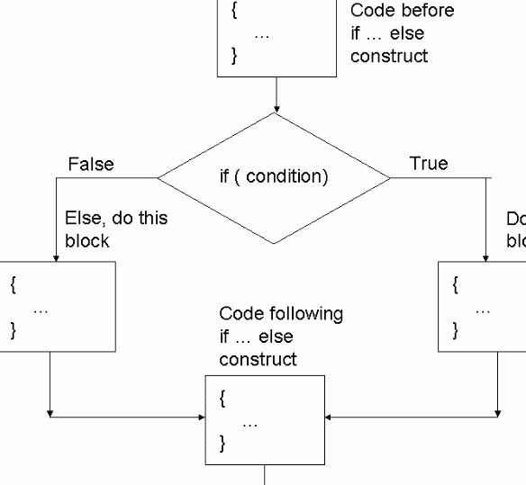

后续章节将通过示例说明如何使用这些结构。

```java
if (age >= 18) { // 如果条件放在 ( ) 之间
    System.out.println("You can drink legally."); // 如果 then 子句
} // if 块结束
else { // else 块开始
    System.out.println("You are too young to alcohol!");
} // else 块结束

// 执行下一条语句
System.out.println("The rest of the programme is next.");
```

当运行代码片段（在 `main` 方法中）时，当 `age = 20`，输出为：

```
You can drink legally.
The rest of the programme is next.
```

而当 `age = 17`，输出为：

```
You are too young to alcohol!
The rest of the programme is next.
```

另一个来自主题应用程序的示例展示了 `Member` 类中另一个方法的 `if ... else` 结构。`setCard` 方法被用于将媒体商店的成员与虚拟会员卡关联。每个成员最多可以两张卡，因此该方法检查是否可以为成员分配另一张卡。

```java
/**
 * 此方法通过将卡添加到成员的（两个）卡数组中来赋予卡。
 * 数组具有标识的卡。
 * @return 一个布尔值，表示是否可以添加卡。
 * @param card MembershipCard 类型的参数。
 */
public boolean setCard(MembershipCard card) {
    // 声明一个局部变量
    boolean result = true;
```


// noOfMembers 是分配给成员的卡数

```java
if (noOfMembers < cards.length) {
    cards[noOfMembers] = card;
    noOfMembers++;
} else {
    System.out.println("No more cards allowed for this member.");
    result = false;
}
return result;
```

### 2.4.3 复合 if ... else 结构

`if .. else` 结构中 `else` 部分还有另一种形式：`else ... if`。这种复合或级联结构在初始 `if` 条件求值后，会根据另一个条件的求值结果执行一个代码块。复合 `if ... else` 结构如图 2.2 所示。

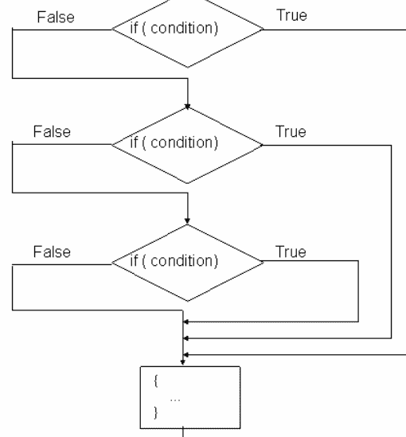

图 2.2 复合 if ... else 结构的逻辑

该图显示，在初始 `if` 语句之后可以跟随着任意数量的 `else ... if` 语句。

下一页的示例说明了如何使用 `if .. else` 结构根据最后一年获得的平均分来识别英国大学授予的学位分类。

```java
// 声明两个局部变量
int average = 0;
String result = null;

if (average >= 70) {
    result = "First Class";
} else if (average >= 60) {
    result = "Upper Second";
} else if (average >= 50) {
    result = "Lower Second";
} else if (average >= 40) {
    result = "Pass";
} else {
    result = "You are going to tell your mother about this!";
}

System.out.println("Your result is: " + result);
```


在 NNE Pharmaplan，我们需要有野心的人来帮助我们实现为公司设定的挑战性目标。

Kim Voby 是许多有野心的同事中的例子。除了担任制造 IT 部门的经理外，Kim 还以专业水平参加铁人三项。

NNE Pharmaplan 为我提供了带有责任的自由，以及规划自己时间的机会。这让我能够以竞技水平参加铁人三项，如果是的话，我没有可能这样做。

通过平衡工作和个人生活，我获得了能量，在工作和铁人三项中都能表现得最好。

如果你有野心并想加入我们的机会世界，请访问 nnepharplan.com

| NNE Pharmaplan 是全球专注于制药和生物技术领域的领先工程和咨询公司。NNE Pharmaplan 是 Novo 集团的一家公司。 | nne pharmaplan* |

运行平均分为 30% 的代码时会产生以下输出：

Your result is: You are going to tell your mother about this!

当平均分为 65% 时，输出如下所示：

Your result is: Upper Second

当 `average` 的值等于 65 时，它满足了上述代码中的多个 `else ... if` 语句。然而，输出证实了，当第一次满足条件时——当 `average >= 60` 时——控制就会离开初始的 `if` 语句，不再求值剩余的条件。当代码中满足某个条件时，输出显示控制跳到初始语句之后的第一个语句，即语句：

```java
System.out.println("Your result is: " + result);
```

提醒学习者注意在复合 `else ... if` 结构中使用大括号是有价值的。在编写 `else ... if` 结构时，由于涉及的括号对较多，必须小心处理：一个常见的错误是漏掉其中一个或多个。当 `if` 块中只有一个语句时，良好的做法是包含大括号——如上例所示——以备未来可能需要包含多个语句的 `if` 块。

本小节的最后一个示例展示了应用程序中 `Member` 类中的复合 `else ... if` 结构。该方法扫描成员持有的（虚拟）卡片数组，并输出存储在每张卡片上的信息。（`for` 循环将在章的后续部分讨论。）

```java
/** 方法在 for 循环中扫描卡片数组。 */
public void getDetailsOfCards() {
    // 声明一个局部变量。
    MembershipCard card = null;

    // 注意使用 instanceof 操作符
    for (int i = 0; i < noOfCards; i++) {
        if (cards[i] instanceof DvdMembershipCard) {
            card = cards[i];
            System.out.println("This is a DVD card with " + getNoOnLoan() + " + " + " DVDs currently on loan.");
        } else if (cards[i] instanceof GameMembershipCard) {
            card = cards[i];
            System.out.println("This is a games card with " + getNoOnLoan() + " + " + " CDs currently on loan.");
        }
    }
}
```

```java
System.out.println("Neither type of card.");
}

// 循环结束。
// getDetailsOfCards 结束。
```

### 2.4.4 嵌套 if 语句

作为 2.4.3 小节描述的复合 `if` 语句的替代方案，如果方法定义了这种逻辑，`if` 语句就可以嵌套。接下来显示的嵌套 `if` 语句简单示例是 2.4.3 小节中第一个示例的变体。

```java
int average = 65;
String result = null;
String course = "Java";

if (course == "Java") {
    if (average >= 70) {
        result = "First Class";
    } else if (average >= 60) {
        result = "Upper Second";
    } else if (average >= 50) {
        result = "Lower Second";
    } else if (average >= 40) {
        result = "Pass";
    } else {
        result = "You are going to have to tell your mother about this!";
    }
}

System.out.println("Your result is: " + result);
System.out.println("No results are available.");
```

当代码运行时，输出为：

- Your result is: Upper Second
- More results are available.

当运行下一个版本时，输出为：

No results are available.

```java
int average = 65;
String result = null;
String course = "Java";

if (course == "Java") {
    if (average >= 70) {
        result = "First Class";
    } else if (average >= 60) {
        result = "Upper Second";
    } else if (average >= 50) {
        result = "Lower Second";
    } else if (average >= 40) {
        result = "Pass";
    } else {
        result = "You are going to have to tell your mother about this!";
    }
}

System.out.println("Your result is: " + result);
System.out.println("No results are available.");
```

在使用 `if` 语句的任何变体时，必须小心以确保并测试实现了所需的逻辑。画出所需的逻辑通常有助于决定使用哪种变体。

### 2.4.5 条件运算符

Java 提供了一种三元、条件运算符 `? :`，是 `if ... else` 语句的紧凑版本。该运算符接受三个操作数：第一个是布尔条件；第二个是条件为真时的结果；第三个是条件为假时的结果。

### 2.4.6 switch ... case 结构

如果条件是整数表达式的求值，`switch ... case` 结构是复合 `if` 语句的替代方案。因此，编写 `switch` 语句通常更容易，不容易产生漏掉括号等错误。`switch ... case` 结构如图 2.3 所示。

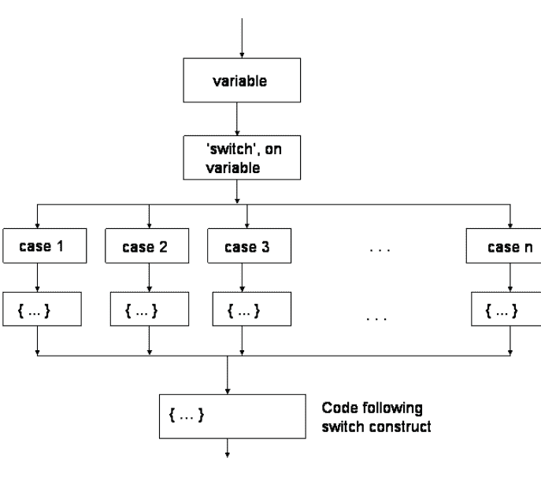

图 2.3 switch ... case 构造的逻辑


`switch ... case` 构造的逻辑是：从左到右对整数与每个 `case` 进行匹配。当此逻辑转换为 Java 源代码时，其通用语法如下。

```java
int someIntegerValue;

switch (someIntegerValue) { // switch 块开始
    case 1: // 执行其他操作; break;
    case 2: // 执行其他操作; break;
    case 3: // 执行其他操作; break;
    case 5: // 执行其他操作; break;
}

// switch 块后的第一条语句
```

每个 `case` 语句后的 `break` 语句是必要的，以便在条件满足时退出封装的 `switch` 块。当执行 `break` 语句时，控制将离开封装的 `switch`，到达 `switch` 块结束后的第一条语句。从上看，省略最后的 `break` 语句似乎是合理的。然而，建议包含它，以防向现有 `switch` 块中添加额外的 `case` 语句。

在图标驱动的应用普及之前，旧式的基于文本界面或绿屏应用程序是菜单驱动的。`case` 语句通常用于构建此类接口。虽然菜单驱动的应用在很大程度上已经消失了，但 `case` 语句对于测试应用程序逻辑中的条件流仍然有用。

接下来的示例说明了通过键盘输入数值的 `switch ... case` 构造。（为了示例目的，没有必要显示通过键盘获取数字的代码。）

```java
// 通过键盘输入的数字被存储在标识符为 month 的变量中
int days;

switch (month) {
    case 9:
    case 4:
    case 6:
    case 11: days = 30; break;
    case 2: days = 28; break;
    default: days = 31; break;
}

System.out.println("The number of days is: " + days);
```

当此代码在 `main` 方法中运行时，输出结果如下：

- 输入月份数字：1
  天数: 31
- 输入月份数字：2
  天数: 28
- 输入月份数字：3
  天数: 31
- 输入月份数字：4
  天数: 30
- 输入月份数字：5
  天数: 31
- 输入月份数字：6
  天数: 30
- 输入月份数字：7
  天数: 31
- 输入月份数字：8
  天数: 31
- 输入月份数字：9
  天数: 30
- 输入月份数字：10
  天数: 31
- 输入月份数字：11
  天数: 30
- 输入月份数字：12
  天数: 31

输出显示 `default` 语句被用于检测所有未被任何 `case` 语句检测到的值。输出还显示，当 `month` 的值为 9、4 或 6 时，前三个 `case` 语句被**“穿透（fall through）”，因此当 `month` 的值为 9、4、6 或 11 时，`days` 的值为 30。

## 2.5 控制代码块的重复

控制代码块的重复可以通过以下方式之一实现：使用计数器重复已知次数的代码块；或者通过评估布尔表达式来决定何时停止重复该代码块。重复代码块的通用要求如图 2.4 所示。

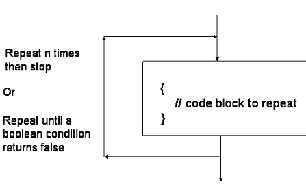

图 2.4 重复代码块的要求

### 2.5.1 计数器控制重复

计数器控制重复的逻辑如图 2.5 所示。

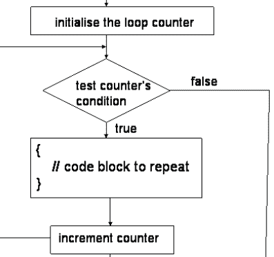

图 2.5 代码块的计数器控制重复

使用计数器是通过 `for` 循环实现的。`for` 循环的通用语法如下：

```java
for (定义并初始化计数器; 计数器的最终值条件; 更新计数器) {
    // 要重复的代码块
}
```

通用语法意味着计数器的最终条件值是一个已知值。例如，考虑以下代码段：

```java
for (int i = 0; i <= someMaxValue; i++) {
    // 要重复的代码块
}
```

如果 `someMaxValue` 的值为 10，则代码块将执行 11 次。如果代码段修改如下，具有相同的 `someMaxValue`：

```java
for (int i = 0; i < someMaxValue; i++) {
    // 要重复的代码块
}
```

代码块将执行 10 次。上述两个代码段的目的是为了说明在控制 `for` 循环执行次数时，初始化和设置计数器的最终值必须小心。

下一页的示例展示了一个 `for` 循环的操作。


`for` 循环的目的是扫描卡片数组以输出存储在每个卡片上的信息。在示例中，持有卡片数量是已知的：因此，`for` 循环是重复所需代码块的明显构造选择。

Java 两种布尔控制构造用于控制代码块的重复：`while` 循环和 `do ... while` 循环。

### while 循环

`while` 循环的逻辑如图 2.6 所示。

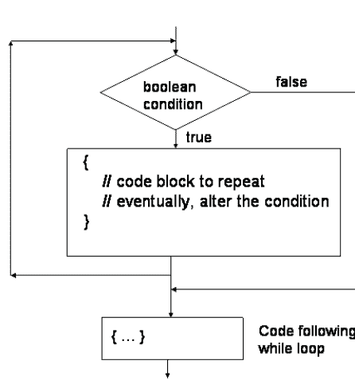

图 2.6 while 循环的逻辑

图 2.6 意味着如果布尔条件的初始返回值为 `false`，则循环将不执行。相反，如果布尔条件的初始返回值为 `true`，则循环将重复执行，直到条件最终返回 `false`。`while` 循环的通用语法如下。

```java
// 初始化布尔条件中使用的变量
while (条件为真) {
    // 要重复的语句
    // 更新条件：最终退出循环
}
```

2.5.1 节的第一个示例可以修改为使用 `while` 循环，如下所示。

```java
int someMaxValue = 10;
int counter = 0;

while (counter < someMaxValue) {
    System.out.println("Hello world!");
    counter++;
}
```

字符串 "Hello World!" 输出了十次。

### do ... while 循环

`do ... while` 循环的逻辑如图 2.7 所示。

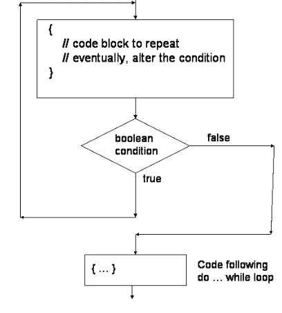

图 2.7 do ... while 循环的逻辑

图 2.7 意味着 `do ... while` 循环至少执行一次。如果布尔条件返回值为 `true`，则循环将重复执行，直到条件最终返回 `false` 为止。`do ... while` 循环的通用语法如下。

```java
// 初始化布尔条件中使用的变量
do {
    // 要重复的语句
    // 更新条件：最后，退出循环
} while (condition is true);
```

第 2.5.1 节的示例可以修改为使用 `do ... while` 循环，如下：

```java
int someMaxValue = 10;
int counter = 0;

do {
    System.out.println("Hello world!");
    counter++;
} while (counter < someMaxValue);
```


在这种情况下，字符串 "Hello World!" 输出了十次。

下一个示例来自用于运行主题应用程序的图形用户界面 (GUI) 类之一；该示例展示了 `while` 循环的实际用法。循环的目的是当成员通过 GUI 登录时，扫描媒体存储器（Media Store）的成员数组。当在数组中找到该成员时，循环将退出，以避免搜索数组的剩余部分。

```java
// 此方法确认某成员已在 Media Store 注册并已添加
// 到成员数组中。当成员尝试通过 GUI
// 登录时，该方法对 'Login' 按钮做出响应。该方法的主要目的是在
// 成员数组中找到该成员。

// 读取成员数组。mediaStore 是应用程序其他地方
// 创建的 MediaStore 对象的引用。
mediaStore.readMembers();

// 从 GUI 获取用户的用户名和密码。将这些值存储在
// 变量 username 和 password 中。

// 连接用户的用户名和密码。
String searchText = username + password;

// 在成员数组中搜索组合后的用户名和密码。首先，获取成员
// 数组。
Member[] existingMembers = mediaStore.getMembers();

// 扫描成员数组并将搜索字符串与每个成员进行比较
boolean flag = true;

while (flag == true) {
    for (int i = 0; i < mediaStore.getNoOfMembers(); i++) {
        Member existingMember = existingMembers[i];
        String existingUserName = existingMember.getUsername();
        String existingPassword = existingMember.getPassword();
        String combinedNameAndPassword = existingUserName + existingPassword;

        if (searchText.equals(combinedNameAndPassword)) {
            // 在成员数组中找到现有成员。
            // 向 GUI 输出消息。
            flag = false;
            break; // 跳出 for 循环
        }
    } // for 循环结束
} // while 循环结束

break; // 跳出 while 循环

// 如果没有找到匹配项，则输出适当的消息
if (flag == true) {
    // 输出“无此类成员；请重试。”
}
```

## 2.6 决定使用哪种结构

在任何特定情况下决定使用哪种结构都是判断问题，当学习者获得实践经验时，这种判断将变得更容易。例如，上一个小节末尾解释的方法实现就是由于在成员数组中查找成员并跳出循环以避免主循环不必要的迭代所需的逻辑。从代码来看，该方法的完整实现是嵌套的 `while` 和 `for` 结构的组合。

在完成对表 2.1 内容的检查之前，有必要提到另一种“嵌套结构中的循环”。

### 2.6.1 嵌套的 for 循环

我的一位大学同事为参加他 Java 课程的学生们布置了一道极其棘手的练习题。该练习的主要任务是打印日历。从表面上看这似乎是一个简单的练习，但它实际上涉及循环中的循环，通常被称为嵌套 `for` 循环。该练习的一个高度通用的框架如下：

```java
for (int months = 1; months < 13; months++) { // 月份循环
    for (int weeks = 1; weeks < 5; weeks++) { // 周循环
        for (int days = 1; days < 32; days++) {
            // 以日历格式输出日期和星期
        }
    }
} // 外层 for 循环结束
```

上面的示例表明，嵌套的 `for` 循环可以用于构建表格或数据的多维数组。内层循环用于输出行的每个条目，外层循环用于移动到下一列。接下来的片段输出表格或数组每个单元格的值。

```java
for (int i = 1; i < numberOfColumns; i++) {
    for (int j = 1; j <= cellValue; j++) {
        // 输出坐标为 j, i 的单元格已知值，即
        // i 列的第 j 行
    }
} // 内层 for 循环结束
} // 外层 for 循环结束
```

下一节通过考虑分支语句，几乎完成了我们对表 2.1 的检查。

## 2.7 分支语句

分支语句用于终止循环或决策结构，或跳过循环的迭代。

### 2.7.1 无标签 break 语句

在本章讨论的许多示例中包含 `break` 语句，以便立即退出流结构。`break` 语句用于终止 `switch`、`for` 和 `while` 结构。例如，当调用以下方法时：

```java
public void someMethod() {
    for (int i = 0; i < 11; i++) {
        System.out.print(i + ", ");
        if (i == 5)
            break; // 跳出无标签 for 循环
        // 语句
        System.out.println("loop terminated.");
    }
}
// someMethod 结束
```

输出为：0, 1, 2, 3, 4, 5, loop terminated.

输出表明 `break` 语句导致对应的 `for` 循环终止并将控制传递到循环后的第一个语句。

### 2.7.2 无标签 continue 语句

到为止，在本指南中尚未遇到 `continue` 语句。`continue` 语句用于跳过 `for`、`while` 和 `do ...` 循环的迭代。例如，当调用下一页所示的方法时，它产生方法体所示输出。

```java
public void someMethod() {
    for (int i = 0; i < 11; i++) {
        if (i == 5)
            continue; // 跳过此无标签循环的本次迭代
        // 语句
        System.out.print(i + ",");
    }
    System.out.println("The iteration when i is 5 is skipped.");
}
```

输出为：0, 1, 2, 3, 4, 6, 7, 8, 9, 10, The iteration when i is 5 is skipped.

输出表明 `continue` 语句导致对应的 `for` 循环跳过 `i` 为 5 的迭代，并将控制传递给循环的下一次迭代。

# Java：Java 应用中的类

// 下一个代码块中调用的一个或多个方法已知会产生错误，// 它们被称为“抛出”（throw）错误，必须在单独的代码块中被检测或“捕获”（caught）

```java
try {
    // 编写会抛出错误的方法调用
catch ( Exception e ) {
    // 对错误进行某些处理
}
```

`try ... catch` 结构的含义意味着根据是否检测到错误来做出决定。如果 `try` 块中的某个方法调用抛出了错误，将跳过 `try` 块中剩余的语句并执行 `catch` 块中的语句。相反，如果 `try` 块中的方法调用没有抛出任何错误，则将跳过 `catch` 块的语句，并将控制权传递到 `catch` 块结束后的后的第一条语句。第四章将详细介绍如何使用 `try ... catch` 块来编写健壮的 Java 代码。

在下一章中，我们将了解到如何通过名为“继承”的非常重要的概念来扩展类。

SimCorp 是全球金融软件的领导者。在 SimCorp，你将成为一个由优秀且丰富的同事组成的大网络的一部分，他们渴望通过奉献和团队精神实现共同目标。我们投资员工，以确保你在个人和专业水平上实现抱负。SimCorp 聘用经济、金融和 IT 领域最优秀的人才，我们的大多数同事拥有这些领域的大学或商业学位。

**野心勃勃吗？** 请访问 www.simcorp.com/careers 寻找机会。

| SimCorp | www.simcorp.com |
| :--- | :--- |

# 3. 通过继承扩展类

第三章探讨了面向对象编程（OOP）的一个角落，即继承。Java 类可以通过继承轻松地修改和扩展以实现重用，而不是重写要修改的类的源代码。

## 3.1 继承意味着什么？

为了解释 Java 语言中继承的含义，让我们考虑一个非常简单的例子。假设我们有一个名为 `MyClass` 的类，它具有如下平凡的类定义，声明了一个单一成员：

```java
public class MyClass {
    private int someValue;
}
```

假设我们希望重用这个类，并且在此过程中我们希望给副本起一个不同的名称。为了实现这一点，我们将编写以下类定义：

```java
public class MyOtherClass {
    private int someValue;
}
```

换句话说，我们在 `MyOtherClass` 的类定义中重写了 `MyClass` 的主体。在我们平凡的示例中，重写 `MyClass` 主体的努力是微小的，因为只有一个成员需要声明。然而，在通常情况下，重写一个大型类定义的努力是可以避免的。

继承的概念对于 OOP 语言非常重要，它避免了从一个类到另一个类重写代码。在示例中，副本类的定义编写如下，以利用 Java 中适用的继承概念。

```java
public class MyOtherClass extends MyClass {
    // 变量 someValue 被继承了，不需要再次声明
}
```

`extends` 关键字表示 `MyOtherClass` 类继承了 `MyClass` 类的单一成员，使其成为 `MyOtherClass` 的成员。

# Java：Java 应用中的类——通过继承扩展类

在简单示例中使用 `extends` 关键字提出了一个问题：当我们只是可以根据需要多次使用 `MyClass` 时，为什么要以 `MyOtherClass` 的伪装复制 `MyClass` 呢？问题的答案在于，继承的成员既可以修改，也可以保持不变。这个重要的概念意味着，如果我们愿意，可以修改继承的方法，并自由地保持它（或其他）继承的方法不变。我们还可以在扩展类中提供额外的方法。

接下来的示例增强了上面的示例，以说明扩展类的真正价值。

```java
public class MyClass {
    private int someValue;
    public void someMethod(String string ) {
        System.out.println("这是父类.");
    }
}
```

```java
public class MyOtherClass extends MyClass {
    // MyOtherClass 继承了 MyClass 的两个成员。
}
```

由于 `MyOtherClass` 继承了 `MyClass` 的两个成员，请考虑下一个测试类。

```java
public class TestClass {
    public static void main(String[] args ) {
        MyOtherClass moc = new MyOtherClass();
        System.out.println("someValue 的值为：" + moc.someValue);
    }
}
```

当尝试编译测试类时，编译器会输出以下消息：

```
someValue has private access in MyClass
```

这个简单示例的目的是说明，虽然私有变量 `someValue` 被 `MyOtherClass` 继承了，但它是一个私有变量，因此无法通过引用对象 `MyOtherClass` 选择该成员来直接访问。编译器高亮了语句：

```java
System.out.println("someValue 的值为：" + moc.someValue);
```

在 BookBoon.com 免费下载书籍

46

# Java：Java 应用中的类

## 通过继承扩展类

当它输出消息时，因为它在抱怨：

```
moc.someValue
```

尝试访问私有变量，尽管它是继承的。因此，当我们尝试访问私有变量时（即使是继承的），编译器是一致的。

为了访问变量 `someValue`，我们可以在 `MyClass` 中写一个访问方法，并通过对 `MyOtherClass` 对象的引用调用它，如下所示。

```java
public class MyClass {
    private int someValue = 42;
    public void someMethod(String string ) {
        System.out.println("这是父类.");
    }
    public int getValue() {
        return someValue;
    }
}
```

| MAERSK INTERNATIONAL TECHNOLOGY & SCIENCE PROGRAMME | 你即将成为工程师还是地科学家？或者已经毕业了？如果是这样，马士 A.P. Moller 可能为你带来一个兴奋的未来。 |
| MAERSK | www.maersk.com/mitas |
| | |

# Java：Java 应用中的类——通过继承扩展类

```java
public class TestClass {
    public static void main(String[] args ) {
        MyOtherClass moc = new MyOtherClass();
        System.out.println("someValue 的值为：" + moc.someValue);
    }
}
```

执行 `main` 输出如下。

someValue 的值为：42

并显示正确的访问方法被 `My` 类继承。

或者，我们可以在扩展类中修改继承的方法，以便对 `someValue` 执行一些简单的处理，如下所示。

```java
public class MyOtherClass extends MyClass {
    public int getValue() {
        someValue++;
        return someValue;
    }
}
```

修改后的方法无法编译，因为它尝试访问私有变量。然而，对方法的这种修改可以编译：

```java
public class MyOtherClass extends MyClass {
    public int getValue() {
        int value = 0;
        // 调用 MyClass 中的 getValue
        value = super.getValue();
        value = value + 1;
        return value;
    }
}
```

`MyObjectClass` 和 `MyClass` 之间的关系是，后者被称为前者的父类，或者反过来看这种关系，前者是后者的子类。编译本节提到的这三个类的 IDE 在下图中截图中显示了这种关系。

实线和闭合箭头表示 `MyObjectClass` 是其父类 `MyClass` 的子类；换句话说，`MyObjectClass` 与其父类有“是一个”的关系。带箭头的虚线显示 `TestClass` 与 `MyObjectClass` 之间有“有一个”的关系，因为 `TestClass` 在其 `main` 方法中声明了一个 `MyObjectClass` 类型的局部变量。（根据 UML 图的约定，`MyObjectClass` 和 `TestClass` 之间的虚线应该是实线。这是 IDE 不为“有一个”关系绘制直线的特性。）

49

# Java：Java应用程序中的类——通过继承扩展类

本节讨论的简单示例展示了类之间父类到子类的关系。事实上，所有在 Java 中编写的类都隐式地继承自类型为 `Object` 的类，因此也继承了 `Object` 类的成员。以下来自 API 的提取显示了 `Object` 类的一些成员。

```java
java.lang
Class Object
```

```java
java.lang.Object
public class Object
```


`Object` 类是类层次结构的根。每个类都以 `Object` 为父类。所有对象（包括数组）都实现了该类的方法。

## 方法摘要

| 修饰符 | 方法 | 说明 |
| --- | --- | --- |
| protected Object | `clone()` | 创建并返回此对象的副本。 |
| boolean | `equals(Object obj)` | 表明另一个对象与此对象是否“相等”。 |
| protected void | `finalize()` | 当垃圾回收器确定不存在指向该对象的引用时，在对象上调用此方法。 |
| Class<?> | `getClass()` | 返回此对象的运行时类。 |
| int | `hashCode()` | 返回对象的哈希值。 |
| String | `toString()` | 返回对象的字符串表示。 |
| void | `wait()` | 使当前线程等待，直到另一个线程对此对象调用 `notify()` 方法或 `notifyAll()` 方法。 |
| void | `wait(long timeout)` | 重载方法；此处未显示完整签名。 |
| void | `wait(long timeout, int nanos)` | 重载方法；此处未显示完整签名。 |

因此，`MyClass` 的类声明：

```java
public class MyClass
```

实际上意味着：

```java
public class MyClass extends Object
```

省略了 `extends` 子句是因为每个 Java 对象都继承自 `Object` 类。

下一段 API 提取显示，Java 开发环境提供的所有类都继承自 `Object` 类。

```
java.lang.Class Short
java.lang.Object
  └java.lang.Number
    └Short
```

该片段表明 `Short` 类是 `Number` 的子类，而 `Number` 又是 `Object` 的子类。在我们深入探索 Java 继承的方面之前，让我们总结一下本节讨论引入的主要概念。

## 通过继承扩展类

- 继承是根据现有类创建新类的能力；
- Java 采用单继承；即子类只能有一个父类；
- 字段和方法在子类中被继承；
- 构造函数不被继承；
- `Object` 类位于继承树的顶端，如 Java API 所示；
- 所有 Java 类都隐式地继承其父类的方法；这被称为重写（overriding）；
- 与父类方法具有相同签名和返回类型的实例方法被认为重写了该方法；
- 关键字 `super` 用于引用父类的成员，因此重写方法可以使用 `super` 关键字调用被重写的方法；
- 方法调用不必在类层次结构中更靠上的方法上。

## 3.2 子类中方法的重写与隐藏

第 3.1 节给出了在子类中重写方法的简单示例。从本质上说，方法重写是修改继承行为以适应子类特定逻辑的方法，这种逻辑源于其父类的通用逻辑。因此，我们可以认为父类包含了被继承的成员，这些成员可以根据每个子类的需要而进行修改。考虑下方图 3.2 所示的简单层次结构。

**图 3.2** 父类及其子类

这三个类的定义在接下来的页面中：为了简洁，省略了部分文档。

```java
public class Student {

    // 声明实例变量
    private int idNumber;
    private String degreeCode;
    private int yearOfEnrollment = 0;

    public Student(int idNumber, String degreeCode) {
        // 初始化实例变量
        this.idNumber = idNumber;
        this.degreeCode = degreeCode;
    }

    public int getIDNumber() {
        return idNumber;
    }

    public String getDegreeCode() {
        return "course " + degreeCode;
    }

    public int getYearOfEnrollment() {
        return yearOfEnrollment;
    }
}
```

```java
public class FullTimeStudent extends Student {

    // 声明实例变量
    private String fullName;

    public FullTimeStudent(int idNumber, String degreeCode) {
        // 调用父类构造函数
        super(idNumber, degreeCode);
    }

    @Override
    public String getDegreeCode() {
        return "This full-time student is enrolled on: " +
            super.getDegreeCode();
    }
}
```

```java
public class PartTimeStudent extends Student {

    // 声明实例变量
    private String fullName;

    public PartTimeStudent(int idNumber, String degreeCode) {
        // 调用父类构造函数
        super(idNumber, degreeCode);
    }

    @Override
    public String getDegreeCode() {
        return "This part-time student is enrolled on: "
            + super.getDegreeCode();
    }
}
```

对源代码的检查说明了与父类方法具有相同签名和返回类型的实例方法重写了它。因此，`PartTimeStudent` 中的 `getDegreeCode` 重写了 `Student` 中的 `getDegreeCode`。示例还展示了如何使用 `super` 关键字在重写方法体内调用被重写的方法。

（方法重写的规则之一规定重写方法不能抛出与被重写方法不同类型的异常对象。我们将在下一章处理此类异常。）

## Java: Java 应用中的类
## 通过继承扩展类

与父类中的类方法（即静态方法）具有相同签名的类方法被称为“隐藏”了该方法。对于类方法，运行时系统调用调用该方法的引用的编译时类型中定义的方法；对于实例方法，则调用调用该方法的引用的运行时类型。通过在 `Student` 类定义中提供以下方法说明了这一点。

```java
public static String getDetails() {
    return "I am a student";
}
```

当接下所示的 `main` 方法为：

```java
public class TestStudents {
    public static void main(String[] args) {
        // 创建一个 Student 对象。变量 s 是 Student 类型，但它指向
        // 一个 FullTimeStudent 对象（在运行时）。
        Student s = new FullTimeStudent(1234, "Java");

        // 调用 Student 的静态方法。
        System.out.println(s.getDetails());

        // 调用 FullTimeStudent 的实例方法。
        System.out.println(s.getDegreeCode());
    }
}
```

输出结果为：

```
I am a student.
This full-time student is enrolled on: course Java
```

这说明了在编译时类型和运行时类型上调用方法之间的区别。在此处，关于类方法还有一条规则需要说明：实例方法不能重写静态方法，静态方法不能隐藏实例方法。

## 3.3 从子类构造函数调用父类构造函数

在之前的几节中的许多示例展示了如何使用 `super` 关键字调用被重写的方法。`super` 关键字也用于从子类的构造函数调用父类构造函数。事实上，对 `super(<参数列表>)` 的调用必须是子类构造函数的第一条语句，如上述 `PartTimeStudent` 和 `FullTimeStudent` 构造函数所示。

## Java: Java 应用中的类
## 通过继承扩展类

关于 `super(<参数列表>)` 的调用有若干规则：

- 必须初始化子类的所有字段；因此必须调用其构造函数；
- 根据传递给 `super` 的参数来调用特定的构造函数；这通过 `FullTimeStudent` 构造函数的第一条语句说明了这一点；
- 如果子类构造函数中没有对 `super` 的调用，编译器会添加一个隐式的 `super()` 调用，以调用父类的无参数构造函数（可能是其默认构造函数）；
- 如果父类定义了构造函数但没有提供无参数构造函数，当从子类中调用 `super()` 时，编译器会发出错误信息。

基于这些规则，在子类构造函数的第一条语句中调用正确的 `super` 构造函数时应小心。

## 3.4 final 和 abstract（抽象）类

**图 3.3** 增强版本的简单类层次结构

## Java: Java 应用中的类
## 通过继承扩展类

`Employee` 类被（IDE）标记为 **abstract（抽象）**。为了这个简单示例的目的，`Employee` 类被定义为 **abstract** 的，因为我们不想实例化 `Employee` 类的对象。相反，我们希望实例化 `Tutor`（导师）类的对象，换句话说，我们希望为应用程序填充具体的员工，而不是使用抽象且通用的员工概念。`Employee` 的类定义如下所示。

```java
public abstract class Employee {

    // 声明实例变量。
    String department;

    /**
     * 此构造函数使用标识符 department 初始化变量。
     * @param department 员工的部门。
     */
    public Employee(String department) {
        this.department = department;
    }

    // 所有继承自 Employee 的子类都必须实现此抽象方法。
    // 注意它是如何声明的。
    public abstract String getDepartment();
} // 类定义结束。
```

## Java: Java 应用中的类
## 通过继承扩展类

`Tutor` 的类定义如下。

```java
public class Tutor extends Employee {

    // 声明实例变量。
    private String tutorsName;

    // 用于存储学生引用的数组。
    private Student[] studentsInJavaGroup;

    /**
     * Tutor 类对象的构造函数。
     * @param department 导师的部门。
     */
    public Tutor(String department) {
        // 调用父类的构造函数。
        super(department);
    }

    /**
     * 继承自 Employee 的抽象方法；必须被重写。
     */
    public String getDepartment() {
        return department;
    }
} // 类定义结束。
```

# Java：Java 应用中的类

## 通过继承扩展类

在指南的目前为止，我们通过调用该类的某个构造函数来创建特定类的对象。然而，如语句所示，在 Java 中，这种兼容性条件是被允许的。换句话说，现有对象的类在它的生命周期内不会改变，它可以被其自身类型或其父类的变量所引用。

因此，我们预计下一条语句可以通过编译：

`Student s = new FullTimeStudent();`

在上述语句中，当我们把 `FullTimeStudent` 关联到 `Student` 时，实际上是在子类类型和其父类类型之间进行转换。

层次结构中较高的类型被认为比层次结构下方较窄的类型更“宽”。在语句中，宽化转换（或称为向上转型，upcast）由编译器自动执行。当可以证明 `s3` 指向一个 `FullTimeStudent` 对象时，到 `Student` 对象的隐式安全转换在运行时是有效的。

另一方面，考虑下一个语句：

```java
PartTimeStudent pts = new Student(555, "Java");
```


# Java：Java 应用中的类

## 通过继承扩展类

表面上看，将 `Object` 对象（向下）转型为 `Member[]` 类型的对象在运行时可能是无效的。然而在这种情况下，存储在内存中的实际对象是 `Member[]` 类型；因此，保留了运行时兼容性。

最后在本节中，值得提醒学习者，`instanceof` 运算符可以用来查找内存持有对象的类型，以便可以使用强制转换来恢复对象的完整功能。例如，图 3.3 所示的对象层次结构中的测试类之一包含了下一页所示的方法。

## 3.6 虚方法调用

第 3.5 节讨论的兼容性规则在调用方法时提出了一个问题：调用方法时我们如何知道正在使用哪个对象？

为了说明这个问题的答案，请考虑来自图 3.3 所示应用程序测试类的以下代码片段。

```java
Student student = new PartTimeStudent(1234, "Java");
System.out.println(student.getDegreeCode());
```

输出结果为：

This part-time student is enrolled on: code Java

输出显示，当你通过对象引用调用方法时，是由所引用对象的运行时类型决定了使用哪种实现。因此，在上述语句中，对象引用 `student` 指向一个 `PartTimeStudent` 对象，对 `student.getDegreeCourseCode()` 的调用执行了 `PartTimeStudent` 类定义中实现的 `getDegreeCourseCode` 方法，而不是 `Student` 类定义中的方法。

另一方面，对于类方法，运行时系统会调用方法所在的引用编译时类型中定义的方法。因此，如下对静态方法的调用 `student.getDetails();` 调用的是 `Student` 类中的 `getDetails` 方法。

## 3.7 控制对类成员的访问

访问修饰符用于确定类是否有权访问某个成员。在指南的目前为止，我们已经了访问修饰符 `public`、`private` 和 `protected`，它们将在下一页进行总结。

| 修饰符 | 同一类 | 同一包 | 子类 | 宇宙 |
| :--- | :--- | :--- | :--- | :--- |
| private | 是 | 否 | 否 | 否 |
| default | 是 | 是 | 否 | 否 |
| protected | 是 | 是 | 是 | 否 |
| public | 是 | 是 | 是 | 是 |

第一行确认了类本身可以访问 `private`。第二行表示，如果没有指定修饰符，同一包的类可以访问。第三列表示子类可以访问 `protected`。第四行显示无论如何，所有类都可以访问 `public` 成员。

虽然表面上看，`protected` 访问级别可能被认为对其他类具有高程度的“保护”，但表格和示例代码显示并非如此。`MySubClass` 类显示 `MySuperClass` 的所有子类都可以访问 `protected` 成员。因此可以看到 `protected` 访问级别没有 `private` 那么严格。尽管如此，开发者可能希望父类的若干成员设为 `protected`，以便子类能够轻松访问。

### 示例一

```java
public class MySuperClass {
    private int privateInt;
    protected int protectedInt;
    public void aMethod() {
        System.out.println(privateInt);
        System.out.println(protectedInt);
    }
}
```

该类可以通过编译，并仅显示了类的成员之一 `aMethod` 可以访问该类的私有和受保护变量。

### 示例二

```java
public class MySubClass extends MySuperClass {
    public void aMethod() {
        // System.out.println(privateInt);
        // 上述语句是非法的：privateInt 在 MySubClass 中具有私有访问权限
        System.out.println(protectedInt);
    }
}
```

该类可以通过编译，并显示子类无法访问父类的私有变量，但可以访问父类的受保护变量。

## 3.8 继承总结

虽然在本章开头没有明确说明，但所使用的示例旨在说明继承的两种形式。我们并没有在开始时提到这两种形式，而是希望这两种形式能通过本章中的解释和代码示例自然引出。

之前的章节旨在展示如何扩展类或创建其子类，以及如何在为处理父类设计的代码中使用子类。例如，在为处理 `Student` 对象设计的代码中使用了 `FullTimeStudent` 对象。如果一个方法期望一个类型为 `Student` 的参数，你可以传递一个 `FullTimeStudent` 对象给它，它是可以运行的，尽管你可能需要使用 `instanceof` 运算符来确定类型参数，并通过适当的强制转换来恢复对象的完整功能，如第 3.5 节所示。继承的这种特性被称为多态。一个声明为 `Student` 类型对象可以有许多形式，因为它可以被当作 `Student` 对象、`FullTimeStudent` 对象或 `PartTimeStudent` 对象使用。

`Student` 对象的行为被 `FullTimeStudent` 对象继承；后者扩展前者。扩展的行为可以是完全全新的——即为子类添加方法——也可以通过重写与被覆盖方法相同签名和返回类型的方法来修改继承的行为。扩展类可以通过对一个或多个继承的方法提供新的实现来重写其父类的行为。

总来说，扩展类产生了两种形式的继承：

- 1. 类型继承，其中子类获取父类的类型，以便在为处理父类类型设计的代码中以多态方式使用；
- 2. 实现继承，其中子类在成员方面获取父类的实现。

继承是面向对象编程（OOP）语言中的一个基本概念；因此，本章本可以更多示例来进一步说明扩展类的本质特征。然而，在现阶段，结束本章可能是明智的，让学习者在实践中处理扩展类，并在实际情况中遇到这些概念。

下一章将解释 Java 程序中如何处理错误。

# 4. Java 程序中的错误

即使使用世界上最好的工具，在开发应用程序时也会出现错误，无论目标语言是什么：Java 程序也不例外。然而，Java 等面向对象编程（OOP）语言与非 OOP 语言相比有一个明显的优势，它们能够通过创建一个表示错误的对象来响应某些错误。这种方法让开发者承担了处理错误的责任，以响应应用程序运行时发生的错误。

本章解释了 Java 程序中如何处理错误；它不包括语法错误。语法错误是由于开发者不正确使用 Java 语言引起的；编译器会检查此类错误并相应地通知开发者。

## 4.1 错误分类

对这九章的检索发现在示例讨论中存在以下错误消息：

- `ArrayIndexOutOfBoundsException`
- `ClassCastException`

这两条消息意味着在执行示例程序运行时发生了某些情况。事实上，这两个错误消息都意味着开发者犯了逻辑错误。运行时发生的逻辑错误通常反映在应用程序的输出中。逻辑错误通过在编译时对程序进行进一步测试和调试来消除。

在编译时，第一种情况下，不能期望编译器预见到运行时正在处理越界的数组索引。`ArrayIndexOutOfBoundsException` 的出现应该足够让开发者检查产生此类错误的代码逻辑。

在编译时，第二种情况下，开发者没有遵守对象引用的强制转换规则。虽然代码已经编译通过（因为遵守了编译时规则），但运行时规则被破坏了；同样，错误消息的性质应该足够让开发者检查包含强制转换的语句既符合上一章所解释的对象引用强制转换的编译时规则，也符合运行时规则。

简而言之，这两个错误通过以下消息指出：

- `ArrayIndexOutOfBoundsException`
- `ClassCastException`

应该由开发者在编译时修复；它们无法从运行时恢复。鉴于它们没有被开发者预见到，通过分析和纠正产生错误消息的代码逻辑可以很容易消除它们。处理源代码的逻辑就是调试。集成开发环境（IDEs）通常提供调试工具，可以逐语句地执行代码语句。

另一方面，当程序执行时，可能会发生许多程序逻辑控制之外的运行时错误。这些包括例如：合理可能发生的错误条件，因为它们具有损害对数据以及对其他本地和网络资源访问的可能。运行时合理可能发生的错误应该是可以恢复的，以确保程序不终止。

预料此类错误具有可能发生的预期条件，例如：检测方法正在读取的文件的末尾。在这种情况下，读取文件的方法应该包含检测文件末尾的代码，以免在运行时发生“文件结束”错误。

运行时错误的不可避免的存在引发了一个重要问题：开发者如何预见运行时错误条件？如果开发者采取穷尽立场，预见到所有方法都可能发生所有错误条件，那么生成的代码极可能是臃肿且几乎无法使用的。另一方面，如果开发者采取乐观立场，不预见许多错误条件，那么生成的代码在发布给用户时可能不够健壮。该问题（在本段开头提出）的答案并不简单，因为决定预见哪些错误而不预见哪些并不容易。在实践中，答案在于这两个立场之间达成一个合理的折中。

## 4.2 什么是意外的错误条件？

第 4.1 节列出的两个错误消息揭示了 Java 程序如何处理意外错误条件的线索。粗略检查这些消息 `ArrayIndexOutOfBoundsException` 和 `ClassCastException` 可以发现这两个复合词有一个共同点：单词“Exception”。希望读者能立即意识到 `Exception` 是一个 Java 类。因此，`ArrayIndexOutOfBoundsException` 是 `Exception` 类的一种。以下 API 证实了确实是如此：

```text
java.lang.Class ArrayIndexOutOfBoundsException
java.lang.Object
  java.lang.Throwable
    java.lang.Exception
      java.lang.RuntimeException
        java.lang.ArrayIndexOutOfBoundsException
```

异常对象（通常抛出的异常）作为 `RuntimeException` 类的子类（对于 `ArrayIndexOutOfBoundsException`），通常由于逻辑错误引起，由开发者在编译时消除。这种异常被称为未检查异常。

对这两个错误消息的讨论意味着它们都是未检查异常的示例。

## 4.3 检查异常

异常提供了一种简单直接的机制来检查错误，而不会用额外的语句（如 `else` 结构和其他用于测试字段值的语句）来杂乱代码，以便检测何时可能发生错误。一个方法可能产生的异常被显式地包含在方法的声明中。这意味着异常与方法的返回类型和参数一样，是方法编程接口（API）的重要组成部分。在方法声明中包含异常意味着调用该方法的代码会感知这些异常，因此编译器也知道它们的存在。由编译器检查的异常类型被称为检查异常（checked exception）。

当在调用方法时发生错误，异常对象会被传递给运行时系统；这个过程被称为抛出异常（throwing an exception）。运行时系统尝试在调用方法中寻找某些用于响应和处理异常的代码。如果在调用方法中没有找到该处理代码，运行时系统将沿着已调用的方法集回溯，一直调用抛出异常的方法，直到找到某个处理器。这组方法被称为调用栈（call stack）。如果开发者没有提供处理代码，运行时系统最终到达方法调用栈的末端，即运行应用程序 `main` 方法的线程。如果 `main` 没有处理该异常，`main` 的执行线程将异常终止。换句话说，当 `main` 异常终止时，应用程序将会崩溃。我们将在《Java 编程入门 3：图形用户界面》的第四章中检查这些内容。

另一方面，如果开发者在栈的某处提供了处理代码，则认为该异常被作为处理器的代码捕获了（caught）。

在讨论异常的这里，让学习者研究一个说明如何抛出和捕获检查异常的示例将很有启发性。

### 4.3.1 Java 程序中如何处理检查异常？

该示例展示了异常如何被抛出和捕获，以说明与 Java 程序异常处理相关的关键概念。

简单异常类的代码见下一页。

```java
public class MyException extends Exception {
    // 构造函数
    public MyException() {
        super("You are attempting to divide by zero.");
    } // 类定义结束
}
```

`MyException` 的构造函数向父类 `Exception` 传递了一个字符串；该字符串被用于构建错误信息。

严格来说，尝试除以零会抛出一个 `ArithmeticException` 实例，它的类型是 `RuntimeException`：它是一个未检查异常。然而，通过直接继承 `Exception` 使 `MyException` 成为检查异常，意味着该示例可以用于说明如何抛出和捕获检查异常。

`MyObject` 类包含一个方法，声明它会抛出 `MyException` 对象：注意在 `quotient` 的声明中使用使用了 `throws` 关键字。接下来是类定义。

```java
public class MyObject {
    public double quotient(int num, int den) throws MyException {
        if(den == 0) {
            System.out.println("quotient has exited and thrown an " + "instance of MyException.");
            throw new MyException();
        } else {
```


System.out.println("quotient has completed.");

return (double) num / den;

}

} // quotient 结束

public void myWeb(int num, int den) {

    try {

        double answer = quotient(num, den);

        System.out.println("The value of num / den = " + answer);

    } catch (MyException me) {

        me.printTrace();

    }

    System.out.println("myMethod has completed.");

} // method 结束

} // 类结束

```

`quotient` 方法包含一个 `if .. else` 结构，用于确定抛出 `MyException` 实例的情况。如果分母 `den` 不为零，该方法返回分子 `num` 除以分母 `den` 的双精度值。

`myMethod` 方法调用 `quotient` 并使用 `try ... catch` 结构检查异常。`try` 块包含了对 `quotient` 的调用。如果 `den` 不等于零，执行 `try` 块的语句，跳过 `catch` 块并输出 "myMethod has completed."。

如果在调用 `myMethod` 时 `den` 等于零，则 `quotient` 方法将开始执行，`try` 块中的剩余语句被跳过，并执行 `catch` 块。`catch` 块中的语句调用了 `MyException` 的继承方法，以便输出有关错误条件的有用信息。简而言之，异常在调用 `quotient` 抛出时在 `myMethod` 中被捕获。`MyObject` 中两个方法中的打印语句用于显示在抛出异常时处理到了哪里。

为了说明调用 `myMethod` 时发生的情况，需要一个测试类。测试类的代码见下一页。

# Java：Java应用程序中的类

# Java 程序中的错误

```java
public class TestClassOne {

    public static void main(String[] args) {

        // 使用 EasyInput 输入两个整数值；-99 退出循环

        int den = 0;

        EasyInput keyboard = new EasyInput();

        while (den != -99) {

            System.out.print("Enter first number: ");

            int num = keyboard.nextInt();

            System.out.print("Enter second number: ");

            den = keyboard.nextInt();

            if (den == -99) {

                break;

            }

            MyObject mo = new MyObject();

            mo.myMethod(num, den);

            System.out.println("main is still running.");

        }

        System.out.println("main has terminated.");

    }

}
```

main 仍在运行。
为第二个数字输入 -99 将终止 main。
输入第一个数字：

MyException: 你正尝试除以零。
at MyObject.quotient(MyObject.java:9)
at MyObject.myMethod(MyObject.java:23)
at TestClassOne.main(TestClassOne.java:27)

（调用堆栈中还有其他调用 main 的方法，这些方法特定于运行该示例的 IDE [BlueJ]。然而，为了清晰起见，这里省略了这些内容。）

输出是预期的：quotient 抛出一个异常并退出；该异常被 myMethod 的 catch 块捕获并输出了堆栈跟踪。然而，main 仍在运行，并显示异常在运行时已得到恢复。

接下来，让我们看看当 myMethod 不捕获 MyException 对象而是声明它会抛出这些对象时会发生什么。

现在 MyObject 的代码如下。

```java
public class MyObject {

    public double quotient(int num, int den) throws MyException {

        if (den == 0) {

            System.out.println("quotient has exited and thrown an " +
                "instance of MyException.");

            throw new MyException();

        } else {

            System.out.println("quotient has completed.");

            return (double) num / den;

        }

    }

}
```

## Java: Java应用程序中的类

## Java 程序中的错误

```java
public void methodName(int num, int den) throws MyException {

    double answer = quotient(num, den);

    System.out.println("The value of num / den = " + answer);

    System.out.println("myMethod has completed.");

} // 类定义结束
```

现在，如调用堆栈所示，main 的责任是捕获 MyException 对象。修改后的测试类相关部分见下一页。


马士基国际航运技术与科学计划
你即将作为工程师或地球科学家毕业吗？或者你已经毕业了？如果是这样，A.P. 穆勒-马士基可能为你提供一个广阔的未来。

www.maersk.com/mitas

在 BookBoon.com 下载免费书籍

## Java: Java应用程序中的类

## Java 程序中的错误

```java
// 测试 den 的值

if (den == -99) {

    break;

} else // 继续执行

{

    // 实例化一个 MyObject 对象

    MyObject mo = new MyObject();

    try {

        mo.myMethod(num, den);

        System.out.println("main is still running.");

    } catch (MyException me) {

        me.printStackTrace();

        System.out.println("main is still running.");

    }

}
```

输出如下。

为第二个数字输入 -99 将终止 main。
输入第一个数字：12
输入第二个数字：0
quotient 已退出并抛出了 MyException 实例。
main 仍在运行。
为第二个数字输入 -99 将终止 main。
输入第一个数字：

MyException: 你正尝试除以零。
at MyObject.quotient(MyObject.java:9)
at MyObject.myMethod(MyObject.java:21)
at TestClassOne.main(TestClassName.java:29)

再次，输出是预期的。

最后，在本节中，让我们看看当 main 不捕获 MyException 对象而是声明它会抛出它们时会发生什么。修改后的 main 如下：

```java
public static void main(String[] args) throws MyException
```

main 的主体并没有尝试捕获 MyException 对象。

## Java: Java应用程序中的类 Java 程序中的错误

输出如下：

输入。第二个数字输入 -99 将终止。
输入第一个数字：9
输入第二个数字：0
quotient 已退出并抛出了 MyException 实例。

```
MyException: 你正尝试除以零。

at MyObject.quotient(MyObject.java:9)

at MyObject.myMethod(MyObject.java:21)

at TestClassOne.main(TestClassOne.java:27)
```

运行应用程序的 IDE 表明 main 已异常终止——换句话说，程序崩溃了——因为 main 没有捕获异常，而仅仅声明了它被抛出。这说明异常必须被调用堆栈中的方法捕获，或者被声明为抛出，而 main 是捕获它们的最后机会。

> 作为一个一般规则，在抛出异常的方法被调用时捕获该异常是一个良好的做法。

本节解释的示例代码和输出表明，运行时系统按方法调用的反向搜索调用堆栈，直到找到设计用于响应抛出异常的 catch 块。当找到 catch 块时，异常会被处理。如果异常在到达 main 之前被捕获，或者由 main 捕获，程序将不会异常终止；如果 main 不处理它而是声明其抛出，main 将崩溃。

现在我们已经彻底探讨了一个示例，并展示了如何在调用堆栈的不同位置抛出和捕获简单异常

Java: Java应用程序中的类

Java 程序中的错误

## 4.4 try ... catch — finally 块

与上一节讨论的示例相关的代码和输出提供了处理异常的若干实践证据：

- 可能抛出异常的开发者代码包含在 try 块中。
- 同样，定义为会抛出异常的方法调用应该包含在 try 块中。
- try 后面跟着一个或多个 catch 块。
- 每个 catch 块指定它所捕获的异常类型（即处理器），并包含一个该异常类型的处理器。
- 在最后一个 catch 块之后，可选的 finally 块包含始终执行的代码。
- 当发生异常时，按照 catch 块的顺序搜索相应的处理器。
- 将 catch 块从特定到通用进行排序是有用的，Exception 类对象会在最后一个 catch 块中被捕获，作为任何特定异常未被捕获时的兜底。
- 如果异常在 try...catch 块中未被捕获，它将传递给堆栈中的下一个方法。
- 如果异常传递到 main 方法且未被处理，程序将异常终止。

Java: Java应用程序中的类

Java 程序中的错误

## 4.5 抛出异常

第 4.3.1 节的示例展示了如何使用以下通用语法由方法抛出异常：

```java
public void aMethod() throws AnException {

    if (<condition>) {

        throw new AnException();

    } else { }

} // 方法实现结束
```

并在下一页所示被调用方法捕获。

# Java: 应用程序中的类

Java 程序中的错误

```java
// 一个调用 aMethod 的方法

try {

    objectRef.aMethod();

} catch (AnException ae) {

    // 对异常进行处理

}
```

catch 块可以将异常重新抛出给它的调用方法，如下：

```java
// 一个调用 aMethod 的方法

try {

    objectRef.aMethod();

} catch (AnException ae) {

    throw ae;

}
```


请点击广告

# 所在地点

# IT、互联网与工程领域的学生及毕业生机会
切尔滕特姆 | 竞争性薪资 + 福利

作为英国情报部门的一部分，我们的职责是应对损害国家和全球安全的威胁。我们在最具多元化、最具创造力且技术最具挑战性的 IT 文化之一中工作。加上持续的职业发展，你将在一家真正具有启发性的企业中获得非常有趣的工作。

欲了解更多信息请访问 www.careersbritishintelligence.co.uk

申请人必须是英国公民。GCHQ 重视多元化，欢迎来自社区所有领域的申请者。我们希望我们的员工能够反映我们工作的多元化。

在 BookBoon.com 下载免费书籍

# Java: 应用程序中的类

回到示例，方法 myMethod 可以重写为如下所示。

```java
public void myMethod(int num, int den) throws MyException {

    try {

        double answer = quotient(num, den);

        System.out.println("The value of num / den = " + answer);

    } catch (MyException e) {

        // 将对象重新抛给调用堆栈中的下一个方法

        throw e;

    } finally {

        System.out.println("finally block: myMethod has completed.");

    }

} // myMethod 结束
```

在这种情况下，捕获 MyException 类型异常将是 main 方法的责任。

catch 块可以抛出不同类型的异常，如下：

```java
// 调用 aMethod 的代码

try {

    objectRef.aMethod();

} catch (AnException ae) {

    throw new AnotherException();

}
```

再次引用示例，方法 myMethod 可以重写为如下所示。

```java
public void myMethod(int num, int den) throws SomeOtherException {

    try {

        double answer = quotient(num, den);

        System.out.println("The value of num / den = " + answer);

    } catch (MyException e) {

        throw new SomeOtherException();

    } finally {

        System.out.println("finally block: myMethod has completed.");

    } // myMethod 结束

}
```

在这种情况下，捕获 SomeOtherException 类型异常将是 main 方法的责任。

## 4.6 主题应用程序中的异常

该主题应用程序包含一个开发者定义的异常，用于指示媒体库（Media Store）成员何时超过其虚拟 DVD 会员卡的 DVD 借用额度。

类定义的源代码在下一页。


# Java: 应用程序中的类

# Java 程序中的错误

```java
/**

 * 类 ItemLimitException 扩展了超出成员 DVD 卡设定的限制的事务。

 * @author D. M. Etheridge.

 * @version 1.0, 于2008年12月6日.

 */

public class ItemLimitException extends Exception {

    // 声明实例变量。

    private int overLimit;

    /**

     * ItemLimitException 类对象的构造函数。

     */

    public ItemLimitException(String message, int overLimit) {

        super(message);

        this.overLimit = overLimit;

    } // 构造函数结束。

    /**

     * 此方法重写了 getMessage()。

     * @return 包含 overLimit 属性值的字符串消息。

     */

    @Override

    public String getMessage() {

        return super.getMessage() + overLimit;

    }

} // getMessage 结束。

} // 类 ItemLimitException 结束。
```


`DvdMembershipCard` 类的 `getItemOnLoan` 方法抛出此异常，如下一页的代码所示。

# Java：Java 应用程序中的类

# Java 程序中的错误

```java
/**
 * 此方法借出一张 DVD。它重写了父类中的方法。
 * @param catNo 借出 DVD 的目录号。
 */
```

```java
public void getItemOnLoan(String catNo) throws ItemLimitException {
    // 在尝试执行事务之前检查 DVD 是否存在。
    // 注意：实例变量 dvd 和方法 findDvd 是此方法
    // 所在同一个类的成员。
    dvd = findDvd(catNo);
    if (dvd == null) {
        System.out.println("No dvd; please try again.");
    } else {
        if (noOnLoan + 1 <= maxOnLoan) {
            System.out.println("You are taking 1");
        } else {
            throw new ItemLimitException("Loan limit reached");
        }
    }
}
```

# Java：Java 应用程序中的类

# Java 接口

```java
catch (IOException e) { // catch 块开始。
    System.out.println("Error: " + e.getMessage());
} // catch 块结束。
```

// writeMembers 结束。

本节中主题化应用程序的代码说明了 `Exception` 类的灵活性，该类的对象被用于捕获开发者定义的异常以及 Java API 中声明的异常。

## 4.7 异常总结

当 `Exception` 类的对象被声明为由 Java API 文档的类的方法抛出时，这些对象会在 Java 应用程序中被处理。这些受检异常对应于开发者控制之外的错误情况。在主题化应用程序中，`IOException` 对象由将数据从应用程序传输到文件的方法以及在应用程序中读回这些数据的方法捕获。

开发者定义的异常对应于特定的无效条件，这些条件取决于应用程序相关的业务规则。在主题化应用程序中，当 Media Store 的成员尝试以不符合 Media Store 业务规则的方式使用卡片时，就会发生开发者定义的异常。

本章讨论的示例旨在说明，与非面向对象语言采用的传统错误处理方法相比，使用 `Exception` 对象表示错误情况具有优势。

1. 使用对象来表示错误情况意味着处理（即捕获）异常的代码与应用程序逻辑是分离的。
2. 如果在某些情况下不需要在异常发生处捕获，它可以沿堆栈向上传播，直到到达选定的处理它的调用方法。
3. 鉴于所有异常都是对象，可以使用 `Exception` 的类层次结构将相似的异常分组。

第 3 点的结果是，异常的类指示了抛出的异常类型。实例代表了与 Java 应用程序的输入/输出（I/O）相关的错误类型。我们将在《Java 编程入门 3：图形用户界面》的第一章中了解如何使用 I/O 类。

下一章将探索与 Java 相关的最重要的概念之一，即接口。

在 BookBoon.com 下载免费书籍

# 5. Java 接口

到本指南为止，读者还没有遇到 Java 接口的示例。本章解释了如何通过一种名为 Java 接口的特殊类，将类可以通过继承访问访问之外的成员引入 Java 类中。

## 5.1 什么是 Java 接口？

之前章节讨论的示例清楚地表明，方法的实现体现了 Java 应用程序的逻辑，而方法调用运行了应用程序。因此，不言而明，Java 应用程序定义的类中实现的方法对其运行是至关重要的。

结合之前章节的内容，我们对开发者编写的方法或 Java API 指定的方法了解什么？为了回答这个问题，让我们重新回顾主题化应用程序中的两个方法。

首先，`DvdMembershipCard` 类 `takeItemOnLoan` 方法的文档和声明如下。

```java
/**
 * 此方法借出一个特定的 DVD。它重写了父类中的方法。
 * @param catNo 要借出的 DVD 的目录编号。
 */
public void takeItemOnLoan(String catNo) throws ItemLimitException { }
```

其次，让我们回想第四章，`MediaStore` 类的 `readMembers` 方法在 `try` 块中调用 I/O 类的 `readObject` 方法。取自 Java API 的 `readObject` 方法的部分文档包含以下信息：

```java
public final Object readObject() throws IOException
```

这两个方法的文档都包含了方法用户已知的若干元素。这两个方法的已知元素列在下一页的框中。

# Java：Java 应用程序中的类

# Java 接口

| 方法的标识符； |
| 方法的返回值； |
| 方法的参数； |
| 方法抛出的异常。 |

上面框中的内容实际上是方法的返回值、签名和 `throws` 子句。为了简洁起见，我们将这组（四个）组件称为“方法描述”。

没有理由不推断这一概念并声称任何 Java 方法都可以以类似的方式进行描述。

方法的描述针对方法的用户，即代码——另一个调用它的方法。这意味着方法的描述必须为开发者所知，这样其他方法就可以在不知道方法如何实现的情况下调用该方法。所有调用方法只需要知道上面框中的四项内容。

例如，在主题化应用程序中调用 `takeItemsOnLoan` 方法的方法，是一个当应用程序 GUI 的某个按钮被按下时调用 `takeItemsOnLoan` 的方法。回想第四章中调用方法的简化代码，我们可以看到下面的代码需要知道 `takeItemOnLoan` 会抛出一个异常，并且接受一个 `String` 类型的参数，如下：


# 敏锐头脑 - 绝妙创意！

FOSS Analytical A/S 的员工是公司价值观——第一——利用新发明为我们的客户提供专门解决方案的证明。凭借敏锐的头脑和跨职能团队，我们不断努力开发新产品——你想加入我们吗？

FOSS 非常重视与高技能同事的创新发展。访问 www.foss.dk 了解更多关于 FOSS 的信息——或直接访问我们的网站，了解更多与我们合作的可能性、论文等。我们提供具有挑战性的工作。我们的目标是成为“第一”，公司打算扩大其市场地位。

家族所有的 FOSS 集团是全球领先的专用高科技分析解决方案供应商，用于测量和控制农业、食品、制药和化学产品的生产。Max 总部位于 Hellerup，在丹麦、瑞典和美国设有，由 23 家公司进行全球营销，并拥有广泛的分销网络。

FOSS
Slangerup 69
3400 Hellerup
Tel. +45 7013370

# 专用分析解决方案

# Java：Java 应用程序中的类

// 如果按下了“借用 DVD”按钮。
{
// 从可借用的 DVD 列表中获取文件。
// 获取 DVD 的目录编号；这是一个 String。
// 使用目录编号通过会员卡借出该电影。
// takeItemOnLoan 会抛出一个异常。

```java
try {
    membersCard.takeItemOnLoan(catNo);
}
catch (ItemLimitException ile ) {
    messagesArea.setText(ile.getMessage());
} // end if
```

代码显示，调用方法不需要知道 `takeItemOnLoan` 在语句方面的实现方式；调用方法是在了解其描述的情况下调用 `takeItemOnLoan`。

同样，调用 I/O 流的 `readObject` 方法的代码需要知道 `readObject` 返回 `Object`，不接受参数并抛出异常。主题化应用程序中的调用方法所示：

```java
/**
 * 此方法读取成员文件。
 */
public void readMembers() {
    try {
        // try 块开始。
        // String  fis 是文件路径。
        FileInputStream fis = new FileInputStream("C:\\Temp\\members.dat");
        ObjectInputStream ois = new ObjectInputStream(fis);
        // 注意下一个语句的大小写。
        members = (Member []) ois.readObject();
    } // try 块结束。
    catch (IOException e) { // catch 块开始。
        System.out.println("Error: " + e.getMessage());
    } // catch 块结束。
```

## Java: Java 应用中的类

Java 接口

```java
finally {
    ois.close();
    fis.close();
}
```

// readMembers 结束。

代码显示，调用者方法不需要知道 `readObject` 是如何实现的；调用者方法根据 API 中指定的描述信息来调用 `readObject`。

这两个示例说明，调用者方法不需要知道被调用方法是如何实现的；相反，它只需要根据其描述了解该方法的作用。上述示例说明了方法的“如何做”与“做什么”解耦的结果，这意味着方法的实现可以发生改变（例如为了提高效率）——而不需要更改其描述。

上述示例及其说明的作用是强调方法描述的根本重要性，因为它为开发者提供了调用该方法所需的充分信息。因此，我们可以将方法描述的概念视为该方法提供的一份“合同”，因为它指明了它是如何被调用的。从上述示例可以推断出，任何调用其他方法都可以在了解后者方法描述的情况下进行调用；调用者方法不需要知道被调用方法是如何实现的。在实践中，如果在不改变方法描述的情况下更改了方法体，则不需要重写方法调用。


www.job.oticon.dk

oticon 人优先

# Java: Java 应用中的类

实现与方法描述解耦的结果对 Java 有深远的影响。方法可以发布（如 Java API 所示），以便开发者根据其描述进行编程，而无需关心其实现。

发布 Java 类的方法描述意味着它们可以被标准化——客户端应用程序（即调用方法的程序）可以在了解服务器应用程序（即实现方法的程序）所提供的描述的情况下编写。

（有一类应用程序——超出了本指南的范围——在这些程序中，客户端应用程序跨互联网调用方法。应用程序的服务器部分向开发者发布由服务器应用程序实现的方法描述，以便开发者能够独立于服务器的实现来编写 Java 客户端。这类基于互联网的应用程序被称为 Web 服务。Web 服务依赖于已发布的方法描述，即“接口”。在 Web 服务的情况下，客户端和服务器应用程序可以使用任何语言编写；事实上，客户端和服务器不需要使用客户端编程时与服务器应用程序接口相同的语言编写。）

本节的结果是强调方法描述的根本重要性，并引出 Java 接口的概念。

| Java 接口是 Java 类的一种特殊，它在一个集体合同中包含一个或多个方法的描述，其他类可以使用该合同。 |

使用 Java 接口的类被称为实现了该接口。定义和实现接口将在下一节中解释。

## 5.2 定义和实现 Java 接口

接口与类相似，因为它也声明了成员。接口可以声明常量，并根据描述声明方法；它们没有方法体。接口不能被实例化；它们只能由类实现或被其他接口扩展。

定义接口与声明类定义相似。例如，某个主题应用程序的版本包含了下所示的接口。

```java
/**
 * CardStatus 接口为实现它的的类引入了新行为。
 * @author David M. Etheridge.
 * @version 1.0, 日于 2008 年 11 月 29 日。
 */
public interface CardStatus {
    /**
     * setStatus 在调用时将卡的状态设置为“Standard（标准）”或“Premier（高级）”。
     * @param status 用于设置 MembershipCard 类中变量 status 的字符串。
     */
    void setStatus(String status);
    /**
     * getStatus 在调用时返回卡的状态。
     * @return 设置 MembershipCard 类中变量 status 的值。
     */
    String getStatus();
    /**
     * setDiscount 设置卡的折扣等级。
     * @param discount 用于设置卡片折扣的整数值。
     */
    void setDiscount(int discount);
    /**
     * getDiscount 返回折扣的值。
     * @return 折扣值。
     */
    int getDiscount();
} // 接口定义结束。
```

应该注意，接口中的方法声明以分号结尾，且不需要 `public` 修饰符。

在该主题应用程序的版本中，`MembershipCard` 类实现了接口，并为接口声明的每个方法提供了方法体。如果开发者省略了这些方法，编译器将发出警告。后面是简化的 `MembershipCard` 类，其目的是展示接口是如何被类实现的。

```java
/**
 * MembershipCard 类实现了会员卡执行交易所需的方法。
 * @author D M. Etheridge.
 * @version 1.0, 日于 2008 年 11 月 29 日。
 */
public class MembershipCard implements Serializable, CardStatus {
    // 声明实例变量
    protected int noOnLoan;
    protected int maxOnLoan;
    protected int discount;
    protected String status;
    /**
     * MembershipCard 类的构造函数。
     * @param max 允许的最大数量。
     */
    public MembershipCard(int max) {
        // 传递给构造函数的参数用于初始化
        // maxOnLoan 字段。
        maxOnLoan = max;
    }
    // 返回允许租赁的最大数量、返回当前租赁数量、取出物品和归还物品的方法
    // 为了讨论目的起见将省略。
    // 与 CardStatus 接口相关的方法在下一页。
    /**
     * 该方法设置变量 status。
     * @param status 卡的状态值（“Standard”或“Premier”）在调用该方法时传递给该方法。
     */
    public void setStatus(String status) {
        this.status = status;
    } // setStatus 实现结束。
    /**
     * 该方法返回变量 status 的值。
     * @return status 的值。
     */
    public String getStatus() {
        return status;
    } // getStatus 实现结束。
    /**
     * 该方法在当前的版本中方法体为空。
     */
    public void setDiscount(int discount) {
    }
    /**
     * 该方法在当前的版本中方法体为空。
     * @return discount 折扣的值。
     */
    public int getDiscount() {
    }
} // MembershipCard 类定义结束。
```

Java：Java 应用程序中的类

Java 接口的定义可以总结为以下通用语法：

```
public interface <NameOfInterface> extends <SuperInterfaces>
```

接口与类不同，它可以在逗号分隔的列表中扩展任意数量的接口。

## 5.3 接口作为向类引入行为的手段

主题应用程序的类似版本对 `MembershipCard` 的类定义修改如下：

```
public class MembershipCard extends Card implements Serializable, CardStatus {
```


这表明一个类只能继承自一个类——正如我们在第三章中发现的那样——但可以实现多个接口。这意味着 `MembershipCard` 类不仅包含它自己的方法以及从 `Card` 类继承来的方法，还包含在 `CardStatus` 接口中声明的方法。`Serializable` 接口是许多标记接口之一。标记接口不声明方法；它们被用于识别需要某些活动的运行时；在此情况下，所需的活动是将对象读取并写入输入/输出流（我们将在《Java 编程入门 3：图形用户界面》的第一章中遇到输入/输出流）。这种活动被称为对象序列化——简称序列化——在主题应用程序中，它用于将 `Member` 对象的数组存储到文件中。序列化通过声明一个类实现了 `Serializable` 接口来实现。

上述两个版本的 `MembershipCard` 类声明都实现了 `CardStatus` 接口，并且实际上在继承的行为之外还向类引入了行为。由于 Java 不允许多重继承，接口被用作替代方案为类添加方法。通过接口向类添加方法使它们在 Java 中起着非常重要的作用。

Java 接口的作用出现是因为接口并不是通用类层次的一部分。下一页显示的 `java.io` 包中 `Serializable` 接口的 API 摘录说明了这一点。

### 接口属性

| 所有父接口： | |
| :--- | :--- |
| | `Cloneable`, `Serializable` |

| 所有已知实现类： | |
| :--- | :--- |
| | `BasicAttribute` |

这些插图的目的不是为了找出各种接口的作用，而是为了指出接口有自己的内部层次，而该层次并不是整体类层次的一部分。这意味着一个类可以实现多个接口，而一个接口可以被多个不相关的类实现。

接口与类的结合之处在于，API 指定了哪些类实现了哪些接口，如上面所示 `Attribute` 接口所示。

## 5.4 接口作为类型

本章已经展示了 Java 类只能继承自一个类，但它可以实现多个接口。这意味着一个对象可以拥有多种类型：它自己的类型、父类类型——正如我们在第三章中看到的——以及该类实现的所有接口的类型。

例如，考虑图中所示的主题应用程序版本：

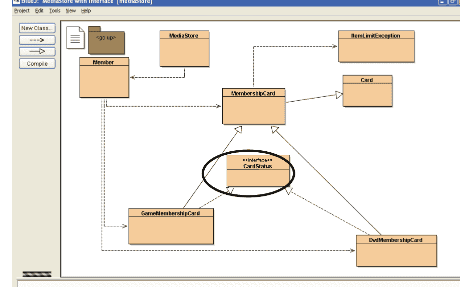

**图 5.1** （一个版本的）主题应用程序的类图

对于本文讨论而言，了解应用程序中的每个类做什么并不重要，相反，读者应该注意，该图显示了 `MembershipCard` 继承自 `Card`，并且有两个子类，这两个子类都实现了 `CardStatus` 接口。

在图 5.1 所示应用程序环境中，以下语句可以通过编译：

```java
// 注意：MembershipCard、DvdMembershipCard 和
// GameMembershipCard 的构造函数接收一个整数参数。
// 实例化一个类型与运行时类型相同的对象。
Card cardOne = new Card();
Card cardTwo = new MembershipCard(10);
// 实例化一个类型为运行时类型父类的对象。
CardStatus three = new DvdMembershipCard(10);
// 实例化一个类型为另一个运行时类型实现的接口的对象。
CardStatus four = new GameMembershipCard(10);
```

第三和第四条语句表明，当类变量被声明为接口类型时，该变量可以作为实现该接口对象的引用。换句话说，可以通过接口类型的引用来访问实例。

既然已经展示了示例——接口可以声明为类类型，这产生了一个问题：我们如何使用接口作为类型？

### 5.4.1 接口作为类类型的使用

参考 5.4 节中的示例，假设为处理 `DvdMembershipCard` 对象实例的类需要编写大量的代码。该代码首先将如下方式实例化一个 `DvdMembershipCard` 实例：

```java
// 实例化一个类型为 DvdMembershipCard 实现的对象。
CardStatus membersCard = new DvdMembershipCard(10);
```

该声明之后的代码可能包含许多涉及变量 `membersCard` 的语句。

让我们也假设，为处理 `GameMembershipCard` 对象实例的类似类也需要编写代码。该代码也将如下所示实例化一个 `GameMembershipCard` 对象实例：

```java
// 实例化一个类型为 GameMembershipCard 实现的对象。
CardStatus membersCard = new GameMembershipCard(10);
```

让我们假设该声明之后的代码与处理成员的代码相同。（这一假设基于处理成员的代码是相同的这一事实。）

# 6. 在 Java 应用程序中将类分组

第十二章解释了如何将类和接口分组，这使用了一个与通用命名空间不同的概念。将许多相关的类收集在一个名为包的单一结构中，可以使它们更容易管理，并避免潜在的命名冲突。

## 6.1 Java 包简介

为了说明命名空间管理，假设一个银行应用程序有两个名为 `Account` 的类：其中一个类是活期账户类的定义，另一个是储蓄账户类的定义。只要这两个类被放在不同的包中，它们的类名就可以相同（都是 `Account`）。这是因为每个包都会创建一个新的命名空间，一个包中的类型不会与另一个包中的类型产生冲突。

一个简单的类比可能有助于读者理解管理类名及其命名空间的必要性。在 Java 应用程序中使用包，就比像自由敦主街的商业地址与弗里斯赛尔主街的类似地址之间显而易见的区别。

Top Ten Records, Main Street, Freetown 和 Top Ten Records, Main Street, Freestyle。

每个 Top Records 商店的地址对所有相关人员都有显而易见的益处。

将名为 `Account` 的类放在不同的包中的结果是，它们唯一的完全限定名写法如下：

```java
currentAccount.Account // 指向名为 currentAccount 的包中的 Account 类
```

以及

```java
savingsAccount.Account // 指向名为 savingsAccount 的包中的 Account 类
```

用于类的完全限定名的表示法意味着，它可以被无歧义地引用，并通过常用的 `.`（点）选择器进行访问。

## 6.2 创建包

下方图 6.1 所示的主题应用程序版本表明，应用程序的类根据它们在应用程序中的功能，被封装在两个包中的一个。

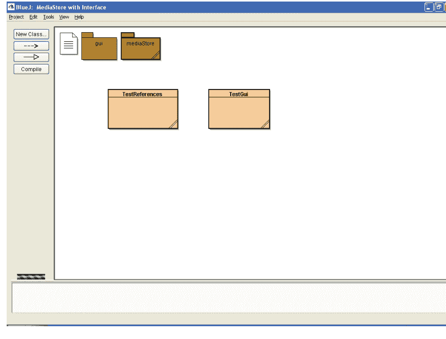

**图 6.1** 主题应用程序的包结构

两个名为 `TestGui` 和 `TestReferences` 的测试类（即包含 main 方法的类）不在命名包中，被认为在应用程序的默认包中。

名为 `gui` 的包包含一个类 `MediaStoreGui`。以下语句

```java
package gui;               // MediaStoreGui 类在此包中
import mediaStore.*;    // 该类可以访问应用程序中另一个包包含的类
```

写在类声明之前，并声明名为 `MediaStoreGui` 的类在名为 `gui` 的包中，并且它需要访问 `mediaStore` 包中的所有类，这归功于 `import` 语句中通配符 `*`。

这个版本的主题应用程序只有一个显示应用程序图形界面（GUI）的类。尽管如此，将此类放在它自己的包中仍然是有意义的：应用程序的其他版本可能包含与 GUI 显示相关的额外类，这些类将被放在名为 `gui` 的包中。

之所以需要 `import` 语句是因为 GUI 的组件需要访问 `mediaStore` 包中的类，以调用它们的方法并运行应用程序。

名为 `mediaStore` 的包包含八个类，每个类都以包语句开头：

```java
package mediaStore;
```

这八个类被封装在自己的包中，是因为它们代表了应用程序的业务逻辑。这些类中没有一个类在 GUI 显示中起任何作用；因此，没有要求将 `gui` 包的内容导入到名为 `mediaStore` 的包中。

虽然这两个类可以放在自己的包中，但这个版本的主题应用程序被用于说明应用程序默认包的内容。两个测试类都需要访问两个包中的类，这意味着每个源文件的开头都出现了以下 `import` 语句：

```java
import gui.*;
import mediaStore.*;
```

这两个测试类的源文件头部没有 `package` 语句；这意味着这两个类被自动放置在应用程序的默认包中。

上述讨论的主题应用程序版本说明了类和接口被封装在包中的主要原因：即在应用程序的上下文中，包中的类型在功能上是相关的。许多其他原因也源于此；它们被总结在下图所示的框中。


在 Java 应用程序中使用包的原因有：

- 开发者可以很容易从应用程序的结构判断应用程序逻辑如何在各个包之间进行划分；
- 开发者可以很容易在应用程序中找到相关的类；
- Java API 中的包意味着其内容是相关类的集合（参见本章稍后部分）；
- 一个包中的类型名称不会与另一个包中的相同名称冲突；
- 包中的类型对包内类型可以不受限制的访问，但对包外类型有受限访问（参见本章稍后部分）；

应用程序的结构从包的角度来看反映在它的目录结构中。例如，图 6.1 所示应用程序的包结构反映在图 6.2 中。

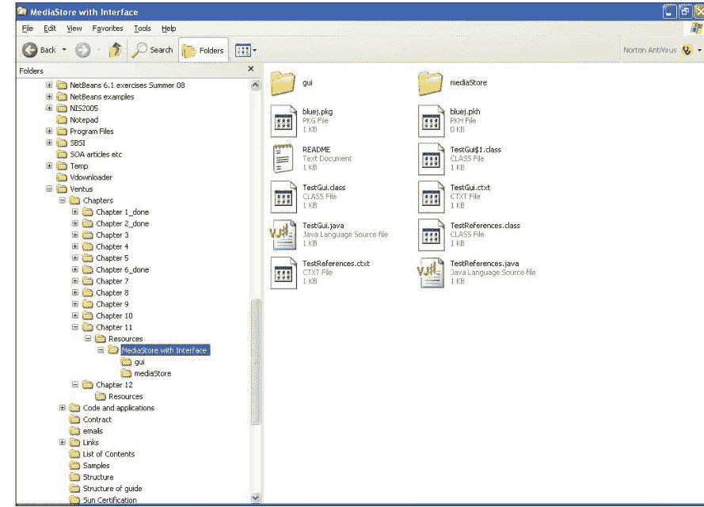

**图 6.2** 6.1 所示应用程序的目录

位于默认（未命名）包的两个测试类以及其余类被放在两个包之一。在实践中，所有的 IDE 都会为每个创建包创建一个 Windows 文件夹。

## 6.3 命名规范

图 6.1 和 6.2 显示，本指南的作者将主题应用程序的包命名为以小写字母开头的单个单词。这种简单的约定在独立开发者在公共领域使用相同的包和类名时效果良好。

为了解决多个应用程序可能包含名为 `mediaStore` 的类的潜在问题（以主题应用程序中的一个类为例），Java 开发者社区有一种约定，即使用组织的反向域名来开始包名。例如，图 6.1 和 6.2 所示名为 `mediaStore` 的包应该按如下命名：

```
uk.ac.bc.tic.etheridge.mediaStore
```

以便 `Member` 类的完全限定名为：

```
uk.ac.bc.tic.etheridge.mediaStore.Member
```

到本书为止，我们主要考虑了开发者提供的包。Java 语言本身被划分为若干包，正如 `mediaStore` 包中类定义的头部语句所示：

```java
package mediaStore;
import java.io.*;
```

第一个语句表示 `MediaStore` 类是 `mediaStore` 包的成员。第二个语句意味着该类需要访问 `java.io` 包中的所有类。

下一节简要回顾 Java 语言中包的使用。

## 6.4 Java 语言中的包

Java 语言中大多数包的名称以 `java` 或 `javax` 开头。例如，`java.io` 包的相关 Java API 页面如下方的图 6.3 所示。

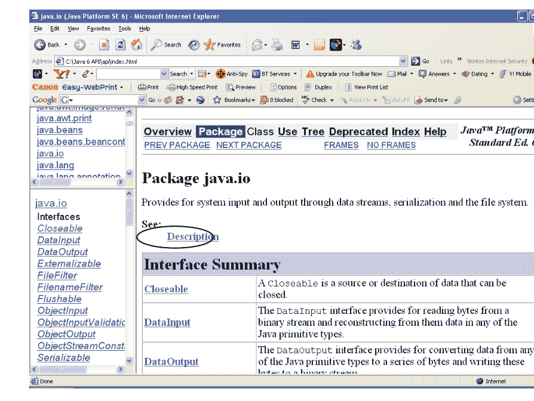

**图 6.3** API 中 `java.io` 包的打开界面

左下角的窗格显示了与该包相关的接口、类和异常列表的第一部分。`java.io` 包中大约有 60 个类供 Java 开发者使用。

尽管

```java
import java.io.*;
```

暗示作者希望将 `java.io` 包中的所有 60 个类都导入到主题应用程序的 `MediaStore` 类中，但在代码中仅使用了其中的 4 类。在这种情况下，如下所示，四个 `import` 语句就足够了：

```java
import java.io.FileInputStream;
import java.io.FileOutputStream;
import java.io.ObjectInputStream;
import java.io.ObjectOutputStream;
```

这组语句导入了 `Member` 类所需的 `java.io` 包中的四个类。（第十三章在输入/输出流的语境下检查了 `java.io` 包的一些类。）

使用 `import` 语句

```java
import java.io.*;
```

在开发应用程序时非常有用，因为这意味着开发者可以使用该包（在本例中为 `java.io` 包）中的任何类，而无需插入特定的 `import` 语句。

图 6.3 所示的大型中央面板开始于 `java.io` 包内容的简要描述，并包含一个指向更详细描述的超链接。这种链接页面的整体结构是大多数包的典型特征，Java 6 标准版 API 中大约有 225 个包。包的数量（超过 200 个）证实了 Java 语言标准版的大规模和非常广泛的功能。显然，在这样的指南中，作者对 API 中为开发者提供的可用内容只能浅尝辄止。


> 我们有抱负。对你们也是如此。

SimCorp 是全球金融软件的领导者。在 SimCorp，你将成为一个由能力且熟练的同事组成的大网络的一部分，他们渴望以奉献和团队精神实现共同目标。我们投资员工，以确保你能够在个人和专业水平上实现抱负。SimCorp 聘用经济、金融和 IT 领域最优秀的人才，我们的大多数同事在这些领域拥有大学或商业学位。

心心勃勃吗？访问 www.simcorp.com/careers 寻找机会。

| SimCorp | www.simcorp.com |
|---|---|
| | 在 BookBoon.com 免费下载书籍 |

此时，值得提到的是 Java 运行时系统会自动导入 `java.lang` 包的类。该包包含大约 40 个类，许多广泛使用的类，如包装类 `Boolean`、`Character`、`Double`、`Integer` 等（它们是原始数据类型的对象表示），以及 `System`、`String` 和 `Thread` 等类。这种自动包含的理由是，常用的类应该是随时可用的，而无需为它们编写 `import` 语句。

## 6.5 使用和访问包成员

我们已经看到 `import` 语句在类定义中提供了对命名包的一个或多个成员的访问。为了从包外部使用公共成员，必须满足以下条件：

1. 成员必须通过其完全限定名引用。
2. 成员必须被导入。
3. 成员的整个包必须被导入。

在 Java 语句中使用引用时，每次都需要通过其完全限定名引用成员，因此，当引用次数较少时，这是一种可行的方法。对于频繁的引用，一旦通过 `import` 语句导入，就可以在代码中使用其类名而不是其完全限定名来引用它。

然而，在导入包成员时需要小心，例如当包中存在同类时。例如，考虑以下代码段：

```java
package mynewpackage;
import currentAccount.Account;
import savingsAccount.Account;
```

在紧随包语句和 `import` 语句的类定义中对类型 `Account` 的引用将导致编译错误，因为编译器不知道引用的是两个 `Account` 类中的哪一个。在这种情况下，即使已经专门导入了 `Account` 类，当在代码中使用其完全限定名时，编译器将区分这两个 `Account` 类型。

当导入成员的整个包时，在后续代码中可以使用其类名引用该包的任何成员。

### 6.5.1 控制对包成员的访问

让我们回想表 3.1 中列出的访问修饰符的访问级别；该表在下方的表 6.1 中重复出现。

| 修饰符 | 同一类 | 同一包 | 子类 | 全局 |
| --- | --- | --- | --- | --- |
| `private` | 是 | | | |
| `default` (package-private) | 是 | 是 | | |
| `protected` | 是 | 是 | 是 | |
| `public` | 是 | 是 | 是 | 是 |

**表 6.1** 类成员的访问级别

表 6.1 的第一行确认了关于 `private` 修饰符的认知：类本身可以访问它。

第二行可以被视为 `default`（即包级别）：同包内的类可以访问它。第四行显示了当类成员声明为 `public` 时，所有开发者都可以访问。

当我们沿着 `Modifier` 列向下移动 `private`、`default`（即包级别）、`protected` 和 `public` 时，我们将适时返回第三行。

让我们回到第九章中首次显示的 `protected` 第三行：当类成员声明为 `protected` 时。第一列表示该类本身可以访问该成员；第二列表示同包的类可以访问该成员；第三列表示类的子类无论在哪个包中都可以访问该成员。然而，子类保护条目需要进一步说明。

表中的子类保护条目可以更精确地表述：受保护成员可以通过与类类型相同或其子类型的对象引用来访问。尽管这一陈述很清晰，但它引发了一个有趣的转折，下面的示例旨在说明这一点。


# Java：Java 应用中的类

## 在 Java 应用中将类分组

假设我们在名为 `packageone` 的包中有一个简单的类，包含一个受保护成员，如下代码所示。

```java
package packageone;
public class Cat {
// Mammal 类也在 packageone 中，但此处未包含其代码。
protected Mammal mammal;
public void setSpeciesName() { }
}// end of class definition
```

`Cat` 的子类在一个单独的包中。

```java
package packagetwo;
public class DomesticCat extends packageone.Cat {
// 继承了类型为 Mammal 的保护变量。
// 其他成员将在接下来给出。
}// end of class definition
```

假设 `DomesticCat` 重写了 `setSpeciesName` 方法并有一个简单的实现。

```java
public void setSpeciesName() {
// 当前对象是 Cat 的子类，因此允许访问从 Cat 继承的受保护成员。
this.mammal = null;
}
```

由于当前对象 (`this`) 是 `Cat` 的子类，即使 `Cat` 和 `DomesticCat` 处于不同的包中，也允许访问其受保护的成员 `mammal`。

假设 `DomesticCat` 的某个方法接受一个 `DomesticCat` 作为参数并访问其受保护成员，如下所示：

```java
public void aMethod(DomesticCat florence) {
    packageone.Mammal m = florence.mammal;
}
```

该方法可以编译通过，因为它访问了作为参数传递的对象的受保护成员。之所以允许访问，是因为尝试访问受保护成员（`mammal`）的类是 `DomesticCat`，且引用变量 `florence` 的类型也是 `DomesticCat`。

最后，假设 `DomesticCat` 类定义了一个重写的方法，如下所示：

```java
public void aMethod(DomesticCat florence ) {
    packageone.Mammal m = florence.mammal;
}
```

语句

```java
packageone.Mammal m = florence.mammal;
```

无法编译；编译器发出了以下信息：

> mammal has protected access in packageone.Cat

编译器发出该信息的原因是尝试访问受保护成员的类是 `DomesticCat`，而引用 `florence` 的类型是 `Cat`。不允许访问受保护成员是因为 `Cat` 类型不是 `DomesticCat` 的子类。虽然每个 `DomesticCat` 都是 `Cat` 对象的子类，但并不是每个 `Cat` 对象都是 `DomesticCat`。

尽管本节某些观点起初看起来可能相当复杂，但让学习者通过此合理理解访问级别以及如何通过访问控制来管理它们是非常重要的。尽管控制类成员访问的某些影响在技术上可能看起来很难，但当读者遇到关于访问受保护成员的编译器警告信息时，将很容易理解它们。

## 6.6 编译和运行包 IDE

学习者可能会使用像 Blue 这样的初级 IDE 来编写他们的第一个 Java 程序以学习语言基础。当学习者获得经验后，可以进展到使用 NetBeans™ 等专业级 IDE。无论如何，IDE 通常都会提供按钮或菜单选项来编译和运行 Java 应用；IDE 将“找到”并操作安装在学习者计算机上的 Java 编译器。

如果学习者最初没有使用初级 IDE，可以使用简单的文本编辑器编写代码，并在 Windows™ 操作系统下从 DOS 提示符中编译源代码文件。

参考第 6.5.1 节所示的示例，名为 `packageone` 的包包含一个带有 `main` 方法的测试类 `UserClassOne`。该类可以通过以下命令从 DOS 提示符编译：

```
C:\> javac packageone\UserClassOne.java
```

并如下执行 `main`：

```
C:\> java packageone.UserClassOne
```

全类名和目录路径正如我们预期的那样是对应的。这意味着开发者可以进入包含名为 `packageone` 文件夹的目录，并编译和运行该包中的任何类。同样，开发者可以如下编译 `packagetwo` 包中的所有类：

```
C:\> javac packagetwo\.java
```

只要程序 `javac` 和 `java` 在计算机的 `PATH` 环境变量中，就可以从 DOS 提示符编译源代码文件。编译器在 DOS 提示符窗口中输出的消息与使用 IDE 编译和运行应用程序时输出的消息相同。

下一章将检查 `java.io` 包中的某些类，这些类为应用程序提供了输入和输出。
