# JAVA 编程：零基础初学者指南

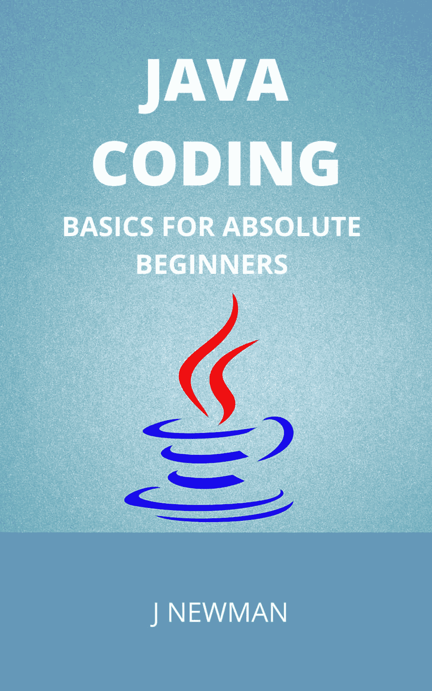

- Java 特性
- C++ vs Java
- 第一个 Java 程序
- JDK, JRE 和 JVM 之间的区别
- Java 变量
- Java 中的数据类型
- Java 运算符
- Java 控制语句
- Java 中的循环
- Java While 循环
- Java do-while 循环
- Java Break 语句

## 什么是 Java

Java 既是一个平台也是一种编程语言。Java 是一种高级编程语言，具有健壮性、面向对象性和安全性。

Java 是由 Sun Microsystems（现为 Oracle 的一个部门）于 1995 年创建的。Java 的创始人詹姆斯·高斯林（James Gosling）被认为“Java 之父”。在 Java 诞生之前，它被称为 Oak。由于 Oak 已经是一个广知的商标，詹姆斯·高斯林和他的团队决定将其改为 Java。

平台：平台是指运行运行的任何硬件或软件环境。Java 被称为平台是因为因为它拥有运行时环境（`JRE`）和 API。

## Java 示例

让我们来看一个 Java 编程示例。下一页包含 Hello Java 示例的完整描述。

`Simple.java`

```java
class Simple {
  public static void main(String args[]) {
    System.out.println("Hello Java");
  }
}
```

## Java 应用程序类型

Java 编程可以用于构建四种应用程序：

### 1) 独立应用程序

桌面应用程序和基于窗口的程序是独立应用程序的示例。这些必须在每台机器上安装的典型程序。媒体播放器、防病毒软件和其他独立都是示例。在 Java 中，使用 `AWT` 和 `Swing` 创建独立应用。

### 2) Web 应用程序

Web 应用程序是在服务器上运行并生成动态页面的应用程序。现在使用 `Servlet`、`JSP`、`Struts`、`Spring`、`Hibernate`、`JSF` 等技术开发 Java Web 应用程序。

### 3) 企业级应用程序

分布式应用（例如银行软件）被称为企业级应用程序。高安全性、负载均衡和集群只是其优点。`EJB` 是开发企业级应用的 Java 框架。

### 4) 移动应用程序

移动应用程序是专为移动设备设计的程序。目前，移动应用程序使用 `Android` 和 `Java ME` 开发。

## Java 平台

Java 可用于四个不同的平台或版本：

### 1) Java SE (Java 标准版)

这是一个 Java 编程环境。包含了 Java 编程 API，如 `java.lang`、`java.io`、`java.net`、`java.util`、`java.sql` 和 `java.math`。涵盖了 OOP、`String`、`Regex`、`Exception`、内部类、多线程、I/O 流、网络、`AWT`、`Swing`、反射、集合等其他核心主题。

### 2) Java EE (Java 企业版版)

这是一个主要用于创建在线和企业应用的业务平台。它使用 Java SE 平台构建。涵盖了 `Servlet`、`JSP`、Web 服务、`EJB`、`JPA` 和其他主题。

### 3) Java ME (Java 微型版)

这是一个专注于移动应用程序的微平台。

### 4) JavaFX

这是一个用于创建富丰富的在线应用的编程语言。它利用简单的用户界面 API。

# Java 特性

Java 编程语言开发的主要目标是使其具有可移植性、简单性和安全性。此外，还有许多有助于该语言流行的优秀方面。Java “热术语”指的是该语言的特性。

以下是 Java 编程语言最基本的特性列表。

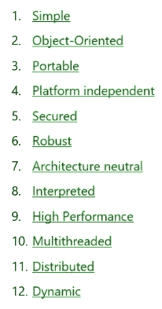

## 简单

Java 是一门非常容易学习的语言，语法简单、清晰且易于理解。根据 Sun Micros 的 的，Java 是一种简单的编程语言，因为：

- Java 语法基于 `C++`（这使得程序员在学习过 `C++` 后更容易上手）。
- Java 消除了许多困难且很少使用的特性，例如显式指针和运算符重载。
- 因为 Java 具有`自动垃圾回收`，所以不需要手动删除未引用的对象。

## 面向对象

Java 是一种关注对象的计算机语言。在 Java 中，一切都是对象。面向对象编程（OOPs）是指对数据和行为的组织。

### 平台无关

与 `C`、`C++` 等编译为特定平台的语言不同，Java 是平台无关的，它是“编写一次，到处运行”的语言。运行程序的硬件或软件环境被称为平台。平台分为软件平台和硬件平台两种。

### 安全

安全性是 Java 最广为人知的特性。我们可以 Java 创建防病毒解决方案。由于以下原因，Java 是安全的：

- 没有特定的指针。
- Java 程序运行在沙箱环境中。
- `字节码验证器`：它检查可能破坏对象访问权限的代码片段。
- `管理器`：它是运行时环境的一个组件，用于确定类可以的资源，例如读取和写入本地磁盘。

### 健壮

Java 行业非常繁荣。Java 是一种健壮的编程语言，因为：

- 它大量利用内存管理。
- 没有指针，因此没有安全问题。
- Java 提供自动垃圾回收，并在虚拟机上运行以清除不再使用的项。

在 Java 中有异常处理和类型检查机制。所有这些因素共同构成了 Java 的健壮性。

### 架构中性

由于 Java 中没有与实现相关的方面（例如原始类型的大小），因此它是架构中性的。

在 `C` 编程中，`int` 数据类型在 32 位架构上占用 2 字节，在 64 位架构上占用 4 字节。但在 Java 中，它在 32 位和 64 位架构上都占用 4 字节内存。

### 可移植

由于 Java 允许将 Java 字节码从一个平台移动到另一个平台，因此它是可移植的。它不需要任何特定的实现。

### 高性能

由于 Java 字节码接近原生代码，它比其他传统的解释型编程语言更快。尽管如此，它仍然比编译语言（例如 `C++`）慢。

### 分布式

因为 Java 允许用户在 Java 中构建分布式程序，所以它是分布式的。开发分布式应用程序使用 `RMI` 和 `EJB`。这种 Java 能力允许我们通过调用连接到互联网的任何系统来访问文件。

### 多线程

线程（thread）就像一个在后台运行的第二个软件。通过定义许多线程，我们可以设计出同时处理多个任务的 Java 应用程序。多线程的根本优势是每个线程不占用内存，它们共享一个内存空间。线程对于多媒体、Web 应用程序和其他应用程序至关重要。

## 动态

Java 是一种动态编程语言。它允许类被动态加载。这意味着类只在需要时才被加载。它还支持用其原生语言 C 和 C++ 编写的函数。

Java 允许动态编译和内存管理（垃圾回收）。

# C++ vs Java

C++ 和 Java 编程语言之间有很多相似之处和不同之处。以下是 C++ 和 Java 之间最显著差异总结：

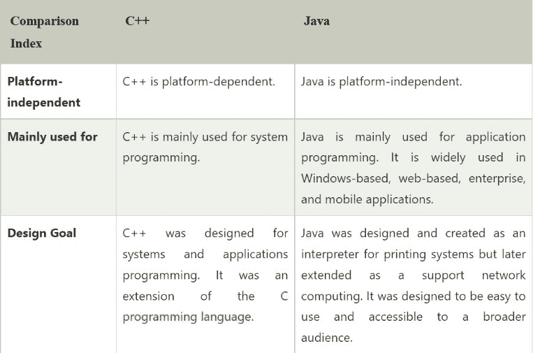

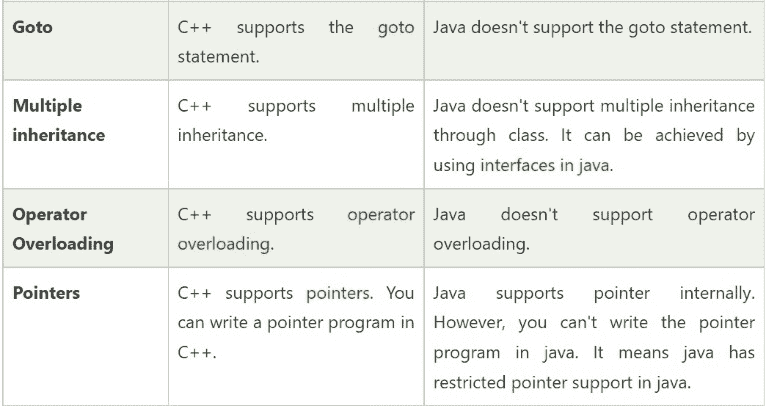

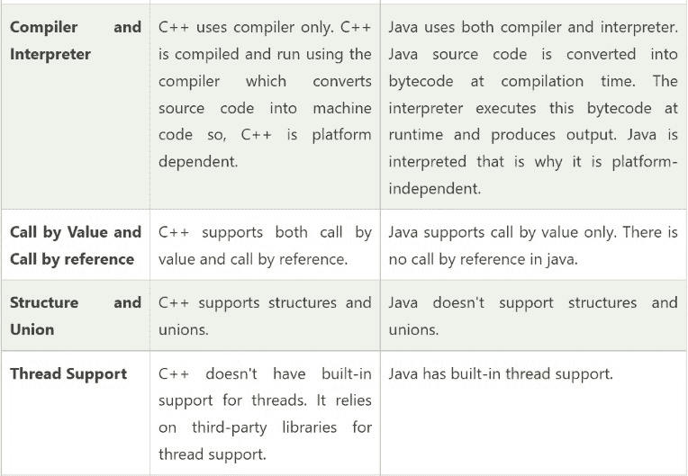

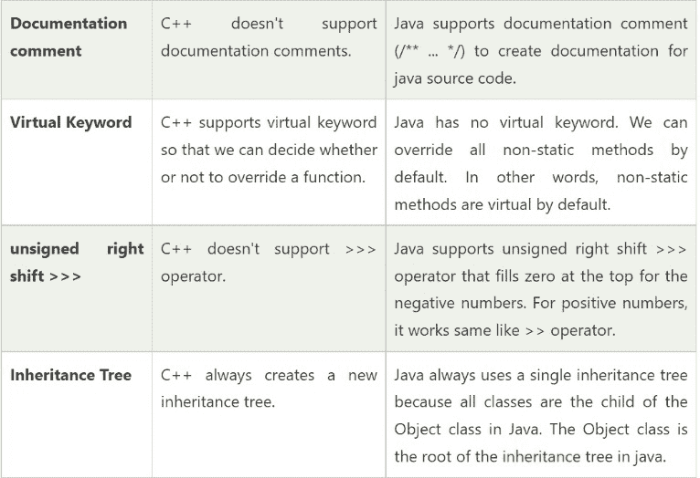

## C++ 程序示例

文件：`main.cpp`

```cpp
#include <iostream>
using namespace std;
int main() {
cout << "Hello C++ Programming";
return 0;
}
```

输出：

```
Hello C++ Programming
```

## Java 程序示例

文件：`Simple.java`

```java
class Simple {
public static void main(String args[]) {
System.out.println("Hello Java");
}
}
```

输出：

```
Hello Java
```

# 第一个 Java 程序

在本节中，我们将学习如何编写一个简单的 Java 应用程序。安装 JDK 之后，我们可以快速构建一个基础的 hello Java 应用程序。

为了创建一个简单的 Java 程序，你必须先构造包含 `main` 函数的类。让我们从要求开始。

1. 安装 Java 开发包。如果尚未安装，请下载并安装 JDK。
2. 设置 `jdk/bin` 目录路径。
3. 编写 Java 程序。
4. 编译后运行 Java 程序。

## Hello World 示例

```java
class Simple {
public static void main(String args[]) {
System.out.println("Hello Java");
}
}
```

| 编译： | `javac Simple.java` |
| 执行： | `java Simple` |

输出：

```
Hello Java
```

# JDK, JRE 和 JVM 之间的区别

在学习 Java 之前，我们必须先理解 JDK、JRE 和 JVM 之间的区别。这里是对 JVM 的简要总结。

如果你想深入学习 Java 虚拟机，请访问以下页面。让我们先来看看 JDK、JRE 和 JVM 之间的区别。

## JVM

`JVM`（Java 虚拟机）是一个抽象的机器。因为它在物理上不存在，所以它被称为虚拟机。它是一个规范，为 Java 字节码的运行创建一个运行时环境。它还可以运行用其他语言编写并编译成 Java 字节码的应用程序。

针对各种硬件和软件平台，都有可用的 JVM。由于每个操作系统的设置不同，JVM、JRE 和 JDK 是依赖于平台的。而 Java 是与平台无关的。JVM 分为三个部分：规范、实现和实例。

JVM 的主要功能如下：

- 加载代码
- 验证代码
- 执行代码
- 提供运行时环境

## JRE

Java Runtime Environment (`JRE`）是 Java Runtime Environment 的缩写。它也被称为 Java RTE。Java Runtime Environment (`JRE`) 是用于创建 Java 应用程序的软件工具集。它负责创建运行时环境。它是 `JVM` 的实现。它是真实的。它包含一系列库以及 JVM 在执行期间使用的其他文件。

## JDK

`JDK` 一词代表 Java Development Kit（Java 开发包）。Java Development Kit (`JDK`) 是用于创建 Java 程序和 Applet 的软件开发环境。它是真实的。它包含了 JRE 以及开发者工具。

# Java 变量

变量是一个在 Java 程序执行期间存储值的容器。变量被分配了一个数据类型。

“变量”一词指的是内存区域的名称。局部变量、实例变量和静态变量是 Java 中的三类变量。

在 Java 中，数据类型分为两类：基本类型和非基本类型。

## 变量

变量是内存分配的留留空间的名称。换句话说，它是内存位置的名字。它由 "variy + ability" 两个词组成，意味着它的值可以被修改。

```java
int data=50; // 这里 data 是变量
```

### 变量的类型

- 局部变量
- 实例变量
- 静态变量

#### 1) 局部变量

局部变量是在方法体内部声明的变量。该变量只能在该方法内部使用，类中的其他方法并不知道它的存在。

关键字 `static` 不能用于声明局部变量。

#### 2) 实例变量

实例变量是在类内部方法体外部声明的变量。它没有被声明为 `static`。由于它的值是特定于实例的且不在实例间共享，因此被称为实例变量。

#### 3) 静态变量

静态变量是被声明为 `static` 的变量。它不可能是局部的。你可以制作静态变量的副本并在类的所有实例共享它。静态变量只在类加载到内存时分配一次。

### 示例 - Java 中的变量

```java
public class A {
static int m=100; // 静态变量
void method() {
int n=90; // 局部变量
}
public static void main(String args[]) {
int data=50;// 实例变量
}
}// 类结束
```

### Java 示例：两个数相加

```java
class Simple {
public static void main(String args[]) {
int a=10;
int b=10;
int c=a+b;
System.out.println(c);
}
}
```

输出：

```
20
```

### Java 变量示例：宽型转换

```java
class Simple {
public static void main(String args[]) {
int a=10;
float f=a;
System.out.println(a);
System.out.println(f);
}
}
```

输出：

```
10
10.0
```

### Java 变量示例：窄型转换（强制转换）

```java
class Simple {
public static void main(String args[]) {
float f=10.5f;
int a=(int)f;
System.out.println(f);
System.out.println(a);
}
}
```

输出：

```
10.5
10
```

### Java 变量示例：溢出

```java
class Simple {
public static void main(String args[]) {
int a=130;
byte b=(byte)a;
System.out.println(a);
System.out.println(b);
}
}
```

输出：

```
130
-126
```

### Java 变量示例：低类型相加

```java
class Simple {
public static void main(String args[]) {
byte a=10;
byte b=10;
byte c=(byte)(a+b);
System.out.println(c);
}
}
```

输出：

```
20
```

# Java 中的数据类型

数据类型定义了变量中可以存储的不同大小和值。在 Java 中，有两种数据类型：

基本数据类型是 `boolean`、`char`、`byte`、`short`、`int`、`long`、`float` 和 `double` 等。

非基本数据类型：类、接口和数组是非基本数据类型的示例。

## 基本数据类型

基本数据类型是 Java 编程语言中数据操作的构建块。这些是 Java 编程语言中最基础的数据类型。

- boolean 类型
- byte 类型
- char 类型
- short 类型
- int 类型
- long 类型
- float 类型
- double 类型

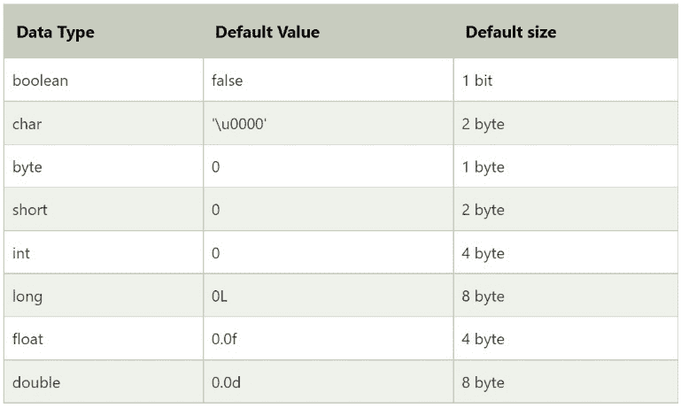

## boolean 类型

`Boolean` 数据类型仅存储两个潜在值：`true` 和 `false`。该数据类型用于存储跟踪真/假情况的简单标志位。

`Boolean` 数据类型指定了一个位的数据，但其“大小”无法精确定义。

示例：

```
Boolean one = false
```

## Byte 字节数据类型

原始型数据类型 `byte` 是这种类型的一个例子。它是一个 8 位补码有符号整数。它的取值范围是从 `-128` 到 `127`（包含）。它的最小值为 `-128`，最大值为 `127`。默认值为 `0`。

`byte` 数据类型用于在空间极其有限的大数组中节省内存。因为 `byte` 的空间是 `integer` 的四分之一，所以它可以节省空间。它也可以用 `"int"` 数据类型替换。

示例：

```
byte a = 10, byte b = -20
```

## Short 短型数据类型

`short` 数据类型是 16 位补码有符号整数。它的取值范围是从 `-32,768` 到 `32,767`（包含）。它的最小值为 `-32,768`，最大值为 `32,767`。默认值为 `0`。

`short` 数据类型和 `byte` 数据类型一样可以节省内存。`short` 数据类型的大小是 `integer` 的两倍。

示例：

```
short s = 10000, short r = -5000
```

## Int 整型数据类型

`int` 数据类型表示 32 位补码有符号整数。它的取值范围是从 `-2,147,483,648` (`-2³¹ -1`) 到 `2,147,483,647` (`2³¹ -1`)（包含）。它的最小值为 `-2,147,483,648`，最大值为 `2,147,483,647`。默认值为 `0`。

除非有内存限制，否则 `int` 数据类型通常被选为整数值的默认数据类型。

示例：

```
int a = 100000, int b = -200000
```

## Long 长型数据类型


`long`数据类型是 64 位补码整数。它的取值范围是从`-9,223,372,036,854,775,808`（`-2⁶³ -1`）到`9,223,372,036,854,775,807`（`2⁶³ -1`）（包含）。它的最小值和最大值分别为`-9,223,372,036,854,775,808`和`9,223,372,036,854,775,807`。默认值为`0`。当你需要比`int`更大的取值范围时，应该使用`long`数据类型。

示例：

```
long a = 100000L, long b = -200000
```

## Float 浮型数据类型

`float`数据类型是 32 位单精度 IEEE 754 浮点数。它具有无限的取值范围。如果你需要在大型浮点整数数组中节省内存，请使用`float`（而不是`double`）。对于货币等精确数字，不应使用`float`。默认值为`0.0F`。

示例：

```
float f1 = 3.5
```

## Double 双型数据类型

`double`类型是 64 位双精度 IEEE 754 浮点数。它具有无限的取值范围。和`float`一样，`double`类型通常用于小数值。对于货币等精确数值，不应使用`double`。默认值为`0.0d`。

示例：

```
double d1 = 2.3
```

## Char 字符类型

`char`类型表示 16 位 Unicode 字符。它的取值范围是从`'u0000'`到`'uffff'`（包含）。字符使用`char`类型存储。

示例：

```
char letter = 'A'
```

# Java 运算符

在 Java 中，运算符是执行操作的符号。例如`+`、`-`、`*`、`/`等。在 Java 中有许多不同的运算符，列如下：

- 一元运算符
- 算术运算符
- 位移运算符
- 关系运算符
- 位运算运算符
- 逻辑运算符
- 三目运算符
- 赋值运算符

## Java 运算符优先级


### Java 一元运算符

Java 一元运算符只需要一个操作数。一元运算符用于执行各种任务。


### Java 一元运算符示例：`++`和`--`

```java
class OperatorExample {
    public static void main(String[] args[]) {
        int x = 10;
        System.out.println(x++); // 10
        System.out.println(++x); // 12
        System.out.println(x--); // 12
        System.out.println(--x); // 10
    }
}
```

输出：

```
10
12
12
10
```

### Java 一元运算符示例 2：`++`和`--`

```java
class OperatorExample {
    public static void main(String[] args[]) {
        int a = 10;
        int b = 10;
        System.out.println(a++ + ++a); // 10+12=22
        System.out.println(b-- + b); // 10+9=19
    }
}
```

输出：

```
22
19
```

### Java 一元运算符示例：`~`和`!`

```java
class OperatorExample {
    public static void main(String[] args[]) {
        int a = 10;
        int b = -10;
        boolean c = true;
        boolean d = false;
        System.out.println(~a); // -11 (正值的取反)
        System.out.println(~b); // 9 (负值的取反)
        System.out.println(!c); // false (布尔值的取反)
        System.out.println(!d); // true
    }
}
```

输出：

```
-11
9
false
true
```

### Java 算术运算符

加、减、乘、除都是通过 Java 算术运算执行的。它们作为基础数学过程。

### Java 算术运算符示例

```java
class OperatorExample {
    public static void main(String[] args[]) {
        int a = 10;
        int b = 5;
        System.out.println(a+b); // 15
        System.out.println(a-b); // 5
        System.out.println(a*b); // 50
        System.out.println(a/b); // 2
        System.out.println(a%b); // 0
    }
}
```

输出：

```
15
5
50
2
0
```

### Java 算术运算符示例：表达式

```java
class OperatorExample {
    public static void main(String[] args[]) {
        System.out.println(10*10/5+3-1*4/2);
    }
}
```

输出：

```
21
```

### Java - 左移运算符

Java 左移运算符将值中的所有位向左移动指定的次数。

### Java 左移运算符示例

```java
class OperatorExample {
    public static void main(String[] args[]) {
        System.out.println(10<<2); // 10*2²=10*4=40
        System.out.println(10<<3); // 10*2³=10*8=80
        System.out.println(20<<2); // 20*2²=20*4=80
        System.out.println(15<<4); // 15*2⁴=15*16=240
    }
}
```

输出：

```
40
80
80
240
```

### Java - 右移运算符

Java 右移运算符`>>`将左操作数的值向右移动，移动位数由右操作数给出。

### Java 右移运算符示例

```java
class OperatorExample {
    public static void main(String[] args[]) {
        System.out.println(10>>2); // 2
        System.out.println(20>>2); // 5
        System.out.println(20>>3); // 2
    }
}
```

### Java 位移运算符示例：`>>`vs`>>>`

```java
class OperatorExample {
    public static void main(String[] args[]) {
        // 对于正数，>> 和 >>> 效果相同
        System.out.println(20>>2);
        System.out.println(20>>>2);
        // 对于负数，>>> 将符号位（最高位）更改为 0
        System.out.println(-20>>2);
        System.out.println(-20>>>2);
    }
}
```

输出：

```
5
5
-5
1073741819
```

### Java 与运算符示例：逻辑`&&`和位运算`&`

如果第一个条件为假，`&&`运算符将不会验证第二个条件。只有当第一个条件为真时，才会检查第二个。

无论第一个条件是真是假，位运算符`&`运算符都会验证两个标准。

```java
class OperatorExample {
    public static void main(String[] args[]) {
        int a = 10;
        int b = 5;
        int c = 20;
        System.out.println(a<b&&a++<c); // false && true=false
        System.out.println(a<b&a<c); // false & true=false
    }
}
```

## Java 或逻辑运算符

### 示例

```java
7. System.out.println(a);//10 because second condition is not checked
8. System.out.println(a<b&a++<c);//false && true = false
9. System.out.println(a);//11 because second condition is checked
10. }}
```

**输出：**

```
false
10
false
11
```

### 逻辑`||`与按位`|`

如果第一个条件为真，逻辑运算符`||`将不会检查第二个条件。只有当第一个条件为假时，才会检查第二个条件。

无论第一个条件是真是假，按位运算符`|`总是会验证两个判断标准。

### 示例

```java
1. public class OperatorExample{
2. public static void main(String args[]){
3. int a=10;
4. int b=5;
5. int c=20;
6. System.out.println(a>b||a<c);//true || true = true
7. System.out.println(a>b|a<c);//true | true = true
8. //|| vs |
9. System.out.println(a>b||a++<c);//true || true = true
10. System.out.println(a);//10 because second condition is not checked
11. System.out.println(a>b|a++<c);//true | true = true
12. System.out.println(a);//11 because second condition is checked
13. }}
```

**输出：**

```
true
true
true
10
true
11
```

## Java 三元运算符

在 Java 编程中，三元运算符是`if-then-else`表达式的单行替代方案。它是唯一接受三个输入的条件运算符。

### 示例

```java
1. public class OperatorExample{
2. public static void main(String args[]){
3. int a=2;
4. int b=5;
5. int min=(a<b)?a:b;
6. System.out.println(min);
7. }}
```

**输出：**

```
2
```

#### 另一个示例：

```java
1. public class OperatorExample{
2. public static void main(String args[]){
3. int a=10;
4. int b=5;
5. int min=(a<b)?a:b;
6. System.out.println(min);
7. }}
```

**输出：**

```
5
```

## Java 赋值运算符

Java 中最常用的运算符之一是赋值运算符。它用于将左侧的操作数赋值为右侧的值。

### 示例

```java
1. public class OperatorExample{
2. public static void main(String args[]){
3. int a=10;
4. int b=20;
5. a+=4;//a=a+4 (a=10+4)
6. b-=4;//b=b-4 (b=20-4)
7. System.out.println(a);
8. System.out.println(b);
9. }}
```

**输出：**

```
14
16
```

### 示例

```java
1. public class OperatorExample{
2. public static void main(String[] args){
3. int a=10;
4. a+=3;//10+3
5. System.out.println(a);
6. a-=4;//13-4
7. System.out.println(a);
8. a*=2;//9*2
9. System.out.println(a);
10. a/=2;//18/2
11. System.out.println(a);
12. }}
```

**输出：**

```
13
9
18
9
```

### 示例：累加`short`类型

```java
1. public class OperatorExample{
2. public static void main(String args[]){
3. short a=10;
4. short b=10;
5. //a+=b;//a=a+b internally so fine
6. a=a+b;//Compile time error because 10+10=20 now int
7. System.out.println(a);
8. }}
```

**输出：**`Compile time error`

#### 类型转换：

```java
1. public class OperatorExample{
2. public static void main(String args[]){
3. short a=10;
4. short b=10;
5. a=(short)(a+b);//20 is converted to short
6. System.out.println(a);
7. }}
```

**输出：**`20`

# Java 控制语句

Java 编译器从头到尾运行代码。语句按照出现的顺序执行。另一方面，控制语句用于控制代码流。它是 Java 最重要的部分之一，因为它确保了流的顺畅。

控制语句有三种：

1. **决策语句**
   - `if`语句
   - `switch`语句

2. **循环语句**
   - `do while`循环
   - `while`循环
   - `for`循环
   - `for-each`循环

3. **跳转语句**
   - `break`语句
   - `continue`语句

## 决策语句

正如名称所示，决策语句决定执行哪些语句。决策语句分析布尔表达式并根据结果控制流。在 Java 中，有两种决策语句：`if`和`switch`。

### 1) `if`语句

它是所有 Java 控制语句中最基础的。如果`if`表达式为真，允许程序开始代码块。`if`语句有四种形式：

1. 简单`if`语句
2. `if-else`语句
3. `if-else-if`链
4. 嵌套`if`语句

#### 1) 简单`if`语句

`if`语句的语法如下：

```java
if(condition) {
    statement; // 当 condition 为真时执行
}
```

考虑以下使用`if`语句的 Java 示例：

**Student.java**

```java
1. public class Student {
2. public static void main(String[] args) {
3. int x=10;
4. int y=12;
5. if(x+y > 20) {
6. System.out.println("x+y is greater than 20");
7. }
8. }
```

**输出：**`x + y is greater than 20`

#### 2) `if-else`语句

`if-else`语句是`if`语句的扩展。如果`if`条件块被评估为假，则执行`else`块。

语法：

```java
if(condition) {
    statement; // 当 condition 为真时执行
} else {
    statement; // 当 condition 为假时执行
}
```

**示例**

**Student.java**


```java
1. public class Student {
2. public static void main(String[] args) {
3. int x=10;
4. int y=12;
5. if(x+y < 10) {
6. System.out.println("x+y is less than 10");
7. } else {
8. System.out.println("x+y is greater than 20");
9. }
10. }
11. }
```

**输出:** `x + y is greater than 20`

#### 3) `if-else-if` 链

`if-else-if` 语句由一个 `if` 语句和多个 `else-if` 语句组成。换句话说，通过一系列 `if-else` 语句创建决策树，计算机可以进入条件为真的代码块。在链的末尾，我们也可以定义一个 `else` 语句。

`if-else-if` 语句的语法如下：

```java
if(condition 1) {
    statement; // 当 condition 1 为真时执行
} else if(condition 2) {
    statement; // 当 condition 2 为真时执行
} else {
    statement; // 当所有条件为假时执行
}
```

**示例**

**`Student.java`**

```java
1. public class Student {
2. public static void main(String[] args) {
3. String city="Delhi";
4. if(city == "Meerut") {
    System.out.println("city is meerut");
} else if(city == "Noida") {
    System.out.println("city is noida");
} else if(city == "Agra") {
    System.out.println("city is agra");
} else {
    System.out.println(city);
}
5. }
6. }
```

**输出:** `Delhi`

#### 4) 嵌套 `if` 语句

`if` 语句可以在另一个 `if` 或 `else-if` 语句内部包含 `if` 或 `if-else` 语句。以下是嵌套 `if` 语句的语法：

```java
if(condition 1) {
    statement; // 当 condition 1 为真时执行
    if(condition 2) {
        statement; // 当 condition 2 为真时执行
    } else {
        statement; // 当 condition 2 为假时执行
    }
}
```

**示例**

**`Student.java`**

```java
1. public class Student {
2. public static void main(String[] args) {
3. String address="Delhi, India";
4. if(address.endsWith("India")) {
    if(address.contains("Meerut")) {
```

```java
7. System.out.println("Your city is Meerut");
8 }else if(address.contains("Noida")) {
9. System.out.println("Your city is Noida");
10 }else {
11. System.out.println(address.split(",")[0]);
12 }
13 }else {
14 System.out.println("You are not living in India");
15 }
16 }
17 }
```

Output:

```
Delhi
```

### `Switch` 语句

Java 中的 `switch` 语句类似于 `if-else-else` 语句。单个 `case` 的执行取决于 `switch` 语句中切换的变量，该语句由称为 `cases` 的各种代码块组成。你可以使用 `switch` 语句来代替 `if-else-if` 语句。它还能提高程序的可读性。

语法：

```java
switch (expression){
case value1:
    statement1;
    break;
...
case valueN:
    statementN;
    break;
default:
    default statement;
}
```

### 示例

`Student.java`

```java
public class Student implements Cloneable {
    public static void main(String[] args) {
        int num = 2;
        switch (num){
        case 0:
            System.out.println("number is 0");
            break;
        case 1:
            System.out.println("number is 1");
            break;
        default:
            System.out.println(num);
        }
    }
}
```

Output:

```
2
```

我们必须记住，在使用 `switch` 语句时，`case` 表达式的类型将与变量类型相同。然而，它是一个常量。只有 `int`、`string` 和 `Enum` 类型变量允许用于此 `switch`。

# Java 中的循环

Java 的 `for` 循环用于重复遍历程序的某个。如果迭代次数是固定的，建议使用 `for` 循环。

在 Java 中，有三种形式的 `for` 循环：

* 简单 `for` 循环
* [For-each](https://www.javatpoint.com/for-each-loop) 或增强型 `for` 循环
* 标签 `for` 循环

## 简单 `for` 循环

在 C/C++ 中，简单 `for` 循环是相同的。我们可以设置变量的值、检查条件并增加或减少该值。语法：

```java
for(initialization; condition; increment/decrement){
    //要执行的语句或代码
}
```

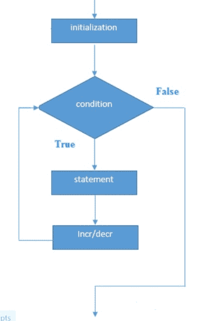

### 示例：

`ForExample.java`

```java
// 演示 for 循环示例的 Java 程序
// 打印 1 的乘法表
public class ForExample {
    public static void main(String[] args) {
        // Java for 循环代码
        for(int i=1;i<=10;i++){
            System.out.println(i);
        }
    }
}
```

Output:

```
1
2
3
4
5
6
7
8
9
10
```

## 嵌套 `for` 循环

“嵌套 `for` 循环”一词指的是包含在另一个循环中的 `for` 循环。当外层循环执行时，内层循环会完成。

示例：

```java
public class NestedForExample {
    public static void main(String[] args) {
        // i 的循环
        for(int i=1;i<=3;i++){
            // j 的循环
            for(int j=1;j<=3;j++){
                System.out.println(i+" "+j);
            }//i 的结束
        }}//j 的结束
    }
}
```

Output:

```
1 1
1 2
1 3
2 1
2 2
2 3
3 1
3 2
3 3
```

### 金字塔 示例 1：

`PyramidExample.java`

```java
public class PyramidExample {
    public static void main(String[] args) {
        for(int i=1;i<=5;i++){
            for(int j=1;j<=i;j++){
                System.out.print("*");
            }
            System.out.println();//换行
        }
    }
}
```

Output:

```
*
**
***
****
*****
```

## `For-each` 循环

在 Java 中，`for-each` 循环用于遍历数组或集合。因为我们不需要增加值或使用下标，所以它比标准的 `for` 循环更容易使用。它是基于元素而不是索引的。它逐个返回每个元素。

语法：

```java
for(data_type variable : array_name){
    //要执行的代码
}
```

### 示例：

`ForEachExample.java`

```java
// 打印数组元素的 Java For-each 循环
public class ForEachExample {
    public static void main(String[] args) {
        // 声明数组
        int arr[]={12,23,44,56};
        // 使用 for-each 循环打印数组
        for(int i:arr){
            System.out.println(i);
        }
    }
}
```

Output:

```
12
23
44
56
```

## Java 中的标签 `For` 循环

每个 Java `for` 循环都可以赋予一个名称。我们通过在 `for` 循环之前放置标签来实现。这在利用嵌套 `for` 循环时非常方便，因为它允许我们跳出/继续单个 `for` 循环。

语法：

```java
labelname:
for(initialization; condition; increment/decrement){
    //要执行的代码
}
```

### 示例：

`LabeledForExample.java`

```java
// 演示标签 for 循环使用的 Java 程序
public class LabeledForExample {
    public static void main(String[] args) {
        // 为外层和 for 循环使用标签
        aa:
        for(int i=1;i<=3;i++){
            bb:
            for(int j=1;j<=3;j++){
                if(i==2&&j==2){
                    break aa;
                }
                System.out.println(i+" "+j);
            }
        }
    }
}
```

Output:

```
1 1
1 2
1 3
```

如果你使用 `break bb;`，它将只会跳出内层循环，这是任何循环默认的工作方式。

`LabeledForExample2.java`

```java
public class LabeledForExample2 {
    public static void main(String[] args) {
        aa:
        for(int i=1;i<=3;i++){
            bb:
            for(int j=1;j<=3;j++){
                if(i==2&&j==2){
                    break bb;
                }
                System.out.println(i+" "+j);
            }
        }
    }
}
```

Output:

```
1 1
1 2
1 3
2 1
3 1
3 2
3 3
```

## 无限 `for` 循环

如果你在 `for` 循环中使用两个分号 `;;`，它将是一个无限 `for` 循环。

语法：

```java
for(;;){
    //要执行的代码
}
```

### 示例：

`ForExample.java`

```java
// 演示无限 for 循环使用的 Java 程序
// 打印一条语句
public class ForExample {
    public static void main(String[] args) {
        // 在 for 循环中使用没有条件
        for(;;){
            System.out.println("infinitive loop");
        }
    }
}
```

Output:

```
infinitive loop
infinitive loop
infinitive loop
infinitive loop
infinitive loop
```

你现在可以通过按 `ctrl+c` 退出程序。

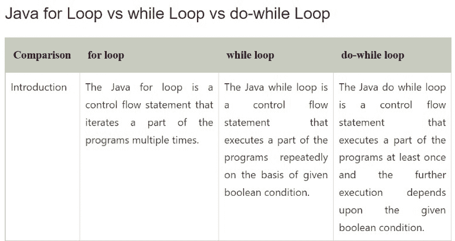

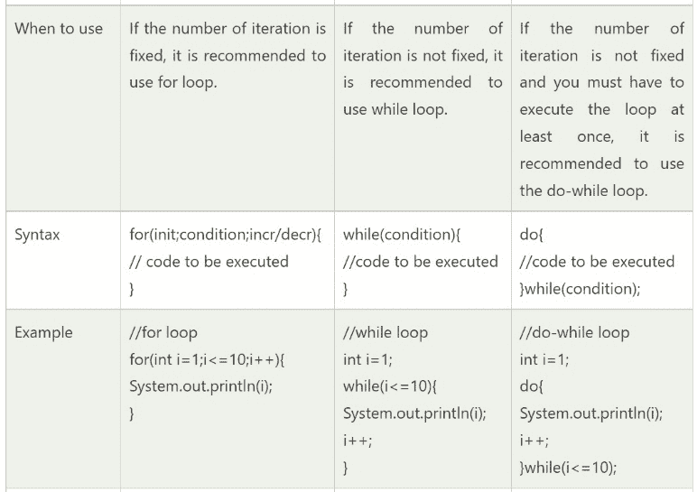

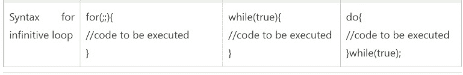

# Java `While` 循环

`while` 循环用于重复执行一段代码，直到提供的布尔条件为真。一旦布尔条件为假，循环就会结束。

`while` 语句是一种重复的 `if` 语句。如果迭代次数固定，建议使用 `for` 循环。

语法：

```java
while (condition){
    //执行代码
    增/减语句
}
```

## 循环（注：提供的文本在此处中断，但根据上下文）

`do-while` 循环的许多组件如下：

1. 条件是一个被测试的表达式。如果条件为真，则执行循环体，并将控制传递给更新表达式。当条件变为假时，我们退出 `while` 循环。

示例：

`i <=100`

2. 更新表达式：每当执行循环体时，该表达式都会增加或减少循环变量。

示例：

`i++`

流程图 - Java `While` 循环

关于 `while` 循环的关键点是它可能运行也可能不。如果待测试条件为假，将跳过循环体，并执行 `while` 循环之后的第一个语句。

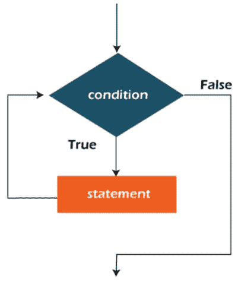

### 示例

我们在示例中输出从 1 到 10 的整数。与 `for` 循环不同，条件变量必须初始化并增加（这里是 `i`）。否则，循环将无限运行。

`WhileExample.java`

```java
public class WhileExample {
    public static void main(String[] args) {
        int i=1;
        while(i<=10){
            System.out.println(i);
            i++;
        }
    }
}
```

Output:

```
1
2
3
4
5
6
7
8
9
10
```

## 无限 `while` 循环

如果你向 `while` 循环传递 `true`，它将是一个无限 `while` 循环。

## 语法

```java
while(true){
  //要执行的代码
}
```

### 示例：`WhileExample2.java`

```java
public class WhileExample2 {
  public static void main(String[] args) {
    //通过向条件传递 true 来设置无限循环
    while(true){
      System.out.println("infinitive while loop");
    }
  }
}
```

### 输出

```
infinitive while loop
infinitive while loop
infinitive while loop
infinitive while loop
infinitive while loop
ctrl+c
```

要结束以下代码中的无限循环，我们必须使用 `Ctrl + C` 命令。

# Java `do-while` 循环

Java `do-while` 循环用于反复迭代程序的某部分，直到满足指定的条件。如果迭代次数不固定且循环至少执行一次，则建议使用 `do-while` 循环。

退出控制循环是 Java `do-while` 循环。与 `while` 和 `for` 循环不同，`do-while` 循环在循环体结束后检查条件。因为条件是在循环体之后测试的，所以 Java `do-while` 循环至少执行一次。

## 语法

```java
do{
  //要执行的代码 / 循环体
  //更新语句
}while (condition);
```

### `do-while` 循环的不同组成部分：

1. 条件是一个被用于测试的表达式。如果条件为真，则运行循环体，并将控制传递给更新表达式。当条件变为假时，循环立即中断。


示例：`i <=100`

2. 更新表达式：该表达式每执行一次循环体，就会递增或递减循环变量。

   示例：`i++`

### 示例

在下面的示例中，我们输出从 1 到 10 的整数。与 `for` 循环不同，条件变量必须独立初始化和递增（此处是 `i`）。否则，循环将无限运行。

### `DoWhileExample.java`

```java
public class DoWhileExample {
  public static void main(String[] args) {
    int i=1;
    do{
      System.out.println(i);
      i++;
    }while(i<=10);
  }
}
```

### 输出

```
1
2
3
4
5
6
7
8
9
10
```

## 无限 do-while 循环 – JAVA

如果你在 `do-while` 循环中传递 `true`，它将成为一个无限 `do-while` 循环。

## 语法

```java
do{
  //要执行的代码
}while(true);
```

### 示例：`DoWhileExample2.java`

```java
public class DoWhileExample2 {
  public static void main(String[] args) {
    do{
      System.out.println("infinitive do while loop");
    }while(true);
  }
}
```

### 输出

```
infinitive do while loop
infinitive do while loop
infinitive do while loop
ctrl+c
```

# Java break 语句

当循环内部遇到 `break` 语句时，循环立即结束，并在循环后的下一个语句处恢复程序控制。

要在 Java 中跳出循环或 `switch` 语句，请使用 `break` 语句。在指定情况下，它会中断程序的当前流。在嵌套循环的情况下，它只会跳出内层循环。

Java `break` 语句可以用于所有形式的循环，包括 `for` 循环、`while` 循环和 `do-while` 循环。

## 语法

```java
jump-statement;
break;
```

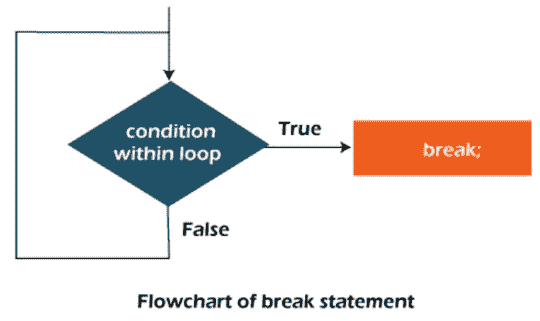

## 循环中的 break 语句

### 示例：`BreakExample.java`

```java
//演示在 for 循环中使用 break 语句的 Java 程序
public class BreakExample {
  public static void main(String[] args) {
    //使用 for 循环
    for(int i=1;i<=10;i++){
      if(i==5){
        //跳出循环
        break;
      }
      System.out.println(i);
    }
  }
}
```

### 输出

```
1
2
3
4
```

## 嵌套循环中的 break 语句

只有当你从内层循环内部使用 `break` 语句时，它才会跳出内层循环。

### 示例：`BreakExample2.java`

```java
//演示在内层循环中使用 break 语句的 Java 程序
public class BreakExample2 {
  public static void main(String[] args) {
    //外层循环
    for(int i=1;i<=3;i++){
      //内层循环
      for(int j=1;j<=3;j++){
        if(i==2&&j==2){
          //在内层循环内部 break
          break;
        }
        System.out.println(i+" "+j);
      }
    }
  }
}
```

### 输出

```
1 1
1 2
1 3
2 1
3 1
3 2
3 3
```

## 带标签的 for 循环中的 break 语句

通过标签，我们可以使用 `break` 语句。自 JDK 1.5 以来，该功能一直可用。因此，现在在 Java 中无论是外层循环还是内层循环，我们都可以跳出它。

### 示例：`BreakExample3.java`

```java
//演示在内层循环中使用带标签的 continue 语句来跳出外层循环的 Java 程序
public class BreakExample3 {
  public static void main(String[] args) {
    aa:
    for(int i=1;i<=3;i++){
      bb:
      for(int j=1;j<=3;j++){
        if(i==2&&j==2){
          //使用带标签的 break 语句
          break aa;
        }
        System.out.println(i+" "+j);
      }
    }
  }
}
```

### 输出

```
1 1
1 2
1 3
2 1
```

## while 循环中的 break 语句

### 示例：`BreakWhileExample.java`

```java
//演示在 while 循环中使用 break 语句的 Java 程序
public class BreakWhileExample {
  public static void main(String[] args) {
    //while 循环
    int i=1;
    while(i<=10){
      if(i==5){
        //使用 break 语句
        i++;
        break;//跳出循环
      }
      System.out.println(i);
      i++;
    }
  }
}
```

### 输出

```
1
2
3
4
```

## do-while 循环中的 break 语句

### 示例：`BreakDoWhileExample.java`

```java
//演示在 Java do-while 循环中使用 break 语句的 Java 程序
public class BreakDoWhileExample {
  public static void main(String[] args) {
    //声明变量
    int i=1;
    //do-while 循环
    do{
      if(i==5){
        //使用 break 语句
        i++;
        break;//跳出循环
      }
      System.out.println(i);
      i++;
    }while(i<=10);
  }
}
```

### 输出

```
1
2
3
4
```
