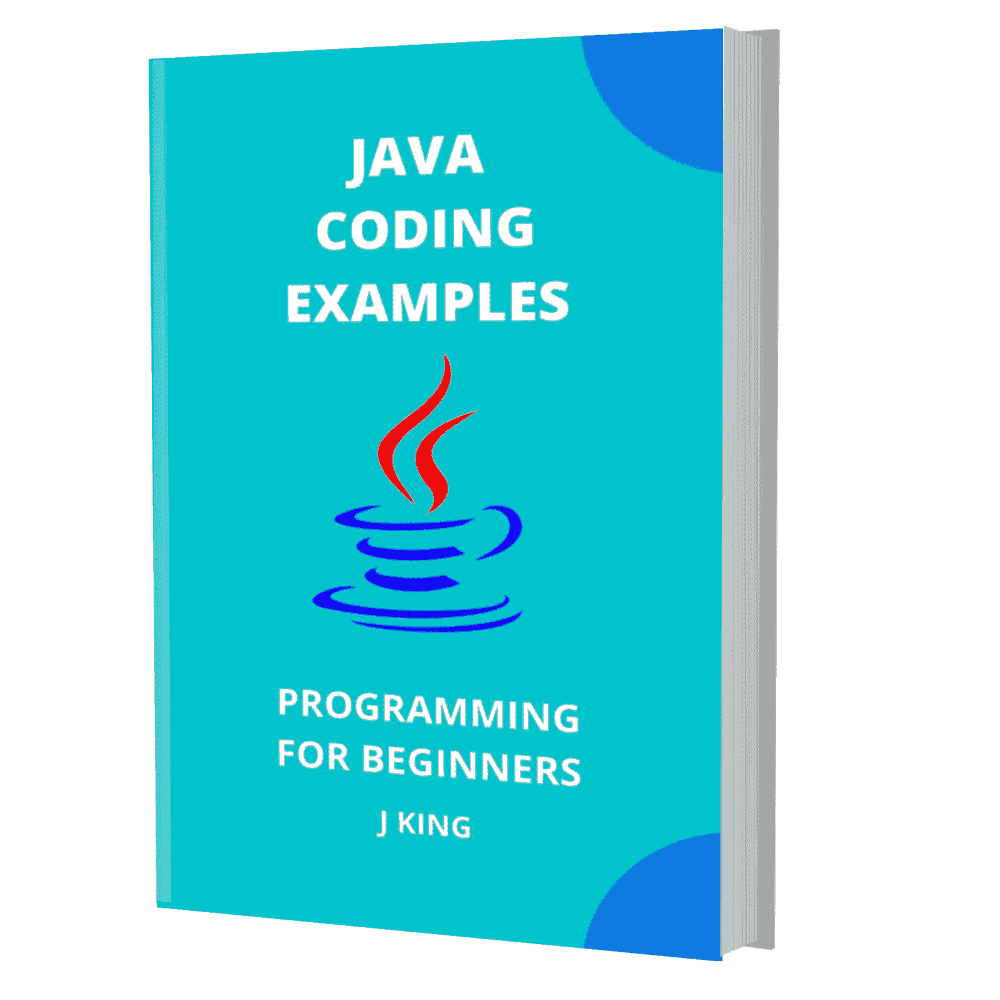

# JAVA 编程示例：初学者编程指南



## 打印 'Hello world' 的 Java 程序

### 语法

```
javac HelloWorld.java
```

### 执行/运行 Java 程序

当你编译了 Java 程序，如果编译成功，你就可以运行该 Java 程序来生成输出。

### 程序

```java
public class HelloWorld{
    public static void main(String []args){
        //打印消息
        System.out.println("Hello World!");
    }
}
```

### 输出

```
Hello World!
```

## 在 Java 中打印不同类型的值

我们将在此程序中声明并描述一些不同类型的变量，然后使用`System.out.println()`方法打印它们。

### 程序

```java
class j2{
    public static void main(String args[]) {
        int num;
        float b;
        char c;
        String s;
        //整数
        num = 100;
        //浮点数
        b = 1.234f;
        //字符
        c = 'A';
        //字符串
        s = "Hello Java";
        System.out.println("Value of num: "+num);
        System.out.println("Value of b: "+b);
        System.out.println("Value of c: "+c);
        System.out.println("Value of s: "+s);
    }
}
```

### 输出

```
Value of num: 100
Value of b: 1.234
Value of c: A
Value of s: Hello Java
```

## 在 Java 中读取并打印整数值

在这里我们将学习如何从用户获取整数输入并将其打印到屏幕上。为了获取整数输入，我们使用`Scanner`类，为此我们必须在 Java 程序中包含`java.util.*`包。

### 程序

```java
import java.util.*;
class j3{
    public static void main(String args[]) {
        int a;
        //声明 Scanner 类对象
        Scanner buf=new Scanner(System.in);
        System.out.print("Enter value of a :");
        /*Scanner 类的 nextInt() 方法*/
        a=buf.nextInt();
        System.out.println("Value of a:" +a);
    }
}
```

### 输出

```
Enter value of a :120
Value of a:120
```

## 计算总和和平均值的 Java 程序

给出两个整数（输入），我们需要计算它们的总和和平均值。

### 程序

```java
// 在 Java 中寻找两个数字的总和和平均值
import java.util.*;
public class Numbers {
    public static void main(String args[]) {
        int a, b, sum;
        float avg;
        Scanner buf = new Scanner(System.in);
        System.out.print("Enter first number : ");
        a = buf.nextInt();
        System.out.print("Enter second number : ");
        b = buf.nextInt();
        /*计算总和和平均值*/
        sum = a + b;
        avg = (float)((a + b) / 2);
        System.out.print("Sum : " + sum + "\nAverage : " + avg);
    }
}
```

### 输出

```
Enter first number : 100
Enter second number : 200
Sum : 300
Average : 150.0
```

## 打印圣诞树的 Java 程序

示例：

*****************************************************************************************************************************************

### 程序

```java
public class ChristmasTree{
    public static final int SEGMENTS = 4;
    public static final int HEIGHT = 4;
    public static void main(String[] args) {
        makeTree();
    }
    public static void makeTree() {
        int maxStars = 2*HEIGHT+2*SEGMENTS-3;
        String maxStr = "";
        for (int len = 0; len < maxStars; len++) {
            maxStr+=" ";
        }
        for (int i = 1; i <= SEGMENTS; i++) {
            for (int line = 1; line <= HEIGHT; line++) {
                String starStr = "";
                for (int j = 1; j <= 2*line+2*i-3; j++) {
                    starStr+="*";
                }
                for (int space=0; space <= maxStars-(HEIGHT+i); space++) {
                    starStr += " ";
                }
                System.out.println(starStr);
            }
        }
        for (int i = 0; i <= maxStars/2; i++) {
            System.out.print(" ");
        }
        System.out.print("\n");
        for (int i = 0; i <= maxStars/2; i++) {
            System.out.print(" ");
        }
        System.out.print("\n");
        for (int i = 0; i <= maxStars/3; i++) {
            System.out.print(" ");
        }
        System.out.print("*******\n");
    }
}
```

## 计算所有数字之和的 Java 程序

提供一个数字，使用 Java 程序找到它的数字之和。

示例 1：

输入：852

输出：15

示例 2：

输入：25688

输出：35

### 程序

```java
import java.util.Scanner;
class AddDigits{
    public static void main(String args[]){
        //初始化对象。
        int num, rem=0, sum=0, temp;
        Scanner scan = new Scanner(System.in);
        //在此输入数字。
        System.out.print("Enter the Number : ");
        num = scan.nextInt();
        // 存储数字。
        temp = num;
        while(num>0){
            rem = num%10;
            sum = sum+rem;
            num = num/10;
        }
        System.out.print("Sum of Digits of " +temp+" is : "+sum);
    }
}
```

### 输出

```
First run:
Enter the Number : 582
Sum of Digits of 582 is : 15
Second run:
Enter the Number : 25688
Sum of Digits of 25688 is : 35
```

## 计算复利的 Java 程序

给定本金、利率和时间，使用 Java 程序计算复利。

示例：

Principal : 5000

Rate : 5

Time : 33

Amount : 5788.125000001

Compound Interest : 788.125000009

### 程序

```java
import java.util.Scanner;
class CompoundInterest{
    public static void main(String args[]) {
        //在此声明并初始化。
        double A=0,Pri,Rate,t=1,CI;
        // 创建对象。
        Scanner S=new Scanner(System.in);
        //在此输入本金、利率、时间
        System.out.print("Enter Principal : ");
        Pri=S.nextFloat();
        System.out.print("Enter Rate : ");
        Rate=S.nextFloat();
        System.out.print("Enter Time : ");
        Time=S.nextFloat();
        Rate=(1 + Rate/100);
        for(int i=0;i<Time;i++)
            t*=Rate;
        A=Pri*t;
        System.out.print("Amount : " +A);
        CI=A-Pri;
        System.out.print("\nCompound Interest : "+CI);
    }
}
```

### 输出

```
First run:
Principal : 5000
Rate : 5
Time : 3
Amount : 5788.125000001
Compound Interest : 788.125000009
Second run:
Principal : 10000
Rate : 20
Time : 5
Amount : 24883.19999999997
Compound Interest : 14883.19999999997
```

## 寻找最大数字的 Java 程序

程序从键盘读取（三个整数），并选择最大的数字。

### 程序

```java
// 在三个数字中寻找最大数字的 Java 程序。
import java.util.*;
class LargestFrom3{
    public static void main(String []s){
        int a,b,c,largest;
        //Scanner 类读取值
        Scanner sc=new Scanner(System.in);
        System.out.print("Enter first number:");
        a=sc.nextInt();
        System.out.print("Enter second number:");
        b=sc.nextInt();
        System.out.print("Enter third number:");
        c=sc.nextInt();
        if ( a>b && a>c )
            largest=a;
        else if ( b>a && b>c )
            largest=b;
        else
            largest=c;
        System.out.println("Largest Number is : "+largest);
    }
}
```

### 输出

```
Compile : javac LargestFrom3.java
Run : java LargestFrom3
```

### 输出

```
Enter first number:45
Enter second number:56
Enter third number:67
Largest Number is : 67
```

## 运行一个应用程序

使用 Java 程序打开应用程序（Notepad, Calculator）。我们使用`Runtime.getRuntime()`和`exec()`方法来打开。

### 程序

```java
// 运行应用程序的程序。
import java.util.*;
class OpenNotepad{
    public static void main(String args){
        Runtime app=Runtime.getRuntime();
        try{
            //打开 notepad
            app.exec("notepad");
            //打开 calculator
            app.exec("calc");
        } catch (Exception Ex){
            System.out.println("Error: " + Ex);
        }
    }
}
```

### 输出

```
Notepad and Calculator will be opened.
```

## 斐波那契数列

斐波那契数列是一个每一项都是前两项之和的数列。

### 程序

```java
/* 打印斐波那契数列的程序。*/
import java.util.*;
class Fibonacci {
    public static void main(String[] args) {
        int SeriesNum;
        Scanner sc=new Scanner(System.in);
        System.out.print("Enter the length of fibonacci series : ");
        SeriesNum=sc.nextInt();
        int[] num = new int[SeriesNum];
        num[0] = 0;
        num[1] = 1;
        // 应该是最后两项之和
        for(int i=2; i < SeriesNum; i++)
            num[i] = num[i-1] + num[i-2];
        System.out.println("fibonacci : ");
        for(int i=0; i<SeriesNum; i++)
            System.out.print(num[i] + " ");
    }
}
```

### 输出

```
Enter the length of fibonacci series :10
fibonacci :0 1 2 3 5 8 13 21 34 55 
```

## 使用 for 循环打印 1 到 N 的数字

### 程序


## 使用 `for` 循环打印 1 到 N 的数字

### 程序

```java
import java.util.Scanner;
class Print_1_To_N_UsingFor{
    public static void main(String[] args) {
        //创建对象
        Scanner scanner = new Scanner(System.in);
        //输入"n"。
        System.out.print("Enter the value n : ");
        //读取值。
        int n = scanner.nextInt();
        System.out.println("Numbers are : ");
        for(int i=1; i<=n; i++)
            System.out.println(i);
    }
}
```

### 输出

```
Enter the value n :15
Numbers are :12345678910111213415
```

## 使用 `while` 循环打印 1 到 N 的数字

### 程序

```java
import java.util.Scanner;
class Print_1_To_N_UsingWhile{
    public static void main(String[] args) {
        //循环计数器初始化
        int i =1;
        //创建 scanner 类对象
        Scanner Sc = new Scanner(System.in);
        //输入"n "
        System.out.print("Enter the value n : ");
        //读取值。
        int n = Sc.nextInt();
        System.out.println("Numbers are : ");
        while(i<=n) {
            System.out.println(i);
            i++;
        }
    }
}
```

### 输出

```
Enter the value n :15
Numbers are :12345678910111213415
```

## 一维数组和二维数组的加法

在 JAVA 程序中有两个程序：两个一维数组加法，两个二维数组加法。

### 1) 二维数组的加法

```java
class AddTwoArray{
    public static void main(String[] args) {
        //数组的声明和初始化
        int a[] = {1,2,3,4,5};
        int b[] = {6,7,8,9,10};
        //实例化第三个数组来存储结果
        int c[] = new int[5];
        for(int i=0; i<5; i++) {
            //两个数组相加并将结果存储在第三个数组中
            c[i] = a[i] + b[i];
            //显示结果
            System.out.println("sum of "+i +"index" +" " + c[i]);
        }
    }
}
```

### 输出

```
Enter sum of 0index 7
Enter sum of 1index 9
Enter sum of 2index 11
Enter sum of 3index 13
Enter sum of 4index 15
```

### 2) 两个二维数组的加法

```java
class AddTwoArrayOf2DClass{
    public static void main(String[] args){
        //数组的声明和初始化
        int a[][] = {{1,2,3},{4,5,6}};
        int b[][] = {{7,8,9},{10,11,12}};
        //实例化第三个数组来存储结果
        int c[][] = new int[2][3];
        for(int i=0; i<2; i++){
            for(int j=0; j<3; j++){
                //两个数组相加并将结果存储在第三个数组中
                c[i][j] = a[i][j] + b[i][j];
                //显示结果
                System.out.println("sum of "+i +"index" + j +" " + c[i][j]);
            }
        }
    }
}
```

### 输出

```
sum of 0index0 8
sum of 0index1 10
sum of 0index2 12
sum of 1index0 14
sum of 1index1 16
sum of 1index2 18
```

## 逐行读取文件的 Java 程序

给定一个文件，使用 Java 程序逐行读取其内容。我们使用名为`"B.txt"`的文件，该文件位于`"F:"`盘，因此文件路径为`"F:\B.txt,"`，文件内容为：

```
line 1

line 2

line 3

line 4
```

### 程序

```java
import java.io.FileInputStream;
import java.io.IOException;
import java.util.Scanner;
class ReadLineByLine{
    public static void main(String[] args){
        //创建 scanner 对象。
        Scanner Sc=new Scanner(System.in);
        //输入文件名。
        System.out.print("Enter the file name:");
        String filename=Sc.next();
        Scanner Sc1=null;
        FileInputStream fis=null;
        try {
            fis=new FileInputStream(filename);
            Sc1=new Scanner(fis);
            //读取数据到结束
            while(Sc1.hasNext()){
                String data=Sc1.nextLine();
                //打印数据。
                System.out.print("The file data is : +data);
            }
        } catch(IOException e) {
            System.out.println(e);
        }
    }
}
```

### 输出

```
Enter the file name:F:/B.txt
The file data is :line 1
The file data is :line 2
The file data is :line 3
The file data is :line 4
```

## 获取当前系统日期和时间的 Java 程序

```java
//系统日期和时间程序
import java.util.Date;
class GetDateTime{
    public static void main(String args[]){
        //Date 实例
        Date date = new Date();
        //获取日、月和年
        System.out.println(date.getDate()+"+"/"+date.getMonth()+1)+"/"+date.getYear()-100));
        //获取完整的日期时间
        System.out.println(date.toString());
        //只获取时间
        System.out.println(date.getHours()+":"+date.getMinutes()+":"+date.getSeconds());
    }
}
```

### 输出

```
14/8/20Thu Aug 14 21:29:07 GMT 202021:29:7
```

## 计算圆面积的 Java 程序

此程序读取圆半径并计算圆面积。

### 程序

```java
import java.util.Scanner;
public class AreaCircle {
    public static void main(String[] args) {
        double radius;
        Scanner sc=new Scanner(System.in);
        //输入圆半径
        System.out.print("Enter the Radius of Circle : ");
        radius=sc.nextDouble();
        //圆面积是 pi * 半径平方
        double area=3.14*radius*radius;
        System.out.print("Area of Circle : "+area);
    }
}
```

### 输出

```
Enter the Radius of Circle :12.5
Area of Circle :490.625
```

## 十进制转二进制的 Java 程序

给定一个整数（Decimal），使用 Java 程序将其转换为二进制。

### 程序

```java
import java.util.Scanner;
class DecimalToBinary{
    public static void main(String[] args) {
        //使用 Scanner 类获取输入
        Scanner sc = new Scanner(System.in);
        System.out.println("Enter Decimal Number :");
        //接受输入
        int input_decimal_num = sc.nextInt();
        String binary_string = " ";
        //循环直到 input_decimal_num > 0
        while(input_decimal_num > 0){
            //余数加入字符串变量
            binary_string = (input_decimal_num%2) + binary_string;
            input_decimal_num = input_decimal_num/2;
        }
        // 显示最终结果
        System.out.println("Conversion of decimal is : + binary_string);
    }
}
```

### 输出

```
Enter Decimal Number :30
Conversion of decimal is :11110
```
