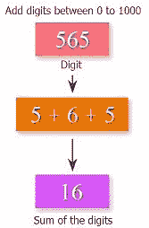
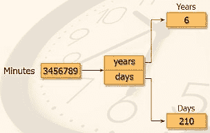

# JAVA 编程练习：零基础学者基础指南

## JAVA 练习册

- [计算复利的 Java 程序]
- [寻找最大数的 Java 程序]
- [寻找所有数字之和的 Java 程序]
- [运行应用程序的 Java 程序]
- [使用 for 循环打印从 1 到 N 的数字]
- [打印斐波那契数列的 Java 程序]
- [Java 数据类型练习]
- [华氏度转摄氏度]
- [相加整数中的所有数字数字]
- [Java 数据类型练习：英寸到米]
- [让用户输入分钟]
- [Java 条件语句：练习]
- [检查数字是负数、零还是正数]
- [读取数字并显示其平方]
- [输入 5 个数字找到它们的和和平均值]
- [显示 1 到 7 之间的星期]
- [显示 n 个自然数及其和]
- [使用 while 循环打印从 1 到 N 的数字]
- [将十进制转换为二进制的 Java 程序]
- [一维数组和二维数组的相加]
- [逐行读取文件的 Java 程序]

## 计算复利的 Java 程序

给定本金、利率时间和，使用 Java 程序我们需要找到复利。

示例：

```
Enter Principal : 5000
Enter Rate : 5
Enter Time : 3
Amount : 5788.125000000001
Compound Interest : 788.1250000000009
```

程序

```java
import java.util.Scanner;

public class CompoundInterest {
    public static void main(String args[]) {
        // 在此处声明并初始化。
        double A=0,Pri,Rate,Time,t=1,CI;
        // 创建对象。
        Scanner S=new Scanner(System.in);
        // 在此处输入本金、利率、时间
        System.out.print("Enter Principal : ");
        Pri=S.nextFloat();
        System.out.print("Enter Rate : ");
        Rate=S.nextFloat();
        System.out.print("Enter Time : ");
        Time=S.nextFloat();
        Rate=(1 + Rate/100);
        for(int i=0;i<Time;i++)
            t*=Rate;
        A=Pri*t;
        System.out.print("Amount : " +A);
        CI=A-Pri;
        System.out.print("\nCompound Interest : " +CI);
    }
}
```

输出

第一次运行：

```
Enter Principal : 5000
Enter Rate : 5
Enter Time : 3
Amount : 5788.125000000001
Compound Interest : 788.1250000000009
```

第二次运行：

```
Enter Principal : 10000
Enter Rate : 20
Enter Time : 5
Amount : 24883.199999999997
Compound Interest : 14883.199999999997
```

## 寻找最大数的 Java 程序

该程序从键盘（三个整数）读取，并选择最大的数。

程序

```java
// 在三个数中寻找最大数的 Java 程序。
import java.util.*;
class LargestFrom3 {
    public static void main(String []s) {
        int a,b,c,largest;
        // 使用 Scanner 类读取值
        Scanner sc=new Scanner(System.in);
        System.out.print("Enter first number:");
        a=sc.nextInt();
        System.out.print("Enter second number:");
        b=sc.nextInt();
        System.out.print("Enter third number:");
        c=sc.nextInt();
        if ( a>b && a>c )
            largest=a;
        else if ( b>a && b>c )
            largest=b;
        else
            largest=c;
        System.out.println("Largest Number is "+largest);
    }
}
```

输出

编译：`javac LargestFrom3.java`

运行：`java LargestFrom3`

```
Enter first number:45
Enter second number:56
Enter third number:67
Largest Number is : 67
```

## 寻找所有数字之和的 Java 程序

给定一个数字，我们需要使用 Java 程序找到所有数字之和。

示例 1：

```
Input: 852
Output: Sum of all digits: 15
```

示例 2：

```
Input: 256868
Output: Sum of all digits: 35
```

程序

```java
import java.util.Scanner;
public class AddDigits {
    public static void main(String args[]) {
        // 初始化并声明对象。
        int num, rem=0, sum=0, temp;
        Scanner scan = new Scanner(System.in);
        // 输入数字。
        System.out.print("Enter the Number : ");
        num = scan.nextInt();
        // temp 用于存储数字。
        temp = num;
        while(num>0) {
            rem = num%10;
            sum = sum+rem;
            num = num/10;
        }
        System.out.print("Sum of all digits of "+temp+" is : "+sum);
    }
}
```

输出

第一次运行：

```
Enter the Number : 852
Sum of all digits of 852 is : 15
```

第二次运行：

```
Enter the Number : 256868
Sum of all digits of 256868 is : 35
```

## 练习 1：数字之和

创建一个 Java 程序，接收一个 0 到 1000 之间的整数，并将其所有数字相加。



### JAVA 代码

```java
import java.util.Scanner;

public class Main {
    public static void main(String[] Strings) {
        Scanner input = new Scanner(System.in);
        System.out.print("Input an integer between 0 and 1000: ");
        int num = input.nextInt();
        int firstDigit = num % 10;
        int remainingNumber = num / 10;
        int SecondDigit = remainingNumber % 10;
        remainingNumber = remainingNumber / 10;
        int thirdDigit = remainingNumber % 10;
        remainingNumber = remainingNumber / 10;
        int fourthDigit = remainingNumber % 10;
        int sum = thirdDigit + SecondDigit + firstDigit + fourthDigit;
        System.out.println("The sum of all digits in " + num + " is " + sum);
    }
}
```

### 输出

```
Input an integer between 0 and 1000: 565
The sum of all digits in 565 is 16
```

---

## 练习 2：英寸到米

Java 数据类型练习：英寸到米

编写一个 Java 程序，接收一个英寸值并将其转换为米。

### 英寸转米

- 1 英寸 = 0.025400 米
- 2 英寸 = 0.050800 米
- 3 英寸 = 0.076200 米
- 4 英寸 = 0.101600 米
- 5 英寸 = 0.127000 米
- 6 英寸 = 0.152400 米

### JAVA 代码

```java
import java.util.Scanner;

public class Exercise2 {
    public static void main(String[] Strings) {
        Scanner input = new Scanner(System.in);
        System.out.print("Input a value for inch: ");
        double inch = input.nextDouble();
        double meters = inch * 0.0254;
        System.out.println(inch + " inch is " + meters + " meters");
    }
}
```

### 输出

```
Input a value for inch: 1000
1000.0 inch is 25.4 meters
```

---

## 练习 4：分钟转年和天

让用户输入分钟，并打印该分钟对应的年数和天数。

编写一个 Java 程序将分钟转换为年和天数。



### JAVA 代码

```java
import java.util.Scanner;

public class Exercise4 {
    public static void main(String[] Strings) {
        double minutesInYear = 60 * 24 * 365;
        Scanner input = new Scanner(System.in);
        System.out.print("Input the number of minutes: ");
        double min = input.nextDouble();
        long years = (long) (min / minutesInYear);
        int days = (int) (min / 60) % 365;
        System.out.println((int) min + " minutes is approximately " + years + " years and " + days + " days");
    }
}
```

### 输出

```
Input the number of minutes: 345789
345689 minutes is approximately 6 years and 210 days
```

---

## 练习 27：条件语句

Java 条件语句：检查数字是负数、零还是正数.


### JAVA 代码

```java
import java.util.Scanner;

public class Exercise27 {
    public static void main(String[] args) {
        Scanner in = new Scanner(System.in);
        System.out.print("Input a number: ");
        int n = in.nextInt();
        if (n > 0) {
            System.out.println("Number is positive");
        } else if (n < 0) {
            System.out.println("Number is negative");
        } else {
            System.out.println("Number is zero");
        }
    }
}
```

### 输出

```
Input a number: 7
Number is positive
```

---

## 练习 8：平方、立方和四次方

读取一个数字并显示其平方、立方和四次方。

创建一个 Java 程序，读取一个数字并显示该数字的平方、立方和四次方。

### JAVA 代码

```java
import java.util.Scanner;

public class Exercise8 {
    public static void main(String[] args) {
        Scanner in = new Scanner(System.in);
        System.out.print("Input the side length value: ");
        double val = in.nextDouble();
        System.out.printf("Square: %12.2f\n", val * val);
        System.out.printf("Cube: %14.2f\n", val * val * val);
        System.out.printf("Fourth power: %6.2f\n", Math.pow(val, 4));
    }
}
```

### 输出

```
Input the side length value: 15
Square:       225.00
Cube:         3375.00
Fourth power: 50625.00
```

---

## 练习 12：和与平均值

输入 5 个数字求它们的和和平均值.


### JAVA 代码

```java
import java.util.Scanner;

public class Exercise12 {
    public static void main(String[] args) {
        int i, n, s = 0;
        double avg;
        System.out.println("Input 5 numbers:");
        for (i = 0; i < 5; i++) {
            Scanner in = new Scanner(System.in);
            n = in.nextInt();
            s += n;
        }
        avg = s / 5;
        System.out.println("The sum of 5 no is " + s + "\ Average is : " + avg);
    }
}
```

### 输出

```
Input 5 numbers:
1
2
3
4
5
The sum of 5 no is 15 Average is : 3.0
```

---

## 练习 5：星期几

显示 1 到 7 之间的星期.


### JAVA 代码


```java
import java.util.Scanner;

public class Exercise5 {
    public static void main(String[] args) {
        Scanner in = new Scanner(System.in);
        System.out.print("Input number: ");
        int day = in.nextInt();
        System.out.println(getDayName(day));
    }
    // Get the name for the Week
    public static String getDayName(int day) {
        String dayName;
        switch (day) {
            case 1: dayName = "Monday"; break;
            case 2: dayName = "Tuesday"; break;
            case 3: dayName = "Wednesday"; break;
            case 4: dayName = "Thursday"; break;
            case 5: dayName = "Friday"; break;
            case 6: dayName = "Saturday"; break;
            case 7: dayName = "Sunday"; break;
            default: dayName = "Invalid day";
        }
        return dayName;
    }
}
```

### 输出

```
Input number: 3
Wednesday
```

---

## 练习 11：自然数与和

显示 n 项自然数及其和.


### JAVA 代码

```java
import java.util.Scanner;

public class Exercise11 {
    public static void main(String[] args) {
        int i, n, sum = 0;
        Scanner in = new Scanner(System.in);
        System.out.print("Input number: ");
        n = in.nextInt();
        System.out.println("The first n natural numbers are : " + n);
        for (i = 1; i <= n; i++) {
            System.out.println(i);
            sum += i;
        }
        System.out.println("The Sum of Natural Number upto " + n + " terms : " + sum);
    }
}
```

### 输出

```
Input number: 7
The first n natural numbers are : 7
1
2
3
4
5
6
7
The Sum of Natural Number upto 7 terms : 28
```

## 计算前 n 项自然数的和：28

使用 while 循环打印从 1 到 `N` 的数字

### 程序

```java
import java.util.Scanner;

public class Print_1_To_N_UsingWhile
{
    public static void main(String[] args)
    {
        //循环计数器初始化
        int i =1;
        //创建 scanner 类的对象
        Scanner Sc = new Scanner(System.in);
        //输入 " n " 的值
        System.out.print("Enter the value n : ");
        //读取值。
        int n = Sc.nextInt();
        System.out.println("Numbers are : ");
        while(i<=n)
        {
            System.out.println(i);
            i++;
        }
    }
}
```

### 输出

```
Enter the value n : 15
Numbers are :
1
2
3
4
5
6
7
8
9
10
11
12
13
14
15
```

---

## 将十进制转换为二进制的 Java 程序

给定一个整数（十进制）数字，我们需要使用 Java 程序将其转换为二进制。

### 程序

```java
// Scanner 类用于用于从用户处获取输入
import java.util.Scanner;
class DecimalToBinaryConversionClass{
    public static void main(String[] args){
        //创建 Scanner 类对象
        Scanner sc = new Scanner(System.in);
        System.out.println("Enter Any Decimal Number :");
        //接受用户输入
        int input_decimal_num = sc.nextInt();
        String binary_string = " ";
        //循环持续到 input_decimal_num > 0
        while(input_decimal_num > 0){
            //将余数加到字符串变量
            binary_string = input_decimal_num%2 + binary_string;
            input_decimal_num = input_decimal_num/2;
        }
        //显示最终结果
        System.out.println("Conversion of decimal to binary is : " + binary_string);
    }
}
```

### 输出

```
Enter Any Decimal Number :
30
Conversion of decimal to binary is : 11110
```

---

## Java 程序中一维数组和二维数组的加法

共有 2 个程序：两个一维数组的加法，两个二维数组的加法。

### 1) Java 中两个一维数组的加法

```java
class AddTwoArrayClass{
    public static void main(String[] args){
        // 数组的声明和初始化
        int a[] = {1,2,3,4,5};
        int b[] = {6,7,8,9,10};
        // 实例化第三个数组存储结果
        int c[] = new int[5];
        for(int i=0; i<5; ++i){
            //两个数组相加并将结果存储在第三个数组中
            c[i] = a[i] + b[i];
            //显示结果
            System.out.println("Enter sum of "+i +"index" +" " + c[i]);
        }
    }
}
```

### 输出

```
Enter sum of 0index 7
Enter sum of 1index 9
Enter sum of 2index 11
Enter sum of 3index 13
Enter sum of 4index 15
```

### 2) Java 中两个二维数组的加法

```java
class AddTwoArrayOf2DClass{
    public static void main(String[] args){
        // 二维数组的声明和初始化
        int a[][] = {{1,2,3},{4,5,6}};
        int b[][] = {{7,8,9},{10,11,12}};
        // 实例化第三个数组存储结果
        int c[][] = new int[2][3];
        for(int i=0; i<2; ++i){
            for(int j=0; j<3; ++j){
                // 两个数组相加并将结果存储在第三个数组中
                c[i][j] = a[i][j] + b[i][j];
                System.out.println("Enter sum of "+i + " " + j +"index" +" " + c[i][j]);
            }
        }
    }
}
```

### 输出

```
Enter sum of 0 0index 8
Enter sum of 0 1index 10
Enter sum of 0 2index 12
Enter sum of 1 0index 14
Enter sum of 1 1index 16
Enter sum of 1 2index 18
```

---

## 逐行读取文件的 Java 程序

给定一个文件，我们需要使用 Java 程序逐行读取其内容。

为此程序使用的名为 `B.txt` 的文件位于 `F:\` 盘，因此文件路径为 `F:\B.txt`，文件内容为：

```
This is line 1
This is line 2
This is line 3
This is line 4
```

### 程序

```java
import java.io.FileInputStream;
import java.io.IOException;
import java.util.Scanner;
public class ReadLineByLine
{
    public static void main(String[] args)
    {
        //创建 scanner 类对象。
        Scanner Sc=new Scanner(System.in);
        //输入文件名。
        System.out.print("Enter the file name:");
        String sfilename=Sc.next();
        Scanner Sc1= null;
        FileInputStream fis=null;
        try
        {
            FileInputStream FI=new FileInputStream(sfilename);
            Sc1=new Scanner(FI);
            //这将一直读取到数据结束。
            while(Sc1.hasNext())
            {
                String data=Sc1.nextLine();
                //打印数据。
                System.out.print("The file data is : " +data);
            }
        }
        catch(IOException e)
        {
            System.out.println(e);
        }
    }
}
```

### 输出

```
Enter the file name: F:/B.txt
This is line 1
This is line 2
This is line 3
This is line 4
```
