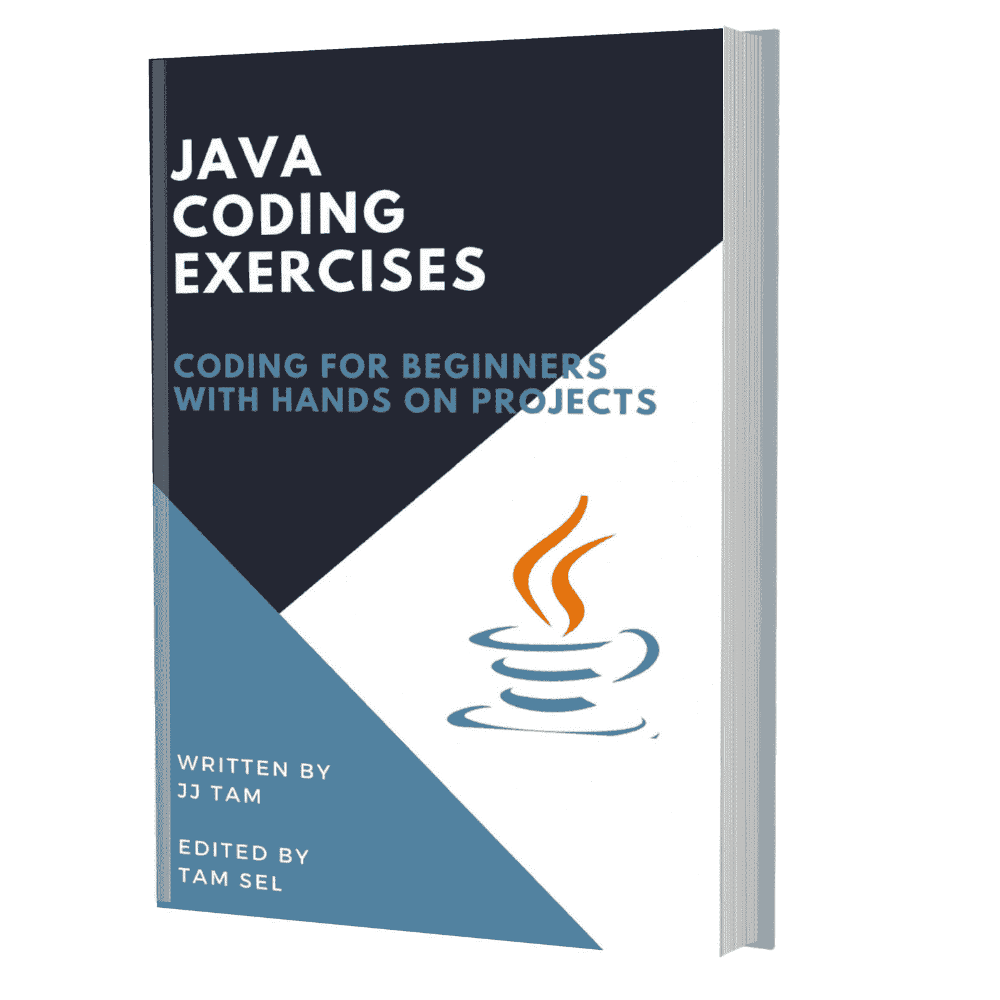

# JAVA 编码练习：初学者编码指南



## 打印 hello

分行打印 hello 和你的名字。

JAVACODE

```java
import java.util.Scanner;
public class Main {
    public static void main(String[] args) {
        Scanner input = new Scanner (System.in);
        System.out.print("Input your first name: ");
        String fname = input.next();
        System.out.print("Input your last name: ");
        String lname = input.next();
        System.out.println();
        System.out.println("Hello \n"+fname+" "+lname);
    }
}
```

OUTPUT

```
Input your first name: JJ
Input your last name: TAM
Hello
JJ TAM
```

## 打印数字之和

两个数字之和。

JAVACODE

```java
import java.util.Scanner;
public class Main {
    public static void main(String[] args) {
        Scanner input = new Scanner (System.in);
        System.out.print("Input the first number: ");
        int num1 = input.nextInt();
        System.out.print("Input the second number: ");
        int num2 = input.nextInt();
        int sum = num1 + num2;
        System.out.println();
        System.out.println("Sum: "+sum);
    }
}
```

OUTPUT

```
Input the first number: 545
Input the second number: 455
Sum: 1000
```

## 除法两个数字

并在屏幕上打印。

JAVA CODE

```java
import java.util.Scanner;
public class Main {
    public static void main(String[] args) {
        Scanner input = new Scanner (System.in);
        System.out.print("Input the first number: ");
        int a = input.nextInt();
        System.out.print("Input the second number: ");
        int b = input.nextInt();
        int d = (a/b);
        System.out.println();
        System.out.println("The division of a and b is:" +d);
    }
}
```

OUTPUT

```
Input the first number: 100
Input the second number: 25
The division of a and b is:4
```

## 打印结果

指定操作的结果。

JAVA CODE

```java
public class Main {
    public static void main(String[] args) {
        int w = -5 + 8 * 6;
        int x = (55 + 9) % 9;
        int y = 20 + (-3 * 5 / 8);
        int z = 5 + 15 / 3 * 2 - 8 % 3;
        System.out.print(w + "\n" + x + "\n" + y + "\n" + z);
    }
}
```

## 打印乘法表

JAVA CODE

```java
import java.util.Scanner;
public class Main {
    public static void main(String[] args) {
        Scanner in = new Scanner(System.in);
        System.out.println("Input the Number: ");
        int n = in .nextInt();
        for (int i = 1; i <= 10; i++) {
            System.out.println(n + "*" + i + " = " + (n * i));
        }
    }
}
```

OUTPUT

```
Input the Number:
15
15*1 = 15
15*2 = 30
15*3 = 45
15*4 = 60
15*5 = 75
15*6 = 90
15*7 = 105
15*8 = 120
15*9 = 135
15*10 = 150
```

## 求面积

圆的面积和周长。

JAVA CODE

```java
import java.util.Scanner;
public class Main {
    public static void main(String[] args) {
        Scanner io = new Scanner(System.in);
        System.out.println("Input the radius of the circle: ");
        double radius = io.nextDouble();
        System.out.println("Perimeter is = " + (2 * radius * Math.PI));
        System.out.println("Area is = " + (Math.PI * radius * radius));
    }
}
```

OUTPUT

```
Input the radius of the circle:
10
Perimeter is = 62.8318530718
Area is = 314.159265359
```

## 交换两个变量

JAVA CODE

```java
import java.util.Scanner;
public class Main {
    public static void main(String[] args) {
        int x, y, z;
        Scanner in = new Scanner(System.in);
        System.out.println("Input the first number: ");
        x = in.nextInt();
        System.out.println("Input the second number: ");
        y = in.nextInt();
        z = x;
        x = y;
        System.out.println("Swapped values are:" + x + " and " + y);
    }
}
```

OUTPUT

```
Input the first number: 25
Input the second number: 50
Swapped values are:50 and 25
```

## 打印一个脸

JAVA CODE

```java
public class Main {
    public static void main(String[] args) {
        String[] arra = new String[5];
        arra[0] = "*****";
        arra[1] = "| o o |";
        arra[2] = "| ^ ^ |";
        arra[3] = "| --- |";
        arra[4] = "*****";
        for (int i = 0; i < 5; i++) {
            System.out.println(arra[i]);
        }
    }
}
```

OUTPUT

```
*****
| o o |
| ^ ^ |
|  --- |
*****
```

## 华氏度转摄氏度

JAVA CODE

```java
import java.util.Scanner;
public class Main {
    public static void main(String[] args) {
        Scanner input = new Scanner(System.in);
        System.out.print("Input a degree in Fahrenheit: ");
        double fahrenheit = input.nextDouble();
        double celsius = (fahrenheit - 32.0) / 9.0;
        System.out.println(fahrenheit + " degree is equal to " + celsius + " in Celsius");
    }
}
```

OUTPUT

```
Input a degree in Fahrenheit: 96
96.0 degree is equal to 35.5555555556
```

## 英寸转米

JAVA CODE

```java
import java.util.Scanner;
public class Main {
    public static void main(String[] args) {
        Scanner input = new Scanner(System.in);
        System.out.print("Input a value for inch: ");
        double inch = input.nextDouble() ;
        double meters = inch * 0.0254;
        System.out.println(inch + " inch is " + meters);
    }
}
```

OUTPUT

```
Input a value for inch: 5
5.0 inch is 0.127
```

## 相加所有数字

JAVA CODE

```java
import java.util.Scanner;
public class Main {
    public static void main(String[] args) {
        Scanner input = new Scanner(System.in);
        System.out.print("Input an integer between 0 and 1000: ");
        int num = input.nextInt();
        int firstDigit = num % 10;
        int remainingNumber = num / 10;
        int SecondDigit = remainingNumber % 10;
        remainingNumber = remainingNumber / 10;
        int thirdDigit = remainingNumber % 10;
        remainingNumber = remainingNumber / 10;
        int fourthDigit = remainingNumber % 10;
        int sum = thirdDigit + SecondDigit + firstDigit + fourthDigit;
        System.out.println("The sum of all digits in " + num + " is " + sum);
    }
}
```

OUTPUT

```
Input an integer between 0 and 1000: 750
The sum of all digits in 750 is 12
```

## 从分钟打印年数和天数

JAVA CODE

```java
import java.util.Scanner;
public class Main {
    public static void main(String[] args) {
        double minutesInYear = 60 * 24 * 365;
        Scanner input = new Scanner(System.in);
        System.out.print("Input the number of minutes: ");
        double min = input.nextDouble();
        long years = (long) (min / minutesInYear);
        int days = (int) (min / 60 / 24) % 365;
        System.out.println((int) min + " minutes is approximately " + years + " years and " + days + " days");
    }
}
```

OUTPUT

```
Input the number of minutes: 123456
123456 minutes is approximately 0 years and 85 days
```

## 计算 (BMI) 体指数

JAVA CODE

```java
import java.util.Scanner;
public class Main {
    public static void main(String[] args) {
        Scanner input = new Scanner(System.in);
        System.out.print("Input weight in pounds: ");
        double weight = input.nextDouble();
        System.out.print("Input height in inches: ");
        double inches = input.nextDouble();
        double BMI = weight * 0.453592 / (inches * 0.0254);
        System.out.print("Body Mass Index is " + BMI + "\n");
    }
}
```

OUTPUT

```
Input weight in pounds: 450
Input height in inches: 72
Body Mass Index is 61.0303457881
```

## 计算米/秒、每小时和英里/小时

JAVA CODE


```java
import java.util.Scanner;
public class Main {
    public static void main(String[] args) {
        Scanner scanner = new Scanner(System.in);
        float timeSeconds;
        float mps, kph, mph;
        System.out.print("Input distance in meters: ");
        float distance = scanner.nextFloat();
        System.out.print("Input hour: ");
        float hr = scanner.nextFloat();
        System.out.print("Input minutes: ");
        float min = scanner.nextFloat();
        System.out.print("Input seconds: ");
        float sec = scanner.nextFloat();
        timeSeconds = (hr*3600) + (min*60) + sec;
        mps = distance / timeSeconds;
        kph = ( distance/1000.0f ) / (timeSeconds/3600.0f );
        mph = kph / 1.609f;
        System.out.println("Your speed in meters/second is "+mps);
        System.out.println("Your speed in km/h is "+kph);
        System.out.println("Your speed in miles/h is "+mph);
        scanner.close();
    }
}
```

**OUTPUT**

```
Input distance in meters: 3000
Input hour: 5
Input minutes: 32
Input seconds: 29
Your speed in meters/second is 0.1503834
Your speed in km/h is 0.541385
Your speed in miles/h is 0.336472
```

## 使用减法运算符除两个指定的整数

**JAVA CODE**

```java
import java.util.Scanner;
public class Main {
    public static float divide_using_traction(int dividend, int divider) {
        if (divider == 0) {
            return 0;
        }
        float result = 0;
        while (dividend > divider) {
            dividend -= divider;
            result++;
        }
        float decimalPart = (float) dividend / (float) divider;
        result += decimalPart;
        return result;
    }
    public static void main(String[] args) {
        Scanner in = new Scanner(System.in);
        System.out.print("Input the dividend: ");
        int dividend = in.nextInt();
        System.out.print("Input the divider: ");
        int divider = in.nextInt();
        System.out.println("\nResult: " + divide_using_traction(dividend,divider));
    }
}
```

**OUTPUT**

```
Input the dividend: 900
Input the divider: 30
Result: 30.0
```

## 不使用乘法运算符乘以两个指定的整数

**JAVA CODE**

```java
import java.util.*;
public class Main {
    public static int multiply(int n1, int n2) {
        int result = 0;
        boolean negative_num = (n1 < 0 && n2 >= 0) || (n2 < 0 && n1 >= 0);
        boolean positive_num = !negative_num;
        n1 = Math.abs(n1);
        for (int i = 0; i < n1; i++) {
            if (negative_num && n2 > 0 || positive_num && n2 < 0)
                result -= n2;
            else
                result += n2;
        }
        return result;
    }
    public static void main(String[] args) {
        Scanner in = new Scanner(System.in);
        System.out.print("Input the first number: ");
        int n1 = in.nextInt();
        System.out.print("Input the second number: ");
        int n2 = in.nextInt();
        System.out.println("\nResult: " + multiply(n1,n2));
    }
}
```

**OUTPUT**

```
Input the first number: 25
Input the second number: 30
Result: 75
```

## 打印和、差、平均值、距离和最小值

**JAVA CODE**

```java
import java.util.Scanner;
public class Main {
    public static void main(String[] args) {
        Scanner in = new Scanner(System.in);
        System.out.print("Input 1st integer: ");
        int firstInt = in.nextInt();
        System.out.print("Input 2nd integer: ");
        int secondInt = in.nextInt();
        System.out.printf("Sum of two integers: %d\n", firstInt + secondInt);
        System.out.printf("Difference of two integers: %d\n", firstInt - secondInt);
        System.out.printf("Product of two integers: %d\n", firstInt * secondInt);
        System.out.printf("Average of two integers: %.2f\n", (firstInt + secondInt) / 2);
        System.out.printf("Distance of two integers: %d\n", Math.abs(firstInt - secondInt));
        System.out.printf("Max integer: %d\n", Math.max(firstInt, secondInt));
        System.out.printf("Min integer: %d\n", Math.min(firstInt, secondInt));
    }
}
```

**OUTPUT**

```
Input 1st integer: 50
Input 2nd integer: 30
Sum of two integers: 80
Difference of two integers: 20
Product of two integers: 1500
Average of two integers: 40.00
Distance of two integers: 20
Max integer: 50
Min integer: 30
```

## 找出三个数中的最大值 使用条件语句

```java
import java.util.Scanner;
public class Main {
    public static void main(String[] args) {
        Scanner in = new Scanner(System.in);
        System.out.print("Input the 1st number: ");
        int num1 = in.nextInt();
        System.out.print("Input the 2nd number: ");
        int num2 = in.nextInt();
        System.out.print("Input the 3rd number: ");
        int num3 = in.nextInt();
        if (num1 > num2)
            if (num1 > num3)
                System.out.println("The greatest: " + num1);
        if (num2 > num1)
            if (num2 > num3)
                System.out.println("The greatest: " + num2);
        if (num3 > num1)
            if (num3 > num2)
                System.out.println("The greatest: " + num3);
    }
}
```

**OUTPUT**

```
Input the 1st number: 25
Input the 2nd number: 58
Input the 3rd number: 98
The greatest: 98
```

## 显示给定整数的乘法表

```java
import java.util.Scanner;
public class Main {
    public static void main(String[] args) {
        int j,n;
        System.out.print("Input the number(Table to be calculated): ");
        System.out.print("Input number of terms : ");
        Scanner in = new Scanner(System.in);
        n = in.nextInt();
        System.out.println ("\n");
        for(j=0;j<=n;j++)
System.out.println(n+" X "+j+" = " +n*j);
    }
}
```

**OUTPUT**

```
Input the number(Table to be calculated): 
Input number of terms : 7
7 X 0 = 0
7 X 1 = 7
7 X 2 = 14
7 X 3 = 21
7 X 4 = 28
7 X 5 = 35
7 X 6 = 42
7 X 7 = 49
```

## 显示数字直角三角形图案

```java
import java.util.Scanner;
public class Main {
    public static void main(String[] args) {
        int i,j,n;
        System.out.print("Input number of rows : ");
        Scanner in = new Scanner(System.in);
        n = in.nextInt();
        for(i=1;i<=n;i++)
            for(j=1;j<=i;j++)
                System.out.print(j);
            System.out.println("");
    }
}
```

**OUTPUT**

```
Input number of rows : 9
1
12
123
1234
12345
123456
1234567
12345678
123456789
```

## 打印金字塔图案

```java
import java.util.Scanner;
public class Main {
    public static void main(String[] args) {
        int i,j,n,s;
        System.out.print("Input number of rows : ");
        Scanner in = new Scanner(System.in);
        n = in.nextInt();
        s=n+4;
        for(i=1;i<=n;i++) {
            for(x=s;x!=0;x--)
                System.out.print(" ");
            for(j=1;j<=i;j++)
                System.out.print(i+" ");
            System.out.println();
            s--;
        }
    }
}
```

**OUTPUT**

```
Input number of rows : 7
       1 
      2 2 
    3 3 3 
   4 4 4 4 
  5 5 5 5 5 
6 6 6 6 6 
7 7 7 7 7 7 
```

## 显示数字菱形结构

```java
import java.util.Scanner;
public class Main {
    public static void main(String[] args) {
        int count, no_of_spaces, i, start;
        Scanner in = new Scanner(System.in);
        System.out.print("Input the number: ");
        int n = in.nextInt();
        for (int i = 1; i < (n * 2); i++) {
            for (int spc = n - no_of_spaces; spc > 0; spc--)
                System.out.print(" ");
            if (i < n) {
                start = i;
                no_of_spaces++;
            } else {
                start = n * 2 - i;
                no_of_spaces--;
            }
            for (int j = 0; j < count; j++) {
                System.out.print(start);
                if (j < count / 2) {
                    start--;
                } else {
                    start++;
                }
            }
            System.out.println();
        }
    }
}
```

**OUTPUT**

```
Input the number: 7
      1
     22
    333
   4444
  55555
 666666
7777777
7777777
 666666
  55555
   4444
    333
     22
      1
```
