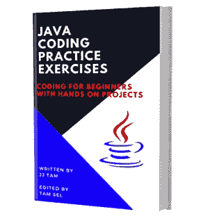
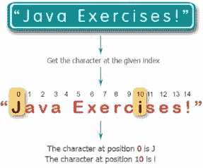
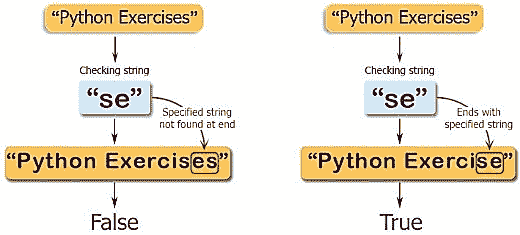
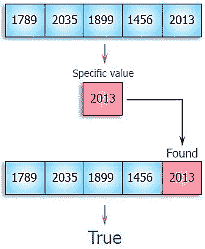
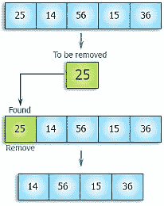
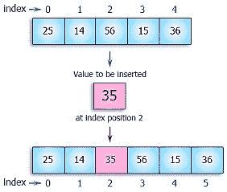
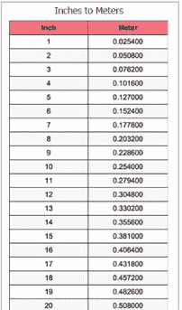

# JAVA 编码实践练习：初学者编码



# Java 字符串练习

## 获取字符串中指定索引处的字符



### JAVA 代码

```java
public class Exercise1 {
    public static void main(String[] args) {
        String str = "Java Exercises!";
        System.out.println("Original String = " + str);
        // Get the character at positions 0 and 10.
        int index1 = str.charAt(0);
        int index2 = str.charAt(10);
        // Print out the results.
        System.out.println("The character at position 0 is " + (char)index1);
        System.out.println("The character at position 10 is " + (char)index2);
    }
}
```

### 输出

```
Original String = Java Exercises!
The character at position 0 is J
The character at position 10 is i
```

## 测试给定字符串是否包含指定的字符值序列


### JAVA 代码

```java
public class Exercise8 {
    public static void main(String[] args) {
        String str1 = "PHP Exercises and Exercises";
        String str2 = "and";
        System.out.println("Original String: " + str1);
        System.out.println("Specified sequence of char values: " + str2);
        System.out.println(str1.contains(str2));
    }
}
```

### 输出

```
Original String: PHP Exercises and Exercises
Specified sequence of char values: and
true
```

## 将给定字符串与指定的字符串缓冲区进行比较

### JAVA 代码

```java
public class Exercise10 {
    public static void main(String[] args) {
        String str1 = "example.com", str2 = "Example.com";
        StringBuffer strbuf = new StringBuffer(str1);
        System.out.println("Comparing " + str1 + " and " + strbuf + ": " + str1.contentEquals(strbuf));
        System.out.println("Comparing " + str2 + " and " + strbuf + ": " + str2.contentEquals(strbuf));
    }
}
```

### 输出

```
Comparing example.com and example.com: true
Comparing Example.com and example.com: false
```

## 检查给定字符串是否以另一个字符串的内容结尾



### JAVA 代码

```java
public class Exercise12 {
    public static void main(String[] args) {
        String str1 = "Python Exercises";
        String str2 = "Python Exercise";
        // The String to check the above two Strings to see
        // if they end with this value (se).
        String end_str = "se";
        // Check first Strings end with end_str
        boolean ends1 = str1.endsWith(end_str);
        boolean ends2 = str2.endsWith(end_str);
        // Display the results of endsWith.
        System.out.println("\"" + str1 + "\" ends with " + end_str + "? " + ends1);
        System.out.println("\"" + str2 + "\" ends with " + end_str + "? " + ends2);
    }
}
```

### 输出

```
"Python Exercises" ends with "se"? false
"Python Exercise" ends with "se"? true
```

## 将给定字符串的内容转换为字节数组

### JAVA 代码

```java
import java.util.Calendar;
public class Exercise16 {
    public static void main(String[] args) {
        String str = "This is a sample String.";
        // Copy the contents of the String to a byte array.
        byte[] byte_arr = str.getBytes();
        // Create a new String using the byte array.
        String new_str = new String(byte_arr);
        // Display the contents of the byte array.
        System.out.println("\nThe String equals " + new_str + "\n");
    }
}
```

### 输出

```
The String equals This is a sample String.
```

# Java 数组练习

## 累加数组中的值


### JAVA 代码

```java
public class Exercise2 {
    public static void main(String[] args) {
        int my_array[] = {1, 2, 3, 4, 5, 6, 7, 8, 9, 10};
        int sum = 0;
        for (int i : my_array)
            sum += i;
        System.out.println("The sum is " + sum);
    }
}
```

### 输出

```
The sum is 55
```

## 计算数组元素的平均值


### JAVA 代码

```java
public class Exercise4 {
    public static void main(String[] args) {
        int[] numbers = new int[]{20, 30, 25, 35, -16, 60, -100};
        //calculate sum of all array elements
        int sum = 0;
        for(int i=0; i < numbers.length ; i++)
            sum = sum + numbers[i];
        //calculate average value
        double average = sum / numbers.length;
        System.out.println("Average value of the array elements is : " + average);
    }
}
```

### 输出

```
Average value of the array elements is : 7.0
```

## 测试数组是否包含特定值



### JAVA 代码

```java
public class Exercise5 {
    public static boolean contains(int[] arr, int item) {
        for (int n : arr) {
            if (item == n) {
                return true;
            }
        }
        return false;
    }
    public static void main(String[] args) {
        int[] my_array1 = {
            1789, 2035, 1899, 1456, 2013,
            1458, 2458, 1254, 1472, 2365,
            1456, 2265, 1457, 2456};
        System.out.println(contains(my_array1, 2013));
        System.out.println(contains(my_array1, 2015));
    }
}
```

### 输出

```
true
false
```

## 从数组中删除特定元素



### JAVA 代码

```java
import java.util.Arrays;
public class Exercise7 {
    public static void main(String[] args) {
        int[] my_array = {25, 14, 56, 15, 36, 56, 77, 18, 29, 49};
        System.out.println("Original Array : "+Arrays.toString(my_array));
        // 删除数组的第二个元素 (index->1, value->14)
        int removeIndex = 1;
        for(int i = removeIndex; i < my_array.length -1; i++){
            my_array[i] = my_array[i + 1];
        }
        // 我们无法更改数组的大小，删除后，数组中的最后一个元素和倒数第二个元素将出现两次
        System.out.println("After removing the second element: "+Arrays.toString(my_array));
    }
}
```

### 输出

```
Original Array : [25, 14, 56, 15, 36, 56, 77, 18, 29, 49]
After removing the second element: [25, 56, 15, 36, 56, 77, 18, 29, 49, 49]
```

## 向数组中插入元素



### JAVA 代码

```java
import java.util.Arrays;
public class Exercise9 {
    public static void main(String[] args) {
        int[] my_array = {25, 14, 56, 15, 36, 56, 77, 18, 29, 49};
        // 在数组的第 3 位置插入一个元素 (index->2, value->5)
        int Index_position = 2;
        int newValue = 5;
        System.out.println("Original Array : "+Arrays.toString(my_array));
        for(int i=my_array.length-1; i > Index_position; i--){
            my_array[i] = my_array[i-1];
        }
        my_array[Index_position] = newValue;
        System.out.println("New Array: "+Arrays.toString(my_array));
    }
}
```

### 输出

```
Original Array : [25, 14, 56, 15, 36, 56, 77, 18, 29, 49]
New Array: [25, 14, 5, 56, 15, 36, 56, 77, 18, 29]
```

# JAVA 基础练习

## 交换两个变量

### JAVA 代码

```java
import java.util.Scanner;
public class Main {
    public static void main(String[] args) {
        int x, y, z;
        Scanner in = new Scanner(System.in);
        System.out.println("Input the first number: ");
        x = in.nextInt();
        System.out.println("Input the second number: ");
        y = in.nextInt();
        z = x;
        x = y;
        y = z;
        System.out.println(" Swapped values are:" + x + " " + y);
    }
}
```

### 输出

```
Input the first number:
25
Input the second number:
50
Swapped values are:50 and 25
```

## 打印一个脸

### JAVA 代码

```java
public class Main {
    public static void main(String[] args) {
        String[] arra = new String[5];
        arra[0] = "++++";
        arra[1] = "[| o |]";
        arra[2] = " | ^ |";
        arra[3] = " | |";
        arra[4] = "-----+";
        for (int i = 0; i < 5; i++) {
            System.out.println(arra[i]);
        }
    }
}
```

### 输出

```
++++
[| o |]
 | ^ |
 | |
-----+
```

## 华氏度转摄氏度

### JAVA 代码

```java
import java.util.Scanner;
public class Main {
    public static void main(String[] args) {
        Scanner input = new Scanner(System.in);
        System.out.print("Input a degree in Fahrenheit: ");
        double fahrenheit = input.nextDouble();
        double celsius =((5 *(fahrenheit - 32.0)) / 9.0);
        System.out.println(fahrenheit + " degree Fahrenheit is equal to " + celsius + " Celsius");
    }
}
```

### 输出

```
Input a degree in Fahrenheit: 96
96.0 degree Fahrenheit is equal to 35.55555555555556
```

## 英制转米



### JAVA 代码


# JAVA 基础练习

## 交换两个变量

### JAVA 代码

```java
import java.util.Scanner;
public class Main {
    public static void main(String[] args) {
        int x, y, z;
        Scanner in = new Scanner(System.in);
        System.out.println("Input the first number: ");
        x = in.nextInt();
        System.out.println("Input the second number: ");
        y = in.nextInt();
        z = x;
        x = y;
        y = z;
        System.out.println(" Swapped values are:" + x + " " + y);
    }
}
```

### 输出

```
Input the first number:
25
Input the second number:
50
Swapped values are:50 and 25
```

## 打印一个脸

### JAVA 代码

```java
public class Main {
    public static void main(String[] args) {
        String[] arra = new String[5];
        arra[0] = "++++";
        arra[1] = "[| o |]";
        arra[2] = " | ^ |";
        arra[3] = " | |";
        arra[4] = "-----+";
        for (int i = 0; i < 5; i++) {
            System.out.println(arra[i]);
        }
    }
}
```

### 输出

```
++++
[| o |]
 | ^ |
 | |
-----+
```

## 华氏度转摄氏度

### JAVA 代码

```java
import java.util.Scanner;
public class Main {
    public static void main(String[] args) {
        Scanner input = new Scanner(System.in);
        System.out.print("Input a degree in Fahrenheit: ");
        double fahrenheit = input.nextDouble();
        double celsius =((5 *(fahrenheit - 32.0)) / 9.0);
        System.out.println(fahrenheit + " degree Fahrenheit is equal to " + celsius + " Celsius");
    }
}
```

### 输出

```
Input a degree in Fahrenheit: 96
96.0 degree Fahrenheit is equal to 35.55555555555556
```

## 英制转米


### JAVA 代码

```java
import java.util.Scanner;
public class Main {
    public static void main(String[] args) {
        Scanner input = new Scanner(System.in);
        System.out.print("Input a degree in Fahrenheit: ");
        double fahrenheit = input.nextDouble();
        double celsius =((5 *(fahrenheit - 32.0)) / 9.0);
        System.out.println(fahrenheit + " degree Fahrenheit is equal to " + celsius + " Celsius");
    }
}
```

*(注：用户提供的文本中 Inches to meters 标题下的代码逻辑实际上是华氏度转换，翻译时已按照指令保留了代码块内容，仅翻译标题和输出描述。)*

### 输出

```
Input a degree in Fahrenheit: 96
96.0 degree Fahrenheit is equal to 35.55555555555556
```

## 从数组中删除特定元素


### JAVA 代码

```java
import java.util.Arrays;
public class Exercise7 {
    public static void main(String[] args) {
        int[] my_array = {25, 14, 56, 15, 36, 56, 77, 18, 29, 49};
        System.out.println("Original Array : "+Arrays.toString(my_array));
        // 删除数组的第二个元素 (index->1, value->14)
        int removeIndex = 1;
        for(int i = removeIndex; i < my_array.length -1; i++){
            my_array[i] = my_array[i + 1];
        }
        // 我们无法更改数组的大小，删除后，数组中的最后一个元素和倒数第二个元素将出现两次
        System.out.println("After removing the second element: "+Arrays.toString(my_array));
    }
}
```

### 输出

```
Original Array : [25, 14, 56, 15, 36, 56, 77, 18, 29, 49]
After removing the second element: [25, 56, 15, 36, 56, 77, 18, 29, 49, 49]
```

## 向数组中插入元素


### JAVA 代码

```java
import java.util.Arrays;
public class Exercise9 {
    public static void main(String[] args) {
        int[] my_array = {25, 14, 56, 15, 36, 56, 77, 18, 29, 49};
        // 在数组的第 3 位置插入一个元素 (index->2, value->5)
        int Index_position = 2;
        int newValue = 5;
        System.out.println("Original Array : "+Arrays.toString(my_array));
        for(int i=my_array.length-1; i > Index_position; i--){
            my_array[i] = my_array[i-1];
        }
        my_array[Index_position] = newValue;
        System.out.println("New Array: "+Arrays.toString(my_array));
    }
}
```

### 输出

```
Original Array : [25, 14, 56, 15, 36, 56, 77, 18, 29, 49]
New Array: [25, 14, 5, 56, 15, 36, 56, 77, 18, 29]
```

## 寻找三个数中的最大值

## Java 条件判断语句


### JAVA 代码

```java
import java.util.Scanner;
public class Main {
  public static void main(String[] args) {
    Scanner in = new Scanner(System.in);
    System.out.print("Input the 1st number: ");
    int num1 = in.nextInt();
    System.out.print("Input the 2nd number: ");
    int num2 = in.nextInt();
    System.out.print("Input the 3rd number: ");
    int num3 = in.nextInt();
    if (num1 > num2)
      if (num1 > num3)
        System.out.println("The greatest: " + num1);
    if (num2 > num1)
      if (num2 > num3)
        System.out.println("The greatest: " + num2);
    if (num3 > num1)
      if (num3 > num2)
        System.out.println("The greatest: " + num3);
  }
}
```

### 输出

```
输入第一个数字: 25
输入第二个数字: 58
输入第三个数字: 98
最大值: 98
```

## 显示给定整数的乘法表

### JAVA 代码

```java
import java.util.Scanner;
public class Main {
  public static void main(String[] args)
  {
    int j,n;
    System.out.print("Input the number(Table to be calculated): ");
    {
      System.out.print("Input number of terms : ");
      Scanner in = new Scanner(System.in);
      n = in.nextInt();
      System.out.println ("\n");
      for(j=0;j<=n;j++)
        System.out.println(n+" X "+j+" = " +n*j);
    }
  }
}
```

### 输出

```
输入数字（要计算的乘法表）: 输入次数 : 7
7 X 0 = 0
7 X 1 = 7
7 X 2 = 14
7 X 3 = 21
7 X 4 = 28
7 X 5 = 35
7 X 6 = 42
7 X 7 = 49
```

## 显示数字直角三角形图形


### JAVA 代码

```java
import java.util.Scanner;
public class Main {
  public static void main(String[] args)
  {
    int i,j,n;
    System.out.print("Input number of rows : ");
    Scanner in = new Scanner(System.in);
    n = in.nextInt();
    for(i=1;i<=n;i++)
    {
      for(j=1;j<=i;j++)
        System.out.print(j);
      System.out.println("");
    }
  }
}
```

### 输出

```
输入行数 : 9
1
12
123
1234
12345
123456
1234567
12345678
123456789
```

## 打印金字塔形状图形


### JAVA 代码


```java
import java.util.Scanner;
public class Main {
  public static void main(String[] args)
  {
    int i,j,n,s,x;
    System.out.print ("Input number of rows : ");
    Scanner in = new Scanner(System.in);
    n = in.nextInt();
    s=n+4-1;
    for(i=1;i<=n;i++)
    {
      for(x=s;x!=0;x--)
      {
        System.out.print(" ");
      }
      for(j=1;j<=i;j++)
      {
        System.out.print(i+" ");
      }
      System.out.println();
      s--;
    }
  }
}
```

### 输出

输入行数 : 7

         1

        2 2

      3 3 3

    4 4 4 4

    5 5 5 5 5

  6 6 6 6 6

  7 7 7 7 7 7

## 打印两个数之和

### JAVA 代码

```java
import java.util.Scanner;
public class Main {
  public static void main(String[] args)
  {
    Scanner input = new Scanner (System.in);
    System.out.print("Input the first number: ");
    int num1 = input.nextInt();
    System.out.print("Input the second number: ");
    int num2 = input.nextInt();
    int sum = num1 + num2;
    System.out.println();
    System.out.println("Sum: "+sum);
  }
}
```

### 输出

输入第一个数字: 545

输入第二个数字: 455

和: 1000

## 两个数除法并打印到屏幕上

### JAVA 代码

```java
import java.util.Scanner;
public class Main {
  public static void main(String[] args)
  {
    Scanner input = new Scanner (System.in);
    System.out.print("Input the first number: ");
    int a = input.nextInt();
    System.out.print("Input the second number: ");
    int b = input.nextInt();
    int d = (a/b);
    System.out.println();
    System.out.println("The division of a and b is:" +d);
  }
}
```

### 输出

输入第一个数字: 100

输入第二个数字: 25

`a`除以`b`的结果为:4
