# Java：极度急躁者的初学者完全指南

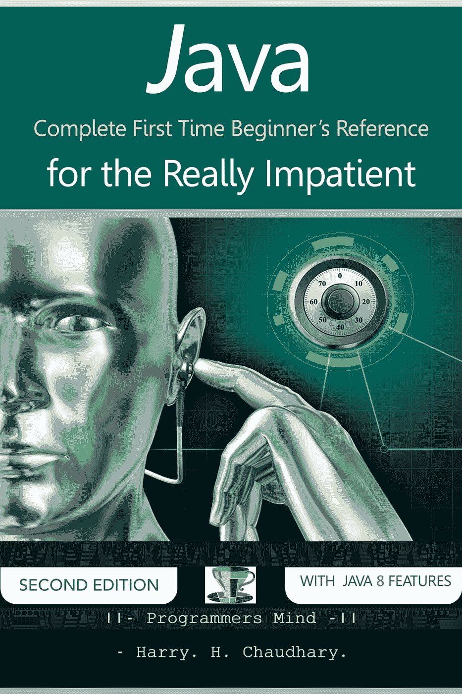


## 献言

“本书献给所有做出牺牲的人。”

## 关于作者

Harry 是一位匿名黑客客、GOC 知名计算机程序员、畅销的 Java 作者以及科学黑客专业人士，在计算机编程、黑客和网络安全领域拥有独特经验。他曾帮助全球许多国家政府和许多跨国软件公司保护其网络和安全。他编写了多本关于各种计算机编程语言以及计算机安全与黑客的书。他是一名技术毕业的软件工程师和硕士。他是 C 编程、C++ 编程以及核心 Java、数据结构和算法领域的权威。他拥有超过 5 年的软件方法论经验。他的教学和研究兴趣在人工智能、编程语言领域。

他过着两种生活。一种生活是一家正直软件公司的计算机程序编写员；另一种生活在计算机里，他的黑客称号是 `Chief Hacker – Captain Harry`。目前，他在世界著名的社区——匿名国际组织担任线下 IT 经理。-Anonymous 团队。

## 作者自白

你可能注意到这里缺少了一些东西：没有令人印象深刻的资。我没有在某著名大学当过二十多年的教授；也不是硅谷巨头公司的高管。在某些方面，我是一个技术的学生，就像你一样。

多年的经验告诉我，许多最了解技术工作原理的人，在解释他们所知道的知识方面并不成功。我的兴趣不在于成为一个专家，而在于作为一个教育者，以一种合逻辑、易于理解且有趣的方式呈现复杂的信息。

“什么是真实？你如何定义真实？如果你谈论的是你可以感觉到的、闻到的、尝到的和看到的，那么真实仅仅是由大脑解释的电信号。”

“……我才开始发现在纸上表达想法有多困难。只要它完全由描述组成，就很容易；但涉及到推理时，建立一个正确的联系、清晰度和适度的流利度，对我来说……”

– Harry.


# 前言

## ∞ Essential Java 技能——变得简单！∞

从畅销 Java 编程作者 Harry H. Chaudhary（销量已超过 167,000 本！）那里，短时间内学习 Java 编程的所有基础和高级特性。这本 Java 指南从基础开始，通过数千行 Java 代码详细引导你进入 Java 的高级功能，我承诺这本书将让你成为 Java 专家级冠军。任何人都可以通过这本书在专家水平上学习 Java。

工程学生和新手开发者也可以使用这本书。这本书涵盖了所有计算机科学专业学位的通用核心大纲。如果你是认真的，请继续通过这本终极 Java 书开启你的一天。

这本 Java 书的主要目标不仅仅是给你 Java 编程知识，我遵循了一种模式，通过对数千行代码的问题进行改进，并对每个 Java 主题问题带有不同 复杂度的清晰理论说明，你将为复杂的 Java 问题找到多种解决方案。

## 特别之处 –

在书中，我为开发者详细涵盖并解释了最新 Java 8 特性的几个主题：Java 8 特性 – Lambda。Java 8 函数式接口、`Stream` 与时间 API。Java 8。“如果你谈论的是你可以感觉到的、闻到的、尝到的和看到的，那么真实仅仅是由大脑解释的电信号。” “……我才开始发现在纸上表达想法有多困难。只要它完全由描述组成，就很容易；但涉及到推理时，建立一个正确的联系、清晰度和适度的流利度，对我来说……” “什么是真实？你如何定义真实？如果你谈论的是你可以感觉到的、闻到的、尝到的和看到的，那么真实仅仅是由大脑解释的电信号。” 技术工作原理。多年的经验告诉我，许多最了解技术工作原理的人，在解释他们所知道的知识方面并不成功。我的兴趣不在于成为一个专家，而在于作为一个教育者，以一种合逻辑、易于理解且有趣的方式呈现复杂的信息。 “什么是真实？你如何定义真实？如果你谈论的是你可以感觉到的、闻到的、尝到的和看到的，那么真实仅仅是由大脑解释的电信号。” “……我才开始发现在纸上表达想法有多困难。只要它完全由描述组成，就很容易；但涉及到推理时，建立一个正确的联系、清晰度和适度的流利度，对我来说……”

# ∞ 章节一览 ∞

前言。Java 概述。Java 语言。控制语句。`Scanner` 类、数组与命令行参数。Java 中的类与对象。Java 中的继承。面向对象编程。Java 中的包。Java 接口。String 和 `StringBuffer`。异常处理。多线程编程。修饰符/可见模式。包装类。Java 中的输入/输出。Applet 基础。抽象窗口工具包 (AWT)。AWT 事件简介。AWT 中的绘制。`java.lang.Object` 类。集合框架。Java 8 特性 – Lambda。Java 8 函数式接口、`Stream` 与时间 API。使 Java 比其他语言更安全的特性。

在整书中，我们讨论了许多类库。类库主要由编译器供应商提供，但许多类库由独立软件供应商（ISV）提供。此外，许多类库可以通过互联网和万维网以免费软件或共享软件的形式获取。你可以下载免费软件产品并免费使用，但须遵守版权所有者指定的任何限制条件。

## 典型 Java 环境的基础

Java 系统通常由几个部分组成：环境、语言、Java 应用程序接口（API）以及各种类库。下面的讨论解释了一个典型的 Java 程序开发环境，Java 程序通常通过五个阶段进行执行。这些阶段是：编辑、编译、加载、验证和执行。后续描述使用了标准的 `Java SE 7 Development Kit`（`JDK 7`），该内核可通过 `Oracle` 获取。

如果你使用的是不同的 Java 开发环境，则可能需要遵循不同的程序来编译和执行 Java 程序。在这种情况下，请咨询你的编译器文档以获取详情。

**注意：** 如果你没有使用 `UNIX/Linux`、`Windows 95/98/ME` 或 `Windows NT/2000`，请参考您系统 Java 环境的手手册，或询问您的导师如何在您的环境中完成这些任务（该环境可能与此处相似）。

### 阶段 1：编辑文件

这是通过编辑器程序（通常称为编辑器）完成的。程序员使用编辑器输入 Java 程序，并在必要时进行修正。当程序员指定保存编辑器中的文件时，程序会被存储在次级存储设备上，如磁盘。Java 程序文件名以 `.java` 扩展名结尾。

在 `UNIX/Linux` 系统上广泛使用的两个编辑器是 `vi` 和 `emacs`。在 `Windows 95/98/ME` 和 `Windows NT/2000` 上，简单的编辑程序如 `DOS Edit` 命令和 `Windows Notepad` 就足够了。

Java 集成开发环境（IDE），如 `Forte for Java Community Edition`、`NetBeans`、`Borland’s JBuilder`、`Symantec’s Visual Cafe` 和 `IBM’s Visual Age` 都内置了集成到编程环境中的编辑器。

### Java 与 C

我们假设读者知道如何编辑文件。`Java` 等语言是面向对象的——在此类语言上编程被称为面向对象编程（OOP），它允许设计人员将面向对象的设计实现为运行的系统。相比之下，`C` 等语言是过程化编程语言，因此编程倾向于以操作为中心。

在 `C` 中，编程单元是 `function`（函数）。在 `Java` 中，编程单元是 `class`（类），对象最终从中实例化（“创建”的高级术语）。`Java` 类包含 `methods`（方法，实现类行为）和 `attributes`（属性，实现类数据）。

`C` 程序员专注于编写 `functions`。执行某些共同任务的操作组组合成 `functions`，函数被组合成程序。数据在 `C` 中固然重要，但观点是数据主要存在是为了支持函数所执行的动作。系统规范中的动词帮助 `C` 程序员确定实现该系统所需的函数集。

`Java` 程序员专注于创建他们自定义的类型，称为 `classes`（类）和 `components`（组件）。每个 `class` 包含数据以及操纵这些数据的函数集。`Java` 类的数据组件被称为 `attributes`（属性）。

`Java`类的函数组件被称为 `methods`（方法）。正如 `int` 等内置类型的实例被称为 `variable`（变量）一样，用户定义类型（即 `class`）的实例被称为 `object`（对象）。程序员使用内置类型作为构建用户定义类型的“构建块”。

`Java` 的重点是 `classes`（我们从中创建对象）而不是 `functions`。系统规范中的名词帮助 `Java` 程序员确定 `classes` 的集合，通过这些类创建对象，这些对象将协同工作以实现系统。

`Classes` 之于 `objects` 正如蓝图之于房屋。我们可以从一张蓝图建造许多房屋，也可以从一个 `class` 实例化许多 `objects`。`Classes` 与其他 `classes` 建立关系。

例如，在银行的面向对象设计中，“银行出纳员” `class` 需要与“客户” `class` 建立联系。这些关系被称为关联（associations）。我们将看到，当软件被封装成类时，这些类可以在未来的软件系统中被重用。相关的类类组通常被封装为可重用的组件。

你创建的每个新类都有潜力成为一个有价值的软件资产，你和其他程序员可以使用它来加速并提高未来软件开发工作的质量——这是一个令人兴奋的可能性。

## Java 与 C、C++ 和 C# 的关系

`Java` 从 `C` 继承了语法，从 `C++` 继承了面向对象的特性。它不是 `C++` 的增强版本。`Java` 向上也不向下兼容 `C++`。我想告诉你的一个重要点是，`Java` 语言的设计并不是为了取代 `C++` 和 `C#`。微软开发的另一种用于支持 `.NET Framework` 的语言 `C#` 与 `Java` 密切相关，因为它们共享 `C++` 和 `C` 风格的语法，支持分布式编程，并使用相同的对象模型。

## Java 的主要目标是实现 -

### 1. 安全

当我们使用兼容 Java 的浏览器时，没有病毒感染的威胁。此外也没有恶意程序从本地机器收集隐私信息（如信用卡号、银行账户余额和密码）的威胁。

### 2. 可移植性

`Java` 程序可以在运行不同操作系统和硬件计算机之间迁移。

## Java 字节码

Java 编译器的输出是字节码而非机器码（`.class` 文件）。字节码是一组高度优化的指令，旨在由 Java 运行时系统执行，系统被称为 `JVM`（Java 虚拟机）。

`JVM` 是解释字节码的解释器。编译后的程序运行更快，但 Java 仍然使用解释器来实现可移植性，因此运行速度较慢。通过 Java 编译器编译的程序可以在任何环境中运行，但每个平台都需要实现 `JVM`。Java 程序是被解释执行的。

## JIT（即时编译）

`JIT` 是 `JVM` 使用的翻译器，用于将字节码翻译成实际机器码。它不翻译整个 `bytecodes`，而是根据需要逐段翻译。

## Java 的各个版本

- Java 1：`JDK 1.0`、`JDK 1.1`
- Java 2：`JDK 1.2`、`JDK 1.3`、`JDK 1.4`、`JDK 1.5` 或 `JDK 5`、`JDK 1.6` 或 `JDK 6`
- Java 1.7：`SE 7`
- Java SE 8 `Java 8`（2014 年 4 月）

**注意 1：** `JDK`（Java 开发包）

**注意 2：** 旧 Java 版本的许多功能已被新 Java 版本弃用，但我们仍然可以使用它们。

## Java 可以开发的应用程序类型

1. **独立应用程序 (Standalone Applications)**：独立应用程序是在本地计算机操作系统下运行的程序，类似于 `C` 或 `C++` 程序。

2. **Applet（Applets）**：Applet 是一种跨互联网传输并在客户端机器上兼容 Java 的浏览器（如 `Internet Explorer` 或 `Netscape Navigator`）中执行的小程序。

Applet 实际上是一个通过网络动态下载型 Java 程序。Applet 程序存储在 Web 服务器上，并在客户端请求时传输到客户端。

Applet 无法像独立应用程序一样执行。Applet 只能通过嵌入 HTML 页面（类似于声音文件、图像文件或视频片段）来执行。

现在这个嵌入了小程序（applet）的 HTML 页面可以在本地机器上通过浏览器下载该 HTML 页面后运行。小程序是一种可以响应用户输入并进行动态变化的程序。它不会重复播放相同的动画或声音。

### 1. Web 应用程序

这些是运行在 Web 服务器上的程序。当我们通过在网络浏览器中指定 `URL`（通用资源定位符）访问网站时，网络浏览器会向 Web 服务器发送针对特定网站的请求。接收到请求后，服务器会运行一个程序，该程序被称为 Web 应用程序。我们使用 `Java Servlets` 和 `JSP`（`Java Server Pages`）来编写此类程序。

这些程序在服务器上运行，并将结果/响应发送给客户端。`JSP` 页面可以被视为 `HTML` 和 `Java 代码` 的结合。Web 服务器在执行之前会将 `JSP` 页面转换为 `Java Servlets`。

当客户端请求特定的 `URL` 且该 `URL` 对应于 `HTML` 页面时，Web 服务器直接将 `HTML` 页面返回给客户端，由客户端进行显示。如果 `URL` 对应于 `servlet` 或 `JSP`，则它会在服务器上执行，并将结果/响应返回给客户端，再由客户端显示。

### 2. 分布式应用程序

Java 应用被分为可以在独立机器上运行的小程序。这些程序中使用的对象可以相互通信。这些应用程序被称为分布式应用程序。这允许两台不同计算机上的对象远程执行过程。为此使用了 `RMI`（远程方法调用）。

––––––––

## Java 的特性：

### 1. 简单

`Java` 的语法几乎与 `C` 和 `C++` 相似，因此熟悉 `C/C++` 的程序员无需从头开始学习语法。但 `C/C++` 中许多复杂或导致歧义的特性在 `Java` 中已被移除。

1. `Java` 不支持多继承，因为这一概念较为复杂并可能导致歧义。
2. `Java` 不支持全局变量，这也导致了 `C/C++` 程序中出现许多 bug。
3. `Java` 不使用 `pointers`（指针）且不允许 `pointer arithmetic`（指针运算），这是 bug 的产生源。
4. `Java` 不支持运算符重载。
5. `Java` 具有自动垃圾回收机制，简化了内存管理。

### 2. 安全

Java 程序运行在 `JVM`（Java 虚拟机）内部，提供了一个沙箱环境。这确保了安全性。Java 有三个主要组件：

1. `Class loader`（类加载器）
2. `Bytecode verifier`（字节码验证器）
3. `Security manager`（安全管理器）

### 3. 可移植

Java 具有高度的可移植性，因为源代码被编译成 `bytecode`，可以在任何带有 `JVM` 的平台上执行。这遵循了“编写一次，随处运行”的哲学。

### 4. 解释型与高性能

Java 程序是解释执行的，但由于各种优化，与其他解释器相比，它们的运行速度仍然很快。

### 5. 分布式

Java 是为互联网的分布式环境设计的。它内置支持各种基于 `TCP/IP` 的协议。事实上，使用 `URL` 访问资源类似于访问本地机器上的文件。Java 还具有远程方法调用（`RMI`）的功能。

### 6. 动态

每个 `Java` 类都是一个独立的执行单元。类只有在需要时才会在运行时加载。`Java` 中绑定方法的默认机制也是动态的（运行时绑定）。

### 7. 多线程

Java 设计用于满足创建交互式、网络化程序的现实需求。Java 提供了编写多线程程序的支持以实现这一目标。这允许程序员编写可以并发执行许多任务的程序。例如，基于 `GUI`（图形用户界面）的应用程序可能正在用户事件并采取适当的操作，另一个线程可能正在打印，而另一个线程可能正在从网络下载文件。

## 运行独立 Java 应用程序

当 `C` 或 `C++` 程序被编译时，它会被直接翻译成特定处理器或特定平台的机器码。但运行 Java 程序是一个两步骤的过程。在 Java 中，从源代码到可执行代码的转换是通过两个翻译器实现的：

# Java 编程概览

1. **Java 编译器** - 首先，Java 程序被编译成字节码。字节码就像机器码，但不是针对特定处理器器或平台的。字节码不能直接执行。

2. **Java 解释器 (JVM)** - Java 解释器通过 `JIT` 将字节码翻译成特定平台的实际机器码。

**注意 1** - `C` 或 `C++` 程序只编译一次，但 Java 字节码在我们每次执行 Java 程序时都会被翻译。因此，与 `C/C++` 程序相比，Java 程序的运行速度稍慢。

**注意 2** - 运行 Java 程序，我们需要一个文本编辑器（记事本或 Edit）、`JDK`（Java 开发工具包）以及 `JVM`（许多操作系统已预安装）。我们也可以使用 `Eclipse` 或 `JCreater` 来代替记事本。

## 安装

### 在 win xp 上安装 Java 1.7 -

双击 `我的电脑` $\rightarrow$ 双击 `光驱器` $\rightarrow$ 双击 `JDK1.7 Java 安装文件` $\rightarrow$ 点击 `Next`、`Next`、`.....`

### 设置路径 -

如果我们设置了 Java 文件夹的路径，那么就可以从任何地方运行 Java 程序，否则我们必须在 Java 的 `bin` 文件夹中运行 Java 程序。


右键点击`我的电脑`$\rightarrow$`属性`$\rightarrow$`高级`$\rightarrow$`环境变量`$\rightarrow$点击`Path`然后点击`编辑`$\rightarrow$点击变量值$\rightarrow$按`END`键将光标移动到行尾$\rightarrow$现在输入`c:\program files\Java\jdk1.7.0_01\bin;`然后点击`OK`、`OK`、`OK`。

### 为 Java 程序创建文件夹：

双击`我的电脑`$\rightarrow$双击`C 盘`$\rightarrow$右键$\rightarrow$`新建`$\rightarrow$`文件夹`$\rightarrow$输入`JAVAPRG`$\rightarrow$按`Enter`并关闭“我的电脑”。

## 运行 Java 程序

### 在命令提示符上运行 Java 程序的步骤：

- **步骤 1**：进入命令提示符

  `开始`$\rightarrow$`运行`$\rightarrow$输入`cmd`并点击`确定`。

- **步骤 2**：输入`CD \ JAVAPRG`并按`Enter`。

- **步骤 3**：输入`Edit Sum.Java`并按`Enter`。

- **步骤 4**：输入 Java 程序并点击`文件`$\rightarrow$`保存`然后点击`文件`$\rightarrow$`退出`。

- **步骤 5**：输入`javac Sum.Java`并按回车进行编译。这将创建一个`Sum.class`文件。该文件被称为字节码。

- **步骤 6**：输入`java Sum`并按回车运行。这将调用`JVM`。

- **步骤 7**：输入`Exit`然后按回车退出命令提示符。

**注意** - 我们也可以通过上述步骤使用`记事本`运行 Java 程序，但不再使用`Edit`命令，而是使用`记事本`。在输入 Java 程序后，在另存为对话框中选择“所有文件”，将其保存到文件夹`C:\JAVAPRG`。编译和运行需要遵循上述步骤。

## Java 程序语法

```java
class <class name>
{
    public static void main(String args[]) or (String [] args)
    {
        // - - - - - - - - - -
    }
}
```

# 示例

### 第一个 Java 程序 - 两个数字相加 (Sum.Java)

```java
class Sum
{
    public static void main(String args[])
    {
        int a,b,sum;
        a = 5;
        b = 6;
        sum = a + b;
        System.out.print("Sum is " + sum); //输出
    }
}
```

**输出：**`Sum is 11.`

### 示例 1.2 交换两个数字程序 (Swap.Java)

```java
class Swap
{
    public static void main(String args[])
    {
        int a=5,b=7;
        t = a;
        a = b;
        b = t;
        System.out.print("After Swap Values are " + a + "," + b);
    }
}
```

**输出：**`After Swap Values are 7,5`

## 语言规则

- **注释** - 注释有三种类型：

    - 单行注释：`//`

    - 多行注释：`/* */`

    - 文档注释：`/** */`

- 每个 Java 程序都必须包含一个类。在 Java 中，`main()`方法只能定义在类内部。

- 源文件可以包含任意数量的类和/或接口定义，但最多有一个公共类或接口。

- 源文件可能包含也不包含带有`main()`方法的类，但一个独立的 Java 程序始终从`main()`方法开始执行。因此，我们想要开始执行的类必须在其中定义了`main()`方法。

- `main()`方法必须始终具有以下签名：`public static void main(String args[])`

- **注意** - 在 Java 中，方法原型被称为签名（signature）。

- 关键字`public`表示该方法可以从任何地方访问。

- 关键字`static`表示`main()`可以在不创建对象的情况下被调用。

- 关键字`void`表示`main()`不返回任何值。

- `System`是一个提供系统访问的预定义类，而`out`是连接到控制台的输出流。

## Java 程序结构

- **文档部分** - 文档部分包含一组注释，给出程序名称、作者以及程序员在以后阶段可能参考的其他信息。

- **包语句** - 源文件最多有一个包语句。如果存在包语句，它必须是 Java 程序的第一个语句。

- **导入语句** - 源文件可以包含零或多个导入语句。导入语句类似于 C/C++ 中的`#include`语句。

- **接口语句** - 接口类似于类，但包含一组方法声明。这也是一个可选部分，仅在我们希望程序中实现多重继承特性时使用。

- **不包含 main 方法的类定义** - 类是 Java 程序的核心元素。这些类用于映射现实世界的对象。

- **包含 main 方法的类定义** - 由于每个独立的 Java 程序都需要`main`方法作为起点，该类是 Java 程序的关键。

## 垃圾回收

Java 对象的内存分配是完全动态的，但 Java 不像 C/C++ 那样支持指针算术。每当我们运行 Java 程序时，JVM 也会后台运行另一个名为`垃圾回收器`(Garbage Collector) 的程序。垃圾回收器会持续检查 Java 对象。

当一个 Java 对象不再被使用时，它会被垃圾回收器（Garbage Collector）收集，也就是说为对象分配的内存被添加到空闲内存的`pool/heap`中并重用。这在很大程度上简化了程序员的任务。这也消除了许多由于不当使用指针算术和显式释放内存等内存管理功能引起的错误。

# 单选题：

1. 下面哪项是应用程序`main( )`方法的有效定义？

(a)`public static void main();`

(b)`public static void main( String args );`

(c)`public static void main( String args[] );`

(d)`public static void main( Graphics g );`

(e)`public static boolean main( String args[] );`

2. 哪个组织开发了 Java 语言？

(a) Microsoft (b) IBM

(c) Sun Microsystems Inc. (d) AT&T

3. Java 属于以下哪种语言？

(a) 面向对象 (b) 过程化

(c) (a) 和 (b) 都是 (d) 以上都不是

4. 下面哪项不是正确的陈述？

(a) Java 的垃圾回收是自动的。

(b) Java 支持分布式应用。

(c) 相比 C/C++，Java 效率更高。

(d) 相比 C/C++，Java 更安全。

5. 下面哪项是正确的陈述？

(a) Java 是一种平台无关语言？

(b) Java 是一种面向对象的语言？

(c) Java 支持多线程。

(d) 以上都是。

答案：1. (c) 2. (c) 3. (a) 4. (c) 5. (d)

# 简答题：

1. 解释 Java 虚拟机 (`JVM`) 的工作原理。

2. C++ 和 Java 有什么区别？

3. “APPLET”（程序）与“APPLICATION”（应用程序）的区别。

4. Java 的缺点。

5. 垃圾回收是如何工作的？

6. 什么是`BYTE Code`（字节码）？

7. Java 是完全面向对象的编程吗？如果不是，为什么？

8. Java 应用程序/程序有哪些类型？

9. Java 可执行文件的扩展名是什么？

10. Java 源文件/程序文件的扩展名是什么？

11. 使用什么命令编译 Java 程序？

12. 哪个组织开发了 Java 语言？

13. 是什么让 Java 具有平台性？

14. 为什么相比 C/C++，Java 是一种更安全的语言？

15. 为什么相比 C 语言，Java 是一种更健壮的语言？

16. 什么是分布式应用？

17. 描述 Java 的四个特性。

18. 描述编译和运行 Java 程序所需的步骤。

19. Java 流行的主要原因是什么？

20. 为什么 C/C++ 的许多特性在 Java 中被删除了？列出这些特性。

21. 写出 Java 中的三种注释。

22. 列出 C 和 Java 之间的 10 个主要区别。

23. 描述典型 Java 程序的结构。

# 编程练习：

1. 写一个程序计算两个整数的平均值。

2. 写一个程序在不使用`3^(rd)`变量的情况下交换两个数字。

3. 写一个程序将小时、分钟和秒转换为总秒。

4. 写一个程序计算给定圆的面积和周长。


# 章节

# ∞ 2 ∞

## (Java 语言)

––––––––

## 标记 (Tokens)

最小的独立单元被称为标记，如关键字、标识符、常量、字符串和运算符。

A. 关键字是语言的保留名称，不能用作变量、函数等的名称。

B. 标识符是指变量、数组、函数、类、接口等等的名称。

C. 常量/字面量是指程序中不能更改的固定值。

D. 运算符是在变量和常量上操作的特殊符号，并构成表达式。

E. 分隔符是用于分隔语句的特殊字符，如`( )``{ }``[ ]``;``,``.`

––––––––

## A. 关键字

`abstract``continue``goto``package``synchronized`

`assert``default``if``private``this`

`boolean``do``implements``protected``throw`

`break``double``import``public``throws`

`byte`

`byte``else``instanceof``return`

`char``extends``int``try`

`float``finally``long``volatile`

`class``native``super``while`

`case``new``switch`

## B. 标识符

标识符是指变量、数组、函数、类、接口等的名称。

## C. 常量/字面量

常量/字面量是指程序中不能更改的固定值。

## D. 运算符

运算符是在变量和常量上操作的特殊符号，并构成表达式。

## E. 分隔符

分隔符是用于分隔语句的特殊字符，如`( )``{ }``[ ]``;``,``.`

- 对于`int`类型，除以零或对零取模会导致`ArithmeticException`（运行时错误），但在浮点数情况下则不会。

- 当我们对`int`应用算术运算符且结果超出`int`的范围范围时，额外的高位位将被截断，这个新值将赋值给接收结果的变量；但在浮点类型中，如果溢出，结果将是`Infinity`或`–Infinity`；如果在下溢的情况下，结果将为`0`。

### 递增与递减运算符 (`++`, `--`)

这些运算符与`C`/`C++`中的相同。

```java
int a=5,b;
b = ++a*++a;
System.out.print(b);    //42

a = 5; 
System.out.print(++a*++a);  //42
```

### 关系运算符 (`<`, `>`, `<=`, `>=`, `instanceof`)

这些运算符与`C`/`C++`中的相同，但`<`, `<=`, `>`, `>=`不能应用于布尔类型和引用类型。

### `instanceof`运算符`-:`

`instanceof`运算符用于测试对象的类型。`instanceof`运算符的通用形式为：

```java
if(object instanceof type)
```

在这里，`object`是一个类的实例，`type`是一个类类型。如果`object`是指定类型的实例，或者是指定类型任何子类的实例，则`instanceof`运算符返回`true`，否则其结果为`false`。

### 赋值运算符 (`=`, `+=`, `-=`, `*=`, `/=`, `%=`)

这些运算符与`C`/`C++`中的相同。

### 等于运算符 (`==`, `!=`)

这些运算符与`C`/`C++`中的相同。

### 逻辑运算符 (`&&`, `||`, `!`)

这些运算符与`C`/`C++`中的相同。

### 条件运算符 (`? :`)

此运算符与`C`/`C++`中的相同。

### 位运算运算符 (`&`, `|`, `^`, `~`, `<<`, `>>`, `>>>`)

这些运算符与`C`/`C++`中的相同，移位运算符除外。移位运算符仅适用于整数类型。

### 左移 (`<<`) 运算符

要获得`<<`运算符的结果，左侧操作数的位将根据右侧操作数指定的位数向左移动，右侧的空位将用零填充。左移`1`等于乘以`2`。结果的符号可能与左侧操作数的符号不同。这可能是因为符号取决于最左边的位，而该位可能会从`0`变为`1`或从`1`变为`0`，导致符号改变。

示例`b = a << 2;`。要获得`b`的值，将`a`中的位左移`2`位，并在右侧两位填充零。

### 右移 (`>>`) 运算符（有符号）

要获得`>>`运算符的结果，左侧操作数的位将根据右侧操作数向右移动，左侧的空位将用符号位填充。右移`1`等于除以`2`。此运算符永远不会改变结果的符号，即与左侧操作数的符号相同。

示例`b = a >> 2;`。要获得`b`的值，将`a`中的位右移`2`位，并在右侧两位填充符号位（如果`a`为正则填充`0`，如果`a`为负则填充`1`）。

### 零填充右移 (`>>>`) 运算符（无符号）

要获得`>>>`运算符的结果，左侧操作数的位将根据右侧操作数向右移动，左侧的空位将用`0`填充。右移`1`等于除以`2`。如果发生了移位，结果将始终为正数，因为最右侧位将变为零。


### 运算符优先级:-

| 级 | 运算符 | 描述 | 结合性 |
| :--- | :--- | :--- | :--- |
| 1 | `()` `[` `]` `.` | 函数调用 下标 直接成员访问 | 从左到右 |
| 2 | `++` `--` `~` `!` | 递增 递减 位取反 逻辑取反 | 从右到左 |
| 3 | `*` `/` `%` | 乘法 除法 取模 | 从左到右 |
| 4 | `+` `-` | 加法 减法 | 从左到右 |
| 5 | `>>>` `>>` `<<` | 无符号右移 有符号右移 左移 零填充填充 | 从左到右 |
| 6 | `>>=` `<<=` `instanceof` | 大于 大于等于 小于 小等于 | 从左到右 |
| 7 | `==` `!=` | 等于 不等于 | 从左到右 |
| 8 | `&` | 位与 | 从左到右 |
| 9 | `^` | 位异或 | 从左到右 |
| 10 | `\|\|` | 位或 | 从左到右 |
| 11 | `&&` | 逻辑与 | 从左到右 |
| 12 | `\|\|` | 逻辑或 | 从左到右 |
| 13 | `? :` | 条件运算符（三元运算符） | 从右到左 |
| 14 | `=` `+=` `-=` `*=` `/=` `%=` `&==` `^=` `\||=` `<<=` `>>=` `>>>=` `&&=` `\|\|=` | 赋值（复合赋值） | 从左到右 |

| 符号 | 名称 | 目的 |
| :--- | :--- | :--- |
| `()` | 圆括号 | 用于参数列表 |
| `[]` | 中括号 | 用于声明数组 |
| `{}` | 大括号 | 用于代码块 |
| `.` | 点 | 用于访问成员 |
| `;` | 分号 | 终止语句 |
| `,` | 逗号 | 分隔标识符 |
| `:` | 冒 | 用于包名 |


### 数据类型:-

Java 中的数据类型大致分为两类：

### 1. 基本数据类型 / 简单类型

Java 是面向对象的，但基本数据类型不是对象。它们是其他类型的基础。

**数值类型**

*整数类型：*

- `byte` (1 字节)：范围`-128`到`127`

- `short` (2 字节)：范围`-32768`到`32767`


- `int` (4 字节)：范围 `-2147483648` 到 `2147483647`
- `long` (8 字节)：范围 `-9223372036854775808` 到 `9223372036854775807`

包含 `byte`、`short`、`int` 的表达式会自动转换为 `int`。

**浮点数类型：**

- `float` (4 字节)：范围 `1.40129846432481E-45` 到 `3.40282346638528E38`
- `double` (8 字节)：范围 `4.9E-324` 到 `1.7976931348623157E308`

**布尔类型：** `boolean`

**字符类型：**

- `char` (2 字节)：范围 `0` 到 `65535`

注意：Unicode 集合的前 128 个字符与 7 位 ASCII 字符集相同，前 256 个字符对应扩展 ASCII（8 位 ISO Latin-1）字符集。

Java 字符也可以用于整数表达式。当字符作为整数表达式的一部分时，使用的是 Unicode 值。

### 2. 非基本数据类型 / 派生类型或引用类型

引用类型也被称为派生类型，因为它们源自基本数据类型。

**类 (Classes)**

- 内置/库类
- 用户定义类

**接口 (Interfaces)**

- 内置/库接口
- 用户定义接口

**数组 (Arrays)**

数组也被视为对象。

**变量**

变量是存储值的内存的位置名称。在变量中存储值之前，必须先声明变量。

三种变量：

#### 局部变量

局部变量用于块或方法内部。局部变量（也称为自动变量）默认不会进行初始化。局部变量在首次使用之前必须显式初始化，否则会出现编译时错误“Variable might not have been initialized”（变量可能初始化）。

#### 示例

```java
int a,b=5;
if(b>2)
{
    a = b;
}
System.out.print(a);
```

在上述程序中，如果 `if` 条件为假，则 `a` 的值未定义，因此编译器将给出错误“Variable a might not have been initialized”。

在 Java 中，我们不能在内部块中定义与外部块同名的变量。

```java
int a=5;
{
    int a=7;  // 错误
}
```

#### 实例变量

实例变量用于定义对象的属性或状态。

#### 类变量

类变量用于定义属性/状态，这对于一个类的所有对象都是通用的。

### Math 类的库方法

注意 - 使用上述方法时，我们必须加上 `Math` 类名。

| 方法 | 描述 |
| :--- | :--- |
| `public static double sin(double x)` | 返回弧度角 `x` 的正弦 |
| `public static double cos(double x)` | 返回弧度角 `x` 的余弦 |
| `public static double tan(double x)` | 返回弧度角 `x` 的正切 |
| `public static double asin(double x)` | 返回正弦为 `x` 的角度 |
| `public static double acos(double x)` | 返回余弦为 `x` 的角度 |
| `public static double atan(double x)` | 返回正切为 `x` 的角度 |
| `public static double toRadians(double x)` | 将角度 `x` 转换为弧度 |
| `public static double toDegrees(double x)` | 将弧度 `x` 转换为角度 |
| `public static double exp(double x)` | 返回 `e` 的 `x` 次幂 (`e^x`) |
| `public static double log(double x)` | 返回 `x` 的自然对数 |
| `public static double log10(double x)` | 返回 `x` 的底数为 10 的自然对数 |
| `public static double sqrt(double x)` | 返回 `x` 的平方根 |
| `public static double ceil(double x)` | 返回大于或等于 `x` 的最小整数（向上取整） |
| `public static double floor(double x)` | 返回小于或等于 `x` 的最大整数（向下取整） |
| `public static double rint(double x)` | 返回 `x` 的舍五入值 |
| `public static double atan2(double x, double y)` | 返回正切值为 `x/y` 的角度 |
| `public static double pow(double x, double y)` | 返回 `x` 的 `y` 次幂 (`x^y`) |
| `public static int round(float x)` | 返回 `int` 类型的 `x` 舍五入值 |
| `public static long round(double x)` | 返回 `long` 类型的 `x` 舍五入值 |
| `public static double random()` | 返回 0 到 0.999999999999999999 之间的随机数 |
| `public static int abs(int x)` | 返回 `x` 的绝对值 |
| `public static long abs(long x)` | 返回 `x` 的绝对值 |
| `public static float abs(float x)` | 返回 `x` 的绝对值 |
| `public static double abs(double x)` | 返回 `x` 的绝对值 |
| `public static int max(int x, int y)` | 返回 `x` & `y` 的最大值 |
| `public static long max(long x, long y)` | 返回 `x` & `y` 的最大值 |
| `public static float max(float x, float y)` | 返回 `x` & `y` 的最大值 |
| `public static double max(double x, double y)` | 返回 `x` & `y` 的最大值 |
| `public static int min(int x, int y)` | 返回 `x` & `y` 的最小值 |
| `public static long min(long x, long y)` | 返回 `x` & `y` 的最小值 |
| `public static float min(float x, float float)` | 返回 `x` & `y` 的最小值 |
| `public static double min(double x, double y)` | 返回 `x` & `y` 的最小值 |
| `public static double sinh(double x)` | 返回角度 `x` 的双曲正弦 |
| `public static double cosh(double y)` | 返回角度 `x` 的双曲余弦 |
| `public static double tanh(double x)` | 返回角度 `x` 的双曲正切 |

### 示例

#### 1

```java
double theta1=120.0;
double theta2=1.312;
System.out.println(theta1+" degree is "+ Math.toRadians(theta1) +" radians.");
System.out.println(theta2 +" radians is "+Math.toDegrees(theta2) +" degrees".);
```

**输出：**

```
120.0 degree is 2.0943951023931953 radians.
1.312 radians is 75.17206272116401 degrees.
```

#### 2

```java
double number,root;
number =25.0;
root=0.0;
root=Math.sqrt(number);
System.out.println("Sqrt of number " + number + " is " + root);
```

**输出：**

```
Sqrt of number 25.0 is 5.0
```

#### 3

```java
double x=3,y=3,z=0;
z=Math.pow(x,y);
System.out.println("Value of z :"+z);
```

**输出：**

```
Value of z :27.0
```

#### 4

```java
double a=3.0,b=4.0; // 动态初始化
double c=(Math.sqrt(a*a+b*b));
System.out.println("Hypotenuse is "+c);
```

**输出：**

```
Hypotenuse is 5.0
```

### 单选题

1. 以下哪些项是关键字？

   (a) `array`  (b) `boolean`

2. 在 Java 中，我们不能在内部块中定义与外部块同名的变量。

   (a) `int a=5; { int a=7; }`

3. 实例变量用于定义对象的属性或状态。

4. 类变量用于定义属性/状态，这对于一个类的所有对象都是通用的。

5. 局部变量用于块或方法内部。局部变量（也称为自动变量）默认不会进行初始化。局部变量在首次使用之前必须显式初始化，否则会出现编译时错误“Variable might not have been initialized”。

*(注：原文中题目部分已根据逻辑理解进行了整理和翻译，以保持文档连贯性)*

6. 编写一个程序将 `char` 转换为 Unicode。

7. 编写一个程序进行 `int` 到 `float` 的类型转换。

8. 编写一个程序计算两个浮点数的取模（`%`）。

9. 编写一个程序寻找二次方程的根。


# 章节

# ∞ 3 ∞

## (控制语句)

## 引言

控制语句用于改变执行流。Java 的控制语句分为三类。

## 1. 选择语句（选择控制结构）

选择语句允许程序根据表达式的结果或变量的状态，从不同的执行路径集合集中选择任意一条路径。

### 1.1. `if`

2. `if else`

3. `nested if else`（嵌套 if-else）

4. `if-else-if`

5. `switch`

(a) `if` 的语法 (b) `if else` 的语法

```
if(condition)
{
    statements;
}
else
{
}
```

(c) 嵌套 `if else` 的语法 (d) `if-else-if` 阶结构的语法

```
if(condition)
{
    if (condition)
    {
    }
    else
    {
    }
}
else if(condition1)
{
}
else if(condition2)
{
}
else if(condition3)
{
    {
    }
}
else
{
    if (condition)
    {
    }
    else
    {
    }
}
```

(e) `switch case` 的语法

```java
switch(expression)
{
    case 1:
        statement 1 sequence;
        break;
    case 2:
        statement 2 sequence;
        break;
    case 3:
        statement 3 sequence;
        break;
    case n:
        break;
    default :
        default statement sequence;
}
```

### 示例 3.1 寻找两个数最大值的程序 (Max.Java)

```java
class Max
{
    public static void main(String args[])
    {
        int a,b,max;
        a = 10;
        b = 20;
        if(a>b)
            max = a;
        else
            max = b;
        System.out.println("Max of two numbers is " + max); //输出
    }
}
```

输出:

```
Max of two numbers is 20
```

## 2. 迭代语句（循环控制结构）

循环是一个我们可以重复单个语句或一组语句 n 次的过程。

### 2.1. `for`

2. `while`

3. `do while`

(a) `for` 循环的语法。

```java
for( initialize; condition; increment/decrement)
{
    statements;
}
```

(b) `while` 循环的语法。

```java
initialize;
while(condition)
{
    statements;
    increment/decrement;
}
```

(d) `do while` 循环的语法。

```java
initialize;
do
{
    statements;
    increment/ decrement;
} while(condition);
```

**注意：**

条件可以是任何布尔表达式。只要条件表达式为真，循环体就会被执行。当条件变为假时，控制立即传递到紧循环后的下一行代码。

### 示例 3.2

```java
class Loop1
{
    public static void main(String args[])
    {
        int n=5;
        for(int i=1;i<=n;i++)
        {
            for(int j=1;j<=i;j++)
                System.out.print(j);
            System.out.println();
        }
    }
}
```

输出:

```
1
12
123
1234
12345
```

## 3. 跳跃语句

它允许我们的程序以非线性的方式工作。

1. `break`。
2. `labeled break`（带标签的 break）。
3. `continue`。
4. `labeled continue`（带标签的 continue）。
5. `return`。

- 大多数语句的语法与 C/C++ 中对应的语句相同。但存在一些显著差异。
- 用于 `if`、`for`、`while` 和 `do` 语句的条件表达式必须是有效的布尔表达式，即它们的值必须为 true 或 false。我们不能像 C/C++ 中那样用 0 代替 false，或用非零值代替 true。
- Java 没有 `goto` 语句，尽管 `goto` 是该语言中的保留字。Java 提供了 `labeled break` 和 `labeled continue` 语句，它们通常被称为 `goto` 的文明形式，因为它们被认为是 `goto` 更好的替代品。
- 在 Java 中，`switch` 表达式可以是除 `long` 外的任何整数，即 `switch` 表达式的类型可以是 `byte`、`short`、`char` 或 `int`。但 Java 的 `int` 是 4 字节，这与 C++ 中的大小相同。
- `case` 标签像 C/C++ 一样是常量表达式，但 `case` 标签的值必须是唯一的。
- `break` 语句用于跳转到语句结束的地方。`continue` 语句用于跳转到循环的下一次迭代。

### 跳跃语句：

(a) `break`

```java
for(int i=0;i<10;i++)
{
    if(i==5)
        break;
    System.out.print(i);
}
```

输出:

```
01234
```

(b) `labeled break`

```java
outer:
for(int i=0;i<10;i++)
{
    for(int j=0;j<10;j++)
    {
        if(j==5)
            break outer;
        System.out.print(i);
    }
}
```

输出:

```
01234
```

(c) `continue`

```java
for(int i=0;i<10;i++)
{
    if(i==5)
        continue;
    System.out.print(i);
}
```

输出:

```
012346789
```

(d) `labeled continue`


```java
outer: for(int i=0;i<10;i++)
{
    for(int j=0;j<10;j++)
    {
        if(j==5)
            continue outer;
        System.out.print(i);
    }
}
```

输出:

```
01234
11234
21234
31234
41234
```

(e) `switch`

```java
int x = 2;
switch(x)
{
    case 1:
        System.out.println("one");
        break;
    case 2:
        System.out.println("two");
        break;
    case 3:
        System.out.println("three");
        break;
    default:
        System.out.println("default");
}
```

输出:

```
two
```

## 多选题

1. 定以下代码的输出是：

```java
int m = 0;
while(m++ < 2)
    System.out.println(m);
```

(a) 0

(b) 1

(c) 2

(d) 3

2. 定以下代码的输出是：

```java
int sum = 0;
for(int i = 1; i <= 4; i++)
{
    sum += i;
}
System.out.println(sum);
```

(a) 6

(b) 10

(c) 15

(d) 20

3. 假设`val`定义如下，对于代码：

```java
if(val > 4 )
    System.out.println("Test A");
else if(val > 9 )
    System.out.println("Test B");
else
    System.out.println("Test C");
```

哪些`val`值会导致打印`"Test C"`？

(a) `val < 0`

(b) 0 到 4 之间

(c) 4 到 9 之间

(d) `val > 9`

(e) `val = 0`

4. 对于以下代码的输出：

```java
m = 0;
while(m++ < 2)
    System.out.println(m);
```

哪些选项是正确的？

(a) 0

(b) 1

(c) 2

(d) 3

(e) 抛出异常

5. 以下代码片段：

```java
outer: for( int i = 1; i <3; i++ )
inner: for( j = 1; j < 3; j++ )
{
    if( j==2 )
        continue outer;
    System.out.println( "i = " + i+", j = " + j );
}
```

标准输出是以下哪些？

(a) `i = 1, j = 1`

(b) `i = 1, j = 2`

(c) `i = 1, j = 3`

(d) `i = 2, j = 1`

(e) `i = 2, j = 2`

(f) `i = 2, j = 3`

(g) `i = 3, j = 1`

(h) `i = 3, j = 2`

答案：1(c,d,e,f,g) 2(a,b) 3(b) 4(b,c) 5(a,d)

### 理论题

1. Java 有`goto`方法？

2. 什么是标签循环。

## 编程练习

1. 编写一个程序检查给定年份是否为闰年。

2. 编写一个程序打印给定月份的天数（使用`switch`）。

3. 编写一个程序打印斐波契数列。

4. 编写一个程序检查给定数字是否为素数。

5. 编写一个菜单驱动的程序，计算两个数的加、减、乘、除。

   - 1 代表`Add`（加）
   - 2 代表`Subtract`（减）
   - 3 代表`Multiplication`（乘）
   - 4 代表`Divide`（除）
   - 5 代表`Exit`（退出）（提示：使用`do while`和`switch`）

6. 编写一个程序打印数字的反转。（提示：`1234`将得到`4321`）。

7. 编写一个程序找到三个数中的最大值。

8. 编写一个程序使用跳转语句打印前 10 个偶数。

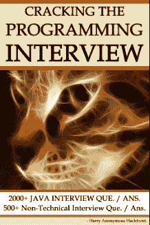ISBN 13: 978-1500730413.


# 章节

# ∞ 4 ∞

## (Scanner 类与数组)

## (命令行参数)

## 引言

### Scanner 类

这是 Java 在`JDK1.5-6-7`版本中新增的一个新类，用于从用户处获取基本数据类型的输入。使用该类获取输入非常简单，我们只需要创建该类的对象并调用特定的方法即可。该类位于`java.util`包中。

| `public java.util.Scanner(java.io.InputStream);` |
| `public java.util.Scanner(java.io.File) throws java.io.FileNotFoundException;` |
| `public java.util.Scanner(java.lang.String);` |
| `public void close();` |
| `public boolean hasNext();` |
| `public java.lang.String next();` 输入不包含任何空格的字符串。 |
| `public java.lang.String nextLine();` 输入可能包含空格的字符串。 |
| `public boolean hasNextBoolean();` |
| `public boolean nextBoolean();` |
| `public boolean hasNextByte();` |
| `public byte nextByte();` |
| `public boolean hasNextShort();` |
| `public short nextShort();` |
| `public boolean hasNextInt();` 检查输入缓冲区中的下一个值是否为 int。 |
| `public int nextInt();` 输入一个整数值。 |
| `public boolean hasNextLong();` |
| `public long nextLong();` |
| `public boolean hasNextFloat();` |
| `public float nextFloat();` |
| `public boolean hasNextDouble();` |
| `public double nextDouble();` |

### 示例 4.1

```java
import java.util.*;
class SumInput
{
    public static void main(String args[])
    {
        Scanner sc=new Scanner(System.in);
        int a,b,sum;
        System.out.print("Enter Ist number");
        a = sc.nextInt();
        System.out.print("Enter 2nd number");
        b = sc.nextInt();
        sum = a+b;
        System.out.println("Sum is " + sum);
    }
}
```

输出：

```
Enter Ist number 45
Enter 2nd number 55
Sum is 100
```

## 数组

Java 中的数组是相同类型变量或数据项的有序集合。Java 允许任意维度的数组。Java 数组与 C/C++ 有些不同。我们不能在声明时指定数组的大小。内存分配始终是动态的。Java 中的每个数组都被视为一个对象，并有一个特殊的属性`length`，该属性指定了数组中元素的数量。

### 1. 一维数组

### 声明

`type array_name[];` // 声明时不进行内存分配。

或

`type [] array_name;`

需要注意的是，声明本身并没有真正创建数组。它只是声明了一个可以指向数组对象的引用。

`int a1 [ ], a2 ;`

`int [ ] a3, a4 ;`

这两处声明将`a1`、`a3`和`a4`为可以指向`int`数组的引用变量，但变量`a2`不能指向`int`数组。它仅仅是一个`int`变量。当`[ ]`符号紧跟类型时，声明中的所有变量都是数组。否则，`[ ]`符号必须紧跟声明中的每一个数组名。

### 使用`new`运算符进行内存分配：

`array_name = new type[SIZE];` // `SIZE`可以是常量或变量。

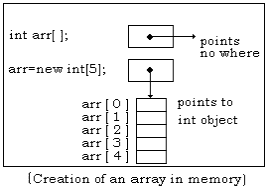

**注意 1**- 数组的所有元素都将自动初始化为零，但为了用不同的值初始化数组，我们可以在声明时直接初始化。数组的声明、内存分配和初始化步骤可以合并为：`int a[]={5,7,1};`

**注意 2**- 数组索引从零开始。

**注意 3**- 在 Java 中，所有数组都将分配的大小存储名为`length`的变量中。我们可以使用属性`length`访问数组的长度：“`array_name.length`”。

**注意 4**- `int a[],b[];`

`a = b = new int[5];`

在上述步骤中，只有`new`创建了一个数组，该数组的引用将被存储。

### 2. 二维数组

### 声明

`type array_name[][];`

或

`type[][] array_name;`

### 内存分配

`array_name = new type[ROWS][COLUMNS];` // `ROWS`和`COLUMNS`可以是常量

到目前为止我们讨论了可以存储值的数组。考虑以下表格，它显示了矩阵的值。每一行代表一个值。

### 示例 4.4 打印矩阵转置

```java
import java.util.*;
class Transpose
{
    public static void main(String args[])
    {
        Scanner sc=new Scanner(System.in);
        int r,c;
        System.out.print("Enter many rows");
        r=sc.nextInt();
        System.out.print("Enter many cols.");
        c=sc.nextInt();
        
        int m[][]=new int[r][c];
        //input
        for(int i=0;i<r;i++)
            for(int j=0;j<c;j++)
            {
                System.out.print("Enter " + (i+1) + "," +(j+1));
                m[i][j]=sc.nextInt();
            }
        //transpose
        for(int i=0;i<c;i++)
        {
            for(int j=0;j<r;j++)
                System.out.print(m[j][i])"\t");
            System.out.println();
        }
    }
}
```

### 示例 4.5 将两个矩阵相乘得到第三个矩阵

```java
import java.util.*;
class MatrixMult
{
    public static void main(String args[])
    {
        Scanner sc=new Scanner(System.in);
        int r1,c1;
        System.out.print("Enter many rows");
        r1=sc.nextInt();
        System.out.print("Enter many cols.");
        c1=sc.nextInt();
        int r2,c2;
        System.out.print("Enter many rows");
        r2=sc.nextInt();
        System.out.print("Enter many cols.");
        c2=sc.nextInt();
        if(c1 != r2)
        {
            System.out.println("Can't mult");
            System.exit(1);
        }
        int m1[][]=new int[r1][c1];
        //input m1
        for(int i=0;i<r1;i++)
```

```java
for(int j=0;j<c1;j++)
{
    System.out.print("Enter" + "element " + (i+1) + "," + (j+1));
    m1[i][j]=sc.nextInt();
}
int m2[][]=new int[r2][c2];
//输入 m2
for(int i=0;i<r2;i++)
    for(int j=0;j<c2;j++)
    {
        System.out.print("Enter" + "element " + (i+1) + "," +(j+1));
        m2[i][j]=sc.nextInt();
    }
int m3[][]=new int[r1][c2];
//矩阵乘法
for(int i=0;i<r1;i++)
    for(int j=0;j<c2;j++)
        for(int k=0;k<c1;k++)
            m3[i][j]+=m1[i][k]*m2[k][j];
// 输出 m3
for(int i=0;i<r1;i++)
{
    for(int j=0;j<c2;j++)
        System.out.print(m3[i][j]+"\t");
    System.out.println();
}
}
}
```

### 3. 可变长度数组

数组将多维数组处理为“数组的数组”，可以如下所示声明一个二维数组：

```java
int arr[ ] [ ] = new int [4][ ];
arr[0] = new int [1];
arr[1] = new int [2];
arr[2] = new int [3];
arr[3] = new int [4];
```

这意味着数组共有 4 行，其列数从 1 开始逐个增加。因此，它们在内存中的表示方式如下：

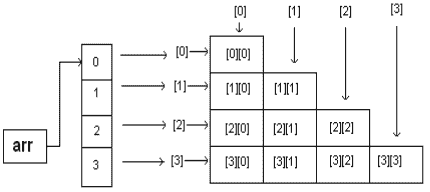
（内存分配）

**注意 1** 数组的所有元素都将自动初始化为零，但如果想用不同的值初始化数组，我们可以在声明时进行初始化。数组的声明、内存分配和初始化步骤可以合并为一步：

```java
int a[][]={  {5,7,1}, {1,7,9}, {4,5,7}, {1,1,1} };
```

**注意 2** 在上述数组`a`中，`a.length`将显示行数，即 4；而`a[0].length`将显示第 0 行的列数，即 3

## 命令行参数

有时，我们希望在运行程序时向程序传递信息。这是通过向`main()`传递命令行参数来实现的。命令行参数是在程序执行时，直接跟在命令行程序名后面的信息。

要在 Java 程序内部访问命令行参数，我们必须使用传递给`main()`的`String`数组。

`JVM`调用`main()`方法并将命令行参数作为字符串数组传递给它。在上面的示例中，数组的`length`（即命令行参数的数量）是通过属性`length`获取的。

`for`循环用于在控制台/显示器上显示命令行参数。

### 示例 4.6 从命令行参数输入名称的程序。

```java
class Hello
{
    public static void main(String args[])
    {
        for(int i=0;i<args.length;i++)
            System.out.println("Hello " + args[i]);
    }
}
```

`javac Hello.java`
`java Hello Ravi Ajay Vijay`

**输出：**

```
Hello Ravi
Hello Ajay
Hello Vijay
```

### 示例 4.7 打印通过命令行参数输入的数字和的程序。

```java
class SumCmd
{
    public static void main(String args[])
    {
        int sum=0;
```


### 示例 4.8 从命令行排序数组的程序

```java
class SortCmd
{
    public static void main(String args[])
    {
        int n=args.length;
        int a[]=new int[n];
        for(int i=0;i<n;i++)
            a[i] = Integer.parseInt(args[i]);
        for(int i=0;i<n-1;i++)
            for(int j=i+1;j<n;j++)
                if(a[i]>a[j])
                {
                    int t=a[i];
                    a[i]=a[j];
                    a[j]=t;
                }
        for(int i=0;i<n;i++)
            System.out.print(a[i]+"\t");
    }
}
```

`javac SortCmd.java`
`java SortCmd 5 4 1 3 2`

**输出：**

```
1 2 3 4 5
```

### 单选题

1. 如果 `MyProg.java` 被编译后，在命令行执行时，直接跟在程序名后面的信息是命令行参数。要在 Java 程序内部访问命令行参数，我们必须使用传递给 `main()` 的 `String` 数组。`JVM` 调用 `main()` 方法并将命令行参数作为字符串数组传递给它。在上面的示例中，数组的 `length`（即命令行参数的数量）是通过属性 `length` 获取的。`for` 循环用于在控制台/显示器上显示命令行参数。

### 示例 4.6 从命令行参数输入名称的程序

```java
class Hello
{
    public static void main(String args[])
    {
        for(int i=0;i<args.length;i++)
            System.out.println("Hello " + args[i]);
    }
}
```

`javac Hello.java`
`java Hello Ravi Ajay Vijay`

**输出：**

```
Hello Ravi
Hello Ajay
Hello Vijay
```

### 示例 4.7 打印通过命令行参数输入的数字和的程序

```java
class SumCmd
{
    public static void main(String args[])
    {
        int sum=0;
        for(int i=0;i<args.length;i++)
            sum+=Integer.parseInt(args[i]);
        System.out.println("Sum is " + sum);
    }
}
```

`javac SumCmd.java`
`java SumCmd 5 6`

**输出：**

```
Sum is 11
```

### 示例 4.8 从命令行排序数组的程序

```java
class SortCmd
{
    public static void main(String args[])
    {
        int n=args.length;
        int a[]=new int[n];
        for(int i=0;i<n;i++)
            a[i] = Integer.parseInt(args[i]);
        for(int i=0;i<n-1;i++)
            for(int j=i+1;j<n;j++)
                if(a[i]>a[j])
                {
                    int t=a[i];
                    a[i]=a[j];
                    a[j]=t;
                }
        for(int i=0;i<n;i++)
            System.out.print(a[i]+"\t");
    }
}
```

`javac SortCmd.java`
`java SortCmd 5 4 1 3 2`

**输出：**

```
1 2 3 4 5
```

### 单选题

1. 如果 `MyProg.java` 被编译后，在命令行执行时，直接跟在程序名后面的信息是命令行参数。要在 Java 程序内部访问命令行参数，我们必须使用传递给 `main()` 的 `String` 数组。`JVM` 调用 `main()` 方法并将命令行参数作为字符串数组传递给它。在上面的示例中，数组的 `length`（即命令行参数的数量）是通过属性 `length` 获取的。`for` 循环用于在控制台/显示器上显示命令行参数。

### 示例 4.6 从命令行参数输入名称的程序

```java
class Hello
{
    public static void main(String args[])
    {
        for(int i=0;i<args.length;i++)
            System.out.println("Hello " + args[i]);
    }
}
```

`javac Hello.java`
`java Hello Ravi Ajay Vijay`

**输出：**

```
Hello Ravi
Hello Ajay
Hello Vijay
```

### 示例 4.7 打印通过命令行参数输入的数字和的程序

```java
class SumCmd
{
    public static void main(String args[])
    {
        int sum=0;
        for(int i=0;i<args.length;i++)
            sum+=Integer.parseInt(args[i]);
        System.out.println("Sum is " + sum);
    }
}
```

`javac SumCmd.java`
`java SumCmd 5 6`

**输出：**

```
Sum is 11
```

### 示例 4.8 从命令行排序数组的程序

```java
class SortCmd
{
    public static void main(String args[])
    {
        int n=args.length;
        int a[]=new int[n];
        for(int i=0;i<n;i++)
            a[i] = Integer.parseInt(args[i]);
        for(int i=0;i<n-1;i++)
            for(int j=i+1;j<n;j++)
                if(a[i]>a[j])
                {
                    int t=a[i];
                    a[i]=a[j];
                    a[j]=t;
                }
        for(int i=0;i<n;i++)
            System.out.print(a[i]+"\t");
    }
}
```

`javac SortCmd.java`
`java SortCmd 5 4 1 3 2`

**输出：**

```
1 2 3 4 5
```

1. 如果 `MyProg.java` 被编译后，在命令行执行时，直接跟在程序名后面的信息是命令行参数。要在 Java 程序内部访问命令行参数，我们必须使用传递给 `main()` 的 `String` 数组。`JVM` 调用 `main()` 方法并将命令行参数作为字符串数组传递给它。在上面的示例中，数组的 `length`（即命令行参数的数量）是通过属性 `length` 获取的。`for` 循环用于在控制台/显示器上显示命令行参数。

### 示例 4.6 从命令行参数输入名称的程序

```java
class Hello
{
    public static void main(String args[])
    {
        for(int i=0;i<args.length;i++)
            System.out.println("Hello " + args[i]);
    }
}
```

`javac Hello.java`
`java Hello Ravi Ajay Vijay`

**输出：**

```
Hello Ravi
Hello Ajay
Hello Vijay
```

### 示例 4.7 打印通过命令行参数输入的数字和的程序

```java
class SumCmd
{
    public static void main(String args[])
    {
        int sum=0;
        for(int i=0;i<args.length;i++)
            sum+=Integer.parseInt(args[i]);
        System.out.println("Sum is " + sum);
    }
}
```

`javac SumCmd.java`
`java SumCmd 5 6`

**输出：**

```
Sum is 11
```

### 示例 4.8 从命令行排序数组的程序

```java
class SortCmd
{
    public static void main(String args[])
    {
        int n=args.length;
        int a[]=new int[n];
        for(int i=0;i<n;i++)
            a[i] = Integer.parseInt(args[i]);
        for(int i=0;i<n-1;i++)
            for(int j=i+1;j<n;j++)
                if(a[i]>a[j])
                {
                    int t=a[i];
                    a[i]=a[j];
                    a[j]=t;
                }
        for(int i=0;i<n;i++)
            System.out.print(a[i]+"\t");
    }
}
```

`javac SortCmd.java`
`java SortCmd 5 4 1 3 2`

**输出：**

```
1 2 3 4 5
```

1. 如果 `MyProg.java` 被编译后，在命令行执行时，直接跟在程序名后面的信息是命令行参数。要在 Java 程序内部访问命令行参数，我们必须使用传递给 `main()` 的 `String` 数组。`JVM` 调用 `main()` 方法并将命令行参数作为字符串数组传递给它。在上面的示例中，数组的 `length`（即命令行参数的数量）是通过属性 `length` 获取的。`for` 循环用于在控制台/显示器上显示命令行参数。

2. 声明后：`char[] c = new char[10];` 的值是？
   (a) 50
   (b) 49
   (c) 3
   (d) 5

3. 以下哪些是多维数组的合法声明？
   (a) `int[][]`
   (b) `int[][]`
   (c) `int [][]`
   (d) `int[][]`

4. 下列哪些是类成员的正确初始化？
   (a) `MyProg`
   (b) `""`
   (c) `""`
   (d) 2
   (e) `null`

5. 在 Java 中哪种说法是正确的？
   (a) 数组是对象。
   (b) 数组内存分配是动态的。
   (c) 数组是初始化为。。
   (d)

**答案** 1(c 2c), 3((), 555 5(d)

对不起，在在翻译过程中出现了重复错误。以下是重新翻译后的内容：

```java
for(int j=0;j<c1;j++)
{
    System.out.print("Enter" + "element " + (i+1) + "," + (j+1));
    m1[i][j]=sc.nextInt();
}
int m2[][]=new int[r2][c2];
//input m2
for(int i=0;i<r2;i++)
    for(int j=0;j<c2;j++)
    {
        System.out.print("Enter" + "element " + (i+1) + "," +(j+1));
        m2[i][j]=sc.nextInt();
    }
int m3[][]=new int[r1][c2];
//matrix mult
for(int i=0;i<r1;i++)
    for(int j=0;j<c2;j++)
        for(int k=0;k<c1;k++)
            m3[i][j]+=m1[i][k]*m2[k][j];
//Output m3
for(int i=0;i<r1;i++)
{
    for(int j=0;j<c2;j++)
        System.out.print(m3[i][j]+"\t");
    System.out.println();
}
}
}
```

### 3. 可变长度数组

数组将多维数组处理为“数组的数组”，可以如下所示声明一个二维数组：

```java
int arr[ ] [ ] = new int [4][ ];
arr[0] = new int [1];
arr[1] = new int [2];
arr[2] = new int [3];
arr[3] = new int [4];
```

这意味着数组共有 4 行，其列数从 1 开始逐个增加。因此，它们在内存中的表示方式如下：


（内存分配）

**注意 1** 数组的所有元素都将自动初始化为零，但如果想用不同的值初始化数组，我们可以在声明时进行初始化。数组的声明、内存分配和初始化步骤可以合并为一步：

```java
int a[][]={  {5,7,1}, {1,7,9}, {4,5,7}, {1,1,1} };
```

**注意 2** 在上述数组 `a` 中，`a.length` 将显示行数，即 4；而 `a[0].length` 将显示第 0 行的列数，即 3

## 命令行参数

有时，我们希望在运行程序时向程序传递信息。这是通过向 `main()` 传递命令行参数来实现的。命令行参数是在程序执行时，直接跟在命令行程序名后面的信息。

要在 Java 程序内部访问命令行参数，我们必须使用传递给 `main()` 的 `String` 数组。

`JVM` 调用 `main()` 方法并将命令行参数作为字符串数组传递给它。在上面的示例中，数组的 `length`（即命令行参数的数量）是通过属性 `length` 获取的。

`for` 循环用于在控制台/显示器上显示命令行参数。

### 示例 4.6 从命令行参数输入名称的程序

```java
class Hello
{
    public static void main(String args[])
    {
        for(int i=0;i<args.length;i++)
            System.out.println("Hello " + args[i]);
    }
}
```

`javac Hello.java`
`java Hello Ravi Ajay Vijay`

**输出：**

```
Hello Ravi
Hello Ajay
Hello Vijay
```

### 示例 4.7 打印通过命令行参数输入的数字和的程序

```java
class SumCmd
{
    public static void main(String args[])
    {
        int sum=0;
        for(int i=0;i<args.length;i++)
            sum+=Integer.parseInt(args[i]);
        System.out.println("Sum is " + sum);
    }
}
```

`javac SumCmd.java`
`java SumCmd 5 6`

**输出：**

```
Sum is 11
```


### 示例 4.8 从命令行排序数组的程序。

```java
class SortCmd
{
    public static void main(String args[])
    {
        int n=args.length;
        int a[]=new int[n];
        for(int i=0;i<n;i++)
            a[i] = Integer.parseInt(args[i]);
        for(int i=0;i<n-1;i++)
            for(int j=i+1;j<n;j++)
                if(a[i]>a[j])
                {
                    int t=a[i];
                    a[i]=a[j];
                    a[j]=t;
                }
        for(int i=0;i<n;i++)
            System.out.print(a[i]+"\t");
    }
}
```

`javac SortCmd.java`

`java SortCmd 5 4 1 3 2`

**输出：**

```
1 2 3 4 5
```

### 单选题

1. 如果`MyProg.java`被编译后，在命令行执行时，直接跟在程序名后面的信息是命令行参数。要在 Java 程序内部访问命令行参数，我们必须使用传递给`main()`的`String`数组。`JVM`调用`main()`方法并将命令行参数作为字符串数组传递给它。在上面的示例中，数组的`length`（即命令行参数的数量）是通过属性`length`获取的。`for`循环用于在控制台/显示器上显示命令行参数。

2. 声明后：`char[] c = new char[10];`的值是？
(a) 50
(b) 49
(c) 3
(d) 5

3. 以下哪些是多维数组的合法声明？
(a) `int[][]`
(b) `int[][]`
(c) `int [][]`
(d) `int[][]`

4. 下列哪些是类成员的正确初始化？
（此处由于原文逻辑不全，仅按意翻译）
(a) `MyProg`
(b) `""`
(c) `""`
(d) 2
(e) `null`

5. 在 Java 中哪种说法是正确的？
(a) 数组是对象。
(b) 数组内存分配是动态的。
(c) 数组是初始化为。。
(d)

在`s2`中进行的任何更改都也会反映在`s1`中。这种赋值不会进行内存分配。几步之后，如果我们在`s1`中赋值为`null`，那么该对象不会被销毁，因为它的引用指向对象`s2`。但如果`s1`和`s2`都被赋值为`null`，那么该对象将被垃圾回收器销毁，该对象占用的内存将被释放。

### 示例 5.1 只包含成员变量的类。

```java
class A
{
    int x;
    int y;
}

class ClassTest1
{
    public static void main(String args[])
    {
        A a1,a2;  //引用变量
        a1 = new A();  //创建对象
        a2 = new A();
        a1.x = 10;
        a1.y = 20;
        a2.x = 5;
        a2.y = 6;
        System.out.println(a1.x + "\t" + a1.y);
        System.out.println(a2.x + "\t" + a2.y);
    }
}
```

输出:

```
10  20
5  6
```

### 示例 5.2 包含成员变量和成员方法的类。

```java
class A
{
    private int x;
    private int y;
    void setdata(int x1, int y1)
    {
        x = x1;
        y = y1;
    }
    void display()
    {
        System.out.println(x + "\t" + y);
    }
}

class ClassTest2
{
    public static void main(String args[])
    {
        A a1 = new A();
        A a2 = new A();
        //a1.x=10;  错误因为 x 是私有的
        a1.setdata(10,20);
        a2.setdata(5,7);
        a1.display();
        a2.display();
    }
}
```

输出:

```
10  20
5  7
```

注- 我们可以在类外部也可以在类内部声明类的对象。

### 示例 5.3 在类内部定义类的对象。

```java
class A
{
    private int x;
    private int y;
    void setdata(int x1, int y1)
    {
        x = x1;
        y = y1;
    }
    void display()
    {
        System.out.println(x + "\t" + y);
    }
    public static void main(String args[])
    {
        A a1 = new A();
        A a2 = new A();
        a1.setdata(10,20);
        a2.setdata(5,7);
        a1.display();
        a2.display();
    }
}
```

输出:

```
10  20
5  7
```

### 类成员的修饰符 / 可见性标签

可见性修饰符仅适用于类的成员，而不适用于局部变量。

- `private`：如果我们在成员变量或方法上指定修饰符`private`，那么该成员在声明它的类之外将不可见。这将对其他类隐藏该类的成员。
- `public`：如果我们在成员变量或方法上指定修饰符`public`，那么该成员对所有类可见。该成员即使在包外部也可以被访问。`main()`方法始终定义为公共，因为`main()`方法是由 JVM 访问的，而 JVM 位于定义`main()`方法类的外部。
- `protected`：声明为`protected`的成员可以被同一包中的所有类访问。受保护的成员也可以被其他包的任何子类访问。
- `default / 无修饰符`：如果在成员之前没有指定可见性修饰符，则该成员可以被同一包中的所有类访问。该成员不能在包外被访问。

### 类或接口的可见性修饰符

- `public`：如果一个类要对所有包的类可见，则它必须通过指定修饰符`public`声明为`public`，该修饰符应该出现在`class`关键字之前。
- `default / 无修饰符`：如果类之前没有任何访问/可见性修饰符，则其可见性仅限于它被定义的包（类组）内。

### this 关键字

`this`是一个引用变量，存储了当前用于调用方法的对象的引用。在运行时，`this`的引用会被调用对象的引用所替换。有时，方法需要引用调用它的对象。这可以通过在任何方法内部使用`this`来引用当前对象来完成。注：局部变量会隐藏实例变量，因此必须显式地使用`this`关键字。

### 实例变量隐藏

众所周知，在 Java 中在同一个作用域内声明两个同名的局部变量是非合法的。但我们可以拥有与类的实例变量同名的局部变量（成员方法的参数）。当局部变量与实例变量同名时，局部变量会隐藏该实例变量。但`this`关键字允许即使在局部变量隐藏了它的情况下，我们仍能引用到实例变量。

### 示例 5.4 this 关键字的使用

```java
class A
{
    private int x;
    private int y;
    void setdata(int x, int y)
    {
        this.x = x; //this.x 是类成员 x 是局部变量
        this.y = y;
    }
    void display()
    {
        System.out.println(x + "\t" + y);
    }
}

class ClassTest4
{
    public static void main(String args[])
    {
        A a1 = new A();
        A a2 = new A();
        a1.setdata(10,20);
        a2.setdata(5,7);
        a1.display();
        a2.display();
    }
}
```

输出:

```
10  20
5  7
```

### 方法重载

我们可以拥有多个同名的方法，只要它们的参数数量、类型或参数顺序不同。这被称为方法重载。在调用重载方法时，传递的实际参数类型可能与任何重载方法的形式参数不匹配。在这种情况下，参数将提升到更高类型直到找到匹配。如果在提升参数后仍未找到匹配，则发生编译错误。

### 示例 5.5 在此示例中，有两个同名的`setdata()`方法，但参数不同，因此这就是方法重载。

```java
class A
{
    private int x,y;
    void setdata(int x1)
    {
        x = y = x1;
    }
    void setdata(int x1, int y1)
    {
        x = x1;
        y = y1;
    }
    void display()
    {
        System.out.println(x + "\t" + y);
    }
}

class ClassTest5
{
    public static void main(String args[])
    {
        A a1 = new A();
        a1.setdata(5);
        a1.display();
        A a2 = new A();
        a2.setdata(10,20);
        a2.display();
    }
}
```

输出:

```
5  5
10  20
```

### 默认构造函数

每个类都有一个默认构造函数（如果没有定义显式构造函数），该构造函数不接受任何参数，且体不包含任何语句。编译器会自动生成默认构造函数。

一旦我们添加了自己的构造函数，编译器就会停止生成默认构造函数。当我们不在类中创建任何构造函数时，`JVM`将创建默认构造函数，并将实例变量初始化为默认值`null`或 0。

### 示例 5.6 默认构造函数的用法

```java
class A
{
    private int x;
    private int y;
    void display()
    {
        System.out.println(x + "\t" + y);
    }
}

class ClassTest6
{
    public static void main(String args[])
    {
        A a1 = new A();
        a1.display();
    }
}
```

**输出：**

```
0  0
```

**注意：** 这里我们没有创建任何构造函数，因此`JVM`在创建对象后自动创建默认构造函数，并将实例变量初始化为 0 或`null`。

### 默认零参数构造函数

我们可以用自己的零参数构造函数替换默认构造函数。这将允许我们将实例变量初始化为任何值。

### 参数构造函数

接受参数的构造函数称为参数构造函数。

**注意：** 就像方法一样，构造函数也可以重载。这被称为构造函数重载。

### 示例 5.7 构造函数的用法

```java
class A
{
    private int x;
    private int y;
    A() // 零参数构造函数
    {
        x = y = 0;
    }
    A(int x1) // 单参数参数构造函数
    {
        x = y = x1;
    }
    A(int x1, int y1) // 双参数参数构造函数
    {
        x = x1;
        y = y1;
    }
    void display()
    {
        System.out.println(x + "\t" + y);
    }
}

class ClassTest7
{
    public static void main(String args[])
    {
        A a1 = new A();
        a1.display();
        A a2 = new A(5);
        a2.display();
        A a3 = new A(4,7);
        a3.display();
    }
}
```

**输出：**

```
0  0
5  5
4  7
```

### 示例 5.8:

```java
import java.util.Scanner;

class Complex
{
    private int real,imag;
    Complex()// 零参数构造函数
    {
        real=imag=0;
    }
    Complex(int real, int imag)
    {
        this.real=real;
        this.imag=imag;
    }
    void getdata()
    {
        Scanner sc=new Scanner(System.in);
        System.out.print("输入实部");
        real=sc.nextInt();
        System.out.print("输入虚部");
        imag=sc.nextInt();
    }
    void display()
    {
        if(imag>=0)
            System.out.println(real+"+"+imag+"i");
        else
            System.out.println(real+""+imag+"i");
    }
    Complex sum(Complex c)
    {
        Complex t=new Complex();
        t.real=real+c.real;
        t.imag=imag+c.imag;
        return t;
        // 或者返回 Complex(real+c.real,imag+c.imag);
    }
    Complex mult(Complex c)
    {
        Complex t=new Complex();
        t.real=real*c.real;
        t.imag=imag*c.imag;
        return t;
    }
    public static void main(String args[])
    {
        Complex c1=new Complex();
        Complex c2=new Complex();
        Complex c3=null,c4=null;
        c1.getdata();
        c2.getdata();
        c3=c1.sum(c2);
        System.out.print("和是 ");
        c3.display();
        c4=c1.mult(c2);
        System.out.print("积是 ");
        c4.display();
    }
}
```

### finalize() 方法

有时，对象在销毁时需要执行某些操作。例如，如果一个对象持有某些非 Java 资源（如文件句柄），我们可能希望确保在对象销毁之前释放这些资源。为了处理此类情况，Java 了一种了一种名为最终化（finalization）的机制。通过使用最终化，我们可以定义在对象即将被垃圾回收回收时发生的特定操作。`finalize()`仅在垃圾回收之前被调用。它不会在对象离开作用域时调用。在 C++ 中，使用析构函数的概念用于最终化，但它与 Java 中的`finalize()`并不相同。

```java
protected void finalize()
{
// 此处编写最终化代码。
}
```


**注意：** 除了 `protected` 修饰符外，我们也可以使用 `public`。

## 变量类型

Java 有三种变量：

### 1. 实例变量

在类中声明且在所有方法之外的变量称为实例变量。对象的数量有多少，该变量的副本就有多少份。在 Java 中不需要初始化实例变量，因为这些变量会被初始化为默认值。

### 2. 局部变量

在方法内部声明的变量是局部变量。它们不需要初始化。

### 3. 静态变量

静态变量与实例变量一样声明在方法/块之外。但它们对于类是全局的。

## 方法类型

### 实例方法

这些与 C++ 函数相同。实例方法只能通过对象调用。如果我们在同一个类的静态方法内部调用实例方法，也必须使用对象名称。

### 静态方法

静态方法可以通过对象也可以类名来调用。静态方法只能访问静态成员。静态方法可以直接从同类的静态方法中被调用（无需对象或类名）。

### 示例 5.10

```java
class A
{
    int x;
    static int y;
    static int sum(int a, int b)
    {
        //y = 5; no error static method can access static variable
        //x = 10; error static method can't access instance variable
        //A a1 = new A();
        //a1.x = 10; No error as static method can access instance variable 
        //through objects.
        //this.x = 10; error as static method can't access this or super keyword
        int c;
        c = a+b;
        return(c);
    }
    static float avg(int a, int b)
    {
        return (float)(a+b)/2;
    }
}
class ClassTest9
{
    public static void main(String args[ ])
    {
        System.out.println(A.sum(5,6)); // static methods can be called through
        // class name
        System.out.println(A.avg(5,6));
        A a1 = new A();
        System.out.println(a1.sum(5,6)); // static methods can also be called
        // through objects
    }
}
```

**输出：**

```
11
5.5
11
```

## 初始化块与静态块 (Initialize & static Block)

初始化块用于初始化类的成员变量，静态块用于初始化类的静态成员变量。但构造函数这些块之后被调用。

### 示例 5.11

```java
class A
{
    int x;
    static int y;
    { //Inititalize block to initialize instance variables
        x = 10;
    }
    static //static block to initialize static variables
    {
        y = 5;
    }
}
class ClassTest10
{
    public static void main(String args[])
    {
        A a1 = new A();
        System.out.println(a1.x + "\t" + a1.y);
    }
}
```

**输出：**

```
10 5
```

## Final 变量 (Final Variables)

如果变量被声明为 `final`，则我们不能改变它的值 `final (double PI=3.141;)`。`final` 变量不会按实例占用内存。`final` 变量是一个常量变量，其值不能改变。`final` 变量引用类型不能改变其引用。

### 示例 5.12

```java
class A
{
    void m1() 
    {
        System.out.println("Inside m1()");
    }
}
class ClassTest11
{
    public static void main(String args[])
    {
        final int x=10; //不可改变
        final int y; //  y 未初始化，所以稍后可以初始化 y
        y=20; // 现在 y 已初始化，之后我们不能再改变它的值
        // y=30; Error
        System.out.println(x);
        System.out.println(y);
        final A a1=new A(); // a1 是常量引用，所以我们不能
        // 在 f1 中分配其他对象的引用。
        a1.m1();
        A a2 = new A();
        // a1 = a2; error
    }
}
```

**输出：**

```
10
20
Inside m1()
```

## 参数传递机制 (Argument Mechanism)

1. 按值传递 (Call by Value)。
2. 按引用传递 (Call by reference)。

当基本类型（`int`、`float`、`long` 等）传递给方法时，采用的是按值传递。对于对象，实际传递的是对象引用。对象引用也是通过按值传递的方式的。然而，由于传递的值指向一个对象，该值的拷贝仍然指向与参数参数相同的对象。例如，如果我们把存储对象引用的引用变量 `a1` 传入函数，而在函数中 `a2` 是形式参数，那么 `a1` 和 `a2` 都指向同一个对象。通过 `a2` 对对象值进行的任何更改也会反映在 `a1` 中。但如果我们在 `a2` 中分配一个新引用，该引用将被复制到 `a1` 中。

### 示例 5.13

```java
class Box
{
    private int feet;
    private int inches;
    Box()
    {
        feet = inches = 0;
    }
    Box(int feet, int inches)
    {
        this.feet = feet;
        this.inches = inches;
    }
    void display()
    {
        System.out.println("Feet is " + feet +"\n" + "Inches is " + inches);
    }
    void swap(Box obj)
    {
        int t;
        t = feet;
        feet = obj.feet;
        obj.feet = t;
        t = inches;
        inches = obj.inches;
        obj.inches = t;
    }
}
class ClassTest12
{
    public static void main(String args[])
    {
        Box b1 = new Box(5,6);
        Box b2 = new Box(7,4);
        b1.swap(b2); // 对象按引用传递的。
        b1.display();
        b2.display();
    }
}
```

**输出：**

```
Feet is 7
Inches is 4
Feet is 5
Inches is 6
```

## 嵌套类与内部类 (Nested and Inner Classes)

可以在另一个类内部定义一个类；此类类被称为嵌套类。嵌套类的作用范围限于其外部类的作用范围。嵌套类可以访问其嵌套所在类的成员，包括该类的私有成员。然而，外部类无法访问嵌套类的成员。

嵌套类有两种类型：`static`（静态）和非静态。静态嵌套类是指应用了 `static` 修饰符的类。由于它是静态的，它必须通过对象来访问其外部类的成员。也就是说，它不能直接引用其外部类的成员。由于这种限制，静态嵌套类很少使用。

非静态嵌套类可以访问其外部类的所有变量和方法，并可以直接引用它们。

### 示例 5.14

```java
class Outer
{
    class Inner
    {
        int member_inner=7;
        Inner()
        {
            member_outer = 5;
            System.out.println(member_outer);
        }
    }
    private int member_outer;
    Outer()
    {
        // member_inner = 9; error
        Inner obj = new Inner();
        System.out.println(obj.member_inner);
    }
}
class ClassTest13
{
    public static void main(String args[])
    {
        Outer out_obj = new Outer();
    }
}
```

**输出：**

```
```

### 示例 5.15

```java
class Outer
{
    static class Inner
    {
        int member_inner=7;
        Inner()
        {
            member_outer = 5;
            System.out.println(member_outer);
        }
    }
    private int member_outer;
    void prn()
    {
        Inner obj = new Inner();
        System.out.println(obj.member_inner);
    }
}
```

### 示例 5.16

```java
import java.util.Random;
class RandomTest
{
    public static void main(String args[])
    {
        Random r1 = new Random();
        for(int i=1;i<=10;i++)
            System.out.println(Math.abs(r1.nextInt()));
    }
}
```

## 理论题

1. 如果我们希望一个成员变量在类外完全不可访问，在声明变量时应该加上什么关键字？
2. 在 Java 中，对象/值是如何传递的？
3. 考虑以下代码：

```java
public static void main( String args[] )
{
    int a = 5;
    System.out.println( cube( a ) );
}
int cube( int theNum )
{
return theNum * theNum * theNum;
}
```

解释 `static` 关键字的重要性

当我们尝试编译并运行这段代码时会发生什么？

a) 编译失败，因为 `cube` 在 `java.lang.Math` 类中已经定义。
b) 编译失败，因为 `cube` 不是静态的。
c) 编译通过，但抛出算术异常。
d) 完美运行，并在标准输出打印 "125"。

4. 什么是静态内部类？它与任何其他静态成员有什么区别？
5. 我们如何在 Java 中声明常量值
6. `final` 关键字的含义是什么？
7. 什么是类变量？

**答案：**

当我们创建一个相同类的多个对象时，每个对象将共享变量的共同副本。这意味着无论从该类创建了多少对象，每个类都只有一个副本。类变量或静态变量在类中使用 `static` 关键字进行声明。

这些变量存储在静态内存中。类变量主要用于常量，即初始值永远不会改变的变量。静态变量始终通过类名进行调用。

该变量在程序启动时创建，即它在通过 `new` 算符创建类的实例之前就已经创建了，并在程序停止时被销毁。类变量的作用域与实例变量相同。

类变量可以在类级别的任何位置使用 `static` 关键字定义。它的初始值与实例变量相同。当类变量被定义为 `int` 时，其默认初始值为 0；当声明为 `boolean` 时，默认值为 `false`；对象引用为 `null`。类变量与类相关，而不是与任何对象相关。

8. 解释垃圾回收。

**答案：** 垃圾回收是 Java 最重要的特性之一。垃圾回收也被称为自动内存管理，因为 JVM 会自动从内存中移除未使用的变量/对象（值为 `null`）。用户程序无法直接从内存中释放对象，相反，由垃圾回收器负责自动释放不再被程序引用的对象。

每个类都从 `java.lang.Object` 继承 `finalize()` 方法，当垃圾回收器确定不再有更多对该对象的引用时，就会调用 `finalize()` 方法。

在 Java 中，当变量不再使用时，显式地为变量赋值 `null` 是一个好习惯。在 Java 中，调用 `System.gc()` 和 `Runtime.gc()` 时，JVM 会尝试回收未使用的对象，但无法保证所有对象何时会被垃圾回收。

9. 如果一个类有多个构造函数，我们可以从一个构造函数调用另一个吗？

可以。使用 `this()` 从另一个构造函数调用构造函数。

10. 构造函数和普通方法之间有什么区别？

构造函数的名称必须与类相同，且没有返回值。它们只被调用一次，而普通方法可以被调用多次，并且可以返回值或为 `void`。

11. 我们如何强制执行垃圾回收？

垃圾回收是自动过程，无法被强制执行。我们可以通过调用 `System.gc()` 来请求它。JVM 并不保证 GC 会立即启动。

12. 下述描述中哪一个是不正确的。

(a) Java 中的局部变量总是由默认值初始化。
(b) Java 中的局部变量必须在使用之前进行初始化。
(c) 内部块中的局部变量不能与外部块中的局部变量同名。
(d) 同一层级两个块中的局部变量可以同名。


# 章节

# ∞ 6 ∞

## (继承)

## 引言

当一个类的属性转移到另一个类时，就称为继承。在这种情况下，被继承的类被称为超类、基类或父类，而继承的类被称为子类、子类或派生类。

继承允许我们通过添加额外功能来扩展现有的类（基类）。它鼓励代码的可重用性，这有助于减小代码体积，尽管在某些情况下可能会导致复杂性。

例如，如果我们已经完成了一个简单计算器的代码。之后我们需要开发一个科学计算器，那么我们有二种替代方案：

(i) 创建一个新类。（重写该类）
(ii) 扩展该类。

在大多数情况下，第二种方案是更好的选择。在这种情况下，我们只需要编写一小段代码。同时，我们不需要花费大量时间进行调试和测试，因为基类已经经过过测试并且运行了长时间。当我们需要将一个类继承到另一个类时，必须使用 `extends` 关键字。

**语法：** `class sub_class extends base_class`

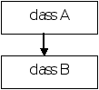

类 A（超类或基类或父类）。
类 B（子类或派生类或子类）。

子类将拥有基类的所有特征，外加上扩展类中定义的新特征。Java 不支持多重继承，但它支持多接口继承，因此子类只能扩展一个基类。

**示例 6.1：**

```java
1. class A
2. {
3.    int x;
4.    void setX(int x1)
5.    {
6.    x = x1;
7.    }
8.    void displayX()
9.    {
10.    System.out.println(x);
11.   }
12. }
13. class B extends A
14. {
15.    int y;
16.    void setY(int y1)
17.    {
18.        y = y1;
19.    }
20.    void displayY()
21.    {
22.        System.out.println(y);
23.    }
24. }
```


```java
class InheritTest
{
    public static void main(String args[])
    {
        A a1 = new A();
        a1.setX(5);
        a1.displayX();
        B b1 = new B();
        b1.setX(10);
        b1.setY(20);
        b1.displayX();
        b1.displayY();
    }
}
```

**输出：**

```
5
10
20
```

### 成员隐藏

如果子类成员与父类成员具有相同的名称（方法时具有相同的签名），那么它会隐藏父类成员。虽然两个成员在子类中都可用，但使用成员名称只能访问子类成员。

### 使用`super`关键字

每当子类需要引用其直接父类时，可以通过`super`关键字来实现。`super`有两种通用用途：

1. 调用父类的构造函数：子类可以通过以下形式`super(parameter-list)`调用其父类定义的构造器方法；这里`parameter-list`指定了父类构造器所需的任何参数。事实上，`super()`必须是子类构造器内部执行的第一条语句。

2. 访问被子类成员隐藏的父类成员：可以使用以下形式`super.member`来访问父类的被隐藏成员；这里`member`既可以是方法，也可以是数据成员。

### 方法重载与方法重写

#### 方法重载

当两个或多个方法具有相同名称但参数不同时，被称为方法重载。方法重载用于对象需要执行相似任务但使用不同输入参数。当我们调用方法时，Java 首先匹配方法名，然后匹配参数的数量和类型。决定调用哪一个方法定义的过程被称为多态。

#### 方法重写

我们已经看到父类中的方法会被子类继承，并被子类创建的对象使用。方法继承允许我们在子类中重复定义和使用方法，而无需在子类中再次定义它。在类层次结构中，当子类中的实例方法与其父类中的非私有实例方法具有相同的名称签名时，子类中的方法被称为重写了父类中的方法。当在子类内部调用重写的方法时，它将始终引用子类定义的该版本。

父类定义的方法版本将被隐藏。


### 示例 6.2

```java
class A
{
    int x;
    void set(int x1)
    {
        x = x1;
    }
    void display()
    {
        System.out.println(x);
    }
}

class B extends A
{
    int y;
    void set(int x1,int y1) // 因为参数不同，类 B 的 set 方法没有重写类 A 的 set 方法
    {
        set(x1);  //这将调用类 A 的 set()
        y = y1;
    }
    void display() // 类 B 的 display 方法重写了类 A 的 display 方法
    {
        //  display();  这将调用类 B 的 display
        super.display(); // 这将调用类 A 的 display
        System.out.println(y);
    }
}

class InheritTest2
{
    public static void main(String args[])
    {
        B b1 = new B();
        b1.set(10,20);
        b1.display();
    }
}
```

输出：

```
10
20
```

Java 支持以下继承形式：

1. 单继承。
2. 多级继承。
3. 层级继承。

### 1. 单继承

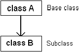

### 示例 6.3

```java
class A
{
    private int x;
    A()
    {
        x = 0;
    }
    A(int x1)
    {
        x = x1;
    }
    void display()
    {
        System.out.print(x);
    }
}

class B extends A
{
    private int y;
    B()
    {
        super();
        //x=0;  因为 x 是私有的，此处报错
        y=0;
    }
    B(int x1, int y1)
    {
        super(x1);
        //x = x1; //因为 x 是私有的，此处报错
        y = y1;
    }
    void display()
    {
        super.display();
        System.out.print(y);
    }
}

class InheritTest3
{
    public static void main(String args[])
    {
        B b1 = new B();
        b1.display();
        B b2 = new B(10,20);
        b2.display();
    }
}
```

输出：

```
0 0 10 20
```

---

### 2. 多级继承

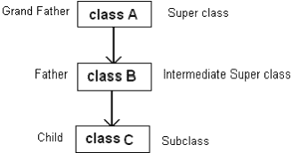

---


### 示例 6.4

```java
class A
{
    private int x;
    A()
    {
        x = 0;
    }
    A(int x1)
    {
        x = x1;
    }
    void display()
    {
        System.out.println(x);
    }
}

class B extends A
{
    private int y;
    B()
    {
        super();
        y = 0;
    }
    B(int x1, int y1)
    {
        super(x1);
        y = y1;
    }
    void display()
    {
        super.display();
        System.out.println(y);
    }
}

class C extends B
{
    private int z;
    C()
    {
        super();
        z = 0;
    }
    C(int x1, int y1, int z1)
    {
        super(x1,y1);
        z = z1;
    }
    void display()
    {
        super.display();
        System.out.println(z);
    }
}

class InheritTest4
{
    public static void main(String args[])
    {
        C c1 = new C();
        c1.display();
        C c2 = new C(10,20,30);
        c2.display();
    }
}
```

输出：

```
0
0
0
10
20
30
```


---

### 3. 层级继承

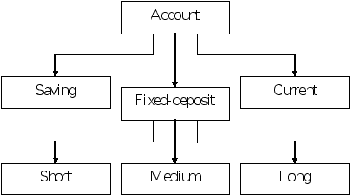

### 构造函数的调用顺序

当创建一个类层次结构时，构成该层次结构的各个类的构造函数按什么顺序被调用？答案是：在类层次结构中，构造函数是按照派生顺序、从父类到子类调用的。

此外，由于`super()`必须是子类构造函数中执行的第一条语句；无论是否使用`super()`，这种顺序都是相同的。如果不使用`super()`，则执行每个父类的默认构造函数或无参数构造函数。

构造函数按照派生顺序执行。因为父类对任何子类无所知，它需要执行的任何初始化都是独立的，并且可能是子类所执行的任何初始化的前决条件。因此，它必须首先执行。

`super`关键字的使用需要满足以下条件：

- `super()`构造函数只能在子类的构造函数方法内部被调用。
- 对父类构造函数的调用必须作为子类构造函数的第一条语句。
- `super`调用中的参数必须与父类构造函数参数的顺序和类型匹配。

---

#### 动态方法绑定（动态方法分派或运行时绑定）

方法重写构成了 Java 强大概念之一的基础：动态方法分派是在运行时而非编译时解析对被重写实例方法调用解析的机制。动态方法分派非常重要，因为这是 Java 实现运行时多态的方式。

父类引用变量可以指向子类对象。Java 利用这一事实在运行时解析对被重写方法的调用。当通过父类引用调用重写方法时，Java 会根据调用时指向的对象类型来确定执行该方法的哪个版本。

因此，这种确定是在运行时进行的，此时不同类型的对象指向不同的方法版本。


### 示例 6.5

```java
class Shape
{
    void getdata()
    {
        System.out.println("getdata() Shape");
    }
    void area()
    {
        System.out.println("area() Shape");
    }
    void display()
    {
        System.out.println("display() Shape");
    }
}

class Circle extends Shape
{
    void getdata()
    {
        System.out.println("getdata() Circle");
    }
    void area()
    {
        System.out.println("area() Circle");
    }
    void display()
    {
        System.out.println("display() Circle");
    }
}

class Rectangle extends Shape
{
    void getdata()
    {
        System.out.println("getdata() Rectangle");
    }
    void area()
    {
        System.out.println("area() Rectangle");
    }
    void display()
    {
        System.out.println("display() Rectangle");
    }
}

class InheritTest5
{
    public static void main(String args[])
    {
        //父类引用变量可以接受子类对象
        //动态绑定
        Shape s[]={new Circle(), new Rectangle()};
        for(int i=0;i<s.length;i++)
        {
            s[i].getdata();
            s[i].area();
            s[i].display();
        }
    }
}
```

输出：

```
getdata() of Circle
area() of Circle
display() of Circle
getdata() of Rectangle
area() of Rectangle
display() of Rectangle
```

### 抽象类与抽象方法

我们已经看到，通过将方法标记为`final`，我们可以确保该方法在子类中不会被重定义。Java 允许我们做与此完全相反的操作。即我们可以指定某个方法必须在子类中被重定义，从而使重写成为强制性。这是通过在方法定义中使用修关键字`abstract`实现的。

在某些情况下，我们想要定义一个父类，它声明了特定抽象的结构，但不提供每个方法的完整实现。

也就是说，有时我们想要创建一个父类，它只定义一个所有子类都共享的通用形式，而将细节留给每个子类来填充。

此类类决定了子类必须实现的方法性质。这种情况发生的一种方式是父类无法为某个方法创建有意义的实现。

要声明抽象方法，请使用以下通用形式：

`abstract return_type name (parameter-list);`

没有任何方法体。任何包含一个或多个抽象方法的类也必须声明为抽象类。要声明一个类为`abstract`，我们只需要在声明开头的`class`关键字前面使用`abstract`关键字即可。

抽象类不能创建对象。也就是说，不能使用`new`操作符直接实例化抽象类。这样的对象是无用的，因为抽象类没有完全定义。

此外，我们不能声明抽象构造函数或抽象静态方法。抽象类的任何子类必须实现父类中所有的抽象方法，或者自身也被声明为抽象类。

### 示例 6.6

```java
abstract class Shape {
    abstract void getdata();
    abstract void area();
    abstract void display();
}

class Circle extends Shape {
    void getdata() {
        System.out.println("getdata() of Circle");
    }
    void area() {
        System.out.println("area() of Circle");
    }
    void display() {
        System.out.println("display() of Circle");
    }
}

class Rectangle extends Shape {
    void getdata() {
        System.out.println("getdata() of Rectangle");
    }
    void area() {
        System.out.println("area() of Rectangle");
    }
    void display() {
        System.out.println("display() of Rectangle");
    }
}

class InheritTest6 {
    public static void main(String args[]) {
        //父引用变量可以接受子类对象
        //动态绑定
        Shape s[]={new Circle(), new Rectangle()};
        for(int i=0;i<s.length;i++) {
            s[i].getdata();
            s[i].area();
            s[i].display();
        }
    }
}
```

输出：

```
getdata() of Circle
area() of Circle
display() of Circle
getdata() of Rectangle
area() of Rectangle
display() of Rectangle
```

### Final 方法

如果我们不希望某个方法被派生类方法重写，那么我们可以将基类方法定义为`final`。任何重写该方法的尝试都会导致编译时错误。

```java
class A {
    final void method1() {
        //
    }
}

class B extends A {
    void method1() // error {
        //
```


### Final 类

有时出于安全考虑，我们可能希望防止类被进一步子类。不能被子类的类被称为 `final` 类。在 Java 中通过如下使用关键字 `final` 实现这一点：

```java
final class A1 {
    //
}

class B extends A // error {
    //
}
```

任何继承类 `A` 的尝试都会导致错误，编译器将不允许这样做。声明一个类为 `final` 可以防止任何扩展。它还允许一些优化。

### 理论题

1. 什么是继承？
2. Java 中共有多少种类型？
3. 默认构造函数和参数构造函数之间有什么区别？
4. final 类是什么区别？
5. 什么是父类？
6. 什么是抽象类？
7. 编译时绑定和运行时绑定有什么区别？
8. 方法重载和方法重写有什么区别？

# 第 7 章：面向对象编程

## 引言

面向对象编程 vs 过程过程：

所有程序都由两个元素组成：过程（逻辑）和数据。取决于主要关注的是过程还是数据，可以有两种方法。过程化语言（c, FORTRAN, PASCAL, COBOL）侧重于“正在发生什么”（过程），而对“谁受到影响”（数据）性较少。随着程序的变大，过程化方法变得越来越不适用。开发面向对象的编程语言是为了克服过程化语言的局限性。相比之下，面向对象的程序复杂性小得多。

这两种方法的基本区别总结如下：

(i) 面向对象的程序是以数据为中心的，而用过程化语言编写的程序是以过程为中心的。
(ii) 面向对象的程序围绕数据（即对象）组织，因此能更好地模拟真实世界的对象。
(iii) 与过程化方法相比，面向对象方法的代码可重用性和扩展性非常高。因此代码量较小。
(iv) 面向对象的程序更容易维护，因为它们的复杂性较低且较小。
(v) 面向对象的程序基于自底向上的设计方法，而过程化程序基于自顶向下的设计方法。

Java 基于面向对象范式。Java 几乎是纯的面向对象语言。我们之所以使用“几乎”，是因为 Java 为了性能也支持原始数据类型。

C++ 不是纯面向对象语言。C++ 是 C 语言的扩展，因此它结合了面向过程和面向对象的方法。

## OOP（面向对象编程）的基本概念

下面是面向对象编程的一些基本元素：

* 抽象
* 对象和类
* OOP 三大原则：
    * 封装
    * 继承
    * 多态
* 持久化
* 通用性
* 组合 / 聚合

### 抽象

抽象包括过程化语言在内的任何编程语言的基本元素之一。内置数据类型的概念也是一种抽象。在 C 语言中使用 `struct` 定义自定义数据类型进一步扩展了这种抽象。

抽象的主要目的是通过隐藏细节来降低复杂性。例如，一栋建筑并不被视为建筑材料的集合，而是一个具有独特特征和属性定义的良好对象。

面向对象编程语言使用类和对象建模抽象。

### 2. 对象和类：

#### Object

`object`（对象）是一个物理或抽象的实体或事物，与其他相似类型的对象区分开来。对象具有三个特征：

(i) 标识（Identification）。
(ii) 属性（Properties / Attributes）。
(iii) 行为（Behaviors / Methods / Operations / Functions）。

对象也可以被 `class`（类）的实例，其中 `class` 类似于内置数据类型，而 `object` 是 `variable`（变量）。

#### Class

`class`（类）通过抽象对象的属性和行为来表示对象的类别。`class` 可以被视为创建对象的蓝图。对象具有由其 `class` 定义的属性和行为。`class` 可以被视为自定义数据类型，而 `object` 是该 `class` 所代表的数据类型的 `variable/instance`（变量/实例）。

`object` 的属性/特征是由 `Java` 中的 `data members / fields`（数据成员/字段）定义的。`class` 中的 `data member/field` 是一个可以存储数据的 `variable`。对象的行为/操作是使用 `Java` 中的 `methods`（方法）定义的。`data members` 和 `methods` 统称为 `class` 的 `members`（成员）。

`class` 也可以被视为自定义数据类型，而 `object` 是该数据类型的 `variable`。一旦定义了 `class`，我们就可以创建任意属于该 `class` 的对象。

### 3. 三 OOP 原 原

#### Encapsulation

`Encapsulation`（封装）是将代码及其对其操作的数据绑定在一起的机制。`Java` 类支持这一点，因为它们允许我们将代码和数据定义在一起。`Encapsulation` 还通过将某些 `class members` 声明为 `private`（私有的）来实现数据隐藏，这样它们无法从不属于 `class` 的代码访问。

#### Inheritance

在面向对象编程中，`Inheritance`（继承）指的是 `class` 的属性对其他被称为 `sub-classes`（子类）或 `derived classes`（派生类）的类可用。`sub-class` 或 `derived class` 是派自现有 `class` 的类。它继承了现有类的所有特征，该现有类也被称为 `base-class`（基类）或 `super-class`（超类）。因此，`inheritance` 可以定义为从 `super-class` 或 `base-class` 派生类的过程。继承一个 `class` 不会给 `base-class/super-class` 引入任何更改。与 `base-class` 相比，`derived-class/sub-class` 具有更多的属性和行为。

`inheritance` 主要优势是代码复用。如果 `base class` 使用长时间并且需要添加额外的属性和方法，我们可以通过派生另一个类来实现。`derived class` 将能够直接使用 `base class` 的代码而无需调试，因为它已经使用了很长时间。

#### Class Hierarchy

所有派生自同一个 `base class` 的类都属于一个家族并形成 `class hierarchy`（类层次结构）。`class hierarchy` 可以与树结构进行比较，其中一个 `base class` 位于根节点且没有 `super-class`。

所有其他类要么派生自层次结构根部的类，要么派生自其他类（而后者直接或间接派生自根类）。随着我们在树向下移动，添加的特性越来越多。由叶节点表示的类没有任何 `sub-classes`。


#### Polymorphism

`Polymorphism`（多态）是一种允许同一个接口用于一类动作的特性。大多数面向对象的语言在以下情况使用 `polymorphism`：

* 运算符重载（Operator Overloading）。
* 方法重载（Method Overloading）。
* 方法重写（Method Overriding）。

##### Operator Overloading

大多数语言使用这种形式的 `polymorphism` 用于内置操作。例如，`C/C++` 或 `Java` 中的所有算术运算符都可以用于许多类型的操作数（`int`, `long`, `float`, `double` 等）。因此，相同的加法运算符可以用于两个两个整数以及两个浮点数。

`C++` 允许用户重载内置运算符。例如，我们可以重载算术运算符来处理复数。虽然 `Java` 对内置运算符使用了运算符重载，但它不允许用户重载运算符。

##### Method Overloading

此特性允许我们编写多个具有相同名称的方法。`C++` 和 `Java` 都具有这一特性。同名的方法（`C++` 中称为 `function`）根据参数（参数）进行区分。重载的方法必须具有不同的参数数量，或者如果参数数量相同，则参数类型必须不同。

如果对重载方法的调用可以在编译时解析，即如果编译器可以决定将调用哪一个重载方法，这被称为 `static binding`（静态绑定），它是编译时多态的示例。

如果对重载方法的调用无法在编译时解析，即如果编译器无法决定将调用哪一个重载方法，则这被称为 `dynamic binding`（动态绑定），它是运行时多态的示例。

通常，`Java` 在运行时解析对重载方法的调用，但在许多情况下，对重载方法的调用是在编译时解析的。

##### Method Overriding

`sub-class` 可以定义一个与 `super class`（父类）相同名称，且具有相同数量和类型的参数。这被称为方法重写（method overriding）。

编译器无法解析对重写方法的调用。`Java` 通常使用 `dynamic binding` 来解析对重写方法的调用，即决策发生在运行时。

### 4. Persistence

某些面向对象的语言允许我们从持久化介质（如辅助存储介质）存储/检索程序的状态。这被称为 `persistence`（持久化）。`Java` 允许我们将任何对象存储到持久化介质中并在稍后检索它。如果我们尝试存储对象图顶部的对象，所有引用的对象都会被递归定位并保存。同样，当稍后检索对象时，整个对象图会在内存中正确创建。

例如，通过仅保存树的根就可以保存整个树结构。C++ 不支持这一特性。

### 5. Genericity

独立于任何特定数据类型定义算法，然后将该算法应用于各种数据类型的概念被称为 `Genericity`（泛型）。`C++` 使用 `templates`（模板）支持这一特性。`Java` 也通过 `Object` 类支持这一特性，它是 `Java` 中任何类层次结构的顶端。

例如，使用此特性，我们可以实现一种泛型数据类型栈，因此栈可以存储任何类型的元素。这一特性在很大程度上增加了复用性。

### 6. Composition / Aggregation

对象可能由其他对象组成。这样的对象被称为组合对象（Composite）或聚合对象（Aggregate）。例如，如果将 `vehicle` 类的对象定义为由 `Engine`、`Body`、`Axle`、`Seats` 等对象组成的组合对象，这是合适的。

## Inheritance v/s Composition

从现有类派生新类有两种基本机制：继承和组合。`Bus` 类可以通过继承 `vehicle` 类的属性来派生。这里 `Bus` 是车辆的一种，除了所有车辆共有的属性和行为外，它还有额外的属性/行为。

换句话说，`Bus` 类与 `vehicle` 类之间是 `is-a` 关系，因为我们可以说 `Bus` 是一辆车辆。

`vehicle` 类本身可能通过组合从许多其他类派生。例如，`vehicle` 类的对象可能由 `Engine`、`Gear Box`、`Seats`、`Driver’s Seat Body` 和 `Steering Wheel` 等类的对象组成。

在这种情况下，派生类与表示组合对象各个部分的类之间存在着整体与部分的关系。我们不能说 `vehicle`（车辆）是一个 `Engine`（引擎）或 `Vehicle` 是一个 `Gear Box`（变速箱），因为 `Vehicle` 是由许多部分组成的。

## 超类与子类

通常情况下，一个类的对象也可能是另一个类的对象。矩形显然是一个四边形（正方形、平行边形和梯形也是如此）。因此，可以说类 `Rectangle` 继承自类 `Quadrilateral`。在这种语境下，`Quadrilateral` 类是超类，而 `Rectangle` 类是子类。

矩形是四边形的一种特定，但声称四边形是矩形是不正确的（四边形可能是平行边形）。图示了超类和潜在子类的几个简单继承示例。继承通常产生比其超类更多特征的子类，因此超类和子类这两个术语可能会引起混淆。

然而，另一种看待这些术语的方式是完全合的。因为每个子类对象都是其超类的对象，而且一个超类可以有多个子类，所以超类所表示的对象集合通常比该超类的任何子类所表示的对象集合大。

例如，超类 `Vehicle` 以通的方式表示所有车辆，如汽车、卡车、船只、自行车等。然而，子类 `Car` 只代表了世界上所有 `Vehicles` 中的一小部分。继承关系形成了树状的层级结构。

超类与其子类之间存在层级关系。类完全可以独立存在，但只有当一个类被用于继承机制时，它才变成向其他类提供属性和行为的超类，或者是继承这些属性和行为的子类。经常，一个类既是子类也是超类。

| 超类 | 子类 |
| :--- | :--- |
| Student (学生) | Graduate student (研究生) Under student (本科生) |
| Shape (形状) | Circle (圆形) Triangle (三角形) Rectangle (矩形) |
| Loan (贷款) | Car Loan (车贷) Home Loan (房贷) Education Loan (教育贷款) |
| Employee (员工) | Faculty Member (教职员工) Staff Member (普通员工) |
| Account (账户) | Checking Account (支票账户) Saving Account (储蓄账户) |


# 章节

# ∞ 8 ∞

# (包 Packages)

## 引言

当我们开发一个项目时，必须将程序拆分为若干个类。为了组织这些类，我们使用 `Packages`（包）。包既是一种命名机制，也是一种可见性控制机制。包是相互关联的类和接口的集合。在包的帮助下，只要类定义在不同的包中，就可以给多个类赋予相同的名称。

单个包不能包含两个同名的类。

`PROGRAMS`（程序）被组织为包的集合。每个包都有自己的一组子包，这有助于防止命名冲突。顶层包只有在被声明为 `public` 时，才能在包外部访问。包的命名结构是层级的。包的成员是类、接口类型以及子包。`java` 中的包是一种封装机制，可用于将相关的类、接口和子包分组。

对于小型程序，包可以是未命名的或具有简单的名称，但如果代码要广泛分发，则应该选择唯一的包名。

这可以防止冲突——如果两个开发小组恰好选择了相同的包名，且这些包后来在同一个程序中使用中使用，就会发生冲突。如果我们没有为 `java` 类指定包，那么该类将成为 Java 默认包的一部分，称为未命名包。但这要求每个类必须具有唯一的名称以避免冲突。

未命名包的示例。

```java
class A
{
- - - - - - -
- - - - - - -
}

class A_demo
{
    public static void main(String args[])
    {
- - - - - -
- - - - - - -
    }
}
```

## 如何定义包

要创建一个包，请将 `package` 命令作为 Java 源文件的第一条语句。在该文件中声明的任何类都将属于指定的包。`package` 语句定义了存储类的命名空间。如果我们省略了 `package` 语句，类名将被放入默认包，该包没有名称，被称为未命名包。

`package` 语句的语法如下：

```java
package package_name;
```

Java 使用文件系统目录来存储包。记住大小是敏感的，且目录名必须与包名完全匹配。多个文件可以包含相同的 `package` 语句。

语法：

```java
package p1;    //包声明

class A      //类声明
{
- - - - - - -  //类 A 的主体
- - - - - - -
}
```

`package` 是一个关键字。`p1` 是类 `A` 存储的包名。

示例 8.1：

```java
1. package p1;
2. class A
3.    {
4.     public static void main(String args[])
5.      {
6.        System.out.println("First Package program.");
7.      }
8.    }
```

我们假设当前文件夹是 `(c:\javaprg\p1>)`。

```bash
C:\javaprg\p1>javac A.java
C:\javaprg\p1>java p1.A
```

输出：
First Package program.

注意：如果我们使用 `-d` 参数编译上述程序，会创建一个 `p1` 文件夹，并将 `.class` 文件存放在其中。

```bash
C:\javaprg>javac -d . A.java
C:\javaprg>java p1.A
```

在当前目录下创建 `p1` 文件夹。如果我们使用 `-d c:\javaprg` 编译，则会在该目录下创建 `p1` 文件夹。

## 导入包

内置类都存储在命名的包中。如果不导入包，必须使用完整的包限定名来引用其中的某些类，这会非常麻烦。通过 `import` 语句，可以只使用类名来引用。`import` 语句的格式如下：

```java
import pkg1;

import pkg1.*;
```

示例 8.2：

```java
1.Program to print any numbers using Random of package
2.//java.util without import statement
3.class Random1
4. {
5.   public static void main(String args[])
6.    {
7.      java.util.Random r1 = new java.util.Random();
```


```java
8.      for(int i=1;i<=10;i++)
9.      {
10.       System.out.println(Math.abs(r1.nextInt()));
11.     }
12.   }
13. }
```

输出：

```
686722525
481996564
210875677
386971039
360473511
192264117
393055462
889442536
183611219
320882863
```

示例 8.3：

```java
1. Program to print any 10 random 10random numbers using Random of package
2. //java.util using import statement
3. import java.util.Random;
4. class Random2
5.  {
6.    public static void main(String args[])
7.     {
8.       Random r1 = new Random();
9.       for(int i=1;i<=10;i++)
10.      {
11.        System.out.println(Math.abs(r1.nextInt()));
12.      }
13.    }
14. }
```

输出：

```
1588629525
481996564
210875677
386971039
360473511
192264117
393055462
889442536
183611219
320882863
```

如果我们从当前文件夹以外的任何文件夹运行上述程序，它将无法运行。Java 运行时系统默认使用当前工作目录作为起点。

因此，如果我们的包在当前目录或当前目录的子目录中，它将能被找到。但要从任何其他文件夹运行上述程序，我们必须在命令提示符中使用命令`SET CLASSPATH=.;C:\JAVAPRG`来设置类路径。`CLASSPATH`是一个环境变量。我们每次第一次启动计算机时都需要输入此命令。但如果我们将此命令放在`我的电脑`➔`属性`➔`高级`➔`环境变量`中，就不需要反复输入此命令了。

我们还可以在不设置`CLASSPATH`环境变量的情况下运行程序。这样做请输入：

```bash
java –classpath c:\javaprg p1.A
```

### 注意事项 4: 包的分级结构

我们可以创建包的层级结构。要做到这一点，只需用点每个包名与其上一个包名隔开。多级包语句的通用形式为：

```java
package package_name1[.package_name2][.package_name3];
```

包的分级结构必须在 Java 开发系统的文件系统中得到反映。例如，包`java.awt.Image`需要存储在`java\awt\image`(WINDOWS) 或`java/awt/image`(UNIX) 或`java:swt:image`(MACINTOSH) 文件系统中。

包的分级结构代表了`java`类和接口的组织方式。它并不代表类和接口的源代码组织方式。

每个`java`源文件（也称为编译单元）可以包含零或多个类和接口定义，但编译器会为每一个定义生成一个包含`java`字节码的独立类文件。类或接口可以使用包声明来指示其`java`字节码放在特定的包中。

- 包`java`有子包`awt`、`applet`、`io`、`lang`、`net`和`util`，但没有包含类或接口。
- 包`java.awt`有名为`image`的子包，以及许多类和接口。
- 因为`java.awt`包有一个子包`image`，所以它不能包含名为`image`的类或接口类型的声明。
- 如果包的全限定名为`P`，且`Q`是`P`的子包，那么`P.Q`就是该子包的全限定名。
- 如果有一个名为`mouse`的包且该包中有一个成员类`Button`（这可能被引用为`mouse.Button`），则不能存在全限定名为`mouse.Button`或`mouse.Button.Click`的包。
- 一个源文件中最多只能出现一个包语句，且它必须是 Java 源文件的第一个语句。

### 类成员的可见性

类和包都是封装和包含变量及方法命名空间与作用域的手段。包作为类及其他子包的容器。类作为数据和方法代码的容器。

类是`java`最小的抽象单元。由于类和包之间的相互作用，Java 处理了类成员的五类可见性：

1. 类内部可见性。
2. 同一包内子类中的可见性。
3. 同一包内非子类中的可见性。
4. 不同包的子类中的可见性。
5. 既不在同一包中也不是子类的子类中的可见性。

**注意 1**：顶层类和接口只有两种可能的访问权限：默认`default`和`public`。

**注意 2**：如果类被声明为`public`，则可以通过其他代码访问。

**注意 3**：如果类具有`default`访问权限，则只能被同一包内的其他代码访问。

**注意 4**：成员可见性只有在类可见时才有意义。如果类的可见性修饰符为`default`，那么即使是`public`成员也仅包内可见。

### 访问修饰符

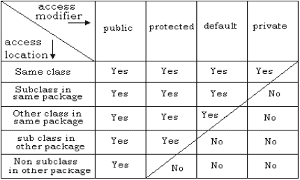

### JAR 文件（Java 存档文件）

为了压缩文件，我们使用诸如`winzip`等程序，同样的`java`的`JAR`功能也可以用于压缩整个`java`包的层级结构。它提供了更好的安装便利。

不需要在客户位置创建文件结构。我们只需要使用`JAR`文件，该文件就会恢复整个文件结构。所有的包、子包和类文件都将从`JAR`文件自动创建。

`JAR`技术使得软件的交付和安装变得简单得多。此外，`JAR`文件中的元素是压缩的，这使得下载一个`JAR`文件比单独下载几个未压缩的文件要快得多。这允许消费者确定这些元素是由特定的组织或个人产生的。

`JAR`文件有以下可用选项：

| 选项 | 说明 |
| :--- | :--- |
| `c` | 创建一个新的存档。 |
| `C` | 在命令执行期间切换目录。 |
| `f` | 文件列表的第一个元素是待创建的存档名称。 |
| `i` | 应提供索引信息。 |
| `m` | 文件列表的第二个元素是外部清单文件（manifest）名称。 |
| `M` | 不创建清单文件。 |
| `t` | 列出存档内容。 |
| `u` | 更新存档。 |
| `v` | 工具应提供详细输出。 |
| `x` | 从存档中提取文件。 |
| `o` | 不使用压缩。 |

#### 创建 JAR 文件

```bash
c:\javaprg> jar -cf Myjar.jar pack1
```

这将创建一个名为`Myjar.jar`的文件，它包含`pack1`包的所有文件。

#### 提取 JAR 文件

```bash
c:\javaprg> jar -xf Myjar.jar
```

此命令用于提取`jar`文件（如`unzip`）。

#### 列出 JAR 文件内容

```bash
c:\javaprg> jar -tf Myjar.jar
```

以下命令列出`Myjar.jar`的内容。

#### 更新 JAR 文件

```bash
c:\javaprg> jar -uf Myjar.jar pack1
```

该命令对于更新`jar`文件有用。

#### 创建可执行 JAR 文件

```bash
c:\javaprg> jar -cmf mainClass Myjar.jar pack1
```

其中`mainClass`是一个包含`Main-Class: pack1.pack2.pack3.A`的文本文件，保存在`javaprg`文件夹中。

#### 执行 JAR 文件

```bash
c:\javaprg> java -jar Myjar.jar
```

### 题

1. 对于包有什么理解？
2. 解释所有的修饰符及其在不同包和子包与其他类的作用范围。
3. `JAR`文件有什么用？
4. `import`语句有什么用？

嵌套接口是指任何声明位于另一个类或接口体内的接口。顶层接口不是嵌套接口的接口。定义接口的语法与定义类非常相似。接口定义的一般形式如下：

```java
interface interface_name
{
    variable declarations;
    methods declarations;
}
```

在这里，`interface`是关键字，`interface_name`是任何有效的 Java 标识符（类似于类名）。

**注意：** 当我们定义一个接口时，默认情况下它是公共（public）且抽象（abstract）的。

### 接口修饰符

顶层接口唯一可以修饰符是`abstract`和`public`。即使我们不使用`abstract`修饰符，接口也会隐式声明为`abstract`，因此不需要使用`abstract`修饰符。顶层接口的可见性可以是包级（package）或公共的（public），就像顶层类一样。如果不使用可见性修饰符，则接口的可见性假设为包级。

### 数据变量成员声明

接口中只能定义常量。接口中的所有变量都是隐式的`public`、`final`和`static`，这意味着它们不能被实现类更改。它们还必须用常量值初始化。

```java
public static final type variable_name=value;
```

在接口中声明的变量是`public`、`static`和`final`的。这意味着它是具有公共访问权限的静态变量。变量还被声明为`final`，这意味着它在声明时必须赋值，并且之后不能再修改。`final`关键字类似于 C/C++ 中的`const`。

### 方法声明

方法声明将仅包含方法列表，而不包含任何方法体语句。它们在参数列表后以分号结束。它们本质上是`abstract`方法，接口中指定的任何方法都不能有默认实现。

接口中的所有方法默认始终是`public`和`abstract`修饰符的。我们不能在接口中声明`static`方法。

```java
public abstract return_type method_name(parameter_list);
```

这里是一个包含两个变量和一个方法的接口定义示例：

```java
interface item
{
    static final int code =1001;
    static final String name = "Matrix";
    abstract void display( );
}
```

**注意：** 接口中不包含方法的代码，方法声明仅以分号结束。

另一个接口的示例：

```java
interface area
{
    float pi = 3.142f;
    float compute (float x, float y);
    void show( );
}
```

### 扩展接口

像类一样，接口也可以被扩展，即一个接口可以从其他接口派生出来。新接口将继承子接口的所有成员，方式类似于子类。这通过使用`extends`关键字来实现，如下：

```java
interface interface_1
{
    int code = 1001;
    String name = "Matrix";
}
interface interface_2 extends interface_1
{
    void display();
}
```

`interface_2`将继承常量`code`和`name`。

**注意：** 变量`name`和`codes`的声明方式类似于普通变量。这在这里是允许的，但接口中的所有变量都被视为常量、公共且静态的，尽管这里没有使用`public`、`static`和`final`关键字。

我们可以将多个接口合并并在接口中。以下声明是有效的：

```java
interface interface_1
{
    int code = 1001;
    String name = "Matrix";
}
interface interface_2
{
    void display();
}
interface interface_3 extends interface_1, interface_2
{
}
```

**注意：** 始终记住接口不能扩展类。这违反了接口只能有抽象方法和常量的规则。

### 实现接口

接口被用作“超类”，其属性被类继承。因此，必须创建一个继承给定接口的类。一旦定义了接口，一个或多个类就可以该接口。

要实现接口，需要在类定义中包含`implements`子句，然后创建接口声明的方法。实现类必须提供所有接口中所有方法的方法体，否则必须声明为`abstract`。实现类还可以扩展一个类并实现多个接口。

```
modifier class<class-name> implements<interface-name>
{
    body of the class
}
```

**类中实现接口的语法**

```java
interface interface_name
{
}
class class _name implements interface_name
{
    Body of class
}
```

Java 不支持多重继承，但它支持多重接口继承，即一个类可以实现多个接口，如下所示：

```
modifiers class <class-name> implements <interface-1>,<interface-2>,<interface-3>, ....<interface-n>
{
    body of class
}
```

**注意：** 当我们实现接口方法时，它必须被声明为`public`。实现接口方法类似于重写（over-riding），所以我们不能降低可见性。

**示例 9.1**

```java
interface interface_1
{
    void show(int x);
}
class class_1 implements interface_1
{
    public void show(int x)
    {
    }
}
```

**抽象类的示例 9.2**

```java
interface common
{
    void push(int x);
    int pop( );
}
abstract class stack implements common
{
}
```

```java
30. f3=f2;  //多态（赋值引用）
31. f3.display(5);
32. }
33. }
```

输出：

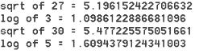

# 接口的特性 (Characteristics of Interface)

- `Interface`是一个关键字。
- `Interface`可以声明为`abstract`，但它默认就是抽象的，因此不需要添加`abstract`关键字。
- 所有变量始终是`public` `static`且`final`。
- `interface`的所有方法必须在类中实现。
- 接口类中实现的所有方法必须是`public`的。
- `Interface`仅包含方法的声明。
- `Interface`方法不能声明为`static`。它们始终被声明为实例方法。
- 类既不能缩小`interface`方法的访问权限，也不能在方法的`throws`子句中指定新的异常；因为尝试这样做等同于更改接口契约，这是非法的。重写方法的标准也适用于实现接口方法。
- 所有方法在实现类中都需要定义为`public`。
- 此处允许`abstract`关键字允许部分实现。
- 无论类直接或间接实现了多少接口，它对于可能在接口中具有多个声明的方法只提供单一的实现。
- 方法原型声明也可以像类一样进行重载。
- 接口常量可以通过任何客户端（类或接口）使用其完全限定名来访问，无论该客户端是否扩展或实现了该接口。然而，如果客户端是实现此接口的类或扩展了此接口的接口，则该客户端也可以直接访问此类常量，而无需使用完全限定名。此类客户端继承了接口常量。
- 在接口常量多继承的情况下，任何名称冲突可以使用相关常量的完全限定名来解决。

### 接口变量 (Interface Variables)

`interface`中的所有变量始终是`public` `static`和`final`，因为它们是实现类访问数据类型和方法的公共部分。

## 接口变量的内存管理 (Memory Management of the Interface Variable)

静态变量在程序加载时总是获取内存，它们占用独立的内存，不与任何对象的内存共享。它们也被称为常量变量。可以使用`interface`名称和`.`操作符直接访问。

### 示例 9.4

```java
1. interface Static_Var
2. {
3.   int sun=1;
4.   int mon=2;
5.   int tues=3;
6.   int wed=4;
7.   int thurs=5;
8.   int fri=6;
9.   int sat=7;
10. }
11. class Week_Day implements Static_Var
12. {
13.   public static void main(String args[])
14.   {
15.     System.out.println(sun);
16.     System.out.println(mon);
```


```
17.     System.out.println(tues);
18.     System.out.println(wed);
19.     System.out.println(thurs);
20.     System.out.println(fri);
21.     System.out.println(sat);
22.   }
23. }
```

或者

```java
11. class Week_Day
12. {
13.   public static void main(String args[])
14.   {
15.     System.out.println(Static_Var.sun);
16.     System.out.println(Static_Var.mon);
17.     System.out.println(Static_Var.tues);
18.     System.out.println(Static_Var.wed);
19.     System.out.println(Static_Var.thurs);
20.     System.out.println(Static_Var.fri);
21.     System.out.println(Static_Var.sat);
22.   }
23. }
```

输出：

```
1
2
3
4
5
6
7
```

### 示例 9.5

```java
1. interface Two_Methods
2.   {
3.     void m1( );
4.     void m2( );
5.   }
6. class Three_Methods implements Two_methods
7.   {
8.     public void m1( )
9.     {
10.       m1 的方法体;
11.     }
12.     public void m2( )
13.       {
14.       m2 的方法体;
15.     }
16.     public void m3( )
17.     {
18.       m3 的方法体;
19.     }
20.   }
21. class Methods_Demo
22.   {
23.     public static void main(String args[])
24.     {
25.     Two_methods tm1 = new Three_methods();
26.       tm1.m1();
27.       tm1.m2();
28.       //tm1.m3();  错误
29.     Three_Methods tm2 = new Three_Methods();
30.       tm3.m3();
31.     }
32.   }
```

注意：我们不能使用接口引用调用`m3()`，因为在接口中没有声明它。

### 示例 9.6

```java
1. interface Two_Methods
2.   {
3.     void m1( );
4.     void m2( );
5.   }
6. class Three_Methods implements Two_Methods
7.   {
8.     public void m1( )
9.     {
10.       m1 的方法体;
11.     }
12.     public void m2( )
13.       {
14.       m2 的方法体;
15.     }
16.     public void m3( )
17.     {
18.       m3 的方法体;
19.     }
20.   }
21. class Methods_Demo
22.   {
23.     public static void main(String args[])
24.     {
25.     Two_methods tm1 = new Three_methods();
26.       tm1.m1();
27.       tm1.m2();
28.       //tm1.m3();  错误
29.     Three_Methods tm2 = new Three_Methods();
30.       tm3.m3();
31.     }
32.   }
```

### 示例 9.7

```java
1. interface Two_Methods
2.   {
3.     void push(int x);
4.     int pop();
5.   }
6. class Stack implements Two_Methods
7.   {
8.     int[] arr = new int[5];
9.     int top = -1;
10.    public void push(int item)
11.    {
12.      if(top == 4)
13.        System.out.println("溢出");
14.        return;
15.      }
16.      top++;
17.      arr[top] = item;
18.    }
19.    public int pop()
20.    {
21.      if(top == -1)
22.        System.out.println("下溢");
23.        return -1;
24.      }
25.      int item = arr[top];
26.      top--;
27.      return item;
28.    }
29.    void disp()
30.    {
31.      for(int i=top;i>=0;i--)
32.      {
33.          System.out.println(arr[i]);
34.      }
35.    }
36. }
37. class Stack_Demo
38.   {
39.     public static void main(String args[])
40.     {
41.      Stack s1 = new Stack();
42.      s1.pop();
43.      for(int i=0;i<5;i++)
44.      {
45.        s1.push(i+100);
46.        s1.push(600);
47.      }
48.      System.out.println("显示所有项");
49.      s1.disp(); //非接口方法
50.      System.out.println("移除所有项");
51.    }
52.   }
```

# 章节

# ∞ 10 ∞

# (`String`和`StringBuffer`)

## 引言

在`java`中，字符串是类对象，并使用两个类（即`String`和`StringBuffer`）来实现。与 C 字符串相比，Java 字符串更加可靠且可预测。这基本上是因为 C 语言缺乏边界检查。Java 字符串不是字符数组，也不是 NULL 终止的。通常情况下，Java 不允许将运算符应用于字符串对象。

该规则的唯一例外是`+`和`+=`运算符，它们会拼接两个字符串并产生一个`String`对象。在 Java 中，字符数组不被视为字符串。在 Java 中，`String`类被用于执行所有的字符串操作。`String`类和`StringBuffer`类是`java.lang`包的一部分。

### `String`类：

```java
String s1 = new String("matrix");
String s2 = "matrix";
System.out.println(s1);
System.out.println(s1.length);
System.out.println("matrix".length);
```


`String` 在 Java 中具有以下特性：

### (i) String 是 Java 中的一个对象

`String` 代表一个字符序列，但与许多将 `String` 实现为字符数组的语言不同，Java 将字符串实现为类型为 `string` 的对象。

`String` 操纵是许多 Java 程序中最常见的部分。将字符串实现为内置对象，使得 Java 能够提供一套完整的功能，使字符串处理变得方便。此外，字符串对象可以通过多种方式构建，以便在需要时轻松获取字符串。

### (ii) String 是不可变的

`String` 是不可变的，也就是说我们无法在创建后更改该字符串。但是，声明为 `String` 引用的变量可以随时更改以指向其他字符串对象。

我们仍然可以执行所有类型的字符串操作。每当我们一个现有字符串的修改版本时，都会创建一个包含修改内容的新字符串对象。

原始字符串保持不变。使用这种方法是因为固定的、不可变的字符串可以比可变的字符串实现得更高效。

对于那些需要修改字符串的场景，有一个名为 `StringBuffer` 的伴随类，它的对象包含的字符串在创建后是可以被修改的。

### (iii) String 类是 final 的

`String` 和 `StringBuffer` 类都是 `final` 的。这意味着我们不能在任何类中扩展 `String` 类。这允许进行某些优化，以提高常用字符串操作的性能。

## String 类的构造函数与方法

| No | 方法 | 说明 |
| :--- | :--- | :--- |
| 1 | `public String()` | 初始化一个新创建的 `String` 对象，使其表示空字符序列。`String s1 = new String();` |
| 2 | `public String(String str)` | 初始化一个新创建的 `String` 对象，使其表示与参数相同的字符序列；换句话说，新创建的字符串是参数字符串的拷贝。`String s1 = new String("Matrix"); String s2 = new String(s1);` 字符串 `s2` 是字符串 `s1` 的拷贝。虽然内容相同但 `s1` 和 `s2` 指向不同的字符串对象。 |
| 3 | `public String(char ch[])` | 分配一个新的 `String`，使其表示字符数组参数当前包含的字符序列。`char ch[] = {'a', 'b', 'c'}; String s1 = new String(ch); //s1 将包含 "abc"` |
| 4 | `public String(char value[], int offset, int count)` | 分配一个新的 `String`，包含来自字符数组参数中子数组的字符。`char ch[] = {'a', 'b', 'c', 'd', 'e', 'f'}; String s1 = new String(ch,2,3); //s1 将包含 "cde"` |
| 5 | `public String(int value[], int offset, int count)` | 分配一个新的 `String`，包含来自整数数组参数子数组的字符，该数组包含字符的 Unicode 。`int a[] = {97, 98, 99, 100, 101, 102}; String s1 = new String(a,2,3); //s1 将包含 "cde"` |
| 6 | `public String(byte b[], int offset, int count)` | 使用平台的默认字符集解码指定的字节子数组以构造一个新的 `String`。`byte b[] = {97, 98, 99, 100, 101, 102}; String s1 = new String(b,2,3); //s1 将包含 "cde"` |
| 7 | `public String(byte b[])` | 使用平台的默认字符集解码指定的字节数组以构造一个新的 `String`。`byte b[] = {97, 98, 99}; String s1 = new String(b); //s1 将包含 "abc"` 尽管 Java 的 char 类型使用 16 位来表示 Unicode 字符集，但 Internet 上典型的字符串格式使用由 ASCII 字符集构建的 8 位字节数组。由于 8 位 ASCII 字符串很常见，`String` 类提供了在给定字节数组时初始化字符串的构造函数。在上述每个构造中，字节到字符的转换都是通过平台的默认字符编码完成的。 |
| 8 | `public String(StringBuffer)` | |
| 9 | `public int length()` | 显示字符串的字符个数。 |
| 10 | `public boolean isEmpty()` | 如果字符串为空则显示 true，否则显示 false。`String s1 = new String(); System.out.println(s1.isEmpty());` |
| 11 | `public char charAt(int index)` | 返回指定索引处的 `char` 值。索引范围从 0 到 `length()–1`。序列的第一个字符位于索引 0，下一个位于索引，以此类推。如果索引无效将抛出 `StringIndexException`。`String s1 = "matrix"; System.out.println(s1.charAt(0)); // 将打印 "m"` |
| 12 | `public void getChars(int srcBegin, int srcEnd, char[] dst, int dstBegin)` | 将字符串中的字符复制到目标数组。要复制的第一个字符位于 `srcBegin`，最后一个字符位于 `srcEnd–1`。该方法可能会抛出 `ArrayIndexOutOfBoundsException` 和 `StringIndexOutOfBoundsException`。 |
| 13 | `public void getBytes(int srcBegin, int srcEnd, byte[] dst, int dstBegin)` | |
| 14 | `public byte[] getBytes()` | 使用默认字符集编码此字符串。该方法在导出不支持 16 位字符的环境时非常有用。 |
| 15 | `public boolean equals(Object)` | 将调用字符串与指定的对象比较。仅当参数不为空且是一个 `String` 对象并表示相同的字符序列时，结果为 true。 |
| 16 | `public boolean equalsIgnoreCase(String)` | 忽略大小写差异，比较调用字符串。 |
| 17 | `public int compareTo(String)` | 按字典顺序比较调用字符串与传入的字符串。返回值：`<0` 表示调用字符串小于 `str`，`>0` 表示调用字符串大于 `str`，`0` 表示两个字符串相等。 |
| 18 | `public int compareIgnoreCase(String)` | 忽略大小写按字典顺序比较两个字符串。 |
| 19 | `public boolean regionMatches(int startIndex, String str2, int str2StartIndex, int len)` | 测试两个字符串区域是否相等。 |
| 20 | `public boolean regionMatches(Boolean ignoreCase, int startIndex, String str2, int str2StartIndex, int len)` | 测试两个字符串区域是否相等。如果 `ignoreCase` 标志为 true，则忽略大小写。 |
| 21 | `public boolean startsWith(String prefix, int startIndex)` | 测试字符串是否从指定的索引开始以指定的前缀开头。如果 `startIndex` 越界，该方法不会返回异常而是返回 false。 |
| 22 | `public boolean startsWith(String)` | 测试字符串是否以指定的前缀开头。 |
| 23 | `public boolean endsWith(String suffix)` | 测试字符串是否以指定的后缀结尾。 |
| 24 | `public int indexOf(char ch)` | 返回指定字符在字符串中首次出现的索引。 |
| 25 | `public int indexOf(char ch, int fromIndex)` | 返回指定字符在字符串中首次出现的索引，从指定的索引开始搜索。 |
| 26 | `public int indexOf(String str)` | 返回指定的子字符串在字符串中首次出现的索引。 |

| 方法 | 说明 |
| :--- | :--- |
| `public int indexOf(String str, int fromIndex)` | 返回从指定索引开始，在该字符串中指定子字符串首次出现的索引。 |
| `public int lastIndexOf(int ch)` | 返回在该字符串中，指定字符最后一次出现的索引。 |
| `public int lastIndexOf(int ch, int fromIndex)` | 返回从指定索引开始向后查找，在该字符串中，指定字符最后一次出现的索引。 |
| `public int lastIndexOf(String str)` | 返回在该字符串中，指定子字符串最后一次出现的索引。 |
| `public int lastIndexOf(String str, int fromIndex)` | 返回从指定索引开始向后查找，在该字符串中指定子字符串最后一次出现的索引。 |
| `public String substring(int n)` | 返回从第 $n^{th}$ 个字符开始的子字符串 |
| `public String substring(int n, int m)` | 返回从第 $n^{th}$ 个字符到第 $m^{th}$ 个字符（不包括 $m^{th}$）的子字符串 |
| `public String concat(String str)` | 将字符串 `str` 拼接到调用字符串对象的末尾 |
| `public String replace(char x, char y)` | 将 `x` 的所有出现处替换为 `y` |
| `public String replaceFirst(String, String)` | |
| `public String replaceAll(String, String)` | |
| `public String toLowerCase()` | 将字符串转换为小写 |
| `public String toUpperCase()` | 将字符串转换为大写 |
| `public String trim()` | 去除首尾空格 |
| `public char[] toCharArray()` | 将调用的字符串转换为新的字符数组。提供此函数是为了方便起见，因为可以使用 `getChars()` 实现相同的结果 |
| `public static String valueOf(Object p)` | 为参数 p 创建一个字符串对象 |

## 字符串数组 (String Array)

我们还可以创建并使用包含字符串的数组。

### 示例 10.1

```java
import java.util.Scanner;

class StringArrSort
{
    public static void main(String args[])
    {
        Scanner sc=new Scanner(System.in);
        System.out.print("Enter how many names ");
        int n=sc.nextInt();
        String s[]=new String[n];
        //输入
        for(int i=0;i<n;i++)
        {
            System.out.println("Enter name " + (i+1));
            s[i]=sc.next();
        }
        //排序
        for(int i=0;i<n-1;i++)
            for(int j=i+1;j<n;j++)
                if(s[i].compareTo(s[j]) > 0)
                {
                    String t=s[i];
                    s[i]=s[j];
                    s[j]=t;
                } 
      //输出
      for(int i=0;i<n;i++)
            System.out.println(s[i]);
    }
}
```

## 字符串转换与 toString()

当 Java 在拼接过程中将数据转换为其 `String` 表示形式时，它是通过调用 `String` 类定义的字符串转换方法 `valueOf()` 的重载版本来实现的。`valueOf()` 是一个静态方法，针对所有简单类型和 `Object` 类型进行了重载。

对于简单类型，`valueOf()` 返回一个字符串，其中包含调用时的值的类可读等效值。对于对象，`valueOf()` 会调用对象上的 `toString()` 方法。

每个类都继承了 `toString()`，因为它是由 `Object` 类定义的。然而，`toString()` 的默认实现很少是充分的。它显示类名，后面紧跟符号“@”，然后是对象 ID（例如 `Box@ab1342`），这通常没有用处。对于我们创建的大多数重要类，我们希望重写 `toString()` 并提供我们自己的字符串表示。

### 示例 10.2

```java
class A
{
    private int x,y;
    A()
    {
        x = y = 0;
    }
    A(int x1, int y1)
    {
        x = x1;
        y = y1;
    }
}

class ToStringTest
{
    public static void main(String args[])
    {
        A a1 = new A(5,6);
        System.out.println(a1); // 调用了 Object 的 toString()
        String s1="Object a1 is " + a1; // 对象与字符串拼接
        // 再次调用了 Object 的 toString()
        System.out.println(s1);
    }
}
```

输出：

```
A@3e25a
Object a1 is A@3e25a
```

### 示例 10.3

```java
class A
{
    private int x,y;
    A()
    {
        x = y = 0;
    }
    A(int x1, int y1)
    {
        x = x1;
        y = y1;
    }
    public String toString()
    {
        return (x + "," + y);
    }
}

class ToStringTest2
{
    public static void main(String args[])
    {
        A a1 = new A(5,6);
        System.out.println(a1); // 调用了 A 的 toString()
        String s1="Object a1 is " + a1; // 对象与字符串拼接
        // 再次调用了 A 的 toString()
        System.out.println(s1);
    }
}
```

输出：

```
5,6
Object a1 is 5,6
```

### 示例 10.4

```java
import java.util.*;

class FindTest
{
    public static void main(String args[])
    {
        Scanner sc=new Scanner(System.in);
        String s1,s2;
        System.out.print("Enter a string");
        s1=sc.next();
        System.out.print("Enter string to search");
        s2=sc.next();
        int ans = s1.indexOf(s2);
        if(ans == -1)
            System.out.println("Not Found");
        else
            System.out.println("found at pos " + ans);
    }
}
```


### StringBuffer

`StringBuffer` 是 `String` 的伙伴类，提供了许多 `String` 的功能。正如所知，`String` 表示固定长度的不可变字符序列。相比之下，`StringBuffer` 表示可增长且可写的字符序列。`StringBuffer` 可以在中间插入字符或在末尾追加。Java 经常使用该类，但许多程序员只处理 `String`，实际上通过重载的 `+` 运算符在底层使用 `StringBuffer`。`StringBuffer` 会自动增长以适应添加，通常预留了比需要更多的字符。

#### 关于 StringBuffer 的一些要点

- `StringBuffer` 像 `Object` 一样。
- `StringBuffer` 类像 `String` 一样也是 `final` 的。
- `StringBuffer` 对象是可变的，这与 `String` 对象不同。

#### StringBuffer 的构造函数和方法

| 方法 | 说明 |
| :--- | :--- |
| `public StringBuffer()` | 默认构造函数预留 16 个字符。 |
| `public StringBuffer(int n)` | 此构造函数接受一个整数参数，显式设置缓冲区的大小。 |
| `public StringBuffer(String str)` | 此构造函数接受一个字符串参数，设置 `StringBuffer` 对象的初始内容，并额外预留 16 个字符。 |
| `public synchronized int length()` | 返回 `StringBuffer` 的当前长度。 |
| `public synchronized int capacity()` | 返回当前容量。容量是新插入字符的可用空间，超过此范围将发生分配。 |
| `public synchronized void ensureCapacity(int min)` | 确保容量至少等于指定的最小值。如果我们想在构造 `StringBuffer` 之后预留一定数量字符的空间，可以使用 `ensureCapacity()` 方法设置缓冲区的大小。如果我们预先知道将追加许多小字符串，这非常有用。 |
| `public synchronized void trimToSize()` | 将移除多余的空空间。现在容量将等于长度。 |
| `public synchronized void setLength(int newLength)` | 设置字符序列的长度。`newLength` 必须是非负数。当我们增大缓冲区时，会在现有末尾添加空字符。如果调用 `setLength()` 传入的值小于 `length()` 的返回值，则存储在该长度之外的字符将丢失。 |

# 方法参考

| 方法 | 说明 |
| :--- | :--- |
| `public synchronized char charAt(int index)` | 返回此序列中指定索引处的 `char` 值。 |
| `public synchronized void getChars(int srcBegin, int srcEnd, char[] dst, int dstBegin)` | 将字符从此序列复制到目标字符数组 `dst`。第一个复制的字符位于索引 `srcBegin`；最后一个复制的字符位于索引 `srcEnd-1`。要复制的字符总数为 `srcEnd-srcBegin`。字符被复制到 `dst` 中从索引 `dstBegin` 开始的子数组中。注意：确保目标数组足够大，能够容纳指定子字符串中的字符数量。 |
| `public synchronized void setCharAt(int index, char ch)` | 将指定索引处的字符设置为 `ch`。如果 `index` 为负数或大于或等于 `length()`，则抛出 `IndexOutOfBoundsException`。 |
| `public synchronized StringBuffer append(Object)` | `append` 方法将任何其他类型数据的字符串表示连接到调用 `StringBuffer` 对象的末尾。 |
| `public synchronized StringBuffer delete(int start, int end)` | 从从索引 `start` 到索引 `end-1` 的字符 |
| `public synchronized StringBuffer deleteCharAt(int index)` | 移除指定位置的字符 |
| `public synchronized StringBuffer replace(int start, int end, String str)` | 将索引 `start` 到索引 `end-1` 的字符替换为指定 `String` 中的字符。 |
| `public synchronized String substring(int)` | 返回一个新的 `String`，包含当前此字符序列中的字符子序列。该子字符串从指定的索引开始，延伸到此序列的结尾。 |
| `public synchronized String substring(int start, int end)` | 返回一个新的 `String`，包含当前此字符序列中的字符子序列。该子字符串从指定的 `start` 索引开始，延伸到索引 `end-1` 处的字符。 |
| `public synchronized StringBuffer insert(int, Object)` | 将一个 `String` 插入另一个 `String` 中。它被重载以接受所有简单类型的值以及 `Strings` 和 `Objects`。 |
| `public int indexOf(String)` | |
| `public synchronized int indexOf(String, int)` | |
| `public int lastIndexOf(String)` | |
| `public synchronized int lastIndexOf(String, int)` | |
| `public synchronized StringBuffer reverse()` | 反转 `StringBuffer` 的内容。 |

## 示例 10.5

```java
import java.util.Scanner;

class SortStr
{
    public static void main(String args[])
    {
        Scanner sc = new Scanner(System.in);
        System.out.print("Enter a string");
        StringBuffer sb1 = new StringBuffer(sc.next());
        //Sorting
        for(int i=0;i<sb1.length()-1;i++)
        for(int j=i+1;j<sb1.length();j++)
            if(sb1.charAt(i) > sb1.charAt(j))
            {
                char t=sb1.charAt(i);
                sb1.setCharAt(i,sb1.charAt(j));
                sb1.setCharAt(j,t);
            }
            System.out.println(sb1);
    }
}
```

输出: Enter a string SHIVAM
AHIMSV

## 示例 10.6: 统计给定句子单词数的程序。

```java
class WordCnt
{
    public static void main(String args[])
    {
        String s1 = "Mohan Das  Karam  Chand  Gandhi";
        boolean flag=false;
        int cnt=0;
        for(int i=0;i<s1.length();i++)
        {
            if(s1.charAt(i) == ' ')
                flag = false;
            else
            {
                if(flag == false)
                {
                    flag = true;
                    cnt++;
                }
            }
        }
        System.out.print("No. of Words=" + cnt);
    }
}
```

输出: No. of Words=5

# 第 1 章：异常处理

## 引言

异常是在运行时发生并破坏程序正常流的情况。当 Java 解释器遇到错误时，它创建一个对象并将其抛出。在较旧的语言中，错误处理是使用返回码完成。在 Java 中，异常通过对象进行处理。这种方法避免了繁琐的 `goto` 和返回码的使用。

### 异常基础

异常是一个描述代码中错误状态的对象。当出现异常情况时，会创建并抛出该对象。异常可以由 Java 运行时系统生成，也可以由你的代码手动生成。用户生成的异常通常向调用者报告错误。

Java 异常处理通过五个关键字管理：`try`、`catch`、`throw`、`throws` 和 `finally`。

- `try`: 你想要监控是否发生异常的语句。
- `catch`: 用于在发生异常时处理该异常。
- `throw`: 用于手动抛出异常。
- `throws`: 用于指定某个方法可能会抛出异常。
- `finally`: 在 `try` 块完成后绝对必须执行的代码。

异常处理块的通用形式为：

```java
try {
    // 监控错误情况的代码块
}
catch (Exception1 exOb) {
    // 针对 Exception1 的异常处理程序
}
//.........
finally {
    // 在 try 结束后要执行的代码块
}
```

### 异常类型

所有异常类型都是内置 `Throwable` 类的子类。`Throwable` 位于异常类层次结构的顶端。紧接 `Throwable` 之下的是两个子类，将异常分为两个不同的分支：

1. `Exception`: 用于用户程序应该捕获的异常情况。你将通过派生该类来创建自定义的异常类型。
2. `RuntimeException`: `Exception` 的一个重要子类。这些异常为你编写的程序自动定义，例如除以零或无效的数组索引。

另一个分支由 `Error` 顶层，它定义了在正常情况下预计不会被程序捕获的异常。`Error` 类型的异常由 Java 运行时系统用于表示与运行时环境本身相关的错误。栈溢出（Stack overflow）就是此类错误的一个例子。本章将不会处理 `Error` 类型的异常，因为这些通常是为了响应程序无法处理的灾难性故障而创建。

顶层异常层次结构所示：

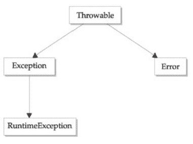

### 示例 11.1

```java
class ErrorTest1
{
    public static void main(String args[])
    {
      int a=5,b=2,c=2,d;
      d=a/(b-c); // 发生了 ArithmeticException(Divide by zero)
      System.out.println(d);
      System.out.println("This will not be printed");
    }
}
```

程序将在除法操作期间终止，不会执行剩余的语句。

### 示例 11.2

```java
class A
{
    void display()
    {
      -----
    }
}

class ErrorTest2
{
    public static void main(String args[])
    {
      A a1=null;
      a1.display(); // 发生了 NullPointerException
    }
}
```

在上述程序中，会发生 `NullPointerException`。引用变量没有用 `new` 进行初始化。在这种情况下，程序也会终止。

### 示例 11.3

```java
class ErrorTest3
{
    public static void main(String args[])
    {
      int a[ ] = {10,20,30};
      System.out.println(a[3]);  // 发生了 ArrayIndexOutOfBoundsException
    }
}
```

在上述情况下，数组的长度为 3，索引从 0 到 2，因此如果我们打印 `a[3]`，那么它就是第 4 个元素，这不是一个有效的索引。这将产生一个异常错误。在 C/C++ 中这是允许的，但在 Java 中是不允许。

### 注意

JDK 7 添加了一种 `try` 语句的新形式，支持自动资源管理。这种新的 `try` 形式被称为 `try-with-resources`，在 `Chapter` 文件中关于文件管理的上下文中进行了描述，因为文件是最常用的资源之一。

#### 异常的其他情况

1. 我们尝试打开的文件可能不存在。
2. 我们想创建一个新对象，但没有可用内存。
3. 我们想要加载的类文件可能丢失或格式错误。
4. 我们想要转换为数字的 `String` 包含无效字符，导致无法转换为数字。

如果异常对象没有被妥善捕获和处理，解释器将显示错误消息并终止程序。如果我们希望继续执行剩余代码，那么应该尝试捕获由错误条件抛出的异常对象。

这项任务被称为异常处理（exception handling）。异常处理机制目的是目的是提供检测和报告“异常情况”的手段，以便采取适当的行动。该机制建议引入单独的错误处理代码，用于执行以下任务：

1. 发现问题。（发生异常）
2. 告知发生了错误。（抛出异常）
3. 接收错误信息。（捕获异常）
4. 采取纠正措施。（处理异常）

Java 异常处理通过五个关键字管理：`try`、`catch`、`throw`、`throws` 和 `finally`。

我们想要监控异常的程序语句包含在 `try` 块中，每当发生错误，它就会被抛到 `catch` 块。我们的代码可以捕获此异常（使用 `catch`）并以合理的方式处理它。系统生成的异常由 Java 运行时系统自动抛出。

要手动抛出异常，请使用关键字 `throw`。任何抛出方法的异常必须通过 `throws` 子句进行指定。任何在方法返回之前必须执行的代码都放在 `finally` 块中。

`try` 块必须括在大括号之间。它可以包含一个或多个语句。`catch` 块和 `finally` 块都是可选的。如果没有 `catch` 块，执行将继续进行 `try` 块之后的语句。如果存在 `finally` 块，执行将继续进行 `finally` 块之后的语句。

如果在执行 `try` 块时发生了某些错误，JVM 会抛出一个 `Exception` 对象或其子类之一。然后按照顶层顺序与 `catch` 块进行比较。如果找到匹配的 `catch` 块，则处理该异常。如果没有找到，异常将向上层次结构移动，直到它被处理或被传递给 JVM 且未处理。JVM 随后终止程序并在控制台上显示详细信息。

#### 使用 try 和 catch

尽管 Java 运行时系统提供的默认异常处理器对于调试很有用，但你通常可能自己自己处理异常。这样做有两个好处：首先，它允许你处理错误。其次，它防止程序自动终止。如果你的程序每当发生错误就停止运行并打印堆栈跟踪，大多数用户会感到困惑（至少可以这么说）！幸运的是，防止这一点非常容易。

为了防止和处理运行时错误，只需将你想要监控的代码包含在 `try` 块中。紧跟在 `try` 块之后包含一个 `catch` 子句，指定你想要捕获的异常类型。

为了说明这可以多么容易完成，以下程序包含一个 `try` 块和一个 `catch` 子句，用于处理由除零错误产生的 `ArithmeticException`：

```java
class Exc2 {
  public static void main(String args[])
  {
    int d, a;
    try {  // 监控代码块。
    d = 0;
    a = 42 / d;
    System.out.println("This will not be printed.");
    }
    catch (ArithmeticException e)
    {
    // 捕获除零错误
    System.out.println("Division by zero.");
    }
    System.out.println("After catch statement.");
  }
}
```


该程序产生输出：

```
Division by zero.

After catch statement.
```

注意`try`块内部的`println()`调用从未执行。一旦抛出异常，程序控制将从`try`块转移到`catch`块。

换句话说，`catch`并不是被“调用”的，因此执行流永远不会从`catch`回到`try`块中。因此，“这不会打印。”这一行不会显示。一旦`catch`语句执行完毕，程序将继续执行整个`try/catch`机制之后的下一行代码。

`try`及其`catch`语句形成一个单元。`catch`子句的作用范围限于紧接其后的`try`语句所指定的语句。`catch`语句无法捕获由另一个`try`语句抛出的异常（稍后描述的嵌套`try`语句除外）。受`try`保护的语句必须用大括号括起来（也就是说它们必须在一个块内）。你不能对单个语句使用`try`。

大多数结构良好的`catch`子句其目标应该是解决异常情况，然后像错误从未发生过一样继续运行。例如，在下一个程序中，`for`循环的每次迭代都会获取两个随机整数。这两个整数相互相除，结果被用于除以值`12345`。最终结果存入`a`中。如果任何一个除法操作导致`divide-by-zero`错误，它将被捕获，`a`的值设置为零，然后程序继续。

```java
// Handle an exception and move on.
import java.util.Random;

class HandleError {
    public static void main(String args[]) {
        int a=0, b=0, c=0;
        Random r = new Random();

        for(int i=0; i<32000; i++) {
            try {
                b = r.nextInt();
                c = r.nextInt();
                a = 12345 / (b/c);
            } catch (ArithmeticException e) {
                System.out.println("Division by zero.");
                a = 0; // set a to zero and continue
            }
            System.out.println("a: " + a);
        }
    }
}
```

## 显示异常的描述

`Throwable`重写了`toString()`方法（由`Object`定义），使其返回一个包含异常描述的字符串。你可以只需通过将异常作为参数传递给`println()`语句来显示此描述。例如，上一个程序的`catch`块可以重写如下：

```java
catch (ArithmeticException e)
{
    System.out.println("Exception: " + e);
    a = 0; // set a to zero and continue
}
```

当在程序中替换此版本并运行时，每个`divide-by-zero`错误都会显示以下消息：

```
Exception: java.lang.ArithmeticException: / by zero
```

虽然在在此上下文中它没有特殊价值，但在其他情况下，显示异常描述是有价值的——特别是当你正在尝试异常或进行调试时。

| 异常类型 | 异常原因 |
| :--- | :--- |
| `ArithmeticException` | 算术错误，例如除以 0 |
| `ArrayIndexOutOfBoundsException` | 数组索引越界 |
| `ArrayStoreException` | 在数组中存储错误类型的数据 |
| `FileNotFoundException` | 访问不存在的文件 |
| `IOException` | 无法从文件读取 |
| `NullPointerException` | 由引用空对象引起 |
| `NumberFormatException` | 字符串与数字之间的转换失败 |
| `OutOfMemoryException` | 没有足够的内存分配新对象 |
| `SecurityException` | Applet 尝试执行浏览器安全设置未允许的操作 |
| `StackOverflowException` | 系统栈空间耗尽 |
| `StringIndexOutOfBoundsException` | 程序尝试访问字符串中不存在的字符位置 |

## Java 的内置异常

在标准包`java.lang`内部，Java 定义了几个异常类。前面的示例已经使用了其中几个。在这些异常中最通用的是标准类型`RuntimeException`的子类。

如之前解释的那样，这些异常不需要包含在方法的`throws`列表中。在 Java 语言中，这些被称为`unchecked exceptions`（未检查异常），因为编译器不会检查方法是否处理了它们。而那些被称为`checked exceptions`（已检查异常）；在`java.lang`中定义的异常必须包含在方法的`throws`列表中。

## 多个 catch 子句

在某些情况下，单段代码可能会抛出多个异常。为了处理这种情况，你可以指定两个或多个`catch`子句。当抛出异常时，会按顺序检查每个`catch`语句，并执行第一个与异常类型匹配的语句。在一个`catch`语句执行后，其他语句将被跳过。

```java
// Demonstrate multiple catch.
class MultipleCatches {
    public static void main(String args[]) {
        try {
            int a = args.length;
            System.out.println("a = " + a);
            int b = 42 / a;
            int c[] = { 1 };
            c[42] = 99;
        } catch (ArithmeticException e) {
            System.out.println("Divide by 0: " + e);
        } catch (ArrayIndexOutOfBoundsException e) {
            System.out.println("Array index oob: " + e);
        }
        System.out.println("After try/catch blocks.");
    }
}
```

该程序在不带命令行参数启动时会导致`divide-by-zero`异常，因为`a`等于零。如果你提供命令行参数使`a`大于零，它将跳过除法错误。但它会导致`ArrayIndexOutOfBoundsException`，因为数组`c`的长度为 1，而程序尝试给`c[42]`赋值。

以下是两种运行方式生成的输出：

```
C:\>MultipleCatches
a = 0
Divide by 0: java.lang.ArithmeticException: / by zero
After try/catch blocks.
```

```
C:\>MultipleCatches TestArg
a = 1
Array index oob: java.lang.ArrayIndexOutOfBoundsException: 42
After try/catch blocks.
```

在使用多个`catch`语句时，必须记住异常子类在其父类之前。这是因为使用父类的`catch`语句会捕获该类型及其任何子类的异常。因此，如果子类出现在父类之后，它永远无法被访问。此外，在 Java 中，不可达代码是一个错误。例如，考虑以下程序：

```java
/* 此程序包含错误。
在系列 catch 语句中，子类必须在其父类之前。
否则，将创建不可达代码并导致编译时错误。 */
class SuperSubCatch {
    public static void main(String args[]) {
        try {
            int a = 0;
            int b = 42 / a;
        } catch(Exception e) {
            System.out.println("Generic Exception catch.");
        }
        /* 此捕获语句永远不会到达，因为
        ArithmeticException 是 Exception 的子类。 */
        catch(ArithmeticException e) { // 错误 – unreachable
            System.out.println("This is never reached.");
        }
    }
}
```

如果你尝试编译此程序，将收到一条错误信息，指出第二个`catch`语句是不可达的，因为异常已经被捕获。由于`ArithmeticException`是`Exception`的子类，第一个`catch`语句将处理所有基于`Exception`的错误，包括`ArithmeticException`。

这意味着第二个`catch`语句将永远不会执行。要解决这个问题，请反转`catch`语句的顺序。

## 嵌套 try 语句

`try`语句可以嵌套。也就是说，一个`try`语句可以位于另一个`try`内部。每当进入一个`try`语句时，该异常的上下文就会推入栈中。

如果内部`try`语句没有针对特定异常的`catch`处理器，栈将回溯，并检查下一个`try`语句的`catch`处理器是否匹配。

这种过程会持续持续直到其中一个`catch`语句执行成功，或者耗尽所有的嵌套`try`语句。如果没有匹配的`catch`语句，则 Java 运行时系统将处理该异常。

以下是一个使用嵌套`try`语句的示例：

## 多个 catch 语句

当存在多个`catch`语句时，它被称为多个 catch 语句。

### 多个 catch 语句示例

```java
try
{
    statement;  //产生异常
}
catch(Exception-type-1 e)
{
    statement 1;  //处理异常类型 1
}
catch(Exception-type-2 e)
{
    statement 2;  //处理异常类型 2
}
- - -
catch(Exception-type-n e)
{
    statement n;  //处理异常类型 n
}
```

### 示例 11.4

```java
class ErrorTest4
{
    public static void main(String args[])
    {
        int a=10,b=2,c=2,d;
        System.out.println("Before Exception ");
        d=a/(b-c);
        System.out.println("After Exception ");
    }
}
```

输出：

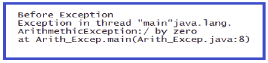

在这里我们没有捕获异常，因此程序会在显示消息“Before Exception”后终止。现在我们使用异常处理解决了这个问题。

### 示例 11.5

```java
class ErrorTest5
{
    public static void main(String[] args)
    {
      int a=10,b=2,c=2,d;
      try
      {
        System.out.println("Before Exception");
        d=a/(b-c);
        System.out.println("This Will Not Print");
      }
      catch(ArithmeticException e)
      {
      System.out.println("After Exception");
      System.out.println("error : Division by zero");
      }
    }
}
```

输出：


## 异常处理的优势

- 我们可以很容易地确定异常/错误将在哪里被处理。异常/错误在运行时沿调用栈向上传播——首先到达封装的`try`块，然后返回到调用方法——直到异常处理器捕获它们。
- 异常/错误的位置是确切知的，因为整个堆栈轨迹对用户可用。这对于调试非常有帮助。
- 程序员获得了机会从错误/异常状态中恢复。
- 错误处理代码与正常程序流分离，以增加可读性和可维护性。
- 在 Java 中，无需测试是否发生了异常/错误情况。添加更多的错误/异常处理器只需添加更多的`catch`子句，但不需要触动原始程序流。

## 异常类的层次结构

所有 Exception/Error 类的根类是`throwable`类，它是`object`类的直接子类。异常/错误也是 Java 中的对象。`Exception`的子类带有后缀`Exception`。

`throwable`类有两个直接子类。

- `Error`：`Error`类的子类基本上用于信号非正常状态，例如：
    1. `OutOfMemoryError`表示 Java 虚拟机内存耗尽，垃圾回收器无法回收任何内存。
    2. `StackOverflowError`解释器中发生栈溢出。
    这些错误通常是不可恢复的，不应该被处理。
- `Exception`：`Exception`类的子类通常是可恢复的。例如，`EOFException`表示我们打开的文件没有更多数据了。`FileNotFoundException`表示我们想要打开的文件在系统中不存在。

错误的示例：


## 异常分为两种类型

### 检查异常 (Checked Exception)

如果必须捕获异常，则它被称为检查异常。如果`try`块中可能发生检查异常且未被处理，程序将无法编译。编译器确保如果一个方法直接或间接地抛出检查异常，则该方法必须显式处理它。该方法要么捕获异常并采取适当行动，要么将异常传递给调用者。

注意：`Exception`及其所有子类（运行时异常及其子类外）都是检查异常，必须被捕获。

### 未检查异常 (Unchecked Exception)

如果不必捕获异常，则称为未检查异常。即使未处理未检查异常，程序也可以编译。如果程序中发生了未处理的未检查异常，程序执行将在该点终止。但如果异常已处理，程序就不会因为异常而终止。

注意：`Error`及其所有子类都是未检查异常。运行时异常及其子类是未检查的。用户定义的异常是检查的。

### Exception 类可用方法

| 方法 | 描述 |
| :--- | :--- |
| `getMessage()` | 获取与异常或错误相关的消息。 |
| `printStackTrace()` | 打印显示异常发生位置的栈轨迹。 |
| `toString()` | 显示异常/错误名称以及由`getMessage()`返回的消息。 |

### 示例 11.6

```java
class ErrorTest6
{
    public static void main(String[] args)
    {
      try
      {
        int a=10,b=2,c=2,d;
        System.out.println("Before Exception");
        d=a/(b-c);
        System.out.println("This Will Not Print");
      }
      catch(ArithmeticException e)
      {
        System.out.println("After Exception");
        System.out.println("error : Division by zero");
        System.out.println(e.getMessage());
        System.out.println(e); //调用了 toString()
        e.printStackTrace();
      }
    }
}
```

输出：

```
Before Exception
After Exception
error : Division by zero
by Zero
java.lang.ArithmeticException: / by zero
java.lang.ArithmeticException: / by zero
at ErrorTest6.main(ErrorTest6.java:10)
```

### 示例 11.7 多个 catch

```java
class ErrorTest7
{
```


```java
public static void main(String args[])
{
    try
    {
        int a=args.length;
        System.out.println("Before Exception");
        int b=58/a;
        int c[] = {1};
        c[47]=100;
        System.out.println("After Exception");
    }
    catch(ArithmeticException e)
    {
        System.out.println("Divide by zero :"+e);
    }
    catch(ArrayIndexOutOfBoundsException e)
    {
        System.out.println("Array Index oob :"+e);
    }
    System.out.println("After try/catch block");
}
```

**输出 1：** 当我们作为`java ErrorTest7`运行上述程序时：

```
Before Exception
Divide by zero : java.lang.ArithmeticException: / by zero
After try/catch block
```

**输出 2：** 当我们作为`java ErrorTest7 45`运行上述程序时：

```
Before Exception
Array Index oob: java.lang.ArrayIndexOutOfBoundsException: 47
After try/catch block
```

如果我们在另一个`try`块中使用`try`和`catch`语句，则被称为嵌套的`try catch`。

### 语法

```java
try      //外部 try
{
    try      //内部 try
    {
        statement ;
    }
    catch1()    //内部 catch
    {
        statement ;
    }
    catch2()    //内部 catch
    {
        statement ;
    }
}
catch()    //外部 catch
{
    statement ;
}
```

### 示例 11.8 嵌套的 try 和 catch

```java
class Nested
{
    public static void main(String args[])
    {
        try
        {
            int a=args.length;
            int b=58/a;
            System.out.println("a= "+a);
            try
            {
                if(a==1)
                    a=a/(a-a);
                if(a==2)
                {
                    int c[]={1};
                    c[42]=100;
                }
            }
            catch(ArrayIndexOutOfBoundsException e)
            {
                System.out.println("ArrayIndex oob "+e);
            }
        }
        catch(ArithmeticException e)
        {
            System.out.println(e.getMessage());
        }
    }
}
```

**输出 I：** 当我们以`java ErrorTest8`运行上述程序时 / 除以 0：

**输出 II：** 当我们以`java ErrorTest8 10`运行上述程序时：

```
a=1 / by zero
```

**输出 III：** 当我们以`java ErrorTest8 10 20`运行上述程序时，`a=2`：

```
ArrayIndex oob java.lang.ArrayIndexOutOfBoundsException: 42
```

### finally 语句

Java 支持另一种名为`finally`语句的语句，它可以用于处理没有被之前的任何一个`catch`语句捕获的异常。`finally`块可以用于处理在`try`块中生成的任何异常。无论是否发生错误，它都会执行。它可以紧跟在`try`块之后，也可以在最后一个`catch`块之后，如下所示：

**语法：**

```java
try
{
}
catch(...)
{
}
catch(...)
{
}
finally
{
}
```

### 示例 11.9 finally 语句

```java
class ErrorTest9
{
    public static void main(String args[])
    {
        int a[ ] = {5,10};
        int b=5;
        try
        {
            int x=a[2]/b-a[1];
        }
        catch(ArithmeticException e)
        {
            System.out.println("Division By Zero");
        }
        catch(ArrayIndexOutOfBoundsException e)
        {
            System.out.println("Array Index error");
        }
        catch(ArrayStoreException e)
        {
            System.out.println("Wrong Data Type");
        }
        finally    //始终执行
        {
            System.out.println("Always Execute");
        }
        int y=a[1]/a[0];
        System.out.println("y = "+y);
    }
}
```

**输出：**

```
Array Index error
Always Execute
y = 2
```

### throw

到目前，我们只捕获由 Java 运行时系统抛出的异常。然而，我们的程序可以使用`throw`语句显式地抛出异常；其通用形式所示：

```java
throw instance;
```

在这里，`instance`必须是`Throwable`类型的对象或`Throwable`的子类。简单类型（如`int`或`char`）以及非`Throwable`类（如`String`和`Object`）不能用作异常。我们可以通过两种方式获取`Throwable`对象：在`catch`子句中使用参数，或者使用`new`运算符创建一个对象。执行流在`throw`语句之后立即停止；任何随后的语句都不会执行。系统将检查最近的`try`块，查看它是否有与异常类型匹配的`catch`语句。如果有，控制权将转移到该语句。如果没有，则检查下一个外层的`try`语句，依此类推。如果未找到匹配的`catch`，则默认处理程序将停止程序并打印堆栈跟踪。在这里，我们取了一个创建并抛出异常的程序。捕获异常的处理器将其重新抛给外部处理器。

#### 示例 11.10

```java
class ErrorTest10
{
    int age;
    void setAge(int a)
    {
        if(a>0)
            age = a;
        else
        {
            NullPointerException e = new NullPointerException("Invalid Age");
            throw e;
        }
    }
    public static void main(String args[])
    {
        ErrorTest10 a1 = new ErrorTest10();
        try
        {
            a1.setAge(20);
            a1.setAge(-10);
        }
        catch(NullPointerException e)
        {
            System.out.println(e.getMessage());
        }
    }
}
```

**输出：** `Invalid Age`

### throws

如果一个方法可能会引起它无法处理的异常，那么它必须指定这种行为，以便方法的调用者对该异常进行防护。我们通过在方法的声明中包含一个`throws`子句来实现。`throws`子句列出了方法可能抛出的异常类型。这对于所有检查异常（checked exceptions）都是都是的。方法可能抛出的所有异常必须在`throws`子句中声明。如果没有声明，将导致编译时错误。这是一个包含`throws`子句的方法声明通用形式：

**语法：**

```java
type method-name(parameter list) throws exception-list
{
    //方法体
}
```

在这里，`exception-list`是方法可以抛出的异常的逗号分隔列表。

#### 示例 11.11

```java
import java.io.*;
class ErrorTest11
{
    int age;
    void setAge(int a) throws IOException
    {
        if(a>0)
            age = a;
        else
        {
            IOException e = new IOException("Invalid Age");
            throw e;
        }
    }
    public static void main(String args[])
    {
        ErrorTest11 a1 = new ErrorTest11();
        try
        {
            a1.setAge(20);
            a1.setAge(-10);
        }
        catch(IOException e)
        {
            System.out.println(e.getMessage());
        }
    }
}
```

**输出：** `Invalid Age`

### 创建自定义异常/类

#### 创建自己的异常子类

这非常简单：定义一个`Exception`/`Error`的子类。我们的子类不需要实现任何内容。`Exception`/`Error`类本身没有定义任何方法。当然，它当然继承了`Throwable`的方法。因此，所有异常（包括你创建的异常）都可以使用`Throwable`定义的方法。

#### 示例 11.12

```java
class AgeException extends Exception
{
```

```java
class AgeException(String msg) {
    super(msg);
}
class ErrorTest12 {
    int age;
    void setAge(int a) throws InvalidAgeException {
        if(a>0)
            age = a;
        else {
            AgeException e = new AgeException("Invalid Age");
            throw e;
        }
    }
    public static void main(String args[]) {
        ErrorTest12 a1 = new ErrorTest12();
        try {
            a1.setAge(20);
            a1.setAge(-10);
        } catch(AgeException e) {
            System.out.println(e.getMessage());
        }
    }
}
```

**输出：**

```
Invalid Age
```

以下示例声明了`Exception`的新子类，并使用该子类在方法中信号错误条件。它重写了`toString()`方法，允许显示精心定制的异常描述。

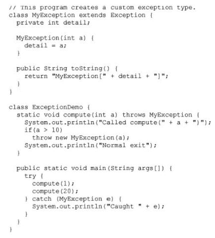

此示例定义了一个名为`MyException`的`Exception`子类。该子类非常简单：它只包含一个构造函数和一个重写的`toString()`方法，该方法显示异常的值。

`ExceptionDemo`类定义了一个名为`compute()`的方法，该方法抛出一个`MyException`对象。当`compute()`的整数参数大于 10 时，会抛出异常。`main()`方法为`MyException`设置了异常处理程序，然后用合法值（小于 10）和非法值调用`compute()`，以展示代码的两种路径。

以下是结果：

```
Called compute(1)
Normal exit
Called compute(20)
Caught MyException[20]
```

### 链式异常

链式异常功能允许我们将另一个异常与异常相关联。第二个异常描述了第一个异常的原因。例如，想象一种情况：方法由于尝试除以零而抛出了`ArithmeticException`。然而，问题的实际原因是发生了 I/O 错误，导致除数被设置不当。

尽管该方法必须抛出`ArithmeticException`（因为这是发生的错误），但我们可能也想让调用代码知道底层原因是 I/O 错误。

为了支持链式异常，Java 2 的 1.4 版本为`Throwable`类增加了两个构造函数和两个方法。构造函数所示：

```java
Throwable(Throwable causeExc)
Throwable(String msg, Throwable causeExc)
```

在第一种形式中，`causeExc`是发生的异常。第二种形式允许我们在指定原因异常的同时指定一个描述。这两个构造函数也被添加到了`Error`、`Exception`和`RuntimeException`类中。

添加到`Throwable`类的链式异常方法是`getCause()`和`initCause()`：

```java
Throwable getCause()
Throwable initCause(Throwable causeExc)
```

`getCause()`方法返回当前异常的底层异常。如果没有底层异常，则返回`null`。`initCause()`方法将`causeExc`与调用的异常关联，并返回该异常的引用。因此，我们可以在异常创建后将其原因与异常关联。然而，原因异常只能设置一次。

因此，我们每个异常对象只能调用一次`initCause()`。此外，如果原因异常是通过构造函数设置的，则我们不能再次使用`initCause()`方法设置它。通常情况下，`initCause()`用于为不支持上述两个额外构造函数的旧异常类设置原因。大多数 Java 内置异常都没有定义这些额外的构造函数。因此，如果我们需要为这些异常添加异常，将使用`initCause()`。链式异常并不是每个程序都需要的。但在了解底层原因有用的情况下，它们提供了一种优雅的解决方案。

#### 示例 1.13

```java
class ErrorTest13 {
    int age;
    void setAge(int a) {
        if(a>0)
            age = a;
        else {
            NullPointerException e = new NullPointerException("Admission Failed");
            e.initCause(new ArithmeticException("Age is invalid"));
            throw e;
        }
    }
    public static void main(String args[]) {
```


```java
ErrorTest13 a1 = new ErrorTest13();

try {

    a1.setAge(20);

    a1.setAge(-10);

} catch(NullPointerException e) {

    System.out.println(e.getMessage());

    System.out.println(e.getCause());

}

}

}
```

输出：

```
Admission Failed

Age is Invalid
```


在这个示例中，顶层异常是`NullPointerException`。向它添加了一个原因异常`ArithmeticException`。当异常从`demroc()`抛出时，它被`main()`捕获。在那里，显示顶层异常，随后是通过调用`getCause()`的底层异常。链式异常可以持续到所需的深度。因此，原因异常本身也可以拥有原因。请注意，过长的异常链可能意味着设计不当。链式异常并不是每个程序都需要的。但在了解底层原因有用的情况下，它们提供了一种优雅的解决方案。

### 三个新的 JDK 7 异常特性（已更新）

JDK 7 为异常系统增加了三个有趣且实用的特性。第一个是自动在不再需要时释放资源（例如文件）。它是基于`try`语句的扩展形式，称为`try-with-resources`，将在后续介绍文件的章节介绍。

第二个新特性是`multi-catch`，第三个有时被称为`final rethrow`或更精确的重抛。这两个特性在这里描述。

`multi-catch`特性允许两个或多个异常由同一个`catch`语句捕获。多个异常处理程序使用相同的代码序列来响应不同的异常并不常见。不需要逐个捕获每个异常类型，现在可以使用单个`catch`子句处理所有异常，避免代码重复。

要使用`multi-catch`，用 OR 符在`catch`子句分隔每个异常类型。每个`multi-catch`参数都是隐式的`final`。（如果需要，可以显式指定`final`，但没有必要。）由于每个`multi-catch`参数都是隐式的`final`，因此无法赋值新值。

这是一个使用`multi-catch`特性的`catch`语句，用于捕获`ArithmeticException`和`ArrayIndexOutOfBoundsException`：

```java
catch(ArithmeticException | ArrayIndexOutOfBoundsException e)
```

以下程序演示了`multi-catch`特性的用法：

```java
// Demo JDK 7 的 multi-catch 特性

class MultiCatch {

    public static void main(String args[]) {

        int a=10, b=0;

        int vals[] = { 1, 2, 3 };

        try {

            int result = a / b; // 产生 ArithmeticException

            // vals[10] = 19; // 产生 ArrayIndexOutOfBoundsException

            // 此 catch 子句捕获这两个异常。

        } catch(ArithmeticException | ArrayIndexOutOfBoundsException e) {

            System.out.println("Exception caught: " + e);

        }

        System.out.println("After multi-catch.");

    }

}
```

当尝试除以零时，该程序将产生`ArithmeticException`。如果你注释掉除法语句并移除下一行的注释符号，就会产生`ArrayIndexOutOfBoundsException`。这两个异常都被同一个`catch`语句捕获。

更精确的重抛（precise rethrow）功能将可以重抛的异常类型限制为：仅限于相关的`try`块抛出的检查异常（checked exceptions）、未被之前的`catch`句处理、且是参数的子类或超类的异常。

尽管这种能力可能并不经常需要，但它现在已经可以使用。为了使更精确的重抛功能生效，`catch`参数必须是有效最终的（effectively final），这意味着它在`catch`块内部不能被赋值新值，或者显式声明为`final`。

# 使用异常

异常处理为具有许多动态运行的复杂程序提供了一种强大的机制。将`try`、`throw`和`catch`视为处理程序逻辑中错误和异常边界条件的整洁方式。与某些使用错误返回代码来指示失败的语言不同，Java 使用异常。因此，当一个方法可能会失败时，请让它抛出异常。

这是一种处理失败模式更简洁的方法。最后一点：Java 的异常处理语句不应被视为非局部分支的通用机制。如果你这样做，只会让你的代码变得混乱并难以维护。

### 理论题

1. 什么是异常？
2. 我们如何定义`try`块？
3. 我们如何定义`catch`块？
4. 列出 Java 中可能发生的一些常见异常类型。给出示例。
5. 捕获所有类型的异常是必要的的？
6. 一个`try`块可以使用多少个`catch`块。
7. 创建一个可能产生三种异常的`try`块，然后结合必要的`catch`块以适当地捕获并处理它们。
8. 什么是`finally`块？什么时候以及如何使用？给出一个合适的示例。
9. 解释异常处理机制如何用于程序的调试。


# 章节

# ∞ 12 ∞

# (多线程编程)

## 引言

线程是程序内部的单一控制流。线程与进程非常相似。事实上，线程也被称为轻量级进程。

## 线程对比 进程

通常，不同的进程占用不同的内存空间。当 CPU 从一个进程切换到另一个进程时，当前运行进程的状态会被保存，另一个进程的状态会被恢复。在状态切换期间没有进行任何有用工作。状态切换时间应该尽可能短，以最大化 CPU 的利用率。

线程也也像独立的进程，但它们共享相同的内存和状态。独立的线程也有独立的状态，但与进程状态相比，该状态非常小。状态可能只包含程序计数器和栈指针。因此，从一个线程切换到另一个线程所需的时间非常短。因此，与进程相比，线程的上下文切换时间非常短。在多线程的情况下，CPU 的利用率高于多进程的情况下。

## 多线程程序

多线程程序包含两个或多个可以并发运行的部分。此类程序的每个部分被称为线程，每个线程都定义了一条单独的执行路径。因此，多线程是多任务处理的一种特殊形式。

例如，一个程序可能有三个线程：

* 一个负责打印。
* 一个负责编辑。
* 一个负责从互联网下载文件。

所有这些线程可能都在并发运行，从而最大化了 CPU 的利用率。

## 基于进程的多任务处理

大多数操作系统允许我们同时运行两个或多个程序。这被称为基于进程的多任务处理。例如，我们可以运行一个 Java 程序并同时编辑一个 Word 文档。基于进程的多任务处理确保了大多数时间内会有程序要执行，从而提高了 CPU 的利用率。

在基于进程的多任务处理中，程序是调度程序可以派发的最小代码单元。

## 基于线程的多任务处理

线程是基于线程的多任务环境中最小的执行单元。一个进程可以被分为若干个并发执行的线程。这允许我们在单个程序中并发处理多个任务。

例如，我们可以在编辑 Word 文档的同时进行打印。基于线程的多任务处理提高了 CPU 的利用率。

## Java 线程模型

Java 运行时系统许多事情依赖线程，所有的类库都是为了多线程设计的。这有助于减少周期的浪费。

## 线程生命周期（线程状态）

线程存在于几种状态。线程可以处于运行状态。一旦获得 CPU 时间，就可以进入就绪状态。运行中的线程可以被挂起，这会暂时停止它的活动。挂起的线程可以被恢复，使其从停止的地方继续执行。线程在等待资源时会进入阻塞状态。在任何时候，线程都可以被终止，停止其执行。一旦终止，线程将无法恢复。

### 1. 新生状态 (Newborn State)

当我们创建一个线程对象时，线程诞生了，被称为处于新生状态。线程尚未被调度运行。在此状态下，我们只能对它执行以下操作之一：

1. 使用`start()`方法将其调度运行。
2. 使用`stop()`方法将其杀死。

如果被调度，它将移动到就绪状态。如果我们在此状态下尝试使用其他方法，将抛出异常。

### 2. 就绪状态 (Runnable State)

就绪状态意味着线程已准备好执行并正在等待处理器的可用。也就是说，线程已加入等待执行的线程队列。如果所有线程的优先级相同，则以轮询的方式给它们分配时间片。

放弃控制权的线程会加入队列末尾并再次等待运行。然而，如果我们想让一个线程在轮到它之前放弃控制权并给另一个优先级相同的线程，它可以通过调用`yield()`方法来实现。

### 3. 运行状态 (Running State)

运行意味着处理器已经将时间给了该线程进行执行。运行中的线程可能在以下情况之一放弃其控制权：

* 时间片结束。
* 它被高优先级线程抢占。
* 它让出 CPU（即自愿放弃控制权）。
* 它完成了执行。
* 它被其他线程停止。
* 它已使用`suspend()`方法挂起。被挂起的线程可以通过`resume()`方法恢复。这种方法在我们由于某些原因想要挂起线程一段时间，但不想杀死它时非常有用。
* 它被告告知等待直到某个事件发生。这是通过`wait()`方法实现的。可以使用`notify()`方法调度该线程再次运行。
* 它正在执行某些 I/O 操作。

### 4. 阻塞状态 (Blocked State)

当一个线程被阻止进入可运行状态以及随后的运行状态时，该线程被认为处于阻塞状态。这发生在线程为了满足某些要求而挂起、睡眠或等待时。阻塞线程被视为“不可运行”，但并未死亡，因此完全具备再次运行的资格。

### 5. 死亡状态 (Dead State)

每个线程都有生命周期。运行线程在完成执行其`run()`方法后结束生命。它有自然死亡。然而，我们可以在任何状态下向它发送`stop`消息来杀死它，从而导致过早死亡。线程可以在一出生时被杀死，也可以在运行期间被杀死，甚至在处于“不可运行”（阻塞状态）时被杀死。

### 线程优先级 (Thread Priorities)

Java 为每个线程分配了一个优先级，该优先级决定了与其他线程相比如何对待该线程。线程优先级是整数，指定了一个线程相对于另一个线程的相对优先级。

作为一个绝对值，优先级是没有意义的；如果只有一个线程在运行，高优先级线程的运行速度并不会比低优先级线程快。相反，线程的优先级被用于决定何时从一个运行线程切换到下一个。这被称为上下文切换（context switch）。决定何时发生上下文切换的规则如下：

* 线程可以自愿地（自己）放弃控制权。这是通过显式让出（yield）、睡眠或阻塞或等待 I/O 实现的在这种情况下，将检查所有其他线程，通常会将 CPU 分配给就绪的最高优先级线程。
* 线程可能会被高优先级线程抢占。在这种情况下，一个不让出处理器的低优先级线程无论正在做什么，都会被一个高优先级线程简单地抢占。基本上，只要高优先级线程想要运行，它就会运行。这被称为抢占式多任务处理。
* 某些操作系统支持非抢占式基于优先级的调度。在这种情况下，高优先级线程只有在低优先级线程完成后才有机会运行。
* 在两个相同优先级的线程竞争 CPU 周期的情况下，情况会有点复杂。对于像 windows98 这样的操作系统，等优先级的线程必须自愿地（自己）让出（放弃）控制权给同级线程。如果不这样做，其他线程将不会运行。

注意：操作系统切换等优先级线程上下文的方式不同可能会产生问题。

### 同步 (Synchronization)

由于多线程为我们的程序引入了异步行为，因此我们必须在需要时有一种方法来强制执行同步。例如，如果我们想让两个线程通信并共享复杂的数据结构（如链表），我们需要某种方法来确保它们之间不会发生冲突。

也就是说，我们必须防止一个线程在另一个线程正在读取数据时写入数据。Java 使用监视器（monitor）进行线程间同步。我们可以将监器想象是一个只能容纳一个线程的微小盒子。一旦线程进入监器，监器就可以用来保护共享资源不被多个线程同时操作。

大多数多线程系统以对象的形式的形式暴露，我们的程序必须显式地获取并锁定它们。Java 提供了一个更整洁的解决方案。

没有“monitor”类，相反，每个对象都有自己的隐式监视器，当调用对象的某个同步（synchronized）方法时，会自动进入。一旦线程进入同步方法内部，其他线程就无法调用同一对象上的任何其他同步方法。这使我们能够编写非常清晰且简洁的多线程代码，因为同步支持内置在语言中。

### 消息传递 (Messaging)

使用大多数其他语言进行编程时，我们必须依赖操作系统在线程之间建立通信。

这无疑增加了开销。相比之下，Java 提供了一种整洁、低成本的方法，让两个或多个线程通过调用所有对象都拥有的定义方法进行通信。Java 的消息系统允许线程进入对象的同步方法，然后在那里等待直到某个其他线程显式通知其离开。

### Thread 类和 Runnable 接口 (The Thread class and the Runnable interface)

Java 的多线程系统构建在`Thread`类、其方法及其辅助接口`Runnable`之上。该类属于`java.lang`包，因此显式导入。

`Thread`封装了一个执行线程，由于我们无法直接引用运行线程的内部状态，我们将通过其代理（即产生它的的`Thread`实例）来处理它。要创建一个新线程，我们的程序将扩展`Thread`类或实现`Runnable`接口。`Thread`类定义了几个帮助管理线程的方法：

| 方法 |  |
| :--- | :--- |
| `String getName()` | 返回此线程的名称 |
| `int getPriority()` | 返回此线程的优先级 |
| `boolean isAlive()` | 测试此线程仍在运行 |
| `void join()` | 等待此线程死亡（终止） |
| `void run()` | 如果此线程是用单独的`Runnable`对象构造的，则调用该`Runnable`对象的`run`方法；否则，此方法什么都不做并返回；如果扩展了类并在子类中重写了`run()`方法，则调用重写的`run()`方法。 |
| `void setName(String name)` | 将线程名称更改为参数 |
| `static void sleep(long millis)` | 让当前执行线程睡眠指定的毫秒 |
| `static void sleep(long millis, int nanos)` | 让当前执行线程睡眠指定的毫秒加上纳秒 |
| `void start()` | 启动此线程执行，Java 虚拟机调用此线程的`run`方法 |
| `static void yield()` | 让当前执行线程对象临时暂停并允许其他线程执行 |
| `static Thread currentThread()` | 返回当前执行线程的引用 |

### 主线程 (The main thread)

当 Java 程序启动时，一个线程立即运行。这通常被称为程序的主线程，因为它是程序开始时执行的线程。主线程是创建其他“子”线程的线程。

尽管主线程在程序启动时自动创建，但可以通过`Thread`对象对其进行控制。为了做到这一点，我们需要通过调用`currentThread()`方法获取它的引用，它是`Thread`类的公共静态成员。

一旦获取了主方法的引用，我们就可以像控制其他线程一样控制它。

示例 12.1

以下示例演示了如何获取主线程的引用并使用类的方法访问其属性。

```java
class CurrentThreadTest {

    public static void main (String args[]) {

        Thread t = Thread.currentThread();

        System.out.println("Current thread:" + t);

        System.out.println("Name:"+ t.getName());

        System.out.println("Priority:"+ t.getPriority());

        t.setName("MyThread");

        t.setPriority(Thread.MAX_PRIORITY);

        System.out.println("After name and priority change :" + t);

        System.out.println("Name:" + t.getName());

    }

}
```

```java
System.out.println(“Priority:” + t.getPriority());

for (int n=1; n<=5; n++)

{

    System.out.println(n);

    try {

        Thread.sleep(1000);

    } catch (InterruptedException e) {
```


```java
System.out.println("Main thread interrupted");
    }
}
```

**输出：**

```text
Current thread:Thread[main,5,main]
Name:main
Priority:5
After name and priority change :Thread[MyThread,10,main]
Name:MyThread
Priority:10
1
2
3
4
5
```

**注意 1：** `Thread`类中的`sleep()`方法可能会抛`InterruptedException`，这是一个受检异常。如果其他线程想要中断这个正在睡眠的线程，就会发生这种情况。

**注意 2：** 注意当`t`（线程引用）作为`println()`的参数时产生的输出。它将按顺序显示：线程名称、它的优先级以及它的线程组名称。它的优先级是 5，这是默认值，而`main`也是该线程所属线程组的名称。线程组是一个控制整个线程集合状态的数据结构。

## 创建线程

在最通用的意义上，我们通过实例化`Thread`类型的对象来创建线程。Java 识别了两种实现目标的方法：

1. 我们可以实现`Runnable`接口
2. 我们可以继承`Thread`类本身。

### 实现 Runnable

创建线程最简单的方法是创建一个实现`Runnable`接口的类。要实现`Runnable`，类只需要实现一个名为`run()`的单一方法。

```java
public void run()
```

在`run()`方法内部，我们将定义构成新线程的代码。`run()`可以调用其他方法、使用其他类并声明变量，就像主线程一样。

唯一的区别是`run()`为我们程序中的另一个并发执行的线程建立了入口点。该线程将在`run()`返回时结束。

在我们创建了一个实现`Runnable`的类后，我们将在该类内部使用以下构造函数之一来实例化`Thread`类型的对象：

- `Thread(Runnable threadObj)`
- `Thread(Runnable threadObj, String threadName)`

这里`threadObj`是调用其`run`方法的对象，`threadName`是新线程的名称。在新线程创建后，在我们调用`start()`方法之前，它不会开始运行。

`start()`方法将线程放入就绪队列（可运行状态）。每当线程被调度时，它的执行将从`run()`方法开始。

### 示例 12.2

```java
class A implements Runnable {
    public void run() {
        for(int i=1;i<=5;i++) {
            System.out.println("Child Thread:" + i);
        }
        System.out.println("Exiting child thread");
    }
}

class RunnableTest {
    public static void main(String args[]) {
        A a1=new A();
        Thread t1 = new Thread(a1,"Demo Thread");
        t1.start();
        System.out.println("Main thread exiting");
    }
}
```

**输出：**

```text
Main thread exiting
Child Thread:1
Child Thread:2
Child Thread:3
Child Thread:4
Child Thread:5
Exiting child thread
```

### 示例 12.3

```java
class A implements Runnable {
    Thread t;
    A() {
        t= new Thread(this, "Demo Thread");
        System.out.println("Child thread: "+ t);
        t.start();
    }
    public void run() {
        for (int i=1; i<=5; i++) {
            System.out.println("Child Thread: "+ i );
            try {
                Thread.sleep(500);
            } catch (InterruptedException e) {
                System.out.println(e);
            }
        }
        System.out.println ("Exiting Child thread");
    }
}

class RunnableTest {
    public static void main (String args[] ) {
        A a1=new A();
        for (int i=1; i<=5; i++) {
            System.out.println("Main Thread:"+ i);
            try {
                Thread.sleep(1000);
            } catch (InterruptedException e) {
                System.out.println("thread interrupted");
            }
        }
        System.out.println("End of thread");
    }
}
```

**输出：**

```text
Child thread: Thread[Demo Thread,5,main]
Main Thread:1
Child Thread: 1
Child Thread: 2
Main Thread:2
Child Thread: 3
Child Thread: 4
Main Thread:3
Child Thread: 5
Exiting Child thread
... 
```

### 继承 Thread 类

创建线程的第二方法是创建一个继承`Thread`的新类，然后创建该类的实例。扩展类必须重写`run()`方法，这是新线程的入口点。它必须调用`start()`来执行新线程。

### 示例 12.4

```java
class A extends Thread {
    A( ) {
        super ("Test Thread");
        System.out.println("Child thread:" + this);
        start();
    }
    public void run () {
        for (int i=1; i<=5; i++) {
            System.out.println("Child Thread:"+i);
            try {
                sleep(500);
            } catch(InterruptedException e) {
                System.out.println("Child interrupted");
            }
        }
        System.out.println ("Exiting Child thread");
    }
}

class ThreadTest {
    public static void main(String args[]) {
        new A();
        for (int i=1; i<=5; i++) {
            System.out.println("Main Thread: "+i);
            try {
                Thread.sleep(1000);
            } catch(InterruptedException e) {
                System.out.println("thread interrupted");
            }
        }
        System.out.println ("Main thread exiting");
    }
}
```

**输出：**

```text
Child thread:Testing Thread,5,main]
Main Thread: 1
Child Thread:1
Child Thread:2
Main Thread: 2
Child Thread:3
Child Thread:4
Main Thread: 3
Child Thread:5
Exiting Child thread
Main Thread: 4
Main Thread: 5
Main thread exiting
```

**注意：** 如果`Thread`没有分配任何名称，它的名称将类似于`Thread-1`、`Thread-2`、`Thread-3`等。

## 选择方法

线程类定义了几个可以被派生类重写的方法。在这些方法中，必须重写的是`run()`。这也是我们在实现`Runnable`接口时要求的方法。

许多 Java 程序员认为只有当类被某种方式被增强或修改时才应该被扩展。因此，如果我们不会重写`Thread`的其他方法，简单的实现`Runnable`接口可能是最好的。

### 创建多个线程

### 示例 12.5

```java
class A implements Runnable {
    String name;
    Thread t;
    A(String threadName) {
        name=threadName;
        t=new Thread(this, name);
        System.out.println("Child thread:"+t);
        t.start();
    }
    public void run() {
        for(int i=1;i<=5;i++) {
            System.out.println(t.getName())+ ":" + i);
            try {
                Thread.sleep(1000);
            } catch (InterruptedException e) {
                System.out.println(e); 
            }
        }
        System.out.println(name+ "Exiting");
    }
}

class MultiThreadTest {
    public static void main(String args[] ) {
        A a1=new A("One");
        A a2=new A ("Two");
        A a3=new A ("Three");
        try {
            Thread.sleep(10000);
        } catch (InterruptedException e) {
            System.out.println("main thread interrupted");
        }
        System.out.println ("Main thread exiting");
    }
}
```

```text
Child thread:Thread[One,5,main]
Child thread:Thread[Two,5,main]
Child thread:Thread[Three,5,main]
One:1
Two:1
Three:1
One:2
Two:2
Three:2
One:3
Two:3
Three:3
One:4
Two:4
Three:4
One:5
Two:5
Three:5
OneExiting
TwoExiting
ThreeExiting
Main thread exiting
```

### 使用`isAlive()`和`join()`方法强制执行顺序

通常我们我们希望主线程最后结束。实现这一点的一种方法是在`main`中调用`sleep()`。这是一种相当粗暴的方法。有两种方法可以判断线程是否已完成。首先，我们可以在线程对象上调用`isAlive()`。该方法由`Thread`类定义，其通用形式如下：

```java
final boolean isAlive()
```

如果调用它的线程仍在运行，则`isAlive()`方法返回`true`。否则返回`false`。虽然`isAlive()`有时很有用，但我们更常用的用于等待线程完成的方法是`join()`，如下所示：

```java
final void join() throws InterruptedException
```

该方法会一直等待直到调用它的线程终止。`join()`的其他形式允许我们指定等待指定线程终止的最大时间。

接下来的示例使用了`join()`来确保主线程是最后一个停止的。它还演示了`isAlive()`方法。

### 示例 12.6

```java
class A implements Runnable
{ 
  String name;
  Thread t;
  A(String threadName)
  { 
      name=threadName;
      t=new Thread(this,name);
      System.out.println("Child thread:"+t);
      t.start();
  }
  public void run()
  { 
      for(int i=1;i<=5;i++)
      { 
        System.out.println(name + ":"+ i );
        try
        { 
          Thread.sleep(1000);
        }
        catch(InterruptedException e)
        { 
          System.out.println(e);
        }
      }
      System.out.println(name + "Exiting");
  }
}

class DemoJoin
{ 
  public static void main(String args[])
  { 
      A ob1=new A("One");
      A ob2=new A("Two");
      A ob3=new A("Three");
      System.out.println("Thread One is alive?:"+ob1.t.isAlive());
      System.out.println("Thread Two is alive?:"+ob2.t.isAlive());
      System.out.println("Thread Three is alive?:"+ob3.t.isAlive());
      try
      { 
        ob3.t.join();
        ob2.t.join();
        ob1.t.join();
      }
      catch(InterruptedException e)
      { 
        System.out.println("main thread interrupted");
      }
      System.out.println("Thread One is alive?:"+ ob1.t.isAlive());
      System.out.println("Thread Two is alive?:"+ ob2.t.isAlive());
      System.out.println("Thread Three is alive?:"+ ob3.t.isAlive());
      System.out.println("Main thread exiting");
  }
}
```

```text
Child thread:Thread[One,5,main]
Child thread:Thread[Two,5,main]
Child thread:Thread[Three,5,main]
Thread One is alive?:true
Thread Two is alive?:true
Thread Three is alive?:true
One:1
Two:1
Three:1
One:2
Two:2
Three:2
One:3
```


```
Two:3

Three:3

One:4

Two:4

Three:4

One:5

Two:5

Three:5

OneExiting

TwoExiting

ThreeExiting

Thread One is alive?:false

Thread Two is alive?:false

Thread Three is alive?:false

Main thread exiting
```

### 优先级

线程优先级被线程调度器用于决定何时允许每个线程运行。与低优先级线程相比，高优先级线程会被优先调度。高优先级线程也可以抢占低优先级线程。例如，当一个低优先级线程正在运行，而一个高优先级线程从睡眠或等待 I/O 中恢复时，它将抢占低优先级线程。理论上，等优先级的线程应该获得同等的 CPU 访问权限。但 Java 设计用于工作在各种环境中。某些环境实现多任务的方式与其他环境完全不同。为了安全，共享相同优先级的线程应该偶尔让出控制权，确保所有线程在非抢占式操作系统下有机会运行。对于 CPU 密集型线程，我们应该确保它偶尔让出。要设置线程优先级，请使用`Thread`类的成员方法`setPriority()`。其通用形式为：

```java
final void setPriority(int level)
```

`level`的值必须在`Thread.MIN_PRIORITY`和`Thread.MAX_PRIORITY`之间。目前，这些值分别是 1 和 10。要将线程恢复到默认优先级，指定`Thread.NORM_PRIORITY`，它目前是 5。这些优先级定义为`Thread`类中的常量。我们可以通过调用`Thread`类的`getPriority()`方法获取当前优先级设置，如下：

```java
final void getPriority()
```

Java 的实现在调度方面存在巨大的差异。Windows XP/98/NT/2000 版本的工作方式符合预期。然而，其他版本可能完全不同。大多数不一致性源于线程依赖抢占行为，而不是协作放弃 CPU。在 Java 中获得可预测的跨平台行为的最安全方法是使用主动放弃 CPU 控制权的线程。下面的示例演示了不同优先级的线程，它们在抢占式平台上的运行方式与非抢占式平台并不相同。

### 示例 12.7

```java
class Clicker implements Runnable
{ 
  long click = 0;
  Thread t;
  volatile boolean running=true;
  Clicker (int p)
  { 
      t=new Thread (this);
      t.setPriority (p);
  }
  public void run ()
  { 
      while (running)
      { 
        click++;
      }
  }
  void stop ()
  { 
      running = false;
  }
  void start ()
  { 
      t.start ();
  }
}

class HiLoPri
{ 
  public static void main (String args[])
  { 
      Thread.currentThread().setPriority(Thread.MAX_PRIORITY);
      Clicker hi = new Clicker(Thread.NORM_PRIORITY+1);
      Clicker lo = new Clicker(Thread.NORM_PRIORITY-1);
      lo.start(); hi.start();
      try
      { 
        Thread.sleep (10000);
      }
      catch (InterruptedException e)
      { 
        System.out.println(e);
      }
      lo.stop(); hi.stop();
      try
      { 
        hi.t.join();
        lo.t.join();
      }
      catch (InterruptedException e)
      { 
        System.out.println(e);
      }
      System.out.println("Low : " + lo.click);
      System.out.println("High : " + hi.click);
  }
}
```

```text
Low  : 63660819
High : 2086505403
```

当两个或多个线程需要访问共享资源时，它们需要某种方式来确保资源同一时刻只有一个线程使用。实现这一过程的方法被称为同步。

同步的关键是监视器（monitor）概念（也称为信号量）。监视器是一个被用作互斥锁的对象。在给定时间内，只有一个线程可以拥有监视器。

当一个线程获取锁时，认为它进入了监视器。所有其他尝试进入锁定监视器的线程将被挂起，直到第一个线程退出监视器。这些线程被称为等待监视器。拥有监视器的线程如果需要，可以重新进入同一个监视器。我们可以通过两种方式之一对代码进行同步：

(i) 使用`synchronized`方法

(ii) 使用`synchronized`语句

### 使用同步方法

在 Java 中，同步非常简单，因为所有对象都有与其关联的隐式监视器。要进入对象的监视器，只需调用用`synchronized`关键字修改的方法。当一个线程在`synchronized`方法内部时，所有尝试调用该方法（或调用同一实例上的任何其他`synchronized`方法）的其他线程都必须`wait()`。要退出监视器并将对象的控制权交给下一个等待线程，监视器的所有者只需从`synchronized`方法返回即可。

### 示例 12.8

以下程序说明了当三个线程并发运行的同时，它们生成的输出会发生混合。

```java
class A
{
  void display(String msg)
  {
    System.out.print("[" + msg);
    try
      {
        Thread.sleep(1000);
      }
      catch(InterruptedException e)
      {
        System.out.println(e);
      }
    System.out.println("]");
  }
}

class B implements Runnable
{
  A obj;
  String msg;
  Thread t;
  B(A obj1, String m)
  {
    msg = m;
    obj = obj1;
    t = new Thread(this);
    t.start();
  }
  public void run()
  {
    obj.display(msg);
  }
}

class Synch1
{
  public static void main(String args[])
  {
    A a1 = new A();
    B b1 = new B(a1,"Hello");
    B b2 = new B(a1,"World");
    B b3 = new B(a1,"Matrix");
  }
}
```

输出：

```
[Hello[World[Matrix]
]
]
```

正如我们看到的，通过调用`sleep()`，该方法允许执行切换到另一个线程。这导致了三个消息字符串输出的混合。在这个程序中，没有任何机制阻止这三个线程同时在同一个对象上调用同一个方法。

这被称为竞态条件（race condition），因为这三个线程正在相互竞争以完成方法。这个示例使用`sleep()`来使效果可重复且明显。在大多数情况下，竞态条件更加微妙且不可预测，因为我们无法确定上下文切换何时会发生。这可能导致程序这次运行时是正确的，下次运行时却是错误的。

要做到这一点，我们只需要在`display()`方法的定义之前加上`synchronized`关键字。这可以防止一个线程在另一个线程使用`display()`时进入该方法。

### 示例 12.9

混合问题通过简单将`display()`方法声明为`synchronized`方法得到了解决。

```java
class A
{
  synchronized void display(String msg)
  {
    System.out.print("[" + msg);
    try
      {
        Thread.sleep(1000);
      }
      catch(InterruptedException e)
      {
        System.out.println(e);
      }
    System.out.println("]");
  }
}

class B implements Runnable
{
  A obj;
  String msg;
  Thread t;
  B(A obj1, String m)
  {
    msg = m;
    obj = obj1;
    t = new Thread(this);
    t.start();
  }
  public void run()
  {
    obj.display(msg);
  }
}

class Synch2
{
  public static void main(String args[])
  {
    A a1 = new A();
    B b1 = new B(a1,"Hello");
    B b2 = new B(a1,"World");
    B b3 = new B(a1,"Matrix");
  }
}
```

输出：

```
[Hello]
[World]
[Matrix]
```

注意：一旦线程进入了实例上的任何同步方法，其他线程无法进入该实例上的任何其他同步方法。然而，该实例上的非同步方法仍然可以被调用。

### 使用同步语句

虽然在我们创建的类创建同步方法是实现同步的一种简单有效的方法，但它在所有情况下都不起。为了理解为什么，请考虑以下情况：假设我们要同步访问一个并非为多线程访问设计的类对象。也就是说，该类没有使用同步方法。此外，该类不是由我们创建的，而是由第三方创建；我们无法访问源代码。因此，我们无法在该类内部适当的方法上添加`synchronized`修饰符。如何通过`synchronized`访问此类类的对象呢？

解决方案是将该类定义的方法调用放在同步块中。同步语句的一般形式是：

```java
synchronized(object)
{
  //需要同步的语句
}
```

在这里，`object`是被同步的对象的引用。同步块确保只有当当前线程成功进入`object`的监视器时，才会对`object`的成员方法进行调用。

### 示例 12.10

上述示例的替代版本，在`run()`中使用同步块：

```java
class A
{
  void display(String msg)
  {
    System.out.print("[" + msg);
    try
      {
        Thread.sleep(1000);
      }
      catch(InterruptedException e)
      {
        System.out.println(e);
      }
    System.out.println("]");
  }
}

class B implements Runnable
{
  A obj;
  String msg;
  Thread t;
  B(A obj1, String m)
  {
    msg = m;
    obj = obj1;
    t = new Thread(this);
    t.start();
  }
  public void run()
  {
    synchronized(obj)
    {
      obj.display(msg);
    }
  }
}

class Synch3
{
  public static void main(String args[])
  {
    A a1 = new A();
    B b1 = new B(a1,"Hello");
    B b2 = new B(a1,"World");
    B b3 = new B(a1,"Matrix");
  }
}
```

输出：

```
[Hello]
[World]
[Matrix]
```

### 多线程在不同对象上调用相同方法

### 示例 12.11

线程可以在类的不同对象上调用同一个同步方法，因为每个对象都有不同的锁。这再次会导致混合。

```java
class A
{
  synchronized void display(String msg)
  {
    System.out.print("[" + msg);
    try
      {
        Thread.sleep(1000);
      }
      catch(InterruptedException e)
      {
        System.out.println(e);
      }
    System.out.println("]");
  }
}

class B implements Runnable
{
  A obj;
  String msg;
  Thread t;
  B(A obj1, String m)
  {
    msg = m;
    obj = obj1;
    t = new Thread(this);
    t.start();
  }
  public void run()
  {
    obj.display(msg);
  }
}

class Synch4
{
  public static void main(String args[])
  {
    A a1 = new A();
    A a2 = new A();
    A a3 = new A();
    B b1 = new B(a1,"Hello");
    B b2 = new B(a2,"World");
    B b3 = new B(a3,"Matrix");
  }
}
```

输出：

```
[Hello[World[Matrix]
]
]
```

# 使用静态同步方法

## 示例 12.12

在下面的示例中，尽管我们在不同的对象上调用了`display()`方法，输出并没有混杂。这是因为`display()`方法是`static`的，因此锁是针对整个类`A`获取的，而不是单个对象。

```java
class A
{
    static synchronized void display(String msg)
    {
      System.out.print("[" + msg);
      try
      {
        Thread.sleep(1000);
      }
      catch(InterruptedException e)
      {
        System.out.println(e);
      }
      System.out.println("]");
    }
}

class B implements Runnable
{
    A obj;
    String msg;
    Thread t;
    B(A obj1, String m)
    {
      msg = m;
      obj = obj1;
      t = new Thread(this);
      t.start();
    }
    public void run()
    {
      obj.display(msg);
    }
}

class Synch5
{
    public static void main(String args[])
    {
      A a1 = new A();
      A a2 = new A();
      A a3 = new A();
      B b1 = new B(a1,"Hello");
      B b2 = new B(a2,"World");
      B b3 = new B(a3,"Matrix");
    }
}
```

**输出：**

```
[Hello]
[World]
[Matrix]
```


# 线程间通信

之前讨论过，多线程通过将任务划分为离散的逻辑单元取代事件循环编程。线程还证明了另一个优点：它们消除了轮询。轮询通常通过循环实现，反复检查某些条件。一旦条件成立，就会采取适当的操作。

这浪费了 CPU 周期。例如，考虑经典的队列问题，一个线程在生产数据，另一个线程在消费数据。为了让问题更具交互性，假设生产者必须等待消费者完成后才能生成更多数据。在轮询系统中，消费者在等待生产者生产数据时会浪费许多 CPU 周期。一旦生产者完成，它就会开始轮询，在等待消费者完成时浪费更多 CPU 周期，以此此类推。

为了避免轮询，Java 通过`wait()`、`notify()`和`notifyAll()`方法包含了一种优雅（智能）的进程间通信机制。这些方法被实现为`Object`类中的`final`方法，因此所有类都拥有它们。这三个方法都在`synchronized`上文中文中调用。使用这些方法有某些规则。

- `wait()`告诉调用线程放弃监视器并睡眠，直到其他线程进入同一个监视器并调用`notify()`。
- `notify()`唤醒在同一对象上调用`wait`的一个线程（通常是第一个线程）。
- `notifyAll()`唤醒所有在同一对象上调用过`wait()`的线程。通常优先级最高的线程将运行。

这些方法在`Object`类中声明，如下所示：

```java
final void wait() throws InterruptedException
final void notify()
final void notifyAll()
```

## 示例 12.13

下面的示例程序错误地实现了简单形式的生产者/消费者问题。它由四个类组成：`Q`，我们试图同步的队列；`Producer`，产生队列条目的线程对象；`Consumer`，消费队列条目的线程对象；以及`PC`，创建单个`Q`、`Producer`和`Consumer`的微类。

```java
class Q
{ 
    int n;
    synchronized int get()
    { 
      System.out.println("Got:"+n);
      return n;
    }
    synchronized void put(int n)
    {
      this.n=n;
      System.out.println("Put:"+n);
    }
}
class Producer implements Runnable
{
    Q q1;
    Producer(Q q2)
    {
      q1=q2;
      new Thread("Producer").start();
    }
    public void run()
    { 
      int i=0;
      while(true)
      { 
        q1.put(++i);
      }
    }
}
class Consumer implements Runnable
{
    Q q1;
    Consumer(Q q2)
    {
      q1=q2;
      new Thread("Consumer").start();
    }
    public void run()
    { 
      while (true)
      {
        q1.get();
      }
    }
}
class PC
{
    public static void main(String args[])
    {
      Q q1=new Q();
      new Producer(q1);
      new Consumer(q1);
      System.out.println("Press Control-C to stop");
    }
}
```

尽管`Q`上的`put()`和`get()`方法是同步的，但没有什么能阻止生产者超过消费者，也没有能阻止消费者两次消费同一个值。因此，我们可能会得到如下所示的错误输出：

**输出：**

```
Press Control-C to stop
Put:1
Put:2
Put:3
Put:4
Put:5
Put:6
Put:7
Got:7
Got:7
Got:7
Got:7
Got:7
Got:7
Put:8
Put:9
Put:10
Put:11
Put:12
Put:13
Put:14
Put:15
Got:15
Got:15
Got:15
Got:15
Got:15
Got:15
```

## 示例 12.14

在 Java 中编写此程序的正确方法是使用`wait()`和`notify()`进行双向信号，如下所示：

```java
class Q
{ 
    int n;
    boolean valueSet=false;
    synchronized int get ()
    { 
      if(!valueSet)
      { 
        try
        { 
          wait();
        }
        catch (InterruptedException e)
        { 
          System.out.println (e);
        }
      }
      System.out.println("Got :" + n);
      valueSet = false;
      notify();
      return n;
    }
    synchronized void put (int n)
    { 
      if(valueSet)
      { 
        try
        { 
          wait();
        }
        catch (InterruptedException e)
        { 
          System.out.println (e);
        }
      }
      this.n=n;
      valueSet =true;
      System.out.println("Put :" + n);
      notify();
    }
}
class Producer implements Runnable
{
    Q q1;
    Producer(Q q2)
    {
      q1=q2;
      new Thread("Producer").start();
    }
    public void run()
    { 
      int i=0;
      while(true)
      { 
        q1.put(++i);
      }
    }
}
class Consumer implements Runnable
{
    Q q1;
    Consumer(Q q2)
    {
      q1=q2;
      new Thread("Consumer").start();
    }
    public void run()
    { 
      while (true)
      {
        q1.get();
      }
    }
}
class PC2
{
    public static void main(String args[])
    {
      System.out.println("Press Control-C to stop");
      Q q1=new Q();
      new Producer(q1);
      new Consumer(q1);
    }
}
```

# 死锁

我们需要避免的与多任务相关的特殊错误类型是死锁，它发生在两个线程对一对同步对象产生循环依赖。例如，假设一个线程进入对象`X`的监视器，另一个线程进入对象`Y`的监视器。如果`X`中的线程尝试调用`Y`上的任何同步方法，它将如预期地阻塞。然而，如果`Y`中的线程反过来尝试调用`X`上的任何同步方法，它将永远等待，因为为了访问`X`，它必须释放对`Y`的锁以便第一个线程能够完成。死锁是一个很难调试的错误，原因有两个：

(i) 通常情况下，它只在两个线程的时间分片恰好合适时才会发生。
(ii) 它可能涉及两个以上的线程和两个同步对象。

## 示例 12.15

```java
class A
{
    synchronized void foo(B b1)
    {
        System.out.println("Method foo called and then blocked");
        try {
            Thread.sleep(1000);
        } catch(InterruptedException e) {
            System.out.println(e.getMessage());
        }
        System.out.println("Trying to call b1.last()");
        b1.last();
    }
    synchronized void last() {
        System.out.println("This will not be printed");
    }
}
class B {
    synchronized void bar(A a1) {
        System.out.println("Method bar called and then blocked");
        try {
            Thread.sleep(1000);
        } catch(InterruptedException e) {
            System.out.println(e.getMessage());
        }
        System.out.println("Trying to call a1.last()");
        a1.last();
    }
    synchronized void last() {
        System.out.println("This will not be printed");
    }
}
class DeadLock implements Runnable {
    A a1 = new A();
    B b1 = new B();
    DeadLock() {
        Thread t = new Thread(this);
        t.start();
        a1.foo(b1);
    }
    public void run() {
        b1.bar(a1);
    }
    public static void main(String args[]) {
        new DeadLock();
    }
}
```

输出:

```
Method foo called and then blocked
Method bar called and then blocked
Trying to call b1.last()
Trying to call a1.last()
```

## Java 1.1 及更早版本的挂起、恢复和停止线程

在 Java 2 之前，`Thread`类定义了`suspend()`和`resume()`用于暂停和重启线程的执行。它们的形式如下：

```java
final void suspend()
final void resume()
```

### 示例 12.16

```java
class A implements Runnable {
    String name;
    Thread t;
    A(String threadname) {
        name = threadname;
        t = new Thread(this, name);
        System.out.println("Child Thread: " + t);
        t.start();
    }
    public void run() {
        for(int i = 1; i <= 30; i++) {
            System.out.println(name + ": " + i);
            try {
                Thread.sleep(100);
            } catch(InterruptedException e) {
                System.out.println(e);
            }
        }
        System.out.println(name + " exiting");
    }
}
class SuspendResume {
    public static void main(String args[]) {
        A ob1 = new A("One");
        A ob2 = new A("Two");
        try {
            Thread.sleep(1000);
            ob1.suspend();
            System.out.println("Suspending one");
            Thread.sleep(1000);
            ob1.resume();
            System.out.println("Resuming one");
            ob2.suspend();
            System.out.println("Suspending two");
            Thread.sleep(1000);
            ob2.resume();
            System.out.println("Resuming two");
        } catch(InterruptedException e) {
            System.out.println(e);
        }
        try {
            System.out.println("Waiting for threads to finish");
            ob1.join();
            ob2.join();
        } catch(InterruptedException e) {
            System.out.println(e);
        }
    }
}
```

输出:

```
Child Thread: Thread[One,5,main]
Child Thread: Thread[Two,5,main]
One: 1
Two: 1
Two: 2
One: 2
Two: 3
One: 3
Two: 4
One: 4
One: 5
Two: 5
Suspending one
Two: 6
Two: 7
Two: 8
One: 8
One: 9
Two: 9
Two: 10
One: 10
Resuming one
Suspending two
One: 11
One: 12
One: 13
One: 14
One: 15
One: 16
One: 17
One: 18
One: 19
One: 20
Resuming two
One: 21
Two: 21
One: 22
Two: 22
One: 23
Two: 23
One: 24
Two: 24
One: 25
Two: 25
One: 26
Two: 26
One: 27
Two: 27
One: 28
Two: 28
One: 29
Two: 29
One: 30
Two: 30
One exiting
Two exiting
Waiting for threads to finish
```

注意：`Thread`类还定义了一个名为`stop()`的方法来停止线程。其签名如下：

```java
final void stop()
```

一旦线程被停止，就无法通过`resume()`方法重新启动。

## 使用 Java 2 挂起、恢复和停止线程

### 示例 12.17

```java
class A implements Runnable {
    String name;
    Thread t;
    boolean suspendFlag;
    A(String threadname) {
        name = threadname;
        t = new Thread(this, name);
        System.out.println("Child Thread: " + t);
        suspendFlag = false;
        t.start();
    }
    void myspend() {
```


```
suspendFlag = true;

}

synchronized void myresume() {

    suspendFlag = false;

    notify();

}

public void run() {

    for(int i = 1; i <= 5; i++) {

        System.out.println(name + ": " + i);

        try {

            Thread.sleep(200);

        } catch(InterruptedException e) {

            System.out.println(e);

        }

        synchronized(this) {

            if(suspendFlag) {

                wait();

            }

        }

    }

    System.out.println(name + " exiting");

}

}

class SuspendResume1 {

    public static void main(String args[]) {

        A ob1 = new A("One");

        A ob2 = new A("Two");

        try {

            Thread.sleep(1000);

            ob1.myspend();

            System.out.println("Suspending one");

            Thread.sleep(1000);

            ob1.myresume();

            System.out.println("Resuming one");

            ob2.myspend();

            System.out.println("Suspending two");

            Thread.sleep(1000);

            ob2.myresume();

            System.out.println("Resuming two");

        } catch(InterruptedException e) {

            System.out.println(e);

        }

        try {

            System.out.println("Waiting for threads to finish");

            ob1.join();

            ob2.join();

        } catch(InterruptedException e) {

            System.out.println(e);

        }

        System.out.println("main exiting");

    }

}
```

输出：

```
Child Thread: Thread[One,5,main]

Child Thread: Thread[Two,5,main]

One: 1

Two: 1

One: 2

Two: 2

One: 3

Two: 3

One: 4

Two: 4

One: 5

Two: 5

Suspending one

One: 6

One: 7

One: 8

Resuming one

One: 9

One: 10

Suspending two

Two: 6

Two: 7

Two: 8

Two: 9

Two: 10

Resuming two

Two: 11

Two: 12

Two: 13

Two: 14

Two: 15

One exiting

Two exiting

Waiting for threads to finish

main exiting
```

通过指定成员访问性修饰符，类可以控制哪些信息是客户端（即其他类）可见的。这些修饰符帮助类定义一个约，使用户确切知道该类提供了哪些服务。

成员的访问性/可见性可以是以下之一：

- `public`
- `protected`
- `default`（也称为包访问权限）
- `private`

注意：成员访问性修饰符只有当类（或其某个子类）对客户端可见时才具有意义。另请注意，一个成员只能指定一个访问性修饰符。

该讨论同时适用于类的实例成员和静态成员。

### 3. 接口的成员访问性/可见性修饰符

可以与接口数据成员和方法使用的访问性/可见性修饰符只有`public`。

`public`也是接口成员的隐式访问性/可见性修饰符，即使我们不使用`public`修饰符，成员总是被隐式认为是`public`。

### 4. 顶层类的修饰符

除了可见性修饰符，我们还可以在顶层类之前使用以下修饰符：

#### (a) abstract

可以使用关键字`abstract`指定类，表示它不能被实例化。包含抽象方法的类必须声明为`abstract`，否则将无法编译。不包含抽象方法的类也可以声明为`abstract`。此类类可以作为许多子类的基类。

#### (b) final

可以将类声明为`final`，表示它不能被扩展。`final`类标记了其实现继承层次体系的下边界。只有定义完整的类才能被声明为`final`。一个类不能既是`final`又是`abstract`。

以下是`final`类的一些重要特性。

- `final`类的所有方法也都是`final`，即它们具有具体的实现且不能被重写。
- 使用`final`类时，某些类型检查会变得更快。事实上，许多类型检查变成了编译时检查，错误可以更早地捕获。如果编译器遇到对`final`类的引用，它知道所引用的对象恰是该类型。
- 编译器能够对`final`方法执行某些代码优化，因为对此类成员可以做出某些假设。
- 当调用非`final`方法时，运行时系统确定对象的实际类，将方法调用绑定到该类型方法的正确实现，然后调用该实现。
- 在`final`方法的情况下，我们确定类型子类不能重写该方法，因此绑定是在编译时完成的，类似于`private`和`static`方法，这无疑会提高性能。
- 在`final`方法的情况下，编译器可以将调用替换为方法的实际体，类似于宏。这种机制被称为“内联”（inlining）。在 C++ 中，我们有选项将函数声明为`inline`的选项（尽管最终决定由编译器做出），但在 Java 中，由编译器做出决定。

### 5. 顶层接口的其他修饰符

#### (a) abstract

这是除可见性修饰符外，唯一可以与接口配合使用的修饰符。

接口仅指定方法原型而不包含任何实现：它们从本质上讲是隐式抽象的（即：它们不能被实例化）。我们可以将接口声明为`abstract`，但这是多余的，因为接口总是抽象的。

### 6. 接口成员的其他修饰符

数据成员的其他修饰符：

除了可见性修饰符`public`外，我们还可以使用修饰符`static`和`final`。虽然可以使用这些修饰符，但它是多余的，因为所有数据成员都是隐式的`public`、`static`和`final`。

方法的其他修饰符：

除了可见性修饰符`public`外，我们还可以使用修饰符`abstract`。虽然可以使用`abstract`修饰符，但它是多余的，因为所有方法都是隐式的`public`且抽象的。

### 7. 类成员的其他修饰符

可以通过以下关键字在声明中指定字段和/方法的某些特性：

1. `static`
2. `final`
3. `abstract`
4. `synchronized`
5. `native`
6. `transient`
7. `volatile`

#### A. static 修饰符

`static`成员属于它们被定义的类，而不属于该类的任何实例。根据类中静态成员的访问性修饰符，客户端可以使用类名或通过类的对象引用来访问这些成员。

**静态变量（也称为类变量）：**

这些变量只存在于它们定义的类中。当类加载时，如果没有指定显式初始化表达式，静态变量将初始化为它们的默认值。静态成员变量通常用于跟踪有关实例的全局信息。

**静态方法：**

这些也被称为类方法。类中的`static`方法可以直接访问类中的其他静态成员。它不能访问类的实例（即：非静态）成员，因为没有与静态方法相关的对象概念。

然而，请注意，类中的`static`方法始终可以使用类类型的引用来访问其成员，无论这些成员是否是静态的。一个典型的静态方法可能会代表整个类和/或类的对象执行某些任务。

子类中的实例不能重写父类中的`static`方法。编译器将对此标记为错误（意味着父类中的静态方法不能被子类中的非静态方法重写）。`static`方法是类特定的，不属于任何对象，而重写的方法是代表子类对象调用的。然而，子类中的`static`方法可以隐藏父类中的`static`方法。

声明为`static`的有几个限制：

- 它们只能调用其他`static`方法。
- 它们只能访问静态数据成员。
- 它们不能以任何方式引用`this`或`super`

**静态初始化块：**

一个 Java 类可以有一个或多个静态初始化块。静态初始化块的语法如下：

```
static {

    code

}
```

静态初始化块可以被认为是一种静态方法，它在类加载后立即隐式/自动调用。静态块在以下情况下非常有用：

- 静态变量的动态初始化。
- 在加载类时执行一次性活动。例如，加载 jdbc 驱动类。
- 在`Hashtable`、`HashMap`、`Properties`等中加载小型数据库/配置文件。

#### B. final 修饰符

`final`修饰符可以：

- 局部变量
- 实例变量/数据成员
- 静态变量/数据成员
- 实例方法

**final 变量：**

`final`变量通常在声明时初始化，赋值后无法修改。以下是与`final`变量的一些重要点：

- `final`变量是一个常量，尽管被称为变量。一旦初始化，其值无法更改。这适用于实例、静态和局部变量，包括声明为 final 的参数。
- `final`是唯一适用于局部变量或形式参数的修饰符。
- 原始数据类型的`final`变量一旦初始化就无法更改其值。
- 引用类型的`final`变量一旦初始化就无法更改其引用值，但它所指示的对象的状态仍然可以更改。
- 通常`final`变量在声明时初始化，但并非必须。此类`final`变量也称为空白 final 变量（blank final variable），在在使用之前必须初始化一次。

- 最后的静态静态变量通常用于定义具名常量，例如`Integer.MAX_VALUE`，它是 int 的最大值。

## 局部 final 变量

### 示例 13.1

以下示例说明了局部 final 变量可以如上所述地留空，但在第一次使用之前必须进行初始化。变量`x`在显示器上显示其值之前进行了初始化。

```java
class FinalTest1 // 使用了空 final 

{

    public static void main(String args[])

    {

        final int x;  // 必须在声明时初始化

        x = 50;

        System.out.println(x);

    }

}
```

输出：`50`

### 示例 13.2

以下代码将无法编译，因为 final 变量被初始化了两次。

```java
class FinalTest2 // 使用了空 final 

{

    public static void main(String args[ ])

    {

        final int x; 

        x=50;

        System.out.println(x);

        x = 60;

    }

}
```

### 实例 final 变量

实例 final 变量可以留空，但在获取包含 final 变量的类对象的引用之前必须进行初始化。因此，如果我们不在声明时初始化，那么 final 变量可以初始化的其他地方是：

- 构造函数
- 初始化块

### 示例 13.3

以下程序将无法编译，因为 final 变量没有被初始化。默认值初始化的概念不适用于 final 变量，因为它们在初始化后无法被修改。

```java
class FinalTest3 // 使用了空 final 

{

    final int x; // final 实例变量没有默认初始化

}

class MyClass

{

    public static void main(String args[])

    {

        FinalTest3 f=new FinalTest3();

        System.out.println(f.x);

    }

}
```

输出：

（编译错误）：variable`x`might not have been initialized（变量 x 可能未初始化）。

### 示例 13.4

以下程序也将无法编译，因为 final 变量在获取引用后才被初始化。

```java
class FinalTest4

{

    final int x;

}

class MyClass

{

    public static void main(String args[])

    {

        FinalTest4 f=new FinalTest4();

        f.x = 10;

        System.out.println(f.x);

    }

}
```

### 示例 13.5

以下示例说明了空 final 实例变量可以在构造函数中初始化。

```java
class FinalTest5

{

    final int x;

    public static void main(String args[])

    {

        FinalTest5 f=new FinalTest5();

        System.out.println(f.x);

    }

    FinalTest5()

    {

        x=10;

    }

}
```

输出：`10`

### 示例 13.6

以下程序说明了空 final 变量可以使用动态值初始化，并可以使用`this`关键字引用。因此，同一类的不同对象可以拥有 final 变量的不同值。

```java
class FinalTest6

{

    final int x;

    FinalTest6(int x1)

    {

        x = x1;

    }

    public static void main(String args[])

    {

        FinalTest6 f1=new FinalTest6(10);

        FinalTest6 f2=new FinalTest6(20);

        System.out.println(f1.x);

        System.out.println(f2.x);

    }

}
```


### 初始化块

以下程序说明了空 final 变量可以使用动态值初始化，并可以使用 `this` 关键字引用。因此，同一类的不同对象可以拥有 final 变量的不同值。

```
10
20
```

### 初始化块

of the class can have different of the final variable.

```
10
20
```

### 初始化块

of
 块：
以下程序说明了空 final 变量可以使用动态值初始化，并可以使用 `this` 关键字引用。因此，同一类的不同对象可以拥有 final 变量的不同值。

```
10
20
```

在任何给定时刻，任何特定对象上最多有一个线程可以执行 `synchronized` 方法。此讨论也适用于类的静态（static）同步方法。

注意 - `synchronized` 修饰符不适用于类或成员变量。

### E. native 修饰符

`native` 修饰符只能引用方法。类似于 `abstract` 关键字，`native` 表示方法的体将在其他地方找到。`native` 方法的体完全位于 JVM 之外的某个库中。原生代码是用非 Java 语言编写的，通常是 `C` 或 `C++`，并针对单一目标机器类型进行编译。因此，这违反了 Java 的平台无关性。将 Java 移植到新平台的人员需要实现大量的原生代码，以支持 GUI 组件、网络通信以及许多其他平台特定的功能。然而，应用程序和 applet 程序员很少需要编写原生代码。

### F. transient 修饰符

对象可以使用序列化进行存储。序列化将对象转换为便于存储的输出格式。稍后可以以序列化时的相同状态检索对象，这意味着序列化中包含的所有字段将具有与序列化时相同的值。这样的对象被称为持久对象。

在类声明中可以将字段指定为 `transient`，表示当该类对象写入持久化存储时，其值不应被保存。

```java
```


```java
class Experiment implements Serializable {
    transient int currentTemperature;  //临时
    double mass;        //持久化值
}
```

对静态变量指定`transient`修饰符是冗余的，因此不建议这样做。静态变量不属于序列化对象的持久状态的一部分。

### G. volatile 修饰符

在执行期间，编译后的代码可能会出于效率考虑缓存字段的值。由于多个线程可以访问同一个字段，因此在读取和写入字段值时，不允许缓存导致不一致性是至关重要的。`volatile`修饰符可以告知编译器它不应该尝试对该字段进行优化，因为这在多个线程访问该字段时可能会导致不可预测的结果。


# 章节

# ∞ 14 ∞

## (包装类)

## 引言

`java`中的原始数据类型不是对象。如果我们想将这些数据类型作为对象使用，就必须为`java`包中提供的每个原始数据类型使用包装类。

有许多内置类，它们无法处理原始数据类型，因为它们只处理对象。其中一个类是`Vector`，它用于存储对象集合。我们不能使用`Vector`类直接存储原始数据类型的元素集合。但我们可以通过存储与原始数据类型对应的包装类对象来实现。

Java 为每个原始数据类型都有对应的包装类，如下表所示：

| 原始数据类型 | 包装类 |
| :--- | :--- |
| boolean | `Boolean` |
| char | `Character` |
| byte | `Byte` |
| short | `Short` |
| int | `Integer` |
| long | `Long` |
| float | `Float` |
| double | `Double` |

### Number 类

抽象类`Number`被包装类型`byte`、`short`、`int`、`long`、`float`和`double`的类实现。`Number`类具有抽象方法，返回不同数字格式的值。这些方法是：

| 方法 | 说明 |
| :--- | :--- |
| `byteValue()` | 返回指定数字的`byte`值。 |
| `shortValue()` | 返回指定数字的`short`值。 |
| `intValue()` | 返回指定数字的`int`值。 |
| `longValue()` | 返回指定数字的`long`值。 |
| `floatValue()` | 返回指定数字的`float`值。 |
| `doubleValue()` | 返回指定数字的`double`值。 |

注意 - `byteValue()`、`shortValue()`、`intValue()`、`longValue()`、`floatValue()`和`doubleValue()`方法可能涉及四舍五入。

### 示例 14.1

示例演示了调用`Number`类方法时发生的四舍五入。

```java
class Wrapper {
    public static void main(String args[]) {
        Integer iObj = new Integer(128);
        System.out.println(iObj.byteValue()); //截断
        Long lObj = new Long(123456789123456789L);
        System.out.println(lObj);
        System.out.println(lObj.doubleValue());
        Float fObj = new Float(3.99f);
        System.out.println(fObj.intValue()); //截断
    }
}
```

**输出：**

```
-128
123456789123456789
1.2345678912345678E17
3
```

#### 使用包装类的构造函数将原始数字转换为对象并将对象转换为原始数字：示例 14.2

示例演示了如何将原始类型封装成对象，以及如何转换回原始类型。

```java
class Convert {
    public static void main(String args[]) {
        System.out.println("Converting primitive numbers to objects");
        byte b = 105;
        Byte bObj = new Byte(b);
        System.out.println(bObj); //toString()
        short s = 2015;
        Short sObj = new Short(s);
        System.out.println(sObj);
        int i = 32717;
        Integer iObj = new Integer(i);
        System.out.println(iObj);
        long l = 2345433556575L;
        Long lObj = new Long(l);
        System.out.println(lObj);
        float f = 3.1415f;
        Float fObj = new Float(f);
        System.out.println(fObj);
        double d = 3.1415;
        Double dObj = new Double(d);
        System.out.println(dObj);
        System.out.println("Converting numeric objects to primitive numbers");
        byte b1 = bObj.byteValue();
        short s1 = sObj.shortValue();
        int i1 = iObj.intValue();
        long l1 = lObj.longValue();
        float f1 = fObj.floatValue();
        double d1 = dObj.doubleValue();
        System.out.println(b1);
        System.out.println(s1);
        System.out.println(i1);
        System.out.println(l1);
        System.out.println(f1);
        System.out.println(d1);
    }
}
```

**输出：**

```
Converting primitive numbers to objects
105
2015
32717
23454335565775
3.1415
3.1415
Converting numeric objects to primitive numbers
105
2015
32717
23454335565775
3.1415
3.1415
```

#### 使用包装类的`toString()`静态方法将原始数字转换为字符串：示例 14.3

```java
class ConvertPrimitiveToString {
    public static void main(String args[]) {
        System.out.println("Converting primitive numbers to String using toString() static method of corresponding wrapper class:");
        byte b = 105;
        String str = Byte.toString(b);
        System.out.println(str);
        short s = 303;
        str = Short.toString(s);
        System.out.println(str);
        int i = 100;
        str = Integer.toString(i);
        System.out.println(str);
        long l = 454444444444l;
        str = Long.toString(l);
        System.out.println(str);
        float f = 3.444f;
        str = Float.toString(f);
        System.out.println(str);
        double d = 3.44444;
        str = Double.toString(d);
        System.out.println(str);
    }
}
```

# 使用相应包装类的`toString()`方法将数值对象转换为字符串：-

### 示例 14.4

```java
class ObjectToStringDemo
{
    public static void main(String args[ ])
    {
        System.out.println("Converting object numbers to Strings using" +
        "toString() method of corresponding wrapper class:");
        byte b=103;
        Byte bObj = new Byte(b);
        String str=bObj.toString();
        System.out.println(str);   
        short s=203;
        Short sObj=new Short(s);
        str = sObj.toString();
        System.out.println(str); 
        Integer iObj = new Integer(32000);
        str = iObj.toString();
        System.out.println(str);
        str = new Long(4544444444444l).toString();
        System.out.println(str);
        str = new Float(3.1444f).toString();
        System.out.println(str);
        str = new Double(4.1444).toString();
        System.out.println(str);
    }
}
```

**输出:**

```
Converting object numbers to Strings using toString() method of corresponding wrapper class:
103
203
32000
4544444444444
3.1444
4.1444
```

# 使用相应包装类的静态`valueOf()`方法将字符串对象（数值型字符串）转换为数值对象

### 示例 14.5

```java
class StringToNumericObjectDemo
{
    public static void main(String args[])
    {
        String str="30";
        String str2="30.333";
        Byte bObj=Byte.valueOf(str);
        System.out.println(bObj);
        //Byte bObj1 = new Byte(str2);  //NumberFormatException
        Short sObj = Short.valueOf(str);
        System.out.println(sObj);
        Integer iObj=Integer.valueOf(str);
        System.out.println(iObj);
        Long lObj=Long.valueOf("344324232432");
        System.out.println(lObj);
        Float fObj=Float.valueOf("3.333");
        System.out.println(fObj);
        Double dObj=Double.valueOf(str2);
        System.out.println(dObj);
    }
}
```

**输出:**

```
30
30
30
3.44324232432
3.33
30.333
```

注意：如果字符串不包含可解析的数字，所有的`valueOf()`方法都会抛出`NumberFormatException`。

# 使用相应包装类的构造函数将字符串对象（数值型字符串）转换为数值对象

### 示例 14.6

```java
class StringToNumericObjectDemo1
{
    public static void main(String args[])
    {
        String str=new String("30");
        //String str="30";
        String str2=new String("30.333");
        Byte bObj = new Byte(str);
        System.out.println(bObj);
        //Byte bObj=new Byte(str2);   //NumberFormatException
        Short sObj=new Short(str);
        System.out.println(sObj);
        Integer iObj=new Integer(str);
        System.out.println(iObj);
        Long lObj=new Long(str);
        System.out.println(lObj);
        Float fObj=new Float(str);
        System.out.println(fObj);
        Double dObj=new Double(str);
        System.out.println(dObj);
    }
}
```

**输出:**

```
30
30
30
30
30.333
30.333
```

注意：如果字符串不包含可解析的数字，上述构造函数将抛出`NumberFormatException`。

# 使用相应包装类的解析方法将字符串对象（数值型字符串）转换为原始类型数字

### 示例 14.7:

```java
class StringToPrimitiveDemo
{
    public static void main(String args[])
    {
        String str = new String("30");
        //String str="30";
        String str2= new String("30.333");
        byte b = Byte.parseByte(str);
        System.out.println(b);
        //byte b1=Byte.parseByte(str2);  //NumberFormatException
        short s = Short.parseShort(str);
        System.out.println(s);
        int i = Integer.parseInt(str);
        System.out.println(i);
        long l = Long.parseLong(str);
        System.out.println(l);
        float f = Float.parseFloat(str2);
        System.out.println(f);
        double d = Double.parseDouble(str2);
        System.out.println(d);
    }
}
```

**输出:**

```
30
30
30
30
30.333
30.333
```


注意：`parseXXXXX()`方法在字符串不包含可解析数字时会抛出`NumberFormatException`。

如果字符串不包含可解析的数字，`parseXXXXX()`方法将抛出`NumberFormatException`。

相应包装类的常量：

- `MIN_VALUE`
- `MAX_VALUE`
- `NaN`
- `NEGATIVE_INFINITY`
- `POSITIVE_INFINITY`
- `TYPE`（表示`byte`/`short`/`int`/`long`类型）
- `SIZE`（表示位数）

## Double 类中的其他方法

| 方法 | 描述 |
| :--- | :--- |
| `int compareTo(float f1)` | 比较两个`float`对象。 |
| `static boolean isNaN(float f)` | 判断指定的`float`是否为`NaN`。 |
| `boolean equals(Object obj)` | 比较此对象与指定的对象。 |
| `int hashCode()` | 返回此对象的哈希值。 |
| `boolean isInfinite(float f)` | 判断此`float`是否为无穷大。 |
| `static boolean isInfinite(float f)` | 判断指定的`float`是否为无穷大。 |
| `boolean isFinite(float f)` | 判断此`float`是否为有限。 |
| `static boolean isFinite(float f)` | 判断指定的`float`是否有限。 |

## Byte 类中的其他方法

| 方法 | 描述 |
| :--- | :--- |
| `int compareTo(Byte anotherByte)` | 比较两个`Byte`对象。 |
| `static Byte decode(String nm)` | 根据字符串`nm`返回`Byte`对象。 |
| `boolean equals(Object obj)` | 比较此对象与指定的对象。 |
| `int hashCode()` | 返回此对象的哈希值。 |

## Short 类中的其他方法

`Short`类的方法与`Byte`类相同，仅将`byte`替换为`short`。

## Integer 类中的其他方法

有些方法与`Short`类相同，如下：

| 方法 | 描述 |
| :--- | :--- |
| `static String toBinaryString(int i)` | 返回整数参数的二进制字符串表示。 |
| `static String toHexString(int i)` | 返回整数参数的十六进制字符串表示。 |
| `static String toOctalString(int i)` | 返回整数参数的八进制字符串表示。 |

## Long 类中的其他方法

`Long`类的方法与`Integer`类几乎相同。

## Character 类中的其他方法

| 方法 | 描述 |
| :--- | :--- |
| `static boolean isJavaIdentifierStart(char ch)` | 判断指定的字符是否可以作为 Java 标识符的起始字符。 |
| `static boolean isLetter(char ch)` | 判断指定的字符是否为字母。 |
| `static boolean isLetterorDigit(char ch)` | 判断指定的字符是否为字母或数字。 |
| `static boolean isLowerCase(char ch)` | 判断指定的字符是否为小写字母。 |
| `static boolean isSpaceChar(char ch)` | 判断指定的字符是否为 Unicode 空格字符。 |
| `static boolean isTitleCase(char ch)` | 判断指定的字符是否为标题 Case（首字母大写）。 |
| `static boolean isUpperCase(char ch)` | 判断指定的字符是否为大写字母。 |
| `static boolean isWhitespace(char ch)` | 根据 Java 的定义，判断指定的字符是否为空白字符。 |
| `static char toLowerCase(char ch)` | 将字符参数转换为小写。 |
| `static char toUpperCase(char ch)` | 将字符参数转换为大写。 |
| `static char toTitleCase(char ch)` | 将字符参数转换为首字母大写格式。 |
| `int compareTo(Character anotherCharacter)` | 在数值上比较两个`Character`对象。 |
| `int hashcode()` | 返回此`Character`对象的哈希码。 |
| `boolean equals(Object obj)` | 将此对象与指定的对象进行比较。 |

## Boolean 类

`Boolean`类将原始数据类型`boolean`的值封装在一个对象中。

### 构造方法

| 方法 | 描述 |
| :--- | :--- |
| `Boolean(Boolean value)` | 分配一个代表值参数的`Boolean`对象。 |
| `Boolean(String s)` | 如果字符串参数不为空且在忽略大小写的情况下等于字符串"true"，则分配一个代表真值`true`的`Boolean`对象。 |

### Boolean 类的方法

| 方法 | 描述 |
| :--- | :--- |
| `boolean booleanValue()` | 将此`Boolean`对象的值作为`boolean`原始类型返回。 |
| `int compareTo(Boolean b)` | 比较此`Boolean`实例与另一个实例。 |
| `boolean equals(Object obj)` | 当且仅当参数不为空，且是一个与此对象表示相同布尔值的`Boolean`对象时，返回`true`。 |
| `static Boolean getBoolean(String name)` | 当且仅当由参数命名的系统属性存在且等于字符串"true"时，返回`true`。 |
| `int hashCode()` | 返回此`Boolean`对象的哈希码。 |
| `static boolean parseBoolean(String s)` | 将字符串参数解析为布尔值。 |
| `String toString()` | 返回表示此`Boolean`值的`String`对象。 |
| `static String toString(boolean b)` | 返回指定布尔值的`String`对象。 |
| `static Boolean valueOf(boolean b)` | 返回表示指定布尔值的`Boolean`实例。 |
| `static Boolean valueOf(String s)` | 返回一个由指定字符串表示值的`Boolean`对象。 |


# 章节

# ∞ 15 ∞

# (Java 中的输入/输出)

## 引言

Java 程序通过流（streams）执行 I/O。流是一个产生或消费信息的抽象。流通过 Java I/O 系统与物理设备连接起来。

所有流的行为方式都是相同的，即使它们连接的实际物理设备有所不同。因此，相同的 I/O 类和方法可以应用于任何类型的设备。

这意味着输入流可以抽象许多不同的输入：从磁盘文件、键盘或网络套接字。同样，输出流可以指向控制台、磁盘文件或网络连接。

流是处理输入/输出的一种整洁方式，无需让我们代码的每个部分都理解键盘和网络之间的区别（例如）。Java 在`java.io`包中定义的类层次结构中实现了流。

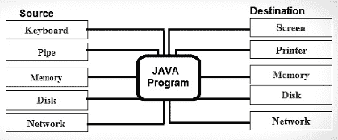

**(Java 程序与 I/O 设备的关系)**

将数据从一个流发送到另一个流（类似于一个水管道流向另一个水管道）的概念使得 Java 中的流成为文件处理的强大工具。我们可以使用一系列简单的流操作来构建复杂的流处理序列。

此功能可以用于在流的流水线上过滤数据，以便我们获得所需格式的数据。例如，我们可以使用一个流获取二进制格式的原始数据，然后使用另一个串联的流将其转换为整数。

### 输入流和输出流

Java 流分为两种基本类型：通常的输入流和输出流。输入流从源提取（即读取）数据并将其发送到程序。

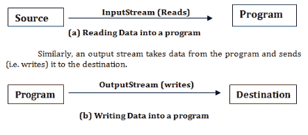

程序在数据源上连接并打开输入流，然后按顺序读取数据。同样，程序在数据目标位置连接并打开输出流，并按顺序写入数据。在两种情况下，程序都不知道端点的细节（即源和目标）。

### 字节流和字符流

Java 2 定义了两种流：字节流（Byte）和字符流（Character）。字节流为处理字节的输入输出提供了方便的方法。例如，在读取或写入二进制数据时使用字节流。字符流为处理字符的输入输出提供了方便的方法。

它们使用 Unicode，因此可以国际化。此外，在某些情况下，字符流比字节流更高效。Java 的原始版本（Java 1.0）不包含字符流，所有的 I/O 都是面向字节的。

Java 1.1 了字符流，某些面向字节的类和方法被弃用了。

**注意：** 在最底层，所有的 I/O 仍然是面向字节的。基于字符的流提供了处理字符的方便且高效的方法。

这两组可以根据其目的进一步分类。字节流和字符流类包含了对各种类型输入输出操作的专用类。

我们还可以根据读取或写入的源类型对流进行分组。源或目标可以是内存、文件或管道。


**(流类的分类)**

### 字节流类概述

字节流类通过两个类层次结构定义。顶部有两个抽象类：

1. `InputStream`（文中说是 (1)`InputStream`和 (2)`OutputStream`）

这些抽象类都有多个具体的子类，用于处理各种设备之间的差异，例如磁盘文件、网络连接甚至是内存缓冲区。

### InputStream 类

用于读取 8 位字节的`InputStream`类包括一个名为`InputStream`的父类以及若干个支持各种输入功能的子类。


**输入流层次结构.**

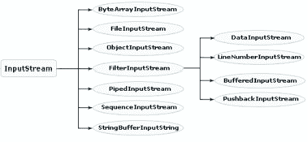

**输入流层次结构.**

### InputStream 类

父类`InputStream`是一个抽象类，定义了执行输入功能的方法，例如：

- 读取字节。
- 关闭流。
- 标记流的位置。
- 跳过流内容。
- 查找流中的字节数。

#### InputStream 类的方法

| 方法 | 描述 |
| :--- | :--- |
| `int available()` | 提供输入中可用字节数（必须由子类重写）。`InputStream`类的`available`方法始终返回 0。 |
| `void close()` | 关闭此输入流并释放与流相关的系统资源。`InputStream`的`close`方法不做任何操作。 |
| `void mark(int readlimit)` | 标记此输入流的当前位置。`InputStream`的`mark`方法不做任何操作。 |
| `boolean markSupported()` | 测试此输入流是否支持`mark`和`reset`方法。`InputStream`的`markSupported`方法返回`false`。 |

### InputStream 方法

| 方法 | 描述 |
| :--- | :--- |
| `abstract int read()` | 从输入流中读取下一个字节数据。子类必须提供此方法的实现。 |
| `int read(byte[] b)` | 从输入流中读取若干字节并将其存储到缓冲区数组`b`中。实际读取的字节数作为整数返回。 |
| `int read(byte[] b, int offset, int len)` | 从输入流中读取若干字节，并将它们从参数`offset`指定的位置开始存储到缓冲区数组`b`中。实际读取的字节数作为整数返回。 |
| `void reset()` | 将此流重新定位到在该输入流上一次调用`mark`方法时的位置。`InputStream`的`reset`方法不执行任何操作并总是抛出`IOException`。 |
| `long skip(long n)` | 跳过并丢弃此输入流中的最多`n`个字节的数据，并返回实际跳过的字节数。 |

### DataInput 接口

`DataInput`是一个接口，定义了从`InputStream`读取原始数据类型的方法。

### DataInput 接口的方法

| 方法 | 描述 |
| :--- | :--- |
| `boolean readBoolean()` | 读取一个输入字节，如果该字节非零则返回`true`，如果为零则返回`false`。 |
| `byte readByte()` | 读取并返回一个字节输入。 |
| `char readChar()` | 读取一个输入字符并返回其值。 |
| `double readDouble()` | 读取八个输入字节并返回一个`double`值。 |
| `float readfloat()` | 读取四个输入字节并返回一个`float`值。 |
| `void readFully(byte[] b)` | 从输入流读取若干字节并将其存储在缓冲区数组`b`中。如果此流在读取所有字节之前到达末尾，此方法将抛出`EOFException`。 |
| `void readFully(byte[] b, int off, int len)` | 从输入流读取`len`个字节，并将它们从`off`指定的位置开始存储在缓冲区数组`b`中。如果此流在读取所有字节之前到达末尾，此方法将抛出`EOFException`。 |
| `int readInt()` | 读取四个输入字节并返回一个`int`值。 |
| `String readLine()` | 从输入流中读取下一行。 |
| `long readLong()` | 读取八个输入字节并返回一个`long`值。 |
| `short readShort()` | 读取两个输入字节并返回一个`short`值 |
| `Strig readUTF()` | 读取一个使用修改 UTF-8 格式编码的字符串。 |
| `int skipBytes(int n)` | 尝试跳过输入流中的`n`个字节数据，并丢弃跳过的字节。返回实际跳过的字节数。 |

## InputStream 类总结

`FilterInputStream`包含另一个输入流，它将其用作基本数据源，可能在传输过程中转换数据并提供额外的功能。

`FilterInputStream`类本身只是简单地覆盖了`InputStream`的所有方法，这些覆盖版本会将所有请求传递给所包含的输入流。`FilterInputStream`的子类可能会进一步覆盖这些某些方法，并可能可能提供额外的方法和字段。

注意，`DataInputStream`类继承自`FilterInputStream`并实现了`DataInput`接口。因此，`DataInputStream`在使用`InputStream`类方法的同时，还实现了`DataInput`中描述的方法。

### InputStream 类总结

| 类 | 描述 |
| :--- | :--- |
| `InputStream` | 此抽象类是所有表示字节输入流的类的父类。 |
| `BufferedInputStream` | `BufferedInputStream`为另一个输入流增加了功能——即缓冲输入并支持`mark`和`reset`方法。 |
| `ByteArrayInputStream` | `ByteArrayInputStream`包含一个内部缓冲区，其中包含可以从流中读取的字节。 |
| `DataInputStream` | `DataInputStream`让应用程序以与无关的方式从底层输入流读取 Java 原始数据类型。 |
| `FileInputStream` | `FileInputStream`包含来自文件系统中文件的输入字节。 |
| `FilterInputStream` | `FilterInputStream`包含另一个输入流，它将其用作基本数据源，可能在传输过程中传输数据或提供额外功能。 |
| `PipedInputStream` | `PipedInputStream`应该连接到一个管道输出流，管道输入流随后提供写入管道输出流的任何数据字节。 |
| `PushbackInputStream` | `PushbackInputStream`为另一个输入流增加了功能，即"推回"或"重读"一个字节的能力。 |
| `SequenceInputStream` | `SequenceInputStream`表示另一个流的逻辑连接。 |
| `ObjectInputStream` | `ObjectInputStream`反序列化之前使用`ObjectOutputStream`写入的原始数据和对象。 |

### OutputStream 类

输出流类派自基类`OutputStream`，这是一个抽象类，并有许多子类来支持各种输出相关功能。

### OutputStream 类

父类`OutputStream`是一个抽象类，定义了执行输出功能的方法，例如：

- 写入字节
- 关闭流
- 刷新流

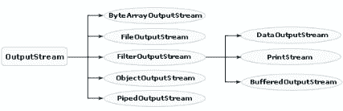

(输出流类的层级结构)

哎呀！！让我们看看下面的高质量图片-

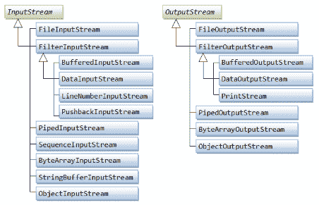

### OutputStream 类的方法

| 方法 | 描述 |
| :--- | :--- |
| `void close()` | 关闭此输出流并释放与此流相关的任何流资源。 |
| `void flush()` | 刷新此输出流并强制将任何缓冲的输出字节写入。 |
| `void write(byte[] b)` | 将`b.length`个字节写入输出流。 |
| `void write(byte[] b, int off, int len)` | 从`off`位置开始从字节数组写入`len`个字节。 |
| `abstract void write(int b)` | 将指定的字节写入输出流。 |

### DataOutput 接口

`DataOutput`是一个接口，定义了向`OutputStream`写入原始数据类型的方法。


### DataOutput 接口的方法

| 方法 | 描述 |
| :--- | :--- |
| `void writeBoolean(boolean v)` | 向输出流写入布尔值。 |
| `void writeByte(int v)` | 向输出流写入`v`的低位。 |
| `void writeBytes(string s)` | 将字符串写入输出流。对于字符串`s`中的每个字符按顺序写入一个字节。 |
| `void writeChar(int v)` | 向输出流写入字符值，它由两个字节组成。 |
| `void writeChars(string s)` | 按字节顺序向输出流写入字符串`s`中的每个字符。 |
| `void writeDouble(double v)` | 向输出流写入`double`值，它由八个字节组成。 |
| `void writeFloat(float v)` | 向输出流写入`float`值，它由四个字节组成。 |
| `void writeInt(int v)` | 向输出流写入`int`值，它由四个字节组成。 |
| `void writeLong(long v)` | 向输出流写入`long`值，它由八个字节组成。 |
| `void writeShort(int v)` | 向输出流写入`short`值，它由两个字节组成。 |
| `void writeUTF(String str)` | 向输出流写入两个字节的长度信息，随后是字符串`str`中每个字符的修改 UTF-8 表示。 |

## OutputStream 类总结

`DataOutputStream`是`DataInputStream`的对应部分。`DataOutputStream`类在使用`OutputStream`类方法的同时，还实现了`DataOutput`接口描述的方法。

### OutputStream 类总结

| 类 | 描述 |
| :--- | :--- |
| `OutputStream` | 此抽象类是所有表示字节输出流的类的父类。 |
| `BufferedOutputStream` | 该类实现了一个缓冲输出流。 |
| `ByteArrayOutputStream` | 该类实现了一种输出流，其中数据被写入字节数组中。 |
| `DataOutputStream` | 数据输出流允许应用程序以可移植的方式将`Java`原型数据类型写入输出流中。 |
| `FileOutputStream` | 文件输出流是用于向`File`写入数据的输出流。 |
| `PipedOutputStream` | 管道输出流可以连接到管道输入流以创建一个通信管道。（等等，管道输出流可以连接到`PipedInputStream`以创建一个通信管道。） |
| `FilterOutputStream` | `FilterOutputStream`包含一些其他的输出流，它将这些流作为自己的目标，并可能在传输过程中对数据进行转换或提供额外功能。 |
| `PrintStream` | `PrintStream`为另一个输出流添加功能，即方便地打印各种数据值表示形式的能力。 |

## 字符流类概览

字符流通过使用两个类层次结构来定义。顶部是两个抽象类：`Reader`和`Writer`。这些抽象类处理 Unicode 字符流。

Java 为这些类中的每一个都提供了几个具体的子类。抽象的`Reader`和`Writer`类定义了其他流类实现的几个关键方法。两个最重要的方法是`read()`和`write()`，它们分别读取和写入数据字符。这些方法被派生的流类所重写。

## Reader 流类

`Reader`流类设计用于从文件中读取字符。`Reader`类是此组中所有其他类的基类。这些类在功能上与输入流类非常相似，但输入流使用字节作为其基本信息单位，而 reader 流使用字符。

`Reader`类包含了与`InputStream`类中提供的相同的方法。因此，`Reader`类可以执行输入流类实现几乎的所有功能。

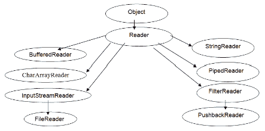

(Reader 类的类层次结构)

### Reader 类

`Reader`是一个抽象类，定义了`Java`的字符输入流模型。该类中的所有方法都会抛出`IOException`。

### Reader 类的方法

| 方法 | 描述 |
| :--- | :--- |
| `abstract void close()` | 关闭流。一旦流被关闭，进一步的`read()`、`ready()`、`mark()`或`reset()`调用将抛出`IOException`。然而，关闭一个已经关闭的流没有任何影响。 |
| `void mark()` | 标记流中的当前位置。随后的`reset()`调用将尝试将流重置到此点。并不是所有的字符输入流都支持`mark()`操作。 |
| `boolean markSupported()` | 告诉此流是否支持`mark()`操作。 |
| `int read()` | 读取单个字符并返回来自调用输入流的下一个可用字符的整数表示。当遇到文件末尾时返回 -1。 |
| `int read(char[] buffer)` | 尝试读取最多`buffer`长度的字符到`buffer`中，并返回成功读取的字符数。当遇到文件末尾时返回 -1。reader 子类必须实现此方法。 |
| `abstract int read(char[] buffer, int offset, int numChar)` | 尝试从`buffer[offset]`开始读取最多`numChar`个字符缓冲区字符，返回成功读取的字符数。当遇到文件末尾时返回 -1。reader 子类必须实现此方法。 |
| `boolean ready()` | 告诉此流是否准备好被读取。如果下次输入请求不会等待，则返回`true`，否则返回`false`。 |
| `void reset()` | 重置流。并不是所有的字符输入流都支持此方法。 |
| `long skip(long n)` | 跳过最多`n`个字符并返回跳过的字符数。如果`n`为负，则抛出`IllegalArgumentException`。 |

### Reader 类总结

| 类 | 描述 |
| :--- | :--- |
| `Reader` | 读取字符流的抽象类。 |
| `BufferedReader` | 从字符输入流读取文本，对字符进行缓冲，以便高效读取字符、数组和行。 |
| `CharArrayReader` | 该类实现了一个可以作为字符输入流使用的字符缓冲区。 |
| `FileReader` | 用于读取字符文件的便利类。 |
| `FilterReader` | 读取过滤字符流的抽象类。 |
| `InputStreamReader` | `InputStreamReader`是从字节流到字符流的桥梁：它读取字节并使用指定的`charset`将其解码为字符。 |
| `PipedReader` | 管道字符输入流。 |
| `PushbackReader` | 允许将字符推回流中的字符流读取器。 |
| `StringReader` | 源自字符串的字符流。 |

## Writer 流类

`Writer`流类设计用于将字符写入文件/输出设备。writer 类是一个抽象类，作为所有其他 writer 流类的基类。

基类通过定义与`OutputStream`类中相同的方法，为所有输出操作提供支持。

`Writer`类包含了与`OutputStream`类中相同的方法。因此，`Writer`类可以执行输出流类实现几乎的所有功能。

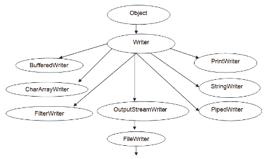

(Writer 流类的类层次结构)


### Writer 类

`Writer`是一个抽象类，定义了流式字符输出。该类中的所有方法都返回 void 值，并在出错时抛出`IOException`。

### Writer 类的方法

| 方法 | 描述 |
| :--- | :--- |
| `abstract void close()` | 关闭流并先刷新它。 |
| `abstract void flush()` | 刷新流。 |
| `void write(char[] cbuf)` | 写入字符数组。 |
| `abstract void write(char[] cbuf, int off, int len)` | 写入字符数组的一部分。子类必须实现此方法。 |
| `void write(int c)` | 将单个字符写入输出流。注意参数是`int`，这允许对表达式调用`write`而无需将其强制转换为`char`。 |
| `void write(String str)` | 写入字符串。 |
| `void write(String str, int off, int len)` | 写入从偏移量开始的字符串部分。 |


### Writer 类总结

| 类 | 描述 |
| :--- | :--- |
| `Writer` | 写入字符流的抽象类。 |
| `BufferedWriter` | 向字符输出流写入文本，对字符进行缓冲，以便高效写入单个字符、数组和字符串。 |
| `CharArrayWriter` | 实现可以作为`Writer`使用字符缓冲区。 |
| `FileWriter` | 用于写入字符文件的便利类。 |
| `FilterWriter` | 写入过滤字符流的抽象类。 |
| `OutputStreamWriter` | `OutputStreamWriter`是从字符流到字节流的桥梁：写入它的字符使用指定的`charset`编码为字节。 |
| `PipedWriter` | 管道字符输出流。 |
| `PrintWriter` | 向文本输出流打印对象的格式化表示。 |
| `StringWriter` | 将输出收集在字符串缓冲区中的字符流，此后可以使用它来构造字符串。 |

### File 类

虽然`java.io`中定义的许多类都操作流，但`File`类并非如此。它直接处理文件和文件系统。也就是说，`File`类没有指定如何从文件中检索或存储信息。它描述的是文件本身的属性。

文件对象用于获取或操作磁盘文件相关的信息，例如权限、时间、日期和目录路径，以及导航子目录层次结构。

尽管出于安全考虑，文件在 applet 中的用法受到严格限制，但文件仍然是存储持久性和共享信息的核心资源。

在 Java 中，目录被简单地视为一个文件，多了一个额外的属性——可以通过`list()`方法检查的文件名列表。

| 方法 | 描述 |
| :--- | :--- |
| `public File(String);` | |
| `public File(String, String);` | |
| `public File(File, String);` | |
| `public File(URI);` | 此构造函数由 Java2 版本 1.4 增加 |
| `public String getName();` | 返回文件或目录的名称 |
| `public String getParent();` | 返回对象创建时指定的路径中的父目录；如果此路径没有表示父目录，则返回`null`。 |
| `public String getPath();` | 返回相对路径。 |
| `public boolean isAbsolute();` | 测试此抽象路径是否为绝对路径。 |
| `public String getAbsolutePath();` | 返回从根目录开始的绝对（完整）路径。 |
| `public boolean canRead();` | 测试应用程序是否可以读取此抽象路径表示的文件。 |
| `public boolean canWrite();` | 测试应用程序是否可以修改此抽象路径表示的文件。 |
| `public boolean exists();` | 测试此抽象路径表示的文件或目录是否存在。 |
| `public boolean isDirectory();` | 测试此抽象路径表示的文件是否为目录。 |
| `public boolean isFile();` | 测试此抽象路径表示的文件是否为普通文件。 |
| `public boolean isHidden();` | 测试此抽象路径命名的文件是否为隐藏文件。 |
| `public long lastModified();` | 返回此抽象路径表示的文件最后修改的时间。 |
| `public long length();` | 返回此抽象路径表示的文件长度。 |
| `public boolean createNewFile() throws java.io.IOException;` | 仅当不存在以此抽象路径命名的文件时，自动创建一个由此抽象路径命名的新空文件。 |
| `public boolean delete();` | 删除此抽象路径表示的文件或目录。 |
| `public String[] list();` | 返回一个字符串数组，包含此抽象路径表示的目录中的文件和目录名称。如果`File`对象对应于文件，则返回`null`。 |
| `public boolean mkdir();` | 创建此抽象路径命名的目录。 |
| `public boolean mkdirs();` | 创建此抽象路径命名的目录，包括任何必要的不存在的父目录。 |
| `public boolean setLastModified(long);` | 设置此抽象路径命名的文件或目录的最后修改时间。 |
| `public boolean setReadOnly();` | 标记此抽象路径命名的文件或目录，只允许读操作。 |
| `public boolean setWritable(boolean);` | |
| `public boolean setReadable(boolean);` | |
| `public boolean canExecute();` | |
| `public long getTotalSpace();` | |
| `public long getFreeSpace();` | |
| `public long getUsableSpace();` | |
| `boolean renameTo(File);` | 重命名此抽象路径表示的文件。 |

# 示例

```java


```java
File f1 = new File("/");
File f2 = new File("/", "autoexec.bat");
File f3 = new File(f1, "autoexec.bat");
```

### 备注

Java 在处理 UNIX 和 Windows 规范之间的路径分隔符时表现正确。如果你在 Windows 版本的 Java 上使用正斜杠（`/`），路径仍然可以正确解析。

请记住，如果你在字符串中使用 Windows 规范（`\\`）。Java 的规范是使用 UNIX 且 URL 风格的正斜杠作为路径分隔符。

`File` 定义了许多获取 `File` 对象标准属性的方法。然而，`File` 类并不是对称的。这意味着，虽然有主要方法允许你检查简单文件对象的属性，但没有对应的函数来更改这些属性。

### 示例 15.1

接下来的示例演示了 `File` 类的几个方法

```java
import java.io.*;

class FileTest
{
    public static void main(String args[]) throws IOException
    { 
        File f = new File("/javaprog/ch15/15.1/FileTest.java");
        if(!f.exists())
            f.createNewFile();
        System.out.println("Length="+f.length()+" bytes");
        System.out.println("Name="+f.getName());
        System.out.println("Parent="+f.getParent());
        System.out.println("Path="+f.getPath());
        System.out.println("Absolute Path="+f.getAbsolutePath());
        System.out.println(f.exists() ? "Exists" : "Does not exist");
        System.out.println(f.isFile() ? "is file" : "not a file");
        System.out.println(f.canRead() ? "is readable" : "not readable");
        System.out.println(f.canWrite() ? "is writable" : "not writable");
        System.out.println(f.isDirectory() ? "is directory" : "not a directory");
        System.out.println(f.isHidden() ? "is hidden" : "not a file");
        // ... 剩余逻辑
    }
}
```

### FileOutputStream 方法

| 方法签名 | 描述 |
| --- | --- |
| `public FileOutputStream(File) throws FileNotFoundException;` | 创建一个文件输出流，用于写入由指定的 `File` 对象表示的文件。 |
| `public FileOutputStream(File, boolean) throws FileNotFoundException;` | 创建一个文件输出流，用于写入由指定的 `File` 对象表示的文件。 |
| `public native void write(int) throws java.io.IOException;` | |
| `public void write(byte[ ]) throws java.io.IOException;` | |
| `public void write(byte[ ], int, int) throws java.io.IOException;` | |
| `public void close( ) throws java.io.IOException;` | |

### 示例 15.2

```java
import java.io.*;

class FileRead
{
  public static void main(String args[])
  {
    FileInputStream fin=null;
    int a;
    try
    {
        fin=new FileInputStream(args[0]);
        System.out.println("No. of characters to read="+fin.available());
        fin.skip(3);
        a = fin.read();
        while(a != -1)
        {
          System.out.print((char)a);
          a = fin.read();
        }
        System.out.println("No. of characters to read="+fin.available());
        fin.close(); 
    }
    catch(ArrayIndexOutOfBoundsException e)
    {
      System.out.println(e);
    }
    catch(FileNotFoundException e)
    {
      System.out.println(e);
    }
    catch(IOException e)
    {
      System.out.println(e);
    }
  }
}
```

**输出：**

```text
java FileRead A.txt
No. of characters to read=20
Matrix Computers
No. of characters to read=0
```

### 示例 15.3

```java
import java.io.*;

class FileCopy
{
  public static void main(String args[]) throws IOException
  {
    FileInputStream fin=null;
    FileOutputStream fout=null;
    fin=new FileInputStream(args[0]);
    fout=new FileOutputStream(args[1]);
    int a;
    a = fin.read();
    while(a != -1)
    {
      fout.write(a);
      a = fin.read();
    }
    fin.close();fout.close();
  }
}
```

### 示例 15.4

```java
import java.io.*;

class CopyFile
{
  public static void main(String args[]) throws IOException
  { 
    int n;
    FileInputStream fin = new FileInputStream("A.txt");
    FileOutputStream fout = new FileOutputStream("B.txt");
    byte b[ ]= new byte[10];
    n = fin.read(b);
    while(n != -1)
    { 
      fout.write(b,0,n);
      n = fin.read(b);
    }
    fin.close();
    fout.close();
  }
}
```

---

### FileReader

`FileReader` 类创建了一个 `Reader`，你可以用它来读取文件内容。它两个常用的构造函数是：

- `FileReader(File file)`: 创建一个 `FileReader` 流，用于从指定的文件读取。
- `FileReader(String fileName)`: 创建一个 `FileReader` 流，用于从指定的文件读取。

**注意：** 如果文件不存在、是一个目录而不是普通文件，或者由于某些原因无法打开读取，这两个构造函数中的任何一个都会抛出 `FileNotFoundException`。

### FileWriter

`FileWriter` 类创建了一个 `writer`，你可以用它向文件中写入。它两个常用的构造函数是：

- `FileWriter(File file)`: 一个 `FileWriter` 对象，用于写入指定的文件。
- `FileWriter(String fileName)`: 一个 `FileWriter` 对象，用于写入指定的文件。
- `FileWriter(File file, boolean append)`: 一个 `FileWriter` 对象，以 `append` 模式写入指定的文件。
- `FileWriter(String filename, boolean append)`: 一个 `FileWriter` 对象，以 `append` 模式写入指定的文件。

如果始终使用前两个构造函数，则创建一个新文件。如果存在同名文件，它将被销毁。如果使用后两个构造函数且 `append` 标志为 `false`，则它们的行为与前两个相同。如果 `append` 标志为 `true`，则文件以追加模式打开，即如果文件存在，则文件指针被置于文件末尾；如果文件不存在，则创建一个新文件。

**注意：** 如果文件存在但是目录而不是普通文件、不存在但无法创建，或由于任何原因无法打开，这些构造函数可能会抛出 `IOException`。例如，当你尝试打开一个只读文件时，将抛出 `IOException`。

### 示例 15.5

```java
import java.io.*;

class FileCopy
{
  public static void main(String args[]) throws IOException
  {
    FileReader fin=null;
    FileWriter fout=null;
    fin=new FileReader(args[0]);
    fout=new FileWriter(args[1]);
    int a;
    a = fin.read();
    while(a != -1)
    {
      fout.write((char)a);
      a = fin.read();
    }
    fin.close();
    fout.close();
  }
}
```


### RandomAccessFile

`RandomAccessFile`封装了一个随机访问文件。`RandomAccessFile`允许我们从文件的某个位置读取和写入字节、文本和原始数据类型（当配合适当的访问权限时）。它没有继承自`InputStream`。相反，它实现了`DataInput`和`DataOutput`接口，这两个接口定义了基本的 I/O 方法。它还支持定位请求——即你可以将文件指针置于文件的任何位置。

`mode`参数指定打开文件时的访问模式。允许的值及其含义如下：

| 值 | 含义 |
| :--- | :--- |
| `"r"` | 仅读打开。调用生成对象的任何`write`方法都将导致抛出`IOException`。 |
| `"rw"` | 读写打开。如果文件不存在，则将尝试创建它。 |
| `"rws"` | 读写打开，与`"rw"`相同，并且要求对文件内容或元数据的每次更新都同步写入到底层存储设备中。 |
| `"rwd"` | 读写打开，与`"rw"`相同。并且要求对文件内容（数据）的每次更新都同步写入底层存储设备中。 |

#### RandomAccessFile 类的方法

除了`DataInput`和`DataOutput`接口的方法外，该类的一些常用方法是：

| 方法 | 描述 |
| :--- | :--- |
| `public RandomAccessFile(String, String) throws java.io.FileNotFoundException;` | 创建一个随机访问文件流，用于读取并可选地写入指定名称的文件。 |
| `public RandomAccessFile(File, String) throws FileNotFoundException;` | 创建一个随机访问文件流，用于读取并可选地写入由`File`参数指定的文件。 |
| `public native int read() throws java.io.IOException;` | |
| `public int read(byte[], int, int) throws java.io.IOException;` | |
| `public int read(byte[]) throws java.io.IOException;` | |
| `public int skipBytes(int) throws java.io.IOException;` | |
| `public native void write(int) throws java.io.IOException;` | |
| `public void write(byte[]) throws java.io.IOException;` | |
| `public void write(byte[], int, int) throws java.io.IOException;` | |
| `public native long getFilePointer() throws java.io.IOException;` | 返回下一次读取或写入相对于文件开始的字节偏移量。 |
| `public native void seek(long) throws java.io.IOException;` | 这里，`newPos`指定文件指针相对于文件开始的新位置（字节）。调用`seek()`之后，下一次读取或写入操作将在新的文件位置发生。 |
| `public native long length() throws java.io.IOException;` | |
| `public native void setLength(long) throws java.io.IOException;` | 设置文件的长度。此方法可以用于扩展或缩短文件。如果文件被扩展，增加的部分是未定义的。 |
| `public void close() throws java.io.IOException;` | |
| `public final boolean readBoolean() throws java.io.IOException;` | |
| `public final byte readByte() throws java.io.IOException;` | |
| `public final int readUnsignedByte() throws java.io.IOException;` | |
| `public final short readShort() throws java.io.IOException;` | |
| `public final int readUnsignedShort() throws java.io.IOException;` | |
| `public final char readChar() throws java.io.IOException;` | |
| `public final int readInt() throws java.io.IOException;` | |
| `public final long readLong() throws java.io.IOException;` | |
| `public final float readFloat() throws java.io.IOException;` | |
| `public final double readDouble() throws java.io.IOException;` | |
| `public final java.lang.String readLine() throws java.io.IOException;` | |
| `public final java.lang.String readUTF() throws java.io.IOException;` | |
| `public final void writeBoolean(boolean) throws java.io.IOException;` | |
| `public final void writeByte(int) throws java.io.IOException;` | |
| `public final void writeShort(int) throws java.io.IOException;` | |
| `public final void writeChar(int) throws java.io.IOException;` | |
| `public final void writeInt(int) throws java.io.IOException;` | |
| `public final void writeLong(long) throws java.io.IOException;` | |
| `public final void writeFloat(float) throws java.io.IOException;` | |
| `public final void writeDouble(double) throws java.io.IOException;` | |
| `public final void writeBytes(java.lang.String) throws java.io.IOException;` | |
| `public final void writeChars(java.lang.String) throws java.io.IOException;` | |
| `public final void writeUTF(java.lang.String) throws java.io.IOException;` | |


### 示例 15.6

```java
import java.io.*;

class RandomIO
{
    public static void main(String args[]) throws IOException
    {
        RandomAccessFile file = null;
        try
        {
            file = new RandomAccessFile("rand.dat", "rw");
            file.writeChar('X');
            file.writeInt(1999);
            file.writeDouble(222.44);
            System.out.println("File pointer Pos:"+file.getFilePointer());
            file.seek(0);
            System.out.println(file.readChar());
            System.out.println(file.readInt());
            System.out.println(file.readDouble());
            System.out.println("File pointer Pos:"+file.getFilePointer());
            file.seek(2);
            System.out.println("File pointer Pos:"+file.getFilePointer());
            System.out.println(file.readInt());
            file.seek(file.length());
            file.writeBoolean(false);
            file.seek(14);
            System.out.println(file.readBoolean());
            System.out.println("File pointer Pos:"+file.getFilePointer());
            System.out.println(file.readInt());//EOF Exception
        }
        catch(EOFException e)
        {
            System.out.println("Trying to read after end of file");
        }
        finally
        {
            file.close();
        }
    }
}
```

**输出：**

```
File pointer Pos:14
X
1999
222.44
File pointer Pos:14
File pointer Pos:2
1999
false
File pointer Pos:15
Trying to read after end of file
```

**注意：** 如果尝试在文件末尾之后读取，则会发生`EOFException`。

### ByteArrayInputStream

`ByteArrayInputStream`包含一个内部的字节缓冲区，可以从流中读取字节。`ByteArrayInputStream`是一个使用字节数组作为源的输入流实现。该类有两个构造函数，每个构造函数都需要一个字节数组来提供数据源。`ByteArrayInputStream`实现了`mark()`和`reset()`方法。但是，如果没有调用过`mark()`，`reset()`将流指针置于流的开头。

- `public ByteArrayInputStream(byte[])`
- `public ByteArrayInputStream(byte[], int)`
- `public synchronized int read()`
- `public synchronized int read(byte[], int)`
- `public synchronized long skip(long)`
- `public synchronized int available()`
- `public boolean markSupported()`
- `public void mark(int)`
- `public synchronized reset()`
- `public void close() throws IOException`

### 示例 15.7

```java
import java.io.*;

class ByteArrayInputStreamTest
{
    public static void main(String args[]) throws IOException
    {
        String s1 = "abcdefghij";
        byte b[] = s1.getBytes();
        ByteArrayInputStream b1 = new ByteArrayInputStream(b);
        int a;
        while((a=b1.read()) != -1)
        {
            System.out.print((char)a);
        }
        b1.close();
    }
}
```

**输出：**

`ABCDEFGHIJ`

### ByteArrayOutputStream

`ByteArrayOutputStream`实现了一个输出流，数据被写入字节数组中。`ByteArrayOutputStream`是一个使用字节数组作为目的地的输出流实现。缓冲区存储在`ByteArrayOutputStream`的`buf`字段中。如果需要，缓冲区的大小将会增大。缓冲区的大小由`ByteArrayOutputStream`中的`count`字段决定。

- `public ByteArrayOutputStream()`创建一个新的输出流，缓冲区初始大小为 32 字节。
- `public ByteArrayOutputStream(int size)`创建一个新的输出流，缓冲区初始大小为指定的`size`。
- `public synchronized void write(int)`写入一个字节。
- `public synchronized void write(byte[] b, int off, int len)`从字节数组`b`的偏移量`off`开始写入`len`个字节。
- `public synchronized void write(byte[] b)`写入数组`b`中的所有字节。
- `public synchronized int size()`返回已写入的字节数。
- `public synchronized byte[] toByteArray()`返回缓冲区中的字节数组。
- `public synchronized void reset()`重置缓冲区。

### 示例 15.8

```java
import java.io.*;

class ByteArrayOutputStreamTest
{
    public static void main(String args[]) throws IOException
    {
        ByteArrayOutputStream b1 = new ByteArrayOutputStream();
        b1.write('a');
        String s1 = "abcdefijk";
        byte arr1[] = s1.getBytes();
        b1.write(arr1);
        System.out.println(b1); //toString()
        // 使用 for 循环显示
        byte arr2[] = b1.toByteArray();
        for(int i=0; i<arr2.length; i++)
        {
            System.out.print((char)arr2[i]);
        }
        System.out.println();
        // 使用 for each 循环显示
        for(int i:arr2)
        {
            System.out.print((char)i);
        }
        b1.close();
    }
}
```

**输出：**

### CharArrayReader

`CharArrayReader`是一个使用字符数组作为源的读取流实现。该类有两个构造函数，每个构造函数都需要一个字符数组来提供数据源。

**构造函数：**

- `CharArrayReader(char[]buf)`从指定的字符数组创建`CharArrayReader`。
- `CharArrayReader(char[]buf, int offset, int length)`从指定的字符数组创建`CharArrayReader`。结果读取器将从指定的偏移量开始读取。此读取器可以读取的字符总数将是`length`或`buf.length`。

### 示例 15.9

```java
import java.io.*;

class CharArrayReaderTest
{
    public static void main(String args[]) throws IOException
    {
        String tmp = "abcdefghijklmnopqrstuvwxyz";
```


```java
int length = tmp.length();
char c[] = new char[length];
tmp.getChars(0, length, c, 0);
CharArrayReader input1 = new CharArrayReader(c);
CharArrayReader input2 = new CharArrayReader(c, 0, 5);
int i;
while ((i = input1.read()) != -1) {
    System.out.print((char) i);
}
System.out.println();
while ((i = input2.read()) != -1) {
}
```

Output:
```
abcdefghijklmnopqrstuvwxyz
abcde
```

### CharArrayWriter

`CharArrayWriter`是一个写入流的实现，它使用字符数组缓冲区作为目标。

### 构造函数

- `CharArrayWriter()`
- `CharArrayWriter(int initialSize)`

在第一种形式中，将创建一个默认大小的缓冲区。在第二种形式中，创建一个大小与参数`initialSize`相同的缓冲区。

缓冲区存储在`CharArrayWriter`的`buf`字段中。如果需要，缓冲区的大小将自动增大。缓冲区持有的字符数量包含在`CharArrayWriter`的`count`字段中。`buf`和`count`都是保护字段。

### 示例 15.10

```java
import java.io.*;

class CharArrayWriterTest {
    public static void main(String args[]) throws IOException {
        CharArrayWriter f = new CharArrayWriter();
        String s = "This should end up in the array";
        char buf[] = new char[s.length()];
        s.getChars(0, s.length(), buf, 0);
        f.write(buf);
        System.out.println(f.toString());
        char c[] = f.toCharArray();
        for (int i = 0; i < c.length; i++) {
            System.out.print(c[i]);
        }
        FileWriter f2 = new FileWriter("test.txt");
        f.writeTo(f2);
        f2.close();
        f.reset();
        System.out.println();
        System.out.println("After reset:" + f.toString());
        for (int i = 0; i < 3; i++)
            f.write('A');
        System.out.println(f.toString());
    }
}
```

Output:
```
This should end up in the array
This should end up in the array
After reset:
AAA
```

---

### Pushback Input Stream

`PushbackInputStream`为另一个输入流增加了功能，即"回回"（pushback）或"未读"（unread）一个字节的能力。缓冲的用途之一就是实现回退。

`Pushback`用于输入流，允许读取一个字节后将其返回到流中。除了`InputStream`类中常见的方法外，`PushbackInputStream`还提供了`unread()`方法，所示：

| 方法 | 描述 |
| :--- | :--- |
| `public java.io.PushbackInputStream(java.io.InputStream, int);` | 创建一个具有指定大小回退缓冲区的`PushbackInputStream`，并保存其参数（输入流）以供以后使用。这允许将多个字节返回到输入流。 |
| `public java.io.PushbackInputStream(java.io.InputStream);` | 创建一个`PushbackInputStream`并保存其参数（输入流）以供以后使用。这允许将一个字节返回到输入流。 |
| `public int read() throws java.io.IOException;` | |
| `public int read(byte[], int, int) throws java.io.IOException;` | |
| `public void unread(int) throws java.io.IOException;` | 通过将字节复制到回退缓冲区的头部来将其回退。 |
| `public void unread(byte[], int, int) throws java.io.IOException;` | 通过将字节数组的一部分复制到回退缓冲区的头部来回退部分字节数组。 |
| `public void unread(byte[]) throws java.io.IOException;` | 通过将字节数组复制到回退缓冲区的头部来回退字节数组。 |
| `public int available() throws java.io.IOException;` | |
| `public long skip(long) throws java.io.IOException;` | |
| `public boolean markSupported();` | `PushbackInputStream`的副作用是使用于创建它的`InputStream`的`mark()`或`reset()`方法失效。使用`markSupported()`方法检查任何你将在上面使用`mark()`/`reset()`的流。 |
| `public synchronized void mark(int);` | |
| `public synchronized void reset() throws java.io.IOException;` | |
| `public synchronized void close() throws java.io.IOException;` | |

### 示例 15.11

```java
import java.io.*;

class PushbackInputStreamTest {
    public static void main(String args[]) throws IOException {
        FileInputStream fin = new FileInputStream("A.txt");
        PushbackInputStream p1 = new PushbackInputStream(fin);
        int ch = p1.read();
        System.out.println((char) ch);
        ch = p1.read();
        System.out.println((char) ch);
        ch = p1.read();
        System.out.println((char) ch);
        p1.unread(ch); // or p1.unread('z');
        ch = p1.read();
        System.out.println((char) ch);
    }
}
```

Output:
```
A.txt contains "Matrix Computers"
m
a
t
t
```

`PushbackReader`是一种字符流读取器，允许将字符回退到流中。`PushbackReader`类允许一个或多个字符返回到输入流。这允许你在输入流中向前查看。

| 方法 | 描述 |
| :--- | :--- |
| `public java.io.PushbackReader(java.io.Reader, int);` | 创建一个具有指定大小回退缓冲区的`PushbackReader`。 |
| `public java.io.PushbackReader(java.io.Reader);` | 创建一个`PushbackReader`。 |
| `public int read() throws java.io.IOException;` | |
| `public int read(char[], int, int) throws java.io.IOException;` | |
| `public void unread(int) throws java.io.IOException;` | 通过将字符复制到回退缓冲区的头部来将其回退。 |
| `public void unread(char[], int, int) throws java.io.IOException;` | 通过将字符数组的一部分复制到回退缓冲区的头部来回退部分字符数组。 |
| `public void unread(char[]) throws java.io.IOException;` | 通过将字符数组复制到回退缓冲区的头部来回退字符数组。 |
| `public boolean ready() throws java.io.IOException;` | 注意：当尝试返回字符时回退缓冲区已满，将抛出`IOException`。 |

注意：当尝试在`PushbackInputStream`满时返回字符时，将抛出`IOException`。

### SequenceInputStream

`SequenceInputStream`类是一种允许你连接多个`InputStream`的字节流。序列`InputStream`的构造与其他任何`InputStream`都不同。`SequenceInputStream`构造函数使用一对`InputStream`类或`InputStream`类的`Enumeration`作为其参数：

- `SequenceInputStream(InputStream is1, InputStream is2)`：创建一个新的`SequenceInputStream`并记住这两个参数，它们将按顺序先读取`is1`然后读取`is2`，以从此`SequenceInputStream`提供字节。
- `SequenceInputStream(Enumeration e)`：创建一个新的`SequenceInputStream`并记住参数，该参数必须是产生运行时类型为`InputStream`的对象的`Enumeration`。

操作上，该类从第一个`InputStream`get读取请求直到其耗尽，然后切换到第二个。在`Enumeration`的情况下，它将继续通过所有的`InputStream`直到达到最后一个结束。

### 示例 15.13

在下面的示例中，作为命令行参数提供文件名：

```java
import java.io.*;

class SequenceInputStreamTest {
    public static void main(String args[]) throws IOException {
        FileInputStream f1 = new FileInputStream(args[0]);
        FileInputStream f2 = new FileInputStream(args[1]);
        FileOutputStream f3 = new FileOutputStream(args[2]);
        SequenceInputStream sis = new SequenceInputStream(f1, f2);
        int c;
        while ((c = sis.read()) != -1) {
            f3.write(c);
        }
        f3.close();
        f1.close();
        f2.close();
    }
}
```

Output:
`java SequenceInputStreamTest A.txt B.txt C.txt`

### PrintStream

它是一个字节流类，继承自`FilterOutputStream`。`PrintStream`为另一个输出流添加了功能，即方便地打印各种数据值的表示形式的能力。

可选情况下，可以创建一个`PrintStream`以便自动刷新（flush）；这意味着在写入字节数组、调用了其中一个`println`方法、或者写入换行符或字节（`'\n'`）之后，将会自动调用`flush`方法。

由`PrintStream`打印的所有字符都将使用平台的默认字符编码转换为字节，然后写入构造函数中指定的`OutputStream`或`File`。

`PrintStream`支持针对所有类型（包括`object`）的`print()`和`println()`方法。如果参数不是简单类型，`PrintStream`方法将调用对象的`toString()`方法并打印结果。

#### 构造函数

- `PrintStream(File file)`
  创建一个新的打印流，不带自动行刷新，关联指定的文件。
- `PrintStream(String fileName)`
  创建一个新的打印流，不带自动行刷新，关联指定的文件名。
- `PrintStream(OutputStream out)`
  创建一个新的打印流，连接到指定的`OutputStream`。
- `PrintStream(OutputStream out, boolean autoFlush)`
  创建一个新的打印流，连接到指定的`OutputStream`。


### 示例 15.14

```java
import java.io.*;

class PrintStreamTest {
    public static void main(String args[]) throws IOException {
        PrintStream ps = new PrintStream(System.out, true);
        ps.println("This is a string");
        int i = -7;
        ps.println(i);
        double d = 4.5e-7;
        ps.println(d);
    }
}
```

Output:
```
This is a string
-7
4.5E-7
```

### 示例 15.15

```java
import java.io.*;

class PrintStreamTest2 {
    public static void main(String argv[]) throws IOException {
        FileOutputStream fout = new FileOutputStream("test.dat");
        PrintStream ps = new PrintStream(fout, true);
        ps.println("This is a string");
        int i = -7;
        ps.println(i);
        double d = 4.5e-7;
        ps.println(d);
    }
}
```


### PrintWriter

虽然在 Java 中仍然允许使用 `System.out` 向控制台写入内容，但其使用主要用于调试目的或示例程序。

对于真实世界的程序，使用 `java` 时向控制台写入内容的推荐方法是通过 `PrintWriter` 流。`PrintWriter` 是基于字符的类之一。使用基于字符的类进行控制台输出使程序的国际化变得更容易。

#### 构造函数：

- `PrintWriter(File file)`
  创建一个新的 `PrintWriter`，不带自动行刷新，用于写入指定的文件。
- `PrintWriter(String fileName)`
  创建一个新的 `PrintWriter`，不带自动行刷新，用于写入指定的文件。
- `PrintWriter(OutputStream out)`
  创建一个新的 `PrintWriter`，不带自动行刷新，用于写入指定的 `OutputStream`。
- `PrintWriter(OutputStream out, boolean autoFlush)`
  创建一个新的 `PrintWriter` 用于写入指定的 `OutputStream`。
- `PrintWriter(Writer out)`
  创建一个新的 `PrintWriter`，不带自动行刷新，用于写入指定的 `Writer`。
- `PrintWriter(Writer out, Boolean autoFlush)`
  创建一个新的 `PrintWriter` 用于写入指定的 `Writer`。

最常用的构造函数是：
`PrintWriter(OutputStream os, boolean flushOnNewLine)`

在这里，`os` 是 `OutputStream` 类型的对象，`flushOnNewLine` 控制 Java 每次调用 `println()` 方法时是否都刷新输出流。如果 `flushOnNewLine` 为 `true`，则会自动进行刷新。如果为 `false`，则刷新不是自动的。

`PrintWriter` 支持针对所有类型（包括对象）在内的 `print()` 和 `println()` 方法。如果参数不是简单类型，`PrintWriter` 方法将调用对象的 `toString()` 方法并打印结果。

要使用 `PrintWriter` 向控制台写入，请指定 `System.out` 为输出流，并在每个新行之后刷新流。例如，此行代码创建了一个连接到控制台输出的 `PrintWriter`。
`PrintWriter pw = new PrintWriter(System.out, true)`

### 示例 15.16

```java
import java.io.*;

class PrintWriterTest
{ 
  public static void main (String argv[]) throws IOException
  { 
      PrintWriter pw =  new PrintWriter(System.out, true);
      pw.println("This is a string");
      int i = -7;
      pw.println(i);
      double d = 4.5e-7;
      pw.println(d);
  }
}
```

Output:

```
This is a string
-7
4.5E-7
```

### 示例 15.17

```java
import java.io.*;

class PrintWriterTest
{ 
  public static void main (String argv[]) throws IOException
  { 
      FileWriter fout = new FileWriter("test.dat");
      PrintWriter pw = new PrintWriter(fout, true);
      pw.println("This is a string");
      int i = -7;
      pw.println(i);
      double d = 4.5e-7;
      pw.println(d);
  }
}
```

---

### 示例 15.18

```java
import java.io.*;

class PrintWriterTest2
{ 
  public static void main (String argv[]) throws IOException
  { 
      FileWriter fout = new FileWriter("test.dat");
      PrintWriter pw = new PrintWriter(fout, true);
      pw.println("This is a string");
      int i = -7;
      pw.println(i);
      double d = 4.5e-7;
      pw.println(d);
  }
}
```

### PipedOutputStream

`piped output` 可以连接到 `piped input` 以创建一个管道。`piped output` 是管道的发送端；`piped input` 提供写入 `piped output` 的任何字节。数据由一个线程从 `PipedInputStream` 读取，并写入另一个线程。`piped input` 包含一个缓冲区，在限制内解耦读操作和写操作。

#### 构造函数：

- `PipedInputStream()`
  创建一个未连接的 `PipedInputStream`。
- `PipedInputStream(PipedOutputStream src)`
  创建一个连接到输出流的 `PipedInputStream`。
- `PipedOutputStream()`
  创建一个未连接的 `PipedOutputStream`。
- `PipedOutputStream(PipedInputStream snc)`
  创建一个连接到指定 `input` 流的 `PipedOutputStream`。

### 示例 15.19

```java
import java.io.*;

class TextGenerator extends Thread
{ 
  OutputStream out;
  TextGenerator(OutputStream out)
  { 
      this.out = out;
  }
  public void run()
  { 
      try
      { 
        try
        { 
          for(byte b = 65; b<=90; b++)
            out.write(b);
        }
        finally
        { 
          out.close();
        }
      }
      catch(IOException e)
      {
        System.out.println(e);
      }
  }
}

class Pipe
{ 
  public static void main(String args[]) throws IOException
  { 
      PipedOutputStream out = new PipedOutputStream();
      PipedInputStream in = new PipedInputStream(out);
      TextGenerator data = new TextGenerator(out);
      data.start();
      int ch;
      while((ch = in.read()) != -1)
        System.out.print((char) ch);
  }
}
```

它们的功能与 `PipedInputStream` 和 `PipedOutputStream` 相同，唯一的区别在于它们是字符流。

### 构造函数

- `PipedReader()`: 创建一个 `PipedReader`，使其尚未连接。
- `PipedReader(PipedWriter src)`: 创建一个 `PipedReader` 并使其连接到管道写入器 `src`。
- `PipedWriter()`: 创建一个尚未连接到 `PipedReader` 的管道写入器。
- `PipedWriter(PipedReader snk)`: 创建一个连接到指定 `PipedReader` 的管道写入器。

---

#### 示例 15.20

```java
import java.io.*;

class TextGenerator extends Thread { 
    Writer out;
    TextGenerator(Writer out) {
        this.out = out;
    }
    public void run() {
        try {
            try {
                for(char c = 'a'; c<='z'; c++)
                    out.write(c);
            }
            finally {
                try {
                    Thread.sleep(2000);  
                } 
                catch(Exception e) {}
                System.out.println("aaaaaaaaaaaaa");
                if(true)
                return;  // IOException: pipe Broken
            out.close();  //IOException: Write end dead
        }  //OK if thread finishes after closing the pipe
        }
        catch(IOException e) { System.out.println(e);}
    }
}

class Pipe2 { 
    public static void main (String argv[]) throws IOException {
        PrintStream ps = new PrintStream(System.out);
        PipedWriter out = new PipedWriter();
        PipedReader in = new PipedReader(out);
        TextGenerator data = new TextGenerator(out);
        data.start(); int ch;
        while((ch = in.read()) != -1)
            System.out.print((char) ch);
    }
} 
```

**输出：**

```
abcdefghijklmnopqrstuvwxyzaaaaaaaaaaaaa
Exception in thread "main" java.io.IOException: Pipe broken
at java.io.PipedReader.read(Unknown Source)
at Pipe2.main(Pipe2.java:43)
```

---

### 过滤字节流

过滤流仅仅是底层输入流或输出流的包装器，透明地提供了某些扩展功能。常见的扩展包括缓冲、zip 压缩/解压等。过滤字节流是 `FilterInputStream` 和 `FilterOutputStream`。它们的构造函数为：

- `FilterInputStream(InputStream in)`: 通过将参数 `in` 赋值给字段 `this.in` 来创建一个 `FilterInputStream`，以便稍后使用。
- `FilterOutputStream(OutputStream out)`: 创建一个构建在指定的底层输出流之上的输出过滤器。

这些类提供的方法与 `InputStream` 和 `OutputStream` 中的方法相同。

---

### 缓冲字节流

对于面向字节的流，缓冲流通过通过在 I/O 流上挂载内存缓冲区来扩展过滤流类。该缓冲区允许 Java 一次对多个一个字节的数据进行 I/O 操作，从而提高性能。

由于缓冲区的可用，对流进行跳过（skip）、标记（mark）和重置（reset）变得可能。缓冲字节流类是 `BufferedInputStream` 和 `BufferedOutputStream`。`PushbackInputStream` 也实现了缓冲流。

### BufferedInputStream

缓冲 I/O 是一种非常常见的性能优化手段。Java 的 `BufferedInputStream` 类允许你将任何 `InputStream` “包装”成缓冲流，并实现这种性能提升。

`BufferedInputStream` 有两个构造函数：

- `BufferedInputStream(InputStream in)`: 创建一个 `BufferedInputStream` 并保存其参数输入流 `in` 以备稍后使用。创建一个内部缓冲区并存储在 `buf` 中。
- `BufferedInputStream(InputStream in, int size)`: 创建一个具有指定缓冲区大小的 `BufferedInputStream` 并保存其参数输入流 `in` 以备稍后使用。

缓冲输入流还为回退提供了基础。除了任何 `InputStream` 中实现的 `read()` 和 `skip()` 方法外，`BufferedInputStream` 还支持 `mark()` 和 `reset()` 方法。这种支持通过 `markSupported()` 返回 `true` 来反映。

---

### 示例 15.21

```java
import java.io.*;

class BufferedInputStreamTest {
    public static void main(String args[]) throws IOException {
        FileInputStream fin=new FileInputStream("A.txt");
        BufferedInputStream b1 = new BufferedInputStream(fin);
        for(int i=1; i<=10; i++)
            System.out.print((char)b1.read());
        System.out.println();
        if(b1.markSupported()) {
            b1.mark(500);
            for(int i=1; i<=10; i++)
                System.out.print((char)b1.read());
            System.out.println();
            b1.reset();
            for(int i=1; i<=10; i++)
                System.out.print((char)b1.read());
        }
        else
            System.out.println("Marking option is not availabel");
        b1.close();
        fin.close();
    }
}
```

**输出：**

```
matrix
```

**注意：** `mark(32)` 保留后续读取 32 个字节的标记（对于所有实体都足够）。`mark` 的使用限于缓冲区内部。这意味着你只能为 `mark()` 指定一个小于缓冲区大小的参数。

---

### BufferedOutputStream

与缓冲输入不同，缓冲输出不提供额外功能。它仅用于提高性能。这里有两个构造函数：

- `BufferedOutputStream(OutputStream out)`: 创建一个向指定输出流写入数据的输出流。它使用大小为 5 字节的缓冲区。
- `BufferedOutputStream(OutputStream out, int size)`: 创建一个具有指定缓冲区大小的向指定输出流写入数据的输出流。

### 示例 15.22

```java
import java.io.*;

class BufferedOutputStreamTest {
    public static void main(String args[]) throws IOException {
        BufferedOutputStream f = new BufferedOutputStream (System.out,100);
```


```java
byte[] buf = "This will be displayed without flush()\n".getBytes();

f.write(buf);

f.write(buf);

System.out.println("testing...");

//f.flush();

//f.close();

}

}
```

**输出：**

```
testing...
```

（注：由于未取消注释的`flush()`，缓冲区内容可能不会显示在控制台上）

---

### BufferedReader

`BufferedReader`通过缓冲输入来提高性能。它有两个构造函数：

- `BufferedReader(Reader in)`：创建一个使用默认大小输入缓冲区的字符输入流。
- `BufferedReader(Reader in, int sz)`：创建一个使用指定大小输入缓冲区字符输入流。

### 示例 15.23

```java
import java.io.*;

class BufferedReaderTest {

    public static void main(String args[]) throws IOException {

        FileReader fr=new FileReader("A.txt");

        BufferedReader b1 = new BufferedReader(fr);

        for(int i=1; i<=10; i++)

            System.out.print((char)b1.read());

        System.out.println();

        if(b1.markSupported()) {

            b1.mark(5);

            for(int i=1; i<=10; i++)

                System.out.print((char)b1.read());

            System.out.println();

            b1.reset();

            for(int i=1; i<=10; i++)

                System.out.print((char)b1.read());

        }

        else

            System.out.println("Marking option is not availabel");

        b1.close();

        fr.close();

    }

}
```

使用`BufferedWriter`可以通过减少数据实际物理写入输出流的次数来提高性能。

### 构造函数

- `BufferedWriter(Writer out)`
  创建一个使用默认大小输出缓冲区的缓冲字符输出流。
- `BufferedWriter(Writer out, int sz)`
  创建一个使用给定大小输出缓冲区的缓冲字符输出流。

### 示例 15.24

```java
import java.io.*;

class BufferedWriterTest

{

    public static void main(String args[]) throws IOException

    {

      BufferedWriter f = new BufferedWriter(new PrintWriter(System.out));

      String s  = "This will not be displayed without flush()\n";

      char buf[ ] = new char[s.length()];

      s.getChars(0,s.length(),buf,0);

      f.write(buf);

      f.write(buf);

      System.out.println("testing...");

      f.write(buf);

      //f.flush();

      //f.close();

    }

}
```

**输出：**

```
testing...
```

### 使用字节流处理基本数据数据类型

基础输入流和输出流提供了读/写方法，这些方法只能用于读/写字节或字符。

如果我们想读/写整数和双精度等基本数据类型，可以使用过滤器类作为现有输入和输出流的包装器，以对原始流中的数据进行过滤。

用于创建处理基本数据类型的“数据流”的两个过滤器类是`DataInputStream`和`DataOutputStream`。这些类使用了如下所示的多重继承概念，并实现了父类和接口中包含的所有方法。

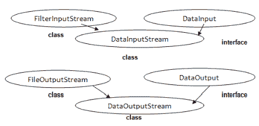

可以通过如下方式创建从文件读取输入数据流：

```java
FileInputStream fis = new FileInputStream(infile);

DataInputStream dis = new DataInputStream(fis);
```

这些语句基本上是将`dis`封装在`fis`上并将其用作“过滤器”。同样地，下面的语句创建了输出数据流`dos`并将其封装在输出文件流`fos`上。

```java
FileOutputStream fos = new FileOutputStream(outfile);

DataOutputStream dos = new DataOutputStream(fos);
```

### 示例 15.25

以下程序演示了基本数据类型的读取和写入。

```java
import java.io.*;

class ReadWritePrimitive

{

    public static void main (String args[]) throws IOException

    {

      File primitive = new File("prim.dat");

      FileOutputStream fos = new FileOutputStream(primitive);

      DataOutputStream dos = new DataOutputStream(fos);

      dos.writeInt(1999);

      dos.writeDouble(222.44);

      dos.writeBoolean(false);

      dos.writeChar('X');

      dos.close();

      fos.close();

      FileInputStream fis = new FileInputStream(primitive);

      DataInputStream dis = new DataInputStream(fis);

      System.out.println(dis.readInt());

      System.out.println(dis.readDouble());

      System.out.println(dis.readBoolean());

      System.out.println(dis.readChar());

      dis.close();

      fis.close();

    }

}
```

**输出：**

```
1999
222.44
false
X
```

### 预流

`System`类包含了三个预定义的流变量——`in`、`out`和`err`。这些字段在`System`类中声明为`public`和`static`。这意味着它们可以被程序的任何部分使用，无需引用特定对象。

- `System.out`指向标准输出流。默认情况下，这是控制台。`System.out`是`PrintStream`类型的对象。
- `System.in`指向标准输入，默认是键盘。`System.in`是`InputStream`类型的对象。
- `System.err`指向标准错误流，默认情况下也是控制台。`System.err`是`PrintStream`类型的对象。

这些都是字节流，尽管它们通常用于从和向控制台读/写字符。如果需要，你可以将它们封装在基于字符的流中。

### InputStreamReader

`InputStreamReader`是从字节流到字符流的桥梁；它读取字节并使用指定的字符集将其解码为字符。它使用的字符集可以显式指定，也可以接受平台的默认字符集。

### 构造函数

- `InputStreamReader(InputStream in)`：创建一个使用默认字符集的`InputStreamReader`。
- `InputStreamReader(InputStream in, String charsetName)`：创建一个使用指定字符集的`InputStreamReader`。

### 示例 15.26

```java
import java.io.*;

class InputStreamReaderTest

{

    public static void main (String argv[]) throws IOException

    {

      char c;

      InputStreamReader is = new InputStreamReader(System.in);

      System.out.println("Enter characters, 'q' to quit");

      c = (char)is.read();

      while(c!='q')

      {

        System.out.print(c);

        c = (char)is.read();

      }

    }

}
```

**输出：**

```
Enter characters, 'q' to quit
abcd
abcd
```

### 示例 15.27

对上一个示例进行了修改，以使用缓冲来提高性能。

```java
import java.io.*;

class BufferedReaderTest

{

    public static void main (String args[]) throws IOException

    {

      char c;

      BufferedReader br = new BufferedReader(new InputStreamReader(System.in));

      System.out.println("Enter characters, 'q' to quit");

      c = (char)br.read();

      while(c!='q')

      {

        System.out.print(c);

        c = (char)br.read();

      }

    }

}
```

**输出：**

```
Enter characters, 'q' to quit
abcd
abcd
```

### 示例 15.28

`InputStreamReader`没有提供`readLine()`方法，因此`InputStreamReader`连接到提供了`readLine()`方法的`BufferedReader`。

```java
import java.io.*;

class BufferedReaderTest

{

    public static void main (String argv[]) throws IOException

    {

      BufferedReader br = new BufferedReader(new InputStreamReader (System.in));

      System.out.println("Enter 'stop' to quit");

      String str = br.readLine();

      while(!str.equals("stop"))

      {

        System.out.println("Your Name:"+str);

        str = br.readLine();

      }

    }

}
```

**输出：**

```
Enter 'stop' to quit
Harry Feat
Your Name:Harry Feat
stop
```

### OutputStreamWriter

`OutputStreamWriter`是从字符流到字节流的桥梁：写入它的字符使用指定的字符集编码为字节。它使用的字符集可以显式指定，也可以接受平台的默认字符集。

### 构造函数

- `OutputStreamWriter(OutputStream out)`：创建一个使用默认字符编码的`OutputStream`。
- `OutputStreamWriter (OutputStream out, String charsetName)`：创建一个使用指定字符集的`OutputStream`。

### 读取控制输入

在 Java 1.0 中，执行控制输入的唯一方法是使用字节流，旧代码一直存在。

今天，使用字节流读取控制输入在技术上仍然可行，但可能需要使用已弃的方法，而且这种方法不被推荐。

在 Java 中，控制输入通过读取`System.in`实现。为了获得连接控制台的字符流，你需要将`System.in`封装在`InputStreamReader`对象中，进一步封装在`BufferedReader`对象中，以提高性能。

### 示例 15.29

此示例演示了我们可以直接从`System.in`读取。

```java
import java.io.*;

class ReadFromConsole

{

    public static void main (String arg[]) throws IOException

    {

      char c;

      System.out.println("Enter characters, 'q' to quit");

      c = (char) System.in.read();

      while(c!='q')

      { 

        System.out.print(c);

        c = (char) System.in.read();

      }

    }

}
```

从控制台读取正确的方法是将`System.in`封装在`InputStreamReader`中，并进一步封装在`BufferedReader`中以提高性能并实现一次输入一行。适当的示例在之前与`InputStreamReader`类相关的节中已经介绍过。

## 写控制台输出

控制台输出通过`print()`和`println()`最容易实现。这些方法由`PrintStream`类定义（该类是`System.out`所引用对象的类型）。尽管`System.out`是一个字节流，但将它用于简单的程序输出仍然是可以接受的。

然而，基于字符的替代方案是正确的选择。因为`PrintStream`是派生自`OutputStream`的输出流，它还实现了低级方法`write()`。因此，可以使用`write()`向控制台写入内容。`PrintStream`定义的`write()`最简单的形式是：

```java
void write(int byteval)
```

该方法向流中写入`byteval`指定的字节。尽管`byteval`被声明为整数，但只有低 8 位会被写入。

### 示例 15.30

```java
import java.io.*;

class WriteTest {

    public static void main (String argv[ ]) throws IOException {

      int b;

      b = 'A';

      System.out.write(b);

      // System.out.flush();to flush

      System.out.write('\n');//to flush

    }

}
```

**输出：**

```
A
```


**注意：**
你不会经常使用 `write()` 执行控制台输出，因为 `print()` 和 `println()` 使用起来要方便得多。

## 序列化

序列化是将对象的状态写入字节流的过程。当你想要将对象的状态写入字节流时，这种方法非常有用。当你想要将程序的状态保存到持久化存储区域（如文件）时，这同样有用。在稍后，你可以通过反序列化过程恢复这些对象。

实现 RMI（远程方法调用）也需要序列化。RMI 允许一台机器上的 Java 对象调用另一台机器上 Java 对象的方法。对象可以作为远程方法的参数传递。发送端对对象进行序列化并转换，接收端对其进行反序列化。

如果你尝试序列化对象图顶部的对象，所有其他被引用的对象都会被递归地找到并序列化。

同样，在反序列化过程中，所有这些对象及其引用都会被正确存储。声明为 `transient` 或 `static` 的变量不会被序列化机制保存。

## Externalizable 接口

Java 的序列化和反序列化机制设计使得保存和恢复对象状态的大部分工作可以自动完成。

然而，在某些情况下，程序员可能需要对这些过程进行控制。例如，使用压缩或加密技术可能是必要的。`Externalizable` 接口是为了这些这种情况设计的。实现 `Externalizable` 接口的对象也可以被序列化和反序列化。

但控制权在用户手中，即用户可以决定序列化和反序列化的部分。序列化代码写在 `writeExternal()` 方法中，反序列化代码写在 `readExternal()` 方法中。

### Externalizable 接口中的方法

- `void readExternal(ObjectInput in)`：对象实现 `readExternal` 方法，通过调用 `DataInput` 用于原始类型、字符串和数组的方法来恢复其内容。
- `void writeExternal(ObjectOutput out)`：对象实现 `writeExternal` 方法，通过调用 `DataOutput` 用于字符串和数组的方法来保存其内容。

### ObjectOutput 接口

`ObjectOutput` 接口扩展 `DataOutput` 并支持序列化。除了 `DataOutput` 中定义的方法外，`ObjectOutput` 接口只定义了一个：

- `void writeObject(Object object)`：调用此方法来序列化对象。`ObjectOutput` 的所有方法在出错时都会抛出 `IOException`。

### ObjectOutputStream

`ObjectOutputStream` 类扩展 `OutputStream` 并实现 `ObjectOutput` 接口。它负责将对象写入流中。

- **构造函数**：`ObjectOutputStream(OutputStream out)` 创建一个写入指定 `OutputStream` 的 `ObjectOutputStream`。参数 `out` 是将写入序列化对象的输出流。
- **写入对象的方法**：`void writeObject(Object obj)` 将对象写入底层存储或流中。

### ObjectInput 接口

`ObjectInput` 接口扩展 `DataInput`。它支持序列化。除了 `DataInput` 中定义的方法外，`ObjectInput` 只定义了一个：

- `Object readObject()`：调用此方法来反序列化对象。

### ObjectInputStream

`ObjectInputStream` 类扩展 `InputStream` 并实现 `ObjectInput` 接口。它负责从流中读取对象。

- **构造函数**：`ObjectInputStream(InputStream in)` 创建一个从指定 `InputStream` 读取的 `ObjectInputStream`。参数 `in` 是从中读取序列化对象的输入流。
- **反序列化方法**：`Object readObject()` 从 `ObjectInputStream` 读取一个对象。

### 示例 15.31

```java
import java.io.*;

class SerializationTest {

    public static void main (String args[]) throws IOException {

      try {

        MyClass object1 = new MyClass("Hello", 123, 1.e3);

        MyClass object2 = new MyClass("Hello1", 1, 2);

        System.out.println(object1);

        System.out.println(object2);

        FileOutputStream fos = new FileOutputStream("serial.dat");

        ObjectOutputStream oos = new ObjectOutputStream(fos);

        oos.writeObject(object1);

        oos.writeObject(object2);

        oos.flush();

        oos.close();

      } catch(Exception e) {

        System.out.println(e);

      }

      try {

        MyClass object3, object4;

        FileInputStream fis = new FileInputStream("serial.dat");

        ObjectInputStream ois = new ObjectInputStream(fis);

        object3 = (MyClass) ois.readObject();

        object4 = (MyClass) ois.readObject();

        ois.close();

        System.out.println("After deserialization");

        System.out.println(object3);

        System.out.println(object4);

      } catch(Exception e) {

        System.out.println(e);

      }

    }

}

class MyClass implements Serializable {

    String s;

    int i=100;

    double d;

    MyClass(String s, int i, double d) {

      this.s = s;

      this.i = i;

      this.d = d;

    }

    public String toString() {

      return "s = "+ s +"; i = "+ i + " ; d = " +d;

    }

}
```

**输出：**

```
s = Hello; i = 123 ; d = 1300.0

s = Hello1; i = 1 ; d = 2.0

After deserialization

s = Hello; i = 123 ; d = 1300.0

s = Hello1; i = 1 ; d = 2.0
```

**注意：**我们可以在一个文件中保存多个同类型的对象，也可以在同一个文件中保存不同类型的对象。

### 示例 15.32

此示例演示了 `transient` 和 `static` 变量在序列化过程中不会持久化。

```java
import java.io.*;

class SerializationTest2 {

    public static void main (String args[]) throws IOException {

      try {

        MyClass object1 = new MyClass("Hello", 123, 1.e3);

        MyClass object3 = new MyClass("Hello1", 1, 2);

        object3.x = 200;

        A object5 = new A();

        System.out.println(object1);

        System.out.println(object3);

        System.out.println(object5);

      }

    }

}
```

```java
FileOutputStream fos = new FileOutputStream("serial.dat");

ObjectOutputStream oos = new ObjectOutputStream(fos);

oos.writeObject(object1);

oos.writeObject(object3);

oos.writeObject(object5);

object3.x = 400;

oos.flush();

oos.close();

} catch(Exception e) {

    System.out.println(e);

}

try {

    MyClass object2, object4;

    A object6;

    FileInputStream fis = new FileInputStream("serial.dat");

    ObjectInputStream ois = new ObjectInputStream(fis);

    object2 = (MyClass) ois.readObject();

    object4 = (MyClass) ois.readObject();

    object6 = (A) ois.readObject();

    ois.close();

    fis.close();

    System.out.println("After deserialization");

    System.out.println(object2);

    System.out.println(object4);

    System.out.println(object6);

} catch(Exception e) {

    System.out.println(e);

}

}

}

class MyClass implements Serializable {

    String s;

    transient private int i=100;

    public static int x = 10;

    double d;

    MyClass(String s, int i, double d) {

        this.s = s;

        this.i = i;

        this.d = d;

        x = 100;

    }

    public String toString() {

        return "s = " + s + "; i = "+ i + " ;d = " + d +"; x = "+ x;

    }

}

class A implements Serializable {

    public String toString() {

        return "Class A";

    }

}
```

### 示例 15.33: 使用 Externalizable

```java
import java.io.*;

class SerializationTest1 {

    public static void main (String args[]) throws IOException {

        try {

            MyClass object1 = new MyClass("Hello", 99, 123.45);

            System.out.println(object1);

            FileOutputStream fos = new FileOutputStream("serial.dat");

            ObjectOutputStream oos = new ObjectOutputStream(fos);

            System.out.println("before writing object");

            oos.writeObject(object1);

            System.out.println("after writing object");

            oos.flush();

            oos.close();

        } catch(Exception e) {

            System.out.println(e);

        }

        try {

            MyClass object2;

            FileInputStream fis = new FileInputStream("serial.dat");

            ObjectInputStream ois = new ObjectInputStream(fis);

            System.out.println("before reading object");

            object2 = (MyClass) ois.readObject();

            System.out.println("after reading object");

            ois.close();

            System.out.println(object2);

        } catch(Exception e) {

            System.out.println(e);

        }

    }

}

class MyClass implements Serializable {

    String s;

    int i=100;

    double d;

    public MyClass() {}; // 必须的

    public MyClass(String s, int i, double d) {

        this.s = s;

        this.i = i;

        this.d = d;

    }

    public String toString() {

        return "s = "+ s +"; i = "+ i + " ;d = " +d;

    }

    public void writeExternal(ObjectOutput oos) throws IOException {

        System.out.println("Inside writeExternal");

        oos.writeObject(s);

        oos.writeInt(i);

        oos.writeDouble(d);

    }

    public void readExternal(ObjectInput ois) throws ClassNotFoundException, IOException {

        System.out.println("Inside readExternal");

        s = (String) ois.readObject();

        i = ois.readInt();

    }

}
```

**输出：**

```
s = Hello; i = 99 ;d = 123.45

before writing object

after writing object

before reading object

after reading object

s = Hello; i = 99 ;d = 123.45
```


**注意：**
在反序列化过程中，对象将使用默认构造函数进行构建（与`serializable`接口不同），然后进行初始化。状态的恢复应该在`readExternal()`中完成。同样，在序列化期间，只保存类标识。任何状态都必须在`writeExternal()`中显式保存。

---

# 第 16 章：Applet

## 简介

Applet 是一种设计用于在互联网上传输并由 Internet Explorer 或 Netscape Navigator 等兼容 Java 的网络浏览器在客户端机器上执行的应用程序。Applet 也是 Java 程序，但它们居住（存储）在服务器上。

Applet 不能像独立应用程序那样执行。Applet 只能通过嵌入 HTML 页面（类似于图像或音频文件）来执行。运行 applet 需要我们需要访问一个嵌入了 applet 的 HTML 页面。当网络浏览器下载此类 HTML 页面时，它会随后加载包含 applet 代码的可执行文件，然后在本地机器上执行它。

当 applet 到达客户端后，它对资源的访问非常有限，这样它就可以在不（破坏）数据完整性的情况下产生任意的用户界面。

## Applet 架构

Applet 与普通程序不同：

* Applet 是基于 GUI 的（窗口的）程序
* Applet 是事件驱动的

当普通 Java 程序（非 GUI 的）需要输入时，它会提示用户并调用某些方法如`readLine()`，即交互是由程序发起的。这并不是 GUI 程序的行为方式。交互是由用户发起的程序。例如，在文字处理软件中，用户通过点击不同的按钮触发动作，从而执行相应的代码。

Applet 使用`awt`包（抽象窗口工具包）来提供 GUI 并处理事件。`awt`之所以命名是因为完全取决于底层操作系统的功能。Applet 类似于一组中断服务程序。Applet 等待事件发生。awt 通过调用 applet 提供的事件处理器来通知 applet 事件。一旦发生这种情况，applet 必须采取适当行动并迅速将控制权还给 AWT。

这是一个关键点。在大多数情况下，applet 不应进入长时间维持控制模式。相反，它必须响应事件执行特定操作，然后将控制权还给 AWT。

在那些 applet 需要自行执行重复任务的情况下（例如，在窗口上显示滚动消息），我们必须启动额外的执行线程。

## 编写 Applet

所有 applet 都是`Applet`类的子类。`Applet`类位于`java.applet`包中。`Applet`类的层次结构如下：

`java.lang.Object`
|
`java.awt.Component`
|
`java.awt.Container`
|
`java.awt.Panel`
|
`java.applet.Applet`

`Applet`类为 applet 执行提供了所有的支持，例如启动和停止。它还提供了加载和显示图像的方法。它还为所有的窗口活动提供了必要的支持。

我们扩展 applet 类的子类必须始终声明为`public`，因为它是由网络浏览器实例化（创建对象）并执行的。浏览器在实例化 applet 时使用无参构造函数，因此必须提供具有公共可见性的无参构造函数。

建议不要在`Applet`类中提供构造函数，因为在这种情况下，编译器将提供默认的无参数构造函数。

我们可以利用`init()`方法进行初始化。在编写 applet 代码时，我们通常会重写`Applet`类的一些方法，这些方法在 applet 执行期间会被自动调用。

重写`paint()`方法是非常常见的。`paint()`方法中的代码主要在`Applet`窗口中显示输出。

## 示例 16.1 (App1.java)

以下程序演示了一个简单的 applet，它只是在窗口内显示“Hello World”。我们在 applet 的`paint`方法中绘制/显示的任何内容，它都会出现在 applet 的窗口中。

在接下来的示例中，applet 窗口的背景颜色设置为红色，前景颜色设置为绿色，因此背景将显示为红色，文本“Hello Word”将以绿色显示。

```java
import java.awt.*;
import java.applet.Applet;
/*<applet code= "App1" width =500 height=100></applet>*/
public class App1 extends Applet
{ 
  public void init()
  {
      setBackground(Color.red);
      setForeground(Color.green);
  }
  public void paint(Graphics g)
  { 
    g.drawString("Hello World",20,20);
  }
}
```

输出：


## 执行 Applet

Applets 不是由控制台运行时解释器执行的。有两种方法可以运行 applet：

1. 在 Java 兼容的浏览器中执行 applet。
2. 使用`appletviewer`，例如标准 SDK 工具`appletviewer`在窗口中执行我们的 applet。这是测试我们的 applet 最快最简单的方法。

### 在浏览器中执行 Applet

我们需要编写一个短的 HTML 文件，包含`APPLET`标签。applet 标签必须包含以下三个属性：

* `Code`
* `Width`
* `Height`

`code`属性的值指定包含 applet 代码的类。`width`和`height`属性分别指定 applet 的宽度和高度。HTML 文件`RunApp.html`中嵌入了 applet "App1"。

```html
<html>
<head>
<title>Simple Applet</title>
</head>
<body>
<h1>Hello World Application</h1>
<applet code="App1" width=500 height=100></applet>
</body>
</html>
```

你可以通过在浏览器中打开`RunApp.html`文件来执行 applet。该文件可以是本地文件，也可以从 Web 服务器加载。

### 使用 appletviewer 执行 Applet

然而，存在一种更方便的方法来加速测试。只需在你的 Java 源代码文件中包含`APPLET`标签的注释。通过这样做，我们可以通过启动`appletviewer`运行我们的源代码来测试你的输出。如果使用这种方法，在编译后可以这样执行 applet：

```bash
appletviewer SimpleApplet.java
```

## Applet 生命周期方法

`Applet`重写了一组方法，由浏览器或`appletviewer`与 applet 接口并控制其执行。这些方法也被称为生命方法，因为浏览器或 applet viewer 在 applet 生命周期的不同阶段会调用它们。共有五个生命方法：

* `public void init()`
* `public void start()`
* `public void stop()`
* `public void destroy()`
* `public void paint(Graphics g)`

这些方法中的四个`init()`、`start()`、`stop()`和`destroy()`在`applet`类中定义。`paint()`由`awt Component`类定义，提供了这些方法的默认实现。Applets 不需要重写它们没有使用的方法。然而，非常简单的 applet 不需要定义它们。

## Applet 初始化与终止

当 applet 开始时，按顺序调用以下方法：

1. `init()`
2. `start()`
3. `paint()`

当 applet 终止时，会发生以下方法调用：

1. `stop()`
2. `destroy()`

## init() 方法

这是第一个被调的方法。在这里我们应该初始化变量并编写其他初始化活动的代码。该方法在我们的 applet 生命周期内仅在实例化后被调用一次。

## start() 方法

`start()`方法在`init()`之后调用。它在 applet 停止后也被用于重启。`init()`在 applet 第一次加载时调用，`start()`在 applet 的 HTML 文档显示在屏幕上每次调用。因此，如果用户离开网页并返回，applet 将从`start()`恢复执行。

## paint() 方法

当 applet 开始时，在`init()`和`start()`方法之后调用`paint`。当 applet 的输出需要重绘时也会调用`paint()`。这种情况可能由于几个原因。例如，运行 applet 的窗口被覆盖然后最小化。

## stop() 方法

当用户离开包含 applet 的页面到另一个页面时，调用`stop()`方法。我们应该使用`stop()`来暂停在 applet 不可见或最小化不需要运行的线程。

## destroy() 方法

当环境确定 applet 需要从内存中移除时，调用`destroy()`方法。此时，我们应该释放 applet 可能使用的资源。`stop()`方法始终在`destroy()`之前调用。

## 示例 16.2

简单的 applet 将背景颜色设置为青色，前景颜色设置为红色，并显示一条消息，说明了 applet 启动时`init()`、`start()`和`paint()`方法调用的顺序。

```java
import java.awt.*;
import java.applet.Applet;
/*<applet code= "App1" width =500 height=100></applet>*/
public class App1 extends Applet
{ 
  public void init()
  {
      setBackground(Color.red);
      setForeground(Color.green);
  }
  public void paint(Graphics g)
  { 
    g.drawString("Hello World",20,20);
  }
}
```

## 动态 Applet

Applet 窗口中显示的输出可以是动态的。例如，我们可以显示一个移动横幅。applet 还可以用于此类应用程序，如通过服务器获取并显示板球比赛得分和其他统计数据；显示股票价格等。

## 示例 16.3

以下示例显示了一个移动横幅。它演示了使用`repaint()`方法来刷新显示。该 applet 在 applet 窗口中从右向左滚动消息。

由于消息的滚动是一项重复性任务，它由一个在 applet 启动时创建的独立线程执行。该程序还演示了可以在`stop()`方法中释放资源，并在`start()`方法中重新获取。

```java
import java.awt.*;
import java.applet.*;
```

```java
/*<applet code="App3" width=500 height=100></applet>*/
public class App3 extends Applet implements Runnable {
    String msg="A Simple Moving Banner." ;
    Thread t = null;
    boolean stopFlag;
    public void init () {
        setBackground(Color.cyan);
        setForeground(Color.red);
    }
    public void start() {
        t=new Thread(this);
        stopFlag = false ;
        t.start ();
    }
    public void stop() {
        stopFlag=true;
        t=null;
    }
    public void paint(Graphics g) {
        g.drawString(msg,50,30);
    }
    public void run() {
        for (;;) {
            repaint();
            try {
                Thread.sleep(250);
            } catch(InterruptedException e) {
                System.out.println(e);
            }
            msg = msg.substring (1) + msg.charAt(0);
            if (stopFlag)
                break;
        }
    }
}
```

输出：

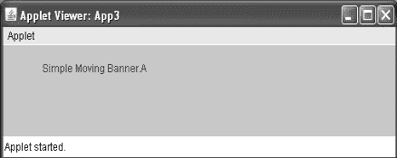

## 使用状态窗口

除了在窗口中显示信息外，applet 还可以向运行它的浏览器或`appletviewer`的状态窗口输出消息。

要做到这一点，请调用`showStatus()`并传入我们想要显示的字符串。状态窗口是向用户提供关于 applet 正在发生的情况、建议选项或报告某些类型错误反馈的好处。

状态窗口也是一个极佳的调试辅助（帮助），因为它为我们提供了一种输出关于 applet 信息的简单方法。

### 示例 16.4

以下示例演示了如何使用状态窗口。

```java
import java.awt.*;
import java.applet.*;
/*<applet code="App4" width=500 height=100></applet>*/
public class App4 extends Applet {
    public void init( ) {
        setBackground(Color.cyan);
    }
    public void paint(Graphics g) {
        g.drawString("This is in the applet window",10,20);
        showStatus("This is shown in the status window");
    }
}
```

输出：

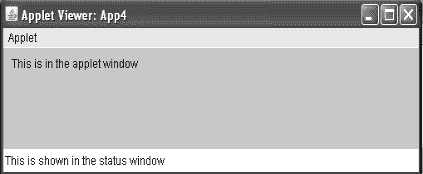

## HTML 的 APPLET 标签

`APPLET`标签用于从 HTML 文档和`appletviewer`启动 applet。

`appletviewer`会在单独的窗口中执行找到的每个`APPLET`标签；而 Netscape Navigator 和 Internet Explorer 等浏览器允许在单个页面上许多 applet。

标准`APPLET`标签的语法为：

```html
< APPLET
CODE=applet class name
CODEBASE=codebase URL
ALT=alternate Text,
NAME=appletInstancename
WIDTH=pixels
HEIGHT=pixels
ALIGN=alignment
VSPACE=vertical space in pixels
HSPACE=horizontal space in pixels
>
<PARAM NAME=attributeName-1 VALUE=Attribute Value-1>
<PARAM NAME=attributeName-2 VALUE=Attribute Value-2>
<PARAM NAME=attributeName-N VALUE=Attribute Value-N>
</APPLET>
```


- `CODE`：必需的属性，提供包含我们 applet 编译文件的文件名。该文件相对于 applet 的`CODEBASE` URL，或者如果设置了`CODEBASE`，则相对于指定的目录。
- `CODEBASE`：可选属性，指定 applet 的基础 URL，即将搜索 applet 可执行类文件（由`CODE`标签指定）的目录。如果未指定此属性，则使用 HTML 文档的 URL 作为`CODEBASE`。
- `ALT`：可选属性，用于指定当浏览器理解`APPLET`标签但当前无法运行 Java 时，应该显示的短文本消息。这与我们为不支持 applet 的浏览器提供的备用文本是不同的。
- `NAME`：可选属性，用于为 applet 实例指定名称。applet 必须命名，以便同一页面上的其他 applet 能够通过名称找到它们并与其进行通信。要通过名称获取 applet，请使用`Applet`接口定义的`getApplet()`。
- `WIDTH`和`HEIGHT`：applet 显示区域以像素为单位的尺寸。
- `ALIGN`：可选属性，指定 applet 的对齐方式。该属性的处理方式与 HTML `IMG`标签相同，可能的值有：`LEFT`、`RIGHT`、`TOP`、`BOTTOM`、`MIDDLE`、`BASELINE`、`TEXTTOP`、`ABSMIDDLE`、`ABSBOTTOM`。
- `VSPACE`和`HSPACE`：这些属性是可选的。`VSPACE`指定 applet 上下方的像素间距。`HSPACE`指定 applet 左右两侧的像素间距。它们的处理方式与`IMG`标签的`VSPACE`和`HSPACE`属性相同。

### PARAM 标签

`PARAM`标签允许我们在 HTML 页面中指定 applet 特有的参数。applet 通过`getParameter()`方法访问其属性。`PARAM`标签有两个属性：`NAME`和`VALUE`。

#### 示例 16.5 此示例演示了如何从 HTML 页面向 Applet 传递参数。

```java
import java.awt.*;
import java.applet.*;
/*<applet code="App5" width=500 height=100>
<param name="fontName" value="Arial">
<param name="fontSize" value="30">
</applet>*/
public class App5 extends Applet {
    String fName;
    int fSize;
    public void init () {
        fName = getParameter("fontName");
        if (fName == null)
            fName = "Courier";
        fSize = Integer.parseInt(getParameter("fontSize"));
        Font f1= new Font(fName, Font.PLAIN, fSize);
        setFont(f1);
    }
    public void paint (Graphics g) {
        g.drawString ("Font Name : " + fName, 0, 25 );
        g.drawString ("Font Size : " + fSize, 0, 50 );
        g.drawString ("Hello world", 0,75);
    }
}
```

输出：
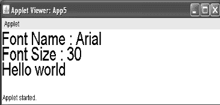

### 获取 DocumentBase 和 CodeBase

通常我们需要创建需要数据的 applet。Java 将允许 applet 从启动 applet 的 HTML 文件目录（文档基）以及加载 applet 类文件的目录（代码基）。

这些目录以`URL`对象的形式返回。它们可以要加载的文件字符串拼接。要实际加载另一个文件，我们将使用`Applet`接口定义的`showdocument()`方法。

#### 示例 16.6：以下示例演示了如何在 applet 代码中获取文档基和代码基。

**App6.java**

```java
import java.awt.*;
import java.applet.*;
import java.net.URL;
public class App6 extends Applet {
    public void paint (Graphics g) {
        URL u1 = getCodeBase();
        g.drawString ("Code base:-" + u1, 10,20);
        URL u2 = getDocumentBase();
        g.drawString ("Document base:-"+u2, 10,40);
    }
}
```

**App6.html**

```html
<html>
  <body>
    <applet code="App6" width=500 height=200></applet>
  </body>
</html>
```

### AppletContext 和 Show Document()

`AppletContext`是一个接口，允许我们从 applet 的执行环境中获取信息。当前执行的 applet 的上下文通过调用 applet 类定义的`getAppletContext()`方法获取。为了允许我们的 applet 将控制权转移到另一个 URL，我们必须使用`Applet Context`接口定义的`showDcoument()`方法。

在 applet 中，一旦我们获取了 applet 的上下文（context），就可以通过调用`showDocument()`方法将另一个文档显示在视图中。该方法没有返回值，如果执行失败也不会抛出异常，因此请谨慎使用。存在两个`showDocument()`方法。

```java
void ShowDocument(URL url)
```

用给定的`URL`替换当前正在查看的 Web 页面

```java
void ShowDocument (URL url, String where)
```

在浏览器窗口的指定位置（where）显示指定的文档。“where”参数的有效值有：

- `"_self"`（在当前帧中显示）
- `"_parent"`（在父级帧中显示）
- `"_top"`（在最顶层帧中显示），以及
- `"_blank"`（在新的浏览器窗口中显示）

### 示例 16.7

下面的 applet 演示了`Applet Context`和`showDocument()`的用法。执行时，它获取当前的 applet 上下文并使用该上下文将控制权转移到名为`A.html`的文件。该文件必须与 applet 位于同一目录下。`Test.html`可以包含任何你喜欢的有效超文本。

```java
1. import java.awt.*;
2. import java.applet.*;
3. import java.net.*;
4. public class App7 extends Applet
5. { 
6.   AppletContext ac;
7.   URL u1;
8.   public void init()
9.   {
10.     setBackground(Color.cyan);
11.     }
12.  public void start( )
13.  {
14.     ac = getAppletContext();
15.     u1 = getCodeBase();
16.     try
17.     {
18.      Thread.sleep(3000);
19.      ac.showDocument(new URL(u1 + "A.html"),"_blank");
20.     }
21.     catch(MalformedURLException e)
22.     { 
23.      showStatus("Invalid URL");
24.      e.printStackTrace() ;
25.     }
26.     catch(InterruptedException e)
27.     { 
28.      showStatus("Invalid URL");
29.      e.printStackTrace () ;
30.     }
31.  }
32.  public void paint (Graphics g)
33.  {
34.    g.drawString(u1+"A.html",20,20);
35.    try
36.     {
37.      Thread.sleep(3000);
38.     }
39.     catch(InterruptedException e)
40.     {
41.      System.out.println(e);
42.     }
43.  }
44. }
```

**App7.html**

```html
1. <html>
2.   <head>
3.   <Title>Applet Context Demo</Title>
4.   </head>
5.   <body>
6.   <applet code="App7" width=200 height=200></applet>
7.   </body>
8. </html>
```

**A.html**

```html
1. <html>
2.   <head>
3.   <title>New Page</title>
4.   </head>
5.   <body bgcolor=blue text=red>
6.   <h1>matrix</h1>
7.   </body>
8. </html>
```

### 示例 16.8

```java
1. import java.applet.*;
2. import java.awt.*;
3. import java.awt.event.*;
4. /*<Applet code="CopyApp" width=500 height=200></applet>*/
5. public class CopyApp extends Applet implements ActionListener
6. {
7.   TextField tf1,tf2;
8.   Button b1;
9.   public void init()
10.  {
11.      setForeground(Color.red);
12.      Font f1=new Font("Arial",
13.      Font.BOLD+Font.ITALIC,20);
14.      tf1=new TextField(8);
15.      tf2=new TextField(8);
16.      tf1.setFont(f1);
17.      tf2.setFont(f1);
18.      b1=new Button("Copy");
19.      b1.addActionListener(this);
20.      b1.setFont(f1);
21.      add(tf1);
22.      add(tf2);
23.      add(b1);
24.  }
25.  public void paint(Graphics g)
26.  {
27.    g.drawString("Matrix",0,150);
28.  }
29.  public void actionPerformed(ActionEvent ae)
30.  {
31.      String s1=tf1.getText();
32.      tf2.setText(s1);
33.  }
34. }
```

输出：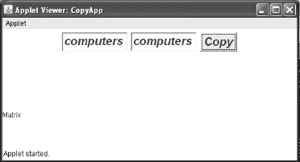

### 示例 16.9 使用 Applet 计算两个数字之和

```java
1. import java.applet.*;
2. import java.awt.*;
3. import java.awt.event.*;
4. /*<Applet code="CopyApp" width=500 height=200></applet>*/
5. public class CopyApp extends Applet implements ActionListener
6. {
7.   TextField tf1,tf2;
8.   Button b1;
9.   public void init()
10.  {
11..setForeground
1..  {
12.      setForeground(Color.red);
13.      Font f1=new Font("Arial",
14.      Font.BOLD+Font.ITALIC,20);
15.      tf1=new TextField(8);
15.      tf2=new TextField(8);
17.      tf1.setFont(f1);
17.      tf2.setFont(f1);
19.      b1=new Button("Copy");
19.      b1.addActionListener(this);
20.      b1.setFont(f1);
21.      add(tf1);
22.      add(tf2);
23.      add(b1);
25.  }
26.  public void paint(Graphics g)
27.  {
28.    g.drawString("Matrix",0,150);
29.  }
30.  public void actionPerformed(ActionEvent ae)
31.  {
32.      String s1=tf1.getText();
33.      tf2.setText(s1);
34.  }
35. }
```

（注：原文提供的示例 16.9 源码似乎存在重复或混乱，翻译已根据逻辑结构进行对齐处理，但保持了原始代码块的完整性。）

*重新审视 16.9 源码翻译部分：*

```java
1. import java.applet.*;
2. import java.awt.*;
3. import java.awt.event.*;
4. /*<Applet code="CopyApp" width=500 height=200></applet>*/
5. public class CopyApp extends Applet implements ActionListener
6. {
7.   TextField tf1,tf2;
8.   Button b1;
9.   public void init()
10.  {
11.      setForeground(Color.red);
12.      Font f1=new Font("Arial",
13.      Font.BOLD+Font.ITALIC,20);
14.      tf1=new TextField(8);
15.      tf2=new TextField(8);
16.      tf1.setFont(f1);
17.      tf2.setFont(f1);
18.      b1=new Button("Copy");
19.      b1.addActionListener(this);
20.      b1.setFont(f1);
21.      add(tf1);
22.      add(tf2);
23.      add(b1);
24.  }
25.  public void paint(Graphics g)
26.  {
27.    g.drawString("Matrix",0,150);
28.  }
29.  public void actionPerformed(ActionEvent ae)
30.  {
31.      String s1=tf1.getText();
32.      tf2.setText(s1);
33.  }
34. }
```

输出：

### 示例 16.9 使用 Applet 计算两个数字之和

```java
1. import java.applet.*;
2. import java.awt.*;
3. import java.awt.event.*;
4. /*<Applet code="CopyApp" width=500 height=200></applet>*/
5. public class CopyApp extends Applet implements ActionListener
6. {
7.   TextField tf1,tf2;
8.   Button b1;
9.   public void init()
10.  {
11.      setForeground(Color.red);
12.      Font f1=new Font("Arial",
```


在 applet 中，一旦我们获取了 applet 的上下文，就可以通过调用 `showDocument()` 方法将另一个文档显示在视图中。该方法没有返回值，如果执行失败也不会抛出异常，因此请谨慎使用。存在两个 `showDocument()` 方法。

```java
void ShowDocument(URL url)
```

用给定的 `URL` 替换当前正在查看的 Web 页面

```java
void ShowDocument (URL url, String where)
```

在浏览器窗口的指定位置（where）显示指定的文档。“where”参数的有效值有：

* `"_self"`（在当前帧中显示）
* `"_parent"`（在父级帧中显示）
* `"_top"`（在最顶层帧中显示），以及
* `"_blank"`（在新的浏览器窗口中显示）

### 示例 16.7

下面的 applet 演示了 `Applet Context` 和 `showDocument()` 的用法。执行时，它获取当前的 applet 上下文并使用该上下文将控制权转移到名为 `A.html` 的文件。该文件必须与 applet 位于同一目录下。`Test.html` 可以包含任何你喜欢的有效超文本。

```java
1. import java.awt.*;
2. import java.applet.*;
3. import java.net.*;
4. public class App7 extends Applet
5. { 
6.   AppletContext ac;
7.   URL u1;
8.   public void init()
9.   {
10.     setBackground(Color.cyan);
11.     }
12.  public void start( )
13.  {
14.     ac = getAppletContext();
15.     u1 = getCodeBase();
16.     try
17.     {
18.      Thread.sleep(3000);
19.      ac.showDocument(new URL(u1 + "A.html"),"_blank");
20.     }
21.     catch(MalformedURLException e)
22.     { 
23.      showStatus("Invalid URL");
24.      e.printStackTrace() ;
25.     }
26.     catch(InterruptedException e)
27.     { 
28.      showStatus("Invalid URL");
29.      e.printStackTrace () ;
30.     }
31.  }
32.  public void paint (Graphics g)
33.  {
34.    g.drawString(u1+"A.html",20,20);
35.    try
36.     {
37.      Thread.sleep(3000);
38.     }
39.     catch(InterruptedException e)
40.     {
41.      System.out.println(e);
42.     }
43.  }
44.}
```

**App7.html**

```html
1. <html>
2.   <head>
3.   <Title>Applet Context Demo</Title>
4.   </head>
5.   <body>
6.   <applet code="App7" width=200 height=200></applet>
7.   </body>
8. </html>
```

**A.html**

```html
1. <html>
2.   <head>
3.   <title>New Page</title>
4.   </head>
5.   <body bgcolor=blue text=red>
6.   <h1>matrix</h1>
7.   </body>
8. </html>
```

### 示例 16.8

```java
1. import java.applet.*;
2. import java.awt.*;
3. import java.awt.event.*;
4. /*<Applet code="CopyApp" width=500 height=200></applet>*/
5. public class CopyApp extends Applet implements ActionListener
6. {
7.   TextField tf1,tf2;
8.   Button b1;
9.   public void init()
10.  {
11.      setForeground(Color.red);
12.      Font f1=new Font("Arial",
13.      Font.BOLD+Font.ITALIC,20);
14.      tf1=new TextField(8);
15.      tf2=new TextField(8);
16.      tf1.setFont(f1);
17.      tf2.setFont(f1);
18.      b1=new Button("Copy");
19.      b1.addActionListener(this);
20.      b1.setFont(f1);
21.      add(tf1);
22.      add(tf2);
23.      add(b1);
24.  }
25.  public void paint(Graphics g)
26.  {
27.    g.drawString("Matrix",0,150);
28.  }
29.  public void actionPerformed(ActionEvent ae)
30.  {
31.      String s1=tf1.getText();
32.      tf2.setText(s1);
33.  }
34. }
```

输出：

### 示例 16.9 使用 Applet 计算两个数字之和

```java
1. import java.applet.*;
2. import java.awt.*;
3. import java.awt.event.*;
4. /*<Applet code="CopyApp" width=500 height=200></applet>*/
5. public class CopyApp extends Applet implements ActionListener
6. {
7.   TextField tf1,tf2;
8.   Button b1;
9.   public void init()
10.  {
11.      setForeground(Color.red);
12.      Font f1=new Font("Arial",
13.      Font.BOLD+Font.ITALIC,20);
14.      tf1=new TextField(8);
15.      tf2=new TextField(8);
16.      tf1.setFont(f1);
17.      tf2.setFont(f1);
18.      b1=new Button("Copy");
19.      b1.addActionListener(this);
20.      b1.setFont(f1);
21.      add(tf1);
22.      add(tf2);
23.      add(b1);
24.  }
25.  public void paint(Graphics g)
26.  {
27.    g.drawString("Matrix",0,150);
28.  }
29.  public void actionPerformed(ActionEvent ae)
30.  {
31.      String s1=tf1.getText();
32.      tf2.setText(s1);
33.  }
34. }
```


```java
public void init()
{
    setForeground(Color.red);
    Font f1=new Font("Arial",
    Font.BOLD+Font.ITALIC,20);
    tf1=new TextField(8);
    tf2=new TextField(8);
    tf1.setFont(f1);
    tf2.setFont(f1);
    b1=new Button("Copy");
    b1.addActionListener(this);
    b1.setFont(f1);
    add(tf1);
    add(tf2);
    add(b1);
}
public void paint(Graphics g)
{
  g.drawString("Matrix",0,150);
}
public void actionPerformed(ActionEvent ae)
{
    String s1=tf1.getText();
    tf2.setText(s1);
}
}
```

# 第 17 章 (抽象窗口工具)

## 引言

Java 提供了大量的内置类，帮助我们设计图形用户界面（GUI）。这些类大多属于`java.awt`包，统称为抽象窗口工具（AWT）。

我们熟悉如 MS-WORD、MS-EXCEL 等软件，它们具有 GUI。我们通过键盘或鼠标访问这些软件的不同功能。

设计用户界面的三个部分是：

* 组件
* 容器
* 布局管理器

以上均起着重要作用。

## 组件

组件是创建 GUI 的构建模块。组件是可以在屏幕上显示并与用户交互的对象的。组件示例包括按钮、复选框和滚动条。`java.awt.Component`类是非菜单组件的抽象父类。类也可以被扩展以创建量级组件。量级组件是不与原生窗口关联的。某些类型的组件（如按钮和滚动条）直接用于 GUI 控制。其他继承自`Container`类的组件提供了特殊的组织。而`TextField`、`TextArea`、`List`等组件用于接受用户输入。`label`是另一种类型的组件，其目的仅仅是显示标识其他组件的适当标签。

Java 组件是由`java.awt.Component`和`java.awt.Menu`超类的许多子类实现的。

组件层次结构：下图显示了 AWT 组件层次结构。


## 容器

下面的图描述了容器层次结构


所有的窗口应用程序都启动于屏幕可见的顶层窗口。同样，所有基于 GUI 的 Java 也启动于顶层窗口，在 Java 术语中被称为顶层容器。

容器也是可以包含其他组件的 Java 组件。组件只有在添加到容器后才能变为可见。

所有的 Java GUI 都存在于 applet 或`Frame`中。applet 和 frame 是两个顶层容器。

对于复杂的 GUI，将 applet 或 frame 分为较小的区域是方便的。这些区域可能构成工具栏或单选按钮矩阵。

面板（Panels）就像应用程序（applets）和框架（frames），可以包含其他组件，如按钮、画布、复选框、滚动条、滚动面板、文本区域、文本字段和其他面板。

复杂的 GUI 有时具有复杂的面板包含层级结构，即面板中嵌套面板，以此类推，跨越许多层嵌套。

由于容器也是组件，因此由于继承关系，组件拥有的方法也适用于容器。

容器最常用的方法是`add()`方法，通过该方法将组件添加到容器中，其通用形式如下：

```java
void add (Component comp);
```

所有组件都是`component`类的子类，因此任何组件都可以使用`add()`方法添加到容器中。

### 布局管理器（Layout Manager）

在向容器中添加组件时，其中一个重要问题与组件的位置和大小有关。组件的位置可以通过两种方式指定：

(i) 绝对定位（Absolute positioning）。

(ii) 相对定位（Relative positioning）。

在绝对定位中，我们指定组件应该添加的精确位置。这种方法为我们提供了精细的控制，如果我们仅为单一平台设计 GUI，这可能是最佳选择。

例如，可以通过指定组件左上角的坐标，将组件添加到容器水平方向的中间。我们可以根据容器的宽度组件的宽度来计算这些坐标。但如果容器宽度改变或组件大小发生变化，组件将不会保持在中间。

另一种方法是相对定位，它可能不允许我们指定组件的精确位置，但在我们希望组件始终位于容器水平方向的中间时，这种方法可能更适用。

我们可以通过指定组件的相对位置（如左侧、右侧、居中等）来实现这一点。在文字处理器中，将文档标题居中对齐非常常见。即使页面宽度发生变化，标题仍保持居中状态，这就是相对定位的一个示例。

在 Java 中，可以使用绝对定位，但并不建议这样做。`AWT`设计的初衷是使用相对定位。我们可以使用相对规范来指定组件布局，例如：组件将添加到上一个组件的右侧、组件将添加到其他组件的下方、组件将出现在顶部、组件的大小将是容器宽度的`¼^(th)`等。这些规范在不知道组件尺寸的情况下依然有用。

Java 鼓励相对定位，因为它是平台无关的，相同的 GUI 可以在不进行修改的情况下在各种平台上运行。

称为布局管理器（layout managers）的内置 Java 类处理将相对位置映射到实际/物理位置的任务。Java 支持多种布局管理器，我们将讨论以下布局管理器：

1. `FlowLayout`
2. `GridLayout`
3. `BorderLayout`
4. `CardLayout`
5. `GridBagLayout`

### 使用布局管理器工作时的两个观察结果：

- 我们不必承担指定每个组件精确位置和尺寸的负担。
- 我们不再拥有指定每个组件精确位置和尺寸的权力。

### 为什么 Java 使用布局管理器？

原因有两个：

1. 理论上是因为，精确布局（即以像素为单位指定每个组件的大小和位置）是一项重复且经常执行的任务；因此，根据 OOP 的布局功能，布局功能应该封装在一个或多个类中以实现任务自动化。显然，布局管理器消除了许多繁琐的开发工作。许多程序员起初并不喜欢布局管理器，但随着繁琐选择的消除，他们变得越来越欣赏它们。

2. 使用布局管理器的实际原因源于 Java 的平台无关性。在 Java 中，AWT 组件的行为借自运行`JVM`的底层硬件的窗口系统。因此，在 Macintosh 上，AWT 按钮就像任何其他 Mac 按钮一样；在 Motif 平台上，Java 按钮看起来就像任何其他 Motif 按钮，以此此类推。这里的问题在于，按钮和其他组件在不同平台上的实例化时会有不同的尺寸。

如果 Java 鼓励精确的像素级尺寸控制和定位，那么会有许多 Java GUI 在其源平台上看起来精美，但在其他平台上看起来很糟糕甚至无法使用。如上所述，布局管理器通过使用相对定位解决了这个问题。

### 布局策略（Layout policy）

每个 Java 组件都有首选尺寸（preferred size）。首选尺寸表示了在不与布局管理器冲突的情况下，组件希望呈现到有多大。首选尺寸通常是能够以视觉上有意义的方式渲染组件所需的最小尺寸，例如，按钮的首选尺寸是其标签文本的大小，加上文本周围的一小圈空白边框，再加上标记按钮边界的阴影装饰，因此按钮的首选尺寸是“恰好足够”。首选尺寸是取决于平台的，因为组件的边界装饰会随系统不同而异。

当布局管理器布局其容器的子组件时，它必须平衡两个方面的考量：

(i) 布局策略和

(ii) 每个组件的首选尺寸

首要任务是执行布局策略。如果尊重某个组件的首选尺寸意味着违反布局策略，那么布局管理器将覆盖该组件的首选尺寸。理解布局管理器意味着理解它将把组件放在哪里，以及它将如何处理组件的首选尺寸。

### 1. FlowLayout

流式布局管理器的功能封装在`java.awt.FlowLayout`类中。

流式布局管理器将组件排列在水平行中。它是面板和应用程序的默认布局管理器类型。

流式布局管理器尽可能将尽可能多的组件放入第一行，并将其他组件移动到第二行。如果第二行没有剩余空间，组件将移动到第三行，以此此类推。这与在文档中输入文本非常相似。当我们到达当前行的末尾时，下一个单词移动到下一行，以此此类推。如果我们更改文档的宽度或高度，整个文档将重新格式化。组件始终按照它们添加到容器的顺序从左到右出现。

默认情况下，流式布局管理器在水平和垂直方向上留出五个像素的间隙。可以通过调用`FlowLayout`的重载构造函数并传入所需的水平垂直间隙来更改此默认值。在每一行中，组件间距均匀，且组件簇是居中的。组件簇的对齐（有时称为“对端”）可以通过向`FlowLayout`构造函数传递参数来控制。可能的值为：

- `FlowLayout.LEFT`
- `FlowLayout.CENTER`
- `FlowLayout.RIGHT`

**示例 17.1:**

```java
import java.awt.*;

class MyFrame {

    public static void main(String args[ ]) {

        Frame f=new Frame( );

        FlowLayout flow=new FlowLayout();

        f.setLayout(flow);

        Label l1 = new Label("Name : ");

        f.add(l1);

        TextField tf1=new TextField("Matrix");

        f.add(tf1);

        tf1.setBackground(Color.green);

        tf1.setForeground(Color.red);

        Button b1 = new Button("ok");

        Font f1 = new Font("Arial", Font.BOLD, 24);

        b1.setFont(f1); 

        f.add(b1);

        f.setSize(500,100);

        f.setVisible(true);

    }

}
```

注意：如果我们缩小上述窗口的大小，且三个组件无法在单行内容纳，那么组件将从最后一个组件开始移动到下一行。

输出：


### 示例 17.2

```java
import java.awt.*;

public class MyFrame2 extends Frame

{

    public static void main (String args [])

    {

      MyFrame2 f=new MyFrame2();

      f.setLayout(new FlowLayout(FlowLayout.CENTER));

      System.out.println(f.paramString());

      Label l1=new Label("Name :");

      f.add(l1);

      TextField tf1=new TextField("Sample Program");

      f.add(tf1);

      tf1.setBackground(Color.GREEN);

      tf1.setForeground(Color.RED);

      Button b1=new Button("OK");

      b1.setFont(new Font("Serif",Font.BOLD,24));

      //b1.setEnabled(false);

      Dimension d = b1.getSize( );

      System.out.println("Button Size :" + d.width + " " + d.height);

      f.add(b1);

      // f.setResizable(false);

      // f.setUndecorated(true);

      f.setVisible(true);

      Dimension d1=b1.getSize( );

      System.out.println("Button Size: " + d1.width + " " + d1.height);

      Dimension d2=f.getSize();

      System.out.println("Frame Size: " + d2.width + " " + d2.height);

      try

      { 

        Thread.sleep(5000);

      }

      catch(InterruptedException e) { }

      f.setVisible(false);

      f.setSize(500,100);

      f.setVisible(true);

      try

      { 

        Thread.sleep(5000);

      }

      catch(InterruptedException e){ }

      f.setVisible(false);

      f.setBounds(20, 20, 100, 100);

      f.setVisible(true);

      Dimension d3=f.getSize();

      System.out.println("Frame Size : " + d3.width + " " + d3.height);

      System.out.println(f.paramString());

    }

}
```

输出：


```
frame0,0,0,0x0,invalid,hidden,layout=java.awt.FlowLayout,title=,resizable,normal
Button Size :0 0
Button Size: 52 35
Frame Size: 123 34
Frame Size : 123 100
frame0,20,20,123x100,layout=java.awt.FlowLayout,title=,resizable,normal
```

### 示例 17.3

如果我们把上述程序中的行：

`f.setLayout(new FlowLayout(FlowLayout.CENTER));`

更改为

`f.setLayout(new FlowLayout(FlowLayout.LEFT));`

那么组件将左对齐。

输出：


### 示例 17.4

如果我们把上述程序中的行：

`f.setLayout(new FlowLayout(FlowLayout.LEFT));`

更改为

`f.setLayout(new FlowLayout(FlowLayout.RIGHT));`

那么组件将右对齐。

输出：


### 示例 17.5

我们可以通过在设置布局时使用重载构造函数来更改行之间的间距（水平间距）和行之间的间距（垂直间距）：


`f.setLayout(new FlowLayout(FlowLayout.CENTER, 20 ,20))`


vgap（行间距） hgap（组件间距）

输出：


### GridLayout（网格布局）

GridLayout 的功能封装在`java.awt.GridLayout`类中。`GridLayout`管理器以表格形式的行和列排列组件。我们可以将容器空间视一个由行和列组成的网格。在指定布局时，我们必须指定行和列的数量。

`GridLayout`管理器会将与行的大小（布局中指定的列数）相适应的组件放入第一行，并将其他组件移动到第二行，依此类推。这类似于电子表格，被分为固定数量的行和列。

流式布局管理器始终尊重组件的优选尺寸。`GridLayout`管理器采取了相反极端：当它在给定空间执行布局时，它会忽略组件的优选尺寸。网格布局中的每一行和每一列的大小都相同，布局可用的总区域在行数和列数之间平均平分。网格布局使用“行优先”表示法，即组件按照它们被添加的顺序从左到右、逐行出现。

当我们添加较少组件（即显著少于行数乘以列数）或大量组件（即多于行数乘以列数）时，`GridLayout`的表现会很奇怪。如果将相同的组件放在更高、更窄的框架中，那么每个组件都将按比例变得更高、更窄。

### 示例 17.6

```java
import java.awt.*;

public class MyFrame6 extends Frame

{

    public static void main(String args[])

    {

      Frame f = new MyFrame6();

      f.setLayout(new GridLayout(5,3));

      for(int row=0; row<5; row++)

      {

        f.add(new Label("Label" + row));

        f.add(new Button("Button" + row));
```


```java
        f.add(new TextField("TextField" + row));

      }

      f.setSize(500,200);

      f.setVisible(true);

    }

}
```

输出：


### BorderLayout（边界布局）

`BorderLayout`的功能封装在`java.awt.BorderLayout`类中。`BorderLayout`是框架的默认管理器，程序员早晚都会与之打交道。`BorderLayout`管理将可用空间分为五个部分：北、南、东、西和中心。我们可以在每个区域添加组件。这五个区域中的每一个可以是空的，也可以包含一个组件（即每个区域只能包含一个组件）。

`BorderLayout`执行了一种非常实用的布局策略，但可能不如流式布局或网格布局直观。`BorderLayout`管理器尊重北和南组件的优选高度，并强制它们与容器一样宽。北和南区域适用于工具栏、状态栏以及任何应该尽可能宽但高度不高于所需的控件。

东和西区域是北和南的相反。在东和西区域，组件获得其优选宽度，但其高度被限制。

在这里，组件向上延伸到北组件的底部（如果存在），或者延伸到容器的顶部（如果没有北组件）。同样，组件向下延伸到南组件的顶部（如果存在），或者延伸到容器的底部（如果没有南组件）。

我们只能在每个区域放置一个组件，尽管如此，如果该组件是一个容器，那么我们可以显示多个组件。`BorderLayout`不受我们添加组件顺序的影响。相反，`add()`的重载版本接受两个参数：

- 第一个是要添加的组件，
- 第二个是一个对象。

正确使用`BorderLayout`要求第二个参数是`BorderLayout`类本身定义的常量。我们应该了解的五个常量是：

- `BorderLayout.NORTH`
- `BorderLayout.SOUTH`
- `BorderLayout.EAST`
- `BorderLayout.WEST`
- `BorderLayout.CENTER`

`BorderLayout`管理器控制的第五个区域被称为中心。中心仅仅是北、南、东、西分配后剩余的容器部分。在添加组件到中心时，省略`add()`用的第二个参数是合法但不明智的。在 Java 平台上，`BorderLayout`管理器会假设指的是中心；但在旧版本中，行为是不可预测的，通常会导致组件完全不可见。

```java
import java.awt.*;

public class MyFrame7

{

  public static void main(String args[])

    {

      Frame f=new Frame( );

      Scrollbar sbRight=new Scrollbar(Scrollbar.VERTICAL);

      f.add(sbRight, BorderLayout.EAST);

      Scrollbar sbLeft=new Scrollbar(Scrollbar.VERTICAL);

      f.add(sbLeft, BorderLayout.WEST);

      Label labelTop=new Label("This is North");

      labelTop.setFont(new Font("Serif", Font.ITALIC, 36));

      labelTop.setForeground(Color.white);

      labelTop.setBackground(Color.black);

      f.add(labelTop, BorderLayout.NORTH);

      Label labelBottom=new Label("This is south");

      labelBottom.setFont(new Font("Monospaced", Font.BOLD, 18));

      labelBottom.setForeground(Color.white);

      labelBottom.setBackground(Color.black);

      f.add(labelBottom, BorderLayout.SOUTH);

      f.setSize(500,200);

      f.setVisible(true);

    }

}
```

输出:
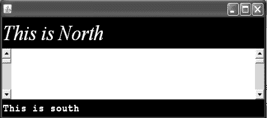

### 示例 17.8

```java
import java.awt.*;

public class MyFrame8 extends Frame

{

  public static void main(String args[])

    {

      Frame f=new MyFrame8( );

      //f.setLayout(new BorderLayout());

      f.add (new Button("N"), BorderLayout.NORTH);

      f.add (new Button("S"), BorderLayout.SOUTH);

      f.add (new Button("E"), BorderLayout.EAST);

      f.add (new Button("W"), BorderLayout.WEST);

      Panel p=new Panel();

      p.setBackground(Color.green);    

      f.add (p, BorderLayout.CENTER);

      //f.add (p);  默认是中心

      f.setSize(300 ,300);

      f.setVisible(true);

    }

}
```

输出:
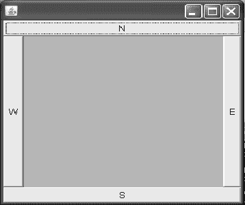

### 示例 17.9

```java
import  java.awt.*;

class BorderLayout3 extends Frame

{

  public static void main (String args[])

    {

      Frame f=new BorderLayout3();

      // f.setLayout(new BorderLayout());

      Panel toolbar=new Panel();

      toolbar.setLayout(new FlowLayout(FlowLayout.LEFT));

      toolbar.setBackground(Color.lightGray);

      toolbar.add(new Button ("This"));

      toolbar.add(new Button ("Is"));

      toolbar.add(new Button ("The"));

      toolbar.add(new Button ("Toolbar"));

      f.add(toolbar,BorderLayout.NORTH);

      TextField status=new TextField("Status.");

      status.setFont(new Font("Monospaced",Font.BOLD,48));

      f.add (status,BorderLayout.SOUTH)    

      f.setSize(300,300);

      f.setVisible(true);

    }

}
```

输出:
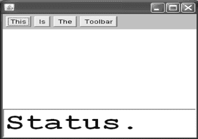

### CardLayout

在`CardLayout`中，我们可以存储许多卡片，但一次只显示一张。只有一张卡片是可见的，但你可以从一张卡片切换到另一一张。这里的卡片意味着`Panel`。如果我们想一次显示两张卡片，则必须为每张卡片创建一个`Panel`，并创建一个包含这两个卡片的主`Panel`。这对于具有可选组件的用户界面非常有用，可以根据用户输入启用或禁用组件。

### 构造函数

- `CardLayout()`创建一个间隙为 0 的新卡片布局。
- `CardLayout(int, int)`创建具有指定水平和垂直间隙的新布局。水平间隙放置在左右边缘。垂直间隙放置在顶部和底部边缘。与其他布局相比，`CardLayout`需要更多的工作。卡片通常存储在类型为`panel`的对象中。当卡片被添加到面板时，通常会给它们指定一个名称。因此，我们在将卡片添加到面板时将使用`add()`方法：`add(Component objpanel, Object objname)`，`objname`是一个字符串，用于指定由`objpanel`指定面板的卡片名称。

### 方法

- `void first(Container parent)`跳转到容器的第一张卡片。
- `void next(Container parent)`跳转到给定容器的下一张卡片。如果当前可见卡片是最后一张，此方法将翻到布局中的第一张卡片。
- `void previous(Container parent)`跳转到给定容器的上上一张卡片。如果当前可见卡片是第一张，此方法将翻到布局中的最后一张卡片。
- `void last(Container parent)`跳转到容器的最后一张卡片。
- `void show(Container parent, String name)`跳转到以给定名称添加到布局的组件。如果不存在此类组件，则发生异常。

创建`CardLayout`使用以下步骤：

1. 创建一个新的`Panel`对象和一个`CardLayout`对象。
2. 使用在第一步中创建的实例将`Panel`对象的布局设置为`CardLayout`。
3. 现在为每张卡片创建一个单独的`Panel`对象，并添加想要添加到该`Panel`中的任何内容，如按钮、复选框等。
4. 将步骤 3 中的每个`Panel`对象添加到步骤 1 创建的主面板`Panel`对象中，并为每张卡片提供一个唯一的卡片名称。
5. 最后将主面板添加到窗口。

### 示例 17.10

```java
import java.awt.*;

import java.awt.event.*;

import java.applet.*;

/*<applet code="CardLayoutTest" width=500 height=100></applet*/

public class CardLayoutTest extends Applet implements ActionListener, MouseListener

{

  Panel mp;

  CardLayout c1;

  public void init()

    {

      Button b1=new Button("First");

      Button b2=new Button("Second");

      b1.addActionListener(this);

      b2.addActionListener(this);

      add(b1);

      add(b2);

      Panel p1=new Panel();

      Label l1=new Label("INDIA");

      p1.add(l1);

      Panel p2=new Panel();

      Label l2=new Label("USA");

      p2.add(l2);

      mp=new Panel();

      c1=new CardLayout();

      mp.setLayout(c1);

      mp.add(p1,"Country1");

      mp.add(p2,"Country2");

      add(mp);

      addMouseListener(this);

    }

  public void actionPerformed(ActionEvent ae)

    {

      Button b=(Button)ae.getSource();

      if(b.getLabel().equals("First"))

        c1.show(mp,"Country1");

      else

        c1.show(mp,"Country2");

    }

  public void mousePressed(MouseEvent me)

    {

      c1.next(mp);

    }

  public void mouseReleased(MouseEvent me){}

  public void mouseClicked(MouseEvent me){}

  public void mouseEntered(MouseEvent me){}

  public void mouseExited(MouseEvent me){}

}
```

输出:
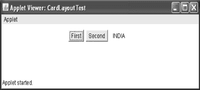

### GridBagLayout

`GridBagLayout`是标准布局管理器中最复杂且灵活的。尽管它听起来应该是`GridLayout`的子类，但它完全不同。

### 示例 17.11

AWT 组件可以分类为：

1. 视觉组件。
2. 容器组件。
3. 菜单组件。

视觉组件和容器组件都属于从`java.awt.Component`开始的组件层次。（菜单组件继承自`java.awt.MenuComponent`，因此它们不继承相同的父类功能）。这些方法如下：

#### java.awt.Component 类的方法

所有视觉和容器组件都通过继承`java.awt.component`实现了几个方法：

- `Dimension getSize()`以`Dimension`对象的形式返回组件的大小，该对象具有类型为`int`的公共数据成员`height`和`width`。
- `void setBackground(Color c)`设置组件的背景颜色。通常背景颜色用于渲染组件的非文本区域。
- `void setForeground(Color c)`设置组件的前颜色。通常组件的前颜色用于渲染文本。如果内部没有显式设置组件的前颜色或背景颜色，组件将使用其直接容器的前颜色和背景颜色。
- `void setFont(Font f)`

`setFont()`方法决定了组件在渲染其需要显示的任何文本时使用的字体。如果我们没有显式地设置组件的字体，则组件将使用其容器的字体。

```java
void setEnabled(Boolean b)
```

如果参数为`true`，则组件具有其正常外观。如果参数为`false`，则组件将显示为灰色且不对用户输入做出响应。

```java
void setSize(Dimension d)
```

设置组件的大小。

```java
void setSize(int width, int height)
```

设置组件的大小。

```java
void setBounds(int x, int y, int width, int height)
```

尝试移动并调整组件的大小。左上角的新位置由`x`和`y`规定，新大小由`width`和`height`规定。

```java
void setVisible(Boolean b)
```

此方法接受一个布尔参数，决定组件是否在屏幕上可见。此方法通常用于帧（frames）。

### 注意

如果我们尝试过调用`setSize()`或`setBounds()`方法，我们就会知道这通常是徒劳的。我们尝试给组件的大小和位置会被布局管理器（layout manager）覆盖。

事实上，这两个方法的存在很大程度上是为了供布局管理器使用的。该规则的一个主要例外是`Frame`类，它不受布局管理器的控制，并且完全愿意让我们设置它的大小或边界。

### 可视化组件

可视化组件是用户实际上可以看到并与之交互的组件。AWT 支持以下视化组件：

- `Button`
- `Canvas`
- `Checkbox`
- `Choice`
- `FileDialog`
- `Label`
- `List`
- `ScrollPane`
- `Scrollbar`
- `TextArea`
- `TextField`

要在 GUI 中使用这些组件之一，我们首先通过调用相应的构造函数来创建一个实例。然后将组件添加到容器中。

### Button（按钮）

`Button`类实现了一个推按钮。

### 构造函数

- `Button()`
- `Button(String)`

构造函数接受一个字符串参数，指定按钮标签的文本。当按钮被按下时，它会发送一个`Action`事件。

### 方法

- `String getLabel()`

获取此按钮的标签。

- `void setLabel(String label)`

将按钮的标签设置为指定的字符串。

- `void addActionListener(ActionListener l)`

添加指定的动作监听器以接收来自此按钮的动作事件。

**示例 17.12**


```java
1. import java.awt.*;
2. class ButtonTest
{
4. public static void main(String args[])
{
      Frame f=new Frame("Testing Button Component");
      f.setLayout(new FlowLayout());
      Font f1=new Font("Arial",Font.BOLD,40);
      Color c1=new Color(255,0,0);
      Color c2=new Color(0,255,0);
      Button b1 = new Button();
      Button b2 = new Button("Cancel");
      b1.setForeground(c1);
      b2.setForeground(c1);
      b1.setBackground(c2);
      b2.setBackground(c2);
      b1.setFont(f1);
      b2.setFont(f1);
      b1.setLabel("Ok");
      System.out.println(b2.getLabel());
      f.add(b1);
      f.add(b2);
      f.setSize(500,200);
      f.setVisible(true);
    }
}
```

输出：


### Canvas（画布）

`Canvas`是一个组件，它没有默认外观或行为。我们可以派生`canvas`来创建自定义绘图区域、工作区域、组件等。画布接收来自鼠标和键盘的输入事件，由程序员将这些输入转换为有意义的外观和感受。

画布的默认大小（或更准确地说，首选大小）小得毫无用处。解决这个问题的一种方法是使用会调整画布大小的布局管理器。另一种方法是手动对画布调用`setSize()`，画布是少数这种方法可能起作用的用例，因为我们发送到`setSize()`方法的值将成为画布的首选大小。

**示例 17.13**

```java
1. import java.awt.*;
2. class CanvasTest
{
4. public static void main(String args [])
{
      Frame f = new Frame();
      f.setLayout(new FlowLayout());
      Canvas c=new MyCanvas();
      c.setSize(100,100);
      f.add(c);
      f.setSize(300,300);
      f.setVisible(true);
    }
}
15. class MyCanvas extends Canvas
{
17. public void paint(Graphics g)
{
      setBackground(Color.green);
      g.setColor(Color.red);
      g.drawLine(0, 0, 99, 99);
}
```

输出：


### Checkbox（复选框）

复选框是一个双状态按钮。两个状态为`true`（已选中）和`false`（未勾选）。构造函数的三个基本形式为：

* `Checkbox()`：创建一个标签为空字符串的复选框。
* `Checkbox(String label)`：创建一个指定标签的复选框。
* `Checkbox(String label, boolean state)`：创建一个指定标签和状态的复选框。如果我们不指定状态，默认为`false`。

**方法：**

* `String getLabel()`

获取此按钮的标签。

* `void setLabel(String label)`

将按钮的标签设置为指定的字符串。

* `boolean getState()`

确定复选框处于“开启”还是“关闭”状态。

* `void setState(boolean state)`

将复选框的状态设置为指定的状态。

* `void addItemListener(ItemListener l)`

添加监听器以接收来自此复选框的项目事件。

**示例 17.14**

```java
1. import java.awt.*;
2. class CheckboxTest
{
4. public void main(String args[])
{
      Frame f = new Frame("Testing Checkbox");
      f.setLayout(new GridLayout(3,1));
      Checkbox c1=new Checkbox();
      Checkbox c2=new Checkbox("Lunch",true);
      Checkbox c3=new Checkbox("Dinner");
      c1.setLabel("BreakFast");
      c3.setState(true);
      f.add(c1);f.add(c2);f.add(c3);
      if(c1.getState())
        System.out.println(c1.getLabel());
      if(c2.getState())
        System.out.println(c2.getLabel());
      if(c3.getState())
        System.out.println(c3.getLabel());
      f.setSize(100,100);
      f.setVisible(true);
    }
}
```

输出：

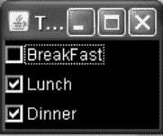

**另一个示例**

```java
1. import java.awt.*;
2. import java.awt.event.*;
3. class CheckboxTest extends Frame implements ItemListener
{
    Checkbox c1;
    TextField tf1;
    CheckboxTest()
    {
      setLayout(new GridLayout(2,1));
      c1=new Checkbox("Red");
      c1.addItemListener(this);
      add(c1);
      tf1=new TextField();
      add(tf1);
      setSize(100,100);
      setVisible(true);
    }
    public static void main(String args[])
    {
      new CheckboxTest();
    }
    public void itemStateChanged(ItemEvent ie)
    {
      if(c1.getState())
        tf1.setBackground(Color.red);
      else
        tf1.setBackground(Color.white);
    }
}
```

#### Radio button（单选按钮）

复选框可以组合成复选框组，具有单选行为。在单选行为下，任何时刻复选框组只有一个成员可以为`true`；选择新成员将把之前选中的成员状态改为`false`。许多窗口系统（例如 Motif）将单选组作为独立的组件实现。

我们可以通过创建多个复选框并使用`java.awt.CheckboxGroup`类对它们进行分组来实现单选行为。在 Java 中，`java.awt.CheckboxGroup`类不是组件；它只是组织复选框的不可见类。这意味着 Java 对复选框组成员之间的空间关系没有限制。

如果我们愿意，可以将一组中的一个成员放置在框架的左上角，另一个成员放置在右下角，并将第三个成员放置在完全不同的框架中。当然，结果可能违背常理，也违背大多数 GUI 样式指南。

`CheckboxGroup`类的两种方法支持获取和设置当前选中的成员或该组。

`Checkbox getSelectedCheckbox()`

从此复选框组获取当前的选择。

`void setSelectedCheckbox(Checkbox box)`

将此组中当前选中的复选框设置为指定的复选框。

### 示例 17.15

```java
import java.awt.*;
class CheckboxGroupTest
{
  public static void main(String args[])
  {
      Frame f = new Frame("Testing RadioButton Component");
      f.setLayout(new GridLayout(3,1));
      CheckboxGroup cbg=new CheckboxGroup();
      Checkbox c1=new Checkbox("BreakFast",false,cbg);
      Checkbox c2=new Checkbox("Lunch",true,cbg);
      Checkbox c3=new Checkbox("Dinner",false,cbg);
      c3.setState(true);
      f.add(c1);f.add(c2);f.add(c3);
      
      if(c1.getState())
        System.out.println(c1.getLabel());
      else if(c2.getState())
        System.out.println(c2.getLabel());
      else if(c3.getState())
        System.out.println(c3.getLabel());
          
      f.setSize(100,100);
      f.setVisible(true);
  }
}
```

输出：

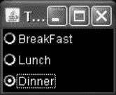

### Choice

`Choice`是一个下拉列表。

#### 方法：

`void add(String item)`

向此`Choice`菜单添加一个项目。

`void addItemListener(ItemListener i)`

添加指定的项监听器，以接收来自此选择框 的的项事件。

`String getItem(int index)`

获取此`Choice`菜单中指定索引处的`String`。

`int getItemCount()`

返回此`Choice`菜单中的项目数量。

`int getSelectedIndex()`

返回当前选中项的索引。

`String getSelectedItem()`

获取当前选择的`string`字符串表示。

`void insert(String item, int index)`

在此选择框的指定位置插入该项目。

`void remove(int position)`

从选择菜单中删除第一个出现的项目。

`void remove(String item)`

从`Choice`菜单中删除第一个出现的指定项目。

`void removeAll()`

移除选择菜单中的所有项目。

`void select(int pos)`

将此选择菜单中选中的项目设置为指定位置处项目。

`void select(String Str)`

将此`Choice`菜单中选中的项目设置为与指定字符串相等的项目。

### 示例 17.16

```java
import java.awt.*;
class ChoiceTest
{
  public static void main(String args[]) throws InterruptedException
  {
      Frame f = new Frame("Testing Choice Component");
      f.setLayout(new FlowLayout());
      f.setSize(100,100);
      f.setVisible(true);
      Choice c1=new Choice();
      c1.add("BreakFast");
      c1.add("Lunch");           
      c1.add("Dinner");
      f.add(c1);
      c1.select("Dinner"); // c1.select(2);
      Thread.sleep(1000);
      System.out.println(c1.getSelectedItem());
      System.out.println(c1.getSelectedIndex());
      System.out.println(c1.getItemCount());
      System.out.println(c1.getItem(0));
      c1.insert("Brunch",1);
      c1.remove(2); // c1.remove("Lunch");
  }
}
```

输出：

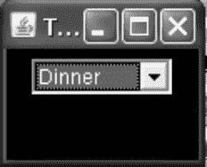

```java
import java.awt.*;
import java.awt.event.*;
class CheckboxItemTest extends Frame implements ItemListener
{
  TextField tf1;
  Choice c1;
  CheckboxItemTest()
  {
      setLayout(new FlowLayout());
      c1=new Choice();
      c1.add("red");
      c1.add("green");
      c1.add("blue");
      tf1 = new TextField(8);
      tf1.setBackground(Color.red);
      c1.addItemListener(this);
      add(c1);
      add(tf1);
      setSize(200,200);
      setVisible(true);
  }
  public static void main(String args[])
  {
      new CheckboxItemTest();
  }
  public void itemStateChanged(ItemEvent ie)
  {
      String s=(String)ie.getItem();
      if(s.equals("red"))
        tf1.setBackground(Color.red);
      else if(s.equals("green"))
        tf1.setBackground(Color.green);
      else if(s.equals("blue"))
        tf1.setBackground(Color.blue);
  }
}
```

### Label

最简单的 AWT 组件是`label`。标签通常不用于响应输入或发送事件。

#### 构造函数：

`Label()`

创建一个标签。

`Label(String text)`

创建一个带有指定文本的标签。

`Label(String text, int alignment)`

创建一个带有指定文本和指定对齐方式的标签。

#### 方法：

`String getText()`

获取此标签的文本。

`void setText(String text)`

设置此标签的文本。

### 示例 17.17


```java
import java.awt.*;
class LabelTest
{
  public static void main(String args[])
  {
      Frame f = new Frame("Testing Label");
      f.setLayout(new GridLayout(3,3));
      f.setFont(new Font("Arial",Font.PLAIN, 20));
      Label l1 = new Label("India",Label.LEFT);
      Label l2 = new Label("Pakistan",Label.LEFT);
      Label l3 = new Label("UK",Label.LEFT);
      Label l4 = new Label("India",Label.CENTER);
      Label l5 = new Label("Pakistan",Label.CENTER);
      Label l6 = new Label("UK",Label.CENTER);
      Label l7 = new Label("India",Label.RIGHT);
      Label l8 = new Label("Pakistan",Label.RIGHT);
      Label l9 = new Label("UK",Label.RIGHT);
      l3.setText("USA");
      System.out.println(l1.getText());
      f.add(l1);f.add(l4);f.add(l7);
      f.add(l2);f.add(l5);f.add(l8);
      f.add(l3);f.add(l6);f.add(l9);
      f.setSize(500,200);
      f.setVisible(true);
  }
}
```

输出：


## List

`List`是垂直排列的文本集合。如果列表包含的项目多于显示范围，它会自动获取垂直滚动条。

### 构造函数

`List()`

创建一个滚动列表。此构造函数不指定可见行数，但产生默认四行的高度。当然，在许多情况下，列表的实际高度由布局管理器决定。

`List(int rows)`

创建一个具有指定可见行数的滚动列表。

`List(int rows, boolean multipleMode)`

创建一个初始化为显示指定行数并允许多选的滚动列表。

### 示例 17.18

```java
import java.awt.*;
class ListTest
{
  public static void main(String args[])
  { 
      Frame f = new Frame ( );
      f.setLayout (new FlowLayout ());
      List l1=new List(3,true);
      l1.add("India");
      l1.add("Nepal");
      l1.add("Shri Lanka");
      l1.add("USA");
      l1.add("UK");
      f.add(l1);
      System.out.println(l1.getRows());
      f.setSize(300, 300);
      f.setVisible(true);
  }
}
```

输出：

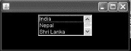

列表有五个项目但只能显示 3 行，因此自动提供滚动条以访问底部两行。

注意：在列表中选择项目会导致列表发送`Item`事件；双击项目会发送`Action`事件。

`void add(String item)`

将指定项目添加到滚动列表的末尾。

### List 方法

`void add(String item, int index)`

将指定的项添加到由`index`指明的位置的滚动列表中。

`void addActionListener(ActionListener i)`

添加指定的动作监听器，以接收来自此列表的动作事件。

`void addItemListener(ItemListener i)`

添加指定的项目监听器，以接收来自此列表的项目事件。

`String getItem(int index)`

获取与指定的`index`关联的项目。

`int getItemCount()`

获取列表中的项目数量。

`String[] getItems()`

获取列表中的所有项目。

`int getRows()`

获取此列表中可见的行数。

`int getSelectedIndex()`

获取列表中被选中项的索引。

`int[] getSelectedIndexes()`

获取列表中被选中的索引。

`String getSelectedItem()`

获取此滚动列表中被选中的项。

`String[] getSelectedItems()`

获取此滚动列表中被选中的项。

`void remove(int position)`

从此滚动列表中移除指定位置的项目。

`void remove(String item)`

从列表中移除第一次出现的指定项目。

`void removeAll()`

移除此列表中的所有项目。

`void replaceItem(String newValue, int index)`

用新字符串替换滚动列表中指定`index`处的项目。

`void select(int index)`

选中滚动列表中指定索引处的项目。

`void setMultipleMode(boolean b)`

设置标志，以决定此列表是否允许多项选择。

### 示例代码

```java
import java.awt.*;
import java.awt.event.*;

class ListTest extends Frame implements ActionListener
{
    Button b1, b2, b3, b4, b5, b6;
    List l1, l2;
    TextField tf1, tf2;

    ListTest() {
        setLayout(new GridLayout(3,3));
        l1 = new List(3,true);
        l2 = new List(3,true);
        b1 = new Button(">");
        b2 = new Button(">>");
        b3 = new Button("<");
        b4 = new Button("<<");
        b5 = new Button("Add");
        b6 = new Button("Add");
        b1.addActionListener(this);
        b2.addActionListener(this);
        b3.addActionListener(this);
        b4.addActionListener(this);
        b5.addActionListener(this);
        b6.addActionListener(this);
        tf1 = new TextField();
        tf2 = new TextField();
        Panel p1 = new Panel();
        p1.setLayout(new GridLayout(4,1));
        p1.add(b1);
        p1.add(b2);
        p1.add(b3);
        p1.add(b4);
        add(l1);add(p1);add(l2);
        add(tf1);add(new Label());add(tf2);
        add(b5);add(new Label());add(b6);
        setSize(300,300);
        setVisible(true);
    }

    public static void main(String args[]) {
        new ListTest();
    }

    public void actionPerformed(ActionEvent ae) {
        Button b = (Button)ae.getSource();
        if (b == b1) {
            String[] s = l1.getSelectedItems();
            for (int i=0; i<s.length; i++) {
                l2.add(s[i]);
                l1.remove(s[i]);
            }
        } else if (b == b2) {
            String[] s = l1.getItems();
            for (int i=0; i<s.length; i++) {
                l2.add(s[i]);
                l1.remove(s[i]);
            }
        } else if (b == b3) {
            String[] s = l2.getSelectedItems();
            for (int i=0; i<s.length; i++) {
                l1.add(s[i]);
                l2.remove(s[i]);
            }
        } else if (b == b4) {
            String[] s = l2.getItems();
            for (int i=0; i<s.length; i++) {
                l1.add(s[i]);
                l2.remove(s[i]);
            }
        } else if (b == b5) {
            l1.add(tf1.getText());
        } else if (b == b6) {
            l2.add(tf2.getText());
        }
    }
}
```

## TextField 和 TextArea

`TextField`和`TextArea`类实现了用于文本输入、显示和编辑的一维和二维组件。这两个类都继承自父类`TextComponent`。

`Object` -> `Component` -> `TextComponent` -> (`TextField`, `TextArea`)

这两个类（`TextField`和`TextArea`）都有多种构造函数，这些函数提供了指定或不指定初始字符串或首选尺寸的选择。未指定首选尺寸的构造函数最适用于布局管理器将忽略组件首选尺寸的情况。

### TextField 类的构造函数

`TextField()`

构造一个新的文本字段。

`TextField(int columns)`

构造一个具有指定列数的新的空文本字段。

`TextField(String text)`

构造一个带有指定文本的文本字段。

`TextField(String text, int columns)`

构造一个带有指定文本和指定列数的文本字段。

### TextArea 类的构造函数

`TextArea()`

构造一个新的文本区域。

`TextArea(int rows, int columns)`

构造一个具有指定行数和列数的新的文本区域。

`TextArea(String text)`

构造一个带有指定文本的文本区域。

`TextArea(String text, int rows, int columns)`

构造一个带有指定文本、行数和列数的文本区域。

`TextArea(String text, int rows, int columns, int scrollbarPolicy)`

构造一个带有指定文本、行数、列数和指定滚动条策略的文本区域。

`TextArea`类定义了几个可以作为`scrollbarPolicy`参数的常量：`SCROLLBARS_BOTH`、`SCROLLBARS_VERTICAL_ONLY`、`SCROLLBARS_HORIZONTAL_ONLY`以及`SCROLLBARS_NONE`。

### TextField 方法

`getSelectedText()`

获取此组件选中的文本。

`getText()`

获取此组件显示的文本。

`setEditable(boolean b)`

设置标志，以决定此组件是否可编辑。

`setText(String t)`

将此组件显示的文本设置为指定的文本。

### TextFieldTest 示例

```java
import java.awt.*;

class TextFieldTest {
    public static void main(String args[]) {
        Frame f = new Frame();
        f.setLayout(new FlowLayout());
        TextField tf1 = new TextField();
        TextField tf2 = new TextField(8);
        TextField tf3 = new TextField("matrix");
        TextField tf4 = new TextField("matrix",20);
        TextArea ta1 = new TextArea();
        TextArea ta2 = new TextArea(3,8);
        TextArea ta3 = new TextArea("abc\nxyz\naaa");
        TextArea ta4 = new TextArea("abc\nxyz\naaa",2,2);
        TextArea ta5 = new TextArea("abc\nxyz\naaa",4,20,TextArea.SCROLLBARS_BOTH);
        f.add(tf1);f.add(tf2);f.add(tf3);f.add(tf4);
        f.add(ta1);f.add(ta2);f.add(ta3);f.add(ta4);
        f.add(ta5);
        tf1.setText("abc");
        System.out.println(tf3.getText());
        tf3.setEditable(false);
    }
}
```

```java
22.      f.setSize(800, 400);
23.      f.setVisible(true);
24.     }
25. }
```

输出：

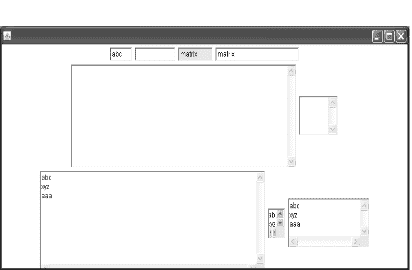

## FileDialog

此类表示文件打开或文件保存对话框。文件对话框是一个模态对话框，这意味着只要对话框在屏幕上可见，来自对话框父帧的输入将专门重定向到对话框。当用户指定文件或点击取消按钮时，对话框将自动移除。最常用的`File`对话框构造函数形式如下：

`FileDialog(Frame parent, String title, int mode)`

对话框的父帧是对话框将出现的帧。标题字符串显示在对话框的标题栏中。

`mode`应该是以下值之一：

- `FileDialog.LOAD`
- `FileDialog.SAVE`

在用户指定文件后，可以使用以下方法获取文件名或其目录：

`String getDirectory()`

获取此文件对话框所选目录。

`String getFile()`

获取此文件对话框所选的文件。

### 示例 17.20

```java
1. import java.awt.*;
2. public class FileDialogTest
3. { 
4.   public static void main(String args[])
5.   { 
6.     Frame f=new Frame( ) ;
7.     f.setLayout(new FlowLayout( ));
8.     f.setSize(200, 200);
9.     f.setVisible(true);
10.    FileDialog fd=new FileDialog (f, “Load file”, FileDialog.LOAD);
11.     fd.setVisible(true);
12.     System.out.println(fd.getFile());
13.     System.out.println(fd.getDirectory());
14.   }
15. }
```

## ScrollPane

`ScrollPane`可以包含单个组件，该组件可能比滚动面板本身更高或更宽。

如果容器组件大于滚动面板，则滚动面板的默认行为是根据需要获取水平和或垂直滚动条。

该类有两个构造函数：

`ScrollPane()`

创建一个新的滚动面板容器，其滚动条显示策略为“按需”。


`ScrollPane(int scrollbarDisplayPolicy)`

创建一个具有指定滚动条行为的新滚动面板容器。滚动面板显示策略应该是以下值之一：

- `ScrollPane.SCROLLBARS_AS_NEEDED`（默认）
- `ScrollPane.SCROLLBARS_ALWAYS`
- `ScrollPane.SCROLLBARS_NEVER`

下方列出的代码创建一个具有默认（`As_NEEDED`）滚动条行为的滚动面板。滚动面板包含一个非常大的按钮；因此肯定需要滚动条。

### 示例 17.21

```java
1. import java.awt.*;
2. class SPaneTest
3. { 
4.   public static void main(String args[])
5.   { 
6.     Frame f=new Frame();
7.     f.setLayout(new GridLayout(1,2));
8.     f.setSize(250, 150);
9.     ScrollPane spane=new ScrollPane();
10.     spane.setBackground(Color.green);
11.     f.add(spane);
12.     f.add(new TextArea());
13.     Button b1=new Button("Push Me !");
14.     b1.setFont(new Font("Serif", Font.ITALIC, 100));
15.     spane.add(b1);
16.     f.setVisible(true);
17.   }
```

Output:


## Scrollbar

用于调整列表和滚动面板的`Scrollbar`组件作为组件存在。有三个构造函数：

`Scrollbar()`

创建一个垂直滚动条。

`Scrollbar(int orientation)`

创建一个具有指定方向的滚动条。

`Scrollbar(int orientation, int initialValue, int sliderSize, int minValue, int maxValue)`

创建一个具有指定方向、初始值、滑动尺寸、最小值和最大值的滚动条。`sliderSize`参数控制滑动块的大小，单位为像素。对于接受`orientation`参数的构造函数，此值应该是以下之一：

- `Scrollbar.HORIZONTAL`
- `Scrollbar.VERTICAL`

### 示例 17.22

```java
1. import java.applet.*;
2. import java.awt.*;
3. import java.awt.event.*;
4. /*applet code="RGB" width=500 height=200></applet>
5. public class RGB extends Applet implements AdjustmentListener
6. {
7.   TextField tf1;
8.   Scrollbar sb1,sb2,sb3;
9.   public void init()
10.     setLayout(new GridLayout(4));
11.     sb1 = new Scrollbar(Scrollbar.HORIZONTAL,0,10,255);
12.     sb2 = new Scrollbar(Scrollbar.HORIZONTAL,0,10,255);
13.     sb3 = new Scrollbar(Scrollbar.HORIZONTAL,0,10,255);
14.     sb1.addAdjustmentListener(this);
15.     sb2.addAdjustmentListener(this);
16.     sb3.addAdjustmentListener(this);
17.     tf1 = new TextField(8);
18.     add(tf1);add(sb1);
19.     add(sb2);add(sb3);
20.   }
21.   public void adjustmentValueChanged(AdjustmentEvent ae)
22.     {
23.       int a=0,b=0,c=0;
24.       a = sb1.getValue();
25.       b = sb2.getValue();
26.       c = sb3.getValue();
27.       Color c1 = new Color(a,b,c);
28.       tf1.setBackground(c1);
29.     }
30. }
```

# AWT 事件简介

## 简介

当普通 Java 程序（非 GUI 的）需要输入时，它会提示用户并调用某些输入方法，例如`readline()`，即交互是由程序发起的。这不是基于 GUI 程序的行为方式。用户与程序进行交互，而不是程序发起动作。

例如，在文字处理软件中，用户通过点击不同的按钮发起动作，这产生一个事件并执行某些代码，从而发生相应的操作。点击保存按钮将调用保存内容到文件的方法。

| 接口 | 事件（方法） | 类 | 方法 |
| :--- | :--- | :--- | :--- |
| `ActionListener` | `actionPerformed()` | `ActionEvent ae` | `getSource` |
| `ItemListener` | `itemStateChanged()` | `ItemEvent ie` | `getItem` |
| `AdjustmentListener` | `adjustmentValueChanged()` | `AdjustmentEvent ae` | `getAdjustable()` |
| `MouseListenerMouseAdapter` | `mouseEnteredmouseExitedMouseClickedmouseReleased` | `MouseEvent me` | `getX()``getY()``getPoint()``getClickCount()``getButton()``getModifiersEx()``getModifiersText()` |
| `MouseMotionListenerMouseMotionAdapter` | `mouseMovedmouseDragged` | `MouseEvent me` | 同上 |
| `KeyListenerKeyAdapter` | `keyTypedkeyPressedkeyReleased` | `KeyEvent ke` | `getKeyChar()``getKeyCode()` |
| `FocusListenerFocusAdapter` | `focusGainedfocusLost` | `FocusEvent fe` | `getSource()` |
| `WindowListenerWindowAdapter` | `windowOpendwindowClosedwindowActivatedwindowDeactivatedwindowIconifiedwindowdeicon` | `WindowEvent we` | `getWindow()` |

Java 使用事件委托模型进行事件处理。在事件委托模型中，可以告诉组件当组件产生特定类型的事件时，应该通知哪个对象。

如果组件对某种事件类型感兴趣，则该类型的事件将不会传播。委托模型基于以下核心概念：

- 事件类

### 事件类

点击按钮会产生一个事件。该事件与其关联有大量信息，例如：时间、产生事件的组件、点击发生点的坐标等。

这些信息被存放在事件类中。该概念与异常处理相似。每当发生异常时，都会创建一个相应异常类的对象，并将所有异常相关信息放入该对象中。

### 事件监听器

事件监听器负责在事件发生时采取适当的行动。事件监听器是组件委托处理特定类型事件任务的对象。

当组件接收到输入时，会构造一个相应类型的事件，然后该事件将作为参数传递给监听器上的方法调用。监听器必须实现包含该事件处理方法的接口。

我们可以将事件监听器与处理异常的`catch`块进行比较。我们需要为要处理的异常提供一个相应的`catch`块。同样，如果我们想处理由某些组件生成的事件，我们需要提供适当的监听器。

监听器与组件相关联。不同的事件有不同的监听器。当事件发生时，会调用适当的监听器方法，并将事件对象作为参数传递。

## 适配器（Adapters）

语言中定义的监听器仅为接口。我们需要提供相应监听器的具体实现。某些监听器具有 2 个或更多方法。

要实现一个具有多个方法的监听器，即使我们只对其中一个方法感兴趣，也需要提供所有方法的实现。适配器类（adapter classes）为这个问题提供了解决方案。

适配器类提供了监听器所有方法的空实现（dummy implementation）。这有助于减少编程工作量。如果我们只想使用包含 5 个方法的监听器类中的一个方法，可以简单地扩展适配器类并重写想要的方法。

## 事件层次结构（Event hierarchy）

AWT 拥有定义良好的事件层次结构。通常，事件层次结构中对应叶节点的类表示实际事件。而非叶节点类则作为基类并封装它们。

AWT 事件层次结构如下所示。

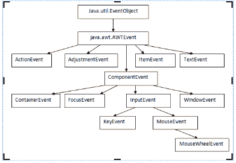

### `java.util.event.EventObject`类

这是所有事件类的最顶层父类。这是一个非常通用的类，只有一个感兴趣的方法，用于返回产生事件的源。

```java
Object getsource()
```

### `java.awt.AWTEvent`类

`event object`的一个子类是`java.awt.AWTEvent`，它是所有委托模型事件类的父类。同样，只有一个感兴趣的方法，用于返回事件的 ID。

```java
int getID()
```

事件的 ID 是一个`int`，用于指定事件的精确性质。例如，`mouseevent`类的实例可以代表七种情况之一：点击、拖拽、进入、移动、退出、按下、释放。这些每一种可能性都由`int` `MouseEvent`表示，例如`MOUSE_CLICKED`、`MouseEvent.MOUSE_DRAGGED`等。

`java.awt.AWTEvent`的子类代表了由各种 AWT 组件生成的各种事件类型，并包含了与触发事件的活动相关的所有必要信息。

非父类的事件类型（即那些由组件实际触发的事件）包括：

1. `ActionEvent`：由组件的激活产生，例如。*它在点击按钮时、双击列表项时以及在`TextField`中按下回车键时生成*。
2. `AdjustmentEvent`：由可调节组件（如滚动条）的调整产生。
3. `ContainerEvent`：当组件被添加到容器中或从容器中移除时生成。
4. `FocusEvent`：当组件接收或丢失输入焦点时生成。
5. `ItemEvent`：当从列表、选择框或复选框中选择项目时生成。
6. `KeyEvent`：由键盘活动产生。
7. `MouseEvent`：由鼠标活动产生。
8. `MouseWheelEvent`：一种事件，表示组件中旋转了鼠标轮。
9. `WindowEvent`：由窗口活动产生（如最小化或恢复最大化）。
10. `TextEvent`：当文本组件被修改时生成。

### `java.awt.event`包

此包提供了处理由 AWT 组件触发的不同类型事件的接口和类。事件是由事件源触发的。事件监听器注册到事件源上，以接收有关特定类型事件的通知。

此包定义了事件和事件监听器，以及事件监听器适配器，这些是用于简化过程的便利类。

## 事件监听器接口（Event listeners）

每个事件都有对应的监听器，定义一个或多个方法。

### Action 监听器（ActionListener）

这是接收动作事件的监听器。常用的监听器方法如下：

| 签名 | 描述 |
| :--- | :--- |
| `actionPerformed(ActionEvent e)` | 当事件发生时调用。 |

### Adjustment 监听器（AdjustmentListener）

这是接收调整事件的监听器。

| 签名 | 描述 |
| :--- | :--- |
| `adjustmentValueChanged(AdjustmentEvent e)` | 当值改变时调用。 |

### Container 监听器（ContainerListener）

这是当组件添加到或从容器中移除时接收事件的监听器。

| 签名 | 描述 |
| :--- | :--- |
| `componentAdded(ContainerEvent e)` | 当组件被添加到容器时调用。 |
| `componentRemoved(ContainerEvent e)` | 当组件从容器中移除时调用。 |

### Focus 监听器（FocusListener）

这是当组件获得或失去焦点时接收事件的监听器。

| 签名 | 描述 |
| :--- | :--- |
| `focusGained(FocusEvent e)` | 当组件获得焦点时调用。 |
| `focusLost(FocusEvent e)` | 当组件失去焦点时调用。 |

### Item 监听器（ItemListener）

这是接收项目事件的监听器。

| 签名 | 描述 |
| :--- | :--- |
| `itemStateChanged(ItemEvent e)` | 当项目被选中或取消选择时调用。 |

### Key 监听器（KeyListener）

这是接收键盘事件的监听器。

| 签名 | 描述 |
| :--- | :--- |
| `keyPressed(KeyEvent e)` | 当按键按下时调用。 |
| `keyReleased(KeyEvent e)` | 当按键释放时调用。 |
| `keyTyped(KeyEvent e)` | 当输入按键时调用。 |

### Mouse 监听器（MouseListener）

这是接收鼠标事件（点击、释放、进入、退出）的监听器。

| 签名 | 描述 |
| :--- | :--- |
| `mouseClicked(MouseEvent e)` | 当鼠标按钮在组件上被点击（按下并释放）时调用。 |
| `mouseEntered(MouseEvent e)` | 当鼠标进入组件时调用。 |
| `mouseExited(MouseEvent e)` | 当鼠标离开组件时调用。 |
| `mousePressed(MouseEvent e)` | 当鼠标按钮在组件上按下时调用。 |
| `mouseReleased(MouseEvent e)` | 当鼠标按钮在组件上释放时调用。 |

### MouseMotion 监听器（MouseMotionListener）

这是接收鼠标移动事件（移动和拖拽）的监听器。

| 签名 | 描述 |
| :--- | :--- |
| `mouseDragged(MouseEvent e)` | 当鼠标按钮在组件上按下并拖拽时调用。 |
| `mouseMoved(MouseEvent e)` | 当鼠标光标在组件上移动但未按下按钮时调用。 |

### MouseWheel 监听器（MouseWheelListener）

这是接收鼠标轮事件的监听器。

| 签名 | 描述 |
| :--- | :--- |
| `mouseWheelMoved(MouseEvent e)` | 当鼠标轮旋转时调用。 |

### Window 监听器（WindowListener）

当窗口的状态由于打开、关闭、激活或取消激活、最小化或恢复最大化而改变时，监听器对象中的相关方法会被调用，并将窗口事件传递给它。

| 签名 | 描述 |
| :--- | :--- |
| `windowActivated(WindowEvent e)` | 当窗口被设置为活动窗口时调用。 |
| `windowClosed(WindowEvent e)` | 当窗口由于调用`Dispose`方法而关闭时调用。 |
| `windowClosing(WindowEvent e)` | 当用户尝试从窗口系统菜单关闭窗口时调用。 |
| `windowIconified(WindowEvent e)` | 当窗口被最小化时调用。 |
| `windowRestored(WindowEvent e)` | 当窗口恢复最小化时调用。 |

```java
void windowDeactivated(WindowEvent e)
```

当窗口不再是活动窗口时调用。

```java
void windowDeiconified(WindowEvent e)
```

当窗口从最小化状态恢复到正常状态时调用。

```java
void windowIconified(WindowEvent e)
```

当窗口从正常状态变为最小化状态时调用。

```java
void windowOpended(WindowEvent e)
```

当窗口第一次变为可见时调用。

# 处理 ActionEvent

## 示例 18.1

以下示例解释了如何处理点击按钮生成的动作事件（`actionevnet`）。


```java
import java.awt.*;
import java.awt.event.*;
class A1
{ 
  public static void main(String args[])
    { 
      Frame f=new Frame();
      f.setLayout(new FlowLayout());
      f.setSize(500,100);
      Button b1=new Button("Push me");
      Button b2=new Button("Click me");
      b1.addActionListener(new B());
      b2.addActionListener(new C());
      f.add(b1);
      f.add(b2);
      f.setVisible(true);
    }
}
class B implements ActionListener
{ 
  public void actionPerformed(ActionEvent ae)
    {
      System.out.println("Button Pushed");
    }
}
class C implements ActionListener
{ 
  public void actionPerformed(ActionEvent ae)
    {
      System.out.println("Button Clicked");
    }
}
```

输出：


### 示例 18.2

```java
import java.awt.*;
import java.awt.event.*;
class A2 implements ActionListener
{ 
  static Button b1=null,b2=null;
  public static void main(String args[])
    { 
      Frame f=new Frame();
      f.setLayout(new FlowLayout());
      f.setSize(500,100);
      b1=new Button("Push me");
      b2=new Button("Click me");
      b1.addActionListener(new A2());
      b2.addActionListener(new A2());
      f.add(b1);
      f.add(b2);
      f.setVisible(true);
    }
  public void actionPerformed(ActionEvent ae)
    {
      if(ae.getSource() == b1) 
      System.out.println("Button Pushed");
      else
      System.out.println("Button Clicked");
    }
}
```

输出：与上一个示例相同。

### 示例 18.3

```java
import java.awt.*;
import java.awt.event.*;
class A3 implements ActionListener
{ 
  Button b1=null,b2=null;
  A3()
    {
      Frame f=new Frame();
      f.setLayout(new FlowLayout());
      f.setSize(500,100);
      b1=new Button("Push me");
      b2=new Button("Click me");
      b1.addActionListener(this);
      b2.addActionListener(this);
      f.add(b1);
      f.add(b2);
      f.setVisible(true);
    }
  public static void main(String args[])
    { 
      new A3();
    }
  public void actionPerformed(ActionEvent ae)
    {
      if(ae.getSource() == b1)
      System.out.println("Button Pushed");
      else
      System.out.println("Button Clicked");
    }
}
```

输出：与上一个相同。

### 示例 18.4

```java
import java.awt.*;
import java.awt.event.*;
class A4 implements ActionListener
{ 
  static Button b1=null,b2=null;
  static TextField tf1=null, tf2=null, tf3=null;
  public static void main(String args[])
    { 
      Frame f=new Frame();
      f.setLayout(new GridLayout(4,2));
      f.setSize(500,300);
      Label l1 = new Label("No1.");
      Label l2 = new Label("No2.");
      Label l3 = new Label("Result");
      tf1 = new TextField();
      tf2 = new TextField();
      tf3 = new TextField();
      b1=new Button("Sum");
      b2=new Button("Avg");
      b1.addActionListener(new A4());
      b2.addActionListener(new A4());
      f.add(l1);f.add(tf1);
      f.add(l2);f.add(tf2);
      f.add(l3);f.add(tf3);
      f.add(b1);f.add(b2);
      f.setVisible(true);
    }
  public void actionPerformed(ActionEvent ae)
    {
      int a,b,c;
      float av;
      a=Integer.parseInt(tf1.getText());
      b=Integer.parseInt(tf2.getText());
      if(ae.getSource() == b1) 
      tf3.setText("" +(a+b));
      else
      tf3.setText("" + (a+b)/2.0f);
    }
}
```

# 处理窗口事件

### 示例 18.5

```java
import java.awt.*;
import java.awt.event.*;
class A5
{ 
  public static void main(String args[])
    { 
      Frame f= new Frame();
      f.setLayout(new FlowLayout());
      f.setSize(300,300);
      f.addWindowListener(new B( ));
      f.setVisible(true);
    }
}
class B implements WindowListener
{ 
  public void windowOpened(WindowEvent we)
    { 
      System.out.println("Window Opened");
    }
  public void windowActivated(WindowEvent we)
    { 
      System.out.println("Window Activated");
    }
  public void windowDeactivated(WindowEvent we)
    { 
      System.out.println("Window Deactivated");
    }
  public void windowClosing(WindowEvent we)
    { 
      System.out.println("Window Closing");
      Frame f = (Frame) we.getWindow ( );
      f.dispose();
    }
  public void windowClosed(WindowEvent we)
    { 
      System.out.println("Window Closed");
    }
  public void windowIconified(WindowEvent we)
    { 
      System.out.println("Window Iconified");
    }
  public void windowDeiconified(WindowEvent we)
    { 
      System.out.println("Window Deiconified");
    }
}
```

输出：


注意：事件监听器接口有多个方法。最大的接口`WindowListener`有七个方法。假设我们要捕获`windowClosing()`事件，以便执行关闭窗口的代码。虽然我们在实现`WindowListener`的类中只需要`windowClosing()`方法，但我们必须为所有方法提供空位实现。

监听器可以通过调用组件的`removeListener()`方法从组件中移除。例如，下面的代码从按钮`btn`移除监听器`al`：

```java
btn.removeActionListener(al);
```

### 适配器

有些事件监听器接口有多个方法。最大的接口`WindowListener`有七个方法。如果我们想捕获`windowClosing()`事件，以便执行关闭窗口的代码。虽然我们在实现`WindowListener`的类中只需要`windowClosing()`方法，但我们必须为所有方法提供空位实现。

`java.awt.event`包提供了多个适配器类，每个类对应一个定义了一个方法的监听器接口。

适配器仅仅是实现接口并提供空方法的类。例如，`WindowAdapter`类实现了`WindowListener`接口并带有七个空方法。

#### 适配器类及其接口

| 适配器类 | 监听器接口 |
| :--- | :--- |
| `ContainerAdapter` | `ContainerListener` |
| `FocusAdapter` | `FocusListener` |
| `KeyAdapter` | `KeyListener` |
| `MouseAdapter` | `MouseListener` |
| `MouseMotionAdapter` | `MouseMotionListener` |
| `WindowAdapter` | `WindowListener` |

### 示例 18.6 WindowAdapter 类的使用

```java
import java.awt.*;
import java.awt.event.*;
class A6
{ 
  public static void main (String args[])
    { 
      Frame f= new Frame();
      f.setLayout(new FlowLayout());
      f.setSize(300,300);
      f.addWindowListener(new B( ));
      f.setVisible(true);
    }
}
class B extends WindowAdapter
{ 
  public void windowClosing(WindowEvent we)
    { 
      System.out.printIn(“Window Closing”);
      Frame f = (Frame) we.getWindow ( );
      f.dispose();
    }
}
```

`InputEvent`类：

这是所有组件级输入事件的根类。输入事件在由其源组件进行正常处理之前，会被传递给监听器。这允许监听器和组件子类“消费”事件，从而使源组件不会以默认方式处理它们。例如，在`Button`组件上消费鼠标按下事件将防止`Button`被激活。

### 方法

- `void consume()`: 消费此事件，使其不会由产生它的源组件以默认方式进行处理。
- `int getModifiers()`: 返回此事件的修饰键掩码（Modifier mask）。
- `int getModifiersEx()`: 返回此事件的扩展修饰键掩码。
- `static String getModifiersExText(int modifiers)`: 返回描述扩展修饰键的字符串，例如“shift”、“Ctrl + Shift”等。
- `long getWhen()`: 返回此事件发生的时间戳。
- `boolean isAltDown()`: 返回此事件中 Alt 修饰键是否被按下。
- `boolean isConsumed()`: 返回此事件是否已被消费。
- `boolean isControlDown()`: 返回此事件中 Control 修饰键是否被按下。
- `boolean isShiftDown()`: 返回此事件中 shift 修饰键是否被按下。

### 鼠标事件类

这是`Input Event`类的子类。此事件表示组件中发生了鼠标操作。当且仅当鼠标光标位于组件子类的未被遮挡部分、或者位于菜单或顶层窗口上时，则认为鼠标操作发生在特定的组件中。

此事件既用于鼠标事件（点击、进入、按下、退出、释放），也用于鼠标移动事件（位移动和拖动）。

### 方法

- `int getButton()`: 返回哪个鼠标按钮状态发生了变化（如果有）。
- `int getClickCount()`: 返回与此事件相关的鼠标点击次数。
- `static String getMouseModifiersText(int modifiers)`: 返回描述事件发生期间按下的修饰键的字符串，例如“Shift”或“Ctrl + shift”。
- `point getPoint()`: 返回事件相对于源组件的 x, y 位置。
- `int getX()`: 返回事件相对于源组件的水平 x 位置。
- `int getY()`: 返回事件相对于源组件的垂直 y 位置。
- `boolean isPopupTrigger()`: 返回此鼠标事件是否为该平台的弹出菜单触发事件。

**注意：** 弹出菜单在不同系统上的触发方式不同。因此，为了实现正确的跨平台功能，应该在鼠标按下（Pressed）和鼠标释放（Released）时都检查`isPopupTrigger()`。

### 处理鼠标事件：

### 示例 18.7


```java
import java.awt.*;
import java.awt.event.*;
class A7
{ 
    public static void main(String args[])
    { 
      Frame f= new Frame();
      f.setLayout(new FlowLayout());
      f.setSize(300,300);
      Button b1 = new Button("Push Me");
      b1.addMouseListener(new B());
      b1.addMouseMotionListener(new C());
      b1.addActionListener(new D());
      f.add(b1);
      f.setVisible(true);
    }
}
class B implements MouseListener
{ 
    public void mouseEntered(MouseEvent me)
    {  
      System.out.println("Mouse Entered...");
      System.out.println(me.getX());
      System.out.println(me.getY());
    }
    public void mouseExited(MouseEvent me)
    {  
      System.out.println("Mouse Exited...");
      Point p1=me.getPoint();
      System.out.println(p1.x);
      System.out.println(p1.y);
    }
    public void mousePressed(MouseEvent me)
    { 
      System.out.println("Mouse pressed...");
      int ms = me.getModifiersEx();
      String s = me.getModifiersExText(ms);
      System.out.println(s);
    }
    public void mouseReleased(MouseEvent me)
    { 
      System.out.println("Mouse Released...");
      System.out.println("ClickCount->" + me.getClickCount());
    }
    public void mouseClicked(MouseEvent me)
    { 
      System.out.println("Mouse Clicked...");
      System.out.println("Button->"+me.getButton());
    }
}
class C implements MouseMotionListener
{
    public void mouseMoved(MouseEvent me)
    { 
      System.out.println("Mouse Moved...");
    }
    public void mouseDragged(MouseEvent me)
    { 
      System.out.println("Mouse Dragged...");
    }
}
class D implements ActionListener
{
    public void actionPerformed(ActionEvent ae)
    {
      System.out.println ("Button Pressed...");
    }
}
```

## `ActionEvent`类

它是一种语义化事件，表示组件发生了一个动作（action）。这种高级级事件由组件（如`Button`）在发生组件特定动作（如被按下）时产生。该事件通过组件的`addActionListener`方法传递给每个注册了以接收此类事件的`ActionListener`。

实现`ActionListener`接口的对象在事件发生时会获取此`ActionEvent`。因此，监听器可以免于处理单个鼠标移动和鼠标点击的细节，而是可以处理“有意义的”（语义化的）事件，例如“按钮按下”。

**注意：**使用空格键在`Button`上触发`ActionEvent`。

### 方法

- `String getAction()`: 返回与此动作相关的命令字符串。
- `int getModifiers()`: 返回此事件期间按下的修饰键。
- `long getWhen()`: 返回事件发生的时间戳。

### 示例 18.8

此示例说明了我们如何在 Action Event 发生时识别修饰键。

```java
import java.awt.*;
import java.awt.event.*;
public class KeyModifierDemo extends Frame implements ActionListener
{ 
    Button b;
    KeyModifierDemo ()
    { 
      b = new Button (“Button”);
      b.addActionListener(this);
      setLayout (new FlowLayout ( );
      add (b);
      setBounds (100,100,200,200);
      setVisible (true);
    }
    public static void main (String args[])
    { 
      new KeyModifierDemo ( );
    }
    public void actionPerformed (ActionEvent ae )
    { 
      System.out.println (“Button Pressed”);
      int ms = ae.getModifiers ( );
      if (ms & InputEvent.CTRL_DOWN_MASK)!=0)
      {   
        System.out.println (“CTRL key was pressed”);
      }
      if (ms & InputEvent.SHIFT_DOWN_MASK)!=0)
      { 
        System.out.println (“Shift Key was pressed”);
      }
      if (ms & InputEvent.ALT_DOWN_MASK)!=0)
      { 
        System.out.println (“ALT key was pressed”);
      }
    }
}
```

## 处理多个 Action 命令

Action 事件是最简单的。当我们发现滚动条发送了调整事件时，明显的问题是：“现在滚动条的值是多少？”。当我们发现鼠标被点击时，自然会想问：“鼠标的 x 和 y 坐标是多少？”但当我们发现一个按钮发送了 Action 事件时，似乎没有其他额外信息需要寻找；按钮被点击了，这似乎就是全部了。

然而，`Action`事件还关联有一段额外信息。这段信息是一个字符串，被称为 Action 命令（Action command）。我们可以通过`getActionCommand()`方法提取`Action`事件的 Action 命令。如果`Action`事件是由文本字段发送的，`getActionCommand()`将返回文本字段当前的内容（当用户按下回车键时，文本字段会发送`Action`事件）。如果`Action`事件是由按钮发送的，默认行为是`getActionCommand()`返回按钮标签（label）的字符串。但是，我们可以通过调用按钮的`setActionCommand(String)`方法显式地设置按钮的 ActionCommand。

```java
Button btn = new Button ("Hello");
btn.setActionCommand ("Hello");
```

当按钮的 Action 监听器（listener）需要决定如何响应`Action`事件时，Action 命令对按钮的优势显而易见。单个监听器作为多个组件的监听器是常见的情况；在我们的上下文中，一个对象可以是几个或多个按钮的 Action 监听器。在这种情况下，必须通过确定点击了哪个按钮来调用该对象的`actionPerformed()`方法。下面的示例演示了这一点：

### 示例 18.9

```java
import java.awt.*;
import java.awt.event.*;
class ButtonRefTest
{
    Button b1,b2,b3;
    ButtonRefTest()
    {  
      Frame f=new Frame();
      f.setLayout(new FlowLayout ( ));
      f.setSize(300,300);
      b1=new Button("Push Me");
      b2=new Button("Click Me");
      b3=new Button("Hit Me");
      f.add(b1);   f.add(b2);   f.add(b3);
      B obj= new B(b1,b2,b3);
      b1.addActionListener(obj);
      b2.addActionListener(obj);
      b3.addActionListener(obj);
      f.setVisible(true);
    }
    public static void main(String args [ ])
    { 
      new ButtonRefTest();
    }
}
class B implements ActionListener
{ 
    Button b4,b5,b6;
    B(Button b1, Button b2, Button b3)
    {
      b4 = b1;
      b5 = b2;
      b6 = b3;
    }
    public void actionPerformed(ActionEvent ae)
    {  
      Button b=(Button)ae.getSource();
      if(b==b4)
        System.out.println("First Button was pressed");
      else if(b==b5)
        System.out.println("Second Button was pressed");
      else if(b==b6)
        System.out.println("Third  was pressed");
    }
}
```

### 示例 18.10

```java
import java.awt.*;
import java.awt.event.*;
class GetLabelTest
{
    Button b1,b2,b3;
    GetLabelTest()
    {  
      Frame f=new Frame();
      f.setLayout(new FlowLayout ( ));
      f.setSize(300,300);
      b1=new Button("Push Me");
      b2=new Button("Click Me");
      b3=new Button("Hit Me");
      f.add(b1);   f.add(b2);   f.add(b3);
      B obj= new B();
      b1.addActionListener(obj);
      b2.addActionListener(obj);
      b3.addActionListener(obj);
      f.setVisible(true);
    }
    public static void main(String args [ ])
    { 
      new GetLabelTest();
    }
}
class B implements ActionListener
{ 
    public void actionPerformed(ActionEvent ae)
    {  
      Button b=(Button)ae.getSource();
      String s=b.getLabel();
      if(s.equals("Push Me"))
        System.out.println("First Me Button was pressed");
      else if(s.equals("Click Me"))
        System.out.println("Second Me Button was pressed");
      else if(s.equals("Hit Me"))
        System.out.println("Third Me Button was pressed");
    }
}
```

### 示例 18.11: 使用`setActionCommand()`方法设置 Action Command

```java
import java.awt.*;
import java.awt.event.*;
class ActionCommandTest
{
    Button b1,b2,b3;
    ActionCommandTest()
    { 
      Frame f=new Frame();
      f.setLayout(new FlowLayout());
      f.setSize(300,300);
      b1=new Button("Push Me");
      b2=new Button("Push Me");
      b3=new Button("Push Me");
      b1.setActionCommand("First");
      b2.setActionCommand("Second");
      b3.setActionCommand("Third");
      f.add(b1);   f.add(b2);   f.add(b3);
      B obj= new B();
      b1.addActionListener(obj);
      b2.addActionListener(obj);
      b3.addActionListener(obj);
      f.setVisible(true);
    }
    public static void main(String args ])
    { 
      new ActionCommandTest();
    }
}
class B implements ActionListener
{ 
    public void actionPerformed(ActionEvent ae)
    {  
      Button b=(Button)ae.getSource();
      String s=b.getActionCommand();
      if(s.equals("First"))
        System.out.println("First Button was pressed");
      else if(s.equals("Second"))
        System.out.println("Second Button was pressed");
      else if(s.equals("Third"))
        System.out.println("Third Button was pressed");
    }
}
```

## 处理按事件


```java
import java.awt.*;
import java.awt.event.*;
class KeyTest extends Frame implements KeyListener
{ 
    String msg = "";
    int x=50,y=100;
    public static void main (String arg[])
    { 
      KeyTest f= KeyTest();
      Frame f= KeyTest();
      f.setSize(300,300);
      f.addKeyListener(f);
      f.setVisible(true);
    }
    public void keyReleased(KeyEvent ke)
    { 
      System.out.println("Key Released...");
      msg = msg + ke.getKey();
      repaint();
    }
    public void keyTyped(KeyEvent ke)
    { 
      System.out.println("Key Typed...");
      msg = msg + ke.getKeyChar();
      repaint();
    }
    public void keyPressed(KeyEvent ke)
    { 
      System.out.println("Key Pressed...");
      int key = ke.getKeyCode();
      switch(key)
      { 
        case KeyEvent.VK_F1:
          msg = msg + "<F1>"; break;
        case KeyEvent.VK_F2:
          msg = msg + "<F2>"; break;
        case KeyEvent.VK_F3:
          msg = msg + "<F3>"; break;
        case KeyEvent.VK_PAGE_DOWN:
          msg = msg + "<PgDn>"; break;
        case KeyEvent.VK_UP:
          msg = msg + "<PgUp>"; break;
        case KeyEvent.VK_LEFT:
          msg = msg + "<Left>"; break;
        case KeyEvent.VK_RIGHT:
          msg = msg + "<Right>"; break;
        case KeyEvent.VK_CONTROL:
          msg = msg + "<Ctrl>"; break;
      }
      repaint();
    }
    public void paint(Graphics g)
    {
      g.setColor(Color.red);
      g.drawString(msg,x,y);
    }
}
```

```java
import java.awt.event.*;

class A extends Frame implements ActionListener {
    static TextField tf1, tf2;
    static Button b1;

    public static void main(String args[]) {
        A f = new A();
        f.setLayout(new FlowLayout());
        f.addWindowListener(new B());
        tf1 = new TextField(8);
        tf2 = new TextField(8);
        b1 = new Button("Set");
        b1.addActionListener(f);
        f.add(tf1);
        f.add(tf2);
        f.add(b1);
        f.setSize(200,200);
        f.setVisible(true);
    }

    public void actionPerformed(ActionEvent ae) {
        tf2.requestFocus();
    }
}

class B extends WindowAdapter {
    public void windowClosing(WindowEvent we) {
        Frame f = (Frame)we.getWindow();
        f.dispose();
    }
}
```

### 示例 18.15 显示对话框

```java
import java.awt.*;

class DialogTest {
    public static void main(String args[]) throws InterruptedException {
        Frame f1 = new Frame();
        f1.setSize(300,300);
        f1.setVisible(true);
        Dialog d1 = new Dialog(f1);
        d1.setSize(100,100);
        d1.setVisible(true);
        Thread.sleep(3000);
        d1.dispose();
    }
}
```

### 示例 18.16 菜单栏演示

```java
import java.awt.*;
import java.awt.event.*;

class MyMenu extends Frame implements ActionListener, WindowListener, ItemListener {
    TextField tf1;
    String msg = "";
    CheckboxMenuItem item4;

    MyMenu() {
        super("矩阵");
        setLayout(new FowLayout());
        tf1 = new TextField(8);
        add(tf1);
        MenuBar mbar = new MenuBar();
        Menu file = new Menu("File");
        MenuItem item1 = new MenuItem("New...");
        item1.addActionListener(this);
        file.add(item1);
        MenuItem item2 = new MenuItem("Open...");
        item2.addActionListener(this);
        file.add(item2);
        Menu sub = new Menu("Sub Menu");
        MenuItem item3 = new MenuItem("Option1");
        sub.add(item3);
        file.add(sub);
        item4 = new CheckboxMenuItem("TextBox",true);
        item4.addItemListener(this);
        file.add(item4);
        mbar.add(file);
        addWindowListener(this);
        setMenuBar(mbar);
        setSize(400,400);
        setVisible(true);
    }

    public void paint(Graphics g) {
        g.drawString(msg,150,250);
    }

    public void actionPerformed(ActionEvent ae) {
        String s1 = (String)ae.getActionCommand();
        if (s1.equals("New...")) {
            tf1.setText("New Selected");
            msg = "New Selected";
        } else if (s1.equals("Open...")) {
            tf1.setText("Open Selected");
            msg = "Open Selected";
        }
        repaint();
    }

    public void windowClosing(WindowEvent we) {
        Frame f = (Frame)we.getWindow();
        f.dispose();
    }

    public void windowClosed(WindowEvent we) {}
    public void windowActivated(WindowEvent we) {}
    public void windowDeactivated(WindowEvent we) {}
    public void windowIconified(WindowEvent we) {}
    public void windowDeiconified(WindowEvent we) {}
    public void windowOpened(WindowEvent we) {}

    public void itemStateChanged(ItemEvent ie) {
        tf1.setVisible(item4.getState());
    }

    public static void main(String args[]) {
        new MyMenu();
    }
}
```

### 示例 18.17 列表框演示

```java
import java.awt.*;
import java.awt.event.*;

class ListTest extends Frame implements ActionListener {
    static List l1, l2;

    public static void main(String args[]) {
        ListTest f = new ListTest();
        f.setLayout(new FlowLayout());
        l1 = new List(3,true);
        l1.add("India");
        l1.add("Pakistan");
        l1.add("USA");
        l1.add("UK");
        l1.add("China");
        l2 = new List(3,true);
        Button b1 = new Button("Transfer");
        b1.addActionListener(f);
        f.add(l1);
        f.add(l2);
        f.add(b1);
        f.setSize(200,200);
        f.setVisible(true);
    }

    public void actionPerformed(ActionEvent ae) {
        /*
        for(int i=l1.getItemCount()-1; i>=0; i--) {
            l2.add(l1.getItem(i));
            l1.remove(i);
        }
        */
        String s1[] = l1.getSelectedItems();
        for (int i=0; i<s1.length; i++) {
    }
}
```

### 示例 18.18 使用 frame 计算数字

```java
import java.awt.*;
import java.awt.event.*;

class Sum extends Frame implements ActionListener {
    Button b1, b2;
    TextField tf1, tf2, tf3;
    static Frame f;

    public static void main(String args[]) {
        f = new Sum();
        f.setLayout(new GridLayout(4,2));
        tf1 = new TextField("Enter 1:");
        tf2 = new TextField("Enter 2:");
        tf3 = new TextField("Result :");
        b1 = new Button("Sum");
        b2 = new Button("Close");
        b1.addActionListener(f);
        b2.addActionListener(f);
        f.add(tf1);
        f.add(b1);
        f.add(tf2);
        f.add(b2);
        f.add(tf3);
        f.add("");
        f.setSize(200,200);
        f.setVisible(true);
    }

    public void actionPerformed(ActionEvent ae) {
        if (ae.getSource() == b1) {
            int n1 = Integer.parseInt(tf1.getText());
            int n2 = Integer.parseInt(tf2.getText());
            tf3.setText(String.valueOf(n1+n2));
        } else if (ae.getSource() == b2) {
            f.dispose();
        }
    }
}
```

### 示例 18.19 在 Applet 上显示图片

```java
import java.awt.*;
import java.net.*;

/*<Applet code="ScrollPane1" width=200 height=200></applet>*/
class ScrollPane1 extends Applet {
    Image img1;
    URL file1;

    public void init() {
        try {
            file1 = new URL("FILE:///c:/javrg/a.jpg");
        } catch (MalformedURLException e) {
            System.out.print(e);
        }
        img1 = getImage(file1);
    }

    public void paint(Graphics g) {
        g.drawImage(img1,0,0,this);
    }
}
```

### 示例 18.20 移动圆形演示


```java
import java.awt.*;
import java.awt.event.*;

class Circle1 extends Frame implements MouseListener, Runnable {
    int x, y, w, h;
    static Frame f;

    public void run() {
        y = 50;
        w = 50;
        h = 50;
        for (x=0; x<500; x+=10) {
            try {
                Thread.sleep(500);
            } catch (InterruptedException e) {
                System.out.println(e);
            }
            repaint();
        }
    }

    public static void main(String args[]) {
        f = new Circle1();
        Thread t = new Thread(f);
        t.start();
        f.addMouseListener(f);
        f.setSize(500,500);
        f.setVisible(true);
    }

    public void paint(Graphics g) {
        g.setColor(Color.RED);
        g.drawOval(x,y,w,h);
        g.setColor(Color.BLUE);
        g.fillOval(x+1,y+1,w-1,h-1);
    }

    public void mousePressed(MouseEvent me) {
        x = me.getX();
    }
}
```

```java
44.      y = me.getY();
45.      w=50;
46.      h=50;
47.      Graphics g=f.getGraphics();
48.      g.clearRect(0,0,200,200);
49.      paint(g);
50.      }
51.      public void mouseReleased(MouseEvent me){}
52.      public void mouseClicked(MouseEvent me){}
53.      public void mouseEntered(MouseEvent me){}
54.      public void mouseExited(MouseEvent me){}
55.  }
```


# 章节

# ∞ 19 ∞

# (在 AWT 中绘图)

## 简介

许多类型的 AWT 组件（例如按钮和滚动条）的外观是由底层窗口系统决定的。其他组件类型，特别是 applet、帧（frame）、面板（panel）和画布（canvas），没有内在的外观。如果我们将这些类中的任何类仅仅用作容器，并希望我们的组件看起来有用，那么我们必须提供实现组件外观的代码。

每个组件都关联着一个图形上下文（graphics context）。图形上下文与组件相关的帧缓冲区对应。

我们可以使用`Graphics`上下文支持的方法在组件上进行绘图。在`Graphics`上下文中绘制的任何内容都会显示在组件上。

在任何组件上绘图的正确方法是重写它的`paint()`方法并提供适当的代码。

`paint()`方法有一个类型为`Graphics`的参数，代表组件的图形上下文。也可以不使用`paint()`方法在组件上进行绘图，尽管不推荐这种方法。

## `paint()`方法与图形上下文

以下示例中关于帧的一个有趣点是，没有显式地调用`paint()`方法；该方法只是被提供了出来。环境似乎在正确的时机很好地调用了`paint()`。

在组件上绘图是通过调用图形上下文来实现的，它是`Graphics`类的的一个实例。图形上下文知道如何渲染到单个目标上。`Graphics`上下文可以渲染到的三个介质是：

1. 组件。
2. 图像。
3. 打印机。

任何类型的组件都可以与一个图形上下文关联。这种关联是永久的；上下文不能重新分配给新的组件。虽然我们可以使用图形上下文在任何类型的组件上绘图，但对于已经具有外观的组件这样做是不寻的。

按钮、选择框（Choices）、复选框（Checkboxes）、标签、滚动条、文本字段和文本区域通常不需要程序员层级的渲染。大多数情况下，这些组件仅使用继承自组件父类的`paint()`版本。这个版本什么都不做；然而，有四类“空白”组件具有默认外观，除非它们被子类化并赋予`paint()`方法，否则它们将显示为空矩形。这四类组件类是：

- `Applet`
- `Canvas`
- `Frame`
- `Panel`

## 示例 19：扩展了`Frame`类并重写了`paint()`方法以改变帧的外观。

```java
1. import java.awt.*;
2. public class SimplePaint extends Frame
3. {
4.     public static void main (String args[])
5.     {
6.         Frame f=new SimplePaint();
7.         f.setSize(200,200);
8.         f.setVisible(true);
9.     }
10.    public void paint (Graphics g)
11.    {
12.        g.setColor(Color.white);
13.        g.fillRect(0,0,300,300);
14.        g.setColor(Color.grey);
15.        g.fillOval(30,30,50,50);
16.    }
17. }
```

输出：

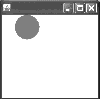

当我们为子类赋予自己的`paint()`方法时，环境会在适当的时间调用该方法并传递适当的`Graphics`实例。

## `graphics`类的操作

`graphics`类（图形上下文）提供的四大类操作是：

- 选择颜色。
- 选择字体。
- 绘制与填充。
- 裁剪。

### 选择颜色

通过调用`setColor()`方法选择颜色。所需的参数是`Color`类的实例。`Color`类中作为静态 final 变量提供了 13 种预定义的颜色（这些变量本身是`Color`类的实例，这让某些人感到不安，但 Java 处理此类事情没有问题）。预定义的颜色有于：

1. `Color.black`
2. `Color.blue`
3. `Color.cyan`
4. `Color.darkGray`
5. `Color.gray`
6. `Color.green`
7. `Color.lightGray`
8. `Color.magenta`
9. `Color.orange`
10. `Color.pink`
11. `Color.red`
12. `Color.white`
13. `Color.yellow`

如果我们需要一种不在此列表中的颜色，可以自己构造。`Color`构造函数有几个版本，最简单的是：

`Color(int redLevel, int greenLevel, int blueLevel)`

这三个参数是主色在 0 到 255 范围内的强度级。颜色是相加的，这意味着它们的混合方式像光而不是像颜料。

- `new Color(0,0,0)`黑色（光的缺失）
- `new Color(255,0,0)`红色（仅包含红色色调）
- `new Color(255,255,255)`白色（所有颜色同时闪烁）

下方的代码片段列出了`paint()`方法的第一部分，它将其图形上下文的颜色设置为浅绿色：

```java
public void paint(Graphics g)
{
    Color c= new Color(170,255,170);
    g.setColor(c);
}
```

在上述代码调用`setColor()`之后，所有的图形将绘制成浅绿色，直到下一次`setColor()`调用为止。调用`setColor(0)`不改变已经绘制的任何颜色。

### 选择字体

设置图形上下文的字体就像设置颜色，后续的字符串绘制将使用新字体。在设置字体之前，我们必须创建一个字体。`Font`类的构造函数如下：

`Font(string fontName, int style, int size)`

第一个参数是字体名称。字体的可用性取决于平台。我们可以通过调用工具包上的`getFontList()`方法获取字符串数组获取可用字体列表：

`String fontNames[]= Toolkit.getDefaultToolkit().getFontList();`

鼓励使用的平台独立的字体名称：

1. "Serif"
2. "Sansserif"
3. "Monospaced"

在 JDK 的 1.0.X 版本中，它们分别被称为“TimesRoman”、“Helvetica”和“Courier”。

样式参数可以是以下`int`常量之一：

1. `Font.PLAIN`
2. `Font.BOLD`
3. `Font.ITALIC`

下面的代码片段将图形上下文`gc`的字体设置为 24 点加粗无衬线：

```java
Font f =new Font("SansSerif",Font.BOLD,24);
gc.setFont(f);
```

我们可以通过传递样式的和来指定组合，例如加粗斜体字体：

`Font.BOLD + Font.ITALIC`

### 绘制与填充

`graphics`类所有的渲染方法都指定了形状的像素坐标，每个组件都有自己的坐标空间，原点位于组件的左上角，x 向右增加，y 向下增加。下图显示了组件坐标系：

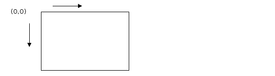

`graphics`类没有提供大量的绘制方法（复杂的渲染由扩展的 API 如 2d、3d 和动画处理）。

我们需要了解的图形上下文类的方法有：

`void drawLine(int x1,int y1, int x2, int y2)`使用当前颜色在图形上下文坐标系中的点 (x1,y1) 和 (x2, y2) 之间绘制一条线。

`void drawRect(int x, int y, int width, int height)`绘制指定矩形的轮廓。

`void fillRect (int x, int y, int width, int height)`填充指定的矩形。

| `void drawOval(int x, int y, int width, int height)` | 绘制由指定矩形边界的椭圆轮廓。 |
| --- | --- |
| `void fillOval(int x, int y, int width, int height)` | 用当前颜色填充指定矩形边界的椭圆。椭圆由一个矩形边界框指定。椭圆位于边界框内，并如如下所示，与框的每个侧的中点相切切：要绘制圆形，请使用正方形边界框。请注意，绘画只绘制前景像素，不绘制背景，因此边界框内但椭圆以外的空间保持不变。在这里，`x`和`y`是边界框左上角的坐标，`width`和`height`是框的宽度和高度。 |
| `void drawArc(int x, int y, int width, int height, int startAngle, int arcAngle)` | 绘制覆盖指定矩形的圆形或椭圆弧的轮廓。 |
| `void fillArc(int x, int y, int width, int height, int startangle, int arcangle)` | 填充覆盖指定矩形的圆形或椭圆弧。弧是椭圆的一部分。要指定弧，我们首先指定椭圆的边界框，就像使用`drawOval()`和`fillOval()`一样。我们还需要指定弧的起点和终点，这是通过指定起始角度和弧扫过的角度来实现的。填充的弧是由弧本身以及从椭圆中心到弧端点的两个半径围成的区域。 |
| `void drawPolygon(int[]xPoints, int[]yPoints, int nPoints)` | 绘制由 x 和 y 坐标数组定义的封闭多边形。 |
| `void fillPolygon (int[] xPoints , int[] yPoints, int nPoints)` | 填充由 x 和 y 坐标数组定义的封闭多边形。多边形是一个具有任意数量顶点的封闭图形。顶点以两个 int 数组的形式传递给`drawPolygon()`和`fillPolygon()`方法。第一个数组包含顶点的 x 坐标，第二个包含 y 坐标。第三个参数指定顶点的数量。注意：终点与第一个点连接。 |
| `void drawPolyLine(int[] xPoints, int[] yPoints , int nPoints)` | 绘制由 x 和 y 坐标数组定义的系列连接线。折线类似于多边形，但它是开放的而不是封闭的。没有连接最后一个顶点和第一个点的线段。 |
| `void drawString(String str, int x, int y)` | 使用此图形上下文当前的字体和颜色绘制指定字符串的文本。`x`、`y`参数指定字符串基线的左边缘。带有降部字母的字符（在大多数字体中为 g, j, p, q 和 y）延伸到基线以下。文本坐标相对于基线这一事实是非常重要的。例如，在简单的文本中，我们可能会尝试在 (0,0) 处绘制字符串，期望它会出现在空间的左上角。然而，由于基线的存在，我们只能看到字符串的降部字母，这可能意味着什么也看不见。默认情况下，图形上下文使用关联组件的字体，但我们可以通过图形上下文的`setFont()`方法来设置不同的字体。 |
| `boolean drawImage (Image img, int x, int y, ImageObserver observer)` | 绘制当前可用的指定图像。在这里，`im`是要渲染的图像，`x`和`y`是目标组件内图像左上角的坐标。图像观察者必须是一个实现`imageobserver`接口的对象。图像是矩形像素值集合的离屏表示。Java 的图像支持非常复杂。目前，假设我们通过某种方式获取了图像（即`java.awt.image`类的实例），我们想要使用特定的图形上下文将其渲染到屏幕上。此的方法是调用图形上下文的`drawImage()`方法。 |

## 示例 19.2

此示例说明了如何创建一个图像，然后使用其图形上下文在其上绘制。可以使用`drawImage()`方法在 applet 窗口中显示图像。

```java
import java.awt.*;
import java.applet.*;
import java.net.URL;
/*<applet code="PaintImage" width=200 height=100></applet>*/
public class PaintImage extends Applet { 
    private Image im;
    public void init() { 
      im = createImage(100,50);
      Graphics imgc=im.getGraphics();
      imgc.setColor(Color.gray);
      imgc.fillRect(0,0,100,50);
      imgc.setColor(Color.black);
      imgc.fillOval(0,0,50,40);
    }
    public void paint(Graphics g) {
      g.drawImage(im,10,10,this);
    }
}
```

输出：


## 示例 19.3

此示例说明了如何从现有图像创建一个图像对象。然后可以使用`drawImage()`方法在 applet 窗口中显示图像。

```java
import java.awt.*;
import java.applet.*;
import java.net.*;
/*
<applet code="PaintImage" width=500 height=500>
</applet>
*/
public class PaintImage1 extends Applet {
    private Image im;
    public void init() {
      try {
        im=getImage(new URL("file:logo.gif"));
      } catch (URLException e) {
        System.out.println(e);
      }
    }
    public void paint(Graphics g) {
      g.drawImage(im,10,10,this);
    }
}
```

## 裁剪

大多数程序员对图形上下文的调用涉及颜色选择、绘制和填充。不常用的操作是裁剪。裁剪简单地限制图形上下文可以修改的区域。


图形上下文的默认裁剪区域是关联组件的可见区域。当我们调用图形类的`drawXXX()`或`fillXXX()`方法时，只有位于裁剪区域内的像素会被修改。

#### 示例 19.4

```java
import java.awt.*;
class Clip extends Frame {
    public static void main(String args[]) { 
      Frame f=new Clip();
      f.setSize(300,330);
      f.setVisible(true);
    }
    public void paint(Graphics g) { 
      for(int i=0; i<300; i=i+100) {
        for(int j=30; j<330; j=j+100) { 
          g.fillOval(i,j,100,100);
        }
      }
    }
}
```

输出：


上述程序的`paint()`方法绘制了一个点状图案。考虑当这是一个大小为 200*200 像素的 applet frame 的`paint()`方法时会发生什么。由于计数器一直到 500，方法尝试在边界之外绘制。

这不是问题，因为图形上下文的默认裁剪区域与 applet 一致。

要为图形上下文设置矩形裁剪区域，我们可以调用`setClip(x,y, width, height)`方法，传入四个描述所需裁剪框位置和大小的整数。例如，上面的代码可以修改为：

#### 示例 19.5

```java
import java.awt.*;
class Clip2 extends Frame {
    public static void main(String args[]) { 
      Frame f=new Clip2();
      f.setSize(300,330);
      f.setVisible(true);
    }
    public void paint(Graphics g) { 
      g.setClip(50,80,200,200);
      for(int i=0; i<300; i=i+100) {
        for(int j=30; j<330; j=j+100) { 
          g.fillOval(i,j,100,100);
        }
      } 
      g.drawString ("Hello! Kamal", 50,50);
    }
}
```

```java
21.    g.drawString ("Bye! Kamal", 120,150);
22.    } }
```

输出：

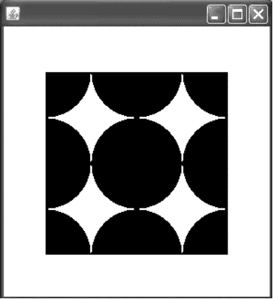

如上所示，现在的绘画被限制在 300 * 300 applet 窗口中心的一个 200 * 200 矩形内。

裁剪（Clipping）本身是一个非常重要的概念。当环境需要修复组件被暴露出的部分时，裁剪也会发挥作用。

### 关于`paint()`方法和图形上下文（graphics context）的总结

`Graphics`上下文专门用于单个组件。要在组件上绘图，我们调用图形上下文的`drawXXXX()`和`fillXXXX()`方法。要更改图形操作的颜色或字体，我们分别调用图形上下文的`setColor()`或`setFont()`方法。

### GUI 线程与绘画

Java 运行环境会创建并控制其在后台运行的线程，其中一个线程负责 GUI 管理。

GUI 线程是环境用于接收用户输入事件以及调用需要绘画的组件的`paint()`方法的工具。

对`paint()`的调用并不都是由环境生成。Java 程序当然可以自己调用，直接调用或通过`repaint()`方法间接调用。

也可以使用组件的图形上下文在组件上绘图。在这种方法下，不需要调用`paint()`或`repaint()`方法。

在组件上绘图的不同方法如下：

(i) 在获取组件的图形上下文后直接绘图。

(ii) 自发性绘画（由 GUI 线程隐式/自动调用`paint()`方法）。

(iii) 显式调用`paint()`方法。

(iv) 显式调用`repaint()`方法，然后由其间接调用`paint()`方法。

### 在获取组件的图形上下文后直接绘图

由于可以使用`getGraphics()`方法获取组件图形上下文的引用，因此人们很容易认为可以从任何方便的方法直接在组件上绘图。通常情况下，这种方法存在严重缺陷。

假设我们有一个 applet，想要在最近一次鼠标点击的位置画一个红点。applet 的其余部分应该是黄色的。假设该 applet 正在处理自己的鼠标事件。我们可能会考虑创建这样的事件处理程序：

示例 19.6：

```java
1. import java.awt.*;
2. import java.awt.event.*;
3. class PaintApproach extends Frame implements MouseListener
4. { 
5.    public static void main (String args [])
6.    { 
7.      PaintApproach f = new PaintApproach ( );
8.       f.setSize (300,300);
9.      f.addMouseListener(f);
10.      f.setVisible(true);
11.    }
12.    public void mouseEntered (MouseEvent e)   { }
13.    public void mouseExited (MouseEvent e)   { }
14.    public void mousePressed (MouseEvent e)   { }
15.    public void mouseReleased (MouseEvent e)   { }
16.    public void mouseClicked (MouseEvent e)  
17.    { 
18.      System.out.println (“Mouse Clicked...”);
19.      Graphics g = getGraphics ( );
20.      g.setColor(Color.yellow);
21.      g.fillRect(0,0, getSize().width, getSize().height);
22.      g.setColor (Color.Red);
23.      g.fillOval (e.getX() –10, e.getY()–10,20,20);
24.    }
25. } 
```

如果这个 applet 被覆盖后重新暴露，GUI 线程将隐式地调用`paint()`。遗憾的是，`paint()`并不知道在`mouseClicked()`方法中绘制的红圆，因此红圆将不会被修复。

所有绘画操作的正确位置是在`paint()`中，或者在从`paint()`调用的方法中；这种技术确保了 GUI 线程能够修复暴露损坏。GUI 线程期望`paint()`能够在任意时刻正确地重构屏幕。

实现这一点的的一种可能方法是从事件处理程序和其他任意方法中移除所有绘图代码，并将这些代码放入`paint()`方法中。

接下来，当某个方法需要绘图时，安排它将所需的绘图描述写入变量，以便这些变量可以被`paint()`方法访问，并被`paint()`方法用于执行绘画。

现在，当`paint()`方法被调用时（无论是通过我们的通用方法还是通过 GUI 线程），它都可以绘制原始预期的任何内容。

### 自发性绘画（由 GUI 线程隐式/自动调用`paint()`方法）

自发性绘画并不是一个正式术语，但当 GUI 线程调用`paint()`时就会发生。例如，当组件被暴露、恢复最小化或调整大小时。applet 会刷新，是因为 GUI 线程调用了`paint()`方法以确保组件被正确绘制。这种情况是因为红点是在`paint()`方法中绘制的。

### 显式调用`paint()`方法

如果在`paint()`方法以外的方法中执行绘画操作，组件可能不会刷新。通过显式调用`paint()`方法，以及当 GUI 线程隐式调用`paint()`方法时，红点都会得到修复。这种情况是因为红点是在`paint()`方法中绘制的。

示例 19.7：

上一节中的示例经过修改，使得组件在上述情况下可以得到刷新。这种情况是因为红点是在`paint()`方法中绘制的。

```java
1. import java.awt.*;
2. import java.awt.event.*;
3. public class PaintApproach extends Frame implements MouseListener
4. { 
5.    int mouseX, mouseY;
6.    public static void main (String arg[])
7.    { 
8.      PaintApproach f = new PaintApproach ( );
9.      f.setSize (300,300);
10.      f.addMouseListener(f);
11.      f.setVisible(true);
12.    }
13.    public void mouseEntered (MouseEvent e)   { }
14.    public void mouseExited (MouseEvent e)   { }
15.    public void mousePressed (MouseEvent e)   { }
16.    public void mouseReleased (MouseEvent e)   { }
17.    public void mouseClicked (MouseEvent e)  
18.    { 
19.      System.out.println (“Mouse Clicked...”);
20.      mouseX = e.getX();
21.      mouseY = e.getY();
22.      Graphics g = getGraphics ( );
23.      paint(g);
24.    }
25.    public void paint(Graphics g) {
26.      g.setColor(Color.yellow);
27.      g.fillRect(0,0, getSize().width, getSize().height);
28.      g.setColor(Color.Red);
29.      g.fillOval(mouseX -10, mouseY -10,20,20);
30.    }
31. }
```

```java
public void paint (Graphics g)
{ 
  g.setColor (Color.yellow);
  g.fillRect(0,0, getSize().width, getSize().height);
  g.setColor(Color.red);
  g.fillOval(mouseX–10,mouseY–10,20,20);
}
```

显式地调用`repaint()`方法会随后间接地调用`paint()`方法：显式调用`paint()`方法可能会导致两个严重问题。

第一个问题是 GUI 线程会根据需要随时调用`paint()`方法。这发生在需要处理窗口暴露（exposure）时。这可能会导致线程交互问题。

诚率地说，我们将发现即使使用首选方法，我们可能仍然需要处理这些中的某些问题，因为`paint()`方法将使用我们在其他线程中正在修改的数据。然而，如果我们允许只在 GUI 线程中调用`paint()`，就能将该问题降至最低。

第二个问题是 CPU 使用率问题。考虑以下场景：我们的程序定期接收到通知，要求它持续地用动画的下一帧或类似的移动图形更新显示。

假设绘图工作是复杂且耗时的。如果我们简单地调用整个`paint()`方法，那么当帧触发发生时，我们可能只完成了部分绘图。这将导致我们的程序花费（或尝试花费）所有时间在绘图上。此外，绘图将越来越落后于它应该的位置。

这些问题可以通过处理程序启动绘图的首选方法来简单解决。其核心思想是主程序维护一个数据集，描述应该呈现给用户的绘图内容，但不直接调用绘图程序。

相反，程序请求 GUI 线程运行绘图程序，其方式大致与该线程处理暴露时所做的方式相同。

GUI 线程使用主程序提供的数据集来决定绘制什么以及如何绘制。

为了支持这种方法，GUI 系统提供了一个名为`repaint()`方法。该方法定义在`Component`类中，因此 GUI 中的任何可见对象都可用。当我们调用此方法时，我们是在向 GUI 线程发出请求，让它执行绘图系统程序。

GUI 线程会在合理的时间范围内执行操作，尽管这可能会受到其他高优先级线程活动的的限制。这种方法确保了 GUI 线程与用户线程之间的线程交互降至最低。

当然，我们必须确保在数据处于不一致状态时，GUI 线程绝不会使用我们的数据集。然而，可以使用同步或双缓冲技术非常容易地实现这一点。

这种行为的另一个结果是，无论程序尝试进行多少绘图，系统通常保持与当前帧的同步。这是因为例如，如果在 GUI 线程能够处理第一次调用之前，我们调用了十次`repaint()`方法，那么结果将只执行一次绘图系统。

因此，在过载的情况下，绘图系统会自动跳过主机 CPU 无法处理的帧。这意味着程序员可以编写代码，在给定平台上可靠地获得最佳可用视频性能，同时在任何其他平台上都能运行得尚可。以下代码实现了这种方案。

### 示例 19.8:

```java
import java.awt.*;
import java.awt.event.*;
public class PaintApproach2 extends Frame implements MouseListener
{ 
  int mouseX, MouseY;
  public static void main (String args [])
  { 
    PaintApproach2 f = new PaintApproach2();
    f.setSize (300,300);
    f.addMouseListener (f);
    f.setVisible(true);
  }
  public void mouseEntered (MouseEvent e) { }
  public void mouseExited (MouseEvent e) { }
  public void mousePressed (MouseEvent e) { }
  public void mouseReleased (MouseEvent e) { }
  public void mouseClicked(MouseEvent e) 
  { 
    System.out.println ("Mouse Clicked ...");
    mouseX = e.getX();
    mouseY = e.getY();
    repaint();
  }
  public void paint (Graphics g)
  {
    g.setColor (Color.white);
    g.fillRect (0,0,getSize().width, getSize().height);
    g.setColor (Color.yellow);
    g.fillRect (0,0,getSize().width, getSize().height);
    g.setColor(Color.red);
    g.fillOval(mouseX–10,mouseY–10,20,20);
  }
}
```

注意`repaint()`已经替换了`paint()`方法。（等待，原文代码中使用了`repaint()`，但逻辑指的是的是将`paint`替换为`repaint`）。根据提供的文本流进行修正：

注意`repaint()`已经替换了`paint()`方法。（注：提供的文本片段在代码块中存在不一致之处，我保留了文本的逻辑）。


# Java.Lang.Object 类

## 介绍

`java.lang`包中的`Object`类是 Java 所有层级结构的根。所有类都直接或间接地继承`Object`类。

即使你写了一个简单的类（即它没有继承任何基类），它也会隐式地继承内置的`Object`类。因此，该类的特性在所有类可用。

## Object 类的方法

`object`类定义了以下方法，这些方法被所有类继承：

1. `public int hashCode()`

2. `public boolean equals(Object obj)`

3. `public final Class getClass()`

4. `public String toString()`

5. `protected void finalize() throws Throwable`

6. `protected Object clone() throws CloneNotSupportedException`


7. `public final void wait(long timeout) throws InterrputedException`

8. `public final void wait(long timeout, int nanos) throws InterrputedException`

9. `public final void wait() throws InterrputedException`

10. `public final void notify()`

11. `public final void notifyAll()`

### 1. `public int hashCode()`

在哈希表中存储对象时，可以使用此方法来获取对象的哈希值。该值保证在程序执行期间保持的一致性。

### 2. `boolean equals(Object obj)`

如果每个对象都被认为是唯一的，那么没有必要重写`Object`类的`equals()`方法。此方法比较对象的引用是否相等。

### 3. `final Class getClass()`

返回对象的运行时类，该类在运行时由`java.lang.Class`类的对象表示。

**示例 20.1**: 下面的示例说明了此方法可以用于获取与任何 java 对象对应的`Class`对象。然后我们可以使用`Class`类的方法通过反射/内省获取有关对象类的信息。`getMethods()`和`getFields()`将仅显示所有公共成员，但`getDeclaredMethods()`和`getDeclaredFields()`将显示所有成员。

```java
import java.lang.reflect.Method;
import java.lang.reflect.Field;
class DispClassMembers1
{
    public static void main(String args[])
    {
      String s = new String("Hello");
      Class c = s.getClass();
      Method m[] = c.getMethods();
      System.out.println("......Public Methods (" + m.length + ")......");
      for(int i=0; i < m.length; i++)
        System.out.println(m[i]);
      Field f[] = c.getFields();
      System.out.println("......Public Fields (" + f.length + ")......");
      for(int i=0; i< f.length; i++)
        System.out.println(f[i]);
      m = c.getDeclaredMethods();
      System.out.println("......Declared Methods (" + m.length + ")......");
      for(int i=0; i< m.length; i++)
        System.out.println(m[i]);
      f = c.getDeclaredFields();
      System.out.println("......Declared Fields (" + f.length + ")......");
      for(int i=0; i< f.length; i++)
        System.out.println(f[i]);
    }
}
```

**输出:**

```
......Public Methods (72)......
public int java.lang.String.hashCode()
public int java.lang.String.compareTo(java.lang.String)
public int java.lang.String.compareTo(java.lang.Object)
public int java.lang.String.indexOf(int,int)
public int java.lang.String.indexOf(int)
public int java.lang.String.indexOf(java.lang.String)
public int java.lang.String.indexOf(java.lang.String,int)
public boolean java.lang.String.equals(java.lang.Object)
public java java.lang.String.toString()
public char java.lang.String.charAt(int)
public int java.lang.String.codePointAt(int)
...
```

# 已声明的方法 (70)

```java
public int java.lang.String.hashCode()
public int java.lang.String.compareTo(java.lang.String)
public int java.lang.String.compareTo(java.lang.Object)
public int java.lang.String.indexOf(int,int)
public int java.lang.String.indexOf(int)
public int java.lang.String.indexOf(java.lang.String)
public int java.lang.String.indexOf(java.lang.String,int)
static int java.lang.String.indexOf(char[],int,int,char[],int,int,int)
public boolean java.lang.String.equals(java.lang.Object)
public String java.lang.String java.lang.String.toString()
public char java.lang.String.charAt(int)
private static void java.lang.String.checkBounds(byte[],int,int)
public int java.lang.String.codePointAt(int)
public int java.lang.String.codePointBefore(int)
public int java.lang.String.codePointCount(int,int)
public int java.lang.String.compareToIgnoreCase(java.lang.String)
public String java.lang.String java.lang.String.concat(java.lang.String)
public boolean java.lang.String.contains(java.lang.CharSequence)
public boolean java.lang.String.contentEquals(java.StringBuffer)
public boolean java.lang.String.contentEquals(java.lang.CharSequence)
public static String java.lang.String java.lang.String.copyValueOf(char[])
public static String java.lang.String java.lang.String.copyValueOf(char[],int,int)
public boolean java.lang.String.endsWith(java.lang.String)
public boolean java.lang.String.equalsIgnoreCase(java.lang.String)
public static String java.lang.String java.lang.String.format(java.lang.String,java.lang.Object[])
public static String java.lang.String java.lang.String.format(java.util.Locale,java.lang.String,java.lang.Object[])
public byte[] java.lang.String.getBytes()
public byte[] java.lang.String.getBytes(java.nio.charset.Charset)
public byte[] java.lang.String.getBytes(java.lang.String) throws java.io.UnsupportedEncodingException
public void java.lang.String.getBytes(int,int,byte[],int)
void java.lang.String.getChars(char[],int)
public void java.lang.String.getChars(int,int,char[],int)
public native String java.lang.String java.lang.String.intern()
public boolean java.lang.String.isEmpty()
public int java.lang.String.lastIndexOf(int)
public int java.lang.String.lastIndexOf(java.lang.String)
public int java.lang.String.lastIndexOf(java.lang.String,int)
public int java.lang.String.lastIndexOf(int,int)
static int java.lang.String.lastIndexOf(char[],int,int,char[],int,int,int)
public int java.lang.String.length()
public boolean java.lang.String.matches(java.lang.String)
public int java.lang.String.offsetByCodePoints(int,int)
public boolean java.lang.String.regionMatches(boolean,int,java.lang.String,int,int)
public boolean java.lang.String.regionMatches(int,java.lang.String,int,int)
public String java.lang.String java.lang.String.replace(java.lang.CharSequence,java.lang.CharSequence)
public String java.lang.String java.lang.String.replace(char,char)
public String java.lang.String java.lang.String.replaceAll(java.lang.String,java.lang.String)
public String java.lang.String java.lang.String.replaceFirst(java.lang.String,java.lang.String)
public String[] java.lang.String java.lang.String.split(java.lang.String,int)
public String[] java.lang.String java.lang.String.split(java.lang.String)
public boolean java.lang.String.startsWith(java.lang.String,int)
public boolean java.lang.String.startsWith(java.lang.String)
public CharSequence java.lang.String java.lang.String.subSequence(int,int)
public String java.lang.String java.lang.String.substring(int,int)
public String java.lang.String java.lang.String.substring(int)
public char[] java.lang.String.toCharArray()
public String java.lang.String java.lang.String.toLowerCase()
public String java.lang.String java.lang.String.toLowerCase(java.util.Locale)
public String java.lang.String java.lang.String.toUpperCase()
public String java.lang.String java.lang.String.toUpperCase(java.util.Locale)
public String java.lang.String java.lang.String.trim()
public static String java.lang.String java.lang.String.valueOf(boolean)
public static String java.lang.String java.lang.String.valueOf(char[],int,int)
public static String java.lang.String java.lang.String.valueOf(int)
public static String java.lang.String java.lang.String.valueOf(long)
public static String java.lang.String java.lang.String.valueOf(float)
public static String java.lang.String java.lang.String.valueOf(double)
public static String java.lang.String java.lang.String.valueOf(Object)
```

### `toString()`

如果子类没有重写此方法，它将返回一个对象的文本表示，其格式如下：

`<类名>@<哈希码>`

该方法通常被重写用于调试目的。`System.out.println(obj)`会隐式地将其参数转换为文本表示。

## 示例 2.3

示例演示了如果我们尝试显示`Box`类的对象时会发生什么。对象通过类的`toString`方法转换为文本表示。

```java
class Box {
    double w,h,d;
    Box(double w, double h, double d) {
        this.w=w; this.h=h; this.d=d;
    }
}
class ToStringDemo1 {
    public static void main(String args[]) {
        Box b= new Box(10,12,14);
        String s="Box b:"+b;
        System.out.println(b);
        System.out.println(s);
    }
}
```

**输出：**

```text
Box@82b41
Box b:Box@82b41
```

## 示例 2.4

示例演示了如果我们在`Box`类中重写`toString()`方法，那么重写的方法将用于将对象转换为文本表示。

```java
class Box {
    double w,h,d;
    Box(double w, double h, double d) {
        this.w=w; this.h=h; this.d=d;
    }
    public String toString() {
        return "Dimensions are "+ w + " by "+ h + " by " + d + ".";
    }
}
class ToStringDemo2 {
    public static void main(String args[]) {
        Box b= new Box(8,11,13);
    }
}
```

```java
18. String s="Box b:" + b; // 拼接箱对象并调用 toString() 方法
19.System.out.println(b); // 调用 toString() 方法
20.System.out.println(s);
21. }
22. }
```

Output:

```
Dimension are 8.0 by 11.0 by 13.0
Box b: Dimension are 8.0 by 11.0 by 13.0
```


### 5. `protected void finalize() throws Throwable`

它在对象被垃圾收集之前被调用，以便可以进行任何清理工作。然而，`Object`类中的默认`finalize()`方法没有执行任何有用的操作。这可能对于释放非 Java 资源很有用，但不建议这样做。如果可用内存足够，`finalize()`方法可能永远不会被调用，在这种情况下，资源可能永远不会释放。

### 6. `protected Object clone() throws CloneNotSupportedException`

通过`clone()`方法可以创建与当前对象相同（即具有相同状态）的新对象，即复制原始类型值和引用值，这被称为浅克隆。

类可以重写`clone()`方法以提供其自己的克隆概念。例如，通过递归克隆组成对象来克隆复合对象被称为深克隆。当重写时，子类中的方法通常声明为`public`，以允许任何客户端克隆该类的对象。

如果重写`clone()`方法依赖于`Object`类中的`clone()`方法，则子类必须实现`Cloneable`标记接口以指示其对象可以安全地克隆。否则，`Object`类中的`clone()`方法将抛出检查异常`CloneNotSupportedException`。

#### 使用`clone()`和`Cloneable`接口

`clone()`方法会在其调用的对象上生成一个副本。以下是与`clone()`方法相关的几个事实：

- 只有实现了`Cloneable`接口的类才能被克隆。`Cloneable`接口没有定义成员。它用于指示一个类允许对对象进行位级拷贝（即克隆体）。
- 如果你尝试对未实现`cloneable`接口类的对象调用`clone()`，将抛出`CloneNotSupportedException`。
- `Cloneable`接口是一个空接口。这种接口被称为标记/标签接口。当创建克隆时，不会调用被克隆对象的构造函数。
- 克隆体只是原始对象的精确复制。克隆是一个潜在的危险操作，因为它可能导致意外之外的副作用。
- 例如，如果被克隆的对象包含一个名为`objRef`的引用变量，那么在创建克隆时，克隆体中的`objRef`将与原始对象中的`objRef`指向同一个对象。如果克隆体对`objRef`所向的对象的内容进行更改，那么原始对象的内容也会发生改变。

#### 示例 20.5

以下示例演示了`clone()`方法的使用。`CloneDemo1`类通过`clone2()`方法间接调用`clone()`方法对`TestClone1`类的对象进行克隆。

```java
class TestClone1 implements Cloneable
{
    int a;
    float b;
    public TestClone1 clone2() throws CloneNotSupportedException
    {
        return (TestClone1) clone();
    }
}
class CloneDemo1
{
    public static void main(String a[]) throws CloneNotSupportedException
    {
        TestClone1 tc1 = new TestClone1();
        TestClone1 tc2;
        tc1.a = 8; tc1.b = 4.5f;
        tc2 = tc1.clone2();
        System.out.println(tc2.a);
        System.out.println(tc2.b);
    }
}
```

输出：

```
8
4.5
```

在这里，`clone2()`方法调用`Object`类的`clone()`并返回结果。注意，`clone()`返回的对象必须强制转换为其适当类型，即`TestClone1`。

#### 示例 20.6

在以下示例中，重写了`clone()`方法以便从类外部的代码调用它。为了实现这一点，其访问修符必须是`public`。

```java
class TestClone2 implements Cloneable
{
    int a;
    float b;
    public Object clone() throws CloneNotSupportedException
    {
        return super.clone();
    }
}
class CloneDemo2
{
    public static void main(String args[]) throws CloneNotSupportedException
    {
        TestClone2 tc1 = new TestClone2();
        TestClone2 tc2;
        tc1.a = 8; tc1.b = 4.5f;
        tc2 = (TestClone2) tc1.clone();
        System.out.println(tc2.a + " " + tc2.b);
    }
}
```

输出：

```
8 , 4.5
```

#### 示例 20.7

在以下示例中，重写了`clone()`方法，使其不使用`Object`类的`clone()`方法。我们正在编写自己的`clone()`方法。

```java
class TestClone3
{
    int a;
    float b;
    public Object clone()
    {
        TestClone3 tc = new TestClone3();
        return tc;
    }
}
class CloneDemo3
{
    public static void main(String args[])
    {
        TestClone3 tc1 = new TestClone3();
        TestClone3 tc2 = (TestClone3)tc1.clone();
        System.out.println(tc2.a + " " + tc2.b);
    }
}
```

输出：

```
0 0
```

```java
29. System.out.println("tc1.c["+ i +"]=" + tc1.c[i]);
30. tc2 = (TestDeepClone) tc1.clone();
31. System.out.println("tc2.a"+tc2.a);
32. System.out.println("tc2.b"+tc2.b);
33. for(int i=0; i<4; i++)
34. System.out.println("tc2.c[" + i + "]=" + tc2.c[i]);
35. for(int i=0; i<4; i++)
36. tc2.c[i] = i+4;
37. for(int i=0; i<4; i++)
38. System.out.println("tc2.c[" + i + "]=" + tc2.c[i]);
39. for(int i=0; i<4; i++)
40. System.out.println("tc1.c[" + i + "]=" + tc1.c[i]);
41. } }
```

输出：

```
tc1.c[0]=0
tc1.c[1]=1
tc1.c[2]=2
tc1.c[3]=3
tc2.a=8
tc2.b=4.5
tc2.c[0]=0
tc2.c[1]=1
tc2.c[2]=2
tc2.c[3]=3
tc2.c[0]=4
tc2.c[1]=5
tc2.c[2]=6
tc2.c[3]=7
tc1.c[0]=0
tc1.c[1]=1
```

## 多线程环境中的有用方法

除了上述讨论的方法外，`Object`类通过以下方法为同步代码中的线程通信提供了支持：导致当前线程等待，直到另一个线程对该对象调用了`notify()`方法或`notifyAll()`方法。

- 8. `final void wait(long timeout) throws InterruptedException`
- 9. `final void wait(long timeout, long nanos) throws InterruptedException`

导致当前线程等待，直到另一个线程对该对象调用了`notify()`方法或`notifyAll()`方法，或者其他线程中断了当前线程，或者指定的时间已到。

- 10. `final void notify()`

唤醒等待该对象监视器（monitor）的单个线程。

- 11. `final void notifyAll()`

唤醒所有等待该对象监视器的线程。线程通过调用其中一个`wait`方法在对象的监视器上等待。

线程在它持有的锁对应的对象上调用这些方法。线程等待另一个线程的通知。

# 章节：集合框架（Collection Framework）

## 简介

`Collection Framework`（集合框架）标准化了程序处理对象组的方式。在 Java2 之前，Java 提供了如`Vector`、`Stack`、`Dictionary`、`Hashtable`和`Properties`等临时类来存储和操作对象。尽管这些类非常有用，但它们缺乏一个中心主题。我们使用`Vector`的方式与使用`Properties`类的方式不同。此外，之前的临时方法并非设计为易于扩展或适应。集合是这些问题的答案。

集合框架的设计考虑了以下目标：

- 框架必须是高性能的。基础集合（动态数组、链表、树和哈希表）的实现非常高效。
- 框架必须允许不同类型的集合以类似的方式工作并具有高度的互操作性。易于扩展和适应。

为了实现上述目标，集合框架设计了以下特性：

- 整个`Collection`框架围绕一组标准接口设计。提供了若干标准实现。我们也可以实现自己的集合。
- 集合框架创建的另一个项目是`Iterator`接口。`Iterator`为你提供了一种通用的、标准化的方式来一次访问集合中的元素。因此，`Iterator`提供了一种遍历集合内容的方法。由于每个集合都实现了`Iterator`，因此任何集合类都可以通过`Iterator`定义的方法进行访问。通过微小的更改，代码就可以遍历一个集合。
- 除了集合之外，框架还定义了几个`Map`接口和类。`Maps`存储键/值对。虽然在术语的严格意义上，map 并不是"集合"，但它们与集合完全集成。在集合框架的语言中，我们可以获取 map 的视图。这种视图包含了存储在集合中的元素。因此，对`java.util`包中定义定义的某些原始类进行了重构，以便它们也能集成到新系统中。需要理解的是，虽然集合的加入改变了许多原始工具类的架构，但并没有导致它们过时。集合仅仅提供了一种更好的处理问题的方法。

## 集合接口（Collection Interfaces）

集合框架定义了几个接口。具体类提供了标准接口的不同实现。支撑集合的接口是：

- `Collection`：允许处理一组对象；它是集合层次结构的顶端。
- `List`：扩展`Collection`以处理序列（对象列表）。
- `Set`：扩展`Collection`以处理集合，集合必须包含唯一元素。
- `SortedSet`：扩展`Collection`以处理排序集合。

除了集合接口外，集合还使用了`Comparator`、`Iterator`和`RandomAccess`接口。`Comparator`定义了如何比较对象；`Iterator`和`ListIterator`遍历集合中的对象。实现`RandomAccess`表明列表支持随机访问。为了提供最大的灵活性，接口方法允许修改集合的内容。支持这些方法的集合是可变的。不允许修改内容的集合是不可变的。如果在不可变集合上尝试使用这些方法，将抛出`UnsupportedOperationException`。所有内置集合都是可变的。

## 迭代器接口（Iterator Interface）

迭代器接口定义了以下方法：

| 类型 | 方法 |
| :--- | :--- |
| 布尔 | `hasNext()`返回迭代是否还有更多元素。 |
| 对象 | `next()`返回迭代的下一个元素。 |
| void | `remove()`从集合中移除迭代器返回的最后一个元素（可选操作），如果迭代器不支持此操作则抛出`UnsupportedOperationException` |

### 迭代器与枚举的区别在于：

- 迭代器允许调用者在迭代期间移除集合中的元素，并具有良好的语义。
- 方法名称得到了改进。

## 列表迭代器接口（ListIterator Interface）

它是`Iterator`的子接口。

```java
public interface ListIterator extends Iterator
```

它是用于列表的迭代器，允许程序员双向遍历列表、在迭代期间修改列表并获取迭代器在列表中的位置。

**方法摘要：**

| 方法 | 描述 |
| :--- | :--- |
| `void add(Object obj)` | 将指定的元素插入到列表中（可选操作）。 |
| `boolean hasNext()` | 返回当列表迭代器在正向遍历列表时是否有更多元素。 |
| `boolean hasPrevious()` | 返回当列表迭代器在反向遍历列表时是否有更多元素。 |
| `Object next()` | 返回列表中的下一个元素。 |
| `int nextIndex()` | 返回后续调用`next()`将返回的元素的索引。 |
| `Object previous()` | 返回列表中的上一个元素。 |
| `int previousIndex()` | 返回后续调用`previous()`将返回的元素的索引。 |
| `void remove()` | 从列表中移除由`next()`或`previous()`返回的最后一个元素（可选操作）。 |
| `void set(Object obj)` | 用指定的元素替换由`next`或`previous`返回的最后一个元素（可选操作）。 |

## RandomAccess 接口

这是一个由`List`实现类使用的标记接口，用于指示它们支持随机访问。`ArrayList`和`Vector`实现了此接口。

## Comparator 接口

比较器（Comparators）用于控制某些数据结构（如`TreeSet`或`TreeMap`）的顺序。

### 方法

| 返回值 | 说明 |
| :--- | :--- |
| `int` | `compare(Object o1,Object o2)`：比较两个参数的顺序。 |
| `boolean` | `equal(Object obj)`：表示某些其他对象是否"等于"此`Comparator`。 |

## Collection 接口

`Collection`接口是集合框架构建的基础。它声明了所有集合都将具有的核心方法。由于所有集合都实现了`Collection`接口，因此熟悉它的方法对于清晰理解该框架是必要的。其中几个方法可能会抛出`UnsupportedOperationException`。当一个对象与另一个对象不兼容时（例如尝试向集合中添加不兼容的对象时），会生成`ClassCastException`。

### Collection 接口中的方法

| 方法 | 说明 |
| :--- | :--- |
| `boolean add(Object obj)` | 确保此集合包含指定的元素（可选操作）。将对象添加到调用的集合中。如果元素`obj`已添加到集合中，则返回 true。如果元素`obj`已经是集合的成员且该集合不允许重复，则返回 false。 |
| `boolean addAll(Collection c)` | 将指定集合中的所有元素添加到此集合中（可选操作）。 |
| `void clear()` | 从此集合中移除所有元素（可选操作）。 |
| `boolean contain(Object o)` | 如果此集合包含指定的集合，则返回 true。 |
| `boolean containAll(Collection c)` | 如果此集合包含指定集合中的所有元素，则返回 true。 |
| `boolean equal(Object o)` | 将指定的对象与此集合进行等性比较。 |
| `int hashCode()` | 返回此集合的哈希值。 |
| `boolean isEmpty()` | 如果此集合不包含元素，则返回 true。 |
| `Iterator iterator()` | 返回一个用于集合中元素的迭代器。 |
| `boolean remove(Object o)` | 如果元素存在，则从此集合中移除指定元素的单个实例（可选操作）。 |
| `boolean removeAll(Collection c)` | 移除所有包含在指定集合中的元素（可选操作）。 |
| `boolean retainAll(Collection c)` | 保留此集合中包含在指定集合中的元素（可选操作）。 |
| `int size()` | 返回集合中元素的数量。 |
| `Object[] toArray()` | 返回一个包含此集合中所有元素的数组。 |


可以通过调用`equals()`方法比较两个集合的等性。“等性”的精确含义可能根据集合的不同而异。

例如，你可以实现`equals()`以以便它比较存储在集合中的元素值。或者，`equals()`也可以比较这些元素的引用。

### List 接口

`List`是一种有序的集合，称为序列（sequence）。`List`接口扩展了`Collection`并声明了存储元素序列的集合的行为。

可以使用从 0 开始的索引通过其在列表中的位置来插入或访问元素。列表可以包含重复元素。除了`Collection`定义的方法外，`List`还定义了一些它自己的方法。

### List 接口中的方法

| 方法 | 说明 |
| :--- | :--- |
| `boolean add(Object o)` | 将指定的元素添加到此列表的末尾（可选操作）。该方法在`Collection`接口中定义，但作为`List`接口的一部分，它应该实现为始终将元素添加到列表末尾。 |
| `void add(int index, Object element)` | 在列表的指定位置插入指定的元素（可选操作）。插入点处或之后的任何现有元素都会向后移动。因此，没有元素被覆盖。 |
| `boolean addAll(Collection c)` | 按照指定集合`iterator`返回的顺序，将指定集合中的所有元素添加到此列表的末尾（可选操作）。该方法在`Collection`接口中定义，但作为`List`接口的一部分，它应该实现为始终将元素添加到列表末尾。 |
| `boolean addAll(int index, Collection c)` | 在列表的指定位置将指定集合中的所有元素插入此列表（可选操作）。如果调用的列表发生变化则返回`true`，否则返回`false`。 |
| `boolean addAll(int index, Collection c)` | 在列表的指定位置将指定集合中的所有元素插入此列表（可选操作）。如果调用的列表发生变化则返回`true`，否则返回`false`。 |
| `Object get(int index)` | 返回列表中指定位置的元素。 |
| `int indexOf(Object o)` | 返回指定元素在列表中首次出现的索引，如果列表不包含该元素，则返回`-1`。 |
| `int lastIndexOf(Object o)` | 返回指定元素在列表中最后一次出现的索引，如果列表不包含该元素，则返回`-1`。 |
| `ListIterator iterator()` | 返回一个此列表元素的列表迭代器（按正确顺序）。 |
| `ListIterator iterator(int index)` | 返回一个此列表元素的列表迭代器（按正确顺序），从列表的指定位置开始。 |
| `Object remove(int index)` | 移除指定位置的元素（可选操作）并返回被删除的元素。结果列表将紧凑。也就是说，后续元素的索引将减一。 |
| `Object set(int index, Object element)` | 用指定的元素替换列表中指定位置的元素（可选操作）。 |
| `List subList(int fromIndex, int toIndex)` | 返回一个包含调用列表中从开始到结束-1 处元素的列表。返回的列表中的元素也由调用的对象引用。 |

注意：如果集合不能修改，这些方法中的几个将将抛出`UnsupportedOperationException`；且当对象与集合不兼容时，会生成`ClassCastException`。

`Collection`定义的`add(Object o)`和`addAll(Collection c)`方法的语义被`List`改变，使得它们将元素添加到列表末尾。

### Set 接口

`Set`接口定义了一个集合。它扩展了`Collection`并声明了不允许重复元素的集合的行为。

因此，如果尝试向集合中添加重复元素，`add()`方法将返回`false`。它没有定义任何自己的额外方法。

### SortedSet 接口

`SortedSet`接口扩展了`Set`并声明了升序排列集合的行为。

| 方法 | 说明 |
| :--- | :--- |
| `Comparator comparator()` | 返回与此排序集合关联的比较器，如果使用其元素的自然排序，则返回`null`。 |
| `Object first()` | 返回排序集合中的第一个元素。 |
| `SortedSet headSet(Object toElement)` | 返回此排序集合中严格小于`toElement`的元素视图。 |
| `Object last()` | 返回排序集合中的最后一个元素。 |
| `SortedSet subSet(Object fromElement, Object toElement)` | 返回此排序集合中范围从`fromElement`（包含）到`toElement`（不包含）的元素视图。 |
| `SortedSet tailSet(Object fromElement)` | 返回此排序集合中元素大于或等于`fromElement`的元素视图。 |

当调用的集合中不包含任何项数组时，某些方法会抛出`NoSuchElementException`。当对象与集合中的元素不兼容时，会抛出`ClassCastException`。如果尝试使用`null`对象且集合不允许`null`，则会抛出`NullPointerException`。

### 集合类

某些集合类提供了完整的实现，可以直接使用。另一些类是抽象的，提供了骨架实现，用作为创建具体集合的起点。

没有任何集合类是同步版本。

标准的集合类有如下：

| 类 | 描述 |
| :--- | :--- |
| `AbstractCollection` | 实现了`Collection`接口的大部分。 |
| `AbstractList` | 继承`AbstractCollection`并实现了`List`接口的大部分。 |
| `AbstractSequenceList` | 继承`AbstractList`，用于对元素进行顺序访问而非随机的集合。 |
| `AbstractSet` | 继承`AbstractCollection`并实现了`Set`接口。 |
| `LinkedList` | 通过继承`AbstractSequentialList`实现链表。 |
| `ArrayList` | 通过继承`AbstractList`实现动态数组。它使用元素的随机访问。 |
| `HashSet` | 继承`AbstractSet`用于哈希表。 |
| `LinkedHashSet` | 继承`HashSet`以允许按插入顺序迭代。 |
| `TreeSet` | 继承`AbstractSet`并实现`SortedSet`接口。它使用二叉搜索树按排序存储元素。 |

**注意**：除了集合类外，一些遗留类（如`Vector`、`Stack`、`Hashtable`）已重构以集合。

### 通过 Iterator 和 ListIterator 访问集合

通常，你需要遍历集合中的元素。到目前，最简单的方法是使用迭代器，即实现了`Iterator`或`ListIterator`接口的对象。

`Iterator`允许你通过遍历集合来获取或移除元素。`ListIterator`扩展了`Iterator`，允许对列表进行双向遍历并修改元素。

在通过迭代器访问集合之前，你必须先获取它。每个集合类都提供一个`iterator()`方法，返回一个指向集合起始点的迭代器。通过使用该迭代器对象，你可以一次访问集合中的每个元素。

对于实现`List`的集合，你还可以通过调用`ListIterator`获取迭代器。列表迭代器允许你以正向或反向方向访问集合，并且你可以修改元素。否则，`ListIterator`的用法就像`Iterator`一样。

### ArrayList 类

`ArrayList`类继承自`AbstractList`并实现了`List`接口。`ArrayList`支持根据需要增长的动态数组。在 Java 中，标准数组是固定长度的。

数组创建后，它们不能增长或缩小，这意味着我们必须预先知道数组将持有多少元素。但有时，我们在运行时之前不知道数组的大小。为了处理这种情况，集合框架定义了`ArrayList`。

`ArrayList`是一个可变长度的对象引用数组，也就是说，`ArrayList`的大小可以动态增加或减少。数组列表带有初始大小创建。

当超过容量时，集合会自动扩大；当对象被移除时，数组可能会缩小。使用 J2SE 5 引入的泛型功能可以限制添加到`ArrayList`中的元素类型。

**注意**：遗留类`Vector`也支持动态数组。

## ArrayList 类的构造函数与方法

| 方法 | 描述 |
| :--- | :--- |
| `public ArrayList(int capacity)` | 构建一个具有指定初始容量的空列表。当元素被添加到数组列表中时，容量会自动增长。 |
| `public ArrayList()` | 构建一个初始容量为十的空列表。 |
| `public ArrayList(Collection c)` | 构建一个包含指定集合中元素的列表。元素按照该集合的`Iterator`返回的顺序排列。 |
| `public void trimToSize()` | 反之，如果我们想缩小`ArrayList`对象的底层数组的大小，使其恰好等于它当前持有的项数，则调用`trimToSize()`方法。 |
| `public void ensureCapacity(int capacity)` | 虽然`ArrayList`对象的容量会随着存储对象的增加而自动增加，但我们可以通过调用`ensureCapacity()`方法手动增加`ArrayList`对象的容量。在开始时一次增加其容量，可以防止后续多次重新分配。因为重新分配在时间上是昂贵的，防止不必要的重新分配可以提高性能。 |
| `public int size()` | |
| `public Boolean isEmpty()` | |
| `public Object clone()` | |
| `public Object[] toArray()` | 在与`ArrayList`操作时，从`ArrayList`获取数组，我们有时想要获取一个包含列表内容的实际数组。我们可以通过调用`toArray()`方法来实现。我们可能想要将集合转换为数组的原因有几个，例如：为某些操作获取更快的处理时间；将数组传递给未重载接收集合的方法；或者将我们较新的、基于集合的代码与不理解集合的遗留代码集成。 |
| `public Object[] toArray(Object[] aArray)` | |
| `public Object get(int index)` | |
| `public Object set(int index, Object o)` | |
| `public boolean add(Object o)` | |
| `public void add(int index, Object o)` | |
| `public Object remove(int index)` | |
| `public boolean remove(Object o)` | |
| `public void clear()` | |
| `public boolean addAll(Collection c)` | |
| `public boolean addAll(int index, Collection c)` | |
| `public boolean contains(Object o)` | |
| `public int indexOf(Object o)` | |
| `public int lastIndexOf(Object o)` | |

### 示例 21.1

```java
import java.util.*;
class ArrayListTest
{
    public static void main(String[] args[])
    {
        ArrayList a1 = new ArrayList //可以存储不同类型的对象，容量为 10
        System.out.println("Initial size of a1 : "+ a1.size());
        a1.add("A");
        a1.add("C");
        a1.add(new Integer(56));
        a1.add("E");
        a1.add("F");
        a1.add(1,"B");
        System.out.println("Size of a1 after additions: "+ a1.size());
        System.out.println("Contents of a1 : "+ a1);
        a1.remove("F");
        a1.remove(2);
        System.out.println("Size of a1 after deletions: "+ a1.size());
        System.out.println("Content of a1  "+ a1);
        ArrayList<String> a2 = new ArrayList<String>();
    }
}
```

```java
65. Integer element = litr.next();
66. litr.set(element + 10);
67. }

// 按反序打印列表只有在到达末尾后才能生效。
while(litr.hasPrevious())
{ 
    Integer element = litr.previous();
    System.out.print(element + " ");
}     
System.out.println();
System.out.println("使用 for each 循环的 a3 内容");
for(int i : a3) // 自动拆箱
System.out.print(i + " ");
System.out.println();

Integer ia[] = new Integer[a3.size()];
a3.toArray(ia);
int sum= 0;
for(int i=0; i<ia.length; i++)
sum = sum + ia[i].intValue();
System.out.println("Sum is  " + sum);
a3.trimToSize();
}
}
```

### 输出

a1 的初始大小：0

添加元素后 a1 的大小：6

a1 的内容：[A, B, C, 56, E, F]

删除元素后 a1 的大小：4

a1 的内容 [A, B, 56, E]

a2 的内容：[A, B, C, D, E]

[A, B, C, E]

[B, C, E]

[]

a3 的内容：[1, 2, 3, 4]

1 2 3 4

1 2 3 4

使用迭代器的 a3 内容：

1 2 3 4

14 13 12 11

使用 for each 循环的 a3 内容

11 12 13 14

Sum is  50

### LinkedList 类

`LinkedList`类继承自`AbstractSequentialList`并实现了`List`接口。它提供了一种链表数据结构。

### 构造函数与方法

| 方法 | 描述 |
| :--- | :--- |
| `public LinkedList()` | 构建一个空列表。 |
| `public LinkedList(Collection)` | 构建一个包含指定集合元素的列表，顺序由集合的`Iterator`返回的顺序决定。 |
| `public Object getFirst()` | |
| `public Object getLast()` | |
| `public Object removeFirst()` | |
| `public Object removeLast()` | |
| `public void addFirst(Object)` | |
| `public void addLast(Object)` | |
| `public boolean contains(Object)` | |
| `public int size()` | |
| `public boolean add(Object)` | |
| `public boolean remove(Object)` | |
| `public boolean addAll(Collection)` | |
| `public boolean addAll(int, Collection)` | |
| `public void clear()` | |
| `public Object get(int)` | |
| `public Object set(int, Object)` | |
| `public void add(int, Object)` | |
| `public Object remove(int)` | |
| `public int indexOf(Object)` | |
| `public int lastIndexOf(Object)` | |
| `public Object element()` | |


| `public Object remove()` | | || `public boolean removeFirstOccurrence(Object)` | |
| `public boolean removeLastOccurrence(Object)` | |
| `public ListIterator listIterator(int)` | |
| `public Iterator descendingIterator()` | |
| `public Object clone()` | |
| `public Object[] toArray()` | |
| `public Object[] toArray(java.lang.Object[])` | |

### 示例 21.2

```java
import java.util.*;
class LinkedListTest
{
    public static void main(String args[])
    {
        // 创建一个链表。
        LinkedList<String> l1 = new LinkedList<String>();

        // 向链表添加添加元素。
        l1.add("F");
        l1.add("B");
        l1.add("D");
        l1.add("E");
        l1.add("C");
        l1.addLast("Z");
        l1.addFirst("A");
        l1.add(1, "A2");
        System.out.println("l1 的原始内容 : "+ l1);

        // 从链表中删除元素。
        l1.remove("F");
        l1.remove(2);
        System.out.println("删除后 l1 的内容:" +l1);

        // 删除第一个和最后一个元素。
        l1.removeFirst();
        l1.removeLast();
        System.out.println("删除第一个和最后一个元素后 l1 :" +l1);

        // 获取并设置一个值。
        String val = l1.get(2);
        l1.set(2, val + "Changed");
        System.out.println("修改后 l1:"+l1);

        Iterator itr=l1.descendingIterator();
        while(itr.hasNext())
        {
            System.out.println(itr.next());
        } 
    }
}
```

**输出：**

l1 的原始内容：[A, A2, F, B, D, E, C, Z]

删除后 l1 的内容：[A, A2, D, E, C, Z]

删除第一个和最后一个元素后 l1：[A2, D, E, C, Z]

修改后 l1：[A2, D, EChanged, C, Z]

Z

C

E

D

A2

### HashSet 类

`HashSet`类继承自`AbstractSet`并实现了`Set`接口。它使用哈希表存储。

### 构造函数与方法

| 方法 | 描述 |
| :--- | :--- |
| `HashSet()` | 构建一个空集合。 |
| `HashSet(Collection)` | 构建包含指定元素的集合。 |
| `HashSet(int initialCapacity)` | 构建具有指定容量的集合。 |
| `HashSet(int initialCapacity, float load)` | 构建具有指定容量和负载因的集合。 |
| `public java.util.Iterator iterator()` | |
| `public int size()` | |
| `public boolean isEmpty()` | |
| `public boolean contains(Object)` | |
| `public boolean add(Object)` | |
| `public boolean remove(Object)` | |
| `public void clear()` | |
| `public java.lang.Object clone()` | |

`HashSet`不保证元素的顺序。如果你需要排序的元素，请使用`TreeSet`。

### 示例 21.3

```java
import java.util.*;
class HashSetTest
{
    public static void main(String args[])
    {
        HashSet<String> hs = new HashSet<String>();
        hs.add("B");
        hs.add("A");
        hs.add("E");
        hs.add("C");
        hs.add("F");
        System.out.println(hs);
    }
}
```

**输出：** [E, F, A, B, C]（元素不是排序的）。

### TreeSet 类

`TreeSet`是`Set`接口的一种实现，它使用树存储。元素按升序存储。

### 构造函数

| 构造函数 | 描述 |
| :--- | :--- |
| `TreeSet()` | 构建一个空集合，按自然顺序排序。 |
| `TreeSet(Collection c)` | 构建包含指定元素的集合，按元素的自然顺序排序。 |
| `TreeSet(Comparator c)` | 构建一个根据比较器排序的空集合。 |
| `TreeSet(SortedSet ss)` | 构建包含指定排序元素的集合，按相同的顺序排序。 |

### 方法

| 方法 | 描述 |
| :--- | :--- |
| `public java.util.Iterator iterator()` | |
| `public java.util.Iterator descendingIterator()` | |
| `public int size()` | |
| `public boolean isEmpty()` | |
| `public boolean contains(java.lang.Object)` | |
| `public boolean add(java.lang.Object)` | |
| `public boolean remove(java.lang.Object)` | |
| `public void clear()` | |
| `public boolean addAll(java.util.Collection)` | |
| `public java.lang.Object clone()` | |

### 示例 21.4

```java
import java.util.*;
class TreeSetTest
{
    public static void main(String args[])
    {
        TreeSet<String> ts = new TreeSet<String>();
        ts.add("C");
        ts.add("A");
        ts.add("D");
        ts.add("E");
        ts.add("F");
    }
}
```

```java
12. ts.add(“B”);
13. System.out.println(ts);
14. }
15. }
```

Output: [A, B, C, D, E, F]

`TreeSet`和`TreeMap`都以排序后的顺序存储元素。然而，正是`comparator`精确定义了“排序顺序”的含义。

默认情况下，这些类使用 Java 所说的“自然排序”（natural ordering）来存储其元素，这通常是我们预期的顺序。如果我们想以不同的方式对元素进行排序，可以在构造集合或映射时指定一个`comparator`对象。这样做使我们能够精确控制元素在排序集合或映射中的存储方式。

`comparator`接口定义了两个方法：如之前讨论过的`compare()`和`equals()`。`compare()`方法对两个元素的顺序进行比较：

```
int compare(T obj1, T obj2)
```

`obj1`和`obj2`是用于比较的对象。

- 如果对象相等，该方法返回 0。
- 如果`obj1`大于`obj2`，则返回正值。
- 如果`obj1`小于`obj2`，则返回负值。

如果对象的类型不兼容比较，这些方法可能会抛出`ClassCastException`。

通过重写`compare()`，你可以更改对象的排序方式。

例如，要按反序排序，你可以创建一个反转比较结果的`comparator`。

`equals()`方法测试对象是否与调用的`comparator`相等。

```
boolean equals(Object obj)
```

### 示例 21.5

```java
1. import java.util.*;
2. class CompTest
3. { 
4. public static void main (String args[])
5. { 
6. TreeSet ts = new TreeSet(new MyComp());
7. ts.add(“C”);
8. ts.add(“A”);
9. ts.add(“D”); 
10. ts.add(“E”);
11. ts.add(“F”);
12. ts.add(“B”);
13. // Display the elements.
14. Iterator i= ts.iterator();
15. while(i.hasNext())
16. { 
17. Object o = i.next();
18. System.out.println(o + “ ”);
19. }
20. }
21. }
22. class MyComp implements Comparator
23. { 
24. public int compare(Object a, Object b)
25. { 
26. String aStr, bStr;
27. aStr = (String) a;
28. bStr = (String) b;
29. //Reverse the comparison.
30. return bStr.compareTo(aStr);
31. }
32. }
```

Output: F E D C B A

### Map 操作：

`map`是一个存储键和值之间关联（或键值对）的对象。给定一个`key`，我们可以找到它的值。

键和值都是对象。键必须是唯一的，但值可以重复。某些 map 接受`null`键和`null`值，而另一些则不接受。

### Map 接口：

Map 类基于以下接口：

| 接口 | 描述 |
| :--- | :--- |
| `Map` | 将唯一的键映射到值。 |
| `Map.Entry` | 描述 map 中的一个元素（键值对）。 |
| `SortedMap` | 扩展`Map`，使键按升序顺序维护。 |

### Map 接口：

`Map`接口将唯一的键映射到值。给定一个`key`和`value`，你可以将该值存储在`Map`对象中。存储该值后，你可以使用其`key`来检索它。

### 方法摘要：

| 方法 | 摘要 |
| :--- | :--- |
| `void clear()` | 从此 map 中移除所有映射（可选操作）。 |
| `boolean containsKey(Object key)` | 如果此 map 包含一个到指定`key`的映射，则返回 true。 |
| `boolean containsValue(Object value)` | 如果此 map 将一个或多个键映射到指定的`value`，则返回 true。 |
| `Set entrySet()` | 返回一个包含 map 中所有条目的集合。该集合包含`Map.Entry`类型的对象。此方法提供了调用 map 的集合视图。 |
| `boolean equals(Object o)` | 如果`o`是`Map`且包含这些条目，则返回 true，否则返回 false。 |
| `Object get(Object key)` | 返回此 map 映射到指定`key`的值。 |
| `int hashCode()` | 返回此 map 的哈希值。 |
| `boolean isEmpty()` | 如果此 map 不包含任何键值映射，则返回 true。 |
| `Set keySet()` | 返回此 map 中包含的键的集合视图。 |
| `Object put(Object key, Object value)` |在此 map 中将指定的值与指定的`key`关联（可选操作），覆盖任何之前的值。 |
| `void putAll(Map m)` | 将指定 map 中的所有映射复制到此 map。 |
| `Object remove(Object key)` | 从此 map 中移除到指定`key`的映射（可选操作）。 |
| `int size()` | 返回此 map 中键值映射的数量。 |
| `Collection values()` | 返回此 map 中包含的集合视图。 |

如果对象的类型不兼容比较，这些方法可能会抛出`ClassCastException`。如果键为`null`且 map 不允许空，则抛出`NullPointerException`。如果 map 不能更改，则抛出`UnsupportedOperationException`。

### SortedMap 接口：

`SortedMap`接口扩展了`Map`，确保条目按升序维护。

### 方法摘要：

| 方法 | 摘要 |
| :--- | :--- |
| `Comparator comparator()` | 返回与此排序 map 关联的`comparator`，如果使用自然排序则返回 null。 |
| `Object firstKey()` | 返回排序 map 中的第一个键。 |
| `SortedMap headMap(Object toKey)` | 返回键小于`toKey`的部分视图。 |
| `Object lastKey()` | 返回排序 map 中的最后一个键。 |
| `SortedMap subMap(Object fromKey, Object toKey)` | 返回范围内`fromKey`且小于`toKey`的部分视图。 |
| `SortedMap tailMap(Object fromKey)` | 返回键大于等于`fromKey`的部分视图。 |

### Map.Entry 接口：

`Map.Entry`接口允许你处理 map 条目。回想一下`Map`定义的`entrySet()`方法返回一个包含这些条目的集合。该集合中的每个元素都是`Map.Entry`对象。

### 方法摘要：

| 方法 | 摘要 |
| :--- | :--- |
| `boolean equals(Object o)` | 将指定对象与此条目进行相等性比较。如果`o`是`Map.Entry`对象且其键和值与调用对象相等，则返回 true。 |
| `Object getKey()` | 返回此条目对应的键。 |
| `Object getValue()` | 返回此条目对应的值。 |
| `int hashCode()` | 返回此 map 条目的哈希值。 |
| `Object setValue(Object value)` | 将此条目对应的值替换为指定的`value`（可选操作）。 |

`HashMap`类使用哈希表来引入`Map`接口。这使得基本操作（如`get()`和`put()`）的执行时间即使对于大型集合来说也能保持恒定。

### 构造函数

`HashMap`具有以下构造函数：

- `HashMap()`：构造一个默认容量(16)和默认负载因子(0.75)的空`HashMap`。
- `HashMap(int initialCapacity)`：构造一个具有指定初始容量和默认负载因子(0.75)的空`HashMap`。
- `HashMap(Map m)`：构造一个与指定的`Map`具有相同映射的新`HashMap`。

`HashMap`类继承自`AbstractMap`并实现`Map`。它没有添加任何自己的方法。你应该注意，哈希映射不保证其元素的顺序。

### 示例 21.6


```java
import java.util.*;
class HashMapTest
{
    public static void main (String args[])
    {
        HashMap<String,Integer> hm = new HashMap<String,Integer>();
        hm.put("C",1000);
        hm.put ("C++",1000);
        hm.put ("Java",1500);
        Set s = hm.entrySet();
        Iterator itr = s.iterator();
        while(itr.hasNext())
        {
            Map.Entry me = (Map.Entry) itr.next();
            System.out.print(me.getKey() + ": " );
            System.out.println(me.getValue() );
        }
        System.out.println();
        int fees = ((Integer)hm.get("Java")).intValue();
        hm.put("Java", fees + 1000);
        System.out.println("New Fees of Java:"+hm.get("Java") );
    }
}
```

输出:

```
C: 1000
C++: 1000
Java: 1500
New Fees of Java:2500
```

---

### TreeMap 类

`TreeMap`类通过树来实现`Map`接口。`TreeMap`提供了一种按排序顺序存储键/值对的高效方法，且`TreeMap`保证其元素将按键的升序排序。

### 构造函数

`TreeMap`具有以下构造函数：

- `TreeMap()`：构造一个根据键的自然顺序排序的空映射。
- `TreeMap(Comparator c)`：构造一个根据给定的比较器排序的新、空映射。
- `TreeMap (Map m)`：构造一个与给定映射包含相同映射的新映射，并根据键的自然顺序排序。
- `TreeMap(SortedMap m)`：构造一个与给定的`SortedMap`包含相同映射的新映射，并根据相同的排序排序。

`TreeMap`实现`SortedMap`并继承自`AbstractMap`。它没有定义任何额外的自己的方法。

### 示例 21.7

以下程序重写了之前的示例，使其使用`TreeMap`。键将按名字进行排序。可以通过在创建映射时指定`comparator`来更改此行为，以便键可以按姓氏或任何其他所需的顺序排序。

```java
import java.util.*;
class TreeMapTest
{
    public static void main (String args[])
    {
        TreeMap <String,Integer> tm = new TreeMap<String,Integer>();
        tm.put("C",1000);
        tm.put("C++",1000);
        tm.put("Java",1500);
        Set<Map.Entry<String,Integer>> s = tm.entrySet();
        for(Map.Entry<String,Integer> me : s)
        {
            System.out.print(me.getKey() + ": " );
            System.out.println(me.getValue() );
        }
        System.out.println();
        int fees = tm.get("Java");
        tm.put("Java", fees + 1000);
        System.out.println("New fees of Java:"+tm.get("Java"));
    }
}
```

输出:

```
C: 1000
C++: 1000
Java: 1500
New fees of Java:2500
```

### LinkedHashMap 类

Java 2 版本 1.4 增加了`LinkedHashMap`类。该类继承自`HashMap`。`LinkedHashMap`维护映射中条目的双链表，按照它们被插入的顺序排列。

这允许对映射进行插入顺序迭代。也就是说，在遍历`LinkedHashMap`时，元素将按照它们被插入的顺序返回。

### 遗留类和接口

`java.util`的原始版本不包含集合框架。相反，它定义了几个类和一个接口，提供了一种存储对象的临时方法。随着 Java 2 增加了`Collection`，原始类中的几个类被重新设计以支持`Collection`接口。

因此，它们被重新设计以支持`Collection`接口。

### Enumeration 接口

`Enumeration`接口定义了用于枚举（一次获取一个）元素的方法。`Enumeration`规定了以下方法：

- `hasMoreElements()`：测试此枚举是否包含更多元素。当仍有更多元素时，该方法必须返回 true。当所有元素都枚举完毕时，返回 false。
- `nextElement()`：如果此枚举至少有一个元素，则返回此枚举的下一个元素。

### Vector 类

`Vector`实现了一个动态数组。它与`ArrayList`相似，但有两个区别：`Vector`是同步的，且`Vector`包含了许多不是集合框架一部分的方法。

随着集合的出现，`Vector`被重新设计为继承`AbstractList`并实现`List`接口。这意味着`Vector`与集合完全兼容，并且可以使用增强 for 循环遍历 vector 内容。

### 构造函数

`Vector`具有以下构造函数：

- `Vector()`：构造一个空 vector，其内部数据数组大小为 10，容量增量为 0。
- `Vector(Collection c)`：构造一个包含指定集合元素的 vector，顺序 get 集合迭代器返回的顺序。
- `Vector(int initialCapacity)`：构造一个具有指定初始容量且容量增量为 0 的空 vector。
- `Vector(int initialCapacity, int capacityIncrement)`：构造一个具有指定初始容量和容量增量的空 vector。在每次重新分配期间分配的额外大小由指定的增量决定。如果你没有指定增量，vector 的大小在每个分配周期中翻倍。

### 方法摘要

除了由`list`定义的集合方法外，`Vector`类定义了几个遗留方法：

- `addElement(Object obj)`：将指定的组件添加到 vector 的末尾，其大小增加 1。
- `capacity()`：返回此 vector 的当前容量。
- `clone()`：返回此 vector 的克隆。
- `copyInto(Object[] anArray)`：将 vector 的组件拷贝到指定的数组中。
- `elementAt(int index)`：返回指定索引处的组件。
- `elements()`：返回此 vector 组件的枚举。
- `ensureCapacity(int minCapacity)`：如果需要，增加此 vector 的容量，以确保它至少容纳`minCapacity`参数指定的数量的组件。

| 方法 | 描述 |
| :--- | :--- |
| `Object firstElement()` | 返回此向量的第一个组件（索引为 0 的项）。 |
| `int indexOf(Object element)` | 查找指定参数的第一次出现，使用`equals`方法进行等性测试。 |
| `int indexOf(Object element, int index)` | 从`index`开始查找指定参数的第一次出现，并使用`equals`方法进行等性测试。 |
| `void insertElementAt(Object obj, int index)` | 将指定的对象作为组件插入到此向量中指定的`index`处。 |
| `boolean isEmpty()` | 测试此向量是否不包含任何组件。 |
| `Object lastElement()` | 返回向量的最后一个组件。 |
| `int lastIndexOf(Object element)` | 返回指定对象在此向量中最后一次出现的索引。 |
| `int lastIndexOf(Object element, int index)` | 从指定的`index`开始反向查找指定的对象，并返回其索引。 |
| `void removeAllElements()` | 移除此向量中的所有组件并将其大小设置为零。 |
| `boolean removeElement(Object obj)` | 从此向量中移除参数的第一次（索引最低的）出现。 |
| `void removeElementAt(int index)` | 删除指定`index`处的组件。 |
| `protected void removeRange(int fromIndex, int toIndex)` | 移除此列表中索引从`fromIndex`（包含）到`toIndex`（不包含）的所有元素。 |
| `void setElementAt(Object obj, int index)` | 将此向量中指定`index`处的组件设置为指定的`obj`。 |
| `void setSize(int newSize)` | 设置向量的大小。如果新大小小于旧大小，元素将会丢失；如果新大小大于旧大小，将添加 null 元素。 |
| `int size()` | 返回此向量中组件的数量。 |
| `List subList(int fromIndex, int toIndex)` | 返回此列表从`fromIndex`（包含）到`toIndex`（不包含）之间的部分的视图。 |
| `Object[] toArray()` | 返回一个包含此向量中所有元素且顺序正确的数组。 |
| `String toArray()` | 返回此向量的字符串表示，包含每个元素的字符串表示。 |
| `void trimToSize()` | 将向量的容量设置为其当前持有的元素数量。 |

由于`vector`实现了`List`，你可以像使用`ArrayList`实例一样使用`vector`。你也可以使用遗留方法来操作`vector`。

### 示例 2.8

```java
import java.util.*;

class VectorTest
{
    public static void main(String args[])
    {
        Vector<Integer> v1 = new Vector<Integer>();
        System.out.println("Size is " + v1.size() + " Capacity is " + v1.capacity());
        for(int i=1;i<=15;i++)
            v1.addElement(i);
        System.out.println("Size is " + v1.size() + " Capacity is " + v1.capacity());
        Iterator itr=v1.iterator();
        while(itr.hasNext())
        {
            System.out.print(itr.next() + " ");
        }
        System.out.println();
        for(int i:v1)
            System.out.print(i + " ");
        System.out.println();
        Enumeration e=v1.elements();
        while(e.hasMoreElements())
        {
            System.out.print(e.nextElement() + " " );
        }
        System.out.println();
        Integer a[ ]=new Integer[v1.size()];
        v1.copyInto(a);
        for(int i=0;i<a.length;i++)
            System.out.print(a[i] + " ");
        System.out.println();
        System.out.println("First Element= " + v1.firstElement());
        System.out.println("Last Element= " + v1.lastElement()); 
    }
}
```

输出：

```
Size is 0 Capacity is 10
Size is 15 Capacity is 20
1 2 3 4 5 6 7 8 9 10 11 12 13 14 15
1 2 3 4 5 6 7 8 9 10 11 12 13 14 15
1 2 3 4 5 6 7 8 9 10 11 12 13 14 15
1 2 3 4 5 6 7 8 9 10 11 12 13 14 15
First Element= 1
Last Element= 15
```

### Stack 类

`stack`是`Vector`的子类，实现了标准的 LIFO（后进先出）栈。`Stack`只定义了默认构造函数，用于创建一个空栈。`Stack`包含了`Vector`定义的所有方法，并添加了若干个自己的方法。

### 方法

| 方法 | 描述 |
| :--- | :--- |
| `boolean empty()` | 测试栈是否为空。 |
| `Object peek()` | 查看栈顶部的对象但不移除它。 |
| `Object pop()` | 移除并返回栈顶部的对象。 |
| `Object push(Object obj)` | 将对象推入栈顶。 |
| `int search(Object obj)` | 在栈中搜索对象，返回其从 1 开始的索引；如果未找到返回 -1。 |

#### 示例 2.9

以下示例创建了一个栈，推入几个对象，然后将其弹出：

```java
import java.util.*;
class StackTest
{
    public static void main(String args[])
    {
        Stack<Integer> st = new Stack<Integer>();
        st.push(10);
        st.push(20);
        st.push(30);
        System.out.println("Stack size: " + st.size());
        System.out.println("Top element: " + st.peek());
        while(!st.isEmpty())
        {
            System.out.println("Popped: " + st.pop());
        }
    }
}
```

输出：

```
Stack size: 3
Top element: 30
Popped: 30
Popped: 20
Popped: 10
```

### Dictionary 类

`Dictionary`是一个抽象类，表示键值对的存储。它类似于`Map`，通过键来存储。尽管在 Java 2 中已过时并被`Map`取代，`Dictionary`类定义的抽象方法：

| 方法 | 描述 |
| :--- | :--- |
| `Enumeration elements()` | 返回字典中所有值的枚举器。 |
| `Object get(Object key)` | 返回指定键映射的值。 |
| `boolean isEmpty()` | 测试字典是否没有映射键。 |
| `Enumeration keys()` | 返回字典中所有键的枚举器。 |
| `Object put(Object key, Object value)` | 将指定的键映射到指定的值。 |
| `Object remove(Object key)` | 从字典中移除键及其对应的值。 |
| `int size()` | 返回字典中条目（键）的数量。 |

创建一个与指定的`Map`具有相同映射的新哈希表。


`Hashtable`还定义了遗留方法：

| 方法 |  |


| 方法 | 描述 |
| :--- | :--- |
| `void clear()` | 清空此哈希表，使其不包含任何键。 |
| `Object clone()` | 创建此哈希表的浅拷贝。 |
| `boolean contains(Object value)` | 测试此哈希表中某个键映射到指定的值。 |
| `boolean containsKey(Object key)` | 测试指定的对象是否为此哈希表中的键。 |
| `boolean containsValue(Object value)` | 如果此`Hashtable`将一个或多个键映射到此值，则返回`true`。 |
| `Enumeration elements()` | 返回此哈希表中所有值的枚举。 |
| `Set entrySet()` | 返回此`Hashtable`中包含的项的`Set`视图。 |
| `boolean equals(Object o)` | 将指定的`Object`与此映射进行等值比较。 |
| `Object get(Object key)` | 返回此哈希表中指定的键映射的值。 |
| `int hashCode()` | 根据`Map`接口中的定义返回此`Map`的哈希值。 |
| `boolean isEmpty()` | 测试此哈希表是否没有键映射到值。 |
| `Enumeration keys()` | 返回此哈希表中所有键的枚举。 |
| `Set keySet()` | 返回此哈希表中包含的键的`Set`视图。 |
| `Object put(Object key, Object value)` | 将指定的键映射到此哈希表的指定的值。 |
| `void putAll(Map m)` | 将指定的`Map`中的所有映射复制到此`Hashtable`；这些映射将替换此`Hashtable`对指定`Map`中当前任何键的现有映射。 |
| `protected void rehash()` | 增加哈希表的大小并重新哈希所有键。 |
| `Object remove(Object key)` | 从此哈希表中移除键（及其对应的值）。 |
| `int size()` | 返回此哈希表中的项（不同键）的数量。 |
| `String toString()` | 返回此哈希表对象的字符串表示，形式为一组项，包含在大括号中并用 ASCII 字符“,”（逗号和空格）分隔。 |
| `Collection values()` | 返回此`Hashtable`中包含的值的集合。 |

### 示例 21.10

以下示例使用`Hashtable`存储存款人的姓名及其当前余额。

```java
import java.util.*;
class HashtableTest
{
    public static void main(String args[])
    {
        Hashtable<String,Integer> ht=new Hashtable<String,Integer>();
        ht.put("C",1000);
        ht.put("Java",1500);
        ht.put("Vb",1500);
        // 使用 Enumeration 显示列表
        Enumeration<String> courses;
        courses=ht.keys();
        while(courses.hasMoreElements())
        {
            String s1=courses.nextElement();
            System.out.println("Course= " + s1 + " Fees= " + ht.get(s1));
        }
        // 使用 for each 显示列表
        Set s=ht.keySet();
        for(Object ob:s)
            System.out.println("Course= " + (String)ob  + " Fees= " + ht.get((String)ob));
        Integer fees=ht.get("Java");
        ht.put("Java",fees+1000);
        System.out.println("After Update ");
        // 使用 Iterator 显示列表
        Iterator itr=s.iterator();
        while(itr.hasNext())
        {
            String s1=(String)itr.next();
            System.out.println("Course= " + s1 + "Fees= " +ht.get(s1));
        }
    }
}
```

**输出：**

```
Course= Java Fees= 1500
Course= Vb Fees= 1500
Course= C Fees= 1000
```

### `Properties`类

`Properties`是`Hashtable`的子类。它用于维护键和值均为`String`类型的键值对。

### 构造函数

- `Properties()`：创建一个空的属性列表。
- `Properties(Properties defaults)`：创建一个带有默认值的空属性列表。

### 方法

- `getProperty(String key)`：返回与键相关联的值，如果不存在关联则返回`null`。
- `getProperty(String key, String defaultValue)`：返回与键相关联的值，如果不存在关联则返回`defaultValue`。
- `setProperty(String key, String value)`：设置具有指定值的属性。
- `remove(String key)`：移除具有指定键的属性。
- `list(PrintWriter out)`：以适用于加载的格式打印此属性列表。
- `store(OutputStream out, String comments)`：将此属性列表（键值对）写入输出流。
- `load(InputStream in)`：从输入流中读取属性列表。

### 示例 21.11

以下程序创建了一个属性列表，其中键为课程名，值为时长。

```java
import java.util.*;
class PropertiesTest
{
    public static void main(String args[])
    {
        Properties def=new Properties();
        def.put("C","2 months");
        def.put("C++","3 months");
        Properties courses=new Properties(def);
        courses.put("Java","4 months");
        courses.put("Dot Net","6 months");
        System.out.println("Duration of Java is " + courses.getProperty("Java","Not Found"));
        System.out.println("Duration of C is " + courses.getProperty("C","Not Found"));
        System.out.println("Duration of VB is " + courses.getProperty("VB","Not Found"));
        System.out.println("List of all Courses:-");
        Set s=courses.keySet();
        for(Object ob:s)
          {
            System.out.println("Duration of Course " + (String)ob + " is " + courses.getProperty((String)ob,"not found"));
          }
        Iterator itr = s.iterator();
        while(itr.hasNext())
        {
            String s1=(String)itr.next();
            System.out.println("Duration of Course " + s1 + " is " + courses.getProperty(s1,"Not Found"));
        }
    }
}
```

**输出：**

```
Duration of Java is 4 months
Duration of C is 2 months
Duration of VB is Not Found
List of all Courses:-
Duration of Course Java is 4 months
Duration of Course C++ is 3 months
Duration of Course Dot Net is 6 months
```

`Properties`最实用的特性之一是`Properties`对象中包含的信息可以通过`store()`和`load()`轻松地存储到磁盘或从磁盘加载。

任何时候，你都可以将`Properties`对象写入流或将其读回。这使得属性列表在实现简单数据库时变得特别方便。

例如，以下程序使用属性列表创建一个存储姓名和电话号码的简单电话簿。要查找某人的号码，只需输入其姓名。

该程序使用`store()`和`load()`方法来存储和检索列表。当程序执行时，它首先尝试从名为`phonebook.dat`的文件中加载列表。如果该文件存在，则加载列表。你可以向列表中添加内容。


# 章节

# ∞ 22 ∞

## 面向开发者的 Java 8 特性

## Lambda、函数式接口

Java 8 于 2014 年 3 月 18 日发布，因此现在是时候为开发者寻找 Java 8 的特性了。目前关于 Java 8 的材料还没有足够的。但在经过大量努力后，我写了一些 Java 8 中引入的我非常期待的重要特性，它们是：

1. `Iterable`接口中的`forEach()`方法。
2. 接口中的`default`和`static`方法。
3. 函数式接口和 Lambda 表达式。
4. 用于对集合进行批量数据操作的 Java Stream API。
5. Java Time API。
6. Collection API 的改进。
7. Concurrency API 的改进。
8. Java IO 的改进。
9. 杂核心 API 的改进。

让我们简要了解一下这些 Java 8 特性。我将提供一些代码片段以便更好地理解，所以如果你想在 Java 8 中运行程序，必须按照以下步骤设置 Java 8 环境。

下载 JDK8 并安装它。安装过程与其他 Java 版本一样简单。在 Java 中编写、编译和运行程序需要安装 JDK。

**注意**：当前的 Eclipse IDE 不支持 Java 8，因此你必须从`efxclipse.org Eclipse for Java 8`下载。针对 Mac OS、Windows 和 Linux 系统有不同版本的稳定构建（stable builds），请下载最新版本以获得大多数功能。

我今天（2014 年 7 月 28 日）刚刚检查，Eclipse Kepler 4.3.2 SR2 包可以用于 Java 8。你需要先下载它，然后从 Eclipse Marketplace 安装“Java 8 support for Eclipse Kepler SR2”插件。我尝试过这个，它看起来运行得良好。

### 1. `Iterable`接口中的`forEach()`方法

每当我们需要遍历一个`Collection`时，我们需要创建一个`Iterator`，它的全部目的就是迭代，然后我们在循环中为`Collection`中的每个元素编写业务逻辑。如果没有正确使用迭代器，可能会抛出`ConcurrentModificationException`。

Java 8 在`java.lang.Iterable`接口中引入了`forEach`方法，这样我们在编写代码时只需关注业务逻辑。`forEach`方法接受`java.util.function.Consumer`对象作为参数，这有助于将我们的业务逻辑放在一个可以复用的独立位置。让我们通过简单的示例来看下`forEach`的用法。

**Java8ForEachExample.java**

```java
package com.journaldev.java8.foreach;
import java.util.ArrayList;
import java.util.Iterator;
import java.util.List;
import java.util.function.Consumer;
import java.lang.Integer;
public class Java8ForEachExample {
    public static void main(String[] args) {
        //creating sample Collection
        List<Integer> myList = new ArrayList<Integer>();
        for(int i=0; i<10; i++) myList.add(i);
        //traversing using Iterator
        Iterator<Integer> it = myList.iterator();
        while(it.hasNext()){
            Integer i = it.next();
            System.out.println("Iterator Value::"+i);
        }
        //traversing through forEach method of Iterable with anonymous class
        myList.forEach(new Consumer<Integer>() {
            public void accept(Integer t) {
                System.out.println("forEach anonymous class Value::"+t);
            }
        });
        //traversing with Consumer interface implementation
        MyConsumer action = new MyConsumer();
        myList.forEach(action);
    }
}
//Consumer implementation that can be reused
class MyConsumer implements Consumer<Integer>{
    public void accept(Integer t) {
        System.out.println("Consumer impl Value::"+t);
    }
}
```

行数可能会增加，但`forEach`方法有助于将迭代逻辑和业务逻辑放在分离的地方，从而实现更高的关注点分离和更整洁的代码。

### 2. 接口中的`default`和`static`方法

如果你仔细阅读`forEach`方法的，你会发现它定义在`Iterable`接口中，但我们知道接口不能有方法体。从 Java 8 开始，接口增强为可以带有实现的方法。我们可以使用`default`和`static`关键字来创建带有方法实现的接口。

`Iterable`接口中每个方法的实现如下：

```java
default void forEach(Consumer<? super T> action) {
    Objects.requireNonNull(action);
    for (T t : this) {
        action.accept(t);
    }
}
```

**记住**：

我们知道 Java 在类中不提供多重继承，因为会导致“菱问题（Diamond Problem）”。那么现在接口将如何处理呢，因为接口现在类似于抽象类。

解决方案是编译器将在这种情况下抛出异常，而我们必须在实现接口的类中提供实现逻辑。

**Interface1.java**


```java
package com.journaldev.java8.defaultmethod;
@FunctionalInterface
public interface Interface1 {
    void method1(String str);
    default void log(String str){
        System.out.println("I1 logging::"+str);
    }
    static void print(String str){
        System.out.println("Printing "+str);
    }
    //trying to override Object method gives compile error as
    //"A default method cannot override a method from java.lang.Object"
    // default String toString(){
    //     return "i1";
    // }
}
```

`Interface2.java`

```java
package com.journaldev.java8.defaultmethod;
@FunctionalInterface
public interface Interface2 {
    void method2();
    default void log(String str){
        System.out.println("I2 logging::"+str);
    }
}
```

注意到两个接口都有具有相同实现的`log()`方法。

`MyClass.java`

```java
package com.journaldev.java8.defaultmethod;
public class MyClass implements Interface1, Interface2 {
    @Override
    public void method2() {}
    @Override
    public void method1(String str) {}
    //MyClass won't compile without having it log() implementation
    @Override
    public void log(String str){
        System.out.println("MyClass logging::"+str);
    }
    Interface1.print("abc");
}
```

你可以看到`Interface1`有有一个静态方法实现，它被用于`MYCLASS.LOG()`方法。Java 8 在 Collection API 中大量使用默认和静态方法，添加默认方法是为了确保我们的代码向后兼容。

如果层次结构中的任何类都具有相同签名的方法，那么默认方法就会失效。由于任何实现接口的类已经以 Object 为父类，如果我们在接口中有`equals()`、`hashCode()`默认方法，它们将失效。这就是为什么为了清晰起见，接口不允许拥有 Object 类的默认方法。

有关 Java 8 接口更改的完整细节，请阅读下方的 Java 8 接口更改。

## Java 8 接口更改——静态方法、默认方法、函数式接口

Java 8 设计变化之一是接口的概念。在 Java 7 之前，接口中只能有方法声明。但从 Java 8 开始，我们可以在接口中拥有`default methods`和`static methods`。

随着接口变得久旧，实现接口的类数量可能会增加到无法扩展接口的程度。这就是为什么在设计应用程序时，大多数框架都会提供一个基础实现类，然后我们扩展它并重写适用于我们应用程序的方法。让我们来看看接口的默认方法和静态方法以及引入它们的初衷。

## 接口默认方法 (Interface Default Method)

在接口中创建默认方法，我们需要在方法签名处使用`default`关键字。例如，

```java
// Interface1.java
package com.journaldev.java8.defaultmethod;
public interface Interface1 {
    void method1(String str);
    default void log(String str) {
        System.out.println("I1 logging::"+str);
        print(str);
    }
}
```

注意`log(String str)`是`Interface1`中的默认方法。现在当一个类实现`Interface1`时，强制为默认方法提供实现。这一功能将帮助我们通过额外的方法来扩展接口，我们只需要提供一个默认实现。假设我们有另一个具有以下方法的接口：

```java
// Interface2.java
package com.journaldev.java8.defaultmethod;
public interface Interface2 {
    void method2();
    default void log(String str) {
        System.out.println("I2 logging::"+str);
    }
}
```

我们知道 Java 不允许我们扩展多个类，因为会导致“菱问题”，即编译器无法决定使用哪个父类方法。有了默认方法，接口也会出现菱问题。

因为如果一个类同时实现了`Interface1`和`Interface2`且没有实现公共的默认方法，编译器将无法选择哪一个。

扩展多个接口是 Java 的不可或缺的一部分，你会在核心 Java 类中以及大多数企业级应用和框架中发现它。因此，为了确保这种问题不会在接口中发生，系统强制要求为公共的默认方法提供实现。

所以，如果一个类同时实现上述接口，它将必须为`log()`方法提供实现，否则编译器将抛出错误。一个实现`Interface1`和`Interface2`的简单类如下：

```java
// MyClass.java
package com.journaldev.java8.defaultmethod;
public class MyClass implements Interface1, Interface2 {
    @Override
    public void method2() {}
    @Override
    public void method1(String str) {}
    @Override
    public void log(String str) {
        System.out.println("MyClass logging::"+str);
        Interface1.print("abc");
    }
}
```

### 关于接口默认方法的要点：

- 默认方法将帮助我们扩展接口，而无需担心破坏现有的实现类。
- 默认方法缩小了接口和抽象类之间的差异。
- 默认方法将帮助我们避免工具类，例如所有的`Collections`类方法都可以直接在接口本身提供。
- 默认方法将帮助我们移除基础实现类，我们可以提供默认实现，而实现类可以选择重写哪一个。
- 引入默认方法的主要原因之一是增强 Java 8 中的`Collections` API，以支持 lambda 表达式。
- 如果层级结构中的任何类都具有相同签名的方法，那么默认方法将变得无关。默认方法不能重写`java.lang.Object`中的方法。

其理由非常简单，因为`Object`是所有 Java 类的基类。因此，即使我们在接口中将`Object`类方法定义为默认方法，它也是没用的，因为`Object`类方法始终会被使用。这就是为了避免混淆，我们不能拥有重写`Object`类方法的默认方法。

- 默认方法也被称为防御方法（Defender Methods）或虚拟扩展方法（Virtual extension methods）。

## 接口静态方法 (Interface static methods)

静态方法与默认方法类似，但不能在实现类中重写它们。这一功能有助于我们避免在子类实现不佳的情况下出现意外结果。让我们通过一个简单的示例来看这个问题。

```java
// MyData.java
package com.journaldev.java8.staticmethod;
public interface MyData {
    default void print(String str) {
        if (!isNull(str))System.out.println("MyData Print::" + str);
    }
    static boolean isNull(String str) {
        System.out.println("Interface Null Check");
        return str == null ? true : "".equals(str) ? true : false;
    }
}
```

现在让我们来看看具有`isNull()`方法实现不佳的实现类。

```java
// MyDataImpl.java
package com.journaldev.java8.staticmethod;
public class MyDataImpl implements MyData {
    public boolean isNull(String str) {
        System.out.println("Impl Null Check");
        return str == null ? true : false;
    }
    public static void main(String args[]){
        MyDataImpl obj = new MyDataImpl();
        obj.print("");
        obj.isNull("abc");
    }
}
```

注意`isNull(String str)`是一个简单的类方法，它并没有重写接口方法。

例如，如果我们给`isNull()`方法添加`@Override`注解，会导致编译器错误。现在当我们运行应用程序时，会得到以下输出。

```
Interface Null Check
Impl Null Check
```

如果我们把接口方法从静态改为默认，我们将得到以下输出。

```
123
Impl Null Check
MyData Print::Impl Null Check
```

静态方法仅对接口可见，如果我们从`MyDataImpl`类中移除`isNull()`方法，我们将无法通过对象使用它。然而，像其他静态方法一样，我们可以通过类名使用接口方法。例如，一个有效的语句是：

```java
boolean result = MyData.isNull("abc");
```

### 关于接口静态方法的要点：

- 接口静态方法是接口的一部分，无法通过实现类对象使用。
- 接口静态方法适用于提供工具方法，例如空检查、集合排序等。
- 接口静态方法通过不允许实现类重写它们来帮助提供安全性。
- 我们不能为`Object`类方法定义静态方法，否则会导致编译器错误“此静态方法无法隐藏 Object 的实例方法”。这是因为在 Java 中是不允许的，`Object`是所有类的基类，我们不能拥有相同签名的类级静态方法和实例方法。
- 我们可以使用接口静态方法来移除`Collections`等工具类，将其所有的静态方法移动到相应的接口中，这样更容易查找和使用。

## 函数式接口 (Functional Interfaces)

在结束主题之前，我想简单介绍一下函数式接口。只有一个抽象方法的接口被称为函数式接口。引入了新的注解`@FunctionalInterface`来标记接口为函数式接口。`@FunctionalInterface`注解有助于避免在接口中意外添加抽象方法。它是可选的，但使用它是良好的习惯。

函数式接口是 Java 8 中期待已久且备受关注的功能，因为它使我们能够使用 lambda 表达式实例化它们。新增的包`java.util.function`包含许多函数式接口，用于为 lambda 表达式和方法引用提供目标类型。

你可以将其认为类似于`@Override`注解，并且使用它是最佳实践。`java.lang.Runnable`拥有单个抽象方法`run()`，它是函数式接口的一个很好的示例。

函数式接口的主要优点之一是可以使用`lambda expressions`（lambda 表达式）来实例化它们。我们可以使用`anonymous class`（匿名类）来实例化接口，但代码看起来非常臃肿。

```java
Runnable r = new Runnable(){@Overridepublic void run() {System.out.println("My Runnable");}};
```

由于函数式接口只有一个方法，lambda 表达式可以轻松地提供该方法的实现。

我们只需要提供方法参数和业务逻辑。例如，我们可以使用 lambda 表达式这样写上面的实现：

```java
Runnable r1 = () -> {System.out.println("My Runnable");};
```

如果方法实现中只有单语句，我们也不需要大括号。例如，上面的`Interface1`匿名类可以使用 lambda 表达式如下所示进行实例化：

```java
Interface1 i1 = (s) -> System.out.println(s);i1.method1("abc");
```

因此，lambda 表达式是轻松创建函数式接口匿名类的手段。使用 lambda 表达式并没有运行上的优势，所以我我会谨慎地使用它，因为我不介意多写几行代码。

新增了一个包`java.util.function`，其中包含许多函数式接口，为 lambda 表达式和方法引用提供目标类型。

Lambda 表达式是一个巨大的话题，我将在将来（本书的下一版）中对此撰写一个单独的 +（Note）。你可以阅读下方的`Java 8 Lambda Expressions Tutorial` get 完整的教程。

## Java 8 Lambda 表达式与函数式接口教程

Java 一直是一种`Object Oriented Programming`（面向对象编程）语言。这意味着 Java 编程中的一切都围绕对象（Objects）展开（为了简单起见除了一些原始类型）。在 Java 中我们并不只有函数，函数是`Class`（类）的一部分，我们需要使用类/对象来调用任何函数。

如果我们看其他编程语言，如`C++`、`JavaScript`；它们被称为`functional programming language`（函数式编程语言），因为我们可以编写函数并在需要时使用它们。其中一些语言也支持面向对象编程和函数式编程。

面向对象并不是坏事，但它给程序带来了大量的冗余。例如，假设我们必须创建一个`Runnable`实例。通常我们使用像下面的匿名类来完成。

```java
12345
Runnable r = new Runnable(){@Overridepublic void run() {System.out.println("My Runnable");}};
```

如果你看上面的代码，实际用的部分是`run()`方法内部的代码。其余代码都是因为 Java 程序的结构方式。

Java 8 为我们带来了`Functional Interfaces`（函数式接口）和`Lambda Expressions`（lambda 表达式）的概念，以避免编写那些可以通过让 Java 编译器智能化而轻松避免的无代码。

### 函数式接口

恰好有一个抽象方法的接口被称为函数式接口。添加`@FunctionalInterface`注解是为了我们可以将接口标记为函数式接口。使用它不是强制的，但在函数式接口上使用它是最佳实践，以避免意外添加额外的方法。如果接口标记了`@FunctionalInterface`注解，而我们尝试拥有多一个抽象方法，它将抛出编译错误。

函数式接口的主要优势是我们可以使用`lambda expressions`来实例化它们，并避免使用臃肿的匿名类实现。

Java 8 Collections API 经过重写，并提供了新的`Stream API`，它使用了许多函数式接口。Java 8 在`java.util.function`包中定义了许多函数式接口，一些实用的包括`Consumer`、`Supplier`、`Function`和`Predicate`。你可以在`Java 8 Stream Example`中找到关于它们的更多细节。

`java.lang.Runnable`是具有单个抽象方法`run()`的函数式接口的很好的示例。

下面的代码片段为函数式接口提供指导：


```java
interface Foo { boolean equals(Object obj);}// 不是函数式的，因为 equals 已经是隐式成员（Object 类）
interface Comparator<T> {boolean equals(Object obj);int compare(T o1, T o2);}// 函数式的，因为 Comparator 只有一个非 Object 的抽象方法
interface Foo {int m();Object clone();}// 不是函数式的，因为 Object.clone 方法不是公共的
interface X { int m(Iterable<String> arg); }
interface Y { int m(Iterable<String> arg); }
interface Z extends X, Y {}// 函数式：两个方法，但它们具有相同的签名
interface X { Iterable m(Iterable<String> arg); }
interface Y { Iterable m(Iterable arg); }
interface Z extends X, Y {}// 函数式：Y.m 是子签名且返回类型可替换
interface X { int m(Iterable<String> arg); }
interface Y { int m(Iterable<Integer> arg); }
interface Z extends X, Y {}// 不是函数式的：没有方法具有所有抽象方法的子签名
interface X { int m(Iterable<String> arg, Class c); }
interface Y { int m(Iterable arg, Class<?> c); }
interface Z extends X, Y {}// 不是函数式的：没有方法拥有所有抽象方法的子签名
interface X { long m(); }
interface Y { int m(); }
interface Z extends X, Y {}// 编译错误：没有方法是返回类型可替换的
interface Foo<T> { void m(T arg); }
interface Bar<T> { void m(T arg); }
interface FooBar<X, Y> extends Foo<X>, Bar<Y> {}// 编译错误：签名不同，擦除相同
```

### Lambda 表达式

`Lambda Expressions` 是我们可以在 Java 面向对象世界中可视化 `functional programming`（函数式编程）的方式。对象是 Java 编程语言的基础，没有对象我们就永远无法拥有函数，这就是为什么 Java 语言仅支持在函数式接口上使用 lambda 表达式。

由于函数式接口中只有一个抽象函数，在将 lambda 表达式应用到方法时没有混淆。Lambda 表达式的语法是 `(argument) -> (body)`。现在让我们看看如何使用 lambda 表达式编写上面的匿名 `Runnable`。

```java
Runnable r1 = () -> System.out.println("My Runnable");
```

*   让我们尝试理解上面的 lambda 表达式中发生了什么。

*   `Runnable` 是一个函数式接口，这就是为什么我们可以使用 lambda 表达式创建它的实例。

*   由于 `run()` 方法不接受参数，我们的 lambda 表达式也没有参数。

*   就像 if-else 块一样，由于方法体中只有一个语句，我们可以避免大括号 `{}`。对于多个语句，我们需要像其他其他方法一样使用大括号。

### 为什么我们需要 Lambda 表达式

1. **减少代码量** –

使用 lambda 表达式的一个明显优势是代码量减少了，我们已经看到如何轻松地使用 lambda 表达式创建函数式接口的实例，而不是使用匿名类。

2. **顺序和并行执行支持** -

使用 lambda 表达式的另一个优势是我们可以从 `Stream API` 的顺序和并行操作支持。为了解释这一点，让我们来看一个简单的例子，我们需要编写一个方法来测试传递的数字是否为素数。

传统上我们会这样写它的代码：

```java
//传统方法 
private static boolean isPrime(int number) {
    if(number < 2) return false;
    for(int i=2; i<number; i++){
        if(number % i == 0) return false;
    }
    return true;
}
```

上述代码的问题在于它是顺序执行的，如果数字很大，它将花费大量时间。代码的另一个问题是有太多的退出点，它不便于于读。让我们看看如何使用 lambda 表达式和 stream API 编写相同的方法。

```java
// 声明式方法
private static boolean isPrime(int number) {
    return number > 1 && IntStream.range(2, number - 1).noneMatch(index -> number % index == 0);
}
```

`IntStream` 是一个原始 int 值的元素序列，支持顺序和并行聚合操作。它是 `Stream` 的 int 类型特化版本。为了提高可读性，我们也可以像下面这样写方法。

```java
private static boolean isPrime(int number) {
    IntPredicate isDivisible = index -> number % index == 0;
    return number > 1 && IntStream.range(2, number - 1).noneMatch(isDivisible);
}
```

如果你不熟悉 `IntStream`，它的 `range()` 方法会返回一个从 `startInclusive`（包含）到 `endExclusive`（不包含）且步长为 1 递增的顺序 `IntStream`。`noneMatch()` 方法返回流中是否没有元素匹配提供的谓词。

如果对于确定结果没有必要，它可能不会对所有元素评估谓词。

### 3. 将行为传递给方法

让我们通过一个简单的示例来看看如何使用 lambda 表达式传递方法的行为。假设我们需要编写一个方法，如果列表中的数字符合给定标准则对其求和。我们可以使用 `Predicate` 并像下面这样写方法。

```java
public static int sumWithCondition(List<Integer> numbers, Predicate<Integer> predicate) {
    return numbers.parallelStream().filter(predicate).mapToInt(i -> i).sum();
}
```

示例用法：

```java
// 所有数字之和
sumWithCondition(numbers, n -> true)
// 所有偶数的和
sumWithCondition(numbers, i -> i%2==0)
// 所有大于 5 的数字之和
sumWithCondition(numbers, i -> i>5)
```

### 4. 惰性计算提高效率

使用 lambda 表达式的另一个优势是惰性求值（lazy evaluation），例如假设我们需要写一个方法来找到 3 到 11 范围内最大的奇数并返回它的平方。通常我们会这样编写该方法的代码：

```java
private static int findSquareOfMaxOdd(List<Integer> numbers) {
    int max = 0;
    for (int i : numbers) {
        if (i % 2 != 0 && i > 3 && i < 11 && i > max) {
            max = i;
        }
    }
    return max * max;
}
```

上面的程序将始终按顺序运行，但我们可以使用 `Stream API` 来实现这一点并获得惰性计算的收益。让我们看看如何使用 `Stream API` 和 lambda 表达式以函数式的方式重写这段代码。

```java
public static int findSquareOfMaxOdd(List<Integer> numbers) {
    return numbers.stream()
        .filter(NumberTest::isOdd) // Predicate 是函数式接口，
        .filter(NumberTest::isGreaterThan3) // 我们正在使用 lambda 来初始化它。
        .filter(NumberTest::isLessThan11) // 而不是匿名内部类。
        .max(Comparator.naturalOrder())
        .map(i -> i * i)
        .get();
}
public static boolean isOdd(int i) {
    return i % 2 != 0;
}
public static boolean isGreaterThan3(int i) {
    return i > 3;
}
public static boolean isLessThan11(int i) {
    return i < 11;
}
```

如果你对双冒号 (`::`) 运算符感到惊讶，它是在 Java 8 中引入的，用于方法引用。Java 编译器会处理参数映射到被调用的方法。它是 lambda 表达式 `i -> isGreaterThan3(i)` 或 `i -> NumberTest.isGreaterThan3(i)` 的简写形式。

### Lambda 表达式示例

下面我提供了一些 lambda 表达式的代码片段，并附有简短的注释说明。

- `() -> {}` // 无参数；void 结果 

- `() -> 42` // 无参数，表达式体

- `() -> null` // 无参数，表达式体

- `() -> { return 42; }` // 无参数，带返回的块体

- `() -> { System.gc(); }` // 无参数，void 块体

// 带有多个返回的复杂块体

- `() -> {if (true) return 10;else {int result = 15;for (int i = 1; i < 10; i++)result *= i;return result;}}`

- `(int x) -> x+1` // 单个声明类型参数

- `(int x) -> { return x+1; }` // 与上方相同

- `(x) -> x+1` // 单个推断类型参数，与下方相同

- `(String s) -> s.length()` // 单个推断类型情况下括号是可选的

- `(Thread t) -> { t.start(); }` // 单个声明类型

- `() -> s.length()` // 单个推断类型参数

- `() -> { t.start(); }` // 单个推断类型

- `(int x, int y) -> x+y` // 多个声明类型参数

- `(x,y) -> x+y` // 多个推断类型参数

- `(x, final y) -> x+y` // 非法：不能修改推断类型参数

# 4. `java.util.Optional`

# 5. `java.util.Spliterator`

# 6. 中间操作与终端操作

# 7. 短路操作

# 8. Java Stream 示例

## 1. 创建 Stream

## 2. 将 Stream 集合或数组

## 3. Stream 中间操作

## 4. Stream 终端操作

# 9. Java Stream API 的局限性

## Stream API 概述

在查看 Java 8 Stream API 示例之前，让我们先看看为什么需要它。假设我们要遍历一个整数列表，并找出所有大于 10 的整数之和。在 Java 8 之前，实现这一操作的方法是：

```java
private static int sumIterator(List<Integer> list) {
    Iterator<Integer> it = list.iterator();
    int sum = 0;
    while (it.hasNext()) {
        int num = it.next();
        if (num > 10) {
            sum += num;
        }
    }
    return sum;
}
```

上述方法存在三个主要问题：

1) 我们只想知道整数之和，但还必须提供如何进行迭代，这被称为`外部迭代`，因为客户端程序正在处理遍历列表的算法。

2) 程序在本质上是顺序的，我们无法轻松以并行的方式执行此操作。

3) 即使是一个简单的任务也需要编写大量的代码。

为了克服以上缺点，Java 8 引入了 Stream API。我们可以使用 Stream API 实现 `内部迭代`，这样更好，因为 Java 框架控制了迭代。`内部迭代` 提供了许多功能，如顺序和并行执行、根据给定标准进行过滤、映射等。

大多数 Stream API 方法的参数都是函数式接口，因此 lambda 表达式与它们配合得非常好。让我们看看如何用单行语句编写上面的逻辑。

```java
private static int sumStream(List<Integer> list) {
    return list.stream().filter(i -> i > 10).mapToInt(i -> i).sum();
}
```

注意，上面的程序利用 Java 框架的迭代策略、过滤和映射方法，并将效率。首先我们将介绍 Stream API 的核心概念，然后通过一些示例来理解最常用的方法。

## 集合（Collections）与 Stream

集合是一种用于存储值的内存中数据结构，在开始使用集合之前，所有值都应该已经被填充。而 `Stream` 是一个按需计算的数据结构。

`Stream` 不存储数据，它在源数据结构（集合和数组）上进行操作，并产生我们可以使用并执行特定操作的流水线化数据。例如，我们可以从列表创建一个 stream 并根据条件对其进行过滤。

Stream 操作使用函数式接口，这使其非常适合使用 lambda 表达式的函数式编程。正如你在上面的示例所示，使用 lambda 表达式使我们的代码变得易读且简洁。

Stream 的内部迭代原理有助于在某些 Stream 操作中实现延迟查找（lazy-seeking）。例如，过滤、映射或去重可以以延迟的方式实现，从而获得更高的性能和优化空间。

Stream 是可消费的，因此无法为未来使用创建 stream 的引用。由于数据是按需的，因此无法多次使用同一个 stream。

Stream 支持顺序处理和并行处理，并行处理对于实现大型集合的高性能非常有帮助。

所有的 Stream API 接口和类都在 `java.util.stream` 包中。由于我们可以在集合中通过自动装箱（auto-boxing）使用 `int`、`long` 等原始数据类型，而这些操作可能会花费大量时间，因此为这些类型提供了特定的类——`IntStream`、`LongStream` 和 `DoubleStream`。

## Stream 中常用的函数式接口

Stream 方法中一些常用的函数式接口有：

### 1. `Function` 和 `BiFunction`

`Function` 代表接受一个类型参数并返回另一个类型参数的函数。`Function` 是泛型形式，`T` 是函数的输入类型，`R` 是函数的结果类型。对于原始类型，有特定的 Function 接口——`ToIntFunction`、`ToLongFunction`、`ToDoubleFunction`、`ToIntBiFunction`、`ToLongBiFunction`、`ToDoubleBiFunction`、`LongToIntFunction`、`LongToDoubleFunction`、`IntToLongFunction`、`IntToDoubleFunction` 等。

使用 `Function` 或其原始特化的 Stream 方法包括：

- `<R> Stream<R> map(Function<? super T, ? extends R> mapper)`

- `IntStream mapToInt(ToIntFunction<? super T> mapper)` – 对于返回原始特定流的 long 和 double 也是如此。

- `IntStream flatMapToInt(Function<? super T, ? extends IntStream> mapper)` – 对于 long 和 double 也是如此。

- `<A> A[] toArray(IntFunction<A[]> generator)`

- `<U> U reduce(U identity, BiFunction<U, ? super T, U> accumulator, BinaryOperator<U> combiner)`

### 2. `Predicate` 和 `BiPredicate`

它代表一个对 stream 元素进行测试的谓词。这用于过滤 stream 中的元素。与 `Function` 一样，对于 `int`、`long` 和 `double` 也有原始特定的接口。

使用 `Predicate` 或 `BiPredicate` 特化的 Stream 方法包括：


- `Stream<T> filter(Predicate<? super T> predicate)`
- `boolean anyMatch(Predicate<? super T> predicate)`
- `boolean allMatch(Predicate<? super T> predicate)`
- `boolean noneMatch(Predicate<? super T> predicate)`

### 3. `Consumer` 和 `BiConsumer`

它代表一个接受单个输入但不返回结果的操作。它可以对 stream 中的所有元素执行某些操作。使用 `Consumer`、`BiConsumer` 或其原始特定接口的 Stream 方法包括：

- `Stream<T> peek(Consumer<? super T> action)`
- `void forEach(Consumer<? super T> action)`
- `void forEachOrdered(Consumer<? super T> action)`

### 4. `Supplier`

`Supplier` 代表一种允许我们在 stream 中生成新值的操作。Stream 中一些接受 `Supplier` 参数的方法是：

- `public static<T> Stream<T> generate(Supplier<T> s)`
- `<R> R collect(Supplier<R> supplier, BiConsumer<R, ? super T> accumulator, BiConsumer<R, R> combiner)`

## `java.util.Optional`

`Optional` 是一个容器对象，可能包含也可能不包含非空值。如果存在值，`isPresent()` 返回 `true`，`get()` 返回该值。Stream 终端操作返回 `Optional` 对象。其中一些方法是：

- `Optional<T> reduce(BinaryOperator<T> accumulator)`
- `Optional<T> min(Comparator<? super T> comparator)`
- `Optional<T> max(Comparator<? super T> comparator)`
- `Optional<T> findFirst()`
- `Optional<T> findAny()`

## `java.util.Spliterator`

为了支持 Stream API 的并行执行，使用了 `Spliterator` 接口。`Spliterator.trySplit()` 方法返回一个新的 `Spliterator`，它管理原始 `Spliterator` 元素的子集。

## 中间操作与终端操作

返回新 `Stream` 的 Stream API 操作被称为中间操作。大多数情况下，这些操作是延迟的，因此它们开始产生新的 stream 元素并发送到下一个操作。中间操作永远不是产生最终结果的操作。

常用的中间操作有 `filter` 和 `map`。产生结果或产生副作用的 Stream API 操作是终端操作。一旦在 stream 上调用终端方法，它就会消耗 stream，之后我们无法再使用该 stream。

常用的终端方法有 `forEach`、`toArray`、`min`、`max`、`findFirst`、`anyMatch`、`allMatch` 等。你可以从返回值识别终端方法，它们永远不会返回 `Stream`。

如果一个中间操作可能为无限流产生有限流，则该操作被称为短路（short circuiting）。例如 `limit()` 和 `skip()` 是两个短路中间操作。

如果一个终端操作可能在有限时间内为无限流结束执行，则该操作被称为短路操作。例如，`anyMatch()`、`allMatch()`、`noneMatch()`、`findFirst()` 和 `findAny()` 是短路终端操作。

# Java Stream 示例

我已经涵盖了 Java Stream API 的几乎所有重要部分。使用这些新的 API 特性令人兴奋，让我们通过一些示例来看看实际效果。

## 创建 Stream

有多种方法可以从数组和集合创建流。让我们通过简单的示例来看这些方法。

1. 我们可以使用 `Stream.of()` 从相同类型的数据创建流。例如，我们可以从一组 `int` 或 `Integer` 对象创建整数的流。

```java
Stream<Integer> stream = Stream.of(1,2,3,4);
```

2. 我们可以使用带有 `Objects` 数组的 `Stream.of()` 来返回流。注意，它不支持自动装箱（autoboxing），因此我们不能传递原始类型数组。

```java
Stream<Integer> stream = Stream.of(new Integer[]{1,2,3,4}); // 正常工作
Stream<Integer> stream1 = Stream.of(new int[]{1,2,3,4}); // 编译错误，类型不匹配：无法从 Stream<int[]> 转换为 Stream<Integer>
```

3. 我们可以使用 `Collection.stream()` 创建顺序流并使用 `parallelStream()` 创建并行流。

```java
List<Integer> myList = new ArrayList<>();
for(int i=0; i<100; i++) myList.add(i);
//顺序流
Stream<Integer> sequentialStream = myList.stream();
// 并行流
Stream<Integer> parallelStream = myList.parallelStream();
```

4. 我们可以使用 `Stream.generate()` 和 `Stream.iterate()` 方法创建 Stream。

```java
Stream<String> stream1 = Stream.generate(() -> {return "abc";});
Stream<String> stream2 = Stream.iterate("abc", (i) -> i);
```

5. 使用 `Arrays.stream()` 和 `String.chars()` 方法。

```java
LongStream is = Arrays.stream(new long[]{1,2,3,4});
IntStream is2 = "abc".chars();
```

## 将 Stream 转换为集合或数组

有多种方法可以从 Stream 获取 `Collection` 或数组。

1. 我们可以使用 `Stream.collect()` 方法从流中获取 `List`、`Map` 或 `Set`。

```java
Stream<Integer> intStream = Stream.of(1,2,3,4);
List<Integer> intList = intStream.collect(Collectors.toList());
System.out.println(intList); // 输出 [1, 2, 3, 4]
intStream = Stream.of(1,2,3,4); // 流已关闭，所以我们需要重新创建它
Map<Integer,Integer> intMap = intStream.collect(Collectors.toMap(i -> i, i -> i+10));
System.out.println(intMap); // 输出 {1=11, 2=12, 3=13, 4=14}
```

2. 我们可以使用 `stream.toArray()` 方法从流创建数组。

```java
Stream<Integer> intStream = Stream.of(1,2,3,4);
Integer[] intArray = intStream.toArray(Integer[]::new);
System.out.println(Arrays.toString(intArray)); // 输出 [1, 2, 3, 4]
```

## Stream 中间操作

让我们来看看常用的 Stream 中间操作示例。

1. `Stream.filter()` 示例：我们可以使用 `filter()` 方法对流元素进行条件测试并生成过滤列表。

```java
List<Integer> myList = new ArrayList<>();
for(int i=0; i<100; i++) myList.add(i);
Stream<Integer> sequentialStream = myList.stream();
Stream<Integer> highNums = sequentialStream.filter(p -> p > 90); // 过滤大于 90 的数字
System.out.print("High Nums greater than 90=");
highNums.forEach(p -> System.out.print(p+" "));// 输出 "High Nums greater than 90=91 92 93 94 95 96 97 98 99 "
```

2. `Stream.map()` 示例：我们可以使用 `map()` 将函数应用到流。让我们看看如何使用它对字符串列表应用大写转换函数。

```java
Stream<String> names = Stream.of("aBc", "d", "ef");
System.out.println(names.map(s -> {return s.toUpperCase();}).collect(Collectors.toList()));// 输出 [ABC, D, EF]
```

3. `Stream.sorted()` 示例：我们可以通过传递 `Comparator` 参数来对流元素排序。

```java
Stream<String> names2 = Stream.of("aBc", "d", "ef");
List<String> reverseSorted = names2.sorted(Comparator.reverseOrder()).collect(Collectors.toList());
System.out.println(reverseSorted); // [ef, d, aBc]

Stream<String> names3 = Stream.of("aBc", "d", "ef");
List<String> sorted = names3.sorted().collect(Collectors.toList());
System.out.println(sorted); // [aBc, d, ef]
```

4. `Stream.flatMap()` 示例：我们可以使用 `flatMap()` 从列表创建流。

```java
List<String> namesOriginal = Arrays.asList("Pankaj","Amit","David"); 
Stream<String> flatStream = namesOriginal.flatMap(str -> Arrays.stream(str.split(""))); 
```

## Stream 终端操作

让我们来看看一些终端操作。

1. `Stream.reduce()` 示例：我们可以使用 `reduce()` 对流进行规约，使用结合函数并返回 `Optional`。

```java
Stream<Integer> numbers = Stream.of(1,2,3,4,5);
Optional<Integer> intOptional = numbers.reduce((i,j) -> i*j);
if(intOptional.isPresent()) System.out.println("Multiplication = "+intOptional.get()); //120
```

2. `Stream.count()` 示例：可以使用此终端操作统计流中的项数。

```java
Stream<Integer> numbers1 = Stream.of(1,2,3,4,5);
System.out.println("Number of elements="+numbers1.count()); //5
```

3. `Stream.forEach()` 示例：这用于遍历流。我们可以使用它打印所有元素。

```java
Stream<Integer> numbers2 = Stream.of(1,2,3,4,5);
numbers2.forEach(i -> System.out.print(i+",")); //1,2,3,4,5
```

4. `Stream.match()` 示例：看看 Stream API 中的匹配方法。

```java
Stream<Integer> numbers3 = Stream.of(1,2,3,4,5);
System.out.println("Stream contains 4? "+numbers3.anyMatch(i -> i==4));//Stream 包含 4? true

Stream<Integer> numbers4 = Stream.of(1,2,3,4,5);
System.out.println("Stream contains all elements less than 10? "+numbers4.allMatch(i -> i<10));//Stream 所有元素都小于 10? true

Stream<Integer> numbers5 = Stream.of(1,2,3,4,5);
System.out.println("Stream doesn't contain 10? "+numbers5.noneMatch(i -> i==10));//Stream 不包含 10? true
```

5. `Stream.findFirst()` 示例：这是一个短路终端操作，让我们看看如何使用它找到流中以 D 开头的第一个字符串。

```java
Stream<String> names4 = Stream.of("Pankaj","Amit","David","Lisa");
Optional<String> firstNameWithD = names4.filter(i -> i.startsWith("D")).findFirst();
if(firstNameWithD.isPresent()){System.out.println("First Name starting with D="+firstNameWithD.get()); //David
```

## Java Stream API 局限性

Stream API 为处理列表和数组带来了很多新功能，但也存在限制。

1. 无状态 lambda 表达式：如果你使用并行流且 lambda 表达式是有状态的，会导致随机响应。让我们通过一个简单的程序来看。

`StatefulParallelStream.java`

```java
package com.journaldev.java8.stream;
import java.util.ArrayList;
import java.util.Arrays;
import java.util.List;
import java.util.stream.Stream;

public class StatefulParallelStream {
    public static void main(String[] args) {
        List<Integer> ss = Arrays.asList(1,2,3,4,5,6,7,8,9,10,11,12,13,14,15);
        List<Integer> result = new ArrayList<Integer>();
        Stream<Integer> stream = ss.parallelStream();
        stream.map(s -> {
            synchronized (result) {
                if (result.size() < 10) {
                    result.add(s);
                }
            }
            return s;
        }).forEach( e -> {});
        System.out.println(result);
    }
}
```

如果我们运行上述程序，你将得到不同的结果，因为这取决于流的迭代方式，而且我们没有为并行处理定义任何顺序。如果我们使用顺序流（sequential stream），那么这个问题就不会出现。

2. 一旦一个 `Stream` 被消费，它就无法再次被使用。正如你在上面的示例中看到的，我每次都是创建一个新的流。

3. `Stream` API 中有很多方法，最让人困惑的部分是重载方法。这使得学习曲线变得非常耗时。

以上就是 Java 中 `Stream` API 的全部内容。我期待使用这一功能，通过并行处理使代码更具读性并获得更好的性能。

## 5. Java Time API

在 Java 中，处理 `Date`、`Time` 和时区一直是一件困难的事。Java 以前没有用于处理日期和时间的标准方法或 API。Java 8 的一个非常棒的特性是引入了 `java.time` 包，它将简化 Java 中处理时间的过程。

仅仅通过 Java Time API 的包，我就能感觉到它将非常易用。它包含一些子包，如 `java.time.format`，它提供了用于打印和解析日期与时间的类；而 `java.time.zone` 则提供了对时区及其规则的支持。


新的 Time API 偏于使用枚举（enums）而不是整数常量表示月份和星期。一个实用的类是`DateTimeFormatter`，用于将日期对象转换为字符串。

## 6. Collection API 改进

我们已经看到了用于集合的`forEach()`方法和`Stream`API。`Collection`API 添加的一些新方法包括：

- `Iterator`默认方法`forEachRemaining(Consumer action)`：对每个剩余元素执行给定的操作，直到所有元素都被处理完毕或操作抛出异常。
- `Collection`默认方法`removeIf(Predicate filter)`：移除集合中所有满足给定谓词（predicate）的元素。
- `Collection`的`spliterator()`方法：返回一个`Spliterator`实例，可以按顺序或并行遍历元素。
- `Map`的`replaceAll()`、`compute()`、`merge()`方法。

## 7. Concurrency API 改进

一些重要的并发 API 增强包括：

a) `ConcurrentHashMap`的`compute()`、`forEach()`、`forEachEntry()`、`forEachKey()`、`forEachValue()`、`merge()`、`reduce()`和`search()`方法。

b) `CompletableFuture`：可以显式地完成（设置其值和状态）。

c) `Executors`的`newWorkStealingPool()`方法：使用所有可用处理器作为目标并行级别，创建一个工作窃取线程池（work-stealing thread pool）。

## 8. Java IO 改进

我知道的一些 IO 改进有：

d) `Files.list(Path dir)`：返回一个惰性填充的`Stream`，其元素是目录中的条目。

e) `Files.lines(Path path)`：从文件中读取所有行并作为`Stream`。

f) `Files.find()`：返回一个惰性填充的`Stream`，通过在以给定起始文件为根的目录树中搜索文件来填充`Path`。

g) `BufferedReader.lines()`：返回一个`Stream`，其元素是从该`BufferedReader`读取的行。

## 9. 其他核心 API 改进

一些可能派用场的杂项 API 改进包括：

h) `ThreadLocal`静态方法`withInitial(Supplier supplier)`：用于轻松创建实例。

i) `Comparator`接口扩展了许多默认和静态方法，用于自然排序、反序排序等。

j) `Integer`、`Long`和`Double`包装类中的`min()`、`max()`和`sum()`方法。

k) `Boolean`类中的`logicalAnd()`、`logicalOr()`和`logicalXor()`方法。

l) `ZipFile.stream()`方法：获取关于 ZIP 文件条目的有序`Stream`。条目在`Stream`中出现的顺序与它们在 ZIP 文件中央目录中的顺序一致。

m) `Math`类中的几个工具方法。

以上就是 Java 8 主要改进的全部内容。

# 第 24 章 使 Java 比其他语言更安全的关键特性

如今，Java 每年驱动着超过 1000 亿美元的业务。如果我们从企业端来看，企业在 Java 应用服务器上的花费超过了 22 亿美元。

不可否认，Java 被广泛用于开发 Java 企业级应用程序，原因在于安全性。Java 带来了一些最迷人的特性或优势，这些在任何其他编程语言或平台中都是无法找到的。

## Java 的安全模型

安全性是一个重要方面，Java 的安全模型是其关键架构特性之一，使其在开发企业级应用程序时成为最值得信赖的选择。当软件跨越网络下载并在本地执行时，安全性变得至关重要，Java 轻松地缓解与项目或应用程序相关的安全漏洞。不相信？看看以下几个论点（安全措施/特性），它们展示了 Java 平台有多安全。

Java 的安全模型旨在通过“沙箱”帮助并保护用户免受从网络下载的恶意程序。它允许所有 Java 程序仅在沙箱内运行，并防止来自网络内部不可信资源的许多活动。

## 不使用指针

C/C++ 语言使用指针，当其他程序获取指针值时，可能会导致内存块的未经授权访问。与传统的 C/C++ 语言不同，Java 从不使用任何指针。Java 有其内部的内存管理机制。只有当程序获得适当授权时，才允许访问数据。

## 异常处理概念

异常处理概念允许 Java 捕获一系列错误，帮助开发者消除系统崩溃的风险。

## 定义的执行顺序

所有基本类型都有预定义的大小，且所有操作都按照特定的执行顺序进行定义。因此，在不同 Java 虚拟机中执行的代码出现产生执行顺序。

## 字节码是另一个让 Java 更安全的因素

每当用户编译 Java 程序时，Java 编译器都会创建一个带有字节码（Bytecode）的类文件，JVM 在程序执行时会对病毒和其他恶意文件进行测试。

## 经过测试的代码重用性

Java 对象的封装为“契约编程”概念提供了支持。这允许开发者在开发 Java 企业级应用程序时，重用已经过测试的代码。

## 访问控制功能

Java 对对象内部变量和方法的访问控制功能，通过防止不可信代码访问关键对象，提供了安全程序的保障。

## 免受安全攻击

它允许开发者将类或方法声明为`final`。我们都知道任何声明为`final`的类或方法都不能被重写，这有助于开发者保护代码免受创建子类并替换原始类及重写方法的安全攻击。

## 垃圾回收机制

垃圾回收机制为 Java 的安全措施提供了更多帮助。它提供了透明的存储分配和未利用内存的回收，而不是通过手动释放内存。这将帮助开发者确保程序执行期间的完整性，并避免由于内存释放不当导致的任何 JVM 崩溃。

## JVM 中的类型安全引用转换

每当你使用对象引用时，`JVM`都会对你进行监控。如果你尝试将引用转换为不同的类型，它将使该转换无效。

除了所有这些之外，结构化错误处理通过帮助增强程序的健壮性，为`Java`的安全模型做出了巨大贡献。上述论点充分证明，与其他编程语言相比，用`Java`开发的项目更加安全。然而，在开发企业级 Java 应用时，遵循一些最佳实践是开发者的责任。

## 不要错过！

点击下方的按钮，您就可以注册并在每当 Harry. H. Chaudhary 出版新书时接收电子邮件。无需费用，也无任何义务。


[`books2read.com/r/B-A-XWV-HCLD`](https://books2read.com/r/B-A-XWV-HCLD)


将独立的读者与独立的作者连接起来。

Harry. H. Chaudhary 的其他作品：

- [Core Java : 适合急躁读者的完整参考。](https://www.draft2digital.com/catalog/60212)
- [Core Java Professional : 高级特性 (Core 系列) 更新至 Java 8。](https://www.draft2digital.com/catalog/60230)
- [Core Java Professional : 适合初次学者。](https://www.draft2digital.com/catalog/60204)
- [Core Java Professional : 适合急躁读者。](https://www.draft2digital.com/catalog/60224)
- [Core Java Professional : 两次思考 - 代码编写一次，完整的 Java 编程指南。](https://www.draft2digital.com/catalog/60229)
- [Java : 适合急躁读者的完整初学者参考。](https://www.draft2digital.com/catalog/60223)
- [Java : 完整的 Java 编程指南。](https://www.draft2digital.com/catalog/60210)
- [Java : 适合急躁读者的完整参考。](https://www.draft2digital.com/catalog/60215)
- [Java : 趣味学习完整的 Java 编程。](https://www.draft2digital.com/catalog/60209)
- [Java : 按照你大脑的工作方式学习。](https://www.draft2digital.com/catalog/60207)
- [Java : 适合急躁读者的完整核心参考。](https://www.draft2digital.com/catalog/60221)
- [Java : 完整参考。](https://www.draft2digital.com/catalog/60206)
- [数据结构与算法：简单易懂。](https://www.draft2digital.com/catalog/62076)
- [JAVA 面试字典 - || 2000+ 面试题、概念、问题、分析、解决方案。](https://www.draft2digital.com/catalog/62077)
- [软件工程实战 1000+ 多选题测试系列](https://www.draft2digital.com/catalog/364498)
