# Java：给极躁者的完全指南

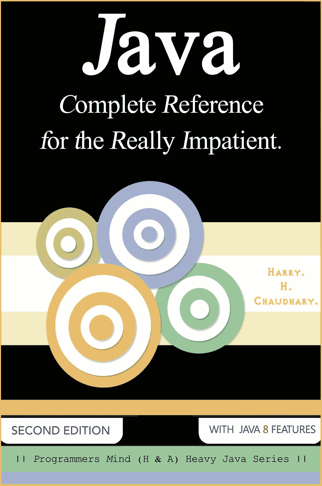


# Harry.H.Chaudhary

( IT 经理 & 匿名黑客分子 @ 匿名国际 )


我们已尽一切确保书中包含信息的准确性，但出版商或作者 Harry. H. Chaudhary 对任何原因引起的任何错误或遗漏概不负责。对于因依赖书中包含的技术编程或其他信息而导致的损失、失望、疏忽或其他损害，或者在提到的任何公司、个人或企业发生破产、清算或停止营业的情况下，特此不承担任何法律责任。

Sun Microsystems 和 Oracle 的商标是 Sun（现为 Oracle）及 Oracle 集团公司的商标。Sun Microsystems 和 Oracle 的商标列在其官方网站上。所有其他标记均为相应所有者的财产。书中描述的公司、组织、产品、域名、电子邮件地址、标志、人物、地点和事件的示例均为虚构。书中不暗示与任何真实的公司、组织、产品、域名、电子邮件地址、标志、人物、地点或事件有任何关联。作者和出版商在编写本书时已尽力，但不对任何形式的明示或暗示保证负责。

## 关于作者

Harry 是一个匿名黑客分子、全球知名的计算机程序员和畅销书作家，科学黑客在计算机编程、黑客和网络安全领域拥有独特的经验。

他曾帮助许多国家政府和跨国软件公司维护其网络安全。

他是一位技术型软件工程师和硕士，是 `C` 语言、`C++` 编程以及核心 Java、数据结构和算法的权威。他拥有超过 5 年的软件方法论经验。他的教学和研究兴趣是人工智能、编程语言。

## 作者侧记

你可能注意到这里缺少了某些令人注目的资历。我并不是在某著名大学教了二十多年的教授，也不是硅谷巨头公司的高管。在某些方面，我是一个技术的学生，就像你一样。

多年来的经验告诉我，许多对技术工作原理最了解的人，在解释他们所知知识并使我理解的方式上，成功率相当有限。我的兴趣以及我相信我的技能所在，并不在于成为一个专家，而在于成为一名教育者，以一种易于理解、易消化且读起来有趣的方式呈现复杂信息，这也是我这本书的原因。

“什么是真实？你如何定义`真实`？如果你谈论的是你所感受到的、能闻到的、能尝到的和看到的，那么`真实`简单来说就是你的大脑解释的电信号。”

“……我刚刚开始发现在纸上表达想法是多么的困难。只要它只包含描述，就非常容易；但一旦涉及到推理，要建立恰当的联系、清晰度和适度的流利度，对我来说，正如我所说的，这是一种未曾料想到的困难……”—— HarrY。

# ∞ 章节内容一览 ∞

| 单元 | 书中包含的章节与主题 | 页码 |
| :--- | :--- | :--- |
| 00. | 前言。 | 006. |
| 01. | Java 概述 | 008. |
| 02. | Java 语言 | 023. |
| 03. | 控制语句 | 039. |
| 04. | `Scanner` 类、数组与命令行参数 | 048. |
| 05. | Java 中的类与对象 | 059. |
| 06. | Java 中的继承 | 082. |
| 07. | 面向对象编程 | 098. |
| 08. | Java 中的包 | 106. |
| 09. | Java 中的接口 | 115. |
| 10. | String 和 `StringBuffer` | 129. |
| 11. | 异常处理 | 142. |
| 12. | 多线程编程 | 185. |
| 13. | 修饰符/可见性模式 | 240. |
| 14. | 包装类 | 255. |
| 15. | Java 中的输入/输出 | 273. |
| 16. | Applet 基础 | 338. |
| 17. | 抽象窗口工具包 (AWT) | 357. |
| 18. | AWT 事件简介 | 404. |
| 19. | AWT 中的绘制 | 445. |
| 20. | `java.lang.Object` 类 | 470. |
| 21. | 集合框架 | 490. |
| 22. | 开发者的 Java 8 特性 – Lambdas。 | 540. |
| 23. | Java 8 功能式接口、`Stream` 与时间 API。 | 565. |
| 24. | 使 Java 比其他语言更安全的特性。 | 579. |


# 前言

# ∞ 核心 Java 技能——轻松学会！ ∞

跟随畅销书《Java 编程》作者 Harry. H. Chaudhary（销量超过 16.7 万册！），在短时间内学习 Java 编程的所有基础和高级特性。本 Java 指南从基础开始，通过数千行 Java 代码详细地引导你进入 Java 的高级特性，我承诺这本书将使你成为 Java 专家级冠军。任何人都可以通过这本书以专家水平学习 Java。

工程类专业的学生和新手开发者也可以使用这本书。这本书涵盖了所有计算机科学专业专业的通用核心大纲。如果你是认真的，请拿起这本终极 Java 书开启你的一天。

本 Java 书的主要目标不仅仅是为你提供 Java 编程知识，我遵循了一种模式，通过对每个 Java 主题问题的不同 Java 复杂度进行清晰的理论解释，改进数千个代码的解决方案，你将发现复杂的 Java 问题有多种解决方案。

### 特别之处——

在书中，我为开发者和新手详细地涵盖并解释了最新的 Java 8 特性的几个主题，如– Lambdas。|| Java 8 功能式接口，|| `Stream` 以及 Java 8 中的时间 API。

如果你读过这本书，你就知道可以期待什么：一种根据你大脑工作方式设计的视觉丰富的格式。如果你没读过，那你将大开眼了。你会发现为什么人们说它与你读过的任何其他 Java 书不同。

学习一种新语言并非易事，特别是当它是像 Java 这样一种面向对象的编程语言时。你可能认为问题出在大脑上。它似乎有自己的主见，并不总是想要吸收你被迫学习的枯燥技术内容。事实是，你的大脑渴望新奇感。它不断地寻找、扫描，等待着异常事的发生。毕竟，它是为了帮助你生存而这样构建的。它将所有常规、平凡、无聊的内容过滤到背景中，以防干扰你大脑的真实工作——记录重要的事情。你的大脑是如何知道什么是重要的呢？

本 Java 书不需要以前的编程经验。然而，如果你有 `C` 或 `C++` 编程背景，你将能够学得更快。

正因如此，本 Java 书对 Java 的几个关键特性进行了快速详细的概述。这里介绍的材料将在后续章节中通过大量的 Java 代码进行深入探讨。

这些

——


# 章节

# ∞ 1 ∞

## (Java 概述)

### 简介

Java 是一种由 Sun Microsystems 在 1991 年开发的强大面向对象编程语言。Java 最初是为消费电子设备开发的，后来转向了互联网。现在，Java 已成为互联网上广泛使用的编程语言。Java 是一种平台无关语言（机器无关）。用 Java 开发的程序可以在世界上任何硬件或任何操作系统上运行。

### 对 Java 的需求

Java 的开发是因为需要一种平台无关语言，用于创建嵌入各种消费电子设备（如微波炉和遥控器）的软件。用 `C` 和 `C++` 编写的程序针对特定的硬件和软件编译，该程序无法在任何其他硬件或软件上运行。因此，我们需要为每种类型的 `C/C++` 编译器来编译同一个程序。但编译器的创建既昂贵又耗时。因此，需要一种平台无关语言。这样从该编译器编译的程序可以在任何硬件上运行。这种需求导致了 Java 的诞生。

### Java 类库

Java 程序由称为类的部分组成。类由称为方法的部分组成，方法执行任务并在完成任务时返回信息。你可以编写所需的每个部分以形成一个 Java 程序。然而，大多数 Java 程序员都会利用 Java 类库中丰富的现有类集合。类库也被称为 Java `API`（应用程序接口）。

在全书中，我们讨论了许多类库。类库主要由编译器厂商提供，但许多类库由独立软件供应商（ISV）提供。此外，许多类库可以通过互联网和万维网以免费软件或共享软件的形式获取。你可以下载免费软件并供免费使用，但须遵守版权所有者指定的任何限制。

## 典型 Java 环境的基础

Java 系统通常由几个部分组成：环境、语言、`Java 应用程序接口`（`API`）以及各种类库。接下来的讨论解释了一个典型的 Java 程序开发环境，Java 程序通常经过五个阶段执行。这些阶段是：编辑、编译、加载、验证和执行。随后的描述使用了标准的 `Java SE 7 开发包`（`JDK 7`），它由 Oracle 提供。

如果你使用的是不同的 Java 开发环境，那么你可能需要遵循不同的程序来编译和执行 Java 程序。在这种情况下，请查阅编译器的文档获取详情。

注意：如果你没有使用 `UNIX/Linux`、`Windows 95/98/ME` 或 `Windows NT/2000`，请参考你系统 Java 环境的手册，或询问导师如何在你的环境中完成这些任务（你的环境可能与上述相似）。

### 阶段 1：编辑文件

这是通过编辑器程序（通常称为编辑器）完成的。程序员使用编辑器输入 Java 程序，并在必要时进行修正。当程序员指定保存编辑器中的文件时，该程序被存储在磁盘等次级存储设备上。Java 程序文件名以 `.java` 扩展名结尾。

`UNIX/Linux` 系统广泛使用的两种编辑器是 `vi` 和 `emacs`。在 `Windows 95/98/ME` 和 `Windows NT/2000` 上，简单的编辑程序如 `DOS Edit` 命令和 `Windows Notepad`（记事本）就足够了。

Java 集成开发环境（IDE），如 `Forte for Java Community Edition`、`NetBeans`、`Borland’s JBuilder`、`Symantec’s Visual Cafe` 和 `IBM’s Visual Age` 都内置了集成到编程环境中的编辑器。

我们假设读者知道编辑文件。`Java` 这样的语言是面向对象的——在这样的语言中编程被称为面向对象编程（`OOP`），它允许设计人员将面向对象的设计实现为运行的系统。相比之下，`C` 等语言是过程化编程语言，因此编程倾向于以动为导向。

## Java 与 C

在 `C` 中，编程单元是 `function`。在 `Java` 中，编程单元是 `class`，对象最终从类中实例化（这是“创建”的华丽说法）。`Java` 类包含方法（实现类行为）和属性（实现类数据）。

`C` 程序员专注于编写函数。执行某些共同任务的动作组被组成函数，而函数组合成程序。数据在 `C` 中固然是重要的，但其观点是，数据的存在主要是为了支持函数所执行的动作。系统规范中的动词帮助 `C` 程序员确定实现该系统所需的函数集。

`Java` 程序员专注于创建他们自定义的、称为 `classes` 的类型和组件。每个 `class` 包含数据以及操作这些数据的函数集。`Java` 类的数据组件被称为 `attributes`。

`Java` 类的函数组件被称为 `methods`。正就像内置类型（如 `int`）的实例被称为变量，用户定义类型（即 `class`）的实例被称为对象（`object`）。程序员使用内置类型作为构建用户定义类型的“构建块”。

`Java` 的重点是 `classes`（我们从中创建对象）而不是函数。系统规范中的名词帮助 `Java` 程序员确定用于创建对象的 `classes` 集合，这些对象将协作实现系统。

`Classes` 之于对象好比蓝图之于房屋。我们可以从一张蓝图建造许多房屋，也可以从一个 `class` 实例化许多对象。`Classes` 还可以与其他 `classes` 建立关系。

例如，在银行的面向对象设计中，“银行柜员” `class` 需要与“客户” `class` 关联。这些关系被称为关联。我们将看到，当软件被封装为 `classes` 时，这些类可以在未来的软件系统中重用。相关的类组通常被封装为可重用的组件。

你创建的每个新 `class` 都有成为价值软件资产的潜力，你和其他程序员可以使用它来加速并提高未来软件开发工作的质量——这是一个令人兴奋的可能性。

## Java 与 C、C++ 及 C# 的关系

`Java` 从 `C` 继承了语法，从 `C++` 继承了面向对象的特性。它不是 `C++` 的增强版。`Java` 既不向上也不向下兼容 `C++`。我想告诉你们的一个重要点是，`Java` 语言的设计并不是为了取代 `C++` 和 `C#`。微软开发的另一种支持 `.NET Framework` 的语言 `C#` 与 `Java` 密切相关，因为它们都共享 `C++` 和 `C` 风格的语法，支持分布式编程，并使用相同的对象模型。

## Java 的主要目标是

### 1. 安全性

在使用兼容 Java 的网络浏览器时没有病毒感染的威胁。此外，没有恶意程序可以从本地机器收集隐私信息（如信用卡号、银行账户余额和密码）。`Java` 在网络应用程序和我们的计算机之间提供了一个防火墙。

### 2. 可移植性

`Java` 程序可以在运行不同操作系统和不同硬件的计算机之间迁移。

## Java 字节码


# Java 编程概述

Java 编译器的输出是字节码而不是机器码（`.class` 文件）。字节码是一种高度优化的指令集，旨在由 Java 运行时系统（称为 `JVM` `Java Virtual Machine`）执行。

`JVM` 是解释字节码的解释器。编译后的程序运行更快，但 Java 仍然使用解释器来实现可移植性，因此 Java 程序运行速度稍慢。现在，通过 Java 编译器编译的程序可以在任何环境中运行，但每个平台都需要实现 `JVM`。Java 程序是被解释的。这有助于提高安全性，因为每个 Java 程序的执行都在 `JVM` 的控制之下。

## JIT（即时编译）

`JIT` 是 `JVM` 用于将字节码翻译成实际机器码的翻译器。它不翻译整个字节码，而是按需逐步翻译。

## Java 的各个版本

- Java 1: `JDK 1.0`、`JDK 1.1`
- Java 2: `JDK 1.2`、`JDK 1.3`、`JDK 1.4`、`JDK 1.5` 或 `JDK 5`、`JDK 1.6` 或 `JDK 6`
- Java 1.7: `SE 7` Java SE 8 `Java 8` (2014 年 4 月)

注 1：JDK (`Java Development Kit`)

注 2：旧 Java 版本的许多功能被新 Java 版本弃用，但我们仍然可以使用它们。

## Java 可以开发的应用程序类型

1. **独立应用程序**：独立应用程序是运行在我们本地计算机的操作系统上的程序，类似于 `C` 或 `C++` 程序。

2. **Applet（小程序）**：`applet` 是一种可以在互联网上传输并在客户端机器上由兼容 Java 的浏览器（如 `Internet Explorer` 或 `Netscape Navigator`）执行的小程序。

`applet` 不能像独立应用程序那样执行。`applet` 只能通过嵌入 HTML 页面（如声音文件、图像文件或视频剪辑）来执行。

现在这个嵌入了 applet（小程序）的 HTML 页面可以在本地机器通过网络浏览器下载此类 HTML 页面后运行。applet 是一种对用户输入做出响应并动态变化的程序。它不会重复播放相同的动画或声音。

### Web 应用程序

这些是运行在 Web 服务器上的程序。当我们在网络浏览器中指定 URL（通用资源定位符）访问网站时，网络浏览器会向 Web 服务器发送针对特定网站的请求。在接收到请求后，服务器会运行一个程序，该程序被称为 Web Application（Web ）。我们使用 `Java Servlets` 和 `JSP (Java Server Pages)` 来编写此类程序。

这些程序运行在服务器上，然后将结果/响应发送给客户端。`JSP` 页面可以被看作 HTML 和 Java 代码的结合。Web 服务器在执行之前会将 `JSP` 页面转换为 `Java Servlets`。

当客户端请求特定的 URL 且该 URL 对应 HTML 页面时，Web 服务器直接将 HTML 页面返回给客户端，由客户端显示。如果 URL 对应 servlet 或 `JSP`，则它将在服务器上执行并将结果/响应返回给客户端，最后由客户端显示。

### 分布式应用程序

Java 应用被分成许多小的程序，可以运行在不同的机器上。这些程序中使用的对象可以相互通信。这些应用程序被称为分布式应用程序（Distributed Applications）。这允许两台不同计算机上的对象远程执行过程。为此，使用了 `RMI (Remote Method Invocation)`。

## Java 的特性

### 1. 简单

Java 的语法几乎与 `C` 和 `C++` 相似，因此熟悉 `C/C++` 的程序员不需要从头开始学习语法。但 `C/C++` 中许多复杂或导致歧义的特性在 Java 中已被删除。

1. `Java` 不支持多继承，因为这个概念有点复杂并可能导致歧义。
2. `Java` 不支持全局变量，这也导致了 `C/C++` 程序中出现许多 bug。
3. `Java` 不使用指针，也不允许指针运算，由于固有的复杂性，这是 `C/C++` 程序中大多数 bug 的产生。
4. `Java` 不支持运算符重载，因为它可能导致混淆。
5. `Java` 中没有垃圾值的概念。我们必须在使用之前初始化变量。

### 2. 安全

`Java` 程序运行在 `JVM (Java Virtual Machine)` 内部，其他部分无法访问它们。这极大地提高了安全性。由于这一特性，`Java` 程序很少挂起。这与频繁挂起的 `C/C++` 程序完全不同。`Java` 的安全模型包含三个主要组成部分：

1. 类加载器 (Class loader)。
2. 字节码验证器 (Bytecode Verifier)。
3. 安全管理器 (Security Manager)。

`Java` 使用不同的类加载器从本地和远程机器加载类文件（可执行文件）。从远程机器加载的类（如 `Applet` 类）不允许读写本地机器上的文件。这防止了恶意程序损坏本地文件系统。`Bytecode verifier` 在类加载器完成工作后立即验证字节码。它确保字节码是有效的 Java 代码。它几乎消除了 Java 程序执行某些恶意活动（如访问 `JVM` 外部内存）的可能性。`Security Manager` 控制文件删除、线程创建等关键操作。只有当 Java 程序具有足够的权限时，才允许这些操作，否则 `Security Manager` 不允许这些操作并生成 `Security Exception`。

### 3. 可移植

`Java` 程序是平台无关的。它们遵循“一次编写，随运行”的策略。为 Windows 平台编写的 `Java` 程序只需通过复制字节码（`.class` 文件）即可运行在任何其他平台（Unix、Linux、Sun Solaris 等）。不需要像 `C/C++` 程序那样需要复制源代码并重新编译。这一特性使 Java 成为了一门强大的语言。只要机器具有 `JVM`，我们就可以在任何机器上运行字节码。`JVM` 本身是依赖平台的，但它使 Java 代码变得与平台无关。实际上是 `JVM` 将字节码转换为机器码并执行它们。

所以我们可以说 `Java` 是一种可移植的语言。另一个让 Java 高度可移植的特性是无论平台如何，原始数据类型的长度都是固定的。例如，在 `Java` 中 `int` 始终是 4 字节。这与 `C/C++` 不同，`int` 的大小在某些机器上可能是 2 字节，在另一些机器上可能是 4 字节。

### 4. 面向对象

`Java` 几乎是纯面向对象的语言，但出于性能考虑，它支持原始数据类型如 `byte`、`short`、`int`、`long`、`float`、`double`、`char`、`boolean`。

### 5. 健壮

大多数程序失败是因为两个原因之一：

1. 内存管理。
2. 运行时异常情况。

在设计语言时，目标之一是确保 Java 程序尽可能健壮，即它们很少失败。因此，Java 非常上述两个因素。

在 `Java` 中，内存分配和释放由语言本身处理，消除了由于 `C/C++` 中动态内存管理功能引起的许多问题。`Java` 还支持面向对象的异常处理功能来处理运行时发生的异常情况。这允许 Java 程序在发生异常情况后恢复并继续执行。

### 6. 多线程

`Java` 的设计是为了满足现实世界创建交互式网络程序的需求。`Java` 提供编写多线程程序的支持。这允许程序员编写可以同时执行许多任务的程序。

例如，一个 `GUI (Graphical Interface)` 应用程序可能正在监听事件并采取行动，另一个线程可能正在打印，另一个线程可能正在从网络上的某机器下载文件，所有这些并发进行。这带来了更好的性能和更好的 CPU 利用率。

在其他语言中也可以编写多线程程序，但只能通过使用系统调用来实现，而在 Java 中，可以通过语言本身的特性来实现。

### 7. 架构中立

程序员面临的主要问题之一是，无法保证我们今天编写的程序明天还能在同一台机器上运行。操作系统升级、处理器升级以及核心系统资源的变化可能共同导致程序出现故障。但 Java 程序的目标是“一次编写，随处运行”。

### 8. 解释执行与高性能

`Java` 程序是解释执行的，但与其他解释器相比，它们运行很快。

### 9. 分布式

`Java` 是为互联网的分布式环境设计的。`Java` 内置为此支持各种基于 TCP/IP 的协议。事实上，使用 `URL` 访问资源类似于访问本地机器上的文件。`Java` 还具有远程方法调用的功能，这与远程过程调用 (RPC) 。这允许不同计算机上的对象远程执行过程。`Java` 为此提供了内置 API，称为 `RMI`。

### 10. 动态

每个 Java 类都是一个独立的执行单元。类仅在需要时才在运行时加载。Java 中方法绑定的默认机制也是动态的（运行时绑定）。

## 运行独立的 Java 应用程序

当 `C` 或 `C++` 程序被编译时，它被直接转换为特定处理器或特定平台的机器码。但运行 Java 程序是一个两步骤的过程。在 Java 中，从源代码到可执行代码的转换是通过使用两个翻译器来实现的：

1. **Java 编译器** - 首次，Java 程序被编译成字节码。字节码类似于机器码，但并非针对特定的处理器或平台。字节码不能直接执行。
2. **Java 解释器 (JVM)** - Java 解释器通过 `JIT` 将字节码翻译成特定平台的实际机器码。

**注意 1** - `C` 或 `C++` 程序仅编译一次，但 Java 字节码在我们每次执行 Java 程序时都会被翻译。因此，与 `C/ C++` 程序相比，Java 程序的运行速度稍慢。

**注意 2** - 运行 Java 程序我们需要一个文本编辑器（记事本或 Edit）、`JDK`（Java 开发工具包）以及 `JVM`（已安装在许多操作系统中）。我们也可以使用 `Eclipse` 或 `JCreator` 代替记事本。

## 在 win xp 上安装 Java 1.7

双击 `我的电脑` → 双击 `光驱器` → 双击 `JDK1.7 Java 安装文件` → 点击 `Next`、`Next`、.....

## 设置 Path

如果我们设置了 Java 文件夹的路径，就可以从任何地方运行 Java 程序，否则我们必须从 Java 的 `bin` 文件夹运行 Java 程序。

右键点击 `我的电脑` → `属性` → `高级` → `环境变量` → 点击 `Path` 然后点击 `编辑` → 点击变量值 → 按 `END` 将光标移动到行尾 → 现在输入 `c:\program files\Java\jdk1.7.0_01\bin;` 然后点击 `OK`、`OK`、`OK`。

## 为 Java 程序创建文件夹

双击 `我的电脑` → 双击 `C 盘` → 右键 → `新建` → `文件夹` → 输入 `JAVAPRG` → 按 `Enter` 并关闭“我的电脑”。

## 在命令提示符上运行 Java 程序的步骤

**步骤 1**: 进入命令提示符

`开始` → `运行` → 输入 `cmd` 并点击 `确定`。

**步骤 2**: 输入 `CD \ JAVAPRG` 并按 `Enter`。

**步骤 3**: 输入 `Edit Sum.Java` 并按 `Enter`。

**步骤 4**: 输入 Java 程序并点击 `文件` → `保存`，然后点击 `文件` → `退出`。

**步骤 5**: 输入 `javac Sum.Java` 并按回车编译。这将创建一个 `Sum.class` 文件。该文件被称为字节码。

**步骤 6**: 输入 `java Sum` 并按回车运行。这会调用 `JVM`。

**步骤 7**: 输入 `Exit` 然后按回车退出命令提示符。

**注意** - 我们也可以通过上述步骤使用 `记事本` 运行 Java 程序，但不是使用 `Edit` 命令，而是使用 `记事本`。在输入 Java 程序后，在另存为对话框中选择“所有文件”，将其保存到文件夹 `C:\JAVAPRG`。要编译和运行，我们需要遵循上述步骤。

## Java 程序语法

```java
class <class name>
{
    public static void main(String args[]) or (String [] args)
    {
        // ---
    }
}
```

## 第一个 Java 程序 - 两个数字相加 (Sum.Java)

```java
class Sum
{
    public static void main(String args[])
    {
        int a,b,sum;
        a = 5;
        b = 6;
        sum = a + b;
        System.out.print("Sum is " + sum); //输出
    }
}
```

**输出:** `Sum is 11.`

## 示例 1.2 交换两个数字程序 (Swap.Java)

```java
class Swap
{
    public static void main(String args[])
    {
        int a=5,b=7;
        t = a;
        a = b;
        b = t;
        System.out.print("After Swap Values are " + a + "," + b);
    }
}
```

**输出:** `After Swap Values are 7,5`

## 注释

有 3 类型的注释：

- 单行注释：`//`
- 多行注释：`/* */`
- 文档注释：`/** */`

- 每个 Java 程序必须包含一个类。在 Java 中，`main()` 方法只能定义在类内部。
- 一个源文件可以有任意数量的类和/接口定义，但最多可以有一个公共类或接口。
- 源文件可能包含也不包含带有 `main()` 方法的类，但一个独立的 Java 程序始终从 `main()` 方法开始执行。因此，我们想要开始执行的类必须在其中定义了 `main()` 方法。
- `main()` 方法必须始终具有以下签名：`public static void main(String args[])`

**注意** - 在 Java 中，方法原型被称为签名（signature）。

- `public` 关键字表示该方法可以从任何地方访问。
- `static` 关键字表示可以在不创建对象的情况下调用 `main()`。
- `void` 关键字表示 `main()` 不返回任何值。
- `main()` 方法接收一个参数，即 `String` 类型的数组。
- `System` 是一个预定义的类，提供了对系统的访问，`out` 是连接到控制台的输出流。

## Java 程序的结构

- **文档部分**：文档部分包含一组注释行，给出程序名称、作者以及程序员在以后阶段参考的其他信息。注释解释了类的为什么、是什么以及算法如何。
- **包语句**：一个源文件最多有一个包语句。如果存在包语句，它必须是 Java 程序的第一个语句。只有注释可以包语句之前。
- **导入语句**：源文件可以有零或多个导入语句。导入语句类似于 C/C++ 中的 `#include` 语句。如果存在，所有的导入语句必须位于包语句之后、类接口定义之前。
- **接口语句**：接口类似于类，但包含一组方法声明。这也是一个可选部分，仅在我们希望程序中实现多重继承功能时使用。
- **不包含 main 方法的类定义**：Java 程序可以包含多个类定义。类是 Java 程序的首要元素。这些类用于映射现实世界问题的对象。
- **包含 main 方法的类定义**：由于每个独立的 Java 程序都需要 main 方法作为其起始点，因此该类是 Java 程序的关键部分。main 方法创建各种类的对象并建立它们之间的通信。当 main 方法结束时，程序终止并将控制权交回操作系统。

## 垃圾回收

Java 对象的内存分配完全是动态，但 Java 不像 C/C++ 那样支持指针算术。每当我们运行 Java 程序时，JVM 也会后台运行另一个名为垃圾回收器（Garbage Collector）的程序（线程）。垃圾回收器会检查 Java 对象。

当一个 Java 对象不再被使用时，它会被垃圾回收器（Garbage Collector）收集，即为对象分配的内存被添加到空闲内存池 `pool/heap` 中可以重复使用。这在很大程度上简化了程序员的任务。它还消除了许多由于不当使用指针算术和显式释放内存等内存管理功能导致的错误。

# 单选题

1. 下列哪些应用程序 `main()` 方法的有效定义？

(a) `public static void main();`

(b) `public static void main( String args );`

(c) `public static void main( String args[] );`

(d) `public static void main( Graphics g );`

(e) `public static boolean main( String args[] );`

2. 哪个组织开发了 Java 语言？

(a) `Microsoft` (b) `IBM`

(c) `Sun Microsytems Inc.` (d) `AT&T`


# Java 语言基础

## 选择题

### 3. Java 属于以下哪种语言分类？

- (a) `Object-Oriented`（面向对象）
- (b) `Procedural`（过程化）
- (c) `Both (a) & (b)`（两者都是）
- (d) `None of the above`（以上都不是）

### 4. 下列哪项不是正确的描述？

- (a) `Garbage collection in Java is automatic.`（Java 的垃圾回收是自动的。）
- (b) `Java provides support for distribution applications.`（Java 支持分布式应用。）
- (c) `Java is more efficient as compared to C/C++.`（与 C/C++ 相比，Java 更高效。）
- (d) `Java is more secure as compared to C/C++.`（与 C/C++ 相比，Java 更安全。）

### 5. 下列哪项是正确的描述？

- (a) `Java is a platform independent language?`（Java 是平台无关语言吗？）
- (b) `Java is an Object-Oriented language?`（Java 是面向对象的语言吗？）
- (c) `Java supports 多线程.`（Java 支持多线程。）
- (d) `All of the above.`（以上都是。）

**答案**：1. (c) 2. (c) 3. (a) 4. (c) 5. (d)

## 理论题

1. 解释 Java 虚拟机 (`JVM`) 的工作原理。
2. `C++` 和 `Java` 之间有什么区别？
3. `"APPLET"` 和 `"APPLICATION"` 之间的区别。
4. Java 的缺点。
5. 垃圾回收是如何工作的？
6. 什么是 `BYTE Code`（字节码）？
7. Java 是完全面向对象的编程吗？如果不是，为什么？
8. Java 应用程序/程序有哪些类型？
9. Java 可执行文件的扩展名是什么？
10. Java 源文件/程序的扩展名是什么？
11. 使用什么命令编译 Java 程序？
12. 哪个组织开发了 Java 语言？
13. 是什么让 Java 具有平台性？
14. 为什么与 `C/C++` 相比，Java 是更安全的语言？
15. 为什么与 `C` 语言相比，Java 是更健壮的语言？
16. 什么是分布式应用？
17. 描述 Java 的四个特性。
18. 描述编译和运行 Java 程序所需的步骤。
19. Java 流行的主要原因有哪些？
20. 为什么 `C/C++` 的许多特性在 Java 中被删除？列举这些特性。
21. 写出 Java 中的三种注释。
22. 列出 `C` 和 `Java` 之间的 10 个主要区别。
23. 描述典型 Java 程序的结构。

## 编程练习

1. 编写一个程序计算两个整数的平均值。
2. 编写一个不使用第三个变量交换两个数字的程序。
3. 编写一个程序将小时、分钟和秒转换为总秒数。
4. 编写一个程序计算给定圆的面积和周长。

---

# 章节：Java 语言 - 标记 (Tokens)

最小的独立单元被称为标记，例如关键字、标识符、常量、字符串和运算符。

- **A. 关键字**：语言的保留名称，不能用作变量、函数等的名称。
- **B. 标识符**：指变量、数组、函数、类、接口等的名称。
- **C. 常量/字面量**：指程序中无法更改的固定值。
- **D. 运算符**：作用于变量和常量的特殊符号，并构成表达式。
- **E. 分隔符**：用于分隔语句的特殊字符，如 `()`、`{}`、`[]`、`;`、`,`、`.`。

## 关键字

`abstract`、`continue`、`goto`、`package`、`synchronized`、`assert`、`default`、`if`、`private`、`this`、`boolean`、`do`、`implements`、`protected`、`throw`、`break`、`double`、`import`、`public`、`throws`、`byte`、`else`、`instanceof`、`return`、`transient`、`case`、`extends`、`int`、`try`、`catch`、`final`、`interface`、`static`、`void`、`char`、`finally`、`long`、`volatile`、`class`、`float`、`native`、`super`、`const`、`for`、`new`、`switch`

> **注**：`const`、`goto`、`null` 是保留字。`true`、`false` 也是保留字。

## 标识符

标识符是指变量、数组、函数、类、接口等的名称。

1. 标识符必须以字母、美元符号 (`$`) 或下划线 (`_`) 开头。
2. 后续字符可以是数字。
3. 标识符的长度没有限制。
4. 标识符区分大小写。
5. Java 允许 Unicode 字符。

## 常量/字面量

常量/字面量是指程序中无法更改的固定值。

1. 字面量不能出现在赋值运算符的左侧。
2. 字面量是在源代码中指定的数值。

### 字面量类型

- **整数常量**：`5`、`-5`、`0x5A`、`012`、`5l`、`5L`。其中 `5`、`-5` 是十进制，`0x5A` 是十六进制，`012` 是八进制，`l` 或 `L` 表示长型 (`long`)。
- **浮点型常量**：`5.23`、`-5.23`、`5.4f`、`5.4F`、`5.4d`、`5.4D`、`1.2E-03`。其中 `f` 或 `F` 表示单精度 (`float`)，`d` 或 `D` 表示双精度 (`double`)，`5.23` 是标准计数法，`1.2E-03` 是指数计数法（科学计数法），`1.2` 是尾数，`-03` 是指数。
- **字符常量**：`'a'`、`'A'`、`'\n'`、`'\141'`、`'\u0061'`。其中 `'\n'` 是转义序列，`'\141'` 是字符 `'a'` 的八进制代码，`'\u0061'` 是字符 `'a'` 的十六进制代码。
- **字符串字面量**：`"matrix"`。字符串是字符组。Java 字符串没有其他语言中的行延续转义序列，因此字符串必须在同一行内开始和结束。Java 中的字符串是对象类型。
- **布尔字面量**：`true`、`false`。Java 中的 `true` 和 `false` 不等于 `1` 或 `0`。

## 运算符

Java 提供了丰富的运算符。运算符组合常量、变量和子表达式形成表达式。Java 中的大多数运算符的行为与 `C/C++` 相似，但有一些不同之处。

运算符可以分类为：

- **算术运算符** (`+`、`-`、`*`、`/`、`%`)：这些运算符与 `C/C++` 相同。
  - `%` 运算符也可以作用于浮点数。
  - 当二进制运算符应用于不同类型的操作数时，低类型的操作数会在求值之前转换为高类型，结果的类型将与高类型操作数的类型相同。
  - 对于 `int` 类型，除以零或取模零会导致 `ArithmeticException`（运行时错误），但浮点数类型则不会。
  - 当对 `int` 应用算术运算符且结果超出了 `int` 的范围时，额外的高位位将被截断；但在浮点类型中，如果溢出，结果将为 `Infinity` 或 `-Infinity`，如果下溢，结果为 `0`。

### 递增和递减运算符 (`++`, `--`)

这些运算符与 `C/C++` 中的相同。

```java
int a = 5, b;
b = ++a * ++a;
System.out.print(b);    // 42

a = 5;
System.out.print(++a * ++a);  // 42
```

### 关系运算符 (`<`, `>`, `<=`, `>=`, `instanceof`)

这些运算符与 `C/C++` 中的相同，但 `<`、`<=`、`>`、`>=` 不能应用于布尔类型和引用类型。

### `instanceof` 运算符

`instanceof` 运算符用于测试对象的类型。通用形式为：

```java
if (object instanceof type)
```

这里，`object` 是一个类的实例，`type` 是一个类类型。如果 `object` 是指定类型的实例，或者是指定类型任任何子类的实例，则 `instanceof` 运算符返回 `true`，否则结果为 `false`。

### 赋值运算符 (`=`, `+=`, `-=`, `*=`, `/=`, `%=`)

这些运算符与 `C/C++` 中的相同。

### 等于运算符 (`==`, `!=`)

这些运算符与 `C/C++` 中的相同。

### 逻辑运算符 (`&&`, `||`, `!`)

这些运算符与 `C/C++` 中的相同。

### 三元运算符 (`? :`)

该运算符与 `C/C++` 中的相同。

### 位运算运算符 (`&`, `|`, `^`, `~`, `<<`, `>>`, `>>>`)

这些运算符与 `C/C++` 中的相同，移位运算符除外。移位运算符仅适用于整数类型。

#### 左移 (`<<`) 运算符

左侧操作数的位根据右侧操作数指定的向左移动，右侧的空位将用零填充。左移 1 位等同于乘以 2。结果的符号可能与左侧操作数的符号不同。

示例：`b = a << 2;`。将 `a` 中的位左移 2 位，并用零填充右侧 2 位。

#### 右移 (`>>`) 运算符（带符号）

左侧操作数的位根据右侧操作数指定的向右移动，左侧的空位将用符号位填充。右移 1 位等同于除以 2。该运算符永远不改变结果的符号，即它与左侧操作数的符号相同。

示例：`b = a >> 2;`。将 `a` 中的位右移 2 位，并用符号位填充左侧 2 位（如果 `a` 为正则为 `0`，如果 `a` 为负则为 `1`）。

#### 零填充右移 (`>>>`) 运算符（无符号）

左侧操作数的位根据右侧操作数指定的向右移动，左侧的空位将用 `0` 填充。右移 1 位等同于除以 2。如果发生了移位，结果将始终为正数，因为最高位将变为零。

示例：`b = a >>> 2;`。将 `a` 中的位右移 2 位，并用 `0` 填充左侧 2 位。

---

### 运算符优先级

| 优先级 | 运算符 | 描述 | 结合性 |
| :--- | :--- | :--- | :--- |
| 1 | `()` `[]` `.` | 函数调用、下标、直接成员访问 | 从左到右 |
| 2 | `++` `--` `~` `!` | 递增、递减、位取反、逻辑取非 | 从右到左 |
| 3 | `*` `/` `%` | 乘法、除法、取模 | 从左到右 |
| 4 | `+` `-` | 加法、减法 | 从左到右 |
| 5 | `<<` `>>` `>>>` | 位左移、位右移、零填充右移 | 从左到右 |
| 6 | `<` `<=` `>` `>=` `instanceof` | 小于、小于等于、大于、大于等于、类型检查 | 从左到右 |
| 7 | `==` `!=` | 等于、不等于 | 从左到右 |
| 8 | `&` | 位按与 | 从左到右 |
| 9 | `^` | 位异或 | 从左到右 |
| 10 | `|` | 位按或 | 从左到右 |
| 11 | `&&` | 逻辑与 | 从左到右 |
| 12 | `\|\|` | 逻辑或 | 从左到右 |
| 13 | `? :` | 三元运算符 | 从右到左 |
| 14 | `=` `+=` `-=` `*=` `/=` `%=` `&=` `\|=` `^=` `<<=` `>>=` `>>>=` | 赋值运算符 | 从右到左 |

### 分隔符

| 符号 | 名称 | 目的 |
| :--- | :--- | :--- |
| `()` | 括号 | 函数调用、参数 |
| `[]` | 中括号 | 数组 |
| `.` | 点 | 分隔包名与类 |
| `{}` | 花括号 | 定义块 |
| `;` | 分号 | 终止语句 |
| `,` | 逗号 | 分隔标识符 |

---

## 数据类型

Java 数据类型大致分为两类：

### 1. 基本数据类型

Java 是面向对象的语言，但基本数据类型不是对象。它们是其他类型的基础。

#### 数值类型

**整数类型：**

- `byte` (1 字节): -128 到 127
- `short` (2 字节): -32768 到 32767
- `int` (4 字节): -2147483648 到 2147483647
- `long` (8 字节): -9223372036854775808 到 9223372036854775807

> 包含 `byte`、`short`、`int` 的表达式会自动提升为 `int`。

**浮点数类型：**

- `float` (4 字节): 1.401298464324817E-45 到 3.402823466385286E38
- `double` (8 字节): 4.9E-324 到 1.7976931348623157E308

**布尔数据类型：** `boolean`

**字符数据类型：** `char` (2 字节): 0 到 65535（注意：Unicode 的前 128 个字符与 7 位 ASCII 相同）

### 2. 非基本数据类型 / 引用类型

引用类型也被称为派生类型，因为它们派生自基本数据类型。

- **类**
  - 内置/库类
  - 用户定义类
- **接口**
  - 内置/库接口
  - 用户定义接口
- **数组**
  - 数组也被视为对象。

---

## 变量

三种变量类型：

### 局部变量

局部变量用于块或方法内部。局部变量（也称为自动变量）默认不会进行初始化。局部变量在第一次使用之前必须显式初始化，否则会出现编译时错误“变量可能未被初始化”。

#### 示例

```java
int a, b = 5;
if (b > 2) {
    a = b;
}
System.out.print(a);
```

在上述程序中，如果 `if` 条件为假，则 `a` 的值未被定义，因此编译器将给出错误“变量 a 可能未初始化”。

在 Java 中，我们不能在内部块中定义与外部块相同的变量。

```java
int a = 5;
{
    int a = 7;  // 错误
}
```

### 实例变量

实例变量用于定义对象的属性或状态。

### 类变量

类变量用于定义类的所有对象共有的属性/状态。

---

## Math 类库方法

| 方法 | 描述 |
| :--- | :--- |
| `public static double sin(double x);` | 返回弧度角 `x` 的正弦值 |
| `public static double cos(double x);` | 返回弧度角 `x` 的余弦值 |
| `public static double tan(double x);` | 返回弧度角 `x` 的正切值 |
| `public static double asin(double x);` | 返回正弦值为 `x` 的角度 |
| `public static double acos(double x);` | 返回余弦值为 `x` 的角度 |
| `public static double atan(double x);` | 返回正切值为 `x` 的角度 |
| `public static double toRadians(double x);` | 将角度 `x` 转换为弧度 |
| `public static double toDegrees(double x);` | 将弧度 `x` 转换为角度 |
| `public static double exp(double x);` | 返回 `e` 的 `x` 次方 (`e^x`) |
| `public static double log(double x);` | 返回 `x` 的自然对数 |
| `public static double log10(double x);` | 返回 `x` 的底为 10 的对数 |
| `public static double sqrt(double x);` | 返回 `x` 的平方根 |
| `public static double ceil(double x);` | 返回大于或等于 `x` 的最小整数（向上取整） |
| `public static double floor(double x);` | 返回小于或等于 `x` 的最大整数（向下取整） |
| `public static double rint(double x);` | 返回 `x` 的四舍五入值 |


# Math 类常用方法

| 方法签名 | 说明 |
| :--- | :--- |
| `public static double atan2(double x, double y);` | 返回正切值为 `x/y` 的角度 |
| `public static double pow(double x, double y);` | 返回 `x` 的 `y` 次方 (`x^y`) |
| `public static int round(float x);` | 返回 `int` 类型 `x` 四舍五入值 |
| `public static long round(double x);` | 返回 `long` 类型 `x` 四舍五入值 |
| `public static double random();` | 返回 0 到 0.999999999999999999 之间的随机数 |
| `public static int abs(int x);` | 返回 `x` 的绝对值 |
| `public static long abs(long x);` | 返回 `x` 的绝对值 |
| `public static float abs(float x);` | 返回 `x` 的绝对值 |
| `public static double abs(double x);` | 返回 `x` 的绝对值 |
| `public static int max(int x, int y);` | 返回 `x` 与 `y` 的最大值 |
| `public static long max(long x, long y);` | 返回 `x` 与 `y` 的最大值 |
| `public static float max(float x, float y);` | 返回 `x` 与 `y` 的最大值 |
| `public static double max(double x, double y);` | 返回 `x` 与 `y` 的最大值 |
| `public static int min(int x, int y);` | 返回 `x` 与 `y` 的最小值 |
| `public static long min(long x, long y);` | 返回 `x` 与 `y` 的最小值 |
| `public static float min(float x, float y);` | 返回 `x` 与 `y` 的最小值 |
| `public static double min(double x, double y);` | 返回 `x` 与 `y` 的最小值 |
| `public static double sinh(double x);` | 返回角 `x` 的双曲正弦 |
| `public static double cosh(double x);` | 返回角 `x` 的双曲余弦 |
| `public static double tanh(double x);` | 返回角 `x` 的双曲正切 |

**注意**：使用上述方法需要加上 `Math` 类名前缀。

## 示例

### 示例 1

```java
double theta1 = 120.0;
double theta2 = 1.312;
System.out.println(theta1 + " degree is " + Math.toRadians(theta1) + " radians.");
System.out.println(theta2 + " radians is " + Math.toDegrees(theta2) + " degrees.");
```

**输出：**

```text
120.0 degree is 2.094395102393195 radians.
1.312 radians is 75.1720627216401 degrees.
```

### 示例 2

```java
double number = 25.0;
double root = Math.sqrt(number);
System.out.println("Sqrt of number " + number + " is " + root);
```

**输出：**

```text
Sqrt of number 25.0 is 5.0
```

### 示例 3

```java
double x = 3, y = 3, z = 0;
z = Math.pow(x, y);
System.out.println("Value of z :" + z);
```

**输出：**

```text
Value of z :27.0
```

### 示例 4

```java
double a = 3.0, b = 4.0; // 初始化
double c = Math.sqrt(a * a + b * b);
System.out.println("Hypotenuse is " + c);
```

**输出：**

```text
Hypotenuse is 5.0
```

## 单选题

1. 下列哪些是关键字？
   (a) `array`
   (b) `boolean`
   (c) `Integer`
   (d) `protect`
   (e) `super`

2. 哪个标识符是无效？
   (a) `_x`
   (b) `r2d`
   (c) `$`
   (d) `set-flow`
   (e) `thisCrazy`

3. 整数 `x` 的二进制值 (1 byte) 为 `10011100`。执行语句后 `z` 的二进制值是：
   ```java
   int y = x << 7;
   int z = x & y;
   ```
   (a) `10000001`
   (b) `10000000`
   (c) `00000001`
   (d) `10011101`
   (e) `1001100`

4. 下列语句是正确的：
   (a) `>>` 执行符号位移，`>>>` 执行无符号位移。
   (b) `>>>` 执行符号位移，`>>` 执行无符号位移。
   (c) `<<` 执行符号位移，`<<<` 执行无符号位移。
   (d) `<<<` 执行符号位移，`<<` 执行无符号位移。

5. 考虑两个语句：
   ```java
   1. boolean passingScore = false && grade == 70;
   2. boolean passingScore = false & grade == 70;
   ```
   表达式 `grade == 70` 的求值情况：
   (a) 在 1 和 2 中都是
   (b) 在 1 和 2 中都不是
   (c) 在 1 中但不在 2 中
   (d) 在 2 中但不在 1 中
   (e) 无效，因为 false

6. 给定变量声明：
   ```java
   byte myByte;
   int myInt;
   long myLong;
   char myChar;
   float myFloat;
   double myDouble;
   ```
   哪些赋值需要强制类型转换？
   (a) `myInt = myByte;`
   (b) `myInt = myLong;`
   (c) `myByte = 3;`
   (d) `myInt = myChar;`
   (e) `myFloat = myDouble;`
   (f) `myFloat = 3;`
   (g) `myDouble = 3.0;`

7. 下列 Java 单词目前没有用途：
   (a) `true`
   (b) `false`
   (c) `goto`
   (d) `null`

8. Java 中数据类型 `int` 的大小是多少？
   (a) 2 字节
   (b) 4 字节
   (c) 未定义
   (d) 2 字节或 4 字节

**答案：**
1 (b,e), 2 (d), 3 (b), 4 (a), 5 (d), 6 (b,e), 7 (c), 8 (b)

# 理论题

1. 为什么 Java 不是 100% 面向对象语言？
2. Java 中的基本数据类型有哪些？
3. 列出出现在 Java 源文件中的四个顶级元素。
4. `package` 语句之前还可以出现哪些语句？
5. 列出三个作为字面量的 Java 关键字。
6. 列出两个语言中未使用的 Java 关键字。
7. Java 的哪些基本数据类型在 C 中不存在？
8. 列出 Java 中的三种变量。
9. 简述 Java 标识符的规则。
10. Java 程序中注释的目的是？
11. 列出任意四个数值数据类型及其范围。
12. Java 数组与 C 数组有何不同？
13. 什么是 Java Token（标记）？简述不同类型的 Token。
14. 什么是 Java 字面量？结合示例说明。
15. Java 中不同的数据类型有哪些？详细描述。

## 编程练习

1. 写一个程序显示所有位操作符的使用。
2. 写一个程序显示所有显式和隐式转换。
3. 写一个程序解决一些不同数据类型的方程并显示结果。
4. 写一个程序，证明内部作用域变量名不能与外部作用域变量相同。
5. 写一个程序计算圆的面积。（使用 `final` 声明常量）。
6. 编写一个程序将字符转换为 Unicode。
7. 编写一个程序进行 `int` 到 `float` 的类型转换。
8. 编写一个程序计算两个浮点数的取模（`%`）。
9. 编写一个程序求二次方程的根。

---

# 章节 3：控制语句

## 引言

控制语句用于改变执行流。Java 的控制语句可以分为三类。

### 1. 选择语句（决策控制结构）

选择语句允许程序根据表达式的结果或变量的状态，从一组不同的执行路径集合中选择任意一条路径。

*   `if`
*   `if else`
*   嵌套 `if else`
*   `if-else-if`
*   `switch`

#### 语法示例

**(a) `if` 的语法**
```java
if (condition) {
    statements;
}
```

**(b) `if else` 的语法**
```java
if (condition) {
    statements;
} else {
    statements;
}
```

**(c) 嵌套 `if else` 的语法**
```java
if (condition) {
    if (condition) {
        statements;
    } else {
        statements;
    }
} else {
    statements;
}
```

**(d) `if-else-if` 阶梯的语法**
```java
if (condition1) {
    statements;
} else if (condition2) {
    statements;
} else if (condition3) {
    statements;
} else {
    statements;
}
```

**(e) `switch case` 的语法**
```java
switch (expression) {
    case 1:
        statement 1 sequence;
        break;
    case 2:
        statement 2 sequence;
        break;
    case 3:
        statement 3 sequence;
        break;
    case n:
        break;
    default:
        default statement sequence;
}
```

#### 示例 3.1 寻找两个数最大值的程序 (`Max.java`)

```java
class Max {
    public static void main(String args[]) {
        int a, b, max;
        a = 10;
        b = 20;
        if (a > b)
            max = a;
        else
            max = b;
        System.out.println("Max of two numbers is " + max); // 输出
    }
}
```

**输出：**
`Max of two numbers is 20`

### 2. 迭代语句（循环控制结构）

循环是一个我们可以重复单条语句或一组语句 n 次的过程。

*   `for`
*   `while`
*   `do while`

#### 语法示例

**(a) `for` 循环的语法**
```java
for (initialize; condition; increment/decrement) {
    statements;
}
```

**(b) `while` 循环的语法**
```java
initialize;
while (condition) {
    statements;
    increment/decrement;
}
```

**(c) `do while` 循环的语法**
```java
initialize;
do {
    statements;
    increment/decrement;
} while (condition);
```

**注意**：条件可以是任何布尔表达式。只要条件表达式为真，循环体就会一直执行。当条件变为假时，控制立即传递到紧随循环的下一行代码。

#### 示例 3.2

```java
class Loop1 {
    public static void main(String args[]) {
        int n = 5;
        for (int i = 1; i <= n; i++) {
            for (int j = 1; j <= i; j++)
                System.out.print(j);
            System.out.println();
        }
    }
}
```

**输出：**
```text
1
12
123
1234
12345
```

### 3. 跳转语句

它允许我们的程序以非线性方式工作。

*   `break`
*   标记 `break` (labeled break)
*   `continue`
*   标记 `continue` (labeled continue)
*   `return`

*   大多数语句的语法与 C/C++ 相同。但存在一些差异。
*   用于 `if`、`for` 和 `do` 语句的条件表达式必须是布尔表达式，即它们的值应该为真或假。我们不能像 C/C++ 中那样用 0 代假或用非零代替真。
*   Java 没有 `goto` 语句，尽管 `goto` 是一个保留字。Java 提供了 `labeled break` 和 `labeled continue` 语句，它们通常被称为 goto 的文明形式。
*   在 Java 中，`switch` 表达式可以是任何整数表达式，`long` 除外。`switch` 表达式的类型可以是 `byte`、`short`、`char` 或 `int`。Java 的 `int` 是 4 字节，与 C/C++ 中的 `long` 相同。
*   `case` 标签像 C/C++ 一样是常量表达式，但 case 标签的值必须在 `switch` 表达式的范围内，否则程序将编译报错。
*   `labeled break` 语句用于终止在 `break` 中指定标签的块。与简单的 `break` 不同，我们可以终止任何块。例如，可以从深度嵌套循环内部终止最外层循环。`break` 语句也可以用于终止简单块（即块不需要是循环或 switch 语句）。
*   `labeled continue` 语句指定要继续的外层循环的标签。标签不需要对应最近的外层循环。

#### 跳转语句示例

**(a) `break`**
```java
for (int i = 1; i <= 10; i++) {
    if (i == 5)
        break; // 如果 i 是 5 则终止循环
    System.out.print(i);
}
```
**输出：** `1 2 3 4`

**(b) 标记 `labeled break`**
```java
boolean t = true;
first: {
    second: {
        third: {
            System.out.println("Before the break");
            if (t) break second; // 跳出第二个块
            System.out.println("This will not execute");
        }
        System.out.println("This will not execute");
    }
    System.out.println("This is after block");
}
```
**输出：**
```text
Before the break
This is after block
```

**(c) `continue`**
```java
for (int i = 0; i < 10; i++) {
    if (i % 2 == 0)
        continue;
    System.out.println(i);
}
```
**注意**：使用 `%` 运算符检查 `i` 是否为偶数。如果是偶数则跳过。

**输出：**
```text
1
3
5
7
9
```

**(d) 标记 `labeled continue`**
```java
outer: for (int i = 0; i < 5; i++) {
    for (int j = 0; j < i; j++) {
        if (j == 2)
            continue outer;
        System.out.println(i + j);
    }
}
```
**输出：**
```text
0
1
2
3
4
5
6
7
```

**(e) `return`**
```java
int sum(int a, int b) {
    return a + b;
}
```

## 选择题

1. 给定以下变量：
   ```java
   int one = 1;
   int two = 2;
   char initial = '2';
   boolean flag = true;
   ```
   以下哪些是有效的？
   (a) `if(one)`
   (b) `if(two)`
   (c) `if(initial)`
   (d) `if(flag)`
   (e) `switch(one)`


(f) `switch( flag )`

2. 如果代码：

```java
switch( val )
{
    case 1: System.print( "P" );
    case 2: System.print( "Q" );
    ...
}
```

哪些值会打印输出？

(a) P

(b) Q

(c) R

(d) S

3. 假设 `val` 定义为正整数，以下代码：

```java
if( val > 4 )
    System.out.println( "Test A" );
else if( val > 9 )
    System.out.println( "Test B" );
else
    System.out.println( "Test C" );
```

哪些 `val` 的值会导致打印 "Test C"：

(a) `val < 0`

(b) `val` 在 0 到 4 之间

(c) `val` 在 4 到 9 之间

(d) `val > 9`

(e) `val = 0`

(f) 没有 val 值满足

4. 对于代码：

```java
m = 0;
while( m++ < 2 )
System.out.println( m );
```

哪些会被打印？

(a) 0

(b) 1

(c) 2

(d) 3

(e) 什么都不打印且抛出异常

5. 考虑代码片段：

```java
outer: for( int i = 1; i <3; i++ )
inner: for( j = 1; j < 3; j++ )
{
    if( j==2 )
        continue outer;
    System.out.println( "i = " + i+", j = " + j );
}
```

哪些输出到标准输出？

(a) i = 1, j = 1

(b) i = 1, j = 2

(c) i = 1, j = 3

(d) i = 2, j = 1

(e) i = 2, j = 2

(f) i = 2, j = 3

(g) i = 3, j = 1

(h) i = 3, j = 2

答案：1(c,d,e,f,g) 2(a,b) 3(b) 4(b,c) 5(a,d)

# 理论

1. Java 有 `goto` 吗？

2. 什么是标记循环。

# 练习

1. 编写一个程序检查给定年份是否为闰年。

2. 编写一个程序打印指定月份的天数。（使用 `switch`）

3. 编写一个程序打印斐波那契数列。

4. 编写一个程序检查给定数字是否为质数。

5. 编写一个菜单驱动的程序，计算两个数的加、减、乘、除。

1 用于加法

2 用于减法

3 用于乘法

4 用于除法

5 用于退出（提示：`do while` 和 `switch`）

6. 编写一个程序打印数字的反转。（提示：`1234` 将导致 `4321`）。

7. 编写一个程序找到给定三个数中的最大值。

8. 编写一个程序使用跳转语句打印前 10 个偶数。

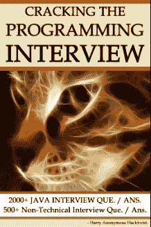ISBN 13: 978-1500730413.


# 章节

# ∞ 4 ∞

## Scanner 类与数组

## 命令行参数

## 引言

### Scanner 类

这是 Java 在 JDK 1.5-6-7 版本中添加的一个新类，用于从用户获取基本数据类型的输入。使用此类获取输入非常简单，因为我们只需要创建该类的对象并调用特定方法。该类可用于 `java.util` 包中。

| `public java.util.Scanner(java.io.InputStream);` |
| `public java.util.Scanner(java.io.File) throws java.io.FileNotFoundException;` |
| `public java.util.Scanner(java.lang.String);` |
| `public void close();` |
| `public boolean hasNext();` |
| `public java.lang.String next();` 输入不包含任何空格的字符串。 |
| `public java.lang.String nextLine();` 输入可能包含空格的字符串。 |
| `public boolean hasNextBoolean();` |
| `public boolean nextBoolean();` |
| `public boolean hasNextByte();` |
| `public byte nextByte();` |
| `public boolean hasNextShort();` |
| `public short nextShort();` |
| `public boolean hasNextInt();` 检查输入缓冲区中的下一个值是否为 int。 |
| `public int nextInt();` 输入一个整数值。 |
| `public boolean hasNextLong();` |
| `public long nextLong();` |
| `public boolean hasNextFloat();` |
| `public float nextFloat();` |
| `public boolean hasNextDouble();` |
| `public double nextDouble();` |

示例 4.1:

```java
import java.util.*;
class SumInput
{
    public static void main(String args[])
    {
        Scanner sc=new Scanner(System.in);
        int a,b,sum;
        System.out.print("输入第一个数字");
        a = sc.nextInt();
        System.out.print("输入第二个数字");
        b = sc.nextInt();
        sum = a+b;
        System.out.println("和为 " + sum);
    }
}
```

输出：

```
输入第一个数字 45
输入第二个数字 55
和为 100
```

## 数组

Java 中的数组是相同类型变量或数据项目的有序集合。Java 允许任何维度的数组。Java 中的数组与 C/C++ 有些不同。我们不需要在声明时指定数组的大小。内存分配始终是动态的。Java 中的每个数组都被视为一个对象，具有一个特殊的属性 `length`，该属性指定数组中的元素个数。

### 1. 一维数组

#### 声明

`type array_name[];` // 声明时不进行内存分配。

或

`type [] array_name;`

需要注意的是，声明并没有真正创建数组。它只是声明了一个可以指向数组对象的引用。

`int a1 [], a2;`

`int [] a3, a4;`

这两个声明将 `a1`、`a3` 和 `a4` 声明为引用变量，可以指向 `int` 数组，但变量 `a2` 不能指向 `int` 类型的数组。它仅仅是一个 `int` 变量。当 `[]` 符号跟随类型时，声明中的所有变量都是数组。否则，`[]` 符号必须跟随声明中的每个单独数组名。

#### 使用 `new` 运算符进行内存分配：

`array_name = new type[SIZE];` // `SIZE` 可以是常量也可以是变量。

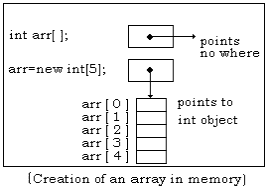

**注意 1**- 数组的所有元素将自动初始化为零，但为了用不同的值初始化数组，我们可以在声明本身时初始化。数组的声明、内存分配和初始化步骤可以合并：

`int a[]={5,7,1};`

**注意 2**- 数组索引从零开始。

**注意 3**- 在 Java 中，所有数组的都存储在一个名为 `length` 的变量中。我们可以使用属性 `length` 来访问数组的长度：“`array_name.length`”。

**注意 4**- `int a[],b[];`

`a = b = new int[5];`

在上述步骤中，通过 `new` 只了一个数组，该数组的引用首先存储在 `b` 中，然后存储在 `a` 中。因此，a` 和 `b` 都指向同一个数组。赋值引用不会创建副本。

示例 4.2: 数组中存储的数字和。

```java
class Sum
{
    public static void main(String args[])
    {
        int a[]={10,20,30};
        int n=a.length,sum=0;
        for(int i=0;i<n;i++)
            sum+=a[i];
        System.out.println("和为 " + sum);
    }
}
```

输出：和为 60

示例 4.3: 使用选择技术排序数组。

```java
import java.util.Scanner;
class Sort
{
    public static void main(String args[])
    {
        Scanner sc = new Scanner(System.in);
        System.out.print("输入个数");
        int n=sc.nextInt();
        int a[] = new int[n];
        //输入
        for(int i=0;i<n;i++)
        {
            System.out.print("输入元素 " + (i+1) + ": ");
            a[i]=sc.nextInt();
        }
        //排序逻辑（此处省略具体实现）
    }
}
```

### 2. 二维数组

#### 声明

`type array_name[][]`

或

`type[][] array_name;`

#### 内存分配

`array_name = new type[ROWS][COLUMNS];` // `ROWS` 和 `COLUMNS` 可以是常量或变量。

到为止我们讨论了存储值的数组。考虑具有行和列矩阵。

示例 4.4: 打印矩阵的转置。

```java
import java.util.*;
class Transpose
{
    public static void main(String args[])
    {
        Scanner sc=new Scanner(System.in);
        int r,c;
        System.out.print("输入行数");
        r=sc.nextInt();
        System.out.print("输入列数");
        c=sc.nextInt();

        int m[][]=new int[r][c];
        //输入
        for(int i=0;i<r;i++)
            for(int j=0;j<c;j++)
            {
                System.out.print("输入元素 " + (i+1) + "," +(j+1) + ": ");
                m[i][j]=sc.nextInt();
            }
        //转置输出
        for(int i=0;i<c;i++)
        {
            for(int j=0;j<r;j++)
                System.out.print(m[j][i]+"\t");
            System.out.println();
        }
    }
}
```

示例 4.5: 将两个矩阵相乘得到第三个矩阵。

```java
import java.util.*;
class MatrixMult
{
    public static void main(String args[])
    {
        Scanner sc=new Scanner(System.in);
        int r1,c1;
        System.out.print("输入第一个矩阵行数");
        r1=sc.nextInt();
        System.out.print("输入第一个矩阵列数");
        c1=sc.nextInt();
        int r2,c2;
        System.out.print("输入第二个矩阵行数");
        r2=sc.nextInt();
        System.out.print("输入第二个矩阵列数");
        c2=sc.nextInt();
        if(c1 != r2)
        {
            System.out.println("无法相乘");
            System.exit(1);
        }
        int m1[][]=new int[r1][c1];
        // 输入和计算逻辑此处略...
    }
}
```

```java
for(int j=0;j<c1;j++)
{
    System.out.print("Enter" + "element " + (i+1) + "," + (j+1));
    m1[i][j]=sc.nextInt();
}
int m2[][]=new int[r2][c2];
//输入 m2
for(int i=0;i<r2;i++)
    for(int j=0;j<c2;j++)
    {
        System.out.print("Enter" + "element " + (i+1) + "," +(j+1));
        m2[i][j]=sc.nextInt();
    }
int m3[][]=new int[r1][c2];
//矩阵乘法
for(int i=0;i<r1;i++)
    for(int j=0;j<c2;j++)
        for(int k=0;k<c1;k++)
            m3[i][j]+=m1[i][k]*m2[k][j];
//输出 m3
for(int i=0;i<r1;i++)
{
    for(int j=0;j<c2;j++)
        System.out.print(m3[i][j]+"\t");
    System.out.println();
}
}
}
```

### 3. 变长数组

数组将多维数组视为“数组的数组”，可以按照如下方式声明一个二维数组：

```java
int arr[][] = new int[4][];
arr[0] = new int[1];
arr[1] = new int[2];
arr[2] = new int[3];
arr[3] = new int[4];
```

这意味着数组总共有 4 行，其列从 1 开始并逐个增加。因此，它们在内存中的表示方式如下：

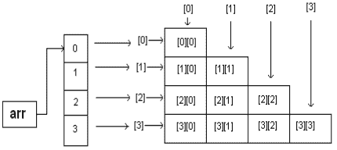

（内存分配）

**注意 1**- 数组的所有元素都将自动初始化为零，但如果想用不同的值初始化数组，我们可以在声明时进行初始化。数组的声明、内存分配和初始化步骤可以合并为一条：

```java
int a[][]={  {5,7,1}, {1,7,9}, {4,5,7}, {1,1,1} };
```

**注意 2**- 在上述数组 `a` 中，`a.length` 将显示行数，即 4；`a[0].length` 将显示第 0 行的列数，即 3

## 命令行参数

有时我们希望在运行程序时向程序传递信息。这是通过向 `main()` 传递命令行参数来实现的命令行参数是在执行程序时直接跟在命令行中程序名后面的信息。

要在 Java 程序内部访问命令行参数，我们必须使用传递给 `main()` 的 `String` 数组。

JVM 调用 `main()` 方法并将命令行参数作为字符串数组传递给它。在上面的示例中，数组的长度（即命令行参数的数量）是通过使用属性 `length` 获取的。

`for` 循环在控制台/显示器上显示命令行参数。

#### 示例 4.6 从命令行参数输入名称的程序。

```java
class Hello
{
    public static void main(String args[])
    {
        for(int i=0;i<args.length;i++)
            System.out.println("Hello " + args[i]);
    }
}
```

`javac Hello.java`

`java Hello Ravi Ajay Vijay`

**输出：**

```
Hello Ravi
Hello Ajay
Hello Vijay
```

#### 示例 4.7 输出通过命令行参数输入的数字之和的程序。


```java
class SumCmd
{
    public static void main(String args[])
    {
        int sum=0;
        for(int i=0;i<args.length;i++)
            sum+=Integer.parseInt(args[i]);
        System.out.println("Sum is " + sum);
    }
}
```

`javac SumCmd.java`

`java SumCmd 5 6`

**输出：**

```
Sum is 11
```

#### 示例 4.8 从命令行排序数组的程序

```java
class SortCmd
{
    public static void main(String args[])
    {
        int n=args.length;
        int a[]=new int[n];
        for(int i=0;i<n;i++)
            a[i] = Integer.parseInt(args[i]);
        for(int i=0;i<n-1;i++)
            for(int j=i+1;j<n;j++)
                if(a[i]>a[j])
                {
                    int t=a[i];
                    a[i]=a[j];
                    a[j]=t;
                }
        for(int i=0;i<n;i++)
            System.out.print(a[i]+"\t");
    }
}
```

`javac SortCmd.java`

`java SortCmd 5 4 1 3 2`

**输出：**

```
1 2 3 4 5
```

## 多选题

1. 如果 `MyProg.java` 被编译并在命令行执行 `java MyProg hello world`，那么 `main` 方法中 `args.length` 的值是：

A. 0

B. 1

C. 2

D. 3

2. 在 Java 中，声明 `int[][] arr = new int[3][4];` 后，以下描述正确的是：

A. `arr.length` 是 4

B. `arr[0].length` 是 3

C. `arr.length` 是 3

D. 以上均错

3. 关于 Java 数组，以下说法错误的是：

A. 数组的大小在创建后无法改变

B. 数组可以存储不同类型的元素

C. 数组的索引从 0 开始

D. 数组是连续存储在内存中的

4. 命令行参数是通过哪个参数名传递给 `main` 方法的？

A. `System`

B. `args`

C. `options`

D. `input`

5. 下列关于数组初始化的描述，正确的是：

A. 数组元素会自动初始化为 0

B. 数组可以在声明时直接初始化

C. 数组不能在声明时初始化

D. 以上都是

在 `s2` 中进行的任何更改也将反映在 `s1` 中。这种赋值不会进行内存分配。几步之后，如果我们为 `s1` 赋值 `null`，那么该对象不会被销毁，因为它的引用仍在对象 `s2`。但如果 `s1` 和 `s2` 都被赋值为 `null`，则该对象将被垃圾回收器回收，对象占用的内存将被释放。

### 示例 5.1 只包含成员变量的类

```java
class A
{
    int x;
    int y;
}
class ClassTest1
{
    public static void main(String args[])
    {
        A a1,a2;  //引用变量
        a1 = new A();  //创建对象
        a2 = new A();
        a1.x = 10;
        a1.y = 20;
        a2.x = 5;
        a2.y = 6;
        System.out.println(a1.x + "\t" + a1.y);
        System.out.println(a2.x + "\t" + a2.y);
    }
}
```

**输出：**

```
10  20
5  6
```

### 示例 5.2 包含成员变量与成员方法的类

```java
class A
{
    private int x;
    private int y;
    void setdata(int x1, int y1)
    {
        x = x1;
        y = y1;
    }
    void display()
    {
        System.out.println(x + "\t" + y);
    }
}
class ClassTest2
{
    public static void main(String args[])
    {
        A a1 = new A();
        A a2 = new A();
        //a1.x=10;  因为 x 是私有的，所以报错
        a1.setdata(10,20);
        a2.setdata(5,7);
        a1.display();
        a2.display();
    }
}
```

**输出：**

```
10  20
5  7
```

注意 - 我们可以在类外部，也可以在类内部声明类的对象。

### 示例 5.3 在类内部定义类的对象

```java
class A
{
    private int x;
    private int y;
    void setdata(int x1, int y1)
    {
        x = x1;
        y = y1;
    }
    void display()
    {
        System.out.println(x + "\t" + y);
    }
    public static void main(String args[])
    {
        A a1 = new A();
        A a2 = new A();
        a1.setdata(10,20);
        a2.setdata(5,7);
        a1.display();
        a2.display();
    }
}
```

**输出：**

```
10  20
5  7
```

### 类成员的修饰符 / 可见性标签

可见性修饰符仅适用于成员而不适用于局部变量。

- `private` - 如果我们在成员变量或方法上指定 `private` 修饰符，那么该成员在声明它的类外部是不可见的。这将从其他类隐藏该类的成员。

- `public` - 如果我们在成员变量或方法上指定 `public` 修饰符，那么该成员对所有类都可见。该成员甚至可以在包外被访问。`main()` 方法始终被定义为 `public`，因为 `main()` 方法是由 JVM 访问的，而 JVM 在定义 `main()` 方法的类外部。

- `protected` - 声明为 `protected` 的成员可以从属于同一包的所有类访问。受保护的成员也可以从其他包的任何子类访问。

- `default / 无修饰符` - 如果在成员之前没有指定可见性修饰符，则可以从相同包中的所有类访问该成员。该成员无法跨包访问。

#### 类或接口的可见性修饰符

- `public` - 如果一个类要对所有包的所有类都可见，则必须通过指定 `public` 修饰符将其声明为 `public`，该修饰符应出现在 `class` 关键字之前。

- `default / 无修饰符` - 如果在类之前没有任何访问/可见性修饰符，它的可见性仅限于它所在的包（类组）内。

#### this 关键字

`this` 是一个引用变量，存储了用于调用方法的对象的引用。`this` 的引用在运行时会被替换为调用对象的引用。有时，一个方法需要引用调用它的对象。这可以通过 `this` 来实现。注意：局部变量会隐藏实例变量，因此我们必须显式地使用该关键字。

#### 实例变量隐藏

众所周知，在 Java 中在同一个嵌套作用域内声明两个同名的局部变量是违法的。但我们可以拥有与类的实例变量同名的局部变量（方法的参数）。当局部变量与实例变量同名时，局部变量会隐藏实例变量。但 `this` 关键字允许即使在局部变量隐藏了实例变量的情况下，我们仍然能够引用到该实例变量。

### 示例 5.4 this 关键字的使用

```java
class A
{
    private int x;
    private int y;
    void setdata(int x, int y)
    {
        this.x = x;  //this.x 是类成员，x 是局部变量
        this.y = y;
    }
    void display()
    {
        System.out.println(x + "\t" + y);
    }
}
class ClassTest4
{
    public static void main(String args[])
    {
        A a1 = new A();
        A a2 = new A();
        a1.setdata(10,20);
        a2.setdata(5,7);
        a1.display();
        a2.display();
    }
}
```

**输出：**

```
10  20
5  7
```

### 方法重载

我们可以有多个同名的方法，只要它们在参数数量、参数类型或参数顺序上不同。这被称为方法重载。

在调用重载方法时，传递的实际参数类型可能与任何重载方法的形式参数不完全匹配。在这种情况下，参数将提升到更高类型，直到找到匹配项为止。如果在提升参数后仍未找到匹配项，则会发生编译错误。

### 示例 5.5 在示例中，两个 `setdata()` 方法名称相同但参数不同，因此这是方法重载

```java
class A
{
    private int x,y;
    void setdata(int x1)
    {
        x = y = x1;
    }
    void setdata(int x1, int y1)
    {
        x = x1;
        y = y1;
    }
    void display()
    {
        System.out.println(x + "\t" + y);
    }
}
class ClassTest5
{
    public static void main(String args[])
    {
        A a1 = new A();
        a1.setdata(5);
        a1.display();
        A a2 = new A();
        a2.setdata(10,20);
        a2.display();
    }
}
```

**输出：**

```
5  5
10  20
```

## 默认构造函数

每个类都有一个默认构造函数（如果没有定义显式构造函数），该函数不接受任何参数，且其体不包含任何语句。编译器会自动生成默认构造函数。

一旦我们添加了自己的构造函数，编译器就会停止生成默认构造函数。如果我们不在类中创建任何构造函数，那么 `JVM` 将创建默认构造函数，并将实例变量初始化为默认值 `null` 或零。

#### 示例 5.6 默认构造函数的用法

```java
class A {
    private int x;
    private int y;
    void display() {
        System.out.println(x + "\t" + y);
    }
}
class ClassTest6 {
    public static void main(String args[]) {
        A a1 = new A();
        a1.display();
    }
}
```

**输出：**

```
0 0
```

**注意：** 这里我们没有创建任何构造函数，因此 `JVM` 在创建对象后自动创建默认构造函数，并将实例变量初始化为 0 或 `null`。

### 默认零参数构造函数

我们可以用自己的零参数构造函数替换默认构造函数。这允许我们将实例变量初始化为任何值。

## 参数化构造函数

带有参数的构造函数称为参数化构造函数。

**注意：** 可以像方法一样对构造函数进行重载。这被称为构造函数重载。

#### 示例 5.7 构造函数的用法

```java
class A {
    private int x;
    private int y;
    A() //零参数构造函数 {
        x = y = 0;
    }
    A(int x1) //参数化单参数构造函数 {
        x = y = x1;
    }
    A(int x1, int y1) //参数化双参数构造函数 {
        x = x1;
        y = y1; 
    }
    void display() {
        System.out.println(x + "\t" + y);
    }
}
class ClassTest7 {
    public static void main(String args[]) {
        A a1 = new A();
        a1.display();
        A a2 = new A(5);
        a2.display();
        A a3 = new A(4,7);
        a3.display();
    }
}
```

**输出：**

```
0 0
5 5
4 7
```

#### 示例 5.8

```java
import java.util.Scanner;
class Complex {
    private int real,imag;
    Complex()//零参数构造函数 {
        real=imag=0;
    }
    Complex(int real, int imag) {
        this.real=real;
        this.imag=imag;
    }
    void getdata() {
        Scanner sc=new Scanner(System.in);
        System.out.print("Enter real");
        real=sc.nextInt();
        System.out.print("Enter imag");
        imag=sc.nextInt();
    }
    void display() {
        if(imag>=0)
            System.out.println(real+"+"+imag+"i");
        else
            System.out.println(real+""+imag+"i");
    }
    Complex sum(Complex c) {
        Complex t=new Complex();
        t.real=real+c.real;
        t.imag=imag+c.imag;
        return t;
    }
    Complex mult(Complex c) {
        Complex t=new Complex();
        t.real=real*c.real;
        t.imag=imag*c.imag;
        return t;
    }
    public static void main(String args[]) {
        Complex c1=new Complex();
        Complex c2=new Complex();
        Complex c3=null,c4=null;
        c1.getdata();
        c2.getdata();
        c3=c1.sum(c2);
        System.out.print("Sum is ");
        c3.display();
        c4=c1.mult(c2);
        System.out.print("Product is ");
        c4.display();
    }
}
```

## finalize 方法

有时对象在被销毁时需要执行某些操作。例如，如果一个对象持有某些非 Java 资源（如文件句柄），我们可能希望在对象销毁之前确保这些资源被释放。为了处理这种情况，Java 提供了一种名为 finalization（最终化）的机制。通过使用最终化，我们可以定义对象即将被垃圾回收器回收时的特定操作。`finalize()` 仅在垃圾回收之前调用。它在对象超出作用范围时不会调用。在 C++ 中，析构函数的概念用于最终化，但它与 Java 中的 `finalize()` 并不相同。

```java
protected void finalize() {
    // 此处编写 finalize 代码。
}
```

**注意：** 除了 `protected` 修饰符外，我们也可以使用 `public`。


## 变量类型

Java 有三种变量：

### 1. 实例变量

在类中声明、在所有方法之外的变量称为实例变量。该变量的副本数量与对象的数量相同。在 Java 中不需要初始化实例变量，因为这些变量在对象创建并使用 `new` 运算符分配内存时就会被初始化。变量根据其类型进行初始化。所有数值变量都自动初始化为 `0`，布尔变量初始化为 `false`，引用变量（对象）初始化为 `null`。

### 2. 局部变量

在方法内部声明的变量是局部变量。它们不会自动初始化。

### 3. 静态变量

静态变量与实例变量一样声明在方法/块之外，但带有 `static` 修饰符。它们对类是全局的。静态变量可以用于跟踪全局状态。例如，类中的静态变量 `count` 可以存储程序中创建的实例数量。对象通过静态变量进行通信，就像全局变量一样。

### 示例 5.9

```java
class A {
    int x; // 实例变量
    static int y; // 静态或类变量
}
class ClassTest8 {
    public static void main(String args[]) {
        A a1 = new A();
        A a2 = new A();
        A a3 = new A();
        a1.x = 10;
        a1.y = 20;
        a2.x = 11;
        a2.y = 21;
        a3.x = 12;
        a3.y = 22;
        System.out.println(a1.x + "\t" + a1.y);
        System.out.println(a2.x + "\t" + a2.y);
        System.out.println(a2.x + "\t" + a3.y);
    }
}
```

**输出：**

```
10 22
11 22
12 22
```

## 方法类型

### 实例方法

这些方法与 C++ 函数相同。实例方法只能通过对象调用。如果在同一个类的静态方法内部调用实例方法，那么也必须使用对象名称。

### 静态方法

静态方法可以使用对象名也可以通过类名来调用。静态方法只能访问静态成员。在同一类的静态方法中，可以直接调用静态方法（不需要对象或类名）。

### 示例 5.10

```java
class A
{
    int x;
    static int y;
    static int sum(int a, int b)
    {
        // y = 5; 无错误，静态方法可以访问静态变量
        // x = 10; 错误，静态方法无法访问实例变量
        // A a1 = new A();
        // a1.x = 10; 无错误，因为静态方法可以通过对象访问实例变量
        // this.x = 10; 错误，静态方法无法访问 this 或 super 关键字
        int c;
        c = a+b;
        return(c);
    }
    static float avg(int a, int b)
    {
        return (float)(a+b)/2;
    }
}
class ClassTest9
{
    public static void main(String args[ ])
    {
        System.out.println(A.sum(5,6)); // 静态方法可以通过类名调用
        System.out.println(A.avg(5,6));
        A a1 = new A();
        System.out.println(a1.sum(5,6)); // 静态方法也可以通过对象调用
    }
}
```

**输出：**

```
11
5.5
11
```

### 初始化块与静态块

初始化块用于初始化类的实例成员变量，而静态块用于初始化类的静态成员变量。构造函数会在这些块之后被调用。

### 示例 5.11

```java
class A
{
    int x;
    static int y;

    {  // 初始化实例变量的初始化块
        x = 10;
    }

    static  // 初始化静态变量的静态块
    {
        y = 5;
    }
}
class ClassTest10
{
    public static void main(String args[])
    {
        A a1 = new A();
        System.out.println(a1.x + "\t" + a1.y);
    }
}
```

**输出：**

```
10  5
```

## final 变量

如果变量被声明为 `final`，则我们不能改变它的值 `final (double PI=3.141;)`。final 变量不按实例占用内存。final 变量是一个常量变量，其值不能改变。final 变量的引用类型不能改变其引用。

### 示例 5.12

```java
class A
{
    void m1() 
    {
        System.out.println("Inside m1()");
    }
}
class ClassTest11
{
    public static void main(String args[])
    {
        final int x=10; // 不能更改
        final int y;  // 变量 y 未初始化，所以我们稍后可以初始化 y
        y=20;   // 现在 y 已初始化，之后我们不能再改变它的值
        //  y=30;  错误
        System.out.println(x);
        System.out.println(y);
        final A a1=new A();  // a1 是常量引用，所以我们不能将其他对象的引用赋值给 a1
        a1.m1();
        A a2 = new A();
        //  a1 = a2;  错误 
    }
}
```

**输出：**

```
10
20
Inside m1()
```

### 参数传递机制

1. 值传递。

2. 引用传递。

当将基本数据类型（`int`、`float`、`long` 等）传递给方法时，是使用值传递的方法。对于对象，实际传递的是对象引用。

对象引用也是通过值传递的方法进行传递的。然而，由于所传递的值指向一个对象，该值的拷贝仍然指向与其对应的实形参数相同的对象。

例如，如果我们将存储了对象引用的引用变量 `a1` 传递给函数，且函数中 `a2` 是形式参数，那么 `a1` 和 `a2` 都指向同一个对象。

通过 `a2` 对对象值进行的任何更改也将反映在 `a1` 中。但如果我们在 `a2` 中分配一个新引用，那么该引用将被复制到 `a1` 中。

### 示例 5.13

```java
class Box
{
    private int feet;
    private int inches;
    Box()
    {
        feet = inches = 0;
    }
    Box(int feet, int inches)
    {
        this.feet = feet;
        this.inches = inches;
    }
    void display()
    {
        System.out.println("Feet is " + feet +"\n" + "Inches is " + inches);
    }
    void swap(Box obj)
    {
        int t;
        t = feet;
        feet = obj.feet;
        obj.feet = t;
        t = inches;
        inches = obj.inches;
        obj.inches = t;
    }
}
class ClassTest2
{
    public static void main(String args[])
    {
        Box b1 = new Box(5,6);
        Box b2 = new Box(7,4);
        b1.swap(b2); // 对象通过引用传递
        b1.display();
        b2.display();
    }
}
```

**输出：**

```
Feet is 7
Inches is 4
Feet is 5
Inches is 6
```

### 嵌套内部类

在另一个类内部定义一个类是可能的；此类类被称为嵌套类。嵌套类的作用范围限于其外部类的作用范围。嵌套类可以访问其所嵌套类的成员，包括该类的私有成员。然而，外部类无法访问嵌套类的成员。

嵌套类有两种类型：静态的和非静态的。静态嵌套类是应用了 `static` 修饰符的类。由于它是静态的，它必须通过对象来访问其外部类的成员。也就是说，它不能直接引用外部类的成员。由于这种限制，静态嵌套类很少使用。非静态嵌套类可以访问外部类的所有成员。

### 示例 5.14

```java
class Outer
{
    static class Inner
    {
        int x = 15;
        void msg()
        {
            System.out.println("Hello from Inner class");
        }
    }

    void test()
    {
        Inner i = new Inner();
        i.msg();
        System.out.println(i.x);
    }
}

class ClassTest13
{
    public static void main(String args[])
    {
        Outer o = new Outer();
        o.test();
    }
}
```

**输出：**

```
Hello from Inner class
15
```

### 示例 5.15

```java
class Outer
{
    class Inner
    {
        int x = 15;
        void msg()
        {
            System.out.println("Hello from Inner class");
        }
    }

    void test()
    {
        Inner i = new Inner();
        i.msg();
        System.out.println(i.x);
    }
}
class ClassTest14
{
    public static void main(String args[])
    {
        Outer o = new Outer();
        o.test();
    }
}
```

**输出：**

```
Hello from Inner class
15
```

## Random 类

### 示例 5.16

```java
import java.util.Random;
class RandomTest
{
    public static void main(String args[])
    {
        Random r1 = new Random();
        for(int i=1;i<=10;i++)
            System.out.println(Math.abs(r1.nextInt()));
    }
}
```

## 问题

1. 如果我们希望一个成员变量在类外部无法被访问，在声明变量时应该使用什么关键字？

2. 在 Java 中，对象/值是如何传递的？

3. 考虑以下代码：

```java
public static void main(String args[])
{
    int a = 5;
    System.out.println( cube( a ) );
}

int cube( int theNum )
{
    return theNum * theNum * theNum;
}
```

解释“static”关键字的重要性

当我们尝试编译并运行此代码时会发生什么？

a) 无法编译，因为 cube 在 java.lang.Math 类中已经定义。

b) 无法编译，因为 cube 不是静态的。

c) 编译通过，但会抛出算术异常。

d) 能够完美运行并在标准输出上打印“125”。

4. 什么是静态内部类？它与任何其他静态成员有什么区别？

5. 如何在 Java 中声明常量值

6. "final" 关键字的含义是什么？

7. 什么是类变量？

**答案：**

当我们创建一个相同类的多个对象时，每个对象将共享变量的公共副本。这意味着无论从该类创建了多少个对象，每个类只有一份副本。类变量或静态变量在类中使用 `static` 关键字进行声明。

这些变量存储在静态内存中。类变量主要用于常量，即初始值从不改变的变量。静态变量始终通过类名进行调用。

该变量在程序启动时创建，即它在通过 `new` 运算符创建类的实例之前就已经创建了，并在程序停止时销毁。类变量的作用范围与实例变量相同。

类变量可以在类层级的任何地方使用 `static` 关键字进行定义。它的初始值与实例变量相同。当类变量被定义为 `int` 时，其默认值 零；当声明为 `boolean` 时，其默认值为 false，对象引用则为 null。类变量与类相关，而不是与任何对象相关。

8. 解释垃圾回收。

**答案：** 垃圾回收是 Java 最重要的特性之一。垃圾回收也被自动内存管理，因为 `JVM` 会自动从内存中移除未使用的变量/对象（值为 `null`）。用户程序无法直接从内存中释放对象，相反，由垃圾回收器自动释放不再被程序引用的对象。

每个类都从 `java.lang.Object` 继承了 `finalize()` 方法，当垃圾回收器确定不再有对该对象的引用时，就会调用 `finalize()` 方法。

在 Java 中，当变量不再被使用时，显式地为变量赋值 `null` 是一个好习惯。在 Java 中，调用 `System.gc()` 和 `Runtime.gc()` 时，`JVM` 会尝试回收未使用的对象，但无法保证所有对象何时会被垃圾回收。

9. 如果一个类有多个构造函数，我们可以从其中一个构造函数调用另一个吗？

可以。使用 `this()` 从一个构造函数调用另一个构造函数。

10. 构造函数和普通方法之间有什么区别？

构造函数的名称必须与类名相同且不能有返回值。它们只会被调用一次，而普通方法可以被调用多次，并且可以返回结果或为 `void`。

11. 我们如何强制执行垃圾回收？

垃圾回收是自动过程，无法强制执行。我们可以通过调用 `System.gc()` 来请求它。`JVM` 不保证 GC 会立即启动。

12. 下列哪项说法是不正确的？

(a) Java 中的局部变量总是由默认值初始化的。

(b) Java 中的局部变量在使用之前必须初始化。

(c) 内部块中的局部变量不能与外部块中的局部变量同名。

(d) 同一层级的两个块中的局部变量可以有相同的名称。

# 章节

# 6 (继承)

## 简介

当一个类的属性转移到另一个类时，就称为继承。在这种情况下，被继承的类被称为超类、基类或父类，而继承的类被称为子类、子类或派生类。

继承允许我们通过添加额外功能来扩展现有的类（基类）。它鼓励代码的重用，这有助于减小代码量，尽管在某些情况下可能会导致复杂性。

例如，假设我们已经完成了简单计算器的代码。之后我们需要开发一个科学计算器，那么我们有两种方案：

(i) 创建一个新类。（重写该类）

(ii) 扩展该类。

在大多数情况下，第二种方案是更好的选择。在这种情况下，我们只需要编写一小段代码。同时，我们不需要在调试和测试上花费大量时间，因为基类已经过测试并且已经使用了很久。当我们需要将一个类继承另一个类时，必须使用 `extends` 关键字。

**语法：** `class sub_class extends base_class`

类 `A`（超类、基类或父类）。

类 `B`（子类、派生类或子类）。

子类将拥有基类的所有特征，外加上扩展类中定义的新特征。Java 不支持多重继承，但支持多接口继承，因此子类只能继承一个基类。

**示例 6.1：**


```java
class A
{
    int x;
    void setX(int x1)
    {
        x = x1;
    }
    void displayX()
    {
        System.out.println(x);
    }
}
class B extends A
{
    int y;
    void setY(int y1)
    {
        y = y1;
    }
    void displayY()
    {
        System.out.println(y);
    }
}
class InheritTest
{
    public static void main(String args[])
    {
        A a1 = new A();
        a1.setX(5);
        a1.displayX();
        B b1 = new B();
        b1.setX(10);
        b1.setY(20);
        b1.displayX();
        b1.displayY();
    }
}
```

**输出：**

```
5
10
20
```

## 成员隐藏

如果子类成员与超类成员的名称（对于方法而言为签名）相同，那么它会隐藏超类成员。虽然两个成员在子类中都是可用的，但使用成员名称时只能访问子类成员。

## 使用 `super` 关键字

每当子类需要引用其直接超类时，可以通过 `super` 关键字来实现。`super` 有两个通用用途：

1. 调用超类的构造函数：子类可以通过以下形式 `super(parameter-list);` 调用超类的构造方法。这里 `parameter-list` 指定了超类构造函数所需的参数。事实上，`super()` 必须是子类构造函数内部的第一条语句。
2. 访问被子类隐藏的超类成员：关键字 `super` 可以如下方式访问超类的隐藏成员：`super.member;`。这里 `member` 可以是方法或数据成员。

## 方法重载与方法重写

### 方法重载

当两个或多个方法的名称相同但参数不同时，被称为方法重载。方法重载用于对象需要执行相似任务但使用不同输入参数。当我们调用方法时，`java` 首先匹配方法名称，然后匹配参数的数量和类型。决定调用哪个方法定义被称为多态。

### 方法重写

我们已经看到超类中的方法被子类继承并由子类创建的对象使用。方法继承允许我们在子类中重复定义和使用方法，而无需再次定义。在类层次结构中，当子类的实例方法与其超类中的非私有实例方法的名称和签名相同时，子类中的方法被称为重写了超类中的方法。当在子类内部调用重写的方法时，它将始终引用子类定义的该方法版本。超类定义的方法版本将被隐藏。


## 示例 6.2

```java
class A
{
    int x;
    void set(int x1)
    {
        x = x1;
    }
    void display()
    {
        System.out.println(x);
    }
}
class B extends A
{
    int y;
    void set(int x1,int y1) // 类 B 的 set 方法没有重写类 A 的 set
    // 方法，因为参数不同
    {
        set(x1);  //这将调用类 A 的 set()
        y = y1;
    }
    void display() // 类 B 的 display 方法重写了
    // 类 A 的 display 方法
    {
        //  display();  这将会调用类 B 的 display
        super.display(); // 这将调用类 A 的 display
        System.out.println(y);
    }
}
class InheritTest2
{
    public static void main(String args[])
    {
        B b1 = new B();
        b1.set(10,20);
        b1.display();
    }
}
```

**输出：**

```
10
20
```

Java 支持以下继承形式：

1. 单级继承
2. 多级继承
3. 层级继承

### 单级继承

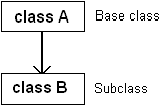

### 示例 6.3

```java
class A
{
    private int x;
    A()
    {
        x = 0;
    }
    A(int x1)
    {
        x = x1;
    }
    void display()
    {
        System.out.print(x);
    }
}
class B extends A
{
    private int y;
    B()
    {
        super();
        //x=0;  因为 x 是私有的，此处报错
        y=0;
    }
    B(int x1, int y1)
    {
        super(x1);
        //x = x1; 因为 x 是私有的，此处报错
        y = y1;
    }
    void display()
    {
        super.display();
        System.out.print(y);
    }
}
class InheritTest3
{
    public static void main(String args[])
    {
        B b1 = new B();
        b1.display();
        B b2 = new B(10,20);
        b2.display();
    }
}
```

**输出：**

```
0 0 10 20
```

---

### 多级继承

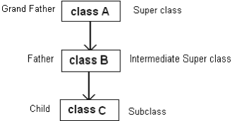

### 示例 6.4

```java
class A
{
    private int x;
    A()
    {
        x = 0;
    }
    A(int x1)
    {
        x = x1;
    }
    void display()
    {
        System.out.println(x);
    }
}
class B extends A
{
    private int y;
    B()
    {
        super();
        y = 0;
    }
    B(int x1, int y1)
    {
        super(x1);
        y = y1;
    }
    void display()
    {
        super.display();
        System.out.println(y);
    }
}
class C extends B
{
    private int z;
    C()
    {
        super();
        z = 0;
    }
    C(int x1, int y1)
    {
        super(x1);
        z = y1;
    }
    void display()
    {
        super.display();
        System.out.println(z);
    }
}
class InheritTest4
{
    public static void main(String args[])
    {
        C c1 = new C();
        c1.display();
        C c2 = new C(10,20);
        c2.display();
    }
}
```

**输出：**

```
0
0
0
10
0
20
```

---

### 层级继承


#### 构造函数的调用顺序

当类层次结构被创建时，构造函数的调用顺序是：父类到子类。无论你是否显式调用 `super()`，子类的构造函数都会首先调用父类的无参构造函数（除非显式调用了带参构造函数）。

```java
class A
{
    A()
    {
        System.out.println("A constructor");
    }
}
class B extends A
{
    B()
    {
        System.out.println("B constructor");
    }
}
class C extends A
{
    C()
    {
        System.out.println("C constructor");
    }
}
class InheritTest5
{
    public static void main(String args[])
    {
        B b = new B();
        C c = new C();
    }
}
```

**输出：**

```
A constructor
B constructor
A constructor
C constructor
```

## 动态方法绑定（动态方法派发或运行时绑定）

方法重写是 Java 强大概念之一的基础。动态方法派发是在运行时解析重写实例方法的机制，而不是在编译时。动态方法派发非常重要，因为这是 Java 实现运行时多态的方式。

通过父类引用调用重写方法时，Java 会根据调用时对象的类型来确定执行哪个版本的方法。因此，这种决定是在运行时进行的，取决于被引用的对象的类型，而不是引用的变量类型。

### 示例 6.5

```java
class Shape
{
    void getdata()
    {
        System.out.println("getdata() of Shape");
    }
    void area()
    {
        System.out.println("area() of Shape");
    }
    void display()
    {
        System.out.println("display() of Shape");
    }
}
class Circle extends Shape
{
    void getdata()
    {
        System.out.println("getdata() of Circle");
    }
    void area()
    {
        System.out.println("area() of Circle");
    }
    void display()
    {
        System.out.println("display() of Circle");
    }
}
class Rectangle extends Shape
{
    void getdata()
    {
        System.out.println("getdata() of Rectangle");
    }
    void area()
    {
        System.out.println("area() of Rectangle");
    }
    void display()
    {
        System.out.println("display() of Rectangle");
    }
}
class InheritTest5
{
    public static void main(String args[])
    {
        // 父类引用变量可以接受子类对象
        // 动态绑定
        Shape s[]={new Circle(), new Rectangle()};
        for(int i=0;i<s.length;i++)
        {
            s[i].getdata();
            s[i].area();
            s[i].display();
        }
    }
}
```

**输出：**

```
getdata() of Circle
area() of Circle
display() of Circle
getdata() of Rectangle
area() of Rectangle
display() of Rectangle
```

## 抽象类与抽象方法

我们已经看到，通过将方法标记为 `final`，我们可以确保该方法在子类中不被重定义。`Java` 允许我们进行与此完全相反的操作。也就是说我们可以指定某个方法必须在子类中被重定义，从而使重写成为强制性。这是通过方法定义中使用修饰关键字 `abstract` 实现的。

某些情况下，我们希望定义一个父类，该父类声明了某个抽象的结构，但不提供每个方法的完整实现。也就是说，有时我们想要创建一个父类，它只定义一个所有子类共享的通用形式，而将细节留给每个子类去填充。

这种类决定了子类必须实现的方法的性质。这种情况发生的一种方式是父类无法为某个方法创建有意义的实现。

要声明抽象方法，请使用以下通用形式：

`abstract return_type name (parameter-list);`

没有任何实现。任何包含一个或多个抽象方法的类也必须声明为 `abstract`。要声明一个类为 `abstract`，我们只需要在声明开头的 `class` 关键字前面使用 `abstract` 关键字。

抽象类不能有对象。也就是说，抽象类不能用 `new` 操作符直接实例化。这样的对象是无用的，因为抽象类没有被完全定义。

此外，我们不能声明抽象构造函数或抽象静态方法。抽象类的任何子类必须实现父类中所有的抽象方法，要么本身被声明为抽象。

### 示例 6.6

```java
abstract class Shape
{
    abstract void getdata();
    abstract void area();
    abstract void display();
}
class Circle extends Shape
{
    void getdata()
    {
        System.out.println("getdata() of Circle");
    }
    void area()
    {
        System.out.println("area() of Circle");
    }
    void display()
    {
        System.out.println("display() of Circle");
    }
}
class Rectangle extends Shape
{
    void getdata()
    {
        System.out.println("getdata() of Rectangle");
    }
    void area()
    {
        System.out.println("area() of Rectangle");
    }
    void display()
    {
        System.out.println("display() of Rectangle");
    }
}
class InheritTest6
{
    public static void main(String args[])
    {
        //父类引用变量可以接受子类对象
        //动态绑定
        Shape s[]={new Circle(), new Rectangle()};
        for(int i=0;i<s.length;i++)
        {
            s[i].getdata();
            s[i].area();
            s[i].display();
        }
    }
}
```

**输出：**

```
getdata() of Circle
area() of Circle
display() of Circle
getdata() of Rectangle
area() of Rectangle
display() of Rectangle
```

## `Final` 方法

如果我们不希望一个方法被派生类方法重写，那么可以将基类方法定义为 `final`。任何重写该方法的尝试都会导致编译时错误。


```java
class A
{
    final void method1()
    {
        -----
    }
}
class B extends A
{
    void method1()  // error
    {
        -----
    }
}
```

### Final 类

有时出于安全考虑，我们可能希望防止类被进一步子类化。不能被子类的类被称为 `final` 类。在 `java` 中通过如下使用 `final` 关键字来实现：

```java
final class A1
{
    - - - - - -
    - - - - - -
}
class B extends A    // error
{
    - - - - - - -
    - - - - - - -
}
```

任何继承类 `A` 的尝试都会导致错误，编译器将不允许。声明类 `A` 会防止任何继承。声明类 `A` 会防止进一步的子类化。

### 理论题：

1. 什么是继承？

2. 有多少种类型的继承？

3. 默认构造函数和参数化构造函数之间有什么区别？

4. `final` 类和 `final` 方法之间有什么区别？

5. 什么是父类？

6. 什么是抽象类？

7. 编译时绑定和运行时绑定有什么区别？

8. 方法重载和方法重写之间有什么区别？

# 第 7 章：面向对象编程

## 引言

面向对象编程 vs 过程化：

所有程序都由两个元素组成：过程（逻辑）和数据。取决于关注点是处理还是数据，可以有两种方法。过程化语言（`c`、`PASCAL`、`COBOL` 等）关注“正在发生什么”（过程），而较少关注“谁在运行”（数据）。随着程序变得庞大，过程化方法变得越来越不适用。开发面向对象的编程语言是为了克服过程化语言的局限性。与过程化语言相比，面向对象的程序相对复杂性较低。

这两种方法的主要区别总结如下：

(i) 面向对象的程序以数据为中心，而过程化语言的程序以过程为中心。

(ii) 面向对象的程序围绕数据（对象）组织，因此能更好地模拟真实世界对象。

(iii) 与过程化方法相比，面向对象方法的代码重用和扩展性非常高。因此代码量较小。

(iv) 面向对象的程序更容易维护，因为它们相对不复杂且尺寸较小。

(v) 面向对象的程序基于自下而上的设计方法，而过程化程序基于自上而下的设计方法。

Java 是基于面向范式的。Java 几乎是面向对象的语言。我们之所以用“几乎”，是因为出于性能考虑，Java 也支持基本数据类型。C++ 不是纯的面向对象语言。C++ 是 C 的扩展，因此它使用一种混合了面向过程和面向对象的方法。

## OOP（面向对象编程）的基本概念：

下面是面向对象编程的一些基本元素：

*   抽象
*   对象和类
*   三大 OOP 原则：
    *   封装
    *   继承
    *   多态
*   持久化
*   泛型
*   组合 / 聚合

### 1. 抽象

抽象包括过程化语言在内的任何编程语言的基本元素之一。内置数据类型的概念也是一种抽象。在 `C` 语言中使用 `struct` 定义自定义数据类型进一步扩展了这种抽象。

抽象的基本目的是通过隐藏细节来降低复杂性。例如，建筑并不被看作建筑材料的集合，而是一个具有独特特征和属性的定义良好的对象。

面向对象的编程语言使用类和对象来模拟抽象。

### 2. 对象和类：

#### 对象 (Object)

对象是一个物理或抽象的实体或事物，与其他相似类型的对象区分开来。对象具有三个特征：

(i) 标识性（Identification）。

(ii) 属性（Attributes）。

(iii) 行为（Beiors / Operations / Functions）。

对象也可以被视为类的实例（instance），其中类类似于内置数据类型，而对象是变量。

#### 类 (Class)

类通过抽象对象的属性和行为来表示一类对象。类可以被视为创建对象的蓝图。对象具有其类定义的属性和行为。类可以被视为用户定义的数据类型，而对象是该类所代表的数据类型的变量/实例。

对象的属性/特征由 `Java` 中的数据成员/字段（data members / fields）定义。类中的数据成员/字段是一个可以存储数据的变量。对象的行为/操作是使用 `Java` 中的方法（methods）定义的。数据成员和方法统称为类的成员（members）。

类也可以被视为用户定义的数据类型，而对象是该数据类型的变量。一旦定义了类，我们就可以创建任意数量属于该类的对象。

### 三大 OOP 原则 (Three OOP Principles)

#### 封装 (Encapsulation)

封装是将代码及其在其上操作的数据绑定在一起的机制。`Java` 类支持这一点，因为它允许我们把代码和数据定义在一起。封装还通过将某些类成员声明为 `private` 来帮助数据隐藏，使得它们无法从不该类的代码中访问。

#### 继承 (Inheritance)

在面向对象编程中，继承指的是一个类的属性对被称为子类（sub-classes）或派生类（derived classes）的其他类可用。子类或派生类是从现有类派生出来的类。它继承现有类的所有特征，现有类也被称为基类（base-class）或超类（super-class）。因此，继承可以定义为从超类或基类派生类的过程。继承类不会给基类/超类引入任何更改。与基类相比，派生类具有更广泛的属性和行为。

继承的主要优势是代码重用。如果基类已经使用了很长时间，并且需要添加一些额外的属性和方法，我们可以通过派生另一个类来实现。派生类将可以使用基类的代码而无需调试，因为它已经使用了很长时间。

##### 类层次结构 (Class Hierarchy)

所有派生自共同基类的类都属于一个家族并形成类层次结构。类层次结构可以与树结构相比，其中一个基类位于根节点且没有超类。

所有其他类要么派生自层次结构根节点的类，要么派生自另一个类（该类直接或间接地派生自根类）。随着我们向下移动，添加的功能越来越多。由叶节点表示的类没有任何子类。以下示例展示了一些类层次结构。


#### 多态 (Polymorphism)

多态是一种允许同一个接口用于通用类动作的特性。大多数面向对象的语言在以下情况下使用多态：

* 运算符重载（Operator Overloading）。
* 方法重载（Method Overloading）。
* 方法重写（Method Overriding）。

##### 运算符重载

大多数语言对内置操作使用这种多态。例如，`C/C++` 或 `Java` 中的所有算术运算符都可以用于许多类型的操作数（`int`、`long`、`float`、`double` 等）。因此，相同的加法运算符可以加两个整数，也可以加两个浮点数。

`C++` 允许用户重载内置运算符。例如，我们可以重载算术运算符来处理复数。虽然 `Java` 对内置运算符使用了运算符重载，但它不允许用户重载运算符。

##### 方法重载

此特性允许我们编写多个具有相同名称的方法。`C++` 和 `Java` 具有这一特性。具有相同名称的方法（`C++` 中的函数）根据参数（参数）进行区分。重载的方法必须具有不同数量的参数，或者如果参数数量相同时参数的类型不同。

如果对重载方法的调用可以在编译时解析（即如果编译器可以决定调用哪个重载方法），则被称为静态绑定（static binding），它是编译时多态的例子。

如果对重载方法的调用无法在编译时解析（即如果编译器无法决定调用哪个重载方法），则被称为动态绑定（dynamic binding），它是运行时多态的例子。

通常情况下，Java 在运行时解析对重载方法的调用，但在许多情况下，对重载方法的调用调是在编译时解析的。

##### 方法重写 (Method Overriding)

子类可以定义一个与超类名称相同、参数数量和类型也相同的方法。这被称为方法重写。

编译器无法解析对重写方法的调用。`Java` 通常使用动态绑定来解析对重写方法的调用，即决策发生在运行时。

## 持久化 (Persistence)

一些面向对象的语言允许我们从持久化存储介质（如辅助存储等永久存储介质）存储/检索程序的状态。这被称为持久化。

`Java`允许我们在辅助存储中存储任何对象并在检索它。如果我们尝试在对象图的顶端存储一个对象，所有其他引用的对象将被递归地定位并保存。同样，当以后检索对象时，所有的对象及其引用都会在内存中正确创建（即整个对象图）。

## 泛型 (Genericity)

独立于任何特定数据类型定义算法，然后在无需额外努力的情况下将该算法应用于多种数据类型的概念被称为泛型。`C++` 使用模板（templates）支持这一特性。`Java` 也通过 `Object` 类支持这一特性，该类位于 Java 中任何类层次结构的顶端。

例如，使用这一特性，我们可以实现一个泛型数据类型栈，以便栈中可以存储任何类型的元素。这一特性在很大程度上提高了重用性。

## 组合/聚合 (Composition / Aggregation)

对象可能由其他对象组成。这样的对象被称为复合对象或聚合对象。例如，如果将 `vehicle` 类的对象定义为由 `Engine`、`Body`、`Axle`、`Seats` 等对象组成的复合对象，这是合适的。

### 继承与组合 (v/s)

从现有类派生新类有两种基本机制：继承和组合。`Bus` 类可以通过继承 `vehicle` 类的属性来派生。这里 `Bus` 是一种车辆，除了所有车辆共有的属性和行为外，它还有额外的属性/行为。

换句话说，`Bus` 类与 `vehicle` 类之间是“is-a”的关系，因为说 `Bus` 是一辆车辆。

`vehicle` 类本身可能通过组合派自许多其他类。例如，`vehicle` 类的对象可能由属于 `Engine`、`Gear Box`、`Seats`、`Driver’s Seat Body` 和 `Steering Wheel` 等类的对象组成。

在此例中，派生类与表示复合对象部分的类之间具有整体与部分的关系。我们不能说 `vehicle` 是一个 `Engine` 或 `Vehicle` 是一个 `Gear Box`，因为 `Vehicle`是由许多部分组成的。

## 超类与子类

通常情况下，一个类的对象同样也是另一个类的“对象”。一个 `rectangle` 确实是一个 `quadilateral`（`squares`、`parallelograms` 和 `trapezoids` 也是如此）。因此可以说 `Rectangle` 类继承自 `Quadrilateral` 类。在这里，`Quadrilateral` 类是超类，而 `Rectangle` 类是子类。

`rectangle` 是 `quadilateral` 的一种特定类型，但声称 `quadilateral` 是 `rectangle` 是错误的（`quadilateral` 可能是 `parallelogram`）。图中展示了超类和潜在子类的几个简单继承示例。继承通常产生的子类比其超类具有更多的特征，因此超类和子类这两个术语可能会引起混淆。

然而，还有另一种完全合理的视角来看这些术语。因为每个子类对象都是其超类的对象，而且由于一个超类可以有多个子类，所以一个超类表示的对象集合通常比该超类的任何子类所表示的对象集合大。

例如，超类 `Vehicle` 以泛泛的方式表示所有车辆，如 `cars`、`trucks`、`boats`、`bicycles` 等。然而，子类 `Car` 仅代表世界上所有 `Vehicles` 中的一小部分。继承关系构了树形的层级结构。

超类与其子类之间存在层级关系。一个类确实可以独立存在，但只有当类被用于继承机制时，它才会成为为其他类提供属性和行为的超类，或者成为继承这些属性和行为的子类。经常，一个类既是子类也是超类。

| 超类 | 子类 |
| :--- | :--- |
| Student | Graduate student, Under student |
| Shape | Circle, Triangle, Rectangle |
| Loan | Car Loan, Home Loan, Education Loan |
| Employee | Faculty Member, Staff Member |
| Account | Checking Account, Saving Account |


# 第 8 章：包

## 引言

当我们处理一个项目时，必须将程序拆分成几个类。为了组织这些类，我们使用 `Packages`。包既是一种命名机制，也是一种可见性控制机制。包是相互关联的类和接口的集合。在包的帮助下，只要它们定义在不同的包中，就可以给多个类赋予相同的名称。

单个包不能包含两个同名的类。

`PROGRAMS` 被组织为多个包的集合。每个包都有自己的一组子包，这有助于防止命名冲突。顶层包只有在被声明为 `public` 的情况下才能在包外部被访问。包的命名结构是层级的。包的成员是类类型、接口类型和子包。`java` 中的包是一种封装机制，可用于将相关的类、接口和子包分组。

对于小型程序，包可以是未命名的或具有简单的名称，但如果代码要广泛分发，应该选择唯一的包名。

这可以防止当两个开发小组恰好选择了相同的包名，且这些包后来被用于同一个程序时，可能发生的冲突。如果我们没有为 `java` 类指定包，那么该类将是 Java 默认包的一部分，称为“未命名包”。但这要求每个类都必须有唯一的名称以避免冲突。

### 未命名包的示例

```java
class A
{
    // ...
}

class A_demo
{
    public static void main(String args[])
    {
        // ...
    }
}
```

### 如何定义包

要创建一个包，请在 Java 源文件的第一条语句中包含 `package` 命令。在该文件中声明的任何类都将属于指定的包。`package` 语句定义了存储类的命名空间。如果我们省略了 `package` 语句，类名将被放入默认包中，该包没有名称，被称为未命名包。

`package` 语句的语法格式如下：

```
package package_name;
```

Java 使用文件系统目录来存储包。记住大小写是敏感的，且目录名必须与包名完全匹配。多个文件可以包含同一个 `package` 语句。

**语法：**

```java
package p1;    //包声明
class A      //类声明
{
    //类 A 的主体
}
```

`package` 是一个关键字。`p1` 是类 `A` 将要存储的包名。

**示例 8.1：**

```java
1.  package p1;
2.  class A
3.    {
4.      public static void main(String args[])
5.      {
6.        System.out.println("First Package program.");
7.      }
8.    }
```

我们假设当前文件夹是 `(c:\javaprg\)`。

```bash
c:\javaprg>javac A
c:\javaprg>java p1.A
```

**输出：**

First Package program.

注意：如果我们使用 `-d c:\javaprg` 编译上述内容，将会创建 `p1` 文件夹并将 .class 文件放置其中。

```bash
c:\javaprg>javac -d c:\javaprg A
```

### 导入包

所有内置类都存储在命名的包中。由于类必须带有完整的包名，为每个类输入路径会非常繁琐。`import` 语句是将某些类或整个包引入命名空间的便利方法。

`import` 语句紧随 `package` 语句（如果存在），位于类定义之前。这是 `import` 的通用形式：

```
import p1.classname;
import p1.*;
```

**示例 8.2：**

```java
1. //使用包打印 10 个随机数
2. //未使用 import 语句
3. class Random1
4. {
5.    public static void main(String args[])
6.    {
7.        java.util.Random r1 = new java.util.Random();
8.        for(int i=1;i<=10;i++)
9.        {
10.           System.out.println(Math.abs(r1.nextInt()));
11.       }
12.   }
13. }
```

```bash
c:\javaprg>javac Random1
c:\javaprg>java Random1
```

**输出：**

158862541

1154462827

452959606

1235134497

1421490552

1065881855

424893046

731473166

1217844570

437181304

**示例 8.3：**


```java
1. //使用包类打印 10 个随机数
2. //使用 import 语句
3. import java.util.Random;
4. class RandomTest2
5. {
6.    public static void main(String args[])
7.    {
8.        Random r1 = new Random();
9.        for(int i=1;i<=10;i++)
10.       {
11.           System.out.println(Math.abs(r1.nextInt()));
12.       }
13.   }
14. }
```

```bash
c:\javaprg>javac RandomTest2
c:\javaprg>java RandomTest2
```

**输出：**

686722541

889442536

1836112189

320882863

如果我们从当前文件夹以外的任何文件夹运行上述程序，它将无法运行。默认情况下，Java 运行时系统使用当前工作目录作为起点。

因此，如果我们的包在当前目录，或者在当前目录的子目录中，它将能够找到。但要从任何其他文件夹运行上述程序，我们必须在命令提示符中使用命令 `SET CLASSPATH=.;C:\JAVAPRG` 来设置类路径。`CLASSPATH` 是一个环境变量。我们每次第一次启动计算机时都必须输入此命令。但如果我们将此命令置于`此电脑` -> `属性` -> `高级` -> `环境变量` 中，那么就不再需要反复输入此命令了。

我们也可以在不设置 `CLASSPATH` 环境变量的情况下运行该程序。这样做请输入：

```
java –classpath c:\javaprg p1.A
```

### 包的层次结构 (Package Hierarchy)

注意 4:-我们可以创建包的层级结构。要这样做，只需使用点将每个包名与其上一个包名隔开即可。多级包语句的一般形式为：

```
package package_name1[.package_name2][.package_name3]; 
```

包的层次结构必须反映在 Java 开发系统的文件系统中。例如，包 `java.awt.Image` 需要存储在 `java\awt\image` (WINDOWS) 或 `java/awt/image` (UNIX) 或 `java:swt:image` (MACINTOSH) 文件系统中。

包的层次结构代表了 Java 类和接口的组织。它并不代表类和接口源代码组织。

每个 Java 源文件（也称为编译单元）可以包含零或多个类和接口的定义，但编译器会为每一个定义生成一个包含 Java 字节码的单独类文件。类或接口可以使用包声明指示其 Java 字节码被放在特定的包中。

* 包 `java` 有子包 `awt`、`applet`、`io`、`lang`、`net` 和 `util`，但没有类或接口。

* 包 `java.awt` 有名为 `image` 的子包，以及许多类和接口。

* 因为包 `java.awt` 有子包 `image`，所以它不能包含名为 `image` 的类或接口类型的声明。

* 如果一个包的全限定名为 `P`，且 `Q` 是 `P` 的子包，那么 `P.Q` 就是该子包的全限定名。

* 如果有一个名为 `mouse` 的包且包中有一个成员类 `Button`（这可能被引用为 `mouse.Button`），则不能存在全限定名为 `mouse.Button` 或 `mouse.Button.Click` 的包。

* 一个源文件中最多只能出现一个包语句，且它必须是 Java 源文件的第一个语句。

### 类成员的可见性 (Visibility of class member)

类和包都是封装和包含变量及方法命名空间及作用域的手段。包作为类和其他其他子级包的容器。类作为数据和方法代码的容器。

类是 Java 最小的抽象单元。由于类和包之间的相互作用，Java 处理了类成员的五种可见性类别。

1. 类内部的可见性。

2. 同一个包内子类中的可见性。

3. 同一个包内非子类的可见性。

4. 不同包中子类中的可见性。

5. 既不在同一个包中也不是子类的子类中的可见性。

**注意 1:-** 顶级类和接口只有两种可能的访问权限：默认 (default) 和公有 (public)。

**注意 2:-** 如果类被声明为 `public`，则可以通过其他代码访问。

**注意 3:-** 如果类具有默认访问权限，则只能被同一个包内的其他代码访问。

**注意 4:-** 只有当类可见时，成员可见性才有意义。如果类的可见性修饰符是默认的，那么即使类的公共成员也只对包内可见。

### 访问修饰符 (Access specifiers)

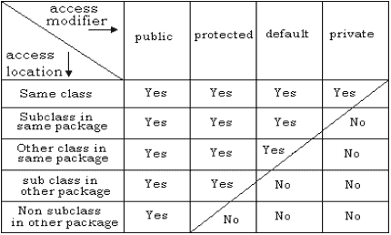

### JAR 文件 (Java 归档文件)

为了压缩文件，我们使用诸如 `winzip` 之类的程序，Java 的 JAR 功能也可以用于压缩整个 Java 包的层次结构。它为安装提供了更好的便利。

不需要在客户位置创建文件结构。我们只需要使用 JAR 文件，该文件将恢复整个文件结构。所有的包、子包和类文件都将从 JAR 文件自动创建。

JAR 技术让软件的交付和安装变得简单。此外，JAR 文件中的元素是压缩的，这使得下载 JAR 文件比单独下载几个未解压缩的文件要快得多。这允许消费者确定这些元素是由特定的组织或个人产生的。

JAR 文件有以下选项：

| 选项 | 描述 |
| :--- | :--- |
| c | 创建一个新的归档。 |
| C | 在命令执行期间更改目录。 |
| f | 文件列表的第一个元素是要创建的归档名称。 |
| i | 应提供索引信息。 |
| m | 文件列表的第二个元素是外部清单文件（manifest）的名称。 |
| M | 不创建清单文件 |
| t | 应列出归档内容。 |
| u | 更新现有的 JAR 文件。 |
| v | 工具执行时应提供详细输出。 |
| x | 从归档中提取文件。 |
| o | 不使用压缩 |

#### 创建 JAR 文件

```
c:\javaprg> jar -cf my.jar pack1
```

这将创建一个包含 `pack1` 所有文件的 JAR 文件。

#### 提取 JAR 文件

```
c:\javaprg> jar -xf my.jar
```

#### 列出 JAR 文件内容

```
c:\javaprg> jar -tf my.jar
```

#### 更新现有的 JAR 文件

```
c:\javaprg> jar -uf my.jar pack2
```

#### 创建可执行的 JAR 文件

```
c:\javaprg> jar -cmf mainClass my.jar pack1
```

其中 `mainClass` 是一个文本文件，包含 `Main-Class: pack1.A`，并保存在 `javaprg` 文件夹中。

#### 执行 JAR 文件

```
c:\javaprg> java -jar my.jar
```

# 理论题

1. 我们对包有什么理解？

2. 解释所有的修饰符及其在不同包、子包、子类和其他类中的作用域。

3. JAR 文件有什么用？

4. `import` 语句的作用是什么？


在 Amazon.com 上搜索这本书，ISBN-978-1500730413。

# 章

# ∞ 9 ∞

## (接口)

––––––––

### 引言 (Introduction)

接口本质上是一种类。和类一样，接口包含方法和变量，但有一个主要的区别。区别在于接口只定义抽象方法和最终变量（常量）。这意味着接口不编写任何代码来实现这些方法，数据字段只包含常量。

因此，实现接口并定义实现代码是类的责任。在实践中，这意味着我们可以定义接口，而不对其实现方式做假设。接口的作用是将类的接口与其实现分离来。接口只定义类需要做什么，而不说如何做。

嵌套接口是指任何声明在另一个类或接口体内的接口。顶层接口是指非嵌套接口。定义接口的语法与定义类非常相似。接口定义的通用形式如下：

```java
interface interface_name
{
    variable declarations;
    methods declarations;
}
```

在这里，`interface` 是关键字，`interface_name` 是任何有效的 Java 标识符（类似于类名）。

**注意：** 当我们定义一个接口时，默认情况下它是 `public`（公共）且 `abstract`（抽象的）。

### 接口修饰符

顶层接口可以使用的唯一修饰符是 `abstract` 和 `public`。即使我们不使用 `abstract` 修饰符，接口也会隐式地声明为 `abstract`，因此不需要使用 `abstract` 修饰符。顶层接口的可见性可以是 `package`（包级）或 `public`，类似于顶层类。如果不使用可见性修饰符，则假设接口的可见性为 `package`。

### 数据变量成员声明

接口中只能定义常量。接口中的所有变量都隐式地为 `public`、`final` 和 `static`，这意味着它们不能被实现类更改。它们还必须用常量值初始化。

```java
public static final type variable_name=value;
```

在接口中声明的变量是 `public`、`static` 且 `final`。这意味着它是具有公共访问权限的静态变量。该变量也被声明为 `final`，这意味着它必须在声明时赋值，并且之后不能再修改。`final` 关键字类似于 C/C++ 中的 `const`。

### 方法声明

方法声明将仅包含方法列表，而不包含任何方法体语句。它们在参数列表之后以分号结束。它们本质上是 `abstract` 方法，并且接口中指定的任何方法都不能有默认实现。

接口中的所有方法默认始终是 `public` 和 `abstract` 修饰符的。我们不能在接口中声明 `static` 方法。

```java
public abstract return_type method_name(parameter_list);
```

这里是一个包含两个变量和一个方法的接口定义示例。

```java
interface item
{
    static final int code = 1001;
    static final String name = "Matrix";
    abstract void display( );
}
```

**注意：** 方法的代码不包含在接口中，方法声明简单地以分号结束。

另一个接口示例：

```java
interface area
{
    float pi = 3.142f;
    float compute (float x, float y);
    void show( );
}
```

### 扩展接口

像类一样，接口也可以被扩展，即一个接口可以从其他接口派生。新接口将以子类的方式继承子接口的所有成员。这通过使用下所示的 `extends` 关键字实现。

```java
interface interface_1
{
    int code = 1001;
    String name = "Matrix";
}

interface interface_2 extends interface_1
{
    void display();
}
```

`interface_2` 将继承常量 `code` 和 `name`。

**注意：** 变量 `name` 和 `codes` 是像普通变量一样声明的。这在这里是允许的，但接口中的所有变量都被视为常量、`public` 和 `static`，尽管这里没有 `public`、`static` 和 `final` 关键字。

我们可以将多个接口组合成一个接口。以下声明是有效的。

```java
interface interface_1
{
    int code = 1001;
    String name = "Matrix";
}

interface interface_2
{
    void display();
}

interface interface_3 extends interface_1, interface_2
{
}
```

**注意：** 始终记住，接口不能扩展类。这违反了接口只能有抽象方法和常量的规则。

### 实现接口

接口被用作“超类”，其属性被类继承。因此，有必要创建一个继承接口的类。一旦定义了接口，一个或多个类就可以实现该接口。

要实现接口，要在类定义中包含 `implements` 子句，然后创建接口声明的方法。

实现类必须提供所有接口中所有的方法体，否则它必须声明为 `abstract`。实现类还可以扩展一个类并实现多个接口。

```java
modifier class<class-name> implements<interface-name>
{
    body of the class
}
```

在类中实现接口的语法：

```java
interface interface_name
{
}

class class _name implements interface_name
{
    Body of class
}
```

Java 不支持多继承，但它支持多接口继承，即一个类可以实现多个接口，如下所示：

```java
modifiers class <class-name> implements <interface-1>,<interface-2>,<interface-3>, ....<interface-n>
{
    body of class
}
```

**注意：** 当我们实现接口方法时，必须将其声明为 `public`。实现接口方法类似于重写（over-riding），因此我们不能降低可见性。

示例 9.1:

```java
1.  interface interface_1
2.  {
3.    void show(int x);
4.  }
5.  class class_1 implements interface_1
6.  {
7.    public void show(int x)
8.    {
9.    }
10. }
```

示例 9.2 抽象类：

```java
1.  interface common
2.  {
3.    push(int x);
4.    void pop ( );
5.  }
6.  abstract class stack implements common
7.  {
8.    
9.  }
```

### 通过接口访问类对象

我们可以声明使用接口而非类类型的对象引用。任何实现接口的类都可以通过这种变量进行引用。当我们通过这些引用之一调用方法时，将调用的是实际实例对应版本。这是接口的重要特性之一。要执行的方法在运行时查找，允许在代码编写之后创建类。调用代码可以通过接口进行分发，而无需了解“调用者”。这一过程类似于使用父类来访问子类。

与 Java 中的普通方法调用相比，在运行时查找方法会产生巨大的开销，因此我们应该避免在性能敏感的代码中使用接口。

示例 9.3:

```java
1.  interface Math_function
2.  {
3.    void display(int x);
4.  }
5.  class Sqrt implements Math_function
6.  {
7.    public void display(int x)
8.    {
9.      System.out.println("sqrt of x ="+Math.sqrt(x));
10.    }
11.  }
12.  class Log implements Math_function
13.  {
14.    public void display(int x)
15.    {
16.      System.out.println("log of x = "+Math.log(x));
17.    }
18.  }
19.  class Math_Demo
20.  {
21.    public static void main(String args[])
22.    {
23.        Math_function f1 = new Sqrt();
24.        Math_function f2 = new Log();
25.        f1.display(27);
26.        f2.display(3);
27.        Math_function f3;
28.        f3=f1; //多态（赋值引用）
29.        f3.display(30);
30.    }
31.  }
```

```java
30.      f3=f2;  //多态（赋值引用）
31.      f3.display(5);
32. }
33. }
```

输出：

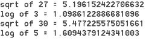

## 接口的特性：

- `Interface` 是一个关键字。

- `Interface` 可以被声明为抽象的（abstract），但它默认就是抽象的，因此无需添加 `abstract` 关键字。

- 所有变量始终是 `public static` 且 `final` 的。

- 接口的所有方法必须在类中被实现。

- 实现类实现的所有方法必须是 `public` 的。

- `Interface` 仅包含方法的声明。

- `Interface` 方法不能被声明为 `static`。它们总是被声明为实例方法。

- 类既不能缩小接口方法的访问权限，也不能在方法的 `throws` 子句中指定新的异常；因为尝试这样做等同于修改接口的契约，这种做法是不合法的。重写方法的准则也适用于实现接口方法。

- 在实现类中，所有方法都需要被定义为 `public`。


- 此处允许 `abstract` 关键字进行部分实现。
- 无论类直接或间接实现了多少接口，它对于在接口中可能有多个声明的方法，只提供单一的实现。
- 方法原型声明也可以像类一样进行重载。
- 任何客户端（类或接口）都可以使用其完全限定名访问接口常量，无论该客户端是否扩展或实现了该接口。然而，如果客户端实现此接口的类或扩展此接口的接口，则客户端也可以直接访问此类常量，无需使用完全限定名。此类客户端继承了接口常量。
- 在接口常量多继承的情况下，任何名称冲突都可以使用相关常量的完全限定名来解决。

## 接口变量

接口中的所有变量始终是 `public static` 和 `final` 的，因为它们是实现类访问数据类型和方法的公共部分。

## 接口变量的内存管理

静态变量在程序加载时总是获取内存，它们占用独立的内存，不与任何对象的内存共享。它们也被称为常量。可以使用接口名和 `.` 点操作符直接访问。

### 示例 9.4

```java
1.    interface Static_Var
2.    {
3.      int sun=1;
4.      int mon=2;
5.      int tues=3;
6.      int wed=4;
7.      int thurs=5;
8.      int fri=6;
9.      int sat=7;
10.     }
11.    class Week_Day implements Static_Var
12.    {
13.      public static void main(String args[])
14.      {
15.        System.out.println(sun);
16.        System.out.println(mon);
17.        System.out.println(tues);
18.        System.out.println(wed);
19.        System.out.println(thurs);
20.        System.out.println(fri);
21.        System.out.println(sat);
22.      }
23.    }
```

或者

```java
11.    class Week_Day
12.    {
13.      public static void main(String args[])
14.      {
15.        System.out.println(Static_Var.sun);
16.        System.out.println(Static_Var.mon);
17.        System.out.println(Static_Var.tues);
18.        System.out.println(Static_Var.wed);
19.        System.out.println(Static_Var.thurs);
20.        System.out.println(Static_Var.fri);
21.        System.out.println(Static_Var.sat);
22.      }
23.    }
```

输出：

1
2
3
4
5
6
7

### 示例 9.5

```java
1.    interface Two_Methods
2.      {
3.        void m1( );
4.        void m2( );
5.      }
6.    class Three_Methods implements Two_Methods
7.      {
8.        public void m1( )
9.        {
10.        m1 的方法体;
11.      }
12.      public void m2( )
13.        {
14.        m2 的方法体;
15.      }
16.      public void m3( )
17.        {
18.        m3 的方法体;
19.      }
20.    }
21.    class Methods_Demo
22.    {
23.      public static void main(String args[])
24.      {
25.        Two_Methods tm1 = new Three_Methods();
26.        tm1.m1();
27.        tm1.m2();
28.        //tm1.m3(); 错误
29.        Three_Methods tm2 = new Three_Methods();
30.        tm2.m3();
31.      }
32.    }
```

注意：这里我们不使用接口引用调用 `m3()`，因为该方法在接口中没有声明。接口引用只能调用接口中声明的方法。

### 示例 9.6

```java
1.  interface Two_Methods
2.  {
3.    void m1( );
4.    void m2( );
5.  }
6.  interface One_Method extends Two_Methods
7.  {
8.    void m3();
9.  }
10. class Three_Methods implements One_Method
11. {
12.   public void m1( )
13.   {
14.     m1 的方法体;
15.   }
16.   public void m2( )
17.   {
18.     m2 的方法体;
19.   }
20.   public void m3( )
21.   {
22.     m3 的方法体;
23.   }
24. }
25. class Methods_Demo
26. {
27.   public static void main(String args[])
28.   {
29.     Two_Methods tm1 = new Three_Methods();
30.     tm1.m1();
31.     tm1.m2();
32.     //tm1.m3(); 错误
33.     Three_Methods tm2 = new Three_Methods();
34.     tm2.m3();
35.   }
36. }
```

这条规则的唯一例外是 `+` 和 `+=` 运算符，它们会拼接两个字符串并产生一个 `String` 对象。在 Java 中，字符数组不被视为字符串。在 Java 中，`String` 类被用于执行所有的字符串操作。`String` 类和 `StringBuffer` 类是 `java.lang` 包的一部分。

### String 类

```java
String s1 = new String("matrix");
String s2 = "matrix";
System.out.println(s1);
System.out.println(s1.length);
System.out.println("matrix".length);
```

`String` 在 Java 中具有以下特征：

#### (i) String 是 Java 中的一个对象

String 代表一个字符序列，但与许多其他将 `String` 实现为字符数组的语言不同，Java 将字符串实现为 `String` 类型的对象。

字符串操作是许多 Java 程序中最常见的部分。将字符串实现为内置对象允许 Java 能够提供全完整的功能，使得字符串处理变得方便。此外，字符串对象可以通过多种方式构建，以便在需要时轻松获取字符串。

#### (ii) String 是不可变的

字符串是不可变的，也就是说我们无法在创建后更改字符串。然而，声明为 `String` 引用的变量可以随时更改以指向另一个字符串对象。

我们仍然可以执行所有类型的字符串操作。每当我们需要现有字符串的修改版本时，就会创建一个新的字符串对象，其中包含了修改后的内容。

原始字符串保持不变。使用这种方法是因为固定的、不可变的字符串比可变的字符串实现得更高效。

对于那些需要修改字符串的情况，有一个名为 `StringBuffer` 的伴随类，它的对象包含了在创建后可以被修改的字符串。

#### (iii) String 类是 final 的

`String` 和 `StringBuffer` 类都是 `final` 的。这意味着我们不能在其他类中扩展 `String` 类。这允许进行某些优化，以提高常用字符串操作的性能。

### String 类的构造方法与方法

| # | 说明 | 示例 |
| :--- | :--- | :--- |
| 1 | `public String()` 初始化一个新创建的 `String` 对象，使其表示一个空字符序列。 | `String s1 = new String();` |
| 2 | `public String(String str)` 初始化一个新创建的 `String` 对象，使其与参数表示相同的字符序列；换句话说，新创建的字符串是参数字符串的拷贝。 | `String s1 = new String("Matrix");`<br>`String s2 = new String(s1);` 字符串 `s2` 是字符串 `s1` 的拷贝。虽然内容相同，但 `s1` 和 `s2` 指向不同的字符串对象。 |
| 3 | `public String(char ch[])` 分配一个新的 `String`，使其表示字符数组参数中当前包含的字符序列。 | `char ch[] = {'a', 'b', 'c'};`<br>`String s1 = new String(ch);` //s1 将持有 "abc" |
| 4 | `public String(char value[], int offset, int count)` 分配一个新的 `String`，包含来自字符数组参数子数组的字符。 | `char ch[] = {'a', 'b', 'c', 'd', 'e', 'f'};`<br>`String s1 = new String(ch, 2, 3);` //s1 将持有 "cde" |
| 5 | `public String(int value[], int offset, int count)` 分配一个新的 `String`，包含来自包含字符 Unicode 的整数数组子数组的字符。 | `int a[] = {97, 98, 99, 100, 101, 102};`<br>`String s1 = new String(a, 2, 3);` //s1 将持有 "cde" |
| 6 | `public String(byte b[], int offset, int count)` 使用平台默认字符集解码指定的字节子数组以构造新的 `String`。 | `byte b[] = {97, 98, 99, 100, 101, 102};`<br>`String s1 = new String(b, 2, 3);` //s1 将持有 "cde" |
| 7 | `public String(byte[])` 使用平台默认字符集解码指定的字节数组以构造新的 `String`。 | `byte b[] = {97, 98, 99};`<br>`String s1 = new String(b);` //s1 将持有 "abc" 尽管 Java 的 `char` 类型使用 16 位来表示 Unicode 字符集，但互联网上的典型字符串格式使用由 ASCII 字符集构造的 8 位字节数组。由于 8 位 ASCII 字符串很常见，`String` 类提供了字节数组时初始化字符串的构造方法。在上述每个构造方法中字节到字符的转换都是通过平台的默认字符编码完成的。 |
| 8 | `public String(StringBuffer)` | |
| 9 | `public int length()` 将显示字符串的字符个数。 | |
| 10 | `public boolean isEmpty()` 如果字符串为空则显示 true，否则显示 false。 | `String s1 = new String();`<br>`System.out.println(s1.isEmpty());` |
| 11 | `public char charAt(int index)` 返回指定索引处的 `char` 值。 | `String s1 = "matrix";`<br>`System.out.println(s1.charAt(0));` // 将打印 "m" |
| 12 | `public void getChars(int srcBegin, int srcEnd, char[] dst, int dstBegin)` 将字符串中的字符复制到目标数组。要复制的第一个字符位于 `srcBegin`，最后一个位于 `srcEnd-1`。如果索引无效，可能会抛出 `ArrayIndexOutOfBoundsException` 和 `StringIndexOutOfBoundsException`。 | |
| 13 | `public void getBytes(int srcBegin, int srcEnd, byte dst[], int dstBegin)` | |
| 14 | `public byte[] getBytes()` 使用平台的默认字符集将此 `String` 编码为字节序列。当我们需要导出到不支持 16 位 Unicode 字符的环境时非常有用。例如，大多数互联网协议和文本格式使用 | |
| 15 | `public boolean equals(Object)` 将调用字符串与指定的对象比较。当参数不为空且是一个与调用字符串表示相同序列的 `String` 对象时，结果为 true。 | |
| 16 | `public boolean equalsIgnoreCase(String)` 忽略大小写比较调用字符串。 | |
| 17 | `public int compareTo(String)` 按字典顺序比较调用字符串与作为参数的字符串。返回值：<0 调用字符串小于 str；>0 调用字符串大于 str；0 两个字符串相等 | |
| 18 | `public int compareIgnoreCase(String)` 忽略大小写按字典顺序比较两个字符串。 | |
| 19 | `public boolean regionMatches(int startIndex, String str2, int str2StartIndex, int len)` 测试两个字符串区域是否相等。 | |
| 20 | `public boolean regionMatches(boolean ignoreCase, int startIndex, String str2, int str2StartIndex, int len)` 测试两个字符串区域是否相等。如果 `ignoreCase` 标志为 true，则忽略大小写差异 | |
| 21 | `public boolean startsWith(String prefix, int startIndex)` 测试字符串是否从指定索引开始以指定的前缀开头。该方法不返回任何异常，但如果 `startIndex` 越界则返回 false。 | |
| 22 | `public boolean startsWith(String)` 测试字符串是否以指定的前缀开头。 | |
| 23 | `public boolean endsWith(String suffix)` 测试字符串是否以指定的后缀结尾。 | |
| 24 | `public int indexOf(char ch)` 返回指定字符在字符串中首次出现的索引。 | |
| 25 | `public int indexOf(char ch, int fromIndex)` 返回指定字符在字符串中首次出现的索引，从指定的索引开始搜索。 | |
| 26 | `public int indexOf(String str)` 返回子字符串在字符串中首次出现的索引。 | |

## 字符串方法

| 方法 | 描述 |
| :--- | :--- |
| `public int indexOf(String str, int fromIndex)` | 返回从指定索引开始查找，指定子串在该字符串中第一次出现的索引。 |
| `public int lastIndexOf(int ch)` | 返回在该字符串中指定字符最后一次出现的索引。 |
| `public int lastIndexOf(int ch, int fromIndex)` | 返回从指定索引开始向后查找，指定字符在该字符串中最后一次出现的索引。 |
| `public int lastIndexOf(String str)` | 返回在该字符串中指定子串最后一次出现的索引。 |
| `public int lastIndexOf(String str, int fromIndex)` | 返回从指定索引开始向后查找，指定子串在该字符串中最后一次出现的索引。 |
| `public String substring(int)` | 获取从 $n^{th}$ 个字符开始的子字符串 |
| `public String substring(int n, int m)` | 获取从 $n^{th}$ 个到 $m^{th}$ 个字符（不包括 $m^{th}$）的子字符串 |
| `public String concat(String str)` | 将字符串 `str` 拼接到调用字符串对象的末尾 |
| `public String replace(char x, char y)` | 将所有出现的 `x` 替换为 `y` |
| `public String replaceFirst(String, String)` | |


| 方法 | 描述 |
| :--- | :--- |
| `public String replaceAll(String, String)` | |
| `public String toLowerCase()` | 将字符串转换为小写 |
| `public String toUpperCase()` | 将字符串转换为大写 |
| `public String trim()` | 去除开头和结尾的空格 |
| `public char[] toCharArray()` | 将调用的字符串转换为新的字符数组。提供此函数是为了方便便利，因为可以使用 `getChars()` 来实现相同的结果 |
| `public static String valueOf(Object)` | 为参数 `p`（简单类型或对象）创建一个字符串对象 |

## 字符串数组

我们也可以创建并使用包含字符串的数组。

### 示例 10.1

```java
import java.util.Scanner;
class StringArrSort {
    public static void main(String args[]) {
        Scanner sc=new Scanner(System.in);
        System.out.print("Enter how many names ");
        int n=sc.nextInt();
        String s[]=new String[n];
        //input
        for(int i=0;i<n;i++) {
            System.out.println("Enter name " + (i+1));
            s[i]=sc.next();
        }
        //sorting
        for(int i=0;i<n-1;i++)
            for(int j=i+1;j<n;j++)
                if(s[i].compareTo(s[j]) > 0) {
                    String t=s[i];
                    s[i]=s[j];
                    s[j]=t;
                } 
        //output
        for(int i=0;i<n;i++)
            System.out.println(s[i]);
    }
}
```

## 字符串转换与 `toString()`

当 Java 在拼接过程中将数据转换为其 `String` 表示形式时，是通过调用 `String` 类定义的重载字符串转换方法 `valueOf()` 实现的。`valueOf()` 是一个静态方法，针对所有简单类型和 `Object` 类型进行了重载。

对于简单类型，`valueOf()` 返回一个包含其调用时值的类可读等价值的字符串。对于对象，`valueOf()` 调用对象上的 `toString()` 方法。

每个类都继承了 `toString()`，因为它是由 `Object` 类定义的。然而，`toString()` 的默认实现很少是够用的。它显示类名，后跟符号“@”，然后是对象 ID（例如 `Box@ab1342`），这通常没有用处。对于我们创建的大多数重要类，我们希望重写 `toString()` 并提供自己的字符串表示。

### 示例 10.2

```java
class A {
    private int x,y;
    A() {
        x = y = 0;
    }
    A(int x1, int y1) {
        x = x1;
        y = y1;
    }
    public String toString() {
        return (x + "," + y);
    }
}
class ToStringTest {
    public static void main(String args[]) {
        A a1 = new A(5,6);
        System.out.println(a1); // 调用了类的 toString()
        String s1="Object a1 is " + a1; // 对象与字符串拼接
        // 再次调用了 Object 的 toString()
        System.out.println(s1);
    }
}
```

**输出：**

```
A@3e255
Object a1 is A@3e255
```

### 示例 10.3

```java
class A {
    private int x,y;
    A() {
        x = y = 0;
    }
    A(int x1, int y1) {
        x = x1;
        y = y1;
    }
    public String toString() {
        return (x + "," + y);
    }
}
class ToStringTest2 {
    public static void main(String args[]) {
        A a1 = new A(5,6);
        System.out.println(a1); // 
        String s1="Object a1 is " + a1; // 
        System.out.println(s1);
    }
}
```

**输出：**

```
5,6
Object a1 is 5,6
```

### 示例 10.4

```java
import java.util.*;
class FindTest {
    public static void main(String args[]) {
        Scanner sc=new Scanner(System.in);
        String s1,s2;
        System.out.print("Enter a string");
        s1=sc.next();
        System.out.print("Enter string to search");
        s2=sc.next();
        int ans = s1.indexOf(s2);
        if(ans == -1)
            System.out.println("Not Found");
        else
            System.out.println("found at pos " + ans);
    }
}
```

## StringBuffer

`StringBuffer` 是 `String` 的类类，提供了许多 `String` 的功能。正如我们知道的，`String` 表示固定长度。与之相反，`StringBuffer` 表示可增长且可写的字符序列。`StringBuffer` 可以在中间插入或在末尾追加。`StringBuffer` 会自动扩展空间以容纳此类添加。Java 内部会大量使用该类，但许多程序员只处理 `String`，Java 在后台通过重载的 `+` 运算符操作 `StringBuffer`。

### 关于 `StringBuffer` 类的一些重要点

- `StringBuffer` 像 `String` 一样是一个 `Object`
- `StringBuffer` 类像 `String` 类一样同样是 `final` 的
- `StringBuffer` 对象是可变的（可以修改），不同于 `String` 对象

### `StringBuffer` 类的构造函数和方法

| 方法 | 描述 |
| :--- | :--- |
| `public StringBuffer()` | 默认构造函数预留 16 个字符的空间 |
| `public StringBuffer(int)` | 该构造函数接受整数参数设置缓冲区的大小 |
| `public StringBuffer(String)` | 该构造函数接受 String 参数，设置 `StringBuffer` 对象的初始内容并预留额外的 16 个字符空间 |
| `public synchronized int length()` | 返回 `StringBuffer` 的当前长度 |
| `public synchronized int capacity()` | 返回当前容量。容量是新插入字符的可用存储空间，超过此空间将发生分配 |
| `public synchronized void ensureCapacity(int)` | 确保容量至少等于指定的最小值。如果我们想在构造 `StringBuffer` 之后预留特定数量字符的空间，可以使用 `ensureCapacity()` 方法设置缓冲区的大小。这在我们预先知道将追加大量小字符串到 `StringBuffer` 时非常有用 |
| `public synchronized void trimToSize()` | 将移除多余的空闲空间。现在容量将等于长度 |
| `public synchronized void setLength(int newLength)` | 设置字符序列的长度。`newLength` 必须是非负的。当我们增大缓冲区时，会在现有缓冲区末尾添加空字符。如果调用 `setLength()` 时的值小于 `length()` 返回的值，则存储在该长度之外的字符将丢失。 |
| `public synchronized char charAt(int index)` | 返回此序列中指定索引处的 `char` 值。 |
| `public synchronized void getChars(int srcBegin, int srcEnd, char[] dst, int dstBegin)` | 将字符从此序列复制到目标字符数组 `dst`。第一个复制的字符位于索引 `srcBegin`；最后一个复制的字符位于索引 `srcEnd-1`。要复制的字符总数为 `srcEnd-srcBegin`。字符被复制到 `dst` 中从索引 `dstBegin` 开始的子数组中。注意：确保目标或目标数组足够大以容纳指定子字符串中的字符数量。 |
| `public synchronized void setCharAt(int index, char ch)` | 将指定索引处的字符设置为 `ch`。如果 `index` 为负数或大于等于 `length()`，则抛出 `IndexOutOfBoundsException`。 |
| `public synchronized StringBuffer append(Object)` | `append` 方法将任何其他类型数据的字符串表示连接到调用者的 `StringBuffer` 对象的末尾。 |
| `public synchronized StringBuffer delete(int start, int end)` | 从索引 `start` 到索引 `end-1` 删除字符 |
| `public synchronized StringBuffer deleteCharAt(int index)` | 删除指定位置的 `char` |
| `public synchronized StringBuffer replace(int start, int end, String str)` | 将索引 `start` 到 `end-1` 的字符替换为指定 `String` 中的字符。 |
| `public synchronized String substring(int)` | 返回一个新的 `String`，其中包含当前包含在此字符序列中的字符子序列。该子字符串从指定的索引开始，延伸到此序列的结束。 |
| `public synchronized String substring(int start, int end)` | 返回一个新的 `String`，其中包含当前包含在此字符序列中的字符子序列。该子字符串从指定的 `start` 索引开始，延伸到索引 `end-1` 处的字符。 |
| `public synchronized StringBuffer insert(int, Object)` | 将一个 `String` 插入另一个 `String`。它重载以接受所有简单类型的值以及 `Strings` 和 `Objects`。 |
| `public int indexOf(String)` | |
| `public synchronized int indexOf(String, int)` | |
| `public int lastIndexOf(String)` | |
| `public synchronized int lastIndexOf(String, int)` | |
| `public synchronized StringBuffer reverse()` | 反转 `StringBuffer` 的内容。 |

### 示例 10.5

```java
import java.util.Scanner;
class SortStr
{
    public static void main(String args[])
    {
        Scanner sc = new Scanner(System.in);
        System.out.print("Enter a string");
        StringBuffer sb1 = new StringBuffer(sc.next());
        //Sorting
        for(int i=0;i<sb1.length()-1;i++)
            for(int j=i+1;j<sb1.length();j++)
                if(sb1.charAt(i) > sb1.charAt(j))
                {
                    char t=sb1.charAt(i);
                    sb1.setCharAt(i,sb1.charAt(j));
                    sb1.setCharAt(j,t);
                }
            System.out.println(sb1);
    }
}
```

**输出：** Enter a string SHIVAM

AHIMSV

### 示例 10.6: 计算给定句子中单词数的程序。

```java
class WordCnt
{
    public static void main(String args[])
    {
        String s1 = "Mohan Das Karam Chand Gandhi";
        boolean flag=false;
        int cnt=0;
        for(int i=0;i<s1.length();i++)
        {
            if(s1.charAt(i) == ' ')
                flag = false;
            else
            {
                if(flag == false)
                {
                    flag = true;
                    cnt++;
                }
            }
        }
        System.out.print("No. of Words=" + cnt);
    }
}
```

**输出：** No. of Words=5

# 异常处理

## 引言

异常是在运行时发生的条件，会中断指令的正常流。当解释器遇到错误时，它创建一个异常对象并将其抛出。

在较旧的语言中，异常处理是通过 `goto` 和返回值完成的。这种方法非常繁琐。Java 的异常处理通过使用面向对象的方法避免了这些问题。

## 异常基础

异常是一个对象，描述了代码中出现的异常情况。当出现异常情况时，会创建一个代表该异常的对象并抛出。异常可以由 Java 运行时系统生成，也可以由你的代码手动生成。手动生成的异常通常用于向方法的调用者报告特定的错误状态。

Java 异常处理通过五个关键字管理：`try`、`catch`、`throw`、`throws` 和 `finally`。简而言之，你想要监控异常的程序语句包含在 `try` 块中。如果 `try` 块内部发生异常，异常就会被抛出。你的代码可以使用 `catch` 捕获此异常并处理它。要手动抛出异常，请使用 `throw`。任何抛出方法的异常都必须通过 `throws` 子句进行说明。任何在 `try` 块完成后必须执行的代码都放在 `finally` 块中。

这是异常处理块的通用形式：

```java
try {
    // 监控错误的代码块
}
catch (ExceptionType1 exOb) {
    // ExceptionType1 的异常处理程序
}
//.........
finally {
    // 在 try 结束后执行的代码块
}
```

## 异常类型

所有异常类型都是内置类 `Throwable` 的子类。因此，`Throwable` 是异常类层次结构的顶端。在 `Throwable` 之下紧有两个子类，它们将异常分为两个不同的分支。其中一个分支由 `Exception` 引领。该类用于用户程序应该捕获的异常情况。这也是你将在创建自定义异常类型时将要派生出的类。


`Exception` 有一个重要的子类，称为 `RuntimeException`。这种类型的异常是为你编写的程序自动定义的，包括如除以零和无效数组索引等情况。

另一个分支由 `Error` 顶层，它定义了程序在正常情况下无法预期被捕获的异常。`Error` 类型的异常由 Java 运行时系统使用，表示与运行时环境本身相关的错误。栈溢出（Stack overflow）就是此类错误的一个示例。本章将不会处理 `Error` 类型的异常，因为这些异常通常是由于程序无法处理的灾难性故障而创建的。

顶层异常层次结构所示：

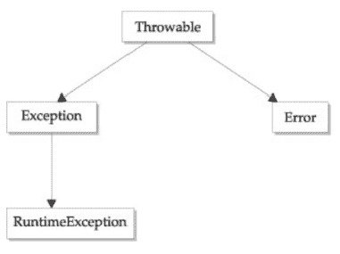

## 示例 11.1

```java
class ErrorTest1
{
    public static void main(String args[])
    {
      int a=5,b=2,c=2,d;
      d=a/(b-c); // 发生了 ArithmeticException(Divide by zero)
      System.out.println(d);
      System.out.println("This will not be printed");
    }
}
```

程序将在除法操作期间终止，不会执行剩余的语句。

## 示例 11.2

```java
class A
{
    void display()
    {
      -----
    }
}
class ErrorTest2
{
    public static void main(String args[])
    {
      A a1=null;
      a1.display(); // 发生了 NullPointerException
    }
}
```

在上面的程序中会发生 `NullPointerException`。引用变量没有用 `new` 初始化。在这种情况下程序也会终止。

## 示例 11.3

```java
class ErrorTest3
{
    public static void main(String args[])
    {
      int a[ ] = {10,20,30};
      System.out.println(a[3]);  // 发生了 ArrayIndexOutOfBoundsException
    }
}
```

在上面的案例中，数组的长度为 3，索引从 0 到 2，因此如果我们打印 `a[3]`，那么它是第 4 个元素，这不是一个有效的索引。这将产生一个异常错误。在 C/C++ 中这是允许的，但在 Java 中是不允许。

> **注意**
>
> JDK 7 增加了一种新的 `try` 语句形式，支持自动资源管理。这种新的 `try` 形式被称为 `try-with-resources`，在 `Chapter` 文件中结合文件管理的上下文中进行了描述，因为文件是最常用的资源之一。

## 异常的其他情况

1. 我们正尝试打开的文件可能不存在。
2. 我们想要创建一个新对象，但没有可用内存。
3. 我们想要加载的类文件可能丢失或格式错误。
4. 我们想要转换为数字的 `String` 包含无效字符，导致无法转换为数字。

如果异常对象没有被正确捕获和处理，解释器将显示错误消息并终止程序。如果我们想继续执行剩余代码，那么我们应该尝试捕获由错误条件抛出的异常对象。

这项任务被称为异常处理。异常处理机制的目的是提供一种检测和报告“异常情况”的方法，以便采取适当的行动。该机制建议引入一套独立的错误处理代码，用于执行以下任务：

1. 发现问题。（发生异常）
2. 通知错误已发生。（抛出异常）
3. 接收错误信息。（捕获异常）
4. 纠正措施。（处理异常）

Java 异常处理通过五个关键字管理：`try`、`catch`、`throw`、`throws` 和 `finally`。

我们想要监控异常的程序语句包含在 `try` 块中，每当发生错误时，它会被抛给 `catch` 块。我们的代码可以捕获此异常（使用 `catch`）并以合理的方式进行处理。系统生成的异常由 Java 运行时系统自动抛出。

要手动抛出异常，请使用关键字 `throw`。任何从方法抛出的异常都必须通过 `throws` 子句指定。在方法返回之前必须执行的代码都放在 `finally` 块中。

`try` 块必须括在大括号之间。可以有一个或多个 `catch` 语句。`catch` 和 `finally` 都是可选的，但即使 `try` 块失败，`finally` 块也会执行。如果 `try` 块失败，执行将继续紧随 `finally` 块之后的语句。

如果在执行 `try` 块时发生某些错误，JVM 会抛出一个 `Exception` 类型的对象或其子类之一。然后按顺序与 `catch` 块进行比较。如果找到了匹配的 `catch` 块，则处理该错误，然后继续执行 `catch` 块之后的语句。如果错误不匹配任何 `catch` 块，它将向上层次结构移动，直到被处理或在未处理的情况下被传递给 JVM。随后，JVM 将直接终止程序并显示错误详情。

## 使用 try 和 catch

虽然 Java 运行时系统提供的默认异常处理程序对于调试很有用，但你通常可能自己处理异常。这样做有两个好处：第一，它允许你处理错误；第二，它防止程序自动终止。如果你的程序每当发生错误就停止运行并打印堆栈跟踪，大多数用户（至少是这样）会感到困惑！幸运的是，防止这一点非常容易。

为了防止并处理运行时错误，只需将你想要监控的代码包含在 `try` 块中。紧随 `try` 块之后，包含一个 `catch` 子句，指定你想要捕获的异常类型。

为了说明如何轻松地完成这一点，下面的程序包含一个 `try` 块和一个处理由除以零错误产生的 `ArithmeticException` 的 `catch` 子句：

```java
class Exc2 {
  public static void main(String args[])
  {
    int d, a;

    try {  // 监控一段代码。
      d = 0;
      a = 42 / d;
      System.out.println("This will not be printed.");
    }

    catch (ArithmeticException e)
    {
    // 捕获除以零错误
      System.out.println("Division by zero.");
    }

    System.out.println("After catch statement.");
  }
}
```

该程序产生以下输出：

Division by zero.

After catch statement.

注意 `try` 块内部的 `println()` 调用从未执行。一旦抛出异常，程序控制将从 `try` 块转移到 `catch` 块。

换句话说，`catch` 并不是被“调用”，因此执行流永远不会从 `catch` “返回”到 `try` 块。

因此，“This will not be printed.”这一行不会显示。一旦 `catch` 语句执行，程序控制将继续执行整个 `try/catch` 机制之后的下一行。

`try` 和其 `catch` 语句形成一个单元。`catch` 子句的作用范围仅限于紧接其前的 `try` 语句所指定的语句。

`catch` 语句无法捕获由另一个 `try` 语句抛出的异常（稍后描述的嵌套 `try` 语句除外）。受 `try` 保护的语句必须用大括号括起来（也就是说它们必须在一个块内）。你不能对单个语句使用 `try`。

大多数结构良好的 `catch` 子句的目标应该是解决异常情况，然后像错误从未发生过一样继续后续操作。例如，在下一个程序中，`for` 循环的每次迭代都会获取两个随机整数。

这两个整数相互相除，结果用于除以值 `12345`。最终结果被放入 `a` 中。如果任何一次除法操作导致 `divide-by-zero` 错误，将被捕获，`a` 的值被设置为零，程序继续。

```java
// Handle an exception and move on.

import java.util.Random;

class HandleError {
    public static void main(String args[]) {
        int a=0, b=0, c=0;
        Random r = new Random();
        for(int i=0; i<32000; i++) {
            try {
                b = r.nextInt();
                c = r.nextInt();
                a = 12345 / (b/c);
            } catch (ArithmeticException e) {
                System.out.println("Division by zero.");
                a = 0; // set a to zero and continue
            }
            System.out.println("a: " + a);
        }
    }
}
```

## 显示异常的描述

`Throwable` 重写了 `toString()` 方法（由 `Object` 定义），使其返回一个包含异常描述的字符串。你只需将异常作为参数传递给 `println()` 语句，即可显示此描述。例如，上述程序中的 `catch` 块可以重写如下：

```java
catch (ArithmeticException e)
{
    System.out.println("Exception: " + e);
    a = 0; // set a to zero and continue
}
```

当该版本替换到程序中并运行时，每个 `divide-by-zero` 错误都会显示以下消息：

`Exception: java.lang.ArithmeticException: / by zero`

虽然这在这种语文中没有特殊价值，但显示异常描述的能力在其他情况下非常有价值——特别是当你正在测试异常或在进行调试时。

| 异常类型 | 异常原因 |
| :--- | :--- |
| ArithmeticException | 算术错误，例如除以 0 |
| ArrayIndexOutOfBoundsException | 数组索引越界 |
| ArrayStoreException | 在数组中存储错误类型的数据 |
| FileNotFoundException | 访问不存在的文件 |
| IOException | 无法从文件中读取 |
| NullPointerException | 由引用空对象引起 |
| NumberFormatException | 字符串与数字之间的转换失败 |
| OutOfMemoryException | 内存不足，无法分配新对象 |
| SecurityException | Applet 尝试执行浏览器安全设置不允许允许的操作 |
| StackOverflowException | 系统栈空间耗尽 |
| StringIndexOutOfBoundsException | 程序尝试访问字符串中不存在的字符位置 |

## Java 内置异常

在标准包 `java.lang` 内部，Java 定义了几个异常类。前面的示例已经使用了其中几个。这些异常中最通用的是是标准类型 `RuntimeException` 的子类。

正如之前所解释的，这些异常不需要包含在任何方法的 `throws` 列表中。在语言中，这些被称为“未检查异常”（unchecked exceptions），因为编译器不会检查方法是否处理或抛出了这些异常。在 `java.lang` 中定义且必须包含在方法 `throws` 列表中的异常被称为“检查异常”（checked exceptions）。Java 还定义了与之相关的类型。

## 多个 catch 子句

在某些情况下，一段代码可能会抛出多个异常。为了处理此类异常，你可以指定多个 `catch` 子句，每个子句捕获不同的类型。当抛出异常时，会按顺序检查每个 `catch` 语句，并执行第一个与异常类型匹配的语句。在一个 `catch` 语句执行后，其他语句将被跳过，执行将在 `try` 块之后继续。

```java
// Demonstrate multiple statements statements
class MultipleCatches {
    public static void main(String args[]) {
        try {
            int a = args.length;
            System.out.println("a = " + a);
            int b = 42 / a;
            int c[] = { 1 };
            c[42] = 99;
        } catch(ArithmeticException e) {
            System.out.println("Divide by 0: " + e);
        } catch(ArrayIndexOutOfBoundsException e) {
            System.out.println("Array index oob: " + e);
        }
        System.out.println("After try/catch blocks.");
    }
}
```

如果程序在没有命令行参数的情况下启动，它将导致除以零异常，因为 `a` 等于零。如果你提供了命令行参数，`a` 将大于零，此时它将能够跳过除法错误。但它会导致 `ArrayIndexOutOfBoundsException`，因为数组 `c` 的长度为 1，而程序尝试为 `c[42]` 赋值。

以下是两种方式生成的输出：

`C:\java MultipleCatches`

a = 0

Divide by 0: java.lang.ArithmeticException: / zero

After try/catch blocks.

`C:\java MultipleCatches TestArg`

a = 1

Array index oob: java.lang.ArrayIndexOutOfBoundsException:42

After try/catch blocks.

在使用多个 `catch` 语句时，记住异常子类必须在在其父类之前。这是因为使用父类的 `catch` 语句会捕获该类型及其任何子类的异常。因此，如果子类出现在父类之后，它将永远无法被访问。此外，在 Java 中，不可达代码是一个错误。例如，考虑以下程序：

```java
/* 此程序包含一个错误。
在系列 catch 语句中，子类必须在在其父类之前。
否则，将产生不可达代码并导致编译时错误。
*/
class SuperSubCatch {
    public static void main(String args[]) {
        try {
            int a = 0;
            int b = 42 / a;
        } catch(Exception e) {
            System.out.println("Generic Exception catch.");
        }
        /* 此 catch 块永远无法被访问，因为
ArithmeticException 是 Exception 的子类。 */
        catch(ArithmeticException e) { // 错误 – 不可
            System.out.println("This is never reached.");
        }
    }
}
```

如果你尝试编译此程序，你将收到一条错误消息，指出第二个 `catch` 语句是不可达的，因为异常已经被捕获。由于 `ArithmeticException` 是 `Exception` 的子类，第一个 `catch` 语句将处理所有基于 `Exception` 的错误，包括 `ArithmeticException`。

这意味着第二个 `catch` 语句将永远不会执行。要解决此问题，请反转 `catch` 语句的顺序。

## 嵌套 try 语句

`try` 语句是可以嵌套的。也就是说，一个 `try` 语句可以放在另一个 `try` 块内部。每当进入一个 `try` 语句时，该异常的上下文就会被推到栈上。

如果内部的 `try` 语句对特定异常没有 `catch` 处理器，则栈会进行回溯，并检查下一个 `try` 语句的 `catch` 处理器是否有匹配项。

这种过程会一直持续，直到其中一个 `catch` 语句执行成功，或者所有嵌套的 `try` 语句都已耗尽。如果没有匹配 `catch` 语句，则 Java 运行时系统将处理该异常。

这里是一个使用嵌套 `try` 语句的示例：

## 多 catch 语句

当存在多个一个 `catch` 语句时，它被称为多 catch 语句。

### 多 catch 语句示例

```java
try
{
    statement; //产生异常
}
catch(Exception-type-1 e)
{
    statement 1; //处理异常类型 1
}
catch(Exception-type-2 e)
{
    statement 2; //处理异常类型 2
}
catch(Exception-type-n e)
{
    statement n; //处理异常类型 n
}
```

### 示例 11.4


```java
class ErrorTest4
{
    public static void main(String args[])
    {
        int a=10,b=2,c=2,d;
        System.out.println("Before Exception ");
        d=a/(b-c);
        System.out.println("After Exception ");
    }
}
```

输出:

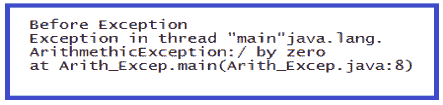

在这里我们没有捕获异常，因此程序将在显示消息“Before Exception”后终止。现在我们使用异常处理已经解决了这个问题。

#### 示例 11.5

```java
class ErrorTest5
{
    public static void main(String[] args)
    {
      int a=10,b=2,c=2,d;
      try
      {
        System.out.println("Before Exception");
        d=a/(b-c);
        System.out.println("This Will Not Print");
      }
      catch(ArithmeticException e)
      {
        System.out.println("After Exception");
        System.out.println("error : Division by zero");
      }
    }
}
```

输出:


### 异常处理的优势

- 我们可以很容易地指定异常/错误将在哪里被处理。异常/错误在运行时沿调用栈向上传播——首先到达外层的 `try` 块，然后返回到调用方法——直到异常处理器捕获它们为止。
- 异常/错误的位置是确切的，因为整个堆栈轨迹对用户可见。这对于调试非常有帮助。
- 程序员有机会从错误/异常状态中恢复。
- 错误处理代码与正常程序流分离，以增加可读性和维护性。
- 在 Java 中，无需测试是否发生了异常/错误情况。添加更多的错误/异常处理器仅需添加更多的 `catch` 子句，但不需要触动原始程序流。

### 异常类的层次结构

所有 `Exception` / `Error` 类的根类是 `Throwable` 类，它是 `Object` 类的直接子类。异常/错误在 Java 中也是对象。`Exception` 的子类带有 `Exception` 后缀。

`Throwable` 类有两个直接子类：

- `Error`：`Error` 类的子类基本上用于信号非正常状态，例如：
    1. `OutOfMemoryError` 信号 Java 虚拟机内存已耗尽，且垃圾回收器无法回收任何内存。
    2. `StackOverflowError` 信号解释器中发生栈溢出。
  这些错误通常是不可恢复的，且不应该被处理。
- `Exception`：`Exception` 类的子类通常是可恢复的。例如，`EOFException` 信号我们打开的文件没有更多可读数据。`FileNotFoundException` 信号我们想要打开的文件在系统中不存在。

层次结构示例：


#### 异常分为两类

##### 检查异常 (Checked Exception)

如果必须捕获异常，则它被称为检查异常。如果 `try` 块中可能发生检查异常且未被处理，程序将无法编译。编译器确保如果一个方法直接或间接地抛出检查异常，则该方法必须显式处理它。该方法要么捕获异常并采取适当行动，要么将异常传递给其调用者。

注意：`Exception` 及其所有子类（运行时异常及其子类除外）都是检查异常，必须被捕获。

##### 未检查异常 (Unchecked Exception)

如果不必须捕获异常，则称为未检查异常。即使未处理未检查异常，程序也可以编译。如果程序中发生了未处理的未检查异常，则程序执行将在该处终止。但如果异常被处理，则程序就不会因为异常而终止。

注意：`Error` 及其所有子类都是未检查异常，且不需要捕获。运行时异常及其所有子类是未检查异常，且不需要捕获。用户定义的 `Exception` 是检查异常。

### Exception 类中的方法

| 方法 | 说明 |
| :--- | :--- |
| `getMessage()` | 获取与异常或错误相关的消息。 |
| `printStackTrace()` | 打印显示异常位置的堆栈轨迹。 |
| `toString()` | 显示异常/错误名称以及 `getMessage()` 返回的消息。 |

#### 示例 11.6

```java
class ErrorTest6
{
    public static void main(String[] arr)
    {
      try
      {
        int a=10,b=2,c=2,d;
        System.out.println("Before Exception");
        d=a/(b-c);
        System.out.println("This Will Not Print");
      }
      catch(ArithmeticException e)
      {
        System.out.println("After Exception");
        System.out.println("error : Division by zero");
        System.out.println(e.getMessage());
        System.out.println(e); // 调用了 toString()。
        e.printStackTrace();
      }
    }
}
```

输出:

```
Before Exception
After Exception
error : Division by zero
by Zero
java.lang.ArithmeticException: / by zero
java.lang.ArithmeticException: / by zero
at ErrorTest6.main(ErrorTest6.java:10)
```

#### 示例 11.7 多 catches

```java
class ErrorTest7
{
    public static void main(String args[])
    {
      try
      {
        int a=args.length;
        System.out.println("Before Exception");
        int b=58/a;
        int c[] = {1};
        c[47]=100;
        System.out.println("After Exception");
      }
      catch(ArithmeticException e)
      {
        System.out.println("Divide by zero :"+e);
      }
      catch(ArrayIndexOutOfBoundsException e)
      {
        System.out.println("Array Index oob :"+e);
      }
      System.out.println("After try/catch block");
    }
}
```

输出 1：当我们以 `java ErrorTest7` 运行此程序时：

```
Before Exception
Divide by zero :java.lang.ArithmeticException: / by zero
After try/catch block
```

输出 2：当我们以 `java ErrorTest7 45` 运行此程序时：

```
Before Exception
Array Index oob:java.lang.ArrayIndexOutOfBoundsException: 47
After try/catch block
```

如果在另一个 `try` 块中使用 `try` 和 `catch` 语句，则被称为嵌套的 try catch。

### 语法

```java
try      //外部 try
{
    try      //内部 try
    {
        statement ;
    }
    catch1() //内部 catch
    {
        statement ;
    }
    catch2() //内部 catch
    {
        statement ;
    }
}
catch() //外部 catch
{
    statement ;
}
```

### 示例 11.8 嵌套的 try 和 catch

```java
class Nested
{
    public static void main(String args[])
    {
        try
        {
            int a=args.length;
            int b=58/a;
            System.out.println("a= "+a);
            try
            {
                if(a==1)
                    a=a/(a-a);
                if(a==2)
                {
                    int c[]={1};
                    c[42]=100;
                }
            }
            catch(ArrayIndexOutOfBoundsException e)
            {
                System.out.println("ArrayIndex oob "+e);
            }
        }
        catch(ArithmeticException e)
        {
            System.out.println(e.getMessage());
        }
    }
}
```

**输出 I:**

当我们以 `java ErrorTest8` 运行上述程序时（除以零）

**输出 II:**

当我们以 `java ErrorTest8 10` 运行上述程序时

```
a=1 / by zero
```

**输出 III:**

当我们以 `java ErrorTest8 10 20` 运行上述程序时

```
a=2
ArrayIndex oob java.lang.ArrayIndexOutOfBoundsException: 42
```

### finally 语句

Java 支持另一种名为 `finally` 的语句，它可以用于处理未被之前的任何一个 `catch` 语句捕获的异常。`finally` 块可以用于处理 `try` 块中生成的任何异常。无论是否发生错误，它都会被执行。它可以紧跟在 `try` 块之后，也可以在最后一个 `catch` 块之后，如下所示：

**语法：**

```java
try
{
}
catch(...)
{
}
catch(...)
{
}
finally
{
}
```

### 示例 11.9 finally 语句

```java
class ErrorTest9
{
    public static void main(String args[])
    {
        int a[ ] = {5,10};
        int b=5;
        try
        {
            int x=a[2]/b-a[1];
        }
        catch(ArithmeticException e)
        {
            System.out.println("Division By Zero");
        }
        catch(ArrayIndexOutOfBoundsException e)
        {
            System.out.println("Array Index error");
        }
        catch(ArrayStoreException e)
        {
            System.out.println("Wrong Data Type");
        }
        finally //始终执行
        {
            System.out.println("Always Execute");
        }
        int y=a[1]/a[0];
        System.out.println("y = "+y);
    }
}
```

**输出：**

```
Array Index error
Always Execute
y = 2
```

### throw

到目前，我们只捕获由 Java 运行时系统抛出的异常。然而，我们的程序完全可以使用 `throw` 语句显式地抛出异常；其通用形式所示：

`throw instance;`

这里，`instance` 必须是 `Throwable` 类型的对象或 `Throwable` 的子类。简单类型如 `int` 或 `char`，以及非 `Throwable` 类（如 `String` 和 `Object`）不能作为异常。我们有两种方法获取 `Throwable` 对象：使用 `catch` 子句中的参数，或者使用 `new` 操作符创建一个。执行流在 `throw` 语句后立即停止；任何随后的语句都不会执行。系统将检查最近的内层 `try` 块，查看它是否有匹配异常类型的 `catch` 语句。如果有，控制权将转移到该语句。如果没有，将检查下一个外层的 `try` 语句，依此类推。如果没有找到匹配的 `catch`，则默认处理程序将停止程序并打印堆栈跟踪。在这里我们取了一个创建并抛出异常的程序。捕获异常的处理器将其重新抛出给外部处理器。

### 示例 11.10

```java
class ErrorTest10
{
    int age;
    void setAge(int a)
    {
        if(a>0)
            age = a;
        else
        {
            NullPointerException e = new NullPointerException("Invalid Age");
            throw e;
            //throw new NullPointerException("Invalid Age");
        }
    }
    public static void main(String args[])
    {
        ErrorTest10 a1 = new ErrorTest10();
        try
        {
            a1.setAge(20);
            a1.setAge(-10);
        }
        catch(NullPointerException e)
        {
            System.out.println(e.getMessage());
        }
    }
}
```

**输出：**

```
Invalid Age
```

### throws

如果一个方法可能会导致它无法处理的异常，那么它必须指定这种行为，以便方法的调用者能够防范该异常。我们通过在方法声明中包含 `throws` 子句来实现。`throws` 子句列出了方法可能抛出的异常类型。这对于所有检查异常（checked exceptions）都是必要的。方法可能抛出的所有异常都必须在 `throws` 子句中声明。如果没有，将导致编译错误。这是一个包含 `throws` 子句的方法声明通用形式：

**语法：**

```java
type method-name(parameter list) throws exception-list
{
    //方法体
}
```

在这里，`exception-list` 是方法可以抛出的异常的逗号分隔列表。

### 示例 11.11


```java
import java.io.*;
class ErrorTest11
{
    int age;
    void setAge(int a) throws IOException
    {
        if(a>0)
            age = a;
        else
        {
            IOException e = new IOException("Invalid Age");
            throw e;
        }
    }
    public static void main(String args[])
    {
        ErrorTest11 a1 = new ErrorTest11();
        try
        {
            a1.setAge(20);
            a1.setAge(-10);
        }
        catch(IOException e)
        {
            System.out.println(e.getMessage());
        }
    }
}
```

**输出：**

Invalid Age

### 创建自定义的异常子类

这非常简单：只需定义 `Exception` 的子类即可。我们的子类不需要实现任何内容。`Exception` 类本身没有定义任何方法。当然，它从 `Throwable` 继承了这些方法。

### 示例 11.12

```java
class AgeException extends Exception
{
```

```java
class AgeException(String msg) {
    super(msg);
}

class ErrorTest12 {
    int age;
    void setAge(int a) throws InvalidAgeException {
        if(a > 0)
            age = a;
        else {
            AgeException e = new AgeException("Invalid Age");
            throw e;
        }
    }
    public static void main(String args[]) {
        ErrorTest12 a1 = new ErrorTest12();
        try {
            a1.setAge(20);
            a1.setAge(-10);
        } catch(AgeException e) {
            System.out.println(e.getMessage());
        }
    }
}
```

输出:

```
Invalid Age
```

以下示例声明了 `Exception` 的新子类，并使用该子类在方法中指示错误条件。它重写了 `toString()` 方法，允许显示定制的异常描述。

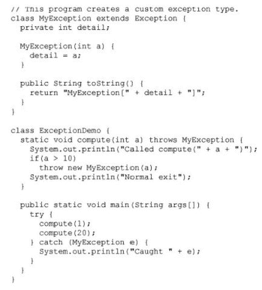

此示例定义了一个名为 `MyException` 的 `Exception` 子类。该子类非常简单：它只包含一个构造函数和一个重写的 `toString()` 方法，用于显示异常的值。

`ExceptionDemo` 类定义了一个名为 `compute()` 的方法，该方法抛出一个 `MyException` 对象。当 `compute()` 的整数参数大于 10 时，会抛出该异常。`main()` 方法为 `MyException` 设置了异常处理器，然后用合法值（小于 10）和非法值调用 `compute()`，以展示代码的两种执行路径。

以下是结果：

```
Called compute(1)
Normal exit
Called compute(20)
Caught MyException[20]
```

### 链式异常

链式异常允许我们将一个异常与另一个异常关联。第二个异常描述了第一个异常产生。例如，想象一种情况：方法由于尝试除以零而抛出 `ArithmeticException`。然而，问题的实际原因是发生了 I/O 错误，导致除数被设置不当。

尽管该方法必须抛出 `ArithmeticException`（因为这是确实发生的错误），我们可能也想让调用代码知道底层原因是 I/O 错误。

为了支持链式异常，Java 2 的 1.4 版本为 `Throwable` 类增加了两个构造函数和两个方法。构造函数所示：

```java
Throwable(Throwable causeExc)
Throwable(String msg, Throwable causeExc)
```

在第一种形式中，`causeExc` 是发生的异常。第二种形式允许我们在指定原因异常的同时指定描述。这两个构造函数也被添加到了 `Error`、`Exception` 和 `RuntimeException` 类中。

添加到 `Throwable` 类的链式异常方法是 `getCause()` 和 `initCause()`：

```java
Throwable getCause()
Throwable initCause(Throwable causeExc)
```

`getCause()` 方法返回当前异常的底层异常。如果没有底层异常，则返回 `null`。`initCause()` 方法将 `causeExc` 与调用的异常关联并返回该异常的引用。因此，我们可以在异常创建后为其关联一个原因。然而，原因异常只能设置一次。

因此，每个异常对象只能调用一次 `initCause()`。此外，如果原因异常是通过构造函数设置的，则我们不能再次使用 `initCause()` 方法进行设置。通常情况下，`initCause()` 用于为不支持上述两个额外构造函数的旧版异常类设置原因。大多数 Java 内置异常都没有定义这些额外的构造函数。因此，如果我们需要向这些异常添加另一个异常，将使用 `initCause()`。链式异常并不是每个程序都需要的。但在了解底层原因有用的情况下，它们提供了一种优雅的解决方案。

### 示例 1

```java
class ErrorTest {
    int age;
    void setAge(int a) {
        if(a > 0)
            age = a;
        else {
            NullPointerException e = new NullPointerException("Admission Failed");
            e.initCause(new ArithmeticException("Age is invalid"));
            throw e;
        }
    }
    public static void main(String args[]) {
        ErrorTest a1 = new ErrorTest();
        try {
            a1.setAge(20);
            a1.setAge(-10);
        } catch(NullPointerException e) {
            System.out.println(e.getMessage());
            System.out.println(e.getCause());
        }
    }
}
```

输出:

```
Admission Failed
Age is Invalid
```


在这个示例中，顶层异常是 `NullPointerException`。它添加了一个原因异常 `ArithmeticException`。当异常从 `setAge()` 抛出时，它被 `main()` 捕获。在那里，显示顶层异常，随后是通过调用 `getCause()` 获取的底层异常。链式异常可以延伸到任何所需的深度。因此，原因异常本身也可以有原因。请注意，过长的异常链可能意味着设计不当。链式异常并不是每个程序都需要的。但在了解底层原因有用的情况下，它们提供了一种优雅的解决方案。

### 三个新的 7 异常特性（更新）

JDK 7 为异常系统增加了三个有趣且实用的特性。第一个是自动化释放资源（如文件）在不再需要时的过程。它是基于 `try` 语句的扩展形式，称为 `try-with-resources`，将在后续介绍文件的章节中进行描述。

第二个新特性称为 `multi-catch`（多异常捕获），第三个有时被称为 `final rethrow`（最终重抛）或更准确的说是重新抛出。这里描述了后两个特性。

`multi-catch` 特性允许用同一个 `catch` 语句捕获两个或多个异常。多个异常处理器即使响应不同的异常，使用相同的代码序列也并不常见。现在不需要逐个捕获每种异常类型，而是可以使用单个 `catch` 语句处理所有异常，而避免代码重复。

要使用 `multi-catch`，在 `catch` 语句用逻辑或运算符 `|` 分隔每个异常类型。每个 `multi-catch` 参数隐式地为 `final`（如果需要，你可以显式指定 `final`，但没有必要）。因为每个 `multi-catch` 参数隐式为 `final`，所以它们不能被赋予新值。

以下是一个使用 `multi-catch` 特性捕获 `ArithmeticException` 和 `ArrayIndexOutOfBoundsException` 的 `catch` 语句：

```java
catch(ArithmeticException | ArrayIndexOutOfBoundsException e)
```

以下程序展示了 `multi-catch` 特性的用法：

```java
// 展示 JDK 7 的 multi-catch 特性
class MultiCatch {
    public static void main(String args[]) {
        int a=10, b=0;
        int vals[] = { 1, 2, 3 };
        try {
            int result = a / b; // 产生 ArithmeticException
            // vals[10] = 19; // 产生 ArrayIndexOutOfBoundsException
            // 此 catch 语句捕获这两种异常
        } catch(ArithmeticException | ArrayIndexOutOfBoundsException e) {
            System.out.println("Exception caught: " + e);
        }
        System.out.println("After multi-catch.");
    }
}
```

当尝试除以零时，程序将产生 `ArithmeticException`。如果你注释掉除法语句并移除下一行的注释符号，就会产生 `ArrayIndexOutOfBoundsException`。这两个异常都被单个 catch 语句捕获。

更精确的重抛（precise rethrow）功能限制了可以重新抛出的异常类型，仅限于关联的 `try` 块抛出的检查异常（checked exceptions），这些异常未被之前的 `catch` 句处理，并且是参数的子类型或超类型。

虽然这种可能并不经常需要，但现在已经可以使用。为了使更精确的重抛功能生效，`catch` 参数必须是有效最终的（effectively final），这意味着它不能在 `catch` 块内部被赋予新值，或者必须显式声明为 `final`。

# 使用异常

异常处理为具有许多动态运行时特性的复杂程序提供了一种强大的控制机制。将 `try`、`throw` 和 `catch` 视为处理程序逻辑中错误和异常边界条件的整洁方式。与其他某些使用错误返回代码来指示失败的语言不同，Java 使用异常。因此，当一个方法可能会失败时，让它抛出一个异常。

这是一种处理失败模式更干净的方法。最后一点：Java 的异常处理语句不应被视为非局部分支的通用机制。如果你这样做，只会混淆你的代码并使其难以维护。

# 理论题

1. 什么是异常？

2. 我们如何定义一个 `try` 块？

3. 我们如何定义一个 `catch` 块？

4. 列出 Java 中可能发生的一些常见异常类型。给出示例。

5. 捕获所有类型的异常是必要的吗？

6. 一个 `try` 块可以使用多少个 `catch` 块？

7. 创建一个可能产生三种异常的 `try` 块，然后结合必要的 `catch` 块来恰当地捕获并处理它们。

8. 什么是 `finally` 块？什么时候以及如何使用？给出一个合适的示例。

9. 解释异常处理机制如何用于调试程序。


# 章：∞ 12 ∞ (多线程编程)

## 引言

线程是程序内部的单一控制流。线程与进程非常相似。事实上，线程也被称为轻量级进程。

## 线程对比 进程

通常，不同的进程占用不同的内存空间。当 CPU 从一个进程切换到另一个进程时，当前运行进程的状态会被保存，另一个进程的状态会被恢复。在状态切换期间没有进行任何有用工作。状态切换时间应该尽可能短，以最大化 CPU 的利用率。

线程也像独立的进程，但它们共享相同的内存和状态。单独的线程也有独立的状态，但与进程状态相比，该状态非常小。状态可能只包含程序计数器和栈指针。因此，从一个线程切换到另一个线程所需的时间非常短。与进程相比，线程的上下文切换时间非常小。因此，多线程的情况下，CPU 的利用率比多进程的情况下要高。

## 多线程程序

多线程程序包含两个或多个可以并发运行的部分。这种程序的每个部分被称为线程，每个线程定义了一条独立的执行路径。因此，多线程是多任务处理的一种特殊形式。

例如，一个程序可以有三个线程：

* 一个处理打印。
* 一个处理编辑。
* 一个从互联网下载文件。

所有这些线程可能都在并发运行，从而最大化了 CPU 的利用率。

## 基于进程的多任务处理

大多数操作系统允许我们同时运行两个或多个程序。这被称为基于进程的多任务处理。例如，我们可以运行一个 Java 程序，同时可能正在编辑 Word 文档。基于进程的多任务处理确保了大多数时候会有程序要执行，因此它增加了 CPU 的利用率。

在基于进程的多任务处理中，程序是调度程序可以分发的最小代码单元。

## 基于线程的多任务处理

在基于线程的任务处理环境中，线程是执行的最小单元。一个进程可以分为若干个并发执行的线程。这允许我们在单个程序中并发处理多个任务。

例如，我们可以编辑一个 Word 文档。

基于线程的任务处理允许我们在单个程序中并发处理多个任务。

## Java 线程模型

Java 运行时系统在许多方面依赖线程，并且所有的类库都是为多线程设计的。这有助于防止周期的浪费。

## 线程生命周期（线程状态）

线程存在于几种状态。线程可以处于运行状态。当它获得 CPU 时间时，它可以处于就绪状态。运行中的线程可以被挂起，这会暂时停止它的活动。挂起的线程随后可以恢复，让它从离开的地方继续执行。线程在等待资源时会处于阻塞状态。在任何时候，线程都可以被终止，从而停止其执行。

### 1. 新生态 (Newborn State)

当我们创建一个线程对象时，线程就出生了，并处于新生态。该线程尚未被调度运行。在此状态下，我们只能对它执行以下任一操作：

* 使用 `start()` 方法调度它运行。
* 使用 `stop()` 方法杀死它。

如果被调度，它将移动到可运行状态。如果我们在这个状态下尝试使用任何其他方法，将抛出异常。

### 2. 可运行态 (Runnable State)

可运行状态意味着线程已准备好执行并正在等待处理器的可用。也就是说，线程已经加入了等待执行的线程队列。如果所有线程的优先级相同，则它们以轮询的方式获得执行时间片。

放弃控制权的线程会加入队列末尾并再次等待运行。然而，如果我们想让一个线程在轮到它之前将控制权让给另一个优先级相同的线程，可以通过调用 `yield()` 方法来实现。

### 3. 运行态 (Running State)

运行意味着处理器已经将时间分配给该线程进行执行。运行中的线程在以下情况之一可能会放弃其控制权：

* 时间片结束。
* 它被高优先级线程抢占。
* 它让出了控制权，即自愿放弃控制权。
* 它完成了执行。
* 它被另一个线程停止。
* 它已使用 `suspend()` 方法挂起。被挂起的线程可以通过使用 `resume()` 方法恢复。当我们由于某些原因想要挂起线程一段时间，但不想杀死它时，这种方法非常有用。
* 它被告知等待直到某个事件发生。这是通过使用 `wait()` 方法实现的。可以通过 `notify()` 方法调度线程再次运行。
* 它正在执行某些 I/O 操作。

### 4. 阻塞状态 (Blocked State)

当一个线程被阻止进入可运行（runnable）状态并进入运行（running）状态时，该线程被称为阻塞的。这发生在线程为了满足某些要求而挂起、睡眠或等待时。阻塞线程被认为是“不可运行的”，但尚未死亡，因此完全有资格再次运行。

### 5. 死亡状态 (Dead State)


每个线程都有生命周期。运行中的线程在完成其 `run()` 方法的执行后结束生命，这是一种自然死亡。然而，我们可以在任何状态向它发送停止消息来杀死它，从而导致过早死亡。线程可以在出生时就被杀死，或在运行时被杀死，甚至在处于“不可运行”（阻塞状态）时被杀死。

### 线程优先级

Java 为每个线程分配了一个优先级，该优先级决定了与其他线程相比如何处理该线程。线程优先级是整数，指定一个线程相对于另一个线程的优先级。

作为一个绝对值，优先级是没有意义的；如果只有一个线程在运行，那么高优先线程的运行速度不会比低优先线程更快。相反，线程的优先级用于决定何时从一个运行线程切换到下一个线程。这被称为上下文切换。决定上下文切换发生的规则非常简单：

*   线程可以自愿（通过自己）放弃控制。这是通过显式地让（yielding）、睡眠、阻塞或等待 I/O 实现的。在这种情况下，将检查所有其他线程，通常会将 CPU 分给准备就绪的最高优先级线程。
*   线程可以被高优先级线程抢占。在这种情况下，一个不让出处理器的低优先级线程无论正在做什么，都会被高优先级线程直接抢占。基本上，只要高优先级线程想要运行，它就会运行。这被称为抢占式多任务处理。
*   某些操作系统支持非抢占式优先级调度。在这种情况下，高优先级线程只有在低优先级线程完成时才有机会运行。
*   在两个相同优先级的线程竞争 CPU 周期的情况下，情况会有点复杂。对于像 Windows 98 操作系统，等优先级的线程必须自愿（通过自己）让出（放弃）控制权给同级线程。如果它们这样做，其他线程将不会运行。

> **注意：** 操作系统切换等优先级线程上下文的方式差异可能会产生问题。

## 同步

由于多线程为我们的程序引入了异步行为，因此我们在需要时必须有一种方法来强制同步。例如，如果我们希望两个线程通信并共享一个复杂的数据结构（如链表），我们需要某种方法来确保它们不会互相冲突。

也就是说，我们必须防止一个线程在另一个线程正在读取数据时写入数据。Java 使用监视器进行线程间同步。我们可以将监视器想象成非常小的盒子，只能容纳一个线程。一旦线程进入监视器，它就可以被用来保护共享资源不被多个线程同时操作。

大多数多线程系统以对象的形式暴露，我们的程序必须显式地获取并锁定。Java 提供了一个更整洁的解决方案。

没有 `monitor` 类，相反，每个对象都有自己的隐式监视器，当调用对象的某个 `synchronized` 方法时，会自动进入。一旦线程进入 `synchronized` 方法，其他任何线程就不能调用同一对象上的任何其他 `synchronized` 方法。这使我们能够编写非常清晰且简洁的多线程代码，因为同步支持内置在语言中。

### 消息传递

使用大多数其他语言编程时，我们必须依赖操作系统在线程之间建立通信。

这无疑增加了开销。相比之下，Java 提供了一种整洁、低成本的方法让两个或多个线程相互通信，通过调用所有对象都拥有的定义方法。Java 的消息系统允许线程进入对象的 `synchronized` 方法，然后在那里等待直到其他线程显式通知它离开。

### Thread 类和 Runnable 接口

Java 的多线程系统基于 `Thread` 类、其方法及其伴侣接口 `Runnable`。该类属于 `java.lang` 包，因此不需要显式导入。

`Thread` 封装了一个执行线程，由于我们无法直接引用运行中线程的内部状态，我们将通过它的代理——即产生它的 `Thread` 实例来处理它。要创建一个新线程，我们的程序将扩展 `Thread` 类或实现 `Runnable` 接口。`Thread` 类定义了几个帮助管理线程的方法：

| 方法 | 说明 |
| :--- | :--- |
| `String getName()` | 返回此线程的名字 |
| `int getPriority()` | 返回此线程的优先级 |
| `boolean isAlive()` | 测试此线程是否仍在运行 |
| `void join()` | 等待此线程死亡（终止） |
| `void run()` | 如果此线程是用单独的 `Runnable` 对象构造的，则调用该 `Runnable` 对象的 `run` 方法；否则此方法什么都不做并返回；如果扩展了线程类并在子类中重写了 `run()` 方法，则调用被重写的 `run()` 方法。 |
| `void setName(String name)` | 此线程的名字更改为参数 |
| `static void sleep(long millis)` | 让执行线程睡眠指定的毫秒 |
| `static void sleep(long millis, int nanos)` | 让执行线程睡眠指定的毫秒加上指定的纳秒 |
| `void start()` | 使此线程开始执行，虚拟机调用 `run` 方法 |
| `static void yield()` | 让执行线程对象临时暂停并允许其他线程执行 |
| `static Thread currentThread()` | 返回执行线程对象的引用 |

### 主线程

当 Java 程序启动时，一个线程立即开始。这通常被称为我们程序的主线程，因为它是程序开始时执行的线程。主线程是创建“子”线程的线程。

尽管主线程是在程序启动时自动创建的，但可以通过 `Thread` 对象对其进行控制。为此，我们通过调用 `currentThread()` 方法获取引用，它是 `Thread` 的公共静态成员。

该方法返回调用它的线程的引用。一旦有了主方法的引用，我们就可以像控制其他线程一样控制它。

### 示例 12.1

下面的示例演示了如何获取主线程的引用，然后使用 `Thread` 类的方法访问其属性。

```java
class CurrentThreadTest {
    public static void main(String args[]) {
        Thread t = Thread.currentThread();
        System.out.println("Current thread:" + t);
        System.out.println("Name:" + t.getName());
        System.out.println("Priority:" + t.getPriority());
        t.setName("MyThread");
        t.setPriority(Thread.MAX_PRIORITY);
        System.out.println("After name and priority change :" + t);
        System.out.println("Name:" + t.getName());
    }
}
```

```java
System.out.println("Priority:" + t.getPriority());

for (int n = 1; n <= 5; n++) {
    System.out.println(n);
    try {
        Thread.sleep(1000);
    } catch (InterruptedException e) {
        System.out.println("Main thread interrupted");
    }
}
```

**输出：**

```
Current thread:Thread[main,5,main]
Name:main
Priority:5
After name and priority change :Thread[MyThread,10,main]
Name:MyThread
Priority:10
1
2
3
4
5
```

**注意 1：** `Thread` 类中的 `sleep()` 方法可能会抛出 `InterruptedException`，这是一个受检异常。如果其他线程想要中断正在睡眠的这个线程，就会发生这种情况。

**注意 2：** 注意当将 `t`（线程引用）作为 `println()` 的参数时产生的输出。它将按顺序显示：线程名称、其优先级以及它的线程组名称。它的优先级是 5，这是默认值，而 `main` 也是该线程所属线程组的名称。线程组是一个控制线程集合整体状态的数据结构。

## 创建线程

从最通俗意义来说，我们通过实例化 `Thread` 类型的对象来创建一个线程。Java 识别了两种实现此目标的方法：

1.  我们可以实现 `Runnable` 接口。
2.  我们可以扩展 `Thread` 类本身。

### 实现 Runnable

创建线程最简单的方法是创建一个实现了 `Runnable` 接口的类。要实现 `Runnable`，类只需要实现一个名为 `run()` 的方法。

```java
public void run()
```

在 `run()` 方法内部，我们将定义构成新线程的代码。`run()` 可以调用其他方法、使用其他类并声明变量，就像 `main` 线程一样。

唯一的区别是，`run()` 为我们程序中另一个并发执行的线程建立了入口点。该线程将在 `run()` 返回时结束。

在我们创建了一个实现 `Runnable` 的类后，我们将从该类内部使用以下构造函数之一实例化 `Thread` 类型的对象：

*   `Thread(Runnable threadObj)`
*   `Thread(Runnable threadObj, String threadName)`

这里 `threadObj` 是调用其 `run` 方法的对象，而 `threadName` 是新线程的名称。在新线程创建后，在我们调用 `start()` 方法之前，它将不会开始运行。

`start()` 方法将线程放入就绪队列（可运行状态）。每当线程被调度时，它的执行将从 `run()` 方法开始。

#### 示例 12.2

```java
class A implements Runnable {
    public void run() {
        for (int i = 1; i <= 5; i++) {
            System.out.println("Child Thread:" + i);
        }
        System.out.println("Exiting child thread");
    }
}

class RunnableTest {
    public static void main(String args[]) {
        A a1 = new A();
        Thread t1 = new Thread(a1, "Demo Thread");
        t1.start();
        System.out.println("Main thread exiting");
    }
}
```

**输出：**

```
Main thread exiting
Child Thread:1
Child Thread:2
Child Thread:3
Child Thread:4
Child Thread:5
Exiting child thread
```

#### 示例 12.3

```java
class A implements Runnable {
    Thread t;
    A() {
        t = new Thread(this, "Demo Thread");
        System.out.println("Child thread: " + t);
        t.start();
    }
    public void run() {
        for (int i = 1; i <= 5; i++) {
            System.out.println("Child Thread: " + i);
            try {
                Thread.sleep(500);
            } catch (InterruptedException e) {
                System.out.println(e);
            }
        }
        System.out.println("Exiting thread");
    }
}

class RunnableTest {
    public static void main(String args[]) {
        A a1 = new A();
        for (int i = 1; i <= 5; i++) {
            System.out.println("Main Thread:" + i);
            try {
                Thread.sleep(1000);
            } catch (InterruptedException e) {
                System.out.println("main interrupted");
            }
        }
        System.out.println("End of thread");
    }
}
```

**输出：**

```
Child thread: Thread[Demo Thread,5,main]
Main Thread:1
Child Thread: 1
Child Thread: 2
Main Thread:2
Child Thread: 3
Child Thread: 4
Main Thread:3
Child Thread: 5
Exiting thread
Main Thread:4
Main Thread:5
End of thread
```

### 扩展 Thread 类

创建线程的第二种方法是创建一个扩展 `Thread` 的类，然后创建该类的实例。扩展类必须重写 `run()` 方法，这是新线程的入口点。它必须调用 `start()` 来执行新线程。

#### 示例 12.4

```java
class A extends Thread {
    A() {
        super("Test Thread");
        System.out.println("Child thread:" + this);
        start();
    }
    public void run() {
        for (int i = 1; i <= 5; i++) {
            System.out.println("Child Thread:" + i);
            try {
                sleep(500);
            } catch (InterruptedException e) {
                System.out.println("thread interrupted");
            }
        }
        System.out.println("Exiting Child thread");
    }
}

class ThreadTest {
    public static void main(String args[]) {
        new A();
        for (int i = 1; i <= 5; i++) {
            System.out.println("Main Thread: " + i);
            try {
                Thread.sleep(1000);
            } catch (InterruptedException e) {
                System.out.println("main interrupted");
            }
        }
        System.out.println("Main thread exiting");
    }
}
```

**输出：**

```
Child thread:Thread[Test Thread,5,main]
Main Thread: 1
Child Thread:1
Child Thread:2
Main Thread: 2
Child Thread:3
Child Thread:4
Main Thread: 3
Child Thread:5
Exiting Child thread
Main Thread: 4
Main Thread: 5
```

### 选择方法

许多程序员认为，只有当类被以某种方式增强或修改时才应该扩展。因此，如果我们不需要重写 `Thread` 的方法，可能只需实现 `Runnable`。

## 创建线程

### 示例 12.5


```java
class A implements Runnable {
    String name;
    Thread t;
    A(String threadName) {
        name = threadName;
        t = new Thread(this, name);
        System.out.println("Child thread:" + t);
    }
    public void run() {
        for (int i = 1; i <= 5; i++) {
            System.out.println(t.getName() + ":" + i);
            try {
                Thread.sleep(1000);
            } catch (InterruptedException e) {
                System.out.println(e);
            }
        }
        System.out.println(name + "Exiting");
    }
}
class MultiThreadTest {
    public static void main(String args[]) {
        A a1 = new A("One");
        A a2 = new A("Two");
        A a3 = new A("Three");
        try {
            Thread.sleep(10000);
        } catch (InterruptedException e) {
            System.out.println("main thread interrupted");
        }
        System.out.println("Main thread exiting");
    }
}
```

```
}
}
```

输出:

```
Child thread:Thread[One,5,main]
Child thread:Thread[Two,5,main]
Child thread:Thread[Three,5,main]
One:1
Two:1
Three:1
One:2
Two:2
Three:2
One:3
Two:3
Three:3
One:4
Two:4
Three:4
One:5
Two:5
Three:5
OneExiting
TwoExiting
ThreeExiting
Main thread exiting
```

## 使用 `isAlive()` 和 `join()` 方法进行线程排序

我们通常希望主线程最后结束。实现这一目标的方法之一是在 `main` 中调用 `sleep()`。这是一种相当粗糙（简略）的方法。有两种方法可以判断一个线程是否已完成。首先，我们可以对线程调用 `isAlive()`。该方法由 `Thread` 类定义，其通用形式如下：

```java
final boolean isAlive()
```

如果调用方法的线程仍在运行，则 `isAlive()` 方法返回 `true`。否则返回 `false`。虽然 `isAlive()` 有时很有用，但我们更常用的一个等待线程完成的方法是 `join()`，所示如下：

```java
final void join() throws InterruptedException
```

该方法会一直等待调用它的线程终止为止。`join()` 的其他形式允许我们指定等待指定线程终止的最长时间。

接下来的示例使用了 `join()` 来确保主线程是最后一个停止的。它还演示了 `isAlive()` 方法。

### 示例 12.6

```java
class A implements Runnable {
    String name;
    Thread t;
    A(String threadName) {
        name = threadName;
        t = new Thread(this, name);
        System.out.println("Child thread:" + t);
        t.start();
    }
    public void run() {
        for (int i = 1; i <= 5; i++) {
            System.out.println(name + ":" + i);
            try {
                Thread.sleep(1000);
            } catch (InterruptedException e) {
                System.out.println(e);
            }
        }
        System.out.println(name + "Exiting");
    }
}
class DemoJoin {
    public static void main(String args[]) {
        A ob1 = new A("One");
        A ob2 = new A("Two");
        A ob3 = new A("Three");
        System.out.println("Thread One is alive?:" + ob1.t.isAlive());
        System.out.println("Thread Two is alive?:" + ob2.t.isAlive());
        System.out.println("Thread Three is alive?:" + ob3.t.isAlive());
        try {
            ob3.t.join();
            ob2.t.join();
            ob1.t.join();
        } catch (InterruptedException e) {
            System.out.println("main thread interrupted");
        }
        System.out.println("Thread One is alive?:" + ob1.t.isAlive());
        System.out.println("Thread Two is alive?:" + ob2.t.isAlive());
        System.out.println("Thread Three is alive?:" + ob3.t.isAlive());
        System.out.println("Main thread exiting");
    }
}
```

输出:

```
Child thread:Thread[One,5,main]
Child thread:Thread[Two,5,main]
Child thread:Thread[Three,5,main]
Thread One is alive?:true
Thread Two is alive?:true
Thread Three is alive?:true
One:1
Two:1
Three:1
One:2
Two:2
Three:2
One:3
Two:3
Three:3
One:4
Two:4
Three:4
One:5
Two:5
Three:5
OneExiting
TwoExiting
ThreeExiting
Thread One is alive?:false
Thread Two is alive?:false
Thread Three is alive?:false
Main thread exiting
```

## 优先级

优先级被线程调度器用于决定何时允许每个线程运行。与低优先级线程相比，高优先级的线程会被优先调度。高优先级线程也可以抢占低优先级线程。例如，当一个低优先级线程正在运行，而一个高优先级线程从睡眠或等待 I/O 中恢复时，它将抢占该低优先级线程。理论上，等优先级的线程应该获得相同的 CPU 访问权限。但 Java 设计用于各种环境。某些环境实现多任务的方式与其他不同。为了安全，具有相同优先级的线程应该偶尔让出控制权。这确保了所有线程在非抢占式操作系统都有运行的机会。在实践中，即使在非抢占环境中，大多数线程也不可避免地遇到等待 I/O 等情况。当这种情况发生时，阻塞线程被挂起，其他线程可以运行。对于 CPU 密集型线程，我们应该使其偶尔让出，以便其他线程运行。

要设置线程的优先级，使用 `setPriority()` 方法，它是 `Thread` 的成员方法。其通用形式如下：

```java
final void setPriority(int level)
```

`level` 的值必须在 `Thread.MIN_PRIORITY` 到 `Thread.MAX_PRIORITY` 范围内。这些值是 1 和 10。要将线程返回默认优先级，可以指定 `Thread.NORM_PRIORITY`，它目前是 5。可以通过调用 `Thread` 类的 `getPriority()` 方法获取当前的优先级设置，所示如下：

```java
final int getPriority()
```

Java 版本在调度方面存在巨大差异。不一致性产生于线程的抢占行为。获得可预测跨平台行为的最安全方法是使用主动放弃 CPU 的线程。下面的示例演示了两个不同优先级的线程，它们在抢占式平台上的运行方式与非抢占式平台不同。

### 示例 12.7

```java
class Clicker implements Runnable {
    long click = 0;
    Thread t;
    volatile boolean running = true;
    Clicker(int p) {
        t = new Thread(this);
        t.setPriority(p);
    }
    public void run() {
        while (running) {
            click++;
        }
    }
    void stop() {
        running = false;
    }
    void start() {
        t.start();
    }
}
class HiLoPri {
    public static void main(String args[]) {
        Thread.currentThread().setPriority(Thread.MAX_PRIORITY);
        Clicker hi = new Clicker(Thread.NORM_PRIORITY + 1);
        Clicker lo = new Clicker(Thread.NORM_PRIORITY - 1);
        lo.start();
        hi.start();
        try {
            Thread.sleep(10000);
        } catch (InterruptedException e) {
            System.out.println(e);
        }
        lo.stop();
        hi.stop();
        try {
            hi.t.join();
            lo.t.join();
        } catch (InterruptedException e) {
            System.out.println(e);
        }
        System.out.println("Low : " + lo.click);
        System.out.println("High : " + hi.click);
    }
}
```

输出:

```
Low  : 63660819
High : 2086505403
```

## 同步

当两个或多个线程需要访问共享资源时，它们需要某种方式来确保资源在一次只有一个线程使用。实现这一目标的过程被称为同步。

同步的关键概念是监视器（monitor，也称为信号量 semaphore）。监视器是一个用作互斥锁的对象。在给定时间内，只有一个线程可以拥有监视器。

当一个线程获取锁时，被认为进入了监视器。所有其他尝试进入被锁监视器的线程将被挂起，直到第一个线程退出监视器。这些其他线程被称为正在等待监视器。拥有监视器的线程如果需要，可以重新进入同一个监视器。我们可以通过两种方式之一同步我们的代码：

(i) 使用 `synchronized` 方法

(ii) 使用 `synchronized` 语句

### 使用 synchronized 方法

在 Java 中，同步是简单的，因为所有对象都有一个与其关联的隐式监视器。要进入对象的监视器，只需调用用 `synchronized` 关键字修饰的方法。当一个线程在 `synchronized` 方法内部时，所有尝试调用该方法（或调用同一实例上的任何其他 `synchronized` 方法）的线程都必须 `wait()`。要退出监视器并将对象的控制权交给下一个等待的线程，监视器的所有者只需从 `synchronized` 方法返回即可。

#### 示例 12.8

下面的程序说明由于三个线程并发运行，它们生成的输出会发生混合。

```java
class A {
    void display(String msg) {
        System.out.print("[" + msg);
        try {
            Thread.sleep(1000);
        } catch (InterruptedException e) {
            System.out.println(e);
        }
        System.out.println("]");
    }
}
class B implements Runnable {
    A obj;
    String msg;
    Thread t;
    B(A obj1, String m) {
        msg = m;
        obj = obj1;
        t = new Thread(this);
        t.start();
    }
    public void run() {
        obj.display(msg);
    }
}
class Synch1 {
    public static void main(String args[]) {
        A a1 = new A();
        B b1 = new B(a1, "Hello");
        B b2 = new B(a1, "World");
        B b3 = new B(a1, "Matrix");
    }
}
```

输出:

```
[Hello[World[Matrix]
]
]
```

正如我们看到的，通过调用 `sleep()`，`display()` 方法允许执行切换到另一个线程。这导致了三个消息字符串的混合输出。在这个程序中，没有任何东西阻止这三个线程同时在同一个对象上调用同一个方法。

这被称为竞态条件（race condition），因为这三个线程正在竞争以完成该方法。这个示例使用 `sleep()` 使效果变得可重复且明显。在大多数情况下，竞态条件更加微妙且难以预测，因为我们无法确定上下文切换何时发生。这可能导致程序在这一次运行时正确，而在下次运行时错误。

要解决这个问题，我们只需要在方法 `display()` 的定义之前加上 `synchronized` 关键字。这防止了任何线程在另一个线程使用 `display()` 时进入该方法。

#### 示例 12.9

混合问题通过简单地将 `display()` 方法声明为 `synchronized` 方法来解决。

```java
class A {
    synchronized void display(String msg) {
        System.out.print("[" + msg);
        try {
            Thread.sleep(1000);
        } catch (InterruptedException e) {
            System.out.println(e);
        }
        System.out.println("]");
    }
}
class B implements Runnable {
    A obj;
    String msg;
    Thread t;
    B(A obj1, String m) {
        msg = m;
        obj = obj1;
        t = new Thread(this);
        t.start();
    }
    public void run() {
        obj.display(msg);
    }
}
class Synch2 {
    public static void main(String args[]) {
        A a1 = new A();
        B b1 = new B(a1, "Hello");
        B b2 = new B(a1, "World");
        B b3 = new B(a1, "Matrix");
    }
}
```

输出:

```
[Hello]
[World]
[Matrix]
```

注意：一旦线程进入了实例上的任何同步方法，其他线程就无法进入同一实例上的任何同步方法。然而，该实例上的非同步方法将继续可以调用。

### 使用 synchronized 语句

虽然在我们创建的类中创建同步方法是实现同步的一种简单且有效的方法，但它在所有情况下都不适用。为了理解为什么，请考虑以下情况。假设我们想要同步访问并非设计用于多线程访问的类的对象。也就是说，该类没有使用同步方法。此外，该类不是由我们创建的，而是由第三方创建；我们无法访问源代码。因此，我们无法在类内部适当的方法上添加 `synchronized` 修饰符。如何通过同步访问该类的对象呢？

解决方案是将对方法的调用放在 `synchronized` 块中。同步语句通用形式如下：

```java
synchronized(object) {
    // 要同步的语句
}
```


这里，`object` 是指向同步对象的引用。`synchronized` 块确保只有当前线程拥有该监视器。

### 示例 12.10

使用 `synchronized` 块的另一种版本是：

```java
class A
{
  void display(String msg)
  {
    System.out.print("[" + msg);
    try
      {
        Thread.sleep(1000);
      }
      catch(InterruptedException e)
      {
        System.out.println(e);
      }
      System.out.println("]");
  }
}
class B implements Runnable
{
  A obj;
  String msg;
  Thread t;
  B(A obj1, String m)
  {
    msg = m;
    obj = obj1;
    t = new Thread(this);
    t.start();
  }
  public void run()
  {
    synchronized(obj)
      {
        obj.display(msg);
      }
  }
}
class Synch3
{
  public static void main(String args[])
  {
    A a1 = new A();
    B b1 = new B(a1,"Hello");
    B b2 = new B(a1,"World");
    B b3 = new B(a1,"Matrix");
  }
}
```

输出:

```
[Hello]
[World]
[Matrix]
```

## 在不同对象上多次调用同一方法

### 示例 12.11

线程可以在不同对象上调用同步方法，因为每个对象都有不同的锁。这再次导致了混合输出。

```java
class A
{
  synchronized void display(String msg)
  {
    System.out.print "[" + msg);
    try
      {
        Thread.sleep(1000);
      }
      catch(InterruptedException e)
      {
        System.out.println(e);
      }
      System.out.println("]");
  }
}
class B implements Runnable
{
  A obj;
  String msg;
  Thread t;
  B(A obj1, String m)
  {
    msg = m;
    obj = obj1;
    t = new Thread(this);
    t.start();
  }
  public void run()
  {
    obj.display(msg);
  }
}
class Synch4
{
  public static void main(String args[])
  {
    A a1 = new A();
    A a2 = new A();
    A a3 = new A();
    B b1 = new B(a1,"Hello");
    B b2 = new B(a2,"World");
    B b3 = new B(a3,"Matrix");
  }
}
```

输出:

```
[Hello[World[Matrix]
]
]
```

## 使用静态同步方法

### 示例 12.12

在下面的示例中，尽管对不同的对象调用了 `display()` 方法，但输出并没有混杂。这是因为 `display()` 方法是 `static`（静态的），因此获取的锁针对整个类 `A`，而不是针对单个对象。

```java
class A
{
    static synchronized void display(String msg)
    {
      System.out.print("[" + msg);
      try
      {
        Thread.sleep(1000);
      }
      catch(InterruptedException e)
      {
        System.out.println(e);
      }
      System.out.println("]");
    }
}
class B implements Runnable
{
    A obj;
    String msg;
    Thread t;
    B(A obj1, String m)
    {
      msg = m;
      obj = obj1;
      t = new Thread(this);
      t.start();
    }
    public void run()
    {
      obj.display(msg);
    }
}
class Synch5
{
    public static void main(String args[])
    {
      A a1 = new A();
      A a2 = new A();
      A a3 = new A();
      B b1 = new B(a1,"Hello");
      B b2 = new B(a2,"World");
      B b3 = new B(a3,"Matrix");
    }
}
```

输出:-

```
[Hello]
[World]
[Matrix]
```

# 线程间通信

前面提到，多线程通过将任务划分为离散的逻辑单元来取代事件循环编程。线程还证明了次要优点：它们消除了轮询（polling）。轮询通常通过一个循环实现，用于反复检查某些条件。一旦条件为真，就会采取相应的行动。

这浪费了 CPU 周期。例如，考虑经典的队列问题，一个线程在生产数据，另一个线程在消费数据。为了让问题更具交互性，假设生产者必须等待消费者完成任务后才能生成更多数据。在轮询系统中，消费者在等待生产者生产时会浪费许多 CPU 周期。一旦生产者完成，它就会开始轮询，浪费更多的 CPU 周期等待消费者完成，以此此类推。

为了避免轮询，Java 通过 `wait()`、`notify()` 和 `notifyAll()` 方法包含了一种优雅（智能）的进程间通信机制。这些方法在 `Object` 类中实现为 `final` 方法，因此所有类都拥有它们。这三个方法只能在 `synchronized` 上下文中调用。使用这些方法有某些规则。

- `wait()` 告诉调用线程放弃监视器并睡眠，直到另一个线程进入同一个监视器并调用 `notify()`。

- `notify()` 唤醒在同一对象上调用过 `wait` 的线程（通常是第一个）。

- `notifyAll()` 唤醒在同一对象上调用过 `wait()` 的所有线程。通常优先级最高的线程会首先运行。这些这些方法在 `Object` 类中声明，如下所示：

```java
final void wait() throws InterruptedException
final void notify()
final void notifyAll()
```

### 示例 12.13

下面的示例程序错误地实现了一个简单的生产者/消费者问题形式。它包含四个类：`Q`，我们试图同步的队列；`Producer`，产生队列条目的线程对象；`Consumer`，消费队列条目的线程对象；以及 `PC`，创建单个 `Q`、`Producer` 和 `Consumer` 的微型类。

```java
class Q
{ 
    int n;
    synchronized int get()
    { 
      System.out.println("Got:"+n);
      return n;
    }
    synchronized void put(int n)
    {
      this.n=n;
      System.out.println("Put:"+n);
    }
}
class Producer implements Runnable
{
    Q q1;
    Producer(Q q2)
    {
      q1=q2;
      new Thread("Producer").start();
    }
    public void run()
    { 
      int i=0;
      while(true)
      { 
        q1.put(++i);
      }
    }
}
class Consumer implements Runnable
{
    Q q1;
    Consumer(Q q2)
    {
      q1=q2;
      new Thread("Consumer").start();
    }
    public void run()
    { 
      while (true)
      { 
        q1.get();
      }
    }
}
class PC
{
    public static void main(String args[])
    {
      Q q1=new Q();
      Producer(q1);
      Consumer(q1);
      System.out.println("Press Control-C to stop");
    }
}
``` 尽管 `Q` 上的 `put()` 和 `get()` 方法是同步的，但没有什么能阻止生产者超过消费者，也没有什么阻止消费者两次消费同一个值。因此，我们可能会得到如下的错误输出：

输出：

```
Press Control-C to stop
Put:1
Put:2
Put:3
Put:4
Put:5
Put:6
Put:7
Got:7
Got:7
Got:7
Got:7
Got:7
Got:7
Put:8
Put:9
Put:10
Put:11
Put:12
Put:13
Put:14
Put:15
Got:15
Got:15
Got:15
Got:15
Got:15
```

### 示例 12.14

在 Java 中编写此程序的正确方法是在两个方向上使用 `wait()` 和 `notify()`，如下所示：

```java
class Q
{ 
    int n;
    boolean valueSet=false;
    synchronized int get ()
    { 
      if(!valueSet)
      { 
        try
        { 
          wait();
        }
        catch (InterruptedException e)
        { 
          System.out.println(e);
        }
      }
      System.out.println("Got :" + n);
      valueSet = false;
      notify();
      return n;
    }
    synchronized void put (int n)
    { 
      if(valueSet)
      { 
        try
        { 
          wait();
        }
        catch(InterruptedException e)
        { 
          System.out.println(e);
        }
      }
      this.n=n;
      valueSet =true;
      System.out.println("Put :" + n);
      notify();
    }
}
class Producer implements Runnable
{ 
    Q q1;
    Producer(Q q2)
    {
      q1=q2;
      new Thread("Producer").start();
    }
    public void run()
    { 
      int i=0;
      while(true)
      { 
        q1.put(++i);
      }
    }
}
class Consumer implements Runnable
{ 
    Q q1;
    Consumer(Q q2)
    {
      q1=q2;
      new Thread("Consumer").start();
    }
    public void run()
    { 
      while (true)
      { 
        q1.get();
      }
    }
}
class PC2
{
    public static void main(String args[])
    {
      System.out.println("Press Control-C to stop");
      Q q1=new Q();
      Producer(q1);
      Consumer(q1);
    }
}
```

## 死锁

我们需要避免的与多任务处理特别的一种特殊错误是死锁，它发生在两个线程对一对同步对象存在循环依赖时。例如，假设一个线程进入了对象 X 的监视器，另一个线程进入了对象 Y 的监视器。如果 X 中的线程尝试调用 Y 的任何同步方法，它将如预期地阻塞。然而，如果 Y 中的线程反过来尝试调用 X 的任何同步方法，该线程将永远等待，因为为了访问 X，它必须释放对 Y 的锁，以便第一个线程完成。死锁是一个很难调试的错误，原因有两个：

(i) 在通常情况下，它只在两个线程的时间片恰恰合适时才会偶尔发生。

(ii) 它可能涉及两个以上的线程和两个同步对象。

### 示例 12.15

```java
class A
{
    synchronized void foo(B b1)
    {
        System.out.println("Method foo called and then blocked");
        try {
            Thread.sleep(1000);
        } catch(InterruptedException e) {
            System.out.println(e.getMessage());
        }
        System.out.println("Trying to call b1.last()");
        b1.last();
    }

    synchronized void last() {
        System.out.println("This will not be printed");
    }
}

class B {
    synchronized void bar(A a1) {
        System.out.println("Method bar called and then blocked");
        try {
            Thread.sleep(1000);
        } catch(InterruptedException e) {
            System.out.println(e.getMessage());
        }
        System.out.println("Trying to call a1.last()");
        a1.last();
    }
    synchronized void last() {
        System.out.println("This will not be printed");
    }
}

class DeadLock implements Runnable {
    A a1 = new A();
    B b1 = new B();
    DeadLock() {
        Thread t = new Thread(this);
        t.start();
        a1.foo(b1);
    }
    public void run() {
        b1.bar(a1);
    }
    public static void main(String args[]) {
        new DeadLock();
    }
}
```

输出:

```
Method foo called and then blocked
Method bar called and then blocked
Trying to call b1.last()
Trying to call a1.last()
```

## 在 Java 1.1 及之前的版本中挂起、恢复和停止线程

在 Java 2 之前，`suspend()` 和 `resume()` 被 `Thread` 类定义，用于暂停和重启线程的执行。它们的形式如下所示。

```java
final void suspend()
final void resume()
```

### 示例 12.16


```java
class A implements Runnable {
    String name;
    Thread t;
    A(String threadname) {
        name = threadname;
        t = new Thread(this, name);
        System.out.println("Child Thread: " + t);
        t.start();
    }
    public void run() {
        for(int i=1; i<=30;i++) {
            System.out.println(name + ": " + i);
            try {
                Thread.sleep(100);
            } catch(InterruptedException e) {
                System.out.println(e);
            }
        }
        System.out.println(name + " exiting");
    }
}

class SuspendResume {
    public static void main(String args[]) {
        A ob1 = new A("One");
        A ob2 = new A("Two");
        try {
            Thread.sleep(1000);
            ob1.suspend();
            System.out.println("Suspending one");
            Thread.sleep(1000);
            ob1.resume();
            System.out.println("Resuming one");
            ob2.suspend();
            System.out.println("Suspending two");
            Thread.sleep(1000);
            ob2.resume();
            System.out.println("Resuming two");
        } catch(InterruptedException e) {
            System.out.println(e);
        }
        try {
            System.out.println("Waiting for threads to finish");
            ob1.t.join();
            ob2.t.join();
        } catch(InterruptedException e) {
            System.out.println(e);
        }
        System.out.println("main exiting");
    }
}
```

Output:

```
Child Thread: Thread[One,5,main]
Child Thread: Thread[Two,5,main]
One: 1
Two: 1
Two: 2
One: 2
Two: 3
One: 3
Two: 4
One: 4
One: 5
Two: 5
Suspending one
Two: 6
Two: 7
Two: 8
Two: 9
Two: 10
Resuming one
One: 6
Suspending two
One: 7
One: 8
One: 9
One: 10
Resuming two
Two: 11
Waiting for threads to finish
One: 11
Two: 12
One: 12
Two: 13
One: 13
Two: 14
One: 14
Two: 15
One: 15
Two exiting
One exiting
main exiting
```

注意：`Thread` 类还定义了一个名为 `stop()` 的方法来停止线程。其签名在此所示：

```java
final void stop()
```

一旦线程被停止，就无法使用 `resume()` 方法重新启动。

# 使用 Java 2 挂起、恢复和停止线程

## 示例 12.17

```java
class A implements Runnable {
    String name;
    Thread t;
    boolean suspendFlag;
    A(String threadname) {
        name = threadname;
        t = new Thread(this, name);
        System.out.println("Child Thread: " + t);
        suspendFlag = false;
        t.start();
    }
    void myspend() {
        suspendFlag = true;
    }
    synchronized void myresume() {
        suspendFlag = false;
        notify();
    }
    public void run() {
        for(int i=1; i<=30;i++) {
            while(suspendFlag) {
                synchronized(this) {
                    wait();
                }
            }
            System.out.println(name + ": " + i);
            try {
                Thread.sleep(100);
            } catch(InterruptedException e) {
                System.out.println(e);
            }
        }
        System.out.println(name + " exiting");
    }
}

class SuspendResume {
    public static void main(String args[]) {
        A ob1 = new A("One");
        A ob2 = new A("Two");
        try {
            Thread.sleep(1000);
            ob1.myspend();
            System.out.println("Suspending one");
            Thread.sleep(1000);
            ob1.myresume();
            System.out.println("Resuming one");
            ob2.myspend();
            System.out.println("Suspending two");
            Thread.sleep(1000);
            ob2.myresume();
            System.out.println("Resuming two");
        } catch(InterruptedException e) {
            System.out.println(e);
        }
        try {
            System.out.println("Waiting for threads to finish");
            ob1.t.join();
            ob2.t.join();
        } catch(InterruptedException e) {
            System.out.println(e);
        }
        System.out.println("main exiting");
    }
}
```

Output:

```
Child Thread: Thread[One,5,main]
Child Thread: Thread[Two,5,main]
One: 1
Two: 1
One: 2
Two: 2
One: 3
Two: 3
One: 4
Two: 4
One: 5
Two: 5
Suspending one
One: 6
Resuming one
Suspending two
Two: 6
Two: 7
Two: 8
Two: 9
Two: 10
Resuming two
Two: 11
Waiting for threads to finish
One exiting
Two exiting
main exiting
```

# 章节 13: 修饰符 / 可见性模式

## 引言

修饰符是给编译器提供关于代码、数据、类或接口信息的关键字。例如，我们一直在使用可见性修饰符 `public`、`private`、`protected`、包权限 等来指定类成员的可见性。除了可见性，我们还使用了 `static`、`final` 和 `abstract` 修饰符。

为了清晰理解，修饰符分类：

1. 顶层类和接口的访问权限修饰符
2. 类成员的访问权限/可见性
3. 接口成员的访问权限/可见性
4. 顶层类的其他修饰符
5. 顶层接口的其他修饰符
6. 接口成员的其他修饰符
7. 类成员的其他修饰符

### 1. 顶层类和接口的访问权限修饰符

* `public`
* `default`（包）访问权限

### 2. 类成员的访问权限/可见性

通过指定成员访问性修饰符，类可以控制哪些信息对客户端（即其他类）可见。这些修饰符帮助类定义一个约，使用户确切知道该类提供了哪些服务。

成员的访问性/可见性可以是以下之一：

* `public`
* `protected`
* `default`（也称为包访问权限）
* `private`

注意：成员访问性修饰符仅在类（或其任意一个子类）对客户端可见时才有意义。另外请注意，一个成员只能指定一个访问性修饰符。

此讨论同时适用于类的实例成员和静态成员。

### 3. 接口的成员访问性/可见性修饰符

可以用于接口数据成员和方法的唯一成员访问性/可见性修饰符是 `public`。

`public` 也是接口成员的默认访问性/可见性修饰符，即使我们不使用 `public` 修饰符，成员总是被隐式地认为是 `public`。

### 4. 顶层类的修饰符

除了可见性修饰符，我们还可以在顶层类之前使用以下修饰符：

#### (a) `abstract`

可以使用关键字 `abstract` 指定一个类，表示它不能被实例化。包含 `abstract` 方法的类必须声明为 `abstract`，否则将无法编译。不包含 `abstract` 方法的类也可以声明为 `abstract`。此类类可以作为多个子类的基类。

#### (b) `final`

可以将类声明为 `final`，以表示它不能被扩展。`final` 类标记了其实现继承层次结构的下边界。只有定义完整的类才能被声明为 `final`。一个类不能同时是 `final` 和 `abstract` 的。

以下是 `final` 类的一些重要特性：

* `final` 类的所有方法也都是 `final` 的，即它们具有具体的实现且不能被重写。
* 使用 `final` 类时，某些类型检查会变得更快。事实上，许多类型检查变成了编译时检查，并且可以更早地捕获错误。如果编译器遇到对 `final` 类的引用，它知道所引的对象恰是该类型。
* 编译器能够对 `final` 方法执行某些代码优化，因为对这些成员可以做出某些假设。
* 当调用非 `final` 方法时，运行时系统确定对象的实际类，将方法调用绑定到该类型方法的正确实现上，然后调用该实现。
* 在 `final` 方法的情况下，我们确定类型子类不能重写该方法，因此绑定是在编译时完成的，类似于 `private` 和 `static` 方法的情况，这绝对会提高性能。
* 在 `final` 方法的情况下，编译器可以将调用替换为方法的实际体，类似于宏（Macro）。这种机制被称为“内联”（inlining）。在 C++ 中，我们有将函数声明为 `inline` 的选项（尽管最终决定由编译器做出），但在 Java 中，由编译器做决定。

### 5. 顶层接口的其他修饰符

#### (a) `abstract`

这是除可见性修饰符外，唯一一个可以与接口配合使用的修饰符。

接口只指定方法原型而不包含任何实现：它们从本质上说是隐式抽象的（即：它们不能被实例化）。我们可以将接口声明为 `abstract`，但这是多余的，因为接口总是抽象的。

### 6. 接口成员的其他修饰符

**数据成员的其他修饰符：**

除了可见性修饰符 `public`，我们还可以使用修饰符 `static` 和 `final`。虽然我们可以使用这些修饰符，但它是多余的，因为所有数据成员都是隐式的 `public`、`static` 和 `final`。

**方法的其他修饰符：**

除了可见性修饰符 `public`，我们还可以使用修饰符 `abstract`。虽然可以使用 `abstract` 修饰符，但它是多余的，因为所有方法都是隐式的 `public` 且 `abstract`。

### 7. 类成员的其他修饰符

可以通过以下关键字在声明中指定字段和或方法的某些特性：

1. `static`
2. `final`
3. `abstract`
4. `synchronized`
5. `native`
6. `transient`
7. `volatile`

#### A. `static` 修饰符

`static` 成员属于它们被定义的类，而不是类的任何实例的一部分。根据类中 `static` 成员的访问性修饰符，客户端可以使用类名或通过类的对象引用来访问这些成员。

**`static` 变量（也称为类变量）：**

这些变量仅存在于它们被定义的类中。当类加载时，如果没有指定显式的初始化表达式，`static` 变量将初始化为它们的默认值。`static` 成员变量通常用于跟踪有关实例的全局信息。

**`static` 方法：**

这些也被称为类方法。类中的 `static` 方法可以直接访问该类中的其他 `static` 成员。它不能访问类的实例（即非静态）成员，因为对于 `static` 方法来说不存在关联对象的概念。

然而，请注意类中的 `static` 方法始终可以使用该类类型的引用来访问其成员，无论这些成员是否是 `static` 的。一个典型的 `static` 方法可能会代表整个类和或类的对象执行某些任务。

子类中的实例不能重写父类中的 `static` 方法。编译器会将此标记为错误（意味着父类中的静态方法不能被非静态方法重写）。`static` 方法是类特定的，不属于任何对象，而方法是代表对象调用的。但子类中的 `static` 方法可以隐藏（hide）父类中的 `static` 方法。

声明为 `static` 方法有若干限制：

* 它们只能调用其他 `static` 方法。
* 它们只能访问静态数据成员。
* 它们无法以任何方式引用 `this` 或 `super`。

**`static` 初始化块：**

Java 类可以有一个或多个静态初始化块。静态初始化块的语法如下：

```java
static {
    code
}
```

`static` 初始化块可以被视为静态方法，它在类加载时隐式/自动调用。静态块在以下情况下有用：

* 静态变量的动态初始化。
* 在加载类时执行一次性活动。例如加载 JDBC 驱动类。
* 在 Hashtable、HashMap、Properties 等加载小型数据库/配置文件。

#### B. `final` 修饰符

`final` 修饰符可以用于：

* 局部变量
* 实例变量/数据成员
* 静态变量/数据成员
* 实例方法

**`final` 变量：**

`final` 变量通常在声明时初始化，赋值后无法修改。关于 `final` 变量的一些重要要点：

* `final` 变量是一个常量，尽管它被称为变量。一旦初始化，其值就无法更改。这适用于实例、静态和局部变量。
* `final` 是唯一适用于局部变量或形式参数的修饰符。
* 原始数据类型的 `final` 变量一旦初始化，其值就无法更改。
* 引用类型的 `final` 变量一旦初始化，其引用值就无法更改，但它所指向的对象的状态仍然可以更改。

通常 `final` 变量在声明时初始化，但并非必须如此。此类 `final` 变量也称为空 final 变量（blank final variable），在在使用之前必须初始化一次。

* 静态 `final` 变量通常用于定义具名常量，例如 `Integer.MAX_VALUE`，它是 int 的最大值。

## 局部 final 变量

### 示例 13.1

以下示例说明了局部 final 变量可以如上所述留空，但在首次使用之前必须初始化。变量 `x` 在在显示器上显示其值之前才进行初始化。

```java
class FinalTest1 // 使用了空白 final
{
    public static void main(String args[])
    {
        final int x;  // 并不必须在声明时进行初始化
        x = 50;
        System.out.println(x);
    }
}
```

输出：`50`


### 示例 13.2

以下代码将无法编译，因为 `final` 变量被初始化了两次。

```java
class FinalTest2 // 使用了空白 final
{
    public static void main(String args[])
    {
        final int x;
        x = 50;
        System.out.println(x);
        x = 60;
    }
}
```

## 实例 final 变量

实例 `final` 变量可以留空，但在获取包含该 `final` 变量的类对象引用之前必须初始化。因此，如果我们不在声明时进行初始化，那么 `final` 变量可以初始化的其他地方是：

*   构造方法
*   初始化块

### 示例 13.3

以下程序将无法编译，因为 `final` 变量没有被初始化。默认值初始化的概念不适用于 `final` 变量，因为它们在初始化后无法被修改。

```java
class FinalTest3 // 使用了空白 final
{
    final int x; // final 实例变量没有默认初始化
}
class MyClass
{
    public static void main(String args[])
    {
        FinalTest3 f = new FinalTest3();
        System.out.println(f.x);
    }
}
```

输出：

（编译时错误）：变量 `x` 可能未被初始化。

### 示例 13.4

以下程序也将无法编译，因为 `final` 变量在获取引用后才被初始化。

```java
class FinalTest4
{
    final int x;
}
class MyClass
{
    public static void main(String args[])
    {
        FinalTest4 f = new FinalTest4();
        f.x = 10;
        System.out.println(f.x);
    }
}
```

### 示例 13.5

以下示例说明了空白 `final` 实例变量可以在构造方法中初始化。

```java
class FinalTest5
{
    final int x;
    public static void main(String args[])
    {
        FinalTest5 f = new FinalTest5();
        System.out.println(f.x);
    }
    FinalTest5()
    {
        x = 10;
    }
}
```

输出：`10`

### 示例 13.6

以下程序说明了空白 `final` 变量可以使用动态值进行初始化，并可以使用 `this` 关键字引用。因此，同一类的不同对象可以拥有 `final` 变量的不同值。

```java
class FinalTest6
{
    final int x;
    FinalTest6(int x1)
    {
        x = x1;
    }
    public static void main(String args[])
    {
        FinalTest6 f1 = new FinalTest6(10);
        FinalTest6 f2 = new FinalTest6(20);
        System.out.println(f1.x);
        System.out.println(f2.x);
    }
}
```

输出：

`10`, `20`

## 初始化块

以下程序说明了空白 `final` 变量可以使用动态值进行初始化，并可以使用 `this` 关键字引用。因此，同一类的不同对象可以拥有 `final` 变量的不同值。

（注：提供的文本末尾包含重复/乱码部分；我保留了所提供示例的核心逻辑）。

在任何给定时刻，任何对象上最多只有一个线程可以执行 `synchronized` 方法。这种讨论也适用于类的静态 `synchronized` 方法。

注意：`synchronized` 修饰符不适用于类或成员变量。

### E. native 修饰符

`native` 修饰符只能指代方法。与 `abstract` 关键字一样，`native` 表示方法的体将在其他处找到。`native` 方法的体完全位于 `JVM` 之外，位于一个库中。原生代码用非 Java 语言编写（通常是 `C` 或 `C++`），并针对单一目标机器类型进行编译。因此，这违反了 Java 的平台无关性。将 Java 移植到新平台的人需要实现大量的原生代码来支持 GUI 组件、网络通信以及广泛的其他平台特定功能。然而，应用程序和 applet 程序员需要编写原生代码的情况非常罕见。

### F. transient 修饰符

可以使用序列化来存储对象。序列化将对象转换为便于存储对象的输出格式。之后可以按照序列化时的相同状态检索对象，这意味着包含在序列化中的字段将具有与序列化时相同的值。这样的对象被称为持久化对象。

在类声明中可以将一个字段指定为 `transient`，表示当类的对象被写入持久化存储时，不应保存其值。

```java
class Experiment implements Serializable
{
    transient int currentTemperature;  //transient
    double mass;        //persistent value
}
```

对静态变量指定 `transient` 修饰符是冗余的，因此不建议这样做。静态变量不是序列化对象持久化状态的一部分。

### G. volatile 修饰符

在执行期间，编译后的代码可能会出于效率考虑缓存字段的值。由于多个线程可以访问同一个字段，因此不允许缓存在读取和写入字段值时导致不一致是至关重要的。`volatile` 修饰符可以告知编译器，它不应尝试对该字段进行优化，因为这在多个线程访问该字段时可能会导致不可预测的结果。


# 章节

# 第 14 章

## 包装类

## 引言

`java` 中的原始数据类型不是对象。如果我们想将这些数据类型作为对象使用，那么我们必须使用 `java.lang` 包中提供的每个原始数据类型对应的包装类。

有许多内置类，它们无法处理原始数据类型，因为它们只处理对象。其中一个类是 `Vector`，它用于存储对象集合。我们不能使用 `Vector` 类直接存储原始数据类型元素的集合。但我们可以通过存储与原始数据类型对应的包装类对象来实现这一点。

Java 为每个原始数据类型都有对应的包装类，如下表所示：

| 原始数据类型 | 包装类 |
| :--- | :--- |
| boolean | `Boolean` |
| char | `Character` |
| byte | `Byte` |
| short | `Short` |
| int | `Integer` |
| long | `Long` |
| float | `Float` |
| double | `Double` |

## Number 类

抽象类 `Number` 定义了超类，包装数值类型 `byte`、`short`、`int`、`long`、`float` 和 `double` 的类都实现了它。`Number` 类具有抽象方法，可以返回对象在不同数字格式下的值。这些方法是：

| 方法 | 描述 |
| :--- | :--- |
| `byteValue()` | 返回指定数字的 `byte` 值。 |
| `shortValue()` | 返回指定数字的 `short` 值。 |
| `intValue()` | 返回指定数字的 `int` 值。 |
| `longValue()` | 返回指定数字的 `long` 值。 |
| `floatValue()` | 返回指定数字的 `float` 值。 |
| `doubleValue()` | 返回指定数字的 `double` 值。 |

注意：`byteValue()`、`shortValue()`、`intValue()`、`longValue()`、`floatValue()` 和 `doubleValue()` 方法返回的值可能涉及舍入或截断。

### 示例 14.1

以下示例演示了在调用 `Number` 类的方法时如何发生舍入和截断。

```java
class Wrapper
{
    public static void main(String args[])
    {
        Integer iObj = new Integer(128);
        System.out.println(iObj.byteValue()); //truncation
        Long lObj = new Long(123456789123456789L);
        System.out.println(lObj);
        System.out.println(lObj.doubleValue());
        Float fObj = new Float(3.99f);
        System.out.println(fObj.intValue()); // truncation
    }
}
```

**输出：**

```
-128
123456789123456789
1.23456789123456784E17
3
```

### 使用包装类的构造函数将原始数字转换为对象，以及将数值对象转换回原始数字

### 示例 14.2

以下示例演示了如何将原始类型封装在对象中，以及如何将它们转换回原始类型。

```java
class Convert
{
    public static void main(String args[])
    {
        System.out.println("Converting primitive numbers to objects using constructors");
        byte b = 105;
        Byte bObj = new Byte(b);
        System.out.println(bObj);
        short s = 2015;
        Short sObj = new Short(s);
        System.out.println(sObj); //toString()
        int i = 32717;
        Integer iObj = new Integer(i);
        System.out.println(iObj);
        long l = 2345433556575L;
        Long lObj = new Long(l);
        System.out.println(lObj);
        float f = 3.1415f;
        Float fObj = new Float(f);
        System.out.println(fObj);
        double d = 3.1415;
        Double dObj = new Double(d);
        System.out.println(dObj);

        System.out.println("Converting numeric objects to primitive numbers");
        byte b1 = bObj.byteValue();
        short s1 = sObj.shortValue();
        int i1 = iObj.intValue();
        long l1 = lObj.longValue();
        float f1 = fObj.floatValue();
        double d1 = dObj.doubleValue();
        System.out.println(b1);
        System.out.println(s1);
        System.out.println(i1);
        System.out.println(l1);
        System.out.println(f1);
        System.out.println(d1);
    }
}
```

**输出：**

```
Converting primitive numbers to objects using constructors
105
2015
32717
2345433556575
3.1415
3.1415
Converting numeric objects to primitive numbers
105
2015
32717
2345433556575
3.1415
3.1415
```

## 使用包装类的 `toString()` 静态方法将原始数字转换为字符串

### 示例 14.3

```java
class ConvertPrimitiveToString
{
    public static void main(String args[])
    {
        System.out.println("Converting primitive numbers to String using toString() static method of corresponding wrapper class:");
        byte b = 105;
        String str = Byte.toString(b);
        System.out.println(str);
        short s = 303;
        str = Short.toString(s);
        System.out.println(str);
        int i = 100;
        str = Integer.toString(i);
        System.out.println(str);
        long l = 454444444444l;
        str = Long.toString(l);
        System.out.println(str);
        float f = 3.444f;
        str = Float.toString(f);
        System.out.println(str);
        double d = 3.44444;
        str = Double.toString(d);
        System.out.println(str);
    }
}
```

**输出：**

```
Converting primitive numbers to String using toString() static method of corresponding wrapper class:
105
303
100
454444444444
3.444
3.44444
```

## 使用相应包装类的 `toString()` 方法将数值对象转换为字符串

### 示例 14.4

```java
class ObjectToStringDemo
{
    public static void main(String args[])
    {
        System.out.println("Converting object numbers to Strings using" +
        "toString() method of corresponding wrapper class:");
        byte b = 103;
        Byte bObj = new Byte(b);
        String str = bObj.toString();
        System.out.println(str);
        short s = 203;
        Short sObj = new Short(s);
        str = sObj.toString();
        System.out.println(str);
        Integer iObj = new Integer(32000);
        str = iObj.toString();
        System.out.println(str);
        str = new Long(4544444444444l).toString();
        System.out.println(str);
        str = new Float(3.1444f).toString();
        System.out.println(str);
        str = new Double(4.1444).toString();
        System.out.println(str);
    }
}
```

**输出：**

```
Converting object numbers to Strings using toString() method of corresponding wrapper class:
103
203
32000
4544444444444
3.1444
4.1444
```

## 使用相应包装类的静态 `valueOf()` 方法将字符串对象（数值字符串）转换为数值对象

### 示例 14.5


# Java 包装类字符串转换与常量方法详解

## 使用 `valueOf()` 方法将字符串转换为数值对象

### 示例 14.5

```java
class StringToNumericObjectDemo
{
    public static void main(String args[])
    {
        String str="30";
        String str2="30.333";
        Byte bObj=Byte.valueOf(str);
        System.out.println(bObj);
        //Byte bObj1 = new Byte(str2);  //NumberFormatException
        Short sObj = Short.valueOf(str);
        System.out.println(sObj);
        Integer iObj=Integer.valueOf(str);
        System.out.println(iObj);
        Long lObj=Long.valueOf("3432432432");
        System.out.println(lObj);
        Float fObj=Float.valueOf("3.333");
        System.out.println(fObj);
        Double dObj=Double.valueOf(str2);
        System.out.println(dObj);
    }
}
```

**输出：**

```
30
30
3432432432
3.33
3.333
```

**注意：** 如果字符串不包含可解析的数字，所有 `valueOf()` 方法都会抛出 `NumberFormatException`。

## 使用相应包装类的构造函数将字符串对象（数值字符串）转换为数值对象

### 示例 14.6

```java
class StringToNumericObjectDemo
{
    public static void main(String args[])
    {
        String str=new String("30");
        //String str="30";
        String str2=new String("30.333");
        Byte bObj = new Byte(str);
        System.out.println(bObj);
        //Byte bObj=new Byte(str2);  //NumberFormatException
        Short sObj=new Short(str);
        System.out.println(sObj);
        Integer iObj=new Integer(str);
        System.out.println(iObj);
        Long lObj=new Long(str);
        System.out.println(lObj);
        Float fObj=new Float(str);
        System.out.println(fObj);
        Double dObj=new Double(str);
        System.out.println(dObj);
    }
}
```

**输出：**

```
30
30
30
30.333
30.333
```

**注意：** 如果字符串不包含可解析的数字，上述构造函数将抛出 `NumberFormatException`。

## 使用相应包装类的解析方法将字符串对象（数值字符串）转换为原始类型数字

### 示例 14.7

```java
class StringToPrimitiveDemo
{
    public static void main(String args[])
    {
        String str = new String("30");
        //String str="30";
        String str2= new String("30.333");
        byte b = Byte.parseByte(str);
        System.out.println(b);
        //byte b1=Byte.parseByte(str2);  //NumberFormatException
        short s = Short.parseShort(str);
        System.out.println(s);
        int i = Integer.parseInt(str);
        System.out.println(i);
        long l = Long.parseLong(str);
        System.out.println(l);
        float f = Float.parseFloat(str2);
        System.out.println(f);
        double d = Double.parseDouble(str2);
        System.out.println(d);
    }
}
```

**输出：**

```
30
30
30
30
30.333
30.333
```

**注意：** 如果字符串不包含可解析的数字，`parseXXXXX()` 方法将抛出 `NumberFormatException`。

## 包装类常量定义

### `Double` 和 `Float` 类中定义的常量

- `MAX_VALUE`
- `MIN_VALUE`
- `NaN`
- `NEGATIVE_INFINITY`
- `POSITIVE_INFINITY`
- `TYPE`（代表原始类型 `double`/`float` 的类实例）

### `Byte`、`Short`、`Integer` 和 `Long` 类中定义的常量

- `MAX_VALUE`
- `MIN_VALUE`
- `TYPE`（代表原始类型 `byte`/`short`/`int`/`long` 的类实例）

## 包装类常用方法

### `Double` 方法

- `compareTo(Double other)`：比较两个 `Double` 对象。
- `compare(double d)`：比较指定的 `double` 值。
- `equals(Object obj)`：将此对象与指定的对象比较。
- `hashCode()`：返回此 `Double` 的哈希值。

### `Float` 方法

- `static compare(float f1, float f2)`：比较指定的 `float` 值。
- `compareTo(Float anotherFloat)`：比较两个 `Float` 对象。
- `equals(Object obj)`：将此对象与指定的对象比较。
- `hashCode()`：返回此 `Float` 的哈希值。
- `isInfinite()`：如果此 `Float` 值为无穷大。
- `static boolean isInfinite(float v)`：如果指定的数字为无穷大。
- `isNaN()`：如果此 `Float` 值为非数字（NaN）。
- `static boolean isNaN(float v)`：如果指定的数字为非数字（NaN）。

### `Byte` 方法

- `compareTo(Byte anotherByte)`：比较两个 `Byte` 对象。
- `static decode(String nm)`：返回由字符串 `nm` 指定的 `Byte` 对象。接受十进制、十六进制和八进制数字。
- `equals(Object obj)`：将此对象与指定的对象比较。
- `hashCode()`：返回此 `Byte` 的哈希值。

### `Short` 方法

`Short` 类的方法与 `Byte` 类相同，但在 `short` 和 `Short` 单词上进行了替换。

### `Integer` 方法

某些方法与 `Byte` 或 `Short` 类相同。其他方法描述如下：

- `static String toBinaryString(int i)`：返回整数参数的二进制字符串表示。
- `static String toHexString(int i)`：返回整数参数的十六进制字符串表示。


- `static String toOctalString(int i)`: 返回整数参数的八进制字符串表示。

## Long 类

`Long` 类的方法与 `Integer` 类几乎相同。

## Character 类

`Character` 类将原始类型 `char` 包装在对象中。

### 构造函数

`Character(char value)`: 创建一个新的分配的 `Character` 对象，表示指定的 `char` 值。

示例：`Character chObj = new Character('A');`

### 方法

- `char charValue()`: 返回此 `Character` 对象的值。
- `static boolean isDefined(char ch)`: 判断指定的字符是否在 Unicode 中。
- `static boolean isDigit(char ch)`: 判断指定的字符是否为数字。
- `static boolean isJavaIdentifierPart(char ch)`: 判断指定的字符除第一个字符外是否可以作为 Java 标识符的一部分。

### Character 类方法

| 方法 | 说明 |
| :--- | :--- |
| `static boolean isJavaIdentifierStart(char ch)` | 确定指定的字符是否可以作为 Java 标识符的起始字符。 |
| `static boolean isLetter(char ch)` | 确定指定的字符是否为字母。 |
| `static boolean isLetterOrDigit(char ch)` | 确定指定的字符是否为字母或数字。 |
| `static boolean isLowerCase(char ch)` | 确定指定的字符是否为小写字母。 |
| `static boolean isSpaceChar(char ch)` | 确定指定的字符是否为 Unicode 空格字符。 |
| `static boolean isTitleCase(char ch)` | 确定指定的字符是否为标题大小写字符。 |
| `static boolean isUpperCase(char ch)` | 确定指定的字符是否为大写字母。 |
| `static boolean isWhitespace(char ch)` | 根据 Java 确定指定的字符是否为空白字符。 |
| `static char toLowerCase(char ch)` | 将字符参数转换为小写。 |
| `static char toUpperCase(char ch)` | 将字符参数转换为大写。 |
| `static char toTitleCase(char ch)` | 将字符参数转换为标题大小。 |
| `int compareTo(Character anotherCharacter)` | 以数值比较两个 `Character` 对象。 |
| `int hashCode()` | 返回此 `Character` 的哈希码。 |
| `boolean equals(Object obj)` | 将此对象与指定的对象进行比较。 |

## Boolean 类

`Boolean` 类将原始类型 `boolean` 的值封装在对象中。

### 构造函数

| 构造函数 | 说明 |
| :--- | :--- |
| `Boolean(boolean value)` | 分配一个表示值参数的 `Boolean` 对象。 |
| `Boolean(String s)` | 如果字符串参数不为空且在不区分大小写的情况下等于字符串“true”，则分配一个表示真值 `true` 的 `Boolean` 对象。 |

### Boolean 类的方法

| 方法 | 说明 |
| :--- | :--- |
| `boolean booleanValue()` | 将此 `Boolean` 对象的值作为 `boolean` 原始类型返回。 |
| `int compareTo(Boolean b)` | 将此 `Boolean` 实例与另一个进行比较。 |
| `boolean equals(Object obj)` | 当且仅当参数不为空且是一个表示与此对象相同布尔值的 `Boolean` 对象时，返回 `true`。 |
| `static Boolean getBoolean(String name)` | 仅且仅当由参数命名的系统属性存在且等于字符串“true”时，返回 `true`。 |
| `int hashCode()` | 返回此 `Boolean` 对象的哈希码。 |
| `static boolean parseBoolean(String s)` | 将字符串参数解析为布尔值。 |
| `String toString()` | 返回表示此 `Boolean` 值的 `String` 对象。 |
| `static String toString(boolean b)` | 返回表示指定布尔值的 `String` 对象。 |
| `static Boolean valueOf(boolean b)` | 返回一个表示指定布尔值的 `Boolean` 实例。 |
| `static Boolean valueOf(String s)` | 返回一个由指定字符串表示的 `Boolean`。 |


# 章节 15

## Java 中的输入/输出

## 引言

Java 程序通过流（streams）执行 I/O 操作。流是一个产生或消耗信息的抽象。流通过 Java I/O 系统与物理设备相连。

所有流的行为方式都是相同的，即使它们连接的实际物理设备有所不同。因此，相同的 I/O 类和方法可以应用于任何类型的设备。

这意味着输入流可以抽象许多不同类型的输入：从磁盘文件、键盘或网络套接字。同样，输出流可以指向控制台、磁盘文件或网络连接。

流是处理输入/输出的一种整洁方式，而无需让我们代码中的每个部分都理解键盘和网络之间的区别（例如）。Java 在 `java.io` 包中定义的类层次结构中实现了流。

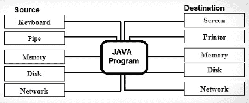

**(Java 程序与 I/O 设备的关系)**

将数据从一个流发送到另一个流（类似于一个管道馈入另一个管道）的概念使得 Java 流成为文件处理的强大工具。我们可以使用一系列简单的流操作构建一个复杂的文件处理序列。

此功能可用于在流的流水线中过滤数据，以便获得所需格式的数据。例如，我们可以使用一个流获取二进制格式的原始数据，然后使用另一个串联的流将其转换为整数。

## 输入流和输出流

Java 流分为两种基本类型：通常的输入流和输出流。输入流从源提取（即读取）数据并将其发送到程序。

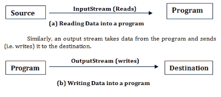

程序在数据源上连接并打开一个输入流，然后顺序读取数据。类似地，程序在数据终点连接并打开一个输出流，并按顺序写入数据。在这两种情况下，程序都不知道端点的细节（即源和目的地）。

## 字节流和字符流

Java 2 定义了两种流：字节流（Byte Streams）和字符流（Character Streams）。字节流为处理字节的输入输出提供了方便的方法。例如，在读取或写入二进制数据时使用字节流。字符流为处理字符的输入输出提供了方便的方法。它们使用 Unicode，因此可以国际化。此外，在某些情况下，字符流比字节流更高效。Java 的原始版本（Java 1.0）不包含字符流，此时所有的 I/O 都是面向字节的。

字符流是在 Java 1.1 中引入的，某些面向字节的类和方法已被废弃。

**注意：** 在底层，所有 I/O 仍然是面向字节的。字符流仅提供了处理字符的方便且高效的方法。

这两类可以根据其目的进一步分类。字节流和字符流类包含了独立处理各种类型输入输出的特殊类。

我们还可以根据读取或写入的源或目的地对流进行交叉分组。源（或目的地）可以是内存、文件或管道。

---

## 字节流概述

字节流类通过两个层次结构定义。顶部有两个抽象类：

1. `InputStream`
2. `OutputStream`

这些抽象类都有多个具体的子类，用于处理设备之间的差异，例如磁盘文件、网络连接和内存缓冲区。

### InputStream 类

读取 8 位字节的 `InputStream` 类包括一个名为 `InputStream` 的超类以及若干支持各种输入功能的子类。

---

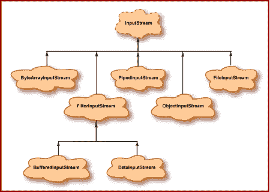

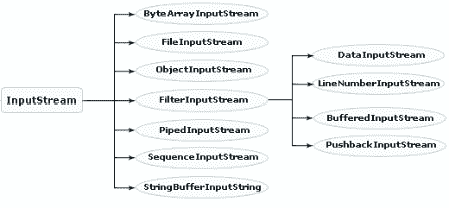

### InputStream 类

超类 `InputStream` 是一个抽象类，定义了执行输入功能的方法，例如：

*   读取字节。
*   关闭流。
*   标记流中的位置。
*   跳过流内容。
*   查找流中的字节数。

**InputStream 类的方法：**

```
int available()给出输入中可用的字节数（必须由子类重写）。InputStream 类的 available 方法始终返回 0。

void close()关闭此输入流并释放与流相关的系统资源。InputStream 的 close 方法无操作。

void mark(int readlimit)标记此输入流中的当前位置。InputStream 的 mark 方法无操作。

boolean markSupported()测试此输入流是否支持 mark 和 reset 方法。InputStream 的 markSupported 方法返回 false。
```

### InputStream 方法

| 方法 | 说明 |
| :--- | :--- |
| `abstract int read()` | 从输入流中读取下一个字节数据。子类必须提供此方法的实现。 |
| `int read(byte[] b)` | 从输入流中读取若干字节并将它们存储到缓冲区数组 `b` 中。返回实际读取的字节数的整数值。 |
| `int read(byte[] b, int offset, int len)` | 从输入流中读取若干字节并从参数 `offset` 指定的位置开始将它们存储到缓冲区数组 `b` 中。返回实际读取的字节数的整数值。 |
| `void reset()` | 将此流重新定位到上一次对此输入流调用 `mark` 方法时的位置。`InputStream` 的 `reset` 方法不做任何操作，并始终抛出 `IOException`。 |
| `long skip(long n)` | 跳过并丢弃从此输入流中的多达 `n` 个字节的数据，并返回实际跳过的字节数。 |

## DataInput 接口

`DataInput` 是一个接口，定义了从 `InputStream` 读取原始数据类型的方法。

### DataInput 接口的方法：

| 方法 | 说明 |
| :--- | :--- |
| `boolean readBoolean()` | 读取一个输入字节，如果该字节非零则返回 `true`，如果该字节为零则返回 `false`。 |
| `byte readByte()` | 读取并返回一个字节。 |
| `char readChar()` | 读取一个输入字符并返回其值。 |
| `double readDouble()` | 读取八个输入字节并返回一个 `double` 值。 |
| `float readFloat()` | 读取四个输入字节并返回一个 `float` 值。 |
| `void readFully(byte[] b)` | 从输入流中读取若干字节并将它们存储在缓冲区数组 `b` 中。如果此流在读取所有字节之前到达末尾，此方法将抛出 `EOFException`。 |
| `void readFully(byte[] b, int off, int len)` | 从输入流中读取 `len` 个字节并从 `off` 指定的位置开始将它们存储在缓冲区数组 `b` 中。如果此流在读取所有字节之前到达末尾，此方法将抛出 `EOFException`。 |
| `int readInt()` | 读取四个输入字节并返回一个 `int` 值。 |
| `String readLine()` | 从输入流中读取下一行。 |
| `long readLong()` | 读取八个输入字节并返回一个 `long` 值。 |
| `short readShort()` | 读取两个输入字节并返回一个 `short` 值。 |
| `String readUTF()` | 读取使用修改 UTF-8 格式编码的字符串。 |
| `int skipBytes(int n)` | 尝试从输入流中跳过 `n` 个字节的数据，并丢弃跳过的字节。返回实际跳过的字节数。 |

## InputStream 类总结

`FilterInputStream` 包含另一个输入流，它将其作为基本数据源，并可能在此过程中转换数据以提供额外功能。

`FilterInputStream` 类本身简单地重写了 `InputStream` 的所有方法，这些版本会将所有请求传递给包含的输入流。`FilterInputStream` 的子类可以进一步重写其中一些方法，并可能提供额外的方法和字段。

请注意，`DataInputStream` 类继承自 `FilterInputStream` 并实现了 `DataInput` 接口。因此，`DataInputStream` 在使用 `InputStream` 类方法外，还实现了 `DataInput` 中描述的方法。

### InputStream 子类总结

| 类 | 说明 |
| :--- | :--- |
| `InputStream` | 此抽象类是所有表示字节输入流的类的父类。 |
| `BufferedInputStream` | `BufferedInputStream` 为另一个输入流增加了功能——即缓冲输入的能力并支持 `mark` 和 `reset` 方法。 |
| `ByteArrayInputStream` | `ByteArrayInputStream` 包含一个内部缓冲区，其中包含从流中读取的字节。 |
| `DataInputStream` | `DataInputStream` 让应用程序以机器无关的方式从底层输入流读取 Java 原始数据类型。 |
| `FileInputStream` | `FileInputStream` 包含来自文件系统的输入字节。 |
| `FilterInputStream` | `FilterInputStream` 包含另一个输入流，它将其作为基本数据源，可能在此过程中传输数据或提供额外功能。 |
| `PipedInputStream` | `PipedInputStream` 应该连接到管道输出流，随后管道输入流将提供写入管道输出流的任何数据字节。 |
| `PushbackInputStream` | `PushbackInputStream` 为另一个输入流增加了功能，即“推回”或“重读”一个字节的能力。 |
| `SequenceInputStream` | `SequenceInputStream` 代表另一个流的逻辑连接。 |
| `ObjectInputStream` | `ObjectInputStream` 反序列化之前使用 `ObjectOutputStream` 写入的原始数据和对象。 |

## OutputStream 类

输出流类派自基类 `OutputStream`，该基类是一个抽象类，并有许多子类支持各种输出相关功能。

### OutputStream 类

父类 `OutputStream` 是一个抽象类，定义了执行输出功能的方法，例如：

*   写入字节
*   关闭流
*   刷新流

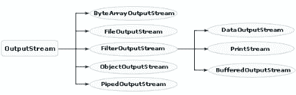

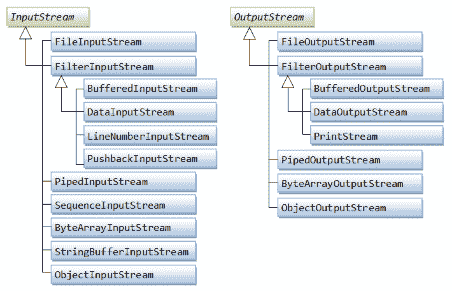

### OutputStream 类的方法

| 方法 | 说明 |
| :--- | :--- |
| `void close()` | 关闭此输出流并释放与此流相关的任何流资源。 |
| `void flush()` | 刷新此输出流并强制将任何缓冲的输出字节写入。 |
| `void write(byte[] b)` | 从指定的字节数组向其输出流写入 `b.length` 个字节。 |
| `void write(byte[] b, int off, int len)` | 从指定的字节数组从偏移量 `off` 开始向其输出流写入 `len` 个字节。 |
| `abstract void write(int b)` | 向其输出流写入指定的字节。 |

## DataOutput 接口

`DataOutput` 是一个接口，定义了向 `OutputStream` 写入原始数据类型的方法。


### DataOutput 接口的方法

| 方法 | 说明 |
| :--- | :--- |
| `void writeBoolean(boolean v)` | 向其输出流写入布尔值。 |
| `void writeByte(int v)` | 向输出流写入参数 `v` 的低 8 位。 |
| `void writeBytes(String s)` | 将字符串写入输出流。对于字符串 `s` 中的每个字符，按顺序向输出流写入一个字节。 |
| `void writeChar(int v)` | 向输出流写入一个字符值，其由两个字节组成。 |
| `void writeChars(String s)` | 将字符串 `s` 中的每个字符按顺序写入输出流（每个字符两个字节）。 |
| `void writeDouble(double v)` | 向输出流写入一个 `double` 值，其由八个字节组成。 |
| `void writeFloat(float v)` | 向输出流写入一个 `float` 值，其由四个字节组成。 |


| 方法 | 描述 |
| :--- | :--- |
| `void writeInt(int v)` | 向输出流写入一个 int 值，其由四个字节组成。 |
| `void writeLong(long v)` | 向输出流写入一个 long 值，其由八字节组成。 |
| `void writeShort(int v)` | 向输出流写入一个 short 值，其由两个字节组成。 |
| `void writeUTF(String str)` | 向输出流写入两个字节的长度信息，随后是字符串 `str` 中每个字符的修改 UTF-8 表示。 |

---

### OutputStream 类总结

`DataOutputStream` 是 `DataInputStream` 的对应部分。`DataOutputStream` 类在使用 `OutputStream` 类方法外，还实现了 `DataOutput` 接口描述的方法。

| 类 | 描述 |
| :--- | :--- |
| `OutputStream` | 此抽象类是所有表示字节输出流的类的父类。 |
| `BufferedOutputStream` | 该类实现了一个缓冲输出流。 |
| `ByteArrayOutputStream` | 该类实现了一种输出流，其中数据被写入字节数组中。 |
| `DataOutputStream` | 数据输出流允许应用程序以可移植的方式将 Java 原始数据类型写入输出流中。 |
| `FileOutputStream` | 文件输出流是用于向 `File` 写入数据的输出流。 |
| `PipedOutputStream` | 管道输出流可以连接到管道输入流上，以创建一个通信管道。 |
| `FilterOutputStream` | `FilterOutputStream` 包含其他输出流，它将这些流作为自己的目标，并可能在此对数据进行转换或提供额外功能。 |
| `PrintStream` | `PrintStream` 为另一个输出流添加功能，即能够方便地打印各种数据值的表示形式。 |

# 字符流类概览

字符流通过使用两个类层次结构定义。顶端是两个抽象类：`Reader` 和 `Writer`。这些抽象类处理 Unicode 字符流。

Java 为这些中的每一个类都提供了几个具体的子类。抽象的 `Reader` 和 `Writer` 类定义了其他流类实现的若干个关键方法。其中最重要的两个方法是 `read()` 和 `write()`，它们分别读取和写入数据字符。这些方法被派生的流类所重写。

## Reader 流类

Reader 流类设计用于从文件中读取字符。`Reader` 类是此组中所有其他类的基类。这些类在功能上与输入流类非常相似，区别在于输入流使用字节作为基本信息单元，而 reader 流使用字符。

`Reader` 类包含了与 `InputStream` 类中提供的相同的方法。因此，`Reader` 类可以执行输入流类所实现的几乎所有功能。

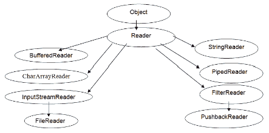

*(Reader 类的层次结构)*

### Reader 类

`Reader` 是一个抽象类，定义了 Java 的字符输入流模型。该类中的所有方法都会抛出 `IOException`。

### Reader 类的方法

| 方法 | 描述 |
| :--- | :--- |
| `abstract void close()` | 关闭流。一旦流被关闭，后续进一步的 `read()`、`ready()`、`mark()` 或 `reset()` 调用将抛出 `IOException`。然而，关闭一个之前已经关闭的流没有影响。 |
| `void mark()` | 标记流中的当前位置。随后，调用 `reset()` 将尝试将流重置到此点。并不是所有的字符输入流都支持 `mark()` 操作。 |
| `boolean markSupported()` | 告知此流是否支持 `mark()` 操作。 |
| `int read()` | 读取单个字符并返回来自调用输入流的下一个可用字符的整数表示。当遇到文件末尾时返回 -1。 |
| `int read(char[] buffer)` | 尝试将多达 buffer 长度的字符读取到 buffer 中，并返回成功读取的字符数。当遇到文件末尾时返回 -1。reader 子类必须实现此方法。 |
| `abstract int read(char[] buffer, int offset, int numChar)` | 尝试从 `buffer[offset]` 开始读取多达 `numChar` 个字符到 buffer 中，返回成功读取的字符数。当遇到文件末尾时返回 -1。reader 子类必须实现此方法。 |
| `boolean ready()` | 告知此流是否准备好被读取。如果下一次输入请求不会等待，则返回 true，否则返回 false。 |
| `void reset()` | 重置流。并不是所有的字符输入流都支持此方法。 |
| `long skip(long n)` | 跳过多达 `n` 个字符并返回跳过的字符数。如果 `n` 为负数，则抛出 `IllegalArgumentException`。 |

### Reader 类总结

| 类 | 描述 |
| :--- | :--- |
| `Reader` | 用于读取字符流的抽象类。 |
| `BufferedReader` | 从字符输入流中读取文本，对字符进行缓冲，以便高效地读取字符、数组和行。 |
| `CharArrayReader` | 该类实现了一个可以作为字符输入流使用的字符缓冲区。 |
| `FileReader` | 用于读取字符文件的便利类。 |
| `FilterReader` | 用于读取过滤字符流的抽象类。 |
| `InputStreamReader` | `InputStreamReader` 是从字节流到字符流的桥梁：它读取字节并使用指定的字符集将其解码为字符。 |
| `PipedReader` | 管道字符输入流。 |
| `PushbackReader` | 字符流读取器，允许将字符推回流中。 |
| `StringReader` | 源为字符串的字符流。 |

## Writer 流类

Writer 流类设计用于将字符写入文件/输出设备。writer 类是一个抽象类，作为所有其他 writer 流类的基类。

该基类通过定义与 `OutputStream` 类中相同的方法为所有输出操作提供支持。

`Writer` 类包含了与 `OutputStream` 类中提供的相同的方法。因此，`Writer` 类可以执行输出流类所实现的几乎所有功能。

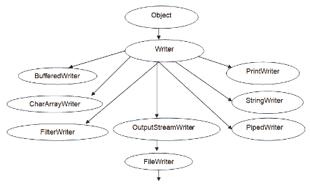

*(Writer 类的层次结构)*

### Writer 类

`Writer` 是一个抽象类，定义了流式字符输出。该类中的所有方法都返回一个 `void` 值，并在发生错误时抛出 `IOException`。

### Writer 类的方法

| 方法 | 描述 |
| :--- | :--- |
| `abstract void close()` | 关闭流并先进行刷新。 |
| `abstract void flush()` | 刷新流。 |
| `void write(char[] cbuf)` | 写入字符数组。 |
| `abstract void write(char[] cbuf, int off, int len)` | 写入从指定偏移量开始的字符数组部分。子类必须实现此方法。 |
| `void write(int c)` | 向调用的输出流写入单个字符。注意参数是 `int`，这允许你直接对表达式调用 `write`，而不需要将其强制转换回 `char`。 |
| `void write(String str)` | 写入字符串。 |
| `void write(String str, int off, int len)` | 写入从指定偏移量开始的字符串部分。 |

### Writer 类总结

| 类 | 描述 |
| :--- | :--- |
| `Writer` | 用于写入字符流的抽象类。 |
| `BufferedWriter` | 向字符输出流写入文本，对字符进行缓冲以便高效地写入单个字符、数组和字符串。 |
| `CharArrayWriter` | 该类实现了一个可以作为 Writer 的字符缓冲区。 |
| `FileWriter` | 用于写入字符文件的便利类。 |
| `FilterWriter` | 用于写入过滤字符流的抽象类。 |
| `OutputStreamWriter` | `OutputStreamWriter` 是从字符流到字节流的桥梁：写入它的字符使用指定的字符集编码为字节。 |
| `PipedWriter` | 管道字符输出流。 |
| `PrintWriter` | 向文本输出流打印对象的格式化表示。 |
| `StringWriter` | 在字符串缓冲区中收集输出的字符流，随后可以使用它来构建字符串。 |

## File 类

尽管 `java.io` 中定义的多数类基于流操作，但 `File` 类不是。它直接处理文件和文件系统。也就是说，`File` 类没有指定如何从文件中检索信息或将其存储。它描述的是文件本身的属性。

文件对象用于获取或操纵磁盘文件的信息，例如权限、时间、日期和目录路径，以及遍历子目录层次结构。

尽管出于安全考虑，文件在 applet 中的用法受到严格限制，但文件仍然是存储持久化和共享信息的核心资源。

## 概述

`Java` 中的目录被简单地视为一个文件，只是多了一个属性——一个可以通过 `list()` 方法检查的文件名列表。

| 方法 | 说明 |
| :--- | :--- |
| `public File(String);` | |
| `public File(String, String);` | |
| `public File(File, String);` | |
| `public File(URI);` | 此构造函数由 Java2（版本 1.4）添加 |
| `public String getName();` | 返回文件或目录的名字 |
| `public String getParent();` | 返回对象创建时指定的路径中文件的父目录；如果此路径名不是父目录，则返回 `null`。 |
| `public String getPath();` | 返回相对路径。 |
| `public boolean isAbsolute();` | 测试此抽象路径是否为绝对路径。 |
| `public String getAbsolutePath();` | 返回从根目录开始的绝对（完整）路径。 |
| `public boolean canRead();` | 测试应用程序是否可以读取此抽象路径所指示的文件。 |
| `public boolean canWrite();` | 测试应用程序是否可以修改此抽象路径所指示的文件。 |
| `public boolean exists();` | 测试此抽象路径所指示的文件或目录是否存在。 |
| `public boolean isDirectory();` | 测试此抽象路径所指示的文件是否为目录。 |
| `public boolean isFile();` | 测试此抽象路径所指示的文件是否为普通文件。 |
| `public boolean isHidden();` | 测试此抽象路径命名的文件是否为隐藏文件。 |
| `public long lastModified();` | 返回此抽象路径所指示的文件最后修改的时间。 |
| `public long length();` | 返回此抽象路径所指示的文件长度。 |
| `public boolean createNewFile() throws java.io.IOException;` | 当且仅当不存在以此抽象路径命的文件时，自动创建一个由此抽象路径命名的空文件。 |
| `public boolean delete();` | 删除此抽象路径所指示的文件或目录。 |
| `public String[] list();` | 返回一个字符串数组，包含此抽象路径所指示目录中的文件和目录名称。如果 `File` 对象对应文件，则返回 `null`。 |
| `public boolean mkdir();` | 创建此抽象路径命名的目录。 |
| `public boolean mkdirs();` | 创建此抽象路径命名的目录，包括任何必要的不存在的父目录。 |
| `public boolean setLastModified(long);` | 设置此抽象路径命名的文件或目录的最后修改时间。 |
| `public boolean setReadOnly();` | 标记此抽象路径命名的文件或目录，使其只允许读操作。 |
| `public boolean setWritable(boolean);` | |
| `public boolean setReadable(boolean);` | |
| `public boolean canExecute();` | |
| `public long getTotalSpace();` | |
| `public long getFreeSpace();` | |
| `public long getUsableSpace();` | |
| `boolean renameTo(File);` | 重命名此抽象路径所指示的文件。 |

### 示例

```java
File f1 = new File("/");
File f2 = new File("/", "autoexec.bat");
File f3 = new File(f1, "autoexec.bat");
```

### 注意

Java 在处理 UNIX 和 Windows 约定之间的路径分隔符时表现良好。如果你在 Windows 版本的 Java 上使用正斜杠（`/`），路径仍然可以正确解析。

请记住，如果你在字符串中使用 Windows 约定（`\\`）。Java 的惯例是使用 UNIX 和 URL 风格的正斜杠作为路径分隔符。

`File` 定义了许多获取 `File` 对象标准属性的方法。然而，`File` 类并不是对称的。这意味着，虽然有可以允许你检查简单文件对象属性的主要方法，但没有对应的函数来更改这些属性。

### 示例 15.1

接下来的示例展示了 `File` 类的几个方法：

```java
import java.io.*;

class FileTest {
    public static void main(String args[]) throws IOException {
        File f = new File("/javaprog/ch15/15.1/FileTest.java");
        if (!f.exists())
            f.createNewFile();
        System.out.println("Length=" + f.length() + " bytes");
        System.out.println("Name=" + f.getName());
        System.out.println("Parent=" + f.getParent());
        System.out.println("Path=" + f.getPath());
        System.out.println("Absolute Path=" + f.getAbsolutePath());
        System.out.println(f.exists() ? "Exists" : "Does not exist");
        System.out.println(f.isFile() ? "is file" : "not a file");
        System.out.println(f.canRead() ? "is readable" : "not readable");
        System.out.println(f.canWrite() ? "is writable" : "not writable");
        System.out.println(f.isDirectory() ? "is directory" : "not a file");
        System.out.println(f.isHidden() ? "is hidden" : "not hidden");
        System.out.println("last modified=" + f.lastModified());
        String[] nm = f.list();
        for (int i = 0; i < nm.length; i++) {
            File f4 = new File(nm[i]);
            if (f4.isFile()) {
                System.out.println("is file");
            } else {
                System.out.println("is a directory");
            }
        }
        File f5 = new File("zzz");
        f5.mkdir();
        File f6 = new File("yyy");
        f6.mkdirs();
    }
}
```

**输出:**


Length=1782 bytes
Name=FileTest.java
Parent=\javaprog/ch15/15.1
Path=\javaprog/ch15/15.1\FileTest.java
Absolute Path=C:\javaprog\ch15\15.1\FileTest.java
Exists
is file
is readable
is writable
is directory
not hidden
last modified:1236241680000
is file
is directory

## FileOutputStream 方法

| 签名 | 描述 |
| :--- | :--- |
| `public FileOutputStream(File) throws FileNotFoundException;` | 创建一个文件输出流，用于写入指定的 `File` 对象所表示的文件。 |
| `public FileOutputStream(File, boolean) throws FileNotFoundException;` | 创建一个文件输出流，用于写入指定的 `File` 对象所表示的文件。 |
| `public native void write(int) throws java.io.IOException;` | |
| `public void write(byte[ ]) throws java.io.IOException;` | |
| `public void write(byte[ ], int, int) throws java.io.IOException;` | |
| `public void close( ) throws java.io.IOException;` | |

### 示例 15.2

```java
import java.io.*;
class FileRead
{
  public static void main(String args[])
  {
    FileInputStream fin=null;
    int a;
      try
      {
        fin=new FileInputStream(args[0]);
        System.out.println("No. of characters to read="+fin.available());
        fin.skip(3);
        a = fin.read();
        while(a != -1)
        {
          System.out.print((char)a);
          a = fin.read();
        }
        System.out.println("No. of characters to read="+fin.available());
        fin.close(); 
      }
      catch(ArrayIndexOutOfBoundsException e)
      {
        System.out.println(e);
      }
      catch(FileNotFoundException e)
      {
        System.out.println(e);
      }
      catch(IOException e)
      {
        System.out.println(e);
      }
  }
}
```

**输出：**

```text
java FileRead A.txt
No. of characters to read=20
Matrix Computers
No. of characters to read=0
```

### 示例 15.3

```java
import java.io.*;
class FileCopy
{
  public static void main(String args[]) throws IOException
  {
    FileInputStream fin=null;
    FileOutputStream fout=null;
    fin=new FileInputStream(args[0]);
    fout=new FileOutputStream(args[1]);
    int a;
    a = fin.read();
    while(a != -1)
    {
      fout.write(a);
      a = fin.read();
    }
    fin.close();fout.close();
  }
}
```

### 示例 15.4

```java
import java.io.*;
class CopyFile
{
  public static void main(String args[]) throws IOException
  { 
    int n;
    FileInputStream fin = new FileInputStream("A.txt");
    FileOutputStream fout = new FileOutputStream("B.txt");
    byte b[ ]= new byte[10];
    n = fin.read(b);
    while(n != -1)
    { 
      fout.write(b,0,n);
      n = fin.read(b);
    }
    fin.close();
    fout.close();
  }
}
```

---

## FileReader

`FileReader` 类创建一个 `Reader`，你可以用它来读取文件内容。它最常用的两个构造函数是：

- `FileReader(File file)`：创建一个 `FileReader` 流，用于从指定文件中读取。
- `FileReader(String fileName)`：创建一个 `FileReader` 流，用于从指定文件中读取。

**注意：** 如果文件不存在、是一个目录而不是普通文件，或者由于某些原因无法打开读取，这两个构造函数中的任何一个都可能抛出 `FileNotFoundException`。

## FileWriter

`FileWriter` 类创建一个 `writer`，你可以用它向文件写入内容。它最常用的构造函数有：

- `FileWriter(File file)`：一个用于写入指定文件的 `FileWriter` 对象。
- `FileWriter(String fileName)`：一个用于写入指定文件的 `FileWriter` 对象。
- `FileWriter(File file, boolean append)`：一个以 `append` 模式写入指定文件的 `FileWriter` 对象。
- `FileWriter(String filename, boolean append)`：一个以 `append` 模式写入指定文件的 `FileWriter` 对象。

如果始终使用前两个构造函数，则会创建一个新文件。如果存在同名文件，它会被销毁。如果使用后两个构造函数且 `append` 标志为 `false`，则它们的行为与前两个构造函数一致。如果 `append` 标志为 `true`，则文件以 `append` 模式打开，即如果文件已存在，则文件指针置于文件末尾；如果文件不存在，则创建新文件。

**注意：** 如果文件存在但是目录而不是普通文件、不存在但无法创建，或由于其他原因无法打开，这些构造函数可能会抛出 `IOException`。例如，当尝试打开一个只读文件时，将抛出 `IOException`。

### 示例 15.5

```java
import java.io.*;
class FileCopy
{
  public static void main(String args[]) throws IOException
  {
    FileReader fin=null;
    FileWriter fout=null;
    fin=new FileReader(args[0]);
    fout=new FileWriter(args[1]);
    int a;
    a = fin.read();
    while(a != -1)
    {
      fout.write(a);
      a = fin.read();
    }
    fin.close();
    fout.close();
  }
}
```

---

## RandomAccessFile

`RandomAccessFile` 封装了一个随机访问文件。它允许我们在文件中的任何位置读取和写入字节、文本和原始数据类型（通过 `InputStream` 和 `DataOutput` 接口，它可以定位文件指针）。`mode` 参数指定打开文件的模式，允许的值及其含义如下：

| 值 | 含义 |
| :--- | :--- |
| `"r"` | 仅读取。调用对象的任何 `write` 方法都将抛出 `IOException`。 |
| `"rw"` | 可读写。如果文件不存在，将尝试创建它。 |
| `"rws"` | 可读写，同 `"rw"`，但要求文件的元数据同步写入存储设备。 |
| `"rwd"` | 可读写，同 `"rw"`，但要求文件的内容（数据）同步写入存储设备。 |

### RandomAccessFile 方法

除了 `DataInput` 和 `DataOutput` 接口的方法外，该类的一些常用方法如下：

| 签名 | 描述 |
| :--- | :--- |
| `public RandomAccessFile(String, String) throws FileNotFoundException;` | 创建一个随机访问文件流，用于从指定的文件读取，并可选写入。 |
| `public RandomAccessFile(File, String) throws FileNotFoundException;` | 创建一个随机访问文件流，用于从由 `File` 对象表示的文件读取，并可选写入。 |
| `public native int read() throws java.io.IOException;` | |
| `public int read(byte[], int, int) throws java.io.IOException;` | |
| `public int read(byte[]) throws java.io.IOException;` | |
| `public int skipBytes(int) throws java.io.IOException;` | |
| `public native void write(int) throws java.io.IOException;` | |
| `public void write(byte[]) throws java.io.IOException;` | |
| `public void write(byte[], int, int) throws java.io.IOException;` | |
| `public native long getFilePointer() throws java.io.IOException;` | 返回下一次读取或写入相对于文件开始的偏移字节。 |
| `public native void seek(long) throws java.io.IOException;` | 在此处，`newPos` 指定文件指针相对于文件开始的新位置。调用 `seek()` 之后，下一次读取或写入将在新的文件位置发生。 |
| `public native long length() throws java.io.IOException;` | |
| `public native void setLength(long) throws java.io.IOException;` | 设置此文件的长度。此方法可以用于延长或缩小文件。如果文件被延长，增加的部分是未定义的。 |
| `public void close() throws java.io.IOException;` | |
| `public final boolean readBoolean() throws java.io.IOException;` | |

```java
public final byte readByte() throws java.io.IOException;
public final int readUnsignedByte() throws java.io.IOException;
public final short readShort() throws java.io.IOException;
public final int readUnsignedShort() throws java.io.IOException;
public final char readChar() throws java.io.IOException;
public final int readInt() throws java.io.IOException;
public final long readLong() throws java.io.IOException;
public final float readFloat() throws java.io.IOException;
public final double readDouble() throws java.io.IOException;
public final java.lang.String readLine() throws java.io.IOException;
public final java.lang.String readUTF() throws java.io.IOException;
public final void writeBoolean(boolean) throws java.io.IOException;
public final void writeByte(int) throws java.io.IOException;
public final void writeShort(int) throws java.io.IOException;
public final void writeChar(int) throws java.io.IOException;
public final void writeInt(int) throws java.io.IOException;
public final void writeLong(long) throws java.io.IOException;
public final void writeFloat(float) throws java.io.IOException;
public final void writeDouble(double) throws java.io.IOException;
public final void writeBytes(java.lang.String) throws java.io.IOException;
public final void writeChars(java.lang.String) throws java.io.IOException;
public final void writeUTF(java.lang.String) throws java.io.IOException;
```


### 示例 15.6


```java
import java.io.*;
class RandomIO {
    public static void main(String args[]) throws IOException {
        RandomAccessFile file = null;
        try {
            file = new RandomAccessFile("rand.dat", "rw");
            file.writeChar('X');
            file.writeInt(1999);
            file.writeDouble(222.44);
            System.out.println("File pointer Pos:"+file.getFilePointer());
            file.seek(0);
            System.out.println(file.readChar());
            System.out.println(file.readInt());
            System.out.println(file.readDouble());
            System.out.println("File pointer Pos:"+file.getFilePointer());
            file.seek(2);
            System.out.println("File pointer Pos:"+file.getFilePointer());
            System.out.println(file.readInt());
            file.seek(file.length());
            file.writeBoolean(false);
            file.seek(14);
            System.out.println(file.readBoolean());
            System.out.println("File pointer Pos:"+file.getFilePointer());
            System.out.println(file.readInt());//EOF Exption
        } catch(EOFException e) {
            System.out.println("Trying to read after end of file");
        } finally {
            file.close();
        }
    }
}
```

**输出：**

```text
File pointer Pos:14
X
1999
222.44
File pointer Pos:14
File pointer Pos:2
1999
false
File pointer Pos:15
Trying to read after end of file
```

**注意：** 如果尝试在文件末尾之后读取，则会发生 `EOFException`。

## ByteArrayInputStream

`ByteArrayInputStream` 包含一个内部缓冲区，可以从该流进行读取。`ByteArrayInputStream` 是一个使用字节数组作为数据源的输入流实现。该类有两个构造函数，每个构造函数都需要一个字节数组来提供数据源。`ByteArrayInputStream` 实现了 `mark()` 和 `reset()` 方法。但是，如果没有调用过 `mark()`，`reset()` 将流指针重置为流起点。

```java
public ByteArrayInputStream(byte[]);
public ByteArrayInputStream(byte[], int);
public synchronized int read();
public synchronized int read(byte[], int);
public synchronized long skip(long);
public synchronized int available();
public boolean markSupported();
public void mark(int);
public synchronized void reset();
public void close() throws IOException;
```

## Example 15.7

```java
import java.io.*;
class ByteArrayInputStreamTest {
    public static void main(String args[]) throws IOException {
        String s1 = "abcdefghijk";
        byte b[] = s1.getBytes();
        ByteArrayInputStream b1 = new ByteArrayInputStream(b);
        int a;
        while((a=b1.read()) != -1) {
            System.out.print((char)Character.toUpperCase(a));
        }
        b1.close();
    }
}
```

**输出：**

```text
ABCDEFGHIJK
```

## ByteArrayOutputStream

`ByteArrayOutputStream` 实现了一个输出流，数据被写入字节数组中。`ByteArrayOutputStream` 是一个使用字节数组作为目的地的输出流实现。缓冲区存储在 `ByteArrayOutputStream` 的 `buf` 字段中。如果需要，缓冲区的大小将增大。缓冲区持有的字节数包含在 `ByteArrayOutputStream` 的 `count` 字段中。

```java
public java.io.ByteArrayOutputStream(); // 创建一个新的字节数组输出流。初始容量为 32 字节，但在必要时会增大。
public java.io.ByteArrayOutputStream(int); // 创建具有指定大小的字节数组输出流。
public synchronized void write(int);
public synchronized void write(byte[], int, int);
public synchronized void write(java.lang.String);
public synchronized void reset();
public synchronized int size();
public synchronized byte[] toByteArray();
public synchronized String toString();
public void close() throws IOException;
```

## Example 15.8

```java
import java.io.*;
class ByteArrayOutputStreamTest {
    public static void main(String args[]) throws IOException {
        ByteArrayOutputStream b1 = new ByteArrayOutputStream();
        b1.write('a');
        String s1 = "abcdefghijk";
        byte arr1[] = s1.getBytes();
        b1.write(arr1);
        System.out.println(b1); //toString()
        // 使用 for 循环显示
        byte arr2[] = b1.toByteArray();
        for(int i=0; i<arr2.length; i++) {
            System.out.print((char)arr2[i]);
        }
        System.out.println();
        // 使用 for 循环显示
        for(int i:arr2) {
            System.out.print((char)i);
        }
        b1.close();
    }
}
```

**输出：**

```text
aabcdefghijk
aabcdefghijk
```

## CharArrayReader

`CharArrayReader` 是一个使用字符数组作为数据源的读取器流实现。该类有两个构造函数，每个构造函数都需要一个字符数组来提供数据源。

### 构造函数

- `CharArrayReader(char[] buf)`：从指定的字符数组创建 `CharArrayReader`。
- `CharArrayReader(char[] buf, int offset, int length)`：从指定的字符数组创建 `CharArrayReader`。读取器将从指定的偏移量开始读取。从此读取器可以读取的字符总数将为 `length` 或 `buf.length`。

## Example 15.9

```java
import java.io.*;
class CharArrayReaderTest {
    public static void main(String args[]) throws IOException {
        String tmp = "abcdefghijklmnopqrstuvwxyz";
        int length = tmp.length();
        char c[] = new char[length];
        tmp.getChars(0, length, c, 0);
        CharArrayReader input1 = new CharArrayReader(c);
        CharArrayReader input2 = new CharArrayReader(c, 0, 5);
        int i;
        while((i = input1.read()) != -1) {
            System.out.print((char)i);
        }
        System.out.println();
        while((i = input2.read()) != -1) {
            System.out.print((char)i);
        }
    }
}
```

**输出：**

```text
abcdefghijklmnopqrstuvwxyz
abcde
```

## CharArrayWriter

`CharArrayWriter` 是一个写入器流的实现，它使用字符数组缓冲区作为目标地。

### 构造函数

- `CharArrayWriter()`
- `CharArrayWriter(int initialSize)`

在第一种形式中，会创建一个具有默认大小的缓冲区。在第二种形式中，创建一个大小与参数 `initialSize` 指定相等的缓冲区。

缓冲区存储在 `CharArrayWriter` 的 `buf` 字段中。如果需要，缓冲区的大小将自动增大。缓冲区持有的字符数量包含在 `CharArrayWriter` 的 `count` 字段中。`buf` 和 `count` 都是保护字段。

## Example 15.10

```java
import java.io.*;
class CharArrayWriterTest {
    public static void main(String args[]) throws IOException {
        CharArrayWriter f = new CharArrayWriter();
        String s = "This should end up in the array";
        char buf[] = new char[s.length()];
        s.getChars(0, s.length(), buf, 0);
        f.write(buf);
        System.out.println(f.toString());
        char c[] = f.toCharArray();
        for(int i = 0; i < c.length; i++) {
            System.out.print(c[i]);
        }
        FileWriter f2 = new FileWriter("test.txt");
        f.writeTo(f2);
        f2.close();
        f.reset();
        System.out.println();
        System.out.println("After reset:" + f.toString());
        for(int i = 0; i < 3; i++)
            f.write('A');
        System.out.println(f.toString());
    }
}
```

**输出：**

```text
This should end up in the array
This should end up in the array
After reset:
AAA
```

## PushbackInputStream

`PushbackInputStream` 为另一个输入流增加了功能，即“推回”或“取消读取”一个字节的能力。缓冲的用处之一就是实现推回。

推回用于输入流，允许一个字节在被读取后，然后将其返回到流中。除了 `InputStream` 类常见的方法外，`PushbackInputStream` 还提供了 `unread()` 方法，如下：

| 方法 | 描述 |
| :--- | :--- |
| `public java.io.PushbackInputStream(java.io.InputStream, int);` | 创建一个具有指定大小推回缓冲区的 `PushbackInputStream`，并保存其参数（输入的输入流）以备后用。这允许多个字节返回到输入流。 |
| `public java.io.PushbackInputStream(java.io.InputStream);` | 创建一个 `PushbackInputStream` 并保存其参数（输入的输入流）以备后用。这允许一个字节返回到输入流。 |
| `public int read() throws java.io.IOException;` | |
| `public int read(byte[], int, int) throws java.io.IOException;` | |
| `public void unread(int) throws java.io.IOException;` | 通过将字节拷贝到推回缓冲区的头部来推回一个字节。 |
| `public void unread(byte[], int, int) throws java.io.IOException;` | 通过将字节数组的一部分拷贝到推回缓冲区的头部来推回字节数组的一部分。 |
| `public void unread(byte[]) throws java.io.IOException;` | 通过将字节数组拷贝到推回缓冲区的头部来推回字节数组。 |
| `public int available() throws java.io.IOException;` | |
| `public long skip(long) throws java.io.IOException;` | |
| `public boolean markSupported();` | `PushbackInputStream` 的副作用是使用于创建它的 `InputStream` 类的 `mark()` 或 `reset()` 方法失效。使用 `markSupported()` 方法检查任何你准备使用 `mark()`/`reset()` 的流。 |
| `public synchronized void mark(int);` | |
| `public synchronized void reset() throws java.io.IOException;` | |
| `public synchronized void close() throws java.io.IOException;` | |

## Example 15.11


```java
1. import java.io.*;
2. class PushbackInputStreamTest
3. {
4. public static void main(String args[]) throws IOException
5. {
6. FileInputStream fin = new FileInputStream("A.txt");
7. PushbackInputStream p1=new PushbackInputStream(fin);
8. int ch=p1.read();
9. System.out.println((char)ch);
10. ch=p1.read();
11. System.out.println((char)ch);
12. ch=p1.read();
13. System.out.println((char)ch);
14. p1.unread(ch); // or p1.unread('z');
15. ch=p1.read();
16. System.out.println((char)ch);
17. }
}
```

输出：

```
Matrix
a
t
```

## PushbackInputStream

`PushbackInputStream` 为另一个输入流增加了功能，即“推回”或“取消读取”一个字节的能力。缓冲的用处之一就是实现推回。

推回用于输入流，允许一个字节在被读取后，然后将其返回到流中。除了 `InputStream` 类常见的方法外，`PushbackInputStream` 还提供了 `unread()` 方法，如下：

| 方法 | 描述 |
| :--- | :--- |
| `public java.io.PushbackInputStream(java.io.InputStream, int);` | 创建一个具有指定大小推回缓冲区的 `PushbackInputStream`，并保存其参数（输入的输入流）以备后用。这允许多个字节返回到输入流。 |
| `public java.io.PushbackInputStream(java.io.InputStream);` | 创建一个 `PushbackInputStream` 并保存其参数（输入的输入流）以备后用。这允许一个字节返回到输入流。 |
| `public int read() throws java.io.IOException;` | |
| `public int read(byte[], int, int) throws java.io.IOException;` | |
| `public void unread(int) throws java.io.IOException;` | 通过将字节拷贝到推回缓冲区的头部来推回一个字节。 |
| `public void unread(byte[], int, int) throws java.io.IOException;` | 通过将字节数组的一部分拷贝到推回缓冲区的头部来推回字节数组的一部分。 |
| `public void unread(byte[]) throws java.io.IOException;` | 通过将字节数组拷贝到推回缓冲区的头部来推回字节数组。 |
| `public int available() throws java.io.IOException;` | |
| `public long skip(long) throws java.io.IOException;` | |
| `public boolean markSupported();` | `PushbackInputStream` 的副作用是使用于创建它的 `InputStream` 类的 `mark()` 或 `reset()` 方法失效。使用 `markSupported()` 方法检查任何你准备使用 `mark()`/`reset()` 的流。 |
| `public synchronized void mark(int);` | |
| `public synchronized void reset() throws java.io.IOException;` | |
| `public synchronized void close() throws java.io.IOException;` | |

### 示例 15.11

```java
1. import java.io.*;
2. class PushbackInputStreamTest
3. {
4. public static void main(String args[]) throws IOException
5. {
6. FileInputStream fin = new FileInputStream("A.txt");
7. PushbackInputStream p1=new PushbackInputStream(fin);
8. int ch=p1.read();
9. System.out.println((char)ch);
10. ch=p1.read();
11. System.out.println((char)ch);
12. ch=p1.read();
13. System.out.println((char)ch);
14. p1.unread(ch); // or p1.unread('z');
15. ch=p1.read();
16. System.out.println((char)ch);
17. }
}
```

输出：

```
Matrix
a
t
```

## PushbackReader

一个字符流，允许将字符推回到流中。`PushbackReader` 允许你向前查看流中的。

| 方法 | 描述 |
| :--- | :--- |
| `public java.io.PushbackReader(java.io.Reader, int);` | 创建一个具有指定大小推回缓冲区的 `PushbackReader`，并保存其参数（输入的读取器）以备后用。这允许多个字节返回到输入流。 |
| `public java.io.PushbackReader(java.io.Reader);` | 创建一个 `PushbackReader` 并保存其参数（输入的读取器）以备后用。这允许一个字节返回到输入流。 |
| `public int read() throws java.io.IOException;` | |
| `public int read(char[], int, int) throws java.io.IOException;` | |
| `public void unread(int) throws java.io.IOException;` | 通过将字符拷贝到推回缓冲区的头部来推回一个字符。 |
| `public void unread(char[], int, int) throws java.io.IOException;` | 通过将字符数组的一部分拷贝到推回缓冲区的头部来推回字符数组的一部分。 |
| `public void unread(char[]) throws java.io.IOException;` | 通过将字符数组拷贝到推回缓冲区的头部来推回字符数组。 |
| `public int available() throws java.io.IOException;` | |
| `public long skip(long) throws java.io.IOException;` | |
| `public boolean markSupported();` | `PushbackReader` 的副作用是使用于创建它的 `Reader` 类的 `mark()` 或 `reset()` 方法失效。使用 `markSupported()` 方法检查任何你准备使用 `mark()`/`reset()` 的流。 |
| `public synchronized void mark(int);` | |
| `public synchronized void reset() throws java.io.IOException;` | |
| `public synchronized void close() throws java.io.IOException;` | |

注意：当推回缓冲区满且尝试返回字符时，将抛出 `IOException`。

### 示例 15.12

```java
1. import java.io.*;
2. class PushbackReaderTest
3. {
4. public static void main(String args[]) throws IOException
5. {
6. FileReader fr = new FileReader("A.txt");
7. PushbackReader pr=new PushbackReader(fr);
8. int ch=pr.read();
9. System.out.println((char)ch);
10. ch=pr.read();
11. System.out.println((char)ch);
12. ch=pr.read();
13. System.out.println((char)ch);
14. pr.unread(ch);
15. ch=pr.read();
16. System.out.println((char)ch);
17. }
18. }
```

输出：

```
Matrix
a
t
```

## SequenceInputStream

`SequenceInputStream` 类是一个允许你连接多个 `InputStream` 的字节流。序列流的构造与其他任何 `InputStream` 都不同。`SequenceInputStream` 构造函数使用一对 `InputStream` 类或 `InputStream` 类的 `Enumeration` 作为其参数：

- `SequenceInputStream(InputStream is1, InputStream is2)`：初始化新新 `SequenceInputStream` 并记住这两个参数，它们将按顺序先读取 `is1` 然后读取 `is2`，以从此 `SequenceInputStream` 读取所需的字节。
- `SequenceInputStream(Enumeration e)`：初始化新新 `SequenceInputStream` 并记住参数，该参数必须是一个产生运行时类型为 `InputStream` 的对象的 `Enumeration`。

操作上，该类从第一个 `InputStream` 满足读取请求直到它耗尽，然后切换到第二个。在 `Enumeration` 的情况下，它将继续通过所有的 `InputStream` 直到达到最后一个的结束。

### 示例 15.13

```java
1. import java.io.*;
2. class SequenceInputStreamTest
3. { 
4. public static void main(String args[]) throws IOException
5. { 
6. FileInputStream f1 = new FileInputStream(args[0]);
7. FileInputStream f2 = new FileInputStream(args[1]);
8. FileOutputStream f3 = new FileOutputStream(args[2]);
9. SequenceInputStream sis = new SequenceInputStream(f1,f2);
10. int c;
```

```java
while((c = sis.read()) != -1)
{
    f3.write(c);
}
f3.close();f1.close();f2.close();
}
}
```

Output:

```
SequenceInputStreamTest A.txt B.txt C.txt
```

## PrintStream

它是一个字节流类，继承自 `FilterOutputStream`。`PrintStream` 为另一个输出流增加了功能，即能够方便地打印各种数据值的表示形式。

可选地，可以创建一个 `PrintStream` 以便自动刷新（flush）；这意味着在写入字节数组、调用其中一个 `println` 方法，或者写入换行符或换行字节（`\n`）之后，会自动调用 `flush` 方法。

由 `PrintStream` 打印的所有字符都将使用平台的默认字符编码转换为字节，然后写入构造函数中指定的 `OutputStream` 或 `File`。

`PrintStream` 支持针对所有类型（包括 `object`）的 `print()` 和 `println()` 方法。如果参数不是简单类型，`PrintStream` 方法将调用对象的 `toString()` 方法并打印结果。

### 构造函数

- `PrintStream(File file)`：创建一个新的文件打印流，不进行自动行刷新。
- `PrintStream(String fileName)`：创建一个新的指定文件名的新打印流，不进行自动行刷新。
- `PrintStream(OutputStream out)`：创建一个连接到指定 `OutputStream` 的新打印流。
- `PrintStream(OutputStream out, boolean autoFlush)`：创建一个连接到指定 `OutputStream` 的新打印流。


### 示例 15.14

```java
import java.io.*;
class PrintStreamTest
{
    public static void main (String args[]) throws IOException
    {
        PrintStream ps = new PrintStream(System.out, true);
        ps.println("This is a string");
        int i = -7;
        ps.println(i);
        double d = 4.5e-7;
        ps.println(d);
    }
}
```

Output:

```
This is a string
-7
4.5E-7
```

### 示例 15.15

```java
import java.io.*;
class PrintStreamTest2
{
    public static void main (String argv[]) throws IOException
    {
        FileOutputStream fout = new FileOutputStream("test.dat");
        PrintStream ps = new PrintStream(fout, true);
        ps.println("This is a string");
        int i = -7;
        ps.println(i);
        double d = 4.5e-7;
        ps.println(d);
    }
}
```

## PrintWriter

虽然在 Java 中仍然允许使用 `System.out` 写入控制台，但其使用主要推荐用于调试或示例程序。

对于真实世界的程序，使用 Java 向控制台输出的推荐方法是通过 `PrintWriter` 流。`PrintWriter` 是基于字符的类之一。使用基于字符的类进行控制台输出可以让程序的国际化变得更容易。

### 构造函数

- `PrintWriter(File file)`：创建一个新的用于指定文件的 `PrintWriter`，不进行自动行刷新。
- `PrintWriter(String fileName)`：创建一个新的用于指定文件名的 `PrintWriter`，不进行自动行刷新。
- `PrintWriter(OutputStream out)`：创建一个新的用于指定 `OutputStream` 的 `PrintWriter`，不进行自动行刷新。
- `PrintWriter(OutputStream out, boolean autoFlush)`：创建一个用于写入指定 `OutputStream` 的 `PrintWriter`。
- `PrintWriter(Writer out)`：创建一个新的写入指定 `Writer` 的 `PrintWriter`，不进行自动行刷新。
- `PrintWriter(Writer out, Boolean autoFlush)`：创建一个用于写入指定 `Writer` 的 `PrintWriter`。

最常用的构造函数是：

`PrintWriter(OutputStream os, boolean flushOnNewLine)`

在这里，`os` 是 `OutputStream` 类型的对象，`flushOnNewLine` 控制 Java 在每次调用 `println()` 方法时是否刷新输出流。如果 `flushOnNewLine` 为 `true`，则会自动进行刷新。如果为 `false`，则不自动刷新。

`PrintWriter` 支持针对所有类型（包括对象）的 `print()` 和 `println()` 方法。如果参数不是简单类型，`PrintWriter` 方法将调用对象的 `toString()` 方法并打印结果。


要使用 `PrintWriter` 写入控制台，请指定 `System.out` 为输出流，并在每新行后刷新流。例如，这行代码创建一个连接到控制台的 `PrintWriter`：

`pw = new PrintWriter(System.out, true)`

### 示例 15.16

```java
import java.io.*;
class PrintWriterTest
{
    public static void main (String argv[]) throws IOException
    {
        PrintWriter pw = new PrintWriter(System.out, true);
        pw.println("This is a string");
        int i = -7;
        pw.println(i);
        double d = 4.5e-7;
        pw.println(d);
    }
}
```

Output:

```
This is a string
-7
4.5E-7
```

### 示例 15.17

```java
import java.io.*;
class PrintWriterTest
{
    public static void main (String argv[]) throws IOException
    {
        FileWriter fout = new FileWriter("test.dat");
        PrintWriter pw = new PrintWriter(fout, true);
        pw.println("This is a string");
        int i = -7;
        pw.println(i);
        double d = 4.5e-7;
        pw.println(d);
    }
}
```

### 示例 15.18

```java
import java.io.*;
class PrintWriterTest2
{
    public static void main (String argv[]) throws IOException
    {
        PrintWriter pw = new PrintWriter("test.dat");
        pw.println("This is a string");
        int i = -7;
        pw.println(i);
        double d = 4.5e-7;
        pw.println(d);
        pw.close();
    }
}
```

### PipedInputStream 和 PipedOutputStream

管道输出流可以连接到管道输入流以创建一个通信管道。管道输出流是管道的发送端。管道输入流应该连接到管道输出流；随后管道输入流将提供写入管道输出流的任何字节。

通常，数据由一个线程从 `PipedInputStream` 对象中读取，并由另一个线程写入相应的 `PipedOutputStream` 中。不建议在单个线程中使用尝试这两个对象，因为可能会导致线程死锁。管道输入流包含一个缓冲区，在限制范围内将读操作与写操作分离。

### 构造函数

- `PipedInputStream()`：创建一个 `PipedInputStream`，使其尚未连接。
- `PipedInputStream(PipedInputStream src)`：创建一个 `PipedInputStream`，使其连接到输出流 `src`。
- `PipedOutputStream()`：创建一个尚未连接到管道输入流的管道输出流。
- `PipedOutputStream(PipedInputStream snc)`：创建一个连接到管道输入流的管道输出流。

### 示例 15.19

```java
import java.io.*;
class TextGenerator extends Thread
{
    OutputStream out;
    TextGenerator(OutputStream out)
    {
        this.out = out;
    }
    public void run()
    {
        try
        {
            try
            {
                for(byte b = 65; b<=90; b++)
                    out.write(b);
            }
            finally
            {
                out.close();
            }
        }
        catch(IOException e)
        {
            System.out.println(e);
        }
    }
}
class Pipe
{
    public static void main(String args[]) throws IOException
    {
        PipedOutputStream out = new PipedOutputStream();
        PipedInputStream in = new PipedInputStream(out);
        TextGenerator data = new TextGenerator(out);
        data.start();
        int ch;
        while((ch = in.read()) != -1)
            System.out.print((char) ch);
    }
}
```

Output:

```
ABCDEFGHIJKLMNOPQRSTUVWXYZ
```

### PipedReader 和 PipedWriter

它们的功能与 `PipedInputStream` 和 `PipedOutputStream` 相同，唯一的区别在于它们是字符流。

### 构造函数

- `PipedReader()`：创建一个 `PipedReader`，但它尚未连接。
- `PipedReader(PipedWriter src)`：创建一个 `PipedReader`，使其连接到管道写入器 `src`。
- `PipedWriter()`：创建一个尚未连接到管道读取器的 `PipedWriter`（管道写入器）。
- `PipedWriter(PipedReader snk)`：创建一个连接到指定 `PipedReader` 的管道写入器。

### 示例 15.20

```java
import java.io.*;
class TextGenerator extends Thread
{ 
  Writer out;
  TextGenerator(Writer out)
  { 
    this.out = out;
  }
  public void run()
  { 
    try
    { 
      try
      { 
        for(char c = 'a'; c<='z'; c++)
            out.write(c);
      }
      finally
      { 
        try
        {  
          Thread.sleep(2000);  
        } 
        catch(Exception e) {}
      System.out.println("aaaaaaaaaaaaa");
      if(true)
      return;  // IOException: pipe Broken
      out.close();  //IOException: Write end dead
    }  //OK if thread finishes after closing the pipe
    }
    catch(IOException e)   { System.out.println(e);}
  }
}
class Pipe2
{ 
  public static void main (String argv[]) throws IOException
  { 
    PrintStream ps = new PrintStream(System.out);
    PipedWriter out = new PipedWriter();
    PipedReader in = new PipedReader(out);
    TextGenerator data = new TextGenerator(out);
    data.start(); int ch;
    while((ch = in.read()) != -1)
      System.out.print((char) ch);
  }
}
```

**输出：**

```
abcdefghijklmnopqrstuvwxyzaaaaaaaaaaaaa
Exception in thread "main" java.io.IOException: Pipe broken
at java.io.PipedReader.read(Unknown Source)
at Pipe2.main(Pipe2.java:43)
```

### 过滤字节流

过滤流仅仅是底层输入流或输出流的包装器，透明地提供某些扩展功能。典型的扩展包括缓冲、zip 压缩/解压等。过滤字节流是 `FilterInputStream` 和 `FilterOutputStream`。它们的构造函数为：

- `FilterInputStream(InputStream in)`：通过将参数 `in` 赋值给字段 `this.in` 来创建一个 `FilterInputStream`，以便稍后使用它。
- `FilterOutputStream(OutputStream out)`：创建一个构建在指定的底层输出流之上的输出流过滤器。

在这些类中提供的方法与 `InputStream` 和 `OutputStream` 中的方法相同。

### 缓冲字节流

对于面向字节的流，缓冲流通过在 I/O 流上附加内存缓冲区来扩展过滤流类。该缓冲区允许 Java 每次处理多于一个字节的 I/O 操作，从而提高性能。

由于缓冲区的可用，流的跳过（skip）、标记（mark）和重置（reset）变得可能。缓冲字节流类是 `BufferedInputStream` 和 `BufferedOutputStream`。`PushbackInputStream` 也实现了缓冲流。

### BufferedInputStream

缓冲 I/O 是一种非常常见的性能优化。Java 的 `BufferedInputStream` 类允许你将任何 `InputStream` “包装”成缓冲流，并实现这种性能提升。

`BufferedInputStream` 有两个构造函数：

- `BufferedInputStream(InputStream in)`：创建一个 `BufferedInputStream` 并保存其参数输入流 `in` 以供稍后使用。创建一个内部数组并存储在 `buf` 中。
- `BufferedInputStream(InputStream in, int size)`：创建一个具有指定缓冲区大小的 `BufferedInputStream`，并保存其参数输入流 `in` 以供稍后使用。

缓冲输入流还为支持向后移动提供了基础。除了任何流中实现的 `read()` 和 `skip()` 方法外，`BufferedInputStream` 还支持 `mark()` 和 `reset()` 方法。这种支持体现在 `markSupported()` 返回 `true` 上。

### 示例 15.21

```java
import java.io.*;
class BufferedInputStreamTest
{
  public static void main(String args[]) throws IOException
  {
    FileInputStream fin=new FileInputStream("A.txt");
    BufferedInputStream b1 = new BufferedInputStream(fin);
    for(int i=1;i<=10;i++)
    {
      System.out.print((char)b1.read());
    }
    System.out.println();
    if(b1.markSupported())
    {
      b1.mark(500);
      for(int i=1;i<=10;i++)
      {
        System.out.print((char)b1.read());
      }
      System.out.println();
      b1.reset();
      for(int i=1;i<=10;i++)
      {
        System.out.print((char)b1.read());
      }
    }
    else
      System.out.println("Marking option is not availabel");
    b1.close();
    fin.close();
  }
}
```

**输出：**

```
matrix Research And
earch And
```

**注意：** `mark(32)` 保留了后续 32 字节（这足够所有内容）。`mark` 的限制是缓冲区大小。这意味着你可以指定的 `mark()` 参数小于缓冲区大小。

### BufferedOutputStream

与缓冲输入不同，缓冲输出不提供额外功能。它仅用于提高性能。这里有两个构造函数：

- `BufferedOutputStream(OutputStream out)`：创建一个写入到指定底层输出流的缓冲输出流。它使用 512 字节的缓冲区。
- `BufferedOutputStream(OutputStream out, int size)`：创建一个具有指定缓冲区大小的写入到指定底层输出流的缓冲输出流。

### 示例 15.22

```java
import java.io.*;
class BufferedOutputStreamTest
{ 
  public static void main(String args[ ]) throws IOException
  { 
    BufferedOutputStream f = new BufferedOutputStream (System.out,100);
    byte buf[ ] = "This will be displayed without flush()\n".getBytes();
    f.write(buf);
    f.write(buf);
    System.out.println("testing...");
    //f.flush();
    //f.close();
  }
}
```

**输出：**

```
testing...
```

使用 `BufferedWriter` 可以减少数据实际物理写入输出流的次数，从而提高性能。

### 构造函数

- `BufferedWriter(Writer out)`：创建一个使用默认大小输出缓冲区的缓冲字符输出流。
- `BufferedWriter(Writer out, int sz)`：创建一个使用指定大小输出缓冲区缓冲字符输出流。

### 示例 15.24

```java
import java.io.*;

class BufferedWriterTest
{ 
  public static void main(String args[]) throws IOException
    {
      BufferedWriter f = new BufferedWriter(new PrintWriter(System.out));
      String s  = "This will not be displayed without flush()\n";
      char buf[ ] = new char[s.length()];
      s.getChars(0,s.length(),buf,0);
      f.write(buf);
      f.write(buf);
      System.out.println("testing...");
      f.write(buf);
      //f.flush();
      //f.close();
    }
}
```

输出：

```
testing...
```

### 使用字节流处理原始数据类型

基础输入和输出流提供的读/写方法只能用于读/写字节或字符。

如果我们想读/写整数和双精度浮等原始数据类型，可以使用过滤器类作为现有输入输出流的包装器，以对原始流中的数据进行过滤。

用于创建处理原始类型的“数据流”的两个过滤器类是 `DataInputStream` 和 `DataOutputStream`。这些类使用了如下所示的多重继承概念，并实现了父类和接口中包含的所有方法。

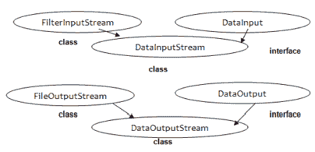

从文件读取输入的输入数据流可以按如下方式创建：


```java
FileInputStream fis = new FileInputStream(infile);
DataInputStream dis = new DataInputStream(fis);
```

这些语句基本上将 `dis` 封装在 `fis` 之上并将其用作“过滤器”。同样，以下语句创建了输出数据流 `dos` 并将其封装在输出文件流 `fos` 上。

```java
FileOutputStream fos = new FileOutputStream(outfile);
DataOutputStream dos = new DataOutputStream(fos);
```

### 示例 15.25

以下程序演示了原始数据的读取和写入。

```java
import java.io.*;

class ReadWritePrimitive
{ 
  public static void main (String args[]) throws IOException
    { 
      File primitive = new File("prim.dat");
      FileOutputStream fos = new FileOutputStream(primitive);
      DataOutputStream dos = new DataOutputStream(fos);
      dos.writeInt(1999);
      dos.writeDouble(222.44);
      dos.writeBoolean(false);
      dos.writeChar('X');
      dos.close();
      fos.close();
      FileInputStream fis = new FileInputStream(primitive);
      DataInputStream dis = new DataInputStream(fis);
      System.out.println(dis.readInt());
      System.out.println(dis.readDouble());
      System.out.println(dis.readBoolean());
      System.out.println(dis.readChar());
      dis.close();
      fis.close();
    }
}
```

输出：

```
1999
222.44
false
X
```

## 定义流

`System` 类包含了三个预定义的流变量——`in`、`out` 和 `err`。这些字段在 `System` 类中声明为 `public` 和 `static`。这意味着它们可以被程序的任何部分使用，而无需引用特定对象。

- `System.out` 指标准输出流。默认情况下，这是控制台。`System.out` 是 `PrintStream` 类型的对象。
- `System.in` 指标准输入，默认是键盘。`System.in` 是 `InputStream` 类型的对象。
- `System.err` 指标准错误流，默认情况下也是控制台。`System.err` 是 `PrintStream` 类型的对象。

这些都是字节流，尽管它们通常用于从控制台向或读写字符。如果需要，你可以将它们封装在基于字符的流中。

### InputStreamReader

`InputStreamReader` 是从字节流到字符流的桥梁；它读取字节并使用指定的字符集将其解码为字符。它使用的字符集可以明确指定，也可以接受平台的默认字符集。

#### 构造函数

- `InputStreamReader(InputStream in)`：创建一个使用默认字符集的 `InputStreamReader`。
- `InputStreamReader(InputStream in, String charsetName)`：创建一个使用指定字符集的 `InputStreamReader`。

### 示例 15.26

```java
import java.io.*;

class InputStreamReaderTest
{ 
  public static void main (String argv[]) throws IOException
    { 
      char c;
      InputStreamReader is = new InputStreamReader(System.in);
      System.out.println("Enter characters, 'q' to quit");
      c = (char)is.read();
      while(c!='q')
        { 
          System.out.print(c);
          c = (char)is.read();
        }
    }
}
```

输出：

```
Enter characters, 'q' to quit
abcd
q
```

### 示例 15.27

对上一个示例进行了修改，使用了缓冲区来提高性能。

```java
import java.io.*;

class BufferedReaderTest
{ 
  public static void main (String args[]) throws IOException
    { 
      char c;
      BufferedReader br = new BufferedReader(new InputStreamReader(System.in));
      System.out.println("Enter characters, 'q' to quit");
      c = (char)br.read();
      while(c!='q')
        { 
          System.out.print(c);
          c = (char)br.read();
        }
    }
}
```

输出：

```
Enter characters, 'q' to quit
abcd
q
```

### 示例 15.28

`InputStreamReader` 不提供 `readLine()` 方法，因此 `InputStreamReader` 连接到提供 `readLine()` 方法的 `BufferedReader`。

```java
import java.io.*;

class BufferedReaderTest
{ 
  public static void main (String argv[]) throws IOException
    { 
      BufferedReader br = new BufferedReader(new InputStreamReader(System.in));
      System.out.println("Enter 'stop' to quit");
      String str = br.readLine();
      while(!str.equals("stop"))
        { 
          System.out.println("Your Name:"+str);
          str = br.readLine();
        }
    }
}
```

输出：

```
Enter 'stop' to quit
Harry Feat
Your Name:Harry Feat
stop
```

## OutputStreamWriter

`OutputStreamWriter` 是从字符流到字节流的桥梁：写入它的字符将使用指定的字符集编码为字节。它使用的字符集可以明确指定，也可以接受平台的默认字符集。

#### 构造函数

- `OutputStreamWriter(OutputStream out)`：创建一个使用默认字符编码的 `OutputStream`。
- `OutputStreamWriter(OutputStream out, String charsetName)`：创建一个使用指定字符集的 `OutputStream`。

### 读取控制输入

在 Java 1.0 中，执行控制输入的唯一方法是使用字节流，使用这种方法的旧代码仍然存在。今天，使用字节流读取控制输入在技术上仍然可行，但这样做可能需要使用已弃的方法，且这种方法不被推荐。

在 Java 中，控制输入通过读取 `System.in` 实现。为了获取连接控制台的字符流，你需要将 `System.in` 封装在 `InputStreamReader` 对象中，可以进一步封装在 `BufferedReader` 对象中以提高性能。

### 示例 15.29

此示例演示了我们可以直接从 `System.in` 读取。

```java
import java.io.*;

class ReadFromConsole
{ 
  public static void main (String arg[]) throws IOException
    { 
      char c;
      System.out.println("Enter characters, 'q' to quit");
      c = (char) System.in.read();
      while(c!='q')
        { 
          System.out.print(c);
          c = (char) System.in.read();
        }
    }
}
```

从控制台读取正确方法是将 `System.in` 封装在 `InputStreamReader` 中，并进一步封装在 `BufferedReader` 中以提高性能并一次读取一行。相关的示例已经在之前与 `InputStreamReader` 类相关的章节中介绍过。

## 写入控制台输出

控制台输出通过 `print()` 和 `println()` 最容易实现。这些方法由 `PrintStream` 类定义（该类是 `System.out` 所引用对象的类型）。尽管 `System.out` 是一个字节流，但将它用于简单的程序输出是可以接受的。

然而，基于字符的替代方案是正确的选择。因为 `PrintStream` 是派生自 `OutputStream` 的输出流，它也实现了低级方法 `write()`。因此，可以使用 `write()` 向控制台写入内容。`PrintStream` 定义的 `write()` 最简单的形式是：

```java
void write(int byteval)
```

该方法向流中写入由 `byteval` 指定的字节。尽管 `byteval` 被声明为整数，但只有低 8 位会被写入。

### 示例 15.30

```java
import java.io.*;

class WriteTest
{
    public static void main (String argv[ ]) throws IOException
    {
      int b;
      b = 'A';
      System.out.write(b);
      // System.out.flush();to flush
      System.out.write('\n');//to flush
    }
}
```

输出：

```
A
```

注意：

你不会经常使用 `write()` 来执行控制台输出，因为 `print()` 和 `println()` 使用起来简单得多。

## 序列化

序列化是将对象的状态写入字节流的过程。当你想要将状态存储到字节流时，这种方法非常有用。当你想要将程序状态保存到持久存储区域（如文件）时，这同样有用。在稍后的时候，你可以使用反序列化过程来恢复这些对象。

实现 RMI 也需要序列化。RMI 允许一台机器上的 Java 对象调用另一台机器上 Java 对象的方法。对象可以作为参数传递给远程方法。发送端对对象进行序列化并翻译。接收端对其反序列化。

如果你尝试序列化对象图顶部的对象，所有其他引用的对象都会递归地被定位并序列化。

同样，在反序列化过程中，所有这些对象及其引用都被正确地存储。声明为 `transient` 或 `static` 的变量不会被序列化机制保存。

## Externalizable 接口

Java 序列化和反序列化机制的设计使得保存和恢复对象状态的大部分工作可以自动完成。

然而，在某些情况下，程序员可能需要对这些过程进行控制。例如，使用压缩或加密技术可能是必要的。`Externalizable` 接口正是为了这些情况设计的。实现 `Externalizable` 接口的对象也可以被序列化和反序列化。

但控制权在用户手中，即用户可以决定序列化和反序列化部分。序列化代码写在 `readExternal()` 方法中，反序列化代码写在 `writeExternal()` 方法中。

### Externalizable 接口中的方法

```java
void readExternal(ObjectInput in)
```

对象实现 `readExternal` 方法，通过调用针对原始数据类型的 `DataInput` 方法以及针对对象、字符串和数组的 `readObject` 方法来恢复其内容。

```java
void writeExternal(ObjectOutput out)
```

对象实现 `writeExternal` 方法，通过调用针对其原始值的 `DataOutput` 方法或针对对象、字符串和数组的 `ObjectOutput` 方法来保存其内容。

## ObjectOutput 接口

`ObjectOutput` 接口扩展 `DataOutput` 接口并支持对象序列化。除了 `DataOutput` 接口定义的方法外，`ObjectOutput` 接口只定义了一个方法。

```java
Void writeObject(Object object)
```

调用此方法来序列化对象。`ObjectOutput` 接口的所有方法在错误条件下都会抛出 `IOException`。

## ObjectOutputStream

`ObjectOutputStream` 类扩展 `OutputStream` 类并实现了 `ObjectOutput` 接口。它负责将对象写入流中。

### 构造函数

```java
ObjectOutputStream(OutputStream out)
```

创建一个写入指定 `OutputStream` 的 `ObjectOutputStream`。参数 `out` 是序列化对象将写入的输出流。

### 写入对象的方法

```java
void writeObject(Object obj)
```

将对象写入底层存储或流中。

---

## ObjectInput 接口

`ObjectInput` 接口扩展 `DataInput` 接口。它支持对象序列化。除了 `DataInput` 接口定义的方法外，`ObjectInput` 接口仅定义了一个方法：

```java
Object readObject()
```

调用此方法反序列化对象。

## ObjectInputStream

`ObjectInputStream` 类扩展 `InputStream` 类并实现 `ObjectInput` 接口。`ObjectInputStream` 负责从流中读取对象。

### 构造函数

```java
ObjectInputStream(InputStream in)
```

创建一个从指定 `InputStream` 读取的 `ObjectInputStream`。参数 `in` 是应该读取序列化对象的输入流。

反序列化方法为：

```java
Object readObject()
```

从 `ObjectInputStream` 读取对象。

### 示例 15.31


```java
import java.io.*;

class SerializationTest
{
    public static void main (String args[])
    {
      try
      {
        MyClass object1 = new MyClass("Hello", 123, 1.3e3);
        MyClass object2 = new MyClass("Hello1", 1, 2);
        System.out.println(object1);
        System.out.println(object2);
        FileOutputStream fos = new FileOutputStream("serial.dat");
        ObjectOutputStream oos = new ObjectOutputStream(fos);
        oos.writeObject(object1);
        oos.writeObject(object2);
        oos.flush();
        oos.close();
      }
      catch(Exception e)
      {
        System.out.println(e);
      }
      try
      {
        MyClass object3, object4;
        FileInputStream fis = new FileInputStream("serial.dat");
        ObjectInputStream ois = new ObjectInputStream(fis);
        object3 = (MyClass) ois.readObject();
        object4 = (MyClass) ois.readObject();
        ois.close();
        System.out.println("After deserialization");
        System.out.println(object3);
        System.out.println(object4);
      }
      catch(Exception e)
      {
        System.out.println(e);
      }
    }
}

class MyClass implements Serializable
{
    String s;
    int i=100;
    double d;
    MyClass(String s, int i, double d)
    {
      this.s = s;
      this.i = i;
      this.d = d;
    }
    public String toString()
    {
      return "s = "+ s +"; i = "+ i + " ; d = " +d;
    }
}
```

**输出：**

```
s = Hello; i = 123 ; d = 1300.0
s = Hello1; i = 1 ; d = 2.0
After deserialization
s = Hello; i = 123 ; d = 1300.0
s = Hello1; i = 1 ; d = 2.0
```

**注意：** 我们可以在一个文件中保存多个同类型的对象，也可以在同一个文件中保存不同类型的对象。

### 示例 15.32

此示例演示了 `transient` 和 `static` 变量在序列化过程中不会被持久化。

```java
import java.io.*;

class SerializationTest2
{
    public static void main (String args[]) throws IOException
    {
      try
      {
        MyClass object1 = new MyClass("Hello", 123, 1.3e3);
        MyClass object3 = new MyClass("Hello1", 1, 2);
        object3.x = 200;
        A object5 = new A();
        System.out.println(object1);
        System.out.println(object3);
        System.out.println(object5);
        FileOutputStream fos = new FileOutputStream("serial.dat");
        ObjectOutputStream oos = new ObjectOutputStream(fos);
        oos.writeObject(object1);
        oos.writeObject(object3);
        oos.writeObject(object5);
        object3.x = 400;
        oos.flush();
        oos.close();
      }
      catch(Exception e)
      {
        System.out.println(e);
      }
      try
      {
        MyClass object2, object4;
        A object6;
        FileInputStream fis = new FileInputStream("serial.dat");
        ObjectInputStream ois = new ObjectInputStream(fis);
        object2 = (MyClass) ois.readObject();
        object4 = (MyClass) ois.readObject();
        object6 = (A) ois.readObject();
        ois.close();
        fis.close();
        System.out.println("After deserialization");
        System.out.println(object2);
        System.out.println(object4);
        System.out.println(object6);
      }
      catch(Exception e)
      {
        System.out.println(e);
      }
    }
}

class MyClass implements Serializable
{
    String s;
    transient private int i=100;
    public static int x = 10;
    double d;
    MyClass(String s, int i, double d)
    {
        this.s = s;
        this.i = i;
        this.d = d;
        x = 100;
    }
    public String toString()
    {
        return "s = " + s + "; i = "+ i + " ;d = " + d +"; x = "+ x;
    }
}

class A implements Serializable
{
    public String toString()
    {
        return "Class A";
    }
}
```

### 示例 15.33

#### 使用 Externalizable

```java
import java.io.*;

class SerializationTest1
{
    public static void main (String args[]) throws IOException
    {
        try
        {
            MyClass object1 = new MyClass("Hello", 99, 123.45);
            MyClass object3 = new MyClass("Hello1", 1, 2);
            A object5 = new A();
            System.out.println(object1);
            FileOutputStream fos = new FileOutputStream("serial.dat");
            ObjectOutputStream oos = new ObjectOutputStream(fos);
            System.out.println("写入对象 1");
            oos.writeObject(object1);
            System.out.println("写入对象 3");
            oos.writeObject(object3);
            System.out.println("写入对象 5");
            oos.writeObject(object5);
            object3.x = 400;
            oos.flush();
            oos.close();
        }
        catch (Exception e)
        {
            System.out.println(e);
        }
        try
        {
            MyClass object2, object4;
            A object6;
            FileInputStream fis = new FileInputStream("serial.dat");
            ObjectInputStream ois = new ObjectInputStream(fis);
            object2 = (MyClass) ois.readObject();
            object4 = (MyClass) ois.readObject();
            object6 = (A) ois.readObject();
            ois.close();
            fis.close();
            System.out.println("反序列化后");
            System.out.println(object2);
            System.out.println(object4);
            System.out.println(object6);
        }
        catch (Exception e)
        {
            System.out.println(e);
        }
    }
}

class MyClass implements Serializable
{
    String s;
    transient private int i=100;
    public static int x = 10;
    double d;
    MyClass(String s, int i, double d)
    {
        this.s = s;
        this.i = i;
        this.d = d;
        x = 100;
    }
    public String toString()
    {
        return "s = " + s + "; i = "+ i + " ;d = " + d +"; x = "+ x;
    }
}

class A implements Serializable
{
    public String toString()
    {
        return "Class A";
    }
}
```

**输出：**

```
s = Hello; i = 99 ;d = 123.45; x = 100
写入对象 1
写入对象 3
写入对象 5
反序列化后
s = Hello; i = 100 ;d = 123.45; x = 100
s = Hello; i = 100 ;d = 123.45; x = 400
Class A
```

---

# 第 16 章

## Applet（小程序）

## 引言

`Applet` 是一种设计用于在互联网上传并在客户端运行的程序，它通过 Internet Explorer 或 Netscape 等浏览器运行。`Applet` 也是 Java 程序，但它们存储在服务器上。

`Applet` 不能像独立应用程序一样运行，它必须通过嵌入 HTML 页面来运行。为了运行 `Applet`，我们需要将其嵌入 HTML 页面中。当浏览器下载了这样的 HTML 页面时，它会加载包含 applet 代码的文件并在本地机器上执行。当 `Applet` 到达后，它对资源的访问是有限的。

## Applet 体系

`Applet` 与普通程序不同：

*   `Applet` 是基于 GUI 的（基于窗口）
*   `Applet` 是事件驱动的

当普通 Java 程序（非 GUI 的）需要输入时，它会提示用户并调用某些方法，例如 `readLine()`；这并不是程序的行为方式。`Applet` 是用户发起交互。例如，在文字处理软件中，用户通过点击不同的按钮发起动作，从而产生事件并执行相应的代码。`Applet` 使用 `awt` 包（抽象窗口工具包）来提供 GUI 并处理事件。之所以被称为 `awt`，是因为它完全依赖于底层操作系统的功能。

`Applet` 类似于一组中断服务程序。`Applet` 等待事件发生。`awt` 通过调用 applet 提供的事件处理器来通知 applet。一旦发生这种情况，applet 必须采取相应行动，并迅速将控制权还给 AWT。

这是一个关键点。在大多数情况下，applet 不应该进入一种长时间保持控制的模式。相反，它应该对事件执行特定的操作，并将控制权还给 AWT 运行时。

在 applet 需要自行执行重复性任务的情况下（例如在窗口中显示滚动消息），我们必须启动另一个执行线程。

## 编写 Applet

所有的 applet 都是 `Applet` 类的子类。`Applet` 类包含在 `java.applet` 包中。Applet 类的层次结构如下：

```
java.lang.Object
|
java.awt.Component
|
java.awt.Container
|
java.awt.Panel
|
java.applet.Applet
```

`Applet` 类为 applet 的执行提供了所有支持，例如启动和停止。它还提供了加载和显示图像的方法。它还为所有窗口化活动提供了必要的支持。扩展 applet 类的子类必须始终声明为 `public`，因为它是由浏览器实例化并执行的。

浏览器在实例化 applet 时使用无参构造函数，因此必须提供一个具有公共可见性的无参构造函数。

建议我们不在 `Applet` 类中提供构造函数，因为在这种情况下编译器将提供默认的无参数构造函数。

我们可以利用 `init()` 方法进行初始化。在编写 applet 代码时，我们通常会重写 `Applet` 类的某些方法，这些方法会在 applet 执行期间自动调用。

重写 `paint()` 方法是非常常见的。`paint()` 方法中的代码主要在 `Applet` 窗口中显示输出。

### 示例 16.1 (App1.java)

以下程序演示了一个简单的 applet，它在窗口内显示“Hello World”。无论我们在 applet 的 `paint` 方法中绘制/显示什么内容，它都会出现在 applet 的窗口中。

在接下来的示例中，applet 窗口的背景颜色设置为红色，前景色颜色设置为绿色，因此背景将显示为红色，文本“Hello Word”将以绿色显示。

```java
1. import java.awt.*;
2. import java.applet.Applet;
3. /*<applet code= "App1" width =500 height=100></applet>*/
4. public class App1 extends Applet
5. { 
6.   public void init()
7.   {
8.       setBackground(Color.red);
9.       setForeground(Color.green);
10.    }
11.    public void paint(Graphics g)
12.    { 
13.      g.drawString("Hello World",20,20);
14.    }
15. }
```

输出：

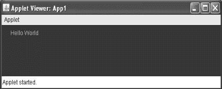

## 执行 Applet

`Applet` 不由基于控制台的 Java 运行时解释器执行。我们有两种方法可以运行 applet：

1. 在兼容 Java 的网页浏览器中执行 applet。
2. 使用 `appletviewer`，例如标准的 SDK 工具 `appletviewer`。`appletviewer` 在窗口中执行我们的 applet。这是测试我们 applet 最快、最简单的方法。

### 在网页浏览器中执行 Applet

我们需要编写一个短的 HTML 文本文件，其中包含适当的 `APPLET` 标签。applet 标签必须至少包含以下三个属性：

*   `Code`
*   `Width` 
*   `Height`

属性 `code` 的值指定包含 applet 代码的类名。属性 `width` 和 `height` 分别指定 applet 窗口的宽度和高度。


这里是嵌入了 applet "App1" 的 HTML 文件 `RunApp.Html`。

```html
<html>
<head>
<title>Simple Applet</title>
</head>
<body>
<h1>Simple “Hello World” Application </h1>
<applet code= “App1” width =500 height=100>
</applet>
</body>
</html>
```

你可以通过在网页浏览器中打开文件 `RunApp.html` 来执行该 applet。该文件可以存在于本地文件系统中，也可以从 Web 服务器加载。

### 使用 appletviewer 执行 Applet

然而，存在一种更方便的方法可以让我们加速测试。只需在你的 Java 源代码文件中简单包含一个包含该 `APPLET` 标签的注释即可。通过这样做，我们的代码就带有了必要 HTML 语句的原型文档说明，我们只需要通过启动 `appletviewer` 并传入我们的 Java 源代码文件即可测试编译后的输出。如果我们使用这种方法，那么在编译后我们可以按照如下方式执行 applet：

```bash
appletviewer SimpleApplet.Java
```

## Applet 生命周期方法

`Applet` 重写了一组方法，这些方法提供了浏览器或 `appletviewer` 与 applet 交互并控制其执行的基本机制。

这些方法也被称为生命周期方法，因为浏览器或 applet 查看器会在 applet 生命周期的不同阶段自动调用它们。总共有五种生命周期方法：

- `public void init()`
- `public void start()`
- `public void stop()`
- `public void destroy()`
- `public void paint(Graphics g)`

其中四个方法：`init()`、`start()`、`stop()` 和 `destroy()` 定义在 `Applet` 类中。

`paint()` 是由 `awt.Component` 类定义的，并为所有这些方法提供了默认实现。Applet 不需要重写它们未使用的方法。然而，非常简单的 applet 不需要定义它们。

### Applet 的初始化与终止

当 applet 开始时，以下方法将按顺序被调用：

1. `init()`
2. `start()`
3. `paint()`

当 applet 终止时，会发生以下方法调用序列：

1. `stop()`
2. `destroy()`

### init() 方法

这是第一个被调用的方法。在这里我们应该初始化变量并为其他初始化活动编写代码。该方法在 applet 的生命周期内仅在实例化后立即被调用一次。

### start() 方法

`start()` 方法在 `init()` 之后被调用。它还用于在 applet 停止后重启它。`init()` 在 applet 第一次加载时调用一次，而 `start()` 在每次 applet 的 HTML 文档显示在屏幕上时被调用。因此，如果用户离开网页并返回，applet 将从 `start()` 处恢复执行。

### paint() 方法

`paint()` 在 `init()` 和 `start()` 之后调用。每当 applet 的输出需要重绘时，就会被调用。这种情况可能由于多种原因：例如，运行 applet 的窗口被最小化。

### stop() 方法

`stop()` 方法在浏览器离开包含 applet 的 HTML 文档时调用。我们应该使用 `stop()` 挂起不需要运行的线程。

### destroy() 方法

`destroy()` 方法在环境确定需要从内存中移除 applet 时被调用。在此处，我们应该释放 applet 可能正在使用的资源。

### 示例 16.2

这是一个简单的 applet，将背景颜色设置为青色，前景色设置为红色，并显示了 `init()`、`start()` 和 `paint()` 方法的调用顺序。

```java
1. import java.awt.*;
2. import java.applet.*;
3. /*<applet code= "App2" width =500 height=100></applet>*/
4. public class App2 extends Applet
5. { 
6.   String msg="";
7.   public void init()
8.   {
9.       System.out.println("Inside init");
10.      setBackground(Color.cyan);
11.      setForeground(Color.red);
12.      msg = "Inside init—";
13.  }
14.  public void start()
15.  {
16.      System.out.println("Inside start");
17.      msg += "Inside start—";
18.  }
19.  public void stop()
20.  {
21.      System.out.println("Inside stop");
22.      msg += "Inside stop—";
23.  }
24.  public void paint (Graphics g)
25.  { 
26.      System.out.println("Inside paint");
27.      msg += "Inside paint—";
28.      g.drawString(msg,10,30);
29.  }
30.  public void destroy()
31.  {
32.      System.out.println("Inside destroy");
33.  }
34. }
```

输出：


## 动态 Applet

Applet 窗口中显示的输出可以是动态的。例如，我们可以显示一个移动横幅。applet 还可以用于应用程序，例如通过从服务器获取与比赛相关的得分和其他统计数据；显示股票价格等。

### 示例 16.3

以下示例显示了一个移动横幅。它演示了使用 `repaint()` 方法刷新显示。该 applet 在 applet 窗口中从右向左滚动消息。

由于消息滚动是一项重复性任务，它是由 applet 在启动时创建的独立线程执行的。该程序还演示了资源可以在 `stop()` 方法中释放，并在 `start()` 方法中重新获取。

```java
import java.awt.*;
import java.applet.*;
```

```java
/*<applet code="App3" width=500 height=100></applet>*/
public class App3 extends Applet implements Runnable {
    String msg="A Simple Moving Banner.";
    Thread t = null;
    boolean stopFlag;

    public void init() {
        setBackground(Color.cyan);
        setForeground(Color.red);
    }

    public void start() {
        t=new Thread(this);
        stopFlag = false;
        t.start();
    }

    public void stop() {
        stopFlag=true;
        t=null;
    }

    public void paint(Graphics g) {
        g.drawString(msg,50,30);
    }

    public void run() {
        for (;;) {
            repaint();
            try {
                Thread.sleep(250);
            }
            catch(InterruptedException e) {
                System.out.println(e);
            }
            msg = msg.substring(1) + msg.charAt(0);
            if (stopFlag)
                break;
        }
    }
}
```

输出:

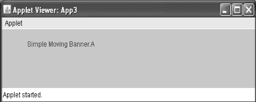

### 使用状态窗口

除了在窗口中显示信息外，applet 还可以向运行它的浏览器或 `appletviewer` 的状态窗口输出消息。

要做到这一点，请调用 `showStatus()` 并传入我们想要显示的字符串。状态窗口是向用户提供 applet 中正在发生情况的反馈、建议选项或可能报告某些类型的错误的良好位置。

状态窗口也是一个极佳的调试辅助（帮助），因为它为我们提供了一种输出关于 applet 信息的简单方式。

#### 示例 16.4：下面的示例演示了如何使用状态窗口。

```java
import java.awt.*;
import java.applet.*;
/*<applet code="App4" width=500 height=100></applet>*/
public class App4 extends Applet {
    public void init() {
        setBackground(Color.cyan);
    }
    public void paint(Graphics g) {
        g.drawString("This is in the applet window",10,20);
        showStatus("This is shown in the status window");
    }
}
```

输出:

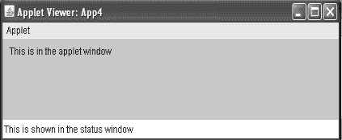

### HTML 的 APPLET 标签

`APPLET` 标签用于从 HTML 文档和 appletviewer 启动 applet。

`appletviewer` 会在单独窗口中执行找到的每个 `APPLET` 标签；而像 Netscape Navigator 和 Internet Explorer 等浏览器允许在单个页面上运行许多 applet。

标准 `APPLET` 标签的语法为：

```html
< APPLET
CODE=applet class name
CODEBASE=codebase URL
ALT=alternate Text,
NAME=appletInstancename
WIDTH=pixels
HEIGHT=pixels
ALIGN=alignment
VSPACE=vertical space in pixels
HSPACE=horizontal space in pixels
>
<PARAM NAME=attributeName-1 VALUE=Attribute Value-1>
<PARAM NAME=attributeName-2 VALUE=Attribute Value-2>
<PARAM NAME=attributeName-N VALUE=Attribute Value-N>
</APPLET>
```

- **CODE**: 必选属性，提供包含我们 applet 编译文件的文件名。该文件相对于 applet 的 `CODEBASE` URL，或者如果设置了 `CODEBASE`，则相对于其指定的目录。
- **CODEBASE**: 可选属性，指定 applet 的基础 URL，即将搜索 applet 可执行文件（由 `CODE` 标签指定）的目录。如果未指定此属性，则使用 HTML 文档的 URL 作为 `CODEBASE`。
- **ALT**: 可用文本，提供备用文本。
- **NAME**: applet 实例名称。
- **WIDTH**: 像素值。
- **HEIGHT**: 像素值。
- **ALIGN**: 对齐方式。
- **VSPACE**: 像素单位的垂直间距。
- **HSPACE**: 像素单位的水平间距。

在 applet 中，一旦获取了 applet 的上下文（context），我们就可以调用 `showDocument()` 方法将另一个文档引入视图。该方法没有返回值，如果执行失败也不会抛出异常，因此请谨慎使用。有两个 `showDocument()` 方法。

```java
void showDocument(URL url)
```

用给定的 `URL` 替换当前查看的网页

```java
void showDocument(URL url, String where)
```

在浏览器窗口内的指定位置显示指定的文档。“where”的有效参数有：

* `"_self"`（在当前帧中显示）
* `"_parent"`（在父帧中显示）
* `"_top"`（在最顶层帧中显示），以及
* `"_blank"`（在新浏览器窗口中显示）

### 示例 16.7

以下 applet 演示了 `AppletContext` 和 `showDocument()` 的用法。执行时，它获取当前的 applet 上下文并使用该上下文将控制转移到名为 `A.html` 的文件。该文件必须位于 applet 相同的目录下。`Test.html` 可以包含任何你喜欢的有效超文本。

```java
import java.awt.*;
import java.applet.*;
import java.net.*;
public class App7 extends Applet
{ 
    AppletContext ac;
    URL u1;
    public void init()
    {
      setBackground(Color.cyan);
    }
    public void start( )
    {
      ac = getAppletContext();
      u1 = getCodeBase();
      try
      {
        Thread.sleep(3000);
        ac.showDocument(new URL(u1 + "A.html"),"_blank");
      }
      catch(MalformedURLException e)
      { 
        showStatus("Invalid URL");
        e.printStackTrace() ;
      }
      catch(InterruptedException e)
      { 
        showStatus("Invalid URL");
        e.printStackTrace () ;
      }
    }
    public void paint (Graphics g)
    {
      g.drawString(u1+"A.html",20,20);
      try
      {
        Thread.sleep(3000);
      }
      catch(InterruptedException e)
      {
        System.out.println(e);
      }
    }
}
```

**App7.html**

```html
<html>
  <head>
    <Title>Applet Context Demo</Title>
  </head>
  <body>
    <applet code="App7" width=200 height=200></applet>
  </body>
</html>
```

**A.html**

```html
<html>
  <head>
    <title>New Page</title>
  </head>
  <body bgcolor=blue text=red>
    <h1>matrix</h1>
  </body>
</html>
```

### 示例 16.8


```java
import java.applet.*;
import java.awt.*;
import java.awt.event.*;
/*<Applet code="CopyApp" width=500 height=200></applet>*/
public class CopyApp extends Applet implements ActionListener
{
    TextField tf1,tf2;
    Button b1;
    public void init()
    {
      setForeground(Color.red);
      Font f1=new Font("Arial",
      Font.BOLD+Font.ITALIC,20);
      tf1=new TextField(8);
      tf2=new TextField(8);
      tf1.setFont(f1);
      tf2.setFont(f1);
      b1=new Button("Copy");
      b1.addActionListener(this);
      b1.setFont(f1);
      add(tf1);
      add(tf2);
      add(b1);
    }
    public void paint(Graphics g)
    {
      g.drawString("Matrix",0,150);
    }
    public void actionPerformed(ActionEvent ae)
    {
      String s1=tf1.getText();
      tf2.setText(s1);
    }
}
```

输出：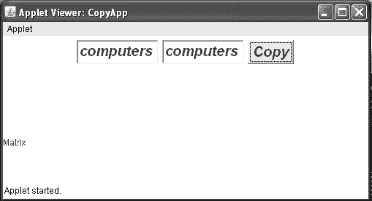

### 示例 16.9 使用 Applet 计算两个数字之和

```java
import java.applet.*;
import java.awt.*;
import java.awt.event.*;
/*<applet code =SumApplet" width=400 height=400></applet> */
public class SumApplet extends Applet implements ActionListener
{
    TextField tf1,tf2,tf3;
    Label l1,l2,l3;
    Button b1;
    public void init()
    {
      setLayout(new GridLayout(4,2));
      l1 = new Label("No. 1");
      l2 = new Label("No. 2");
      l3 = new Label("Result");
      tf1 = new TextField(8);
      tf2 = new TextField(8);
      tf3 = new TextField(8);
      b1 = new Button("Sum");
      b1.addActionListener(this);
      add(l1);add(tf1);
      add(l2);add(tf2);
      add(l3);add(tf3);
      add(b1);
    }
    public void actionPerformed(ActionEvent ae)
    {
      Button abc = (Button)ae.getSource();
      if(abc == b1)
      {
        int a,b,c;
        a = Integer.parseInt(tf1.getText());
        b = Integer.parseInt(tf2.getText());
        c = a + b;
        tf3.setText(String.valueOf(c));
      }
    }
}
```

# 第 17 章

## 抽象窗口工具包 (AWT)

### 简介

Java 提供了大量的内置类，帮助我们设计图形用户界面（GUI）。这些类中的大部分都属于 `java.awt` 包，统称为抽象窗口工具包（Abstract Windows Toolkit，AWT）。

我们熟悉如 MS-WORD、MS-EXCEL 等软件。所有这些软件都有 GUI，即当我们运行这些软件时，可以看到图形用户界面。

我们通过键盘或鼠标选择不同的选项来访问这些软件的各种功能。显示用户界面需要进行大量的编程工作。

AWT 中帮助我们设计图形用户界面的三个重要部分是：

* 组件（Components）
* 容器（Containers）
* 布局管理器（Layout Managers）

以上所有部分都起着重要的作用。

### 组件（Components）

组件是创建 GUI 的构建块。组件是具有图形化表示的对象，它可以显示在屏幕上并与用户交互。`java.awt.Component` 类是与菜单相关的 AWT 组件的抽象父类。`Component` 类也可以被扩展以创建轻量级组件。轻量级组件是不与原生窗口关联的组件。

某些组件类型（如按钮和滚动条）直接用于 GUI 控制。其他类型的组件（继承自 `Container` 类的）提供了特殊的组织方式。而 `TextField`、`TextArea`、`List` 等组件用于接受用户输入。标签（label）是一种不同的组件类型，其目的是为了标识其他组件。

Java 组件由 `java.awt.Component` 和 `java.awt.Menu` 父类的许多子类实现。组织大量类的一种方法是将它们分类：

### 容器（Containers）

所有的窗口应用程序都从一个显示在屏幕上的顶级窗口开始。同样，所有基于 GUI 的 Java 应用程序也从一个顶级窗口开始，在 Java 术语中被称为顶层容器。

容器也是可以包含其他组件的 Java 组件。只有将组件添加到容器中或放入容器内时，组件才能变得可见。

所有的 Java GUI 都位于 applet 或帧（Frame）中。applet 和 帧是 Java 中的两个顶层容器。

applet 是 applet 的顶层容器，因此组件必须添加到其中。同样，帧是独立应用程序的顶层组件。

对于更复杂的 GUI，将 applet 或帧划分为更小的区域是方便的。这些区域可能构成例如工具栏或单选按钮矩阵。

面板（Panels）就像应用程序和帧，可以包含其他组件，如按钮、画布、复选框、滚动条、滚动面板、文本区域、文本字段和其他面板。

复杂的 GUI 有时会有复杂的面板嵌套层级结构，即面板中嵌套面板，以此类推，跨越许多层嵌套。

由于容器也是组件，因此由于继承关系，组件可用的方法也适用于容器。

容器最常用的方法是 `add()` 方法，通过该方法向容器中添加组件，其通用形式如下：

```java
void add (Component comp);
```

所有组件都是 `Component` 类的子类，因此任何组件都可以使用 `add()` 方法被添加到容器中。

### 布局管理器 (Layout Manager)

在向容器中添加组件时，一个重要问题与组件的位置和大小有关。组件的位置可以通过两种方式指定：

(i) 绝对定位。
(ii) 相对定位。

在**绝对定位**中，我们指定组件应该添加的精确位置。这种方法为我们提供了精细的控制，如果我们只为某一个平台设计 GUI，那么这可能是最佳选择。

例如，可以通过指定组件左上角的坐标，将组件添加在容器水平方向的中间。我们可以根据容器的宽度和组件的宽度来计算这些坐标。但如果容器宽度改变或组件大小改变，组件将不会停留在中间。

另一种方法是**相对定位**，它可能不允许我们指定组件的精确位置，但在我们希望组件始终位于容器水平方向的中间的情况下，这种方法可能更为适用。我们可以通过指定组件的相对位置（如左、右、居中等）来实现这一点。在文字处理器中，将标题居中对齐是非常常见的。即使页面宽度发生变化，标题也会保持居中对齐，这就是相对定位的一个示例。

在 Java 中，可以使用绝对定位，但不建议这么做。AWT 的设计初衷是使用相对定位。我们可以通过相对规范来指定组件布局，例如：组件将添加到上一个组件的右侧、组件将添加到其他组件的下方、组件将出现在顶部、组件的大小将是容器宽度的 `1/4` 等，此类规范在不知道组件尺寸的情况下也有用。

Java 鼓励相对定位，因为它是平台无关的，相同的 GUI 应该在不经修改的情况下运行在各种平台上。

称为布局管理器的内置 Java 类负责将相对位置映射到实际/物理位置的任务。Java 支持许多类型的布局管理器，我们将讨论以下布局管理器：

1. `FlowLayout`
2. `GridLayout`
3. `BorderLayout`
4. `CardLayout`
5. `GridBagLayout`

#### 使用布局管理器时的注意事项：

* 我们不必承担指定每个组件精确位置和尺寸的负担。
* 我们不再拥有指定每个组件精确位置和尺寸的权力。

### 为什么 Java 要使用布局管理器？

原因有两个：

1. 理论上是因为，精确布局（即以像素为单位指定每个组件的大小和位置）是一项重复且经常执行的任务；因此，根据面向对象编程（OOP）原则，布局功能应当被封装在一个或多个类中以实现任务自动化。显然，布局管理器消除了许多开发中的繁琐工作。许多程序员起初不喜欢布局器的想法，但随着这些繁琐选择的消除，他们越来越欣赏它们。

2. 使用布局管理器的实际原因源于 Java 的平台无关性。在 Java 中，AWT 组件的行为借自于运行 JVM 的底层硬件的窗口系统。因此，在 Macintosh 上，AWT 按钮与其他 Mac 按钮一样；在 Motif 平台上，Java 按钮看起来与其他任何 Motif 按钮一样，以此类推。这里的问题是，按钮和其他组件在不同平台上实例化时具有不同的尺寸。

如果 Java 鼓励精确的像素级尺寸控制和定位，那么会有大量的 Java GUI 在其原生平台上看起来精美，但在其他平台上看起来很糟糕甚至无法使用。如上文所述，布局管理器通过使用相对定位解决了这个问题。

### 布局策略 (Layout policy)

每个 Java 组件都有一个首选尺寸（preferred size）。首选尺寸表示了组件希望有多大，前提是不与布局管理器发生冲突。首选尺寸通常是为以视觉上有意义的方式渲染组件所需的最小尺寸，例如，按钮的首选尺寸是其标签文本的大小，加上文本周围一小圈空白边框，再加上标记按钮边界的阴影装饰，因此按钮的首选尺寸是“恰好足够”。由于组件边界装饰在不同系统之间存在差异，因此首选尺寸是取决于平台的。

当布局管理器对其容器的子组件进行布局时，它必须平衡两个考量：

(i) 布局策略和
(ii) 每个组件的首选尺寸

首要任务是执行布局策略。如果尊重组件的首选尺寸意味着违反了布局策略，那么布局管理器将覆盖组件的首选尺寸。理解布局管理器意味着理解它将把组件放在哪里，以及它将如何处理组件的首选尺寸。

### 1. FlowLayout

流式布局管理器的功能封装在 `java.awt.FlowLayout` 类中。流式布局管理器按水平行排列组件。它是面板和应用程序的默认布局管理器类型。流式布局管理器尽可能将尽可能多的组件放入第一行，并将其他组件移动到第二行。如果第二行没有剩余空间，组件将移动到第三行，以此类推。这与在文档中输入文字非常相似。

当我们到达当前行的末尾时，下一个单词将移动到下一行，以此类推。如果我们更改文档的宽度或高度，整个文档将重新格式化。组件始终按照它们添加到容器的顺序从左到右出现。

默认情况下，流式布局管理器在水平和垂直方向上留有五个像素的间隙。可以通过调用 `FlowLayout` 构造器的重载并传递所需的水平垂直间隙来更改此默认。在每一行中，组件间距均匀，组件簇居中。簇的对齐（有时称为“对齐”）可以通过向 `FlowLayout` 构造器传递参数来控制。可能值为：

* `FlowLayout.LEFT`
* `FlowLayout.CENTER`
* `FlowLayout.RIGHT`

#### 示例 17.1

```java
import java.awt.*;
class My1 {
    public static void main(String args[ ]) {
        Frame f=new Frame( );
        FlowLayout flow=new FlowLayout();
        f.setLayout(flow);
        Label l1 = new Label("Name : ");
        f.add(l1);
        TextField tf1=new TextField("Matrix");
        f.add(tf1);
        tf1.setBackground(Color.green);
        tf1.setForeground(Color.red);
        Button b1 = new Button("ok");
        Font f1 = new Font("Arial", Font.BOLD, 24);
        b1.setFont(f1); 
        f.add(b1);
        f.setSize(500,100);
        f.setVisible(true);
    }
}
```

注意：如果我们减小上述窗口的大小，且三个组件无法在单行内适应，则组件将从最后一个组件开始移动到下一行。

输出：


#### 示例 17.2

```java
import java.awt.*;

public class MyFrame2 extends Frame
{
    public static void main (String args [] )
    {
      MyFrame2 f=new MyFrame2();
      f.setLayout(new FlowLayout(FlowLayout.CENTER));
      System.out.println(f.paramString());
      Label l1=new Label("Name :");
      f.add(l1);
      TextField tf1=new TextField("Sample Program");
      f.add(tf1);
      tf1.setBackground(Color.GREEN);
      tf1.setForeground(Color.RED);
      Button b1=new Button("OK");
      b1.setFont(new Font("Serif",Font.BOLD,24));
      //b1.setEnabled(false);
      Dimension d = b1.getSize( );
      System.out.println("Button Size :" + d.width + " " + d.height);
      f.add(b1);
      // f.setResizable(false);
      // f.setUndecorated(true);
      f.setVisible(true);
      Dimension d1=b1.getSize( );
      System.out.println("Button Size: " + d1.width + " " + d1.height);
      Dimension d2=f.getSize();
      System.out.println("Frame Size: " + d2.width + " " + d2.height);
      try
      {
        Thread.sleep(5000);
      }
      catch(InterruptedException e) { }
      f.setVisible(false);
      f.setSize(500,100);
      f.setVisible(true);
      try
      {
        Thread.sleep(5000);
      }
      catch(InterruptedException e){ }
      f.setVisible(false);
      f.setBounds(20, 20, 100, 100);
      f.setVisible(true);
      Dimension d3=f.getSize();
      System.out.println("Frame Size : " + d3.width + " " + d3.height);
      System.out.println(f.paramString());
    }
}
```

输出：


```
frame0,0,0,0x0,invalid,hidden,layout=java.awt.FlowLayout,title=,resizable,normal
Button Size :0 0
Button Size: 52 35
Frame Size: 123 34
Frame Size : 123 100
frame0,20,20,123x100,layout=java.awt.FlowLayout,title=,resizable,normal
```

#### 示例 17.3

如果我们将上述程序中的行：

```java
f.setLayout(new FlowLayout(FlowLayout.CENTER));
```

改为：

```java
f.setLayout(new FlowLayout(FlowLayout.LEFT));
```

输出：


### 示例 17.4

如果我们将上述程序中的行，组件将右对齐：

`f.setLayout(new FlowLayout(FlowLayout.LEFT));`

改为

`f.setLayout(new FlowLayout(FlowLayout.RIGHT));`

输出：


### 示例 17.5

我们可以通过在设置布局时使用重载构造函数来更改组件之间的间距（水平间距）以及行之间的间距（垂直间距）：


`f.setLayout(new FlowLayout(FlowLayout.CENTER, 20 ,20))`


vgap（行间距） hgap（组件间距）

输出：


### GridLayout

`GridLayout` 的功能封装在 `java.awt.GridLayout` 类中。`GridLayout` 管理器以表格格式按行和列排列组件。我们可以将容器空间划分为由行和列组成的网格。在指定布局时，我们必须指定行数和列数。

`GridLayout` 管理器会将与行的大小（布局中指定的列数）相同数量的组件放入第一行，并将其他组件移动到第二行，依此类推。这类似于电子表格，它被分为固定数量的行和列。流布局管理器始终尊重组件的首选尺寸。`GridLayout` 管理器采取相反的极端：当它在给定空间内执行布局时，它会忽略组件的首选尺寸。网格布局中的每行每列的大小都相同，布局可用的总区域在行数和列数之间平均分配。网格布局使用“行主”表示法，即组件按照它们被添加的顺序，从左到右、逐行出现。当我们添加较少的组件（即远少于行数乘以列数）或非常多的组件（即多于行数乘以列数）时，表现会很奇怪。如果将相同的组件放置在更高、更窄的框架中，那么每个组件都会按比例变得更高、更窄。

### 示例 17.6

```java
import java.awt.*;

public class MyFrame6 extends Frame
{
    public static void main(String args[])
    {
      Frame f = new MyFrame6();
      f.setLayout(new GridLayout(5,3));
      for(int row=0; row<5; row++)
      {
        f.add(new Label("Label" + row));
        f.add(new Button("Button" + row));
        f.add(new TextField("TextField" + row));
      }
      f.setSize(500,200);
      f.setVisible(true);
    }
}
```

输出：


### BorderLayout

`BorderLayout` 的功能封装在 `java.awt.BorderLayout` 类中。`BorderLayout` 管理器是框架的默认管理器，程序员迟早会接触它。`BorderLayout` 提供了一种非常有用的布局策略，但比流布局或网格布局更直观。流布局总是尊重组件的首选尺寸；网格布局从不。`BorderLayout` 将可用空间划分为五个部分：`North`、`South`、`East`、`West` 和 `Center`。我们可以为每个区域添加一个组件。每个区域可以为空，也可以包含一个组件（即，如果该组件是容器，我们可以显示多个组件）。

`BorderLayout` 管理器尊重 `North` 和 `South` 组件的首选高度，并强制它们的宽度与容器相等。`North` 和 `South` 区域适用于工具栏、状态行以及任何尽可能宽但不需要高的控件。`East` 和 `West` 区域是 `North` 和 `South` 的相反。在 `East` 和 `West` 中，组件获得其首选宽度，但高度被限制。

---

这里组件垂直延伸到 `North` 组件的底部（如果有的话），或到容器的顶部（如果没有 `North` 组件）。同样，组件垂直延伸到 `South` 组件的顶部（如果有的话），或到容器的底部（如果没有 `South` 组件）。

`BorderLayout` 不受添加组件顺序的影响。相反，我们必须指定哪一个五个区域接收我们添加的组件。当我们向中心添加组件时，是合法的但不明智的省略第二个参数。

重载的 `add()` 方法接受两个参数：

* 第一，要添加的组件
* 第二，一个对象

正确使用 Border 布局管理器要求第二个参数必须是 `BorderLayout` 类本身定义的常量。我们应该知道五个常量是：

* `BorderLayout.NORTH`
* `BorderLayout.SOUTH`
* `BorderLayout.EAST`
* `BorderLayout.WEST`
* `BorderLayout.CENTER`

### 示例 17.7

```java
import java.awt.*;

public class MyFrame7
{
    public static void main(String args[])
    {
      Frame f=new Frame( );
      Scrollbar sbRight=new Scrollbar(Scrollbar.VERTICAL);
      f.add(sbRight, BorderLayout.EAST);
      Scrollbar sbLeft=new Scrollbar(Scrollbar.VERTICAL);
      f.add(sbLeft, BorderLayout.WEST);
      Label labelTop=new Label("This is North");
      labelTop.setFont(new Font("Serif", Font.ITALIC, 36));
      labelTop.setForeground(Color.white);
      labelTop.setBackground(Color.black);
      f.add(labelTop, BorderLayout.NORTH);
      Label labelBottom=new Label("This is south");
      labelBottom.setFont(new Font("Monospaced", Font.BOLD, 18));
      labelBottom.setForeground(Color.white);
      labelBottom.setBackground(Color.black);
      f.add(labelBottom, BorderLayout.SOUTH);
      f.setSize(500,200);
      f.setVisible(true);
    }
}
```

输出：

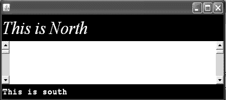

### 示例 17.8

```java
import java.awt.*;

public class MyFrame8 extends Frame
{
    public static void main(String args[])
    {
      Frame f=new MyFrame8( );
      //f.setLayout(new BorderLayout());
      f.add (new Button("N"), BorderLayout.NORTH);
      f.add (new Button("S"), BorderLayout.SOUTH);
      f.add (new Button("E"), BorderLayout.EAST);
      f.add (new Button("W"), BorderLayout.WEST);
      Panel p=new Panel();
      p.setBackground(Color.green);    
      f.add (p, BorderLayout.CENTER);
      //f.add (p);  默认是中心
      f.setSize(300 ,300);
      f.setVisible(true);
    }
}
```

输出：

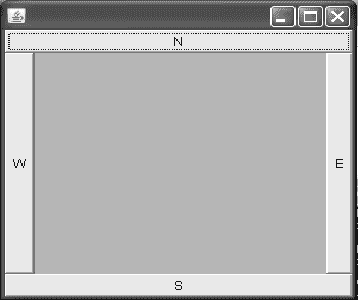

### 示例 17.9

```java
import  java.awt.*;

class BorderLayout3 extends Frame
{
    public static void main (String args[])
    {
      Frame f=new BorderLayout3();
      // f.setLayout(new BorderLayout());
      Panel toolbar=new Panel();
      toolbar.setLayout(new FlowLayout(FlowLayout.LEFT));
      toolbar.setBackground(Color.lightGray);
      toolbar.add(new Button ("This"));
      toolbar.add(new Button ("Is"));
      toolbar.add(new Button ("The"));
      toolbar.add(new Button ("Toolbar"));
      f.add(toolbar,BorderLayout.NORTH);
      TextField status=new TextField("Status.");
      status.setFont(new Font("Monospaced",Font.BOLD,48));
      f.add (status,BorderLayout.SOUTH)    
      f.setSize(300,300);
      f.setVisible(true);
    }
}
```

输出：


### CardLayout

在 `CardLayout` 中，我们可以存储许多卡片，但一次只显示一张。一次只有一张卡片是可见的，但你可以从一张卡片翻到另一张。这里 `card` 表示 `Panel`。如果我们想一次显示两张卡片，则必须为每张卡片创建一个 `Panel`，并创建一个包含这些卡片的主 `Panel`。这对于具有可选组件的用户界面非常有用，这些组件可以根据输入动态启用或禁用。

### 构造函数

- `CardLayout()`：创建一个大小为 0 的新布局。
- `CardLayout(int, int)`：创建一个具有指定水平和垂直间隙的新布局。水平间隙放置在左、右边缘。垂直间隙放置在顶部和底部。与其他布局相比，`CardLayout` 需要更多的工作。卡片存储在类型为 `panel` 的对象中。当卡片被添加到面板时，通常会给它们指定一个名称。因此，当我们向面板添加卡片时，将使用 `add()` 方法。

`void add(Component objpanel, Object objname)`：`objname` 是一个字符串，指定由 `objpanel` 指定的卡片名称。

### 方法

- `void first(Container parent)`：跳转到容器的第一张卡片。
- `void next(Container parent)`：跳转到容器的下一张卡片。如果当前可见卡片是最后一张，此方法将翻到布局中的第一张卡片。
- `void previous(Container parent)`：跳转到容器的上一张卡片。如果当前可见卡片是第一张，此方法将翻到布局中的最后一张卡片。
- `void last(Container parent)`：跳转到容器的最后一张卡片。
- `void show(Container parent, String name)`：跳转到以给定名称添加到布局的组件。如果不存在组件，则不发生操作。

创建 `CardLayout` 使用以下步骤：

1. 创建一个新的 `Panel` 对象和一个 `CardLayout` 对象。
2. 使用第一步创建的实例将 `Panel` 对象的布局设置为 `CardLayout`。
3. 现在为每张卡片创建一个单独的 `Panel` 对象，并添加想要添加到该 `Panel` 中的任何内容，如按钮等。
4. 将步骤 3 中创建的每个 `Panel` 对象添加到第 1 步创建的主 `Panel` 中，为每张卡片提供一个唯一名称。
5. 最后将主面板添加到窗口。

### 示例 17.10

```java
import java.awt.*;
import java.awt.event.*;
import java.applet.*;
/*applet code="CardLayout" width=500 height=100*/
public class CardLayoutTest extends Applet implements ActionListener, MouseListener
{
    Panel mp;
    CardLayout c1;
    public void init()
    {
      Button b1=new Button("First");
      Button b2=new Button("Second");
      b1.addActionListener(this);
      b2.addActionListener(this);
      add(b1);
      add(b2);
      Panel p1=new Panel();
      Label l1=new Label("INDIA");
      p1.add(l1);
      Panel p2=new Panel();
      Label l2=new Label("USA");
      p2.add(l2);
      mp=new Panel();
      c1=new CardLayout();
      mp.setLayout(c1);
      mp.add(p1,"Country1");
      mp.add(p2,"Country2");
      add(mp);
      addMouseListener(this);
    }
    public void actionPerformed(ActionEvent ae)
    {
      Button b=(Button)ae.getSource();
      if(b.getLabel().equals("First"))
        c1.show(mp,"Country1");
      else
        c1.show(mp,"Country2");
    }
    public void mousePressed(MouseEvent me)
    {
      c1.next(mp);
    }
    public void mouseReleased(MouseEvent me){}
    public void mouseClicked(MouseEvent me){}
    public void mouseEntered(MouseEvent me){}
    public void mouseExited(MouseEvent me){}
}
```

### GridBagLayout

`GridBagLayout` 是标准布局管理器中最复杂且灵活的。尽管听起来应该是 `GridLayout` 的子类，但它完全不同。

### 示例 17.11

AWT 组件可以分类为：

1. **视觉组件**
2. **容器组件**
3. **菜单组件**

视觉组件和容器组件都是从 `java.awt.Component` 开始的组件层次结构。（菜单组件扩展了 `java.awt.MenuComponent`，因此它们不继承相同的父类功能）。

#### `java.awt.Component` 类的方法

所有视觉和容器组件通过继承 `java.awt.Component` 都实现了几个方法。这些方法讨论如下：

- `Dimension getSize()`：以 `Dimension` 对象的形式返回组件的大小，该对象具有类型为 `int` 的公共数据成员 `height` 和 `width`。
- `void setBackground(Color c)`：设置组件的背景颜色。通常背景颜色用于渲染组件的非文本区域。
- `void setForeground(Color c)`：设置组件的前景颜色。通常组件的前景颜色用于渲染文本。如果没有显式设置组件的前景或背景颜色，组件将使用其直接容器的前景和背景颜色。
- `void setFont(Font f)`：设置组件的字体。

`setFont()` 方法决定了组件在渲染其需要显示的任何文本时使用的字体。如果我们没有显式地设置组件的字体，则组件将使用其容器的字体。

```java
void setEnabled(Boolean b)
```

如果参数为 `true`，则组件具有正常外观。如果参数为 `false`，则组件将显示为灰色且对用户输入没有响应。

```java
void setSize(Dimension d)
```

设置组件的大小。

```java
void setSize(int width, int height)
```

设置组件的大小。


```java
void setBounds(int x, int y, int width, int height)
```

尝试移动并调整组件的大小。左上角的新位置由 `x` 和 `y` 指定，新大小由 `width` 和 `height` 指定。

```java
void setVisible(Boolean b)
```

此方法接受一个 `Boolean` 参数，决定组件是否在屏幕上可见。此方法通常用于帧（frames）。

### 注意

如果我们尝试过调用 `setSize()` 或 `setBounds()` 方法，就会知道这通常是徒劳的。我们尝试给组件的大小和位置会被布局管理器（layout manager）覆盖。

事实上，这两个方法的存在大部分是为了供布局管理器使用的。该规则的一个主要例外是 `Frame` 类，它不受布局管理器的控制，并且完全愿意让我们设置其的大小或边界。

### 视觉组件

视觉组件是用户可以直接看到并与之交互的组件。AWT 支持以下视觉组件：

* `Button`
* `Canvas`
* `Checkbox`
* `Choice`
* `FileDialog`
* `Label`
* `List`
* `ScrollPane`
* `Scrollbar`
* `TextArea`
* `TextField`

要在 GUI 中使用这些组件之一，我们首先通过调用相应的构造函数创建一个实例。然后将组件添加到容器中。

### 按钮 (Button)

`Button` 类实现了一个推推按钮。

#### 构造函数

* `Button()`
* `Button(String)`

构造函数接受一个字符串参数，用于指定按钮标签的文本。当按钮按下时，它会发送一个 `Action` 事件。

#### 方法

* `String getLabel()`：获取此按钮的标签。
* `void setLabel(String label)`：将按钮的标签设置为指定的字符串。
* `void addActionListener(ActionListener l)`：添加指定的动作监听器以接收来自此按钮的动作事件。

**示例 17.12**

```java
import java.awt.*;
class ButtonTest
{
  public static void main(String args[]) 
  {
      Frame f=new Frame("Testing Button Component");
      f.setLayout(new FlowLayout());
      Font f1=new Font("Arial",Font.BOLD,40);
      Color c1=new Color(255,0,0);
      Color c2=new Color(0,255,0);
      Button b1 = new Button();
      Button b2 = new Button("Cancel");
      b1.setForeground(c1);
      b2.setForeground(c1);
      b1.setBackground(c2);
      b2.setBackground(c2);
      b1.setFont(f1);
      b2.setFont(f1);
      b1.setLabel("Ok");
      System.out.println(b2.getLabel());
      f.add(b1);
      f.add(b2); 
      f.setSize(500,200);
      f.setVisible(true);
  }
}
```

输出：


### 画布 (Canvas)

`Canvas` 是一个组件，没有默认外观或行为。我们可以派生 `canvas` 来创建自定义的绘图区域、工作区域、组件等。画布接收来自鼠标和键盘的输入事件，由程序员将这些输入转换为有意义的外观和感受。

画布的默认大小（或更准确地说，首选大小）小得毫无用。处理这个问题的一种方法是使用可以调整画布大小的布局管理器。另一种方法是亲自对画布调用 `setSize()`，画布是少数这种方法可能有效的案例之一，因为我们发送到 `setSize()` 方法的值会变成画布的首选大小。

**示例 17.13**

```java
import java.awt.*;
class CanvasTest
{ 
  public static void main (String args [])
  { 
      Frame f = new Frame();
      f.setLayout(new FlowLayout());
      Canvas c=new Canvas();
      c.setSize(100,100);
      f.add(c);
      f.setSize(300,300);
      f.setVisible(true);
  }
}
class MyCanvas extends Canvas
{
  public void paint(Graphics g )
  {
      setBackground(Color.green);
      g.setColor(Color.red);
      g.drawLine(0, 0, 99, 99);
  }
}
```

输出：


### 复选框 (Checkbox)

复选框是一个双状态按钮。状态为 `true`（已选中）和 `false`（未选中）。复选框的三种基本形式是：

#### 构造函数

* `Checkbox()`：创建一个带有空标签的复选框。
* `Checkbox(String label)`：创建一个指定标签的复选框。
* `Checkbox(String label, boolean state)`：创建一个指定标签和状态的复选框。

#### 方法

* `String getLabel()`：获取此复选框的标签。
* `void setLabel(String label)`：将复选框的标签设置为指定的字符串。
* `boolean getState()`：确定复选框是“开启”还是“关闭”状态。
* `void setState(boolean state)`：设置此复选框的指定状态。
* `void addItemListener(ItemListener l)`：添加指定的项监听器以接收来自此复选框的项事件。

**示例 17.14**

```java
import java.awt.*;
class CheckboxTest
{
  public static void main(String args[])
  {
      Frame f = new Frame("Testing Checkbox Component");
      f.setLayout(new GridLayout(3,1));
      Checkbox c1=new Checkbox();
      Checkbox c2=new Checkbox("Lunch",true);
      Checkbox c3=new Checkbox("Dinner");
      c1.setLabel("Breakfast");
      c3.setState(true);
      f.add(c1);f.add(c2);f.add(c3);
      if(c1.getState())
        System.out.println(c1.getLabel());
      if(c2.getState())
        System.out.println(c2.getLabel());
      if(c3.getState())
        System.out.println(c3.getLabel());
      f.setSize(100,100);
      f.setVisible(true);
  }
}
```

输出：


**另一个示例**

```java
import java.awt.*;
import java.awt.event.*;
class CheckboxTest extends Frame implements ItemListener
{
  Checkbox c1;
  TextField tf1;
  CheckboxTest()
  {
      setLayout(new GridLayout(2,1));
      c1=new Checkbox("Red");
      c1.addItemListener(this);
      add(c1);
      tf1=new TextField();
      add(tf1);
      setSize(100,100);
      setVisible(true);
  }
  public static void main(String args[])
  {
      new CheckboxTest();
  }
  public void itemStateChanged(ItemEvent ie)
  {
      if(c1.getState())
        tf1.setBackground(Color.red);
      else
        tf1.setBackground(Color.white);
  }
}
```

### 单选按钮 (Radio button)

复选框可以组合成复选框组，具有单选行为。在单选行为下，复选框组中同时只有一个成员可以为 `true`；选择新成员会将之前先选的成员状态变为 `false`。许多窗口系统（例如 Motif）将单选组实现为组件。

我们可以通过创建多个复选框并使用 `java.awt.CheckboxGroup` 类对其进行分组来实现单选行为。在 Java 中，`java.awt.CheckboxGroup` 类不是组件；它仅仅是一个组织复选框的不可见类。这意味着 Java 对复选框组成员之间的空间关系不加任何限制。

如果我们愿意，可以将一个组中的一个成员放在框架的左上角，另一个成员放在右下角，而将第三个成员放在完全不同的框架中。当然，结果可能既违背常理以及大多数 GUI 样式指南。

`CheckboxGroup` 类的两种方法支持获取和设置当前选中的成员或该组。

* `Checkbox getSelectedCheckbox()`：从此复选框组中获取当前选择。
* `void setSelectedCheckbox(Checkbox box)`：将此组中当前选中的复选框设置为指定的复选框。

### Example 17.15

```java
import java.awt.*;
class CheckboxGroupTest
{
  public static void main(String args[])
  {
    Frame f = new Frame("Testing RadioButton Component");
     f.setLayout(new GridLayout(3,1));
     CheckboxGroup cbg=new CheckboxGroup();
     Checkbox c1=new Checkbox("BreakFast",false,cbg);
     Checkbox c2=new Checkbox("Lunch",true,cbg);
     Checkbox c3=new Checkbox("Dinner",false,cbg);
     c3.setState(true);
     f.add(c1);f.add(c2);f.add(c3);
     
     if(c1.getState())
       System.out.println(c1.getLabel());
     else if(c2.getState())
       System.out.println(c2.getLabel());
     else if(c3.getState())
       System.out.println(c3.getLabel());
        
     f.setSize(100,100);
     f.setVisible(true);
   }
 }
```

Output:

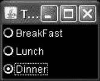

### Choice

`Choice` 是一个下拉列表。

#### Methods

* `void add(String item)`：向此 `Choice` 菜单中添加一个项目。
* `void addItemListener(ItemListener i)`：添加指定的项监听器以接收来自此选择菜单的项事件。
* `String getItem(int index)`：获取此 `Choice` 菜单中指定索引处的 `String`。
* `int getItemCount()`：返回此 `Choice` 菜单中的项目数量。
* `int getSelectedIndex()`：返回当前选中项的索引。
* `String getSelectedItem()`：以字符串形式获取当前选择的表示。
* `void insert(String item, int index)`：在选择框的指定位置插入该项目。
* `void remove(int position)`：从选择菜单中移除第一个出现的项目。
* `void remove(String item)`：从 `Choice` 菜单中移除第一个出现的指定项目。
* `void removeAll()`：从选择菜单中移除所有项目。
* `void select(int pos)`：将此选择菜单中的选中项设置为指定位置的项目。
* `void select(String Str)`：将此 `Choice` 菜单中的选中项设为名称与指定字符串相等的项目。

### Example 17.16

```java
import java.awt.*;
class ChoiceTest
{
  public static void main(String args[]) throws InterruptedException
    {
      Frame f = new Frame("Testing Choice Component");
      f.setLayout(new FlowLayout());
      f.setSize(100,100);
      f.setVisible(true);
      Choice c1=new Choice();
      c1.add("BreakFast");
      c1.add("Lunch");           
      c1.add("Dinner");
      f.add(c1);
      c1.select("Dinner"); // c1.select(2);
      Thread.sleep(1000);
      System.out.println(c1.getSelectedItem());
      System.out.println(c1.getSelectedIndex());
      System.out.println(c1.getItemCount());
      System.out.println(c1.getItem(0));
      c1.insert("Brunch",1);
      c1.remove(2); // c1.remove("Lunch");
     }
 }
```

Output:


```java
1. import java.awt.*;
2. import java.awt.event.*;
3. class CheckboxTest extends Frame implements ItemListener
4 {
5.   TextField tf1;
6.   Choice c1;
7.   CheckboxTest()
8.   {
9.     setLayout(new FlowLayout());
10.      c1=new Choice();
11.      c1.add("red");
12.      c1.add("green");
13.      c1.add("blue");
14.      tf1 = new TextField(8);
15.      tf1.setBackground(Color.red);
16.      c1.addItemListener(this);
17.      add(c1);
18.      add(tf1);
19.      setSize(200,200);
20.      setVisible(true);
21.   }
22.   public static void main(String args[])
23.   {
24.     new CheckboxTest();
25.   }
26.   public void itemChanged(ItemEvent ie)
27.   {
28.     String s=(String)ie.getItem();
29.     if(s.equals("red"))
30.        tf1.setBackground(Color.red);
31.     else if(s.equals("green"))
32.        tf1.setBackground(Color.green);
33.     else if(s.equals("blue"))
34.        tf1.setBackground(Color.blue);
35.   }
36. }
```

## Label

最简单的可见 AWT 组件是 `Label`。标签通常不用于响应用户输入或发送事件。

### Constructors

`Label()`

构造一个空标签。

`Label(String text)`

构造一个带有新文本的标签。

`Label(String text, int alignment)`

构造一个带有文本并指定对齐方式的标签。

### Methods

`String getText()`

获取标签的文本。

`void setText(String text)`

设置标签的文本为指定的字符串。

### Example 17.17

```java
1. import java.awt.*;
2. class LabelTest
3 {
4.   public static void main(String args[])
5.   {
6.       Frame f = new Frame("Testing Label");
7.       f.setLayout(new GridLayout(3,3));
8.       f.setFont(new Font("Arial",Font.PLAIN, 20));
9.       Label l1 = new Label("India",Label.LEFT);
10.      Label l2 = new Label("Pakistan",Label.CENTER);
11.      Label l3 = new Label("UK",Label.RIGHT);
12.      Label l4 = new Label("USA",Label.LEFT);
13.      Label l5 = new Label("Japan",Label.CENTER);
14.      Label l6 = new Label("France",Label.RIGHT);
15.      Label l7 = new Label("Germany",Label.LEFT);
16.      Label l8 = new Label("China",Label.CENTER);
17.      Label l9 = new Label("Canada",Label.RIGHT);
18.      f.add(l1);f.add(l2);f.add(l3);
19.      f.add(l4);f.add(l5);f.add(l6);
19.      f.add(l7);f.add(l8);f.add(l9);
21.      f.setSize(500,200);
22.      f.setVisible(true);
23.   }
24. }
```

Output:


## List

`List` 是垂直排列的文本集合。如果列表包含的项目比显示范围的多，它会自动获取滚动条。

### Constructors

`List()`

构造一个新的滚动列表。此构造函数不指定行数，但产生高度为四行。在许多情况下，列表的高度由布局管理器决定。

`List(int rows)`

创建一个指定可见行数的滚动列表。

`List(int rows, boolean multipleMode)`

创建一个显示指定行数并允许多选的滚动列表。

### Example 17.18

```java
1. import java.awt.*;
2. class ListTest
3 {
4.   public static void main(String args[])
5.   { 
6.       Frame f = new Frame( ) ;
7.       f.setLayout(new FlowLayout ());
8.       List l1=new List(3,true);
9.       l1.add("India");
10.      l1.add("Nepal");
11.      l1.add("Shri Lanka");
12.      l1.add("USA");
13.      l1.add("UK");
14.      f.add(l1);
15.      System.out.println(l1.getRows());
16.      f.setSize(300, 300);
17.      f.setVisible(true);
18.   }
19. }
```

Output:

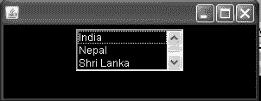

`List` 有五个项目，但只有 3 个可见行，因此自动提供滚动条以访问底部两行。

注意：选择列表中的项目会引起列表发送项事件；双击项目会发送动作事件。

`void add(String item)`

向滚动列表的末尾添加指定的项目。

### List 类方法

`void add(String item, int index)`

将指定的项目添加到由 `index` 指明位置的滚动列表中。

`void addActionListener(ActionListener i)`

添加指定的动作监听器，以接收来自此列表的动作事件。

`void addItemListener(ItemListener i)`

添加指定的项目监听器，以接收来自此列表的项目事件。

`String getItem(int index)`

获取与指定的 `index` 关联的项目。

`int getItemCount()`

获取列表中的项目数量。

`String[] getItems()`

获取列表中的所有项目。

`int getRows()`

获取此列表中可见的行数。

`int getSelectedIndex()`

获取列表中被选中项目的索引。

`int[] getSelectedIndexes()`

获取列表中被选中的索引数组。

`String getSelectedItem()`

获取此滚动列表中的被选中项目。

`String[] getSelectedItems()`

获取此滚动列表中的所有选中项目。

`void remove(int position)`

从此滚动列表中删除指定位置的项目。

`void remove(String item)`

从列表中删除第一个出现的项目。

`void removeAll()`

删除此列表中的所有项目。

`void replaceItem(String newValue, int index)`

将滚动列表中指定索引的项目替换为新字符串。

`void select(int index)`

选取滚动列表中指定 `index` 处的项目。

`void setMultipleMode(boolean b)`

设置标志，决定此列表是否允许多项选择。

### 示例代码

```java
import java.awt.*;
import java.awt.event.*;
class ListTest extends Frame implements ActionListener
{
    Button b1,b2,b3,b4,b5,b6;
    List l1,l2;
    TextField tf1,tf2;
    ListTest()
    {
      setLayout(new GridLayout(3,3));
      l1=new List(3,true);
      l2=new List(3,true);
      b1=new Button(">");
      b2=new Button(">>");
      b3=new Button("<");
      b4=new Button("<<");
      b5=new Button("Add");
      b6=new Button("Add");
      b1.addActionListener(this);
      b2.addActionListener(this);
      b3.addActionListener(this);
      b4.addActionListener(this);
      b5.addActionListener(this);
      b6.addActionListener(this);
      tf1=new TextField();
      tf2=new TextField();
      Panel p1=new Panel();
      p1.setLayout(new GridLayout(4,1));
      p1.add(b1);
      p1.add(b2);
      p1.add(b3);
      p1.add(b4);
      add(l1);add(p1);add(l2);
      add(tf1);add(new Label());add(tf2);
      add(b5);add(new Label());add(b6);
      setSize(300,300);
      setVisible(true);
    }
    public static void main(String args[])
    {
      new ListTest();
    }
    public void actionPerformed(ActionEvent ae)
    {
      Button b=(Button)ae.getSource();
      if(b==b1)
      {
          String s[]=l1.getSelectedItems();
          for(int i=0;i<s.length;i++)
        {
          l2.add(s[i]);
          l1.remove(s[i]);
        }
      }
      else if(b==b2)
      {
          String s[]=l1.getItems();
          for(int i=0;i<s.length;i++) {
          l2.add(s[i]);
          l1.remove(s[i]);
        }
      }
      else if(b==b3)
      {
          String s[]=l2.getSelectedItems();
        for(int i=0;i<s.length;i++)
        {
          l1.add(s[i]);
          l2.remove(s[i]);
        }
      }
      else if(b==b4)
      {   
          String s[]=l2.getItems();
          for(int i=0;i<s.length;i++)
        {
          l1.add(s[i]);
          l2.remove(s[i]);
        } 
      }
      else if(b==b5)
      {
          l1.add(tf1.getText());
      }
      else if(b==b6)
      {
          l2.add(tf2.getText());
      }
    }
}
```

## TextField 和 TextArea

`TextField`（文本框）和 `TextArea`（文本区域）类实现了用于文本输入、显示和编辑的一维和二维组件。这两个类都继承自 `TextComponent` 超类。

`Object` -> `Component` -> `TextComponent` -> (`TextField`, `TextArea`)

这两个类（`TextField` 和 `TextArea`）都有多种构造函数，提供了指定或不指定初始字符串或首选大小的。未指定首选大小的构造函数最适用于布局管理器将忽略组件首选大小的情况。

### TextField 类的构造函数

`TextField()`

构造新的文本框。

`TextField(int columns)`

创建一个具有指定列数的文本框。

`TextField(String text)`

创建一个具有指定文本的文本框。

`TextField(String text, int columns)`

创建一个具有指定文本和指定列数的文本框。

### TextArea 类的构造函数

`TextArea()`

创建一个新的文本区域。

`TextArea(int rows, int columns)`

创建一个具有指定行数和列数的文本区域。

`TextArea(String text)`

创建一个具有指定文本的文本区域。

`TextArea(String text, int rows, int columns)`

创建一个具有指定文本、行数和列数的文本区域。

`TextArea(String text, int rows, int columns, int scrollbarPolicy)`

创建一个具有指定文本、行数、列数和滚动条策略的文本区域。`TextArea` 类定义了几个可以作为滚动条参数的常量：`SCROLLBARS_BOTH`、`SCROLLBARS_VERTICAL_ONLY`、`SCROLLBARS_HORIZONTAL_ONLY`、`SCROLLBARS_NONE`。对于这两个类，列数存在一些令人意外的问题。首先，列数是根据特定字体渲染的宽度衡量的。使用微小字体 25 列区域会非常窄，而使用巨大字体 5 列会非常宽。其次是比例字体的问题。对于等宽字体，列宽是显而易见的。对于比例字体，列宽是所有字符宽度和频率的平均值。因此在大多数情况下，包含小写字母的文本组件显示的字符比请求的要。

### TextComponent 类的方法

`String selectText()`

获取文本组件中的选中文本。

`String getText()`

获取文本组件显示的文本。

`void setEditable(boolean b)`

设置标志，决定此文本组件是否可编辑。

`void setText(String t)`

将文本组件显示的文本设置为指定的文本。

### 示例 17


```java
import java.awt.*;
class TextFieldTest
{
    public static void main(String args[])
    {
      Frame f=new Frame();
      f.setLayout(new FlowLayout());
      TextField tf1=new TextField();
      TextField tf2=new TextField(8);
      TextField tf3=new TextField("matrix");
      TextField tf4=new TextField("matrix",20);
      TextArea ta1=new TextArea();
      TextArea ta2=new TextArea(3,8);
      TextArea ta3=new TextArea("abc\nxyz\naaa");
      TextArea ta4=new TextArea("abc\nxyz\naaa",2,2);
      TextArea ta5=new TextArea("abc\nxyz\naaa",4,20,TextArea.SCROLLBARS_BOTH);
      f.add(tf1);f.add(tf2);f.add(tf3);f.add(tf4);
      f.add(ta1);f.add(ta2);f.add(ta3);f.add(ta4);
      f.add(ta5);
      tf1.setText("abc");
      System.out.println(tf3.getText());
      tf3.setEditable(false);
    }
}
```

```java
22. f.setSize(800, 400);
23. f.setVisible(true);
24. }
25. }
```

输出：

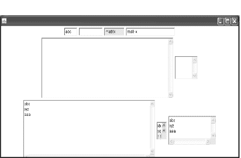

## FileDialog（文件对话框）

此类表示文件打开或文件保存对话框。文件对话框是一个模态对话框，这意味着只要对话框在屏幕上可见，来自对话框父框架的输入将专门重定向到对话框。当用户指定文件或点击取消按钮时，对话框会自动移除。最实用的 `FileDialog` 构造函数具有以下形式：

`FileDialog(Frame parent, String title, int mode)`

对话框的父帧是对话框将出现的帧。标题字符串显示在对话框的标题栏中。

模式 应该是以下者之一：

- `FileDialog.LOAD`
- `FileDialog.SAVE`

在用户指定文件后，可以使用以下方法获取文件名或其目录：

`String getDirectory()`

获取此文件对话框的选定目录。

`String getFile()`

获取此文件对话框的选定文件。

### 示例 17.20

```java
import java.awt.*;
public class FileDialogTest
{ 
  public static void main(String args[])
  { 
    Frame f=new Frame( );
    f.setLayout(new FlowLayout( ));
    f.setSize(200, 200);
    f.setVisible(true);
    FileDialog fd=new FileDialog (f, "Load file", FileDialog.LOAD);
    fd.setVisible(true);
    System.out.println(fd.getFile());
    System.out.println(fd.getDirectory());
  }
}
```

## ScrollPane（滚动面板）

`ScrollPane` 可以包含单个组件，该组件可能比滚动面板本身更高或更宽。如果容器组件大于滚动面板，那么滚动面板的默认行为是根据需要获取水平和/或垂直滚动条。

该类有两个构造函数：

`ScrollPane()`

创建一个具有滚动条显示策略为“按需”的新滚动面板容器。

`ScrollPane(int scrollbarDisplayPolicy)`

创建一个具有指定滚动条行为的新滚动面板容器。滚动面板的显示策略应该是以下者之一：

- `ScrollPane.SCROLLBARS_AS_NEEDED`（默认）
- `ScrollPane.SCROLLBARS_ALWAYS`
- `ScrollPane.SCROLLBARS_NEVER`

下面的代码创建了一个具有默认（As_NEEDED）滚动条行为的滚动面板。该滚动面板包含一个很大的按钮；因此肯定需要滚动条。

### 示例 17.21

```java
import java.awt.*;
class SPaneTest
{ 
  public static void main(String args[])
  { 
    Frame f=new Frame();
    f.setLayout(new GridLayout(1,2));
    f.setSize(250, 150);
    ScrollPane spane=new ScrollPane();
    spane.setBackground(Color.green);
    f.add(spane);
    f.add(new TextArea());
    Button b1=new Button("Push Me !");
    b1.setFont(new Font("Serif", Font.ITALIC, 100));
    spane.add(b1);
    f.setVisible(true);
  }
}
```

输出：


### Scrollbar（滚动条）

调整列表和滚动面板的 `Scrollbar` 组件可以作为独立的组件可用。它有三个构造函数：

`Scrollbar()`

构造一个新的垂直滚动条。

`Scrollbar(int orientation)`

构造具有指定方向的新滚动条。

`Scrollbar(int orientation, int initialValue, int sliderSize, int minValue, int maxValue)`

构造一个具有指定方向、初始值、滑块大小以及最小值和最大值的新滚动条。`sliderSize` 参数控制滑块的大小，但不是以像素为单位。

对于接受方向参数的构造函数，此值应该是以下者之一：

- `Scrollbar.HORIZONTAL`
- `Scrollbar.VERTICAL`

### 示例 17.22

```java
import java.applet.*;
import java.awt.*;
import java.awt.event.*;
/*<applet code = "RGB" width=500 height=200></applet> */
public class RGB extends Applet implements AdjustmentListener
{
  TextField tf1;
  Scrollbar sb1,sb2,sb3;
  public void init() {
    setLayout(new GridLayout(4,1));
    sb1 = new Scrollbar(Scrollbar.HORIZONTAL,0,10,0,255);
    sb2 = new Scrollbar(Scrollbar.HORIZONTAL,0,10,0,255);
    sb3 = new Scrollbar(Scrollbar.HORIZONTAL,0,10,0,255);
    sb1.addAdjustmentListener(this);
    sb2.addAdjustmentListener(this);
    sb3.addAdjustmentListener(this);
    tf1 = new TextField(8);
    add(tf1);add(sb1);
    add(sb2);add(sb3);
  }
  public void adjustmentValueChanged(AdjustmentEvent ae) {
    int a=0,b=0,c=0;
    a = sb1.getValue();
    b = sb2.getValue();
    c = sb3.getValue();
    Color c1 = new Color(a,b,c);
    tf1.setBackground(c1);
  }
}
```

## AWT 事件简介

### 介绍 AWT 事件

### GUI 事件

非 GUI 的程序通过调用某些方法来与用户交互。当普通的 Java 程序（非 GUI 的）需要输入时，它会提示用户并调用某些方法，如 `readline()`，交互是由程序发起的。点击按钮会产生事件并根据情况执行某些代码。点击将保存内容。

| 接口 | 事件（方法） | 类 | 方法 |
| :--- | :--- | :--- | :--- |
| `ActionListener` | `actionPerformed()` | `ActionEvent` | `getSource()` |
| `ItemListener` | `itemStateChanged()` | `ItemEvent` | `getItem()` |
| `AdjustmentListener` | `adjustmentValueChanged()` | `AdjustmentEvent` | `getAdjustable()` |
| `MouseListener`, `MouseAdapter` | `mouseEntered`, `mouseExited`, `mouseClicked`, `mouseReleased` | `MouseEvent` | `getX()`, `getY()`, `getPoint()`, `getClickCount()`, `getButton()`, `getModifiers()`, `getModifiersText()` |
| `MouseMotionListener`, `MouseMotionAdapter` | `mouseMoved`, `mouseDragged` | `MouseEvent` | 同上 |
| `KeyListener`, `KeyAdapter` | `keyTyped`, `keyPressed`, `keyReleased` | `KeyEvent` | `getKeyChar()`, `getKeyCode()` |
| `FocusListener`, `FocusAdapter` | `focusGained`, `focusLost` | `FocusEvent` | `getSource()` |
| `WindowListener`, `WindowAdapter` | `windowOpen`, `windowClosing`, `windowClosed`, `windowActivated`, `windowDeactivated`, `windowIconified`, `windowDeiconified` | `WindowEvent` | `getWindow()` |

### 事件类

点击按钮产生一个事件。事件关联有大量信息，例如时间、生成事件的组件、点击点的坐标等。这些信息被放在事件类中。该概念类似于异常处理。每当发生异常时，都会创建一个相应的异常类对象，并将所有异常相关信息放入该对象。我们拥有事件类的层次结构，它与异常类的层次结构非常相似。每当发生某些事件时，它会被事件处理机制检测到，创建相应的事件类对象并将所有事件相关信息放入其中。

### 事件监听器

事件监听器负责在事件发生时采取适当行动。事件监听器是组件委托其处理特定类型事件的任务的对象。

当组件接收输入时，会构建一个相应类型的事件，然后该事件将作为参数传递给监听器上的方法调用。监听器必须实现包含该事件处理方法的接口。

我们可以将事件监听器与处理异常的 `catch` 块进行比较。我们需要为要处理的异常提供一个相应的 `catch` 块。同样，如果我们想处理由某些组件生成的事件，我们需要提供适当的监听器。

监听器与组件相关联。不同的事件有不同的监听器。当事件发生时，会调用相应的监听器方法，并将事件对象作为参数传递。

### 适配器 (Adapters)

语言中定义的监听器仅是接口。我们需要提供相应监听器的实现。某些监听器具有 2 个或更多方法。

要实现具有多个方法的监听器，即使我们只对其中一个感兴趣，也需要提供所有方法的实现。适配器类为这个问题提供了解决方案。

适配器类提供了监听器所有方法的空实现（dummy implementation）。这有助于减少编程工作量。如果我们只想使用包含例如 5 个方法的监听器类中的一个方法，可以简单地扩展适配器类并重写所需的方法。

### 事件层次结构 (Event hierarchy)

AWT 具有定义良好的事件层次结构。通常，事件层次结构中的叶子节点类表示实际事件。而非叶子节点类作为基类并进行封装。

AWT 事件层次结构如下所示。

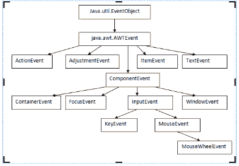

### java.util.event.EventObject 类

这是所有事件类的顶层超类。它是一个非常通用的类，只有一个感兴趣的方法，即返回产生事件的源。

```java
Object getSource()
```

### java.awt.AWTEvent 类

`EventObject` 的一个子类是 `java.awt.AWTEvent`，它是所有委托模型事件类的超类。同样，只有一个感兴趣的方法，返回事件的 ID。

```java
int getID()
```

事件的 ID 是一个 `int` 类型，用于指定事件的精确性质。例如，`MouseEvent` 类的实例可以代表七种情况之一：点击、拖拽、进入、移动、退出、按下、释放。这些每种可能性都由 `int` 类型 `MouseEvent` 常量表示，如 `MOUSE_CLICKED`、`MouseEvent.MOUSE_DRAGGED` 等。

`java.awt.AWTEvent` 的子类表示由各种 AWT 组件生成的各种事件类型，并包含了与触发事件的活动相关的所有必要信息。

非超类事件类型（即那些由组件实际触发的事件）包括：

1. `ActionEvent`：通常由组件的激活产生，例如。它在点击按钮、双击列表项以及在 `TextField` 中按下回车键时生成。
2. `AdjustmentEvent`：由可调整组件（如滚动条）的调整生成。
3. `ContainerEvent`：当组件被添加到容器中或从容器中移除时生成。
4. `FocusEvent`：当组件接收或丢失输入焦点时生成。
5. `ItemEvent`：当从列表、选择框或复选框中选择项目时生成。
6. `KeyEvent`：由键盘活动生成。
7. `MouseEvent`：由鼠标活动生成。
8. `MouseWheelEvent`：一种指示鼠标滚轮事件。
9. `WindowEvent`：一种指示窗口状态变化的事件。
10. `TextEvent`：当组件内容发生变化时生成。

### java.awt.event 包

该包提供了处理事件的接口。`EventListeners` 是必须实现的接口。`Adapters` 是提供默认实现的类。

### 事件监听器 (Event Listeners)

`EventListeners` 是必须实现的以处理特定事件的接口。

#### ActionListener

这是用于接收动作事件的监听器。

```java
void actionPerformed(ActionEvent e)
```

#### AdjustmentListener

这是用于接收调整事件的监听器。

```java
void adjustmentValueChanged(AdjustmentEvent e)
```

#### ContainerListener

这是当组件被添加到容器或从容器中移除时接收事件的监听器。

```java
void componentAdded(ContainerEvent e)
void componentRemoved(ContainerEvent e)
```

#### FocusListener

这是组件获得或失去焦点时的监听器。

```java
void focusGained(FocusEvent e)
void focusLost(FocusEvent e)
```

#### ItemListener

这是用于接收项目事件的监听器。

```java
void itemStateChanged(ItemEvent e)
```

#### KeyListener

这是用于接收键盘事件的监听器。

```java
void keyPressed(KeyEvent e)
void keyReleased(KeyEvent e)
void keyTyped(KeyEvent e)
```

#### MouseListener

这是用于接收鼠标事件的监听器。

```java
void mouseClicked(MouseEvent e)
void mouseEntered(MouseEvent e)
void mouseExited(MouseEvent e)
void mousePressed(MouseEvent e)
void mouseReleased(MouseEvent e)
```

#### MouseMotionListener

这是用于接收鼠标移动事件的监听器。

```java
void mouseDragged(MouseEvent e)
void mouseMoved(MouseEvent e)
```

#### MouseWheelListener

这是用于接收鼠标滚轮事件的监听器。


# 处理 ActionEvent

## WindowListener

这是用于接收窗口状态变化的监听器。

```java
void windowActivated(WindowEvent e)
void windowClosed(WindowEvent e)
void windowClosing(WindowEvent e)
void windowDeactivated(WindowEvent e)
void windowDeiconified(WindowEvent e)
void windowIconified(WindowEvent e)
void windowOpened(WindowEvent e)
```

当窗口不再是活动窗口时被调用。

当窗口从最小化状态恢复正常状态时被调用。

当窗口从正常状态变为最小化状态时被调用。

当窗口第一次可见时被调用。

## 示例 18.1

以下示例解释了如何处理点击按钮生成的 `ActionEvent`。

```java
import java.awt.*;
import java.awt.event.*;

class A1 {
    public static void main(String args[]) {
        Frame f = new Frame();
        f.setLayout(new FlowLayout());
        f.setSize(500, 100);
        Button b1 = new Button("Push me");
        Button b2 = new Button("Click me");
        b1.addActionListener(new B());
        b2.addActionListener(new C());
        f.add(b1);
        f.add(b2);
        f.setVisible(true);
    }
}

class B implements ActionListener {
    public void actionPerformed(ActionEvent ae) {
        System.out.println("Button Pushed");
    }
}

class C implements ActionListener {
    public void actionPerformed(ActionEvent ae) {
        System.out.println("Button Clicked");
    }
}
```

输出：


## 示例 18.2

```java
import java.awt.*;
import java.awt.event.*;

class A2 implements ActionListener {
    static Button b1 = null, b2 = null;

    public static void main(String args[]) {
        Frame f = new Frame();
        f.setLayout(new FlowLayout());
        f.setSize(500, 100);
        b1 = new Button("Push me");
        b2 = new Button("Click me");
        b1.addActionListener(new A2());
        b2.addActionListener(new A2());
        f.add(b1);
        f.add(b2);
        f.setVisible(true);
    }

    public void actionPerformed(ActionEvent ae) {
        if (ae.getSource() == b1)
            System.out.println("Button Pushed");
        else
            System.out.println("Button Clicked");
    }
}
```

输出：与上例相同。

## 示例 18.3

```java
import java.awt.*;
import java.awt.event.*;

class A3 implements ActionListener {
    Button b1 = null, b2 = null;

    A3() {
        Frame f = new Frame();
        f.setLayout(new FlowLayout());
        f.setSize(500, 100);
        b1 = new Button("Push me");
        b2 = new Button("Click me");
        b1.addActionListener(this);
        b2.addActionListener(this);
        f.add(b1);
        f.add(b2);
        f.setVisible(true);
    }

    public static void main(String args[]) {
        new A3();
    }

    public void actionPerformed(ActionEvent ae) {
        if (ae.getSource() == b1)
            System.out.println("Button Pushed");
        else
            System.out.println("Button Clicked");
    }
}
```

输出：与上例相同。

## 示例 18.4

```java
import java.awt.*;
import java.awt.event.*;

class A4 implements ActionListener {
    static Button b1 = null, b2 = null;
    static TextField tf1 = null, tf2 = null, tf3 = null;

    public static void main(String args[]) {
        Frame f = new Frame();
        f.setLayout(new GridLayout(4, 2));
        f.setSize(500, 300);
        Label l1 = new Label("No1.");
        Label l2 = new Label("No2.");
        Label l3 = new Label("Result");
        tf1 = new TextField();
        tf2 = new TextField();
        tf3 = new TextField();
        b1 = new Button("Sum");
        b2 = new Button("Avg");
        b1.addActionListener(new A4());
        b2.addActionListener(new A4());
        f.add(l1);
        f.add(tf1);
        f.add(l2);
        f.add(tf2);
        f.add(l3);
        f.add(tf3);
        f.add(b1);
        f.add(b2);
        f.setVisible(true);
    }

    public void actionPerformed(ActionEvent ae) {
        int a, b, c;
        float av;
        a = Integer.parseInt(tf1.getText());
        b = Integer.parseInt(tf2.getText());
        if (ae.getSource() == b1)
            tf3.setText("" + (a + b));
        else
            tf3.setText("" + (a + b) / 2.0f);
    }
}
```

输出：


> **注意**：此处原文似乎存在错乱，已根据逻辑进行了对应翻译。

## 处理窗口事件

### 示例 18.5

```java
import java.awt.*;
import java.awt.event.*;

class A5 {
    public static void main(String args[]) {
        Frame f = new Frame();
        f.setLayout(new FlowLayout());
        f.setSize(300, 300);
        f.addWindowListener(new B());
        f.setVisible(true);
    }
}

class B implements WindowListener {
    public void windowOpened(WindowEvent ae) {
        System.out.println("Window Opened");
    }

    public void windowActivated(WindowEvent ae) {
        System.out.println("Window Activated");
    }

    public void windowDeactivated(WindowEvent we) {
        System.out.println("Window Deactivated");
    }

    public void windowClosing(WindowEvent we) {
        System.out.println("Window Closing");
        Frame f = (Frame) we.getWindow();
        f.dispose();
    }

    public void windowClosed(WindowEvent we) {
        System.out.println("Window Closed");
    }

    public void windowIconified(WindowEvent e) {}

    public void windowDeiconified(WindowEvent e) {}
}
```

## Adapters

有些事件监听接口具有多个方法。最大的接口 `WindowListener` 有七个方法。假设我们想捕获 `windowClosing()` 事件以便执行关闭窗口的代码。虽然我们在实现 `WindowListener` 的类中只需要 `windowClosing()` 方法，但我们必须为所有方法提供空实现。

`java.awt.event` 包提供了多个适配器类，每个定义了多个方法的监听接口对应一个。

适配器仅仅是一个实现接口并提供空方法的类。例如，`WindowAdapter` 类实现了 `WindowListener` 接口并包含了七个空方法。

### 适配器类及其接口

| 适配器类 | 监听器接口 |
| :--- | :--- |
| `ContainerAdapter` | `ContainerListener` |
| `FocusAdapter` | `FocusListener` |
| `KeyAdapter` | `KeyListener` |
| `MouseAdapter` | `MouseListener` |
| `MouseMotionAdapter` | `MouseMotionListener` |
| `WindowAdapter` | `WindowListener` |

### 示例 18.6 WindowAdapter 类的使用

```java
import java.awt.*;
import java.awt.event.*;

class A6 {
    public static void main(String args[]) {
        Frame f = new Frame();
        f.setLayout(new FlowLayout());
        f.setSize(300, 300);
        f.addWindowListener(new B());
        f.setVisible(true);
    }
}

class B extends WindowAdapter {
    public void windowClosing(WindowEvent we) {
        System.out.println("Window Closing");
        Frame f = (Frame) we.getWindow();
        f.dispose();
    }
}
```

## InputEvent 类

这是所有组件级输入事件的根事件类。输入事件在产生它的源对其进行正常处理之前，会先传递给监听器。这允许监听器和组件子类“消费”事件，从而使源不会以其默认方式处理它们。例如，在 `Button` 组件上消费鼠标按下事件将防止 `Button` 被激活。

### 方法

- `void consume()`: 消费此事件，使其不会由产生它的源以默认方式进行处理。
- `int getModifiers()`: 返回对应此事件的修饰符掩码。
- `int getModifiersEx()`: 返回此事件的扩展修饰符掩码。
- `static String getModifiersExText(int modifiers)`: 返回描述扩展修饰键的字符串，例如“shift”、“Ctrl + Shift”等。
- `long getWhen()`: 返回事件发生的时间戳。
- `boolean isAltDown()`: 返回此事件中 Alt 修饰符是否被按下。
- `boolean isConsumed()`: 返回此事件是否已被消费。
- `boolean isControlDown()`: 返回此事件中 Control 修饰符是否被按下。
- `boolean isShiftDown()`: 返回此事件中 shift 修饰符是否被按下。

## 鼠标事件类

这是 `InputEvent` 类的子类。该事件表示组件中发生了鼠标动作。当且仅当鼠标光标位于组件子类的未被遮挡部分、或通过菜单、或通过顶层窗口时，则认为鼠标动作发生在特定的组件中。

此事件既用于鼠标事件（点击、进入、按下、移出、释放），也用于鼠标移动事件（移动和拖拽）。

### 方法

- `int getButton()`: 返回哪个鼠标按键发生了状态变化（如果有）。
- `int getClickCount()`: 返回与此事件相关的鼠标点击次数。
- `static String getMouseModifiersText(int modifiers)`: 返回描述事件期间被按下的修饰键的字符串，例如“Shift”或“Ctrl + shift”。
- `Point getPoint()`: 返回事件相对于源组件的 x, y 位置。
- `int getX()`: 返回事件相对于源组件的水平 x 位置。
- `int getY()`: 返回事件相对于源组件的垂直 y 位置。
- `boolean isPopupTrigger()`: 返回此鼠标事件是否为该平台的弹出菜单触发事件。

> **注意**：弹出菜单在不同系统上的触发方式不同。因此，为了实现正确的跨平台功能，应该在鼠标按下和鼠标释放时都检查 `isPopupTrigger()`。

## 处理鼠标事件

### 示例 18.7


```java
1. import java.awt.*;
2. import java.awt.event.*;
3. class A7
4. { 
5.   public static void main(String args[])
6.   { 
7.       Frame f= new Frame();
8.       f.setLayout(new FlowLayout());
9.       f.setSize(300,300);
10.      Button b1 = new Button("Push Me");
11.      b1.addMouseListener(new B());
12.      b1.addMouseMotionListener(new C());
13.      b1.addActionListener(new D());
14.      f.add(b1);
15.      f.setVisible(true);
16.   }
17. }
18. class B implements MouseListener
19. { 
20.   public void mouseEntered(MouseEvent me)
21.   { 
22.      System.out.println("Mouse Entered...");
23.      System.out.println(me.getX());
24.      System.out.println(me.getY());
25.   }
26.   public void mouseExited(MouseEvent me)
27.   { 
28.      System.out.println("Mouse Exited...");
29.      Point p1=me.getPoint();
30.      System.out.println(p1.x);
31.      System.out.println(p1.y);
32.   }
33.   public void mousePressed(MouseEvent me)
34.   { 
35.      System.out.println("Mouse pressed...");
36.      int ms = me.getModifiers();
37.      String s = me.getModifiersEx();
38.      System.out.println(s);
39.   }
40.   public void mouseReleased(MouseEvent me)
41.   { 
42.      System.out.println("Mouse Released...");
43.      System.out.println("ClickCount->" + me.getClickCount());
44.   }
45.   public void mouseClicked(MouseEvent me)
46.   { 
47.      System.out.println("Mouse Clicked...");
48.      System.out.println("Button->"+me.getButton());
49.   }
50. }
51. class C implements MouseMotionListener
52. {
53.   public void mouseMoved(MouseEvent me)
54.   { 
55.      System.out.println("Mouse Moved...");
56.   }
57.   public void mouseDragged(MouseEvent me)
58.   { 
59.      System.out.println("Mouse Dragged...");
60.   }
61. }
62. class D implements ActionListener
63. {
64.   public void actionPerformed(ActionEvent me)
65.   { 
66.      System.out.println("Button Clicked...");
67.      System.out.println("Action->"+me.getAction());
68.   }
69. }
```

### ActionEvent 类

它是 `InputEvent` 类的子类。该事件表示组件中发生了鼠标动作。当且仅当鼠标光标位于组件子类的未被遮挡部分、或通过菜单、或通过顶层窗口时，则认为鼠标动作发生在特定的组件中。

此事件是一个语义事件，表示组件发生了动作（如被按下）。该事件避免了具体的鼠标移动和点击，而是处理像“按钮按下”这样的事件。

**注意：** 在 `Button` 上触发 `ActionEvent`。

### 方法

- `String getActionCommand()`: 返回与动作相关的命令字符串。
- `int getModifiers()`: 返回事件期间按下的修饰键。
- `long getWhen()`: 返回事件发生的时间。

### 示例 18.8

此示例说明了我们在 `ActionEvent` 发生时识别修饰键。

```java
1. import java.awt.*;
2. import java.awt.event.*;
3. class KeyModifierDemo extends Frame implements ActionListener
4. { 
5.   Button b;
6.   KeyModifierDemo ()
7.   { 
8.     b = new Button ("Button");
9.     b.addActionListener(this);
10.    setLayout(new FlowLayout());
11.    add(b);
12.    setBounds(100,100,200,200);
13.    setVisible(true);
14.   }
15.   public static void main (String args[])
16.   { 
17.     new KeyModifierDemo ();
18.   }
19.   public void actionPerformed (ActionEvent ae )
20.   { 
21.     System.out.println ("Button Pressed");
22.     int ms = ae.getModifiers ();
23.     if ((ms & InputEvent.CTRL_DOWN_MASK) != 0)
24.     {   
25.       System.out.println ("CTRL key was pressed");
26.     }
27.     if ((ms & InputEvent.SHIFT_DOWN_MASK) != 0)
28.     { 
29.       System.out.println ("Shift Key was pressed");
30.     }
31.     if ((ms & InputEvent.ALT_DOWN_MASK) != 0)
32.     { 
33.       System.out.println ("ALT key was pressed");
34.     }
35.   }
36. }
```

### 处理多个动作命令

Action 事件是最简单的。当我们发现滚动条发送了一个调整事件时，明显的问题是“现在滚动条的值是多少？”。当我们发现鼠标被点击时，自然会想知道“鼠标的 x 和 y 坐标是多少？”但当我们发现按钮发送了 `ActionEvent` 时，似乎没有其他额外信息需要寻求了；按钮被点击了，这似乎就是全部了。

然而，Action 事件关联着一个额外信息。该信息是一个字符串，被称为 Action 命令（Action command）。我们可以通过 `getActionCommand()` 方法提取 Action 事件的 Action 命令。如果 Action 事件是由文本字段发送的，`getActionCommand()` 将返回文本字段的当前内容。（当用户按下回车键时，文本字段会发送 Action 事件）。如果 Action 事件是由按钮发送的，默认行为是 `getActionCommand()` 返回按钮标签的字符串。然而，我们可以通过调用 `setActionCommand(String)` 方法显式地设置按钮的 ActionCommand。

```java
Button btn = new Button("Hello");
btn.setActionCommand("Hello");
```

当按钮的 Action 监听器（Action listener）需要决定如何响应 Action 事件时，按钮命令的优势就显而易见了。单个监听器作为多个组件的监听器是很常见的；在我们的上下文中，单个对象可以是几个或多个按钮的 Action 监听器。在这种情况下，对象的 `actionPerformed()` 方法必须判断是哪个按钮被点击了。下面的示例演示了这一点：

### 示例 18.9

```java
import java.awt.*;
import java.awt.event.*;
class ButtonRefTest
{
    Button b1,b2,b3;
    ButtonRefTest()
    {  
      Frame f=new Frame();
      f.setLayout(new FlowLayout());
      f.setSize(300,300);
      b1=new Button("Push Me");
      b2=new Button("Click Me");
      b3=new Button("Hit Me");
      f.add(b1);   f.add(b2);   f.add(b3);
      B obj= new B(b1,b2,b3);
      b1.addActionListener(obj);
      b2.addActionListener(obj);
      b3.addActionListener(obj);
      f.setVisible(true);
    }
    public static void main(String args [ ])
    { 
      new ButtonRefTest();
    }
}
class B implements ActionListener
{ 
    Button b4,b5,b6;
    B(Button b1, Button b2, Button b3)
    {
      b4 = b1;
      b5 = b2;
      b6 = b3;
    }
    public void actionPerformed(ActionEvent ae)
    {  
      Button b=(Button)ae.getSource();
      if(b==b4)
      System.out.println("First Button was pressed");
      else if(b==b5)
      System.out.println("Second Button was pressed");
      else if(b==b6)
      System.out.println("Third  was pressed");
    }
}
```

### 示例 18.10 

```java
import java.awt.*;
import java.awt.event.*;
class GetLabelTest
{
    Button b1,b2,b3;
    GetLabelTest()
    {  
      Frame f=new Frame();
      f.setLayout(new FlowLayout());
      f.setSize(300,300);
      b1=new Button("Push Me");
      b2=new Button("Click Me");
      b3=new Button("Hit Me");
      f.add(b1);   f.add(b2);   f.add(b3);
      B obj= new B();
      b1.addActionListener(obj);
      b2.addActionListener(obj);
      b3.addActionListener(obj);
      f.setVisible(true);
    }
    public static void main(String args [])
    { 
      new GetLabelTest();
    }
}
class B implements ActionListener
{ 
    public void actionPerformed(ActionEvent ae)
    { 
      Button b=(Button)ae.getSource();
      String s=b.getLabel();
      if(s.equals("Push Me")) // 注意：原文中有多余的括号
      System.out.println("First Me Button was pressed");
      // ... (其余逻辑遵循原始结构)
    }
}
```

### 示例 18.11: 使用 `setActionCommand()` 方法设置 Action Command

```java
import java.awt.*;
import java.awt.event.*;
class ActionCommandTest
{
    Button b1,b2,b3;
    ActionCommandTest()
    { 
      Frame f=new Frame();
      f.setLayout(new FlowLayout());
      f.setSize(300,300);
      b1=new Button("Push Me");
      b2=new Button("Push Me");
      b3=new Button("Push Me");
      b1.setActionCommand("First");
      b2.setActionCommand("Second");
      b3.setActionCommand("Third");
      f.add(b1);   f.add(b2);   f.add(b3);
      B obj= new B();
      b1.addActionListener(obj);
      b2.addActionListener(obj);
      b3.addActionListener(obj);
      f.setVisible(true);
    }
    public static void main(String args [])
    { 
      new ActionCommandTest();
    }
}
class B implements ActionListener
{ 
    public void actionPerformed(ActionEvent ae)
    { 
      Button b=(Button)ae.getSource();
      String s=b.getActionCommand(); 
      if(s.equals("First"))
      System.out.println("First Push Me Button was pressed");
      else if(s.equals("Second"))
      System.out.println("Second Push Me Button was pressed");
      else if(s.equals("Third"))
      System.out.println("Third Push Me Button  was pressed");
    }
}
```

### 处理按事件

### 示例 18.12


```java
import java.awt.*;
import java.awt.event.*;
class KeyTest extends Frame implements KeyListener
{ 
    String msg = "";
    int x=50,y=100;
    public static void main (String arg[])
    { 
      Frame f= new KeyTest();
      f.setSize(300, 300);
      f.addKeyListener((KeyTest)f);
      f.setVisible (true);
    }
    public void keyReleased(KeyEvent ke)
    { 
      System.out.println("Key Up...");
    }
    public void keyTyped(KeyEvent ke)
    { 
      System.out.println("Key Typed...");
      msg = msg + ke.getKeyChar();
      repaint();
    }
    public void keyPressed(KeyEvent ke)
    { 
      System.out.println("Key Pressed...");
      int key = ke.getKeyCode();
      switch(key)
      { 
        case KeyEvent.VK_F1: msg = msg + "<F1>";
        case KeyEvent.VK_F2: msg = msg + "<F2>";
        case KeyEvent.VK_F3: msg = msg + "<F3>";
        case KeyEvent.VK_PAGE_DOWN: msg = msg + "<PgDn>";
        case KeyEvent.VK_PAGE_UP: msg = msg + "<PgUp>";
        case KeyEvent.VK_LEFT: msg = msg + "<Left Arrow>";
        case KeyEvent.VK_RIGHT: msg = msg + "<Right Arrow>";
        case KeyEvent.VK_CONTROL: msg = msg + "<Ctrl>";
      }
      repaint();
    }
    public void paint(Graphics g)
    { 
      g.setColor(Color.red);
      g.drawString(msg,x,y);
    }
}
```

### 示例 18.13: FocusListener 在文本字段失去或获得焦点时改变颜色

```java
import java.awt.*;
import java.awt.event.*;
class FocusTest extends Frame implements FocusListener
{
    static TextField tf1,tf2;
    public static void main(String args[])
    {
      FocusTest f = new FocusTest();
      f.setLayout(new FlowLayout());
      tf1 = new TextField(8);
      tf1.setBackground(Color.blue);
      tf1.addFocusListener(f); 
      tf2 = new TextField(8);
      tf2.setBackground(Color.blue);
      tf2.addFocusListener(f);
      f.add(tf1);
      f.add(tf2);
      f.setSize(200,200);
      f.setVisible(true);
    }
    public void focusGained(FocusEvent fe)
    {
      TextField tf=(TextField)fe.getSource();
      tf.setBackground(Color.red);
    }
    public void focusLost(FocusEvent fe)
    {
      TextField tf=(TextField)fe.getSource();
      tf.setBackground(Color.blue);
    }
}
```

### 示例 18.14: requestFocus() 的演示 我们不能在同一个类中使用 WindowListener，因此我们定义了两个类：一个用于帧，另一个用于 WindowListener。

```java
import java.awt.*;
```

```java
import java.awt.event.*;

class A extends Frame implements ActionListener {
    static TextField tf1, tf2;
    static Button b1;

    public static void main(String args[]) {
        A f = new A();
        f.setLayout(new FlowLayout());
        f.addWindowListener(new B());
        tf1 = new TextField(8);
        tf2 = new TextField(8);
        b1 = new Button("Set");
        b1.addActionListener(f);
        f.add(tf1);
        f.add(tf2);
        f.add(b1);
        f.setSize(200, 200);
        f.setVisible(true);
    }

    public void actionPerformed(ActionEvent ae) {
        tf2.requestFocus();
    }
}

class B extends WindowAdapter {
    public void windowClosing(WindowEvent we) {
        Frame f = (Frame)we.getWindow();
        f.dispose();
    }
}
```

### 示例 18.15 显示对话框

```java
import java.awt.*;

class DialogTest {
    public static void main(String args[]) throws InterruptedException {
        Frame f1 = new Frame();
        f1.setSize(300, 300);
        f1.setVisible(true);
        Dialog d1 = new Dialog(f1);
        d1.setSize(100, 100);
        d1.setVisible(true);
        Thread.sleep(3000);
        d1.dispose();
    }
}
```

### 示例 18.16 菜单栏演示

```java
import java.awt.*;
import java.awt.event.*;

class MyMenu extends Frame implements ActionListener, WindowListener, ItemListener {
    TextField tf1;
    String msg = "";
    CheckboxMenuItem item4;

    MyMenu() {
        super("Matrix");
        setLayout(new FowLayout());
        tf1 = new TextField(8);
        add(tf1);
        MenuBar mbar = new MenuBar();
        Menu file = new Menu("File");
        MenuItem item1 = new MenuItem("New...");
        item1.addActionListener(this);
        file.add(item1);
        MenuItem item2 = new MenuItem("Open...");
        item2.addActionListener(this);
        file.add(item2);
        Menu sub = new Menu("Sub Menu");
        MenuItem item3 = new MenuItem("Option1");
        sub.add(item3);
        file.add(sub);
        item4 = new CheckboxMenuItem("TextBox", true);
        item4.addItemListener(this);
        file.add(item4);
        mbar.add(file);
        addWindowListener(this);
        setMenuBar(mbar);
        setSize(400, 400);
        setVisible(true);
    }

    public void paint(Graphics g) {
        g.drawString(msg, 150, 250);
    }

    public void actionPerformed(ActionEvent ae) {
        String s1 = (String)ae.getActionCommand();
        if (s1.equals("New...")) {
            tf1.setText("New Selected");
            msg = "New Selected";
        } else if (s1.equals("Open...")) {
            tf1.setText("Open Selected");
            msg = "Open Selected";
        }
        repaint();
    }

    public void windowClosing(WindowEvent we) {
        Frame f = (Frame)we.getWindow();
        f.dispose();
    }

    public void windowClosed(WindowEvent we) {}
    public void windowActivated(WindowEvent we) {}
    public void windowDeactivated(WindowEvent we) {}
    public void windowIconified(WindowEvent we) {}
    public void windowDeiconified(WindowEvent we) {}
    public void windowOpened(WindowEvent we) {}

    public void itemStateChanged(ItemEvent ie) {
        tf1.setVisible(item4.getState());
    }

    public static void main(String args[]) {
        new MyMenu();
    }
}
```

### 示例 18.17 列表框演示

```java
import java.awt.*;
import java.awt.event.*;

class ListTest extends Frame implements ActionListener {
    static List l1, l2;

    public static void main(String args[]) {
        ListTest f = new ListTest();
        f.setLayout(new FlowLayout());
        l1 = new List(3, true);
        l1.add("India");
        l1.add("Pakistan");
        l1.add("USA");
        l1.add("UK");
        l1.add("China");
        l2 = new List(3, true);
        Button b1 = new Button("Transfer");
        b1.addActionListener(f);
        f.add(l1);
        f.add(l2);
        f.add(b1);
        f.setSize(200, 200);
        f.setVisible(true);
    }

    public void actionPerformed(ActionEvent ae) {
        /*
        for(int i=l1.getItemCount()-1; i>=0; i--) {
            l2.add(l1.getItem(i));
            l1.remove(i);
        }
        */
        String[] s1 = l1.getSelectedItems();
        for (int i=0; i++) {
    }
}
```

```java
44.      y = me.getY();
45.      w=50;
46.      h=50;
47.      Graphics g=f.getGraphics();
48.      g.clearRect(0,0,200,200);
49.      paint(g);
50.      }
51.      public void mouseReleased(MouseEvent me){}
52.      public void mouseClicked(MouseEvent me){}
53.      public void mouseEntered(MouseEvent me){}
54.      public void mouseExited(MouseEvent me){}
55.  }
```


# 章节

# 19 绘图

## 简介

许多类型的 AWT 组件（例如按钮和滚动条）其外观由底层的窗口系统决定。其他组件类型，特别是 `applet`（小程序）、`frame`（窗口）、`panel`（面板）和 `canvas`（画布），没有内在的外观。如果我们将这些类仅仅用作容器，并希望我们的组件看起来尽可能有用，那么我们必须提供实现组件外观的代码。

每个组件都关联着一个图形上下文（graphics context）。图形上下文对应于组件相关的帧缓冲区。

我们可以使用图形上下文支持的方法在组件上进行绘图。在图形上下文上绘制的任何内容都会显示在组件上。

在任何组件上绘图的正确方法是重写它的 `paint()` 方法并提供相应的代码。

`paint()` 方法有一个类型为 `Graphics` 的参数，代表组件的图形上下文。也可以在不使用 `paint()` 方法的情况下在组件上进行绘图，虽然这种方法并不推荐。

## `paint()` 方法与图形上下文

在以下示例中，关于窗口的一个有趣点是，没有显式地调用 `paint()` 方法；该方法只是被提供了。环境似乎在正确的时刻调用 `paint()` 方面做得很好。

在组件上绘图是通过调用图形上下文来实现的，图形上下文是 `Graphics` 类的一个实例。图形上下文知道如何渲染到单个目标上。图形上下文可以渲染到的三种媒介是：

1. 组件。
2. 图像。
3. 打印机。

任何种类的组件都可以与图形上下文相关联。这种关联是永久的；上下文无法重新分配给新的组件。虽然我们可以使用图形上下文在任何类型的组件上进行绘图，但对于已经具有外观的组件这样做是不寻常的。

`Button`、`Choice`、`Checkbox`、`Label`、`Scrollbar`、`TextField` 和 `TextArea` 通常不需要程序员层面的渲染。大多数情况下，这些组件仅使用从组件父类中继承的 `paint()` 版本。

此版本什么都不做；组件由底层的窗口系统进行渲染。然而，有四类“空白”组件，它们没有默认外观，除非它们被子类化并赋予 `paint()` 方法，否则它们将显示为空矩形。

这四个组件类是：

* `Applet`
* `Canvas`
* `Frame`
* `Panel`


# 示例 19.1

扩展了 `Frame` 类并重写 `paint()` 方法以改变窗口的外观。

```java
import java.awt.*;
public class SimplePaint extends Frame
{
    public static void main (String args[])
    {
      Frame f=new SimplePaint();
      f.setSize(200,200);
      f.setVisible(true);
    }
    public void paint (Graphics g)
    {
      g.setColor(Color.white);
      g.fillRect(0,0,300,300);
      g.setColor(Color.grey);
      g.fillOval(30,30,50,50);
    }
}
```

输出：

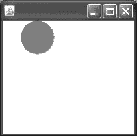

当我们子类化组件类并赋予子类它自己的 `paint()` 方法时，环境会在适当的时间调用该方法，并传入一个适当的 `Graphics` 实例。

## Graphics 类的操作

`Graphics` 类（图形上下文）提供的四类主要操作是：

* 选择颜色
* 选择字体
* 绘制和填充
* 裁剪

## 选择颜色

通过调用 `setColor()` 方法来选择颜色。`setColor()` 参数是 `Color` 类的一个实例。有 13 种预定义的颜色可用：

1. black（黑色）
2. blue（蓝色）
3. cyan（青色）
4. darkGray（深灰色）
5. gray（灰色）
6. green（绿色）
7. lightGray（浅灰色）
8. magenta（洋红色）
9. orange（橙色）
10. red（红色）
11. white（白色）
12. yellow（黄色）
13. yellow（黄色）

如果我们需要列表之外的颜色，可以使用 `Color(int red, int green, int blue)` 构造自己的颜色。参数范围从 0 到 255。

```java
public void paint(Graphics g)
{
  Color c = new Color(170,255,170);
  g.setColor(c);
}
```

## 选择字体

设置图形上下文的字体就像设置颜色；后续操作将使用该字体。在设置字体之前，我们必须先创建一个。`Font` 的构造函数如下：

`Font(String fontName, int style, int size)`

第一个参数是字体名称；可用性取决于平台。我们可以通过对 toolkit 调用 `getFontList()` 获取可用字体名称列表：

```java
String fontNames[] = Toolkit.getDefaultToolkit().getFontList();
```

有三个平台无关的字体，建议使用：

* Serif（衬线字体）
* Sansserif（无衬线字体）
* Monospaced（等宽字体）

在 JDK 的 1.0.X 版本中，这些被称为“TimesRoman”、“Helvetica”和“Courier”。样式参数可以是以下任何常量：

* `Font.PLAIN`（标准）
* `Font.BOLD`（粗体）
* `Font.ITALIC`（斜体）

我们可以通过传递样式的和来指定样式组合，例如粗体斜体字体：

```java
Font f = new Font("SansSerif", Font.BOLD + Font.ITALIC, 24);
gc.setFont(f);
```

## 绘制和填充

`Graphics` 类所有的渲染方法都为它们渲染的形状指定了像素坐标位置。每个组件都有自己的坐标空间，原点位于组件的左上角，x 向右增加，y 向下增加。

我们需要了解的 `Graphics` 类中的方法有：

* `void drawLine(int x1, int y1, int x2, int y2)`：使用当前颜色，在图形上下文坐标系中的点 `(x1,y1)` 和 `(x2, y2)` 之间绘制一条线。
* `void drawRect(int x, int y, int width, int height)`：绘制指定矩形的轮廓。
* `void fillRect(int x, int y, int width, int height)`：填充指定的矩形。

| 方法 | 说明 |
| :--- | :--- |
| `void drawOval(int x, int y, int width, int height)` | 绘制由指定矩形边界的椭圆轮廓。 |
| `void fillOval(int x, int y, int width, int height)` | 用当前颜色填充指定矩形边界的椭圆。椭圆由一个矩形边界框指定。椭圆位于边界框内，并与框的每个侧边的中点相切。若要绘制圆形，请使用正方形边界框。请注意，绘画只绘制前景像素，不绘制背景，因此边界框内但椭圆以外的空间将保持不变。这里，`x` 和 `y` 是边界框左上角的坐标，`width` 和 `height` 是框的宽度和高度。 |
| `void drawArc(int x, int y, int width, int height, int startAngle, int arcAngle)` | 绘制覆盖指定矩形的圆形或椭圆弧的轮廓。 |
| `void fillArc(int x, int y, int width, int height, int startAngle, int arcAngle)` | 填充覆盖指定矩形的圆形或椭圆弧。弧是椭圆的一个片段。要指定一个弧，我们首先指定椭圆的边界框，就像使用 `drawOval()` 和 `fillOval()` 一样。我们还需要指定弧的起点和终点，通过指定起始角度和弧扫过的角度来实现。填充的弧是由弧本身以及从椭圆中心到弧端点的两个半径所包围的区域。 |
| `void drawPolygon(int[] xPoints, int[] yPoints, int nPoints)` | 绘制由 x 和 y 坐标数组定义的闭合多边形。 |
| `void fillPolygon(int[] xPoints, int[] yPoints, int nPoints)` | 填充由 x 和 y 坐标数组定义的闭合多边形。多边形具有任意数量顶点的封闭图形。顶点以两个 int 数组的形式传递 `drawPolygon()` 和 `fillPolygon()` 方法。第一个数组包含顶点的 x 坐标，第二个数组包含 y 坐标。第三个参数指定顶点数量。注意：终点与第一个点连接。 |
| `void drawPolyline(int[] xPoints, int[] yPoints, int nPoints)` | 绘制由 x 和 y 坐标数组定义的一系列连接线。折线类似于多边形，但它是开放的而非闭合的。没有线段连接最后一个顶点和第一个顶点。 |
| `void drawString(String str, int x, int y)` | 使用此图形上下文的当前字体和颜色绘制指定字符串给出的文本。`x`、`y` 参数指定字符串基线的左边缘。带有下降部的字符（大多数字体中为 g, j, p, q 和 y）延伸到基线以下。文本坐标相对于基线这一事实非常重要。例如，在简单文本中，我们可能会尝试在 (0,0) 处绘制字符串，并期望它出现在空间的左上角。然而，由于基线的存在，我们只能看到字符串的下降部，这可能意味着我们什么也看不见。默认情况下，图形上下文使用与关联组件的字体，但我们可以通过调用图形上下文的 `setFont()` 方法设置不同的字体。 |
| `boolean drawImage(Image img, int x, int y, ImageObserver observer)` | 绘制尽可能可用的指定图像。这里，`img` 是要渲染的图像，`x` 和 `y` 是目标组件内图像左上角的坐标。图像观察者必须是一个实现 `ImageObserver` 接口的对象。图像是矩形像素值集合的离屏表示。Java 的图像支持非常复杂。目前，假设我们通过某种方式获得了一个图像（即 `java.awt.image` 类的实例），我们想要使用特定的图形上下文将其渲染到屏幕上。这样做的方法是调用图形上下文的 `drawImage()` 方法。 |

## 示例 19.2

此示例说明了如何创建一个图像，然后使用其图形上下文在其上绘制。然后可以使用 `drawImage()` 方法在 applet 窗口中显示该图像。

```java
import java.awt.*;
import java.applet.*;
import java.net.URL;
/*<applet code="PaintImage" width=200 height=100></applet>*/
public class PaintImage extends Applet {
    private Image im;
    public void init() {
      im = createImage(100,50);
      Graphics imgc = im.getGraphics();
      imgc.setColor(Color.gray);
      imgc.fillRect(0,0,100,50);
      imgc.setColor(Color.black);
      imgc.fillOval(0,0,50,40);
    }
    public void paint(Graphics g) {
      g.drawImage(im,10,10,this);
    }
}
```

输出：


## 示例 19.3

此示例说明了如何从现有图像创建一个图像对象。然后可以使用 `drawImage()` 方法在 applet 窗口中显示该图像。

```java
import java.awt.*;
import java.applet.*;
import java.net.*;
/*
<applet code="PaintImage" width=50 height=500>
</applet>
*/
public class Paint1 extends Applet {
    private Image im;
    public void init() {
      try {
        im = getImage(new URL("file:logo.gif"));
      } catch (MalformedURLException e) {
        System.out.println(e);
      }
    }
    public void paint(Graphics g) {
      g.drawImage(im,10,10,this);
    }
}
```

## 裁剪

大多数程序员对图形上下文的调用都涉及颜色选择、绘制和填充。一种不常用的操作是裁剪。裁剪简单地限制了图形上下文可以修改的区域。图形上下文的默认裁剪区域是关联组件的可见区域。当我们需要修改部分区域时，可以使用裁剪。考虑以下 paint 方法。

## 示例 19.4

```java
import java.awt.*;
class Clip extends Frame {
    public static void main(String args[]) {
      Frame f = new Clip();
      f.setSize(300,330);
      f.setVisible(true);
    }
    public void paint(Graphics g) {
      for(int i=0; i<300; i+=100) {
        for(int j=30; j<330; j+=100) {
          g.fillOval(i,j,100,100);
        }
      }
    }
}
```

输出：


上述程序的 `paint()` 方法绘制了一个点状图案。考虑当这个 `paint()` 方法位于一个 200 * 200 像素的 applet/frame 时会发生什么。由于循环计数器达到 500，方法尝试在 applet/frame 的边界之外绘制。这不是问题，因为图形上下文的默认裁剪区域与 applet/frame 本体一致。要为图形上下文设置矩形裁剪区域，我们可以调用 `setClip(x, y, width, height)` 方法，传入描述所需裁剪矩形位置和大小的四个整数。例如，上面的代码可以修改为：

## 示例 19.5

```java
import java.awt.*;
class Clip2 extends Frame {
    public static void main(String args[]) {
      Frame f = new Clip2();
      f.setSize(300,330);
      f.setVisible(true);
    }
    public void paint(Graphics g) {
      g.setClip(50,80,200,200);
      for(int i=0; i<300; i+=100) {
        for(int j=30; j<330; j+=100) {
          g.fillOval(i,j,100,100);
        }
      }
      g.drawString("Hello! Kamal", 50,50);
      g.drawString("Bye! Kamal", 120,150);
    }
}
```

输出：

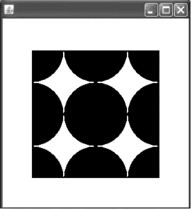

如上所示，现在的绘制被限制在 300 * 300 applet 框架中心的一个 200 * 200 矩形内。

裁剪本身是一项值得了解的知识。当环境需要修复组件的暴露部分时，裁剪也会派上用场。

## 关于 `paint()` 方法和图形上下文的总结

`Graphics` 上下文专门用于单个组件。为了在组件上进行绘制，我们调用图形上下文的 `drawXXXX()` 和 `fillXXXX()` 方法。要更改图形操作的颜色或字体，我们分别调用图形上下文的 `setColor()` 或 `setFont()` 方法。

## GUI 线程与绘制

Java 运行时环境会创建并控制其在后台运行的线程，其中一个线程负责 GUI 管理。

GUI 线程是环境用于接受用户输入事件以及调用需要绘制的组件的 `paint()` 方法的工具。

对 `paint()` 的调用并非都由环境生成。Java 程序当然可以自己调用，直接调用或通过 `repaint()` 方法间接调用。

可以使用组件的图形上下文在组件上进行绘制。在这种方法中，不需要调用 `paint()` 或 `repaint()` 方法。

在组件上进行绘制的不同方法如下：

(i) 获取组件的 `Graphics` 上下文后直接绘制。
(ii) 自发绘制（由 GUI 线程隐式/自动调用 `paint()` 方法）。
(iii) 显式调用 `paint()` 方法。
(iv) 显式调用 `repaint()` 方法，然后由其间接调用 `paint()` 方法。

## 在获取组件的图形上下文后直接绘制

由于可以使用 `getGraphics()` 方法获取组件 `Graphics` 上下文的引用，因此人们很容易认为自己可以从任何方便的方法直接在组件上绘制。通常情况下，这种方法存在严重缺陷。

假设我们有一个 applet，想要在最近一次鼠标点击的位置画一个红点。applet 的其余部分应该是黄色。假设该 applet 正在处理它自己的鼠标事件。我们可能会创建一个如下的事件处理器：

## 示例 19.6

```java
import java.awt.*;
import java.awt.event.*;
class PaintApproach extends Frame implements MouseListener
{
    public static void main (String args[]) {
        PaintApproach f = new PaintApproach ();
        f.setSize (300,300);
        f.addMouseListener(f);
        f.setVisible(true);
    }
    public void mouseEntered (MouseEvent e) { }
    public void mouseExited (MouseEvent e) { }
    public void mousePressed (MouseEvent e) { }
    public void mouseReleased (MouseEvent e) { }
    public void mouseClicked (MouseEvent e) {
        System.out.println ("Mouse Clicked...");
        Graphics g = getGraphics();
        g.setColor(Color.yellow);
        g.fillRect(0,0, getSize().width, getSize().height);
        g.setColor(Color.red);
        g.fillOval(e.getX()-10, e.getY()-10,20,20);
    }
}
```


如果这个 applet 被覆盖并重新暴露，GUI 线程将隐式地调用 `paint()`；遗憾的是，`paint()` 并不知道在 `mouseClicked()` 方法中绘制的红圆，因此红圆不会被修复。

所有绘制操作的正确位置是在 `paint()` 中，或者在从 `paint()` 调用的方法中；这种技术确保了 GUI 线程能够修复暴露带来的损坏。GUI 线程期望 `paint()` 能够在任何任意时刻正确地重建屏幕。

实现这一点的一种可能方法是从事件处理器和其他任意方法中移除所有绘制代码，并将这些代码放入 `paint()` 方法中。接下来，当某个方法需要绘制时，安排它写入描述所需绘制内容的变量，以便这些变量可以被 `paint()` 方法访问并被 `paint()` 方法用于执行绘制。

现在，当 `paint()` 方法被调用时（无论是通过我们的通用方法还是通过 GUI 线程），它都可以绘制原始意图任何内容。

### 自发绘制（由 GUI 线程隐式/自动调用 `paint()` 方法）

“自发绘制”并不是一个正式术语，但当 GUI 线程调用 `paint()` 时就会发生。例如，当组件暴露、applet 启动或窗口恢复时会发生。GUI 线程确保设置为暴露区域的裁剪区域可以确保不会浪费时间去绘制已经是正确颜色的像素。

### 显式调用 `paint()` 方法

如果在 `paint()` 方法以外的方法进行绘制，组件可能不会刷新。如果我们在 GUI 线程调用 `paint()` 方法的同时也显式地调用 `paint()` 方法，那么上一节中的示例将经过修改，使得组件在上述情况下得到刷新。这种发生是因为红点是在 `paint()` 方法中绘制的。

示例 19.7：

```java
import java.awt.*;
import java.awt.event.*;
class PaintApproach1 extends Frame implements MouseListener
{
    int mouseX, mouseY;
    public static void main (String arg[]) {
        PaintApproach1 f = new PaintApproach1();
        f.setSize (300,300);
        f.addMouseListener(f);
        f.setVisible(true);
    }
    public void mouseEntered (MouseEvent e) { }
    public void mouseExited (MouseEvent e) { }
    public void mousePressed (MouseEvent e) { }
    public void mouseReleased (MouseEvent e) { }
    public void mouseClicked (MouseEvent e) {
        System.out.println ("Mouse Clicked...");
        mouseX = e.getX();
        mouseY = e.getY();
        Graphics g = getGraphics();
        paint(g);
    }
    public void paint(Graphics g) {
        g.setColor(Color.yellow);
        g.fillRect(0,0, getSize().width, getSize().height);
        g.setColor(Color.Red);
        g.fillOval(mouseX-10, mouseY-10,20,20);
    }
}
```

```java
public void paint (Graphics g)
{ 
  g.setColor (Color.yellow);
  g.fillRect(0,0, getSize( ).width, getSize( ).height);
  g.setColor(Color.red);
  g.fillOval(mouseX–10,mouseY–10,20,20);
}
```

显式调用 `repaint()` 方法，该方法随后会间接调用 `paint()` 方法：

显式调用 `paint()` 方法可能会导致两个严重问题。

第一个问题是 GUI 线程会在需要的时候随时调用 `paint()` 方法。这发生在需要处理暴露（exposure）时。这可能会导致线程交互问题。

公平地说，我们会发现即使在使用首选的方法，我们可能需要处理这些中的某些问题，因为 `paint()` 方法将使用我们在其他线程中正在修改的数据。然而，如果我们允许 `paint()` 只在 GUI 线程中被调用，就能将问题降到最低。

第二个问题是 CPU 使用率问题。考虑以下场景：我们的程序定期收到通知，要求它用动画的下一帧或类似的连续移动图形更新显示器。

假设绘图是复杂且耗时的。如果我们简单地调用整个 `paint()` 方法，那么当帧触发发生时，我们可能只完成了绘图的一部分。

这将导致我们的程序花费（或尝试花费）其所有时间在绘图上。此外，绘图将进一步落后于它应该的位置。

这些问题可以通过使用首选的处理程序启动绘图的方法简单地解决。该思想是主程序维护一个描述应呈现给用户的绘图的数据集，但不直接调用绘图程序。

相反，程序请求 GUI 线程运行绘图程序，其方式与该线程在处理暴露时的方式大致相同。

GUI 线程使用主程序提供的数据集来决定绘制什么以及如何绘制。

为了支持这种方法，GUI 系统提供了一个名为 `repaint()` 的方法。该方法定义在 `Component` 类中，因此 GUI 中的任何可见对象都可以使用该方法。当我们调用此方法时，我们是在向 GUI 线程发出一个请求，让它执行绘图系统程序。

GUI 线程会在合理的时间范围内执行操作，尽管这可能会受到其他高优先级线程活动的限制。这种方法确保了 GUI 线程与用户线程之间的线程交互降至最低。

自然，我们必须确保在数据处于不一致状态时，GUI 线程永远不会使用我们的数据集。然而，可以使用同步或双缓冲技术很容易地实现这一点。

这种行为的另一个结果是，无论程序尝试进行多少绘图，系统通常保持与当前帧的同步。

这是因为例如，如果我们在 GUI 线程能够处理第一次调用之前，我们调用了十次 `repaint()` 方法，那么结果将是只执行一次绘图系统程序。

因此，在过载的情况下，绘图系统会自动跳过主机 CPU 根本无法处理的帧。这意味着程序员可以编写代码，在给定平台上可靠地获得最佳视频性能，同时在任何其他平台上都能良好地运行。下面的代码实现了这种方案。

### 示例 19.8:

```java
import java.awt.*;
import java.awt.event.*;
public class PaintApproach2 extends Frame implements MouseListener
{ 
  int mouseX, mouseY;
  public static void main (String args [])
  { 
    PaintApproach2 f = new PaintApproach2();
    f.setSize (300,300);
    f.addMouseListener (f);
    f.setVisible(true);
  }
  public void mouseEntered (MouseEvent e) { }
  public void mouseExited (MouseEvent e) { }
  public void mousePressed (MouseEvent e) { }
  public void mouseReleased (MouseEvent e) { }
  public void mouseClicked(MouseEvent e) 
  { 
    System.out.println ("Mouse Clicked ... ");
    mouseX = e.getX ();
    mouseY = e.getY ();
    repaint ();
  }
  public void paint (Graphics g)
  {
    g.setColor (Color.white);
    g.fillRect (0,0,getSize ( ).width, getSize ( ).height);
    g.setColor (Color.yellow);
    g.fillRect(0,0, getSize( ).width, getSize( ).height);
    g.setColor (Color.red);
    g.fillOval(mouseX–10,mouseY–10,20,20);
  }
}
```


# 章节

# ∞ 20 ∞

## (Java.Lang.Object 类)

## 引言

`java.lang` 包中的 `Object` 类是 Java 所有层次结构的根。所有的类都直接或间接地继承 `Object` 类。

即使你写了一个简单的类（即它没有继承任何基类），它也会隐式地继承内置的 `Object` 类。因此，该类的特征适用于所有类。

## Object 类中的方法

`Object` 类定义了以下方法，所有的类都继承了它们：

1. `public int hashCode()`
2. `public boolean equals(Object obj)`
3. `public final Class getClass()`
4. `public String toString()`
5. `protected void finalize() throws Throwable`
6. `protected Object clone() throws CloneNotSupportedException`
7. `public final void wait(long timeout) throws InterruptedException`
8. `public final void wait(long timeout, int nanos) throws InterruptedException`
9. `public final void wait() throws InterruptedException`
10. `public final void notify()`
11. `public final void notifyAll()`

### 1. `public int hashCode()`

在哈希表中存储对象时，可以使用此方法获取对象的哈希值。该值在程序执行期间被保证是一致的。

### 2. `boolean equals(Object obj)`

如果每个对象都被认为是唯一的，那么没有必要重写 `Object` 类的 `equals()` 方法。该方法比较对象的引用是否相等。

### 3. `final Class getClass()`

返回对象的运行时类，该类在运行时由 `java.lang.Class` 类的对象表示。

示例 20.1：以下示例说明了此方法可以用于获取与任何 `java` 对象对应的 `Class` 对象。然后我们可以使用反射/内省使用 `Class` 类的方法来获取有关对象类的信息。`getMethods()` 和 `getFields()` 将仅显示所有公共成员，而 `getDeclaredMethods()` 和 `getDeclaredFields()` 将显示所有成员。

```java
import java.lang.reflect.Method;
import java.lang.reflect.Field;
class DispClassMembers1
{
    public static void main(String args[])
    {
      String s = new String("Hello");
      Class c = s.getClass();
      Method m[] = c.getMethods();
      System.out.println("......Public Methods (" + m.length + ")......");
      for(int i=0; i < m.length; i++)
        System.out.println(m[i]);
      Field f[] = c.getFields();
      System.out.println("......Public Fields (" + f.length + ")......");
      for(int i=0; i< f.length; i++)
        System.out.println(f[i]);
      m = c.getDeclaredMethods();
      System.out.println("......Declared Methods (" + m.length + ")......");
      for(int i=0; i< m.length; i++)
        System.out.println(m[i]);
      f = c.getDeclaredFields();
      System.out.println("......Declared Fields (" + f.length + ")......");
      for(int i=0; i< f.length; i++)
        System.out.println(f[i]);
    }
}
```

输出：

```
......Public Methods (72)......
public int java.lang.String.hashCode()
public int java.lang.String.compareTo(java.lang.String)
public int java.lang.String.compareTo(java.lang.Object)
public int java.lang.String.indexOf(int,int)
public int java.lang.String.indexOf(int)
public int java.lang.String.indexOf(java.lang.String)
public int java.lang.String.indexOf(java.lang.String,int)
public boolean java.lang.String.equals(java.lang.Object)
public String java.lang.String.toString()
public char java.lang.String.charAt(int)
public int java.lang.String.codePointAt(int)
...
```

# 已声明的方法 (70)

- `public int java.lang.String.hashCode()`
- `public int java.lang.String.compareTo(java.lang.String)`
- `public int java.lang.String.compareTo(java.lang.Object)`
- `public int java.lang.String.indexOf(int,int)`
- `public int java.lang.String.indexOf(int)`
- `public int java.lang.String.indexOf(java.lang.String)`
- `public int java.lang.String.indexOf(java.lang.String,int)`
- `static int java.lang.String.indexOf(char[],int,int,char[],int,int,int)`
- `public boolean java.lang.String.equals(java.lang.Object)`
- `public String java.lang.String.toString()`
- `public char java.lang.String.charAt(int)`
- `private static void java.lang.String.checkBounds(byte[],int,int)`
- `public int java.lang.String.codePointAt(int)`
- `public int java.lang.String.codePointBefore(int)`
- `public int java.lang.String.codePointCount(int,int)`
- `public int java.lang.String.compareToIgnoreCase(java.lang.String)`
- `public String java.lang.String.concat(java.lang.String)`
- `public boolean java.lang.String.contains(java.lang.CharSequence)`


# 已声明的方法 (70)

- `public int java.lang.String.hashCode()`
- `public int java.lang.String.compareTo(java.lang.String)`
- `public int java.lang.String.compareTo(java.lang.Object)`
- `public int java.lang.String.indexOf(int, int)`
- `public int java.lang.String.indexOf(int)`
- `public int java.lang.String.indexOf(java.lang.String)`
- `public int java.lang.String.indexOf(java.lang.String, int)`
- `static int java.lang.String.indexOf(char[], int, int, char[], int, int, int)`
- `public boolean java.lang.String.equals(java.lang.Object)`
- `public String java.lang.String.toString()`
- `public char java.lang.String.charAt(int)`
- `private static void java.lang.String.checkBounds(byte[], int, int)`
- `public int java.lang.String.codePointAt(int)`
- `public int java.lang.String.codePointBefore(int)`
- `public int java.lang.String.codePointCount(int, int)`
- `public int java.lang.String.compareToIgnoreCase(java.lang.String)`
- `public String java.lang.String.concat(java.lang.String)`
- `public boolean java.lang.String.contains(java.lang.CharSequence)`
- `public boolean java.lang.String.contentEquals(java.lang.StringBuffer)`
- `public boolean java.lang.String.contentEquals(java.lang.CharSequence)`
- `public static String java.lang.String.copyValueOf(char[])`
- `public static String java.lang.String.copyValueOf(char[], int, int)`
- `public boolean java.lang.String.endsWith(java.lang.String)`
- `public boolean java.lang.String.equalsIgnoreCase(java.lang.String)`
- `public static String java.lang.String.format(java.lang.String, java.lang.Object[])`
- `public static String java.lang.String.format(java.util.Locale, java.lang.String, java.lang.Object[])`
- `public byte[] java.lang.String.getBytes()`
- `public byte[] java.lang.String.getBytes(java.nio.charset.Charset)`
- `public byte[] java.lang.String.getBytes(java.lang.String) throws java.io.UnsupportedEncodingException`
- `public void java.lang.String.getBytes(int, int, byte[])`
- `public void java.lang.String.getChars(char[])`
- `public void java.lang.String.getChars(int, int, char[])`
- `public native String java.lang.String.intern()`
- `public boolean java.lang.String.isEmpty()`
- `public int java.lang.String.lastIndexOf(int)`
- `public int java.lang.String.lastIndexOf(java.lang.String)`
- `public int java.lang.String.lastIndexOf(java.lang.String, int)`
- `public int java.lang.String.lastIndexOf(int, int)`
- `static int java.lang.String.lastIndexOf(char[], int, int, char[], int, int, int)`
- `public int java.lang.String.length()`
- `public boolean java.lang.String.matches(java.lang.String)`
- `public int java.lang.String.offsetByPoints(int, int)`
- `public boolean java.lang.String.regionMatches(boolean, int, java.lang.String, int, int)`
- `public boolean java.lang.String.regionMatches(int, java.lang.String, int, int)`
- `public String java.lang.String.replace(java.lang.CharSequence, java.lang.CharSequence)`
- `public String java.lang.String.replace(char, char)`
- `public String java.lang.String.replaceAll(java.lang.String, java.lang.String)`
- `public String java.lang.String.replaceFirst(java.lang.String, java.lang.String)`
- `public String[] java.lang.String.split(java.lang.String, int)`
- `public String[] java.lang.String.split(java.lang.String)`
- `public boolean java.lang.String.startsWith(java.lang.String, int)`
- `public boolean java.lang.String.startsWith(java.lang.String)`
- `public CharSequence java.lang.String.subSequence(int, int)`
- `public String java.lang.String.substring(int, int)`
- `public String java.lang.String.substring(int)`
- `public char[] java.lang.String.toCharArray()`
- `public String java.lang.String.toLowerCase()`
- `public String java.lang.String.toLowerCase(java.util.Locale)`
- `public String java.lang.String.toUpperCase()`
- `public String java.lang.String.toUpperCase(java.util.Locale)`
- `public String java.lang.String.trim()`
- `public static String java.lang.String.valueOf(boolean)`
- `public static String java.lang.String.valueOf(char[], int, int)`
- `public static String java.lang.String.valueOf(int)`
- `public static String java.lang.String.valueOf(long)`
- `public static String java.lang.String.valueOf(float)`
- `public static String java.lang.String.valueOf(double)`
- `public static String java.lang.String.valueOf(char[])`
- `public static String java.lang.String.valueOf(java.lang.Object)`
- `public static String java.lang.String.valueOf(char)`

# 已声明字段 (7)

- `private final char[] java.lang.String.value`
- `private final int java.lang.String.offset`
- `private final int java.lang.String.count`
- `private int java.lang.String.hash`
- `private static final long java.lang.String.serialVersionUID`
- `private static final ObjectStream[] java.lang.String`
- `public static String java.lang.String.replace(char, char)` (注：此处原文在字段处似乎有重复或笔误，已按要求保留翻译)


## String 类方法列表

- `public String java.lang.String java.lang.String.substring(int,int)`
- `public String java.lang.String java.lang.String.substring(int)`
- `public char[] java.lang.String.toCharArray()`
- `public String java.lang.String java.lang.String.toLowerCase()`
- `public String java.lang.String java.lang.String.toLowerCase(java.util.Locale)`
- `public String java.lang.String java.lang.String.toUpperCase()`
- `public String java.lang.String java.lang.String.toUpperCase(java.util.Locale)`
- `public String java.lang.String java.lang.String.trim()`
- `public static String java.lang.String java.lang.String.valueOf(boolean)`
- `public static String java.lang.String java.lang.String.valueOf(char[],int,int)`
- `public static String java.lang.String java.lang.String.valueOf(int)`
- `public static String java.lang.String java.lang.String.valueOf(long)`
- `public static String java.lang.String java.lang.String.valueOf(float)`
- `public static String java.lang.String java.lang.String.valueOf(double)`
- `public static String java.lang.String java.lang.String.valueOf(char[])`
- `public static String java.lang.String java.lang.String.valueOf(java.lang.Object)`
- `public static String java.lang.String java.lang.String.valueOf(char)`

## 已声明字段 (7)

- `private final char[] java.lang.String.value`
- `private final int java.lang.String.offset`
- `private final int java.lang.String.count`
- `private int java.lang.String.hash`
- `private static final long java.lang.String.serialVersionUID`
- `private static final ObjectStream[] java.lang.String`
- `public static String java.lang.String java.lang.String.replace(char,char)`

# Java 反射 (Reflection)

- Java 反射允许程序在运行时检查或操作其自身的结构。
- 你可以使用反射获取类、构造器、字段和方法，并可以使用反射调用它们。

```java
import java.lang.reflect.Field;
import java.lang.reflect.Method;
import java.lang.reflect.Constructor;

public class ReflectionExample {
    public static void main(String[] args) throws Exception {
        Class<?> clazz = String.class;
        System.out.println("Class Name: " + clazz.getName());

        // 获取字段
        Field field = clazz.getDeclaredField("value");
        field.setAccessible(true);
        System.out.println("Field value: " + field.get("hello"));

        // 获取并调用方法
        Method method = clazz.getMethod("toUpperCase");
        Object result = method.invoke("hello world");
        System.out.println("Result of toUpperCaseCase: " + result);
    }
}
```

# 注解 (Annotations)

- 注解是关于数据的数据，它们提供了关于程序中的元数据。
- 注解可以标记在类、方法、字段、参数或类型上。

```java
import java.lang.annotation.*;

@Retention(RetentionPolicy.RUNTIME)
@Target(ElementType.METHOD)
@interface MyAnnotation {
    String value() default "default";
    int count() default 1;
}

class AnnotationExample {
    @MyAnnotation(value = "Hello", count = 5)
    public void sayHello() {
        System.out.println("Hello World");
    }

    public static void main(String[] args) throws Exception {
        for (Method method : AnnotationExample.class.getDeclaredMethods()) {
            if (method.isAnnotationPresent(MyAnnotation.class)) {
                MyAnnotation annotation = method.getAnnotation(MyAnnotation.class);
                System.out.println("Annotation value: " + annotation.value());
                System.out.println("Count: " + annotation.count());
            }
        }
    }
}
```

# 泛型 (Generics)

- 泛型允许在定义类、接口和方法时使用类型参数。
- 它们提供了编译时的类型安全并减少了显式的类型转换。

```java
import java.util.ArrayList;

class Box<T> {
    private T content;

    public void set(T content) {
        this.content = content;
    }

    public T get() {
        return content; // 无需强制类型转换
    }
}

public class GenericsExample {
    public static void main(String[] args) {
        Box<Integer> intBox = new Box<>();
        intBox.set(10);
        System.out.println("Integer Value: " + intBox.get());

        Box<String> stringBox = new Box<>();
        stringBox.set("Java");
        System.out.println("String Value: " + stringBox.get());
    }
}
```

```java
18. String s="Box b:" + b; // 拼接箱对象并调用 toString() 方法
19. System.out.println(b); // 调用 toString() 方法
20. System.out.println(s);
21. }
22. }
```

**Output:**

```
Dimension are 8.0 by 11.0 by 13.0
Box b: Dimension are 8.0 by 11.0 by 13.0
```

### `protected void finalize() throws Throwable`

该方法在对象被垃圾回收之前被调用，以便完成任何清理工作。然而，`Object` 类中的默认 `finalize()` 方法没有做任何有用的操作。这对于释放非 Java 资源可能有用，但不推荐这样做。如果内存充足，`finalize()` 方法可能永远不会被调用，在这种情况下资源可能永远不会被释放。

### `protected Object clone() throws CloneNotSupportedException`

通过 `clone()` 方法可以创建与当前对象完全相同（即具有相同状态）的新对象，即复制原始类型值和引用值，这被称为**浅克隆**（shallow cloning）。

类可以重写 `clone()` 方法以提供其自己的克隆逻辑。例如，通过递归地克隆组成对象来克隆复合对象，被称为**深克隆**（deep cloning）。在重写时，子类中的方法通常声明为 `public`，以允许任何客户端克隆该类的对象。

如果重写 `clone()` 方法依赖于 `Object` 类的 `clone()` 方法，则子类必须实现 `Cloneable` 标记接口，以指示其对象可以安全地克隆。否则，`Object` 类的 `clone()` 方法将抛出异常 `CloneNotSupportedException`。

## 使用 `clone()` 和 `Cloneable` 接口

`clone()` 方法会为被调用的对象生成一个副本。以下是关于 `clone()` 方法的一些重要事实：

- 只有实现了 `Cloneable` 接口的类才能被克隆。`Cloneable` 接口没有定义任何成员。它用于指示一个类允许对对象进行位拷贝（即克隆）。
- 如果尝试对未实现 `Cloneable` 接口的对象调用 `clone()`，将抛出 `CloneNotSupportedException`。
- `Cloneable` 接口是一个空接口。这种接口被称为标记接口（marker/tag interface）。在创建克隆时，不会调用被克隆对象的构造函数。
- 克隆仅仅是原始对象的完全复制。克隆是一个潜在的危险操作，因为它可能导致意外之外的副作用。

例如，如果被克隆的对象包含一个名为 `objRef` 的引用变量，那么在创建克隆时，克隆中的 `objRef` 将指向与原始对象 `objRef` 相同的对象。如果克隆修改了 `objRef` 所指向对象的内容，原始对象的内容也会随之改变。

### 示例 20.5

以下示例演示了 `clone()` 方法的使用。`CloneDemo1` 类通过 `clone2()` 方法间接调用 `clone()` 方法，为 `TestClone1` 类的对象创建克隆。

```java
class TestClone1 implements Cloneable
{
    int a;
    float b;
    public TestClone1 clone2() throws CloneNotSupportedException
    {
        return (TestClone1) clone();
    }
}
class CloneDemo1
{
    public static void main(String a[]) throws CloneNotSupportedException
    {
        TestClone1 tc1 = new TestClone1();
        TestClone1 tc2;
        tc1.a = 8; tc1.b = 4.5f;
        tc2 = tc1.clone2();
        System.out.println(tc2.a);
        System.out.println(tc2.b);
    }
}
```

**Output:**

```
8
4.5
```

在这里，`clone2()` 方法调用 `Object` 类的 `clone()` 方法并返回结果。注意，`clone()` 返回的对象必须强制转换为相应的类型，即 `TestClone1`。

### 示例 20.6

在以下示例中，重写了 `clone()` 方法以便从类外部代码调用。为了实现这一点，其访问修饰符必须是 `public`。

```java
class TestClone2 implements Cloneable
{
    int a;
    float b;
    public Object clone() throws CloneNotSupportedException
    {
        return super.clone();
    }
}
class CloneDemo2
{
    public static void main(String args[]) throws CloneNotSupportedException
    {
        TestClone2 tc1 = new TestClone2();
        TestClone2 tc2;
        tc1.a = 8; tc1.b = 4.5f;
        tc2 = (TestClone2) tc1.clone();
        System.out.println(tc2.a + " " + tc2.b);
    }
}
```

**Output:**

```
8 , 4.5
```

### 示例 20.7

在以下示例中，重写了 `clone()` 方法，使其不使用 `Object` 类的 `clone()` 方法。我们正在编写自己的 `clone()` 方法。

```java
class TestClone3
{
    int a;
    float b;
    public Object clone()
    {
        TestClone3 tc = new TestClone3();
        tc.a = this.a;
        tc.b = this.b;
        return tc;
    }
}
class CloneDemo3
{
    public static void main(String args[])
    {
        TestClone3 tc1 = new TestClone3();
        tc1.a = 8;
        tc1.b = 4.5f;
        TestClone3 tc2 = (TestClone3) tc1.clone();
        System.out.println(tc2.a + " " + tc2.b);
    }
}
```

**Output:**

```
8 , 4.5
```

### 示例 20.9

以下代码通过实现深克隆消除了上一个示例中的问题。


```java
class TestDeepClone implements Cloneable
{
    int a;
    float b;
    int c[];
    public Object clone() throws CloneNotSupportedException
    {
        TestDeepClone tc = (TestDeepClone)super.clone();
        int d[] = new int[4];
        for(int i=0; i<4; i++)
            d[i] = c[i];
        tc.c = d; 
        return (tc);
    }
}
class DeepCloneDemo
{
    public static void main(String arg[]) throws CloneNotSupportedException
    {
        TestDeepClone tc1 = new TestDeepClone();
        TestDeepClone tc2;
        tc1.a = 8;
        tc1.b = 4.5;
        int c[] = new int[4];
        for(int i=0; i<4; i++)
            c[i] = i;
        tc1.c = c;
        tc2 = (TestDeepClone) tc1.clone();
        tc2.c[0] = 99; // 修改克隆对象不影响原始对象
        System.out.println(tc1.c[0]); // 输出应为 0
    }
}
```

```java
System.out.println("tc1.c["+ i +"]=" + tc1.c[i]);
tc2 = (TestDeepClone) tc1.clone();
System.out.println("tc2.a"+tc2.a);
System.out.println("tc2.b"+tc2.b);
for(int i=0; i<4; i++)
    System.out.println("tc2.c[" + i + "]=" + tc2.c[i]);
for(int i=0; i<4; i++)
    tc2.c[i] = i+4;
for(int i=0; i<4; i++)
    System.out.println("tc2.c[" + i + "]=" + tc2.c[i]);
for(int i=0; i<4; i++)
    System.out.println("tc1.c[" + i + "]=" + tc1.c[i]);
```

**输出:**

```
tc1.c[0]=0
tc1.c[1]=1
tc1.c[2]=2
tc1.c[3]=3
tc2.a=8
tc2.b=4.5
tc2.c[0]=0
tc2.c[1]=1
tc2.c[2]=2
tc2.c[3]=3
tc2.c[0]=4
tc2.c[1]=5
tc2.c[2]=6
tc2.c[3]=7
tc1.c[0]=0
tc1.c[1]=1 own
```

### 多线程环境中的有用方法

除了上述讨论的方法外，`Object` 类通过以下方法为同步代码中的线程通信提供了支持：导致当前线程等待，直到另一个线程对该对象调用 `notify()` 方法或 `notifyAll()` 方法。

*   `final void wait(long timeout) throws InterruptedException`
*   `final void wait(long timeout, long nanos) throws InterruptedException`

    导致当前线程等待，直到另一个线程调用了该对象的 `notify()` 方法或 `notifyAll()` 方法，或者其他线程中断了当前线程，或者指定的时间已过。

*   `final void notify()`

    唤醒等待在该对象监视器上的单个线程。

*   `final void notifyAll()`

    唤醒所有等待在该对象监视器上的线程。线程通过调用其中一个 `wait` 方法在对象的监视器上等待。

线程在它持有的锁对象上调用这些方法。线程等待另一个线程的通知。

# 章

# ∞ 21 ∞

## (集合框架)

## 引言

Java 集合框架标准化了程序处理对象组的方式。在 Java2 之前，Java 提供了 `Vector`、`Stack`、`Dictionary`、`Hashtable` 和 `Properties` 等临时类来存储和操作对象组。

尽管这些类非常有用，但它们缺乏一个中央统一的主题。使用 `Vector` 的方式与使用 `Properties` 类的方式不同。而且，之前的临时方法并不是为了易于扩展或适应而设计的。集合（Collections）是对这些（以及其他）问题的答案。

集合框架的设计考虑了以下目标：

*   框架必须是高性能的。基础集合（动态数组、链表、树和哈希表）的实现是非常高效的。
*   框架必须允许不同类型的集合以类似的方式工作，并具有高度的互操作性。
*   扩展和/或适应某个集合应当是容易的。

为了实现上述目标，集合框架设计了以下特性：

*   整个集合框架是围绕一组标准接口设计的。提供了这些接口的若干种标准实现。我们也可以实现自己的集合。
*   集合框架创建的另一个项目是 `Iterator` 接口。`Iterator` 为你提供了一种通用的、标准化的方法来逐个访问集合中的元素。
*   因此，`Iterator` 提供了一种遍历集合内容的方法。因为每个集合都实现了 `Iterator`，所以任何集合类的元素都可以通过 `Iterator` 定义的方法进行访问。通过只需微小的更改，用于循环集合的代码也可以用于循环列表，例如。
*   除了集合，框架还定义了几个 map 接口和类。`Maps` 存储键/值对。虽然 maps 在术语意义上不是“集合”，但它们与集合完全集成。

## RandomAccess 接口

这是一个由 `List` 实现类使用的标记接口，用于指示它们支持随机访问。`ArrayList` 和 `Vector` 实现了此接口。

## Comparator 接口

`Comparators` 用于控制某些数据结构（如 `TreeSet` 或 `TreeMap`）的顺序。

### 方法

| 返回值 | 说明 |
| :--- | :--- |
| `int` | `compare(Object o1, Object o2)` 比较其两个参数的顺序。 |
| `boolean` | `equals(Object obj)` 表示其他某个对象是否“等于”此 `Comparator`。 |

## Collection 接口

集合接口是集合框架构建的基础。它声明了所有集合都将具有的核心方法。由于所有集合都实现了 `Collection`，因此熟悉这些方法对于清晰理解该框架是必要的。某些方法可能会抛出 `UnsupportedOperationException`。当一个对象与另一个对象不兼容时（例如尝试向集合添加不兼容的对象），会产生 `ClassCastException`。

### Collection 接口中的方法

| 返回值 | 说明 |
| :--- | :--- |
| `boolean` | `add(Object obj)` 确保此集合包含指定的元素（可选操作）。将对象添加到调用者的集合中。如果元素 `obj` 已添加到集合中，则返回 true。如果元素 `obj` 已经是集合的成员且集合不允许重复，则返回 false。 |
| `boolean` | `addAll(Collection c)` 将指定集合中的所有元素添加到此集合中（可选操作）。 |
| `void` | `clear()` 移除此集合中的所有元素（可选操作）。 |
| `boolean` | `contains(Object o)` 如果此集合包含指定的元素，则返回 true。 |
| `boolean` | `containsAll(Collection c)` 如果此集合包含指定集合中的所有元素，则返回 true。 |
| `boolean` | `equals(Object o)` 将指定对象与此集合进行等性比较。 |
| `int` | `hashCode()` 返回此集合的哈希值。 |
| `boolean` | `isEmpty()` 如果此集合不包含任何元素，则返回 true。 |
| `Iterator` | `iterator()` 返回一个用于遍历集合元素的迭代器。 |
| `boolean` | `remove(Object o)` 如果此集合存在指定的元素，则从集合中移除该元素的单个实例（可选操作）。 |
| `boolean` | `removeAll(Collection c)` 移除所有包含在指定集合中的元素（可选操作）。 |
| `boolean` | `retainAll(Collection c)` 保留此集合中包含在指定集合中的元素（可选操作）。 |
| `int` | `size()` 返回集合中的元素数量。 |
| `Object[]` | `toArray()` 返回包含此集合所有元素的数组。 |

可以通过调用 `equals()` 方法比较两个集合的等性。“等性”的精确含义可能根据集合的不同而异。

例如，你可以实现 `equals()`，以便其比较集合中存储的元素的值。或者，`equals()` 比较这些元素的引用。

## List 接口

列表是一种有序的元素集合，也称为序列。`List` 接口扩展了 `Collection` 并声明了存储元素序列的集合的行为。

可以通过在列表中的位置（使用从零开始的索引）插入或访问元素。列表可以包含重复元素。除了 `Collection` 定义的方法外，`List` 还定义了一些自己的方法。

### List 接口中的方法

| 返回值 | 说明 |
| :--- | :--- |


# List 接口方法

| 返回值 | 方法 | 说明 |
| :--- | :--- | :--- |
| boolean | `add(Object o)` | 将指定的元素添加到此列表的末尾（可选操作）。该方法在 `Collection` 接口中定义，但作为 `List` 接口的一部分，它应该实现为始终将元素添加到列表末尾。 |
| void | `add(int index, Object element)` | 将指定的元素插入此列表的指定位置（可选操作）。插入点或插入点之后的任何先存在的元素都会向前移动。因此，没有元素被覆盖。 |
| boolean | `addAll(Collection c)` | 将指定集合中的所有元素添加到此列表的末尾，顺序按照指定集合迭代器返回的顺序（可选操作）。该方法在 `Collection` 接口中定义，但作为 `List` 接口的一部分，它应该实现为始终将元素添加到列表末尾。 |
| boolean | `addAll(int index, Collection c)` | 将指定集合中的所有元素插入到此列表的指定位置（可选操作）。如果调用者的列表发生变化则返回 true，否则返回 false。 |
| Object | `get(int index)` | 返回此列表中指定位置的元素。 |
| int | `indexOf(Object o)` | 返回指定元素在列表中第一次位置的索引，如果列表不包含该元素，则返回 -1。 |
| int | `lastIndexOf(Object o)` | 返回指定元素在列表中最后一次位置的索引，如果列表不包含该元素，则返回 -1。 |
| ListIterator | `iterator()` | 返回一个用于遍历此列表元素的列表迭代器（按正确顺序）。 |
| ListIterator | `iterator(int index)` | 返回一个从此列表指定位置开始的列表元素迭代器。 |
| Object | `remove(int index)` | 移除指定位置的元素（可选操作）并返回被删除的元素。结果列表将压缩。也就是说，后续元素的索引减一。 |
| Object | `set(int index, Object element)` | 用指定的元素替换此列表中指定位置的元素（可选操作）。 |
| List | `subList(int fromIndex, int toIndex)` | 返回一个包含从 `fromIndex` 到 `toIndex-1` 元素的列表。返回列表元素也被调用者引用。 |

> **注意**：如果集合不可修改，这些方法中的某些将抛出 `UnsupportedOperationException`；当对象与集合不兼容时，会产生 `ClassCastException`。

`Collection` 定义的 `add(Object o)` 和 `addAll(Collection c)` 方法的语义被 `List` 修改，以便将元素添加到列表末尾。

# Set 接口

`Set` 接口定义了一个集合。它扩展了 `Collection` 并声明了不允许重复元素的集合的行为。

因此，当尝试向集合添加重复元素时，`add()` 方法返回 false。它没有定义任何自己的方法。

# SortedSet 接口

`SortedSet` 接口扩展了 `Set` 并声明了按升序排序的集合的行为。

| 返回值 | 方法 | 说明 |
| :--- | :--- | :--- |
| Comparator | `comparator()` | 返回与此排序集合关联的比较器，如果使用元素的自然排序，则返回 null。 |
| Object | `first()` | 返回此排序集合中的第一个元素。 |
| SortedSet | `headSet(Object toElement)` | 返回此排序集合中元素严格小于 `toElement` 的部分的视图。 |
| Object | `last()` | 返回此排序集合中的最后一个元素。 |
| SortedSet | `subSet(Object fromElement, Object toElement)` | 返回此排序集合中范围从 `fromElement`（包含）到 `toElement`（不包含）的元素的视图。 |
| SortedSet | `tailSet(Object fromElement)` | 返回此排序集合中元素大于或等于 `fromElement` 的部分的视图。 |

> 当调用的集合不包含 `items` 数组时，某些方法会抛出 `NoSuchElementException`。当对象与集合中的元素不兼容时，会抛出 `ClassCastException`。如果尝试使用 null 对象且集合不允许 null，则会抛出 `NullPointerException`。

# 集合类

某些集合类提供了完整的实现，可以直接使用。另一些是抽象的，提供了骨架实现，作为创建具体集合的起点。

没有任何集合类是同步版本。

标准集合类有：

| 类 | 描述 |
| :--- | :--- |
| `AbstractCollection` | 实现了 `Collection` 接口的大部分。 |
| `AbstractList` | 继承 `AbstractCollection` 并实现了 `List` 接口的大部分。 |
| `AbstractSequentialList` | 继承 `AbstractList`，用于使用顺序访问而非随机访问元素的集合。 |
| `AbstractSet` | 继承 `AbstractCollection` 并实现了 `Set` 接口。 |
| `LinkedList` | 通过继承 `AbstractSequentialList` 实现链表。 |
| `ArrayList` | 通过继承 `AbstractList` 实现动态数组。它使用元素的随机访问。 |
| `HashSet` | 继承 `AbstractSet` 用于哈希表。 |
| `LinkedHashSet` | 继承 `HashSet` 以允许按插入顺序迭代。 |
| `TreeSet` | 继承 `AbstractSet` 并实现 `SortedSet` 接口。它使用二叉搜索树按排序存储元素。 |

> **注意**：除了集合类外，一些遗留类（如 `Vector`、`Stack`、`Hashtable`）已重构以支持集合。

# 通过 Iterator 和 ListIterator 访问集合

通常，你想遍历集合中的元素。到目前为止，最简单的方法是使用迭代器，即一个实现了 `Iterator` 或 `ListIterator` 接口的对象。

`Iterator` 允许你通过遍历集合来获取或移除元素。`ListIterator` 扩展了 `Iterator`，允许对列表进行双向遍历并修改元素。

在通过迭代器访问集合之前，你必须先获取它。每个集合类都提供一个 `iterator()` 方法，返回一个指向集合起始位置的迭代器。通过使用该迭代器对象，你可以一次访问集合中的每个元素。

对于实现 `List` 的集合，你也可以通过调用 `ListIterator` 获取迭代器。列表迭代器允许你正向或反向方向访问集合，并且你可以修改元素。否则，`ListIterator` 的用法与 `Iterator` 一致。

# ArrayList 类

`ArrayList` 类继承自 `AbstractList` 并实现了 `List` 接口。`ArrayList` 支持可以根据需要增长的动态数组。在 Java 中，标准数组的长度是固定的。

数组在创建后，它们不能增长或缩小，这意味着我们必须预先知道数组将包含多少个元素。但有时，在运行期间我们不知道数组的大小。为了处理这种情况，集合框架定义了 `ArrayList`。

`ArrayList` 是一个对象引用的变长数组，也就是说，`ArrayList` 的大小可以动态增加或减少。数组列表是用初始大小创建的。

当超过容量时，集合会自动扩大；当对象被移除时，数组可能会缩小。使用 J2SE 5 引入的泛型功能，可以限制添加到 `ArrayList` 中的元素类型。

> **注意**：遗留类 `Vector` 也支持动态数组。

# ArrayList 类的构造函数与方法

| 方法 | 描述 |
| :--- | :--- |
| `public ArrayList(int capacity)` | 构建一个具有指定初始容量的空列表。当元素被添加到数组列表中时，容量会自动增长。 |
| `public ArrayList()` | 构建一个初始容量为 10 的空列表。 |
| `public ArrayList(Collection c)` | 构建一个包含指定集合元素的列表。按照元素被集合 `Iterator` 返回的顺序排列。 |
| `public void trimToSize()` | 反之，如果我们想减小 `ArrayList` 对象的底层数组的大小，使其恰好等于它当前持有的项目数量，可以调用 `trimToSize()` 方法。 |
| `public void ensureCapacity(int capacity)` | 虽然 `ArrayList` 对象的容量会随着存储对象的增加而自动增加，但我们可以通过调用 `ensureCapacity()` 方法手动增加 `ArrayList` 对象的容量。通过在开始时增加一次容量，可以防止后续的多次重新分配。因为重新分配在时间上是昂贵的，防止不必要的重新分配可以提高性能。 |
| `public int size()` | 返回列表中的元素数量。 |
| `public boolean isEmpty()` | 如果列表不包含元素，则返回 true。 |
| `public Object clone()` | 返回此 `ArrayList` 实例的浅表副本。 |
| `public Object[] toArray()` | 在处理 `ArrayList` 时从 `ArrayList` 获取数组，我们有时想要获得一个包含列表内容的实际数组。我们可以通过调用 `toArray()` 方法来实现。我们可能想要将集合转换为数组的原因有几个，例如：<br>- 为某些操作操作获得更快的处理速度。<br>- 将数组传递给没有重载以接受集合的方法。<br>- 将我们较新的基于集合的代码与不理解集合的遗留代码集成。 |
| `public Object[] toArray(Object[] a)` | 返回一个包含此列表中所有元素的数组，其运行时类型是指定数组的类型。 |
| `public Object get(int index)` | 返回此列表中指定位置的元素。 |
| `public Object set(int index, Object o)` | 用指定元素替换此列表中指定位置的元素。 |
| `public boolean add(Object o)` | 将指定的元素添加到此列表的末尾。 |
| `public void add(int index, Object o)` | 在此列表的指定位置插入指定的元素。 |
| `public Object remove(int index)` | 移除此列表中指定位置的元素。 |
| `public boolean remove(Object o)` | 移除此列表中首次出现的指定元素（如果存在）。 |
| `public void clear()` | 移除此列表中的所有元素。 |
| `public boolean addAll(Collection c)` | 将指定集合中的所有元素添加到此列表的末尾。 |
| `public boolean addAll(int index, Collection c)` | 将指定集合中的所有元素插入到此列表的指定位置。 |
| `public boolean contains(Object o)` | 如果此列表包含指定元素，则返回 true。 |
| `public int indexOf(Object o)` | 返回此列表中首次出现指定元素的索引，如果不包含则返回 -1。 |
| `public int lastIndexOf(Object o)` | 返回此列表中最后一次出现指定元素的索引，如果不包含则返回 -1。 |
| `public boolean containsAll(Collection c)` | 如果此列表包含指定集合的所有元素，则返回 true。 |

## 示例 2.1


```java
import java.util.*;

public class ArrayListTest {
    public static void main(String[] args) {
        ArrayList<String> list1 = new ArrayList<>();
        list1.add("A");
        list1.add("B");
        list1.add("C");
        System.out.println("Content of list1: " + list1);
        list1.remove("B");
        System.out.println("list1 after removing 'B': " + list1);
        list1.add("D");
        System.out.println("list1 after adding 'D': " + list1);
        System.out.println("Size of list1: " + list1.size());
        System.out.println("Does list1 contain 'B'? " + list1.contains("B"));
        System.out.println("Index of 'C': " + list1.indexOf("C"));
        System.out.println("Index of 'D': " + list1.indexOf("D"));
        list1.clear();
        System.out.println("list1 after clear: " + list1);

        ArrayList<Integer> list2 = new ArrayList<>();
        list2.add(1);
        list2.add(2);
        list2.add(3);
        System.out.println("Content of list2: " + list2);
        list2.remove(1);
        System.out.println("list2 after removing index 1: " + list2);
        list2.add(4);
        System.out.println("list2 after adding 4: " + list2);
        System.out.println("Size of list2: " + list2.size());
        System.out.println("Does list2 contain 2? " + list2.contains(2));
        System.out.println("Index of 3: " + list2.indexOf(3));
        System.out.println("Index of 4: " + list2.indexOf(4));
        list2.clear();
        System.out.println("list2 after clear: " + list2);

        ArrayList<String> list3 = new ArrayList<>();
        list3.add("A");
        list3.add("B");
        list3.add("C");
        System.out.println("Content of list3: " + list3);
        list3.remove(0);
        System.out.println("list3 after removing index 0: " + list3);
        list3.add("D");
        System.out.println("list3 after adding 'D': " + list3);
        System.out.println("Size of list3: " + list3.size());
        System.out.println("Does list3 contain 'A'? " + list3.contains("A"));
        System.out.println("Index of 'C': " + list3.indexOf("C"));
        System.out.println("Index of 'D': " + list3.indexOf("D"));
        list3.clear();
        System.out.println("list3 after clear: " + list3);

        ArrayList<Integer> list4 = new ArrayList<>();
        list4.add(1);
        list4.add(2);
        list4.add(3);
        System.out.println("Content of list4: " + list4);
        list4.remove(1);
        System.out.println("list4 after removing index 1: " + list4);
        list4.add(4);
        System.out.println("list4 after adding 4: " + list4);
        System.out.println("Size of list4: " + list4.size());
        System.out.println("Does list4 contain 2? " + list4.contains(2));
        System.out.println("Index of 3: " + list4.indexOf(3));
        System.out.println("Index of 4: " + list4.indexOf(4));
        list4.clear();
        System.out.println("list4 after clear: " + list4);

        ArrayList<String> list5 = new ArrayList<>();
        list5.add("A");
        list5.add("B");
        list5.add("C");
        System.out.println("Content of list5: " + list5);
        list5.remove(0);
        System.out.println("list5 after removing index 0: " + list5);
        list5.add("D");
        System.out.println("list5 after adding 'D': " + list5);
        System.out.println("Size of list5: " + list5.size());
        System.out.println("Does list5 contain 'A'? " + list5.contains("A"));
        System.out.println("Index of 'C': " + list5.indexOf("C"));
        System.out.println("Index of 'D': " + list5.indexOf("D"));
        list5.clear();
        System.out.println("list5 after clear: " + list5);

        ArrayList<Integer> list6 = new ArrayList<>();
        list6.add(1);
        list6.add(2);
        list6.add(3);
        System.out.println("Content of list6: " + list6);
        list6.remove(1);
        System.out.println("list6 after removing index 1: " + list6);
        list6.add(4);
        System.out.println("list6 after adding 4: " + list6);
        System.out.println("Size of list6: " + list6.size());
        System.out.println("Does list6 contain 2? " + list6.contains(2));
        System.out.println("Index of 3: " + list6.indexOf(3));
        System.out.println("Index of 4: " + list6.indexOf(4));
        list6.clear();
        System.out.println("list6 after clear: " + list6);

        // Using Iterator
        ArrayList<String> list = new ArrayList<>();
        list.add("Apple");
        list.add("Banana");
        list.add("Cherry");
        System.out.println("Content of list: " + list);
        list.remove("Banana");
        System.out.println("list after removing 'Banana': " + list);
        list.add("Date");
        System.out.println("list after adding 'Date': " + list);
        System.out.println("Size of list: " + list.size());
        System.out.println("Does list contain 'Banana'? " + list.contains("Banana"));
        System.out.println("Index of 'Cherry': " + list.indexOf("Cherry"));
        System.out.println("Index of 'Date': " + list.indexOf("Date"));
        list.clear();
        System.out.println("list after clear: " + list);

        // Using ListIterator
        ArrayList<Integer> numbers = new ArrayList<>();
        numbers.add(1);
        numbers.add(2);
        numbers.add(3);
        System.out.println("Content of numbers: " + numbers);
        ListIterator<Integer> it = numbers.listIterator();
        while (it.hasNext()) {
            System.out.println(it.next());
        }
        it.hasPrevious();
        it.add(0);
        System.out.println("numbers after adding 0 at start: " + numbers);
        it.hasPrevious();
        while (it.hasPrevious()) {
            System.out.println(it.previous());
        }
    }
}
```

```java
65. Integer element = litr.next();
66. litr.set(element + 10);
67. }

// 倒序打印列表只有在到达末尾后才能生效。
while(litr.hasPrevious()) {
    Integer element = litr.previous();
    System.out.print(element + " ");
}
System.out.println();
System.out.println("使用 for each 循环的 a3 内容");
for(int i : a3) // 自动拆箱
    System.out.print(i + " ");
System.out.println();

Integer ia[] = new Integer[a3.size()];
a3.toArray(ia);
int sum= 0;
for(int i=0; i<ia.length; i++)
    sum = sum + ia[i].intValue();
System.out.println("Sum is " + sum);
a3.trimToSize();
}
}
```

### 输出

```
Initial size of a1 : 0
Size of a1 after additions: 6
Contents of a1 : [A, B, C, 56, E, F]
Size of a1 after deletions: 4
Content of a1 [A, B, 56, E]
Contents of a2 : [A, B, C, D, E]
[A, B, C, E]
[B, C, E]
[]
Contents of a3 : [1, 2, 3, 4]
1 2 3 4
1 2 3 4
Contents of a3 using iterator:
1 2 3 4
14 13 12 11
Contents of a3 using for each loop
11 12 13 14
Sum is 50
```

## `LinkedList` 类

`LinkedList` 类继承自 `AbstractSequentialList` 并实现了 `List` 接口。它提供了一个链表数据结构。

## 构造函数与方法

| 方法 | 说明 |
| :--- | :--- |
| `public LinkedList()` | 构建一个空列表。 |
| `public LinkedList(Collection c)` | 构建一个包含指定集合元素的列表，顺序按照集合的 `Iterator` 返回的顺序排列。 |
| `public Object getFirst()` | 返回第一个元素。 |
| `public Object getLast()` | 返回最后一个元素。 |
| `public Object removeFirst()` | 移除并返回第一个元素。 |
| `public Object removeLast()` | 移除并返回最后一个元素。 |
| `public void addFirst(Object o)` | 将元素添加到开头。 |
| `public void addLast(Object o)` | 将元素添加到末尾。 |
| `public boolean contains(Object o)` | 检查列表是否包含指定元素。 |
| `public int size()` | 返回元素的数量。 |
| `public boolean add(Object o)` | 末尾添加元素。 |
| `public boolean remove(Object o)` | 移除第一次出现的元素。 |
| `public boolean addAll(Collection c)` | 添加集合中的所有元素。 |
| `public boolean addAll(int index, Collection c)` | 在指定的索引处添加所有元素。 |
| `public void clear()` | 移除所有元素。 |
| `public Object get(int index)` | 返回索引处的元素。 |
| `public Object set(int index, Object o)` | 替换索引处的元素。 |
| `public void add(int index, Object o)` | 在索引处插入元素。 |
| `public Object remove(int index)` | 移除索引处的元素。 |
| `public int indexOf(Object o)` | 返回第一次出现的元素的索引。 |
| `public int lastIndexOf(Object o)` | 返回最后一次元素的索引。 |
| `public Object element()` | 返回第一个元素。 |


| 方法 | 描述 |
| :--- | :--- |
| `public Object remove()` | 移除第一个元素。 |
| `public boolean removeFirstOccurrence(Object o)` | 移除第一次出现的元素。 |
| `public boolean removeLastOccurrence(Object o)` | 移除最后一次出现的元素。 |
| `public ListIterator listIterator(int index)` | 返回从索引开始的迭代器。 |
| `public Iterator descendingIterator()` | 返回一个倒序的迭代器。 |
| `public Object clone()` | 返回列表的副本。 |
| `public Object[] toArray()` | 返回一个包含所有元素的数组。 |
| `public Object[] toArray(java.lang.Object[] a)` | 返回一个包含所有元素的数组。 |

### 示例 21.2

```java
import java.util.*;
class LinkedListTest {
    public static void main(String args[]) {
        // 创建链表。
        LinkedList<String> l1 = new LinkedList<String>();
        // 向列表添加元素。
        l1.add("F");
        l1.add("B");
        l1.add("D");
        l1.add("E");
        l1.add("C");
        l1.addLast("Z");
        l1.addFirst("A");
        l1.add(1, "A2");
        System.out.println("Original Contents of l1 : "+l1);
        // 从链表中移除元素。
        l1.remove("F");
        l1.remove(2);
        System.out.println("Contents of l1 after deletion:" +l1);
        // 移除第一个和最后一个元素。
        l1.removeFirst();
        l1.removeLast();
        System.out.println("l1 after deleting first and last :" +l1);
        // 获取并设置值。
        String val = l1.get(2);
        l1.set(2, val + "Changed");
        System.out.println("l1 after change:" +l1);
        Iterator itr=l1.descendingIterator();
        while(itr.hasNext()) {
            System.out.println(itr.next());
        }
    }
}
```

### 输出

```
Original Contents of l1 : [A, A2, F, B, D, E, C, Z]
Contents of l1 after deletion:[A, A2, D, E, C, Z]
l1 after deleting first and last :[A2, D, E, C]
l1 after change:[A2, D, E, C]
C
E
D
A2
```

**注**：由于 `LinkedList` 实现了 `List` 接口，调用 `add(Object obj)` 会将项目附加到末尾。

### LinkedList 类

`LinkedList` 类继承自 `AbstractSequentialList` 并实现了 `List` 接口。它提供了一个链表数据结构。

### HashSet 类

`HashSet` 类继承自 `AbstractSet` 并实现了 `Set` 接口。它使用哈希表存储元素。`HashSet` 不保证元素的顺序是固定的。

### 构造函数与方法

- `HashSet()`：构建一个空集合。
- `HashSet(Collection c)`：构建一个包含指定集合元素的集合。
- `HashSet(int initialCapacity)`：构建一个空集合，初始容量为指定的。
- `HashSet(int initialCapacity, float loadRatio)`：构建一个空集合，初始容量和负载因子为指定的。
- `public java.util.Iterator iterator()`
- `public int size()`
- `public boolean isEmpty()`
- `public boolean contains(java.lang.Object)`
- `public boolean add(java.lang.Object)`
- `public boolean remove(java.lang.Object)`
- `public void clear()`
- `public boolean addAll(java.util.Collection)`
- `public java.lang.Object clone()`

如果你需要排序的集合，那么如 `TreeSet` 是更好的选择。

### 示例 21.3

```java
import java.util.*;
class HashSetTest {
    public static void main (String args[]) {
        HashSet<String> hs = new HashSet<String>();
        hs.add("B");
        hs.add("A");
        hs.add("E");
        hs.add("C");
        hs.add("F");
        System.out.println(hs);
    }
}
```

### 输出

```
[E, F, A, B, C]
```

元素不是排序存储的，输出可能会不同。

### LinkedHashSet 类

`LinkedHashSet` 类继承自 `HashSet` 并为集合中的条目添加双向链表。

### TreeSet 类

`TreeSet` 是 `Set` 接口的实现，它使用树进行存储。对象按升序存储。访问和检索速度非常快，这使得 `TreeSet` 是一个很好的选择。

### 构造函数

- `TreeSet()`：构建一个空集合，按元素的自然顺序排序。
- `TreeSet(Collection c)`：构建一个包含指定集合元素的集合，按元素的自然顺序排序。
- `TreeSet(Comparator c)`：构建一个空集合，按比较器排序。
- `TreeSet(SortedSet ss)`：构建一个包含指定排序元素的集合，按照相同的排序方式。
- `public java.util.Iterator iterator()`
- `public java.util.Iterator descendingIterator()`
- `public int size()`
- `public boolean isEmpty()`
- `public boolean contains(java.lang.Object)`
- `public boolean add(java.lang.Object)`
- `public boolean remove(java.lang.Object)`
- `public void clear()`
- `public boolean addAll(java.util.Collection)`
- `public java.lang.Object clone()`

### 示例 21.4

```java
import java.util.*;
class TreeSetTest {
    public static void main(String args[]) {
        TreeSet<String> ts = new TreeSet<String>();
        ts.add("C");
        ts.add("A");
        ts.add("D");
        ts.add("E");
        ts.add("F");
        ts.add("B");
        System.out.println(ts);
    }
}
```

### 输出

```
[A, B, C, D, E, F]
```

`TreeSet` 和 `TreeMap` 按照排序顺序存储元素。然而，精确定义“排序顺序”含义的是 `comparator`（比较器）。

默认情况下，这些类使用 Java 所说的“自然排序”（natural ordering）来存储其元素，这通常是我们所预期的排序方式。如果我们想以不同的方式对元素进行排序，可以在构造 set 或 map 时指定一个 `comparator` 对象。这样做使我们能够精确控制元素在排序集合 map 内部的存储方式。

`comparator` 接口定义了两个方法：如之前讨论的 `compare()` 和 `equals()`。`compare()` 方法用于比较两个元素的顺序：

```java
int compare(T obj1, T obj2)
```

`obj1` 和 `obj2` 是用于比较的对象。

* 如果对象相等，则该方法返回 0。
* 如果 `obj1` 大于 `obj2`，则返回一个正值。
* 如果 `obj1` 小于 `obj2`，则返回一个负值。

如果对象的类型不兼容无法比较，这些方法可能会抛出 `ClassCastException`。

通过重写 `compare()`，你可以更改对象的排序方式。

例如，若要按反序排序，你可以创建一个反转比较结果的 `comparator`。

`equals()` 方法测试对象是否与调用的比较器相等。

```java
boolean equals(Object obj)
```

### 示例 21.5

```java
import java.util.*;
class CompTest
{
    public static void main (String args[])
    {
      TreeSet ts = new TreeSet(new MyComp());
      ts.add("C");
      ts.add("A");
      ts.add("D");
      ts.add("E");
      ts.add("F");
      ts.add("B");
      // 显示元素。
      Iterator i= ts.iterator();
      while(i.hasNext())
      {
        Object o = i.next();
        System.out.println(o + " ");
      }
    }
}
class MyComp implements Comparator
{
    public int compare(Object a, Object b)
    {
      String aStr, bStr;
      aStr = (String) a;
      bStr = (String) b;
      // 反转比较。
      return bStr.compareTo(aStr);
    }
}
```

### 输出

```
F E D C B A
```

### 使用 Maps

Map 是一个存储键和值对之间关联的对象。给定一个键，我们可以找到它的值。

键和值都是对象。键必须是唯一的，但值可以重复。某些 map 可以接受 null 键和 null 值，而其他则不能。

### Map 接口

Map 类基于以下接口：

| 接口 | 描述 |
| :--- | :--- |
| `Map` | 将唯一的键映射到值。 |
| `Map.Entry` | 描述 map 中的一个元素（键/值对）。 |
| `SortedMap` | 扩展 `Map`，使键按升序排列。 |

### Map 接口

`Map` 接口将唯一的键映射到值。给定一个键和一个值，你可以将值存储在 `Map` 对象中。存储值后，你可以使用其键检索它。

### 方法总结

| 方法 | 总结 |
| :--- | :--- |
| `void clear()` | 从此 map 中移除所有映射（可选操作）。 |
| `boolean containsKey(Object key)` | 如果此 map 包含指定键的映射，则返回 true。 |
| `boolean containsValue(Object value)` | 如果此 map 包含指定值的映射，则返回 true。 |
| `Set entrySet()` | 返回此 map 中所有条目的集合。 |
| `boolean equals(Object o)` | 如果 `o` 是 Map 相等则返回 true。 |
| `Object get(Object key)` | 返回此 map 映射的值。 |
| `int hashCode()` | 返回 map 的哈希值。 |
| `boolean isEmpty()` | 如果 map 不包含任何映射，则返回 true。 |
| `Set keySet()` | 返回 map 中包含的键的集合。 |
| `Object put(Object key, Object value)` | 将指定值与此 map 中的指定键关联（可选操作），覆盖之前的值。 |
| `void putAll(Map m)` | 将 map m 中的所有映射复制到此。 |
| `Object remove(Object key)` | 从此 map 中移除键。如果存在，则返回之前的值。 |
| `int size()` | 返回 map 中键/值映射的数量。 |
| `Collection values()` | 返回值的集合视图。 |

若干方法在对象类型不兼容时抛出 `ClassCastException`。如果值为 null 且 map 不允许则抛出 `NullPointerException`。如果 map 不可更改则抛出 `UnsupportedOperationException`。

### SortedMap 接口

`SortedMap` 接口扩展了 `Map`。它确保元素按升序排列。

### 方法总结

| 方法 | 总结 |
| :--- | :--- |
| `Comparator comparator()` | 返回与 map 关联的比较器，如果使用自然排序则返回 null。 |
| `Object firstKey()` | 返回此 map 中的第一个键。 |
| `SortedMap headMap(Object toKey)` | 返回严格小于 toKey 的 map 视图。 |
| `Object lastKey()` | 返回此 map 中的最后一个键。 |
| `SortedMap subMap(Object fromKey, Object toKey)` | 返回键大于等于 fromKey 且小于 toKey 的 map 视图。 |
| `SortedMap tailMap(Object fromKey)` | 返回键大于等于 fromKey 的 map 视图。 |

### Map.Entry 接口

`Map.Entry` 接口允许你处理 map 条目。记得 `Map` 定义的 `entrySet()` 方法返回一个包含 map 条目的集合。该集合中的每个元素都是 `Map.Entry` 对象。

### 方法总结

| 方法 | 总结 |
| :--- | :--- |
| `boolean equals(Object o)` | 将指定对象与此条目进行相等性比较。如果 `o` 是 Map.Entry 对象且其键和值与调用对象相等，则返回 true。 |
| `Object getKey()` | 返回与条目对应的键。 |
| `Object getValue()` | 返回与条目对应的值。 |
| `int hashCode()` | 返回此 map 条目的哈希值。 |
| `Object setValue(Object value)` | 用指定值替换此条目对应的值（可选操作）。 |

### HashMap 类

`HashMap` 类使用哈希表来实现 `Map` 接口。这使得 `get()` 和 `put()` 等基本操作的执行时间即使对于大型集合也能保持常数级。

### 构造函数

`HashMap` 具有以下构造函数：

- `HashMap()`: 构建一个具有默认容量(`16`)和默认负载因子 (`0.75`)的空 `HashMap`。
- `HashMap(int initialCapacity)`: 构建一个具有指定初始容量和默认负载因子 (`0.75`)的空 `HashMap`。
- `HashMap(Map m)`: 构建一个与指定 `Map` 具有相同映射的新 `HashMap`。

`HashMap` 类继承自 `AbstractMap` 并实现 `Map`。它没有添加任何自己的方法。你应该注意，哈希映射不保证其元素的顺序。

### 示例 21.6


```java
import java.util.*;
class HashMapTest {
    public static void main (String args[]) {
        HashMap<String,Integer> hm = new HashMap<String,Integer>();
        hm.put("C",1000);
        hm.put ("C++",1000);
        hm.put ("Java",1500);
        Set s = hm.entrySet();
        Iterator itr = s.iterator();
        while(itr.hasNext()) {
            Map.Entry me = (Map.Entry) itr.next();
            System.out.print(me.getKey() + ": " );
            System.out.println(me.getValue() );
        }
        System.out.println();
        int fees = ((Integer)hm.get("Java")).intValue();
        hm.put("Java", fees + 1000);
        System.out.println("New Fees of Java:"+hm.get("Java") );
    }
}
```

**输出:**

```
C: 1000
C++: 1000
Java: 1500
New Fees of Java:2500
```

---

### TreeMap 类

`TreeMap` 类通过树来实现 `Map` 接口。`TreeMap` 提供了一种按排序顺序存储键/值对的有效方法，且树形映射保证其元素将按键的升序顺序排序。

### 构造函数

`TreeMap` 具有以下构造函数：

- `TreeMap()`: 构建一个根据键的自然顺序排序的空映射。
- `TreeMap(Comparator c)`: 构建一个根据给定的 `comparator` 排序的新空映射。
- `TreeMap(Map m)`: 构建一个包含与给定映射相同映射的新映射，并按键的自然顺序排序。
- `TreeMap(SortedMap m)`: 构建一个包含与给定的 `SortedMap` 相同映射的新映射，并按相同的排序排序。

`TreeMap` 实现了 `SortedMap` 并继承自 `AbstractMap`。它没有定义任何额外的自己的方法。

### 示例 21.7

以下程序重写了之前的示例，使其使用 `TreeMap`。键将按名字排序。可以通过创建映射时指定 `comparator` 来更改此行为，以便键可以按姓或任何所需的顺序排序。

```java
import java.util.*;
class TreeMapTest {
    public static void main (String args[]) {
        TreeMap <String,Integer> tm = new TreeMap<String,Integer>();
        tm.put("C",1000);
        tm.put("C++",1000);
        tm.put("Java",1500);
        Set<Map.Entry<String,Integer>> s = tm.entrySet();
        for(Map.Entry<String,Integer> me : s) {
            System.out.print(me.getKey() + ": " );
            System.out.println(me.getValue() );
        }
        System.out.println();
        int fees = tm.get("Java");
        tm.put("Java", fees + 1000);
        System.out.println("New fees of Java:"+tm.get("Java"));
    }
}
```

**输出:**

```
C: 1000
C++: 1000
Java: 1500
New fees of Java:2500
```

### LinkedHashMap 类

Java 2 版本 1.4 增加了 `LinkedHashMap` 类。该类继承自 `HashMap`。`LinkedHashMap` 在映射中维护了一个条目的链表，按照它们被插入的顺序排列。

这允许对映射进行插入顺序的迭代。也就是说，当遍历 `LinkedHashMap` 时，元素将按照它们插入的顺序返回。

### 遗留类和接口

`java.util` 的原始版本并不包含集合框架。相反，它定义了几个类和一个接口，提供了一种存储对象的即时方法。随着 Java 2 增加了 `Collection`，原始类中的几个类被重新设计，以支持 `Collection` 接口。

### Enumeration 接口

`Enumeration` 接口定义了你用来枚举（一次获取一个）元素的方法。

`Enumeration` 指定了以下两个方法：

- `hasMoreElements()`: 测试此枚举是否包含更多元素。当还有更多元素时，此方法必须返回 `true`。当所有元素都已枚举时，返回 `false`。
- `nextElement()`: 如果此枚举至少有一个元素，则返回此枚举的下一个元素。

## Vector 类

`Vector` 实现了一个动态数组。它与 `ArrayList` 相似，但有两个区别：`Vector` 是同步的，且 `Vector` 包含了许多不属于集合的遗留方法。

随着集合的出现，`Vector` 被重新设计为继承 `AbstractList` 并实现 `List` 接口。这意味着 `Vector` 与集合完全兼容，并且向量的内容可以通过增强 for 循环进行迭代。

### 构造函数

`Vector` 具有以下构造函数：

- `Vector()`: 构建一个空向量，其内部数据数组的大小为 10，容量增量为 0。
- `Vector(Collection c)`: 构建一个包含指定集合元素的向量，按照集合 `iterator` 返回的顺序排列。
- `Vector(int initialCapacity)`: 构建一个具有指定初始容量且容量增量为 0 的空向量。
- `Vector(int initialCapacity, int capacityIncrement)`: 构建一个具有指定初始容量和容量增量的空向量。

### 方法摘要

除了 `List` 定义的集合方法外，`Vector` 类定义的几个遗留方法：

- `addElement(Object obj)`: 将指定的组件添加到此向量的末尾，将其大小增加一。
- `capacity()`: 返回此向量的当前容量。
- `clone()`: 返回此向量的克隆。
- `copyInto(Object[] anArray)`: 将此向量的组件拷贝到指定的数组中。
- `elementAt(int index)`: 返回指定索引处的组件。
- `elements()`: 返回此向量组件的枚举。

#### 向量方法

| 方法 | 描述 |
| :--- | :--- |
| `Object firstElement()` | 返回此向量的第一个组件（索引为 0 的项）。 |
| `int indexOf(Object element)` | 搜索给定参数的第一次出现，使用 `equals` 方法进行等值测试。 |
| `int indexOf(Object element, int index)` | 从索引 `index` 开始搜索给定参数的第一次出现处，并使用 `equals` 方法进行等值测试。 |
| `void insertElementAt(Object obj, int index)` | 将指定的对象作为组件插入到此向量在指定的索引处。 |
| `boolean isEmpty()` | 测试此向量是否不包含任何组件。 |
| `Object lastElement()` | 返回向量的最后一个组件。 |
| `int lastIndexOf(Object element)` | 返回指定对象在此向量中最后一次出现的索引。 |
| `int lastIndexOf(Object element, int index)` | 从指定的索引 `index` 开始向后搜索指定的对象，并返回其索引。 |
| `void removeAllElements()` | 移除此向量中的所有组件并将其大小置为零。 |
| `boolean removeElement(Object obj)` | 移除此向量中参数的第一次（索引最低的）出现。 |
| `void removeElementAt(int index)` | 删除指定索引处的组件。 |
| `protected void removeRange(int fromIndex, int toIndex)` | 从此列表中移除所有索引在 `fromIndex`（包含）和 `toIndex`（不包含）之间的元素。 |
| `void setElementAt(Object obj, int index)` | 将此向量指定索引处的组件设置为指定的对象。 |
| `void setSize(int newSize)` | 设置此向量的大小。如果新大小小于旧大小，元素将会丢失。如果新大小大于旧大小，将添加 `null` 元素。 |
| `int size()` | 返回此向量组件的数量。 |
| `List subList(int fromIndex, int toIndex)` | 返回列表从 `fromIndex`（包含）到 `toIndex`（不包含）之间的部分的视图。 |
| `Object[] toArray()` | 返回一个包含此向量中所有元素且顺序正确的数组。 |
| `String toString()` | 返回此向量的字符串表示，包含每个元素的字符串表示。 |
| `void trimToSize()` | 将向量的容量设置为其当前持有的元素数量。 |

由于 `Vector` 实现了 `List`，你可以像使用 `ArrayList` 实例一样使用向量。你也可以使用遗留方法操纵向量。

### 示例 2.8

```java
import java.util.*;

class VectorTest {
    public static void main(String args[]) {
        Vector<Integer> v1 = new Vector<Integer>();
        System.out.println("Size is " + v1.size() + " Capacity is " + v1.capacity());
        for(int i=1;i<=15;i++)
            v1.addElement(i);
        System.out.println("Size is " + v1.size() + " Capacity is " + v1.capacity());
        Iterator itr=v1.iterator();
        while(itr.hasNext()) {
            System.out.print(itr.next() + " ");
        }
        System.out.println();
        for(int i:v1)
            System.out.print(i + " ");
        System.out.println();
        Enumeration e=v1.elements();
        while(e.hasMoreElements()) {
            System.out.print(e.nextElement() + " " );
        }
        System.out.println();
        Integer a[]=new Integer[v1.size()];
        v1.copyInto(a);
        for(int i=0;i<a.length;i++)
            System.out.print(a[i] + " ");
        System.out.println();
        System.out.println("First Element= " + v1.firstElement());
        System.out.println("Last Element= " + v1.lastElement()); 
    }
}
```

**输出:**

```
Size is 0 Capacity is 10
Size is 15 Capacity is 20
1 2 3 4 5 6 7 8 9 10 11 12 13 14 15
1 2 3 4 5 6 7 8 9 10 11 12 13 14 15
1 2 3 4 5 6 7 8 9 10 11 12 13 14 15
1 2 3 4 5 6 7 8 9 10 11 12 13 14 15
First Element= 1
Last Element= 15
```

## Stack 类

`Stack` 是 `Vector` 的子类，实现了标准的 LIFO（后进先出）栈。`Stack` 只有一个默认构造函数，用于创建一个空栈。`Stack` 包含了 `Vector` 定义的所有方法，并添加了若干个自己的方法。

### 方法摘要

| 方法 | 描述 |
| :--- | :--- |
| `boolean empty()` | 测试栈是否为空。 |
| `Object peek()` | 返回栈顶部的对象而不将其移除。 |
| `Object pop()` | 移除并返回栈顶部的对象。 |
| `Object push(Object item)` | 将项推入栈。 |
| `int search(Object o)` | 在栈中搜索对象 o，返回其位置（从 1 开始计数）。如果未找到则返回 -1。 |

### 示例 2.9

以下示例创建了一个栈，推入了几个 `Integer` 对象：

```java
import java.util.*;
class StackTest {
    public static void main(String args[]) {
        Stack<Integer> st=new Stack<Integer>();
        st.push(10);
        st.push(20);
        st.push(30);
        System.out.println("Stack is " + st);
        try {
            Integer iobj=st.pop();
            System.out.println("Popped: " + iobj);
            iobj = st.peek();
            System.out.println("Peek value: " + iobj);
        } catch (EmptyStackException e) {
            System.out.println(e);
        }
    }
}
```

**输出:**

```
Stack is [10, 20, 30]
Popped: 30
Peek value: 20
```

## Dictionary 类

`Dictionary` 是一个抽象类，表示键值对存储器，其操作类似于 `Map`。给定一个键值对，你可以在字典中存储它。在 Java 2 中被标记为过时，因为它被 `Map` 取代。

`Dictionary` 定义的抽象方法如下：

| 方法 | 描述 |
| :--- | :--- |
| `Enumeration elements()` | 返回字典中值的枚举。 |
| `Object get(Object key)` | 返回指定键映射的值。 |
| `boolean isEmpty()` | 测试字典是否没有映射键。 |
| `Enumeration keys()` | 返回字典中键的枚举。 |
| `Object put(Object key, Object value)` | 将指定的值映射到指定的键。 |
| `Object remove(Object key)` | 从字典中移除键及其对应的值。 |
| `int size()` | 返回字典条目（不同键）的数量。 |

### Hashtable 类

`Hashtable` 是原始 `java.util` 的一部分，是 `Dictionary` 的具体实现。然而，Java 2 重新工程了 `Hashtable`，使其实现了 `Map` 接口。因此，`Hashtable` 现在集成到了集合框架中。它类似于 `HashMap`，但是同步的。与 `HashMap` 类似，`Hashtable` 在哈希表中存储键值对。使用 `Hashtable` 时，你指定一个对象作为键以及关联到该键的值。然后对键进行哈希处理，生成的哈希码被用作在表中存储的索引。哈希表只能存储重写了 `Object` 类定义的 `hashCode()` 和 `equals()` 方法的对象。通常使用 `String` 对象作为键，它已经实现了这两个方法。

### 构造函数

`Hashtable` 有以下构造函数：


# Hashtable 与 Properties 类详解

## Hashtable 构造函数

- `Hashtable()`：创建一个具有默认初始容量（11）和负载因子（0.75）的空 `Hashtable`。
- `Hashtable(int initialCapacity)`：创建一个具有指定初始容量和默认负载因子（0.75）的空 `Hashtable`。
- `Hashtable(int initialCapacity, float loadFactor)`：创建一个具有指定初始容量和指定负载因子的空 `Hashtable`。
- `Hashtable(Map m)`：创建一个与指定的 `Map` 具有相同映射的新 hashtable。

## Hashtable 遗留方法

| 方法 | 说明 |
| :--- | :--- |
| `void clear()` | 清空此哈表，使其不包含任何键。 |
| `Object clone()` | 创建此哈表的浅拷贝。 |
| `boolean contains(Object value)` | 测试此哈表中是否有某个键映射到指定的值。 |
| `boolean containsKey(Object key)` | 测试指定的对象是否为此哈表中的键。 |
| `boolean containsValue(Object value)` | 如果此 `Hashtable` 将一个或多个键映射到此值，则返回 true。 |
| `Enumeration elements()` | 返回此哈表中值的枚举。 |
| `Set entrySet()` | 返回此 `Hashtable` 中包含的条目的 `Set` 视图。 |
| `boolean equals(Object o)` | 将指定的 `Object` 与此映射进行等值比较。 |
| `Object get(Object key)` | 返回此哈表中指定键的映射值。 |
| `int hashCode()` | 根据 `Map` 接口的定义返回此 `Map` 的哈希值。 |
| `boolean isEmpty()` | 测试此哈表没有键映射到值。 |
| `Enumeration keys()` | 返回此哈表中键的枚举。 |
| `Set keySet()` | 返回此哈表中包含的键的集合视图。 |
| `Object put(Object key, Object value)` | 在此哈表中将指定的键映射到指定的值。 |
| `void putAll(Map m)` | 将指定 `Map` 中的所有映射复制到此 `Hashtable`；这些映射将替换此 `Hashtable` 对指定 `Map` 中当前任何键的已有映射。 |
| `protected void rehash()` | 增加哈表的大小并重新哈希所有的键。 |
| `Object remove(Object key)` | 从此哈表中移除键（及其对应的值）。 |
| `int size()` | 返回此哈表中的条目（不同键）的数量。 |
| `String toString()` | 返回此哈表对象的字符串表示，形式为条目集合，用大括号括起来并用 ASCII 字符“”（逗号和空格）分隔。 |
| `Collection values()` | 返回此 `Hashtable` 中包含的值集合。 |

## Properties 类

`Properties` 是 `Hashtable` 的子类。它用于维护键和值均为 `String` 的属性。变量持有该属性。

### 示例 1：Hashtable 基础用法

```java
import java.util.*;
class HashtableTest
{
  public static void main(String args[])
  {
    Hashtable<String,Integer> ht=new Hashtable<String,Integer>();
    ht.put("C",1000);
    ht.put("Java",1500);
    ht.put("Vb",1500);
    // 使用 Enumeration 显示列表
    Enumeration<String> courses;
    courses=ht.keys();
    while(courses.hasMoreElements())
    {
      String s1=courses.nextElement();
      System.out.println("Course= " + s1 + " Fees= " + ht.get(s1));
    }
    // 使用 for each 显示列表
    Set s=ht.keySet();
    for(Object ob:s)
      System.out.println("Course= " + (String)ob  + " Fees= " + ht.get((String)ob));
    Integer fees=ht.get("Java");
    ht.put("Java",fees+1000);
    System.out.println("After Update ");
    // 使用 Iterator 显示列表
    Iterator itr=s.iterator();
    while(itr.hasNext())
    {
      String s1=(String)itr.next();
      System.out.println("Course= " + s1 + "Fees= " +ht.get(s1));
    }
  }
}
```

**输出：**

```
Course= Java Fees= 1500
Course= Vb Fees= 1500
Course= C Fees= 1000
```

### Properties 构造函数

- `Properties()`: 创建一个空属性。
- `Properties(Properties defaults)`: 创建带有指定默认值的空属性。

### Properties 方法摘要

- `String get(String key)`: 返回与键关联的值，如果不存在关联则返回 null。
- `String getProperty(String key, String defaultValue)`: 返回与键关联的值，如果不存在关联则返回 `defaultValue`。
- `void setProperty(String key, String value)`: 被 `put()` 替换。
- `void store(OutputStream out, String comments)`: 写入适用于加载到 Properties 表的格式列表。
- `void load(InputStream in)`: 从输入流读取属性列表。

### 示例 2：Properties 基础用法

```java
import java.util.*;
class PropertiesTest
{
  public static void main(String args[])
  {
    Properties def=new Properties();
    def.put("C","2 months");
    def.put("C++","3 months");
    Properties courses=new Properties(def);
    courses.put("Java","4 months");
    courses.put("Dot Net","6 months");
    System.out.println("Duration of Java is " + courses.getProperty("Java","Not Found"));
    System.out.println("Duration of C is " + courses.getProperty("C","Not Found"));
    System.out.println("Duration of VB is " + courses.getProperty("VB","Not Found"));
    System.out.println("List of all Courses:-");
    Set s=courses.keySet();
    for(Object ob:s)
    {
      System.out.println("Duration of Course " + (String)ob + " is " + courses.getProperty((String)ob,"not found"));
    }
    Iterator itr = s.iterator();
    while(itr.hasNext())
    {
      String s1=(String)itr.next();
      System.out.println("Duration of Course " + s1 + " is " + courses.getProperty(s1,"Not Found"));
    }
  }
}
```

**输出：**

```
Duration of Java is 4 months
Duration of C is 2 months
Duration of VB is Not Found
List of all Courses:-
Duration of Course Java is 4 months
Duration of Course C is 2 months
Duration of Course C++ is 3 months
Duration of Course Dot Net is 6 months
```

`Properties` 最实用的方面之一是 `Properties` 对象中包含的信息可以通过 `store()` 和 `load()` 轻松地存储到磁盘或从磁盘加载。

任何时候，你都可以将 `Properties` 对象写入流或将其读回。这使得属性列表在实现简单数据库时特别方便。

例如，以下程序使用属性列表创建一个简单的计算机电话簿，存储姓名和电话号码。要查找某人的号码，只需输入其姓名。

该程序使用 `store()` 和 `load()` 方法来存储和检索列表。当程序执行时，它首先尝试从名为 `phonebook.dat` 的文件中加载列表。如果该文件存在，则加载列表。你可以向列表中添加内容。

---

# 面向开发者的 Java 8 特性

## Lambda, 函数式接口

Java 8 于 2014 年 3 月 18 日发布，现在是时候关注面向开发者的 Java 8 特性了。目前关于 Java 8 的材料还不够。但在经过大量努力后，我写在了 Java 8 中引入的一些我非常期待的重要特性，这些特性包括：

1. `Iterable` 接口中的 `forEach()` 方法。
2. 接口（Interfaces）中的 `default` 和 `static` 方法。
3. 函数式接口和 Lambda 表达式。
4. 用于集合上批量数据操作的 `Java Stream API`。
5. `Java Time API`。
6. `Collection API` 的改进。
7. `Concurrency API` 的改进。
8. `Java IO` 的改进。
9. `Miscellaneous Core API` 的改进。

让我们简要查看这些 Java 8 特性。我将提供一些代码片段以供更好地理解，因此如果你想在 Java 8 中运行程序，将按照以下步骤设置 Java 8 环境。

下载 `JDK8` 并安装它。安装过程与其他 Java 版本一样简单。在 Java 中编写、编译和运行程序需要安装 JDK。

**注意**：当前的 Eclipse IDE 不支持 Java 8，因此你必须从 `efxclipse.org` 下载适用于 Java 8 的 Eclipse for Java 8。Mac OS、Windows 和 Linux 系统有不同版本的稳定构建，请下载最新版本以获取大多数功能。

我今天（2014 年 7 月 28 日）刚刚检查过，Eclipse Kepler 4.3.2 SR2 软件包可以用于 Java 8。你需要先下载它，然后从 Eclipse Marketplace（市场）安装“Java 8 support for Eclipse Kepler SR2”插件。我尝试过了，它看起来运行良好。

### 1. `Iterable` 接口中的 `forEach()` 方法

每当我们需要遍历一个 `Collection` 时，都需要创建一个 `Iterator`，其全部目的就是迭代，然后在循环中对 Collection 中的每个元素编写业务逻辑。如果迭代器使用不当，我们可能会得到 `ConcurrentModificationException`。

Java 8 在 `java.lang.Iterable` 接口中引入了 `forEach` 方法，以便我们在编写代码时只需关注业务逻辑。`forEach` 方法接受 `java.util.function.Consumer` 对象作为参数，这有助于将我们的业务逻辑保持在独立的位置，以便我们复用。让我们通过一个简单的示例来看 `forEach` 的用法。

#### 示例：`Java8ForEachExample.java`

```java
package com.journaldev.java8.foreach;
import java.util.ArrayList;
import java.util.Iterator;
import java.util.List;
import java.util.function.Consumer;
import java.lang.Integer;

public class Java8ForEachExample {
    public static void main(String[] args) {
        //创建示例集合
        List<Integer> myList = new ArrayList<Integer>();
        for(int i=0; i<10; i++) myList.add(i);
        //使用 Iterator 遍历
        Iterator<Integer> it = myList.iterator();
        while(it.hasNext()){
            Integer i = it.next();
            System.out.println("Iterator Value::"+i);
        }
        // 使用匿名类通过 Iterable 的 forEach 方法遍历
        myList.forEach(new Consumer<Integer>() {
            public void accept(Integer t) {
                System.out.println("forEach anonymous class Value::"+t);
            }
        });
        // 使用 Consumer 接口实现遍历
        MyConsumer action = new MyConsumer();
        myList.forEach(action);
    }
}
// 可以复用的 Consumer 实现 
class MyConsumer implements Consumer<Integer>{
    public void accept(Integer t) {
        System.out.println("Consumer impl Value::"+t);
    }
}
```

行数可能会增加，但 `forEach` 方法有助于将迭代逻辑和业务逻辑分在不同的地方，实现更高的关注点分离。

### 2. 接口中的 `default` 和 `static` 方法

如果你仔细阅读 `forEach` 方法，你会发现它定义在 `Iterable` 接口中，但我们知道接口是不包含方法体的。Java 8 增强了接口以拥有方法实现。我们可以使用 `default` 和 `static` 关键字创建接口。

对于 `Iterable` 接口是：

```java
default void forEach(Consumer<? super T> action) {
    // ...
}
```

**记住**：

我们知道 Java 类不支持多重继承，因为这会导致菱问题。现在接口是如何处理的呢？接口现在类似于抽象类。

---

#### Interface1.java

```java
// 文件内容待补充
```


```java
package com.journaldev.java8.defaultmethod;
public interface Interface1 {
    void method1();
    default void log(String str) {
        System.out.println("I1 logging::"+str);
    }
    static void print(String str) {
        System.out.println("Printing "+str);
    }
    // 尝试重写 Object 方法会导致编译错误
    // default String toString(){
    // return "i1";
    // }
}
```

| `Interface2.java` |
| :--- |

```java
package com.journaldev.java8.defaultmethod;
public interface Interface2 {
    void method2();
    default void log(String str) {
        System.out.println("I2 logging::"+str);
    }
}
```

注意这两个接口都拥有一个具有实现的 `log()` 方法。

| `MyClass.java` |
| :--- |

```java
package com.journaldev.java8.defaultmethod;
public class MyClass implements Interface1, Interface2 {
    @Override
    public void method2() {}
    @Override
    public void method1(String str) {} // 如果没有 log() 实现，MyClass 将无法编译
    @Override
    public void log(String str) {
        System.out.println("MyClass logging::"+str);
    }
    static {
        Interface1.print("abc");
    }
}
```

你可以看到 `Interface1` 有一个静态方法实现，它在 `MyClass.log()` 方法中使用。Java 8 在 `Collection API` 中大量使用 `default` 和 `static` 方法，添加默认方法是为了确保我们的代码保持向后兼容性。

如果在层次结构中的任何类都具有相同签名的方法，那么默认方法将变得无关紧要。由于实现接口的类已经拥有 `Object` 作为父类，如果我们在接口中拥有 `equals()`、`hashCode()` 默认方法，它们将变得无关紧要。为了更清楚，接口是不允许拥有 Object 类默认方法的。

随着接口的不断增长，实现接口的类数量可能会增加到无法扩展接口的程度。这就是为什么在设计应用程序时，大多数框架都提供了一个基础实现类，然后我们扩展它并重写适用于应用程序的方法。让我们来看看接口的默认方法和静态方法，以及引入它们的原因。

## 接口默认方法

在接口中创建默认方法，我们需要在方法签名处使用 `default` 关键字。例如，

```java
// Interface1.java
package com.journaldev.java8.defaultmethod;
public interface Interface1 {
    void method1(String str);
    default void log(String str){
        System.out.println("I1 logging::"+str);
        print(str);
    }
}
```

注意 `log(String str)` 是 `Interface1` 中的默认方法。现在当一个类实现 `Interface1` 时，并不强制为默认方法提供实现。这一功能将帮助我们通过额外的方法来扩展接口，我们只需要提供默认实现即可。假设我们有另一个包含以下方法的接口：

```java
// Interface2.java
package com.journaldev.java8.defaultmethod;
public interface Interface2 {
    void method2();
    default void log(String str){
        System.out.println("I2 logging::"+str);
    }
}
```

我们知道 Java 不允许我们继承多个类，因为这会导致“菱问题”，编译器无法决定应该使用哪个父类的方法。有了默认方法，接口也会出现菱问题。

因为如果一个类同时实现了 `Interface1` 和 `Interface2` 且没有实现公共的默认方法，编译器将无法选择哪一个。

扩展多个接口是 Java 的不可或缺的一部分，你可以在 Java 核心类以及大多数企业级应用和框架中发现它。因此，为了确保这个问题不会在接口中发生，强制要求为公共默认方法提供实现。

所以，如果一个类实现了上述两个接口，它将必须为 `log()` 方法提供实现，否则编译器将抛出错误。实现 `Interface1` 和 `Interface2` 的简单类如下：

```java
// MyClass.java
package com.journaldev.java8.defaultmethod;
public class MyClass implements Interface1, Interface2 {
    @Override
    public void method2() {}
    @Override
    public void method1(String str) {}
    @Override
    public void log(String str){
        System.out.println("MyClass logging::"+str);
        Interface1.print("abc");
    }
}
```

### 关于接口默认方法的重要要点：

- 默认方法将帮助我们扩展接口，而无需担心破坏现实现类。
- 默认方法缩小了接口和抽象类之间的差异。
- 默认方法将帮助我们避免工具类，例如所有的 `Collections` 类方法都可以直接在接口中提供。
- 默认方法将帮助我们移除基础实现类，我们可以提供默认实现，而实现类可以选择重写哪一个。
- 引入默认方法的主要原因之一是为了增强 Java 8 中的 `Collections` API，以支持 lambda 表达式。
- 如果类层级结构中的任何类拥有具有相同签名的方法，那么默认方法将失效。默认方法不能重写来自 `java.lang.Object` 的方法。

其原因非常简单，因为 `Object` 是所有 Java 类的基类。因此，即使我们在接口中将 `Object` 类方法定义为默认方法，它也是没用的，因为 `Object` 类方法始终会被使用。这就是为什么为了避免冲突，我们不能拥有重写 Object 类方法的默认方法。

- 默认方法也被防御方法（Defender Methods）或虚拟扩展方法（Virtual extension methods）。

## 接口静态方法

静态方法与默认方法类似，不同在于我们不能在实现类中重写它们。这一功能帮助我们避免在子类实现不当的情况下出现意外结果。让我们通过一个简单的例子来看。

```java
// MyData.java
package com.journaldev.java8.staticmethod;
public interface MyData {
    default void print(String str) {
        if (!isNull(str))System.out.println("MyData Print::" + str);
    }
    static boolean isNull(String str) {
        System.out.println("Interface Null Check");
        return str == null ? true : "".equals(str) ? true : false;
    }
}
```

现在让我们看一个具有实现良好的 `isNull()` 方法的实现类。

```java
// MyDataImpl.java
package com.journaldev.java8.staticmethod;
public class MyDataImpl implements MyData {
    public boolean isNull(String str) {
        System.out.println("Impl Null Check");
        return str == null ? true : false;
    }
    public static void main(String args[]){
        MyDataImpl obj = new MyDataImpl();
        obj.print("");
        obj.isNull("abc");
    }
}
```

注意 `isNull(String str)` 是一个简单的类方法，它并没有重写接口方法。

例如，如果我们为 `isNull()` 方法添加 `@Override` 注解，会导致编译器错误。现在当我们运行应用程序，将得到以下输出。

```
Interface Null CheckImpl Null Check
```

如果我们将接口方法从静态改为默认，我们将得到以下输出。

```
123 Impl Null CheckMyData Print::Impl Null Check
```

静态方法仅对接口方法可见，如果我们从 `MyDataImpl` 类中移除 `isNull()` 方法，我们将无法为 `MyDataImpl` 对象使用它。然而，像其他静态方法一样，我们可以使用类名来使用接口静态方法。例如，一个有效的语句是：

```java
boolean result = MyData.isNull("abc");
```

### 关于接口静态方法的重要要点：

- 接口静态方法是接口的一部分，我们不能将其用于实现类对象。
- 接口静态方法非常适合提供工具方法，例如空检查、集合排序等。
- 接口静态方法通过通过允许实现类重写它们来帮助我们提供安全性。
- 我们不能为 `Object` 类方法定义静态方法，将得到编译器错误“This static method cannot hide the instance method from Object”（此静态方法无法隐藏 Object 的实例方法）。这是在 Java 中不允许的，因为 `Object` 是所有类的基类，我们不能拥有签名相同的类级静态方法和实例方法。
- 我们可以使用接口静态方法来移除 `Collections` 等工具类，将其所有的静态方法移动到相应的接口中，这样更容易查找和使用。

## 函数式接口

在结束这个主题之前，我想对函数式接口进行简要介绍。恰好有一个抽象方法的接口被称为函数式接口。

引入了一个新注解 `@FunctionalInterface` 用来标记一个接口为函数式接口。`@FunctionalInterface` 注解是一种避免在函数式接口中意外添加抽象方法的机制。它是可选的，但使用它是良好的做法。

函数式接口是 Java 8 期待已久且深受的需求，因为它允许我们使用 lambda 表达式来实例化它们。新增了一个包 `java.util.function`，包含了一系列函数式接口，为 lambda 表达式和方法引用提供目标类型。

## 函数式接口与 Lambda 表达式

如果你注意到上面的接口代码，你会注意到 `@FunctionalInterface` 注解。函数式接口是 Java 8 引入的新概念。恰好有一个抽象方法的接口就变成了函数式接口。

你可以将其类比为 `@Override` 注解，并且使用它是最佳实践。`java.lang.Runnable` 拥有单个抽象方法 `run()`，它是函数式接口的一个极佳示例。

使用函数式接口的主要优势之一是可以使用`lambda 表达式`来实例化它们。虽然我们可以通过`匿名类`来实例化接口，但代码看起来非常臃肿。

```java
Runnable r = new Runnable(){@Overridepublic void run() {System.out.println("My Runnable");}};
```

由于函数式接口只有一个方法，lambda 表达式可以轻松地提供该方法的实现。

我们只需要提供方法参数和业务逻辑。例如，我们可以使用 lambda 表达式按如下方式编写实现：

```java
Runnable r1 = () -> {System.out.println("My Runnable");};
```

如果方法实现中只有单条语句，我们也不需要大括号。例如，上面的 `Interface1` 匿名类可以使用如下 lambda 表达式进行实例化：

```java
Interface1 i1 = (s) -> System.out.println(s);i1.method1("abc");
```

因此，lambda 表达式是轻松创建函数式接口匿名类的手段。使用 lambda 表达式在运行时并没有性能优势，所以我会谨慎使用它，因为我不介意多写几行代码。

新增了一个包 `java.util.function`，其中包含许多函数式接口，为 lambda 表达式和方法引用提供目标类型。

Lambda 表达式是一个庞大的话题，我将在未来（本书的下一版）中对其撰写一个单独的 +（备注）。你可以阅读下方的`Java 8 Lambda 表达式教程`以获取完整内容。

# Java 8 Lambda 表达式与函数式接口教程

Java 一直是一门`面向对象编程`语言。这意味着 Java 编程中的一切都围绕着`对象`展开（为了简单起见，某些基本类型除外）。Java 中并不只有函数，函数是`类` 的的一部分，我们需要使用`类/对象`来调用任何函数。

如果我们看 `C++`、JavaScript 等其他编程语言；它们被称为`函数式编程语言`，因为我们可以编写函数并在需要时使用它们。其中一些语言也支持面向对象编程和函数式编程。

面向对象并不是件坏事，但它给程序带来了大量的冗余代码。例如，假设我们必须创建一个 `Runnable` 的实例。通常我们使用像下面的匿名类来完成。

```java
Runnable r = new Runnable(){@Overridepublic void run() {System.out.println("My Runnable");}};
```

Java 8 为我们引入了`函数式接口`和`Lambda 表达式`的概念，以避免编写那些可以通过让 Java 编译器智能化而轻松避免的无用代码。

## 函数式接口

恰好只有一个抽象方法的接口被称为函数式接口。添加 `@FunctionalInterface` 注解是为了我们可以将接口标记为函数式接口。这并不是强制的，但在配合函数式接口时使用它是最佳实践，以避免意外添加额外方法。如果接口标记了 `@FunctionalInterface` 注解，而我们尝试包含多个抽象方法，将抛出编译器错误。

函数式接口的主要优势是我们可以使用`lambda 表达式`来实例化它们，避免使用臃肿的匿名类实现。

Java 8 集合 API 进行了重写，并提供了新的 Stream API，它使用了大量的函数式接口。Java 8 在 `java.util.function` 包中定义了许多函数式接口，一些实用的包括 `Consumer`、`Supplier`、`Function` 和 `Predicate`。你可以在`Java 8 Stream 示例`中找到关于它们的更多细节。

`java.lang.Runnable` 是具有单个抽象方法 `run()` 的函数式接口极佳示例。

下面的代码段为函数式接口提供了一些指导：


```java
interface Foo { boolean equals(Object obj);}// 不是函数式的，因为 equals 已经是隐式成员（Object 类）
interface Comparator<T> {boolean equals(Object obj);int compare(T o1, T o2);}// 函数式的，因为 Comparator 只有一个非 Object 抽象方法
interface Foo {int m();Object clone();}// 不是函数式的，因为 Object.clone 方法不是公共的
interface X { int m(Iterable<String> arg); }
interface Y { int m(Iterable<String> arg); }
interface Z extends X, Y {}// 函数式：有两个方法，但它们的签名相同
interface X { Iterable m(Iterable<String> arg); }
interface Y { Iterable m(Iterable arg); }
interface Z extends X, Y {}// 函数式：Y.m 是子签名且返回类型可替换
interface X { int m(Iterable<String> arg); }
interface Y { int m(Iterable<Integer> arg); }
interface Z extends X, Y {}// 不是函数式的：没有方法具有所有抽象方法的子签名
interface X { int m(Iterable<String> arg, Class c); }
interface Y { int m(Iterable arg, Class<?> c); }
interface Z extends X, Y {}// 不是函数式的：没有方法具有所有抽象方法的子签名
interface X { long m(); }
interface Y { int m(); }
interface Z extends X, Y {}// 编译器错误：没有方法的返回类型是可替换的
interface Foo<T> { void m(T arg); }
interface Bar<T> { void m(T arg); }
interface FooBar<X, Y> extends Foo<X>, Bar<Y> {}// 编译器错误：签名不同，擦除后相同
```

## Lambda 表达式

`Lambda 表达式`是在 Java 面向世界中实现`函数式编程`的方式。对象是 Java 编程的基础，我们永远无法离开对象拥有函数，这就是为什么 Java 语言仅支持在函数式接口上使用 lambda 表达式。

由于函数式接口只有一个抽象函数，因此应用 lambda 表达式时没有困惑。Lambda 表达式语法为 `(参数) -> (主体)`。现在让我们如何使用 lambda 表达式编写上述代码。

```java
Runnable r1 = () -> System.out.println("My Runnable");
```

**关键点：**

- `Runnable` 是函数式接口，这就是为什么我们可以使用 lambda 表达式创建它的实例。
- 由于 `run()` 方法不接受参数，我们的 lambda 表达式也没有参数。
- 就像 if-else 块一样，由于方法体中只有一个语句，我们可以避免使用大括号 `{}`。对于多个语句，我们需要使用大括号。

## 为什么我们需要 Lambda 表达式

### 1. 减少代码量

使用 lambda 表达式的一个明显优势是减少了代码量，我们已经看到如何轻松使用 lambda 表达式而不是匿名类来创建函数式接口的实例。

### 2. 顺序和并行执行支持

使用 lambda 表达式的另一个优势是可以从 Stream API 的顺序和并行操作支持。为了解释这一点，来看一个简单的例子，我们需要编写一个方法来测试传递的数字是否为质数。

传统上我们会像下面这样编写代码。代码没有经过完全优化，但对于示例目的已经足够，所以请包涵。

```java
//传统方法
private static boolean isPrime(int number) {
  if(number < 2) return false;
  for(int i=2; i<number; i++){
    if(number % i == 0) return false;
  }
  return true;
}
```

```java
// 声明式方法
private static boolean isPrime(int number) {
    return number > 1 && IntStream.range(2, number - 1).noneMatch(index -> number % index == 0);
}
```

`IntStream` 是一个原始 int 值的元素的序列，支持顺序和并行聚合操作。它是 `Stream` 的 int 类型特化版本。为了提高可读性，我们也可以像下面这样写方法。

```java
private static boolean isPrime(int number) {
    IntPredicate isDivisible = index -> number % index == 0;
    return number > 1 && IntStream.range(2, number - 1).noneMatch(isDivisible);
}
```

如果你不熟悉 `IntStream`，它的 `range()` 方法返回一个从 `startInclusive`（包含起始）到 `endExclusive`（不包含结束）且步长为 1 的顺序递增 `IntStream`。`noneMatch()` 方法返回此流中没有元素匹配提供的谓词（predicate）。

如果对于确定结果没有必要，它可能不会对所有元素计算谓词。

### 3. 将行为传递给方法

让我们通过一个简单的示例看看如何使用 lambda 表达式来传递方法的行为。假设我们需要编写一个方法，如果列表中的数字符合给定标准则对它们求和。我们可以使用 `Predicate` 并像下面一样写方法。

```java
public static int sumWithCondition(List<Integer> numbers, Predicate<Integer> predicate) {
    return numbers.parallelStream().filter(predicate).mapToInt(i -> i).sum();
}
```

示例用法：

```java
// 所有数字之和
sumWithCondition(numbers, n -> true)
// 所有偶数之和
sumWithCondition(numbers, i -> i%2==0)
// 所有大于 5 的数字之和
sumWithCondition(numbers, i -> i>5)
```

### 4. 惰性提高效率

使用 lambda 表达式的另一个优势是惰性求值（lazy evaluation），例如，假设我们需要写一个方法来找到 3 到 11 之间的最大奇数并返回它的平方。通常我们会这样写这个方法：

```java
private static int findSquareOfMaxOdd(List<Integer> numbers) {
    int max = 0;
    for (int i : numbers) {
        if (i % 2 != 0 && i > 3 && i < 11 && i > max) {
            max = i;
        }
    }
    return max * max;
}
```

上面的程序将始终按顺序运行，但我们可以使用 `Stream API` 来实现这一点，并获得追求惰性（Laziness-seeking）的好处。让我们看看如何使用 `Stream API` 和 lambda 表达式以函数式编程的方式重写这段代码。

```java
public static int findSquareOfMaxOdd(List<Integer> numbers) {
    return numbers.stream().filter(NumberTest::isOdd) // Predicate 是函数接口且
    .filter(NumberTest::isGreaterThan3) // 我们正使用 lambdas 初始化它。
    .filter(NumberTest::isLessThan11) // 而不是匿名内部类。
    .max(Comparator.naturalOrder()).map(i -> i * i).get();
}
public static boolean isOdd(int i){return i % 2 != 0;}
public static boolean isGreaterThan3(int i){return i > 3;}
public static boolean isLessThan11(int i){return i < 11;}
```

如果你对双冒（`::`）运算符感到惊讶，它是在 Java 8 中引入的，用于方法引用（method references）。Java 编译器负责将参数映射到被调用的方法。它是 lambda 表达式 `i -> isGreaterThan3(i)` 或 `i -> NumberTest.isGreaterThan3(i)` 的简写形式。

### Lambda 表达式示例

下面我提供了一些 lambda 表达式的代码片段，并附有简单的注释进行解释。

- `() -> {}` // 无参数；返回类型为 void
- `() -> 42` // 无参数，表达式体体
- `() -> null` // 无参数，表达式体
- `() -> { return 42; }` // 无参数，带返回的块体
- `() -> { System.gc(); }` // 无参数，void 块体 // 带有多个可能的复杂块体
- `() -> {if(true) return 10;else {int result = 15;for (int i = 1; i < 10; i++)result *= i;return result;}}`
- `(int x) -> x+1` // 单一声明类型
- `(int x) -> { return x+1; }` // 与上述相同
- `(x) -> x+1` // 单一推断类型，与下方相同
- `x -> x+1` // 单一推断类型的括号可选
- `(String s) -> s.length()` // 单一声明类型
- `(Thread t) -> { t.start(); }` // 单一推断类型
- `t -> { t.start(); }` // 多类型推断类型参数
- `(int x, int y) -> x+y` // 多个声明类型
- `(x, y) -> x+y` // 多个推断类型
- `(x, final y) -> x+y` // 非法：不能修改推断类型
- `(x, int y) -> x+y` // 非法：不能混合推断类型和声明类型

### 方法引用和构造器引用

（注：由于原文内容似乎在此处截断或重复了之前的逻辑，此处已根据提供的后续文本完成翻译）

# 4. `java.util.Optional`

# 5. `java.util.Spliterator`

# 6. 中间操作与终止操作

# 7. 短路操作

# 8. Java Stream 示例

## 8.1 创建 Stream

## 8.2 将 Stream 集合或数组

## 8.3 Stream 中间操作

## 8.4 Stream 终止操作

# 9. Java Stream API 的局限性

## Stream API 概述

在查看 Java 8 Stream API 示例之前，让我们先看看为什么需要它。假设我们要遍历一个整数列表，并找到所有大于 10 的整数之和。在 Java 8 之前，实现这种情况的方法是：

```java
private static int sumIterator(List<Integer> list) {
    Iterator<Integer> it = list.iterator();
    int sum = 0;
    while (it.hasNext()) {
        int num = it.next();
        if (num > 10) {
            sum += num;
        }
    }
    return sum;
}
```

上述方法存在三个主要问题：

1) 我们只想知道整数之和，但必须提供迭代将如何进行，这被称为`外部迭代`（external iteration），因为客户端程序正在处理遍历列表的算法。
2) 程序在本质上是顺序的，我们没有方法轻松以并行方式执行此操作。
3) 即使是简单的任务也需要编写大量的代码。

为了克服以上缺点，Java 8 引入了 Stream API。我们可以使用 Stream API 来实现`内部迭代`（internal iteration），这样更好，因为迭代由 Java 框架控制。`内部迭代`提供了多项功能，如顺序和并行执行、根据给定准则进行过滤、映射等。

大多数 Stream API 方法的参数都是函数式接口，因此 lambda 表达式与它们配合得非常非常好。让我们看看如何用一条单行语句写出上面的逻辑。

```java
private static int sumStream(List<Integer> list) {
    return list.stream().filter(i -> i > 10).mapToInt(i -> i).sum();
}
```

注意，上述程序利用 Java 框架的迭代策略、过滤和映射方法，并将提高效率。首先，我们将介绍 Stream API 的核心概念，然后我们将通过一些示例来理解最常用的方法。

## 集合与 Stream

集合（Collection）是一种用于存储值的内存数据结构，在开始集合之前，所有值都应该已经被填充。而 Stream 是一种按需计算的数据结构。

Stream 不存储数据，它作用于源数据结构（集合和数组），并产生我们可以使用并执行特定操作的流水线数据。例如，我们可以从列表创建一个 stream，并根据条件对其进行过滤。

Stream 操作使用函数式接口，这使其非常适合使用 lambda 表达式的函数式编程。如你在上面的示例所示，使用 lambda 表达式使我们的代码变得易读且简洁。

Stream 的内部迭代原理有助于在某些 stream 操作中实现`惰性查找`（lazy-seeking）。例如，过滤、映射或去重可以延迟实现，从而获得更高的性能和优化空间。

Stream 是可它的，因此没有办法创建 stream 的引用供以后使用。由于数据是按需的，无法多次重用同一个 stream。

Stream 支持顺序处理和并行处理，并行处理对于实现大型集合的高性能非常有帮助。

所有的 Stream API 接口和类都在 `java.util.stream` 包中。由于我们可以在集合中使用自动装箱处理 `int`、`long` 等原始数据类型，且这些操作可能花费大量时间，因此为这些类型提供了特定的类——`IntStream`、`LongStream` 和 `DoubleStream`。

## Stream 中常用的函数式接口

Stream API 方法中一些常用的函数式接口有：

### 1. `Function` 和 `BiFunction`

`Function` 表示接受一个类型参数并返回另一个类型参数的函数。`Function` 是泛型形式，其中 `T` 是函数的输入类型，`R` 是函数的结果类型。对于处理原始类型，有特定的 `Function` 接口——`ToIntFunction`、`ToLongFunction`、`ToDoubleFunction`、`ToIntBiFunction`、`ToLongBiFunction`、`ToDoubleBiFunction`、`LongToIntFunction`、`LongToDoubleFunction`、`IntToLongFunction`、`IntToDoubleFunction` 等。

使用了 `Function` 或其原始特化的 Stream 方法包括：

- `<R> Stream<R> map(Function<? super T, ? extends R> mapper)`
- `IntStream mapToInt(ToIntFunction<? super T> mapper)` – 类似地用于返回原始特定 stream 的 long 和 double。
- `IntStream flatMapToInt(Function<? super T, ? extends IntStream> mapper)` – 类似地用于 long 和 double。
- `<A> A[] toArray(IntFunction<A[]> generator)`
- `<U> U reduce(U identity, BiFunction<U, ? super T, U> accumulator, BinaryOperator<U> combiner)`

### 2. `Predicate` 和 `BiPredicate`

它表示对流中的元素进行测试的谓词。这用于过滤流中的元素。与 `Function` 一样，也有 `int`、`long` 和 double 的原始特定接口。

使用了 `Predicate` 或 `BiPredicate` 特化的 Stream 方法包括：

- `Stream<T> filter(Predicate<? super T> predicate)`


- `boolean anyMatch(Predicate<? super T> predicate)`
- `boolean allMatch(Predicate<? super T> predicate)`
- `boolean noneMatch(Predicate<? super T> predicate)`

### 3. `Consumer` 和 `BiConsumer`

它表示接受单个输入且不返回结果的操作。它可以对流中的所有元素执行某些操作。使用了 `Consumer`、`BiConsumer` 或其原始特化的 Stream 方法包括：

- `Stream<T> peek(Consumer<? super T> action)`
- `void forEach(Consumer<? super T> action)`
- `void forEachOrdered(Consumer<? super T> action)`

### 4. `Supplier`

`Supplier` 表示可以在流中生成新值的操作。接受 `Supplier` 参数的 Stream 方法有：

- `public static <T> Stream<T> generate(Supplier<T> s)`
- `<R> R collect(Supplier<R> supplier, BiConsumer<R, ? super T> accumulator, BinaryOperator<R> combiner)`

## `java.util.Optional`

`Optional` 是一个可能包含非空值的容器对象。如果值存在，`isPresent()` 返回 true，`get()` 将返回该值。Stream 终止操作返回 `Optional` 对象。这些方法包括：

- `Optional<T> reduce(BinaryOperator<T> accumulator)`
- `Optional<T> min(Comparator<? super T> comparator)`
- `Optional<T> max(Comparator<? super T> comparator)`
- `Optional<T> findFirst()`
- `Optional<T> findAny()`

## `java.util.Spliterator`

为了支持 Stream API 中的并行执行，使用了 `Spliterator` 接口。`Spliterator` 的 `trySplit` 方法返回一个新的 `Spliterator`，用于管理原始 `Spliterator` 元素的子集。

## 中间操作与终止操作

返回新 `Stream` 的 Stream API 操作被称为中间操作。通常，这些操作是惰性的，因此它们开始产生新的流元素并发送到下一个操作。中间操作永远不是产生最终结果的操作。

常用的中间操作有 `filter` 和 `map`。Stream API 操作返回返回结果或产生副作用。一旦在流上调用了终止方法，它就会消耗该流，之后我们无法再次使用该流。终止操作是急性的，即它们在返回结果之前处理流中的所有元素。

常用的终止方法有 `forEach`、`toArray`、`min`、`max`、`findFirst`、`anyMatch`、`allMatch` 等。你可以根据返回类型识别终止方法，它们永远不会返回 `Stream`。

如果一个中间操作可能会为无限流产生有限流，则它被称为短路操作。例如，`limit()` 和 `skip()` 是两个短路中间操作。

如果一个终端操作可能在有限时间内终止无限流的执行，则它被称为短路操作。例如，`anyMatch`、`allMatch`、`noneMatch`、`findFirst` 和 `findAny` 是短路终端操作。

# Java Stream 示例

我已经涵盖了 Java Stream API 的几乎所有重要部分。使用这些新的 API 特性令人兴奋，让我们通过一些示例来看看它的实际运行。

## 创建 Stream

有几种方法可以从数组和集合创建流。让我们通过简单的示例来看这些方法。

1. 我们可以使用 `Stream.of()` 从相似类型的数据创建流。例如，我们可以从一组 `int` 或 `Integer` 对象创建整数的 `Stream`。

```java
Stream<Integer> stream = Stream.of(1, 2, 3, 4);
```

2. 我们可以使用带有 `Objects` 数组的 `Stream.of()` 来返回流。注意它不支持自动装箱，所以我们不能传递基本类型数组。

```java
Stream<Integer> stream = Stream.of(new Integer[]{1, 2, 3, 4}); // 正常工作
Stream<Integer> stream1 = Stream.of(new int[]{1, 2, 3, 4}); // 编译错误，类型不匹配：无法从 Stream<int[]> 转换为 Stream<Integer>
```

3. 我们可以使用 Collection 的 `stream()` 创建顺序流，并使用 `parallelStream()` 创建并行流。

```java
List<Integer> myList = new ArrayList<>();
for (int i = 0; i < 100; i++) myList.add(i);
// 顺序流
Stream<Integer> sequentialStream = myList.stream();
// 并行流
Stream<Integer> parallelStream = myList.parallelStream();
```

4. 我们可以使用 `Stream.generate()` 和 `Stream.iterate()` 方法创建 `Stream`。

```java
Stream<String> stream1 = Stream.generate(() -> { return "abc"; });
Stream<String> stream2 = Stream.iterate("abc", (i) -> i);
```

5. 使用 `Arrays.stream()` 和 `String.chars()` 方法。

```java
LongStream is = Arrays.stream(new long[]{1, 2, 3, 4});
IntStream is2 = "abc".chars();
```

## 将 Stream 集合或数组

有几种方法可以从 Stream 获取集合或数组。

1. 我们可以使用 Stream 的 `collect()` 方法从流中获取 `List`、`Map` 或 `Set`。

```java
Stream<Integer> intStream = Stream.of(1, 2, 3, 4);
List<Integer> intList = intStream.collect(Collectors.toList());
System.out.println(intList); // 打印 [1, 2, 3, 4]
intStream = Stream.of(1, 2, 3, 4); // 流已关闭，所以我们需要重新创建
Map<Integer, Integer> intMap = intStream.collect(Collectors.toMap(i -> i, i -> i + 10));
System.out.println(intMap); // 打印 {1=11, 2=12, 3=13, 4=14}
```

2. 我们可以使用流的 `toArray()` 方法从流创建数组。

```java
Stream<Integer> intStream = Stream.of(1, 2, 3, 4);
Integer[] intArray = intStream.toArray(Integer[]::new);
System.out.println(Arrays.toString(intArray)); // 打印 [1, 2, 3, 4]
```

## Stream 中间操作

让我们来看看常用的 Stream 中间操作示例。

1. Stream `filter()` 示例：我们可以使用 `filter()` 方法对流元素进行测试并生成过滤后的列表。

```java
List<Integer> myList = new ArrayList<>();
for (int i = 0; i < 100; i++) myList.add(i);
Stream<Integer> sequentialStream = myList.stream();
Stream<Integer> highNums = sequentialStream.filter(p -> p > 90); // 过滤大于 90 的数字
System.out.print("High Nums greater than 90=");
highNums.forEach(p -> System.out.print(p + " ")); // 打印 "High Nums greater than 90=91 92 93 94 95 96 97 98 99 "
```

2. Stream `map()` 示例：我们可以使用 `map()` 对流应用函数。让我们看看如何用它对 `Strings` 列表应用大写函数。

```java
Stream<String> names = Stream.of("aBc", "d", "ef");
System.out.println(names.map(s -> { return s.toUpperCase(); }).collect(Collectors.toList())); // 打印 [ABC, D, EF]
```

3. Stream `sorted()` 示例：我们可以通过传递 `Comparator` 参数使用 `sorted()` 对流元素进行排序。

```java
Stream<String> names2 = Stream.of("aBc", "d", "ef");
List<String> reverseSorted = names2.sorted(Comparator.reverseOrder()).collect(Collectors.toList());
Stream<String> names3 = Stream.of("aBc", "d", "ef");
List<String> sortedList = names3.sorted(Comparator.reverseOrder()).collect(Collectors.toList());
```

4. Stream `flatMap()` 示例：我们可以使用 `flatMap()` 从列表创建流。

```java
List<String> namesList = Arrays.asList("Pankaj", "Amit", "David");
Stream<String> flatStream = namesList.stream().flatMap(str -> Stream.of(str.split("")));
```

## Stream 终端操作

让我们来看看终端操作。

1. Stream `reduce()` 示例：我们可以使用 `reduce()` 对流进行归约并返回一个 `Optional`。

```java
Stream<Integer> numbers = Stream.of(1, 2, 3, 4, 5);
Optional<Integer> intOptional = numbers.reduce((i, j) -> i * j);
```

2. Stream `count()` 示例：可以使用它可以统计流中的数量。

```java
Stream<Integer> numbers1 = Stream.of(1, 2, 3, 4, 5);
System.out.println("Number of elements=" + numbers1.count());
```

3. Stream `forEach()` 示例：用于遍历流。看看如何使用它打印。

```java
Stream<Integer> numbers2 = Stream.of(1, 2, 3, 4, 5);
numbers2.forEach(i -> System.out.print(i + ","));
```

4. Stream `match()` 示例：看看 Stream API 中的一些匹配方法。

```java
Stream<Integer> numbers3 = Stream.of(1, 2, 3, 4, 5);
System.out.println("Stream contains 4? " + numbers3.anyMatch(i -> i == 4)); // 包含 4 为真

Stream<Integer> numbers4 = Stream.of(1, 2, 3, 4, 5);
System.out.println("Stream contains all elements than 10? " + numbers4.allMatch(i -> i < 10)); // 所有元素小于 10 为真

Stream<Integer> numbers5 = Stream.of(1, 2, 3, 4, 5);
System.out.println("Stream doesn't contain 10? " + numbers5.noneMatch(i -> i == 10)); // 不包含 10 为真
```

5. Stream `findFirst()` 示例：这是一个短路终端操作，让我们看看如何用它找到流中以 D 开头的字符串。

```java
Stream<String> names4 = Stream.of("Pankaj", "Amit", "David", "Lisa");
Optional<String> firstNameWithD = names4.filter(i -> i.startsWith("D")).findFirst();
if (firstNameWithD.isPresent()) {
    System.out.println("First Name starting with D=" + firstNameWithD.get()); // David
}
```

# Stream API 的局限性

Stream API 为列表和数组带来了很多新功能，但它也有局限性。

1. 无状态 lambda 表达式：如果你使用并行流且 lambda 表达式是有状态的，会导致随机响应。让我们通过一个简单的程序来看。

`StatefulParallelStream.java`

```java
package com.journaldev.java8.stream;
import java.util.ArrayList;
import java.util.Arrays;
import java.util.List;
import java.util.stream.Stream;

public class StatefulParallelStream {
    public static void main(String[] args) {
        List<Integer> ss = Arrays.asList(1, 2, 3, 4, 5, 6, 7, 8, 9, 10, 11, 12, 13, 14, 15);
        List<Integer> result = new ArrayList<Integer>();
        Stream<Integer> stream = ss.parallelStream();
        stream.map(s -> {
            synchronized (result) {
                if (result.size() < 10) {
                    result.add(s);
                }
            }
            return s;
        }).forEach(e -> {});
        System.out.println(result);
    }
}
```

如果我们运行上述程序，你将得到不同的结果，因为它取决于流的迭代方式，而且我们没有为并行处理定义任何顺序。如果我们使用顺序流，那么这个问题就不会出现。

2. 一旦 `Stream` 被消费，它就无法再次被使用。如你在上面的示例所示，我每次都是创建一个流。

3. `Stream API` 中有很多方法，而最让人困惑的部分是重载方法。这使得学习曲线变得耗时。

关于 Java `Stream API` 的介绍就此结束。我期待使用这一功能，通过并行处理提高代码的可读性并获得更好的性能。

## 5. Java Time API

在 Java 中处理 `Date`、`Time` 和 `Time Zones` 一直以来都是困难的。Java 以前没有处理日期和时间的标准方法或 API。Java 8 中非常棒的特性之一是 `java.time` 包，它将简化 Java 中处理时间的操作。

仅仅通过 `Java Time API` 的包，我就能感觉到它非常易于使用。它包含了一些子包，如 `java.time.format` 提供了用于打印和解析日期与时间的类，而 `java.time.zone` 则提供了对时区及其规则的支持。

新的 `Time API` 倾向于使用枚举而不是整数常量表示月份和星期。一个实用的类是 `DateTimeFormatter`，用于将时间对象转换为字符串。

## 6. Collection API 改进

我们已经看到了集合的 `forEach()` 方法和 `Stream API`。`Collection API` 中添加的一些新方法包括：

- `Iterator` 默认方法 `forEachRemaining(Consumer action)`：对每个剩余元素执行给定操作，直到所有元素都被处理完毕或操作抛出异常。
- `Collection` 默认方法 `removeIf(Predicate filter)`：移除该集合中所有满足给定条件的元素。


- `Collection` 的 `spliterator()` 方法：返回一个 `Spliterator` 实例，可以按顺序或并行遍历元素。
- `Map` 的 `replaceAll()`、`compute()`、`merge()` 方法。

## 7. Concurrency API 改进

一些重要的并发 API 增强是：

a) `ConcurrentHashMap` 的 `compute()`、`forEach()`、`forEachEntry()`、`forEachKey()`、`forEachValue()`、`merge()`、`reduce()` 和 `search()` 方法。
b) `CompletableFuture` 可以被显式完成（设置其值和状态）。
c) `Executors` 的 `newWorkStealingPool()` 方法：使用所有可用处理器作为其目标并行级别，创建一个工作窃取线程池。

## 8. Java IO 改进

我所知的的一些 IO 改进有：

d) `Files.list(Path dir)`：返回一个延迟填充的 `Stream`，其元素是目录中的项。
e) `Files.lines(Path path)`：从文件中读取所有行并作为 `Stream` 返回。
f) `Files.find()`：通过在以给定起始文件为根的目录树中搜索文件，返回一个延迟填充 `Path` 的 `Stream`。
g) `BufferedReader.lines()`：返回一个 `Stream`，其元素是从该 `BufferedReader` 读取的行。

## 9. 杂项核心 API 改进

一些可能很有用的杂项 API 改进：

h) `ThreadLocal` 静态方法 `withInitial(Supplier supplier)`：方便创建实例。
i) `Comparator` 接口扩展了许多用于自然排序、反序排序等的默认和静态方法。
j) `Integer`、`Long` 和 `Double` 包装类中的 `min()`、`max()` 和 `sum()` 方法。
k) `Boolean` 类中的 `logicalAnd()`、`logicalOr()` 和 `logicalXor()` 方法。
l) `ZipFile.stream()` 方法：获取 ZIP 文件项的有序 `Stream`。项在 `Stream` 中出现的顺序与它们在 ZIP 文件中央目录中的顺序一致。
m) `Math` 类中的几个实用方法。

以上就是 Java 8 的主要改进。

LuLu.com & Amazon.com（平装版）均提供实体书本和电子版。

Google Books & Google Play 图商店 (PDF)

立即订购并获取折扣副本。

在 Facebook 上关注我 - [`www.facebook.com/harry.novelist`](https://www.facebook.com/harry.novelist)

[`www.facebook.com/CaptainHarrychoudhary?ref=hl`](https://www.facebook.com/CaptainHarrychoudhary?ref=hl)


# 章节

# ∞ 24 ∞

# 让 Java 比其他语言更安全的关键特性

今天，Java 每年驱动着超过 1000 亿美元的业务。如果我们看看企业端，企业在 Java 应用程序服务器上的花费超过了 22 亿美元。

不可否认，Java 被广泛用于开发 Java 企业级应用程序，原因是安全性。Java 带来了一些非常迷人的特性或优势，这些特性在任何其他编程语言或平台上都是无法找到。


安全性是一个重要方面，而 Java 的安全模型是使其更安全的关键特性之一。不相信？来看看几个展示 Java 多么安全的参数（安全措施）。

## Java 的安全模型

Java 的安全模型旨在通过“沙箱”帮助并保护用户免受跨网络下载的恶意程序的影响。它允许所有 Java 程序在沙箱内运行，并防止许多来自不可信资源的活动，包括读取或写入本地磁盘、在调用原生方法时创建任何新库。

## 无指针使用

C/C++ 语言使用指针，当其他程序获取指针值时，可能会导致内存块的未经授权访问。与传统的 C/C++ 语言不同，Java 从不使用任何类型的指针。Java 有其内部的内存管理机制。只有在获得适当授权时，才会允许程序访问数据。

## 垃圾回收机制

垃圾回收机制进一步有助于 Java 的安全措施。它提供了透明的存储分配和未利用内存回收，而不是通过手动操作释放内存。它可以帮助开发者确保程序在执行期间的完整性，并避免由于内存释放不当导致的 `JVM` 崩溃。

## JVM 中的类型安全引用强制转换

每当你使用对象引用时，`JVM` 都会监控你的操作。如果你尝试将引用强制转换为不同的类型，它将使该强制转换无效。

除了所有这些之外，结构化错误处理通过帮助增强程序的健壮性，对 `Java` 的安全模型做出了巨大贡献。以上论绝对证明了与其他编程语言相比，用 `Java` 开发的项目更加安全。然而，在开发企业级 `Java` 应用时，遵循一些最佳实践是开发者的责任。

## 不要错过！

点击下方按钮，你可以注册接收邮件，每当 Harry. H. Chaudhary 出版新书时，你就会收到通知。无需费用也无任何义务。


[`books2read.com/r/B-A-XWV-ZBLD`](https://books2read.com/r/B-A-XWV-ZBLD)


将独立的读者与独立的作者连接起来。

Harry. H. Chaudhary 的其他著作：

- [Core Java : 针对极速读者的完整参考。](https://www.draft2digital.com/catalog/60212)
- [Core Java Professional : Advanced Features (Core Series) 更新至 Java 8。](https://www.draft2digital.com/catalog/60230)
- [Core Java Professional : 面向初学者的。](https://www.draft2digital.com/catalog/60204)
- [Core Java Professional : 针对极速读者的指南。](https://www.draft2digital.com/catalog/60224)
- [Core Java Professional : 思熟慎虑 - 代码一次，完整的 Java 编程指南。](https://www.draft2digital.com/catalog/60229)
- [Java : 针对极速读者的完整初学者参考。](https://www.draft2digital.com/catalog/60223)
- [Java : 完整的 Java 编程指南。](https://www.draft2digital.com/catalog/60210)
- [Java : 针对极速读者的完整参考。](https://www.draft2digital.com/catalog/60215)
- [Java : 在趣味中学习完整的 Java 编程。](https://www.draft2digital.com/catalog/60209)
- [Java : 按照大脑的工作方式学习。](https://www.draft2digital.com/catalog/60207)
- [Java : 针对极速读者的完整核心参考。](https://www.draft2digital.com/catalog/60221)
- [Java : 完整参考。](https://www.draft2digital.com/catalog/60206)
- [数据结构与算法：简单易懂。](https://www.draft2digital.com/catalog/62076)
- [JAVA 面试字典 - || 2000+ 面试题、概念、问题、分析、解决方案。](https://www.draft2digital.com/catalog/62077)
