# Java 并发实战

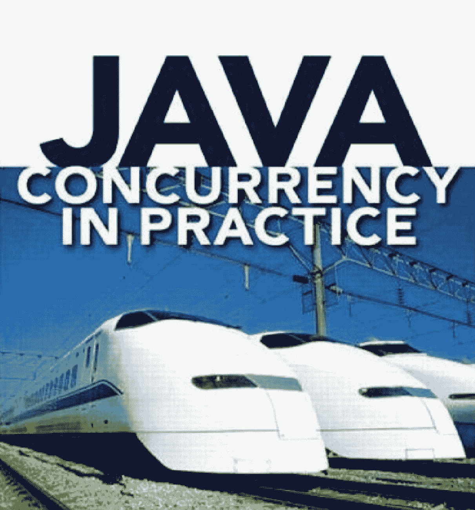

Brian Goëtz
Tim Peierls
Joshua Bloch
Joseph Bowbeer
David Holmes
Doug Lea

## 序言

- 3.3. 线程封装 ....................................... 28
- 11.6. 减少上下文切换 .................................................................. 51

## 目录

- 第 1 章. 引言 | 11
- 第 2 章 线程安全 | 11
- 第 3 章 共享对象 | 23
- 列表 3.6. 允许内部可变状态逃逸。*不要这样做。* | 27
- 第 4 章 组合
- 第 5 章 构建块
- 图 5.2. SynchronizedFactor 的低并发性 | 66
- 第 9 章 GUI 应用程序 117
- 列表 12.10. 使用 Thread.yield 生成更多交错。 | 160
- 图 12.3. 使用默认（非公平）和公平信号量的 TimedPutTakeTest 完成时间直方图。 | 164
- 第 13 章. 显式锁
- 列表 13.3. 诱导锁顺序避免死锁。 | 173
- 列表 13.5. 信号量锁。 | 174
- 列表 15.1. 序列化访问。 | 197
- 列表 15.3. 锁消除。 | 199
- 列表 15.5. 随机生成器。 | 201
- 图 15.3. 有界缓冲区状态。 | 204
- 图 15.5. 插入状态。 | 204

# 前言

在编写此书时，多内核处理器已变得足够便宜并适用于中端桌面系统。这并非巧合，许多开发团队注意到项目中出现了越来越多的线程相关的错误报告。最近在 NetBeans 开发者网站上的一个帖子中，一位核心维护者观察到某个类被修复了超过 14 次。

# 如何使用本书

为了解决 Java 底层机制与必要的设计级策略之间的抽象差异，我们为编写并发程序提供了一套规则。专家可能会查看这些规则并说：“嗯，那不是真的；类 `C` 虽然违反了 `R`，但它是线程安全的。”虽然可以在没有这些规则的情况下编写正确的程序，但我们的目标是确保深入理解 Java 内存模型的底层细节，并确保遵循我们简化的规则将产生正确的程序。

第 2 章（线程安全）和第 3 章（共享对象）构成了本书的基础。所有关于避免并发危害、构建线程安全类以及验证线程安全的规则都包含在内。倾向于“实践”而非“理论”的读者可能会想直接跳到第二部分，但请务必在编写任何代码之前，回过头来重读第 2 章和第 3 章！

第 4 章（对象组合）涵盖了将线程安全的类组合成更大的线程安全类的技术。第 5 章（构建块）涵盖了平台库提供的并发构建块 - 线程安全的类和同步器。

活跃性、性能与测试。第三部分（第 10-12 章）涵盖了如何确保并发程序能够按照你的预期运行，并具有可接受的性能。第 10 章（避免活跃性危害）描述了如何避免可能导致程序无法进展的活跃性故障。第 11 章（性能与可扩展性）涵盖了提高并发代码性能和可扩展性的技术。第 12 章（并发测试）涵盖了针对并发代码正确性和性能的测试技术。

高级主题。第四部分（第 13-16 章）涵盖了可能仅对经验丰富的开发者感兴趣的话题：显式锁、原子非阻塞算法以及开发自定义同步器。

## 代码示例

虽然书中的许多通用概念适用于 Java 5.0 之前的 Java 版本，甚至适用于非 Java 环境，但大多数代码示例（以及关于 Java 内存模型的陈述）均假设 Java 5.0 或更高版本。某些代码示例可能使用 Java 6 添加的库特性。

代码示例经过了压缩以减小其体积并突出重点。代码示例的完整版本以及补充示例和勘误，可以通过书籍网站 `http://www.javaconcurrencypractice.com` 获取。

代码示例分为三类：“良好”示例、“不太佳”示例和“糟糕”示例。糟糕示例说明了绝对不应该被模仿的技术，并被标记为“尤先生”（Mr. Yuk）[1]，以明确这些是具有“毒性”的（参见列表 1）。不太佳的示例说明了并不一定错误但脆弱、有风险或性能不佳的技术，并被标记为“本可以更好先生”（Mr. CouldHappier），如列表 2 所示。

> [1] 尤先生是匹兹堡儿童医院的注册商标，经许可使用。

**列表 1. 糟糕的列表排序方法。不要这样做。**

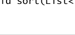

```java
public <T extends Comparable<? super T>> void sort(List<T> list) {
    // 永远不会返回错误答案！
    System.exit(0);
}
```

某些读者可能会质疑书中“糟糕”示例的作用；毕竟，一本书应该展示如何正确地做事，而不是如何做错。这些糟糕示例有两个目的：它们说明了常见的陷阱，但更重要的是，它们演示了如何分析程序的线程安全性 - 而最好的分析方法就是观察线程安全是如何被破坏的。

**列表 2. 不够优的列表排序。**

```java
public <T extends Comparable<? super T>> void sort(List<T> list) {
    for (int i = 0; i < 100000; i++)
        doNothing();
    Collections.sort(list);
}
```

## 致谢

本书的诞生源于 `java.util.concurrent` 包的开发过程，特别是为了纳入 Java 5.0 而进行的 Java 社区规范 JSR 166。许多其他人也对 JSR 166 做出了贡献；我们特别感谢 Martin Buchholz 在将代码引入 JDK 方面所做的工作……

### 1.1. 并发的（极简）历史

在早期的计算机系统中，每个进程都是一个虚拟的冯·诺依曼计算机；它拥有存储指令和数据的内存空间，根据机器语言执行指令，并通过操作系统与外部世界交互。几乎所有广泛使用的编程语言都定义了执行某个动作后会发生什么：起床，穿上睡袍，下楼开始泡茶。作为编程语言，这些现实世界中的动作都是对细粒度操作的抽象，如打开橱柜，选择茶壶，将茶放入壶中，如果壶里没水，就加水，将其放在炉子上，打开炉火，等待水开，等等。最后一步等待水开涉及到某种程度的异步性。在水加热时，你有种选择：等待，或者做其他事情，比如搅拌吐司（另一个异步任务）或去取报纸，同时意识到你的注意力会被水壶分散。找到顺序性和异步性之间的正确平衡是高效人士的特征——程序也是如此。

编写正确的程序是困难的；编写并发程序更加困难。那么我们为什么要纠结并发呢？线程是语言中不可或缺的特性，它们通过简化代码来实现，随着处理器数量的增加，有效利用并发变得更加重要。

# Java 并发实践

在过去，计算机系统并不允许同时运行多个程序，因为一次运行一个程序是对昂贵且稀缺的资源的浪费。操作系统演进到允许多个程序同时运行，通过共享内存、文件句柄等资源进行相互通信。多个因素导致了线程的发展：

- **资源利用**：程序有时需要等待输入输出，而在等待期间无法做任何有用工作。
- **公平性**：多个用户对机器资源有平等的索求。
- **便利性**：编写多个执行单一任务的程序，比编写一个执行所有任务的单一程序更容易或更理想。

线程有时被称为轻量级进程，大多数现代操作系统将线程而非进程视为调度单位。在没有显式协调的情况下，线程之间是同时执行且异步的。由于线程共享所属进程的内存空间，进程内的线程可以访问相同的变量并从同一个堆中分配对象，这比进程间机制允许更细粒度的数据共享。

## 1.2. 线程的优势

使用得当，线程可以降低开发和维护成本，并提高复杂应用的性能。线程通过将异步工作流转换为大部分顺序执行的工作流，使得模拟人类的工作和交互变得更加容易。它们还能将复杂的代码转换为直线性代码，使其更易编写、阅读和维护。

在图形用户界面（GUI）应用程序中，线程可以用于提高用户界面的响应性；在服务器应用程序中，用于提高资源利用率和吞吐量。它们还简化了 JVM 的实现——垃圾回收器通常运行在一个或多个线程中。大多数非复杂的 Java 应用程序在某种程度上都依赖线程来组织结构。

### 1.2.1. 利用多处理器

多处理器系统过去曾是昂贵且稀有的，仅存在于大型数据中心和科学计算设施。如今，即使是低端服务器和桌面系统通常也拥有多个处理器。这一趋势只会不断加速；随着向上扩展频率变得越来越困难，处理器制造商将转而在单个芯片上放置更多的核心。所有主要制造商都已完成这一转变，我们已经看到处理器数量大幅增加的机器。

由于调度单位是线程，单线程程序在同一时间最多只能在一个处理器上运行。在双处理器系统上，单线程程序放弃了对一半可用 CPU 资源的访问权；或者放弃了 99%。另一方面，具有多个活动线程的程序可以同时执行。当设计合理时，多线程程序可以通过更有效地利用可用处理器资源来提高吞吐量。

使用多个线程还可以帮助单处理器系统上实现更好的吞吐量。如果一个程序是单线程的，该线程在等待同步 I/O 完成时将保持空闲。在多线程程序中，当第一个线程等待 I/O 完成时，另一个线程可以运行，从而允许应用程序在不阻塞 I/O 的情况下进展（这就像在烧水的同时读报纸，而不是等水开了再读）。

### 1.2.2. 建模的简单性

当你只有一种类型的任务需要执行（修复这 12 个 bug）时，管理工作比你有多种任务要做（修复 6 个 bug、面试系统管理员候选人、管理团队评估、以及准备下周演示的幻灯片）要容易得多。当你只有一种类型的任务要做时，你可以从堆的最顶部开始一直工作，直到任务耗尽（或者你累了）；你不需要花费任何精力去考虑下一步做什么。另一方面，在各个任务之间管理多个优先级会带来一些开销。

软件的情况也是如此：处理一种类型任务的程序在顺序上编写起来更简单、更不容易出错，并且更容易同时管理多种类型的任务。为每个任务或集合中的每个元素分配一个线程遵循顺序性逻辑，并将领域逻辑与调度细节、交织操作、异步 I/O 和结果隔离开来。复杂的异步工作流可以被分解为许多更简单的工作流，每个工作流运行在独立的线程中，并在特定的同步点上相互作用。

这种优势被如 `servlets` 或 `RMI`（远程方法调用）等框架所抵消。框架处理请求管理、线程创建和负载均衡的细节，在工作流的适当点将请求处理的部分分发给相应的组件。`Servlets` 不需要担心其他请求是如何同时被处理的，也不需要担心 socket 输入输出流是否会阻塞；当响应 Web 请求而调用 servlet 的 `service` 方法时，它可以像单线程程序一样处理请求。这可以简化开发，并降低使用此类框架的学习曲线。

### 1.2.3. 异步事件处理的简化

当接受来自多个远程客户端连接的服务器应用程序中，如果为每个连接分配自己的线程并允许其使用阻塞 I/O，其开发将变得更容易。

如果应用程序尝试从 socket 读取数据但没有可用数据，`read` 将阻塞，直到某些数据可用。在单线程应用程序中，这意味着不仅并发请求的处理会停滞，而且所有请求在单线程被阻塞时都在等待。为了避免这个问题，单线程服务器应用程序被迫使用非阻塞 I/O，而这比同步 I/O 更复杂且更容易出错。然而，如果每个请求都有自己的线程，阻塞就不会影响其他请求的处理。

从历史来看，操作系统开发了低延迟的设施。如果每个请求都有自己的线程，阻塞就不会影响其他请求的处理。

`UnsafeSequence` 示例说明了由竞态条件（race condition）引起的常见危害。`next` 方法是否能像其规范要求的那样从多个线程返回唯一值，取决于运行时如何交错执行操作 - 而这并不是一种理想的状态。

由于线程共享相同的内存地址并并发运行，它们可以访问或修改其他线程正在使用的变量。这是一个极大的便利，因为让数据共享比其他线程间通信机制要容易得多。但也包含着重大的风险：线程可能会因为数据意料之外的变化而产生困惑。使用多线程来访问和修改变量，在原本顺序执行的编程模型中引入了非线性的元素，这可能导致逻辑混淆且难以推理。为了让多线程程序具有可预测性，必须对共享变量进行适当协调，防止线程之间相互干扰。坦率地说，Java 提供了同步机制来协调访问。

`@GuardedBy` 在第 2.4 节中描述；它记录了 `Sequence` 的同步策略。

**列表 1.2. 线程安全的 Sequence 生成器。**

```java
@ThreadSafe
public class Sequence {
    @GuardedBy("this") private int nextValue;

    public synchronized int get() {
        return nextValue++;
    }
}
```

在没有同步的情况下，编译器、硬件和运行时会在操作的时间和顺序上“放权”，例如将变量缓存在处理器级缓存中，这使得这些变量临时（或永久地）对其他线程是不可见的。这些技巧是为了性能且通常是理想的，但它们给开发者带来了负担，要求开发者清晰地识别数据在何时跨线程共享，以确保这些优化不会破坏安全性。（第 16 章详细介绍了 JVM 究竟保证哪些排序细节，但如果你遵循第 2 章和第 3 章的规则，就可以避免这些底层细节。）

在开发并发代码时，注意线程安全至关重要：安全性不能妥协。安全性的重要性并非多线程程序所有——单线程程序也需要关注安全正确——线程的使用引入了单线程程序中不存在的额外危害。同样，线程的使用引入了单线程程序中不会发生的其他形式的故障。

如果说安全（safety）意味着“坏事永远不会发生”，那么活跃（liveness）则是补充了“好事最终会发生”的保证。当某个活动进入一个永远无法取得进展的状态时，就会发生活跃失败。顺序程序中发生的一种活跃失败是无限循环，即循环后的代码永远不会执行。线程的使用引入了额外的活跃风险。例如，如果线程 A 正在等待线程 B 持有的资源，而 B 永远不释放，A 将永远等下去。第 10 章描述了各种形式的活跃失败以及如何避免它们，包括死锁（第 10.1 节）、饥饿（第 10.3 节）和活锁（livelock）。像许多并发危害一样，导致活跃失败的 bug 可能是隐藏的，因为它们取决于不同线程中事件的时机，因此并不总会在开发或测试中体现。

与此相关的是性能。虽然活跃意味着好事最终会发生，但“最终”可能还不够——我们希望事情发生得快一点。性能问题涵盖了广泛的问题，包括服务时间、响应能力、吞吐量、资源消耗或可扩展性。正如安全和活跃一样，多线程程序同样受到单线程程序的所有性能危害，以及由于使用线程而引入的其他危害的影响。

在设计良好的并发应用程序中，线程的使用是性能净收益，但线程仍然带有某种程度的运行时开销。上下文切换——调度程序临时挂起活动线程以便另一个线程运行——在拥有许多线程的应用中更为频繁，并具有高昂成本：保存和恢复执行上下文、局部性丢失，以及用于调度线程而非运行线程的 CPU 时间。当线程共享数据时，它们必须使用同步机制，这会抑制编译器优化、刷新或失效内存缓存，并在共享内存总线上产生同步流量。所有这些因素引入了额外的性能成本；第 11 章涵盖了分析和减少这些成本的技术。

## 1.4. 线程无处不在

即使你的程序从未显式创建线程，框架也会代表你创建线程，而调用这些线程的代码必须是线程安全的。这给开发者带来了重大的设计和实现负担，开发线程安全的类比非线程安全的类需要更多的关注和分析。

每个 Java 应用都使用线程。当 JVM 启动时，它会为 JVM 内部任务（垃圾收集、终结）创建线程，并为运行 `main` 方法创建一个主线程。AWT（抽象窗口工具包）和 Swing 用户界面框架会创建线程来管理用户界面事件。`Timer` 线程为执行延迟任务创建线程。组件框架（如 `servlets` 和 `RMI`）会创建线程池并在这些线程中调用方法。

如果你使用了这些——正如许多开发者所做的那样——你就必须熟悉并发线程安全，因为这些框架会创建线程并从那里调用你的组件。如果能认为并发是一个“可选的”或“高级的”语言特性就太好了，但现实是几乎所有的 Java 应用都是多线程的，且这些框架并不能让你回避正确协调访问的问题。

当并发由框架引入应用程序时，几乎无法将并发感知限制在你的代码中，因为框架本质上会回调组件，而组件又会访问状态。同样，线程安全的需求并不在框架调用的组件处结束——它延伸到访问这些状态的所有代码路径。因此，线程安全的需求是持续存在的。

框架通过框架线程调用组件将并发引入应用程序。组件总是访问状态，因此要求所有访问状态的代码路径都是线程安全的。

下面描述的设施都可能由非管理应用程序的线程调用。虽然线程安全的需求可能始于这些设施，但很少于此结束；它会渗透整个程序。

- 定时器 (`Timer`) 是在稍后执行任务的便利机制。

即使你可以保证 `Servlet` 每次只有一个线程调用，在构建 Web 应用程序时仍然需要注意线程安全。`Servlet` 经常访问与其他线程共享的状态，例如应用对象（存储在 `ServletContext` 中）或会话对象（存储在每个 `session` 中）。当 `Servlet` 访问由请求共享的对象时，它必须正确协调对对象的访问，因为多个请求可能从多个线程同时访问它们。`Servlet` 和 `JSP` 以及存储在容器中的过滤器和对象必须是线程安全的。


- 远程方法调用 (RMI)。RMI 调用运行在另一个 JVM 中的方法。当你使用 RMI 调用方法时，方法的参数被封装（序列化）成流并通过网络传递到远程 JVM，在远程被反序列化（解包）并传递给方法。当 RMI 代码调用你的对象时，调用发生在哪个线程中？你不知道，但它绝对不在你创建的线程中——你的对象在 RMI 管理的线程被调用。RMI 创建了多少线程？同一个远程对象上的同一个方法可能被多个 RMI 线程同时调用吗？

[4] 回答：是的，这在 Javadoc 中并不完全清楚——你必须阅读 RMI 规范。

远程对象必须防止两种线程安全危害：正确协调对可能与其他对象共享的状态的访问，以及正确协调对远程对象本身的访问（因为同一个对象可能在多个线程中同时被调用）。类似于 Servlet，RMI 对象应该准备好处理多个并发并发调用，并必须提供自身的线程安全保障。

Swing 和 AWT。GUI 应用本质上是异步的。用户可以随时选择菜单项或按下按钮，并且如果应用程序正在执行某些操作，他们期望应用程序能够迅速做出响应。Swing 和 AWT 通过创建一个单独的线程来处理用户触发的事件并更新呈现给用户的图形视图，从而解决了这个问题。

Swing 组件（如 `Table`）不是线程安全的。相反，Swing 程序通过将所有对 GUI 组件的访问限制在事件线程（`event thread`）来实现其线程安全。如果应用程序想从事件线程之外操作 GUI，它必须使操作 GUI 的代码在事件线程中运行。

当用户执行 UI 操作时，事件线程中会调用一个事件处理器来执行用户请求的任何操作。如果处理器需要访问同样从其他线程访问的应用状态（例如正在编辑的文档），那么事件处理器以及任何访问该状态的其他代码必须以线程安全的方式进行。

- **第 2 章** 线程安全
- **第 4 章** 对象组合
- **第 5 章** 构建构建块

## 第 2 章 线程安全

或许令人惊讶的是，并发编程并不像土木工程关注铆钉和 I 型钢那样关注线程或锁。当然，建造一座在载荷下不会倒塌的桥梁需要正确使用铆钉和 I 型钢，但这些都是手段。编写线程安全的代码，核心在于管理对状态（特别是共享的可变状态）的访问。

非正式地说，对象的状态是它的数据，存储在实例字段或静态字段等变量中。对象的状态可能还包括其他依赖对象的字段；`HashMap` 的状态部分存储在 `HashMap` 自身，也存储在任何 `Map` 中。对象的状态涵盖任何可以影响其外部可见行为的数据。

我们所说的“共享”，是指一个变量可以被多个线程访问；所说的“可变”，是指其值在生命周期内可以改变。如果是关于代码的，我们可以谈论线程安全，但我们实际上试图做的是防止不受控访问带来的破坏。

一个对象是否需要线程安全，取决于它是否会被多个线程访问，而不是取决于它做了什么。它是被用对象的属性。使对象变为线程安全需要同步来协调对其状态的访问；未能这样做将导致数据损坏和意外的后果。

每当有多个线程访问给定状态，且其中一个线程尝试写入它时，所有线程都必须使用同步协调对它的访问。Java 中同步的主要机制是 `synchronized` 关键字，它提供了排斥锁，但“同步”一词也包括 `volatile` 变量、显式锁和原子变量的使用。

你应该避免产生这种诱惑，即认为某些“特殊”情况不适用这条规则。一个省略同步的程序可能看起来是正确的，多年来通过测试并运行良好，但它可能会在任何时刻崩溃并失败。

- 如果多个线程在没有适当同步的情况下访问同一个可变状态变量，你的程序就是损坏的。
- 不要跨线程共享状态变量；
- 将状态变量设为不可变；或
- 每次访问状态变量时都使用同步。

如果你在设计类时没有考虑并发访问，这些方法中的某些可能需要重大的设计修改，因此修复问题可能不像这些建议听起来那么简单。设计一个线程安全的类远比事后对其进行线程安全改造要容易得多。

在一个大型程序中，识别哪些线程可能会访问给定变量可能是复杂的。坦率地说，有助于编写组织良好、可维护的类的同类面向对象技术（如封装和数据隐藏）也可以帮助创建线程安全的类。访问特定变量的代码越少，就越容易确保所有代码都使用了适当的同步，也越容易推断变量被创建的条件。Java 语言并没有阻止你封装——将状态存储在私有字段（即使是静态字段）中，或发布指向原本是内部对象的引用，都是完全允许的——但封装得越好，越容易让你的程序变为线程安全，并越有助于帮助维护者保持这种状态。

在设计线程安全的类时，良好的面向对象技术——封装、不可变性和对不变性（`invariants`）的清晰说明——是你最好的朋友。

会有某些时候，良好的面向对象设计技术与现实需求冲突；在这些情况下，为了性能或为了与遗留代码兼容，可能需要牺牲设计规则。抽象和封装确实存在冲突，尽管并不像许多开发者认为的那么频繁——首先让你的代码正确并使其完善始终是一个良好的做法。然后，再进行优化。

定义安全是出奇地困难的。更正式的尝试过于复杂，无法提供实践指导，而其余的定义是非正式的。快速在 Google 上搜索会出现许多这样的“定义”：

- 可以在多个线程中调用而不会产生意外交互。
- 可以同时被多个线程调用而不需要其他操作。

给定这些定义，我们会感到困惑！它们听起来很像“如果一个类可以从多个线程调用，它就是安全的”。你可能无法同意这种说法，但它并没有提供太大帮助。我们如何从不安全的类定义线程安全的类？至少任何合理的安全的定义都指向正确性（`correctness`）的概念。由于缺乏描述操作影响的后条件，如果我们不为类编写适当的规范，我们如何能知道它们是正确的？由于缺乏对正确性的清晰定义，我们的定义是模糊的。正确性意味着一个类符合其规范。

因此，让我们乐观地假设单线程正确性是某种可以被识别的东西，我们现在可以用一种不那么循环的方式定义安全：当一个类在从多个线程访问时继续保持正确行为，无论运行时如何对这些线程执行进行调度或交织，且调用端不需要任何同步或其他协调时，该类就是线程安全的。

由于任何单线程程序也是多线程程序，如果它在单线程环境中不是正确的，它就不可能是线程安全的。如果一个对象的实现正确，任何操作序列（公共方法的调用和对公共字段的写入）都不应违反它的任何不变性或后条件。对线程安全实例执行的任何顺序或并发操作，都不会导致实例处于无效状态。

## 2.1. 示例：无状态的

在第 1 章中，我们列出了许多创建线程并在这些线程中调用你组件的框架，这让你负责使代码线程安全的。很多情况下，线程安全性并非源于某个决策，而是源于像 `Servlets` 框架这样的机制。我们将开发一个简单的示例，并在保持线程安全的同时对其进行扩展以添加功能。

列表 2.1 展示了我们的无状态分解器。它从 servlet 请求中解析出要分解的数字，对其进行因数分解，并将结果封装到 servlet 响应中。

列表 2.1. 无状态的 Servlet。

```java
@ThreadSafe
public class StatelessFactorizer extends Servlet {
    public void service(ServletRequest req, ServletResponse resp) {
        BigInteger i = extractFromRequest(req);
        BigInteger[] factors = factor(i);
        encodeIntoResponse(resp, factors);
    }
}
```

`StatelessFactorizer` 和大多数 servlet 一样是无状态的：它没有字段，也没有对其他类的引用。特定计算的瞬态状态仅存在于局部变量中，这些变量仅对执行线程可见。访问 `StatelessFactorizer` 的线程无法影响另一个访问同一个 `StatelessFactorizer` 的线程的结果；因为两个线程不共享状态，它们就像在访问不同的实例一样。无状态对象的线程的操作不会影响其他线程操作的正确性，因此无状态对象是线程安全的。

> 无状态对象总是线程安全的。

大多数 servlet 可以在无状态的情况下实现，这一事实减轻了使 servlet 线程安全的负担。只有当 servlet 需要在一个请求之间记住某些信息时，线程安全性要求才会成为问题。

当我们向无状态对象添加一个元素时会发生什么？假设我们想为处理的请求数添加一个“计数器”。显而易见的方法是在 servlet 中添加 `long` 字段并在每次请求时对其递增，

遗憾的是，`UnsafeCountingFactorizer` 不是安全的，尽管在单线程环境中运行良好。就像第 6 页的 `UnsafeSequence` 一样，它很容易丢失更新。虽然递增操作 `count++` 在语法上看起来是一个简单的操作，但它并不是原子的，这意味着它不是作为一个单一、不可分割的操作来执行的。相反，它是三个离散操作的简写：获取当前值、对其加 1、并将新值写回。这是一个读-修改-写操作的示例，其结果状态源于之前的状态。

## 列表 2.2. Servlet 在没有必要同步的情况下计算请求。不要这样做。


```java
@NotThreadSafe
public class UnsafeCountingFactorizer implements Servlet {
    private long count = 0;

    public long getCount() { return count; }

    public void service(ServletRequest req, ServletResponse resp) {
        BigInteger i = extractFromRequest(req);
        BigInteger[] factors = factor(i);
        count++;
        encodeIntoResponse(resp, factors);
    }
}
```

第 6 页的图 1.0 显示了如果两个线程在没有同步的情况下尝试同时增加计数器会发生什么。它是 9，对其加 1，然后每个线程都计数器设置为 10。这并不清楚应该发生什么；在过程中丢失了一个增加操作，计数器永久性地偏离了 1。

你可能认为在 Web 服务中略不准确的计数是可以接受的精度损失，有时也确实如此。但如果计数器被用于生成序列或对象标识符，从多次调用返回相同的值可能会导致严重的数据完整性问题。在运气不佳同步的情况下出现错误结果的可能性在并发编程中非常常见，以至于被称为竞态条件：

`UnsafeCountingFactorizer` 使得它变得不可靠。竞态条件发生在计算的正确性取决于运行时多个线程的相对计时或交错执行时；或者在其他情况下，获取正确答案依赖于时机。最常见的竞态条件类型是“检查-执行”（`check-then-act`），即使用一个潜在的可观测状态来对要做什么做出决策。

`UnsafeCountingFactorizer` 有几个导致它不可靠的竞态条件。竞态条件发生在计算的正确性取决于运行时多个线程的相对计时或交错执行时；或者在其他情况下，获取正确答案依赖于时机。最常见的竞态条件类型是“检查-执行”，即使用一个潜在的可观测状态来对要做什么做出决策。

“检查-执行”条件经常与“数据竞态”（`data race`）术语混淆，后者是指未使用同步来协调对共享字段的访问。数据竞态发生在一个可能被一个或多个线程读取的变量被另一个线程写入或已被写入，且两个线程都没有使用同步机制时；具有数据竞态的代码没有定义的副作用。`UnsafeCountingFactorizer` 有数据竞态和竞态条件。后者会以不可预测的方式导致程序失败。`UnsafeCountingFactorizer` 有三个数据竞态和竞态条件。详情请参阅第 16 页。

我们在现实生活中经常遇到竞态条件。假设你计划在大学路星巴克见朋友，或者你们约定的那一个。在 12:10，你在大学路咖啡馆看到了你的朋友，所以你走去咖啡馆看他是否在那里，如果他不在，有几种可能性：你的朋友迟到了，且

一种使用“检查-执行”的常用惯用法是懒初始化。懒初始化的目标是推迟到需要时再创建对象。

`LazyRace` 和 `UnsafeCountingFactorizer` 都包含一组相对于相同状态的操作需要是原子的、不可分割的。为了确保线程安全，“检查-执行”操作和读-修改-写操作必须始终是原子的。我们统称这些为复合操作。

现在，在本节中，我们将考虑锁，这是 Java 用于确保原子性的内置机制。我们将通过另一种方式解决解决问题，即使用现有的线程安全类，如列表 2.4 中的 `CountingFactorizer` 所示。

列表 2.4. 使用 `AtomicLong` 计数请求。

```java
@ThreadSafe
public class CountingFactorizer implements Servlet {
    private final AtomicLong count = new AtomicLong(0);

    public long getCount() { return count.get(); }

    public void service(ServletRequest req, ServletResponse resp) {
        BigInteger i = extractFromRequest(req);
        BigInteger[] factors = factor(i);
        count.incrementAndGet();
        encodeIntoResponse(resp, factors);
    }
}
```

`java.util.concurrent` 包包含了影响状态转换和数字引用的原子变量。通过用 `AtomicLong` 替换 `long` 计数器，我们确保了所有访问计数器的操作都是原子的。由于 servlet 的状态就是计数器的状态，而计数器是线程安全的，因此我们的 servlet 也是线程安全的。

- [5] `CountingFactorizer` 调用 `incrementAndGet()` 来增加计数器，该方法还会返回增加后的值；在这种情况下，值被忽略了。

我们能够通过使用现有的线程安全类 `AtomicLong` 在我们的 servlet 中添加计数器并保持线程安全性。当向无状态类添加一个单一状态元素时，如果该状态完全由一个线程安全的对象管理，那么生成的类就是线程安全的。但我们在下一节中看到，从一个状态变为多个状态并不像从零到一那么简单。

即使用现有的线程安全对象（如 `AtomicLong`）来管理你的类的状态。对现有的线程安全对象的可能状态和状态转换进行推理比对任意状态变量要简单得多，而且这

我们可以通过使用线程安全的对象来管理 servlet 的整个状态，在保持线程安全的同时为我们的 servlet 添加一个状态。如果我们想为 servlet 添加更多状态，只需添加更多线程状态变量。

假设我们想通过缓存最近计算的结果来提高 servlet 的性能，以防两个连续客户端请求同一个数字的因数分解。（这可能不是一种有效的缓存策略；我们将在第 5.6 节提供一个更好的。）为了实现这一策略，我们需要记住两件事：上一个分解的数字以及它的因数。

我们使用 `AtomicLong` 以线程安全的方式管理计数器；我们能用它的兄弟类 `AtomicReference` 来管理上一个数字及其因数吗？这种尝试在列表 2.5 的 `UnsafeCachingFactorizer` 中所示。

- [6] 就像 `AtomicLong` 是一个用于长整数的线程安全持有类，`AtomicReference` 是一个用于对象引用的线程安全持有类。原子变量及其优势将在第 15 章中介绍。

列表 2.5. 使用 `AtomicReference` 尝试缓存结果。

```java
@NotThreadSafe
public class UnsafeCachingFactorizer implements Servlet {
    private final AtomicReference<BigInteger> lastNumber = new AtomicReference<BigInteger>();
    private final AtomicReference<BigInteger[]> lastFactors = new AtomicReference<BigInteger[]>();

    public void service(ServletRequest req, ServletResponse resp) {
        BigInteger i = extractFromRequest(req);
        if (i.equals(lastNumber.get())) {
            encodeIntoResponse(resp, lastFactors.get());
        } else {
            BigInteger[] factors = factor(i);
            lastNumber.set(i);
            lastFactors.set(factors);
            encodeIntoResponse(resp, factors);
        }
    }
}
```

遗憾的是，这种方法并不理想。尽管原子引用单独来说是线程安全的，但 `UnsafeCachingFactorizer` 可能会产生错误的答案。

线程安全的定义要求无论多线程操作的时间顺序或交织如何，都必须保持不变性。`UnsafeCachingFactorizer` 的一个不变性是 `lastFactors` 中缓存的因数的积等于 `lastNumber` 中的值；只有当这一不变性成立时，我们的 servlet 是正确的。当多个变量参与一个不变性时，它们不是独立的：一个值限制了其他值的允许范围。在更新其中一个时，必须在同一个原子操作中更新其他的。

在某些不幸的时间点，`UnsafeCachingFactorizer` 会违反这一不变性。使用原子引用，我们无法同时更新 `lastNumber` 和 `lastFactors`，尽管每个引用都被设置为原子的；仍然存在一个漏洞窗口，即其中一个已被修改而另一个尚未修改，在此期间，其他线程可能会看到不变性被破坏。同样，这两个值无法同时被获取：在线程 A 获取值之间，线程 B 可能已经更改了它们，A 再次观察到不变性不再成立。

为了保持状态一致性，请在单个原子操作中更新相关的状态变量。


# Java 并发编程实战

## 2.3 内建锁

Java 提供了一种用于强制同步的锁机制：`synchronized` 块（锁和其他同步机制的另一个关键方面将在第 3 章介绍）。`synchronized` 块包含一个对象的引用作为锁，以及一段受该锁保护的代码块。`synchronized` 方法是跨越整个方法体的 `synchronized` 块的简写（静态 `synchronized` 方法使用类对象作为锁）。

```java
synchronized (lock) {
    // 访问或修改受锁保护的共享状态
}
```

每个 Java 对象都可以隐式地作为同步目的锁；这些内置锁被称为内建锁或监视器锁。锁在进入 `synchronized` 块之前自动获取，并在控制权退出该块时自动释放。

在并发语境下，原子性意味着一组语句作为一个不可分割的单元执行。同步机制使得保护 servlet 变得容易。列表 2.6 显示了一个不可接受的并发 servlet。

由于 `desomething` 方法在 `Widget` 和 `Loggingwidget` 中都是同步的，它们都会尝试获取锁。但如果内建锁不是重入的，`super.desomething()` 的调用将无法获取锁，因为会被认为已被持有，线程将永远等待一个永远不会释放锁。重入性让我们避免了这种情况下的死锁。

当锁已被另一个线程持有时，请求线程会阻塞。但由于内建锁是重入的，请求线程可以进入 servlet。这种同步器是线程安全的；然而，这种问题将在 2.5 节中解决。

### 列表 2.6 具有不可接受并发的 servlet。不要这样做。

```java
@ThreadSafe
public class SynchronizedFactorizer implements Servlet {
    @GuardedBy("this") private Integer lastNumber;
    @GuardedBy("this") private Integer[] lastFactors;

    public synchronized void service(ServletRequest req) {
        Integer i = extract(req);
        if (i.equals(lastNumber)) {
            encodeResponse(resp, lastFactors);
        } else {
            Integer[] factors = factor(i);
            lastNumber = i;
            lastFactors = factors;
            encodeResponse(resp, factors);
        }
    }
}
```

重入是通过与每个锁关联一个获取计数和一个所有者来实现的。当计数为零时，锁被视为未持有。当线程获取之前未持有的锁时，JVM 记录所有者并将计数设置为一。如果同一线程再次获取锁，计数将增加，当线程退出 `synchronized` 块时，计数将减少。当计数达到零时，释放锁。

> [7] 这与线程（POSIX）互斥锁的锁定行为不同，后者是每次调用授予的。

重入性促进了锁的封装，从而简化了面向对象并发代码的。如果没有重入锁，列表 2.7 中看起来非常自然的代码（即子类重写同步方法并调用父类方法）会导致死锁。因为 `desomething` 方法在 `Widget` 和 `Loggingwidget` 中都是同步的，它们在继续之前都会尝试获取锁。

### 列表 2.7 如果内建锁不是重入的会导致死锁的代码。

```java
public class Widget {
    public synchronized void desomething() {
    }
}

public class Loggingwidget extends Widget {
    public synchronized void desomething() {
        System.out.println(toString() + ": calling desomething");
        super.desomething();
    }
}
```

## 2.4 使用锁进行保护

对对象的序列化访问与对象序列化（将对象转换为字节流）无关；序列化意味着线程轮流式、排他性地访问该对象，而不是并发地访问。遵循这些协议可以确保状态的一致性。

对状态的复合操作必须是原子的，以避免竞态条件。例如，增加计数器（读取-修改-写入）或懒性初始化（检查-后执行），在整个复合操作期间持有锁可以使该复合操作具有原子性。然而，仅仅将复合操作封装在 `synchronized` 块中是不够的；在所有访问变量的地方都需要同步。此外，当使用锁来协调对变量的访问时，在访问该变量的地方都必须使用它。

一个常见的错误是认为只有在写入共享变量时才需要使用同步；这根本不是事实。（这些原因将在第 3.1 节中变得更加清晰。）

> 对于每个可能被多个线程访问的可变变量，对该变量的所有访问都必须在持有同一把锁的情况下进行。在这种情况下，我们说该变量受该锁的保护。

在 `SynchronizedFactorizer` 列表 2.6 中，`lastName` 和 `lastFactors` 受其对象的内在锁保护，而对象的字段不需要受其内在锁保护，它们之间没有内在联系；这是一种完全有效的锁约定，被许多类使用。获取与对象关联的锁可以其他线程获取该锁——获取锁所起的作用就是防止其他线程获取同一把锁。每个拥有锁的对象只是为了方便你不需要显式地创建锁对象。构建锁定协议或同步策略以让你能够访问共享状态，并在整个程序中一致地使用它们，这是你自己的决定。

坦诚地说，这个设计决策可能是一个糟糕的决定：它不仅可能令人困惑，而且导致 JVM 实现必须在对象大小和锁定性能之间进行权衡。

> 每个共享的可变变量都应该受恰好一把锁的保护。这使得维护哪把锁变得更加清晰。

一种常见的锁约定是将所有可变状态封装在一个对象内部，并通过同步任何访问该状态的代码路径来防止其并发访问。这种模式被许多线程安全的类使用，例如 `Vector` 和 `synchronized` 集合。在所有情况下，对象状态中的变量都受对象内在锁的保护。然而，这种模式并没有特殊之处，编译器或运行时都没有强制这种（或任何其他）锁定模式。通过添加代码路径或忘记使用同步，很容易无意中破坏这种锁定协议。

像 `FindBugs` 这样的代码审计工具可以识别出变量何时被频繁访问但在持有锁的情况下未访问，这可能指示着一个 bug。

并不是所有数据都需要被锁保护——只有将从多个线程访问的可变数据需要。在第 1 章中，我们描述了添加一个简单的异步事件如何产生线程安全需求，这些需求会渗透到你的整个程序中，特别是当你的程序封装不当时。考虑一个处理大量数据的单线程程序。数据在线程间共享。单线程程序不需要同步，因为没有数据在线程间共享。假设你想要添加一个功能来定期创建你的进度的快照，这样当程序崩溃或必须停止时，它就不需要从开始运行。你可能会选择通过 `TimerTask` 每几分钟触发一次，将程序状态保存到文件中。

由于 `TimerTask` 将从另一个线程（由 `Timer` 管理的线程）调用，快照中的任何数据现在都被两个线程访问：主程序线程和 `Timer` 线程。这意味着不仅 `TimerTask` 在访问程序时使用同步，程序中其他触及相同数据的所有代码路径也是如此。以前不需要同步的地方，现在在整个程序中都需要同步。

当一个变量被锁保护时——意味着对该变量的访问是在持有锁的情况下进行的——你确保了一次只有一个线程可以访问该变量。当一个类具有涉及多个变量的不变性时，还有一个额外的要求：参与不变性的每个变量都必须受同一把锁的保护。这允许你在单个原子操作中访问或更新它们，从而保持不变性。`SynchronizedFactorizer` 展示了这一点：缓存的数据和缓存的因子都受该内在锁的保护。

对于每个涉及多个变量的不变性，参与该不变性的所有变量都受同一把锁的保护。

如果同步是解决竞态条件的良方，为什么不把每个方法都声明为 `synchronized` 呢？事实证明，这种无区别的同步可能过多或过少。仅仅同步每个方法不足以让 `Vector` 上的复合操作变为原子的：

```java
if (vector.contains(element))
    vector.add(element);
```

这种尝试实现 `put-if` 操作的操作存在竞态条件，尽管 `contains` 和 `add` 都是原子。虽然同步方法使单个操作具有原子性，但当多个操作组合成复合操作时，需要额外的锁定（参见第 4.4 节关于安全地向线程安全对象中添加原子操作的技术）。同时，同步每个方法会导致松散或性能问题，正如我们在 `SynchronizedFactorizer` 中看到的那样。

## 2.5 存活性与性能

在 `UnsafeFactorizer` 中，我们在因式分解 servlet 中引入了缓存来提高性能。缓存需要共享状态，这反过来需要同步来维护该状态的完整性。但我们在 `SynchronizedFactorizer` 中使用同步的方式导致其性能很差。`SynchronizedFactorizer` 的同步策略是使用对象的内在锁保护每个状态变量，并且该策略实现了整个服务方法。这种简单、粗粒度的方法恢复了安全性，但付出了高昂的代价。

由于 `service` 是同步的，一次只有一个线程可以执行它。这破坏了 servlet 框架的使用——servlet 能够同时处理多个请求——并且在负载高时会导致用户感到沮丧。如果 servlet 正在分解一个大数字，其他客户端必须等待当前请求完成后才能开始新请求。如果系统有多个 CPU，即使负载很高，处理器可能处于空闲状态。在任何情况下，它们必须等待长时间请求完成。

图 2.1 显示了当多个请求到达同步 servlet 时发生的情况：它们排队并顺序处理。我们将此描述为应用程序并发性很差：并发调用的数量不受限于资源的可用性，而是取决于应用程序本身。可以通过缩小 `synchronized` 块的范围来提高 servlet 的并发性。你应该小心不要将一个应该是原子的操作拆分成多个 `synchronized` 块。但将不影响共享状态的长操作排除在同步块之外是合理的，这样就不会阻止其他线程进展。

### 图 2.1 同步因式分解器的威力。


### 列表 2.8 安全缓存请求和结果。

```java
@ThreadSafe
public class CachedFactorizer implements Servlet {
    @GuardedBy("this") private Integer lastNumber;
    @GuardedBy("this") private Integer[] lastFactors;
    @GuardedBy("this") private long hits;
    @GuardedBy("this") private long cacheHits;

    public long getHits() { return hits; }
    public synchronized double getHitRatio() {
        return (double) cacheHits / hits;
    }

    public void serveRequest(Request req, ServerResponse res) {
        Integer i = extractFrom(req);
        Integer[] factors = null;
        synchronized (this) {
            hits++;
            if (i.equals(lastNumber)) {
                cacheHits++;
                factors = lastFactors.clone();
            }
        }
        if (factors == null) {
            factors = factor(i);
            synchronized (this) {
                lastNumber = i;
                lastFactors = factors.clone();
            }
        }
        encodeResponse(res, factors);
    }
}
```

这在不过度影响并发性的情况下保持了线程安全；每个 `synchronized` 块中的代码路径都“足够短”。

决定 `synchronized` 块的大小可能需要在各种相互竞争的设计力量之间进行权衡，包括安全性（不可妥协）、简单性和性能。有时，简单性与性能之间是相互冲突的，尽管 `CachedFactorizer` 所示，但通常可以找到一个合理的平衡。

> 简单性与性能之间经常存在张力。在实现同步策略时，要抵制为了性能而过早牺牲简单性（可能损害安全性）的诱惑。

每当你使用锁时，都应该意识到块中的代码正在做什么，以及执行它可能需要多久。长时间持有锁（无论是是因为你正在进行计算密集型操作，还是因为你执行了可能阻塞的操作）都会引入活跃性或性能问题的风险。

> 在进行长时间的计算或可能无法快速完成的操作（如网络或控制台 I/O）期间避免持有锁。

## 第 3 章 共享对象

编写并发程序的开头，主要是关于管理对共享、可变状态的访问。上一章是关于使用同步机制防止多个线程同时访问相同数据；而本章探讨了共享和发布对象的技术，以便它们被多个线程安全地访问。它们共同为构建线程安全的类以及使用 `java.util.concurrent` 库构建并发应用程序奠定了基础。

我们已经看到 `synchronized` 块和方法如何确保操作的原子性执行，但一个常见的误区是同步仅关于原子性或对“临界区”进行装饰。同步还有另一个微妙且重要的方面：内存可见性。我们不仅希望防止一个线程修改对象的状态，还希望当一个线程修改了对象的状态时，其他线程能够看到所做的更改。如果没有同步，这种情况可能不会发生。你可以通过使用显式同步或利用库类内置的同步机制来确保对象的安全发布。

## 3.1 可见性

可见性涉及的是那些非常反直觉的事情。在单线程环境中，如果你向一个变量写入值并在稍后读取它且中间没有其他写入操作，你可以预期获得相同的值。这看起来可能很自然，但很难接受的是，当读和写操作发生在不同的线程时，情况并非如此简单。通常情况下，无法保证你在一个线程中写入的值会被另一个线程看到，甚至根本看不到。为了确保跨线程内存写入的可见性，你必须使用同步。

### 列表 3.1 在没有同步的情况下共享变量。不要这样做。

```java
public class NoVisibility {
    private static boolean ready;
    private static int number;

    public static class ReaderThread extends Thread {
        public void run() {
            while (!ready) {
                Thread.yield();
            }
            System.out.println(number);
        }
    }

    public static void main(String[] args) {
        new ReaderThread().start();
        number = 42;
        ready = true;
    }
}
```

`NoVisibility` 可能会无限循环，因为可见性可能会打印零，因为对 `ready` 的写入可能在对 `number` 的写入之前就被读取线程可见，这种现象被称为重排序。无法保证一个线程中的操作会按照程序给出的顺序执行，只要这种顺序在该线程内部是无法检测的——即使该顺序对其他线程是显而易见的。[1] 当主线程在没有同步的情况下先设置 `ready` 后设置 `number` 时，读取线程可能会以相反顺序看到这些写入——或者完全看不到。

[1] 这似乎是一个缺陷的设计，但它的目的是允许 JVM 充分利用现代多处理器硬件的性能。在没有同步的情况下，Java 内存模型允许编译器重排序操作并在寄存器中缓存值，并允许 CPU 在特定处理器的缓存中重排序和缓存值。更多详细信息，请参阅第 16 章。

### 3.1.3 锁与可见性

内在锁用于保证一个线程能以预测的方式看到另一个线程的影响，如图 3.1 所示。当线程 A 执行一个 `synchronized` 块，并且随后线程 B 进入由同一个锁保护的 `synchronized` 块时，A 在释放锁之前可见的变量保证在 B 获取锁后对 B 可见。换句话说，在执行 `synchronized` 块之前的变量 A 或 i，在执行由同一锁保护的 `synchronized` 块时对 B 是可见的。如果没有同步，则无法保证。

### 图 3.1 同步的可见性保证。

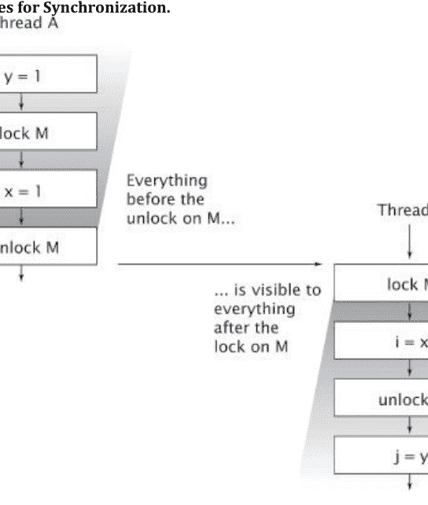


# Java 并发编程

我们现在给出访问共享可变变量时要求所有线程在同一个锁上同步的另一个原因——保证一个线程写入的值对其他线程可见。否则，如果一个线程在没有持有适当锁的情况下读取变量，可能会看到陈旧的值（stale value）。

锁不仅是为了互斥，还关乎内存可见性。为了确保所有线程都能看到共享可变变量的最新值，读和写操作必须在公共锁上进行同步。

## 3.1.4. volatile 变量

Java 语言提供了另一种替代性较弱的同步形式，即 `volatile` 变量，以确保对变量的更新能以预测的方式传播到其他线程。当字段被声明为 `volatile` 时，编译器和运行时确保对该变量的操作不会与内存操作重排序。`volatile` 变量不会被缓存在寄存器或缓存中（从而对其他处理器不可见），因此对 `volatile` 变量的读取始终返回由任何线程写入的最新值。

考虑 `volatile` 变量的一种良好方法是将它们想象成列表 3.3 中的 `Integer` 类，将对 `volatile` 变量的读写替换为 `get` 和 `set` 调用。然而，`volatile` 变量不执行锁，因此不会导致执行线程阻塞，使得 `volatile` 变量是一种比 `synchronized` 更轻量级的同步机制。

[4] 这种类比并不准确；`Synchronized` 整数的内存效应实际上比 `volatile` 变量稍强。第 16 章。

[5] 在大多数处理器架构上，`volatile` 写入仅比 `volatile` 读取稍微贵一点。

`volatile` 变量的可见性影响超出了 `volatile` 变量本身。当线程 A 写入 `volatile` 变量，随后线程 B 读取该变量时，A 在写入 `volatile` 变量之前可见的所有值在 B 读取 `volatile` 变量后对 B 可见。从内存角度来看，写入 `volatile` 变量就像离开 `synchronized` 块，而读取 `volatile` 变量就像进入 `synchronized` 块。然而，我们不建议过度依赖 `volatile` 变量来保证可见性；依赖 `volatile` 变量处理任意状态的代码比使用同步的代码更脆弱，也更难理解。

仅在实现和验证你的同步策略时使用 `volatile` 变量；除非是为了确保其状态、其所引对象的可见性，或指示重要的生命周期事件（如初始化或关闭），否则避免使用 `volatile` 变量。

列表 3.4 展示了 `volatile` 变量典型的用法：检查睡眠标志位以确定何时退出循环。在这个例子中，我们的休眠线程正尝试通过传统的计数睡眠法来睡眠。为了让这个例子生效，`asleep` 必须是 `volatile` 的。否则，线程可能在另一个线程设置 `asleep` 时没有注意到。我们可以使用锁来确保 `asleep` 更改的可见性，但这会让代码变得复杂。

### 列表 3.4. 计数睡眠

```java
volatile boolean asleep;
while (asleep) {
    countSleep();
}
```

`volatile` 变量很方便，但它们也有局限性。`volatile` 变量最常见的用途是完成、中断或状态标志，如列表 3.4 所示。`volatile` 变量可以用于其他类型的状态，但在更新它们时需要更多的操作。例如，`volatile` 的语义不足以使自增操作（`++`）具有原子性，除非你能保证该变量仅从单个线程写入。（原子变量提供了原子的读-修改-写操作，并可以作为“更好的 volatile”使用，参见第 15 章）。

> 锁可以同时保证可见性和原子性；`volatile` 变量只能保证可见性。

只有在满足以下所有条件时，你可以使用 `volatile` 变量：

- 对变量的写入不依赖于其当前值，或者你可以确保只有一个线程更新该值；
- 该变量没有参与其他状态变量；
- 在访问该变量时，由于任何其他原因不需要锁。

## 3.2. 发布与逃逸

发布（Publishing）对象是指使其在当前作用范围之外的代码可用，方法通过共享其引用让其他代码可以找到它、从非私有方法返回它，或将其传递给方法。在许多情况下，我们希望确保对象及其内部不被发布。在其他情况下，我们希望发布一个对象供通用使用，但采用线程安全的方式，这可能需要同步。发布状态变量会破坏封装，并使维护不变性变得困难；在对象完全构造之前发布对象可能会损害线程安全。一个在不应该发布时发布的对象被称为逃逸（escaped）。第 3.5 节介绍了用于的……

### 列表 3.5. 发布对象

```java
public Set<Secret> initialize() {
    knownSecrets = new HashSet<Secret>();
}
```

发布可能会间接泄露其他对象。如果你向已发布的 `knownSecrets` 中添加内容，你也发布了它，因为任何代码都可以遍历该集合并获得新秘密的引用。同样，从非私有方法返回引用也会发布所返回的对象。列表 3.6 中的 `UnsafeStates` 发布了提供的缩写的可变状态。

### 列表 3.6. 允许内部状态逃逸。不要这样做

```java
class UnsafeStates {
    private String[] states = new String[]{
        "AK", "AL ..."
    };
    public String[] getStates() { return states; }
}
```

这样的发布是有问题的，因为任何调用者都可以修改其内容。在这种情况下，`states` 数组逃逸了预期的范围，因为本应是私有的状态已经公开了。

发布一个对象也会发布由非私有字段引用的任何对象。更泛泛地说，从发布的对象出发通过一系列非私有引用和方法调用可以到达的任何对象也可以被发布。

从类 C 的角度来看，外部方法（alien method）是指行为未由 C 完全指定的方法。这包括其他类的方法，以及 C 中可重写的方法（非私有且非 final）。将对象传递给外部方法意味着你不知道实际上会调用哪些代码，从而发布了一个以后可能从另一个线程使用的引用。

另一个线程是否对发布的引用做了什么并不重要，因为滥用的风险仍然存在。一旦对象逃逸，你就必须假设另一个类或线程可能会恶意或粗心地误用它。这是使用封装的有力理由：它使得分析程序的正确性变得可行并且极少意外违反设计约束。

> [7] 如果有人偷了你的密码并将其发布在免费新闻组，该信息已经逃逸了：无论是否有人使用这些凭据创建你的账户，它都已经被泄露了。发布引用面临同样的风险。

发布对象或内部状态的最后机制是发布内部类实例，如列表 3.7 中的 `ThisEscape` 所示。当 `ThisEscape` 发布 `Event` 时，它隐式地发布了外部的 `ThisEscape` 实例，因为内部类实例包含对外部实例的隐藏引用。

### 列表 3.7. 隐式允许引用逃逸。不要这样做

```java
public class ThisEscape {
    public ThisEscape(EventSource source) {
        source.registerListener(
            new EventListener() {
                public void onEvent(Event e) {
                    doSomething(e);
                }
        });
    }
}
```

## 3.2.1. 安全构造实践

`ThisEscape` 展示了逃逸的一个重要特殊情况——当此引用在构造过程中逃逸时。当内部的 `EventListener` 被发布时，封装它的 `ThisEscape` 实例也随之发布。但对象只有在构造函数返回后才处于可预测、一致的状态，因此从构造函数中发布对象是一个构造不完全的对象。如果该引用是构造函数中的最后一个引用，情况如此。如果该引用在构造过程中逃逸，则该对象被认为未被正确构造。[8]

[8] 更具体地说，此引用在构造函数返回之前不应从线程逃逸。构造函数可以将此引用存储在某处，只要在构造完成后没有被另一个线程使用。列表 3.8 中的 `SafeListener` 使用了这种技术。

不要允许此引用在构造过程中逃逸。

让此引用在构造过程中逃逸的常见错误是从构造函数中启动线程。当对象从构造函数中创建线程时，它几乎总是与新线程共享其引用，要么是显式的（传递给构造函数），要么是隐式的（因为 `Thread` 或 `Runnable` 是拥有对象的内部类）。新线程随后可能在对象完全构造之前就看到它。相反，应该暴露一个启动或初始化方法来启动线程。最好不要立即启动线程。（更多生命周期问题参见第 7 章）。在构造函数中重写实例方法（既非私有也非最终的方法）也会导致此引用逃逸。

如果你倾向于在构造函数中注册事件监听器或启动线程，可以使用私有构造函数和公共工厂方法来改进构造过程，如列表 3.8 中的 `SafeListener` 所示。

### 列表 3.8. 使用工厂方法防止此引用在构造过程中逃逸

```java
public class SafeListener {
    private final EventListener listener;

    private SafeListener() {
        listener = new EventListener() {
            public void onEvent(Event e) {
                doSomething(e);
            }
        };
    }

    public static SafeListener newInstance(EventSource source) {
        SafeListener safe = new SafeListener();
        source.registerListener(safe.listener);
        return safe;
    }
}
```

## 3.3. 线程限定

访问可变数据需要同步；避免这种要求的一种方法就是不要共享它。如果数据只从单个线程访问，则不需要同步。这种技术称为线程限定（thread confinement），是实现线程安全的最简单的方法之一。当对象被限制在一个线程时，如果被限制的对象本身不是 [CU 2.3.2]，则自动是安全的。

Swing 使用了线程限定。Swing 的视觉组件和数据模型不是线程安全的；相反，通过让它们符合 Swing 事件分发线程来实现安全性。只要正确使用 Swing，运行在事件线程其他线程中的代码就不会访问这些对象。为了方便这一点，Swing 提供了 `invoke` 机制用于在事件线程中调度可执行的任务。Java 中的许多并发错误源于从另一个线程不当使用受限定的对象。

另一种常见方法是使用连接池（JDBC - 数据库连接）。JDBC 规范并不要求连接对象是线程安全的。[9] 在典型的服务器中，线程从池中获取一个连接来处理单个请求，然后返回它。大多数连接（如 servlet 请求）由单个线程同步，连接池在连接返回之前不会释放该连接，这种连接管理模式在整个请求期间将连接限定在线程中。

[9] 应用服务器提供的连接池实现是线程安全的；连接池永远不会从多个线程访问，因此一个非线程安全的实现是不够的。

正如语言没有强制要求变量受锁保护的机制一样，它也没有将对象限定在线程中的方法。实现和核心库提供了可以帮助维护线程限定的机制——局部变量和 `ThreadLocal`——即使有这些机制，确保线程限定对象不从其线程逃逸仍然是程序员的责任。

### 3.3.1. 临时线程限定 (Ad-hoc Thread Confinement)

临时线程限定描述了维护线程限定的责任完全落在实现的情况。临时线程限定可能是脆弱的，因为没有任何语言特性支持它。

使用线程限定的决定是由于将子系统（如 GUI）实现为单线程子系统的决定的结果。单线程子系统有时提供的简单性益处超过了临时线程限定的脆弱性。[10]

[10] 使用限定机制的另一个原因是为了避免死锁；这是 GUI 框架采用单线程机制的主要原因之一。单线程子系统将在第 9 章中介绍。

线程限定的一个特殊情况适用于 `volatile`（易变）变量。只要你确保 `volatile` 变量只从单个线程写入以防止竞态条件，在共享 `volatile` 变量上执行读取-修改-写操作是安全的。在这种情况下，你将修改限定在一个线程中，而可见性变量确保其他线程看到最新的值。

由于其脆弱性，应谨慎使用临时线程限定；如果可能，请使用线程限定的另一种形式（线程内）。

### 3.3.2. 栈限定 (Stack Confinement)

栈限定是线程限定的一种特殊情况，对象被限定在栈上。

只要你确保 `volatile` 变量只从单个线程写入以防止竞态条件，在共享 `volatile` 变量上执行读取-修改-写操作是安全的。在这种情况下，你将修改限定在一个线程中，而可见性变量确保其他线程看到最新的值。

栈限定也可以用于方法需要临时对象（如缓冲区）的情况，以避免在调用时分配临时对象。例如，在 Java 5.0 之前，`Integer.toString` 使用 `ThreadLocal` 来格式化其结果的 12 字节缓冲区，而不是使用共享缓冲区（这需要加锁）或在每次调用时分配一个新缓冲区。[11]

除非操作频繁或调用开销异常昂贵，否则这种技术可以带来性能优势。在 Java 5.0 中，它被每次调用分配一个新缓冲区这种更直接的方法所取代，这表明对于临时缓冲区这种平凡的事物，性能不是考虑问题。

### 3.3.3. ThreadLocal

维护线程限定的正式手段是 `ThreadLocal`，它允许你将线程与值关联。`ThreadLocal` 提供了 `get` 和 `set` 方法，为每个使用它的线程维护单独的副本，因此 `get` 返回的是执行线程设置的最新值。

线程本地变量通常用于防止基于单例或全局变量的设计产生共享。例如，单线程应用程序可能会维护一个在启动时初始化的全局连接，而无需向每个方法传递连接。JDBC 连接不是线程安全的，使用全局连接的多线程应用程序不是线程安全的。通过在列表 3.10 中使用 `ThreadLocal`，每个线程将拥有自己的连接。

当线程第一次调用 `ThreadLocal.get` 时，会咨询 `initialValue` 为该线程提供初始值。从概念上讲，你可以将 `ThreadLocal<T>` 视为一个 `Map<Thread, T>` 用于存储线程特定的值。线程特定值存储在 `Thread` 对象本身；当线程终止时，线程特定值可以被垃圾回收。

如果你将一个单线程应用程序移植到多线程环境，只要共享对象的语义允许，你可以通过将全局变量转换为 `ThreadLocal` 来保持安全性；如果将内联代码转换为线程本地代码，其效果可能不会那么理想。

`ThreadLocal` 在应用框架中被广泛使用。例如，JEE 容器在 EJB 调用期间包含一个事务上下文。这是通过 `ThreadLocal` 上下文实现的：当框架需要确定正在运行哪个事务时，它从 `ThreadLocal` 中获取事务上下文。这样做的便利之处在于，它减少了向每个方法传递执行上下文的需要，但它将任何使用此机制的代码与框架耦合在一起。

通过将 `ThreadLocal` 的局限属性视为使用全局变量的许可，或者通过创建“隐藏方法”，很容易滥用 `ThreadLocal`。和线程本地变量一样，它们会降低可重构性并在类之间引入隐藏的耦合，因此应该谨慎使用。

## 3.4. 不变性

到目前为止我们描述的同步机制的另一种绕过方法是使用不可变对象 [EJ Item 13]。对于查看状态值、更新或观察处于不一致状态的对象，几乎所有的不变性和可见性屏障都会随着多个线程尝试访问同一个可变状态的反复无常而消失。如果一个对象的状态不能被修改，这些风险和复杂性就消失了。

不可变对象本质上是线程安全的；它们的不变性是由构造函数建立的，如果它们的状态无法改变，这些不变性就会始终成立。

不可变对象总是线程安全的。

不可变对象是简单的。它们只能通过构造函数控制。程序设计中最困难的元素之一就是对对象可能的复杂状态进行推理。相反，对不可变对象的状态进行推理至关重要。

不可变对象也安全。将可变对象传递给不可信的代码，或者在其他不可信代码可能失败的地方发布它，是危险的——不可信的代码可能会修改它的状态，更糟糕的是，返回它的引用并在稍后从另一个线程修改它的状态。另一方面，不可变对象不会被恶意或有缺陷的代码破坏，因此你可以自由地共享和发布，而不需要防御拷贝 [EJ Item 24]。

Java 语言规范或 Java 内存模型都没有正式定义不变性，但不变性并不等同于将对象的所有字段声明为 `final`。所有字段均为 `final` 的对象仍然可能是可变的。

一个对象满足以下条件时是不可变的：

- 它的状态在构造后不能修改
- 它的所有字段都是 `final` [12] 且
- 它是正确构造的（引用在构造期间不会逃逸）。

> [12] 技术上可以存在一个并非所有字段都是 `final` 的不可变对象。`String` 就是这样一个类——但它依赖于数据的细致推理，这需要深入理解 Java 内存模型。（对于好奇的人：`String` 缓存了第一个 `hashCode`，并且只计算一次，因为它从状态派生是不变的。不要在家里尝试）

不可变对象仍然可以使用可变对象来管理它们的状态，如列表 3.11 中的 `ThreeStooges`。虽然状态存储是可变的，但 `ThreeStooges` 的设计使得构造后无法修改。存储是 `final` 的，因此对象状态通过 `final` 字段实现。最后一个要求——正确的构造——很容易满足，因为构造函数不会导致该引用对构造函数或调用者之外的代码可见。


# 列表 3.11. 基于可变对象的不可变类

```java
public final class Stooges<String> {
    private final Set<String> stooges = new HashSet<String>();
    public Stooges() {
        stooges.add("Moe");
        stooges.add("Larry");
        stooges.add("Curry");
    }
    public boolean isStooge(String name) {
        return stooges.contains(name);
    }
}
```

由于程序状态不断变化，你可能会认为不可变对象的用途有限，但事实并非如此。对象不可变与它的引用不可变之间存在区别。存储在不可变对象中的程序状态可以通过“替换”不可变对象为持有新状态的新实例来更新；下一节将对这种技术的解释 [13]。

> [13] 许多开发者担心这种方法会产生性能问题，但这些担心通常是没有必要的。分配比你想象的要便宜，而且不可变对象提供了额外的性能优势，例如减少锁定或防御拷贝以及对垃圾回收的影响。

## 3.4.1. Final 字段

`final` 关键字是 C++ 约束机制的更限制的版本，它支持不可变对象的构造。`final` 字段不能被修改（尽管它们引用的对象如果是可变的是可以被修改的），但它们在 Java 内存模型中具有特殊的语义。正是 `final` 的使用保证了初始化（见第 3.5 节），不可变对象可以在无同步的情况下自由访问和共享。

即使对象是可变的，将字段设为 `final` 仍然可以简化状态的推理，因为对象的可变性限制了其可能的状态集合。只有一个两个可变变量的“大部分不可变”对象仍然比有许多可变变量的对象简单。将字段声明为 `final` 也有助于维护这些字段不会改变。

> 正如除非需要更高的可见性，否则将所有字段设为 `private` 是一个良好的做法 [EJ Item 12]，除非它们需要是可变的，否则将所有字段设为 `final` 也是一个良好的做法。

## 3.4.2 使用 Volatile 发布不可变对象

在第 24 页的 `UsingCachingFactorizer` 中，我们使用两个 `AtomicReference` 来存储最后值和数字。（注：此处原文存在大量重复的 OCR 错误，已简化处理。）

# Java并发编程实践

事实上，如果列表 3.15 中的 `Holder` 是使用列表 3.14 中的不安全发布惯用发布的，那么除发布线程外的线程可能会抛出 `AssertionError`！[15]

问题不在于 `Holder` 类本身，而在于 `Holder` 没有被正确发布。然而，通过将字段 `n` 设为 `final`，可以使 `Holder` 变为不可变，从而对不正确发布产生免疫力。参见第 3.5.2 节。

## 列表 3.15 如果未正确发布则可能失败的类

```java
public class Holder {
    private int n;

    public Holder(int n) { this.n = n; }

    public void assertSanity() {
        if (n != 1)
            throw new AssertionError("this statement is false.");
    }
}
```

由于没有使用同步机制来使 `Holder` 对其他线程可见，我们说 `Holder` 没有被正确发布。两个线程可能会获得错误发布的对象。其他线程也可能看到 `holder` 字段的值，从而即使在已经在 `holder` 中放置了值，它们仍可能看到空引用或其他旧值。更糟糕的是，其他线程可能会看到 `Holder` 引用的最新值，但其 `holder` 状态却是旧值[16]。为了让这些情况变得不可预测，线程在第一次读取字段时可能会看到一个值，而在下次读取时却看到最新值，此时 `assertSanity` 可能会抛出 `AssertionError`。

[16] 虽然看起来构造函数中设置的字段是写入这些字段的首个值，且没有比这更“旧”的值可以看到，但 `Object` 构造函数在子类运行之前会先向所有字段写入默认值。因此，可能会将字段的默认值视为一个值。

恕不赘言，当在没有充分同步的情况下跨线程共享数据时，可能会发生一些奇怪的事情。

## 3.5.2 不可变对象与初始化安全

由于不可变对象如此重要，内存模型（`MemoryModel`）为共享不可变对象提供了初始化安全保障。正如我们所看到的，对象对另一个线程可见并不意味着该对象的状态对消费线程可见。为了保证对象状态的一致视图，需要同步。

另一方面，不可变对象可以保证这种初始化安全的维持，前提是满足所有不可变性要求：状态不可修改、所有字段均为 `final` 且构造得当。（如果列表 3.15 中的 `Holder` 是不可变的，那么即使 `Holder` 没有被正确发布，断言也不会抛出 `AssertionError`。）

任何线程都可以安全地使用不可变对象而无需额外的同步，即使在发布时没有使用同步。

这种保证扩展到所有正确构造的对象的 `final` 字段；`final` 字段可以在没有额外同步的情况下被安全访问。然而，如果 `final` 字段引用了可变对象，则访问其所引用对象的状态仍需要同步。

### 3.5.3. 安全发布惯用方法

非不可变的对象必须被发布，这通常涉及发布线程和消费线程的同步。目前，让我们专注于确保消费线程能够看到发布状态下的对象；我们将在稍后处理发布后的修改。

要安全地发布一个对象，对象的引用和对象的状态必须同时对其他线程可见。正确构造的对象可以通过以下方式发布：

- 将引用初始化为 `volatile` 字段或 `AtomicReference`；
- 将引用存在正确构造对象的 `final` 字段中；
- 将引用存在由锁恰当保护的字段中。

线程安全集合的内部同步意味着，访问线程安全集合（如 `vector` 或 `synchronizedList`）中的对象将满足这些要求。如果你在线程安全集合中访问对象 X 并随后检索它，则保证 B 是 X 离开时的状态。线程安全库集合提供了以下安全发布，即使 Java 的描述没有对象那么清晰：

- 在 `Hashtable`、`synchronizedMap` 或 `ConcurrentMap` 中放置键或值，会将其发布给任何从 Map 中检索它的线程（无论是直接检索还是通过迭代器检索）；
- 在 `CopyOnWriteArrayList`、`synchronizedList` 或 `synchronizedSet` 中放置元素，会将其发布给任何从集合中检索它的线程。

线程安全集合的内部同步意味着，访问线程安全集合（如 `vector` 或 `synchronizedList`）中的对象将满足这些要求。如果你在线程安全集合中访问对象 X 并随后检索它，则保证 B 是 X 离开时的状态。线程安全库集合提供了以下安全发布...（注：重复逻辑）

```java
public static Holder holder = new Holder(42);
```

静态初始化器由 JVM 在初始化时执行。

### 3.5.4. 有效不可变对象

安全发布确保了对象在被访问时其发布状态是可见的。并非真正不可变但在发布后不会被更改的对象被称为“有效不可变对象”。它们只需要被安全地发布。

例如，假设你想维护每个用户的最后登录时间：

> [17] 这可能是类库中的一个错误。

```java
public Map<String, Date> lastLogin = synchronizedMap(new HashMap<>());
```

如果日期值在放入 Map 之后不再被修改，那么 `synchronizedMap` 中的同步就足够了。

### 3.5.5. 可变对象

如果对象在构造后可能会被修改，安全发布确保了可见性。要共享可变对象，必须安全地发布，并且必须是线程安全的或受锁保护。

对象的发布要求取决于它的可变性：

- 不可变对象可以通过任何机制发布；
- 有效不可变对象必须安全发布；
- 可变对象必须安全地发布，并且必须是线程安全的或受锁保护。

### 3.5.6. 安全共享对象

每当你获取对象的引用时，你都应该知道你被允许对它做什么。你需要在使用它之前获取锁吗？你被允许修改它的状态，还是只能读取它？许多并发错误源于未能理解这些针对共享对象的“交互规则”。当你发布一个对象时，你应该记录该对象如何被访问。

在并发程序中使用和共享对象最有用的策略是：

- **线程限制（Thread-confined）**。线程限制对象由一个线程独有并限制在该线程，并由其所有线程修改。
- **共享只读（Shared read-only）**。共享只读对象可以被多个线程并发访问而无需额外同步，但不能被任何线程修改。共享只读对象包括不可变和有效不可变对象。
- **线程安全（Thread-safe）**。线程安全对象内部执行同步，因此多个线程可以通过其公共接口自由访问而无需进一步同步。
- **受保护（Guarded）**。受保护的对象只有在持有特定锁时才能访问。受保护对象包括封装在其他线程安全对象中的，以及已知受特定锁保护的发布对象。

# 第 4 章 对象的组合

到目前为止，我们学习了通过锁定每一次内存访问来确保程序是线程安全的；但我们并不这样做是为了获取线程安全的组件，并安全地将它们组合成更大的组件或程序。本章涵盖了构建类的结构模式，这些模式可以更容易使类变得线程安全，并在不无意中破坏其安全保证的情况下对其进行维护。

## 4.1. 设计线程安全的类

虽然可以编写一个将所有状态存储在公共静态字段中的线程安全程序，但除非恰当使用封装，否则验证其线程安全性或对其进行修改以保持线程安全性要困难得多。封装使得我们能够在不检查整个程序的情况下，确定一个类是线程安全的。

线程安全类的设计应该包含以下三个基本元素：

- 识别构成对象状态的变量；
- 识别约束状态变量的不变性（`invariants`）；
- 建立管理对对象状态并发访问的策略。

对象的状态从它的字段开始。如果所有字段都是原始类型，那么这些字段就成了整个状态。列表 4.1 中的 `Counter` 只有一个字段，因此 `value` 字段构成了整个状态。具有 n 个字段的对象是其字段值的 n 元组；`2Point` 的状态是 `(x, y)` 值。如果对象拥有指向其他对象的引用，它的状态将涵盖那些对象的字段。例如，`LinkedList` 的状态包含了它所属的所有列表节点的状态。

同步策略定义了对象如何在不违反其不变性或属性的情况下协调其状态。它规定了什么是不可变性、线程锁的适用范围，以及如何可能为受锁保护的变量维护线程安全性。为了确保该类可以被分析和维护，请记录同步策略。

> 列表 4.1. 使用 Java 监视器模式的简单线程安全计数器。
>
> @Threadsafe
>
> ```java
> public final class Counter {
>     @GuardedBy("this")
>     private long value = 0;
>     public synchronized long getValue() {
>         return value;
>     }
>     public synchronized long increment() {
>         if (value == Long.MAX_VALUE)
>             throw new IllegalException("counter overflow");
>         return ++value;
>     }
> }
> ```

### 4.1.1. 收集同步需求

创建一个线程安全的状态需要确保其不变性在并发访问下保持不变；这需要对其状态进行推理。对象和变量都有状态空间：即它们可以取的可能状态范围。这个状态空间越小，越容易进行推理。在可能使用字段的地方，你可能实现它来简化对象可能处于的状态。（在极端情况下，不可变对象只能处于单一状态）

许多不变性可以标识一个状态是有效还是无效。如果 `Counter` 中的 `value` 字段是 `long`，那么 `long` 的状态范围从 `Long.MIN_VALUE` 到 `Long.MAX_VALUE`，但 `Counter` 对 `value` 施加了约束；不允许负值。

同样，操作可能具有后置条件，将某些状态转换标记为无效。如果 `Counter` 的当前状态是 17，那么唯一的有效后续状态是 18。当下一个状态从当前状态产生时，该操作必然是一个复合动作。并不是所有操作都会产生状态转换；当更新持有当前温度的变量时，它的上一个状态不会影响计算。

不变性和后置条件对状态或转换施加的约束可能会产生额外的同步或封装需求。如果某些状态无效，则底层状态变量必须被封装，否则其他客户端代码可能会将对象置于无效状态。如果一个操作具有无效的状态转换，它必须

Java 并发实战

另一方面，由于类没有暗示任何此类约束，我们可能放宽封装或序列化需求，以获得更大的灵活性或更好的性能。

一个类还具有约束多个状态变量的不变性。一个数字范围类（如列表 4.10 所示）维护了范围下界和上界的状态变量。这些变量必须遵守“下界小于等于上界”的约束。像这样的多变量不变性需要原子性：相关变量必须在单个原子操作中被获取或更新。你不能更新其中一个，释放锁，然后更新其他的，因为这可能在释放锁时让对象处于无效状态。当多个更新参与于一个不变性时，它们所保护的锁在访问相关值的任何操作期间都必须保持持有。

如果不观察对象的不变性和后置条件，你就无法确保安全性。对状态变量有效状态或状态转换的约束可以产生原子性和封装需求。

### 4.1.2. 依赖状态的操作

类的不变性和后置条件约束了对象的有效状态和状态转换。某些对象还具有基于状态的前置条件的方法。例如，你不能从空队列中删除项；在删除它之前，队列必须处于“非空”状态。具有基于状态的前置条件的操作被称为**依赖状态的操作**（CP 3）。

在单线程程序中，如果前置条件不成立，操作只能失败。但在并发程序中，前置条件可能由于另一个线程的操作而变为真。并发程序允许等待前置条件变为真，然后继续操作的可能性。

用于高效等待条件变为真并通知的内置机制与内建锁（`intrinsic locking`）紧密绑定，并且可能难以使用。为了创建等待前置条件变为真后继续的操作，使用现有的库类（如阻塞队列或信号量）更为容易。`BlockingQueue`、`Semaphore` 等阻塞库类见第 5 章；使用平台提供的机制创建依赖状态类见第 4 章。

### 4.1.3. 状态所有权

我们在 4.1 节中暗示，对象的状态可能是该对象字段图的子集。为什么它可能不是？从给定对象可达约束是什么？

在定义构成对象状态的变量时，我们只想知道该对象拥有的数据。所有权并没有嵌入语言中，而是类设计的一个元素。如果你分配并填充 `HashMap`，你创建了多个对象：`HashMap` 实现中使用的 `Map.Entry` 对象以及其他对象。`HashMap` 的逻辑包含了其 `Map` 和内部对象的状态，尽管它们是作为单独的对象实现的。

无论好坏，垃圾回收让我们避免了仔细考虑所有权。在 C++ 中传递对象时，你必须仔细考虑你是在转移所有权、进行短期贷款还是长期所有权。所有，这些所有权模型都是可能的，但垃圾回收减少了引用中许多常见错误的代价。

在许多情况下，所有权和封装是并存的——封装了它拥有的状态以及它封装的状态。所有权意味着控制，但如果你发布了一个可变对象的引用，你必须锁定协议来维护该变量状态的完整性。你不再拥有独占控制权；但你可能拥有“共享所有权”。类通常不拥有传递给其方法或构造函数的对象，除非方法被设计为显式转移传递对象的所有权（例如同步包装工厂方法）。

集合类通常表现出“分离所有权”的形式，当集合拥有基础设施的状态，而 `servletContext` 拥有框架时。`ServletContext` 提供了一个类似 Map 的对象容器，你可以通过 `setAttribute` 和 `getAttribute` 在其中注册和检索属性。由应用容器实现的 `ServletContext` 必须是线程安全的，因为它会被多个线程访问。Servlet 在调用 `setAttribute` 和 `getAttribute` 时不需要使用同步，但在使用存储在 `servletContext` 中的对象时，它们可能需要使用同步。这些对象是由

由 servlet 容器代表应用程序存储。如果使用了对象，为了防止多个线程访问 servlet 容器产生干扰，必须确保它们是线程安全的、有效的不可变的，或者被显式地受锁保护。[1]

> [1] `HttpServletSession` 在 servlet 框架中执行某些功能，它可能有更严格的要求。servlet 容器可能会访问 `HttpServletSession` 中的对象，以便它们被用于复制或持久化，因此它们必须是线程安全的，因为容器和 Web 应用程序都在访问它们。（我们之所以说“可能”，是因为复制和钝化并不在 servlet 规范的范围内，但它是 servlet 容器的常见特性。）

## 4.2. 实例限制（Instance Confinement）

如果一个对象不是线程安全的，仍然可以使用几种技术让它在多线程程序中安全运行。你可以确保它只能从单个线程访问（线程限制），或确保对它的所有访问都由锁恰当保护。

封装通过促进实例限制简化了使类线程安全的工作，这通常仅仅是类限制（CPP 2.3）。当一个对象被封装在另一个对象内部时，所有可能访问该封装对象的代码路径都是已知的，那么如果该对象可以被另一个对象访问，就可以更容易地进行分析。将限制与适当的锁定策略相结合，可以确保原本非线程安全的对象以线程安全的方式被使用。

将数据封装在对象内部限制了对对象方法的访问，使得更容易确保数据始终通过适当的锁进行访问。

受限制的对象不能逃逸其预期的范围。一个对象可以被限制在一个类（如私有成员）、词法作用域（如局部变量）或线程（如从一个方法传递到另一个方法但不应跨线程共享的对象）中。对象会自发逃逸；它们需要开发者的帮助，开发者将对象发布到其预期的范围之外会导致逃逸。


# Java 并发实战

## 4.2 实例限制

列表 4.2 展示了限制和锁定如何协同工作，即使在类的组件值是私有的情况下也能使一个类变为线程安全。`Phoneset` 的状态由一个 `HashSet` 管理，`HashSet` 并不是线程安全的。但由于 `myset` 是私有的且不允许逃逸，`HashSet` 被限制在 `Phoneset` 内部。唯一可以访问 `myset` 的代码路径是 `addPerson`，而这里的每一个方法都获取了 `Phoneset` 的锁。一切都受其内在锁（intrinsic lock）的保护，使得 `Phoneset` 成为线程安全的。

**列表 4.2. 使用限制确保线程安全。**

```java
@ThreadSafe
public class Phoneset {
  @GuardedBy("this")
  private final Set myset = new HashSet<Person>();
  public synchronized void addPerson(Person p) {
    myset.add(p);
  }
  public synchronized boolean contains(Person p) {
    return myset.contains(p);
  }
}
```

这个示例没有对 `Person` 的线程安全性做任何假设，但如果它是可变的，那么在访问从 `Phoneset` 中检索的 `Person` 时，将需要额外的同步。做到此点最可靠的方法是让 `Person` 变成线程安全的；不那么可靠的方法是用锁保护 `Person` 对象，并确保所有客户端都遵循在访问 `Person` 之前获取锁的协议。

实例限制是构建线程安全类最简单的方法之一。它还为选择锁定策略提供了灵活性。`Phoneset` 恰好使用其内在锁来保护其状态，但任何一致使用的锁效果都很好。实例限制还允许不同的变量由不同的锁保护（关于使用多个对象来保护其状态的类示例，请参见第 236 页的 `serverstatus`）。

平台库中有许多此类示例，这些类是为了将非线程安全的类转换为线程安全的类。基本类如 `ArrayList` 和 `HashMap` 提供了工厂方法（`Collections.synchronizedList` 和 `lists`），以便它们可以在多线程环境中安全地使用。这些工厂使用了装饰器模式（Gamma et al., 1995）将集合封装在一个同步包装器中；该包装器将每个接口方法实现为同步方法，并将请求转发给底层的集合对象。只要包装器对象持有指向底层集合的唯一可达引用（即底层集合被限制在包装器内部），该包装器对象就是线程安全的。Javadoc 警告说，对底层集合的所有访问必须通过该包装器进行。

当然，仍然可能通过一个所谓的受限制对象来防止限制的逃逸：如果一个对象被意图限制在特定范围内，那么让它逃逸该范围就是一个程序错误。限制也可以通过发布其他对象（如迭代器或内部类）来逃逸，这些对象可能会间接地发布受限制的对象。

限制使得构建线程安全类变得更容易，因为一个限制其状态的类可以对其线程安全性进行分析，而无需检查整个程序。

### 4.2.1 Java 监器模式（Java Monitor Pattern）

遵循实例限制的逻辑结论引导你使用 Java 监器模式。[2] 遵循 Java 监器模式的对象封装了其所有的状态监器，并用对象的内在锁保护它。

> [2] Java 监器模式的灵感源自 Hoare 对监器的研究（Hoare, 1974），尽管这与真正的监器之间存在差异。进入和退出同步块的字节码指令甚至被称为 `monitoren` 和 `monxit`，Java 内置（内在）锁有时被称为监器或锁。

`Counter` 在 4.1 是该模式的一个典型示例。它封装了一个状态值，并且对该变量的所有访问都受 `Counter` 方法的保护。

### 4.2.2 示例：跟踪车辆

`Counter` 在 4.1 是 Java 监器模式的一个简洁但微不足道的示例。让我们构建一个稍微大一点的示例：用于调度出租车、警车或送货车的“车辆跟踪器”。我们首先使用监器模式来构建它，然后查看在需要线程安全性时如何放宽封装要求。

每个车辆由一个字符串和一个表示为 (x, y) 坐标的位置来标识。`vehicleTracker` 类封装了已知车辆的身份和位置，使其非常适合作为模型-视图-控制器应用程序中的数据模型，在那里可能被视图线程和多个更新线程共享。视图线程将获取车辆名称和位置并在显示器上渲染它们：

```java
Map<String, Point> locations = vehicles.getLocation();
for (String key : locations.keySet()) {
    rendervehicle(key, locations.get(key));
}
```

```java
void vehicleMoved(vehicleMoved event) {
    Location loc = event.getLocation();
    vehicle.setLocation(event.getVehicleId(), loc.x, loc.y);
}
```

由于视图线程和更新线程会并发访问数据模型，因此它是线程安全的。列表 4.4 显示了使用 Java 监器模式实现的车辆跟踪器，并在列表 4.5 中使用 `MutablePoint` 来表示车辆位置。

尽管 `MutablePoint` 不是线程安全的，但跟踪器类是安全的。该 map 本身或其包含的任何可变点从未被发布过。当我们需要返回车辆位置时，通过使用 `MutablePoint` 构造函数或深拷贝来获取适当的值，这创建一个新的 map，其键和值源自旧 Map 的键和值。[3]

> [3] 注意，`deepCopy` 不能简单地将 Map 包装在 `unmodifiableMap` 中，后者可以保护集合不被修改，但无法防止调用者修改存储在其中的可变对象。出于相同的原因，通过拷贝函数在 `deepCopy` 中使用 `HashMap` 是不可行的，因为只复制了点的引用，而不是点本身。

此实现通过在返回数据给客户端之前拷贝可变数据来维护线程安全。这通常不是问题，但如果车辆集合非常大，可能会变成问题。[4] 另一个后果是每次调用 `getLocation` 时都会拷贝数据，返回的位置的内容即使底层位置发生变化也不会改变。这是是坏取决于你的需求。如果对位置有内部一致性要求（在这种情况下返回一致的快照至关重要），或者如果回调需要每个车辆的最新信息并因此经常刷新它们的快照，那么这可能是一个优势。

> [4] 因为在执行 `deepCopy` 时，跟踪器的内部锁在整个可能是耗时的拷贝操作期间一直被持有，当正在跟踪大量车辆时，这可能会降低用户界面的响应能力。

## 4.3 委托线程安全

但所有最简单的对象都是复合对象。在从零开始构建类或从非线程安全的对象中拷贝组件时，Java 监器模式非常有用。但如果我们类中的组件本身就是线程安全的呢？我们需要添加额外的线程安全层吗？答案是……取决于情况而定”。在某些情况下，由线程安全的组件组成的复合对象是线程安全的（列表 4.7 和 4.9），而在另一些情况下，它仅仅是一种良好的安全实践（4.10）。

在第23页的 `CountingFactorizer` 中，我们在一个无状态对象中添加了 `AtomicLong`，生成的复合对象仍然是线程安全的。由于 `CountingFactorizer` 的状态就是线程安全的 `AtomicLong` 的状态，且 `CountingFactorizer` 对计数器的状态没有额外的有效性约束，很容易看出 `CountingFactorizer` 是线程安全的。由于 `CountingFactorizer` 将其线程安全责任委托给了 `AtomicLong`，因此 `CountingFactorizer` 是线程安全的，因为 AtomicLong 是 [5]

> [5] 如果 count 不是 final，那么对 `CountingFactorizer` 的线程安全分析将变得复杂。如果 `CountingFactorizer` 可以修改指向不同 `AtomicLong` 的引用，那么我们需要确保此更新对所有可能访问 `count` 的线程可见的，并且关于计数器的值不存在竞态条件。这也是使用 `final` 字段非常实用的理由之一。

### 4.3.1 示例：使用委托的车辆跟踪器

作为委托的一个更具体的示例，让我们构建一个委托给线程安全的类的车辆跟踪器。我们将位置存储在 map 中，因此使用线程安全的 Map 实现 `ConcurrentHashMap`。我们不再使用 `MutablePoint` 而是使用不可变类，如列表 4.6 所示。

**列表 4.6. DelegatingVehicle 使用的不可变类。**

`Point` 是线程安全的，因为它是不可变的。不可变值可以自由共享，因此我们在返回它们时不再需要拷贝位置。4.7 中的 `DelegatingVehicle` 没有任何显式同步；所有状态的访问都由 `ConcurrentHashMap` 管理。

**列表 4.7. 委托给 ConcurrentHashMap**

```java
@ThreadSafe
public class DelegatingVehicle {
    private final ConcurrentHashMap<String, Point> locations;
    private final Map<String, Point> unmodifiableMap;

    public DelegatingVehicle(Map<String, Point> points) {
        locations = new ConcurrentHashMap<String, Point>(points);
        unmodifiableMap = Collections.unmodifiableMap(locations);
    }

    public Map<String, Point> getLocations() {
        return unmodifiableMap;
    }

    public Point getLocation(String id) {
        return locations.get(id);
    }

    public void setLocation(String id, int x, int y) {
        if (locations.replace(id, new Point(x, y)) == null) {
            throw new IllegalArgumentException("invalid vehicle: " + id);
        }
    }
}
```

**列表 4.8. 返回位置集合的静态拷贝而非“实时快”。**

```java
public Map<String, Point> getLocations() {
    return new HashMap<String, Point>(locations);
}
```

### 4.3.2 独立状态变量

`Component` 是一个图形组件，允许客户端注册鼠标和键盘事件的监听器。它维护每种类型的注册监听器列表，以便在事件发生时调用相应的监听器。但鼠标监听器集和键盘监听器之间没有关系；它们是独立的，因此 `visualComponent` 可以将其线程安全委托给两个底层的线程安全列表。

`visualComponent` 使用 `CopyOnWriteArrayList` 来存储每个监听器列表；这是一种特别适用于管理监听器的安全的 List 实现（见第 5.2.3 节）。每个 List 都是线程安全的，由于没有将一个状态到另一个状态的约束，`visualComponent` 可以将其线程安全责任委托给底层的 `mouseListeners` 和 `keyListeners` 对象。

**列表 4.9. 将线程安全委托给多个底层状态变量。**

```java
public class VisualComponent {
    private final List<KeyListener> keyListeners;
    { keyListeners = new CopyOnWriteArrayList<KeyListener>();
    private final List<MouseListener> mouseListeners;
    { mouseListeners = new CopyOnWriteArrayList<MouseListener>();

    public void addKeyListener(KeyListener listener) {
        keyListeners.add(listener);
    }

    public void addMouseListener(MouseListener listener) {
        mouseListeners.add(listener);
    }

    public void removeKeyListener(KeyListener listener) {
        keyListeners.remove(listener);
    }

    public void removeMouseListener(MouseListener listener) {
        mouseListeners.remove(listener);
    }
}
```

### 4.3.3 当委托失效时

大多数类并没有 `VisualComponent` 那么简单；它们拥有与其组件状态变量相关的不变性。列表 4.10 中的 `NumberRange` 使用两个 `AtomicInteger` 来管理其状态，但它增加了一个额外的约束：第一个数字不小于或等于第二个数字。

`NumberRange` 不是线程安全的；它没有保护下限和上限之间的不变性。`lower` 和 `setter` 方法试图遵守这一不变性，但做得非常糟糕。它们都没有使用 `synchronized` 锁来保证操作的原子性。如果范围保持为 (0, 10)，其中一个线程调用 `lower(5)`，而另一个线程调用 `upper(4)`，在某些糟糕的时机下，两者都通过了 setter 中的检查，并且两个修改都将被应用。结果是该范围现在处于 (5, 4) 的无效状态。虽然底层的 `AtomicInteger` 是线程安全的，但这个复合类不是。由于底层状态变量 `lower` 和 `upper` 不是独立的，`NumberRange` 无法简单地将线程安全委托给其线程安全的状态变量。


可以通过使用锁来维护不变性，使 `NumberRange` 变得线程安全，例如用一个公共锁保护 `lower` 和 `upper`。它还必须避免发布 `lower` 和 `upper`，以防止客户端破坏其不变性。

如果一个类具有复合操作（如 `NumberRange` 所示），仅仅靠委托不再是线程安全的合适方法。在这些情况下，该类必须提供自己的锁来确保复合操作的原子性，除非整个复合操作也可以委托给底层状态变量。

> 如果一个类由多个独立的、线程安全的状态变量组成，并且没有任何操作会导致无效的状态跃迁，那么它就可以将线程安全委托给底层状态变量。

# 列表 4.10. Number 类没有保护其不变性。请不要这样做。

```java
public class NumberClass {
    // 不变性: lower < upper
    private final AtomicInteger lower = new AtomicInteger(0);
    private final AtomicInteger upper = new AtomicInteger(0);

    public void setLower(int i) {
        // 警告 - 不安全的检查后执行操作
        if (i >= upper.get()) {
            throw new IllegalArgumentException("can't set lower to " + i + " >= " + upper.get());
        }
        lower.set(i);
    }

    public void setUpper(int i) {
        // 警告 - 不安全的检查后执行操作
        if (i <= lower.get()) {
            throw new IllegalArgumentException("can't set upper to " + i + " <= " + lower.get());
        }
        upper.set(i);
    }

    public boolean isInRange(int i) {
        return (i >= lower.get()) && i <= upper.get();
    }
}
```

`NumberRange` 使用线程安全变量的问题在于，其状态组件是线程安全的，这与 3.1.4 节中描述的其他变量之一非常相似：它只有在不参与涉及其他状态变量的不变的情况下，才适用于被声明为 `volatile`。

## 4.3.4. 发布状态变量

当你将线程安全委托给对象的底层状态变量时，在什么条件下你可以发布这些变量以便其他类可以修改它们？再次，答案取决于你的类对这些变量施加了什么不变性。虽然 `counter` 中的 `value` 字段可以取任何整数值，但递增操作将其限制为正值，而递减操作将约束限制为当前状态温度或当前状态 ID。如果你将 `value` 字段设为公有，它可能会变为无效值，因此发布它会导致该类变得错误。相反，如果一个变量代表当前登录的用户，那么让另一个类随时修改此值可能不会违反任何不变性，因此发布这个可变变量可能是可以接受的。（这可能仍然不是一个好主意，因为发布可变变量会限制未来的开发和子类化的机会，但它并不一定限制类本身）

如果一个状态变量是线程安全的，不参与任何限制其值的不变性，并且其任何操作都没有被禁止的状态跃迁，它就可以安全地发布。

例如，如果我们在 `visualComponent` 中发布 `mouseListeners` 或 `keyListeners`。由于 `visualComponent` 没有对其监听器列表的值状态施加任何限制，这些字段可以设为公共或其他其他方式发布，而不损害线程安全。

## 4.3.5. 示例：发布状态的车辆跟踪器

让我们构建另一个版本的车辆跟踪器，它发布其底层状态。同样，我们需要稍微修改接口以适应这种变化，使用可变但线程安全的点。

# 列表 4.11. 线程安全的可变点类。

```java
@ThreadSafe
public class SafePoint {
    @volatile private int x, y;

    private SafePoint(int[] a) { this(a[0], a[1]); }

    public SafePoint(int x, int y) { this.x = x; this.y = y;    }

    public synchronized int[] get() {
        return new int[]{x, y};
    }

    public synchronized void set(int x, int y) {
        this.x = x;
        this.y = y;
    }
}
```

`SafePoint` 列表 4.11 提供了一个一次性获取 `x` 和 `y` 的访问器。

> 构造函数允许我们在实现为 `this(x,y)` 时避免竞态条件；这是拷贝构造函数惯用法的示例 (Bloch and Gofer, 2005)。

使用 `SafePoint` 我们可以构造一个发布状态且不破坏线程安全的车辆跟踪器，如列表 4.12 中的 `PublishingVehicleTracker` 类所示。`PublishingVehicleTracker` 通过委托给 `ConcurrentHashMap` 实现线程安全，这使得 Map 的内容是线程安全的指针而不是不可变的。`getLocations` 返回 Map 的不可变拷贝。调用者无法添加或删除车辆，但可以通过更新返回的 `SafePoint` 来获取车辆的位置。再次，Map 的“实时”特性可能是优点也可能是缺点，取决于我们是否对车辆位置实施了任何额外的约束。如果需要能够“否决”更改或在位置变化时采取行动，那么 `PublishingVehicleTracker` 采用的方法将不再合适。

# 列表 4.12. 安全发布状态的车辆跟踪器。

```java
@ThreadSafe
class PublishingVehicleTracker {
    private final Map<String, SafePoint> locations;
    private final Map<String, SafePoint> unmodifiableMap;

    public PublishingVehicleTracker(
        Map<String, SafePoint> locations) {
        this.locations = new ConcurrentHashMap<String, SafePoint>(locations);
        this.unmodifiableMap = Collections.unmodifiableMap(this.locations);
    }

    public Map<String, SafePoint> getLocations() {
        return unmodifiableMap;
    }

    public SafePoint getLocation(String id) {
        return locations.get(id);
    }

    public void setLocation(String id, int x, int y) {
        if (!locations.containsKey(id)) {
            throw new IllegalArgumentException("invalid vehicle name: " + id);
        }
        locations.get(id).set(x, y);
    }
}
```

## 4.4. 为线程安全的类添加功能

Java 类库为我们提供了许多构建模块。使用类来创建新类可以减少开发工作量、开发风险（因为现有组件已经通过了测试）以及维护成本。线程安全的类已经支持了我们已存在的所有操作，但通常我们需要在不破坏其安全性的情况下添加一个新操作。

作为一个例子，假设我们需要一个具有原子性 `put-if-absent`（如果不存在则放入）操作的线程安全 `List`。同步的 `List` 实现类几乎提供了可以让我们构建出 `put-if-absent` 操作的方法。

`put-if-absent` 的概念非常直观——在添加元素之前检查该元素是否在集合中，如果它已经存在，则不添加。（此时你脑中的“检查-再执行”警报可能已经响了。）该类必须是线程安全的这一要求增加了另一个要求——像 `put-if-absent` 这样的操作必须是原子的。任何合理的解释都认为，如果你有一个不包含任何对象 X 的 `List`，结果集合应该包含一个 X。但如果 `put-if-absent` 不是原子的，在某些时机下，两个线程可能会看到 X 不存在并添加它，导致产生两个 X 副本。

添加新原子操作最安全的方法是修改原始类以支持所需的操作，但这并不总是可能的，因为你可能没有源代码的访问权限，或者如果你修改了原始类，你需要理解它的同步策略，以便以与其原始设计一致的方式对其进行增强。直接将新方法添加到类中意味着所有代码都在一个文件中，便于便于维护。

另一种方法是扩展该类，前提是它是为了扩展而设计的。列表 4.13 中的 `BetterVector` 扩展了 `Vector` 以添加 `put-if-absent` 方法。扩展 `Vector` 是很直观的，但并不是所有的类都暴露了足够的状态来允许这种方法。

扩展比直接向类中添加代码更脆弱，因为同步策略的实现变得“去同步化”了；它现在分布在多个、独立维护的源文件中。如果底层类通过选择不同的锁来保护其状态变量而改变了其同步策略，子类将会发生微妙且无声的崩溃，因为它再也没有使用正确的锁来控制对基类状态的并发访问。（`Vector` 的同步策略由其规范固定，所以 `BetterVector` 不会受到此问题。）

> 列表 4.13 扩展 Vector 以拥有一个 Put-if-absent 方法。

```java
public class BetterVector<E> extends Vector<E> {
    public boolean putIfAbsent(E x) {
        if (!contains(x)) {
            add(x);
        }
        return false;
    }
}
```

### 4.4.1. 客户端锁

对于用 `Collections.synchronized` 包装器封装的 `ArrayList`，这两种方法——向原始类添加方法或扩展该类——都不可行，因为客户端代码甚至不知道同步包装器工厂返回的 `List` 对象的类。第三种策略是通过将其放置在“助手”类中来避免扩展该类。

列表 4.14 展示了一个失败的尝试，旨在创建一个操作线程安全 `List` 具有原子性 `put-if-absent` 操作的类。

# 列表 4.14. 实现 Put-if-absent 的非线程安全尝试。不要这样做。

```java
public class ListHelper<E> {
    public List<E> list =
        Collections.synchronizedList(new ArrayList<E>());

    public synchronized boolean putIfAbsent(E x) {
        boolean absent = !list.contains(x);
        if (absent) {
            list.add(x);
        }
        return absent;
    }
}
```

为什么这不起作用？在 `putIfAbsent` 已经同步了之后，对吧？问题在于它在错误的锁上进行了同步。无论 `List` 使用什么来保护其状态，那都不可能是 `ListHelper` 上的锁。`ListHelper` 只提供了同步的幻象；各种列表操作（都是同步的）使用不同的锁，这意味着 `putIfAbsent` 相对于 `List` 的其他操作来说不是原子的。无法保证在 `putIfAbsent` 执行期间另一个线程不会修改列表。

为了让这种方法生效，我们必须通过使用客户端锁或外部锁来使用 `List`。客户端锁涉及守卫类，这些守卫类使用带有 `List` 的某个对象 X 来保护其自身的状态。为了使用客户端锁，我们必须知道 `List` 使用了什么。

`Vector` 和同步包装器类的文档虽然隐晦地指出，它们通过使用包装器的内置锁（而不是被包装的集合）支持客户端锁。列表 4.15 展示了在线程安全 `List` 上使用客户端锁的 `putIfAbsent` 操作。

# 列表 4.15. 使用客户端锁实现 Put-if-absent。

```java
public class ListHelper<E> {
    public List<E> list =
        Collections.synchronizedList(new ArrayList<E>());

    public boolean putIfAbsent(E x) {
        synchronized (list) {
            boolean absent = !list.contains(x);
            if (absent) {
                list.add(x);
            }
            return absent;
        }
    }
}
```

如果扩展另一个原子操作是脆弱的，因为它将一个类的加锁代码分布在对象层次结构中的多个类中，那么客户端锁更加脆弱，因为它涉及到将类 C 的加锁代码放在与 C 完全不相关的类中。在未承诺其策略的类上使用客户端锁时要加小心。

客户端锁与扩展有许多共同点——它们都使同步去封装化了。

### 4.4.2. 组合

添加原子操作的另一种方案是组合。你不是扩展该类，而是创建一个封装 `List` 实例的新类，并将方法委托给它。这允许你在不修改原始类的情况下添加原子操作。

# 列表 4.16. 使用组合实现 If-Absent。

```java
public class ImprovedList<T> implements List<T> {
    private List<T> list;

    public ImprovedList(List<T> list) {
        this.list = list;
    }

    public synchronized boolean putIfAbsent(Object x) {
        boolean contains = list.contains(x);
        if (!contains) {
            list.add(x);
        }
        return contains;
    }

    public synchronized void clear() {
        list.clear();
    }
    // ... 其他方法
}
```

## 4.5. 文档同步策略

文档是管理线程安全的强大（遗憾地未充分利用）的工具之一。用户查看文档是为了确定它是线程安全的，维护者查看文档是为了理解其策略。不幸的是，这两者通常发现的信息都很少。

制定同步策略需要许多决策：哪些变量是 `volatile` 的，哪些变量由锁保护，哪些变量是不可变的或局限于线程的，哪些操作必须是原子的。其中一些是实现细节，应该为了未来的维护者进行记录，但公开可见的锁定行为应该作为规范的一部分进行记录。

至少要记录锁所提供的线程安全保证。它是线程安全的吗？它会在持有锁的情况下进行回调吗？是否有特定的锁影响行为？不要让客户端猜测。参考第 4.4 节，你可以说明应该获取哪些类以安全地这样做。如果你使用锁来保护，请为未来的维护者记录这一点，因为这很容易——`@guarded` 注解会有帮助。

目前线程安全文档的状况，即使在平台类中也不令人乐观。你多少次查看一个类的 JavaDoc 并怀疑它是否是线程安全的？大多数类都没有提供清晰的提示。许多官方 Java 技术规范以及像 JDBC 这样的库都会低估其线程安全的承诺和要求。

# Java 并发实战

更糟糕的是，我们的直觉对于哪些类“可能是线程安全的”而哪些类不是的可能是错误的。例如，`java.text.SimpleDateFormat` 不是线程安全的，但 Javadoc 在 JDK 1.4 中忽略了对这一点的说明。这个特定类不是线程安全的，这让许多开发者感到意外。许多程序错误地创建了非线程安全对象的共享实例，并从多个线程中使用它，而没有意识到这在重度负载下可能会导致错误的结果。

通过在类没有明确说明的情况下不假设某个类是线程安全的，就可以避免 `SimpleDateFormat` 的问题。另一方面，如果不对对容器提供的对象（如 `HttpServlet`）的线程安全性做出某些可疑的假设，就无法开发基于 servlet 的应用程序。不要让你的客户或同事也不得做出这样的猜测。

## 4.5. 解释模糊的文档

许多技术规范对于 `ServletContext`、`HttpServlet` 和 `DataSource` 等接口的线程安全性和保证是保持沉默的，或者至少没有提供足够详尽的信息。由于这些接口是由你的容器或数据库供应商实现的，你不想查看它的具体实现。此外，你希望你的代码能与任何 JDBC 驱动程序正常工作——但“线程”和“并发”这两个词在 JDBC 规范中完全没有出现，在 Servlet 规范中也很少出现。你该怎么办？

> [9] 我们发现，尽管规范进行了重大修订，这些遗漏仍然存在。


你将不得不面对这个问题。提高猜测质量的一种方法是从实现者（如容器或数据库供应商）的角度来解释规范，而不是从仅仅使用者的角度。Servlets 都是从容器管理的线程调用的，可以安全地假设，如果有多个线程，容器是知道的。servlet 容器创建了某些为 servlet 提供服务的对象，例如 `HttpServlet` 或 `servletContext`。servlet 容器应该预见到，如果这些对象被并发访问，它已经为它们创建了多个线程以及诸如 `servlet.service` 这样可以安全调用的方法。

因为可以想象出一个使用这些对象的单线程上下文，除非规范显式地要求这样做。此外，如果它们需要客户端锁，容器应该在哪个锁上进行同步呢？文档没有说明，而且这似乎是荒谬的。这种“合理的假设”得到了规范中的示例和官方教程的进一步支持，这些示例显示了 `ServletContext` 或 `HttpServlet` 并不使用任何客户端同步。

另一方面，通过 `setAttribute` 放在 `servletContext` 或 `HttpServlet` 中的对象是通过并发访问排序的。servlet 规范没有建议任何控制对这些属性并发访问的机制。Web 容器存储的属性应该是线程安全的，或者是有效的不可变的。如果容器仅仅存储了这些 Web 应用的属性，另一种选择是确保在从 servlet 应用程序代码访问时受到锁的保护。但容器无法知道你的锁定协议，那么如何让它们变成线程安全的呢？

可以对 JDBC `datasource` 接口进行类似的类比，它代表一个可重用的数据库连接池。`datasource` 为应用程序提供服务，在单线程应用程序的语境下它是没有意义的。很难想象不涉及从多个线程获取连接的情况。而且，对于 servlets，在许多使用 `datasource` 的示例中，JDBC 规范并没有建议需要任何客户端锁，`datasource` 是线程安全的，或者要求供应商提供线程安全的实现；根据同样的“如果不是就太荒谬了”的论点，我们不得不假设 `datasource.connection` 不需要任何客户端锁。

另一方面，我们不会对容器分发的 JDBC `Connection` 对象提出同样的论点，因为这些对象在返回连接池之前，并不一定会被其他活动共享。所以，如果获取 JDBC 连接的活动跨越了多个线程，它必须负责确保对 `Connection` 的访问受到同步保护。（在许多应用程序中，使用 JDBC `Connection` 的实现方式是将 servlet 限制在特定的线程中。）


# 构建块

最后一章探索了构建块的各种技术，包括将线程安全性委托给创建线程安全的类。在可行的情况下，委托是创建线程安全的类最有效的策略之一：即直接使用线程安全的类来管理一切。

平台库包含丰富的构建块、线程安全的集合以及各种协调协作线程控制流的同步器。本章涵盖了最有用的并发构建块，特别是 Java 5.0 和 Java 6 中引入的那些，以及使用它们来构建并发应用程序的某些模式。

## 5.1. 同步集合 (Synchronized Collections)

同步集合包括 `Vector` 和 `Hashtable`（原始 JDK 的一部分），以及在 JDK 1.2 中添加的它们的表亲类——通过 `Collections.synchronized` 工厂方法创建的同步包装类。这些类通过同步它们的状态和每个公共方法来实现线程安全性，使得一次只有一个线程可以访问集合状态。

### 5.1.1. 同步集合的问题

同步集合是线程安全的，但你有时可能需要使用额外的客户端锁来保护复合操作（compound actions）。集合上的复合操作包括迭代（反复获取元素直到集合耗尽）、导航（根据顺序获取当前元素之后的下一个元素）以及诸如 `put-if-absent` 等操作（如果 Map 已经有键 K 的映射，则添加映射 (K,V)）。对于同步集合，这些复合操作即使在没有客户端锁的情况下也是线程安全的，但当其他人并发修改集合时，它们的行为可能不符合你的预期。

列表 5.1 显示了两个操作在 `vector` 上的方法：`getLast` 和 `delete`，它们都是线程安全的序列。每次调用都会调用 `size` 方法来确定数组的大小，并根据结果值获取或删除最后一个元素。

> 列表 5.1. 在 Vector 上可能抛出 `ConcurrentModificationException` 的复合操作。

```java
public static Object getLast(Vector list) {
    int lastIndex = list.size() - 1;
    return list.get(lastIndex);
}

public static void delete(Vector list) {
    int lastIndex = list.size() - 1;
    list.remove(lastIndex);
}
```

这些方法看起来是无害的，从某种意义上说如此——它们不会破坏 `vector`，无论有多少线程同时调用它们。但这些方法的调用者可能会发现：线程 A 在一个有十个元素的 `vector` 上调用 `getLast`，线程 B 在同一个 `vector` 上调用 `delete`，由于操作如图 5.1 所示交叉执行，`getLast` 抛出了 `ArrayOutOfBoundsException`。这是因为 `vector` 缩小了，计算出的索引不再有效。这与 `vector` 的行为是完全一致的。


## 列表 5.5. 使用迭代器迭代。

```java
List<Widget> list = Collections.synchronizedList(new ArrayList<Widget>());
// 可能抛出 ConcurrentModificationException
for (Widget w : list) {
  doSomething(w);
}
```

有几个原因导致迭代期间锁定集合可能是不理想的。如果集合很大，或者为每个元素执行的任务非常耗时，它们可能等待很长时间。如果像列表 5.4 所示锁定了集合，则在持有锁的情况下调用了某些方法，这是死锁的风险因素（参见第 10 章）。即使在没有饥饿或死锁的情况下，一段时间的锁竞争也会损害应用程序的扩展性。锁的持有时间越长，越容易发生竞争，如果许多线程阻塞等待锁的吞吐量，CPU 的利用率就会受到影响（参见第 11 章）。

在迭代期间锁定集合的替代方案是收集集合并迭代其副本。由于副本是线程私有的，在迭代期间没有其他线程可以修改它，从而消除了 `ConcurrentModificationException` 的可能。（在迭代操作期间，集合仍然是锁定的）。克隆集合有明显的性能代价；然而，这种有利的权衡取决于许多因素，包括集合的大小、每个元素执行的工作量、迭代与其他集合操作相比的相对频率，以及响应和吞吐量的需求。

### 5.1.3. 隐藏的迭代器

虽然锁定集合可以防止迭代器抛出 `ConcurrentModificationException`，但你必须记住在其他地方何时可能可能会迭代共享集合。这比列表 5.6 更复杂，因为迭代器有时被隐藏在 `hiddenIterator` 中。`hiddenIterator` 中没有显式的迭代，但 `stringbuilder.append(object)` 中的代码会调用编译器生成的拼接操作，而该操作反过来会调用集合的 `toString()` 方法——而标准集合中 `toString` 的实现会遍历集合并对每个元素调用 `toString()`，以产生集合内容的良好格式化表示形式。

`addthen` 方法可能会抛出 `ConcurrentModificationException`，因为在打印调试消息的过程中，集合正在被 `toString` 迭代。当然，问题在于 `hiddenIterator` 不是线程安全的；`HiddenIterator` 锁应该在被设置到 `printall` 之前获取，但调试和日志记录常用代码可能会忽略这样做。

这里的真正教训是，状态与保护它的同步机制之间的距离越大，人们在访问该状态时越可能忘记使用适当的同步。如果 `HiddenIterator` 用 `synchronizedSet` 包装了 `HashSet`，那么封装同步是行不通的。

> 正如封装对象的状态使其更容易保持其不变性，封装其同步机制使其更容易强制其同步策略。


## 列表 5.6. 字符串拼接中的隐藏迭代器。不要这样做。


```java
public class HiddenIterator {
    @GuardedBy("this")
    private final Set<Integer> set = new HashSet<Integer>();
    public synchronized void addInteger(Integer i) { set.add(i); }
    public synchronized void removeItem(Integer i) { set.remove(i); }
    public void addThings() {
        Random random = new Random();
        for (int i = 0; i < 10; i++) {
            add(random.nextInt());
        }
        System.out.println("DEBUG: added elements to " + set);
    }
}
```

迭代也会通过集合的 `hashCode` 和 `equals` 方法间接调用，如果集合被用作其他元素或键，这些方法可能会被调用。同样，`containsAll`、`removeAll` 和 `retainAll` 方法以及接受集合作为参数的构造函数也会迭代集合。所有这些间接迭代方式都可能导致 `ConcurrentModificationException`。

## 5.2. 并发集合

Java 5 通过提供几个集合类改进了同步集合。同步集合通过对集合状态的所有访问进行序列化来实现安全性。这种方法的代价是巨大的；当多个线程竞争集合锁时，吞吐量会受到影响。

另一方面，并发集合是为多个线程的并发访问而设计的。Java 5 添加了 `ConcurrentHashMap`（作为同步哈希 Map 的替代品）和 `CopyOnWriteArrayList`（在遍历占主导操作的情况下，作为同步 List 实现的替代品）。`ConcurrentMap` 接口增加了对 `put-if-absent`、`replace` 和条件 `remove` 等常用操作的支持。

> 用并发集合替换同步集合可以在风险极小的情况下提供巨大的改进。

Java 5 还添加了两种新的集合类型：`Queue` 和 `BlockingQueue`。队列用于临时持有一组元素以等待处理。提供了几种实现：`ConcurrentLinkedDeque`（传统的 FIFO 队列）和 `PriorityQueue`（非并发的、优先级的队列）。`Queue` 操作是不阻塞的；如果队列为空，获取将返回 `null`。虽然 `LinkedList` 的行为允许 `null`，但添加队列类是因为消除 `List` 的随机访问需求允许了更高效的并发集合。

`BlockingQueue` 扩展了 `Queue` 以添加阻塞的插入和获取操作。如果队列为空，获取将阻塞直到有元素可用；如果队列已满（对于有界队列），插入将阻塞直到有空间。阻塞队列在生产者-消费者设计中非常有用，并在第 5.3 节中有更详细的介绍。

正如 `ConcurrentHashMap` 是同步哈希 Map 的替代品一样，Java 6 添加了 `ConcurrentNavigableMap` 和 `ConcurrentNavigableSet`，它们是同步 `SortedMap` 或 `SortedSet`（如带有 `synchronizedMap` 的 `TreeMap` 或 `TreeSet`）的替代品。

### 5.2.1. ConcurrentHashMap

同步集合在整个操作期间持有锁。某些操作（如 `Map.get` 或 `contains`）可能比最初看起来更复杂：遍历哈希桶或列表以在多个候选对象上找到特定对象的 `equals`（这可能涉及大量的计算）。在基于哈希的集合中，`hashCode` 不能很好地分散哈希值，元素在对象之间的分布可能均匀。在退化情况下，糟糕的哈希函数会将表变成链表。遍历列表并对所有或部分元素调用 `equals` 可能花费很长时间。

（注：此处后续文本包含大量重复和乱码的 OCR 错误，已根据逻辑结构进行了清理。）

# 56 Java并发实战

```java
// Listing 5.7 ConcurrentMap 接口
public interface ConcurrentMap<K,V> extends Map<K,V> {
    // 如果 K 没有映射值，则插入 putAbsent
    V putIfAbsent(K key, V value);
    // 只有当 K 映射到 V 时删除
    boolean remove(K key, V value);
    // 只有当 K 映射到旧值时替换值
    boolean replace(K key, V oldValue, V newValue);
    // 只有当 K 映射到某个值时替换值
    V replace(K key, V newValue);
}
```

显然，每次修改集合时复制底层数组都是有成本的，特别是当集合很大时；写复制集合只有在迭代频率远高于修改频率时才是合理的。这一准则描述了许多事件通知系统：递送通知需要注册的监听器列表并调用每一个监听器，在大多数情况下，注册或注销监听器比接收事件要快（关于写复制的更多信息，请参见 CP 2.4）。

## 5.3. 阻塞队列与生产者-消费者模式

阻塞队列提供了 `put` 和 `take` 方法，以及对应的定时方法和 `poll`。如果队列已满，`put` 会阻塞直到空间可用；队列可以是边界的也可以是无界的；无界队列永远不会满，因此在无界队列上执行 `put` 永远不会阻塞。

阻塞队列支持生产者-消费者设计。生产者-消费者设计通过将项放入“待办列表”中稍后处理，将待执行工作的识别与执行分离，而不是在识别出它们时立即处理。生产者-消费者模式简化了开发，因为它消除了生产者和消费者之间的代码依赖，并通过解耦不同速率产生或消耗数据的活动来简化工作负载。

在围绕阻塞队列构建的生产者-消费者设计中，生产者在数据项可用时将其放入队列，消费者在准备好执行生产者产生的操作时从队列中检索数据。生产者不需要知道消费者的身份，也不需要知道他们是否是生产者——他们要做的只是将数据项放入队列。同样，消费者不需要知道生产者是谁或工作从哪里来。阻塞队列简化了具有任意数量生产者和消费者的生产者-消费者设计实现。最常见的生产者-消费者设计之一是带有工作队列的线程池；这种模式嵌入在 Executor 任务执行框架中，该框架是第 6 和第 7 章的主题。

两个人洗碗的常见分工是生产者-消费者设计的一个例子：一个人洗碗并将它们放在碗架上，另一个人从架子上取出它们并擦干。在这种情况下，碗架充当了阻塞队列；如果架子上没有碗子，消费者将等待直到有碗子，而如果架子满了，生产者将等待直到有更多空间。这种架构可以扩展到许多生产者（可能会产生锁的竞争）和多个消费者；没有人需要知道有多少生产者或消费者，也不需要知道是谁生产了某项工作。

“生产者”和“消费者”的标签是相对的；在一个语境下作为消费者的活动，在另一个语境下可能是生产者。那个“消费”干净碗子并“生产”干碗子的人。第三个人可能想帮助擦碗子，在这种情况下，碗架既是生产者又是消费者，并且产生了两个共享的工作队列（每个队列可能根据情况阻塞生产者）。

阻塞队列简化了消费者的编码，因为它们会阻塞直到数据可用。如果生产者没有产生足够快的工作来保持消费者忙碌，消费者只需等待直到有更多工作。有时这是完全可以接受的（例如当服务器应用程序在没有客户端请求时），它表明应该调整生产者与消费者的比例以获得更好的利用率（例如在网络爬虫或其他实际上有工作要做的应用中）。

如果生产者持续生成工作的速度快于消费者处理的速度，应用程序最终将耗尽内存。如果生产者没有产生足够快的工作来保持消费者忙碌，消费者只需等待直到有更多工作。有时这是完全可以接受的（例如当服务器应用程序在没有客户端请求时），它表明应该调整生产者与消费者的比例以获得更好的利用率（例如在网络爬虫或其他实际上有工作要做的应用中）。

（注：原文文本中存在部分重复段落，翻译已根据要求进行了逻辑处理或保留）

# Java 并发实战

对于可变对象，生产者-消费者设计和阻塞队列有助于通过线程限制（thread confinement）来处理从生产者到消费者的对象所有权。线程限制的对象由单个线程独占，但可以通过通过“安全发布”（safe publication）来“转移”所有权，即确保只有一个线程将获得访问权限，并确保发布者之后不再访问它。安全发布确保了对象的状态对新所有者可见，由于原始线程将不再触碰它，它现在被限制在新的线程中。由于新所有者拥有独占访问权限，它可以自由地修改。

对象池实施了串行线程限制，将对象“借给”请求的线程。只要池包含足够的同步机制来安全地发布池化对象，并且客户端在返回池后不再发布或使用该池化对象，所有权就可以通过线程转移。

也可以使用其他机制来转移可变对象的所有权，但必须确保只有一个线程接收到交接的对象。阻塞队列使得这变得简单，只需少量的工作，例如 `ConcurrentMap` 的原子 `remove` 方法或 `AtomicReference.compareAndSet`。

列表 5.8。桌面搜索应用程序中的生产者和消费者任务。


# Java 并发实战

## 5.4.3. 双端队列与工作窃取

Java 有两类双端队列，称为“array”和“linked”，它们都继承自 `Deque`。`Deque` 允许从头部和尾部高效地插入和删除。实现类是 `ArrayDeque` 和 `LinkedBlockingDeque`。

正如阻塞队列适用于生产者-消费者模式一样，`Deque` 也适用于一种名为“工作窃取”的相关模式。生产者-消费者设计为所有消费者共享一个工作队列；而在工作窃取设计中，每个消费者都有自己的 `Deque`。工作者可以从其他 `Deque` 的尾部取数据。工作窃取比生产者-消费者设计更具扩展性，因为工作者不需要竞争同一个工作队列；如果它们需要访问另一个 `Deque`，它们是从尾部而不是头部访问，从而减少了竞争。

工作窃取非常适用于消费者也是生产者的问题——即执行某项工作可能会识别出更多的工作。例如，在网络爬虫中处理一个页面会识别出需要爬取的新页面。同样，垃圾回收标记可以使用窃取进行高效的并行化。当一个工作者识别出一个新的工作单元时，它将其放在自己 `Deque` 的末尾（或者在工作共享设计中，放在另一个 `Deque` 的末尾）；当自己的 `Deque` 为空时，它会在别人的 `Deque` 末尾窃取工作，确保每个工作者都保持忙碌。

## 5.4. 可中断方法

线程可能会由于多种原因而阻塞：等待 I/O 完成、等待获取锁、唤醒后等待另一个线程中的计算。当线程阻塞时，它会被挂起并置于阻塞状态之一（`BLOCKED`、`WAITING` 或 `TIMED_WAITING`）。阻塞操作与耗时较长的操作之间的区别在于，被阻塞的线程必须等待一个其控制范围外的事件发生才能继续——I/O 完成、锁可用或外部计算完成。当外部事件发生时，线程会被放回 `RUNNABLE` 状态。

`BlockingDeque` 的 `put()` 和 `take()` 方法会抛出受检的 `InterruptedException`，就像 `Thread.sleep()` 等许多其他库方法一样。当一个方法可以抛出 `InterruptedException` 时，它是在告诉你如果它被中断，它必须努力尽早停止阻塞。

`Thread` 提供了中断线程以及查询线程是否被中断的机制。每个线程都有一个表示其中断状态的布尔属性；中断线程会将此状态设置为 `true`。

中断是一种协作机制。一个线程不能强制另一个线程停止它正在做的事并去做其他事情；当线程 A 中断线程 B 时，A 是请求 B 在处理到相关任务时执行某些操作。

## 5.5. 同步器

### 5.5.1. 锁存器

锁存器可以延迟线程的进度直到它达到终端状态。直到锁存器达到终端状态之前它是关闭的且无法再次改变。锁存器可以用于确保某些活动直到一次性活动完成，例如：

- 确保计算在资源初始化之前继续。一个简单的二进制（双向）锁存器可以用于标识“资源已初始化”，任何需要该资源的活动将等待此锁存器。
- 确保服务在其他服务启动之前启动。每个服务都有关联的锁存器；启动服务将等待依赖服务的锁存器，完成后释放该锁存器。
- 等待多人游戏中的所有人准备就绪。在这种情况下，锁存器在所有玩家准备好后达到终端状态。

`CountDownLatch` 是一种灵活的实现，可以用于上述任何情况；一个或多个线程等待一组事件发生。锁存器的状态由初始化为正数的计数器组成，表示等待的事件数量。`countDown()` 方法减少计数器，直到达到零，这意味着所有事件已发生。如果计数器不为零，`await()` 会阻塞直到计数器达到零、等待线程被中断或超时。

列表 5.11 中的 `TestHarness` 展示了锁存器的常见用法。`TestHarness` 为给定任务创建若干线程。它使用了两个锁存器，一个“启动门”和一个“结束门”。启动门初始化计数为 1；每个工作者等待启动门；这确保了在所有线程准备好之前没有线程开始。最后一个工作者在结束门上递减计数；这允许主线程高效等待直到最后一个工作者完成，以便它计算经过的时间。

为什么在 `TestHarness` 中要用锁存器，而不是在创建线程后立即启动它们？原因是为了测量并发运行 n 个任务所需的时间。如果我们只是创建并启动线程，先创建的线程对后创建的线程有“领先优势”，竞争程度会随着活跃线程数量的增加或减少而变化。使用启动门是为了确保公平竞争。

```java
public class TestHarness {
    public long timeTasks(int nThreads, final Runnable task) throws InterruptedException {
        final CountDownLatch startGate = new CountDownLatch(1);
        final CountDownLatch endGate = new CountDownLatch(nThreads);

        for (int i = 0; i < nThreads; i++) {
            Thread t = new Thread() {
                public void run() {
                    try {
                        startGate.await();
                        try {
                            task.run();
                        } finally {
                            endGate.countDown();
                        }
                    } catch (InterruptedException ignored) {
                    }
                }
            };
            t.start();
        }

        long start = System.nanoTime();
        startGate.countDown();
        endGate.await();
        long end = System.nanoTime();
        return end - start;
    }
}
```

### 5.5.2. FutureTask

`FutureTask` 也实现了 `Future`，它描述了一个带有抽象结果的计算过程。由 `FutureTask` 表示的 `Future` 通过一个等同于 `Runnable` 的 `Callable` 实现，并处于三种状态之一：等待运行、运行中或已完成。完成包含了计算能够完成的所有方式，包括正常完成、取消和异常。一旦 `Future` 进入已完成状态，它将永远保持在该状态下。

`FutureTask` 的行为取决于任务的状态。如果任务已完成，则立即获取结果；否则，将阻塞直到任务达到已完成状态，然后返回结果或抛出异常。`FutureTask` 将执行计算的结果传递给获取结果的线程；`FutureTask` 的规范保证了这种传输构成了结果的安全发布。

## 列表 5.8。桌面搜索应用程序中的生产者和消费者任务

```java
public class FileCrawler implements Runnable {
    private final BlockingQueue<File> fileQueue;
    private final FileFilter fileFilter;
    private final File root;

    public FileCrawler(BlockingQueue<File> fileQueue, FileFilter fileFilter, File root) {
        this.fileQueue = fileQueue;
        this.fileFilter = fileFilter;
        this.root = root;
    }

    public void run() {
        try {
            crawl(root);
        } catch (InterruptedException e) {
            Thread.currentThread().interrupt();
        }
    }

    private void crawl(File root) throws InterruptedException {
        File[] entries = root.listFiles(fileFilter);
        if (entries != null) {
            for (File entry : entries) {
                if (entry.isDirectory()) {
                    crawl(entry);
                } else if (!alreadyIndexed(entry)) {
                    fileQueue.put(entry);
                }
            }
        }
    }

    private boolean alreadyIndexed(File entry) {
        // 占位方法，假设存在索引检查逻辑
        return false;
    }
}

public class Indexer implements Runnable {
    private final BlockingQueue<File> queue;

    public Indexer(BlockingQueue<File> queue) {
        this.queue = queue;
    }

    public void run() {
        try {
            while (true) {
                indexFile(queue.take());
            }
        } catch (InterruptedException e) {
            Thread.currentThread().interrupt();
        }
    }

    private void indexFile(File file) {
        // 占位方法，假设存在索引逻辑
    }
}
```

## 列表 5.9。启动桌面搜索

```java
public static void start(File[] roots) {
    BlockingQueue<File> queue = new LinkedBlockingQueue<File>(BOUND);
    FileFilter filter = new FileFilter() {
        public boolean accept(File file) { return true; }
    };

    for (File root : roots) {
        new Thread(new FileCrawler(queue, filter, root)).start();
    }
    for (int i = 0; i < N_CONSUMERS; i++) {
        new Thread(new Indexer(queue)).start();
    }
}
```


```java
public class CountDownLatch {
    public long timeTest(int nThreads, final Runnable task) throws InterruptedException {
        final CountDownLatch startGate = new CountDownLatch(1);
        final CountDownLatch endGate = new CountDownLatch(nThreads);

        for (int i = 0; i < nThreads; i++) {
            Thread t = new Thread(() -> {
                public void run() {
                    try {
                        startGate.await();
                        try {
                            task.run();
                        } finally {
                            endGate.countDown();
                        }
                    } catch (InterruptedException ignored) {}
                }
            });
            t.start();
        }

        long start = System.nanoTime();
        startGate.countDown();
        endGate.await();
        long end = System.nanoTime();
        return end - start;
    }
}
```

`FutureTask` 被 `Executor` 框架用于表示任何异步任务，也可以用于表示在需要结果之前就可以启动的耗时计算。Listing 5.12 中的 `Preloader` 使用 `FutureTask` 执行一个稍后需要的昂贵计算；通过提前开始计算，你减少了之后真正需要结果时必须等待的时间。

**Listing 5.12. 使用 FutureTask 预加载需要的数据。**

```java
public class Preloader {
    private final FutureTask<ProductInfo> future =
        new FutureTask<ProductInfo>(new ProductInfo()) {
            public ProductInfo call() throws DataLoadException {
                return loadProductInfo();
            }
        };
    private final Thread thread = new Thread(future);
    public void start() { thread.start(); }

    public ProductInfo get() throws DataLoadException, InterruptedException {
        try {
            return future.get();
        } catch (ExecutionException e) {
            if (e.getCause() instanceof DataLoadException)
                throw (DataLoadException) e.getCause();
            else
                throw throwable(e.getCause());
        }
    }
}
```

`Preloader` 创建了一个 `FutureTask`，描述了从数据库加载产品信息并执行计算的任务。它为线程提供了一个 `start` 方法，因为在构造函数或静态初始化器中抛出异常是不合适的。当后续需要 `ProductInfo` 时，可以调用 `get`，如果数据已就绪则返回加载的数据，否则等待加载完成。

`Callable` 描述的任务可以抛出检查异常和未检查异常。无论任务抛出什么异常，它都被封装在 `ExecutionException` 中并从 `Future` 返回。这增加了调用者的操作复杂度，不仅是因为他们必须处理 `ExecutionException`（以及未检查的 `CancellationException`），还因为 `ExecutionException` 的原因是以 `Throwable` 类型返回的，这处理起来很不方便。

当 `get` 抛出 `ExecutionException` 时，调用者将会在三类情况之一失败：`callable` 抛出的检查异常、`RuntimeException` 或 `Error`。我们必须分别处理这些情况，但我们使用 Listing 5.13 中的 `throwable` 方法来封装一些杂乱的异常处理逻辑。在调用 `throwable` 之前，`Preloader` 测试它是否通过抛出 `throwable` 并返回结果来处理异常。如果 `Future` 抛出作为 `Error` 的 `throwable`，则 `throwable` 会直接抛出它；如果它不是 `RuntimeException`，则会抛出一个 `IllegalStateException` 表示逻辑错误。其底层 `throwable` 将其返回给调用者，调用者泛泛地处理。

**Listing 5.13. 将未检查的 Throwable 转换为 RuntimeException。**

```java
// 如果 throwable 是 Error，则抛出它；如果它是
// RuntimeException 则返回，否则抛出 IllegalStateException
public static RuntimeException throwable(Throwable t) {
    if (t instanceof RuntimeException)
        return (RuntimeException) t;
    else if (t instanceof Error)
        throw (Error) t;
    else
        throw new IllegalStateException("not unchecked", t);
}
```

## 5.5.3. Semaphores

计数信号量用于控制同时访问特定资源或执行给定操作的活动 [CP 3.4.1]。计数信号量可以实现资源池或对某些操作进行限制。

`Semaphore` 管理一组虚拟许可；初始许可数量传递给 `Semaphore` 构造函数。活动可以获取许可（只要还有剩余），并在完成工作后释放许可。如果没有可用许可，`acquire` 将阻塞，直到有许可可用（或者线程被中断，亦或操作超时）。`release` 方法将许可归还给信号量。[4] 计数信号量的退化情况是二值信号量，即初始计数为 1 的信号量。二值信号量可以作为没有重入锁语义的互斥锁；持有许可者即持有互斥锁。`Semaphore` 用于实现数据库连接池。如果你初始化信号量为池大小，在尝试从池获取资源之前获取许可，并在资源放回池中后释放许可，当池为空时 `acquire` 会阻塞。这种技术用于第 12 章的边界缓冲区。类似，你可以使用信号量将任何集合转换为阻塞集合，如 Listing 5.14 中的 `BoundedHashSet` 所示。信号量初始化为集合所需的大小。`add` 操作在项添加到底层集合之前获取许可。底层 `add` 操作在不实际添加的情况下立即释放许可。同样，成功的移除操作会释放许可，允许更多元素被添加。底层实现并不感知边界；这由 `BoundedHashSet` 处理。

### 5.5.4. Barriers

我们已经看到倒计时是单次使用的对象；一旦倒计时进入终端状态，就无法重置。

屏障与倒计时类似，它们都会阻塞一组线程直到某个事件发生。关键区别在于，对于屏障来说，所有线程必须同时在屏障点汇合才能继续。倒计时等待的是事件，而屏障等待的是其他线程。屏障实现了某些家庭在商场逛街时使用的约会协议：“我们下午 6:00 在麦当劳集合；一旦你到了那里，就等大家都到，然后我们再决定下一步做什么。”

`CyclicBarrier` 允许参与者在屏障点反复汇合，适用于将问题分解为固定数量子问题的并行迭代算法。线程到达屏障点时调用 `await`，`await` 会阻塞直到屏障成功通过，此时所有线程被释放，并且屏障被重置以便再次使用。如果任何 `await` 超时或在 `await` 阻塞的线程被中断，屏障将被视为损坏，`await` 将抛出 `BrokenBarrierException`。如果屏障成功通过，屏障动作将在下一次迭代中执行某些特殊操作。`CyclicBarrier` 还允许你在构造函数中传递一个屏障动作；这是一个在屏障成功通过但在阻塞线程释放之前执行（在其中一个子线程中执行）的 `Runnable`。

# Java 并发实战

**Listing 5.14. 使用 Semaphore 限制集合的大小。**

```java
public class BoundedHashSet<T> {
    private final Set<T> set;
    private final Semaphore sem;

    public BoundedHashSet(int bound) {
        this.set = Collections.synchronizedSet(new HashSet<T>());
        sem = new Semaphore(bound);
    }

    public boolean add(T o) throws InterruptedException {
        sem.acquire();
        boolean wasAdded = false;
        try {
            wasAdded = set.add(o);
            return wasAdded;
        } finally {
            if (!wasAdded) {
                sem.release();
            }
        }
    }

    public boolean remove(Object o) {
        boolean wasRemoved = set.remove(o);
        if (wasRemoved) {
            sem.release();
        }
        return wasRemoved;
    }
}
```

屏障用于仿真，在仿真中，某一步的工作负载可以并行执行，但所有该步骤的线程必须在完成后才能进入下一步。例如，在多体仿真中，每一步都会根据其他粒子的位置和属性更新每个粒子的位置。在每次更新之间等待屏障，可以确保所有对 k 的更新在移动到 k+1 之前已经全部完成。

Listing 5.15 中的 `CellularAutomaton` 展示了如何使用屏障来计算细胞自动机仿真，例如康威生命游戏。在并行化仿真时，为每个元素分配一个单独线程（在生命游戏中为一个单元格）通常是不现实的，因为这需要太多的线程，而且协调开销将大于计算开销。将问题划分为若干部分，每个线程解决一个子集，然后合并结果是合理的。`CellularAutomaton` 将板划分为 N 部分，对于每个部分，工作线程计算其所在板区域内所有单元格的新值。当所有工作线程都到达屏障时，工作线程将被释放以进行计算的下一步，这包括查询一个 `isDone` 来确定是否需要进一步的迭代。

> [5] 对于没有 I/O 且访问共享数据的问题，N_parts = N_threads 可以产生最佳吞吐量；增加线程没有帮助，并且可能由于 CPU 和内存竞争而降低性能。

屏障的另一个例子是双方屏障，其中双方在屏障点交换数据。当线程执行非对称活动时，交换是非常有用的，例如，当一个线程向缓冲区填充数据，而另一个线程从缓冲区消耗数据时；这些线程相遇，并用一个满缓冲区交换一个空缓冲区。两个线程通过 `Exchanger` 交换数据，这种交换构成了两个对象对另一方的安全发布。

交换的时机取决于应用程序的响应速度。最简单的方法是：填充线程在缓冲区满时进行交换，而清空线程在缓冲区为空时进行交换；这最少地减少了交换次数，但如果新数据的到达速率不可预测，可能会延迟某些数据的处理。另一种方法是：填充线程在缓冲区满时进行交换，同时在缓冲区部分填充且已过了一段时间后也进行交换。

## 5.6. 构建高效、可扩展的结果缓存

几乎每个应用程序都会使用某种形式的缓存。重用以前计算的结果可以降低延迟并增加吞吐量，代价是消耗一些额外的内存。

**Listing 5.15. 使用 CyclicBarrier 在细胞自动机中协调计算。**

```java
public class CellularAutomata {
    private final Board mainBoard;
    private final CyclicBarrier barrier;
    private final Worker[] workers;

    public CellularAutomata(Board board) {
        this.mainBoard = board;
        int count = Runtime.getRuntime().availableProcessors();
        this.barrier = new CyclicBarrier(count);
        this.workers = new Worker[count];
        for (int i = 0; i < count; i++) {
            // 省略部分实现
        }
    }
    // ... 省略后续代码
}
```

`Memorizer2` 的行为确实优于 `Memorizer1`：多个线程实际上可以并发执行。但它也有一些缺陷 - 在这种记忆化的情况下，当两个线程同时调用 `compute` 时，会存在一个漏洞，这是非常低效的 - 它的目的是防止相同的数据被多次缓存。情况更糟糕；对于一个本应提供“一次且仅一次”初始化的对象，这种漏洞还会带来安全风险。

`Memorizer2` 的问题在于，如果一个线程开始了一项昂贵的计算，其他线程并不知道计算正在进行，因此可能会启动相同的计算，如图 5.3 所示。我们希望以某种方式表示“线程 X 正在计算 f(27)”这一概念，如果另一个线程在计算 f(27) 时到达，它知道找到该结果最高效的方法是等待线程 X，挂起直到 X 完成，然后问：“嘿，你是怎么得到 f(27) 的结果的？”

图 5.3. 两个线程使用 Memorizer2 计算相同的值。

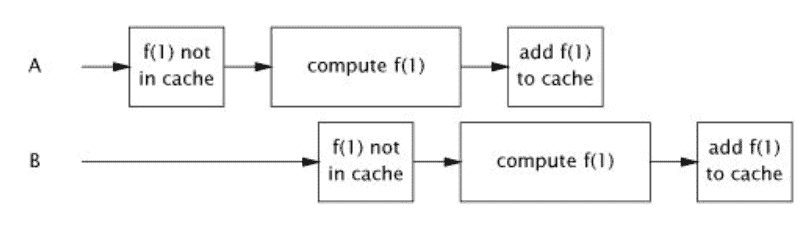

**Listing 5.17. 替换 ConcurrentHashMap。**

```java
public class Memorizer<A, V> {
    private final Map<A, V> cache = new ConcurrentHashMap<A, V>();
    private final Function<A, V> c;

    public Memorizer(Function<A, V> c) { this.c = c; }

    public V compute(A arg) throws InterruptedException {
        V result = cache.get(arg);
        if (result == null) {
            result = c.compute(arg);
            cache.put(arg, result);
        }
        return result;
    }
}
```

我们已经见过一个几乎完全执行同样事情的类：`FutureTask`。`FutureTask` 代表一个可能已经完成也可能尚未完成的计算过程。如果计算结果已经可用，`FutureTask` 会获取该结果；否则，它会阻塞线程直到结果计算完毕并返回它。

Listing 5.18 中的 `Memorizer3` 将值的备用 Map 定义为 `ConcurrentHashMap<A, Future<V>>` 而不是 `ConcurrentHashMap<A, V>`。`Memorizer3` 首先检查计算是否已经开始（正如建议的那样，它创建一个 `FutureTask`，将其注册到 map 中并开始计算；否则，它会等待执行结果）。结果可能立即可用，也可能在计算过程中 - 但这对 `Future` 的调用者来说是透明的。

`Memorizer3` 的实现甚至更好：如果结果已知，则会高效地返回；如果另一个线程正在进行计算，新到达的线程将等待结果。然而，它只有一个缺陷 - 存在一个很小的漏洞窗口，如果 `compute` 中的块仍然是非原子的“检查-后执行”序列，则可能两个线程同时使用相同的值调用 `compute`，它们都发现缓存中不包含所需的值，并且都开始了计算。这种不幸的情况如图 5.4 所示。

# Java 并发实战


## 图 5.4. 可能导致 Memorizer 二次计算相同值的不幸时机

| | 在缓存中放入 f(1) 的 Future | 计算 f(1) | 设置结果 |
|---|---|---|---|
| A | 缓存中没有 f(1) | | |
| B | 缓存中没有 f(1) | 在缓存中放入 f(1) 的 Future | 计算 f(1) | 设置结果 |

## 列表 5.18. 使用 FutureTask 裹 Memorizer

```java
public class Memorizer<A, V> implements Callable<A, V> {
    private final Map<A, Future<V>> cache
        = new ConcurrentHashMap<A, Future<V>>();
    private final Callable<A, V> c;

    public Memorizer(Callable<A, V> c) { this.c = c; }

    public V compute(final A arg) throws InterruptedException {
        Future<V> f = cache.get(arg);
        if (f == null) {
            f = new Future<V>() {
                public V call() throws InterruptedException {
                    return c.call(arg);
                }
            };
            FutureTask<V> ft = new FutureTask<V>(f);
            cache.put(arg, ft);
            ft.run(); // 在这里调用 c.compute
        }
        try {
            return f.get();
        } catch (ExecutionException e) {
            throw throwable(e.getCause());
        }
    }
}
```

Memorizer 容易受到此问题的影响，因为在底层 map 上了一个复合操作（put-if-absent），该操作无法通过锁来实现原子性。列表 5.19 中的 Memorizer 利用了 `ConcurrentMap` 的原子性 `putIfAbsent`，关闭了 Memorizer 中的漏洞窗口。

缓存 `Future` 而不是值会导致缓存污染：如果计算被取消或失败，Future 可能会留在缓存中。为了避免这种情况，Memorizer 在检测到计算取消或失败时会从缓存中移除 Future。通过我们的并发实现，我们现在可以为第 2 章的 servlet 添加缓存。Memorizer 以高效且可扩展的方式缓存结果。

## 列表 5.19. Memorizer 的最终实现

```java
public class Memorizer<A, V> implements Callable<A, V> {
    private final Map<A, Future<V>> cache;
    private final Callable<A, V> c;

    public Memorizer(Callable<A, V> c) { this.c = c; }

    public Future<V> compute(A arg) throws InterruptedException {
        while (true) {
            Future<V> f = cache.get(arg);
            if (f == null) {
                Callable<V> eval = new Callable<V>() {
                    public V call() throws InterruptedException {
                        return c.call(arg);
                    }
                };
                if (cache.putIfAbsent(arg, f = new FutureTask<V>(eval)) == null) {
                    try {
                        return f.get();
                    } catch (CancellationException e) {
                        cache.remove(arg);
                    } catch (ExecutionException e) {
                        throw throwable(e.getCause());
                    }
                }
            }
            return f;
        }
    }
}
```

## 列表 5.20. 使用 Memorizer 缓存结果因子化

```java
public class Factorizer implements Servlet {
    private final Memorizer<BigInteger, BigInteger[]> c =
        new Memorizer<BigInteger, BigInteger[]>() {
            public BigInteger[] compute(BigInteger arg) {
                return factor(arg);
            }
        };
    private final Memorizer<ServletRequest, BigInteger> cache =
        new Memorizer<ServletRequest, BigInteger>(c);

    public void service(ServletRequest req, ServletResponse resp) {
        try {
            BigInteger i = extractFromRequest(req);
            encodeIntegerResponse(resp, cache.compute(i));
        } catch (InterruptedException e) {
            encodeError(resp, "factorization interrupted");
        }
    }
}
```

# 第一部分总结

到为止我们已经涵盖了大量内容！下面的“并发速查表”总结了第一部分介绍的主要概念和规则。

- 根源在于可变状态。[1]
- 所有的并发问题都可以归结为对可变状态的协调。可变状态越少，越容易确保线程安全。
- 除非需要可变，否则将字段标记为 `final`。
- 不可变对象自动是线程安全的。
- 不可变对象极大地简化了并发编程。它们更简单、更安全，不需要锁定或防御复制即可自由共享。
- 封装使得管理复杂性变得可行。

# Java 并发编程

> 你可以通过将所有数据存储在全局变量中编写一个线程安全的程序，但你为什么要这样做呢？将数据封装在对象内部可以更容易保持其不变性；将同步机制封装在对象内部可以更容易遵守其同步策略。

- 使用锁保护每个可变变量。
- 使用同一个锁保护某个不变式中的所有变量。
- 在执行复合操作期间持有锁。
- 如果一个程序从多个线程访问一个可变变量而没有进行同步，那么这个程序就是坏掉的。
- 不要依赖于对“为什么你不需要同步”进行巧妙的推理。
- 在设计过程中包含线程安全性，或者显式地记录你的类不是线程安全的。
- 记录你的同步策略。

[1] 在 1992 年美国总统选举期间，竞选策略家詹姆斯·卡维尔（James Carville）在比尔·克林顿的竞选总部上挂了一块写着“经济，笨蛋”的牌子，以确保竞选活动紧扣主题。

# 第二部分：并发应用程序的结构

- 第 6 章：任务执行
- 第 7 章：取消与关闭
- 第 8 章：应用线程池
- 第 9 章：GUI

## 第 6 章：任务执行

大多数并发应用程序都是围绕任务的执行组织的：任务是抽象的、离散的工作单元。将应用程序的工作划分为任务可以简化程序的组织，通过提供自然的事务边界来促进错误恢复，并通过为并行化工作提供自然的结构来提高并发性。

### 6.1. 在线程中执行任务

围绕执行组织程序的第一步是识别合理的边界。理想情况下，任务不依赖于其他任务的状态、结果或副作用。独立性有利于并发化，因为在有足够的处理资源的情况下，独立任务可以并行执行。为了在调度和负载均衡中具有更强的灵活性，每个任务还应该代表应用程序处理能力的一一小部分。

服务器应用程序在正常负载下应该表现出良好的吞吐量和响应速度。应用程序需要支持尽可能多的用户以减少每个用户的竞争成本；在过载时，而不是简单地在高负载下失败。选择良好的任务边界，结合任务执行策略（见 6.2.2 节），可以帮助它们实现这些目标。

大多数服务器应用程序提供了天然的任务边界选择：单个客户端请求。Web 服务器、邮件服务器、文件服务器、EJB 容器和数据库服务器都通过网络连接接收客户端的请求。将单个请求作为任务边界通常能提供独立性和适当的任务大小。例如，向服务器提交消息的结果不会立即被确认，因为它看起来正正在被处理中，而且处理单条消息通常只需要服务器总容量的极小比例。

#### 6.1.1. 顺序执行任务

在应用程序内部调度任务有多种可能的策略，其中某些策略可能会暴露其他策略之间并发的潜力。最简单是在单线程中按顺序执行任务。`SingleThreadWebserver` 处理它的任务 - 到达 80 端口的 HTTP 请求。处理的细节并不重要；我们感兴趣的是刻画各种调度策略的并发性。

#### 示例 6.1. 顺序 Web 服务器

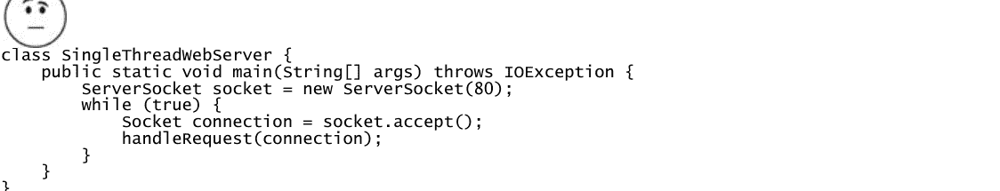

```java
class SingleThreadWebServer {
    public void main(String[] args) throws IOException {
        ServerSocket socket = new ServerSocket(80);
        while (true) {
            Socket connection = socket.accept();
            handleRequest(connection);
        }
    }
}
```

`SingleThreadWebServer` 简单且在理论上是正确的，但在生产环境中性能很差，因为由于一次只能处理一个请求。主线程在接受连接和处理相关请求之间切换。当服务器正在处理请求时，新连接必须等待它完成请求并接受它们。如果请求非常快，导致 `handleRequest` 实际上立即返回，那么这种方法可能可行，但它并没有描述现实世界中的任何 Web 服务器。

处理请求涉及计算和 I/O 的混合。服务器必须执行 I/O 来读取请求并写入响应，这可能会被网络拥堵或连接问题所阻塞。它可能会执行 I/O 或发出数据库请求，这些也可能阻塞。在单线程服务器中，阻塞不仅会延迟当前请求的完成，还会阻止其他请求被处理。如果一个请求持续时间异常长，服务器将由于无响应而变得不可用。资源利用率很低，因为 CPU 单元在等待 I/O 完成时处于空闲状态。

在服务器应用程序中，顺序处理很少能提供良好的吞吐量或响应速度。例外是有的 - 当任务很少且生命周期很长，或者当服务器仅为一个一次只发送单个请求的客户端服务 - 但大多数服务器应用程序并不是这样工作的。

在某些情况下，顺序处理可能提供简单性或安全性优势；大多数 GUI 框架使用单线程进行顺序处理。我们将在第 9 章回到顺序模型。

### 6.1.2. 为任务显式创建线程

一种更具响应性的方法是为每个请求创建一个新线程，如 6.2 中的 `ThreadTaskWebserver` 所示。

#### 示例 6.2. 为每个请求启动新线程的 Web 服务器

```java
class ThreadTaskWebServer {
    public static void main(String[] args) throws IOException {
        ServerSocket socket = new ServerSocket(80);
        while(true) {
            final Socket connection = socket.accept();
            Runnable task = new Runnable() {
                public void run() {
                    handleRequest(connection);
                }
            };
            new Thread(task).start();
        }
    }
}
```

`ThreadTaskWebServer` 与单线程版本类似 - 主线程在接受传入连接和分发请求之间切换。区别在于对于每个连接，它创建一个新线程而不是在主线程中处理。这有三个主要结果：

- 任务处理从主线程卸载，使主循环能够更快地恢复等待连接。这允许在之前的请求完成之前接受新连接，提高了响应能力。
- 任务可以并行处理，允许同时处理多个请求。如果有多个处理器，或者任务需要等待 I/O 操作、锁获取或资源可用，这可能会提高吞吐量。
- 任务处理必须是线程安全的，因为可能会并发调用。

轻负载下，线程方法比顺序执行有了改进。只要请求到达速率不超过服务器处理请求的能力，这种方法就能提供更好的响应和吞吐量。

### 6.1.3. 无限制线程的缺点

然而，对于生产环境，线程方法有一些实际缺点，特别是当可能创建大量线程时：

- 线程周期开销不是免费的。开销在不同平台之间不同，线程创建需要时间，引入了处理延迟，并需要 JVM 和操作系统的某些活动。如果请求频繁且轻量，为每个请求创建新线程会消耗大量的计算资源。
- 资源竞争消耗系统资源，尤其是内存。当可运行线程多于处理器时，线程会占用大量内存，给垃圾回收器带来压力，许多线程竞争 CPU 可能会产生其他性能成本。如果你有足够的线程让所有 CPU 忙起来，创建更多线程没有帮助，甚至可能有害。
- 稳定性。创建线程的数量有限制。该限制随平台而异，并受 JVM 调用参数、`Thread` 构造函数中请求的栈大小以及底层操作系统放置的线程的影响。当你达到此限制时，最可能的结果是 `OutMemoryError`；从这种错误中恢复比避免它更容易。

# Java 并发实战

在一定范围内，增加线程可以提高吞吐量，但超过这一界限后，创建线程只会减慢应用程序的速度，而且多创建一个线程就可能导致整个应用程序发生严重崩溃。避免这种无序的方法是为应用程序创建的线程数设置界限，并对应用程序进行彻底测试，以确保即使达到该界限，也不会耗尽资源。

“每个任务一个线程”（thread-per-task）方法的问题在于，它除了用户线程请求的速率外，对创建的线程数量没有限制。其他的并发风险在原型设计和开发阶段可能无从察觉，问题只有在应用部署并处于高负载时才会显现。因此，一个恶意用户或足够多的普通用户可以在流量负载达到某个阈值时，导致你的服务器崩溃。对于一个应该在负载下提供高可用性和优雅降级的服务器应用程序来说，这是一个严重的失败。

## 6.2. Executor 执行器框架

任务是工作的逻辑单元，而线程是任务能够异步运行的机制。我们研究了在单线程中顺序执行任务的两种策略，每个任务都有自己的线程。这两种方法都有严重的局限性：顺序执行方法受限于响应和吞吐量差，而“每个任务一个线程”方法受限于资源管理差。

在第 5 章中，我们了解了关于有界队列以防止过载的应用程序耗尽内存。线程池在线程管理方面提供了同样的优势，而 `java.util.concurrent` 作为 Executor 框架的一部分提供了一个灵活的线程池实现。Java 类库中任务执行的主要抽象不是 `Thread`，而是 `Executor`，如列表 6.3 所示。

### 列表 6.3. Executor 接口

```java
public interface Executor {
    void execute(Runnable command);
}
```

Executor 可能是一个简单的接口，但它构成了一个灵活且强大的异步任务执行框架的基础，该框架提供了一种标准方法将任务提交与任务执行解耦，通过 `Runnable` 将任务解耦。Executor 的实现还提供了生命周期支持，以及用于添加统计收集、应用程序管理和监控的钩子。

Executor 基于生产者-消费者模式，提交任务的活动是生产者（产生待处理的工作单元），执行任务的线程是消费者（消耗这些工作单元）。使用 Executor 通常是应用程序中实现生产者-消费者设计的最简单路径。

### 6.2.1. 示例：Web 服务器 Executor

使用 Executor 构建 Web 服务器非常简单。列表 6.4 中的 `TaskWebServer` 用 Executor 替换了硬编码的线程。在这种情况下，我们使用了标准的 Executor 实现之一，即一个拥有 100 个线程的固定大小线程池。


在 `TaskSubmission` 中，请求处理任务通过 `Executor` 与其执行解耦，仅通过替换不同的 `Executor` 实现就可以更改其行为。更改 `Executor` 实现或配置比更改任务提交方式的侵入性小得多；`Executor` 的配置通常是一个一次性事件，并且可以很容易暴露用于部署时配置，而任务提交代码往往散布在程序中，难以暴露。

# 列表 6.4. 使用线程池的 Web 服务器

```java
class TaskExecutionwebserver {
    private static final int THREADS = 100;
    private static final Executor exec = Executors.newFixedThreadPool(THREADS);

    public static void main(String[] args) throws IOException {
        ServerSocket socket = new ServerSocket(80);
        while (true) {
            final Socket connection = socket.accept();
            Runnable task = new Runnable() {
                public void run() {
                    handleRequest(connection);
                }
            };
            exec.execute(task);
        }
    }
}
```

我们可以很容易地修改 `TaskExecutionwebserver`，通过为每个请求替换 `Executor` 来使其行为像 `ThreadPerTaskWebserver`。编写这样的 `Executor` 是轻而易举的，如列表 6.5 中的 `ThreadPerTaskExecutor` 所示。

# 列表 6.5. 每个任务启动新线程的 Executor

```java
public class ThreadPerTaskExecutor implements Executor {
    public void execute(Runnable r) {
        new Thread(r).start();
    }
}
```

同样，编写一个让 `TaskExecutionwebserver` 行为像单线程版本的 `Executor`（即在从 `execute` 返回之前同步执行每个任务）也是容易的，如列表 6.6 中的 `ThreadExecutor` 所示。

## 6.2.2. 执行策略

将提交与执行解耦的价值在于，它让我们能够轻松指定并在随后不遇到很大困难的情况下更改任何类任务的执行策略。执行策略指定了任务执行的“什么、何地、何时以及如何”，包括：

# 列表 6.6. 在调用线程中同步执行任务的 Executor

```java
public class ThreadExecutor implements Executor {
    public void execute(Runnable r) {
        r.run();
    }
}
```

- 哪些任务将被执行？
- 任务应该以什么顺序执行（FIFO、LIFO、优先级）？
- 多少个任务可以排队执行？
- 如果因为系统过载而必须拒绝任务，应该选择哪个任务作为受害者，以及如何通知应用程序？
- 在执行任务之前或之后应该采取什么操作？

执行策略是一种资源管理工具，最优策略取决于可用资源和需求。通过限制并发任务的数量，我们可以确保应用程序不会因为资源耗尽而失败，或因为资源争用而产生性能问题。[3] 将执行策略与任务提交分离开，使得在部署时选择一个与可用硬件相匹配的执行策略变得具有实用性。

> [3] 这类似于企业级应用中事务监视器的角色之一：它可以限制允许事务运行的速率，以免耗尽或压垮有限的资源。

每当你看到如下代码时：

```java
new Thread(runnable).start()
```

并且你认为在某处你需要一个更有扩展性的执行队列，请认真考虑用使用 `Executor` 来替换它。

## 2.3. 线程池

池，正如其所示，管理着一个同质的工作线程池。线程池紧密绑定到一个持有等待执行线程的工作队列。工作线程的生命周期非常简单：从工作队列中请求下一个任务，执行它，然后返回去等待另一个任务。

在池中执行任务比“每个任务一个线程”方法具有优势。由于在请求到达时已经复用现有的线程而不是创建一个新线程，创建的延迟不会延迟执行，从而提高了响应速度。通过适当地调优线程池的大小，你可以拥有足够的线程来保持处理器忙碌，而不会多到导致你的应用程序耗尽内存或因线程间的资源争用而崩溃。

库提供了一个带有一些有用配置的灵活线程池实现。你可以通过调用工厂中的一个方法来创建线程池：

- `newFixedThreadPool`。固定大小线程池在提交时创建线程，直到达到最大数量，然后尝试保持池的大小不变。
- `newCachedThreadPool`。缓存线程池在需求超过当前大运行时回收空闲线程，并在需求增加时添加新线程，但对池的大小没有限制。
- `newSingleThreadExecutor`。单线程执行器创建一个工作线程来处理任务，并在其意外死亡时替换；保证按照任务队列施加的顺序处理任务[4]。

> [4] 单线程执行器提供内部同步，以保证任务所做的写入对后续任务可见；这意味着任务可能会随时间被替换。

`FixedThreadPool` 和 `CachedThreadPool` 返回通用 `ThreadPoolExecutor` 的实例，可以直接用它构造更专门的执行。我们在第 8 章中讨论线程池配置（见 6.2.5）。

`TaskExecutor` 中的服务器使用具有有界线程池的 `Executor`。通过 `execute` 提交任务将其加入工作队列，工作线程反复从队列中取出任务并执行。

从“每个任务一个线程”策略切换到基于池的策略对应用程序稳定性有巨大影响：Web 服务器在高负载下不再崩溃。[5] 它会优雅地降级，而不会创建成千上万竞争 CPU 和内存资源的线程。当 `Executor` 为调优、管理、监控、日志记录、错误报告和其他可能性提供了各种机会，而这些在没有任务执行框架的情况下会变得困难得多。

## 6.2.4. Executor 生命周期

我们已经了解如何创建 `Executor`，但还没有看到如何关闭它。`Executor` 实现可能会创建线程处理任务。在所有非守护线程终止之前，JVM 无法退出，因此忘记关闭 `Executor` 可能阻止 JVM 退出。

由于 `Executor` 异步处理任务，在任何时候提交的任务状态并不容易明显。有些已经完成，某些可能正在运行，另一些可能在队列执行。在关闭应用程序时，存在从优雅关闭（完成已开始的工作但不接受任何新工作）到突然关闭（关闭机器电源）的光谱，以及其中的各个点。

## 第二部分：构建并发应用程序 - 第6章：执行

由于 `Executor` 为应用程序提供服务，它们应该能够优雅地或突然地关闭，并向应用程序提供有关已关闭任务状态的反馈信息。

为了解决服务生命周期的问题，`ExecutorService` 接口扩展了 `Executor`，增加了许多用于生命周期管理的方法（以及用于任务提交的便利方法）。`ExecutorService` 的生命周期管理方法见图 6.7。

### 6.7. ExecutorService 中的生命周期方法

```java
public interface ExecutorService extends Executor {
    void shutdown();
    void shutdownNow();
    boolean isShutdown();
    boolean isTerminated();
    boolean awaitTermination(long timeout, TimeUnit unit) throws InterruptedException;
    // ... 用于任务提交的额外便利方法
}
```

`ExecutorService` 的生命周期有三种状态：运行（running）、正在关闭（shutting down）和已终止（terminated）。`ExecutorService` 创建时处于运行状态。`shutdown` 方法启动优雅关闭：不再接受新任务，但允许之前提交的任务完成 - 包括那些尚未开始的任务。`shutdownNow` 方法启动突然关闭：它会尝试取消未完成的任务，并且不启动队列中但尚未开始的任务。

在 `Executor` 被拒绝执行的处理器关闭后，提交给 `Executor` 的任务可能会导致 `Executor` 抛出未检查的异常 `RejectedExecutionException`。一旦所有任务完成，`Executor` 将转换到终止状态。你可以使用 `awaitTermination` 等待 `Executor` 终止状态，或者轮询其是否已终止。立即使用 `awaitTermination` 进行关闭是常见做法，其效果等于同步关闭 `ExecutorService`。`Executor` 的关闭和任务取消将在第 7 章中详细介绍。

图 6.8 展示了具有生命周期支持的 Web 服务器。我们可以通过两种方式关闭：通过调用 `stop` 进行程序化关闭，以及通过客户端向 Web 服务器发送特殊格式的 HTTP 请求进行关闭。

### 6.8. 支持关闭的 Web 服务器

```java
class LifecycleServer {
    private final Executor executor = ...;

    public void start() throws ExecutionException {
        ServerSocket socket = new ServerSocket(80);
        while (!socket.isClosed()) {
            try {
                final Socket conn = socket.accept();
                executor.execute(new Runnable() {
                    public void run() { handleRequest(conn); }
                });
            } catch (RejectedExecutionException e) {
                if (executor.isShutdown()) {
                    log("task submission rejected", e);
                }
            }
        }
    }

    public void stop() { executor.shutdown(); }

    void handleRequest(Socket connection) {
        Request req = readRequest(connection);
        if (isShutdownRequest(req)) {
            stop();
        } else {
            dispatchRequest(req);
        }
    }
}
```

### 6.2.5. 延迟和周期性任务

`Timer` 管理延迟（“在 100 ms 后运行”）和周期性（“每 10 ms 运行一次”）任务的执行。然而，`Timer` 有一些缺点，应该考虑 `ScheduledThreadPoolExecutor` 作为其替代方案 [6]。你可以通过构造函数或 `newScheduledThreadPool` 工厂方法来构造 `ScheduledThreadPoolExecutor`。

> [6] `Timer` 支持基于绝对时间而非相对时间的调度，因此任务对系统时钟的变化敏感；而 `ScheduledThreadPoolExecutor` 支持相对时间。

`Timer` 为执行 timer 任务创建一个单线程。如果某个 timer 任务耗时过长，其他任务的定时准确性就会受到影响。如果调度一个循环 `Timer` 每 10 ms 运行一次，而另一个 `TimerTask` 运行 40 ms，那么第二个任务（取决于它是按固定频率调度还是相对延迟调度）在长时间运行的任务完成后会连续执行四次，或者“错失”四次调用。`ScheduledThreadPoolExecutor` 通过使用多个线程执行延迟和周期性任务，解决了这一局限性。

`Timer` 的另一个问题是，如果 `TimerTask` 抛出未检查异常，它的表现很糟糕。线程不会捕获异常，因此来自 `TimerTask` 的意外异常会终止该线程。在这种情况下，`Timer` 不会恢复线程；它错误地假设 `Timer` 已被取消。在这种情况下，已调度但从未执行的 `TimerTask` 将一直处于未执行状态，且现在无法再被调度。这个问题被称为“线程泄漏”，在第 7.3 节中进行了描述，并提供了避免该问题的技术。

图 6.9 显示了 `Timer` 如何以这种方式陷入困惑，以及它是如何将这种困惑传递给尝试提交 `TimerTask` 的下一个调用者的。你可能预期程序会运行六秒，但实际发生的情况是它在一秒后就终止了，并抛出 `IllegalStateException`，消息文本为“Timer already cancelled”。`ScheduledExecutorService` 处理表现不佳的任务能力更强；在 Java 5.0 或更高版本中使用 `Timer` 几乎没有理由。

如果你需要调度服务，可以通过使用 `DelayQueue` 阻塞实现来利用该库，它提供了 `ScheduledThreadPoolExecutor` 的调度功能。它管理一个延迟对象集合。每个元素关联一个延迟；只有当元素的延迟过期时，`DelayQueue` 才会返回该元素。对象从 `DelayQueue` 返回取决于与其关联的时间。

## 6.3. 寻找可利用的并行性

`Executor` 框架使得指定执行策略变得简单，但为了使用 `Executor`，你必须将任务描述为 `Runnable`。在许多服务器应用程序中，存在一个明显的边界任务：单个客户端请求。但某些边界并不明显，如许多桌面应用程序中的那样。在单个客户端请求内部也存在可利用的并行性。

图 6.9 显示了 `Timer` 如何以这种方式陷入困惑。

```java
public class OutOfTime {
    public static void main(String[] args) throws Exception {
        Timer timer = new Timer();
        timer.schedule(new TimerTask(), 0);
        timer.schedule(new TimerTask(), 100);
        timer.schedule(new TimerTask(), 200);
        timer.schedule(new TimerTask(), 300);
        timer.schedule(new TimerTask(), 400);
        timer.schedule(new TimerTask(), 500);
    }

    static class TimerTask extends TimerTask {
        public void run() {
            Thread.sleep(1000); // 模拟耗时任务
            System.out.println("Task executed");
        }
    }
}
```

列表 6.9. 演示 Timer 的困惑

`Executor` 框架使得指定执行策略变得简单，但为了使用 `Executor`，你必须将任务描述为 `Runnable`。在许多服务器应用程序中，存在一个明显的边界任务：单个客户端请求。但某些边界并不明显，如许多桌面应用程序中的那样。在单个客户端请求内部也存在可利用的并行性。

### 6.3.2. 返回结果的任务：Callable 和 Future

`Executor` 框架使用 `Runnable` 作为其基础任务表示。`Runnable` 是一个相当局限的抽象；`run` 无法返回值也无法抛出受检异常，尽管它可以产生副作用，例如写入日志或产生结果。

许多任务本质上是延迟计算——执行数据库查询、通过网络获取资源或计算复杂的函数。对于这些类型的任务，`Callable` 是一个更好的抽象：它期望其入口点 `call()` 返回一个值，并预感到它可能会抛出异常。[7] `Executors` 包含了几个实用方法，可以将其他类型的任务（包括 `Runnable` 和 `java.security.PrivilegedAction`）封装为 `Callable`。

`Future` 管理任务的生命周期并提供了测试任务是否完成或取消、获取结果以及取消任务的方法。`Callable` 和 `Future` 见列表 6.11。`Future` 的规范是任务生命周期只能向前，不能向后——就像 `ExecutorService` 一样。

### Java 并发与 Future 接口

**列表 6.11.** Callable 和 Future 接口


```java
public interface Callable<V> {
    V call() throws Exception;
}

public interface Future<V> {
    boolean cancel(boolean interruptIfRunning);
    boolean isCancelled();
    boolean isDone();
    V get() throws InterruptedException, ExecutionException;
    V get(long timeout, TimeUnit unit) throws InterruptedException, ExecutionException, TimeoutException;
}
```

有多种方法创建 `Future` 来描述任务。`ExecutorService` 的 `submit` 方法返回一个 `Future`，因此你可以将 `Runnable` 或 `Callable` 提交给执行器，并获取一个用于检索结果或取消任务的 `Future`。你也可以为给定的 `Runnable` 或 `Callable` 显式创建 `Future`（由于 `Future` 实现了 `Runnable`，它可以提交给执行器，或直接通过调用其方法提交）。

从 Java 6 开始，`ExecutorService` 的实现重写了 `AbstractExecutor` 中的 `newTaskFor`，以控制对提交的 `Runnable` 或 `Callable` 实例化的 `Future`。默认实现如列表 6.12 所示，创建一个新的 `FutureTask`。

**列表 6.12.** `ThreadPoolExecutor` 中 `newTaskFor` 的默认实现。

```java
protected Future<T> newTaskFor(Callable<T> task) {
    return new FutureTask<>(task);
}
```

将 `Runnable` 或 `Callable` 提交给执行器会创建结果的“安全发布”（第 3.5 节）。同样，`Future.get()` 返回的结果也构成了一个安全发布。

### 6.3.3. 示例：使用 Future 的渲染器

作为使渲染器更具并发性的第一步，让我们将其分为两个任务：一个渲染文本，另一个下载所有图像（因为其中一个很大程度上是 CPU 密集型的而另一个是 I/O 密集型的，这种方法即使在单核系统上也可能提高性能）。`Callable` 和 `Future` 帮助我们表达这些任务之间的交互。在列表 6.13 的 `FutureRenderer` 中，我们使用 `Callable` 下载所有图像并将其提交给 `ExecutorService`。这会返回一个描述任务执行的 `Future`；当主线程到达需要图像的节点时，它会等待 `get()`。如果运气好，结果在我们需要时已经准备就绪；否则，我们已经提前开始了图像的下载工作。

`Future` 的状态依赖特性意味着调用者不需要知道任务的状态，而提交和结果检索的属性确保了这种线程安全。`get()` 周围的异常处理处理了两个问题：任务遇到了 `Exception`，或者线程在结果可用之前被中断（参见第 5.2 节和 5.4 节）。

`FutureRenderer` 允许在下载数据的同时渲染文本。当所有图像下载完成后，它们会被渲染到页面上。在利用某些并行性的实现中，我们还可以考虑没有必要用户等待所有图像；他们可能更喜欢看到所有图像绘制出来。

### 6.3.4. 异构任务并行化的局限性

在上一个示例中，我们尝试并行执行两种类型的任务：下载图像和渲染页面。但通过尝试并行化异构任务来获得显著的性能提升可能是复杂的。两个人可以高效得多地洗碗：一个人洗碗，另一个人擦干。然而，为每个工作者分配不同类型的任务扩展性并不良好；如果出现了几个人，显而易见，如果没有发现任务之间细粒度的并行性，这种方法将产生收益递减的效果。

在多个工作者之间划分异构任务的进一步问题是，任务的大小不相同。如果你将任务 A 和 B 分配给两个工作者，但 A 耗时与 B 一样长，你只将总过程加快了 9%。将一个任务划分给多个工作者涉及一定的协调开销；为了使这种划分值得，这种开销必须通过并行化带来的生产力提升来补偿。

`FutureRenderer` 使用两个任务：一个用于渲染文本，一个用于下载图像。如果渲染文本比下载图像快得多（这是可能的），产生的性能结果可能不尽人意。并行化异构任务来增加并发量是复杂的，`Future` 能够处理这种情况。

### 6.3.5. FutureService：结合 BlockingQueue

如果你有一批计算要提交给 `Executor`，并希望在结果可用时检索它们，你可以不断调用 `Future` 来获取结果。`FutureService` 结合了 `Executor` 和 `BlockingQueue` 的功能。当 `Future` 完成时，它会被封装并添加到队列。这在列表 6.14 中所示。

**列表 6.14.** 被 `ExecutorService` 使用的 `QueueFuture`。

```java
private class QueueFuture<V> extends FutureTask<V> {
    QueueFuture(Callable<V> v) { super(v); }
    QueueFuture(Runnable r, V v) { super(r, v); }

    protected void done() {
        queue.add(this);
    }
}
```

### 6.3.6. 示例：使用 CompletionService 的渲染器

我们可以通过两种方式改进渲染器：更短的运行时间和更好的响应。通过在结果可用时获取它们，可以使用 `CompletionService` 下载所有图像。这在列表 6.15 中所示。

**列表 6.15.** 使用 CompletionService 随随渲染页面元素。

```java
public class Renderer {
    private ExecutorService executor;

    Renderer(ExecutorService executor) { this.executor = executor; }

    void renderPage(CharSequence source) {
        List<ImageInfo> images = scanForImages(source);
        CompletionService<ImageData> completionService = new CompletionService<>(executor);
        for (ImageInfo info : images) {
            completionService.submit(new Callable<ImageData>() {
                @Override
                public ImageData call() {
                    return info.downloadImage();
                }
            });
        }
        renderText(source);
        try {
            for (int i = 0; i < images.size(); i++) {
                ImageData imageData = completionService.take().get();
                renderImage(imageData);
            }
        } catch (InterruptedException e) {
            Thread.currentThread().interrupt();
        } catch (ExecutionException e) {
            throw RuntimeException(e.getCause());
        }
    }
}
```

# Java 并发练习

**列表 6.16.** 被 `Executor` 使用的 `QueueFuture` 类。

```java
private class QueueFuture<V> extends FutureTask<V> {
    QueueFuture(Callable<V> v) { super(v); }
    QueueFuture(Runnable r, V v) { super(r, v); }

    protected void done() {
        queue.add(this);
    }
}
```

## 5B 第二部分：应用结构化

## 第 6 章：执行

使用任务时的一个次要问题是在运行超出时间时停止它们，以避免浪费计算资源继续产生将不会被使用的结果。这可以通过让任务在用完时间预算时管理其自己的时间预算，或者在超时过期时取消任务来实现。同样，如果一个 `Future` 以 `TimeoutException` 完成，你可以取消任务而不中断该 `Future`（见第 7 章），它可以提前终止以避免消耗过多的资源。这种技术在代码清单 6.13 和 6.16 中使用。

代码清单 6.16 展示了使用 `Future` 的典型应用。它生成一个包含来自广告服务器请求内容的网页。获取广告的任务是一个执行器（executor），它获取页面内容，然后等待其时间预算耗尽。如果超时，它会取消获取广告的任务并改用默认广告。

### 6.3. 示例：旅游预订门户

前一节中的时间预算应用可以很容易地推广到任意数量的任务。旅游预订门户从各个门户获取旅行日期和价格，并按不同的航空公司、酒店或租车公司进行显示。根据公司的不同，获取出价可能涉及 Web 服务、调用数据库或或其他事务。与其等待最慢响应的页面时间，不如只展示在给定时间预算内可用信息。对于那些没有及时响应的项，页面可以忽略它们，或者显示一个占位符（如“未能及时收到 Air Java 的回复”）。

#### 代码清单 6.16. 带有时间预算的任务获取。

```java
Page page = new Page();
long timeout = System.nanoTime() + budget;
Future<Ad> ad = executor.submit(fetchTask(page));
// 等待广告
Ad ad = ad.get();
Page page = ad.renderBody();
// 等待剩余时间预算
long timeLeft = endTime - System.nanoTime();
try {
    ad = ad.get(timeLeft, TimeUnit.NANOSECONDS);
} catch (ExecutionException e) {
  ad = DEFAULT_AD;
} catch (TimeoutException e) {
  ad = DEFAULT_AD;
  ad.cancel(true);
}
page.set(ad);
return page;
```

从一家公司获取出价与从另一家公司获取出价是独立的，因此单个出价是一个可能阻止并发执行的任务边界。执行 n 个任务、将其提交到线程池并使用 `get` 通过其对应的 `Future` 顺序获取每个结果是很容易，但没有更简单的方法了——`invokeAll`。

代码清单 6.17 使用 `invokeAll` 的超时版本将多个任务提交给 `ExecutorService` 并返回结果。`invokeAll` 方法添加一个任务集合并返回一个 `Future` 集合。这两个集合具有相同的结构；`invokeAll` 按照任务迭代器规定的顺序将 `Future` 添加到返回的集合中，允许调用者调用其代表的 `Future`。`invokeAll` 的超时版本将在所有任务完成、调用线程被中断或超时过期时返回。在超时过期时未完成的任务都将被取消。返回 `invokeAll` 后，每个任务都已正常完成或被取消；客户端可以调用 `get` 或 `isCancelled` 来查找。

### 总结

围绕任务的执行来构建应用可以简化开发并促进并发。`Executor` 框架允许你将任务提交与执行策略解耦，并支持多种执行策略；每当你发现需要创建线程来执行任务时，考虑使用 `Executor`。为了最大化将应用分解为任务的收益，你必须识别任务边界。在某些应用中，显而易见的任务效果良好，而在其他应用中，可能需要一些分析来发现更细粒的可利用并行性。

**代码清单 17.** 在时间预算下请求旅游报价。

```java
private class QuoteTask implements Callable<TravelQuote> {
    private final TravelCompany company;
    private final TravelInfo userInfo;
    private volatile boolean cancelled;

    public TravelInfo call() throws Exception {
        return solicitQuote(userInfo);
    }
}

public List<TravelQuote> getQuotes(Set<Company> companies, Comparator<QuoteTask> ranking, long time, TimeUnit unit) throws InterruptedException {
    List<QuoteTask> tasks = new ArrayList<>();
    for (Company company : companies) {
        tasks.add(new QuoteTask(company, userInfo));
    }
    List<Future<TravelQuote>> futures = exec.invokeAll(tasks, time, unit);
    List<TravelQuote> quotes = new ArrayList<>(tasks.size());
    for (Future<TravelQuote> f : futures) {
        QuoteTask task = tasks.remove(0);
        try {
            quotes.add(f.get());
        } catch (ExecutionException e) {
            quotes.addFailure(e.getCause());
        } catch (CancellationException e) {
            quotes.addTimeout(e);
        }
    }
    Collections.sort(quotes, ranking);
    return quotes;
}
```

## 第 7 章：取消与关闭

启动任务和线程很容易。大多数情况下，我们通过让它们运行完成来停止。然而，我们希望在完成之前停止任务或线程，也许是因为用户使用了取消。

### 7.1. 任务取消

如果外部代码可以在活动完成之前停止它，那么该活动是可以取消的。你可能想要取消的原因：

- 用户请求取消：用户在 GUI 应用中点击了“取消”，或通过管理接口（如 JMX）请求了取消。
- 时间限制活动：应用程序在有限时间内搜索问题空间，并在时间内选择最佳解决方案。当计时器过期时，任何搜索任务都会被取消。
- 应用事件：应用程序通过将问题空间分解为搜索区域的任务来搜索。当一个任务找到解决方案时，所有其他搜索任务都被取消。
- 错误：网络爬虫搜索相关页面，并将页面或摘要数据存储磁盘。当爬虫遇到错误（例如磁盘满）时，其他爬取任务被取消，可能记录它们的当前状态。
- 关闭：当应用程序或服务关闭时，必须对正在处理的内容进行处理。在优雅关闭中，允许正在进行的任务完成；在立即关闭中，当前执行的任务必须被取消。

Java 中没有提前停止线程的方法，因此没有安全的提前取消任务的方法。只有协作机制，即任务和请求取消的代码遵循约定的协议。

一种协作机制是设置一个“请求取消”标记，任务定期检查该标记；如果标记被设置，任务将提前终止。代码清单 7 中的 `PrimeGenerator` 在被取消之前枚举质数，说明了这种技术。`cancel` 方法设置已取消标记，而主循环在寻找下一个质数之前轮询它。（为了使此生效，取消标记必须是 `volatile` 的）。

## 实践中的 Java 并发

一个可以取消的任务必须有一种取消策略，规定取消的“如何”、“何时”和“什么”——即每个订单如何请求取消、在何时检查是否已请求取消，以及任务在响应取消请求时会采取什么行动。

考虑停止付款的真实世界示例。银行对于如何停止停止付款请求有规定，在处理此类请求时具有什么响应性保证，以及在支付实际停止时会执行哪些程序（例如通知银行的其他持有人并向付款人收取费用）。这些程序共同保证了支票支付的取消和评估策略。

**列表 7.1.** 使用 `volatile` 字段来持有取消状态。


# Java 并发编程

## 第 7 章. 取消与关闭

```java
class PrimeGenerator implements Runnable {
    @Guard("this")
    private final List<BigInteger> primes = new ArrayList<BigInteger>();
    private volatile boolean cancelled = false;

    public void run() {
        BigInteger p = BigInteger.ONE;
        while (!cancelled) {
            p = p.nextPrime();
            synchronized (this) {
                primes.add(p);
            }
        }
    }

    public void cancel(boolean cancelled) {
        this.cancelled = cancelled;
    }

    public synchronized List<BigInteger> get() {
        return new ArrayList<>(primes);
    }
}
```

列表 7.2. 生成一个质数序列。

```java
List<BigInteger> sequenceOfPrimes() throws InterruptedException {
    PrimeGenerator generator = new PrimeGenerator();
    new Thread(generator).start();
    try {
        SECONDS.sleep(1);
    } finally {
        generator.cancel();
    }
    return generator.get();
}
```

`PrimeGenerator` 使用了简单的取消策略：客户端通过调用 `cancel` 请求取消，`PrimeGenerator` 每处理一个质数检查一次取消，并在检测到已请求取消时退出。

### 7.1.1. 中断 (Interruption)

`PrimeGenerator` 中的取消机制最终会导致寻找质数的任务退出，但可能需要一段时间。然而，如果任务使用了像 `BlockingQueue` 的阻塞方法，可能会遇到更严重的问题——任务可能永远不会检查取消标志，从而永远不会终止。

列表 7.3 中的 `PrimeGenerator` 阐述了这个问题。生成器产生质数并将其放入阻塞队列中。如果生产者领先于消费者，队列将填满且 `put` 将阻塞。如果消费者在生产者被阻塞时尝试获取产品，会发生什么？调用 `cancel` 可以触发取消，这会设置取消标志，但生产者永远不会检查，因为它永远不会从阻塞的 `put` 返回（因为消费者已经停止了从队列中获取质数）。

正如第 5 章提示的那样，某些锁库支持中断。中断是一种协作机制，允许一个线程向另一个线程发送信号，让另一个线程在方便且主意愿的情况下停止正在做的事情，并有效地执行。

API 或语言规范中没有任何内容将中断与任何特定的取消语义联系起来，而且对于任何事情，它都是脆弱的且难以在大型应用程序中维持。

每个线程都有一个布尔类型的中断状态；中断一个线程会将其状态设置为 `true`。`Thread` 类提供了用于中断线程和查询线程中断状态的方法，如列表 7.4 所示。`interrupt` 方法中断目标线程，而 `isInterrupted` 返回目标线程的中断状态。那个命名不当的静态方法会清除当前线程的中断状态并返回其旧值；这是清除中断状态的唯一方法。

像 `Thread.sleep` 和 `object.wait` 这样的阻塞库尝试检测线程何时被中断并提前返回。它们通过清除中断状态并抛出 `InterruptedException` 来响应中断，表示操作在中断期间提前完成。JVM 不保证阻塞方法多快能检测到中断，但在实践中它处理得相当合理。

**列表 7.3.** 可能导致生产者停留在阻塞操作中的不可靠取消。**不要这样做。**

```java
class BrokenPrimeProducer extends Thread {
    private final BlockingQueue<Integer> queue;
    private volatile boolean cancelled = false;

    BrokenPrimeProducer(BlockingQueue<Integer> queue) {
        this.queue = queue;
    }

    public void run() {
        try {
            BigInteger p = BigInteger.ONE;
            while (!cancelled) {
                queue.put(p.nextProbablePrime());
            }
        } catch (InterruptedException exception) {
        }
    }

    public void cancel(boolean cancelled) {
        cancelled = true;
    }
}

void consumePrimes() throws InterruptedException {
    BlockingQueue<Integer> primes = ...;
    BrokenPrimeProducer producer = new BrokenPrimeProducer(primes);
    try {
        while (needPrimes()) {
            consume(primes.take());
        }
    } finally {
        producer.cancel();
    }
}
```

**列表 7.4.** `Thread` 中的中断方法。

```java
public class Thread {
    public void interrupt() { ... }
    public boolean isInterrupted() { ... }
    public static boolean interrupted() { ... }
}
```

如果在线程未处于阻塞状态时接收到中断，它的中断状态会被设置，这取决于被取消的活动何时轮询中断状态以检测中断。在这种情况下，它是“粘性的”（"sticky"）。

考虑中断的一种好方法是：它并不会真正停止线程；它只是向线程发出请求。

`InterruptedException` 或其他表示中断的信号。这种技术可以在活动在更新过程中被中断时，保护结构结构不被破坏。

任务不应该对其执行线程的中断策略做出假设，除非该任务被显式地设计为运行在具有特定中断策略的服务中。无论任务是将中断解释为取消，还是在中断时采取其他其他操作，它都应该注意保留执行线程的状态。如果它不打算将 `InterruptedException` 传播给调用者，则它应该在捕获 `InterruptedException` 后恢复中断状态：

```
Thread.currentThread().interrupt();
```

正如任务代码不应该对中断对其执行线程的含义做出假设一样，取消代码也不应该对任意线程的中断策略做出假设。线程应该只由其所有者中断；所有者可以在适当的取消机制（如关闭方法）中封装对线程策略的了解。

由于每个线程都有自己的中断策略，除非你知道中断对该线程意味着什么，否则你不应该中断一个线程。

批评者对 Java 的中断机制一直争论有此，因为它没有提供抢占式的中断能力，而开发者却需要。然而，延迟中断请求的能力允许开发者创建灵活的中断策略，根据应用程序的需要并在响应能力和健壮性之间取得平衡。

### 7.1.3. 响应中断

正如第 5.4 节所述，当你调用如 `Thread.sleep` 或 `BlockingQueue.put` 这样的可中断的阻塞方法时，处理 `InterruptedException` 有两种实用策略：

- 传播异常（可能在执行某些任务特定的清理之后），使你的方法成为一个可中断的阻塞方法，或者；
- 恢复中断状态，以便栈上更高处的代码可以处理它。

传播 `InterruptedException` 就像在子句中添加 `InterruptedException` 一样简单，如列表 7.6 中的 `getNext` 所示。

#### 列表 7.6. 将 `InterruptedException` 传播给调用者。

```
BlockingQueue<Task> queue;
public Task getNext() throws InterruptedException {
    return queue.take();
}
```

如果你不想传播 `InterruptedException`（可能因为你的任务是由 `Runnable` 定义的），你需要找到另一种方法来恢复中断请求。此此的标准方法是通过调用 `interrupt` 来恢复中断状态。你不应该通过捕获 `InterruptedException` 并在 `catch` 块中什么都不做来吞掉它，除非你实际上在为你的线程实现中断策略。Prime 允许中断，但这样做是为了让你知道线程被中断了，因此栈上没有其他代码需要知道中断。大多数代码不知道任务将在哪个线程中运行，因此应该恢复被中断的状态。

只有实现线程中断策略的代码可能会吞掉中断请求。通用的任务和库代码永远不应该吞掉中断请求。

不支持取消但仍是可中断阻塞方法的活动在检测到中断时，必须在循环中调用它们。在这种情况下，它们应该本地保存中断状态并在返回后恢复它，如列表 7.7 所示，而不是在立即调用 `InterruptedException` 之后。过早设置中断状态可能导致死循环，因此可中断的阻塞方法必须在进入时检查中断状态，如果是，则抛出 `InterruptedException`。（可中断方法通常在执行任何重大工作之前或期间轮询中断，以便尽可能对中断做出响应。）

如果你的代码没有可中断的阻塞方法，仍然可以通过整个任务代码中轮询当前线程的中断状态来对中断做出响应。选择轮询频率是在效率和响应能力之间的权衡。如果你有高响应能力要求，你就无法调用可能长时间运行且对中断不响应的方法，这可能会限制你调用库代码的选择。

取消可能涉及中断状态以外的状态；中断可以用于获取线程的注意，中断线程存储的信息可以用于为中断的线程提供进一步的指令（在访问该信息时请务必使用同步机制）。

#### 列表 7.7. 在退出前恢复中断的不可取消任务。

```java
public Task getNext(BlockingQueue<Task> queue) {
  boolean interrupted = false;
  try {
    while (true) {
      try {
        return queue.take();
      } catch (InterruptedException e) {
        interrupted = true;
        // 继续执行并重试
      }
    }
    if (interrupted) {
      Thread.currentThread().interrupt();
    }
  }
}
```

例如，当工作线程被 `ThreadPoolExecutor` 中断时，它会检查池是否已关闭。如果是，它会在返回之前执行清理；否则，它可能会创建一个新线程将池恢复到所需的大小。

### 7.1.4. 定时运行

许多人可能花费永远来解决（例如，列出所有质数）；对于其他人来说，答案可能很快找到，但也需要更长时间。在这些情况下，“花费最多十分分钟寻找答案”或“在十分分钟内列出所有答案”是非常用的。列表 7.2 中的方法使用了 `PrimeGenerator` 并在一秒后中断它。如果 `PrimeGenerator` 花费超过一秒钟启动，它最终会注意到中断并停止，允许线程终止。但在执行完此类任务后，你想知道的是该任务是否抛出了异常。如果 `PrimeGenerator` 在超时之前抛出一个未检查的异常，它可能不会被注意到，因为它运行在一个不处理异常的单独线程中。列表 7.8 显示了一种在给定时间内运行任务的方法。它调度了一个取消任务，在给定间隔后中断它。

这似乎是一个简单的方法，但它违反了规则：你无法在中断线程之前知道该线程的中断策略。如果任务在超时之前完成，取消任务会中断调用 `timedRun` 的线程导致结果。

这种方法显而简单，但它违反了规则：你无法在中断线程之前知道该线程的中断策略。如果任务在超时之前完成，取消任务会中断调用 `timedRun` 的线程导致结果。

此外，如果任务对中断不响应，`timedRun` 将阻塞直到任务完成，这可能在超时后很久。[2] 这是 Thread API 的一个缺陷：我们不知道任务是因为正常退出还是因为超时而返回。在 Java 内存模型中，无论 join 是否成功存在可见性问题。

### 7.1.5. 通过 Future 取消

我们已经使用了异步管理任务的生命周期、处理异常以及方便取消。遵循使用现有类优于自己编写的原则，让我们使用 Future 和任务执行框架构建 `timedRun`。

#### 列表 7.9. 在专用线程中中断任务。

```
public static void timedRun(final Runnable r,
        long timeout, TimeUnit unit)
    throws InterruptedException {
    class RethrowableTask implements Runnable {
        private Throwable t;
        public void run() {
            try {
                r.run();
            } catch (Throwable t) {
                    this.t = t;
            }
        }
        void throwable() {
            if (t != null)
                throw t;
        }
    }
    RethrowableTask task = new RethrowableTask();
    Future<?> taskFuture = taskExecutor.submit(task);
    taskExecutor.schedule(new Runnable() {
        public void run() {
            Thread.currentThread().interrupt();
        }
    }, timeout, unit);
    taskFuture.get(timeout, unit); 
    task.throwable();
}
```

`Executor.submit` 返回一个描述任务的 `Future`。`Future` 有一个 `cancel` 方法，可以指示取消是否成功。（这只告诉你它是否能够传递中断，而来的任务是否检测并采取了行动。）当 `mayInterruptFuture` 为 true 且任务在某些线程中运行时，该线程会被中断。设置中断标志对于任务处理中断是足够的。

由于你在不知道线程的中断策略之前不会中断线程，那么带有参数 true 的取消是否可行？由标准 Executor 创建的任务执行线程实现了一种允许任务在中断时被取消的中断策略，因此当它们运行在标准 Executor 中时 `mayInterruptFuture` 是安全的。

列表 7.10 显示了 `timedRun` 的版本，它将任务提交给 Executor 并返回一个定时 Future。如果它以 `TimeoutException` 终止，则通过其 Future 取消任务。（为了简化代码，此版本在 `finally` 块中无条件调用 `Future.cancel`，利用了取消已完成任务没有影响这一点。）

## 列表 7.10 使用 Future 取消任务

```java
public static void timedRun(Runnable task,
                               long timeout, TimeUnit unit) {
    Future<?> f = executor.submit(task);
    try {
        f.get(timeout, unit);
    } catch (InterruptedException e) {
        // task将被取消
        f.cancel(true);
    } catch (ExecutionException e) {
        // task 中发生异常：重抛为 RuntimeException
        throw new RuntimeException(e.getCause());
    } finally {
         // 如果任务已完成，则无大害
        f.cancel(true); // 如果正在运行，则中断
    }
}
```

`Future.get()` 会抛出 `InterruptedException` 或 `TimeoutException`。如果你知道程序不再需要结果，请使用 `Future.cancel` 取消任务。

另一个良好的实践：取消不再需要结果的任务。（该技术也曾在第 128 页的 6.13 和第 132 页的 6.16 中用过）。

### 7.1.6. 处理不可中断的阻塞


# Java 并发实战

## 7.1 中断与取消

许多库方法通过提前返回并抛出 `InterruptedException` 来响应中断，这使得构建对取消有响应的任务变得更加容易。然而，并不是所有的阻塞或阻塞机制都能对中断做出响应；如果线程阻塞在执行同步 I/O 或持有内建锁（intrinsic lock），那么除了设置线程的中断状态外，中断不会产生任何影响。这需要对线程被阻塞的原因有更深入的理解。

### 7.1.1 java.io 中的同步 I/O

服务器应用程序中常见的阻塞 I/O 形式是读取或写入 socket。遗憾的是，`InputStream` 和 `OutputStream` 中的读、写方法对中断是没有响应的，因此底层的 socket 会使读或写中的任何抛出阻塞操作抛出 `SocketException`。

### 7.1.2 java.nio 中的异步 I/O

`InterruptedChannel` 上的写入线程会导致其触发 `closeByInterrupt` 并关闭通道（这也会导致通道上的所有其他线程通过 `closeByInterruptedException` 关闭）。关闭通道会导致阻塞在通道操作上的线程抛出 `AsynchronousCloseException`。大多数方法都实现了 `InterruptedException`。

### 7.1.3 带有 Selector 的异步 I/O

如果一个线程阻塞在等待内建锁上，否则你无法做任何事情来停止它，除非你确保它获取了锁并取得了足够的进展，以便你通过其他方式引起它的注意。然而，显式锁类提供了 `lockInterruptibly` 方法，它允许你在等待锁的同时保持对中断的响应——第 13 章。

### 7.1.4 通过重写 Interrupt 在线程中封装标准取消

列表 7.11 中的 `ReaderThread` 展示了一种封装标准取消的技术。`ReaderThread` 处理单个连接，同步读取接收到的任何数据到 `processBuffer`。为了方便断开连接或关闭服务器，`ReaderThread` 重写了 `interrupt` 以递送标准中断并关闭该不稳定的线程；`ReaderThread` 通过其正在执行的操作来报告它是处于阻塞状态还是处于不可中断的阻塞方法中。

```java
public class ReaderThread extends Thread {
    private final Socket socket;
    private final InputStream in;

    public ReaderThread(Socket socket) throws IOException {
        this.socket = socket;
        this.in = socket.getInputStream();
    }

    public void interrupt() {
        try {
            socket.close();
        } catch (IOException ignored) { }
        finally {
            super.interrupt();
        }
    }

    public void run() {
        try {
            byte[] buf = new byte[BUFSIZE];
            int count;
            while ((count = in.read(buf)) != -1) {
                if (count < 0)
                    break;
                else if (count > 0)
                    processBuffer(buf, count);
            }
        } catch (IOException e) { /* 允许线程退出 */ }
    }
}
```

### 7.1.5 使用 NewTaskFor 封装不可中断的取消

在 `ReaderThread` 中用于封装不可中断取消的技术可以使用 Java 6 添加到 `ThreadPoolExecutor` 中的 `newTaskFor` 进行完善。当将一个 callable 提交给 `ExecutorService` 时，它会返回一个可以取消任务的 `Future`。`newTaskFor` 是一个工厂方法，用于创建代表任务的 `Future`。它返回一个 `Runnable`，该 `Runnable` 是扩展了 `Future` 和 `Runnable` 的接口，并由 `FutureTask` 实现。

对 `Future` 自定义允许你重写 `Future.cancel`。取消代码可以在执行取消时记录日志或收集统计信息，还可以用于取消对中断没有响应的活动。

`Reader` 通过重写 `interrupt` 来封装 socket 线程的取消；任务也可以通过重写 `Future.cancel` 实现相同的操作。

`Future` 中的 `cancelableTask` 定义了一个 `cancelableTask` 接口，该接口扩展了 `cancelable` 并添加了 `cancel` 方法和一个用于构造 `RunnableFuture` 的新工厂方法。`cancelableExecutor` 扩展了 `Executor` 并重写了 `newTaskFor`，让 `cancelableTask` 创建自己的 `Future`。

### 7.1.6 列表 7.12 使用 newTaskFor 在任务中封装标准取消

```java
public interface cancelableTask<T> extends Cancellable<T> {
    RunnableFuture<T> newTask(Runnable task) {
        return new FutureTask<T>(task).newTaskFor();
    }
}

@ThreadSafe
public class CancellingExecutor extends ThreadPoolExecutor {
    protected RunnableFuture<T> newTaskFor(Callable<T> callable) {
        if (callable instanceof cancelableTask)
            return ((cancelableTask) callable).newTask();
        else
            return super.newTask(callable);
    }
}

public abstract class SocketUsingTask<T>
implements cancelableTask<T> {
    @GuardedBy("this")
    private Socket socket;

    protected synchronized void setSocket(Socket s) { socket = s; }

    public synchronized void cancel() {
        try {
            if (socket != null)
                socket.close();
        } catch (IOException ignored) {}
    }

    public RunnableFuture<T> newTask() {
        return new FutureTask<T>(this);
    }
    
    public boolean cancel(boolean mayInterruptIfRunning) {
        try {
            SocketUsingTask.this.cancel();
        } finally {
            return super.cancel(mayInterruptIfRunning);
        }
    }
}
```

`socketUsingTask` 实现 `cancelableTask` 并定义了 `Future.cancel` 以关闭 socket 的同时调用 `super.cancel`。如果 `socketUsingTask` 在其 `Future` 期间被取消，socket 将被关闭且执行线程将被中断。这增加了任务对取消的响应性：它不仅可以在保持对取消有响应的同时安全地调用可中断的方法，还可以执行阻塞的 socket I/O 方法。

## 7.2 停止基于线程的服务

应用程序创建了产生线程的服务（如线程池），这些服务的生命周期通常比创建它们的方法生命周期长。如果应用程序要优雅关闭，这些服务拥有的线程需要被终止。由于没有抢占的方式来关闭线程，必须说服它自己关闭。

合理的封装规定，你不应该直接操作线程——中断它、修改它——除非你确保它获取了锁并取得了足够的进展，以便你通过其他方式引起它的注意。然而，显式锁类提供了 `lockInterruptibly` 方法，允许你在等待锁的同时保持对中断的响应——第 13 章。

### 7.2.1 日志服务

大多数服务器使用日志，简单是插入 `println` 语句。然而，正如我们在 11.6 节所示，内联日志会有性能开销。另一种方案是将日志交给另一个线程处理。

#### 列表 7.13 不支持关闭的生产者-消费者日志服务

```java
public class LogWriter<String> {
    private final BlockingQueue<String> queue;
    private final Logger logger;

    public LogWriter(Writer writer) {
        this.queue = new LinkedBlockingQueue<String>(CAPACITY);
        this.logger = new Logger(writer);
    }

    public void start() { logger.start(); }

    public void put(String msg) throws InterruptedException {
        queue.put(msg);
    }

    private class loggerThread extends Thread {
        private final PrintWriter writer;

        public void run() {
            try {
                while (true) {
                    writer.println(queue.take());
                }
            } catch (InterruptedException ignored) {
            } finally {
                writer.close();
            }
        }
    }
}
```

为了让 `LogWriter` 服务在生产环境中可用，我们需要一种终止日志线程的方法，以免它阻止 JVM 关。停止日志线程是容易的，因为它反复调用 `take`，而该方法对中断是有响应的；如果日志线程被修改为捕获 `InterruptedException`，那么中断日志线程就能停止服务。

然而，让日志线程退出并不是一个非常满意的关闭机制。突然关闭会丢弃可能正在等待写入日志的日志，更重要的是，阻塞在日志操作中的线程将因为队列永远不会打开而一直阻塞。中断日志线程处理了消费者，但由于在这种情况下生产者不是专用的，取消它们会更困难。

关闭 `LogWriter` 的另一种方法是使用“关闭请求”来标记不再向下发出消息，如列表 7.14 所示。消费者在收到请求关闭的通知后，可以清空队列，在此期间发送任何待处理的消息，并解除任何阻塞在日志操作中的生产者阻塞。然而，这种方法存在竞态条件，导致它变得不可靠。日志的实现是一个“先检查后原子序列操作（check-then-atomic-sequence）”生产者可能会观察到服务尚未关闭，但在关闭后仍然队列消息，这再次带来了生产者可能被阻塞在日志操作中且永远无法恢复的风险。有一些技巧可以降低这种情况发生的概率（例如让消费者在声明队列清空之前等待几秒钟），但这些并不能解决根本问题，仅仅是降低导致故障的概率。

#### 列表 7.14 为日志服务添加关闭支持的不可靠方法

```java
public void log(String msg) throws InterruptedException {
    if (shutdownRequested) {
        queue.put(msg);
    } else {
        throw new IllegalStateException("logger is shut down");
    }
}
```

为 `LogWriter` 提供可靠的关闭方法是修复竞态条件，这意味着提交新日志消息的操作是原子的。我们不想在尝试编码消息时持有锁，因为 `put` 可能会阻塞。相反，我们可以原子地检查关闭状态并条件地增加计数器以“预留”提交消息的，如列表 7.15 中的 `LogService` 所示。

#### 列表 7.15 为 LoggerService 添加可靠的取消

```java
public class LoggerService {
    private final BlockingQueue<String> queue;
    private final LoggerThread loggerThread;
    private final PrintWriter writer;
    private final boolean isShutdown;
    @GuardedBy("this") private int reservations;

    public void start() {
        loggerThread.start();
    }

    public void stop() {
        synchronized (this) { isShutdown = true; }
        loggerThread.interrupt();
    }

    public void log(String msg) throws InterruptedException {
        synchronized (this) {
            if (isShutdown)
                throw new IllegalStateException(...);
            ++reservations;
        }
        queue.put(msg);
    }

    private class class LoggerThread extends thread {
        public void run() {
            try {
                while (true) {
                    synchronized (this) {
                        if (isShutdown && reservations == 0)
                            break;
                    }
                    String msg = queue.take(); --reservations;
                    synchronized (this) {
                        writer.println(msg);
                    }
                }
            } catch (InterruptedException e) { /* retry * */ }
            } finally {
                writer.close();
            }
        }
    }
}
```

### 7.2.2 ExecutorService

在第 6.2 节中，我们看到 `ExecutorService` 提供了两种关闭方式：使用 `shutdown()` 进行优雅关闭，以及使用 `shutdownNow()` 进行突然关闭。在突然关闭中，`shutdownNow()` 在尝试取消所有正在执行的任务后，返回尚未启动的任务列表。

不同的终止选项在安全性和响应速度之间提供了权衡：突然终止更快但风险更大，因为任务可能在执行过程中被中断；而正常终止较慢，因为 `ExecutorService` 在处理完所有队列任务之前不会关闭。其他拥有线程的服务应该考虑提供一种简单的关闭方法选择。


# Java 并发编程

## 第二部分：并发应用程序的结构 - 第 7 章：取消与关闭

简单的程序可以通过从 `main` 方法中启动和关闭全局的 `ExecutorService` 来解决。更复杂的程序可能会将 `ExecutorService` 封装在一个高层服务之后，该服务提供自己的生命周期方法，例如列表 7.16 中的 `LoggerService` 变体，它委托给 `ExecutorService` 而不是管理自己的线程。封装 `ExecutorService` 通过增加另一个环节，将所有权链从应用扩展到服务再到线程；链中的每个成员都负责其所拥有的服务或线程的生命周期。

### 列表 17.6. 使用 Executor Service 的日志服务

```java
public class LogService {
    private final ExecutorService service = newSingleThreadExecutor();
    public void start() {
    }
    public void stop() throws InterruptedException {
        try {
            service.shutdown();
            service.awaitTermination(TIMEOUT, UNIT);
        } finally {
            writer.close();
        }
    }
    public void log(String msg) {
        try {
            service.execute(new WriteTask(msg));
        } catch (RejectedException) {}
    }
}
```

### 7.2.3. 毒丸（Poison Pills）

一旦通过毒丸让消费者服务关闭：队列上的一个可识别对象，它意味着“当你得到它时，就停止”。对于 FIFO 队列，毒丸确保消费者在关闭之前完成所有工作，任何在提交毒丸之前提交的工作都将在此之前被取回。

### 列表 17.17. 使用毒丸关闭

```java
public class IndexService {
    private static final File POISON = new File("");
    private final IndexThread consumer = new IndexThread();
    private final CrawlerThread producer = new CrawlerThread();
    private final BlockingQueue<File> queue;
    private final FileFilter fileFilter;
    private final File root;
}

class CrawlerThread extends Thread { /* 17.18 */ }
class IndexThread extends Thread { /* 17.19 */ }

public void start() {
    producer.start();
    consumer.start();
}

public void stop() { consumer.interrupt(); }

public void awaitTermination() throws InterruptedException {
    consumer.join();
}
```

毒丸仅在生产者和消费者数量已知时才有效。`IndexService` 中的方法可以扩展到多个生产者，让每个生产者在队列中放置一个毒丸，消费者在接收到 N 个毒丸时停止。它可以扩展到多个消费者，让每个生产者在队列中放置 N 个消费者，这在生产者和消费者数量很多时会变得非常混乱。毒丸在无界队列上工作非常可靠。

### 7.2.4. 示例：一个一次性执行服务

如果一个方法需要处理一组任务并在所有任务完成之前不返回，它可以使用一个生命周期由该方法限制的私有 `Executor` 来简化生命周期管理。`invokeAll` 和 `invokeAny` 方法在此类情况下非常有用。

列表 7.20 中的 `checkMail` 在多个主机上并行检查新邮件。它创建了一个私有执行器并为每个主机提交任务：然后关闭执行器并等待终止，终止会在所有 `checkMail` 任务完成后发生。[4]

使用 `AtomicBoolean` 而不是 `volatile boolean` 是为了从内部 `Runnable` 访问 `hasNewMail` 标记，如果使用后者，它必须是 `final` 的，这会阻止修改它。

### 列表 7.18. IndexingService 的生产者线程

```java
public class CrawlerThread extends Thread {
    public void run() {
        try {
            crawl(root);
        } catch (InterruptedException e) { /* 跳过 */}
        finally {
            while (true) {
                try {
                    queue.put(POISON);
                    break;
                } catch (InterruptedException e) { /* 重试 */}
            }
        }
    }
    private void crawl(File root) throws InterruptedException {
        ... 
    }
}
```

### 列表 7.19. IndexingService 的消费者线程

```java
public class IndexerThread extends Thread {
    public void run() {
        try {
            while (true) {
                File file = queue.take();
                if (file == POISON)
                    break;
                else
                    indexFile(file);
            }
        } catch (InterruptedException exception) { }
    }
}
```

### 列表 7.20. 使用生命周期由方法调用绑定的私有执行器

```java
boolean checkMail(String[] hosts, long timeout, TimeUnit unit)
throws InterruptedException {
    ExecutorService exec = Executors.newCachedThreadPool();
    final AtomicBoolean newMail = new AtomicBoolean(false);
    try {
        for (String host : hosts) {
            exec.execute(new Runnable() {
                public void run() {
                    if (checkMail(host))
                        newMail.set(true);
                }
            });
        }
    } finally {
        exec.shutdown();
        exec.awaitTermination(timeout, unit);
    }
    return newMail.get();
}
```

### 7.2.5. shutdownNow 的局限性

当使用 `shutdownNow()` 关闭 `ExecutorService` 时，它会尝试取消当前执行中的任务，并返回一个已提交但从未启动的任务列表，以便对它们进行记录或保存以备后处理。

> [5] `shutdownNow()` 返回的 `Runnable` 对象可能与提交给 `ExecutorService` 的对象不是同一个；它们可能是提交任务的包装实例。

然而，并没有通用的方法可以找出哪些任务已经启动但尚未完成。这意味着除非任务执行了某种检查点（checkpointing），否则无法知道执行中任务的状态。要知道哪些任务未完成，你需要知道哪些任务没有启动，或者在执行器关闭时哪些任务正在执行中 [6]

[6] 此外，并没有一种关闭选项，可以在允许完成的任务中不将任务状态重新返回给调用者；若有这样的选项将是完美的。列表 7.21 中的 `TrackingExecutor` 展示了一种确定关闭时哪些任务正在执行中的技术。通过封装 `ExecutorService` 并对其进行插桩（类似地，对 `submit` 也同样操作）以记住哪些任务在关闭后被取消了，`TrackingExecutor` 可以识别出哪些任务已启动但未完成。`getCancelledTasks()` 返回被取消的任务列表。为了使该技术生效，任务在返回时必须保留中断状态，而良好的任务本就会会这样做。

### 列表 7.21. 在关闭后继续跟踪已取消任务的 ExecutorService

```java
public class TrackingExecutor extends AbstractExecutor {
    private final Set<Runnable> tasksCancelledAfterShutdown = 
        Collections.synchronizedSet(new HashSet<Runnable>());

    public List<Runnable> getCancelledTasks() {
        if (exec.isInterrupted()) {
            throw new IllegalStateException(...);
        }
        return new ArrayList<>(tasksCancelledAfterShutdown);
    }

    public void execute(final Runnable runnable) {
        exec.execute(new Runnable() {
            public void run() {
                try {
                    runnable.run();
                } finally {
                    if (isShutdown()
                        && Thread.currentThread().isInterrupted())
                        tasksCancelledAfterShutdown.add(runnable);
                }
            }
        });
    }
    // 代理到 exec
}
```

`TrackingExecutor` 在列表 7.21 中展示了一种确定关闭时哪些任务正在执行中的技术。通过封装 `ExecutorService` 并对其进行插桩（类似地，对 `submit` 也同样操作）以记住哪些任务在关闭后被取消了，`TrackingExecutor` 可以识别出哪些任务已启动但未完成。`getCancelledTasks()` 返回被取消的任务列表。为了使该技术生效，任务在返回时必须保留中断状态，而良好的任务本就会这样做。

`TrackingExecutor` 在关闭后继续跟踪已取消任务的 `ExecutorService`。

`TrackingExecutor` 在列表 7.21 中展示了一种确定关闭时哪些任务正在执行中的技术。通过封装 `ExecutorService` 并对其进行插桩（类似地，对 `submit` 也同样操作）以记住哪些任务在关闭后被取消了，`TrackingExecutor` 可以识别出哪些任务已启动但未完成。`getCancelledTasks()` 返回被取消的任务列表。为了使该技术生效，任务在返回时必须保留中断状态，而良好的任务本就会这样做。

### 列表 7.22. 使用 TrackingExecutor 来保存未完成的任务

```java
public class Crawler {
    private volatile ExecutorService exec;
    @GuardedBy("this")
    private final Set<URL> urlCrawl = new HashSet<>();

    public synchronized void start() {
        exec = Executors.newCachedThreadPool();
        for (URL url : urlCrawl) {
            submitCrawlTask(url);
        }
        urlCrawl.clear();
    }

    public synchronized void stop() throws InterruptedException {
        try {
            exec.shutdownNow();
            if (!exec.awaitTermination(TIMEOUT, UNIT)) {
                saveCrawled(exec.getCancelledTasks());
            }
        } finally {
            exec = null;
        }
    }

    protected abstract List<Runnable> processPage(URL url);

    private void saveCrawled(List<Runnable> uncrawled) {
        for (Runnable task : uncrawled) {
            urlCrawl.add(((CrawlTask)task).getPage());
        }
    }

    private void submitCrawlTask(URL u) {
        exec.execute(new CrawlTask(u));
    }

    private class CrawlTask implements Runnable {
        private final URL url;
        CrawlTask(URL url) { this.url = url; }
        public void run() {
            for (URL link : processPage(url)) {
                if (Thread.currentThread().isInterrupted()) {
                    return;
                }
                submitCrawlTask(link);
            }
        }
        public URL getPage() { return url; }
    }
}
```

## 7.3 处理异常终止

当单线程控制由于意外异常停止时，它是显而易见的，程序会运行一段与典型输出非常不同的堆栈轨迹。并发应用程序中的线程失败并不总是显而易见的。堆栈轨迹可能会打印在控制台上，但没有人看。而且，当线程失败时，应用程序可能仍在运行，因此其失败可能会被忽略。幸运的是，有很多形式的线程提前死亡可以防止“泄漏”。

线程死亡的主要原因是 `RuntimeException`。由于这些异常是编程错误或其他不可恢复的问题，它们通常不会被捕获。它们会一直传播到堆栈顶端，此时默认行为是在控制台上打印堆栈轨迹并让线程终止。

几乎任何代码都可以抛出 `RuntimeException`。每当你调用另一个方法时，你都在相信它会正常返回，或者抛出其签名中声明的检查异常。你对被调用的代码越不熟悉，对其行为就越怀疑。

任务处理线程（如线程池中的工作线程或事件分发线程）在其生命周期内通过 `Runnable` 等抽象屏障运行未知代码，这些线程应该怀疑代码会表现良好。如果像 Swing 事件这样的服务仅仅因为某个编写糟糕的事件处理器抛出了 `NullPointerException` 就导致失败，那就太糟糕了。因此，这些设施应该在 `try-catch` 块中捕获任务以捕捉未异常，或者在 `try-finally` 块中确保

当线程异常失败时，框架会收到通知并采取纠正措施。当你通过类似 `Runnable` 的抽象调用不受控制的代码时，这就是你可能想要考虑捕获 `RuntimeException` 的时刻。[7]

> [7] 关于这种技术的安全性存在一些争议；当线程抛出未检查的异常时，整个应用程序可能会受到影响。替代方案——关闭整个应用程序——通常是不可行的。


列表 7.23 展示了在线程池中结构化工作线程的方法。如果线程抛出一个未检查的异常，它允许线程死亡，但不会通知框架线程已死亡。框架可能会用新线程替换工作线程，也可能选择不替换，因为池已关闭或已有足够的工作线程来满足当前需求。`ThreadExecutor` 和 `Switch` 确保行为不良的线程不会阻止任务执行。如果你正在编写工作线程，请尝试捕获未检查的外部代码（例如动态加载的插件），使用这些方法之一来防止编写不当的任务或导致恰好调用它的线程崩溃。

# 列表 7.23。典型的线程池工作线程结构。

```java
public void run() {
  try {
    while (!currentThread().isInterrupted()) {
      task = getTaskFromQueue();
    }
  } catch (Throwable e) {
  } finally {
    threadExited(this, thrown);
  }
}
```

## 7.3. 未捕获异常处理器

前一节为未检查异常问题提供了一种主动处理的方法。Thread API 提供了 `uncaughtExceptionHandler` 功能，它让你能够检测线程何时因未检查的异常而死亡。这两种方法是互补的：结合使用时，它们为防止线程泄漏提供了深度防御。

当线程由于未检查的异常退出时，JVM 会将此报告给应用程序定义的 `UncaughtExceptionHandler`（见列表 7.24）；如果不存在处理器，默认行为是将堆栈跟踪信息打印到 `System.err`。[8]

> [8] 在 Java 5.0 之前，控制 `UncaughtExceptionHandler` 的唯一方法是通过子类化派生 `Thread` 类。在 Java 5.0 及更高版本中，你可以通过 `Thread.setUncaughtExceptionHandler` 为每个线程设置 `UncaughtExceptionHandler`，也可以通过 `Thread.setDefaultUncaughtExceptionHandler` 设置默认的 `UncaughtExceptionHandler`。然而，对于每个线程处理器和 `ThreadGroup` 处理器，JVM 仅会调用这些处理器之一。`ThreadGroup` 中的处理器实现会处理未捕获的异常，或者异常会冒泡到顶层线程处理器。顶层 `ThreadGroup` 处理器处理异常（如果存在），否则将堆栈跟踪打印到控制台。

# 列表 7.24。UncaughtExceptionHandler 接口。

```java
public interface UncaughtExceptionHandler {
  void uncaughtException(Thread t, Throwable e);
}
```

处理器对未捕获的异常处理应该做什么，取决于你的服务质量要求。最常见的响应是将错误消息和堆栈跟踪写入应用程序日志，如列表 7.25 所示。处理器可以采取更直接的行动，例如尝试重启线程、关闭应用程序、通知操作员或其他纠正措施。

# 列表 7.25。记录异常的 UncaughtExceptionHandler。

```java
public class LoggerExceptionHandler implements UncaughtExceptionHandler {
  public void uncaughtException(Thread t, Throwable e) {
    Logger logger = Logger.getLogger(AnonymousLogger());
    logger.log(Level.SEVERE,
      "Thread terminated with exception: " + t.getName(),
      e);
  }
}
```

在长时间运行的应用程序中，始终对所有发生异常的线程使用未捕获异常处理器。

要为线程池设置未捕获异常，请为 `ThreadExecutor` 构造函数提供一个工厂。在所有线程操作中，只有线程的所有者应该更改其 `uncaughtExceptionHandler`。标准线程池允许设置未捕获异常，使用 `finally` 块在线程关闭时通知。如果没有未捕获异常处理机制，任务可能会静静失败，这可能令人混乱。如果你希望在任务发生异常时通知，请使用 `Runnable` 包装任务并 `execute`。提交给 `execute` 的任务如果发生异常，线程会被关闭。提交给 `submit` 的任务如果发生异常，线程会被关闭。为了在任务发生异常时通知，使用 `Future`。异常发生时，线程是关闭的。

## 7.4. 关闭

JVM 可以以有序或粗暴的方式关闭。在有序关闭时，JVM 会启动所有注册的钩子（Shutdown Hooks）。

### 7.4.1. 注册钩子

在有序关闭时，JVM 会启动所有注册的钩子（Shutdown Hooks）。为了避免此问题，使用 `finalize`。当异常发生时，JVM 会检查所有运行的线程，如果剩下的线程都是守护线程，它将启动有序关闭。当 JVM 退出时，所有守护线程被遗弃——它们的栈不会被卸载。

### 7.4.2. 守护线程

有时你想要创建一个执行某些功能但不防止 JVM 关闭的线程，这就是守护线程。线程分为两种类型：普通线程和守护线程。当 JVM 启动时，它创建的所有线程（垃圾回收器和其他清理线程）都是守护线程，除了主线程。当创建一个新线程时，它继承创建线程的状态，因此默认情况下主线程创建的线程也是普通线程。普通线程和守护线程的区别在于它们退出时的处理。守护线程应该谨慎使用——很少活动可以安全地遗弃而没有任何清理。使用守护线程执行任何执行 I/O 的是危险的。守护线程最适用于“清理”任务，例如定期从内存缓存中过期项。

> 守护线程不是正确管理应用程序生命周期的良好替代方案。

### 7.4.3. 终化器

垃圾回收器在不再需要时回收内存资源做得很好，但文件或套接字对象在不再需要时必须显式返回操作系统。为了协助这一点，垃圾回收器检测具有 `finalize` 方法的对象：在它们被回收后，将调用 `finalize()` 以释放持久资源。终化器可以在 JVM 管理的线程中运行；终化器访问的状态将被多个线程访问，因此必须通过同步进行访问。终化器不提供何时或运行的保证，并且对具有复杂终化器的对象带来了巨大的性能开销。它们极难正确编写。[9] 由于这些及其他原因，很难避免编写或使用带有终化器的类（程序库类除外）[EJ 项目 6]。

[9] 参见 Boehm, 2005) 以了解编写终化器时涉及的某些挑战。

# 列表 7.26。为 Service 注册关闭钩子。

```java
public void start() {
    Runtime.getRuntime().addShutdownHook(new Thread() {
        public void run() {
            try {
                Service.stop();
            } catch (InterruptedException e) {}
        }
    });
}
```

# 第 8 章 应用线程池

第 6 章介绍了任务执行框架，它简化了任务和线程生命周期的管理，并为提交与执行策略之间的解耦提供了简单有效的方法。第 7 章涵盖了在实际应用中任务执行框架的一些复杂的服务生命周期细节。本章将介绍配置和调优线程池的高级选项，描述在使用任务执行框架时需要注意的事，并提供更高级的移动

## 8.1. 任务与执行策略之间的隐含耦合

我们曾声称 Executor 将任务提交与任务执行解耦了。对于解耦复杂过程的尝试，这有点夸过其实。虽然 Executor 框架在指定和修改执行策略方面提供了灵活性，但并不是所有任务都兼容所有的执行策略。需要特定执行策略的任务类型包括：

- 依赖性任务。表现最好的任务是独立的：即那些不依赖于其他任务的时机、结果或影响的任务。在线程池中执行任务时，你可以自由更改池的大小和配置，而不影响任何内容。另一方面，当你向线程池提交依赖于其他任务的任务时，你实际上隐式地对执行策略创建了约束，必须仔细管理这些约束以避免明显的问题（参见第 8.1.1 节）。

- 利用局限性的任务。单线程执行器比任意线程池对并发提供了更强的保证。它们保证任务不会并发执行，这允许你放宽任务代码的安全性。对象可以耦合到任务线程，从而使得如果这些资源不是线程安全的，就可以允许任务在没有同步的情况下在该线程中运行。这是任务与执行策略之间的一种隐含耦合——即任务要求必须是单线程的任务。[1]在这种情况下，如果你将 Executor 从单线程改为线程池，任务的安全性可能会出问题。

> [1] 要求并不完全是这样；只需确保任务不并发执行，并提供足够的同步以确保上一个任务的影响对下一个任务可见即可——这正是 `newSingleThreadExecutor()` 提供的保证。

- 响应时间任务。GUI 应用对响应时间非常敏感：用户会对点击与相应视觉反馈之间的长时间延迟感到恼火。将一个长时间运行的任务绑定到单线程执行器上，或提交一个线程数较少的线程池，可能会损害该执行器管理的服务的响应能力。

- 使用 `ThreadLocal` 的任务。`ThreadLocal` 允许每个线程拥有变量的自己的“版本”。然而，执行器可以自由重用线程。标准的 Executor 实现会在需求低时回收空闲线程，在需求增加时添加新线程，并在任务发生意外异常时用一个新线程替换工作线程。只有当线程局部值受任务限制时，在线程池中使用 `ThreadLocal` 才有意义；`ThreadLocal` 不应该在池中用于任务之间的通信

当任务是同质且独立时，线程池的效果最好。长时间运行任务和短运行任务在池很大时会“阻塞池；依赖其他任务的任务会导致无界池发生死锁”。幸运的是，典型的基于网络的服务器应用程序——Web 服务器、邮件服务器、文件服务器——请求通常满足这些需求。

某些任务具有可能排除特定执行策略的特征。要求池足够大以至于任务永远排队或被拒绝的任务；利用局限性的任务需要顺序执行。记录这些需求，以便未来的维护者不会通过提交不兼容的执行策略来破坏安全或活性。

### 8.1.1. 饥饿死锁

如果任务依赖同一个执行器中的其他任务并等待其结果，将始终死锁。在单线程执行器中，向同一个执行器提交另一个任务的任务将一直坐在工作队列中，直到第一个任务完成，但第一个任务将因为等待第二个任务的结果而无法完成。在较大的线程池中也可能发生这种情况，如果所有线程都在执行被阻塞等待其他任务的任务并坐在工作队列中。这被称为饥饿死锁，当池对某些资源或竞争有无界的阻塞等待时就会发生，这种竞争可以通过另一个池的操作来解决，例如等待另一个任务的返回值或副作用，除非你能保证池足够大。

列表 8.1 中的 Threadlock 展示了线程饥饿死锁。`RenderPageTask` 向 Executor 提交了两个额外任务来获取页头部和页脚，渲染正文，等待头部和页脚任务的结果，然后将头部、正文和页脚合并成完成的页面。使用单线程执行器时，`Threadlock` 将永远死锁。同样，通过屏障（barrier）相互协调的任务如果池不够大，也可能导致线程饥饿死锁。

每当你向 Executor 提交非独立的任务时，请意识到线程饥饿死锁的可能性，并在配置 Executor 的代码或配置文件中记录任何池大小或配置约束。

除了线程池大小的任何显式边界外，可能还存在对其他资源的隐含限制或约束。如果你的应用程序使用带有十个连接的 JDBC 连接池，且每个任务都需要一个数据库连接，那么如果你的线程池只有十个线程，将因为多余的任务将阻塞等待连接。

# 列表 8.1. 在单线程执行器中死锁的任务。不要这样做。

```java
public class Threadlock {
    Executor service = Executors.newSingleThreadExecutor();

    public class RenderPageTask implements Callable<String> {
        public String call() throws Exception {
            Future<String> header = service.submit(new LoadFileTask("header.html"));
            Future<String> footer = service.submit(new LoadFileTask("footer.html"));
            String page = renderBody();
            // waiting for result of subtask
            return header.get() + page + footer.get();
        }
    }
}
```

### 8.1.2. 长运行任务

如果任务可以持续很长时间，即使不可能发生死锁，线程池也可能出现响应问题。池可能会被长时间运行的任务阻塞，增加短任务的服务时间。如果池的大小相对于预期的长时间运行任务的稳态太小，最终池将会被长时间运行的任务阻塞，响应能力将受到影响。

缓解长时间运行任务影响的一种技术是使用带时间的等待代替无界等待。平台库中的大多数阻塞方法都提供无限和计时版本，例如 `Thread.join`、`BlockingQueue.poll`、`await` 和 `select`。如果等待超时，你可以将任务标记为失败并终止它，或将其队列稍后执行。这保证了每个任务都能向成功或失败完成进展，释放出可以更快完成的线程。如果一个线程池经常满是阻塞的任务，这可能也表明池

## 8.2. 线程池的大小

线程池的理想大小取决于提交的任务类型和部署系统的特性。线程池的大小很少应该硬编码；相反，池的大小应该由配置机制提供，或者通过查询 `Runtime.availableProcessors()` 动态计算。

设置池的大小不是一门精确的科学，但幸运的是你只需要避免“太大”和“太小”的极端。如果池太大，线程将竞争稀缺的 CPU 和内存资源，导致内存使用增加和可能的资源耗尽。如果池太小，由于尽管有可用工作，处理器却闲置，吞吐量将受到影响。

为了正确设置池大小，你需要了解你的计算环境、资源预算以及任务的性质。部署系统有多少个进程？多少内存？任务执行

# Java 并发实战

主要是计算、I/O 还是两者的结合？它们是否需要稀缺资源，例如 JDBC 连接？如果你有具有不同行为的不同类型的任务，请考虑使用多个线程池，以便每个线程池都能根据其负载进行调优。

对于计算密集型任务，一个具有 `Ncpu` 个处理器的系统通常使用具有 `Ncpu+1` 个线程的线程池可以实现最佳利用率。（即使是计算密集型线程偶尔也会发生页错误或其他原因导致暂停，因此当发生这种情况时，一个“额外的”可运行线程可以防止 CPU 周期闲置。）对于也包含 I/O 或其他阻塞操作的任务，你需要更大的池子，因为并不是所有线程在任何时刻都会被调度。为了确定池的大小，你必须估计任务等待时间与计算时间的比例；这个估计可能并不精确，可以通过性能分析（profiling）或插桩（instrumentation）获得。或者，也可以通过在基准测试负载下使用几种不同的池大小运行应用程序，并观察 CPU 利用率来调整线程池的大小。

给定这些定义：

- CPU 数量

- 目标 CPU 利用率，0 ≤ Ucpu ≤ 1

- 为了保持池处于所需利用率的等待时间比例：

> Nthreads = Ncpu * Ucpu * (1 + W/C)

你可以使用 `Runtime` 来确定 CPU 的数量：

```java
int N_CPUS = Runtime.getRuntime().availableProcessors();
```

当然，CPU 周期并不是你可能想要用线程池管理的唯一资源。其他可能对尺寸产生限制的资源包括内存、文件句柄、套接字和数据库连接。计算此类类型资源的池大小更容易：只需累加每个任务所需的资源量，并将其除以可用总量即可。结果将是池大小的上界。

当任务需要数据库连接等池化资源时，线程池的大小和资源池的大小会相互影响。如果每个任务都需要一个连接，那么线程池的有效大小受限于连接池的大小。同样，当连接的唯一消费者是线程池时，连接池的有效大小就受限于线程池的大小。

## 8.3. 配置 ThreadExecutor

`ThreadPoolExecutor` 为 `Executors` 中 `newCachedThreadPool`、`newFixedThreadPool` 和 `newScheduledThreadPool` 工厂返回的执行器提供了实现。`ThreadPoolExecutor` 是一个灵活且健壮的实现，允许各种自定义。

如果默认执行策略不能满足你的需求，你可以通过其构造函数实例化 `ThreadPoolExecutor` 并根据你的需要进行自定义；你可以查看 `Executors` 的源码来查看执行策略，且 `ThreadPoolExecutor` 有几个构造函数，其中最通用的如列表 8.2 所示。

### 8.3.1. 线程的创建与销毁

核心大小（core size）、最大池大小（maximum pool size）和存活时间（keep-alive time）控制着创建和销毁。核心大小是目标大小；实现类即使在没有任务需要执行时也会尝试将池保持在该大小，并且在工作队列满时不会创建更多线程。最大池大小是同时活跃的线程数量的上界。空闲时间超过存活时间的线程将成为回收的候选者，如果当前池的大小超过核心大小，则可以被终止。

- 当 `ThreadPoolExecutor` 创建时，线程不会立即启动，而是随着任务的提交而启动，直到你调用 `preStartAll()`


# Java 并发实战

## 8.3.1. 线程池配置

开发者经常将核心大小设置为零，这样工作线程最终会进入休眠，从而不会占用 JVM 内存，但对于使用 `SynchronousQueue` 作为工作队列的池（`newCachedThreadPool`），这可能会导致某些奇怪的行为。如果池处于核心大小，且工作队列已满，`ThreadPoolExecutor` 会创建一个新线程。提交到容量为零且大小为零的队列线程池的任务在队列填满之前将不会执行，这通常不是我们所需要的。在 Java 6 中，`allowCoreTimeOut` 允许你请求所有线程无限存活；如果你想要有界的池，可以在核心大小为零时启用此功能。

#### 列表 8.2. ThreadPoolExecutor 的通用构造函数

```java
public ThreadPoolExecutor(
    int corePoolSize,
    int maxPoolSize,
    long keepAliveTime,
    TimeUnit unit,
    BlockingQueue<Runnable> workQueue,
    ThreadFactory threadFactory
) { }
```

通过调整核心大小和存活时间，你可以回收空闲线程。`newThreadPool` 工厂将最大池设置为 `Integer.MAX_VALUE`，核心大小设置为零，创建一个可以在需求减少时收缩的池。`newCachedThreadPool` 将核心大小设置为零，池大小设置为 `Integer.MAX_VALUE`，创建一个无限超时的效果。

## 8.3.2. 管理队列任务

有界池限制了可以执行的任务数量。（单线程执行器是一个特殊的例子：它们保证任务按顺序执行而不会产生线程竞争。）

我们在 6.1 中看到无界线程创建会导致不稳定，并通过使用固定大小的线程池而不是为每个请求创建新线程来解决这个问题。然而，这只是部分解决方案；在高负载下仍然可能耗尽资源。如果请求的到达速率超过处理速率，请求将填充队列。对于有界池，它们会在队列中等待而不是竞争 CPU。

`ThreadPoolExecutor` 允许你为等待执行的任务提供一个 `BlockingQueue`。队列有三种基本方式：无界队列、有界队列和同步交接。队列的选择与池大小等配置参数相互作用。

`newThreadPool` 和 `newSingleExecutor` 的默认值是无界的 `LinkedBlockingQueue`。如果所有工作线程都忙，任务将入队，但如果任务产生的速度高于执行速度，队列将无限增长。

对于非常大或无界的线程池，你可以完全跳过队列，而是使用 `SynchronousQueue` 将任务从生产者交接给工作线程。`SynchronousQueue` 实际上并不是一个队列，而是一种管理线程间交接的机制。为了向同步队列中放入元素，必须有另一个线程正在等待接收该交接。如果没有线程在等待，但当前线程池大小小于最大值，`ThreadPoolExecutor` 将创建一个新线程；否则，任务将被拒绝策略处理。使用直接交接（direct handoff）更高效，因为任务可以直接交付给执行它的线程，而不是将其放入队列中然后由工作线程从队列中获取。如果线程池是无界的或者可以拒绝任务，`SynchronousQueue` 是一个实际的选择。`newCachedThreadPool` 使用了 `SynchronousQueue`。

使用 `LinkedBlockingQueue` 或 `ArrayBlockingQueue`，任务将按照到达顺序启动。为了更精确控制执行顺序，可以使用 `PriorityBlockingQueue`，它根据优先级对任务进行排序。优先级可以通过自然排序（如果任务实现了 `Comparable`）或比较器来定义。

`newFixedThreadPool` 是 `Executor` 的良好选择，它比固定大小线程池提供了更好的性能 [5]。当你为了资源管理目的需要限制任务数量时，固定线程池是一个很好的选择，例如在接受网络客户端请求的服务器应用程序中，这种应用容易受到过载影响。

> [5] 这种性能差异源于对 `LinkedBlockingQueue` 的 `SynchronousQueue` 实现。`SynchronousQueue` 被一种非阻塞算法取代，该算法在 Executor 基准测试中的吞吐量比 Java 5.0 `SynchronousQueue` 实现提高了三倍 (Scher et al., 2006)。

只有当线程相互独立时，限制线程池或队列才是合适的。如果任务依赖其他任务，有界线程池或队列会导致线程死锁；否则，请使用像 `newThreadPool` [6] 那样的无界池配置。

> [6] 对于提交其他任务并等待结果的队列，另一种方案是使用有界线程池、作为队列的 `SynchronousQueue` 以及调用者运行（caller-runs）饱和策略。

## 8.3.3. 饱和策略

当队列满时，饱和策略就会起作用。当任务被提交到一个已关闭的 `Executor` 时，可以通过设置 `RejectedExecutionHandler` 来修改 `ThreadPoolExecutor` 的饱和策略。提供了 `RejectedExecutionHandler` 的几种实现，每种实现了一种不同的策略：`AbortPolicy`、`CallerRunsPolicy`、`DiscardPolicy` 和 `DiscardOldestPolicy`。

默认策略 `abort` 会导致 `execute` 抛出未检查的 `RejectedExecutionException`；调用者可以捕获此异常并根据需要实现溢出处理。`discard` 策略在无法入队时丢弃新提交的任务；`discardOldestPolicy` 策略会丢弃将要执行的任务并尝试提交新任务。（如果队列是优先级队列，这将丢弃最高优先元素，丢弃旧策略与优先级队列的结合并不是一个好选择）。

`caller-runs` 策略实现了一种节流机制，不丢弃任务也不抛出异常，而是通过将工作推回给调用者来减慢任务流。它不在线程池中执行新提交的任务，而是在调用它的线程中执行。如果我们修改 Web 服务器示例使用有界队列和 `caller-runs` 策略，在所有池线程都被占用且队列填满后，任务将在调用期间在主线程中执行。这可能需要一些时间，因为主线程在短时间内无法提交更多任务，而工作线程有时间追上积压的任务。主线程在此期间也不会进行调用，因此传入的请求将在 TCP 层而不是应用层中排队。如果这种情况持续存在，TCP 层最终会通过丢弃连接请求来决定它已经排队了连接请求。随着服务器变得过载，过载会被逐渐向外推——从池线程到队列再到应用程序，最后到客户端——从而在负载下实现更优雅的降级。

在列出 `Executor` 时，可以选择饱和策略或对执行策略进行其他更改。8.3 展示了如何创建一个带有 `caller-runs` 饱和策略的固定大小线程池。

## 示例 8.3. 创建带有界队列和调用者运行饱和策略的固定大小线程池

```java
Executor executor =
    new ThreadPoolExecutor(N_THREADS, N_THREADS,
    0L, TimeUnit.MILLISECONDS,
    new LinkedBlockingQueue(CAPACITY));
executor.setRejectedExecutionHandler(
    new ThreadPoolExecutor.CallerRunsPolicy());
```

没有预定义的在工作队列满时阻塞的饱和策略。可以通过使用信号量（semaphore）来限制任务注入速率来实现相同的效果，如示例 8.4 所示。在这种方法中，使用无界队列（没有理由限制工作队列大小和注入速率），并将信号量设置为线程池大小加上你允许的队列任务数，因为信号量限制的是当前正在执行和等待执行的任务。

## 8.4. 线程工厂

每当线程池需要创建线程时，它都会通过线程工厂完成（参见示例 8.5）。默认的线程工厂创建一个没有特殊配置的非守护线程。指定线程工厂允许你自定义池线程的配置。`ThreadFactory` 只有一个方法 `newThread`，每当线程池需要创建新线程时，该方法就会被调用。

使用自定义线程工厂有许多原因。你可能想指定一个异常处理器（`exceptionHandler`），或者实例化自定义线程类的实例，例如一个执行调试的类。你可能想修改优先级（这通常不是一个好主意；参见第 10.3.1 节）或仅设置守护状态。

### 示例 8.4. 使用信号量节流任务提交

```java
public class BoundedExecutor extends Executor {
    private final Executor exec;
    private final Semaphore semaphore;

    public BoundedExecutor(Executor exec, int bound) {
        this.exec = exec;
        this.semaphore = new Semaphore(bound);
    }

    public void submitTask(Runnable command) throws InterruptedException {
        semaphore.acquire();
        try {
            exec.execute(new Runnable() {
                public void run() {
                    try {
                        command.run();
                    } finally {
                        semaphore.release();
                    }
                }
            });
        } catch (RejectedExecutionException e) {
            semaphore.release();
        }
    }
}
```

### 示例 8.5. ThreadFactory 接口

```java
public interface ThreadFactory {
    Thread newThread(Runnable r);
}
```

### 示例 8.6. 自定义 ThreadFactory

```java
public class MyThreadFactory implements ThreadFactory {
    private final String poolName;

    public MyThreadFactory(String poolName) {
        this.poolName = poolName;
    }

    public Thread newThread(Runnable runnable) {
        return new MyAppThread(runnable, poolName);
    }
}
```

有趣的自定义发生在示例 8.7 所示的 `MyAppThread` 中，它允许你提供线程名称，设置一个向 `Logger` 写入消息的自定义 `ExceptionHandler`，维护创建和销毁线程数量的统计，并在线程创建或终止时优化地向日志写入调试消息。

### 示例 8.7. 自定义线程基类

```java
public class MyAppThread extends Thread {
    public static final String DEFAULT_NAME = "MyAppThread";
    private static volatile boolean debugLifecycle = false;
    private static final AtomicInteger alive = new AtomicInteger(0);
    private static final Logger logger = Logger.getAnonymousLogger();

    public MyAppThread(Runnable r) { this(r, DEFAULT_NAME); }
    public MyAppThread(Runnable runnable, String name) {
        super(runnable, name + " " + alive.incrementAndGet());
        setUncaughtExceptionHandler(new UncaughtExceptionHandler() {
            public void uncaughtException(Thread t, Throwable e) {
                logger.log(Level.SEVERE, "UNCAUGHT in thread " + t.getName(), e);
            }
        });
    }

    public void run() {
        // 调试标记以确保生命周期一致性。
        boolean debug = debugLifecycle;
        if (debug) logger.log(Level.INFO, "Created " + getName());
        try {
            alive.incrementAndGet();
            super.run();
        } finally {
            alive.decrementAndGet();
            if (debug) logger.log(Level.FINE, "Exiting " + getName());
        }
    }

    public static int getThreadsCount() { return alive.get(); }
    public static int getThreadsAlive() { return alive.get(); }
    public static boolean getDebugLifecycle() { return debugLifecycle; }
    public static void setDebugLifecycle(boolean b) { debugLifecycle = b; }
}
```

## 8.5. 使用标准工厂修改 Executor

```java
ExecutorService executor = Executors.newFixedThreadPool(1);
if (executor instanceof ThreadPoolExecutor) executor.setCorePoolSize(10);
else throw new AssertionError("Oops, bad assumption");
```

你可以对执行器使用这种技术，以防止执行策略被修改。如果你担心将 `ExecutorService` 暴露给你不信任会修改它的代码，可以使用一个不可配置的 `ExecutorService` 对其进行封装。

## 8.6. 扩展 ThreadPoolExecutor

`ThreadPoolExecutor` 的设计初衷是为了扩展，它为子类提供了几个可以进行重写的“钩子”：`beforeExecute`、`afterExecute` 和 `terminated`。`beforeExecute` 和 `afterExecute` 钩子在执行任务的线程中调用，可以用于日志记录、监控或统计收集。`afterExecute` 钩子在任务完成后调用，无论是正常返回还是抛出异常（如果任务是带错误完成的，则不会调用 `afterExecute`）。`terminated` 钩子在所有任务完成后线程池完成关闭时被调用。它可以用于释放在其生命周期内分配的资源。

### 8.6.1. 为线程池添加统计信息

列表 8.9 中的 `ThreadPoolExtended` 展示了一个自定义线程池，它使用 `beforeExecute`、`afterExecute` 和 `terminated` 来添加日志和统计。为了测量任务的运行时间，执行器必须在 `beforeExecute` 中记录并存储开始时间。由于钩子是在执行任务的线程中调用的，可以在 `afterExecute` 中获取 `ThreadLocal` 中的值。`Timing` 跟踪处理的任务数量和总处理时间，并使用 `terminated` 打印显示平均任务时间的日志消息。

```java
public class ThreadPoolExtended extends ThreadPoolExecutor {
    private final ThreadLocal<Long> startTime = new ThreadLocal<Long>();
    private final Logger logger = Logger.getLogger("Timing");
}
```

## 8.7. 算法并行化


第 6.3 节中的示例经过了可利用并行性的一系列改进。第一次尝试完全是顺序的；第二次使用了线程，但仍然按顺序执行所有下载；最终版本将下载视为一个单独的任务，以实现更大的并行性。当每次迭代都彼此相互独立，且循环体中每次迭代执行的工作足够大，足以抵消管理新任务的成本时，循环迭代适用于并行化。

循环并行化也可以应用于某些递归设计；递归算法中存在可以以列表 8.10 相同方式进行并行化的循环。更容易的情况是，每次迭代都不需要其所调用的递归迭代的结果；例如，列表 8.11 中的 `sequentialRecursive` 对树进行深度优先遍历，在每个节点上执行计算并将结果放入集合中。转换后的版本 `parallelRecursive` 也执行深度优先遍历，但它不是在访问每个节点时计算结果，而是提交一个任务来计算结果。

### 列表 8.1. 在并行化递归中使用顺序遍历

```java
public <T> void sequentialRecursive(List<T> nodes, Collection<T> results) {
    for (Node<T> n : nodes) {
        results.add(n.compute());
        sequentialRecursive(n.getChildren(), results);
    }
}
```

```java
public <T> void parallelRecursive(Executor exec, List<T> nodes, final Collection<T> results) {
    for (Node<T> n : nodes) {
        exec.execute(new Runnable() {
            public void run() {
                results.add(n.compute());
            }
        });
        parallelRecursive(exec, n.getChildren(), results);
    }
}
```

当 `parallelRecursive` 返回时，树中的每个节点都已经被访问（遍历仍然是顺序的：`compute` 的调用是并行的），每个节点的计算都由 Executor 处理。`parallelRecursive` 的调用者将通过创建一个 Executor 来服务并等待所有结果，正如列表 8.12 所示，使用执行器和 `awaitTermination`。

### 列表 18.2. 等待并行计算结果

```java
public Collection<T> getResults(List<T> nodes) throws InterruptedException {
    ExecutorService exec = Executors.newCachedThreadPool();
    Queue<T> resultQueue = new ConcurrentLinkedQueue<>();
    parallelRecursive(nodes, resultQueue);
    exec.shutdown();
    exec.awaitTermination(Long.MAX_VALUE, TimeUnit.SECONDS);
    return resultQueue;
}
```

## 8.5.1. 谜题框架

这种技术的一种吸引人的应用是解决从初始状态到目标状态的转换序列谜题，例如“滑块谜题”、[7]“Hi-Q”、“Instant Insanity”等

> [7] 见 puzzle.com/

我们将“谜题”定义为初始位置、目标位置以及一组确定有效移动的规则。规则包含两个部分：计算给定位置的移动列表以及计算移动应用于位置的结果。列表 8.13 显示了我们的谜题抽象；参数 P 和 M 代表位置和移动的类。从此接口，我们可以编写一个简单的求解器，搜索谜题直到找到解决方案或耗尽谜题。

### 列表 8.13. 类似于“滑块谜题”的抽象

```java
public interface Puzzle<P, M> {
    P initialPosition();
    boolean isGoal(P position);
    Set<M> legalMoves(P position);
    P move(P position, M move);
}
```

### 列表 8.10. 将顺序执行转换为并行执行

```java
void processSequentially(List<Element> elements) {
    for (Element e : elements) {
        process(e);
    }
}

void processParallel(Executor exec, List<Element> elements) {
    for (Element e : elements) {
        exec.execute(new Runnable() {
            public void run() {
                process(e);
            }
        });
    }
}
```

### 列表 8.15. 顺序求解器

```java
// (使用谜题框架的顺序求解器实现)
```

# Java 并发实践

因为任务之间共享可变状态（例如位置集合），如果可以使用多个处理器，这可以减少找到解决方案的时间。

列表 8.16 中的 `ConcurrentPuzzleSolver` 使用了一个继承自 `Node` 并实现 `Runnable` 的内部类 `Solver`。大部分工作都是通过评估可能的下一个位置集合、剪枝已经搜索过的位置、评估是否已经达到目标状态（通过此任务或其他任务）以及将未完成的结果提交给 `Executor` 来完成的。

为了避免死循环，顺序版本维护了一个之前搜索过的位置集合；`ConcurrentPuzzleSolver` 使用 `ConcurrentHashMap` 来实现这一目的。这种线程安全性通过使用 `putAbsent` 在位置之前未知的时原子性地添加位置，从而避免了在更新共享集合时固有的竞态条件。`ConcurrentPuzzleSolver` 使用线程池的内部工作队列来避免使用栈来持有搜索状态。

### 列表 8.14. 用于拼图求解器框架的 Node

```java
@Immutable
static class Node<P> {
    final P pos;
    final M move;
    final Node<P, M> prev;

    Node(P pos, M move, Node<P, M> prev) {...}

    List<M> moveList() {
        List<M> solution = new LinkedList<>();
        for (Node<P, M> n = this; n.move != null; n = n.prev) 
            solution.add(0, n.move);
        return solution;
    }
}
```

并发方法用另一种形式的局限性换取另一种可能适合问题领域的局限性。顺序版本执行广度优先搜索，因此不受栈大小限制（但如果搜索过或已搜索的位置集合超过了可用内存，仍然可能耗尽内存）。

为了在找到解决方案时停止搜索，我们还需要一种方法，仅在没有其他任务已经找到解决方案时才更新解决方案。如果我们想接受找到的解决方案，还需要判断是否已经有了解决方案。这些需求描述了一种倒计时器（latch，见第 5.5.1 节），特别是带有结果的倒计时器。我们可以很容易地使用第 14 章的技术构建一个阻塞的带结果倒计时器，但使用现有库通常比使用低级语言机制更简单且更不容易出错。列表 8.17 中的 `ValueLatch` 提供了一种持有此类值的方法；对于读者，调用者可以等待直到它被设置，而写入者可以阻塞等待其被设置。在第一次调用 `setValue` 时，解决方案被更新且 `CountDownLatch` 递减，从而将主线程从 `getValue()` 中释放。

每个任务首先构建解决方案，如果已经找到了解决方案则停止。主线程需要等待直到找到解决方案；`ValueLatch.getValue()` 会阻塞，直到第一次调用实际设置了该值。

第一个找到解决方案的线程还会关闭 `Executor`，以防止接受新任务。避免需要处理 `RejectedExecutionException` 并丢弃已提交的任务。然后，所有未完成的任务将运行完毕，任何后续任务将静默地不执行新任务，从而允许执行器终止。（如果任务运行时间较长，我们可能希望中断它们而不是让它们完成。）

### 列表 8.14. 顺序拼图求解器

```java
public class SequentialPuzzleSolver<P, M> {
    private final Puzzle<P, M> puzzle;
    private final Set<P> seen = new HashSet<P>();

    public SequentialPuzzleSolver(Puzzle<P, M> puzzle) {
        this.puzzle = puzzle;
    }

    public List<M> solve() {
        P pos = puzzle.initialPosition();
        return search(new Node(pos, M(pos, null, null)));
    }

    private List<M> search(Node<P, M> node) {
        if (seen.contains(node.pos)) {
            seen.add(node.pos);
            if (puzzle.isGoal(node.pos)) {
                return node.asMoveList();
            }
            for (M move : puzzle.legalMoves(node.pos)) {
                Node<P, M> child = new Node(node.pos, move, node);
                List<M> result = search(child);
                if (result != null) {
                    return result;
                }
            }
        }
        return null;
    }
    static class Node<P, M> { /* Listing 8.14 */ }
}
```

### 列表 8.14. 并发拼图求解器

```java
public class ConcurrentPuzzleSolver<P, M> {
    private final Puzzle<P, M> puzzle;
    private final ExecutorService service;
    private final ConcurrentMap<Node<P, M>, Boolean> seen;
    private final ValueLatch<Node<P, M>> solution = new ValueLatch<Node<P, M>>(0);

    public List<M> solve() {
        try {
            P p = puzzle.initialPosition();
            service.execute(newTask(p, null, null));
            // 阻塞直到找到解决方案
            Node<P, M> solNode = solution.get();
            return (solNode == null) ? null : solNode.asMoveList();
        } catch (InterruptedException e) {
            throw new InterException();
        } finally {
            service.shutdown();
        }
    }

    protected Runnable newTask(P p, M m, Node<P, M> n) {
        return new SolverTask(p, m, n);
    }

    class SolverTask extends Node<P, M> implements Runnable {
        public void run() {
            if (!seen.putAbsent(pos, true)) {
                return;
            }
            if (puzzle.isGoal(pos)) {
                solution.setValue(this);
            } else {
                for (M move : puzzle.legalMoves(pos)) {
                    service.execute(newTask(pos, move, this));
                }
            }
        }
    }
}
```

# Java 并发实践

### 列表 8.17. 并发拼图使用的带结果倒计时器

```java
@ThreadSafe
public class ValueLatch<T> {
    @GuardedBy("this") private T value = null;
    private final CountDownLatch latch = new CountDownLatch(1);
    public boolean isSet() {
        return latch.getCount() == 0;
    }
    public synchronized void setValue(T newValue) {
        if (!isSet()) {
            value = newValue;
            latch.countDown();
        }
    }
    public T getValue() throws InterruptedException {
        latch.await();
        synchronized (this) {
            return value;
        }
    }
}
```

`ConcurrentPuzzleSolver` 不能很好地处理没有解决方案的情况：如果所有移动和位置都已评估但没有找到解决方案，`solve` 在 `get()` 中无限等待。顺序版本会在耗尽搜索空间时终止，但让并发终止可能更困难。一种解决方案是保持任务计数，并在计数归零时将解决方案设置为 null，如列表 8.18 所示。

寻找解决方案可能超过我们愿意等待的时间；我们可以对求解器施加几种终止条件。一种是时间；这可以通过对 `ValueLatch` 设置超时（使用带时间的 `await` 版本），并在超时时关闭执行器报错来轻松实现。我们还可以提供取消机制并让客户端决定何时停止。

### 列表 8.18. 识别不存在解决方案

```java
public class PuzzleSolver<P,M> extends ConcurrentPuzzleSolver<P,M> {
    private final AtomicInteger timeCounter = new AtomicInteger(0);
    protected Runnable newTask(P p, M m, Node<P,M> n) {
        return new CountingSolverTask(p, m, n);
    }
    class CountingSolverTask extends SolverTask {
        CountingSolverTask(P pos, M move, Node<P,M> prev) {
            super(pos, move, prev);
            timeCounter.incrementAndGet();
        }
        public void run() {
            try {
                super.run();
            } finally {
                if (timeCounter.decrementAndGet() == 0)
                    solution.setValue(null);
            }
        }
    }
}
```

### 总结

Executor 框架是一个用于并发执行任务的强大且灵活的框架。它提供了许多调优选项，例如创建和销毁线程的策略、处理队列任务的策略，并为扩展其行为提供了了多个钩子。但在大多数强大的框架中，某些设置的组合效果并不理想；某些任务需要特定的执行策略，某些调优参数的组合可能会产生奇怪的结果。

# 第 9 章 GUI 应用程序


# Java 并发实践

## 第 9 章：GUI 应用程序

如果你尝试过使用 Swing 编写简单的 GUI 应用程序，就会知道 GUI 应用程序有其独特的问题。为了保持安全性，任务必须在事件线程中运行。但你不能在事件线程中执行耗时任务；否则 UI 会变得无响应。而且 Swing 的数据结构不是线程安全的，因此你必须小心地将它们限制在事件线程中。

几乎所有的 GUI 工具包（包括 Swing 和 SWT）都实现为单线程子系统，所有的 GUI 活动都被限制在单个线程中。如果你不打算编写一个完全单线程的程序，那么将会有活动部分运行在线程中，部分运行在事件线程中。与许多其他线程 bug 一样，这种划分错误可能不会让你的程序立即崩溃；它可能会在某些难以识别的条件下表现异常。尽管 GUI 框架本身是单线程子系统，但你的应用程序可能不是，在编写代码时你仍然需要仔细考虑线程问题。

## 9.1 为什么 GUI 是单线程的？

在过去，GUI 应用程序是单线程的，GUI 事件是从“主事件循环”中处理的。现代 GUI 框架使用一种略有不同的模型：用于处理 GUI 事件的专用调度事件线程（EDT）。

单线程 GUI 框架并不是 Qt 特有的；NextStep、MacOS Cocoa、X Windows 以及许多其他框架也是单线程的。这并不是因为缺乏逻辑；人们曾多次尝试编写多线程 GUI 框架，但由于事件队列模型会从队列中获取事件并将其分发给应用程序定义的事件处理器（AWT 的引入是为了支持更高级别的多线程支持，而将 Swing 设为单线程的决定在很大程度上受到了 AWT 的影响），这些尝试大多失败了。

多线程 GUI 框架往往特别容易发生死锁，部分原因是由于事件处理与 GUI 组件的任何合理的面向对象建模之间存在不幸的交互。用户发起的“向上冒泡”到操作系统的操作——例如，操作系统检测到鼠标点击，将其转换为“鼠标点击”事件，并作为“按钮”事件递送给更高层次的应用程序监听器。另一方面，应用程序发起的操作则从应用程序“向下冒泡”到操作系统——例如，更改组件的背景颜色，它被分发到特定组件并最终进入操作系统进行渲染。将这种由于以相反顺序访问相同 GUI 对象的活动倾向，与使每个对象线程安全的限制相结合，就导致了锁定顺序不一致的局面，从而引发死锁（参见第 10 章）。这正是每个 GUI 工具包在其历史和开发过程中遇到的问题。

导致多线程 GUI 框架死锁的另一个因素是模型-视图-控制器（MVC）模式的流行。在协作的模型、视图和控制器对象中遵循用户交互可以简化 GUI 应用程序的实现，但也会增加锁定顺序不一致的风险。控制器调用模型，模型通知视图发生了变化。但控制器也可以调用视图，视图可能会将回调再次转回模型以查询状态。结果就是锁定顺序不一致，并伴随着死锁的风险。

> Sun 的副总裁 Graham Hamilton 很好地总结了这些挑战，描述了为什么多线程 GUI 工具包是计算机科学中反复出现的“失败梦想”之一。
>
> [1] https://blogs.java.net/khg/archive/2004/10

我相信，如果工具包设计得当，你可以成功使用多线程 GUI 工具包进行编程；如果你非常聪明、非常小心，并且对工具包的结构有全局理解。如果你在这些某一点上出了错，程序可以运行，但你会偶尔遇到挂起（由于死锁）或故障（由于竞态条件）。这种多线程方法对于那些深度参与过工具包设计的人来说最好。

遗憾的是，我认为这些特性无法扩展到广泛的应用程序使用。我们打算让普通的精明程序员去构建的东西，由于某些完全不明显的原因而无法可靠地工作。作者们会感到非常愤愤和沮丧，并基于糟糕的工具包编写糟糕的工作。

## 9.2 Swing 中的线程限制

单线程框架通过线程限制来实现安全性。所有的组件和模型只在事件线程中创建、修改和查询。这种方式的优点是，在事件线程中运行的任务不需要担心同步化问题。

### 9.2.1 顺序事件处理

GUI 应用程序围绕处理鼠标点击、按键按下或定时器过期等事件展开。由于只有一个线程来处理事件，任务是顺序执行的，不会发生重叠。了解这一点使得编写代码变得更简单——你不需要担心其他线程的干扰。

顺序任务处理的缺点是，如果一个任务执行很长时间，其他任务必须等待它完成。如果耗时任务在事件线程中运行，应用程序看起来就像死机了。为了在执行耗时任务时或提供视觉反馈，你再次需要回到事件线程。

### 9.2.2 线程限制规则与例外

所有的组件（如 `JButton`）和数据对象（如 `TableModel`）都被限制在事件线程中，因此访问这些对象的代码必须在事件线程中运行。通过线程限制保持对象的一致性不需要同步；但缺点是你无法在事件线程之外访问这些对象。

对于所有规则，都有少数例外。少量的 Swing 方法可以从任何线程安全地调用，这些在 Javadoc 中明确标记为单线程规则：

- `SwingUtilities.isEventDispatchThread()`：判断当前线程是否为事件线程；
- `SwingUtilities.invokeLater(Runnable)`：在事件线程中调度 `Runnable` 执行（可以从任何线程调用）；
- `SwingUtilities.invokeAndWait(Runnable)`：在事件线程中调度 `Runnable` 执行并阻塞当前线程直到其完成（仅从非 GUI 线程调用）；
- 在事件队列上排队请求或验证请求的方法（可以从任何线程调用）；
- 添加和移除监听器的方法（从任何线程调用，但监听器将在事件线程中执行）。

`invokeLater` 和 `invokeAndWait` 的功能类似于 `Executor`。事实上，使用单线程 `Executor` 可以非常容易地实现 `SwingUtilities` 中与线程的方法，如代码 9.1 所示。这是 `SwingUtilities` 实际的实现方式，因为 Swing 早于 `Executor` 框架，但如果现在才实现 Swing，将会是那样。

Swing 事件线程可以被看作是在事件队列上处理任务的单线程 `Executor`。使用线程池，工作线程会死亡并被新线程替换，这对于读者来说是透明的。当任务是短暂的、对预测性不重要，或者要求任务不能并发执行时，顺序单线程执行是一种合理的策略。

代码 9.2 中的 `GuiExecutor` 是一个将任务委托给 `SwingUtilities` 执行的 `Executor`。它也可以基于其他 GUI 框架实现；例如，SWT 提供了 `Display.asyncExec` 方法，它类似于 Swing 的 `invokeLater`。

### 9.2.3 短运行 GUI 任务

在 GUI 应用中，事件源于事件线程并向上冒泡到应用程序提供的监听器，这些监听器可能会执行某些影响显示对象的计算。对于简单的、短运行的任务，整个操作可以留在事件线程中；对于耗时较长的任务，应该将处理任务卸载到另一个线程。

在简单的情况下，将显示对象限制在事件线程是完全自然的。代码 9.3 创建了一个按钮，其颜色在按下时会随机变化。当用户点击按钮时，工具包会在事件线程中向所有注册的动作监听器传递一个 `ActionEvent`。作为响应，动作监听器选取一个新颜色，并应用程序响应用户的操作修改 GUI。如图 9.1 所示，控制永远不需要离开事件线程。

**图 9.1 简单按钮点击的控制流**


这个简单的示例刻画了 GUI 应用程序与 GUI 工具包之间的大多数交互。只要任务是短期的且只访问 GUI 对象（或其他受线程限制或线程安全的应用程序对象），你几乎可以完全忽略线程问题，并在事件线程中完成所有工作，正确的结果就会发生。

这个相同示例稍微复杂的版本（如图 9.2 所示）涉及使用正式的数据模型（如表格或树）。Swing 将大多数视觉组件拆分为两个对象：模型和视图。要显示的数据在模型中，而控制其如何在视图中显示的规则也在模型中。当视图接收到指示模型数据已更改事件时，它会查询模型，视图订阅这些事件。当视图修改表格内容时，动作监听器会更新模型，并通过其中一个 `fireEvents` 方法更新显示，这反过来又会调用视图的表格模型监听器，从而更新视图。再次，控制永远不会离开事件线程。（Swing 数据模型的 `fire` 方法始终直接调用模型监听器，而不是向事件队列提交新事件，因此 `fireEvents` 方法只能从事件线程调用。）

**图 9.2 分离模型和视图对象的控制流**

| EDT | 鼠标点击 | 动作事件 | 动作监听器 | 更新表格模型 |
|---|---|---|---|---|
| | | 表格变更事件 | 表格监听器 | 更新表格视图 |

## 9.3 长运行的 GUI 任务

如果所有任务都是短运行的（且应用程序没有重要的非 GUI 部分），那么整个应用程序都可以在事件线程内运行，你根本不需要关注线程问题。然而，复杂的 GUI 应用程序可能会执行比用户愿意等待的时间长的任务，例如拼写检查、后台编译或获取远程资源。这些任务必须在另一个线程中运行，以便在它们运行期间 GUI 保持响应。

Swing 让任务在事件线程中运行变得简单，但（在 Java 6 之前）没有提供任何帮助 GUI 任务在其他线程中执行代码的机制。但我们在这里不需要 Swing 的帮助：我们可以创建自己的 `Executor` 来处理长运行任务。缓存线程池是处理长运行任务的良好选择；对于大量的长运行任务，池无限制增长的风险很小。

我们从一个不支持取消或进度指示、且在完成后不更新 GUI 的简单任务开始，然后逐个添加这些功能。代码 9.4 显示了一个动作监听器，它属于事件线程，是长运行任务。这种“线程跳转”是处理 GUI 应用程序中长运行任务的典型做法。

由按钮触发的任务由三个顺序子任务组成，这些子任务的执行在事件线程和后台线程之间切换。第一个子任务更新用户界面以显示长运行操作已开始，第二个子任务在后台运行。完成后，第二个子任务将第三任务放入队列以便在事件线程中运行，它更新用户界面以反映操作已完成。

### 9.3.1 取消

任何耗时长到需要在另一个线程运行的任务，都长到用户可能想要取消它。你可以直接使用中断来实现取消，但使用 `Future` 要容易得多，它是为了管理可取消的任务设计的。

当你对一个 `interrupt` 设置为 `true` 的 `Future` 调用 `cancel` 时，`Future` 实现将中断当前正在执行任务的线程。如果你的任务对中断有响应，它在被取消时可以提前返回。代码 9.6 展示了一个轮询线程中断状态并在中断时提前返回的任务。

**代码 9.6 取消一个长运行的任务**

```java
Future<?> runningTask = null; // 线程限制
startButton.addActionListener(new ActionListener() {
    public void actionPerformed(ActionEvent e) {
        if (runningTask == null) {
            runningTask = backgroundExecutor.submit(new Runnable() {
                public void run() {
                    while (moreWork()) {
                        if (Thread.currentThread().isInterrupted()) {
                            cleanupPartialWork();
                            break;
                        }
                        doSomeWork();
                    }
                }
            });
        }
    }
});
cancelButton.addActionListener(new ActionListener() {
    public void actionPerformed(ActionEvent event) {
        if (runningTask != null) {
            runningTask.cancel(true);
        }
    }
});
```

由于 `runningTask` 被限制在事件线程，因此在设置或检查它时不需要同步，且启动按钮监听器确保了同时只有一个后台任务运行。然而，如果能在任务完成后收到通知会更好，例如可以禁用取消按钮。我们将在下一节解决这个问题。

### 9.3.2 进度与完成指示

为了在事件线程中触发完成任务，我们可以构建一个 `BackgroundTask` 类，提供一个 `onCompletion` 钩子，该钩子会在事件线程中调用，如代码 9.7 所示。

`BackgroundTask` 支持进度指示。`compute` 方法可以调用 `setProgress` 以数值指示进度。这会导致从事件线程调用 `onProgress`，从而更新用户界面以视觉方式显示进度。

要实现 `BackgroundTask`，你只需要实现 `compute` 方法，它会在后台线程中运行。你可以选择重写 `onCompletion` 和 `onProgress`，它们会在事件线程中被调用。

基于 `FutureTask` 的 `BackgroundTask` 也简化了取消操作。你不需要轮询线程的中断状态，而是调用 `Future.isCancelled()`。代码 9.8 使用 `BackgroundTask` 重新构造了代码 9.6 中的示例。

### 9.3.3 SwingWorker

我们使用 `FutureTask` 和 `Executor` 构建了一个简单的框架，用于在后台线程执行耗时任务，而不会破坏 GUI 的响应能力。这些技术可以应用于任何单线程 GUI 框架，而不仅仅是 Swing。在 Swing 中，这里开发的许多功能都由 `SwingWorker` 类提供，包括取消、完成通知和进度指示。《The Swing Connection》和《The Java Tutorial》中曾发布过多个版本的 `SwingWorker`，更新后的版本包含在 Java 6 中。

## 附录：代码示例

### 代码 9.1 使用 Executor 实现 SwingUtilities

```java
public class SwingUtilities {
    private static final ExecutorService exec =
        Executors.newSingleThreadExecutor(new SwingThreadFactory());
    private static volatile Thread swingThread;

    private static class SwingThreadFactory implements ThreadFactory {
        public Thread newThread(Runnable r) {
            swingThread = new Thread(r);
            return swingThread;
        }
    }

    public static boolean isEventDispatchThread() {
        return Thread.currentThread() == swingThread;
    }

    public static void invokeLater(Runnable task) {
        exec.execute(task);
    }

    public static void invokeAndWait(Runnable task) throws InterruptedException, InvocationTargetException {
        try {
            exec.submit(task).get();
        } catch (ExecutionException e) {
            throw new InvocationTargetException(e);
        }
    }
}
```

### 代码 9.2 基于 SwingUtilities 构建的 Executor

```java
public class GuiExecutor extends AbstractExecutorService {
    // 单例有一个私有构造函数和公共工厂方法
    private static final GuiExecutor instance = new GuiExecutor();

    private GuiExecutor() {}

    public static GuiExecutor instance() { return instance; }

    public void execute(Runnable r) {
        if (SwingUtilities.isEventDispatchThread()) {
            r.run();
        } else {
            SwingUtilities.invokeLater(r);
        }
    }
    // 加上生命方法的简单实现
}
```

### 代码 9.3 简单事件监听器

```java
final Random random = new Random();
final JButton button = new JButton("Change Color");

button.addActionListener(new ActionListener() {
    public void actionPerformed(ActionEvent e) {
        button.setBackground(new Color(random.nextInt()));
    }
});
```


### 9.4. 共享数据模型

Swing 呈现对象（包括 `TableModel` 或 `TreeModel` 等数据模型对象）被限于事件线程。在简单的 GUI 程序中，所有的可变状态都存储在呈现对象中，除了事件线程外唯一的线程是主线程。在这些程序中执行单线程规则很容易：不要从主线程访问数据模型或呈现组件。更复杂的程序可能会使用其他线程将数据移动到或从持久存储（如文件系统或数据库），以防影响响应能力。

在最简单的情况下，数据是由用户输入或在应用程序启动时从文件或其他数据源静态加载的，在这种情况下，数据永远不会被事件线程以外的线程触及。但有时呈现对象只是另一个数据源（如数据库、文件系统或远程服务）的视图。在这种情况下，可能会有多个线程在数据进入或离开应用程序时对其进行操作。

#### 列表 9.7. 支持取消、完成通知和进度通知的后台任务。

```java
abstract class BackgroundTask<V> implements Runnable, Future<V> {
    private final Future<V> computation = new Computation();

    private class Computation extends FutureTask<V> {
        public Computation(Callable<V> callable) {
            super(callable);
        }

        @Override
        protected void done() {
            GuiExecutor.instance().execute(new Runnable() {
                public void run() {
                    V value = null;
                    Throwable thrown = null;
                    boolean cancelled = false;
                    try {
                        value = get();
                    } catch (ExecutionException e) {
                        thrown = e.getCause();
                    } catch (CancellationException e) {
                        cancelled = true;
                    } catch (InterruptedException e) {
                        Thread.currentThread().interrupt();
                    }
                    onCompletion(value, thrown, cancelled);
                }
            });
        }
    }

    protected void setProgress(final int current, final int max) {
        GuiExecutor.instance().execute(new Runnable() {
            public void run() {
                onProgress(current, max);
            }
        });
    }

    protected abstract V compute() throws Exception;

    protected void onCompletion(V result, Throwable exception, boolean cancelled) {}

    protected void onProgress(int current, int max) {}

    // 其他方法转发到 computation
}
```

#### 列表 9.8. 使用 BackgroundTask 启动一个可取消的耗时任务。

```java
public void runBackgroundTask() {
    startButton.addActionListener(new ActionListener() {
        public void actionPerformed(ActionEvent event) {
            class CancelListener implements ActionListener {
                BackgroundTask<?> task = null;

                public void actionPerformed(ActionEvent event) {
                    if (task != null) {
                        task.cancel(true);
                    }
                }
            }

            final CancelListener listener = new CancelListener();
            listener.task = new BackgroundTask<Void>() {
                @Override
                public Void compute() {
                    while (doSomeWork() && !isCancelled()) {
                        // doSomeWork() 已在循环条件中调用
                    }
                    return null;
                }

                @Override
                public void onCompletion(Void result, Throwable exception, boolean cancelled) {
                    cancelButton.removeActionListener(listener);
                    label.setText("done");
                }
            };

            cancelButton.addActionListener(listener);
            backgroundExec.execute(listener.task);
        }
    });
}
```

例如，你可能可以使用树形控件显示远程文件系统的内容。你可能不会希望在显示树形控件之前枚举整个文件系统，因为那会消耗过多的时间和内存。相反，树可以在节点展开时懒性地填充。在远程卷上枚举单个目录可能需要很长时间，因此你可能想在后台任务中执行该操作。当后台任务完成后，你必须将数据获取到树模型中。这可以通过使用线程安全的模型，或者通过从后台“推送”数据来实现。

### 9.4.1. 线程安全数据模型

只要不影响响应能力，就可以使用拆分模型，其中呈现模型受限于事件线程，而另一个（共享模型）是线程安全的。呈现模型在共享模型中注册监听器以便接收通知。呈现模型可以通过在更新消息中嵌入状态快照，或者在接收更新时直接从共享模型检索数据来完成更新。

快照方法虽然简单但有局限性。当数据模型较小、更新不频繁且拆分不复杂时，效果良好。如果拆分的一侧或双方包含对方不可见的信息，发送增量更新比快照更高效。这种方法的效果是在共享模型上序列化更新，并在事件线程中重建它们。增量更新的另一个优势是提供了细粒度信息，可以提高显示的感知质量；当一个物体移动时，我们不需要重绘整个显示，只需处理影响区域。

当数据模型必须被多个线程共享，且由于阻塞、一致性或复杂度原因实现线程安全数据模型不可行时，请考虑拆分模型设计。

### 总结

GUI 框架几乎总是实现为单线程子系统，其中所有与表示相关的代码都作为事件线程中的任务在运行。由于只有一个事件线程，长时间运行的任务可能会损害响应性，因此它们应该在后台线程中执行。像 `SwingWorker` 或此处构建的 `BackgroundTask` 类这样的辅助类（它们提供了对取消、进度指示和完成指示的支持），可以简化同时具有 GUI 和非 GUI 组件的长时运行任务的开发。

# 第三部分：活跃性、性能与测试

- 第 10 章：避免活跃性隐患
- 第 11 章：性能与可扩展性
- 第 12 章：并发程序的测试

## 第 10 章：避免活跃性隐患

安全性与活跃性之间往往存在着张力。我们使用锁来确保线程安全，但不加区分地使用锁会导致锁顺序死锁。同样，我们使用线程池和信号量来限制资源消耗，但如果不理解被限制的活动，可能会导致资源死锁。Java 应用程序无法从死锁中恢复，因此确保你的设计能够防止导致死锁的情况是非常值得的。本章将探讨活跃性隐患的一些案例以及可以采取哪些措施来防止它们。

### 10.1. 死锁

死锁可以通过经典的（尽管有些不愉快）“哲学家就餐”问题来说明。如果有五个哲学家去吃中国菜并坐在圆桌旁，会有五根筷子（不是五双），每位食客之间各放一把。哲学家们在思考和吃饭之间交替。每个人都需要获取两根筷子才能吃饭，然后把筷子放回并思考。有些筷子管理算法允许每个人在忙碌或不忙的情况下吃饭（一个饥饿的哲学家试图抓住两根筷子，但如果其中一把不可用，就放下已有的并等待一分钟左右再尝试），而有些算法可能导致一个或所有哲学家饿死（哲学家立即抓起左边的筷子，并等待右边的筷子被放下）。当每个人都持有他人需要的资源，并且正在等待他人持有的资源且无法继续进行时，就是死锁。

当一个线程持有某个锁时，其他尝试获取该锁的线程将永久阻塞。当线程 A 持有锁 L 并尝试获取 M，而同时 B 持有 M 并尝试获取 L 时，两者都将永久等待。这种情况是死锁（或致命拥抱）的最简单情况，其中多个线程被表示为有向图的节点，边表示“线程 A 正在等待 B 持有的资源”的关系。如果该图是环的，则存在死锁。

数据库系统设计用于检测并从死锁中恢复。事务可能会获取许多锁，锁会一直保持到事务提交。因此，两个事务发生死锁是可能的，而且事实上也并不罕见。在没有干预的情况下，它们将永久等待（持有着可能被其他事务需要的锁）。但数据库服务器不会让这种情况发生。当它检测到一组事务发生死锁时（它是通过检查等待图是否存在环来实现检测的），它会选择一个“受害者”并将其中止。这将释放受害者持有的锁，允许其他事务继续运行。应用程序随后可以重试该事务，由于竞争事务已经完成，该事务现在可能可以完成了。

JVM 不像数据库服务器那样能够解决死锁。当一组 Java 线程死锁时，这些线程就结束了。取决于这些线程的操作，应用程序可能会停滞、特定子系统可能会崩溃，或者性能可能会受到影响。恢复应用程序健康的唯一方法是中止并重启整个程序，以防止其再次发生。

与其他并发隐患一样，死锁很少立即表现。一个类具有潜在死锁风险并不意味着它会死锁，只意味着它可能死锁。当死锁发生时，通常是最糟糕的时刻——高负载生产环境。

#### 10.1.1. 锁顺序死锁

列表 10.1 中的 `LeftRightDeadlock` 存在死锁风险。`left` 和 `right` 方法分别获取左锁和右锁。如果一个线程调用 `left` 而另一个线程调用 `right`，并且它们的动作如图 10.1 所示交错执行，它们将死锁。

#### 图 10.1. LeftRightDeadlock 中不幸的时机。

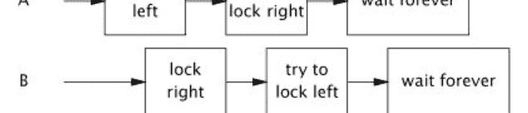

死锁的发生是因为两个线程尝试以不同的顺序获取锁。如果它们以相同的顺序请求锁，就不会有循环锁依赖，因此没有死锁。如果你保证每个同时需要 L 和 M 的线程都以相同的顺序获取 L 和 M，就不会有死锁。

> 如果所有线程都按照固定的全局顺序获取它们所需的锁，那么程序将不会出现锁顺序死锁。

验证一致的锁顺序需要对程序的加锁行为进行全局分析。仅仅检查单独获取多个锁的代码路径是不够的；`left` 和 `right` 都是获取这两个锁的“合理”方式，但它们互不兼容。在加锁时，左手需要知道右手在做什么。

#### 列表 10.1. 简单的锁顺序死锁。不要这样做。


```java
// 警告：死锁！
public class LeftRightDeadlock {
    private final Object left = new Object();
    private final Object right = new Object();

    public void left() {
        synchronized (left) {
            synchronized (right) {
                doSomething();
            }
        }
    }

    public void right() {
        synchronized (right) {
            synchronized (left) {
                doSomething();
            }
        }
    }
}
```

#### 10.1.2. 动态锁死锁

有时你并不认为自己控制着锁顺序。诱导顺序的一种方法是使用 `System.identityHashCode()`，它返回由 `Object.hashCode()` 返回的值。列表 10.2 显示了使用 `System.identityHashCode` 来诱导顺序的 `transferMoney` 版本。

如果所有线程都以相同的顺序获取锁，但实际上顺序取决于参数，就会出现类似的死锁。为了防止这种情况下出现不一致的加锁，使用了第三个“打破”锁。通过在获取任何账户之前获取打破锁，我们确保一次只有一个线程执行从 `from` 到 `to` 的转账。

如果 `Account` 有一个唯一的、不可变的键（例如账户号），诱导锁顺序会变得更容易：按键对对象排序，从而消除了对打破锁的需求。

#### 列表 10.2. 使用 `System.identityHashCode` 诱导锁顺序。

```java
private final Object tieLock = new Object();

public void transferMoney(final Account fromAcct,
                          final Account toAcct,
                          final DollarAmount amount) {
    class Helper {
        public void transfer() throws InsufficientFundsException {
            if (fromAcct.getBalance().compareTo(amount) < 0)
                throw new InsufficientFundsException();
            else {
                fromAcct.debit(amount);
                toAcct.credit(amount);
            }
        }
    }

    int fromHash = System.identityHashCode(fromAcct);
    int toHash = System.identityHashCode(toAcct);

    if (fromHash < toHash) {
        synchronized (fromAcct) {
            synchronized (toAcct) {
                new Helper().transfer();
            }
        }
    } else if (fromHash > toHash) {
        synchronized (toAcct) {
            synchronized (fromAcct) {
                new Helper().transfer();
            }
        }
    } else {
        synchronized (tieLock) {
            synchronized (fromAcct) {
                synchronized (toAcct) {
                    new Helper().transfer();
                }
            }
        }
    }
}
```

你可能认为由于锁的持有时间很短，我们高估了死锁的风险，但死锁在真实系统中是一个严重的问题。生产应用程序每天可能执行数十亿次锁获取循环。这些循环中只需要一个恰好发生，就会导致应用程序死锁，即使是彻底的负载测试方案也无法发现所有的死锁。列表 10.4 中演示的死锁在大多数系统上很快就会发生。

# 第三部分：活跃性、性能与测试

## 第 10 章：避免活跃性危险

[1] 讽刺的是，为了减少锁竞争，你本应该延长持有锁的时间，但这样做反而增加了测试无法揭示死锁的概率。

[2] 为了简单起见，`DemonstrateDeadlock` 忽略了账户余额的问题。

# 列表 10.4. 在典型情况下会发生死锁的驱动循环。


```java
public class DemonstrateLock {
    private static final int NUM_THREADS = 20;
    private static final int NUM_ACCOUNTS = 5;
    private static final int NUM_ITERATIONS = 100000;

    public static void main(String[] args) {
        Random rnd = new Random();
        Account[] accounts = new Account[NUM_ACCOUNTS];

        for (int i = 0; i < accounts.length; i++) {
            accounts[i] = new Account();
        }

        class TransferThread extends Thread {
            public void run() {
                for (int i = 0; i < NUM_ITERATIONS; i++) {
                    int fromaccount = rnd.nextInt(NUM_ACCOUNTS);
                    int toaccount = rnd.nextInt(NUM_ACCOUNTS);
                    Dollar amount = new Dollar(rnd.nextInt(1000));
                    transferMoney(accounts[fromaccount], accounts[toaccount], amount);
                }
            }
        }

        for (int i = 0; i < NUM_THREADS; i++) {
            new TransferThread().start();
        }
    }
}
```

# 10.3. 协作对象之间的死锁

多次获取锁并不像在 `LeftRightLock` 或 `TransferMoney` 中那样显而易见；两个锁不需要由同一个方法获取。考虑列表 10.5 中的协作类，它们可能被用于出租车调度应用程序。`Taxi` 代表一个具有位置和目的地的单辆出租车；`Dispatcher` 代表一个出租车队。

虽然没有一个方法同时获取了两个锁，但 `setLocation` 和 `getImage` 的调用者同样获取了两个锁。如果一个线程响应 GPS 接收器的更新而调用 `setLocation`，它首先更新出租车的位置，然后检查是否已到达目的地。如果已到达，它会通知调度器需要一个新的目的地。由于 `setLocation` 和 `notifyAvailable` 都是同步的，调用 `setLocation` 的线程获取了 `taxi` 和 `dispatcher` 锁。同样，调用 `getImage` 的线程获取了 `dispatcher` 锁和每辆出租车的锁。与 `LeftRightLock` 一样，两个锁以不同的顺序被获取，存在死锁的风险。

通过寻找获取两个锁的方法，很容易发现 `LeftRightLock` 或 `TransferMoney` 中的死锁可能。在 `taxi` 和 `dispatcher` 中发现死锁可能则更简单：其警示信息就是你正在持有某个锁。

在持有锁的情况下调用外部方法对活跃性是有危险的。外部方法可能会获取其他锁（产生死锁风险），或者持续意想不到的长的时间，从而阻塞需要该锁的其他线程。

# 10.4. 开放调用

当然，`taxi` 和 `dispatcher` 并不知道它们各是即将发生的死锁的一半。它们不应该知道；方法调用是一个抽象屏障，旨在保护你免受另一端发生细节的影响。

在不持有锁的情况下调用方法是开放调用（CPJ 2.1.4.3），因此，开放调用比带有锁调用的类更具行为且易于管理。使用封装来避免死锁等同于使用封装来提供线程安全：没有封装的线程安全程序是不存在的，而有效利用封装的程序其线程安全性分析比不使用封装的程序更容易。完全依赖开放调用的程序的活跃性分析比不依赖开放调用的程序更容易。限制于开放调用可以更容易识别获取多个锁的代码路径，并确保它们以一致的顺序被获取。

# Java 并发编程实践

[3] 对开放调用和细致锁顺序的需求，反映了组合同步对象而非同步组合对象的根本混乱性。

# 列表 10.5. 协作对象之间的锁顺序死锁。不要这样做。

```java
// warning: 易死锁！
class Taxi {
    @GuardedBy("this") private Point location, destination;
    private final Dispatcher dispatcher;

    public Taxi(Dispatcher dispatcher) {
        this.dispatcher = dispatcher;
    }

    public synchronized Point getLocation() {
        return location;
    }

    public synchronized void setState(Point location) {
        this.location = location;
        if (location.equals(destination))
            dispatcher.notifyAvailable(this);
    }
}

class Dispatcher {
    @GuardedBy("this") private final Set<Taxi> taxis;
    @GuardedBy("this") private final Set<Taxi> availableTaxis;

    public Dispatcher() {
        taxis = new HashSet<Taxi>();
        availableTaxis = new HashSet<Taxi>();
    }

    public synchronized void notifyAvailable(Taxi taxi) {
        availableTaxis.add(taxi);
    }

    public synchronized Image getImage() {
        Image image = new Image();
        for (Taxi t : taxis) {
            image.drawMarker(t.getLocation());
        }
        return image;
    }
}
```

列表 10.5 中的 `taxi` 和 `dispatcher` 可以很容易重构为使用开放调用从而消除死锁风险。这涉及缩小同步块以仅保护涉及共享状态的操作，如列表 10.6 所示。通常，10.5 中此类问题的原因是使用了同步块。努力使用开放调用。在许多情况下，调用 `setLocation` 的线程获取了 `taxi` 和 `dispatcher` 锁。同样，调用 `getImage` 的线程获取了 `dispatcher` 锁和每辆出租车的锁。与 `LeftRightLock` 一样，两个锁以不同的顺序被获取，存在死锁的风险。

# Java 并发编程实践

在使用细粒度锁的程序中，请使用两部分策略对您的代码进行审计，以确保无死锁：首先，识别可能获取多个锁的地方（尽量让此集合尽可能小），然后对所有此类实例进行全局分析，以确保整个程序中的锁排序顺序是一致的。尽可能地使用开放调用可以简化这种分析。在没有开放调用的情况下，找到获取多个锁的地方相当容易的，可以通过代码审查，也可以通过自动化的字节码或源代码分析来完成。

## 10.2.1. 定时锁尝试

检测和恢复死锁的另一种技术是使用显式锁（见第 13 章）的 `tryLock` 特性而不是使用内置锁。内置锁在获取锁时会永久等待，而显式锁允许你指定一个超时时间，直到 `tryLock` 返回。通过使用一个比你预期获取锁时间长多的超时时间，可以在意外情况发生时重新获得控制权。（第 280 页的 13.3 显示了使用轮询 `tryLock` 配合重试的另一种实现方法，用于实现概率性规避。）

当锁尝试失败时，你并不一定知道原因。可能是发生了死锁；线程可能在持有锁时错误地进入无限循环；或者某个线程的运行速度比你预期的要慢得多。尽管如此，你至少有机会恢复该失败的尝试，获取有关你正尝试执行的任何有用信息，并在杀死进程的同时以某种优雅的方式重新启动计算。

当在整个程序中没有一致地使用锁时，通过使用锁获取来获取多个锁对于防止死锁可能是有效的。如果锁获取超时，你可以释放锁、退避并等待一段时间，然后重试，这可能会消除死锁条件并允许程序恢复。（这种技术仅在获取两个锁时有效；如果由于方法调用嵌套获取了多个锁，你不能简单地释放外层锁，即使你知道它是。）

## 10.2.2. 使用线程堆栈进行死锁分析

虽然防止死锁很重要，但 JVM 可以通过使用线程堆栈来识别死锁发生的时刻。线程堆栈包含每个运行线程的轨迹，类似于随异常一起的堆栈信息。线程堆栈还包含锁定信息，例如每个线程持有哪些锁、在哪个栈中获取了锁，以及哪个被阻塞的锁正在等待获取。[4] 在生成线程堆栈之前，JVM 会搜索“等待等待图”以寻找死锁。如果发现，它将包含死锁识别信息，说明涉及哪些锁和线程，以及在程序的哪个位置获取了冲突的锁。

> [4] 即使在没有死锁的情况下，这些信息对于调试也是很有用的；定期触发线程堆栈可以让你观察程序的行为。

要触发线程堆栈，你可以在 Unix 平台上向 JVM 进程发送 `SIGQUIT` (`kill -11`)，或者在 Windows 平台上按下 `Ctrl-~` 或 `Ctrl-Break`。许多 IDE 都可以恢复线程堆栈。

如果你在使用显式锁，Java 5 不支持在线程堆栈中提供锁信息；显式锁不会在所有线程堆栈中显示。Java 6 包含了对显式锁死锁检测的线程堆栈支持，但关于锁获取位置的信息没有内置锁精确。内置锁与获取它的栈相关联；而显式锁仅与获取它的线程关联。

列表 10.7 是来自生产环境 JEE 应用的线程堆栈片段。导致死锁的失败涉及三个组件：一个 JEE 应用、一个 JEE 容器和一个 JDBC 驱动程序，它们分别来自不同的供应商（名称已保护以保护隐私）。这三者都是经过了大量测试周期的商业产品；每个产品都有一个 Bug，会导致挂起，直到它们相互相互作用并导致致命的服务器故障。

我们只展示了与死锁相关的线程堆栈部分。JVM 在诊断死锁方面做了大量工作，确定了导致死锁的程序、涉及的线程、它们持有的其他锁，以及哪些其他线程受到了间接影响。一个线程持有 `MumbleDBConnection` 的锁，并正在等待获取 `MumbleBCallable` 的锁。

## 10.7. 死锁后的线程堆栈片段

发现 Java 级别的死锁：

```
"Thread-0"
    java.lang.Object.wait(long)
    at com.example.App.method(App.java:10)
    ...
"Thread-1"
    java.lang.Object.wait(long)
    at com.example.App.method(App.java:20)
    ...
"Thread-2"
    java.lang.Object.wait(long)
    at com.example.App.method(App.java:30)
    ...
```

由于驱动程序以不同的顺序使用相同的锁，这种问题就会显现。这并不是应用程序预期的工作方式；驱动程序没有考虑到这一点。

以下是死锁的线程堆栈信息：

```
"Thread-0"
    java.lang.Object.wait(long)
    at com.example.App.method(App.java:10)
    ...
"Thread-1"
    java.lang.Object.wait(long)
    at com.example.App.method(App.java:20)
    ...
"Thread-2"
    java.lang.Object.wait(long)
    at com.example.App.method(App.java:30)
    ...
```

这种 Bug 在隔离时并非致命的，尽管经过了大量测试，该问题仍然会存在。

## 10.3. 其他生命周期风险

虽然死锁是最常见的生命周期风险，但并发程序中还可能遇到其他几种风险，包括饥饿、信号丢失和活锁（信号丢失见第 14.2 节）。

### 10.3.1. 饥饿

饥饿发生在线程被永久拒绝访问资源以便进展时；最常饥饿的资源是 CPU 周期。Java 中的饥饿可能是由不当使用线程优先级引起的。它也可能由非终止结构（无限循环或不终止的等待）引起，因为需要该锁的其他线程永远无法获取。

`Thread` API 中的线程优先级仅仅是提示。`Thread` API 定义了优先级级别，JVM 根据其需要将其映射到操作系统的优先级。这是特定平台的，因此 Java 优先级在某些操作系统上映射到相同的操作系统优先级，而在另一些上则不同。某些操作系统的优先级级别少于十级，导致多个 Java 优先级映射到相同的操作系统优先级。

操作系统可以尽巨大努力提供 Java 语言规范之外的调度公平性。在大多数应用程序中，所有线程都具有相同的优先级 `Thread.NORM_PRIORITY`。线程优先级机制是一种粗线条工具，并不总是清楚更改优先级会产生什么影响；提升线程优先级可能无效，或者始终导致一个线程优于另一个线程被调度，从而引起饥饿。

在开始修改优先级时，抵制改变线程优先级的诱惑通常是明智的，你引入了饥饿的风险。你通常可以通过到处使用 `Thread.sleep` 或 `Thread.yield` 来发现一个试图从线程优先级或其他响应问题中恢复的程序，试图给低优先级线程留更多时间。[5]

[5] `Thread.yield()` 和 `Thread.sleep(0)` 的语义在 JLS 17:9 中未定义；JVM 可以自由解释或不将它们视为提示。它们并不要求具有 Unix 系统上 `sched_yield(0)` 的语义——将当前线程放在相同优先级运行队列的末尾，从而让给同优先级的线程——尽管某些 JVM 是这样实现 `yield` 的。

# Java 并发编程

> 避免使用线程优先级的诱惑，因为它们会影响平台依赖性并可能导致活跃性问题。大多数并发应用程序对所有线程使用默认优先级。

### 10.3.2. 响应能力差

除了饥饿之外，另一种问题是响应能力差，这在运行后台线程的 GUI 应用程序中并不少见。第 9 章开发了一个框架，将长耗时任务加载到后台线程中，以防止用户界面冻结。CPU 密集型后台任务仍然会影响响应能力，因为它们会与事件线程竞争 CPU 周期。这是线程优先级有意义的地方之一；计算密集型后台计算会影响响应能力。如果工作是由其他线程或后台任务完成，降低它们的优先级可以以前台任务具有更高的响应性。

响应能力差也可能由锁管理引起。如果一个线程持有锁长时间（可能在迭代集合并对每个元素执行繁重工作时），其他需要集合的线程可能需要等待很久。

### 10.3.3. 活锁

活锁是线程的一种失败形式，线程虽然没有被阻塞，但由于不断重试一个总是失败的操作，仍然无法取得进展。活锁经常发生在事务应用程序中，其中消息接口在无法处理事务时会回滚事务并将其置于队列头部。如果特定类型消息的消息处理器中的 bug 导致其失败，那么每当消息从队列中取出并传递给有 bug 的处理器时，事务就会回滚。由于消息现在位于队列头部，处理器被反复调用并产生相同的结果（这有时被称为毒性问题）。消息处理没有被阻塞，但也永远无法取得进展。这种形式的活锁通常由于过度的恢复代码引起，该代码将不可恢复的错误视为可恢复的错误。

当多个协作线程改变彼此对方的状态，以至于没有线程可以取得进展时，也会发生活锁。这类似于两个非常有礼貌的人在走廊里反向行走时的情况；每个人都让开对方的路，现在他们又互相挡住了对方的路。于是他们再次让路，一次又一次…………

活锁的解决方案是在重试机制中引入一些随机性。例如，当两个站同时尝试在共享数据包上发送时，数据包会发生冲突。站检测到冲突，并在稍后尝试重新发送它们的数据包。如果它们每秒重试一次，它们就会反复冲突，没有任何一个能发出去，即使有充足的可用带宽。为了避免这种情况，我们让每个站等待一段引入随机分量的时间。（以太网协议也包含了重复冲突后的指数退避，减少了拥塞以及多个冲突站重复失败的风险。）带有随机等待和退避的重试对于避免并发应用程序中的活锁是有效的。

### 总结

活跃性失败是一个严重的问题，因为在不终止应用程序的情况下，没有办法从中恢复。最常见的活跃性失败形式是锁顺序死锁。避免锁顺序死锁从设计阶段开始：当线程获取多个锁时，它们以一致的顺序获取。此最佳方法是在整个程序中使用开放调用。这极大地减少了同时持有多个锁的地方，并使得这些地方更加显而易见。

## 第 11 章 性能与可扩展性

使用线程的主要原因之一是提高性能。[1] 使用线程可以通过让应用程序轻松利用可用处理能力来提高资源利用率，并通过让应用程序在现有任务仍在运行时开始新任务来提高响应能力。

> 有人可能会认为，这是我们忍受线程引入的复杂性的唯一理由。

本章探索了分析、监控和提高并发程序性能的技巧。遗憾的是，提高性能的技术也增加了复杂性，增加了安全性和活跃性失败的可能性。更糟糕的是，某些旨在提高性能的技术可能适得其反，或者用一个性能问题换取另一个性能问题。虽然更好的性能是理想的——提高性能可以非常令人满意——但安全永远第一。在编写程序时，让它变快——只有当你的性能需求告诉你它需要这样做时才这样做。设计并发应用程序时，挤出最后一点性能通常是你最少担心的问题。

## 11.1. 思考性能


# 提高性能意味着用更少的资源完成工作

“资源”的数量可以不异；对于给定的活动，某些特定资源是短缺的，无论是 `CPU` 周期、内存、网络带宽、`I/O` 带宽、数据库请求、磁盘空间或任何其他资源。当某活动的性能受限于特定资源的可用性时，我们称其为 `CPU` 密集型、数据库密集型等。

虽然目标是提高整体性能，但与单线程方法相比，使用多个线程引入了一些性能成本。这包括线程之间协调的开销（锁定、信号和内存同步）、增加的上下文切换、线程的创建和销毁以及调度开销。当线程被有效使用时，这些成本通过更大的吞吐量、响应能力或容量得到补偿。另一方面，设计不当的并发应用程序性能可能比顺序执行的程序差。

> [2] 一个同事向我保证这件事：他曾测试一个昂贵且复杂的应用程序，该程序通过可调线程池进行管理。完成一些工作后，测试显示池的最佳线程数是 ...1。这从一开始应该是显而易见的；你的系统是一个单 `CPU` 系统，而应用程序几乎完全是 `CPU` 密集型的。

在并发以获得更好的性能，我们尝试做两件事：更有效地利用我们拥有的资源，并在处理资源变得可用时利用处理资源。从性能监控的角度来看，我们寻求让 `CPU` 忙于有用的工作。如果程序是 `CPU` 密集型的，这并不意味着浪费周期进行无用计算；我们可能通过增加更多处理器来增加容量；如果不能让处理器忙起来，增加数量也没有帮助。线程提供了一种让 `CPU` 更“热”的方法，或者通过分解应用程序使得一直有工作要做。

## 11.1.1. 性能与可扩展性

应用程序性能可以通过多种方式衡量，例如服务时间、延迟、吞吐量、效率或容量。其中某些指标（服务时间、延迟）是关于处理或确认工作单元有多“快”；其他指标（容量、吞吐量）是关于在给定计算资源下可以执行“多少”工作。可扩展性描述了在增加计算资源（如额外的 `CPU`、内存、存储或 `I/O` 带宽）时提高吞吐量或容量的能力。

设计和调整可扩展性与传统的性能优化非常不同。在进行性能优化时，目标是用更少的努力完成相同的工作，例如通过缓存使用以前计算的结果，或用 `O(n log n)` 算法替换 `O(n!)` 算法。在进行可扩展性调整时，你是在寻找并行化问题的方法，以便在资源可用时利用它们完成更多工作。

性能的这两个方面——快慢和多少是分开的，有时它们会相互冲突。为了实现更高的可扩展性或更好的硬件利用，我们最终增加了处理每个单独任务所的工作量，例如当我们把任务分为“流水线式”子任务时。

讽刺的是，某些提高单线程程序性能的技巧对可扩展性是有害的（示例请参见第 14.4 节）。

三层应用模型——将表现层、业务、逻辑和持久化层分离并可能由不同的系统处理——说明了可扩展性的提升往往是以牺牲性能为代价的。一个表现、业务、逻辑和持久化层交织在一起的单体应用，其对于第一个工作单元提供的性能几乎肯定优于分布在多个系统上的、经过良好多层实现。难道不是吗？单体应用没有层与层之间交接时固有的网络延迟，也不需要支付不同层内部计算过程的固有成本（如队列、开销和数据拷贝）。

然而，当单体系统达到容量极限时，可能会出现严重问题：显著增加容量可能是昂贵的。因此，我们经常付出更长的服务时间或单位工作使用更多计算资源作为代价，以便通过增加更多资源来让应用程序处理负载。

在性能的各个方面，“多少”方面——即可扩展性、吞吐量和容量——通常比“多快”方面更受服务器关注。（对于交互式应用程序，延迟往往比速度更重要，所以不要等待进度指示和程序正在发生什么。）本章主要关注可扩展性，而非单线程性能。

## 11.1.2. 评估性能权衡

几乎所有的工程决策都涉及某种形式的权衡。在桥跨中使用更厚的钢材可能会增加其容量和安全性，但也会增加成本。虽然软件工程决策不涉及金钱与人类生命之间的权衡，但我们拥有以做出正确权衡的信息较少。例如，“快速排序”算法对于大型数据集非常高效，但“泡排序”对于小集合也高效得多。如果你实现了一个高效的排序，你需要了解关于它将要处理的数据集大小的信息，并需要指标来告诉你你是在尝试优化平均情况、时间成本还是可预测性。遗憾的是，信息并不是使用库排序例程的要求的一部分。这就是为什么大多数优化都是过早的的原因之一；它们通常在明确明确的需求集出现之前就已经发生了。

> 避免过早优化。先让它正确，再让它变快——如果它还不够快的话。

在做出工程决策时，你有时是在权衡一种形式的成本（例如使用空间与内存消耗）；你是在用成本换取安全性。许多性能优化是以可读性或可维护性为代价的——代码越“聪明”或越不直观，越难以理解和维护。有时优化意味着良好的对象设计原则，如打破封装；有时它们涉及更大的错误风险，因为更快的算法也带有风险。（如果你无法发现成本，可能你还没有考虑得足够仔细以便继续。）

大多数性能决策涉及多个变量并具有高度的主观性。在决定哪种方法比另一种“更快”之前，问问自己几个问题：

- 你说的“更快”是什么意思？
- 在什么情况下这种方法会更快？在轻负载还是重负载下？使用大数据集还是小？你能通过测量支持你的答案吗？
- 这些条件与你的情况关联有多频繁？你能通过测量支持你的答案吗？
- 这段代码可能在条件不同的情况下被使用？
- 为了这种性能，你交易了哪些隐藏成本（例如增加开发或维护风险）？这是一个好的权衡吗？

这些考虑适用于任何与性能相关的工程决策，但这是一本关于并发的书。我们为什么推荐这种保守的优化方法？对性能的追求可能是并发错误的最单一来源。认为同步“太慢了”的想法导致了许多为了减少同步而产生的聪明但危险的写法（例如双重检查锁定，在第 16.2.4 节中讨论），并经常被用作不遵守同步规则的借口。然而，由于并发错误最难追踪和消除，任何带有此类风险的操作必须非常小心地进行。

糟糕的是，当你用安全性换取性能时，你可能两者都得不到。特别是涉及到并发时，许多开发者对于性能问题所在或哪种方法更快或更具可扩展性的直觉是错误的。通常，让任何性能调优伴随着性能需求（你知道这一点）会更好。

## 11.2. 阿姆达尔法则

某些问题可以通过增加工作者来解决，但阿姆达尔法则描述了程序易于并行化的程度。如果 `F` 是必须串行执行的比例，那么 `N` 个处理器可以实现以下加速比：

$$Speedup = \frac{1}{F + \frac{1-F}{N}}$$

当 `N` 趋于无穷大时，最大加速比收敛于 `1/F`，这意味着如果有百分之五十的串行执行，可以实现两倍加速；如果有百分之十，则最多可以实现十倍加速。

图 11 显示了不同串行化程度下最大可能的加速比（利用率定义为加速比除以处理器数量）。显然，随着处理器数量的增加，即使是极小比例的串行执行也会限制通过额外资源增加吞吐量的程度。

#### 图 11.1. 不同百分比分解下的最大利用率。


### 列表 11.1 任务队列的序列化访问。

```java
public class workerThread extends Thread {
    private final BlockingQueue<Runnable> queue;

    public workerThread(BlockingQueue<Runnable> queue) {
        this.queue = queue;
    }

    public void run() {
        while (true) {
            try {
                Runnable task = queue.take();
                task.run();
            } catch (InterruptedException e) {
                break; // 允许线程退出
            }
        }
    }
}
```

所有的并发应用程序都有某些序列化来源，如果你认为你的程序没有，请再观察一遍。

### 11.2. 示例：隐藏在框架中的序列化

为了了解序列化如何隐藏在应用程序结构中，我们可以通过观察可扩展性的差异，并增加和推断序列化差异来进行对比。图 11.2 显示了一个简单的应用程序，其中多个线程反复从共享队列中移除元素并进行处理，类似于列表 11.1。处理过程仅涉及线程本地计算。如果线程发现队列为空，它会向队列中放入一批新元素，以便其他线程在下一次迭代中有东西处理。访问共享队列显然涉及某种程度的序列化，但处理过程是完全并行化的，因为它不涉及共享数据。

#### 图 11.2. 队列实现的对比。

[查看全尺寸图像]

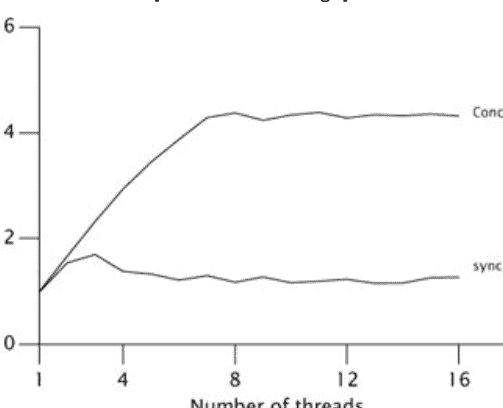

图 11.2 中的曲线比较了两个线程安全队列的吞吐量：用 `synchronizedList` 封装的 `LinkedList` 和 `ConcurrentLinkedQueue`。测试在运行 Solaris 的 8 路 V880 系统上进行。每次运行都代表相同数量的“工作”，我们可以看到许多队列实现对可扩展性有巨大影响。

`ConcurrentLinkedQueue` 的吞吐量持续提高，直到达到处理器数量并保持基本不变。另一方面，`Synchronized LinkedList` 的吞吐量在达到三个线程之前有所提高，但随后随着同步开销的增加而下降。当达到四个或五个线程时，竞争变得非常激烈，以至于对队列的每次访问都存在竞争，吞吐量由上下文切换主导。

吞吐量的差异源于两种队列实现之间不同程度的序列化。`Synchronized LinkedList` 使用单个锁保护整个队列，该锁在整个 `offer` 或 `remove` 调用期间一直被持有；`ConcurrentLinkedQueue` 使用了一种复杂的非阻塞队列算法（见第 15.4.2 节），通过原子操作更新单个链指针。在前者，整个插入或移除是序列化的；在后者，只有对单个指针的更新是序列化的。

### 11.2. 定性应用阿姆达尔定律

如果我们能够准确估计执行中序列化的比例，阿姆达尔定律就可以量化当可用更多计算资源时的加速比。直接测量序列化可能是困难的，但即使不测量，仍然可以使用阿姆达尔定律。

由于我们的模型源于我们的环境，我们中的许多人习惯于认为微处理器有两个或四个处理器，或者可能（如果预算充足的话）多达十二个，因为这是近年来发展起来的技术。但随着多核 `CPU` 成为主流，系统将拥有数百或数千个处理器。[1] 在四路系统上可扩展的算法可能会遇到从未遇到过的可扩展性瓶颈。

[3] 市场更新：此时，Sun 正在推出基于 8 核 Niagara 处理器的低端服务器系统，而 Oracle 正在推出基于 24 核处理器的（96、192 和 384 路）高端服务器系统。

在评估算法时，关于在数百或数千个处理器上会发生什么的“极限”情况可以为锁可能出现的地方提供见解。例如，第 11.4.2 节和 11.4.3 节讨论了减少锁粒度的两种技术：锁拆（将一分为二）和锁分段（将一分为多）。从阿姆达尔定律的角度来看，我们看到将锁一分为二并不能让我们远离处理器的目标，但锁分段似乎更有前景，因为条带的数量随着处理器数量的增加而增加。（当然，应该始终根据实际性能需求考虑性能优化；在某些情况下，将锁一分为二可能足以满足需求）。

## 11.3. 线程引入的成本

单线程程序不产生同步开销，并且可能不使用锁来保持数据结构的一致性。调度和交替具有性能成本；为了让线程提供性能提升，并行带来的性能收益必须大于并发引入的成本。

### 11.3.1. 上下文切换

如果主线程是唯一的调度线程，它永远不会被调度出去。另一方面，如果可运行线程多于 `CPU`，操作系统将阻止一个线程，以便另一个线程可以使用 `CPU`。这导致了上下文切换，需要保存当前运行线程的执行状态并恢复新调度线程的执行状态。

上下文切换不是免费的；线程切换需要管理 `OS` 和 `JVM` 中的共享数据结构。操作系统和 `JVM` 使用了你的程序使用的 `CPU`；`JVM` 和 `OS` 代码中的 `CPU` 时间意味着你的程序获得的时间更少。当一个新线程切入时，数据需要位于本地处理器缓存中，上下文切换会导致大量的缓存缺失，线程在首次被调度时运行得稍慢。这就是我们为上下文切换的每个成本及其赋值的原因之一。

```java
synchronized(new Object()) {
  // 某些
}
```

### 11.3.2. 内存同步

同步的成本源于几个来源。内存屏障也会影响性能，因为它们抑制了编译操作。在评估同步性能时，区分竞争和非竞争是很重要的。内存屏障范围从 20 到 50 个时钟周期。

### 列表 11.2 选举列表。

```java
public String getStooges() {
    List<String> stooges = new ArrayList<String>();
    stooges.add("mao");
    stooges.add("larry");
    stooges.add("curly");
    return stooges.toString();
}
```

即使没有逃逸分析，编译器也可以执行锁粗化，即合并使用相同锁的相邻同步块。对于 `getStooges`，`JVM` 可以将三次 `add` 调用和一次 `toString` 调用合并为一次锁获取和释放，对同步成本的启发式方法确保了同步块内变量的安全。

### 11.3.3. 阻塞

未同步的竞争可以完全在 `JVM` 内部处理（Bacon 等人，1998）；有竞争的同步可能需要操作系统的参与，这会增加成本。当发生竞争时，失败的线程必须锁定。`JVM` 可以通过自旋等待（反复尝试获取锁直到成功）或通过操作系统挂起被阻塞线程来实现阻塞。哪种方式更高效取决于上下文切换与锁可用时间之间的关系；对于短等待，自旋更优；对于长时间等待，挂起更优。某些 `JVM` 会根据等待时间的剖分析数据在两者之间进行自适应选择，但必须挂起对锁的等待。


挂起线程可能导致其无法获取锁，或者如果它在条件等待或阻塞 I/O 操作上被阻塞，则涉及两次上下文切换以及所有相关的操作系统和缓存活动：被阻塞线程在时间片耗尽之前被切换出，稍后在锁或其他资源可用后被切换回。（由于锁竞争导致的阻塞对持有锁的线程也有成本：当它释放锁时，必须请求操作系统恢复被阻塞的线程。）

### 11.4. 减少竞争

我们已经看到序列化会损害扩展性，而上下文切换会损害性能。竞争锁会导致这两者发生，因此减少竞争可以同时提高性能和扩展性。

对受互斥锁保护的资源的访问是序列化的，因此一次只有一个线程可以访问。当然，我们使用锁是有理由的，例如防止数据损坏，但这种安全性是需要代价的。对锁的持续竞争限制了扩展性。

> 并发应用中扩展性的主要威胁是资源锁。

有两个因素影响锁竞争的概率：请求锁的频率以及获取锁后持续时间的长短。如果这两个因素的乘积足够小，那么大多数获取锁的尝试将是非竞争的，锁竞争不会对扩展性构成重大障碍。然而，如果锁的需求量很高，线程将阻塞并等待它；在极端情况下，尽管有大量工作，处理器也将处于空闲状态。

> 这是利特法则的结果，它是队列论中的一个结论，“稳定系统中的平均客户数等于其到达率乘以在系统中的平均时间。”（Little, 1961）

减少竞争有三种方法：

- 减少持有锁持续的时间；
- 减少请求锁的频率；
- 用允许更高并发的机制替换互斥锁。

#### 11.4.1. 缩小锁的范围（“快进快出”）

减少竞争概率的一种有效方法是尽可能短时间地持有锁。这可以通过将不需要锁的代码移出 `synchronized` 块来实现，并且将昂贵的操作以及潜在的阻塞性 I/O 操作移到同步块之外。

很容易看到长时间持有“热点”锁会如何限制扩展性：我们在第 2 章的 `SynchronizedIterator` 中看到了这个例子。如果一个操作持有锁持续 2 毫秒，且每个操作都需要该锁，那么无论有多少个处理器，吞吐量每秒都不会超过 500 次操作。将锁时间缩短到 1 毫秒可以将锁的吞吐量提高到每秒 1000 次。

[8] 实际上，这低估了长时间持有锁的成本；它没有考虑到由锁竞争产生的上下文切换开销。

列表 11.4 中的 `AttributeStore` 展示了比需要的时间持有锁的示例。`locationMatches` 方法使用 Map 中的用户位置和正则表达式匹配来检查结果值是否匹配提供的模式。整个 `locationMatches` 方法都是同步的，但代码中真正需要锁的部分只有对 `Map.get` 的调用。

##### 列表 11.4. 持有比需要更长的锁。

```java
@ThreadSafe
public class AttributeStore {
    @GuardedBy("this") private final Map<String, String>
        attributes = new HashMap<String, String>();
    
    public synchronized boolean locationMatches(String name, String regex) {
        String key = "users." + name + " .location";
        String location = attributes.get(key);
        if (location == null)
            return false;
        else
            return Pattern.matches(regex, location);
    }
}
```

列表 11.5 中的 `BetterAttributeStore` 重写了 `AttributeStore` 以显著缩短锁的持续时间。第一步是构建与用户位置关联的 Map Key，即 `users.name.location` 字符串。这涉及到实例化一个 `StringBuilder` 对象，向其追加多个字符串，并将结果实例化为 `String`。之后，对位置进行正则表达式匹配。由于构建 Key 字符串和处理正则表达式不访问共享状态，因此不需要在持有锁的情况下执行。`BetterAttributeStore` 跳出了 `synchronized` 块，减少了持有锁的时间。

##### 列表 11.5. 缩短锁的持续时间。

```java
@ThreadSafe
public class BetterAttributeStore {
    @GuardedBy("this") private final Map<String, String>
        attributes = new HashMap<String, String>();

    public boolean locationMatches(String name, String regex) {
        String key = "users." + name + " .location";
        String location;
        synchronized (this) {
            location = attributes.get(key);
        }
        if (location == null)
            return false;
        else
            return Pattern.matches(regex, location);
    }
}
```

缩小锁的范围可以减少竞争的概率。

#### 11.4.2. 锁分段

将一个高竞争的锁拆分成两个，可能会导致两个高竞争的锁。虽然这会产生较小的扩展性提升，允许两个线程并发执行而不是一个，但它仍然没有显著提高了具有许多处理器的系统的并发性。`ServerStatus` 类中的锁拆分并没有提供进一步拆分锁的明显机会。

锁拆分可以扩展到对一组不同的独立对象分区，这种情况被称为锁分段。例如，`ConcurrentHashMap` 的实现使用了一个包含 16 个锁的数组，每个锁保护 1/16 的哈希桶；桶 N 由 `lock mod 16` 锁保护。假设哈希函数提供了良好的分布特性且键的访问均匀，这应该将任何给定锁的密度降低约 16 倍。这种技术使得 `ConcurrentHashMap` 能够支持最多 16 个写入者。在多处理器系统上，在高负载访问的情况下，可以增加锁的数量以提供更好的并发性，但只有当你有证据表明写入者产生的竞争足以达到该限制时，才应该将条带的数量增加到默认的 16 个。

锁拆分的缺点之一是，对集合进行独占访问的锁定比使用单个锁更困难且成本更高。通常，一个操作可以通过获取最多一个锁来完成，但有时你需要锁定整个集合，因为 `ConcurrentHashMap` 需要扩展映射并将值重新哈希到更大的桶集合中。这通常是通过获取条带集中的所有锁来完成的。[10]

- [10] 获取任意一组内在锁的唯一方法是通过递归。

列表 11.8 中的 `StripedMap` 演示了如何使用锁分段实现基于哈希的映射。有 `N_LOCKS` 个锁，每个锁保护桶的一个子集。大多数方法（如 `get`）只获取单个锁。某些方法可能需要获取所有锁，但如 `clear` 的实现所示，可能不需要同时获取所有锁。[11]

以这种方式清除映射不是原子的，因此当线程并发添加元素时，`StripedMap` 在任何时刻都不可能是空的；要实现原子操作需要一次获取所有锁。然而，对于客户端通常无法锁定进行独占访问的并发集合，`size` 或 `isEmpty` 的结果在返回时可能已经过时，因此这种行为虽然可能令人惊讶，但通常是可以接受的。

##### 列表 11.8. 使用锁的哈希映射。

```java
@ThreadSafe
public static class StripedMap {
    // 同步策略：buckets[n] 由 locks[n%N_LOCKS] 保护
    private static final int N_LOCKS = 16;
    private final Node[] buckets;
    private final Object[] locks;

    private static class Node { ... }

    public StripedMap(int numBuckets) {
        buckets = new Node[numBuckets];
        locks = new Object[N_LOCKS];
        for (int i = 0; i < N_LOCKS; i++) {
            locks[i] = new Object();
        }
    }

    private int hash(Object key) {
        return Math.abs(key.hashCode() % buckets.length);
    }

    public Object get(Object key) {
        int hash = hash(key);
        synchronized (locks[hash % N_LOCKS]) {
            for (Node m = buckets[hash]; m != null; m = m.next) {
                if (m.key.equals(key))
                    return m.value;
            }
        }
        return null;
    }

    public void clear() {
        for (int i = 0; i < buckets.length; i++) {
            synchronized (locks[i % N_LOCKS]) {
                buckets[i] = null;
            }
        }
    }
}
```

#### 11.4.3. 避免热点

锁拆分和锁分段可以提高可扩展性，因为它们允许不同的线程在不同的数据（或同一数据结构的不同部分）上操作而互不干扰。从锁拆分中受益的程序，其对锁的竞争必然比对该锁保护的数据竞争更频繁。如果一个锁保护两个独立的变量 X 和 Y，且线程 A 想要访问 X 而 B 想要访问 Y（例如当一个线程在 `ServerStatus` 中调用 `addUser` 而另一个线程调用 `addQuery` 时），那么线程并没有竞争任何数据，尽管它们正在竞争同一个锁。

当锁被用于每个操作时，其粒度就无法降低。这是一个性能与可扩展性往往冲突的领域；常见的优化（如缓存频繁计算的值）可能会引入限制可扩展性的“热点字段”。

如果你正在实现 `HashMap`，你可以选择 `size` 如何统计映射中条目的数量。最简单的方法是每次调用它时都统计条目的数量。一种常见的优化是在添加或删除条目时更新一个单独的计数器；这增加了保持计数器更新的 `put` 或 `remove` 操作的成本，但将 `size` 操作的成本从 O(n) 降低到 O(1)。

保留一个计数器来加速 `size` 和 `isEmpty` 等操作对于单线程或高度同步的实现是有效的，但它使得难以提高实现的可扩展性，因为映射的每个操作现在必须更新共享的计数器。如果你在哈希上使用锁分段，对计数器的同步会引入每个集合的可扩展性问题。曾经看起来是性能优化的做法——缓存 `size` 操作的结果——已经变成了一个可扩展性的负债。在这种情况下，计数器是一个热点字段，因为每个操作都需要访问它。`ConcurrentHashMap` 通过遍历条目而不是维护全局计数器来避免这个问题。

#### 11.4.4. 独占锁的替代方案

减轻锁竞争的第三种技术是放弃独占锁，转而使用并发集合、不可变对象和现代处理器提供的细粒度并发原语（如 CAS）。`ReadWriteLock`（第 13 章）强制多读单写策略：只要没有读取者修改它，多个读者就可以并发访问共享资源。原子变量（见第 15 章）为数据结构提供了更高的并发性。

#### 11.4.5. CPU 利用率

在测试可扩展性时，目标通常是保持处理器充分利用。你可以在 Unix 系统上使用 `vmstat` 和 `sar`，在 Windows 系统上使用 `perf` 来查看处理器运行有多“热”。

如果 CPU 利用是不对称的（某些 CPU 很热而另一些不是），你的首要目标应该是增加程序的并行性。对称利用表明计算集中在小部分线程上，并且无法利用额外的处理器。

如果 CPU 没有被充分利用，你需要找出原因。可能有几种情况：

- 负载不足：可能是所测试的应用程序没有足够的负载。你可以通过增加负载并测量利用率、响应时间或服务时间来测试。产生足以饱和应用程序的负载需要巨大的能量；问题可能出现在客户端系统、被测试系统或网络上。
- I/O 密集：你可以使用 `iostat` 或 `perf` 来确定是否是受磁盘限制，以及是否受网络带宽限制。
- 外部限制：如果你的应用程序依赖数据库或 Web 服务器等外部服务，瓶颈可能不在你的代码中。你可以通过性能分析器或数据库管理工具来确定等待外部服务回答的时间。

#### 11.4.6. 拒绝对象池

在早期的 JVM 中，对象分配和垃圾回收很慢[13]，但从那以后性能有了大幅提高。现在，Java 中的分配在 C 中也很快[14]：HotSpot 1.4.x 和 5 的通用代码路径大约十条指令。

为了绕过软对象的周期，许多开发者转向了对象池，对象被回收而不是被垃圾回收和重新分配。即使考虑到减少了垃圾开销，对于最昂贵的对象之外（对于轻和中权重对象是严重损失），对象池已被证明是一种性能损失[14]。

[14] 除了会导致 CPU 周期的损失外，对象池还有一些问题，其中包含了正确设置池的挑战（池太小，池化将无效；它会给垃圾器带来压力，保留了本可用于他处的内存）；对象可能无法正确重置为新分配状态的风险，从而引入细微的错误；线程将对象返回池中但继续使用它的风险；以及它通过增加老年代引用的频率，增加了通用垃圾收集器的工作。

在并发应用中，池化的情况更为糟糕。当线程使用线程本地分配来消除对堆结构的同步时，就避免了协调。如果这些线程从池中请求对象，则访问数据结构需要某些同步，这导致了线程阻塞的可能性。由于锁竞争导致线程阻塞的开销比分配高出数百倍，即使是少量的由池引起的竞争也可能成为瓶颈。（即使是无竞争的同步通常也比分配对象昂贵。）这又是另一种旨在进行性能优化的技术，却变成了可扩展性隐患。池化有其用处，但作为性能优化手段，其作用有限。

[15] 在受限环境中，如 JNI 或 RTOS 任务，可能需要对象池来实现有效的内存管理或管理响应能力。

分配对象通常比同步更便宜。

### 11.5. 比较 Map 性能

`ConcurrentHashMap` 的单线程性能略优于同步的 `HashMap`，但它在并发使用时才放异彩。`ConcurrentHashMap` 的实现假设最常见的操作是获取已存在的值，因此它被优化为为成功的 `get` 操作提供高性能和高并发。


# Java 并发实践

## 同步 Map 与 ConcurrentHashMap 的可扩展性对比

同步 Map 实现的主要可扩展性问题是它对整个 map 使用了单把锁，因此一次只能有一个线程访问该 map。相反，`ConcurrentHashMap` 在成功的读操作上不加锁，并在写操作以及那少数需要锁的操作中使用锁分段技术。结果是多个线程可以在不阻塞的情况下访问 map。

图 11.3 展示了几种 Map 实现之间在可扩展性上的差异：`ConcurrentHashMap`、`ConcurrentSkipListMap` 和用 `synchronized` 封装的 `TreeMap`。前两者在设计上就是线程安全的；后者通过封装变为了线程安全。在每次运行中，N 个线程并发执行一个紧凑循环，该循环选择一个随机 key 并尝试检索该 key。如果值不存在，则以 p = .6 的概率将其添加到 map 中；如果存在，则以 p = .02 的概率将其移除。测试是在 8 路 SPARC V880 上的 Java 6 预览版本运行的，图表显示了相对于 `ConcurrentHashMap` 单线程情况归一化的吞吐量。（Java 5.0 上，并发集合和同步集合之间的可扩展性差距更大。）

`ConcurrentHashMap` 和 `ConcurrentSkipListMap` 的数据显示它们对大量线程的扩展良好；随着线程的增加，吞吐量持续增加。虽然图 11.3 中的线程数看起来并不大，但这个测试程序每个线程产生的竞争比典型应用程序多，因为它除了在 map 上操作之外几乎没做其他的事；真实的程序会在每次迭代中执行额外的线程本地工作。

图 11.3. 不同 Map 实现的可扩展性比较。

[查看全尺寸图像]


同步集合的数据并不令人鼓舞。单线程情况的性能与 `ConcurrentHashMap` 相当，但一旦负载从大部分无竞争转变为大部分有竞争——这里在两个线程时就会发生——同步集合的性能就会变得糟糕。这是受锁竞争限制的代码可扩展性的常见行为。因此，只要竞争很低，时间性能就主要取决于实际执行工作的时间，吞吐量随线程的增加而提高。一旦竞争变得显著，时间将由上下文切换和调度延迟决定，增加更多线程对吞吐量的影响很小。

## 11.6 减少上下文切换开销

许多任务涉及可能被阻塞的操作；在运行状态和阻塞状态之间切换涉及上下文切换。服务器应用程序中阻塞的一个来源是在处理请求过程中记录日志消息；为了说明如何通过减少上下文切换来提高吞吐量，我们分析了两种日志方法的行为。

大多数日志框架都是 `print()` 的封装；当你有内容要记录时，直接在那里写出来即可。另一种方法是使用第 52 页的 `Logwriter`：在请求线程的专用后台线程中记录日志。从开发者的角度来看，这两种方法大致等效。虽然性能上可能存在差异，取决于日志量、有多少个线程在记录日志以及上下文切换成本等因素。

> [16] 构建一个将 I/O 移动到另一个线程的日志器可能会提高性能，但它也引入许多设计复杂性，例如中断（如果日志操作中的线程被中断了会发生什么？）、服务保证（日志器是否保证成功记录的消息在关闭前会被记录？）、饱和策略（当生产者比锁能处理得快时会发生什么？）以及效率（我们如何关闭日志器，我们如何通信服务状态）。

日志操作的服务时间包括它是否与 I/O 类同步；如果 I/O 操作阻塞，则包含了线程被阻塞的持续时间。操作系统阻塞该线程直到 I/O 完成，并且多持续一会儿。当 I/O 完成时，其他线程可能处于活跃状态，并将被允许完成它们的调度时间片，而线程可能已经在前面等待。

（送到火中），此外由于每个工作者不断地切换模式（填充、运行、倾倒、运行等），导致了更大的低效。在接力式（bucket-brigade）方法中，水从源头到燃烧建筑的流量是恒定的，运输水到火场消耗的能量更少，而且每个工作者都专注于连续地完成一项工作。就像中断对人类具有破坏性并降低效率一样，阻塞和上下文切换对线程也具有破坏性。

### 总结

由于使用线程的最常见原因之一是利用多个处理器，因此在讨论并发应用程序的性能时，我们通常更关注吞吐量或可扩展性，而不是原始服务时间。阿姆达尔法则告诉我们，应用程序的可扩展性是由必须串行执行的代码比例所驱动的。由于 Java 程序中序列化的主要来源是排斥性资源锁，因此通常可以通过减少持有锁的时间来提高可扩展性，比如减小锁的粒度、缩短锁的持续时间，或者用非排斥或非阻塞替代方案替换排斥性锁。

## 第 12 章：测试并发程序

并发程序使用的设计原则和模式与顺序程序相似。不同在于，并发程序具有顺序程序不具备的非确定性，这增加了必须规划和分析的潜在交互和失败模式的数量。

同样，并发程序也使用并扩展了对顺序程序的测试方法。在顺序程序中测试正确性和性能的相同技术也可以适用于并发程序，但可能出错的空间更大。构建并发程序的主要挑战在于，潜在的失败可能是概率性事件而非确定性事件；揭示此类失败的测试必须是详尽的，并且比典型的顺序测试更耗时。

大多数并发程序属于安全（safety）和活跃（liveness）这两个经典类别中的一个或两者。在第 1 章中，我们将安全定义为“坏事不会发生”，将活跃定义为“好事终将会发生”。

安全性测试在验证一个类是否符合其规范时，通常以测试不变性（invariants）的形式出现。对于一个在每次修改时都会缓存列表大小的链表实现，一个安全性测试是检查计数与列表中实际元素数量是否一致。但在并发程序中，由于在测试其属性时大小不会改变，你可以在单个原子操作中观察到计数和元素。这可以通过锁定进行排斥性访问、使用一些“原子信号量”或使用实现提供的“测试点”（在测试执行测试用例代码后断言不变性）来实现。

在本书中，我们使用图表来检测构造错误的类中可能导致失败的“倒霉”交互；测试程序则尝试搜索足够的空间以使此类活跃最终发生。遗憾的是，测试可能会引入时序或同步伪影，从而掩盖本可能显现的 bug。[1]。

> [1] 在调试或测试代码时消失的 bug 称为幻象 bug（Heisenbugs）。

活跃性属性有自己的挑战。活跃性测试包括进展和非进展测试，这些是难以量化的——你如何验证一个方法是阻塞的而不是运行缓慢？同样，你如何测试一个算法没有死锁？在等待多久之后宣告它失败了？

与活跃性测试相关的是性能测试。性能可以通过多种方式衡量，包括：

- 吞吐量（Throughput）：一组并发任务完成的速率；
- 响应性（Responsiveness）：请求某些操作与完成完成之间的延迟（也称为延迟）；
- 可扩展性（Scalability）：随着更多资源（通常是 CPU）的可用，吞吐量的提升（或未提升）。

### 12.1 测试正确性

为并发类开发单元测试始于与顺序类相同的分析——识别易于检查的不变性和后置条件（post-conditions）。如果你足够好，其中许多内容已经存在于规范中；编写单元测试的结果是一场迭代发现的冒险。

作为一个具体的例子，我们正要为一个有界缓冲区（bounded buffer）构建一组测试。列表 12.1 显示了我们的 `BoundedBuffer` 实现，它使用信号量来实现所需的边界和锁定。

```java
import java.util.concurrent.Semaphore;

@ThreadsSafe
public class BoundedBuffer<E> {
    private final Semaphore availableItems;
    private final Semaphore availableSpaces;
    private E[] items;
    private int takePosition = 0;

    public BoundedBuffer(int capacity) {
        availableItems = new Semaphore(0);
        availableSpaces = new Semaphore(capacity);
        items = (E[]) new Object[capacity];
    }

    public boolean isEmpty() {
        return availableItems.availablePermits() == 0;
    }

    public boolean isFull() {
        return availableSpaces.availablePermits() == 0;
    }

    public void put(E x) throws InterruptedException {
        availableSpaces.acquire();
        doInsert(x);
        availableItems.release();
    }

    public E take() throws InterruptedException {
        availableItems.acquire();
        E item = doExtract();
        availableSpaces.release();
        return item;
    }

    private synchronized void doInsert(E x) {
        items[takePosition] = x;
        takePosition = ((takePosition + 1) == items.length) ? 0 : takePosition;
    }

    private synchronized E doExtract() {
        E x = items[takePosition];
        items[takePosition] = null;
        takePosition = ((takePosition + 1) == items.length) ? 0 : takePosition;
        return x;
    }
}
```

列表 12.1. 使用信号量的有界缓冲区。

### 12.1.2 测试阻塞操作

并发特性的测试需要引入多一个线程。大多数测试框架对并发并不友好；很少包含创建线程或监控线程的功能以确保它们不会意外失败。如果测试创建的线程失败了，框架通常不知道是哪个线程出的问题，因此可能需要工作将失败信息中继到主线程，以便对其进行报告。

对于 `java.util.concurrent` 的符合性测试：

```
http://ge.c.oswepe.org/cgi-bin/viewcs/jsr166/asr/test/tck/JSR166TestCase.java
```

如果一个方法在某些条件下被阻塞，那么阻塞测试只有在线程没有继续执行时才应该成功。测试该方法是否阻塞与测试该方法是否抛出异常类似；如果方法返回 `null`，则测试失败。

测试方法是否阻塞引入了额外的复杂性：一旦方法成功阻塞，如何中断它，然后断言阻塞操作已完成。其中一种方法是在单独的线程中进行阻塞活动，直到超时要求你的阻塞方法通过提前返回或抛出 `InterruptedException` 来响应中断。

> “等待线程阻塞”部分说起来容易起来难；在实践中，你必须对这几条指令可能需要的时间做出任意决定，并等待比那更长。如果你错了，应该准备增加这个值（在这种情况下你会看到伪测试）；

列表 12.3 显示了测试阻塞操作的方法。“taker”尝试从元素缓冲区中获取一个元素。如果它成功了，则记录一个失败。测试运行线程启动 taker，等待很长时间，然后中断它。如果线程在 `take` 操作中正确阻塞，它将抛出 `InterruptedException`，而该异常的 `catch` 块将其视为成功并退出。测试运行线程随后尝试 `join` taker 线程，并通过调用 `Thread.isAlive` 验证 `join` 是否成功返回；如果线程响应了中断，`join` 应该完全完成。

超时 `join` 确保了测试在某种意外方式卡住时完成。此测试方法测试了 `take` 的几个属性，不仅是它阻塞，而且当被中断时它抛出 `InterruptedException`。这是适用于显式子类 `Thread` 而不是在池中使用 `runnable` 的情况之一：或者使用 `join` 测试适当的终止。相同的方法可以测试在主线程将元素放入队列后 taker 是否阻塞。

人们很想使用 `Thread.getState` 来验证线程是否实际上在条件等待上阻塞，但这种方法不可靠。没有什么能阻止被阻塞的线程进入 `WAITING` 或 `TIMED_WAITING` 状态，因为 JVM 可以选择通过自旋等待来实现阻塞。同样，`object.wait` 或 `condition.await` 允许虚假唤醒（第 14 章），处于 `WAITING` 或 `TIMED_WAITING` 状态的线程即使其等待的条件尚未成立，也可能临时转换到 `RUNNABLE`。忽略这些实现选项，目标线程可能需要一些时间进入阻塞状态。`Thread.getState` 的结果不应用于并发控制，或者对测试的用处有限——它是调试信息的来源。

```java
// Listing 12.3. 测试阻塞和对中断的响应性。
void testBlockingInterruption() {
    final BoundedBuffer<Integer> bb = new BoundedBuffer<>(10);

    Thread taker = new Thread(() -> {
        try {
            int unused = bb.take();
            fail(); // 如果我们到了这里，说明是错误
        } catch (InterruptedException exception) {}
    });

    try {
        taker.start();
        sleep(LOCKUP_DETECT_TIMEOUT);
        taker.interrupt();
        taker.join(LOCKUP_DETECT_TIMEOUT);
        assertFalse(taker.isAlive());
    } catch (Exception unexpected) {
        fail();
    }
}
```

### 12.1.3 测试安全性

12.2 和 12.3 中的测试了缓冲区的属性，但不太揭示数据竞态引起的错误。为了测试并发类在不可预测访问下的正确执行，我们需要设置多个线程在一段时间内执行 `put` 和 `take` 操作，然后测试没有出错。

构建测试来揭示并发类的错误是一个鸡生蛋问题：开发良好的测试比开发类本身更困难。

构建并发类有效安全性测试的挑战是识别那些在发生问题时有高概率失败的属性，这不需要同步。一种适用于生产者-消费者设计（如 `BoundedBuffer`）的方法是检查放入队列或缓冲区的元素是否全部取出，且没有其他元素进入。这种方法的简陋实现会在元素在队列上时将其插入“影子”列表，当它从队列中移除时从列表中移除，并断言影子列表为空。这种方法会扭曲测试线程的调度，因为修改影子列表需要同步并可能阻塞。

一种更好的方法是使用顺序敏感函数计算入队和出队元素的校验和，并对它们进行比较。当有一个生产者将元素放入缓冲区且有一个消费者取出元素时，这种方法效果最好，因为它可以测试正确的元素。

将其扩展到多生产者、多消费者场景，需要一个对元素顺序不敏感的校验和。测试方法恰好启动了许多生产者和消费者，每个都获取相同数量的元素，添加和移除的项目总数是相同的。

### 列表 12.4. 适用于测试的中等随机生成器。

```java
static int xorshift(int y) {
    y ^= (y << 6);
    y ^= (y >> 21);
    y ^= (y << 7);
    return y;
}
```

我们在第 5.5.1 节中介绍了解决此问题的技术，使用 `CountDownLatch` 作为起点和终点。另一种获得效果的方法是使用 `CyclicBarrier`，将其初始化为工作线程数加一，让工作线程和测试驱动程序在开始和结束时等待屏障。这确保了在任何开始之前所有线程都已启动运行。`PutTestSuite` 使用这种技术来协调和停止工作线程，创建更多潜在的交错。取决于你的平台，创建和启动线程可能是一项重量级操作。如果你的运行很短且你启动了许多线程，线程将顺序执行而非并发执行。即使在最坏的情况下，第一个线程对其他线程的领先优势意味着我们获得的交错比预期的要少：测试运行一段时间，然后第一批线程并发运行一段时间，最终它们都是的。

### 列表 12.5. 用于 BoundedBuffer 的生产者-消费者测试程序。


# Java 并发编程

## 第三部分：活跃性、性能与测试 - 24B 第 12 章：并发程序的测试

### 12.4. 测试资源管理

到目前为止的测试关注的是类对其规范的遵循情况——即它执行了应该做的事，例如泄露资源。任何管理或持有其他对象的对象都不应该比需要的时间持续持有对对象的引用。此类泄漏会阻止垃圾回收器回收内存（线程、文件句柄、套字、数据库连接或其他资源），并导致资源耗尽和失败。

对于具有边界资源的类，资源管理尤其为重要。限制缓冲器的全部目的是防止当生产者远快于消费者时因资源耗尽而导致失败。边界情况可能会迫使生产过快的生产者阻塞，而不是继续工作并消耗更多内存或其他资源。

一种方法是强制进行垃圾回收：`System.gc()` 仅向 JVM 建议现在是强制垃圾回收的好时机。可以通过 `-XX:+DisableExplicitGC` 指示 HotSpot 忽略 `System.gc()` 调用。

测试方法向边界缓冲区插入多个对象并移除它们；堆快照 #2 的内存使用情况应与快照 #1 大致相同。另一方面，如果 `doExtract` 忘记将返回的元素置空 (`items[i]=null`)，快照中报告的内存使用情况将不同。（这是需要显式置 null 的情况之一；大多数情况下，要么不需要，要么无害 [EI Item 5]）。

### 12.5. 使用回调

对提供的代码进行回调对于构建测试用例很有帮助；回调通常在对象生命周期中的已知点触发，这些点是断言不变性的绝佳机会。例如，`ThreadPoolExecutor` 会调用运行任务的方法以及调用 `ThreadFactory` 的方法。

#### 列表 12.7. 测试资源泄漏。

```java
class B {
    double data = new double[100000];
}

void testLeak() throws InterruptedException {
    ByteBuffer buffer = new BoundedBuffer<Big>(CAPACITY);
    int heapSize1 = // 快照 #1;
    for (int i = 0; i < CAPACITY; i++) {
        buffer.put(new Big(i));
    }
    // ...
    int heapSize2 = // 快照 #2;
}
```

测试方法向边界缓冲区插入多个对象并移除它们；快照 #2 的内存使用情况应与快照 #1 大致相同。另一方面，如果 `doExtract` 忘记将返回的元素置空 (`items[i]=null`)，快照中报告的内存使用情况将不同。（这是需要显式置 null 的情况之一；大多数情况下，要么不需要，要么无害 [EI Item 5]）。

### 12.6. 生成更多交织

由于并发代码中的许多失败可能是低概率事件，测试并发错误是一场数字游戏，但你可以采取一些措施来增加机会。我们已经提到过，在处理器少于活动线程的多处理器系统上运行可以比单处理器系统产生更多的交织。同样，在具有不同处理器数量、操作系统和处理器架构的系统上进行测试，可以发现在所有系统中都不会出现的问题。

增加交织次数从而更有效地探索程序状态空间的一种实用技巧是使用 `yield()`。这种技术的有效性取决于特定平台；JVM 可以将 `yield()` 视为空操作 [JS 17:9]。使用短时间的 `sleep` 会更好，但可靠性较低。

### 12.2. 扩展 PutTest 以添加计时

虽然性能测试和功能测试之间存在巧妙的重叠，但它们的目标不同。性能测试旨在衡量代表性用的端到端性能指标。选择一组具有代表性的场景并不是易的；理想情况下，测试应该反映对象在应用程序中的实际使用方式。

在某些情况下，适当的测试场景是：边界缓冲区（Bounded buffers）几乎总是用于生产者-消费者设计，因此，测量生产者向消费者传递数据的吞吐量是关键的。我们可以轻松地将 `PutTest` 扩展为针对该场景的性能测试。

性能测试的次要目标是根据经验为数千个线程、缓冲区容量等选择合适的尺寸。虽然这些值可能对平台特性（例如处理器类型，甚至是处理器步进级别、CPU 数量或内存大小）敏感，并需要动态配置，但通常这些测试场景在广泛的系统中都能良好运行。

#### 12.2.1. 计时代码实现

我们对 `PutTest` 需要做的首要扩展是测量运行所需的时间。与其尝试测量单次操作的时间，不如对整个运行进行计时并除以操作次数，从而获得更准确的操作时间。我们已经在使用 `CyclicBarrier` 来启动和停止工作线程，因此我们可以通过使用屏障动作（barrier action）来开始和结束计时，如列表 12.11 所示。

我们可以使用接受 action 的 `CyclicBarrier` 构造函数来修改屏障的初始化，以使用此动作。

##### 列表 12.11. 屏障计时器。

```java
this.barrier = new CyclicBarrier(pairs * 2 + 1, timer);

public class BarrierTimer implements Runnable {
    private boolean started;
    private long startTime, endTime;

    public synchronized void run() {
        long t = System.nanoTime();
        if (!started) {
            started = true;
            startTime = t;
        } else {
            endTime = t;
        }
    }

    public synchronized void clear() {
        started = false;
    }

    public synchronized long getTime() {
        return endTime - startTime;
    }
}
```

使用屏障计时器的修改后方法如列表 12.12 所示。

##### 列表 12.12. 使用基于屏障的计时器测试 test()。

```java
public void test() {
    try {
        for (int i = 0; i < nPairs; i++) {
            pool.execute(new Producer());
        }
        barrier.await();
        long nsPerItem = System.nanoTime() / (nPairs * nTrials);
        System.out.println("Throughput: " + nsPerItem + " ns/item");
        assertEquals(sum.get(), takeSum.get());
    } catch (Exception e) {
        throw new RuntimeException(e);
    }
}
```

我们可以从运行 `TimedPutTaskTest` 中学习到几点。其一是各种参数组合下生产者-消费者交付操作的吞吐量；另一个是边界缓冲区随不同线程数量的扩展性；第三是我们必须选择缓冲区大小。回答这些问题需要对各种参数组合进行测试，因此我们需要一些测试驱动程序，如列表 12.13 所示。

##### 列表 12.13. 驱动程序 - 用于 TimeoutTest。

```java
public static void main(String[] args) throws Exception {
    int n = 10000; // 每个线程的实验次数
    for (int cap = 1; cap <= 100; cap++) {
        System.out.println("Capacity: " + cap);
        for (int pairs = 1; pairs <= 12; pairs += 2) {
            TimeoutTest tpt = new TimeoutTest(cap, pairs);
            System.out.print("pairs: " + pairs + "\t");
            tpt.test();
            System.out.println("\t");
        }
        Thread.sleep(1000);
    }
    pool.shutdown();
}
```

图 12.1 显示了四路机器上的一些示例结果，使用了容量为 1、10、100 和 1000 的缓冲区。我们立即看到，大小为 1 的缓冲区会导致吞吐量非常差；这是因为每个线程在阻塞并等待另一个线程之前只能取得极微的进展。增加缓冲区大小会有很大帮助，但在超过 10 后收益就会递减。

# 图 12.1。不同缓冲区容量的 TimedPutTakeTest。

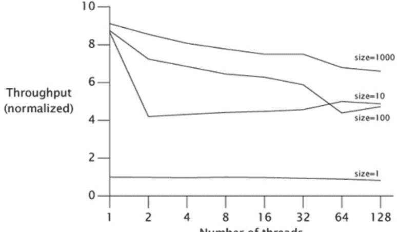

增加很多线程却仅略微降低了性能，这可能有些令人困惑。原因从数据上很难看出，但在测试运行时通过如 `perf` 等 CPU 性能仪表很容易看出：当有许多线程时，正在进行大量的计算，其中大部分是在阻塞和取消阻塞线程。因此，有足够的 CPU 空闲让更多线程执行相同的事情，而不会严重损害性能。

然而，要谨慎从这些数据得出你可以一直为使用边界缓冲区的生产者-消费者程序添加更多线程的结论。这个测试在模拟应用程序方面相当人为化；生产者在生成队列上的项时几乎不执行工作，而消费者对获取的项也几乎不执行工作。如果真实生产者-消费者应用程序中的工作线程在生产和消费项时执行一些非凡的工作（通常如此），那么这种空闲将会消失，线程过多的影响可能会非常明显。此测试的主要目的是衡量通过边界缓冲区进行生产者-消费者交付对整体吞吐量产生了什么限制。

#### 12.2.2. 比较算法

虽然 `BoundedBuffer` 是一个性能相当良好的简单实现，但事实证明不如 `ArrayBlockingQueue` 或 `LinkedBlockingQueue`（这解释了为什么它没有被用于类库）。`java.util.concurrent` 中的算法经过了选择和调优，并使用了类似的测试，达到了我们所知道的最高效率，同时提供了广泛的功能。[6] `BoundedBuffer` 表现糟糕的主要原因是它可能会遇到竞争 - 获取信号量，一个锁。

> [6] 如果你是并发专家并可以放弃一些提供的功能，你可能优于它们。

图 12.2 显示了在双线程机器上三个类使用 256 元素缓冲区时的吞吐量对比，`LinkedBlockingQueue` 的变体比 `ArrayBlockingQueue` 扩展得更好。这似乎很奇怪：链式队列必须为每次插入分配一个节点对象，因此似乎比数组队列做了更多工作。然而，即使它有更多的分配和 GC 开销，链式队列也允许更多的并发存取访问，因为最好的链式队列算法允许头部和尾部独立更新。由于分配通常是线程本地的，通过增加分配来减少竞争的算法通常扩展得更好。（这是另一个基于传统性能调优的直觉与扩展性需求背道而驰的实例。）

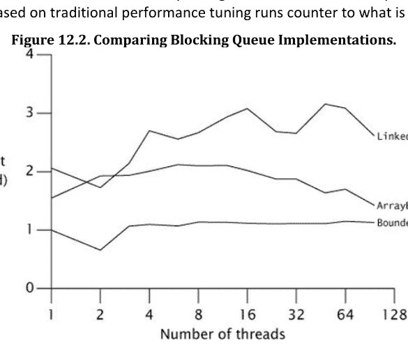

#### 12.2.3. 衡量响应

到目前为止，我们关注的是衡量吞吐量，这通常是并发程序最重要的性能指标。但有时，了解单个操作可能需要多长时间完成更为重要，在这种情况下我们想要衡量服务的方差。有时允许较大的平均服务时间以获得更小的方差是有意义的，可预测性也是一种有价值的性能特性。

任务完成时间的直方图是可视化服务时间几乎是最佳方法。与跟踪总完成时间相比，测量方差比你跟踪每个任务的完成时间要稍微困难一些。由于计时器粒度是测量单个任务时间的一个因素（单个任务耗时可能小于或接近最小的“计时器滴答”，这会扭曲测量结果），我们可以测量小批量 `put` 和 `take` 操作的运行时间。

### PutTest 示例代码

```java
public class PutTest {
    private static Executor executors = Executors.newCachedThreadPool();
    private final AtomicInteger put = new AtomicInteger(0);
    private final AtomicInteger take = new AtomicInteger(0);
    private final CyclicBarrier barrier;
    private final BoundedBuffer<Integer> bb = new BoundedBuffer<>(nTrials);
    private final int nTrials, nPairs;

    public static void main(String[] args) {
        new PutTest(10, 10, 10000); // 示例参数
        executors.shutdown();
    }

    PutTest(int capacity, int nTrials, int nPairs) {
        this.bb = new BoundedBuffer<Integer>(capacity);
        this.nTrials = nTrials;
        this.nPairs = nPairs;
        this.barrier = new CyclicBarrier(nPairs * 2 + 1);
    }

    void test() {
        try {
            for (int i = 0; i < nPairs; i++) {
                executors.execute(new Producer());
                executors.execute(new Consumer());
            }
            barrier.await(); // 等待所有线程就绪
            barrier.await(); // 等待所有线程完成
            assertEquals(put.get(), take.get());
        } catch (Exception e) {
            throw new RuntimeException(e);
        }
    }

    class Producer implements Runnable { /* Listing 12.6 */ }
    class Consumer implements Runnable { /* Listing 12.6 */ }
}
```

#### Listing 12.6. 在 PutTest 中使用的生产者和消费者。

```java
/* PutTest 的内部类（Listing 12.5） */

class Producer implements Runnable {
    public void run() {
        try {
            int seed = (this.hashCode() ^ (int) System.nanoTime());
            int sum = 0;
            barrier.await();
            for (int i = 0; i < nTrials; i++) {
                bb.put(seed);
                sum += seed;
                seed = xorshift(seed);
            }
            put.getAndAdd(sum);
            barrier.await();
        } catch (Exception e) {
            throw new RuntimeException(e);
        }
    }
}

class Consumer implements Runnable {
    public void run() {
        try {
            int sum = 0;
            for (int i = 0; i < nTrials; i++) {
                sum += bb.take();
            }
            take.getAndAdd(sum);
            barrier.await();
        } catch (Exception e) {
            throw new RuntimeException(e);
        }
    }
}
```

在运行直到完成固定数量操作的测试中，如果被测代码因 bug 遇到异常，则测试用例可能会失败。处理这种情况的最常见方法是让测试框架终止那些在规定时间内未终止的测试；等待多久应该根据经验决定，然后必须对失败进行分析，以确保问题不仅仅是因为你等待的时间不够。（这个问题不局限于并发类的测试；顺序测试无法区分长运行循环和无限循环。）


# Java 并发编程

任务完成时间的直方图是可视化服务时间几乎是最佳方法。与跟踪总完成时间相比，测量方差比跟踪每个任务的完成时间要稍微困难一些。由于计时器粒度是测量单个任务时间的一个因素（单个任务耗时可能小于或接近最小的“计时器滴答”，这会扭曲测量结果），我们可以测量小批量 `put` 和 `take` 操作的运行时间。

图 12.3 显示了使用 1000 缓冲区大小的 `TimedPutTakeTest` 变体的每个任务完成时间，其中 256 个并发 `take` 操作中的每个操作迭代 100 次，分别对应非公平信号量（阴影条）和公平信号量（空心条）。（第 13.3 节解释了锁和信号量的不公平与非公平队列）。非公平信号量的完成时间从 104 ms 到 8,714 ms 不等，相差了 80 倍。通过在并发控制中强制执行公平性可以缩小这个范围；在 `boundedbuffer` 中很容易实现，只需将信号量初始化为公平模式。虽然这极大地减少了方差（现在范围变为 38,194 到 38,207 ms），但遗憾的是也极大地降低了吞吐量。（运行时间更长且包含更典型任务的测试可能会显示更大的吞吐量下降。）

图 12.3. 使用默认（非公平）和公平信号量的 `TimedPutTakeTest` 的完成时间直方图。

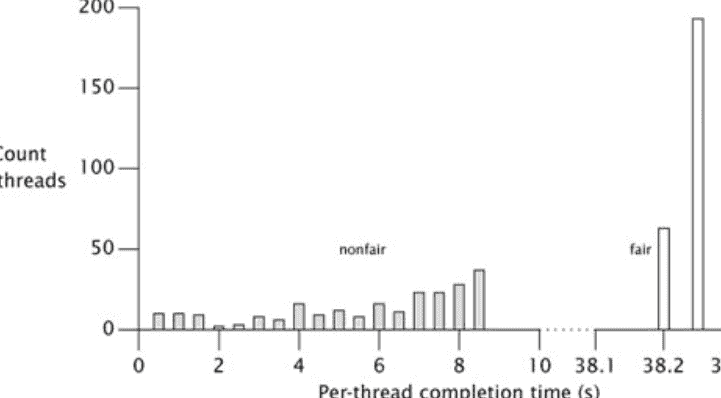

我们看到，即使在非公平模式下，极小的缓冲区大小也会导致频繁的上下文切换和糟糕的吞吐量，因为几乎每次操作都涉及上下文切换。作为公平性成本主要源于线程阻塞的证明，我们可以使用大小为 0 的缓冲区重新运行此测试，发现非公平信号量的性能现在与公平信号量相当。图 12.4 显示，在这种情况下，公平性并没有让平均性能变差，也没有让方差得到显著改善。

图 12.4. 使用单项缓冲器的 `TimedPutTakeTest` 的完成时间直方图。

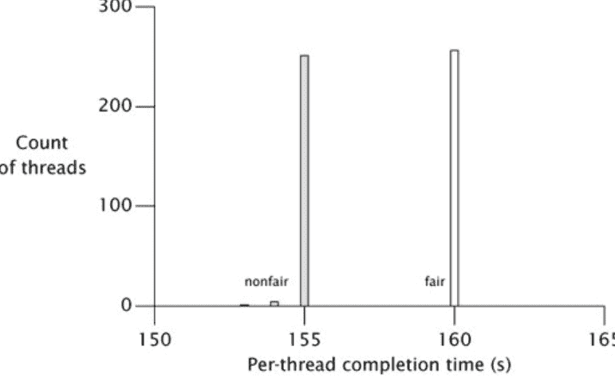

因此，除非线程由于紧密的同步需求而持续阻塞，否则非公平信号量提供了更好的吞吐量，而公平信号量提供了更低的方差。由于结果差异如此巨大，信号量强制其客户端在两个因素中选择一个进行优化。

## 12.3. 避免测试陷阱

在理论上，开发性能测试很容易：找到一个典型的使用场景，编写一个多次执行该场景的程序即可。但在实践中，你必须注意许多防止性能测试产生有意义结果的编码陷阱。

### 12.3.1. 垃圾回收

垃圾回收的时机是不可预测的，因此始终存在垃圾回收器在被测测试期间运行的可能性。如果一个程序执行迭代且没有触发垃圾回收，那么第 $N$ 次迭代可能会触发垃圾回收，运行规模的微小变化就可能对测量时间产生巨大（但虚假的）影响。

有两种策略可以防止垃圾回收偏置你的结果。一种是确保垃圾回收在整个测试期间不运行（你可以使用 `-verbose:gc` 启动 JVM 来输出）；或者，你确保垃圾回收器在运行期间运行多次，以便测试程序能够充分反映持续分配和垃圾回收的成本。后一种策略对于较长的测试更好，并且更有可能反映真实世界的性能。

大多数生产者分配涉及大量的分配和垃圾回收：生产者分配新对象，而这些对象由消费者使用并丢弃。运行足够长时间的 `bounded buffer` 测试以产生多次垃圾回收，可以获得更准确的结果。

### 12.3.2. 动态编译

对于 Java 这样的动态编译语言，编写和解释基准测试比 C 或 C++ 这种静态编译语言要困难得多。Hot JVM（以及其他现代 JVM）使用了字节码解释和动态编译的结合。当一个类被加载时，JVM 通过解释字节码来执行它。在某个点，如果一个方法被频繁运行，动态编译器就会介入并将其转换为机器码；当编译完成后，它会从解释执行切换到直接执行。

编译的时机是不可预测的。你的计时测试只有在所有路径都编译后才会运行；测量解释代码的速度是没有意义的。允许编译器在被测测试期间运行会以两种方式偏置结果：编译消耗 CPU 资源，并且测量解释和编译代码组合的运行并不是一个有意义的指标。图 12.5 显示了这如何偏置结果。时间线代表相同次数迭代的执行：A 代表解释执行，B 代表运行到一半时的编译，C 代表运行早期的编译。图中标记了编译影响测量性能的点。

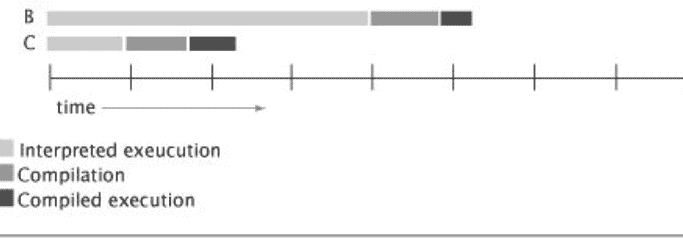

JVM 可能会选择在应用线程或后台线程执行编译；每种都可能偏置计时结果。防止编译偏置结果的一种方法是让你的程序运行很长时间（至少几分钟），使得编译和解释执行仅占总时间的一小部分。另一种方法是使用一个未测量的“预热”运行，在开始之前执行你的代码以进行完全编译。在 HotSpot 中，使用 `-XX:+Compilation` 运行你的程序可以使动态编译运行，这样你就可以验证这是在之前的。

### 12.3.3. 代码路径的真实采样

运行时编译器使用性能信息来优化执行代码，这意味着在一次运行中编译方法生成的代码可能在其他运行中不同。在某些情况下，JVM 可能会根据可能暂时有效的情况做出假设，如果这些假设失效，则会导致问题。

因此，重要的是你的测试能够充分代表典型应用程序的使用，并代表该应用所使用的代码路径。否则，动态编译器可能会对单线程测试进行特殊优化，而这种优化在包含偶尔并发的应用程序中并不适用。此外，多线程性能测试通常需要结合单线程测试。

## 12.4. 竞争

并发需要交叉两种类型的工作：访问共享数据（例如从工作队列获取下一个任务）以及线程通信（执行任务，假设任务不访问共享数据）。取决于这两类工作的相对比例，应用程序将经历不同程度的竞争和行为。

如果 N 个线程从共享队列获取并执行任务，且任务是计算密集型且长时间的（或不经常访问共享数据），则没有竞争；吞吐量受 CPU 资源的可用性限制。另一方面，如果任务很短，对工作队列将产生大量竞争，吞吐量由同步主导。

为了获得真实的结果，性能测试应该尝试通过典型应用程序来模拟线程通信竞争，以及要研究的竞争。如果应用程序中每个任务的工作在性质或范围上与测试显著不同，就很容易对瓶颈所在的位置得出错误结论。我们在第 15.4 节中看到基于锁的类（如 Map）对吞吐量有影响。测试显示，即使只有两个线程操作 Map，所有对 Map 的访问都是竞争的。然而，如果应用程序在访问共享数据之前为每个任务执行了大量的线程本地计算，竞争水平可能低到足以显示良好的性能。

在这方面，`ThroughputTest` 对于某些应用程序来说可能是一个糟糕的模型。由于工作者工作不多，吞吐量由协调开销主导，这并非在所有生产者与消费者缓冲区交换数据的应用程序中都是如此。

# 6BP III: 活跃性、性能与测试 - 24B

## 第 12 章：并发程序的测试

你很倒霉，死代码消除只会让你的程序提升某些倍数，而这种提升可以通过其他方式来解释。

死代码消除在静态编译语言中也是一个问题，但检测编译器是否删除了你基准测试中的某部分，就像看一眼机器发现程序缺失了一部分一样简单。而对于动态编译语言，这些信息并不容易获取。

微基准测试在配合 HotSpot 的 `-server` 模式运行时，比使用 `-client` 模式要“好”得多，这不仅是因为服务器编译器可以产生更高效的代码，还因为它更擅长适应你的代码。遗憾的是，死代码消除轻而易举地处理了你的基准测试，效果可能不如包含所有逻辑的代码。但你仍然应该倾向于使用 `-server -client`，并编写测试以使它们免受死代码消除的影响。

有效的性能测试需要触发优化器，使其不要将你的基准测试作为代码进行优化。每个计算结果都必须被程序以某种方式使用——这种方式不需要同步或大量的计算。

在 `PutTestCase` 中，使用查询中添加和删除的元素的校验和，并在所有线程中组合这些校验和，但如果我们不使用校验和值，它仍然可能被优化。我们需要它来验证算法的正确性，但要确保该值通过打印它被程序使用。然而，你应该避免在测试实际运行时进行 I/O，以免扭曲你的运行时测量结果。

一个防止被优化且不引入过多开销的快速技巧是计算某些开发对象字段的哈希值，并将其与任意值（如 `System.name()` 的当前值）进行比较。

```
if (foo.hashcode() == System.namecode())
   System.out.print(" ");
```

比较将成功，如果成功，它唯一的作用是在输出中插入一个无害的空格字符。`print` 方法是行内输出的，因此在代码与 `System.namecode()` 相等的罕情况下，实际上会执行 I/O。

不仅每个计算结果都被使用，结果还将变得不可用。否则，智能的动态优化器被允许用预计算的结果替换操作。在 `PutTestCase` 的构造中，或者任何输入静态数据易受此类优化影响的测试。

## 12.4. 互补测试方法

虽然我们喜欢相信有效的测试程序会“找到所有 bug”，但这是一个不切实际的目标。NASA 投入到测试的工程资源（如果他们为每位开发者投入 20 天）比任何商业实体都要负担得起，而产生的代码仍然是有缺陷的。在复杂程序中，无论如何测试都无法找到所有错误。

测试的目标不是寻找错误，而是增加对代码按预期运行的信心。假设你可以找到所有 bug 是现实的，质量保证（QA）计划的目标应该是在给定的测试资源下实现最大的信心。并发程序出现问题的情况比顺序程序多得多，因此需要更多的测试来达到同水平的信心。到目前为止，我们一直关注于构建有效的单元测试和性能测试的技巧。测试仅仅是你所采用的 QA 方法论之一。

不同的 QA 方法论在发现某些类型缺陷方面更有效，而在发现另一些类型方面效果较差。通过采用代码审查和静态分析等互补测试方法，你可以获得比任何单一方法都更大的信心。

### 12.4.1. 代码审查

尽管单元测试和压力测试对于发现并发 bug 非常有效，但多人的代码审查是不可替代的。另一方面，代码审查也无法替代测试。你可以设计测试来最大化发现安全错误的几，并应该频繁运行它们，但不应忽视让代码作者以外的人仔细审查并发代码。即使是并发专家也可能犯错；花时间让别人审查代码几乎总是值得的。专家级并发程序员比大多数测试更能发现细微的竞态。此外，平台问题（如 JVM 实现细节或处理器内存模型）可能会防止 bug 在特定的硬件或软件配置上出现。代码审查还有其他好处；它不仅可以发现错误，还能提高实现细节的注释质量，减少未来的维护成本和风险。

### 12.4.2. 静态分析工具

截至写作时，静态分析工具迅速成为测试和代码审查不可或缺的补充。静态分析是在不执行代码的情况下分析代码的过程，而代码审计工具将类按常见模式的问题进行分类。如 FindBugs 之类的静态工具包含了常见错误的检测器，其中许多错误通过测试或代码审查很容易被遗漏。

```
http://findbugs.sourceforge.net
```

静态工具提供了一个警告列表，必须手动检查以确定它们是否代表实际错误。从历史上看，像 lint 这样的工具产生了许多误报。静态分析工具相当原始（特别是在与开发工具的集成方面），但它们已经足够有效，是很有价值的补充。截至写作时，FindBugs 包含了与并发相关的 bug 检测器，并且不断添加：

不一致的同步。许多对象遵循使用对象内在锁保护变量的同步策略。不一致的访问可能表明没有遵循同步策略。分析工具必须猜测同步策略，因为 Java 类没有并发规范。在将来，如果像 `@Guarded` 这样的注解被标准化，审计工具就可以解释注解，而不是必须猜测变量与锁之间的关系。

调用 `Thread.run`。`Thread` 实现了 `Runnable`，因此它有一个 `run` 方法。然而，直接调用 `Thread.run` 总是错误的；除非程序员的意图是调用 `Thread.start`。

未释放的锁。与内在锁不同，显式锁（见第 13 章）在控制离开获取锁的作用域时不会自动释放。标准的惯例是在 `finally` 块中释放锁；否则在发生异常时锁可能无法释放。

空同步块。空同步块在 Java 内存模型下具有语义，它们经常被错误使用，并且对于开发者试图解决的问题有更好的解决方案。

双重检查锁定。双重检查是一种减少延迟初始化同步开销（见第 16.2.4 节）的损坏惯例，涉及在没有适当同步的情况下读取共享可变变量。

从构造函数中启动线程。从构造函数中启动线程会引入子类问题风险，并允许此引用逃构造构造。

通知错误。`notify` 和 `notifyall` 方法表示对象状态发生了变化，从而解锁在条件队列上等待的线程。这些方法应在与条件相关的状态发生变化时调用。在没有修改任何状态的情况下调用 `notify` 或 `notifyall` 的同步块可能是一个错误（见第 14 章）。

条件等待。在条件队列上等待时，`Object.wait` 或条件应该在循环中、持有适当锁的情况下并在测试某些谓词后调用（见第 14 章）。在没有锁的情况下、不在循环中或在没有测试某些谓词的情况下调用 `Object.wait` 几乎是一个错误。

误用锁和条件。将锁作为同步块的参数可能是一个拼写错误


# 第三部分：存活性、性能与测试

## 第 12 章：并发程序的测试

在等待锁时休眠。在持有锁的情况下调用休眠方法可能会导致其他线程长时间无法进展，因此是一个潜在的存活性风险。在持有两把锁的情况下调用 `wait` 或 `condition.await` 具有类似的风险。自旋锁（Spin locks）通过自旋等待（spin wait）来检查预期值，这可能会浪费 CPU 时间；如果无法保证该字段会变化，那么栅锁（latches）或条件等待（condition waits）通常比等待状态转换发生是更好的技术。

### 12.4.3 面向切面的测试技术

在本文中，面向切面的编程（AOP）技术在并发方面的适用性有限，因为大多数 AOP 工具不支持同步点。然而，可以使用 AOP 插入断言或用于符合同步策略的切面。例如，(2003)提供了一个使用切面（aspect）来封装所有非线程安全方法的锁的示例，并断言锁会在事件中发生。这种技术无需更改代码，易于应用并能发现并发错误。

### 12.4.4 分析器与监控工具

大多数商业分析工具对线程都有某些支持。它们在功能和有效性上有所不同，但通常可以提供关于程序正在做什么的洞察（尽管分析工具是侵入性的，可能会影响性能和调试）。大多数工具提供显示带有不同状态（可运行、阻塞等待锁、阻塞等待 IO 等）的时间线显示。这种显示可以展示你的程序利用可用资源的有效性，如果运行糟糕，则可以借此寻找原因。分析器还提供了识别哪些锁导致了竞争的功能，但在实践中，这些功能往往比分析程序的锁定行为更像是一种“粗放”的工具。

内置的 JVM 代理也提供了一些监控线程行为的功能。如果启用了“线程竞争监控”功能（由于对性能的影响，默认禁用），`ThreadInfo` 类包含了线程的当前状态，如果线程被阻塞等待锁或通知，还包含了它阻塞的次数以及花费的累积等待时间。

### 总结

对并发程序的正确性测试可能是极具挑战性的，因为并发程序的许多可能的失败模式都是低概率事件，对时机、负载和其他难以复制的条件敏感。此外，测试基础设施可能会引入额外的同步或时间约束，这可能会导致被测试代码中的并发问题。对并发程序进行性能测试同样具有挑战性；使用像 C 等静态编译语言编写的程序，因为时间测量可能会受到动态编译、垃圾回收和自适应优化的影响。为了在潜在 Bug 在生产环境中发生之前最大机会发现它们，请将传统的测试技术（注意避免此处的陷阱）与代码审查和自动化分析工具相结合。

# 第四部分：高级主题

- 第 13 章：显式锁
- 第 14 章：构建同步器
- 第 15 章：原子变量与非阻塞同步
- 第 16 章：Java 内存模型
- 附录 A：并发的注解
- 参考文献

## 第 13 章 显式锁

在 Java 5.0 之前，协调共享数据访问的唯一机制是 `synchronized` 和 `volatile`。Java 5.0 增加了另一个选项：`ReentrantLock`。与某些人的描述相反，`ReentrantLock` 并不是内置锁（intrinsic locking）的替代品，而是针对内置目的具有高级特性的替代方案。

### 13.1 ReentrantLock

列表 13.1 中的 `Lock` 接口定义了许多抽象锁定操作。与内置锁不同，`Lock` 提供了无条件、轮询（polling）、超时和可中断的锁获取选择，并且所有的锁定和解锁操作都是显式的。实现类必须提供与内置锁相同的内存可见性语义，但在调度算法、顺序保证和性能特性上可能有所不同。（`Lock.condition` 在后续章节介绍）

列表 13.1 Lock 接口。

```java
public interface Lock {
    void lock();
    void lockInterruptibly() throws InterruptedException;
    boolean tryLock();
    boolean tryLock(long timeout, TimeUnit unit) throws InterruptedException;
    void unlock();
    Condition condition();
}
```

`ReentrantLock` 实现了 `Lock`，提供了与 `synchronized` 相同的互斥和内存可见性保证（内存可见性在 3.1 节介绍）。与 `synchronized` 类似，`ReentrantLock` 支持所有锁获取模式（第 2.3.2 节）。在某些情况下，`ReentrantLock` 比 `synchronized` 更具灵活性，因为它可以中断等待锁的线程。

内置锁在大多数情况下运行良好，但它们有功能上的局限：无法中断正在等待锁的线程。`ReentrantLock` 允许在不放弃锁的情况下尝试获取锁。这种编程方式与异常处理交互良好。虽然内置锁提供了良好的性能，但在某些情况下，不放弃锁是允许的。`ReentrantLock` 允许可切面编程（第 16 节介绍）。

使用 `Lock` 的这种惯用法比使用内置锁更复杂：锁必须在 `finally` 块中释放。否则，如果保护的代码抛出异常，锁将永远不会释放。不释放锁是一个定时炸弹。对于内置锁，会对管理时间预算的活动带来风险。[1]

> [1] 定时锁在管理时间预算的活动中有用

列表 13.2 使用 ReentrantLock 保护对象

```java
Lock lock = new ReentrantLock();
try {
    // 更新状态
} catch (Exception e) {
    // 必要时恢复状态
} finally {
    lock.unlock();
}
```

### 13.1.1 轮询锁获取

超时和轮询锁定模式（`tryLock`）比无条件获取允许更复杂的恢复。对于内置锁，死锁是致命的——唯一的恢复方法是重启应用程序。

使用超时或轮询锁获取（`tryLock`）可以让你在无法获取所有锁时重新获得控制，释放已获取的锁并重试。列表 13.3 显示了解决第 10.1.2 节死锁的另一种方法：使用 `tryLock` 尝试获取两个锁，但如果无法获取则回退并重试。`sleep` 具有固定时间和随机部分，以减少死锁的可能性。如果在规定时间内无法获取锁，`tryLock` 将返回失败状态，以便操作优雅地失败。

第 134 页列表 6.17 中的旅游门户示例为每个获取报价的租租赁公司创建了单独的任务。获取报价可能涉及某种基于网络的请求机制，例如 Web 服务请求。获取报价可能还需要对资源的独占访问，例如由 `Lock` 保护的直接通信链路，但如果无法在时间预算内完成，则优雅地失败。

### 13.1.2 可中断锁获取

正如超时锁获取允许在时间限制的活动中使用独斥锁定一样，可中断锁获取允许在可取消的活动中使用锁定。第 7.1.6 节识别了几种对中断不响应的机制，例如获取内置锁。这些不可中断的阻塞机制增加了实现可取消任务的复杂性。`lockInterruptibly` 方法允许你在获取锁的同时保持对中断的响应，并在 `Lock` 中避免了创建另一类不可中断的阻塞机制。

### 13.3 使用 trylock() 避免锁顺序死锁

```java
public boolean transferMoney(Account fromct,
        Account toct,
        DollarAmount amount,
        Long timeout,
        TimeUnit unit)
throws InsufficientFundsException, InterruptedException {
    long fixedDelay = getFixedDelayComponentNanos(timeout, unit);
    long rand = random().nextIntNanos(timeout, unit);
    long stopTime = System.nanoTime() + unit.toNanos(timeout);

    while (true) {
        if (fromct.tryLock()) {
            try {
                if (toct.tryLock()) {
                    try {
                        if (fromct.getBalance().compareTo(amount)
                            < 0)
                            throw new InsufficientFundsException();
                        fromct.debit(amount);
                        toct.credit(amount);
                        return true;
                    } finally {
                        toct.unlock();
                    }
                } else {
                    // 注意：原始 OCR 在此处有一个逻辑错误（只有扣款没有入账），
                    // 但必须保留原始信息。
                    fromct.debit(amount);
                    return false;
                }
            } finally {
                fromct.unlock();
            }
        }
        if (System.nanoTime() < stopTime)
            return false;
        NANOSECONDS.sleep(fixedDelay + rand.nextLong() % randMod);
    }
}
```

### 13.3.4 使用时间预算加锁

```java
public boolean trySendSharedLine(String message,
        Long timeout, TimeUnit unit)
throws InterruptedException {
    if (!lock.tryLock(unit.toNanos(timeout), NANOSECONDS))
        return false;
    try {
        return sendOnSharedLine(message);
    } finally {
        lock.unlock();
    }
}
```

可中断锁获取的典型结构比普通锁获取稍微复杂，因为需要两个 `try-finally` 块。（如果可中断锁获取会抛出 `InterruptedException`，则标准的 `try-finally` 惯用法有效）。列表 13.5 使用 `lockInterruptibly` 实现了列表 13.4 中的 `sendOnSharedLine`，使其可以从可取消的任务中调用。定时的 `TryLock` 也对中断有响应，当需要定时且中断的锁获取时可以使用。

### 13.5 可中断的锁获取

```java
public boolean sendOnSharedLine(String message)
throws InterruptedException {
    if (lock.lockInterruptibly()) {
        try {
            return cancelableSendOnSharedLine(message);
        } finally {
            lock.unlock();
        }
    }
}
```

```java
private boolean cancelableSendOnSharedLine(String message)
throws InterruptedException { ... }
```

### 13.1.3 非块结构化锁定

对于内建锁（intrinsic locks），获取-释放对是块结构化的；锁总会在获取它的同一个基本块中释放，无论控制如何退出。锁的释放简化了分析并防止了潜在的编码错误，但有时需要更灵活的锁粒律。

在第 11 章中，我们看到了通过降低粒度如何增强可扩展性。锁分段（Lock stripping）允许基于哈希的集合中的不同哈希链使用不同的锁。我们可以应用类似的原理，通过为每个链节点使用一把锁来降低链表的粒度，允许线程在列表的不同部分上独立操作。对于给定的节点，在遍历链指针时，我们必须持有一个节点的锁，直到获取到下一个节点的锁；只有这样才能释放第一个节点的锁。这种技术的示例可见 [CP 2.5.1]，它被称为“手递锁”（hand-over-hand locking）或锁耦合（lock coupling）。

### 13.2 性能考量

当 `ReentrantLock` 在 Java 5.0 中引入时，它比内建锁提供了更好的竞争性能。对于同步原语来说，竞争性能是可扩展性的关键：如果在锁管理和调度上花费更多资源，留给应用程序的资源就越少。更好的实现意味着更少的系统调用、更少的上下文切换，并在共享内存总线能够启动更少的内存同步流量，这些操作是非常耗时的会分散程序的资源。

Java 6 使用了改进的算法来管理内建锁，类似于 `ReentrantLock` 使用的算法，这缩小了可扩展性的差距。图 13.1 显示了在运行 Solaris 的四路系统上，Java 5.0 和 Java 6 预发布版本内建锁与 `ReentrantLock` 之间的性能差异。曲线代表了单个 JVM 版本上 `ReentrantLock` 对于内建锁的“加速”。在 Java 5.0 中，`ReentrantLock` 提供了更好的吞吐量，但在 Java 6 上，两者非常接近。[10] 测试程序与第 11.5 节使用的相同，这次比较的是由内建锁和 `ReentrantLock` 生成的 hashmap。

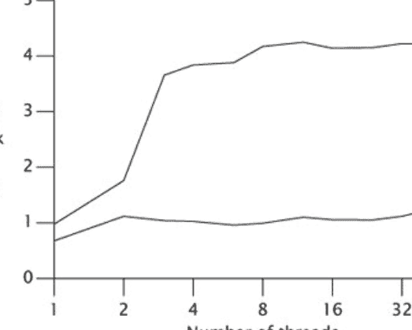

在 Java 5.0 上，内建锁的性能从单线程（无竞争）转向多线程时急剧下降；`ReentrantLock` 的性能下降要少得多，显示了其更好的可扩展性。但在 Java 6 上，锁不再处于竞争状态，两者的扩展性相当相似。

像 13.1 这样的图表提醒我们，诸如“X 比 Y 好”的陈述最好是短期的。性能和可扩展性对平台因素（如 CPU、处理器数量、缓存大小和 JVM 特性）敏感，所有因素都可能变化。[11] 性能是一个移动目标；昨天显示 X 优于 Y 的基准测试可能已经过时。

### 13.3 公平性

`ReentrantLock` 提供了两种选择：非公平（默认）或公平锁。使用公平锁时，线程按照请求的顺序获取锁，而非公平锁允许插队：如果锁可用，请求线程可以抢先于等待线程。[4] `ReentrantLock` 总是会插队，除非显式要求。然而，涉及到锁定时，公平性的代价是挂起和恢复线程的销。在实践中，一种统计学上的保证——承诺线程最终会获取锁——足够了，而且成本低得多。某些算法依赖公平队列来确保其正确性，而这并非必须。在大多数情况下，非公平的性能收益优于公平性。[5] 对于 `ConcurrentHashMap`，这种情况发生在 4 到 8 个线程之间。这些变化几乎源于元素的哈希码、线程调度、映射、调整大小，或内存系统影响，或者是操作系统在运行时决定进行一些清理工作。我们没有尝试清理图表，但真实世界的性能测量也充满了噪声。

### 图 12 公平与非公平性能

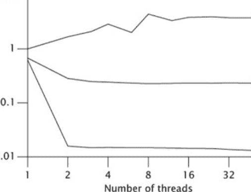

### 13.4 在 synchronized 和 ReentrantLock 之间选择

`ReentrantLock` 提供了与内锁（intrinsic locking）相同的锁定和内存语义，还提供了额外的功能，如超时锁、可中断的锁等待、公平性以及实现非结构化锁定的能力。`ReentrantLock` 的性能似乎优于内锁，在 Java 6 中略占优势，在 Java 5.0 中更是大幅领先。那么，为什么不废弃 synchronization 并鼓励所有新的并发代码都使用 `ReentrantLock` 呢？有些作者已经发现，将同步机制视为一种“遗留”构造结构。但这把一件好事推得太远了。

内锁相比于显式锁具有显著优势。其语法既熟悉又紧凑，而且许多现有程序已经在使用内锁，这使得它变得混淆且容易出错。`ReentrantLock` 绝对是一个比 `synchronized` 更具危险危险的工具；如果你忘记在 `finally` 块中释放锁，你的代码看起来运行正常，但你实际上创建了一个会伤及无辜旁路者的定时炸弹。只有在需要内锁无法提供的功能时，才考虑使用 `ReentrantLock`。

在内锁不切实际的情况下，`ReentrantLock` 是一种高级工具。或者如果你需要它的特性：计时的、有序的或可中断的锁获取、公平性或非结构化锁定。否则，优先选择 `synchronized`。

在 Java 5.0 之下，内锁相比 `ReentrantLock` 还有另一个优势：线程转储（thread dumps）会显示哪些类获取了锁。JVM 对哪些线程持有 `ReentrantLock` 一无所知，因此无法帮助调试 `ReentrantLock` 的问题。这种差异在 Java 6 中得到了解决，通过提供一个管理和监控接口，锁可以在该接口注册，使得 reentrantLocks 的锁定信息能够出现在线程转储和其他管理和调试接口中。这种调试信息的可用性对于 `synchronized` 来说是一个巨大的（尽管大部分）优势；线程转储中的锁定信息让许多程序员避免了极端的竞争。`ReentrantLock` 的非结构化本质仍然意味着锁的获取无法像内锁那样绑定到特定的调用帧（frames）上。


# 未来的改进可能会倾向于 synchronized 而非 ReentrantLock

因为 `synchronized` 是内置在 JVM 中的，它可以执行诸如锁优化，例如针对重叠锁的锁消除（lock elision）以及通过粗化（coarsening）来消除内锁的同步（见节 13.3.2）；对于基于库的锁实现这一点似乎要困难得多。除非你在可见的未来内部署在 Java 5.0 上，并且你证明了平台上需要 `ReentrantLock` 的可扩展性优势，否则为了性能原因选择 `ReentrantLock` 而非 `synchronized` 不是一个好主意。

# 13.5. 读写锁

`ReentrantLock` 实现了一种标准的互斥锁：一次最多有一个线程持有 `ReentrantLock`。但互斥比维护数据完整性所需的锁定策略要强得多，因此限制了不必要的并发性。互斥是一种保守的锁定策略，将写入者/写入者和读取者/写入者的访问保护为“读为主”。在许多情况下，数据结构是“读为主”的，并且是可变的，有时会被修改，但大多数访问只涉及读取。在这些情况下，如果能放松锁，允许多个读取者同时访问数据结构将会很不错。只要保证每次读取都能获得数据的最新视图，并且在读取者查看数据时没有其他线程修改数据，就不会出现问题。读写锁的作用是：资源一次可以被多个读取者或一个写入者访问，但二者不可得兼。

列表 13.6 所示，`ReadWriteLock` 暴露了两个读取和写入的 `Lock` 对象。要读取受 `ReadLock` 保护的数据，必须先获取锁；要修改受 `WriteLock` 保护的数据，必须先获取锁。这似乎有两个独立的锁，但读锁和写锁仅仅是一个集成的读写锁对象的不同视图。

## 列表 13.6. ReadWriteLock 接口

```java
public interface ReadWriteLock {
    Lock readLock();
    Lock writeLock();
}
```

读写锁实现的锁定策略允许多个读取者同时进行，但只允许单个写入者。就像 `ReadWriteLock` 允许多种不同的实现一样，这些实现在性能、调度保证、获取公平性或锁定语义上可能有所不同。

读写锁是一种性能优化，旨在在某些情况下允许更大的并发性。在多处理器系统中，读写锁可以提高频繁访问的“读为主”结构体的性能；在其他条件下，由于其复杂性更高，它们的性能逊于排斥锁（exclusive locks）。在任何给定情况下它是否是改进，最好通过性能分析（profiling）来确定；因为 `ReadWriteLock` 在读取和写入点都使用锁，如果性能分析显示读写锁并不是所需的，那么将读写锁更换为排斥锁是相对容易的。读锁和写锁之间的交互允许多种可能的实现。`ReadWriteLock` 的某些实现选项包括：

- **释放优先（Release preference）**。当写入者释放锁且读取者和写入者都在队列中时，应该给谁优先权——读取者、写入者，还是先请求的人？
- **插队（Reader barging）**。如果锁被读取者持有但有等待的写入者，新到达的读取者是否应该被授予立即访问权限，还是应该在写入者之后等待？允许读取者插队到写入者之前可以增强并发，但存在阻塞写入者的风险。
- **重入性（Reentrancy）**。读锁和写锁是重入的吗？
- **降级（Downgrading）**。如果线程持有锁，可以在不释放写锁的情况下获取读锁吗？这需要“降级”为读锁，同时不让其他修改者访问资源。
- **升级（Upgrading）**。读锁是否可以在优于其他等待的读取者或写入者的情况下升级为写锁？大多数写锁实现不支持升级，因为在没有显式升级操作的情况下，会导致死锁。（如果两个线程同时尝试升级锁，它们中的一个都不会释放锁。）

`ReentrantReadWriteLock` 为两个锁都提供了重入锁定语义。与 `ReentrantLock` 一样，`ReentrantReadWriteLock` 可以构造为非公平的（默认）或公平的。在公平锁中，优先权会给等待时间最长的线程；如果锁被读取者持有且某个线程请求锁，则在写入者获得服务并释放写锁之前，不允许读取者获取读锁。在非公平锁中，授予访问的线程顺序是不指定的。允许从写入者降级为读取者；不允许从读取者升级为写入者（尝试这样做会导致死锁）。

与 `ReentrantLock` 类似，`ReentrantReadWriteLock` 中的写锁拥有唯一的所有者，仅由获取它的线程释放。在 Java 5.0 中，该锁的行为更像信号量（`Semaphore`）而不是锁，它维护的是活跃读取者的计数，而不是它们的身份。这种行为在 Java 6 中发生了变化，以跟踪哪些线程授予了锁。[6]

[6] 这种改变的一个原因是，由于在 Java 5.0 下，锁实现无法区分首次请求锁和重入请求，这会导致公平读写锁极易死锁。

当锁通常持有时间较长且大多数操作不修改受保护的资源时，读写锁可以提高并发性。列表 13.7 所示的 `ReadWriteMap` 使用 `ReentrantReadWriteLock` 封装 `Map`，使其可以被多个读取者共享，同时防止读取者-写入者-写入者冲突。[7] 在 `ConcurrentHashMap` 中，性能非常好，如果你需要一个并发的哈希映射，你可能会使用它而不是这种方法，但如果你想为像 `LinkedHashMap` 等替代实现提供更多并发访问，那么这种技术将非常有用。

[7] `ReadWriteMap` 没有实现 `Map`，因为实现 `entrySet` 和 `values` 等视图方法非常困难，而“简单”的方法通常足够了。

# Java 并发实战

## 代码列表 13.7: 带有读写锁的 Map

```java
public class ReadWriteMap<K,V> {
    private final Map<K,V> map;
    private final ReentrantReadWriteLock lock = new ReentrantReadWriteLock();
    private final Lock r = lock.readLock();
    private final Lock w = lock.writeLock();

    public ReadWriteMap(Map<K,V> map) {
        this.map = map;
    }

    public V put(K key, V value) {
        w.lock();
        try {
            return map.put(key, value);
        } finally {
            w.unlock();
        }
    }
    // 对 remove(), putAll(), clear() 采用相同的操作
    public V get(Object key) {
        r.lock();
        try {
            return map.get(key);
        } finally {
            r.unlock();
        }
    }
    // 对其他只读 Map 方法采用相同的操作
}
```

图 13.3 显示了在运行 Solaris 的四路系统上，使用 `ReentrantLock` 封装的 `ArrayList` 与使用 `ReadWriteLock` 封装的之间的吞吐量比较。这里使用的测试程序与我们在全书中一直使用的 Map 性能测试相似——每个操作随机选择一个值并在集合中搜索它，只有一小部分操作会修改集合的内容。

## 图 13.3. 读写锁性能

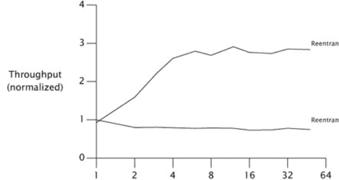

### 总结

显式锁（Explicit Locks）与内置锁（intrinsic locking）相比提供了更扩展的功能集，包括在处理锁不可用时更大的灵活性，以及对队列行为的更好的控制。但 `ReentrantLock` 并不是 `synchronized` 的万能替代品；只有在你需要 `synchronized` 缺少的功能时才使用它。

读写锁允许多个读取者并发访问受保护的对象，在访问大多数以读为主的数据结构时，提供了提高可扩展性的潜力。

# 第 14 章 - 构建自定义同步器

类库包含许多与状态相关的类——即具有基于状态的前置条件的操作，如 `FutureTask`、`Semaphore` 和 `BlockingQueue`。例如，你不能从空队列中移除元素，也无法获取尚未完成的任务的结果；在这些操作进行之前，你必须等待队列进入“非空”状态或任务完成“已完成”状态。

构建状态依赖类最简单的方法是基于现有的状态依赖库类类进行构建；我们在第 187 页的 `ValueLatch` 中就是这样做，使用 `CountDownLatch` 来提供所需的库行为。如果库类没有提供你所需的功能，你可以使用语言和库提供的底层机制构建自己的同步器，包括内置队列（intrinsic queues）、显式条件对象（explicit condition objects）和 `AbstractQueuedSynchronizer` 框架。本章将探索实现状态依赖的各种选项，以及使用平台提供的状态依赖机制的规则。

## 14.1. 管理状态依赖

在单线程程序中，如果调用方法时状态依赖条件（例如连接池非空）不成立，那么它将永远为假。因此，在顺序程序中，可以将其编码为在前置条件不成立时失败。但在并发程序中，状态依赖条件可能会通过其他线程的操作而改变：一个池可能会变空。并发对象上的状态依赖方法有时在前置条件不满足时直接失败是可以接受的，但此时有一个更好的替代方案：等待前置条件变为真。

能够阻塞操作以继续执行的状态依赖操作比简单失败的操作更方便且更不容易出错。内置队列机制允许线程阻塞一个对象，直到进入一个允许进展的状态，并在被阻塞的线程可以取得进一步进展时唤醒它们。我们将在第 14.2 节中介绍队列操作的细节，但为了说明高效队列机制的价值，我们展示了如何通过轮询（polling）和信号（signaling）来（痛苦地）实现状态依赖。

### 14.1.1 阻塞状态依赖操作的结构

```java
void acquire() throws InterruptedException {
    while (precondition does not hold) {
        release lock;
        wait(); // 前置条件可能成立
        // 如果被中断或超时则可以选择失败
        acquire lock;
    }
    perform action
}
```

有界缓冲区（Bounded buffers）常用于生产者-消费者设计。有界缓冲区提供了 `put` 和 `take` 操作，每个操作都有前置条件：你不能从空缓冲区中取出元素，也不能向满缓冲区中放入元素。状态依赖操作可以通过返回结果或返回错误状态（让调用者处理问题），或者通过阻塞操作转换到正确的状态来导致失败。

我们将开发有界缓冲区的几种实现，它们对前置条件失败采取不同的方法。每个示例都基于代码列表 14.2 中的 `BoundedBuffer`，它实现了一个基于类的循环缓冲区，其中缓冲区变量（`buf`、`head`、`tail` 和 `count`）受缓冲器的内置锁保护。它提供了同步的 `put` 和 `take` 方法，子类使用这些方法来实现放入和取出的操作；底层状态对子类是隐藏的。

### 14.1.2 示例：将前置条件失败传递给调用者

代码列表 14.3 中的 `GrumpyBuffer` 是实现有界缓冲区的一种粗浅尝试。`put` 和 `take` 方法是同步，以确保对缓冲区状态的排他访问，因为它们在访问缓冲区时都使用了“检查-后执行”（check-then-act）逻辑。

虽然这很容易实现，但用起来很烦人。对于有界缓冲区来说，异常是非常罕见的，以至于“满”（Full）并不是一个异常状态。在实现缓冲区时的简化（强迫调用者管理状态）是以巨大的复杂性为代价的，因为现在调用者必须准备好捕捉异常并对每次操作进行重试。我们将展示一个结构良好的类，特别是当 `put` 和 `take` 在整个程序中被调用时。将状态依赖推给调用者使得几乎无法保持 FIFO（先进先出）顺序；通过强制调用者重试，你丢失了谁先到达的信息。

## 代码列表 14.2. 有界缓冲区的基类

```java
@ThreadSafe
public class BoundedBuffer<V> {
    @GuardedBy("this") final V[] buf;
    @GuardedBy("this") final int tail;
    @GuardedBy("this") final int head;
    @GuardedBy("this") int count;

    protected BoundedBuffer(int capacity) {
        this.buf = (V[]) new Object[capacity];
    }

    protected synchronized void doPut(V v) {
        buf[tail] = v;
        if (++tail == buf.length) {
            tail = 0;
        }
        count++;
    }

    protected synchronized V doTake() {
        V v = buf[head];
        if (++head == buf.length) {
            head = 0;
        }
        count--;
        return v;
    }

    public synchronized boolean isFull() {
        return count == buf.length;
    }

    public synchronized boolean isEmpty() {
        return count == 0;
    }
}
```

## 代码列表 14.3. 不满足前置条件时抛出异常的缓冲区

```java
@ThreadSafe
public class GrumpyBuffer<V> extends BoundedBuffer<V> {
    public GrumpyBuffer(int size) { super(size); }

    public synchronized void put(V v) throws BufferException {
        if (isFull()) {
            throw new BufferException();
        }
        doPut(v);
    }

    public synchronized V take() throws BufferException {
        if (isEmpty()) {
            throw new BufferException();
        }
        return doTake();
    }
}
```

## 代码列表 14.4. GrumpyBuffer 的轮询逻辑

```java
while (true) {
    try {
        var item = buffer.take();
        // 使用 item
    } catch (BufferException e) {
        Thread.sleep(SLEEP_GRANULARITY);
    }
}
```

### 14.1.3 粗糙的：通过轮询和睡眠阻塞

代码列表 14.5 中的 `SleepyBuffer` 通过在 `take` 和 `put` 操作内部封装简单的“轮询-睡眠”重试机制，除了调用者实现重试逻辑的麻烦。如果缓冲区为空，它会睡眠直到另一个线程放入数据；如果缓冲区满了，它会睡眠直到另一个线程移出数据。这种方法封装了状态管理并简化了缓冲区——无疑是正确的方向。

`SleepyBuffer` 的实现比之前的尝试更复杂。缓冲区代码必须使用锁测试适当的状态，因为表示状态的变量受缓冲器的锁保护。如果锁失败，执行线程将睡眠一段时间，首先释放锁以便其他线程访问缓冲区。一旦获取锁，它将重新获取锁并再次尝试，在睡眠和状态条件之间交替，直到操作可以进行。

[3] 我们将提供 Snow White 其他五个缓冲区实现，特别是 `SneezyBoundedBuffer`。

[4] 在持有锁时睡眠或过度睡眠通常是一个坏主意，但如果不释放锁会更糟，因为危险（缓冲区满空）可能永远不会发生！

## 列表 14.5. 使用阻塞的有界缓冲区


```java
@ThreadSafe
public class sleepyBoundedBuffer<V> extends BaseBoundedBuffer<V> {
    public sleepyBoundedBuffer(int size) { super(size); }

    public void put(V v) throws InterruptedException {
        while (true) {
            synchronized (this) {
                if (!isFull()) {
                    doPut(v);
                    return;
                }
            }
            Thread.sleep(SLEEP_GRANULARITY);
        }
    }
    public V take() throws InterruptedException {
        while (true) {
            synchronized (this) {
                if (!isEmpty()) {
                    return doTake();
                }
            }
            Thread.sleep(SLEEP_GRANULARITY);
        }
    }
}
```

`SleepyBoundedBuffer` 还为调用者增加了另一个要求——礼貌的做法是提供一种取消机制（参见第 7 章）。当方法在阻塞等待唤醒时，我们会抛出 `InterruptedException`。像大多数良好的阻塞库方法一样，`Sleepy-Buffer` 支持通过中断来取消，如果被中断，则会提前返回并抛出 `InterruptedException`。

这些试图通过轮询和睡眠来合成阻塞操作的尝试相当糟糕。如果能有一种挂起繁忙线程的方法，并确保当某个条件（如缓冲区不再满）变为真时，它能被及时唤醒，那就太好了。这正是条件队列（condition queues）所做的事情。

## 14.1 条件队列的及时救场

条件队列就像你烤面包机上“面包做好了”的铃声。如果你在听它，当面包做好时，你就会收到通知，可以放下手头的事（或者，也许你想先读完报纸）去取你的面包。如果你没有在听（也许你想去社区外走走），你可能会错过通知，但回到厨房后，你可以观察烤面包机的状态，如果面包做好了就取出，或者重新启动烤面包机。

条件队列之所以得这个名字，因为它将线程分组——称为等待集（wait set）——这是一种等待特定条件变为真的方法。与元素为数据项的典型队列不同，条件队列的元素是等待条件的线程。

正如 Java Object 可以充当锁一样，每个条件队列也可以充当条件，而对象构造中的 `wait`、`notify` 和 `notifyAll` 方法构建了内建条件队列的 API。对象的内在锁和它的条件队列是相关的：为了调用对象 X 上的任何条件方法，你必须持有 X 的锁。这种等待基于状态条件的机制必须与保持状态一致性的机制相匹配：除非你能够检查状态，否则你无法等待条件；除非你能够修改状态，否则你无法在条件等待时释放线程。

`object.wait` 释放锁并请求操作系统挂起当前线程，允许其他线程获取锁，然后唤醒它。

在使用条件等待（`object.wait` 或 `Condition.await`）时：

- 始终对对象状态进行条件谓词测试，该状态在继续执行之前必须满足；
- 在调用 `wait` 之前测试条件谓词，并在从 `wait` 返回后再次进行测试；
- 始终在循环中调用 `wait`；
- 确保构成条件谓词的状态变量受与条件队列关联的锁保护；
- 在执行 `wait`、`notify` 或 `notifyAll` 时持有与条件队列关联的锁；
- 在检查条件谓词后执行操作之前，不要释放锁。

## 14.2.3 信号丢失

第 10 章讨论了死锁和活锁等问题。另一种可能的失败是信号丢失。当一个线程等待一个已经满足的特定条件，但在等待之前没有检查条件谓词时，就会发生信号丢失。现在线程正在等待一个已经发生的事件通知。这就像正准备出去听新闻，在你出门时门铃响了，然后你坐在厨房桌旁等吐司。你可能会无限地等下去。与 `wait` 的果酱不同，通知不是“粘性”的，如果 A 在条件队列上发出通知而线程 B 在同一条件上等待，除非通知是为了唤醒 B，否则 B 不会醒来。信号丢失是由上面列表中警告的那些编码错误导致的，例如在等待之前没有测试条件谓词。如果你的结构条件等待如列表 14.7 所示，你就不会遇到信号丢失的问题。

> [10] 对于这种等待的错误，其他人必须去烤吐司，但这只会让情况变得更糟；当门铃响时，你已经对吐司的所有权达成了共识。

## 14.2.4 通知

我们已经讨论了条件等待的一半内容：另一半是通知。在有界缓冲区中，当缓冲区满时，`take` 会阻塞。为了在缓冲区变为非空时解锁等待，我们必须确保缓冲区中的每条代码路径在可能非空时都能发出通知。在 `BoundedBuffer` 中，只有在 `put` 之后有一个地方。`put` 在成功向缓冲区添加对象后会调用 `notifyAll`。同样，`take` 在移除元素后也会调用 `notifyAll`，以指示在任何存在“满”条件的情况下，缓冲区可能不再是满。

每当你在某个条件上等待时，确保在条件谓词变为真之前，有人执行了通知。

条件队列中有两种通知：`notify()` 和 `notifyAll()`。要调用任何一个，你都必须持有与条件队列关联的锁。调用 `notify()` 会导致 JVM 选择一个在条件队列上等待的线程将其唤醒；`notifyAll()` 则唤醒所有等待在该条件队列上的线程。因为在调用 `notify()` 或 `notifyAll()` 时必须持有条件队列的锁，而等待线程在不要求锁的情况下无法等待，因此 `notify` 应该释放锁，以确保等待线程尽快被解锁。

多个线程可能在同一个条件队列上等待不同的条件谓词，使用 `notify` 而不是 `notifyAll` 可能是危险的，主要因为单次通知是一个类似于信号丢失的问题。

`BoundedBuffer` 提供了一个很好的说明，了为什么在大多数情况下应该优先使用 `notifyAll` 而不是单次通知。条件队列用于两个条件：“未满”和“非空”。假设 A 在条件队列上等待谓词 PA，B 在同一个条件队列上等待谓词 PB。现在，假设 B 执行了单次信号；JVM 将唤醒它选择的其中一个。如果选择了 A，它会醒来，发现 PA 尚未为真，然后返回等待状态。同时，B 可以取得进展，而它还没有等待。这并不完全是信号丢失的“信号被劫持”，但问题是一个线程正在等待一个（或应该）已经发生的信号。

只有在满足以下条件之一时，才可以使用 `notify` 代替 `notifyAll`：

- 等待者是统一的：只有一个条件谓词与条件队列关联，且每个线程执行相同的逻辑，且仅在从 `wait` 返回时返回；
- 一进出一出：条件变量上的通知最多允许一个线程继续执行。

《Java 并发编程实践》(Java Concurrency in Practice)

`BoundedBuffer` 满足了“一进一出”的要求，但不能满足等待者的要求，因为等待的线程可能在等待“满”或“非空”条件。像第 96 页 `TestHashMap` 中使用的类似“启动门”（starting gate）的锁（其中单个事件释放一组线程）并不满足“一进一出”的要求，因为启动门允许多个线程通过。

大多数类都不满足这些要求，因此主流的观点是优先使用 `notifyAll()` 而不是 `notify()`。虽然效率不高，但使用 `notifyAll()` 代替 `notify` 来确保你的类在使用运行时行为正确要安全得多。

“这种主流的观点”让一些人感到不安，而且这很有道理。当只有一个线程可以取得进展时，使用 `notifyAll()` 有时是无效的，尽管并不完全如此。如果线程在某个条件上等待，调用 `notifyAll()` 会导致它们中的每一个醒来并竞争锁；它们大部分或全部将重新进入睡眠。这为每个（能够允许）单个线程取得进展的事件导致了大量的上下文切换和大量的锁获取。在最坏的情况下，`notifyAll` 会导致 O(n) 次唤醒，而实际上只需要 n 次就足够了。这是另一个性能考虑支持一种方法，而安全性考虑支持另一种方法的情况。

在 `BoundedBuffer` 中通过 `put` 和 `take` 进行通知是保守的：每当对象放入或从缓冲区移除时，都会执行一次通知。可以通过观察到这一点来优化：只有当缓冲区从空变为满或从满变为空时，线程才能被释放，而不仅仅是 `put` 或 `take` 导致这些状态的转换。这被称为条件通知（conditional notification）。虽然条件通知可以提高性能，但要做到非常困难（并且会使子类的实现复杂），应该谨慎使用。单次通知和条件通知都是优化。在使用这些技术时，始终遵循“先确保正确，如果足够快再进行优化”；否则很容易引入奇怪的错误。

列表 14.8 在 BoundedBuffer 中使用条件通知

```java
public synchronized void put(V v) throws InterruptedException {
    while (full()) {
        wait();
    }
    boolean isEmpty = isEmpty();
    put(v);
    if (isEmpty) {
        notifyAll();
    }
}
```

## 14.2.5 示例：Gate 类

第 96 页 `TestHashMap` 中的启动门是用初始计数 1 构建的，创建了一个二值门：具有两个状态，初始状态和终止状态。该门在打开之前阻止通过，一旦打开，所有线程都可以通过。这种锁存机制通常是所需要的，有时缺点是按这种方式构建的门一旦打开无法再次打开。

可以使用条件等待开发一个可以关闭的 `ThreadGate`，如列表 14.9 所示。`ThreadGate` 允许打开和关闭，提供了一个直到门打开才阻塞的 `open` 方法。`open` 方法使用 `notifyAll()`，因为该类的语义符合通知的“一进出一出”测试。

`await` 使用的条件谓词比简单测试 `isEmpty` 要复杂。如果在门打开时有 N 个线程在门处，它们应该被允许通过。如果门连续打开和关闭，如果 `await` 只检查 `isEmpty`，所有线程可能无法被释放；当线程接收通知、重新获取锁并从等待中退出时，门可能再次关闭了。因此 `ThreadGate` 使用了相当复杂的谓词：每次门增加时，如果门是打开的或者在该线程到达门之后打开过，就可以通过。

由于 `Threadgate` 只支持等待门打开，因此只在 `open` 中执行通知；为了支持“等待打开”和“等待关闭”操作，必须在 `open` 和 `close` 中都执行通知。这说明了为什么依赖状态的类维护起来很脆弱，因为添加一个新的状态操作可能需要修改对象状态的代码路径，以便执行相应的通知。

## 14.6 子类安全问题

使用条件或单次通知会引入约束，这可能会使子类变得复杂 [CPJ 3.3.3.3]。如果你想支持子类化，必须设计类结构，使得子类在添加基类的适当通知时，不会违反单次通知或条件通知的所有要求。

## 14.9 可释放的闸门等待与 notifyall

```java
@ThreadSafe
public class Threadsafe {
    @CONDITION-PREDICATE: opened-since(n isOpen || generation>n)
    @GuardedBy("this") private boolean isOpen;
    @GuardedBy("this") private int generation;

    public synchronized void close() {
        isOpen = false;
    }

    public synchronized void open() {
        generation++;
        isOpen = true;
        notifyAll();
    }

    // BLOCKS-UNTIL: opened-since(generation on entry)
    public synchronized void await() throws InterruptedException {
        int arrivalGeneration = generation;
        while (!isOpen && arrivalGeneration == generation) {
            wait();
        }
    }
}
```

状态依赖型类要么向子类暴露（并记录）其等待和通知协议，要么完全防止子类的派生。这是“为继承进行设计并编写文档，或者禁止继承” [EJ Item 15] 的扩展。至少，为继承设计状态依赖型类需要暴露条件队列、锁和同步策略；它还可能需要暴露底层的状态变量。（最糟糕的状态依赖型类是暴露了其状态变量，但没有记录其等待和通知协议；即：）

实现此点的一种方法是可以通过将类标记为 `final` 或从子类中隐藏条件队列、锁、状态变量来有效地防止子类化。如果子类执行了某些破坏基类的操作，那么 `pop` 操作在空时阻塞，创建一个无边界的阻塞栈，其中 `push` 操作可以一直进行。这符合单次通知的要求。如果该类使用单次通知，且子类连续两次为 "pop" 添加了两个“元素”，那么现在就有两类等待者：等待弹出一个元素的线程和等待弹出两个元素的线程。但如果基类保护了条件队列并记录了其使用协议，子类就可以重写 `push` 方法以调用 `notifyAll()`，从而恢复安全性。

## 14.7 封装条件

通常情况下，将条件封装起来使其对所在的类层次不可访问会更好。否则，调用者可能会认为他们以一种与你的设计更一致的方式理解了你的等待和通知。（除非条件队列不可控，否则无法强制执行单次通知的统一等待者要求；如果任何代码错误地等待，可能会还原你的通知协议并导致信号被劫持。）

不幸的是，这种——将对象封装为条件队列——与线程安全类的常用设计模式不一致，在那种模式中，对象的内在锁被用来保护其状态。`Boundedbuffer` 阐释了这种惯用法，缓冲区对象本身就是锁和条件队列；唯一的区别在于它可以很容易地限制为使用私有锁和条件队列；不再支持任何形式的客户端锁定。

## 14.8 入口和退出协议

Wellings (2004) 刻画了在入口和退出协议中正确使用 `wait` 和 `notify`。对于每个状态依赖的操作，以及每个修改了其他操作所依赖状态的操作，你都应该定义并记录一个入口和退出协议。入口协议是操作的条件谓词；退出协议检查被操作过的任何状态变量，以查看它们是否导致了某些条件谓词变为真，如果是，则通知相关的条件队列。

《Java并发》（Java Concurrency In Practice）

`AbstractQueuedSynchronizer` 是 `java.util.concurrent` 中状态依赖类的基础（第 14.4 节），它探索了退出协议的概念。它并没有让同步类执行自己的通知，而是替换了同步方法以返回一个值，指示其操作是否解锁了一个或多个等待的线程。这种显式的 API 要求使得在某些状态转换时“忘记”通知变得更加困难。

## 14.3 条件对象

如第 13 节所示，在内在锁过于灵活的某些情况下，显式锁是有用的。`Lock` 是内在锁的泛化，`Condition`（见代码清单 14.0）是内在条件队列的泛化。

内在条件队列有几个缺点。每个内在锁只能关联一个条件队列，这意味着在类中，多个线程在同一个条件队列上等待不同的条件谓词，且最常见的模式无法强制执行 `notifyAll()` 的单元等待要求。如果你想创建一个具有多个谓词的并发对象，或者你想对条件队列的可见性进行更多控制，显式锁和 `Condition` 类提供了比内在锁和条件队列更灵活的替代方案。

一个条件与单个锁关联，就像一个条件与单个内在锁关联一样；要创建它，在关联的锁上调用 `lock.newCondition`。由于锁比内在锁提供了丰富的功能集，`Condition` 也比条件队列提供了丰富的功能集：每个锁对应多个组、不可中断的条件队列、基于截止日期的等待，以及公平或非公平队列的选择。

```java
// 代码清单 14.10. Condition 接口。
public interface Condition {
    void await() throws InterruptedException;
    boolean await(long time, TimeUnit unit) throws InterruptedException;
    long awaitNanos(long nanos) throws InterruptedException;
    void awaitInterruptibly() throws InterruptedException;
    boolean awaitUntil(Date deadline) throws InterruptedException;
    void signal();
    void signalAll();
}
```

代码清单 14.10. Condition 接口。

与内在条件队列不同，每个锁可以拥有任意数量的 `Condition` 对象。条件对象继承其关联锁的公平性设置；对于公平锁，线程按 FIFO 顺序从 `condition.await` 释放。


> **警告**：对象的 `wait`、`notify` 和 `notifyAll()` 的等价物是 `await`、`signal` 和 `signalAll()`。然而，`condition` 继承自 `Object`，这意味着它拥有 `wait` 和 `notify` 方法。确保使用正确的版本 - `await` 和 `signal`。

代码清单 14.11 显示了另一个边界缓冲区实现，与 `boundedBuffer` 相同，但它使用两个条件 `notFull` 和 `empty`，显式地区分了“未满”和“空”谓词。当缓冲区为空而阻塞时，它通知 `notFull`，并唤醒被 `empty` 阻塞的线程。

使用多个条件的类 `concurrentBuffer` 比使用带有多个谓词的单一内在条件的类更容易分析行为。通过将两个条件分离到不同的等待集，`condition` 使更容易满足单次通知的要求。使用更高效的 `signal` 代替 `signalAll()` 减少了每个缓冲区操作的上下文切换和锁获取次数。

与内置锁和条件队列一样，在使用显式 `Lock` 和 `Condition` 时，锁、条件谓词和条件变量之间的三者关系同样成立。条件谓词中的变量必须由 `Lock` 保护，并且测试条件谓词以及调用 `signal` 时必须持有 `Lock`。[11]

[11] `ReentrantLock` 在调用 `signal` 或 `signalAll` 时要求持有锁，但 `Lock` 实现允许构造不具有此要求的 `Condition`。


## 第四部分：高级主题 - 第 14 章 - 构建同步器

选择显式条件和内部队列的方式，与你在 `ReentrantLock` 和 `synchronized` 之间进行选择的方式相同：如果你使用它的高级特性（如公平队列或每个锁的多个等待集），则使用 `condition`；否则，优先使用内部条件（如果你已经因为需要高级特性而使用了 `ReentrantLock`，那么选择已经做出了）。

## 14.4. 同步器的剖析

`ReentrantLock` 和 `synchronized` 的接口有许多共同点。它们都充当“大门”，每次只允许有限数量的线程通过；线程到达门口并允许通过（`lock` 或 `acquire` 块返回成功），或者被拒绝（`tryLock` 或 `acquire` 返回 `false`，表示锁或许可在时间内变得可用）。此外，两者都允许可中断、不可中断[原文如此: 可能是可中断的]以及定时获取尝试，并且都允许选择线程的公平或非公平队列。

鉴于此，你可能会认为 `semaphore` 是基于 `ReentrantLock` 实现的，或者 `ReentrantLock` 是用一个信号量实现的。这在实践上是可行的；证明一个计数信号量可以使用锁来实现（如列表 14.12 中的 `Semaphore` 所示），以及锁可以使用计数信号量来实现是一项常见的练习。

实际上，它们都是像许多其他同步器一样，使用一个公共基类 `AbstractQueuedSynchronizer(AQS)` 实现的。AQS 是一个同时用于锁和同步器的框架，使用它可以轻松且高效地构建出极其广泛的同步器。不仅 `ReentrantLock` 和 `Semaphore` 是使用 AQS 构建的，可计数的同步器、`ReentrantReadLock`、`SynchronousQueue` 和 `FutureTask` 也替换了基于 AQS 的 `QueuedQueue`（一种更具扩展性的）非阻塞版本。

### 列表 14.11. 使用显式条件构建的界限缓冲区。

```java
@ThreadSafe
public class BoundedBuffer<T> {
    private Lock lock = new ReentrantLock();
    // 条件谓词: notFull(count < items.length)
    private final Condition notFull = lock.newCondition();
    // 条件谓词: notEmpty(count > 0)
    private final Condition notEmpty = lock.newCondition();
    @GuardedBy("lock")
    private final T[] items = (T[]) new Object[BUFFER_SIZE];
    @GuardedBy("lock")
    private int head, tail, count;

    // 阻塞直直到: notFull
    public void put(T item) throws InterruptedException {
        lock.lock();
        try {
            while (count == items.length) {
                notFull.await();
            }
            items[tail] = item;
            tail = (tail + 1) % items.length;
            count++;
            notEmpty.signal();
        } finally {
            lock.unlock();
        }
    }

    // 阻塞直直到: notEmpty
    public T take() throws InterruptedException {
        lock.lock();
        try {
            while (count == 0) {
                notEmpty.await();
            }
            T item = items[head];
            items[head] = null;
            head = (head + 1) % items.length;
            count--;
            notFull.signal();
            return item;
        } finally {
            lock.unlock();
        }
    }
}
```

### 列表 14.12: 使用锁实现的计数信号量。

```java
// 并不是 java.util.concurrent.Semaphore 的实现方式

@ThreadSafe
public class SemaphoreLock {

    private final Lock lock = new ReentrantLock();
    private final Condition permitsAvailable = lock.newCondition();

    @GuardedBy("lock") private int permits;

    public SemaphoreLock(int initialPermits) {
        lock.lock();
        try {
            permits = initialPermits;
        } finally {
            lock.unlock();
        }
    }

    // 阻塞直直到: permitsAvailable
    public void acquire(int permits) throws InterruptedException {
        lock.lock();
        try {
            while (this.permits <= 0)
                permitsAvailable.await();
            this.permits--;
        } finally {
            lock.unlock();
        }
    }

    public void release() {
        lock.lock();
        try {
            ++permits;
            permitsAvailable.signal();
        } finally {
            lock.unlock();
        }
    }
}
```

AQS 处理了实现同步器的许多细节，例如等待线程的 FIFO 队列。单个同步器可以定义灵活的准则，来决定是否允许线程通过或等待。

使用 AQS 构建同步器有几个优点。它不仅大幅减少了实现工作量，而且你不需要为多个争用点支付代价，就像在构建一个同步器之上构建另一个同步器时那样。在 `SemaphoreLock` 中，获取许可有两个可能阻塞的地方——一次在锁上，[原文如此: 可能是“在”]信号量状态上。使用 AQS 构建的同步器只有一个可能阻塞点，这防止了上下文切换的开销并提高了吞吐量。AQS 是为了可扩展性而设计的，`java.util.concurrent` 中所有使用 AQS 构建的同步器都将从中受益。

## 14.5. AbstractQueuedSynchronizer

大多数开发者可能会使用 AQS；标准同步器集涵盖了广泛的情况。但观察标准同步器是如何实现的会有帮助。

基于 AQS 的同步器执行的基础操作是 `acquire` 和 `release`。AQS 中的获取和释放形式如列表 14.13 所示。支持独占获取的同步器应该实现受保护方法 `tryAcquire`、`tryRelease` 和 `isHeldExclusively()`，支持共享获取的同步器应该实现 `tryAcquireShared` 和 `tryReleaseShared`。AQS 中的 `acquire`、`acquireShared` 和 `releaseShared` 方法以同步器子类中这些方法的形式，以确定操作是否可以进行。同步器子类可以使用 `getState`、`setState` 和 `compareAndSetState` 根据其获取和释放语义来检查并更新状态，并通知基类。例如，从 `tryAcquireShared` 返回负值表示获取失败；返回零表示同步器被独占获取；返回正值则表示释放可能解阻塞了尝试获取同步器的线程。

第一部分涉及可能更新同步器状态；即其他线程是否可以获取。例如，`latch`（倒门器）将状态从“未持有”变为“已持有”，而释放 `latch` 不影响其他线程是否可以获取。该决定由同步器确定；如果是，则允许线程继续，如果否，则获取阻塞。第二部分涉及可能更新同步器状态；即其他线程是否可以获取。例如，`latch` 将状态从“未持有”变为“已持有”，而释放 `latch` 不影响其他线程是否可以获取。

为了简化支持获取队列的锁（如 `ReentrantLock`）的实现，AQS 提供了使用同步器构建条件变量机制。

### 14.5.1. 简单的 Latch

列表 14.14 中的 `OneLatch` 是使用 AQS 实现的二进制 latch。它有两个公共方法 `await` 和 `signal`，对应获取和释放。初始时，锁是关闭的；任何调用 `await` 的线程都会阻塞，直到锁打开。一旦通过调用 `signal` 打开，等待的线程将被释放，随后到达锁的线程将允许继续。

### 列表 14.14. 使用 AbstractQueuedSynchronizer 的二值锁。

```java
@ThreadSafe
public class OneHotLatch {
    private final Sync sync = new Sync();

    public void signal() {
        sync.releaseShared(0);
    }

    public void await() throws InterruptedException {
        sync.acquireShared(0);
    }

    private class Sync extends AbstractQueuedSynchronizer {
        protected int tryAcquireShared(int ignored) {
            // 如果锁是开启的 (state == 1)，则成功，否则失败
            return (getState() == 1) ? 1 : -1;
        }

        protected boolean tryReleaseShared(int ignored) {
            setState(1); // 锁现在开启了
            return true; // 其他线程可能会获取
        }
    }
}
```

在 `OneHotLatch` 中，AQS 处理锁的状态——关闭（零）或开启（一）。`await` 方法调用 `acquireShared`，该方法反过来调用 `OneHotLatch` 中的 `tryAcquireShared`。`tryAcquireShared` 的实现必须返回一个值，指示是否可以进行获取。如果锁之前已经被开启，`tryAcquireShared` 返回成功，否则它返回一个表示获取失败的值。被中断的方法将失败解释为该线程应该在等待线程队列中。同样地，`signal` 调用 `releaseShared`，它会无条件地将锁设置为开启并返回 `true`。`tryReleaseShared` 实现返回 `true`。AQS 允许所有等待线程尝试获取同步器，由于 `tryAcquireShared` 返回了成功，现在获取将能够成功。

`OneHotLatch` 是一个功能完备、可用且高性能的同步器，仅用二十多行代码即可实现。它缺少一些实用的功能——例如超时获取或检查锁状态的能力，但这些也很容易实现，因为 AQS 提供了获取的超时版本以及用于常用检查操作的实用方法。

`OneHotLatch` 可以通过扩展 AQS 而不是委托给它来实现，但由于以下几个原因，这种做法是不可取的 [Ej Item 14]。这样做会破坏 `OneHotLatch` 简单的（两个）接口，且 AQS 的公共方法不会允许调用者破坏锁状态，调用者可能会很容易错误地使用它们。`java.util.concurrent` 中的没有任何同步器是直接扩展 AQS——它们都是委托给 AQS 的原始内部子类的。

## 14.6. java.util.concurrent 同步类中的 AQS

`java.util.concurrent` 中的许多阻塞类，如 `ReentrantLock`、`Semaphore`、`ReentrantReadWriteLock`、`CountDownLatch`、`SynchronousQueue` 和 `FutureTask` 都是使用 AQS 构建的。在不深入细节的情况下（源代码是 JDK 下载的一部分[13]），让我们快速看看这些类各是如何使用 AQS 的。

> [13] 或者通过较少的许可访问 http://ge.oswego.edu/currency-interest-

### 14.6.1. ReentrantLock

`ReentrantLock` 仅支持排斥获取，因为它为列表 14.1 所示的非公平版本实现了 `tryAcquire`、`tryRelease` 和 `isHeldExclusively`。`ReentrantLock` 使用同步状态来持有锁获取计数，并维护另一个所有者变量，持有已获取锁或即将释放锁的线程身份[14]。在 `tryRelease` 中，它检查所有者字段，以确保在允许解锁继续之前当前线程拥有该锁；在 `tryAcquire` 中，它利用此来区分重入获取和竞争性获取尝试。

[14] 因为受保护的状态操纵方法具有 `volatile` 读写的内存语义，且 `ReentrantLock` 可以在仅调用 `getState` 之后、在调用 `setState` 之前读取所有者，因此 `ReentrantLock` 可以“搭车”同步的内存语义，从而避免进一步的同步——见第 16.4 节。


当线程尝试获取锁时，`tryAcquire` 首先检查锁状态。如果锁未被持有，它会尝试更新锁状态以指示它已被持有。由于锁状态自它第一次检查几条指令以来可能已经发生了变化，`tryAcquire` 使用 `compareAndSet` 原子地更新状态，以指示锁现在已被持有且自上次以来未发生变化（参见第 15.3 节中 `compareAndSet` 的描述）。如果锁状态已被持有，如果当前线程是锁的所有者，则增加获取计数；如果当前线程不是锁的所有者，则获取尝试失败。

### 列表 14.5. 来自非公平 ReentrantLock 的 tryAcquire 实现

```
protected boolean tryAcquire(int ignored) {
    Thread current = Thread.currentThread();
    int c = getState();
    if (c == 0) {
        if (compareAndSetState(0, 1)) {
            setExclusiveOwnerThread(current);
            return true;
        }
    } else if (current == getExclusiveOwnerThread()) {
        setState(c + 1);
        return true;
    }
    return false;
}
```

`ReentrantLock` 还利用了 AQS 对多个条件变量和等待集合的内置支持。`Lock.newCondition()` 返回 `ConditionObject` 的新实例，它是 AQS 的一个内部类。

## 14.6.2. Semaphore 和 CountDownLatch

`Semaphore` 使用 AQS 同步状态来持有剩余许可的计数，如果许可不足，则返回一个表示获取失败的值（参见 14.6 节）。如果看起来持有了足够的许可，它尝试使用 `compareAndSet` 原子地减少计数。

`OneHotLatch` 是一个功能完备、可用且高性能的同步器，仅用二十多行代码即可实现。它缺少一些实用的功能——例如超时获取或检查锁状态的能力，这些也很容易实现，因为 AQS 提供了获取的超时版本以及用于常用检查操作的实用方法。

`OneHotLatch` 可以通过扩展 AQS 而不是委托给它来实现，但由于以下几个原因，这种做法是不可取的 [Ej Item 14]。这样做会破坏 `OneHotLatch` 简单的（两个）接口，且 AQS 的公共方法不会允许调用者破坏锁状态，调用者可能会很容易错误地使用它们。`java.util.concurrent` 中的没有任何同步器是直接扩展 AQS——它们都是委托给 AQS 的原始内部子类的。`ReentrantLock` 还利用了 AQS 对多个条件变量和等待集合的内置支持。`Lock.newCondition()` 返回 `ConditionObject` 的新实例，它是 AQS 的一个内部类。

## 14.6.3. FutureTask

乍一看，`FutureTask` 甚至不像一个同步器。但 `Future` 具有类似的语义，如果（任务的完成或取消）发生，那么线程可以继续，否则它们将等待直到该事件发生。

`FutureTask` 使用 AQS 同步状态来处理任务状态，完成或取消。它维护额外的状态来持有计算结果或异常，并进一步维护一个指向正在运行线程的引用。

## 14.6.4. ReentrantReadWriteLock

读写锁接口表明在 `ReentrantReadWriteLock` 的基于 AQS 的实现中有一个读锁和一个写锁，一个 AQS 子类管理着读和写锁。`ReentrantReadWriteLock` 使用 16 位用于写锁计数，另外 16 位用于读锁计数。

内部，AQS 维护一个等待线程队列，跟踪线程是否请求了排斥或共享访问。在 `ReentrantReadWriteLock` 中，当锁可用时，如果队列头的线程请求的是读访问，则它将获取；如果队列头的线程请求的是写访问，则到第一个写者之前的所有队列线程将获取。

[15] 这种机制不允许选择读者偏好或写者偏好的策略，正如某些读写锁实现所做的那样。对于任何一种偏好，AQS 队列需要某种非 FIFO 队列，或者需要两个队列。然而，这种严格的排序在实践中很少需要；如果非公平版本的 `ReentrantReadWriteLock` 未提供可接受的活性，公平版本通常能提供满意的排序并保证读者和写者不会饥饿。

# 第 15 章 原子变量与非阻塞同步

`java.util.concurrent` 中的许多类（如 `Semaphore` 和 `ConcurrentLinkedQueue`）提供了比 `synchronized` 更好的性能和替代方案。在本章中，我们将探讨这种性能提升的主要来源：原子变量和非阻塞同步。

最近关于算法的研究大多集中在非阻塞算法上。这种算法使用低层的原子机器指令（如比较并交换，`compare-and-swap`）而不是锁（`locks`）来确保并发环境下的数据完整性。非阻塞算法被广泛应用于操作系统和 JVM 中，用于进程和调度、垃圾回收，以及实现锁和其他并发数据结构。

非阻塞算法的设计比基于锁的替代方案要复杂得多，但它们可以提供显著的可扩展性和利用率优势。它们在更细粒度的粒度上进行协调，并极大减少了开销，因为当多个线程竞争同一份数据时，它们不会产生死锁（`deadlock`）和活锁（`livelock`）问题。在基于锁的算法中，线程会被挂起或自旋等待锁，而非阻塞算法对单个故障是免疫的。

即使你没有开发非阻塞算法，原子变量也可以用作“volatile 变量”（`volatile variables`）。原子变量提供了与 `volatile` 变量相同的语义，但增加了对原子更新的支持——这使其成为计数器、序列生成器和统计收集的理想选择，同时提供了比基于锁的替代方案更好的可扩展性。

## 15.1. 锁的缺点

使用一致的锁协议来协调共享状态可以确保当一个线程持有保护一组变量的锁时，它对这些变量具有排他访问权限，并且对这些变量所做的任何更改对随后获取锁的其他线程可见。

现代 JVM 可以有效地优化锁的获取和释放，但如果多个线程同时请求锁，JVM 将求助于操作系统的帮助。如果到了这一步，某些不幸的线程将被挂起并必须被恢复。当该线程被恢复时，它可能需要等待其他线程完成调度后才能被实际调度。对于基于锁的细粒度类（例如 `synchronized` 集合，其方法仅包含少数几次操作），当锁被频繁竞争时，开销与有效工作之间的比例可能会很高。

> [1] 一个智能 JVM 在竞争锁时并不一定挂起线程，它可以使用性能数据，根据之前获取锁持续的时间，自适应地在挂起和自旋锁之间做出决定。

`volatile` 变量是一种轻量级同步机制，因为它们不涉及上下文切换或调度。然而，与锁相比，`volatile` 变量具有一些局限性：虽然它们提供了类似的可见性保证，但不能用于构建原子操作。这意味着当一个变量的值依赖于它的旧值时，无法使用 `volatile` 变量。在 `volatile` 变量适当的情况下，可以使用它们来实现简单的计数器或互斥锁（`mutexes`）。[2]

例如，自增操作 (`++i`) 看起来像是一个原子操作，实际上它是三个不同的步骤——获取变量的当前值，对其加 1，然后返回更新后的值。为了不丢失更新，读取-修改-写入操作必须是原子的。到目前为止，我们看到的实现此点的唯一方法就是锁，如第 56 页所示。

`Counter` 是线程安全的，但在存在锁或竞争的情况下性能糟糕。但在竞争下，由于上下文切换开销和调度延迟，性能会受到损害。当锁被持有时间很短时，进入睡眠对于在错误时间请求锁来说是一个严厉的惩罚。

锁有两个缺点。当线程等待锁时，它不能做其他事情。如果持有锁的线程被延迟（由于页错误、调度延迟等），那么任何获取该锁的线程都无法……

## 15.2. 并发的硬件支持

排他性锁（`Exclusive locking`）是一种悲观技术——它假设最坏的情况（如果你不锁门，小精灵就会进来并弄乱你的东西），并且在你通过获取适当锁保证他人不会干扰之前，它不会继续执行。

对于细粒度操作，有一种通常更有效的方法——乐观方法（`optimistic approach`），即你进行更新，希望在没有干扰的情况下完成它。这种方法依赖碰撞检测来判断更新过程中是否存在来自第三方的干扰，如果有，操作将失败并可以重试（或不执行）。乐观方法就像老话所说，“获得原谅比获得许可更容易”，而这里的“更容易”意味着“更高效”。

为多处理器操作设计的处理器提供了用于管理共享变量访问的特殊指令。早期处理器具有原子的测试并设置（`test-and-set`）、取并加 1（`fetch-and-increment`）或交换（`swap`）指令，用于实现互斥锁以管理并发对象。今天，每个现代处理器都具有某种形式的原子读取-修改-写入指令，例如比较并交换（`compare-and-swap`）或链接/存储条件（`load-linked/store-conditional`）。操作系统和 JVM 使用这些指令来实现锁和并发数据结构，在 Java 5.0 之前，这些指令对 Java 类来说是不可用的。

### 15.2.1. 比较并交换

大多数处理器架构（IA32 和 Sparc）采用的方法是实现比较并交换（CAS）指令。（其他处理器，如 PowerPC，使用一对指令实现相同的功能：`load-linked/store-conditional`。）CAS 有三个操作数——要对其操作的内存位置 `V`、期望值 `A` 和新值 `B`。如果 `V` 中的值等于期望值 `A`，CAS 原子性地将 `V` 更新为新值 `B`；否则什么都不做。无论何种情况，它都会返回 `V` 当前的值。（变体 `compare-and-set` 不返回任何值。）CAS 的意思是“我认为 `V` 应该是值 `A`；如果是，则变为值 `B`。” CAS 是一种乐观技术——它在希望成功的情况下更新，并可以检测是否有另一个线程自上次检查以来更新了该变量。

在应用层面执行 CAS 不涉及任何 JVM 系统调用或调度活动。在应用层面看起来路径较长，但考虑到 JVM 和操作系统的活动时，其路径实际上要短得多。CAS 的主要缺点是它强迫调用者去处理竞争（通过重试、退避或放弃），而锁则通过阻塞直到锁可用来处理竞争。[5]

[5] 实际上，CAS 的缺点在于构建其外围算法具有困难性。

CAS 的性能在不同处理器之间差异巨大。在单 CPU 系统上，CAS 耗时大约是百个时钟周期，且没有同步开销。截至本文编写时，在多 CPU 系统上，无竞争 CAS 的成本范围在约 5 到 150 个周期之间；CAS 是一个快速变化的目标，其性能不仅随架构变化，甚至在同一处理器的不同版本之间不同。在未来几年中，CAS 性能的改进可能会继续充满竞争。一个通用的规则是：在大多数处理器上，获取锁的“快速路径”成本大约是 CAS 成本的两倍。

## 15.2.2. JVM 对 CAS 支持

那么，Java 如何代表我们执行 CAS 呢？在 Java 5.0 之前，没有不使用原生代码实现此功能的方法。Java 5.0 中，增加了低级支持以暴露对 `int`、`long` 和对象引用的 CAS 操作，JVM 将运行时的内联代码编译为适当的机器指令；在坏情况下，如果没有类似 CAS 的指令，JVM 将使用自旋锁。这种低级支持由原子变量类（`java.util.concurrent.atomic` 中的 `Atomic` 类）提供，用于对数值类型和引用类型提供高效的 CAS 操作；这些原子变量被直接或间接地用于实现 `java.util.concurrent` 中的大多数类。

## 15.3. 原子变量类

原子变量比锁的粒度更细、更轻量，对于在多处理器系统上实现高性能并发至关重要。原子变量将竞争范围限制在单个变量上；这是你所获得的最细粒度控制（假设你的算法可以用这种细粒度来实现）。更新原子变量的快速（无竞争）路径并不比获取锁的快速路径慢，而且通常更快；慢路径绝对比锁的路径快，因为不涉及挂起和重新调度。使用基于原子变量而非锁的算法，线程更有可能在无延迟的情况下被处理，并且如果遇到竞争，会有更容易恢复时间。

原子变量类提供了 `volatile` 变量的泛化以支持原子读写操作。`AtomicInteger` 代表一个 `int` 值，并提供的 `get()` 和 `set()` 方法在内存语义上与对 `volatile int` 的读写相同。它还提供了一个原子的 `compareAndSet()` 方法（以及 `addAndGet()`、`incrementAndGet()` 和 `decrementAndGet()` 方法）。`AtomicInteger` 为原子计数器提供了足够的替代方案，但通过显式利用硬件进行并发，提供了比 `volatile` 变量更大的灵活性。

共有十二类原子变量类，分为四组：计数器（`counters`）、累加器（`accumulators`）和复合变量。最常用的原子变量是：`AtomicInteger`、`AtomicLong`、`AtomicBoolean` 和 `AtomicReference`。它们都支持 CAS；`Integer` 和 `Long` 版本提供了算术支持。（为了模拟其他原始类型的变量，可以将 `short` 或 `byte` 值转换为 `int`，并使用 `Float.floatToIntBits` / `Double.doubleToLongBits` 处理浮点数）。

原子数组类（提供 `Integer`、`Long` 和 `Reference` 版本）是元素可以被原子更新的数组。原子数组类为数组元素提供了 `volatile` 语义，这一特性对于普通数组是不具备的——`volatile` 仅对引用本身具有 `volatile` 语义，而不对其元素。（其他类型的原子变量将在 15.4.3 和 15.4.4 节中讨论）。

虽然原子类扩展了 `Number`，但它们没有扩展像 `Integer` 或 `Long` 这样的原始包装类。事实上，它们无法做到：因为原始包装类是不可变的，而原子变量是可变的。原子变量也没有重定义 `hashCode()` 或 `equals()`；每个实例都是独特的。像大多数可变对象一样，它们不是哈希集合中键的良好候选者。

### 15.3.1. 原子作为“更好的 volatile 变量”

在第 3.4 节中，我们使用一个指向不可变对象的 `volatile` 引用来原子地更新多个状态变量。这依赖于“检查-后执行”（`check-then-act`），但在那种情况下，如果我们不在乎偶尔丢失一次更新，那么竞态是无害的。在其他情况下，这种“检查-后执行”并不是无害的，可能会损害数据完整性。第 67 页的引用无法通过指向上下边界的不可变持有者的 `volatile` 引用安全地实现，也无法通过原子整数来存储边界。不变式（`invariant`）约束了这两个数字，它们可以在保持不变式的同时同时更新，而使用 `volatile` 引用或多个原子整数的类具有不安全的“检查-后执行”序列。

我们可以结合 `evaluate` 中的技术与原子引用，通过原子地更新持有上下边界的不可变对象来闭合竞态条件。列表 15.3 中的 `CountRange` 使用指向 `IntPair` 的 `AtomicReference` 来持有状态；`compareAndSet()` 可以更新上限或下界，而不会产生 `NumberRange` 的竞态条件。

#### 列表 15.3. 使用 CAS 保持多变量不变式


```java
public class NumberRange {
    private static class IntPair {
        final int lower; // lower <= upper
        final int upper;
    }
    private final AtomicReference<IntPair> values = new AtomicReference(new IntPair(0, 0));
    public int getLower() { return values.get().lower; }
    public int getUpper() { return values.get().upper; }

    public void setLower(int i) {
        while (true) {
            IntPair oldv = values.get();
            if (i > oldv.upper) {
                throw new IllegalArgumentException("set lower to " + i + " > upper");
            }
            IntPair next = new IntPair(i, oldv.upper);
            if (values.compareAndSet(oldv, next)) {
                return;
            }
        }
    }
}
```

### 15.3.2. 性能比较：锁对比原子变量

为了演示锁和原子变量扩展性上的差异，我们构建了一个比较多种伪随机数生成器（PRNG）实现的基准。在 PRNG 中，下一个“随机”数是前一个数字的确定函数，因此 PRNG 必须将前一个数字作为状态的一部分返回。

列表 15.4 和 15.5 显示了线程安全的 PRNG 的吞吐量，分别使用 `ReentrantLock` 和 `AtomicInteger`。测试驱动程序反复调用它们；每次迭代生成一个随机数（获取并修改共享种子），并执行一些严格操作线程本地数据的“忙碌工作”迭代。这模拟了典型的操作，包括对共享状态的操作和对线程本地状态的操作。

图 15.1 和 15.2 显示了在每次迭代中具有低和中等水平模拟工作时的吞吐量。当线程本地计算水平较低时，锁或原子变量会经历激烈竞争；当线程本地工作增加时，由于访问共享变量的频率降低，竞争随之减少。

# 列表 15.4 使用 AtomicInteger 的随机数生成器。

```java
@ThreadSafe
public class AtomicPseudorandom extends PseudoRandom {
    private AtomicInteger seed;

    AtomicPseudorandom(int seed) {
        seed = new AtomicInteger(seed);
    }

    public int nextInt(int n) {
        while (true) {
            int s = seed.get();
            int nextseed = calculateNext(s);
            if (seed.compareAndSet(s, nextseed)) {
                int remainder = s % n;
                return remainder > 0 ? remainder : remainder + n;
            }
        }
    }
}
```

正如这些图所示，在高竞争下，锁的性能往往优于原子变量，但在更真实的竞争水平下，原子变量的性能优于锁。通过挂起线程、减少 CPU 使用率和共享内存上的同步流量来实现这一点（这类似于生产者-消费者设计中生产者减少消费者的负载并让他们追赶上来）。另一方面，使用原子变量时，竞争通过回退调用者来管理。大多数基于 CAS 的算法（`AtomicPseudorandom`）通过立即重试来响应竞争，这在高竞争环境下通常是正确的方法，只是更加复杂性。

[6] 这种类型在其他领域也适用：交通灯在高流量环岛处提供更好的吞吐量，在低流量时提供更好的吞吐量；以太网看到的竞争在低流量水平下表现更好，但令牌环的令牌传递方案在重度流量下表现更好。

在我们把 `AtomicPseudorandom` 视为编写糟糕的原子变量或对锁的糟糕选择之前，我们应该意识到图 15.1 中的竞争水平是不现实的：没有哪个程序是仅仅为了竞争锁或原子变量的。在实践中，在典型的竞争水平下，原子操作的可扩展性通常比锁原子操作更好。

在高竞争下锁和原子变量之间的性能反转说明了各者的优缺点。在低到中等竞争下，基于 CAS 的算法提供了更好的可扩展性；在高竞争下，锁提供了更好的竞争规避。在单 CPU 系统上的锁，因为在线程在读写操作中间被抢占的极少数情况下，CAS 在单 CPU 系统上总是成功的。

15.5 和 15.2 引入了第三条曲线：一种使用 `ThreadLocal` 用于 PRNG 状态的 `Pseudorandom` 实现。这种实现方法改变了类的行为，它看到的是它自己的私有伪随机数序列，而不是线程共享一个序列缓冲区，这说明了如果可以，不共享状态的成本更低。我们可以通过更有效地处理竞争来提高可扩展性，但只有通过完全消除竞争才能实现真正的可扩展性。

# 15.4. 非阻塞算法

基于锁的算法面临许多活跃失败（liveliness failures）的风险。如果持有锁的线程被阻塞 I/O、页错误或其他延迟延迟，可能导致没有线程能够进展。如果任何线程的失败或挂起都不会导致另一个线程的失败或挂起，则该算法是非阻塞的；如果在每一步中都有某个线程取得进展，则该算法被称为无锁的（lock-free）。使用 CAS 进行线程间协调的算法如果构建得当，既是非阻塞的也是无锁的。无竞争的 CAS 会成功，如果多个线程竞争一个 CAS，则其中一个会成功。非阻塞算法对死锁或优先级反转具有免疫（尽管它们可能会表现出饥饿或活锁，因为它们涉及重试）。到目前我们看到了一个非阻塞算法：`Counter`。非阻塞算法用于许多常见的数据结构，包括栈、队列、优先级队列和哈希表——设计新的非阻塞结构是留给专家的任务。

# 15.4.1. 非阻塞栈

非阻塞算法比其基于锁的对应算法复杂得多。创建非阻塞算法的关键在于如何在保持一致性的同时，将原子更改的范围限制在单个变量上。在队列等集合类中，你有时可以将状态转换表示为单个链接的变化，并使用 `AtomicReference` 来表示每个必须原子更新的链接。

栈是通过链式结构实现的：每个元素只引用另一个元素，且每个元素只被一个对象引用引用。列表 15.6 中的 `ConcurrentStack` 展示了如何使用原子引用构建栈。栈是一个以 `top` 为根的节点链表，每个节点包含一个值和一个指向下一个元素的链接。`push` 方法创建一个新节点，其 `next` 字段指向栈的当前 `top`，然后使用 CAS 将其安装在栈顶。如果节点仍然如我们预期的那样位于栈顶（因为自从我们开始以来，另一个线程添加或删除了元素），则 CAS 将失败并根据当前状态更新新节点并重试。无论何种情况，栈在 CAS 之后仍然处于一致状态。

`CASCounter` 和 `ConcurrentStack` 说明了所有非阻塞算法的特征：某些是推测性执行的，并且可能重做。在 `ConcurrentStack` 中，当我们构造代表新元素的 `Node` 时，我们希望 `next` 引用的值在安装到栈上时是正确的，但准备好在发生竞争时重试。

像 `ConcurrentStack` 这样的非阻塞算法线程安全性源于：与锁一样，`compareAndSet` 改变了栈的状态，但它是通过 `compareAndSet` 实现的，这具有 `volatile` 写的内存效应。当线程检查栈时，它是通过对同一个 `AtomicReference` 调用 `get` 来完成的，这具有 `volatile` 读的内存效应。因此，一个线程所做的任何更改都会发布给任何检查列表状态的其他线程。列表通过 `compareAndSet` 进行修改，要么更新顶部引用，要么在检测到来自另一个线程的干扰时失败。

# 15.4.2. 非阻塞列表

（注：此部分内容在原文中与 15.4.1 的描述高度重复，根据指令不重复输出原文，此处保留其核心逻辑翻译，或若需特定列表实现请提供。）

# Java并发实战

在这两个操作之间，队列处于中间状态，如图 15.4 所示。在第二次更新后，队列再次处于静止状态，如图 15.5 所示。

## 图 15.4 插入过程中处于中间状态的队列。

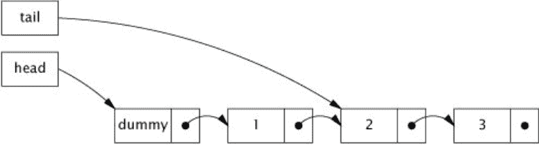

## 图 15.5 插入完成后队列再次处于静止状态。

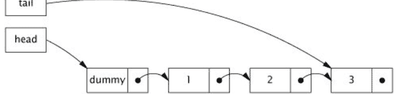

所有所需技巧的关键观察是：如果队列处于静止状态，则指向尾部节点的下一个字段为空；如果它处于中间状态，`tail.next` 则不为空。因此，任何线程都可以通过检查 `tail.next` 立即判断队列的状态。此外，如果队列处于中间状态，可以通过将尾指针向前移动一个节点来恢复到静止状态，从而完成正在插入元素的线程的操作。[7]

> [7] 有关该算法正确性的完整说明，请参见 (Michael and Scott, 1996) 或 (Herilly and Shavit, 2006)。

`Linkedqueue` 在尝试插入新元素（步骤 A）之前，首先检查队列是否处于中间状态。如果是，则有其他线程正在插入元素（处于其步骤 C 和 D 之间）。当前线程不会等待该操作完成，而是通过完成该操作来帮助该线程，即移动尾指针（步骤 B）。它会重复此检查，以防另一个线程已开始插入新元素，不断移动尾指针，直到发现队列处于静止状态，然后就可以开始自己的插入。

步骤 C 的 CAS 负责将新节点链接到队列尾部，如果两个线程尝试同时插入元素，CAS 可能会失败。在没有造成危害的情况下（即未发生任何更改），当前线程可以重新加载尾指针并重试。一旦 C 成功，插入即被视为生效；第二次 CAS（步骤 D）被视为“清理”，因为它可以由插入线程或任何其他线程执行。如果 D 失败，插入线程将直接返回而不重试 CAS，因为不需要重试——另一个线程已经在它的步骤 B 中完成了工作！在任何尝试将新节点链接到队列之前，当前线程会通过检查 `tail.next` 是否不为空来检查队列是否需要清理。如果不为空，它会先移动尾指针（可能移动多次），直到队列处于静止状态。

## 列表 15.7 Michael-Scott 队列算法中的插入（Michael and Scott, 1996）。


```java
@ThreadSafe
public class Linkedqueue<E> {
    private static class Node<E> {
        final E item;
        final AtomicReference<Node<E>> next;
        public Node(E item, Node<E> next) {
            this.item = item;
            this.next = new AtomicReference<Node<E>>(next);
        }
    }
    private final Node<E> dummy = new Node<E>(null, null);
    private final AtomicReference<Node<E>> head = new AtomicReference<Node<E>>(dummy);
    private final AtomicReference<Node<E>> tail = new AtomicReference<Node<E>>(dummy);
    public boolean enqueue(E item) {
        Node<E> newNode = new Node<E>(item, null);
        while (true) {
            Node<E> cur = tail.get();
            Node<E> next = cur.next.get();
            if (cur == tail.get()) {
                if (next == null) {
                    if (cur.next.compareAndSet(null, newNode)) {
                        tail.compareAndSet(cur, newNode);
                        return true;
                    }
                } else {
                    tail.compareAndSet(cur, next);
                }
            }
        }
    }
}
```

### 15.4.3 原子字段更新器

列表 15.7 展示了 `ConcurrentLinkedQueue` 使用的算法，但实际实现有所不同。它不是用原子引用表示每个节点，而是使用普通的 `volatile` 引用，并通过基于反射的 `AtomicReferenceFieldUpdater` 来更新它，如列表 15.8 所示。

#### 列表 15.8 在 ConcurrentLinkedQueue 中使用原子字段更新器

```java
private class Node<E> {
    final E item;
    private volatile Node<E> next;

    public Node(E item) {
        this.item = item;
    }
}

private static final AtomicReferenceFieldUpdater<Node, Node> nextUpdater =
    AtomicReferenceFieldUpdater.newUpdater(Node.class, Node.class, "next");
```

原子类（在 `Integer`、`Long` 和 `Reference` 中可用）代表了现有 `volatile` 字段的基于反射的“视图”，使得 CAS 可以用于 `volatile` 字段。更新器类没有构造函数；要创建一个更新器，请使用工厂方法并指定类名和字段名。字段更新器绑定到特定的实例；可以用于更新目标类任何实例的字段。更新器的原子性保证比原子类要弱，因为你无法保证字段不会被修改。

在 `LinkedQueue` 中，节点的 `next` 字段通过 `compareAndSet` 方法更新。这种间接的方法是为了减少使用 `AtomicReference` 对象的开销。

### 15.4.4 ABA 问题

ABA 问题是在节点可以回收的算法中，朴素使用比较交换时出现的一种异常。CAS 有效地检查“V 是否仍为 A？”，如果是，则继续更新。在大多数情况下，这是足够的。然而，有时我们需要检查“自观察到 V 为 A 之后它是否发生了变化？”在本章介绍的示例中，这是足够的。然而，有时我们需要检查“自观察到 V 为 A 之后它是否发生了变化？”对于某些算法，将 V 从 A 变为 B 再变为 A 被视为需要重试的变化。

这种问题可能出现在算法自行进行内存管理时。在这种情况下，列表头部指向一个之前观察过的节点并不意味着列表内容没有变化。如果你通过让垃圾回收器管理节点来避免 ABA 问题，仍然有一个简单的解决方案：与其更新引用的值，不如更新一对值，一个引用和一个版本号。`AtomicStampedReference`（及其同类 `AtomicMarkableReference`）提供了对一对值的原子条件更新。`AtomicStampedReference`（如果值从 A 变为 B 再变为 A，版本号将会不同）。`AtomicStampedReference`（及其同类 `AtomicMarkableReference`）提供了对象引用-整数对，允许能够免疫[8] ABA 问题的版本引用。同样，`AtomicMarkableReference` 更新对象引用-布尔对，某些算法用它让节点在被标记为删除的同时保留在列表中。[9]

[8] 在实践中，计数器可能会溢出。

[9] 许多处理器提供双重 CAS（CAS2 或 CASX）操作，可以操作指针-整数对，这使得该操作变得相当高效。截至 Java 6，即使在支持的平台上，`AtomicStampedReference` 也不使用双重 CAS。（双重 CAS 与 DCAS 不同，后者操作两个不相关的内存位置）；截至本文为止，没有当前的处理器实现了 DCAS。）

### 总结

非阻塞算法通过使用比较交换等低级并发原语而不是锁来维护线程安全。这些低级原语通过原子变量类暴露出来，这些类也可以用作“更好的 volatile 变量”，为整数和对象引用提供原子更新操作。

非阻塞算法很难设计和实现，但在典型情况下可以提供更好的扩展性，并且对生命周期故障有更强的抵抗力。从一个 JVM 版本到下一个版本的性能改进都源于非阻塞算法，无论是在 JVM 内部还是库框架中。

# 第 16 章 Java 内存模型

在本书中，我们大部分时候都避开了 Java 内存模型（JMM）的底层细节，而是关注更高层次的设计问题，如发布、规范化以及对同步策略的遵循。这些机制的强大源于 JMM，而当你理解了这些机制为何有效时，就会发现理解它们要容易得多。本章将揭示 Java 内存模型的底层要求和保证，并阐述书中提供的一些高层设计规则背后的逻辑。

## 16.1 什么是内存模型？我为什么需要它？

假设有一个线程给变量赋值：

```
variable = 3;
```

内存模型解决的是这样一个问题：“读取变量的线程在什么条件下能看到值 '3'？”。这听起来可能像个愚蠢的问题，但在没有同步的情况下，有许多原因导致线程可能无法立即（甚至永远）看到另一个线程操作的结果。编译器生成的指令顺序可能与源代码建议的“显而易见”的不同，或者将值存储在寄存器而非内存中；处理器可能会改变变量提交到内存的顺序，存储在处理器缓存中的值可能对其他处理器不可见。如果不使用同步，这些因素会阻止线程看到最新值，并导致其他线程中的内存操作看起来是无序执行的。

在单线程环境中，程序执行的所有技巧对我们来说都是隐藏的，除了加速执行外没有其他影响。Java 语言规范要求 JMM 必须维持“线程即顺序性”：只要程序运行与其在顺序环境中按顺序执行的结果相同，所有这些操作都是被允许的。这也是件好事，因为近年来计算性能的极大提升很大程度上归功于重排。诚然，更高的主频贡献了性能的提高，但并行性也是如此——流水线超标执行单元、动态指令调度、推测执行以及复杂的多级缓存。随着处理器的变得越来越复杂，编译器也变得日益复杂，通过重排指令来促进最优执行并使用复杂的寄存器分配算法。由于处理器时钟频率在经济上难以增加，硬件并行性只会增加。

在多线程环境中，如果不付出巨大的代价，是无法维持顺序幻觉的。并发应用程序中的线程大多数时候都在“做自己的事情”，线程间的协调只会减慢程序而无法产生实际益处。只有当多个线程共享数据时，才有必要协调它们的活动，而 JMM 在程序上运行，通过同步来识别这种情况何时发生。

JMM 规定了当变量对其他线程可见时 JMM 必须提供的最小保证。它的设计是为了在可预测性、易于程序开发的需求，与在各种处理器架构上实现高性能 VM 的现实之间取得平衡。如果你不了解现代处理器为了榨取程序额外性能而使用的技巧，JMM 的某些内容可能会让你感到困惑。

### 16.1.1 平台内存模型

在共享内存多处理器架构中，每个处理器都有自己的缓存，并定期与内存进行同步。处理器提供不同程度的缓存一致性；有些提供的保证极小，允许不同的处理器在任何时候看到同一内存位置的不同值。操作系统、编译器和运行时（有时也包括程序）填充了硬件提供与线程安全要求之间的差异。

确保每个处理器始终知道其他处理器在做什么是昂贵的。大多数时候不需要这些信息，因此处理器放宽了内存一致性保证以提高性能。架构的内存模型告诉程序它们可以从系统获得什么保证，并规定了特殊的指令（称为内存屏障或 fences），以便在共享数据时获得额外的内存协调保证。为了让 Java 开发者不受不同内存模型架构差异的影响，Java 定义了自己的内存模型，JVM 通过在适当的位置插入内存屏障来处理 JMM 与底层平台模型之间的差异。

一个方便的程序执行心理模型是：想象程序中的操作按照单一顺序发生，无论由哪个进程执行它们，并且对变量的每次读取都会看到该变量在执行顺序中的最后一次写入。如果这个理想且不切实际的模型成立，它被称为“顺序一致性”。软件开发者通常假设顺序一致性，但没有哪个多处理器支持顺序一致性，JMM 也不支持。

底线是，现代共享内存多处理器（以及编译器）在数据跨线程共享时可以进行某些操作，除非你通过使用内存屏障来限制它们。幸运的是，Java 程序不需要指定内存屏障的位置；它们只需要通过正确使用同步来识别何时访问了共享状态。

### 16.1.2 重排

在第 2 章描述用例和原子性时，我们使用了描述“不幸时机”的交互示例，即当调度器如何交错执行操作，从而导致同步不足的程序产生错误结果。更糟糕的是，JVM 允许执行者从不同线程的角度以不同的顺序执行，这使得对缺乏同步情况的推理变得更加复杂。操作可能延迟或看似无序执行的各种原因可以归类为“重排”大类。

列表 16.1 中可能的重排说明了除非程序经过正确同步，否则要推理最简单的并发程序的行为是多么困难。想象可能的重排如何打印 (1,0)、(0,1) 或 (0,1) 是容易的：线程 A 可以在 B 之前运行完成，B 可以在 A 之前运行完成，或者它们的动作可以交错。但奇怪的是，可能的重排也可能打印 (0,0)。图 16.1 显示了由于重排导致结果 (0,0) 的可能交错情况。

| ThreadA | y=b | reorder | a=1 |
|---|---|---|---|
| ThreadB | | b=1 | x=a (0) |

可能的重排是微不足道的事，但列举其可能的结果仍然异常地困难。内存层面的重排可以导致程序出现意料之外的行为。推理缺乏同步的情况是极其困难的；而确保程序正确使用同步要容易得多。同步会阻止编译器、运行时和硬件以违反 JMM 提供的保证的方式重排内存操作。

### 16.1.3 500 字或少的 Java 内存模型

Java 内存模型可以用 500 字以内概述，这包括对变量的读写、监视器的锁定和解锁以及线程的合并。JMM 在程序内所有操作之前定义了一个偏序。为了保证线程操作 B 可以看到操作 A 的结果（无论 A 和 B 是否在不同的线程中），A 和 B 之间必须存在“发生于”关系。在线程之间不存在发生于顺序的情况下，JVM 可以随心所欲地进行重排。

#### 列表 16.1 同步不足且可能产生意外结果的程序。不要这样做。

```java
public class PossibleReordering {
    static int x = 0, y = 0;
    static int a = 0, b = 0;

    public static void main(String[] args)
        throws InterruptedException {
        Thread one = new Thread(new Runnable() {
            public void run() {
                a = 1;
                x = b;
            }
        });
        Thread other = new Thread(new Runnable() {
            public void run() {
                b = 1;
                y = a;
            }
        });
        one.start();
        other.start();
        one.join();
        other.join();
        System.out.println("" + x + "," + y + "");
    }
}
```

当一个变量被多个线程读取，且被至少一个线程写入，但这些读写操作没有通过“发生于”排序时，就会发生数据竞态。正确同步的程序是没有竞态的；正确同步的程序表现出顺序一致性，这意味着程序中的所有操作都像是按照一个固定的全局顺序发生的。

“发生于”的规则如下：

- **程序顺序规则**。线程中的每个操作都发生在该线程中在程序顺序上之后的每一个操作之前。
- **监视器锁规则**。对监视器锁的解锁发生于对同一个监视器锁的后续任何锁定之前。[3]
- **volatile 变量规则**。对 `volatile` 字段的写入发生于该字段的后续任何读取之前。[4]
- **线程启动规则**。对线程调用 `.start()` 发生在被启动线程中的每个操作之前。
- **线程终止规则**。线程中的任何操作都发生于已终止的线程之前（通过成功从 `thread.join()` 返回或通过 `thread.isAlive()` 返回 false 终止）。
- **交集规则**。一个线程对另一个线程调用 `interrupt()` 发生于被中断线程检测到中断之前（无论是通过抛出 `InterruptedException` 还是通过调用 `isInterrupted()`）。
- **终结器规则**。对象构造函数的结束发生于该对象的终结器开始之前。
- **传递性**。如果 A 发生于 B，且 B 发生于 C，那么 A 发生于 C。

> [3] `Lock` 对象上的锁定和解锁具有与内建锁相同的内存语义。
> [4] 原子变量的读写具有与 `volatile` 变量相同的内存语义。

即使是某些操作也只是部分有序的，但同步操作——锁的获取和释放，以及 `volatile` 变量的读写——是全序的。这使得根据“后续”操作和对 `volatile` 变量的读取来定义“发生于”是合理的。

图 16.2 展示了两个线程使用公共锁进行同步时的“发生于”关系。A 内部的所有操作都按照程序顺序排序，B 内部的操作也是如此。由于 B 获取了锁 M，因此 A 中释放锁的所有操作都发生于 B 在获取锁之后的操作之前。当线程在不同的锁上进行同步时，我们无法对它们之间的操作排序得出任何结论——两个线程中的操作之间不存在“发生于”关系。

#### 图 16.2 Java 内存模型中“发生于”关系的图示

Thread A

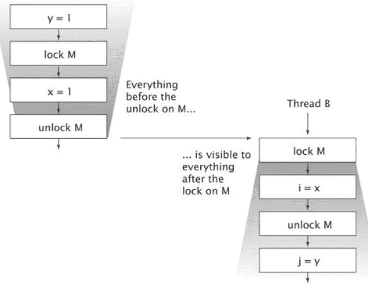

### 16.1.4 同步的便车

由于“发生于”排序的强大性，你有时可以利用现有同步的可见性属性。这涉及到将“发生于”的程序顺序规则与其他排序规则（通常是监视器锁规则或 volatile 变量规则）相结合，以便对一个未受锁保护的变量访问进行排序。这种技术对语句发生的顺序非常敏感，因此相当脆弱；这是一种高级技术，应该仅留给像 `ReentrantLock` 这样对性能极其敏感的类，以压榨最后一点性能。

`FutureTask` 中受保护的 `AbstractQueuedSynchronizer` 方法的实现说明了“便车”。AQS 维护一个整数同步器状态，`FutureTask` 用它存储任务状态：运行中、已完成或已取消。当一个线程设置结果而其他线程调用 retrieve 时，这两者通过“发生于”得到了更好的排序。这可以通过将引用变为 `volatile` 变量来实现，但利用同步以更低的成本实现相同的结果。

`FutureTask` 经过精心设计，以确保 `releaseShared()` 的成功调用发生于后续 `tryAcquireShared()` 调用，后者总是写入被 `tryAcquireShared()` 读取的 `volatile` 变量。列表 16.2 显示了在保存或检索结果时调用的 `innerSet` 和 `innerGet` 方法；由于 `innerSet` 在 `releaseShared`（调用了 `releaseShared()`）之后写入结果，而 `innerGet` 在调用 `acquireShared`（调用了 `tryAcquireShared()`）之后读取结果，程序顺序规则结合 `volatile` 变量规则，确保了 `innerSet()` 中结果的写入发生于 `innerGet()` 中结果的读取之前。


# 列表 16.2. 展示同步便车的 FutureTask 内部类

```java
// 内部 final 类 Sync extends AbstractQueuedSynchronizer {
    private static final int RUNNING = 1, RAN = 2, CANCELLED = 4;
    private V result;
    private Exception exception;

    void innerSet(V v) {
        while (true) {
            int s = getState();
            if (ranCancelled(s)) {
                return;
            }
            if (compareAndSet(s, RAN)) {
                break;
            }
        }
        result = v;
        releaseShared();
        done();
    }

    V get() throws InterruptedException, ExecutionException {
        acquireSharedInterrupted(0);
        if (getState() == CANCELLED) {
            throw new CancellationException();
        }
        if (exception != null) {
            throw new ExecutionException(exception);
        }
        return result;
    }
}
```

我们把这种技术称为“便车”，因为它利用了为了其他原因创建的现有“发生在此”排序来确保 X 的可见性，而不是为了发布专门创建一个“发生在此”排序。

Future 使用的那种便车非常微妙，不应该被采用。然而，在某些情况下，便车是完全合理的，例如当一个类作为规范的一部分承诺了方法之间的“发生在此”排序时。例如，使用 `BlockingQueue` 进行安全发布就是便车的一种。一个线程向队列放入对象，另一个线程检索它，这构成了安全发布，因为 `BlockingQueue` 的实现保证了足够的同步，确保入队发生于出队之前。

类库保证的其他“发生在此”排序：

- 在线程安全的集合中放置项发生于另一个线程从该集合中检索它之前；
- 对 `CountDownLatch` 计数减发生于线程从该计数器返回之前；
- 向 `Semaphore` 释放许可发生于从该 `Semaphore` 获取许可之前；
- `Future` 呈现的任务所采取的操作发生于另一个线程成功从 `Future` 返回之前；
- 向 `Executor` 提交 `runnable` 或 `callable` 于任务开始执行之前；以及
- 线程到达 `CyclicBarrier` 或 `Executor` 于从同一屏障或交换点释放的其他线程之前。如果 `CyclicBarrier` 使用 `action`，到达屏障发生于 `action`，而 `action` 再次发生于线程从屏障释放。

## 16.2. 发布

第 3 章探讨了如何安全地发布对象。安全发布技术的安全性来自于 JMM 提供的保证；发布不当的风险是共享对象与从另一个线程访问它之间缺乏“发生在此”排序的结果。

### 16.2.1. 不安全发布

在缺乏“发生在此”关系的情况下，重排序的可能性解释了为什么在没有足够同步的情况下发布对象会导致线程看到部分构建的对象（见第 3.5 节）。初始化新对象涉及写入变量——对象的字段。同样，发布指的是另一个变量——新对象的引用。如果你不确保共享引用发生于

# Java 并发实战

在另一个线程加载共享引用之前，将引用指向新对象的写入（从消耗对象的线程的角度来看）可能会与其字段的写入发生重排序。在这种情况下，另一个线程可能会看到对象的最新值，但该对象部分或全部状态的值却是过时的（即处于部分构造完成的状态）。

不安全的发布可能由于错误的懒初始化而发生，如图 16.3 所示。乍一看，唯一的问题似乎是第 2.2.2 节描述的竞态条件。在这种情况下，由于 `Resource` 的所有实例都是相同的，你可能愿意忽略它（连同可能多次创建资源所带来的低效率问题）。遗憾的是，即使忽略了这些缺陷，不安全的初始化仍然是不，因为另一个线程可能会观察到指向部分构造的资源的引用。

列表 16.3. 不安全的懒初始化。不要这样做。

```java
@NotThreadSafe
public class UnsafeLazyInitialization {
    private static Resource resource;
    public static Resource getResource() {
        if (resource == null)
            resource = new Resource(); // 不安全的发布
        return resource;
    }
}
```

假设 A 是第一个调用 `getResource` 的线程。它看到 `resource` 为空，实例化了一个 New Resource，并将 `resource` 设置为它。当 B 后调用 `getResource` 时，它看到 `resource` 有空值并使用了已经构造好的资源。这初看起来是无害的，但首先，在 A 中写入 `resource` 和在 B 中读取 `resource` 之间没有“发生于”（happens-before）排序。使用数据竞态来发布对象，且无法保证对象 B 能够看到资源的正确状态。

资源将新分配的资源字段从其默认值（由其构造函数写入）更改为初始值。由于两者都没有使用同步机制，B 看到 A 的操作的顺序可能与 A 执行的顺序不同。尽管 A 在设置引用之前已经初始化了 `Resource`，B 仍可能在对 `Resource` 字段进行写入之前看到一个部分构造的资源。该资源可能处于无效状态，并可能在之后发生意外之外的更改。

除了不可变对象外，除非发布发生在消耗线程使用它之前（happens-before），否则使用由另一个线程初始化的对象是不安全的。

### 16.2.2 安全发布

第 3 节讨论的安全发布惯用方法确保了发布的对象对其他线程可见，因为它们确保了发布操作发生在消耗线程加载指向发布对象的引用之前。如果 A 将 X 放入阻塞队列（`BlockingQueue`）（并随后对其进行修改），并且 B 从队列中检索它，则保证 B 看到的是 A 留下的 X。这是因为阻塞队列具有内部同步机制，以确保 `put`（放）发生在 `take`（取）之前。同样地，使用由锁（`lock`）或 `volatile` 变量保护的共享变量可以确保变量的读写操作是有顺序的“发生于”。

这种“发生于”的保证比安全发布所提供的承诺是更强的可见性和排序性保证。当 X 从 A 发布到 B 时，安全发布保证了 X 的可见性，但不能保证 A 可能触及的其他变量。如果 A 将 X 放入队列的操作发生在 B 获取 X 之前，B 不仅能看到 A 留下的状态的 X（即 X 随后没有被 A 或任何其他人修改），B 还能看到 A 在交接之前所做的操作（同样受限于相同的假设）[5]

> JMM 保证 B 看到的值至少与 A 写入的值一样新；不安全的写入可能可见，也可能不可见。

为什么我们如此关注 `@GuardedBy` 和安全发布，而 JMM 为我们提供了更强大的“发生于”？这是从移交对象所有权和写入的角度来考虑的。“发生于”排序运行在单个内存访问的层级——它是一种“并发汇编语言”。安全操作运行在比你的程序设计更低的层级上。

### 16.2.3 安全初始化惯用方法

将初始化开销较大的对象的初始化推迟到需要时是有意义的，但我们已经看到误用懒初始化如何导致问题。可以通过将方法标记为同步（`synchronized`）来修复安全初始化，如列表 16.4 所示。通过 `getInstance` 的代码路径非常短（之前经过了测试和预测）。如果线程没有频繁调用 `getInstance`，那么它就足够短，使得安全初始化（`safe_initialization`）锁提供足够的性能。

对带有初始化器的静态字段（其值在静态初始化块中初始化 [JLS 2.2.1 和 2.5.3]）的处理是特殊的，并提供了线程安全保证。静态初始化器由 JVM 在类初始化时运行，该时间至少在类被使用之前加载。因为 JVM 在初始化期间获取了锁 [Item 12.4.2]，且线程至少会获取一次该锁以确保类已初始化，因此在静态初始化期间进行的内存写入自动对所有线程可见。因此，初始化的对象在构造期间或被引用时不需要显式同步。这仅适用于构造后的状态——如果对象是可变的，读取器和写入器仍然需要同步，以使随后的修改可见并避免数据损坏。

#### 列表 16.4. 线程安全的懒初始化

```java
@ThreadSafe
class SafeInitialization {
    private Resource resource;

    public synchronized Resource getInstance() {
        if (resource == null)
            resource = new Resource();
        return resource;
    }
}
```

#### 列表 16.5. 饿汉初始化

```java
@ThreadSafe
class EagerInitialization {
    private static Resource resource = new Resource();

    public static Resource getInstance() { return resource; }
}
```

使用 16.5 所示的饿汉初始化，消除了每次调用的同步开销。16.6 所示的懒持者惯用方法（`lazy holder idiom`）提供了相同的优势，且更容易理解。

```java
@ThreadSafe
class ResourceFactory {
    private static class Holder {
        private static Resource resource = new Resource();
    }

    public static Resource getResource() {
        return Holder.resource;
    }
}
```

### 16.2.4 双重检查锁定 (DCL)

DCL 的问题在于，如果没有同步，可能会看到部分构造的资源。缺乏同步可能会导致安全漏洞。然而，JVM 随后的变化（自 5.0 版本起）已经降低了 DCL 的效率。

#### 列表 16.7. 双检查锁定反模式。不要这样做

```java
@NotThreadSafe
public class DoubleCheckedLocking {
    private static Resource resource;

    public static Resource getInstance() {
        if (resource == null) {
            synchronized (DoubleCheckedLocking.class) {
                if (resource == null) {
                    resource = new Resource();
                }
            }
        }
        return resource;
    }
}
```

### 16.3. 初始化安全性

初始化安全性的保证允许构造良好的不可变对象在不使用同步的情况下，跨线程安全地共享，无论它们是如何通过数据竞态被发布的。（这意味着如果 `Resource` 是不可变的，那么不安全的初始化就是安全的）。

如果没有初始化安全性，像字符串这样本应该是不可变的对象如果发布和消耗线程都没有使用同步，可能会更改其值。安全架构依赖于字符串的不可变性；缺乏初始化安全性可能会创建安全漏洞，允许恶意代码绕过安全检查。

## 第四部分：高级主题

## 第 16 章：内存模型

初始化安全性意味着列表 16.8 中的 `SafeStates` 可以通过不安全的懒初始化安全地发布，或者将 `SafeStates` 的引用存储在公共静态字段中，即使它没有使用同步且依赖于非线程安全的 `HashMap`。

#### 列表 16.8. 不可变对象的初始化安全性

```java
@ThreadSafe
public class SafeStates {
    private final Map<String, String> states;

    public SafeStates() {
        states = new HashMap<String, String>();
        states.put("alaska", "AK");
        states.put("alabama", "AL");
        states.put("wyoming", "WY");
    }

    public String getAbbreviation(String s) {
        return states.get(s);
    }
}
```

然而，对 `SafeStates` 的极小改变都会破坏它的线程安全性。如果 `states` 不是 `final` 的，或者构造函数以外的任何部分修改了其内容，那么初始化安全性将不足以在没有同步的情况下安全地访问 `SafeStates`。如果 `SafeStates` 有其他非 `final` 字段，线程可能仍然看到这些字段的错误值。而且允许对象在构造期间逃逸会破坏初始化安全性保证。

初始化安全性仅对在构造函数结束时通过 `final` 字段可访问的值提供可见性保证。对于通过非 `final` 字段可访问的值或在构造后可能变化的值，你必须使用同步来确保可见性。

### 总结

Java 内存模型规定了一个线程对内存的操作何时保证对另一个线程可见。具体细节涉及确保操作按照一种称为“发生之前”（happens-before）的部分偏序进行排序，这种偏序是在单个内存和同步操作层级指定的。在缺乏足够同步的情况下，线程访问共享数据时可能会发生非常奇怪的事情。然而，第 2 章和第 3 章提供的分层规则（如 `@GuardedBy` 和安全发布）可以用于确保线程安全，而无需诉诸“发生之前”的低级细节。

## 附录 A：并发注解

我们使用了诸如 `@GuardedBy` 和 `@ThreadSafe` 等注解来展示如何记录线程安全承诺和同步策略。本附录记录了这些注解；它们的源代码可以从本书的网站下载。（当然，还有额外的线程安全承诺和实现细节应该记录，但没有被这组最小注解所捕获。）

### A.1. 类注解

我们使用类级注解来描述类预期的线程安全承诺：`@Immutable`、`@ThreadSafe` 和 `@NotThreadSafe`。`@Immutable` 自然意味着该类是不可变的，并隐含了 `@ThreadSafe`。`@NotThreadSafe` 是可选的——如果一个类没有被标记为线程安全，则假设它不是线程安全的，但如果你想明确表示这一点，可以使用 `@NotThreadSafe`。

这些注解相对无侵入性，对用户和维护者都有益。用户可以立即看到一个类是否是线程安全的，维护者可以立即看到是否必须保留线程安全保证。注解对第三类群体也有用：静态分析工具可以用于验证代码是否符合注解指示的合约，例如验证一个标记为 `@Immutable` 的类实际上是不可变的。

### A.2. 字段和方法注解

类级注解是类公共文档的一部分。类线程安全策略的其他方面完全是面向维护者的，不属于其公共文档。

使用锁的类会记录哪些状态变量受锁保护，以及使用哪些锁来保护这些变量。无意中非线程安全的常见来源是：一个线程安全的类一直使用锁来保护其状态，但后来被修改以添加未被锁充分保护的新状态变量，或添加未使用锁来保护现有状态变量的新方法。记录哪些变量被哪些锁保护可以防止这两种遗漏。`@GuardedBy(lock)` 记录某个字段或方法应通过特定的锁访问。`lock` 参数指定了访问该字段或方法时应持有的锁：

- `@GuardedBy("this")`

使用 `@GuardedBy` 识别每个需要锁的状态变量以及哪个锁保护它，可以协助维护和代码审查，并帮助自动化工具发现线程安全错误。

## 参考文献

- Ken Arnold, James Gosling, and David Holmes. The Java Language, Fourth Edition. 2005.
- David F. Bacon, Ravi B. U, Chet Murthy, and Mauricio J. Serrano. Thin Locks: Lightweight Synchronization for Java. In SIGPLAN Conference on Programming Design and Implementation, pages 258-269, 1998.
- Joshua Bloch. Effective Java Programming. 2001.
- Joshua Bloch and Neal G. Java Puzzlers. 2005.
- Hans Boehm. Destructors, Finalization, and Synchronization. In POPL '03: Proceedings of 30th ACM SIGPLAN-SIGACT Symposium on Principles of Languages, pages 262-272, 2003.


# 参考文献

- Hans Boehm. Finalization, and the Java Memory. JavaOne presentation, 2004.
- Joseph Blocking. The Last Word in Swing, 2005.
- Cliff Click. Performance Exposed. JavaOne presentation, 2003.
- Cliff Click. Performance Revisited. JavaOne presentation, 2005.
- Martin Fowler. Presentation Model, 2005.
- Erich Gamma, Richard Helm, and John Vlissides. Design Patterns. 1995.
- Martin Gardner. The fantastic combinations of John Conway's solitaire game. 1970.
- James Gosling, Bill Joy, Guy Steele, and Gilad Bracha. The Java Language Specification, Third Edition.
- Tim Harris and Kevin Fraser. Support for Lightweight Threads. In OOPSLA '03: Proceedings of 18th Annual SIGPLAN Conference on Object-Oriented Programming, Systems, and Applications, pages 388-402, 2003.
- Tim Harris, Simon Marlow, Peyton-Jones, and Maurice Herlihy. Concurrent Memory Threads. In PoPP '05: Proceedings of the Tenth SIGPLAN Symposium on Principles and Practice of Parallel Programming, pages 48-60, 2005.
- Maurice Herlihy. Free-Wait Synchronization. ACM on Programming Languages and Systems, 13(1): 124-149, 1991.
- Maurice Herlihy and Nir Shavit. Multiprocessor Synchronization and Concurrent Data Structures. Morgan-Kaufman, 2006.
- C. A. Rocha. Monitors: An Operating System Concept. Communications of the ACM, 17(10): 549-557, 1974.
- David Holloway and William Pugh. Finding Bugs in Java. SIGPLAN Notices, 39(12):92-106, 2004.

# Java 并发实践

- Ramnivas Laddad. AspectJ in Action. Manning, 2003.
- Doug Lea. Concurrent Programming in Java, Second Edition. 2000.
- Doug Lea. JSR-133 Cookbook for Compiler Writers.
- J. D. C. Little. A proof of the Queuing Formula L = λW. Operations Research, 9: 383-387, 1961.
- Jeremy Manson, William Pugh, and Sarita V. The Memory Model. In POPL '05: Proceedings of the 32nd ACM SIGPLAN-SIGSOFT Symposium on Principles of Programming Languages, pages 378-391. 2005.
- George Marsaglia. XorShift RNGs. Journal of Statistical Software, 8(13), 2003.
- Maged M. Michael and Michael L. Scott. Simple, Fast, and Practical Non-Blocking and Blocking Concurrent Queue Algorithms. In Symposium on Principles of Distributed Computing, pages 267-275, 1996.
- Mark Moor and Nir Shivat. Concurrent Data Structures, In Handbook of Data Structures and Applications, chapter 47. CRC Press, 2004.
- William Pugh and Jeremy Manson. Java Memory Model and Thread Specification, 2004.
- M. Raynal. Algorithms for Mutual Exclusion. MIT Press, 1986.
- Andrew Watts. Concurrent and Real-Time Programming in Java. John Wiley & Sons, 2004.
