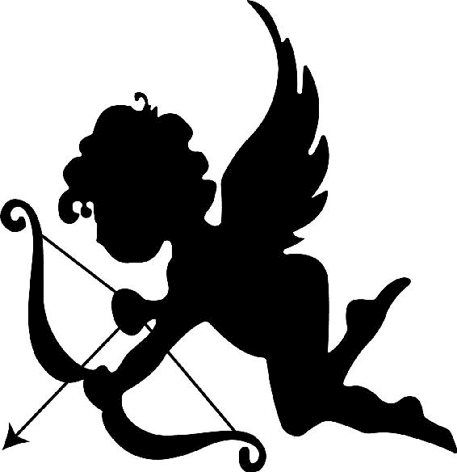
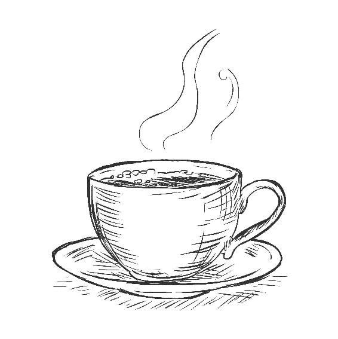

# Java Cupid 01 • Java Break 语句

## 关于作者

## 剧情

Wendy Ashton 和 Dillon 的灵感都源于一次骨折。她因此决定成为了一名骨科护士，他成为了一名工程师，他们的人生轨迹如此接近，却又从未交集。直到一条神秘的信息出现在咖啡杯上。那是一个爱的信息，让她注意到了那位英俊的咖啡师。他们聚在一起，生活开始融合。这会是真爱吗？他们发现自己的父亲正在和她的母亲约会，并担心会和继姐妹产生感情。再加上一个不听人劝的疯狂前女友，信任问题变得让人无法承受。什么才能让这两个人在一起？Java 丘比特能带他们走向幸福结局吗？还是这仅仅是一场误会？断裂的骨头会变成心心吗？答案只能在《咖啡之恋》中找到。

# 第一章

欢迎来到 Java Cupid 咖啡馆

“我不想再接电话了，爸爸！”Wendy Ashton 费力地将手机贴在脸颊上，推开了咖啡馆的玻璃门。今天人很多，但她不在乎。她寻求的是咖啡因和宁静，而 Java Cupid 店两者兼有。

“听着，我知道你在说什么。”她叹了口气，排队点餐。“我知道你想为我好，爸爸。但我不会和你或任何其他人去滑雪的。”她一边呻吟，一边调整怀里的护理教科书，并将包包滑到肩上，向前迈了一步。“我知道你爱我，爸爸！我也爱你，但我不是——”

一个年轻的服务生重重地撞了她一下，让她踉踉跄地撞出了队伍。他用那双短手指的手双手托着盘子。Wendy 发出一声痛苦的哈息。他用惊恐的、圆滚滚的眼睛看着她。“我非常抱歉，女士。”他的口音很重且缓慢，对于他的性别来说声音很尖锐。她认出他有特殊需求，对这个年轻人露出了大方的微笑。“没关系。”

事实上，那次失足和踉跄让一阵剧痛从她的膝盖传到臀部，一直延伸到腰部。医生告诉她，像她这样严重的骨折后，骨痛会一直存在。事实上，他们开方了长期的物理治疗。她的物理治疗师 Royce 曾多次强调这一点——事实上他把这些话刻进了她的脑子里：“你最不想的就是对药物成瘾。通过冥想和生物反馈来管理疼痛，你的生活会变得高效且健康，Wendy。”他的话现在仍在她脑海中回响。

但，噢，她愿意付出一切去换取几片药，让疼痛在海因酮的云端中消散。Royce 和她的医生确保了她在离开医院后无法获得那些药物。Royce 既像个拉拉队员，又像个健身爱好者。老实说，如果她依靠药物来维持生活，她会觉得自己辜负了他。

当她考虑这个男孩时，同情心流过她的脑海。他很快清理了旁边的桌。她拍了拍他的肩膀引起他的注意。他轻跳了一下。“对不起。”她轻声说道，就像对待受伤的患者那样。“*你*还好吗？”

他露出一个歪斜的微笑。他的嘴唇看起来很肿，牙齿很大，嘴巴很小。“我好的，”他用力点点头，“我很好。”

她回以微笑，观察着他继续清理桌子，评估他说的话是否真实。评估患者的话语与反应之间的差异是护理课上学到的技能之一。

爸爸细小的声音从肩膀上的手机里呼唤着她的名字。“好，爸爸。我得挂了。”她向前迈了两步。“不，一切正常。我只是撞到了那个服务生而已。”她回头想看看他的进度，但他已经消失了。

“欢迎来到 Java Cupid，我们热爱咖啡。”他露出完美的牙齿和完美的脸庞，大方地微笑。“想为你点些什么？”

“我要一根大杯红丝绒……焦糖滴滤……蛋糕拿铁加奶油。”这样对吗？她皱起眉头。

这并不重要。咖啡因就是咖啡因。她为什么想不起平时的点单呢？“你知道吗？”她对着他的背影喊道，“给我做一个卡布奇诺吧，巧克力味的。”她又改变了主意，听起来还是不太对。“加点焦糖淋……我想。”

他笑了并点了点头。“没问题。”转身去准备她的订单，他倒掉了刚冲好的拿铁并将其扔进垃圾桶，拿起另一个杯子开始制作卡布奇诺。

她盯着他的背影。他合身的牛仔裤显现出结实的身材。他的肩膀撑起了白色公司 T 恤的顶部，但在腰部处很松垮。好奇他在空闲时会做什么？举重、运动、游泳吗？他拥有运动员的体型。她惊了一下，环顾四周。有人注意到她在审视他的身体吗？热度再次涌上脸颊。她需要冷静一下！

“给你的。”他把杯子放在柜台上。“一杯大号巧克力焦糖淋卡布奇诺，加奶油。”他笑了。

伴随着一声痛苦的呻吟，她挪动书，让包从肩膀上滑落下来去付款。在他那令人心醉的眼神和占据了她思考能力的腿痛的双重影响下，她笨拙地摆弄卡片更换并输入密码。她沮丧地将卡片插回钱包的卡槽，递给他一张五美元钞票。“不用找零了。”

现在她根本没法把任何东西放进硬币包。最后看了一眼那个超级、超级可爱的咖啡师，并对他的服务报以感激的微笑，接过咖啡，一瘸一拐地走去找一个空座位。她需要冥想片刻，让疼痛和她的大脑恢复到可以让她专注于学习的状态。Royce 教过她如何屏蔽一切干扰，包括剧烈的疼痛，并将注意力集中在重要的事情上。在这种情况下，重要的不是他迷人的臀部，而是学习。她摇了摇头，清空了这些念头。

咖啡馆拥有供她冥想和学习的完美环境。她只需要利用这种氛围。交谈声和咖啡机的嗡嗡声在她的耳中交织，并迅速融成神圣的白噪音，让她能够专注于阅读。护理学教科书非常厚，课程也需要小时又小时的学习。但这是值得的。今年夏天她就能成为一名注册护士（RN）。只剩下一个半学期和州考试了。

那时她就能独立于父母了，他们也可以不用再时刻盯着她的生活。噢，他们的出发点是好的。自从她十三岁父母离婚以来，他们一直试图通过礼物和假期来补偿她。但两个圣诞节前，在维尔滑雪度假村和爸爸在一起时，她发生了一次严重的摔倒，腿部严重骨折。她爸爸承担了双倍的负罪感。他不敢相信这发生在自己的看护下。她试图告诉他这不是他的错。这种事故到处都是。“随便看任何关于滑雪胜地的电影，你都会看到有人坐在燃烧的火炉前，腿搁在石膏里。”

这种开放性粉碎螺旋性骨折，尽管如此糟糕和痛苦，手术和康复过去是、现在依然如此，但这是一次天大的馈赠。正因为在医院的经历，温迪决定成为一名骨科护士。

她的护士中有些非常棒，她很爱他们。另一些护士则冷酷、缺乏同理心且不耐烦。他们没有资格照顾骨折患者。真正只有经历过之后，才能理解并对在康复中挣扎的人产生同理心。这并非易事。这需要意志力、决心以及一位不会推得太紧但又能提供足够鼓励的体贴护士，让患者起来运动，尽管他们只想躺在床上睡过那的疼痛。

那些不在心的护士正是温迪想成为护士的原因。她不希望任何人像她曾经那样被对待。任何从骨科事故中康复的人都应该拥有一位同理心的护士，而她有当患者的经历来成为那样的护士。

事故后，她爸爸比妈妈更糟糕，用溺爱的关爱包裹着她。他拥有一栋四联公寓，住在其中一间，租出另外两间，让她免费住在第四间。她在上大学期间接受了他的慷慨提议，但试图让他明白，一旦她有了工作，要么开始支付和其他租客一样的租金，要么搬到其他地方。

她的妈妈似乎在和爸爸慷慨的租房优惠竞争，为她买了一辆二手吉普牧马人（`Jeep Wrangler`）并支付了保险。吉普是全款买的，没有贷款，但每六个月要支付一次全额保险费。

她很感激帮助。她是真的。但对妈妈强调了同样的条件：一旦她有了正职，她就会自己支付保险费。他们拒绝了她接手开支的坚持，这让她很沮丧。她不希望他们一辈子都养她。这很丢脸。虽然甜蜜，但很丢脸。

《内科外科护理》教科书是一本大头书。她打开它，俯身在书页上。作业是五章，十点有课。她昨晚下班后读了三章，但睡着了。放学后她在医院当助理护士（CNA）直到晚上九点。时间足够灵活，可以配合她的日程，但薪水微乎其微。坦率地说，她不知道她的同学如果独立生活是如何维持生计的。她承认，在父母的帮助下，作为一个学生她一点也不苦。尽管如此，她仍然向往真正的薪水和独立。

唾液弄脏了教科书的一页。墨水渗入湿处，像水彩画笔触。她今天早上还有两章要读，就能准备上课了。轻而易举。

她拿起杯子喝了一口。有些东西引起了她的注意。她把杯子拿出来仔细看。信息在隔热层上方慢慢出现。这就像她小时候的间谍工具包，用柠檬汁和烛光来揭示间谍代码。有人一定用热感笔写的——有这种笔吗？——因为一分钟前那里还没有。文字在白色纸杯上变成了焦褐色。

“没有你……我就会……破碎。”

她盯着那行手写信息。是 Dillon 在背对她时写的这个吗？她看向房间另一角的他。他们的目光交汇，他停顿了。

交谈声和机器噪音消失了，人们、桌子、咖啡馆也消失了。只剩下 Dillon 和她。

他对她笑了，将抹布扔在柜台上擦拭污渍。他的眼睛随着抹布移动。咒语解除，所有的交谈声和嗡嗡声恢复了。他继续擦柜台，然后对下一个人说话。

她继续盯着他。刚才发生了什么？她低头看向卡布奇诺。信息褪变成黄褐色。温迪考虑着这些词。没有你，我就会破碎。

他怎么会认识她？尽管他看起来确实眼熟！他为什么要给她写这条信息？

他为什么会破碎？

下午晚些时候，温迪脱掉纯白色的学生服换上工作服去上班。在医院六小时的班给她的比微薄薪水多。和她一起工作的注册护士（RN）和执业护士（LPN）知道她是二年级护理学生，让她参与大多数助理护士根本不在乎的操作。当然，她也做常规的助理护士职责，洗澡、换床、回答呼铃。但当有机会观察伤口护理和评估时，她会积极参加。护士们喜欢她的态度。她也感激他们愿意教她。

一阵轻微的嗡嗡声响起，温迪冲下走廊查看病人需要什么。一扇储物间的门开了，她向左偏转以避免撞上那扇大门。当温迪躲闪时，一个男人走了出来。他撞到了她，她踉跄着向后退。疼痛穿过她的右腿直达骨盆。她像雕塑一样静止着，闭上眼睛，让疼痛存在，然后让它散去，就像一阵汹涌的定音鼓，最终达到顶峰并轻轻平息。

“噢！真对不起，”男人很快说道。

她慢慢睁开眼睛。由于她长时间集中在生物反馈技术上，一切都模糊了。他高大的身影站在她面前。她专注地眨了眨眼，等眼睛适应。Dillon！

“噢，嗨，”她结结巴巴道，“我今天早上就知道你看起来很眼熟。”

他笑了，“是的，你也是。”

他是故意的还是只是客气？但转念想，还有那条信息。*没有你，我破碎了*。是他写的吗？

病人房传来的第二声嗡嗡声打破了她的思绪。“噢，我得去处理一下。”

“没问题。”他绕过她。工具带低低地挂在他紧实的臀部上。他的手按在插槽里的手柄上。作为一名咖啡师，他很有吸引力，但作为一名维修人员，他简直帅得完美。工具带到底有什么让一个男人变得如此性感？就像军装一样，它凸显了他们最好的特征。

温迪摇了摇头，从恍神中醒来。一个病人需要某些东西，她需要弄清楚是什么。

三个小时后，温迪终于可以休息一下了。护士休息室里是一次受期待的休息。她热了一份乐纯简餐（`Lean Cuisine`）晚餐，尽可能坐着狼吞虎咽。两片芬司林片，不，实际上是四片，就能让她度过完剩下的班次。她闭上眼睛，将疼痛想象成腿部和臀部内部一个空心管里的黑色液体。她想象液体从管子底部流出，流入大地被地面吸收。然后，她想象管子从大地重新装满了浅蓝色的液体。它伴随着珍珠光泽旋转，直到管子完全填满到顶部。

她睁开眼睛，正打算喝掉自己带的那瓶水，Dillon 站在桌子对面，肩上挂着梯子。他似乎在看着她。“噢！我不知道你在这儿？”

“抱歉。我不是想吓到你。”他看起来是真的在担心。

“我没害怕。”她咯笑道，“只是不知道你在那。”

“你刚才在做什么？”他没有离开位置。

她心里有些尴尬。“这叫生物反馈。我用它……”她为什么要告诉他这些？“管理我腿的疼痛。几年前和我爸爸滑雪时摔断了，以后就没真正停止过疼。他们告诉我骨痛是最糟糕的。”

“我懂。”他走开并架起梯子。

“为什么？”温迪准备好回到工作岗位，“你也断了腿吗？”

他爬上梯子第三级，顶起一块天花板板，向下看着她。“还有两条手臂，一个肩胛骨和四根肋骨。他们告诉我我差点死掉。”他消失在天花板里。

她盯着他的蓝色牛仔裤和工作靴。他的臀部真不错！

显然，他们的对话结束了。她需要回到岗位。但她比任何时候都想留在这里，多了解关于这个最有趣的咖啡师兼维修工，就是那个写道没有她他就破碎的人。

“温迪？”海迪·卡森，温迪所在楼层的一个新注册护士，探头进了休息室。她看了看从天花板伸出来的男人，又看了看温迪。“我正要换输液，你想过来看看吗？”

她看了一眼 Dillon 合身的蓝色牛仔裤，然后将目光回到海迪身上。“好啊。”她用尽了意志力才迈出了一步。然后又是一步。她把 Dillon 留在梯子上。

“回头见。”她朝他大喊道，但他没有回答。她失望地抿着嘴唇，快步追上海迪。

# 第二章

第二天早上，温迪提着她的产科护理书和包走进咖啡馆，期待能再次见到 Dillon。就在她关上吉普车门时，手机响了。“你好，妈。”她把手机抵在肩膀上。她的父母似乎总是能知道她什么时候到达学习地。“是的，我昨天和爸爸通过电话了。”

一个女人走出“Java Cupid”，为温迪扶住门。温迪点头致谢，手机在肩膀上摇晃，书在怀里岌岌可危地平衡着。她的目光立刻扫过点餐台寻找 Dillon。两个女孩和一个黑人男孩在服务台后面工作，但没有 Dillon。

“温迪！”她母亲的声音响彻了整个咖啡馆。

她闭上眼睛，深吸了一口气让自己冷静。她母亲长长的手臂在空中挥动，就像二手车场里那些吹风机人物一样。温迪环顾四周，确保只有她自己被母亲的问候弄得尴尬。她抬起手和眉毛回应那个疯狂的女人。然后竖起手指让妈妈等一下，自己排队点餐。

“宝贝！”她母亲比着巨大的手势指向桌子。“我已经给你买了东西。”

温迪在转身离开队伍之前又叹了口气。当然，她当然买了。她带着羞愧的步伐走向母亲的卡座坐下。“谢谢，妈。”

“你今天有什么课？”她母亲盯着她那本大大的产科书。

她举起书作为课程的演示。“产科护理，很显然。还有医院的临床实习直到中午。然后我从一点工作到七点。”

她母亲啧啧了下舌头。“我就是不明白你怎么能坚持这么久。”

温迪举起妈妈为她点的咖啡。“咖啡是我的好朋友！”她并从盖子上吸了一口。她妈妈点得很好，带焦糖淋的巧克力美式咖啡加鲜奶油。

“嗯，你记得也要补充维生素。”她母亲喝着自己的咖啡，让目光在咖啡馆里环视。

“好的。”温迪跟随母亲的目光。Dillon 从后面冲进来，还在系着围裙。*哈？奇怪他为什么迟到？*她想象他在医院工作到很晚，但维修部并不是轮班倒制的。好奇心战胜了她，她从包里拿出钱包。

“Dillon？”她母亲伸长脖子试图看清那个年轻人。“你居然知道那个咖啡师的名字？”

“知道。嗯，就是那一个。还有 Jamie……” 温迪对她母亲的存在瞬间警觉起来。当 Jamie 穿过过去点早餐订单时，她隐晦地指了指。“他也在医院工作。而且昨天……”她敢向那个爱管闲事的 Patty 分享她在杯子上留的留言吗？那个杯子还留在她的车里。当然，上面的信息已经褪色到看不见了。但她也不忍将其扔掉。现在那已经是手账的素材了。

“昨天怎么了？”她母亲追问。

“Patty！”一个女人对着温迪的母亲叫道。“你好吗？这是温迪吗？天哪，你长这么大了！”

温迪翻了个白眼，然后对那个女人笑了。

“Mildred！”她妈妈从座位上站起来，抱住了那个活泼的女人。“真高兴见到你！Theo 怎么样？”

“噢，你知道 Theo 的。他精神好得很。”两人咯咯笑着，再次拥抱在一起。“听着，替我向 Blake 问好。”

“我会的！”Patty 说着，一边滑回座位，一边看着那个女人离开咖啡馆。

温迪盯着她妈妈看了很久。她妈妈悠闲地喝着咖啡。最后，她对上了她的目光。“什么？”

温迪挑起眉毛。“Blake？”

她母亲脸红了，接着又变白。“是的，嗯。我是打算告诉你的。”

温迪把额头歪向妈妈。“告诉我什么？”

Patty 抬起下巴。下巴微微颤抖，说话时，声音因激动而颤抖。“我在恋爱。”

“你在恋爱！”温迪重复道。“妈妈！那……太棒了。”

“真的吗？”Patty 的眼里满了泪水。“我真怕你会生我的气。”

“我为什么要生你的气？”温迪越过桌子握住妈妈的手。“认真的，妈妈。我觉得太棒了。现在，告诉我关于他的所有事情。”

她妈妈咯咯笑着。“好——”

Patty 听起来像个高中女生。她在向温迪描述细节时神采奕奕。她们是在妈妈在社区学院上的一门创意写作晚间班上认识的。“他是个寡夫，有一个正在读大学的儿子。我不知道他在学什么。而且他想见你！”

“谁？Blake？”

“对，Blake！傻孩子，你觉得我是说谁？他的儿子？”Patty 笑道。“我甚至还没见过他儿子。”她歪了歪头。

*噢不。* 温迪不喜欢她妈妈脸上的表情。

“嘿！也许我们可以安排一次四人晚餐约会。我邀请你，他邀请他的儿子，我们大家一起见面。那不是趣吗？”

“噢，妈妈。我不知道。我要工作到七点，而且我还得学习。”

“胡扯！”Patty 挥了挥手。“Blake 是个好人，你会喜欢他的。我确信他的儿子也和他一样出色。答应吧。”

“呃……好吧。但让我看看我的日程表。”温迪拿出她的 `iPhone`，滑动到 `calendar app`。“看起来……周六晚上我有空。”

“就周六了。”她妈妈拍了拍桌子。

温迪皱起眉头。她妈妈陷得太深了。她没有这么兴奋过了——温迪想不起来是什么时候了。

“我跟 Blake 谈完后给你打电话，告诉你时间和地点。噢，温迪！我太开心了！”Patty 尖叫起来。

“我看得出来。”温迪睁大了眼睛。“我为你感到高兴。”也许这个新恋情会让妈妈不再干涉她的日常琐事。她只能这么希望了。

她抿了一口卡布奇诺，越过肩膀观察那个她之后可能在医院看到的帅气咖啡师。他爬梯子时臀部的曲线闪过脑海，让她脸上露出笑容。她喜欢他穿那条牛仔裤的样子。

下午，温迪在房间之间奔波，换床单、测生命体征。五个病人需要洗澡。期间，她一直在留意 `Maintenance`。或者是 `Maintenance` 里的某个特定成员。她考虑过弄坏灯泡或砸碎通风口，这样他们就能来叫维修了。想到这里，她自己笑了起来。

终于，在班次途中，她可以休息了。她拉来一把椅子到 `microwave` 旁边，这样在加热 `Lean Cuisine` 时就可以坐着。休息室的门开了。她抬起疲惫的眼睛望去。当 Dillon 走进来时，她的心跳了一下。

“嗨。”即便只有一个音节，他的声音也是最有磁性的。他走向冰箱，拿出一个 `Java Cupid` 的泡沫盒，坐在桌子旁。

`microwave` 叮的一声响，她起身去取餐。她走向他选的那张桌子。“介意吗？”

“不介意。请坐。”他翻开盒盖，露出一个里面有豆芽的多谷物火鸡三明治和一杯酸奶。

“啊，这主意真不错。”她指了指他从 `Cupid` 拿的晚餐。

他点了点头。“是的。`Rocco` 坚持要我每天上班都带一个。我想觉得这是他帮助我们这些可怜大学生的方式。”Dillon 轻笑道。

他的笑声很好听。“他*确实*很贴心。`Rocco` 是谁？”

“噢，他是老板。你几乎见不到他，因为他大部分时间都在后面。他在那里做饭、打扫。把前厅留给我们他口中的‘年轻人’。”Dillon 再次轻笑。“你知道那个跑堂的 `Charlie` 吗？”

她点了点头。

“那是他儿子。”

“啊。”温迪吸了一口气，用下巴托在手上。

Dillon 打量着她盘里的橙汁鸡肉。“你要吃那个吗？”

她低头一眼。“噢。当然。”她喷了一下鼻涕。*老天爷！*她捂住嘴和鼻子。“对不起！”

他笑了。“别告诉我，你也是那种笑起来会喷鼻涕的女孩之一？”

温迪翻了个白眼。脸涨红了。“我不敢相信我竟然那样的。我非常抱歉。”

“不。我觉得很可爱。”

“很尴尬。”她咯咯笑着。

他歪过头头。“我觉得你很可爱。”

她清醒了过来，盯着他看。“你也不错，迪隆。”

“听着，你几点下班？”他咬了一口三明治。

“七点，但我得——你想干什么？”她舀起了一口鸡肉饭。

“不知道。也许我们可以一起聚聚？”他喝了一口瓶装水。

她笑了。“嗯，我通常会回家学习，但……”

“是，我也是。”失望的神情掠过他的脸。

“现在不行，爸爸。”她嘟囔着，用力推开了门。她环顾四周，决定哪些事可以最快处理，哪些事必须留到以后。她把书和包包扔在沙发上。冲进厨房，把脏餐具塞进洗碗机。冲了冲水池，用抹布擦了擦台面。接着，她把被子掀到床上，让床看起来很整洁，然后捡起地板上的衣服扔进脏衣篮。她拉上浴帘遮住凌乱的淋浴间，盖上马桶盖，理了理毛巾和手毛巾。

环顾四周，她决定自己根本没时间吸尘器，于是捡起教科书整齐地堆在椅子旁，把外套挂在门旁的衣柜里，把包扔在衣柜的地板上。

这时，门铃响了。

最后环顾了一圈。这已经是她能做的最好了。她深吸了一气，理了理头发，看了看自己的刷服。噢天天，这些衣服脏极了。她等会儿就去换。她打开门。

迪隆靠在门框上，肩膀上斜着一个背包。看到她开门，他抬头露笑了。“嘿。”

“嘿。要可乐还是别的什么？”她向后退一步让他进来。一阵疼痛顺着她的腿部冲向髋部，一直延伸到脊椎。她皱起脸。

“你还好吗？”他出手扶住她。他的触碰让她的身体一阵颤栗，但腿上的疼痛很快盖过了那种感觉。

她低吼道：“没事。”闭上眼睛，接受了疼痛，并在脑海中想象疼痛正从腿部流走。

迪隆按住她的肩膀。“有什么我可以帮你的吗？”

她摇摇头，但没有睁眼。

他的一只手依然按着她的肩膀，关上门，把她引导到沙发上。“在这儿坐下。”

她坐下了。“厨房水池旁有些泰诺林，”她咬着牙关说道。

迪隆看向厨房，确认她没问题后，冲向厨房。他打开水池旁边的柜子，拿出一个玻璃杯，接满水，在药盖里倒了两片泰诺林，然后来到她身边。她接过玻璃杯和药盖，把药倒回去，把水吞了。她揉了揉大腿，把头靠在沙发上。

“发生什么了？”迪隆坐在她身边。“是我造成的吗？”

“不是。我只是步子迈歪了。”她嘶声道。“会过去的。”

“一定是骨折得很厉害？”他轻声说，仿佛用正常音量说话会让她更疼。

她猛地睁开眼睛。“是的。开放性粉碎性螺旋骨折。”

他咯笑了一下。“我听出了那种骨头疼，尽管我不确定什么叫粉碎性螺旋骨折。”

“开放性意味着骨头刺破了皮肤。螺旋性意味着它是沿着骨干扭转并断裂的，就像理发店灯上的条纹，而且，好像这还不够，粉碎性意味着它在螺旋骨折的中心断成了三处。”她叹了口气。“该死的雪板没有像预想的那样从靴子里脱落。所以，当我倒地时……”她笑了，但看起来更像是一个痛苦的表情。

他点了点头，脱掉肩膀上的灰色连帽衫，抽出手臂。然后他拉起 T 恤的长袖，露出前臂上的手术疤痕。“两条手臂都是；桡骨和尺骨”——他一边说一边指向受伤的骨头——“右股骨、肩胛骨和四根肋骨。大多是在我的右侧。”

温迪忧心忡地看着他。“哇。”她低声说。“怎么到的？”

“摩托车。我左闪，它右闪。那并不好看。”

她用食指触碰他的前臂，小心翼翼地划过那道紫色的疤痕。“什么时候？”她抬头迎上他的目光。

他叹了口气，拉下袖子。“三年前。”

## 三年前

温迪和迪隆留在沙发上聊天，分享了各自的事故和康复经历。“这就是为什么我想成为骨科护士。因为其中一些护士对待我的方式。他们在床上把我推来推去，完全不知道带给了我多大的痛苦。我从那时起就决定，我要成为一名护士，我的患者在我的照顾下绝不会那样受苦。”

“是的，我也是。在做完康复训练后，我环顾他们提供我们的那些陈老得像中世纪一样的设备，决定成为一名工程师。我想设计出真正能帮助康复的设备。我告诉你，有些装置简直就像是从英国深处地牢的酷刑室里出来的。”

她咯咯笑起来，他也跟着笑。

“我明白你的意思。有一次——”

他们继续聊天、大笑，分享恐怖故事。她享受他的陪伴，而他似乎和她在一起很自在。他经历了很多事情。当然，她也是，但她断的骨头没有他那么多。这就是他说的“没有你我就破碎了”的意思吗？他在给她发那条信息时，是怎么知道她骨折的？还是这仅仅是巧合？当她在休息室告诉他时，他看起来真的很惊讶。她在心里记下，以后找机会问他这件事。但现在，她很享受和他聊天。他的声音很好听。

门来了敲门声。迪隆投来一个疑惑的目光。“你在等人吗？”

“没有，但他们还是会来。”她嘟囔着，从沙发上站起来开了门。

她父亲跨过她的门槛，然后停住了。“噢。我没意识到你有客人。”他环顾了一下房间。“嘿，你打扫过了！”

温迪重重地叹了口气。

迪隆站了起来。兰斯伸出手，迪隆握了握。“我是兰斯·阿什尔顿，温迪的爸爸，你叫……”

“迪隆·凯恩，先生。”

“先生！”她父亲转回温迪。“我就喜欢他了！”

温迪对她父亲做了个夸张的表情。“所以，你是想要什么，还是只是来让我丢脸的？”

“噢！”兰斯开了门但没有出去。“没有。我点了一份披萨，想知道你们要不要过来吃点。”

“我们没事，爸爸。”她摇头。

“好，如果你确定的话。”他看了迪隆，“你也欢迎。我点了大份的。”

迪隆看向温迪寻求指示。她摇摇头。“谢谢你，阿什尔顿先生。我觉得我们不用了。”

“行吧。”兰斯犹豫了一下，似乎还想说什么，但随后对温迪眨了眨眼就离开了。

“是啊。”温迪脸脸红了。“所以，那是我爸。”

迪隆点了点头。嘴角泛起一抹淡淡的微笑。“他很关心你。这真好。”

“关心我？”温迪咯咯笑。“更像是把我窒息到死亡边缘，然后松开枕头让我喘口气。”

他的手滑进她的衬衫底部，沿着背部向上摸向她的内衣。他扭动了搭扣，搭扣便弹开了。他的吻变得深深，舌头追寻着她的唇。她的腹部燃起了一团火，除了他她什么都不想要。

门铃响了。

他们僵住了。

她的目光投向门口。她闭上眼睛吐了一口气。迅速重新系好内衣，整理好衬衫站了起来。他的眼中仍残留着一种欲态的神情，但他挺直了身体，清醒了过来。她开了门。

“噢，拜托！”她父亲大声说道，“我不可能吃掉完这些。你们拿去吧。”他把一个 `Pizza Hut` 披萨盒推给她，还有一瓶两升装的可乐。

“爸！”她瞪大了眼睛。天哪，他的时机也太糟糕了！“呃。谢谢。”她接过盒子和可乐，在关门时顺手把父亲推回门外。她转头看向迪隆。他笑了。她也忍不住咯咯笑了起来。

“想吃披萨吗？”她大笑起来。

“伙计。”迪隆用纸巾擦了擦手和嘴，拿起空披萨盒。“你刚才关于你爸的事可不是开玩笑。”

“来，让我来。”温迪接过垃圾扔进水槽下的垃圾桶里。“可不是嘛！等你见到我妈就知道了！”她翻了个白眼。

“你的意思是，她更糟？”他轻笑道。

“不，不是更糟，只是一样糟糕。我收回这句话。其实，我爸是最糟糕的。他把我的意外归咎于自己，再加上我小时候他们离婚了。他充满了愧疚感，总做什么都不够……你懂吧？”她回到客厅，在他身边轻轻坐下。“我一直告诉他那不是他的错，”她耸了耸肩。

“我妈正在跟一个混蛋约会。那是她和我爸离婚后我认识第一个男人。”

“他们离婚多久了？”迪隆握住她的手。

他的触碰让她的大脑瞬间一片空白。“呃。我——从我十三岁开始。看看吧……我二十二了……”

他吻了吻她的手指。

“你这样做的时候，我就没法思考了。”她从他手里抽回手。“呃。九年了。”

“这是她的第一次约会？”迪隆叹了口气，揉了揉锁骨。

他的肩膀疼吗？温迪点了点头。“据我所知。”

迪隆微微一笑，挑起一边眉毛。“好吧，至少她等了一段体面的时间。我爸已经在跟一个花脑妹约会了。我妈坟骨还没冷透，他就已经在到处闲荡了。我最大的担心是他没有清醒地思考。你懂吗？他想念妈妈，我不让他把我当孩子对待。所以我想他只是想要个人可以照顾。但是——”

她歪着头。“但是什么？”

“温迪，我不是在自夸，好吗？这只是事实。我爸是个律师。一个成功的律师。基本上，他很有钱。但我担心他缺乏辨别好女人和捞捞金女的能力。你懂吧？”

温迪点了点头。“确实。那段哀伤期实在太短了。我以前在 `Facebook` 上看到过一段很有深度的话。它说‘每个人悲伤的方式都是样的，只是有人在死前悲伤，有人在死后悲伤’。我想既然你爸知道事情会发生，所以他在之前就已经悲伤过了……我不敢多想。”她盯着自己的手。“拿我妈来说吧。当她跟我爸分手时，她陷入了低谷，过了几年才走出来。她现在很不错。事实上，当她跟我提起那个男人时，她看起来真的很开心。我想那就是我想要她的一切。还有让她别来管我的事。”她咯咯笑着。

“但你说过他是个混蛋？”

“那是我的主观臆。”她咯笑着。“我还没真正见过他。”

“我一样。”迪隆笑着。“所以，我想既然我来这儿和你一起学习，我们至少应该翻开书看看。”

她盯着他那双晶莹的蓝色眼睛。“好。我想你是对的。虽然在爸送来披萨之前，我很喜欢刚才那个发展方向。”

迪隆顽坏地笑了笑。“我也是。但我确实有些需要读的东西。”

她叹了口气。“是啊，我也是。”

他们把教科书放在膝盖上，彼此依偎在一起。温迪满足地叹了口气。学习从未如此有趣。

在明天上课之前，她有五章 `Med Surg Nursing` 书要读，还有一份来自 `Obstetrics` 教材的练习题。她读了三章，标注了重要信息，拿起练习题换个方式转转大脑，开始填写。她的眼睑变得沉重，缓慢地眨着眼。

迪隆头部向后靠在沙发上，呼吸沉重。她戳了戳他的肋骨叫他。他跳得比她预想的要得多。噢，他的肋骨还是很敏感！她怎么能忘记这种事。“对不起，我不是故意的。你刚才睡着了吗？”

“没有，只是闭目休息。”他用前臂揉着侧腹，然后用拇指按摩锁骨，用力呼出一口气气。

“好了，我要睡着了。要么我去睡觉你回家，要么我去睡觉你可以在沙发上伸直身体。无论如何，都已经过午夜了。”

兰斯把一张十美元钞票扔在柜台上。“不用找了。”

“爸爸！”温迪瞪了他一眼。

“这是我的咖啡，我想给多少小费随我！”她父亲拉住她的胳肘，引导她离开柜台。

她对迪隆皱了皱脸，露出歉意的神情，由父亲领着走向她最喜欢的那个偏僻卡座位。

坐下后，她问道：“你在这里干什么呢？”

他抿了一口咖啡，目光在咖啡馆后角这个卡座位的环境中环视着。“所以，这就是你学习的地方？”

她盯着他。“你早已经知道了。怎么了？”

“所以……我注意到迪隆留得很晚。”

“他大概午夜左右回家了。”她平平地说道。

她父亲点了点头。“噢。”

“爸爸，你有什么想问我的吗？”温迪的怒在胃里翻腾。

“没有。我只是——”他抿了口咖啡，“你的腿怎么样了？”

“疼。”她抿了抿嘴。“听着，我真的需要在上课前完成一些事情，你有什么具体的想聊的吗？”

“有的。实际上，有。”她父亲盯着倾斜的百叶窗。“我听别人说，你妈妈在约会。”

温迪盯着她父亲。真的？他居然在问她妈妈的事？你想让我说什么，爸爸？”

“不。我是为了帕蒂好。别误会我。我——只是——在想……”

“你不直接去问她吗，爸爸？”温迪举起她的《产科学》。剩下的两个章节并不会自己读完，她却坐在这里向爸爸汇报妈妈的感情生活。

“噢，我会的。没什么大事。”她父亲喝完了咖啡。“让你回去学习吧。”他滑出卡座，回头了一眼。“顺便说一下。”

她从书中抬起眼睛看向他。

“我喜欢这个迪隆。尽量别把这一个搞砸。”他走了。

她惊讶得张开了嘴。她结结巴巴地吐出字，却说不出一句完整的话。她皱起眉头，看着他离开馆馆。“她从什么时候开始搞砸感情的？她从什么时候开始有一段感情可以搞砸的？他凭什么在这里谈论搞砸，明明他才是那个搞砸了和妈妈婚姻的人？”怒火在她胸中翻腾。她抿了一口咖啡，强迫自己读剩下的两个章节。她的大脑无法吸收这些文字。她父亲的话阻碍了任何信息进入她的脑海。

为什么她在需要学习的时候对她做这些破事？

# 第四章

“周六定好了。”温迪的妈妈发来短信。“Red Robin @ Elizabeth & Franklin St. 7:00”

“耶！”温迪把手机滑回刷手服口袋。她整个下午都没见到迪隆。他今天上班了吗？她不知道他的工作或学校课表。只有在“Java 丘比特”店，他上的是早班。也许她在晚餐休息时间能见到他。

这个念头让她在开始日常工作时脚步变得轻盈起来。换床单、洗澡、记录生命体征、让患者下床、让患者回到床上。

“我本该发短信的。”他接着拿出了另一个盒子。“我想给你个惊喜。就像你爸爸做的那样。”

他们笑了起来。

“那么，你爸怎么说？”

他深吸了一口气。“是啊，你知道我告诉过他正和某个花花约会，对吧？”

她用筷子夹起一根竹笋塞进嘴里。“知道了。”

“额，”，”迪隆轻笑道，“我告诉过你我还没见过她。”他夹起一根小玉米又把它放下，然后把筷子插进蔬菜中用力挤压，挤出了一块蘑菇和米饭。他很快把它放进嘴里，嘴唇含住了筷子。

她不禁盯着那双嘴唇看。她想尝尝那块蘑菇。

“……嗯。”

“好吧，那将会改变的。”他把筷子插回食物里，抬起眼看向她的眼睛。“爸爸想我在周六晚上见见她。”

“真的吗？”她把筷子滑落了一堆蔬菜和米饭。“真奇怪。我妈也安排了我在周六去见那个混蛋先生。”她皱了皱鼻子。“真巧合。”

“哈。好，我有一个主意。”迪隆笑了，“我们周六早上聚一聚，吃个早餐，然后去玩激光射击——如果你想的话。然后我们就可以打扮一下，准备在我们父母的‘新性玩具’中首秀了。”

“呕。别那样说。”她皱起眉。“我不想在脑子里出现那个画面。不过，早餐和激光射击听起来很完美。”

“真的吗？”迪隆的眼睛闪烁着光。“温迪小姐，你是我梦想中的女孩。”

“噢。你说话总是这么好听。”她的脸颊红了。她继续吃着东西，尽管她更想把东西放下，和他做些坏坏的事。但她确实得抽时间学习了。

她负担不起落后的后果。她一旦落后，一天的时间根本不够让她追上。而且，如果她周六上午和下午都要和迪隆在一起，整个晚上都要和她妈妈以及那个混蛋在一起，她就必须领先并保持领先。

当迪隆把车停在史诗活动中心时，温迪觉得胃里的早餐有些沉重。她为什么选了“牛仔人早餐”，里面有两份肉、土豆饼和两个鸡蛋？她本可以忽略那两块煎饼的，但谁能抵挡两块浸了奶油黄油和糖浆的金色煎饼呢。迪隆吃着他的酸奶和麦片笑了起来。

“真是个女孩早餐！”她曾那样逗过他。

“你等着。等会儿我有优势的！”他喝光了常温水。

“哈！你会饿的，而我会因为这些碳水和蛋白质而精力充沛！”她打趣道，拿起咖啡杯喝光了底。“还有咖啡因！”

他轻声笑道。“走着瞧。”

尽管胃里不舒服，她还是跟着他走进了那栋巨大的建筑。他知道自己去哪里，穿过几个缴费台，站在一个霓虹灯包裹的展位前排队。黑光灯暴露了几名穿着黑色紧身、类博格人风格工人身上的多根白色电线。迪隆付了钱，那个女性博格人按了一个按钮，升起扇横向门。温迪随他通过通道来到一组电脑前。她把脚放在地板上的轮廓线上，看着屏幕。指令写着：“微笑并按回车”。

温迪笑着伸手去按键。

“不！”迪隆跳到她的工作站旁。“你不是在办学生证！摆出你的战士脸。你是战士温迪！”

她笑了起来，做了一个凶凶的、皱在一起的脸。他按下回车，一张卡片掉在桌上。“这个有什么用？”

“这能换我们的激光背心和枪。”他带路进入黑暗房间。黑光灯将一切都变成了黑色物质或霓虹色。她咯笑起来。“我本该重新考虑我的衣服的。这在我们第一次约会时看起来挺可。”白条纹和奶油色蕾丝边绝对是个劣势。迪隆大喊：“哇哈哈！战士温迪有残疾。我们将增加你的生命值，并给你一个领先优势！”

一个穿着黄色背心的高中男生走向他们并开始指令。他的名字叫杰伦。他帮温迪选了一件适合她娇小身材的背心，并教她如何调整侧带带以保持紧固。他递给她一把激光枪。

她靠向那个男孩低声问：“这个怎么用？”她瞥了一眼正上下蹦跳仿佛在热身的迪隆。男孩降低声音教她如何射击，他还给了她一些关于如何在场地上穿梭以及在对方不经意的情况下抓住对方的内部技巧。她轻声说：“谢谢！”然后走向了阿斯卡里强大的迪隆。

“准备好了吗？”她用枪捅了捅他的肋窝。

他还在上下跳着。“等一下。时间会显示的。”

“噢，好的。”她停下来听。一个合成声音在房间里回荡：“游戏开始！”

温迪向左侧冲去。

“等等！”迪隆在后面喊道。“温迪，温迪，等一下。”

她停下看向他，担心出了什么问题。

他射中了她的传感器点。她的背心传出一声响亮的“叮”声。“噢你！”她尖叫着对着他的背心射击，但他已经跑过了一个角。“你等着吧，阿斯卡里强大的迪隆！”

她沿着开始的路跑去。杰伦告诉过她一些非常棒的优势点，她可以待在那里的。

“我想是吧。”他将她拉回圆柱后的转角，低下脸贴近她的脸。“什么——？”他用嘴堵住了她的话，让她完全忘记了他的伤势。他的手向下移到臀部，将她紧紧按在自己身上。她的身体产生了她从未想象过的反应。如果他们不在公共场所……

她把手滑进他的衬衫，尽管被背心挡着，然后用手臂环住他赤裸的腰部。仅仅是腰部的皮肤接触就让她陶醉。他的嘴吞噬着她的嘴。他的舌头探索并挑逗着她的。然后他向后倾斜，两人都喘着气。他吻着她的脸颊，吻一直延伸到耳垂。用牙齿轻轻咬住它，轻轻拉着。她呻吟着。吻顺着脖子向下。当他的唇掠过她喉咙处的跳动时，她的脉搏加快了。她深吸了一气，吻了他的耳朵。接着是他的脖子。他继续向下直到她的领口。他拉下她的衬衫，寻找下方细腻的皮肤。

她后退一步。喘着气。

他们在公共场所！虽然躲在黑暗的圆柱后，但仍然是公共场所。“迪隆。”她低声说，“我们不能。不在儿。”

他轻微踉跄了一下。“我——我知道。”他们停顿了一刻以恢复冷静。然后他接过她的手，带她离开建筑结构走上上层。热气冲红了她的脸颊。有人知道他们在做什么吗。她没有眼神交流，只是让迪隆引导她走出了史诗活动中心（Epic Event Center），走向他的那辆红黑间的特斯拉 Roadster。

她闭上眼睛靠在头枕上。他坐上车，话不说开车。“真不敢相信我们真的做了那种。”她终于喃喃道。

迪隆将手覆盖在她的手上。“对不起。我失控了。”他清了清嗓子。“你唤醒了我体内的野兽，温迪。对不起，我让你失去了控制。”

她沉默了一会儿。

“但我没有。”

# 第五章

迪隆在温迪公寓前的路缘边停了下来。“你知道吗？我们大概还有三个小时。”

她笑了。“你建议怎么做？”迪隆笑着打开了车门。她顺着他的动作也打开了自己的门。他绕过他的那辆小跑车，伸出手扶她站起来。他们手牵手走到她门口。她打开锁并推开门。他跟着她进去。她回头向他微笑，继续走向那个有三扇门的小走廊：洗间、叠物衣柜和她的卧室。她转过让她面对自己，俯身温柔地吻她。她环住他的脖子，踮起脚尖抵住他的唇。一火在她的腹部燃起。她勾住他的脖子，一边热烈地吻着，一边带着他进入卧室并踢掉鞋。他笨笨地弄着衬衫，把它从头顶提起扔在一旁。她也这样做。当他看到她美丽的胸部和柔软的皮肤时，他睁大了眼睛。

他将她拉近吻着她的脖子。一个接一个顺着脖子向下，直到他听到她的呻吟。轻地一捏，她就摆脱了让他无法进一步让她享受的束缚。她弓起背，他将她抱入怀中，轻轻地放在她手工织的被子上。

“等等！”她拉开侧抽屉，取出一个盒子，放在床头柜上。

他笑了。“谢谢。你怎么——？”

“除了我爸还能是谁？”她翻了个白眼。

“告诉你爸，我很感谢。”他吻了吻她的鼻子，然后是她的眼睑。

她呻吟道。“我才不会！”她将他拉向自己。

在接下来的一小时里，他们探索了彼此的快感带，对每一个都非常熟悉。直到他们精疲力竭地躺在一起。迪隆的呼吸变得缓慢而深。他睡着了。温迪头枕在他的胸口，听着他的心跳。在平和的睡梦中沉浮。

温迪的手机响了一段旋律。起初很轻，然后变大。她急忙拿起。那是提醒她洗澡准备和妈妈吃晚饭的闹钟。迪隆被她的突然动作弄醒了。

“怎么了？”他嘟囔道。

“对不起。我得准备了。”

他看了手机。“其实我也是。”他们一起从床上起来，收拾各自的衣服。她冲进浴室穿上睡袍。当她出来时，他已经穿好衣服在等她。她头靠在他胸口，手臂环住他。“嗯。这很有趣。”

他摸着她的头发。“是，我喜欢激光射击。”他顽皮地笑着。“性爱也很好。”

她抬头看着他那双顽劣的眼睛。“噢你！”她拍了他一下。“快离开这儿，好让我准备去见那个混蛋！”

他假装受伤了。“噢！嘿，我得花一个晚上对一个拜金女脑残和蔼待。”他笑了起来。“嘿，我有个主意。”

她等他表达想法。

“我们之后聚聚，交换一下心得！”

“听起来是个计划。”她眨眨眼，把他推出门外。

温迪拉上手刹，盯着红雀（Red Robin）的招牌。“美食汉堡与啤酒。”不知道要喝几杯啤酒才能度过今天。今晚唯一兴奋的事情就是稍后要见迪隆。今天下午的记忆在她脑海中闪过。她闭上眼睛，回他给她的感觉，以及他对她触碰时愉快的反应。她叹了口气。

今晚他们会交换关于今晚经历的恐怖故事。她会告诉迪隆她妈妈约会的那个混蛋，而他会告诉她他爸爸约会的那个拜金脑残。她自自笑了。知道自己会把一切报告给迪隆，这让这个夜晚其实并不那么糟糕。这就像当了一个间谍，为了之后和她的员工汇报而记住每一个细节。

兴奋冲刷了之前的恐惧。现在，这很有趣。她咯咯笑着。晚些，他们还会交换别的。一阵刺感贯过她的腹部。她抓起包包跳下她的越野车。快点结束吧，我今晚还有更有趣的事要做！

她理了理裙摆，走向入口。

“欢迎光临红雀。”一个活泼的高中女孩迎接她，同时从接待台的槽里拉出一份菜单。她的胸牌写着`Tiffany`。“就一个？”

“呃。”温迪在桌间寻找妈妈。“我要见个人……所以——”

妈妈的位置在一根柱子后面。温迪闭了片会儿眼睛调整情绪。“我看到她了，我可以进去吗？”

“当然可以。”`Tiffany`把菜单滑回槽里。

妈妈的长臂在空中挥起。妈妈舔了舔嘴唇，将高脚杯拉向自己。“来妈妈这里。”

温迪瞪大了眼睛，在心里责备她。她从未见过妈妈这样表现。她真……很傻。她已经见过多少次这样了？

“你想喝什么？”服务员问。

温迪渴望地看着玛格丽塔。不。她最好保持清醒。况且她晚点还要给一份报告。“请给我一杯柠檬冰水。”

“哦，亲爱的！”她母亲说话声音太大了。“来吧！我们正在庆祝呢。活得潇洒一点。”

“妈妈！”温迪倾向向她，低声说道。

“他在那儿呢！”布莱克再次站了起来。

温迪抬头看了他一眼，但依然紧贴着她的母亲。她咬牙切道：“住手！你到底喝了多少个了？”

她母亲慌忙推开椅子站起来。“这是我的第一只！”她乐得合不拢嘴，眼睛越过温迪的肩膀看向后方的柱子。

温迪试图引起母亲的注意，尽管现在她站起来了，两人之间仍有身高差。“妈妈！”她低斥道，“听我说！我正——”

布莱克走了出来，正抱着他的儿子。温迪抓住了她母亲的手腕。“妈妈！我不是在开玩笑。你表现得像个`foo——”

“来！见见帕蒂和温迪。”布莱克拉着男孩一起走了过去。帕蒂的笑容几乎无法再扩大得了。她伸出手握了他的手。温迪抬头看向那条肌肉结手臂的主人。

她又看了一次。“迪隆？”

他向下看着她。他的脸白了。“温迪？”

布莱克轻笑道：“你们两个认识？”

“认识。”他们同时回答。

“妈妈，你还记得 Java 丘比特咖啡馆的那个迪隆吗？”

“噢！所以你就是`那个`迪隆吗？”她转向温迪，“你父亲告诉我，你正在和一个叫迪隆的人交往。”然后，她伸出手握了他的手。“真高兴见到见到你。”

帕蒂坐下了，迪隆也坐下了。他睁大眼睛看着温迪，口型道：`Douche Bag`（混蛋）？温迪回了一口型：`Gold Digger`（捞金女）？他们微笑凑过去，额头抵在一起。

“你们想点什么——”服务生打断了。“迪隆！”

“普西？”迪隆的脸色更白了。

“普莉西拉！”布莱克把手放在了服务生的肩膀上。“我就觉得你看起来眼熟。见到你真好。”

“凯先生，是的，我立刻认出你了，但我以为你不记得我了。”当她露出完美的微笑时，她的酒窝加深了。

“噢，现在我记得了。米尔德德和你的父母怎么样？我好久没见他们了。”布莱克继续站着。

“奶奶很好。她每天走两英里。”普西咯咯笑起来。她的声音尖锐，让温迪感到很烦。“她跑起来能甩掉我们所有人。”

帕蒂和温迪盯着服务生，目瞪口呆。愤怒在温迪的胃里蔓延。“抱歉，请问你是谁？”

布莱克笑了。“噢温迪·艾什顿，这是普莉西拉·兰利。我们通过同一个高尔夫俱乐部认识她和她的家人，我和玛丽，呃`我`也是。他们是老朋友。”他的眼神闪烁了一下。他清了清嗓子。“迪隆”——他拍了拍他的背——“普莉西拉曾经交往过好一段时间。我一直不知道你们之间到底出了什么问题。”凯恩好奇地看着他的儿子。

迪隆盯着桌子，小声让父亲住口。

普莉西拉瞪着迪隆。她的下巴向右侧突出。

温迪气得发抖，看着他们之间的互动。他们之间绝对有过去。等这顿晚餐结束，今晚的话题将完全变成一个全新的话题。

普莉西拉挥了挥不在乎的手。“噢，凯先生，那只是青涩之恋，对吧，迪隆。”普莉西拉贴近迪隆，双手按在他的肩膀上，仿佛要俯身压在他身上。“并不是真的命中注定。”

迪隆一句话没说，也没有抬头看他那失去的青涩之恋。温迪把这一切记在心里，等以后讨论。

“呃，那可真诡异。”迪隆跟着温迪进了她的公寓。

“可不是嘛。”温迪顺势坐到沙发上。

迪隆看起来很焦虑。“听着，我觉得我们需要谈谈这件事。”

“你觉得呢？”

他好奇地看着她。“是啊。”他皱起眉头。他把手插进前兜里，在房间里踱着步。“你知道这意味着什么吗？”

“不太确定。”温迪在胸前交叉双臂。

他停下脚步，瞪着她。“如果你妈妈和我爸爸之间真的成功了……我们将成为……半亲，不，是异父姐妹。”

“噢。”她盯着地板。“那样的。”

“是啊。”他在她身边坐下。“我知道，对吧？”

“不。我觉得你不懂。”她扭了脚踝，交叉了双腿。

“什么？”

“认真的吗？除了我们父母在一起，你完全不知道我可能想谈些什么？”

迪隆面无表情地盯着她。

她也回盯着他。愤怒在她的胃里翻腾。“普莉西拉·兰利这个名字让你起什么青涩之恋的记忆吗？”

“噗。”迪隆挥了挥手。“噢。她。她是我生命中一个巨大的错误。在高中的时候。她的父母和我的父母觉得我们是天造的一对。他们不知道的是，普西在处理恋爱关系时完全没有道德准则。她和橄榄球、篮球和足球球队的每个男生都睡过。我和她交往是因为我父母简直强迫我的，但她从未真正是我的女朋友。她不是任何人的女朋友。她是所有人的女朋友。”

温迪盯着他。“嗯，她看起来确实对你挺迷的。”

“温迪，她对任何呼吸的男生都挺迷的。”迪隆靠在沙发上，眼神深远。“我听说她生过孩子，而且不知道父亲是谁。我听说她的父母之后断绝了关系并留下了她的孩子。那可能就是为什么她在一家汉堡店工作。”他笑了，但毫无笑意。“是的，和她分手简直是`Obsessed`（痴迷），哥们。我觉得她还留着我的一些球衣，谁知道还有什么。我只想离开她，我不在乎她留了什么。”他轻笑道。

温迪缓缓点头。“嗯。那么，那个孩子可能是你的吗？”

他的眼睛猛地看向她。“不！”他向后倾，直视着她的眼睛。“温迪，我告诉你，我从没有——孩子不可能是我的，除了吻她晚安，我什么都没做过。我发誓！”

她盯着他看了一会儿，在他水蓝色的眼睛里看到的只有诚实。“好吧。我相信你。”

“现在，关于我们父母。”他跳了起来再次在房间里踱步。“我是认真的。我——我不知道这会如何发展，温迪。”

迪隆摇了摇头。“不。我不百分之百确定他们的关系会走向何方。我不想让他左右为难。我会等他发布什么公告之类的的。到时候我再跟他谈谈这这一切的法律问题。”他朝她比了比。

“那么……在此期间我们该怎么办？”泪水刺痛了她的眼睛。他是要和她分手吗？为什么他们必须等父母对他们自己的关系下定主意，而她已经很想和迪隆一直走下去。

“我-我不知道。”迪隆将手指插进他金色的卷发中。

温迪盯着他。她知道。她非常清楚自己想要什么。为什么他不知道呢？“好吧，也许在你想清楚之前，我们应该先冷静一下。”

他猛地看向她。忧虑锁住了他的眉心，额头紧绷。“也许我们确实应该。”

## 第六章

迪隆看起来完全并不同意她关于先冷静一下的建议。事实上，他看起来很受伤。但她还能说什么呢？已经晚了，她累了，他需要回家或去睡觉。二选一吧。在他弄清楚自己想要什么之前，她不会再和他共用一张床了。无论他父亲或她母亲决定如何。他们必须独立于任何人的计划做出这个基本的决定。

温迪尝试入睡。但这是不可能。今晚发生的一切都在她脑海中盘旋。她能听到卧室窗外传来的风声。她感觉风也在吹动着她脑子里所有的思绪。傲慢的普莉西拉-普里丝。她妈妈，她从未见过她那么开心。布莱克，他似乎是个非常好的男人，对她妈妈也很有体贴。迪隆，突然之间他不确定对这段关系想要什么了。学校，她的学业落后了，她不能让那种发生。

但她现在无法集中精力思考任何件事。她放了一个加了泻盐的热水浴泡澡。但她仍然无法平息脑海中的风暴。她坐在床上，咬着指甲，盯着手机。她应该给迪隆打电话吗？她给出的最后通牒公平吗？他是个了不起的家伙。和他在一起非常有趣，幽默感十足。他能泡出一杯很棒的咖啡。她轻笑了一下。而且他有着她经历过的最完美的亲吻。并不是说她像普莉西拉那样经历过很多次……愤怒长出了丑陋的触角。

她踢开被子，站在床边。也许可以喝杯热牛奶。她光脚走向厨房。手里拿着手机。她用指划亮了屏幕。

在她买的一个“爱神丘丘比特”咖啡杯里倒了一些牛奶，把它放入微波炉，设定了三十秒，然后按下开始。她看着手机。迪隆的电话正响着。“噢。”她把手机举到耳边。铃声响了。又响。又响。然后电话接通了。“迪隆？”

一个低语的声音。“喂？”

温迪停顿了一下。微波炉响了声，但她忽略了。“D-迪隆在线吗？”

“在，”那个女人低声说。

温迪低下头。愤怒在她腹中再次点燃。“我可以跟他通话吗？”

“不。”那个声音继续低声说，“他现在正在睡觉。我可以留留言吗？”

“你是谁？”温迪真想穿过电波过去，对着无论是谁揍一拳。

“我是普莉西拉，你是谁？”

温迪停顿了。普莉西拉！这什么鬼——为什么普莉西拉竟然会在迪隆的家里接他的电话？他今晚告诉她的一切都是谎言吗？他们还在一起？“我是谁并不重要。晚安。”她挂断了电话，向后退去要把手机扔出去。闭上眼睛，她改变了主意。如果弄坏了手机她买不起新的。她叹了口气。现在她绝对睡不着了！他怎么能对她这样做？

## 与此同时

普莉西拉翻找着她的迪隆纪念品盒，直到找到了她希望在那里的。她拿起他的橄榄球衣深吸了一口气。他的气味早已消失，但她记得那气味带给她内心的感受。她从未像爱迪隆·凯恩那样爱过任何人。如果她在高中就能诱惑他，他就一直是她的了。男人一旦品尝过普莉丝提供的味道，没有人能拒绝她。她笑了。

她今晚可以解决这个问题。

她把钥匙抛向空中又接住。就在离她那间破旧公寓几英里之遥，迪隆那间漂亮的小公寓就在高尔夫球场旁边。她完全清楚哪扇门是他的，尽管他从未邀请她去那里。她在他看不见的地方观察过。钥匙是他在以为自己丢了整套钥匙时她偷的。某一天在他带她回家后的晚上，她把钥匙溜进了她父母家路边的垃圾桶里。他一直是那么疏远，她知道和他分手只是时间问题。她爸爸为他叫了辆出租车，他请锁匠为他的那辆小跑车配了新钥匙。

她拥有他们共同生活的纪念品。她还有他公寓的钥匙。今晚，她要让他看到这些年来错过了什么。她要让他永远属于她。钥匙顺滑入锁孔，无声地转动。她踮着脚走了进去。

他大步走向客厅，环顾四周。找到她的外套后，他一把捡起来，塞进她怀里。“那是我的手机吗？”他指了指她还按在胸口的手。她笑了，把手机递给了他。

他从她手中夺过手机，示意让她离开。“噢，迪隆，宝贝。你知道你想要这一切。”她摆出姿势，仿佛走在模特秀场上，双手叉腰，臀部向一侧挺出，肩膀向另一侧扭动，双腿交叠在前，以达到一种显得修长、显瘦的效果。

“你醉了吗？”他说道，从她手中接过外套。

她咯咯笑起来。“我知道你会想——”他打开外套，强迫她的手伸进袖子，转过她的身体，又把她的另一只手臂推进袖子。“离开我的公寓。还有把那该死的钥匙给我！”

她的肩膀颓然地垂下。她手伸进外套口袋取出钥匙。他从她的掌心夺过。

“但是，迪隆——”她嘟着嘴。

“出去！”他打开门，推着她的肩膀把她推出去。

“我的鞋！”她踉跄着走上他的门阶。

他环顾四周，找到了她的平底鞋，弯腰捡了起来。

她凑近观察着他内裤紧勒出的线条，露出了。

他把鞋子扔向她，砰地的一声关上门。她颤抖着，穿上鞋。羞辱和尴尬的情绪涌上脸庞，她抽泣着流着难看的的泪水一路回到了车上。

## 第七章

周日过得极其缓慢，就像在看一部关于地球分子起源的纪录片。普莉西拉的低语声在温迪脑海中回响。在和迪隆的女友说完话后，她完全无法入睡。更糟糕的是，她无法专注于学习。她觉得自己真没用。她打扫了公寓，洗了衣服（包括床单），然后盯着阅读作业发呆。她的大脑无法或不愿吸收一个字。

林赛·莱德贝特打来电话约她出去玩，但温迪拒绝了。在其他情况下，她本会放下一切事情去陪林赛。她是她最好的朋友，两人从初中起就认识了。

她甚至无力告诉林赛发生了什么。温迪只认识这个迪隆一周。为什么一切会进展得如此离谱？

远处传来雷鸣。温迪站在前窗前，看着乌云汇聚。太棒了，这天气正合她的心情。就在这时，雷电齐发。突如其来的巨响让她畏缩了一下！风暴正就在她头顶。她转离窗口，叹了口气，坐在沙发上。难怪她的腿疼了一整天。她简直是最好的风向标。运气真好。

她的手机响了。是迪隆。她的心提了了起来。接着她想起他们不再在一起了，心沉了谷底。她打开他的短信，“披萨送到了！”

“什么？”她大声说道。他是要——？

她走到门口打开门。迪隆蹲在她的门框旁，试图躲避暴雨。“进来！”

他冲进来关上门。抖掉外套上的雨水，径直走向厨房，把披萨盒放在柜台上。“你有汽吧对吧？顺便说一下，我看到你昨晚打了了电话。抱歉我睡过去了。但我现在在这儿了！”对他笑着。

她看着他走进来，就像住在那里一样。“你在这里干什么？”

他停下脚步，一片披萨停在嘴边。他咽下口水，把那片重新放下。拍了拍手指，回到客厅。“我——呃。”他抓住她的手。“我考虑过了，就像你说的那样。”

“好吧。”

“而且……我很喜欢你，温迪。”他直视着她的眼睛。“我不想失去我们拥有的这一切。”

“哈？”

他困惑地看着她。“怎么了？”

“怎么了？你为什么不问问普莉西拉·兰格怎么了。”温迪向退后一步，双臂交叉在胸前。

他向后仰头，但眼睛依然盯着她。“噢——听着，我可以解释。”

“我当然你行。”她走到门口，大开门。“我觉得你该离开。”

“不。等一下。真的，我可以解释！请听我解释完。”

温迪点着脚。他的眼神里哀求着她，尽管她很愤怒，心还是软化了。“好吧”——她轻轻关上门，“我给你三分钟。但最好是个好理由。”

他用手指插过头发。“好。我昨晚在睡觉，然后——然后我听到一个女人的声音。我以为是你。”他揉了揉脑壳。“不过，现在回想起来，我从未给你过钥匙，也没告诉过我住在哪儿。”他停顿了一下。“但是……我当时睡着了脑子不清醒……我听到一个女人的声音，就起来看看是不是你。但不是。是……普莉西拉。”

林赛抿了一口酒，沉默不发地听着。当温迪长长叹了口气结束她的讲述时，她的闺蜜才开口了。

“所以。这个‘普莉西拉’该不会就是普莉西拉·兰格利吧？”

温迪抬起满是泪水的眼睛。“是。你怎么知道的？”

林赛挑起精心修整过的眉毛，喝了一口酒。“噢，温迪。我可以给你讲讲普莉西拉·那个‘大麻烦蛋’的故事。她是个病态的谎谎。她简直是个变态！我表弟，`Dean`在兄弟运动酒吧遇到了她。她死死地缠住他，就像他是世上最后一个幸存者一样。起初他觉得很棒。你知道他个人有多体贴吧？”

温迪点了点头。

“然后她就开始变得很诡异，像个变态婊脸一样对他发疯。指责他见其他女人，可他只是来我这儿聚聚，就像我们大家一样。她曾和他一起来过这里，我知道我是他的表妹。我告诉你，她就像个俄罗斯间谍。她会在他的车钥匙上放一根头发，这样就能判断他是否离开过家。她在他的鱼具箱里倒了一罐蜂蜜，让他没法去钓鱼也没法离开她。她还划了他的车——”

“那辆很酷的野马？”温迪瞪大了眼睛。

“没错！听着，接着她就变成了一个地狱级别的跟踪狂婊脸。她在全城到处跟着他。她会出现在他公司门口，告诉他们她奶奶去世了。`Dean`就会冲到大厅跟她说话，而她就在那儿变态地尖叫着让他回家。他们不得不禁止她进入那栋楼。`Dean`也不得不申请限制令。简直太荒唐了。

“她还指控我跟他偷奸。她给我发短信，除了没把白人女性什么话都骂。我真没开玩笑，普莉西拉·兰格利绝对疯了。

然后她怀了别人的孩子，显然她连孩子是谁都不知道。她父母受够了，把她踢到了路边，但他们获得了孩子的抚养权，并把他当成亲生孩子抚养。那是`Dean`这么说的。”

温迪歪了歪头。“`Dean`不会——”

“不知道。他发誓不是，但老实说谁知道呢。这真可哀。我挺心那个孩子的。”

“嗯，确实。但是——”

“不。”林赛抬起手，“别往下想了。`Dean`和我谈了很久。即使孩子是他的，他父母的钱也比上帝还钱，跟他们在一起过得更好。`Dean`做不到他们能做到的。”

“好吧，确实，但是……行。不提这件事了。一想起来我就心胃疼——”温迪看向林赛，叹了口气，“我现在闭嘴。”她抿了口酒。林赛又给自己倒了一杯。

“听着。”林赛突然脱口而出。“如果你对那个`Dillon`没把握，不如我把我的朋友`Hans Jaeger`介绍给你怎么样？”

温迪摇了摇头。

林德赛在沙发上往后挪了挪，双脚缩在身后。“不，真的。他在律所跟我一起工作。他跟我一样是法律助理。而且超级帅！他很高……而且帅——”

“那他有什么问题？”温迪咯咯道。

“没问题！”林德赛灌了一口酒。“我发誓！”

“噢。”

“就去和他约会吧。至少这能让你从和 `Dillon` 的烂摊子里抽离出来，也许你想得更清楚。看电影还是去博物馆？嗯，去博物馆。你喜欢博物馆，这样你们就可以聊天并互相了解。我现在就给他发信息。”她拿起手机发短信。

温迪深吸了一口气。她到底在听林德赛说她去做什么？就像她说的，至少这能让她忘记她和 `Dillon` 搞出的那团乱麻。谁知道呢，也许 `Hans`——光是这个名字。她摇了摇头。一个叫 `Hans` 的人怎么能取代她的 `Dillon`。她真的有时间去约别人吗？她有这么多课要上，而且已经很快落后了。“听着，林德赛，我觉得这不是个好主意。”

“太晚了。”林德赛的脸颊因为酒劲变得通红。“他说让你什么时候就告诉他。他很想见你，博物馆听起来很棒。”

温迪叹了口气。“啊。你把我带进了什么样的境地？我有这么多课要上，林德赛，你根本不知道。”

“那就回家学习吧。你下一次休息是什么时候？”她用肘撑在沙发背上，用手托着头。

温迪拿起手机打开 `calendar app`。“我明天休息。但我到一点钟前都有课。”

“太好了。”林德赛又倒了酒，加满了温迪的杯子。“这你有足够的时间赶进度，你明天下午可以和 `Hans` 出去，就吃个早晚餐。”林德赛发了信息。

温迪考虑了朋友的计划。为什么不呢？至少，她要让 `Dillon` 明白他不是池塘里唯一的鱼。但为什么林德赛的朋友非要叫 `Hans` 呢？她想象了一个巨大的金发巨兽，长着银色的鲨鱼牙，如果他说话的话，那是一口破碎的英语。她深吸了一口气。“好吧。我最好还是回家赶赶进度。”

林德赛站着，身体微微晃动。“真为你。”她说话含糊不清。温迪瞪着她，把没喝完的酒杯递给她。“给你。你哪儿也别去。你喝多了。”

“我不会的。”林德赛抱了温迪。“我和 `Zelda` 要看电视睡觉。”

“好。”温迪又抱了她的朋友一次。“谢谢你。我想。”

林德赛笑了起来。“你会喜欢 `Hans` 的，他是个甜心！”

## 八章

第二天一早，温迪通过去 `Conoco Station` 买早咖啡避开了 `Java Cupid`。当她抿了一口浓郁的 `Mocha Cappuccino` 时，她皱了皱脸，但至少有咖啡因。当她开车朝大学驶进 `Java Cupid` 购物广场停车场时，她没忍住自己。天哪，现在是谁是跟踪狂婊脸了？她缓慢地开车经过巨大的玻璃窗，眯着眼睛看向咖啡师柜台。她认出了 `Dillon` 高大的身影和黑色围裙。他正在等一个金发女人。

温迪猛踩刹车，盯着那个女人。她蹦蹦跳跳，因为他说的话而兴奋不已。然后她跳到柜台上，搂住他的脖子。普莉西拉！

噢，。`Dillon` 昨天的表现值得得一个奥斯卡。温迪一踩油门冲出停车场。她真是个傻瓜！她摇着摇头闯了一个红灯。瞬间，她身后响起了警报声，红蓝灯映满了后视镜。

她吹了吹刘海，靠在路边。

麦维警官很有礼但坚定。不过话说回来，温迪对他也很礼貌。她不想在一个警察身上发泄情绪。尤其是抓她鲁莽驾驶闯路口的警察。那个灯红了多久了？她老实不知道。

“对不起，警官。我心不在焉。这就是我能说的全部。”温迪诚实地说。

“女士，你需要集中注意力并多注意。”他撕下罚单递给她。

她转过罚单，呻了一声。“两百四十美元。”她要怎么付这笔钱？根据底部的小字，她有两周时间。也许她可以加个班。还什么周末学习啊。她叹了口气，系好安全带。离开路边时，她的思绪又回到了普莉西拉跳上柜台拥抱 `Dillon` 的画面。他对她说了什么？她摇了摇头。

混蛋！

也许 `Hans` 会是个更靠谱的家伙。一个法律助理，像林德赛一样。如果她的闺蜜能代表这个职业的性格，那这次约会很有戏。

她进了大学学生停车场走上教室。

她的手机响了。是妈妈。“今天早上的你的咖啡男朋友怎么样？”妈妈发信息。

温迪翻了个白眼。她完全不知道。“不知道。改去 Conoco 了。”

“真讨厌。LOL”妈妈回复道。

“不是吧？”温迪回道。她妈妈只认识两个短信缩写是 Laugh Out Loud（大笑）和 I Know, Right（我知道吧）。其他的，她得花更多时间去解释这些字母的意思，而她今天早上没时间和妈妈进行更多对话。

温迪将手机调至静音模式，然后把它滑进背包。课程快要开始了，她不想因为母亲没忍不住回了最后一条短信而被赶出去，哪怕只是一个表情包。一阵轻微的震动在温迪的背部回响。她的嘴角微微上扬。她太了解自己的母亲了。

温迪的床上放着四套换的衣服。她站在衣柜前，盯着剩下的衣服发呆。牛仔裤？连衣裙？裙子和一件精致的衬衫？西装裤？她拿起手机给林赛发了信息：“穿什么好？”

在等待林赛回复时，屏幕上闪烁着三个点。“穿那条绿色牛仔裤和那件灰色毛衣。”

太棒了！温迪从衣架上取下那两件。“鞋子呢？”她发信息道。

“穿那双黑色高筒靴。”

完美。温迪从架子上拿过它们。“谢了。”

“没问题，大大。”

温迪穿好衣服，理了理头发。她又涂了些粉饼和腮红，然后又补了润唇彩。搞定。这已经很完美了。她盯着镜子里的倒影。就在这时，门铃响了，她的胃里一阵翻江倒海。*老天！这真是个糟糕的主意！*她冲向门口并开了门。

林赛说得对。汉斯高大、皮肤深邃且帅气，显然是意大利裔。他穿着一件黑色长风衣、黑色长裤和深蓝色丝绸衬衫，看起来像《矩阵》里的角色。他的头发看起来湿漉漉的，向后梳得整整齐齐。眼睛很深，牙齿很白，笑容很好。“温迪？”

她回以微笑。“汉斯？”

他笑着出手握她的手。她尴尬地回握了。

“准备好出发了吗？”他的声音也很好听。

“好的，等我去拿外套和包。”她向后退去取这两个东西。汉斯在台阶上等着。她为什么没有请他进来？她走到他身边，陪他走向自己的车。“这辆道马不错，”当他用遥控器解锁并为她开车时，她说道。

“谢谢。这是我送自己的圣诞礼物。”他的笑容中闪烁着自豪。

他坐进驾驶座并启动了引擎。他轰油 `Hemi` 发动机时发出的低沉轰鸣声令人兴奋。他转转向她，手放在挡位杆上。“你想去哪里吃饭？”

她轻笑了一下。“除了 Red Robin 哪里都行。”

他点头抿了抿嘴。“安静的，还是有趣的？”

她考虑了他的问题。安静会很好，这样他们可以互相了解。有趣的会……嗯，就是很有趣。就像她和迪隆约会玩激光射击那样。突然间，她为自己坐在汉斯的车里感到内疚。她在想什么？“安静点吧。”

“就安静吧。”他挂上档，松开了离合器。

她完全不知道他们要去哪里。她的胃里翻江倒海。饥饿离她的想要或需求最遥远。她真希望自己从没有同意这次约会。她是怎么让林赛说服她来？他驶进了一个 `CiCi’s Pizza` 的停车场。这就是他所谓的“安静”吗？她认识的每个人都来这儿吃饭。尽管他们吃的是早晚餐……尽管如此。

汉斯将他的 `Charger` 停在温迪公寓单元外的路边。他跳下车，朝她车的那侧跑了过去。温迪已经打开了门爬了出来。疲惫让她腿上的疼痛比平时更加剧烈。不久后，她有一场热水泻盐浴和一些泰司匹林在等着她。与此同时，当她走向门廊时，走路偏偏着那条滑雪的遗物。他护着她的手臂，直到她走上台阶，然后转过身面对她。当他伸手向后理理那看起来一直湿漉漉头发时，手显露出紧张的颤抖。“我-我今天玩得很开心。”

她盯着他了一会儿。“我们真的没做什么。”

“不，但我们做的很有趣。我希望我们以后还能多做些。”他接过她的手握在手里，拇指轻轻抚摸过她的指节。“等你感觉好些时候。”他瞥了一眼她的腿。“它还是……很困扰着你。”

“什么？”温迪看了看他手中的自己的手。感觉很冰冷、潮湿。

“你的腿。林赛告诉我我在维尔那次可怕的摔倒，以及它现在还在给你带来多少麻烦。”他的拇指揉过她的无名指指节，一根神经在他的触碰下着骨头滑动，一阵刺痛传进她的手腕。她畏缩了一下。“噢。”

“噢，对不起。我不是故意让你疼的。”

“没。。我现在可能只是有点敏感。昨天的那场风暴让我的关节很疼。我觉得只是气压残留的影响。”天哪，她竟然在谈论骨头上的气象影响，简直就像个坐在养老院门廊上的老太妇。她的摇椅在哪儿？助行器？她翻了个白眼。

他停止了在她的指节上揉搓，只是握着她的手。他低着眼，盯着她的手看，然后抬起眼看向她。嘴角掠起一抹淡淡的微笑，他向她倾身。“在下次见面之前，女士。”他凑近了，嘴唇嘟起想要吻她。他的眼睛半闭。她没有移动，但由他靠近并用双唇触了她的唇。

她快速地吻了他，然后向后退去。“嗯。”她转身去锁门。他用手理了理头发，直起身。“你会没事的吧？”

“噢，没事的。”她转动钥匙，推开了门。“我习惯一个人生活了。我会没事的。”

“那，好吧。我会给你打电话的。”

“噢，好的。谢谢，汉斯。”她快步走进去挥手告别，然后关上门。她想往窗外看看他是否还站在那里，还是已经回到了车上。她靠着门等着。很快，她听到了 `Charger` 发动机的轰鸣，知道他离开了。她叹了口气。天哪，真是一场灾难！

她应该给林赛打电话……还是迪隆？

不！别给隆隆打电话！他显然已经和普莉西·普莉西拉复合了。温迪让他从她的指缝溜走了。她喉咙哽了一下，强忍着不想哭出来。

现在她去哪里买早咖啡呢？第一次，她认真地考虑过买一台 `Keurig` 咖啡机。

## 九章

这太荒唐了！温迪掀开被子，光着脚走向浴室。她是个成年女性，可以去任何她想去的地方买早咖啡。无论那里是谁为她提供。所以她和迪隆没在一起。没什么大不了了！她仍然可以去“咖啡丘比特”喝她的咖啡。她会做一个更好的女人，并祝福他，还有那个精神疯子一样的普莉西·普莉西拉。

很快，她穿好衣服开车去她最喜欢的晨间地点。当她走进去坐下时，服务生正在擦一张桌子。他甜甜地看着她，露出歪斜的微笑。“早安，”他用大口不清的口音说道。天哪，他叫什么名字？她记得的……

“早安。你叫什么名字？”

他的眼睛亮了。“我是查理。”他拿起脏盘，匆忙向后走去。他开朗的性格让她露出了微笑。她把背包留在座位上，走向咖啡师吧台。她特意避开了迪隆所在的那条队伍，在等待。

他的目光与她的目光交汇，时间静止了。

他向后仰头示意了一下，然后询问前面的女士想吃点什么。温迪移开视线，盯着查理消失的方向。

一个留着脏辫的副厨站在一张大木桌前，切着看起来像二十磅重的土豆。他喋喋不停地聊着某次滑雪之旅。另一个声音低沉的人在后面回应他的故事，也许是厨师。那个脏辫男在把土豆切成块时看起来那么开心。难道大家不知道她的生活已经崩溃，她正站在这里面对耻辱和绝望吗？

“温迪。”迪隆冷冷地说道。

她的目光转向他，她意识到她是下一个，而他换到了她所在的这一侧。她叹了口气。“嗨。普莉西拉怎么样？”讽刺的味道从她的话中滴落出来。

他脸白了。“什么？你为什么要问我那个？”

认真的？“我昨天在这里看到她了。”温迪无法掩饰语气中的毒舌。

“天哪，温迪。这太糟了。我没法告诉你你错得有多离。”

她双手交叉在胸前，挑起半边的眉。“真的吗？”

“是的。”他瞥了一眼。她顺着他的目光看去。经理卡尔站在取餐口，双手交叉在黑色的围裙上，死死盯着迪隆。

温迪独自坐在学生课桌旁。离上课还有一小时，但她需要在那本 `OB` 护理教科书上再读一个章节。房间外的嘈杂声和笑声让她分心，但她不想为了上课特意跑一趟图书馆回来。她从书包里掏出霓橙色的耳机，插进手机。她为这种时刻准备了一份播放列表。一段长达三小时的雨林放松录音充斥了她的耳朵，她低头看向文字并读了起来。

她喜欢雨声。或者至少，她曾经喜欢。现在这声音让她想起了上周日。迪隆来过，她质问了他关于普里西拉前一天晚上接他电话的事。

普里西拉！只要一想到这个名字，她就忍不住皱起鼻子，仿佛闻到了臭臭虫的味道。那是她母亲经常用的一个词。

那天大雨倾盆，温迪在那个下午向林德倾诉了心声。林德的解决方案是：去和另一个男生约会。她的闺蜜听起来像了她爸：*振作精神重新开始！*她摇了摇头。她本该学习，却在想着去和汉斯约会，到底在想什么？她现在就不会坐在这里试着读完最后一个章节了。老天，她希望今天没有突击测试。这位教授最喜欢突击测试了。

她眨眨眼，强迫自己专注阅读。她低声读着单词，试图帮助大脑吸收信息。耳机里传来雨水拍打声。昆虫鸣叫着，偶尔有鸟鸣声。这时，教室外传来一声巨响，大到让她隔着暴风雨也听见了。

尖叫声。

一个歇斯底里的女人声音在走廊里回荡。其他人对着她大喊。有人吼道：“安保！”

温迪拉了拉耳机听。那个尖叫声听起来很熟悉。她紧闭双眼。

普里西拉！

温迪合上书，慢慢从课桌旁站起来。那个作女的普里西拉现在到底在干什么？林德警告过她，这个疯女人随时会变成跟踪狂。今天是谁又掉了帽子（倒霉了），竟然让普里西拉·兰利出现在大学？

温迪走进走廊，观察着骚乱。两名穿着校园制服的安保正试图抓住普里西拉。她身体一软，从他们手中滑了出去。她像一只涂了油的�螈。温迪靠在自己房间的门框上静静地看着。

“不！”普里西拉尖叫道，“那个婊试图抢走我的未婚夫。我不允许。”她伸出一只长手指指向温迪。

温迪教室对面的教室外聚聚了一群人。所有的目光都集中在普里西拉·兰利上演的戏码上。但当她指向那个她想要阻止的人时，所有的目光都转向了温迪。她想融进墙里消失。

普里西拉真的在这所学校上学吗？

普里西拉狂野的眼睛对上了温迪的眼睛。“她在那儿！过来，你这个……你家庭破坏者。像个男人——呃，像女人一样面对我！”

普里西拉跌坐在地上，两个安保人员正扭动身体，试图牢牢抓住她的手臂。

站在走廊里的学生们看着普里西拉的表现，就像医生观察一场医疗手术一样。难道她已经这样闹过很多次了，以至于认识她的人对她的爆发如此淡定吗？

呵，这真是大开眼界。温迪回到教室，重新插上耳机。普里西拉的尖叫声在走廊尽头消失，雨林的声音彻底冲刷了温迪耳中的哭叫声。

## 十

温迪换了六次衣服。她想再给林德发条短信，但在衣柜里寻找合适的套装。灰色灯芯绒裤和一件猎绿色安安哥拉羊毛短袖衫将是完美的约会装。她兴奋地笑着，快速换好衣服并打扫了卧室。铺平床单，环顾四周看还有什么需要处理的。她希望一切都是完美的。迪隆随时都会到。

她悠闲地坐在沙发上，看了一眼手机。没有短信。她清了清嗓子，打开了她的内外科教科书。她想看起来很随性，一直学习直到他到达。而不是看起来在焦虑地等他过来。她读了第一段。又读了一遍。她什么都没吸收进去。她伸手进书包，拿出一支绿色荧光笔。没有打开笔，而是用它指向每个单词，缓慢地读着文字。

迪隆下午避开了温迪所在的那条走廊。他在医院的其他区域有一堆工作要做完。此外，他不想在医护人员面前，或者任何可能听到他们说话的人面前恳求。这件事——他想在她公寓的私密空间里告诉她。他必须让她明白自己是清白的，而普里西拉·兰利是个疯子、神经病、疯狂。这也是他几年前和她断绝关系的原因。

老天，他希望父亲选择城里任何一家餐厅，唯独不是普里西拉打工的那一家。只要看到她，她看到他，就会点燃了她那疯狂、噬魂的性格。她应该待在精神病院里吃精神类药物。一阵寒意流过他的背脊。她需要帮助，但不是来自他。

温迪没有给他惊喜。他在走廊尽头架起梯子，将一路工作回中央护士站。然后回去把所有的灯泡都换成新的。这只会影响走廊，病房不在这个电路上。尽管如此，他需要快点，因为医护人员对黑暗的走廊并不满意。

他爬上梯子，松开了天花板扣，找到了镇流器。他站在梯子上够镇流器上的螺丝，小腿抵住最上面的一级梯子，以获得最大的平衡。

火花啪地炸了一下。“啊，该！”迪隆向后一缩，梯子在他脚下摇晃。他抓着天花板的框架。铝和塑料在他的抓下断裂了。在慢动作中，他看着框架掉落。“呃！”空气离开了他的肺部，他的头撞在了坚硬的地瓷砖上。眼前布满了星光。有人在叫他的名字。一切变得越来越远。然后陷入了黑暗。

这太荒谬了！她放松下身体，继续阅读。她用荧光笔敲着下巴，盯着窗外。他在哪儿？她拿起手机，已经八点多开了。无论是披萨还是中餐，取外卖应该不会花这么长时间吧。不知道他决定了吃什么？她的口味并不挑剔。她只是想让迪隆出现在她的怀里，或者躺在她的床上。她渴望抱住他，并被他拥抱。一阵电流流过她的身体核心。现在，食物对她的需求来说是次要的。

她站起来望向窗外。拒绝开门去停车场寻找，她强迫自己坐回去。她滑过联系人列表，选中了他的名字，发了短信：“你晚餐在哪儿买的？洛杉矶？还是纽约？大哈哈”

她希望他能看懂这个幽默。她的胃收缩了一下。他在哪儿？

没有回复。

她又发了一条短信：“迪隆？你在哪？”

手机响起了默认铃声。她差点掉掉手机。未知号码。手机在响响时，她盯着它。然后接通了电话。“喂——喂。”

“温迪！”一个女人在电话里低声说。

她咽了口唾。“喂？”

“我是布伦达·巴斯斯。同事。”声音里带着情感波动，“听着，你得立刻来急诊室。”

“为——为什么？”温迪胃里翻腾了一下。恶心感在舌根蔓延。

“你知道告诉你这些我违反了医疗健康隐私保护法（`HIPPA`），但你必须知道。”布伦达压低声音道，“是迪隆。快来！”

温迪尽力向急诊室入口跑去。她喘着粗气冲到接待台。“迪隆·凯恩？”

一个脖子上缠着大绷带的年轻女性从电脑前抬起头。“凯恩家人在那边，女士。”她指了左边。温迪的眼睛射向那个房间。她的母亲正盯着天花板。“妈？”

她的母亲正在看挂在高处天花板上的某部情景剧。她低下目光对上温迪的眼睛。“噢，亲爱的！”她跳起来抱住女儿。她的眼睛红肿着。

温迪冲进休息区。“发生了什么？”

“我们还不确定。布莱克正和他在一起，但——”

“我不明白。迪隆今晚本该来我公寓的，他发生什么事了？”

“发生了意外。”

温迪吸了一口气。

“就在医院，据我了解是这样。”母亲继续道，“他昏迷了。我只知道这些。”

温迪闭上眼睛，试图理解母亲说的话。“布莱克和他在一起？”

“是的。现在只允许一个人在他身边，所以，理所当然，布莱克进去了，我答应过我会在这里等。”母亲向后靠着看着她。她拨开眼前的一缕头发。“你想要什么吗？吃点什么，还是喝咖啡？”

“不用，妈。”温迪推开她的手。“我只想知道迪隆无事。”

温迪咬着唇，瞥了一眼已经回到电脑前忙碌的接待员。

温迪再次走到台前。“一下！”

女人平静地抬起头，但一言不发。

“你能联系上布莱克·凯恩吗？他是迪隆·凯恩的父亲，现在正和迪隆在一起。你能告诉他我在这里吗？我是温迪·艾斯顿。”

她笑了，但看起来并不友善。“我看看能做什么。”她拿起黑色手机按了一个键。“是的，我这儿，”她把听筒抵在肩膀上，“你叫什么名字来着？”

“温迪·艾斯顿。”

“我这有个温迪·艾斯顿，她想让凯恩父亲知道她在这里。嗯。好。知道了。我会告诉他的。”

“护士说他们会通知他的。”

温迪盯着她。难道她真的没别的办法了吗？她转身看向母亲。“发生了什么？”温迪指着自己的脖子，示意那个女人的绷带。也许如果她和对方成为朋友，就能从她那儿打听到什么。

“噢，没什么。我有纹身。我们在公共区域工作时被要求把它们盖住。仅此而已。”

温迪点了点头。“噢。真扫兴。”

女人翻了个白眼，耸了耸肩。“是啊，那是个很酷的纹身。”

“我敢信。”温迪笑了，越过母亲肩膀看向她妈妈。她妈妈坐在椅子上，焦虑地看着温迪。

她转回那个女人。“好的。谢谢。”

温迪垂着肩膀走回母亲身边。她瘫坐在椅子上，揉了揉大腿。她的下巴在颤抖，但她强忍着。

很快，布莱克穿过双门走进来，看起来很困惑。他发现了帕蒂和温迪，迅速朝他们走来。温迪跳起来，在地板中间与他相遇。“他怎么样了？”温迪现在无法停止流泪了。

布莱克双手按在她的肩上，直视她的眼睛。多像迪隆。

“他没事。”

温迪扑进他的怀里抱住他。

布莱克拍了拍她的背，把她拉开。“他脑震了，两根肋骨骨折。一个肺挫了，短期记忆有问题。但医生说那会过去的。他们给他用了痛泵，等会儿要把他转到这里的 ICU。”

“噢，妈！”温迪扑进母亲的怀里。帕蒂抱着她让她哭。终于，她找回了主控，抬起通红肿肿的眼睛。温迪终于问：“这是怎么发生的？”

布莱克引导两个女人坐在椅子上，告诉温迪迪隆是如何碰到带电的盒并从梯子顶掉下来的。“他很幸运没有更严重。”

温柔、关心的目光对上温迪的眼睛。“医生说他几天后就会好。肋骨需要好几周，挫青会自己愈合。他会很疼一段时间，大约六到八周，但这不是他以前没经历过的。”布莱克的眼睛湿润了。“那次我们差点失去他了。我觉得我的迪隆有一个守护天使在加班。”他轻声笑道。

*守护天使？* 温迪心想，或许还有一个 `Java Cupid` 版的丘比特神。温迪走向布莱克，用一个充满爱的家庭拥抱按住他。他们都爱迪隆，也同样高兴他没事。她擦了擦眼睛，退后一步。“能见他吗？”她吸了吸鼻子。

“当然。”布莱克也擦了擦眼睛。

他们走到接待台。布莱克敲了敲台。“玛丽娜，能让我们进去吗。”

玛丽娜从电脑前抬起头。“我查查。”她拿起手机按了一个键。“是的，凯恩先生在这儿。嗯。好。他要求回来。”

温迪的胃收缩了一下。迪隆怎么了？

“不，就在这儿。”她没有任何表情地抬起头。“好的。”她在便签纸上写了什么。“好的，我会告诉他们的。”她挂了电话。“他要转过去了。”

“转到 ICU？”布莱克问。

“不是。转到房间。”玛丽娜把便签纸给了布莱克。“你可以先上去。他可能比你先到。”她第一次笑了。

“谢谢。”布莱克说道，引导温迪和妈妈走向电梯。

# 第一章

罗布·多诺万（Rob Donovan）坐在 `Java Cupid` 咖啡馆的角落，从那里可以观察每个人的进出。他需要一些有趣的事情发生，一些能给他灵感并让他走出写作瓶颈的事。下一本书的截稿日期不到一个月了。他距离三万五千字的最低字数要求还差两万字。

他环顾着这无聊的咖啡馆。*来吧，搞点什么，亲亲别人，或者在咖啡吧打一架。给我点什么，什么都行。*

他的手指在键盘上移动着，开始描写一个咖啡馆斗殴的场景。随后他摇了摇头，意识到这有多荒唐，于是把全部删除了。他叹了口气，双手抱头。他的咖啡已经冷了，零食也吃光了。他在这里坐了一个小时，却毫无收获。

“打扰一下。”

Rob 看向坐在他右侧桌旁的女人。她美得令人窒息，有着海滩女孩般的小麦色皮肤和阳光晒过的金发。然而，吸引他注意的是，她的右眼是金棕色的，而左眼则是他所说的冰蓝色。“我吗？”

她笑了，他的心跳节奏快得像大锤在敲击。“是的，嗯，你能帮我照看一下东西吗？我需要……嗯……”她脸红了，Rob 笑了起来。“包你了，没问题，我会确保没人乱动你的东西。”

“谢谢。”她快步走向位于咖啡馆和烧烤店之间的洗手间。Rob 调出一张角色卡，快速描述起她。*身高五英尺五寸，长长的阳光金发，爱神丘般的嘴唇，泡泡糖粉色。右眼金棕色，左眼冰蓝色。曲线优美，二十岁出头。*

接着他输入道：*名字？职业？*

之后，他打开一个新文档，命名为《咖啡馆之恋》，开始飞快地打字。他很庆幸。这不是他正在写的那本书，而是一本开放截稿的书。这意味着他只需要在截止日期前交出一个三万五到五万字之间的浪漫小说即可。这并不是那些必须遵循特定格式和情节的多作者系列。那些点子他已经提交了。不，这是为了一个浪漫小说比赛，可以让他今年晚些时候在会上获得一个折扣展位。

当感到有人靠近那位女士的桌子时，他抬头。看到是她时，他笑了。“什么都没丢，除了我从你背包里拿走的那五百美元。桌位安全费。”

女孩笑了，声音听起来像小铃铛叮当作响，让他的心跳再次加速，并让身体其他部位感到一种非常愉悦的局促。

“好吧，如果你在包里发现了五百美元，那是你应得的。谢谢你帮我看着。我不想失去这个棒的位子。我没法从别的地方盯着。”

他点了点头，指了指自己的座位。“这就是为什么我坐在这里。这是观察路人的最佳位置。”

她露出一抹淡淡的微笑。“确实如此。我本来打算坐在那里的，但当我来时，有个穿美国鹰式牌 T 恤的帅哥坐在那里。”

那种局促的感觉又紧了一点。她觉得他很帅。“真的吗？那真奇怪，我来的时候这里没看到人，一定是错过了他了。也许你应该向我描述一下他，这样我可以做做笔记。”

她笑了。“好吧，如果你真的想看，我可以让你抄我的笔记。”她把她的智能笔记本屏幕转向他，他惊讶地看到那是他所使用的写作程序里的角色卡。

“你是个作家吗？”

她的笑容消失了，他想说任何话来让笑容重新回到她的脸上。

“不，作家是有作品发表的。我还没有发表过任何东西。我只是个想当作家的。”

他伸出手，用手托住她的下巴。流过他身体的电击几乎强烈到让他想松手。她屏住了呼吸，他知道她也感受到了。*好吧你知道的，那种事真的会发生。我以为那只是为了解释无法解释之物的文学修辞。*亲爱的，没有所谓的‘想当作家的作家’。如果你有那个程序并在手稿上写字，你就是作家。作家的身份会得来的。”

他松开了她的脸，但在离开前用手背拂过她的脸颊。

“我希望是这样。”

他笑了。“相信我，我很确定。”

他转过他的 `MacBook`，让她看到他为她制作的角色卡。

她的眼睛变大大。“你是作家？真的吗？”

“是的，确实是。”

他看到那个问题浮现在她的脸上，那是作家最讨厌被问到的问题，但每当别人发现你是作家时总会问，于是他替她问道：“你写过什么我可能读过的吗？”

她笑了。“你经常被问到这个？”

他咧嘴一笑。“每当有人发现我是作家时都是。”

“噢，好吧，抱歉，但问题依然存在，我读过吗？”

“你读很多吗？”他问。

“是的，一直都在读。”

“嗯，并不是一直都在。你现在没在读。你刚才在写字，然后去上厕所，现在在聊天。”

她拍了拍他的手臂。“你知道我意思。”

他咧嘴一笑。“那么，你读什么？什么类型的？”

她脸红了，他笑了。“啊，一个浪漫读者。”

她咬着下唇点了点头。他忍不住想那泡泡糖粉色的嘴唇尝起来是不是泡泡糖味。“你读哪种浪漫？”

“噢，各种都有，历史的、现代的、摄政期的，我现在正在读这个非常酷的超自然浪漫系列。”她从背包里掏出她最新的书。“你听过这个系列吗？它是现在最火的。”

他咧嘴一笑。“我听过那些，是的，而且我不得不回答你刚才的问题，你绝对读过我的作品。”

“真的吗，你写浪漫小说的？我只知道另一个写浪漫小说的男的。事实上，”她举起她的书，“你叫什么名字？我想看看我有没有你的书。”她从背包里拿出她的 `Kindle`。

他笑了。“我向你保证，如果你读过那个系列，你至少读过我的两本书了。”

她的眼睛大得惊人。“你是 R.G. Donovan，那个创造了《幻影桥系列》的人？”

“我的朋友叫我 Rob 或 R.G.。但是的，那是我。”

“我的天呐！！我们可以一起拍张合照吗？我的作家小组绝对不会相信的。”

Rob 笑道。“这样吧，我们去找个人帮我们拍，这样我们就不会有每个人自拍时都有那种奇怪的大额头效果了。”

Rob 看到几桌子外一个当跑菜员的特殊需求孩子。“嘿，Charlie，过来。”

那个年轻人把他的餐具盆放在桌子上，摇摇晃晃地朝他走。“你好，Rob 先生。你需要加水吗？”

Rob 摇了摇头。“这次不用，伙计。你知道怎么用那种相机拍照吗？”他指了指女孩的手机。

Charlie 咧嘴一笑点了点头。“我有一个一模一样的。”他从口袋里掏出一部手机。“看？”

“太棒了，伙计。你能帮我拍一张照片，还有……”

“Aurora。”

Charlie 的眼睛比平时睁得更大更大。“像迪士尼公主那样？”

“是的，就像迪士尼公主。我妈妈用她的名字给我命名。”

“哇，你很有名！”

Rob 对着那笑道。“她是很有，这就是为什么我需要你帮我们拍张照，好吗？”

Charlie 想了一会儿。“好的，Rob 先生。奥罗拉公主，我也可以和你合影吗？”

她把手机递给他。“我很想和一个像你这样帅的王子一起拍照，Charlie。等我和 Rob 先生拍完之后，好吗？”

“好的！”

她凑近 Rob，他吸入了她的气味。味道很淡，像他家里书角花架上爬的忍冬花味。但其中夹杂着一种香料味，像肉豆蔻或肉桂。*她闻起来就像你想象中迪士尼公主的味道。*

Charlie 举起相机。“说，‘咖啡丘比特’。”

他们说了，他拍了照。然后 Rob 站了起来。“Charlie，把你的手机给我，去奥罗拉公主旁边坐。”

Charlie 照做了。“好的，说，‘摩卡拿铁’。”正当他准备拍照时，奥罗拉转过头亲了吻 Charlie 的脸颊。年轻人脸红了，看向 Rob。“她亲了我！这意味着我们必须结婚了吗？”

“不，Charlie，她没亲你的嘴，所以你不用结婚。”

“好的！太好了，因为我在中心已经女朋友了。”

奥罗拉戏剧性地叹了口气。“噢，那我想那是我的损失，查理王子。我只能等下了，因为总有一天我的王子会到来的。”

查理摇了摇头。“不，那是白雪公主。你应该说‘从一个梦想开始’。”

她笑了。“你说得对，我真傻，竟然忘了。”

查理站了起来。“我现在得回去工作了，免得 `Mr. Carl` 对我生气。”

罗布把手机递给那个年轻人。“谢谢你的帮助，查理。如果 `Mr. Carl` 说了什么，你就告诉他是我请你帮我的。”

“好-的！再见，奥罗拉公主。我得去工作了。”“再见，查理王子。”

罗布坐回椅子。“嘿，你能把我们那张合照发短信给我吗？我想用它做角色设定卡。”

奥罗拉看着他。“认真的吗，还是你只是想骗我的电话号码？”

他笑了。“我本以为我表现得很老练。不，我真的想要那张照片，但如果你不想让我拿你的号码，我可以理解。我不希望你的男朋友看到你手机上的我的号码并生气。”

她笑了起来。“噢，你真行。你还以为你可以骗我告诉我我有没有男朋友，或者他是不是那种会吃醋的类型。”

他笑了。“嗯，我知道你没有丈夫，也没有戒指。所以，白马王子埃里克还没有到场。”

“菲利普，埃里克是爱丽尔的王子。作为一个浪漫小说作家，你对你的那些白马王子们可并不太了解。”

“不，我不了解，但我要自我辩护一下，我写的是牛仔和普通人。我的书里没有皇室成员。”

“把你的号码给我。没有可以让人嫉妒的人，所以没关系。”

他报出了号码，她输入了进去。片刻之后，他的手机响了短信的提示音。他打开信息，看到了他们的照片。他保存了照片，然后保存了她的联系信息。“公主，你姓什么名字？”

她叹了口气。“你从现在起一直这样叫我吗？”

他笑了。“直到你成为我的王后。”“我不能成为你的皇后。”“为什么不？因为你的名字不叫菲利普。”

他看着她，眼神中流露出一些她让他感受到的热度。这种程度不足以吓走她，但足以让她知道他不是在无目的地调情。“我会为你改的。”

“那么，在你改之前，你能帮我的书签名吗？”“可以，但有一个条件。”“什么条件？”“今晚和我一起吃晚饭。”

她又咬了咬唇。如果她一直这样咬，他就得去尝尝，看看她到底觉得那里哪里有什么好好的。“我今晚不行，我有我的作家小组。除非你想跟我一起去。”“去你们的作家小组？”“是的，我知道他们会想见你。他们中没有像你这么成功，但小组里有几位作家。我们一共五个人。”

“好吧，我想更多地了解你。但你说他们不会相信你见过我，所以好吧。我会和你一起去你们的小组。你们聚会时都会吃饭吗？”

她笑了起来。“作家什么时候不吃饭呢？”“得对。好吧，几点？”“我们六点在这里的酒吧烧烤店碰面。”“那我应该几点去接你，五点半？”“我可以直接在这里碰你行。”

他伸出手，从她手里拿过书，放在自己的桌子上，然后把她的手握在自己手里。“噢不，公主。王子总是会接公主去参加舞会的。”

她咯咯地笑了起来，脸红了。“没有舞会，只是作家们互相帮助，如果你愿意的话，还会评判一个章节。”“我依然会护送你的，美丽的少女。”“行吧，我会把地址发短信给你，五点半非常完美。”

他松开她的手，从电脑包里拿出一支记号笔，打开封面给她写了一张小便条并签了名。然后他把书放进了她的背包里。当她伸手去拿时，他拦住了她。“请晚再读那个。”

她正要问为什么，他的手表开始嘟嘟响。他叹了口气。“我得走了。几分钟后我要和我的编辑讨论下一本《幻影马》。”他看了看她的空咖啡杯。“你打算留在这里多写一会儿吗？”

她点了点头。“是的，我想完成这个章节，这样我今晚就能分享了。”“好，我来给你拿另一杯咖啡。你想喝什么？”

她看着自己的空杯子。“噢，我喝完了！是一杯肉桂焦糖拿铁，加双份奶油和双份焦糖。”

他笑了。原来那股辛辣的味道是肉桂的。“我马上回来。”

他走向柜台，点了她的订单，并给自己点了一份外带的榛果冰咖啡。艾莉·莱弗尔把餐点递给他：“给你，R.G.。我看到你今天发现了一个缪斯。”

他向女孩眨了眨眼。“我想我也许是了，艾莉。但你依然是我疯狂打字速度背后的动力。嗯，还有你这种推销给我的‘药’。”

她笑了起来。

他回到那个引起他兴趣的女人身边。“给你，公主。一杯配得上王后的饮料。”

她心不在焉地接过了杯子，由于……

# 关于作者

Lynn Donovan 每天都在追逐缪斯们，试图让她们安定下来写作。Lynn 喜欢阅读和编写各种小说：超自然、奇幻、现代浪漫和穿越时。但你永远不知道她的缪斯会出什么主意。

你可以在这里了解更多关于 Lynn 的信息：

- 博客：https://authorlyovan.wordpress.com
- Twitter：@LynnDonovan
- 脸书：LynnDonovan
- 网站：`lyndonovan.com`

# Lynn 的其他出版

- 《许井之咒》(Spirit of Destiny, 1)
- 《背叛之刺》(Spirit of Destiny, 2)
- 《秘密声音》(Spirit of Destiny, 3)
- 《摇马之影》
- 《圣诞恩典与种子》
- 《梅莉的圣诞夜》
- 《多产海盗》(The Abraham Project, 1)
- 《克隆混乱》(The Abraham Project, 2)
- 《咖啡因丘比特系列》
- 《幻影马系列》（2017 年 9 月出版）

我主要感谢上帝赐予我的才华。我希望当我跨越约旦河，投入你的怀抱中时，能听到你对我说：“得好，你这忠实良的仆人”——那是很多很多年后之后的事情。 :)

嘿，读者，当你翻到这里时，亚马逊（Amazon）将为你提供对这本书进行评分和撰写评论的机会。这难道不酷吗？你只需要花上几分钟时间，就能帮助其他人找到他们的下一本最喜欢的书。
