# Java 数据结构与算法

## 目录

### 第 19 章
+ 19.4 均衡操作
+ 19.5 总结与结论
+ 19.6 复习题
+ 19.7 练习题

### 第 20 章 三三树
+ 20.1 引言
+ 20.2 三三树 ADT
+ 20.3 树类
+ 20.4 三三树的插入
+ 20.5 三三树的删除
+ 20.6 总结与结论
+ 20.7 复习题
+ 20.8 练习题

### 第 21 章 B 树
+ 21.1 引言
+ 21.2 B 树 ADT
+ 21.3 树类
+ 21.4 B 树的插入
+ 21.5 B 树的删除
+ 21.6 总结与结论
+ 21.7 复习题
+ 21.8 练习题

### 第 22 章 堆
+ 22.1 引言
+ 22.2 堆 ADT 与接口
+ 22.3 堆的使用示例
+ 22.4 堆 ADT 的连续实现
+ 22.5 总结与结论
+ 22.6 复习题
+ 22.7 练习题

### 第 23 章 哈希
+ 23.1 引言
+ 23.2 哈希问题
+ 23.3 哈希函数
+ 23.4 冲突解决方案
+ 23.5 总结与结论
+ 23.6 复习题
+ 23.7 练习题

### 第 24 章 哈希化集合
+ 24.1 引言
+ 24.2 哈希表类
+ 24.3 `HashMap`
+ 24.4 `HashSet`
+ 24.5 总结与结论
+ 24.6 复习题
+ 24.7 练习题

### 第 25 章 图
+ 25.1 引言
+ 25.2 有向图与无向图
+ 25.3 基础术语
+ 25.4 图 ADT
+ 25.5 图接口
+ 25.6 图 ADT 的连续实现
+ 25.7 图 ADT 的链式实现
+ 25.8 总结与结论
+ 25.9 复习题
+ 25.10 练习题
+ 25.11 复习题答案

### 第 26 章 图算法
+ 26.1 引言
+ 26.2 图的搜索
+ 26.3 深度优先搜索
+ 26.4 广度优先搜索
+ 26.5 图中的路径
+ 26.6 连通图与生成树
+ 26.7 总结与结论
+ 26.8 复习题
+ 26.9 练习题
+ 26.10 复习题答案

### 第 27 章 词汇表

---

# 序言

典型的算法和数据结构教材通常有七八百页之长，包含关于软件工程和书中使用的编程语言的章节，并附有包含更多关于该编程语言信息的附录。它们通常包含长达几十页规范和代码的长篇案例研究。这些书通常是双色的硬精装本；有时还带有各种补充材料的侧栏。根据我的经验，所有这些特征使得这些教材非常昂贵（而且非常重），少数学生能利用这些材料的大部分，也很少有人欣赏这些书的特点：在这些文本上花费的大量时间和金钱往往浪费在了读者身上。

学生似乎更倾向于处理压缩在最少页面数中的核心内容。这可能归因于互联网生活形成的习惯，也可能是由于极端的务实主义。但无论原因何在，很难说服大多数计算机学生去接触长文本、大型示例和额外材料，无论它们如何展示和插图。本书就是对这种趋势的回应。

本文涵盖了算法和数据结构导论中的常见主题，但页数控制在 200 页以内。示例相对较少，没有大型案例研究。代码使用 Java 编写（稍后会讨论这一点），但本书并不教授 Java，也不包含关于该语言的参考材料。书中没有侧栏，且是黑白的。书中包含了具有教学价值的特点：每章都有带有答案的复习题和一组练习题。结尾还有一个术语表。使用 Java 和其他编程语言的版本已多年在詹姆斯·麦迪逊大学（James Madison University）成功用于基础算法和数据结构的教学。许多学生对其简洁、清晰和低成本给出了恰当的评价。

理想情况下，一种用于算法和数据结构的语言应该是易学的（以便留出时间学习算法和数据结构）、良好地支持数据抽象、提供良好的开发环境并吸引学生。尽管 Java 比较庞大，学习起来具有挑战性，但通过努力，可以学习用于基础算法和数据结构课程所需的 Java 子集。Java 是一种带有接口和泛型的面向对象的语言，因此在支持数据抽象方面表现出色。它还是静态类型的并提供了断言（`assertions`），因此为初级程序员提供了很多帮助。最后，它得到了 `Eclipse` 的完全支持，包括行业标准的 `JUnit` 测试框架。得益于它的流行，许多学生在高中或自学中学了 Java，而那些不懂的人也想学习它。总的来说，Java 是教学算法和数据结构的优秀选择。

在 [bookboom.com](https://bookboom.com) 下载免费电子书

---

# 第 1 章 引言

## 1.1 什么是结构？

抽象数据类型（ADT）对于帮助我们理解计算中使用的数学对象非常有用，当然，我们不能直接在程序中使用它们。要在编程中使用 ADT，我们必须弄清楚如何在计算机上实现它们。实现一个 ADT 需要两点：

- 通过存储在计算机内存中的数据来表示 ADT 载体集中的值，
- 为 ADT 方法集中的操作实现计算机制。

构成抽象数据类型的特征是，它的载体和方法持有的是数学实体（如数字或几何对象）以及作用在上面的函数；忽略了在计算机上的所有实现细节。这使得更容易对它们进行推理并理解它们是什么。例如，我们可以决定 `Integer` ADT 中的 `div` 和 `mod` 在负数上应该如何工作，而无需担心如何在真实的计算机上实现这一点。然后，我们可以将我们决定的实现作为一个独立的问题来处理。

这里是 ADT 的一些例子：

- **布尔（Boolean）**——布尔 ADT 的载体集是 `{true, false}`。方法集包括否定、与、或、条件（`conditional`）、相等以及可能可能的其他方法。
- **整数（Integer）**——整数 ADT 的载体集是 `{..., -2, -1, 0, 1, 2, ...}`，方法集包括加法、减法、乘法、除法、取模、等于、小于、大于。
- **字符串（String）**——字符串 ADT 的载体集是来自某个字母表的字符的所有有限序列，包括空序列。方法包括拼接、长度、索引等。
- **位字符串（Bit String）**——位字符串 ADT 的载体集是所有位（有限序列，包括空字符串，我们将其记为 `λ` (`λ`, `0`, `1`, `00`, `01`, `10`, `11`, ...)。位字符串 ADT 的方法集包括取反（向左或向右反转位字符串）、与和或（合并对应位置的位）以及拼接和截断。

一旦一个抽象数据类型在计算机上实现，我们就称其为数据类型。例如，布尔 ADT 在 Java 中实现为 `boolean` 类型，在 Go 和 C++ 中实现为 `bool` 类型；整数 ADT 在 Java 中实现为 `int` 和 `long` 类型，在 Ruby 中实现为 `Integer` 类；字符串 ADT 在 Java 中实现为 `String` 类，在 C++ 中实现为 `string` 类型。

在计算机内存中表示载体集的方法需要我们确定如何在内存位置中安排数据（最终是位），以便载体集中的每个值都有唯一的表示。这种东西就是数据结构。

## 1.2 本书结构

在书中，我们将首先学习编程语言中通常为我们实现的数据类型。然后，我们将考虑如何使用这些基础类型以及其他编程语言特性（如类和接口）来实现更复杂的抽象数据类型（ADT）。在此过程中，我们将构建一个复杂 ADT 的分类体系，这将作为实现库的基础。我们还将学习如何衡量算法的效率，并利用这项技能来研究搜索和排序算法，这些算法对于确保我们的程序在处理大型数据集时保持高效运行是至关重要的。

## 1.3 Java 编程语言

虽然我们学习的数据结构和算法并不依赖于任何特定的程序或编程语言，但我们仍然用特定的语言编写特定的程序，以练习实现和使用我们学习的数据结构和算法。在本书，我们将使用 Java 编程语言。

Java 是一种用于通用编程的面向对象的语言，被广泛应用于教育、工业和政府领域。本书假设读者已经熟悉 Java。我们在讨论和示例将直接使用 Java 语言特性而不再对其进行解释，这样我们就能集中在数据结构和算法上，这才是我们真正感兴趣的。此外，Java 类、接口和泛型特性允许我们非常容易地实现一个强大的库。

## 1.4 复习题

1. 字符（`Character`）ADT 的载集和某些操作有哪些？
2. 位字符串（`Bit String`）ADT 的载集在某些高级语言语言中可能如何在计算机上被表示？
3. 位字符串 ADT 的拼接操作如何通过你为上述问题设计的载集表示法来实现？
4. 你对上述第二和第三个问题的回答与数据结构和算法有何关系？

## 1.5 练习题

1. 描述以下 ADT 的载集和方法集：
   a) 实数
   b) 有理数
   c) 复数
   d) 整数的序对
   e) 字符集合
   f) 成绩（字母 A, B, C, D 和 F）

2. 针对练习一中的每个 ADT，请说明该 ADT 在某些编程语言中是如何实现的，或者描述如何使用某些编程语言的功能来实现载集中的值，并画出方法集中的操作可能如何实现。

## 1.6 复习题答案

1. 我们必须首先选择一个字符集：假设我们使用 ASCII 字符。那么字符 ADT 的载集就是 ASCII 字符集。该 ADT 的某些操作可能是将字符的大小从小写更改为大写以及反之，判断字符是否为字母、数字、空白符、标点符号、打印字符等的分类操作，以及整数和字符之间的转换。

2. 位字符串 ADT 的值可以用许多方式表示。例如，位字符串可以用由 `"0"` 和 `"1"` 组成的字符字符串表示。也可以由数组、列表、布尔值或整数表示。

3. 如果位字符串表示为字符字符串，那么位字符串拼接操作就通过字符字符串拼接操作来实现。如果位字符串是用数组或列表表示，那么两个位字符串的拼接就是一个新的数组或列表，其大小是两个参数数据结构大小之和，并将第一个位字符串的位复制到结果数组或列表的初始部分，然后将第二个位字符串的位复制到剩余部分。

4. 在问题二答案中描述的载集表示是数据结构，而在问题三答案中描述的拼接操作实现是算法（草图）。

---

# 第 2 章 内置类型

## 2.1 简单类型和结构化类型

几乎每种编程语言都内置若干 ADT 的实现。我们将内置类型分为两类：

- **简单类型**：载集的值是原子的，也就是说它们不能被拆分。简单类型的常见例子有整数、布尔、字符、浮点数和枚举。某些语言还提供字符串作为内置类型。
- **结构化类型**：载集的值不是原子的，而是由以某种方式排列的若干原子或结构化值组成。结构化类型的常见例子有数组、记录、类和集合。某些语言将字符串视为内置结构化类型。

注意，简单类型和结构化类型都是 ADT 的实现；区别仅在于编程语言在实现中处理 ADT 载集的方式。本章其余部分将考虑简单类型和结构化类型，并使用 Java 来说明这些思想。

## 2.2 Java 中的简单类型

Java 有一组典型的简单类型，与许多其他流行的命令式语言相似。Java 语言规范将这些称为原始类型（`primitive types`）。简单的原始类型是 `boolean`，它（如上所述）实现了 Boolean ADT。`char` 载集是 Unicode 的子集（Unicode 是表示字符的标准）。`char` 类型的方法包括测试字符属性（如是否为数字）以及转换字符与其他类型。Java 有四种整数类型（`byte`、`short`、`int` 和 `long`），它们的区别在于表示值的位数。它们的方法集是相同的。Java 有两种浮点类型（`float` 和 `double`），它们的区别再次仅在于表示值的位数，这决定了它们表示实数的范围和精度。这两种类型的载集包括特殊值：正无穷、负无穷、负零和非数字（`NaN`）。除了数值类型预期的操作（加、减、乘、各种除法、比较以及整数加减操作），Java 还提供了位运算（如移位、位与、位或和位反），以及数值类型的隐式和显式转换。

字符串在 Java 中不是简单类型；我们详细讨论 Java 字符串。

## 2.3 Java 中的结构化类型

Java 只有三种结构化类型：

- **数组**：存储在连续内存中的相同类型（称为元素类型）固定长度有序集合。
- **类**：命名字段和方法的集合，方法可以访问这些字段。类是 Java 的核心类型，用于多种目的，包括字段和方法的分组、作为方法的类库容器以及控制对方法的访问。
- **接口**：方法签名的集合。方法签名定义了方法的名称、参数的数量和类型以及返回类型。接口将在下一章详细讨论。

这些内置结构化类型可以组合起来创建更复杂的结构化类型。例如，数组的元素可以是类，类中的元素可以是数组。因此，程序员可以构建任意复杂的结构化类型。

语言中类型的一个重要区别是该类型是值类型还是引用类型。

- **值类型**：其变量持有表示该类型载集值的数据结构。
- **引用类型**：其变量持有指向存储该类型载集值的数据结构的位置引用。

为了说明这种区别，注意在 Java 中 `byte` 类型是值类型，而数组类型是引用类型。如果 `v` 是一个存储值五的 `byte` 变量，那么与 `v` 关联的内存位置持有五的表示（通常为 `00000101`）。如果 `r` 是一个持有十字节数组的字节数组变量，与 `r` 关联的内存位置指向另一个内存位置，该数组的其他数据存储在另一个位置中。这对于赋值、参数传递和比较具有重要影响。例如，赋值 `byte x = v` 将从 `v` 复制值五给 `x`，后续对 `x` 或 `v` 的进一步修改不会影响对方。相反，赋值 `b[] = r` 将复制 `r` 中的字节数组引用给 `b`。因此，`r` 和 `b` 都持有同一个字节数组的引用。通过 `r` 或 `b` 对字节数组的更改（如 `b[0] = 5`）将反映在另一个上（因此 `r[0]` 将变为五）。在这种情况下，我们说 `r` 和 `b` 是别名。

Java 的结构类型，特别是 Java 类，是 Java 中实现抽象数据类型（ADT）的核心，下一章将专门讨论这一主题。本章的剩余部分将详细介绍 Java 数组、字符和字符串。

## 2.4 数组

数组是几乎每种命令式编程语言中具有基础重要性的结构类型。

**数组**：一种存储在连续内存位置的、相同类型的固定长度且有序的值集合；该集合可以在多个维度上排列。

存储在数组中的值称为元素。通过索引数组访问元素：使用一个整数值来指示元素的序数。例如，如果 `a` 是一个拥有 20 个元素的数组，那么 `a[6]` 就是序数为 6 的元素。索引可以从任何数字开始，但通常（特别是在 Java 中），它从 0 开始。因此，当索引从 0 开始时，`a[6]` 是 `a` 中的第七个值。

数组之所以重要，是因为它们允许在单个数据结构中存储许多值，同时提供对每个值的快速访问。这是由于：(a) 数组中的所有值都是相同类型，且需要相同的内存来存储，以及 (b) 元素存储在连续的内存位置。访问 `a[i]` 需要找到存储元素的位置。这是通过计算 `b + (i × m)` 完成的，其中 `m` 是数组元素的大小，`b` 是数组 `a` 的基地址。这种计算非常快。此外，通过启动计数器 `b` 并每次递增 `m`，依次产生每个元素的位置，这同样非常快。

数组不是抽象数据类型，因为它们在计算机物理内存中的排列是其定义的一个基本特征，而抽象数据类型则抽象化了在计算机上的所有实现细节。尽管如此，我们仍然以一种“半抽象”的方式讨论数组，忽略某些实现细节。定义忽略了关于元素如何存储在连续位置的细节（这在不同语言之间确实有所不同）。此外，数组在过程化编程语言中通常是类型，它们被视为抽象数据类型的实现，尽管它们实际上并非如此。在本书中，我们将数组视为实现机制而非 ADT。


# Java 数据结构与算法

## 内置类型

在某些语言中，数组的大小在分配存储数组时必须一次性确定，此后不能更改。此类数组被称为固定数组或静态数组。在创建数组时，会分配足够容纳数组中所有值的内存，此后使用数组的固定基位置访问元素。静态数组是大多数旧版过程化语言（如 Fortran、Basic 和 C）中的基础数组类型，在许多较新的面向对象语言（包括 Java）中也是如此。

某些语言提供了大小在运行时确定且在执行期间可以更改的动态数组。这些动态数组具有一个初始大小，作为分配一段内存存储的基础。此后，数组可能会缩小或增长。如果数组在执行过程中收缩，则只使用分配内存的初始部分。如果数组增长超过了为其分配的空间，则必须发生更复杂的重新分配过程，如下：

1. 分配一个足够大以存储扩展后数组元素的新内存段。
2. 将原始（未扩展的）数组的所有元素复制到新内存段中。
3. 释放最初用于存储数组值的内存，并将新分配的内存与数组变量或引用关联。

这种重新分配过程在计算上是非常昂贵的，因此系统通常设计为尽可能少地执行。例如，当数组扩展到其内存分配之外时，如果只请求单个元素的空间，其内存分配可能会翻倍。我们后面的章节中看到，这是一个明智的策略。

动态数组对程序员来说非常方便，因为它们永远不会太小——每当动态数组需要更多空间时，它可以简单地扩展。动态数组的一个缺点是，实现语言对其的支持对于编译器或解释器编写者来说工作量更大。一个潜在更严重的缺点是扩展过程是昂贵的，因此在某些情况下使用动态数组可能是危险的。例如，如果应用程序必须对环境做出实时响应，而动态数组在应用程序响应过程中必须扩展，响应可能会延迟太久，导致问题。

如所述，Java 拥有静态数组。然而，动态数组的许多便利性是通过库类 `ArrayList` 实现的。`ArrayList` 内部使用固定大小的数组存储，但向其客户端（即使用 `ArrayList` 的程序员）提供了一个接口，使其工作起来像动态数组。特别是，`ArrayList` 可以根据程序员的指示增长或收缩，或者在添加元素时自动增长。这要求每个 `ArrayList` 如上所示管理其内存，当 `ArrayList` 的容量增长时分配新数组。

`ArrayList` 类说明了如何向语言添加数据，并通过提供语言未内置的实用功能来实现这一点。`ArrayList` 被广泛使用是因为它提供了实用的功能，但仍然可靠且相对高效。编写此类可靠且高效的类的能力，是我们在学习数据结构和算法时将培养的技能之一。

### 2.5 Java 字符和字符串

这一变化给 Java 的设计者带来了挑战。16 位格式不再足以表示所有的 Unicode 字符，要么放弃 Java 对所有 Unicode 字符的处理，要么必须修改方式。后一种选择带来了严重的问题。`char` 类型在语言中规范为具有 16 位表示，且 Java 转义字符被规范为由 `\u` 加四个十六进制字符组成（指定 16 位数据）。更改这些规范将破坏许多现有 Java 程序。另一方面，`String` 和 `Character` 类是根据其接口定义的，这些是它们提供的常量和方法。Java 字符串的隐藏实现可以更改，并且这些类可以补充新方法。

最终，Java 设计者决定保持 `char` 类型和 Unicode 转义序列的规范不变，因此 `char` 字符集不包含所有的 Unicode 字符。然而，设计者通过指定连续两个 Unicode 转义字符来指定代码点超过 2^16 的字符（使用 UTF-16 编码方案），允许字符串包含所有的 Unicode 字符。

`String` 类也引入了这一变化。`String` 类的这一更改允许其载体集包含所有 Unicode 字符的字符串，从而避免了对 `char` 类型载体集施加的限制。

此外，`String` 和 `Character` 类还增加了方法来以 `int` 形式处理 Unicode 代码点，以及处理表示大于 2^16 的 Unicode 代码点的 `char` 值对。这些额外方法允许 Java 处理所有的 Unicode 字符串，尽管在某些程度上有些生硬。因此，Java 仍然可以处理由任何 Unicode 字符组成的字符串，即使其 `char` 类型无法表示所有的 Unicode 字符。

这个故事说明了与数据结构和算法相关的几点。首先，在做出关于实现数据类型或选择算法的决策时，必须权衡优缺点以获得一个良好的解决方案。Java 语言的设计者必须在“放弃处理所有 Unicode 字符的能力”或“接受 `char` 类型的限制”之间选择了后者，同时通过对语言及其库进行其他向后兼容的更改来减轻这种限制，尽管代价是设计变得更加复杂。

其次，由于 Java 提供了将类的接口与实现分离的能力，并且库的编写者利用了这种能力，因此可以在更改 `Character` 和 `String` 类的实现，而不扰动所有使用旧实现编写软件。将接口与实现分离是良好软件的一个重要特征，这也是我们在书中编写代码中所努力追求的。

### 2.6 ADT 与接收者

我们定义的 ADT（抽象数据类型）由值的集合（载体集）和函数的集合（方法集）组成。这种描述非常很好地映射了 Java 的内置简单类型。例如，Java 的 `int` 它的载体集是 -2147483648 到 2147483647 之间的整数值，其方法包括由标准运算符 `+`、`-`、`/` 等调用的函数。例如，如果 `a` 和 `b` 是 `int` 变量，`a+b` 将加法应用于 `a` 和 `b` 的值并返回结果值，正如所预期的那样。

对于 Java 的内置引用，情况并不完全明显，这一点我们在上面略带过。例如，考虑数组类型。数组类型在其方法中包含了索引和长度函数。索引函数接收一个数组和一个索引，并返回存储在数组索引处的值。例如，假设 `a` 是一个 `int[10]` 数组，我们想要找到位置 `i` 处的值。索引操作具有将 `a` 和 `i` 的函数，将其结果作为 `a` 的第 `i` 个值返回。现在是 `a.length()`。这个表达式将长度函数应用于数组 `a` 并返回数组中的元素个数。但长度函数以数组作为参数，那么按照惯例，应用于方法的对象（始终是一个参数）不应该是方法调用的接收者吗？通常使用点运算符来指示接收者。Java 对所有引用类型都使用这种表示法，而不仅仅是类，我们必须使用表达式 `a.length()` 来调用数组方法集中的长度函数。

使用点运算符来识别接收者具有其优势，尽管它掩盖了方法集函数的一个参数。为了说明这一点，让我们考虑一个非常简单的 ADT 及其 Java 实现。循环 n 计数器 ADT 的载体集是从 0 到 n-1 的整数。其方法集由以下函数组成。

**图 1:** 循环 n 计数器 ADT 的实现

构造函数设置了循环 n 计数器的限制（模数）。`set()` 和 `add()` 方法都返回其设置或修改后的整数值，这对于该类的计数器再次可能有用。最后，该实现包含一个 `value()` 方法，这可能对计数器也有用。

从这个简单的例子中总结，我们看到 ADT 规范（用值的集合和对值的函数来表述）与面向对象的实现有所不同。这是因为：(a) 面向对象的语言通常对方法使用接收者语法；(b) 出于方便考虑，方法经常利用接收者语法来返回与相应 ADT 函数不同的值；以及 (c) 类中可能会添加额外的方法，同样是为了客户端的方便。

因此，当我们在后续章节中指定 ADT 时，我们通常会通过描述它们的载体集来呈现它们，但将它们的方法呈现为具有隐式接收者参数的函数，该参数是可以被更改并（隐式）返回的。这样做是将负担留给读者，让他们将载体集值上的函数集合转换为类的方法。为了说明这一点，考虑下面重新定义的循环 n 计数器方法集，它假设为每个函数都提供了一个隐式的、可更改的循环 n 计数器。

- `set(i)`——将循环 n 计数器赋值为 `i % n`。返回整数计数器。
- `add(i)`——通过加上 `i` 修改计数器，并返回整数结果；更准确地说，如果 `c` 是隐式计数器，调用此函数后返回 `(c + i) % n`。

注意，隐式接收者方法集（我们将这样命名）中的函数与实现它们的接口和类中的方法更为对应。然而，你应该理解 ADT 是我们之前定义的载体集和方法集，如果需要，我们可以将隐式接收者方法集转换为普通方法集。

### 2.7 复习

1. 简单类型和结构化类型的区别是什么？
2. 列出 Java 的内置简单和结构化类型。
3. 解释固定数组和动态数组的区别。
4. 解释值类型和引用类型的区别。
5. 解释为什么 Java `char` 类型不包含 Unicode 字符。
6. 隐式接收者为定义函数提供了哪些优势？

### 2.8 练习题

1. 选择 Java 以外的语言并列出它的简单和结构化类型。
2. Java 是 C++ 编程语言的继承者；比较 Java 和 C++ 的简单和结构化类型。
3. 找到一种简单类型是引用类型的语言，以及一种结构化类型是值的语言。命名语言和这些类型。
4. 写一个小型 Java 程序，说明引用类型在传递方面与值类型的区别。
5. 写一个小型 Java 程序，说明引用类型在相等性测试方面与值类型的区别。
6. 写一个 Java 程序打印 0 到 1023 之间的 Unicode 字符。每行应以 `U+hhhh` 格式显示 Unicode 代码点（其中 h 是十六进制数字），随后跟着字符字形。提示：研究 `PrintStream` 类上的 `printf()` 方法。
7. YFI ADT（抽象数据类型）记录以码、英尺和英寸为单位的非负距离，精确到英寸。YFI ADT 的载体是所有三元组 (y, f, i) 的集合，其中 y, f, 和 i 是自然数，且 f < 3 且 i < 12。YFI ADT 的方法中包含以下函数：
   - `set(y, f, i)`——返回一个表示 y 码、f 英尺和 i 英寸的值。如果 36*y+12*f+i < 0，则该函数的返回值未定义。
   - `m+n`——返回一个新值，其表示 m 和 n 所表示的距离之和。
   - `m==`——如果 m 和 n 表示的距离相同，则返回 true。

使用类 `YFI` 实现 YFI ADT。以英寸记录距离。

将该函数实现为方法 `add(YFI n)`，将 n 添加到接收对象中。将该方法实现为 `equals(YFI f)`。最后，实现 `getYards()`、`getFeet()` 和 `getInches()` 方法，使得 y = m.getYards()、m.getFeet() 且 i = m.getInches()，满足 f < 3, i < 12 且 `m.equals(n.set(y, f, i))`。

### 2.9 复习题答案

1. 简单类型的值不能拆分，而结构化类型的值可以。例如，Java `int` 类型的值不能拆分，但 Java 数组的值可以拆分（这些部分是数组的元素）。
2. Java 的内置简单类型有 `byte`、`char`、`short`、`long`、`float`、`double` 和 `boolean`。Java 的内置结构化类型有数组和接口。
3. 固定数组是大小在创建时确定且之后无法更改的数组。动态数组是大小在执行期间任何时候都可以更改的数组。Java 有固定数组。
4. 值类型是指值存储在与类型变量关联的内存位置中的类型。例如，Java 的 `boolean` 类型就是值类型。如果 b 是一个布尔变量，那么与 b 关联的内存位置存储实际值（true 或 false）。引用类型是指值存储在某些与类型变量关联的内存位置中的类型；与类型变量关联的内存位置存储数据所在内存位置的引用（即地址）。例如，在 Java 中 `String` 类型是引用类型，因为它是一个类类型。如果 s 是一个 String 变量，与 s 关联的内存位置存储指向 String 类实例内存位置的引用。
5. 根据定义，Java 的 `char` 类型包含 16 位的 Unicode 字符表示。然而，Unicode 字符超过 2¹⁶ 个，因此 `char` 类型的值无法表示所有的 Unicode 字符。Java `char` 类型的值是代码点在 0 到 2¹⁶ 之间的 Unicode 字符。这包含了日常使用中的绝大多数字符。
6. 具有隐式接收者的函数不再需要显式参数，这简化了函数的参数。此外，函数不需要返回修改后的值，允许函数结果为其他值，这可能是另一个优势。最后，以这种方式定义函数更密切地反映了面向对象编程语言中抽象数据类型的实现，使其更容易看出 ADT 与实现它们的代码之间的联系。

# 3 容器

## 3.1 引言

简单的抽象数据类型对于处理简单的值集（如整数或布尔值）非常有用，但复杂的抽象数据类型对于大多数应用程序至关重要。被证明特别重要的复杂 ADT 一类是容器。

**容器：** 持有有限数量实体的实体。

就像盒子、篮子、包、桶、罐、抽屉等容器在日常生活中很重要一样，列表、栈和队列等容器在编程中很重要。

## 3.2 容器的种类

多年来，各种容器已成为编程的标准；它们通过三个属性进行区分：

- 结构——某些容器以某种结构存储元素，而另一些没有。没有结构的容器包括集合和包。线性结构的容器包括栈、队列和列表。
- 访问限制——具有访问限制的结构化容器只允许访问某些点。具有更复杂结构的容器包括多维矩阵。
- 键访问——集合可能允许通过键访问其元素。例如，map 是无序的。

## 3.3 容器分类法

将容器置于分类法中有助于理解它们之间的关系，并作为实现的基础。分类法的根节点是 `Container`。`Container` 可能是结构化的，也不是。

关于容器，我们能说的是它们拥有若干元素。我们还可以询问一个容器是否为空。容器是一个宽类，其实例都是更具体的；除了 Container 由其操作本身之外外没有别的。在面向对象的术语中，Container 是一个接口，而不是类。

UML（统一建模语言）是面向对象建模的表示法。在 UML 中，接口的图标是一个分区的矩形，顶部隔格有接口名称，并带有位于符号之间的刻面标记。第二个隔格是操作。Container 接口的 UML 图如图 1 所示。

```
«interface»
Container
size() : integer
isEmpty() : Boolean
clear()
```

图 1：Container 接口

从这里开始有许多方法可以构建分类法；一种可行的方法是在可遍历和不可遍历容器之间做出根本区别：

- **Collection（集合）：** 可遍历的容器。
- **Dispenser（分发器）：** 不可遍历的容器。

**Collections** 包括列表、集合和 map；**dispenser** 包括栈和队列。因此，我们的容器层次结构如图 2 所示。

```
«interface»
Container
size() : integer
isEmpty() : Boolean
clear()
```

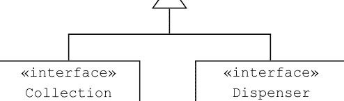

在 UML 中子接口符号是空矩形，因此此图表示 Collection 和 Dispenser 接口是 Container 的子接口。我们稍后会考虑 Collection 和 Dispenser 子接口是否有任何操作，因此目前我们在图中没有留出方法隔格。

分发器是线性排序的并具有访问限制。如所述，分发器包括栈和队列。我们在下一章将对不可遍历容器进行详细讨论。

## 3.4 Java 容器层次结构

理解各种数据结构的最好方法之一是使用它们来实现简单的容器层次结构。这也是提高你编程技能的一种好方法。因此，我们要求你在 Java 中实现一个容器层次结构。当然，Java 库中已经有一套丰富的容器，即集合类。我们无意用自己的层次结构替换它们。相反，我们希望通过编写一个简单的容器层次结构，让你更好地理解 Java 集合类（以及你在其他语言库中找到容器）以及如何有效地使用它们。

你应该将你的容器层次结构放在名为 `containers` 的包中。由于你不需要将其分发给任何人，你也可以在这个包中放置并测试材料。我们会在过程中提供一些代码供你使用，但大部分代码将由你自己编写。如果你愿意，可以查看 Java 类的源代码或在网上查找代码，但如果你将其他代码作为模型或指南，而不是在不理解其工作原理的情况下直接复制粘贴，学习效果会最好。再次，目标不是编写一个商业级的容器库，而是理解数据结构的工作原理。

## 3.5 复习题

1. 集合是有结构化的吗？集合是否有访问限制？集合是否有键值访问？
2. 如果 `c` 是一个容器并调用了 `c.clear()`，`c.isEmpty()` 返回什么？`c.size()` 返回什么？

## 3.6 练习

1. 考虑一种名为 Log 的容器，它是事务摘要的存档。摘要可以添加到 Log 的末尾，但一旦追加，就无法删除或更改。当摘要被添加到 Log 时，它会被赋予时间戳，并且可以通过时间戳从 Log 中检索摘要。Log 中的摘要也可以按任意顺序进行检查。
   a) Log 是结构化的吗？如果是，Log 具有什么样的结构？
   b) Log 是否有访问限制？如果是，键是什么？
   c) Log 是否提供键值访问？


## 练习题

### 2. Log 容器
在容器层次结构中，Log 应该是集合（Collection）还是分发器（Dispenser）？

### 3. Shoe 容器
考虑自动百家乐程序中名为 `Shoe`（牌）的容器。当创建一个 `Shoe` 实例时，它包含了八副随机排序的牌。牌可以一次性从 `Shoe` 的前端移除。牌不能被放入 `Shoe` 的其他位置、修改或从其他位置移除。`Shoe` 中的任何牌都无法检查。

a) `Shoe` 是结构化的吗？如果是，`Shoe` 具有什么样的结构？

b) `Shoe` 是否有访问限制？

c) `Shoe` 是否提供键值访问？如果是，键是什么？

d) 在容器层次结构中，`Shoe` 应该是集合（Collection）还是分发器（Dispenser）？

### 4. Randomizer 容器
考虑一种名为 `Randomizer` 的容器，用于匿名器的包路由。数据包从单个输入端口进入 `Randomizer`，并随机从 n 个输出端口出来，每个端口将数据包发送到不同的路由器。包只能通过单个输入端口进入 `Randomizer`，只能从 n 个输出端口出来。包按照进入 `Randomizer` 的顺序从单个输出端口出来。包在 `Randomizer` 内部时无法被访问。

a) `Randomizer` 是结构化的吗？如果是，`Randomizer` 具有什么样的结构？

b) `Randomizer` 是否有访问限制？

c) `Randomizer` 是否提供键值访问？如果是，键是什么？

d) 在容器层次结构中，`Randomizer` 应该是集合（Collection）还是分发器（Dispenser）？

### 5. Java 实现任务
随着书中内容的进行，你将在 Java 中实现容器。通过创建一个 Java 包 `container` 开始此任务。在包内部，根据图 1 中的 UML 图编写一个 `Container` 接口。

## 3.7 复习题答案

### 1. 集合特性
集合不是结构化的——元素在集合中出现或不存在，它们在集合中没有位置或位置。集合没有访问限制：元素可以任意添加或删除。集合中的元素没有键（它们仅仅是值），因此对集合的元素没有键值访问。

### 2. 容器清空状态
当容器被清空时，它不包含任何值，因此 `c.isEmpty()` 返回 `true`，`c.size()` 返回 `0`。

## 4.1 引言

在程序的每个一点，通常对计算状态有约束，这些约束必须满足才能确保程序正确。例如，如果某个变量应该记录对文件进行的更改次数，那么该变量永远不为负数。让阅读者了解这些约束是有帮助的。此外，如果程序在执行时检查这些约束，它可以在错误发生时立即发现。出于这两个原因，建议在断言（assertions）中记录程序状态的约束。

**断言（Assertion）：** 在程序指定点必须为真的语句。

## 4.2 断言的类型

**前置条件（Preconditions）**——前置条件是在操作开始时必须为真的断言。例如，平方根操作不能接受负参数，因此该操作的前置条件是参数是非负的。前置条件通常指定对参数的限制，但也可能指定其他条件已经建立，例如文件已创建或设备已初始化。

**后置条件（Post conditions）**——后置条件是在操作完成时必须为真的断言。例如，平方根操作的后置条件是返回值的平方等于参数。

**类不变式（Class invariants）**——类不变式对于任何类实例都必须为真的断言。通常类不变式指定字段的属性。例如，`Bin` 类包含离散物品，如苹果或橙子。`Bin` 类可能有 `currentSize`、`spaceLeft` 和 `capacity`。其中一个类不变式是 `currentSize + spaceLeft = capacity`。

## 4.3 断言的使用

通常，在编写代码时，程序员应该对公共方法说明前置条件和细微后置条件，说明类不变性，并在适当的地方插入不可达代码断言和循环不变式。

有些语言具有直接支持断言的功能，而有些则没有。如果语言没有直接支持断言，程序员可以模拟其效果。例如，方法中的第一个语句可以测试方法的先置条件，如果违反这些条件则抛出异常。后置条件可以以类似的方式检查。类不变性的检查起来比较麻烦，因为它们的代码必须插入到每个公共方法的开头和结尾。这通常是不可行的。不可达代码断言发生的频率相对较低且容易插入，因此应该使用。循环不变式对于代码文档和证明是强制性的，因此可以写在循环顶部的注释中。

通常会产生效率问题。例如，二分查找的前置条件是数组经过排序的，但检查这个前置条件的开销太大，以不如使用顺序搜索。

> **广告内容（已忽略）：** 关于入学时间、学费优惠、分期付款、在线教育及 LS University 认证信息等非技术内容。

## 4.4 断言的实现与语言支持

许多断言是在注释中说明的并没有在代码中检查，或者在开发期间检查，然后在编译发布版本代码时被移除或禁用。

支持断言的语言通常提供不同级别的支持。例如，Java 有一个 `assert` 语句，它接受一个布尔值参数；如果参数不为真，则会抛出异常。断言可以通过编译器开关关闭。程序员可以使用 `assert` 语句对前置条件、后置条件、类不变性和不可达代码进行检查，但这些完全取决于程序员。

Eiffel 和 D 语言在语言中提供了用于不变性以及前置和后置条件的构造结构，这些结构被编译到代码中并在继承体系中向下传播。因此，Eiffel 和 D 容易将这些检查整合到程序。编译器开关可以禁用发布程序的断言检查。

## 4.5 Java 中的断言

Java 为断言提供了很好的支持。它有一个 `assert` 语句，也可以使用异常。

`assert` 语句有两种形式，如下：

```java
assert <booleanExpression>
assert <booleanExpression> : <messageExpression>
```

在第一种形式中，会评估 `<booleanExpression>`，如果为 `false` 则抛出 `AssertionError`。根据原则，程序不应尝试捕获这些错误，因为这会导致程序失败并打印消息和堆栈跟踪。第二种语句的作用与第一种相同，不同之处在于评估 `<messageExpression>`，当程序失败时，该值将作为错误消息的一部分打印出来。

Java 断言默认是禁用的，这意味着它们被处理为不存在。它们通过 Java 解释器上的 `-ea` 或 `-enableassertions` 开关激活。

`assert` 语句用于在出现意外情况时终止程序。这在某些情况下是合适的，例如执行了不可达代码、违反了后置条件或违反了方法的前置条件。在其他情况下，抛出异常更好。特别是对于公共方法的前置条件。Java 有内置异常可以在此类情况下抛出（例如 `NullPointerException`、`IllegalArgumentException` 或 `IllegalStateException`）。程序员也可以定义自己的异常。抛出异常而不是使用 `assert` 语句允许客户端捕获并处理违反前置条件的调用，提供了更大的灵活性。

如前所述，断言在执行期间检查的成本太高，应该记录在注释中。Java 程序也应该遵循这一做法。Javadoc 是一个使用 Java 软件开发工具包 (SDK) 的程序。它从 Java 源代码生成 HTML/CSS 文档。因为前置和后置条件有助于客户端理解如何使用方法，所以前置和后置条件应该是公共方法 Javadoc 注释的一部分。程序员将 Javadoc 注释与公共方法相关联。为了说明，请考虑下面的 Java 代码：

```java
/**
 * 计算平方根。
 * @param r 必须为非负
 * @result 平方根
 * @throws IllegalArgumentException 如果 r 小于 0
 */
public double sqrt(double r) { ... }
```

## 5.1 栈引言

栈有许多物理比喻：抽屉里的衬衫、盘子架上的盘子、死胡同轨道上的货车等等。栈的核心特征是它是定序的，并且对它的访问仅限于一端。

**栈（Stack）：** 一种持有元素序列的分配器，只能在其中一端访问、插入或移除，这一端被称为**栈顶（top）**。栈也被称为后进先出（LIFO）列表。栈在计算中非常重要，因为在递归处理中有许多应用，例如语言解析、表达式求值、运行时函数管理等。

## 5.2 栈 ADT 与接口

栈是容器，由于它们持有某种类型的值，因此我们必须称其为 *T 类型的栈（stack of T）* ADT，其中 $T$ 是栈中存储的元素的类型。该类型的载体是所有持有类型 $T$ 元素的栈集合。该载体包括空栈、包含一个类型 $T$ 元素的栈、包含两个类型 $T$ 元素的栈等。下面展示了 $T$ 栈 ADT 的隐式接收者方法，其中 $e$ 是一个 $T$ 值。如果未满足函数的前置条件，其结果未定义。

- `push(e)`——在栈顶添加 $e$。
- `pop()`——移除并返回栈的顶端元素。`pop()` 操作的前置条件是栈不空。
- `isEmpty()`——仅当栈为空时返回布尔值 `true`。
- `top()`——返回栈顶端元素但不将其移除。像 `pop()` 一样，此操作的前置条件是栈不空。

`pop()` 操作撤销了 `push()` 操作实现的效果。当一个元素被推入栈时，它就变成了栈的顶端元素。除了栈顶元素外，没有其他元素。

## 5.3 Java Stack 接口

`Stack` 接口是分配器（Dispenser）的子接口，而分配器又是容器（Container）的子接口，因此它已经包含了从 `Container` 继承的 `isEmpty()` 操作。`Stack` 接口只需要添加用于推入元素、弹出元素以及查看栈顶元素的方法。图 1 显示了 `Stack` 接口。

```text
interface Stack {
    push( e : T );
    pop() : T { not isEmpty() }
    top() : T { not isEmpty() }
}
```

**图 1**：Stack 接口

注意，泛型或类型参数被用于泛化任何元素类型的接口，在 UML 中显示为接口图标右上角的虚线框。同样注意，需要前置条件的方法被显示为操作签名右侧用大括号括起来的 UML 属性。


关于 e-Learning for Kids。e-Learning for Kids 成立于 2004 年，是一个全球非营利基金会，致力于为 5-12 岁的儿童提供互联网资金和免费学习，课程涵盖数学、科学、语言艺术、计算机和环境技能。自 2005 年以来，全球 190 多个国家的超过 1500 万儿童从 ele 中受益。我们所有的志愿者员工由来自全球的教育和在线学习专家以及业务专业人士组成，致力于做出改变。eLearning for Kids 积极寻求资金、志愿者、赞助商和课件开发人员。加入我们！更多信息请访问 www.e-learningforkids.org。

在 ebook.com 下载免费电子书

点击广告阅读更多信息

`Stack` 接口的 UML 规范可以直接用 Java 编写代码。为了说明，请考虑图 2 中的代码。

```java
public interface Stack<T> extends Container {
    /**
     * 在栈顶添加一个值。
     * @param item 要添加的值
     */
    void push(T item);

    /**
     * 从栈中返回顶端值但不移除它。
     * 栈不能为空。
     * @result 未被移除的顶端值
     * @throws IllegalStateException 如果栈为空。
     */
    T top() throws IllegalStateException;

    /**
     * 移除并返回栈上的顶端值。
     * 栈不能为空。
     * @result 被移除的顶端值
     * @throws IllegalStateException 如果栈为空。
     */
    T pop() throws IllegalStateException;
}
```

**图 2**：Java Stack 接口

图 2 中的代码显示了 UML 中的类型参数如何变成 Java 中的泛型接口参数。UML 图中陈述的前置条件反映在注释中。`throw` 声明源于前置条件的预检查，并根据我们关于前置条件断言的策略记录在 Javadoc 注释中。

## 5.4 栈的使用示例

在向打印机发送文档时，一种常见的选项是对比输出进行装订，换句话说，就是打印页面以便它们按正确的顺序输出。通常，这意味着将第一页和下一页挨在一起打印，依此类推。假设一个程序将几页发送到打印机池（一个管理打印机输入的程序），并指示它们进行装订。假设第一页先到达打印机，第二页紧随其后，依此类推，打印机池必须在一个容器中保留这些页面。

此操作的伪代码如图 3 所示。

```text
collated(Job) {
    Stack stack;
    for each Page p(stack) {
        while (!stack.isEmpty()) {
            stack.pop();
        }
        stack.push(p);
    }
}
```

**图 3**：使用栈进行装订

## 5.5 栈的连续实现

实现 ADT 有两种方法：使用数组的连续实现和使用列表的链实现；我们将考虑前者。

如果使用固定大小数组，栈可能会满；如果使用动态（可调整）数组，栈是无界的。我们将使用动态数组，因为它跟踪栈中当前的元素数量。

操作的实现非常直接。例如，为了实现 `push()` 操作，首先检查是否需要扩展。如果是，则扩展存储。将推入的值赋值给 `store[count]`，然后增加 `count`。

我们通常不会显示容器的代码，但在情况下这样做有两个原因：首先，这是我们正在考虑的第一个容器，有助于理解处理问题；其次，`ArrayStack` 提供了一个重新分配数组的简单示例。`ArrayStack` 的代码出现在图 5。

```java
public class ArrayStack<T> {

    private T[] store;

    private int count;

    public ArrayStack() {

        this(8);

    }

    public ArrayStack(int capacity) {

        store = (T[]) new Object[capacity];

        count = 0;

    }

    public void push(T item) {

        if (count == store.length) {

            expand();

        }

        store[count++] = item;

    }

    public T pop() {

        if (isEmpty()) {

            throw new IllegalStateException("Stack is empty");

        }

        T item = store[--count];

        store[count] = null;

        return item;

    }

    public T top() {

        if (isEmpty()) {

            throw new IllegalStateException("Stack is empty");

        }

        return store[count - 1];

    }

    public boolean isEmpty() {

        return count == 0;

    }

    private void expand() {

        T[] newStore = (T[]) new Object[store.length * 2];

        System.arraycopy(store, 0, newStore, 0, store.length);

        store = newStore;

    }

}
```

**图 5**：ArrayStack 实现

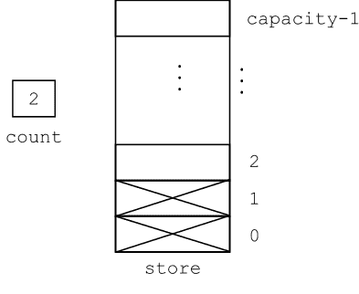

**图 4**：用数组实现栈

## 5.6 ArrayStack 完整实现

```java
public class ArrayStack<T> implements Stack<T> {

    public static final int INITIAL_SIZE = 8;

    private T[] store;      // 栈的元素

    private int count;      // 栈顶位于 store[count-1]

    public ArrayStack() { this(INITIAL_SIZE); }

    public ArrayStack(int initialSize) {

        if (initialSize < 1) initialSize = INITIAL_SIZE;

        store = (T[]) new Object[initialSize];

        count = 0;

    }

    public int size() { return count; }

    public boolean isEmpty() { return count == 0; }
```


```java
public void clear() { count = 0; }

public void push(T item) {
    if (count == store.length) {
        Object[] newStore = new Object[2 * store.length];
        for (int i = 0; i < store.length; i++) newStore[i] = store[i];
        store = (T[]) newStore;
    }
    store[count++] = item;
}

public T top() throws IllegalStateException {
    if (count == 0)
        throw new IllegalStateException("top of an empty stack");
    return store[count - 1];
}

public T pop() throws IllegalStateException {
    if (count == 0)
        throw new IllegalStateException("pop of an empty stack");
    return store[--count];
}
```

**图 5:** 连续栈的实现

我们可以使用 `ArrayList` 来实现 `ArrayStack` 且工作量更少，但观察如何管理数组来实现动态数组是有帮助的。

# Java 数据结构与算法

# 栈

## 5.6 栈 ADT 的链式实现

栈 ADT 的链式实现使用链式数据结构来表示抽象载体集合的值。让我们考虑链式数据结构的基础。

**节点 (Node)：** 一个带有数据字段和链接字段（指针或引用）的聚合变量。

**链式（数据）结构：** 通过其包含的节点字段形成一个整体的节点集合。

根据需要，节点可以包含一个或多个数据和链接字段，引用可以形成任意形状和大小的链式数据结构节点集合。最重要的链式数据结构包括以下几种。

**单链表 (Singly linked list)：** 一种链式数据结构，其每个节点都有一个链接字段，将节点形成一个序列。除了最后一个节点外，每个节点都包含指向列表中下一个节点的引用；最后一个节点的链接字段包含 `null`（一个不指代任何对象的特殊引用值）。


# Java 数据结构与算法

# 栈

**双向链表 (Doubly linked list)：** 一种结构，其每个节点有两个链接字段，将节点形成一个序列。除了第一个节点外，每个节点都有一个前驱字段，包含指向列表中上一个节点的引用；除了最后一个节点外，每个节点都有一个后继链接，包含指向列表中下一个节点的引用。

**链树 (The linked tree)：** 一种其节点形成一棵树的结构。

栈的链式结构非常简单，只需要单链表，因此列表节点只需要包含一个类型为 `T` 的值和一个指向下一个节点的引用。栈的顶元素存储在列表头部，因此栈数据必须跟踪的唯一数据是列表头部的引用。图 6 展示了这种数据结构。

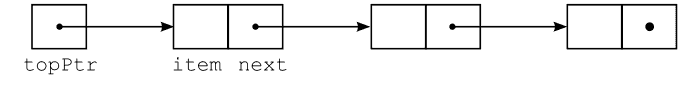

**图 6:** 使用单链表实现栈

列表头部引用是 `topPtr`。每个节点都有一个持有类型为 `T` 的值的 `item` 字段和一个持有链接的 `next` 字段。图显示了一个具有三个元素的栈：栈的栈顶，当然是列表上的第一个节点。当 `topPtr` 为 `null` 时，栈为空；栈永远不会变满（除非内存耗尽）。

我们展示了 `LinkedStack` 的完整实现，以证明它与 `ArrayStack` 的相似之处与不同。

```java
public class LinkedStack<T> implements Stack<T> {

    private static class Node {
        T item;
        Node next;

        Node(T item, Node next) {
            this.item = item;
            this.next = next;
        }
    }

    private Node topPtr;
    private int count;

    public LinkedStack() {
        topPtr = null;
        count = 0;
    }

    public int size() { return count; }

    public boolean isEmpty() { return count == 0; }

    public void clear() {
        topPtr = null;
        count = 0;
    }

    public void push(T item) {
        topPtr = new Node(item, topPtr);
        count++;
    }

    public T top() throws IllegalStateException {
        if (topPtr == null)
            throw new IllegalStateException("top of an empty stack");
        return topPtr.item;
    }

    public T pop() throws IllegalStateException {
        if (topPtr == null)
            throw new IllegalStateException("pop of an empty stack");
        T item = topPtr.item;
        topPtr = topPtr.next;
        count--;
        return item;
    }
}
```

**图 7:** 单链表

# Java 数据结构与算法

# 栈

栈的链式结构非常简单，只需要单链表，因此列表节点只需要包含一个类型为 `T` 的值和一个指向下一个节点的引用。栈的顶元素存储在列表头部，因此栈数据必须跟踪的唯一数据是列表头部的引用。

**图 8:** 链栈的实现

## 5.8 总结与结论

连续和链式的栈实现都是简单且高效的，但连续实现要么对栈的大小限制，要么在增长时使用昂贵的重新分配技术。链式实现本质上是无界的，因此栈永远不会满。它在空间利用上也非常高效，因为它只为栈中的值分配节点。总而言，链式实现似乎比连续实现更好。

## 5.8 复习题

- 1. 如果 `ArrayStack` 实现在数组满时不重新分配空间会发生什么？如何通过 `ArrayStack` 类处理这个问题？
- 2. 容器接口上的 `size()` 操作应该返回栈的容量还是当前元素数量？该操作在 `ArrayStack` 实现中应该返回什么值？
- 3. `LinkedStack` 的节点为每个栈元素持有一个引用，增加了存储数据所需的空间。这一事实是否否定了 `LinkedStack` 使用空间比 `ArrayStack` 更高效的说法？

## 5.9 练习

- 1. 重新表述栈 ADT 的操作，使其成为载体集合到载体集的函数（当栈改变时）或从载体集合值到类型 `T` 的函数（当访问栈时）。
- 2. 假设 `ArrayStack` 的实现使得顶元素始终存储在 `store[]` 中。这种方法的优缺点是什么？
- 3. 使用 `ArrayStack` 或 `LinkedStack` 的程序员可以如何确保他们的代码不会在违反先决条件时失败？
- 4. 如何修改 `LinkedStack` 实现，使其在没有 `count` 字段的情况下也能正确执行？
- 5. 写出一个关于 `LinkedStack` 的 `count` 和 `topNode` 属性的类不变性（class invariant）。*注：原文中为 `topPtr` 属性*
- 6. 顶元素可以存储在 `LinkedStack` 列表的尾部吗？这对实现产生什么影响？
- 7. 可以使用双向链表实现 `LinkedStack`。这种方法的优缺点是什么？
- 8. 请在 Java 中编写 `Stack<T>` 接口。包含 Javadoc 注释以记录适当的断言。对于那些假设栈不为空的方法，当违反此先决条件时，应声明为抛出 `IllegalStateException`。
- 9. 如何修改 `ArrayStack` 的实现以使用 Java 的 `ArrayList`？

## 5.10 复习题答案

+ 1. 如果 `ArrayStack` 在存储数组满载时不重新分配空间，它可能会导致存储数组溢出，这意味着 `push()` 方法可能会失败。这可以通过为 `ArrayStack push()` 方法添加一个先决条件（断言栈未满）来处理。`push()` 方法将检查此先决条件，如果为假则抛出异常。在 `ArrayStack` 中添加一个允许客户端判断调用 `push()` 是否安全的方法，可能是一个好主意；一个 `isFull()` 方法就能解决问题。
+ 2. `Container` 的 `size()` 操作被 `Stack` 接口继承，并在所有栈中都必须实现，它返回当前存储在栈中的元素数量。如果一个栈具有任意容量（如 `LinkedStack`），那么栈的容量甚至没有明确定义，因此让 `size()` 操作返回容量是没有意义的。
+ 3. `LinkedStack` 中的每个节点包含一个元素和一个链接，因此 `LinkedStack` 存储单个元素时占用的空间是 `ArrayStack` 的两倍（两倍）。另一方面，`ArrayStack` 分配的空间通常比它在任何时刻实际存储的数据的空间要多——通常存储数组中未使用的元素数量至少与使用的元素数量一样。这是因为 `ArrayStack` 必须有足够的容量来容纳推入栈中最大数量的元素，即使随后有许多元素从栈中弹出。总的来说，`ArrayStack` 使用的空间通常会比 `LinkedStack` 多。

# Java 数据结构与算法

# 6 队列

## 6.1 引言

队列就是我们通常所指的“排队”，例如“请排队领取免费午餐”。队列的基本特征是它是定序的，并且对它的访问限制在两端：元素从后端进入队列，从前端离开队列。

**队列（Queue）：** 一种持有元素序列的分配器，仅允许在其中端（称为后端，back）插入元素，或在另一端（称为前端，front）删除元素。

队列也被称为先进先出（FIFO）列表。队列在计算中非常重要，因为在许多情况下资源是按先来后到的原则提供服务的，例如等待打印机的作业，或操作系统中等待 CPU 的进程。

## 6.2 队列 ADT 与接口

队列是持有某种类型值的容器。因此，我们必须谈论 ADT *类型为 T 的队列*，其中 *T* 是队列中持有元素的类型。该类型的载体（carrier set）是所有持有类型 *T* 元素的队列集合。该载体包括空队列、包含一个 *T* 类型元素的队列、包含两个 *T* 类型元素的队列等。该类型的隐式-接收者方法集如下所示，其中 *e* 是一个 *T* 类型的值。

```
enter(e)——将 *e* 添加到队列后端。
```

```
leave()——移除并返回队列前端元素。*leave()* 操作的先决条件是队列不为空。
```

```
isEmpty()——如果队列为空，返回布尔值 true。
```

```
front()——返回队列前端元素但不将其移除。像 *leave()* 一样，此操作的先决条件是队列不为空。
```

*Queue* 接口是 *Dispenser* 的子接口，而 *Dispenser* 又是 *Container* 的子接口，因此它已经包含了来自 *Container* 的 `isEmpty()` 操作。*Queue* 接口只需要进入元素、移除元素以及查看队列前端元素的操作。图 1 显示了 *Queue* 接口。

# Java 数据结构与算法

# 队列

与栈一样，使用了泛型模板来使接口适用于任何元素类型，并为需要的操作添加了先决条件。

```java
interface Queue<T> {
    void enter(T e);
    T leave() { /* not empty */ }
    T front() { /* not empty */ }
    boolean isEmpty();
}
```


## 6.3 使用队列的示例

实现队列时，我们需要一种方法来跟踪前端和后端。如果使用数组，可以使用索引：`front` 和 `rear`。元素进入队列时，后端索引递增；元素离开时，前端索引递增。为了让索引在数组末尾回绕，我们使用了模运算。

图 1：队列接口

(image link: e4195b5740d5aee9320883958.png)

## 6.5 队列的连续实现

实现队列 ADT 有两种方法：使用数组的连续实现和使用链表的链实现；我们考虑前者。

使用这种数据结构实现队列 ADT 的操作非常直接。例如，在实现 `leave()` 操作时，首先检查操作的先决条件（队列不为空），即测试 `count` 是否为 0。如果不为空，将 `store[frontIndex]` 的值保存在临时变量中，更新 `frontIndex` 并递减 `count`。

循环数组是在连续位置实现队列的标准方法。如果使用静态数组，则队列可能会满；如果使用动态数组，则队列本质上是无界的。

图 3，数据占据这些区域

(image link: e42195b5740d5aee932088369560.png)

# JAVA 数据结构与算法

## 队列 (QUEUES)

实现此定义的 Java 类可能被称为 `ArrayQueue<T>`。它将实现 `Queue<T>` 接口（该接口继承自 `Container` 接口），并有一个存储数组以及整数类型的 `front` 和 `count` 变量作为私有字段。队列操作将是公共方法。其构造函数将创建一个空队列。容量将是存储数组的长度，Java 会负责跟踪该长度。

## 6.6 队列 ADT 的链式实现

队列 ADT 的链式实现使用链式数据结构来表示 ADT 载体集中的值。单链表就足够了，因此节点只需要包含一个类型为 `T` 的值和一个指向下一个节点的链接。我们可以保留指向列表头部的引用，但每当操作需要处理队列的另一端时，都必须从头部开始移动到尾部，因此保留列表每个端点的引用更高效。我们将同时使用 `frontPtr` 和 `rearPtr` 来跟踪列表的端点。

如果 `rearPtr` 指向列表头部而 `frontPtr` 指向尾部，那么在不从头部开始遍历列表的情况下，无法从队列中移除元素；换句话说，我们除了额外增加一个引用外无所获。我们必须让 `frontPtr` 指向列表头部，`rearPtr` 指向尾部。图 4 展示了这种数据结构。每个节点都有一个 `item` 字段（用于 `T` 类型的值）和一个 `next` 字段（用于链接）。图中显示了一个包含三个元素的队列。当 `frontPtr` 和 `rearPtr` 引用为 `null` 时，队列为空；队列永远不会（除非内存耗尽）。

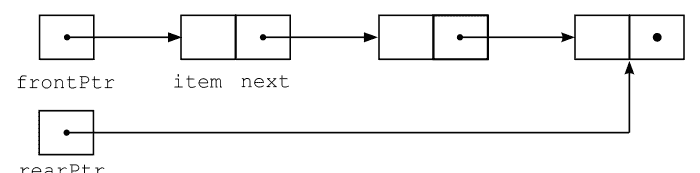

图 4：使用链表实现队列

使用链式数据结构实现队列 ADT 操作非常简单，但必须注意保持 `frontPtr` 和 `rearPtr` 同步。例如，实现 `leave()` 操作时，首先检查队列是否为空——如果为空则抛出异常。如果不为空，将头部节点的 `item` 字段赋值给临时变量。然后将第一个节点的 `next` 字段赋值给 `frontPtr`，从而从列表中删掉第一个节点。如果 `frontPtr` 为 `null`，则 `rearPtr` 也必须赋值为 `null`。最后返回存储在临时变量中的值。

# JAVA 数据结构与算法

## 队列 (QUEUES)

实现此定义的 Java 类可能被称为 `LinkedQueue<T>`。它将实现 `Queue<T>` 接口，并拥有 `frontPtr` 和 `rearPtr` 私有字段，队列操作为公共方法。它可能还有一个私有的内部类 `Node` 用于节点实例，并且可能有一个 `count` 字段来跟踪队列中的项数。其构造函数将创建一个空队列。当值进入队列且需要新节点时，将分配并在列表中使用新的 `Node` 实例。

## 6.7 总结与结论

两种实现都简单且高效，但连续实现要么对队列施加大小限制，要么在队列过大时采用昂贵的重新分配空间技术。如果将连续实现的队列做得非常大以确保它们不溢出，可能会浪费空间。

链式实现本质上是无边界的，因此队列永远不会满。它在空间利用上也非常高效，因为只为存储队列中实际保留的值分配内存。总体而言，队列的链式实现似乎比连续实现略好。


## 6.8 复习题

1. 队列 ADT 的哪些操作具有前提条件？这些前提条件是否转化到了 `Queue` 接口？
2. 在使用连续内存位置实现队列时，为什么应该将存储考虑为循环布局而非线性存储位置布局？
3. 为什么存储队列元素时同时使用指向链表两端的引用？

## 6.9 练习题

1. 在队列的连续存储实现中，是否存在只跟踪头元素的位置（使用变量 `frontIndex`）和尾元素的位置（使用变量 `rearIndex`）而不使用 `count` 变量？如果可能，请解释其工作原理。
2. 用 Java 编写 `Queue<T>` 接口。
3. 假设实现了一个 `ArrayAdapter`，当客户端 `enter()` 一个元素且数组已满时，会重新分配数组。假设重新分配的数组大小是满数组的两倍，并为 `enter()` 操作编写 Java 代码，包括在新分配的数组中安排数据所需的位置。
4. 为字段为 `frontPtr`、`rearPtr` 和 `count` 的 `LinkedQueue` 编写一个类不变性（class invariant）。
5. 循环单链表是一种最后一个节点持有第一个节点引用而非 `null` 的单链表。是否可以使用指向循环链表的单个引用，而不是本文那样指向（非循环）单链表的两个引用来高效地实现 `LinkedQueue`？解释其工作原理。
6. 可以使用双向链表实现 `LinkedQueue`。这种方法的优缺点是什么？
7. 用 Java 编写 `ArrayQueue<T>` 类，使队列永远不会满。如果存储空间满了，创建一个大小为两倍的新存储数组（记得从头部开始移动元素）。
8. 用 Java 实现 `LinkedQueue<T>` 类。它应该包含 `frontPtr`、`rearPtr` 和 `count` 字段。
9. 用 Java 实现 `LinkedQueue<T>` 类。它应该包含 `frontPtr` 和 `rearPtr`，但没有 `count`。

# JAVA 数据结构与算法

## 队列 (QUEUES)

## 6.10 复习答案

1. 队列 ADT 的哪些操作具有前提条件？这些前提条件是否转化到了 `Queue` 接口？
   - `leave()` 和 `front()` 操作具有队列不为空的前提条件。这些前提条件通过在不满足条件时抛出异常转化到了 `Queue` 接口。

2. 在使用连续内存位置实现队列时，为什么应该将存储考虑为循环布局而非线性存储位置布局？
   - 如果使用线性布局，每次从头部移除时，必须将所有其他元素向前移动一个位置，这是 $O(n)$。循环布局允许我们在不移动元素的情况下移动头部和尾部指针。

3. 为什么存储队列元素时同时使用指向链表两端的引用？
   - 如果只有头部的引用，向尾部添加元素将需要遍历整个列表来找到尾部，这是 $O(n)$。通过拥有两端的引用，入队和出队操作都可以 $O(1)$。

# 栈与递归 (STACKS AND RECURSION)

## 7.1 引言

在讨论集合之前，我们必须探索栈与递归之间的紧密联系。回想递归涉及可以调用自身的操作。

**递归操作**：一种既可以调用自己，又可以调用“调用自己的”的操作。

递归和栈在以下方面密切相关：

- 每一个递归操作（或一组相互递归的操作）都可以在不使用栈的情况下重写。
- 每一个使用栈的算法都可以在使用一个或多个递归操作的情况下不使用栈进行重写。

为了建立第一点，请注意计算机在机器层面不支持递归——大多数处理器可以移动、执行几次算术和逻辑操作，并根据结果比较值并跳转到程序的不同点，仅此而已。然而许多编程语言支持递归。这是如何可能的？在运行时，编译后的程序使用一个存储子程序当前执行状态数据的栈，称为激活记录。当调用子程序时，激活记录被推入栈中以保存子程序的参数、局部变量、返回地址和其他记录信息。激活记录一直留在栈上，直到子程序返回，此时它会从栈中弹出。由于每次子程序的调用都会导致新的激活记录推入栈中，这种机制支持了递归：子程序的每次递归调用都有自己的激活记录，因此与特定子程序相关的数据不会与该程序的其他调用混淆。因此，递归调用可以记录在栈上，非递归机器可以实现递归。

第二点并不那么容易建立，但论点是这样的：当算法需要将数据推入栈时，递归操作可以保留这些数据然后调用自己继续处理。递归调用恰好在需要从栈中弹出数据时返回，因此可以使用局部变量中的数据继续处理，就像数据已经从栈中弹出了一样。

# JAVA 数据结构与算法 栈与递归

在某种意义上，递归和栈是等价的。事实证明，某些算法用递归写更容易，某些算法用栈写更简单，而某些算法用哪一种方式写起来都一样容易（或同样困难）。但无论如何，总有一种方法可以在不使用栈的情况下递归地编写算法，或者不使用递归的情况下使用栈编写算法。

在本章的剩余部分，我们将通过考虑几个需要栈或递归的算法示例，来说明栈与递归等价性这一主题，并观察如何以两种方式实现这些算法。

## 7.2 平衡括号

由于其简单性，我们从一个并不真正需要栈或递归的示例开始，但它说明了如何以同样方便的方式使用两者：判断一个括号字符串是否平衡。平衡字符串的递归定义如下：

- 空字符串是平衡括号字符串。
- 如果 A 是平衡括号字符串，那么 "(A)" 也是。
- 如果 A 和 B 都是平衡括号字符串，那么 AB 也是。


# JAVA 数据结构与算法 # 栈递归

因此，例如，`([()])` 是平衡括号字符串，但 `([()][])` 不是。

图 1 中的递归算法（Java 语言）检查一个括号字符串是否平衡。

```java
boolean isBalancedRecursive() {
  return isBalanced() && ch == EOS;
}

boolean isBalanced() {
  try {
    if (ch == EOS) return true;
    if (ch != '[') return false;
    ch = source.read();
    if (ch == '[') {
      if (!isBalanced()) return false;
      if (ch != ']') return false;
      ch = source.read();
    }
    if (ch == '{') return isBalanced();
    return true;
  } catch (IOException e) {
    return false;
  }
}
```

图 1：检查平衡括号字符串的递归算法

此代码假设存在一个名为 `source` 的 `java.io.Reader` 对象，并且在调用 `isBalancedRecursive` 之前，`ch` 已用来自 `source` 的第一个字符初始化。常量 `EOS` 是 `Reader` 位于输入流末尾时 `read()` 返回的值（即 -1）。

`isBalancedRecursive()` 方法仅调用 `isBalanced()` 方法来完成大部分工作，并在辅助函数返回时检查源输入流是否已耗尽。此检查处理了了另一个合法平衡括号字符串末尾存在额外字符的情况。

`isBalanced()` 方法基于平衡括号的递归定义。如果输入字符串为空（对应递归定义的第一条），则该字符串是平衡的。如果它不为空且第一个字符是左括号，则消耗该左括号。调用 `isBalanced()` 来处理嵌套的平衡括号。如果递归调用返回 `true`，则检查右括号是否与初始左括号匹配。这处理了平衡括号定义中的第二条。如果右括号与左括号匹配，则消耗该右括号。最后检查下一个字符是否为左括号，如果是，则调用 `isBalanced()`，这解释了定义中第三条所允许的连续平衡括号的情况。

这项工作也可以使用栈的非递归算法同样容易地完成。在下面的图 2 代码中，使用栈来存储遇到的左括号。如果栈中的每个左括号都能找到对应的右括号，则括号字符串是平衡的。注意，在处理过程中必须检查栈是否为空（这意味着右括号过多），并且在处理完整个字符串后栈必须为空（这意味着左括号过多）。

```java
boolean isBalancedStack() {
  Stack<Integer> s = new LinkedStack<Integer>();
  try {
    while (ch != EOS) {
      switch (ch) {
        case '[':
          s.push(ch);
          break;
        case ']':
          if (s.isEmpty()) return false;
          s.pop();
          break;
        default: return false;
      }
      ch = source.read();
    }
    return s.isEmpty();
  } catch (IOException e) {
    return false;
  }
}
```

图 2：检查平衡括号字符串的非递归算法

这些算法的复杂度相当，因此在这个示例中，栈或递归并没有特别的优势。在下面的示例中，取决于问题，递归算法或使用栈的算法哪种更容易写。

# JAVA 数据结构与算法 # 栈递归

## 7.3 中缀、前缀和后缀表达式

我们在小学学到的算术表达式是中缀表达式，但其他类型的表达式（称为前缀或后缀表达式）也可能被使用。

**中缀表达式**：运算符出现在操作数之间的表达式。

**前缀表达式**：运算符出现在操作数之前的表达式。

**后缀表达式**：运算符出现在操作数之后的表达式。

在前缀表达式中，运算符的操作数立即出现在其右侧，而在后缀表达式中，它们立即出现在操作数的左侧。例如，中缀表达式 `(4 + 5) * 9` 可以重写为前缀形式 `* + 4 5 9`（注：原文示例为 `+ 4 5 9` 逻辑有误，此处按原意翻译或修正逻辑逻辑，通常 `(4 + 5) * 9` 应为 `* + 4 5 9`），后缀形式为 `4 5 + 9 *`。相比中缀表达式，前缀表达式的优势是不需要括号。

许多学生第一次遇到前缀和后缀表达式时会感到困惑，所以我们再来看几个例子。在下表的表达式中，所有的数字都是一位，运算符是标准的二元运算。所有的表达式都是等价的。


# 数据结构与算法 # 栈与递归

| 中缀 | 前缀 | 后缀 |
|---|---|---|
| (2 + 8) * (7 + 3) | * + 2 8 + 7 3 | 2 8 + 7 3 * |
| (2 * 3) + (5 + 4) | + * 2 3 + 5 4 | 2 3 * 5 4 + |
| (2 * 5) % (6 / 4) + (2 * 3) | % * 2 5 / 6 4 + 2 3 | 2 5 * 6 4 / 2 3 + |
| 1 + (2 + (3 + 4)) | + + + 1 2 3 4 | 1 2 3 4 + + |
| ((1 + 2) + 3) + 4 | + + 1 2 3 4 | 1 2 + 3 4 + |

注意所有表达式的数字顺序相同。这对于减法和除法运算符是必要的。此外，前缀表达式中的运算符顺序并不总是在其后缀表达式中的顺序相反；有时是相反的，但并非总是如此。运算符之间的系统关系是：主运算符在中表达式中所在的括号最少，在前缀表达式中最高，在后缀表达式中最后。最后，在每个表达式中，常量参数（数字）的数量总是多于运算符的数量。

让我们考虑前缀和后缀表达式的问题。事实证明，有时递归算法更容易，有时基于栈的算法要容易得多。特别是：

- 编写递归前缀算法非常容易，但用栈编写该算法较难。
- 编写基于栈的后缀表达式评估算法非常容易，但用递归编写该算法非常困难。

为了建立这些假设，我们将考虑一些算法。用 Java 递归评估前缀表达式的算法见图 3。这些方法使用名为 `source` 的字符流，并且变量 `ch` 已用来自 `source` 的第一个字符初始化。`evalPrefixRecursive()` 方法调用递归的 `evalPrefix()` 方法来完成大部分工作，并在返回 `evalPrefix()` 提供的结果之前确保流已空。（`source` 中的额外字符表示运算符参数过多，因此会抛出异常。）

在 bookboom.com 下载免费电子书

71

# JAVA 数据结构与算法

# 栈与递归

```java
public int evalPrefixRecursive() throws Exception {
    int result = evalPrefix();
    if (ch == EOS) return result;
    throw new IllegalArgumentException();
}

private int evalPrefix() throws Exception {
    if (ch == EOS)
        throw new IllegalArgumentException();
    } else if (Character.isDigit(ch)) {
        int num = ch - '0';
        ch = source.read();
        return num;
    } else {
        int op = ch;
        ch = source.read();
        return applyOp(op, evalPrefix(), evalPrefix());
    }
}
```


**图 3：** 评估前缀表达式的递归算法

考虑前缀表达式的递归定义有助于理解该算法：

前缀表达式要么是一个数字，或者如果 *A* 和 *B* 是前缀表达式且 *op* 是运算符，则是形式为 *op A B* 的表达式。

正如前面提到的，`evalPrefix()` 执行了工作。首先，它检查流是否耗尽，如果是则抛出异常（因为空字符串不是前缀表达式）。否则，它读取下一个字符并检查它是否为数字。如果是，这就是前缀表达式递归定义的基准情况；否则，当前字符是一个运算符。根据递归定义，运算符后面应该跟着两个前缀表达式，因此该算法将此运算符应用于递归评估左、右参数的结果（这是通过辅助方法 `applyOp()` 完成的）。如果这些参数不存在或格式错误（格式不正确），则其中一个递归调用将抛出异常并传递给调用者。

在 bookboom.com 免费下载电子书

72

---

```java
int evalPrefixStack() throws Exception {

    Stack<Integer> opStack = new LinkedStack<Integer>();

    Stack<Integer> argStack = new LinkedStack<Integer>();

    while (ch != EOF) {

        if (Character.isDigit(ch)) {

            int num = ch - '0';

            argStack.push(num);

            while (!opStack.isEmpty() && opStack.top() == '\v') {

                opStack.pop();

                if (opStack.isEmpty())

                    throw new IllegalArgumentException();

                int op = opStack.pop();

                if (argStack.isEmpty())

                    throw new IllegalArgumentException();

                int arg2 = argStack.pop();

                if (argStack.isEmpty())

                    throw new IllegalArgumentException();

                int arg1 = argStack.pop();

                argStack.push(applyOp(op, arg1, arg2));

            }

            if (!opStack.isEmpty() && opStack.top() != '\v')

                opStack.push((int)ch);

        } else {

            opStack.push(ch);

        }

        ch = source.read();

    }

    if (!opStack.isEmpty()) throw new IllegalArgumentException();

    if (argStack.isEmpty()) throw new IllegalArgumentException();

    int result = argStack.pop();

    if (!argStack.isEmpty()) throw new IllegalArgumentException();

    return result;

}
```

**图 4：** 基于栈的评估前缀表达式算法

递归算法虽然简单，但可能是一项非常复杂的工作。相比之下，考虑图 4 所示使用栈评估前缀表达式的代码。该算法有两个栈：一个用于运算符（`opStack`），一个用于值（`argStack`）。其策略是依次从源流推送每个字符，遇到运算符时将其推入 `opStack`，遇到值时推入 `argStack` 以保留参数。参数的位置在 `opStack` 中推入字符 `'\v'` 来标记。当左右参数都可用时，会将运算符应用于它们，并将结果推回 `argStack`，同时在 `opStack` 上进行标记。一旦字符串耗尽，结果值应当是 `argStack` 中的唯一内容，且 `opStack` 应该为空。理解该算法如何运行的最好方法是手动运行几个示例。

在 bookboom.com 免费获取电子书

73

---

显然，这种基于栈的评估算法比递归评估算法更复杂。相比之下，用于后缀表达式的基于栈的评估算法非常简单，而递归算法则相当复杂。为了说明这一点，见图 5 中基于栈的后缀表达式评估算法。

```java
public int evalPostfixStack() throws Exception {

    Stack<Integer> stack = new LinkedStack<Integer>();

    while (ch != EOF) {

        if (Character.isDigit(ch)) stack.push(ch-'0');

        else {

            if (stack.isEmpty()) {

                throw new IllegalArgumentException();

            }

            int arg2 = stack.pop();

            if (stack.isEmpty()) {

                throw new IllegalArgumentException();

            }

            int arg1 = stack.pop();

            stack.push(applyOp(ch, arg1, arg2));

        }

        ch = source.read();

    }

    if (stack.isEmpty()) throw new IllegalArgumentException();

    int result = stack.pop();

    if (!stack.isEmpty()) throw new IllegalArgumentException();

    return result;

}
```

**图 5：** 基于栈的评估后缀表达式算法

该算法的策略非常简单：使用单个存储参数的栈，每当在源流中遇到值时就将其推入栈。每当遇到运算符时，从栈中弹出前两个值，将运算符应用于它们，并将结果推回栈中。这种递归算法比基于栈的评估算法更简单（注：此处原文逻辑应为：正如所描述的，后缀表达式的栈算法非常简单，递归算法很复杂）。

在 bookboom.com 免费下载电子书
74

---

## 7.4 尾递归算法

我们声称每个递归算法都可以用栈的算法来替换，但这夸大了情况：如果递归在体执行的最后一步只调用自己，则可以使用循环替换——一个非常简单的例子是图 6 所示递归搜索数组。

```java
public static boolean recursiveSearch(

    int[] array, int key, int start) {

    if (array[start] == key) return true;

    int next = start+1;

    if (array.length == next) return false;

    return recursiveSearch(array, key, next);

}
```

**图 6：** 递归搜索算法


算法中的递归可以用图 7 所示的简单循环替换。

```java
public static boolean search(int[] array, int key) {

    for (int v : array) {

        if (v == key) return true;

    }

    return false;

}
```

**图 7：** 非递归搜索算法

那些在每次体执行的最后一步只调用一次自己的算法（如此搜索）被称为尾递归。

- **尾递归算法：** 在每次体执行的最后一步最多调用自身一次的递归算法。

递归总是可以使用栈从尾递归算法中删除。我们在考虑二分搜索时会有另一个尾递归的例子。

## 7.5 总结与结论

使用递归的算法总是可以使用栈来替换，反之亦然，因此栈和递归在某种意义上是等价的。然而，某些算法更容易编写递归，而另一些则更容易编写栈。这取决于具体问题。程序员在解决单个问题时应该评估这两种方案。

## 7.6 复习题

1. 哪种判断括号字符串是否平衡的算法最容易理解？
2. 前缀、后缀和中缀表达式具有哪些共同特征？
3. 使用栈评估前缀表达式和使用递归哪个更简单？
4. 使用栈评估后缀表达式和使用递归哪个更简单？
5. 判断括号字符串是否平衡的递归算法是尾递归的吗？解释为什么或为什么。

## 7.7 练习

1. 我们可以稍微修改平衡括号字符串的定义，以排除空字符串。重新表述递归定义，并修改检查括号字符串是否平衡的算法，以包含这一变化。
2. 在下表中填入行中的等价表达式。

| 中缀表达式 (Infix) | 前缀表达式 (Prefix) | 后缀表达式 (Postfix) |
|---|---|---|
| ((2 * 3) - 4) * (8 / 3)) + 2 | | % + 8 * 26 - 84 | 82 - 3 * 4 * 5 + 8 / 3 |

3. 编写一个递归算法来评估本章讨论的后缀表达式。
4. 编写一个递归算法来评估中缀表达式。假设运算符的优先级相等且为左结合，因此在没有括号的情况下，操作从左到右评估。括号按通常的方式改变求值顺序。
5. 编写一个基于栈的算法来评估上一个练习中定义的中缀表达式。
6. 哪种评估中缀表达式的算法更易开发？
7. 编写一个不使用栈的非递归算法来确定括号字符串是否平衡。提示：计算括号数量。

## 7.8 复习题答案

1. 这个答案取决于个人，但大多数人可能觉得基于栈的算法稍微更容易理解，因为它的策略非常简单。
2. 前缀、后缀和中缀表达式以相同的顺序列出参数。每个表达式中的运算符数量始终少于常数参数的数量。每个表达式和子表达式中的主运算符很容易找到：中缀表达式的主运算符是位于最少括号内部最左侧的运算符；前缀表达式的主运算符是第一个运算符；后缀表达式的主运算符是最后一个运算符。
3. 递归地评估前缀表达式比用栈评估要容易得多。
4. 使用栈评估后缀表达式比递归评估要容易得多。
5. 确定括号字符串是否平衡的递归算法在每次激活时最多调用自己一次，因此它是尾递归的，但递归调用并不是主体算法执行的最后一步——在递归调用之后必须对右括号进行检查。因此，该操作不是尾递归，且无法在不使用栈的情况下实现。（有一种不使用栈检查平衡括号的非递归算法，但它使用的方法与递归算法完全不同——见练习题 7）。

# 8 集合与迭代器

## 8.1 引言

回想，我们将集合定义为一种可遍历的容器类型，即允许访问所有元素的容器。访问集合所有元素的过程称为迭代。根据控制迭代的代理以及迭代机制所在的位置，可以通过多种方式支持集合迭代。在本章中，我们将检查迭代的设计替代方案，并讨论了 Java 中集合和迭代是如何工作的。基于这些讨论，我们将决定如何在容器层次结构中支持集合迭代，以及如何将集合添加到层次结构中。

## 8.2 迭代设计方案

迭代可以通过两种方式控制。

**内部迭代**——当客户端控制对其元素的迭代时，这种迭代被称为*内部*的。希望处理集合中每个元素的客户端会将处理过程以某种方式封装（通常在一个操作中），并将其传递给集合，可能还带有关于如何进行迭代的指令。然后集合将该处理过程应用于它的每个元素。这种控制模式使得客户端更容易对集合进行迭代，但在处理迭代过程中可能出现的问题时灵活性较低。

**外部迭代**——当客户端控制对集合的迭代时，这种迭代被称为*外部*的。在这种情况下，必须为客户端提供操作，允许初始化、从集合中获取当前元素、移动到集合中的下一个元素以及判断迭代何时完成。这种控制模式给客户端施加了负担，以换取在处理迭代时更多的灵活性。

除了控制问题外，还有关于迭代机制所在位置的替代方案。

**在语言中**——迭代机制可以构建在语言中。例如，Java、Ruby 和 Go（仅举几个例子）具有特殊的循环结构，为对集合进行外部迭代提供了手段。

**在集合中**——迭代机制可以存在于集合中。对于具有外部迭代机制的集合，集合必须提供初始化迭代、返回当前元素、前进到下一个元素以及指示迭代何时完成的操作。对于具有内部迭代机制的集合，集合必须提供一个接受封装过程并将其应用于其每个元素的操作。

**在迭代器中**——迭代机制可以存在于独立实体中，该实体的工作是遍历关联的集合。在这种情况下，上述支持内部或外部迭代的操作位于迭代器中，而集合通常有一个创建迭代器的操作。

结合这些设计替代方案提供了实现迭代的六种方式：位于语言中、集合中或迭代器中的内部迭代；位于语言中、集合中或迭代器中的外部迭代。这些每种替代方案都有优缺点，各种语言和系统已经结合了其中一种或多种。例如，面向对象的语言具有存在于迭代器对象中的外部迭代（这被称为迭代器模式）。如今，许多语言在控制结构中提供了外部迭代，如上所述。我们现在将考虑迭代器设计模式，然后是 Java 中的内部和外部迭代。


## 8.3 迭代器模式

软件设计模式是对常见设计问题的接受解决方案，作为解决类似问题的模型提出。

**软件设计模式：** 用于解决设计问题的模型。

设计模式出现在许多抽象层次上。例如，算法或数据结构是低级设计模式，而大型程序的整体结构（如客户端-服务器结构）是高级设计模式。迭代器模式是一种中级面向对象的设计模式，规定了几个类之间的组合和交互。

迭代器由一个 `Iterator` 类组成，其实例由关联的集合创建并提供给客户端。`Iterator` 实例包含了外部迭代机制。虽然 `Iterator` 类的功能可以用各种方式封装，但 `Iterator` 类必须提供以下功能：

- **初始化：** 准备 `Iterator` 对象以遍历其关联的集合。此操作将设置当前元素（如果有）。
- **完成测试：** 指示此迭代器的遍历是否结束。
- **当前元素访问：** 为客户端提供当前元素。操作的前提是迭代尚未完成。
- **当前元素前进：** 将集合中的下一个元素变为当前元素。一旦迭代完成，此操作将不起影响。然而，迭代在被*邀请*时可能会完成——也就是说，如果当前项目是最后一个，执行此操作将完成迭代，再次调用它将无任何作用。

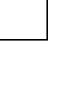

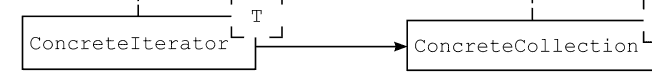

客户端通过调用 `ConcreteCollection` 的 `iterator()` 操作从具体集合中请求一个迭代器。然后，客户端可以重置迭代器并使用 `while` 循环来访问其元素。图 2 中的 Java 代码说明了这一实现过程。

```java
Collection c = new ConcreteCollection<T>();

...

Iterator<T> i = c.iterator();

while (!i.isDone()) {

  T element = i.get();

  // process element

  i.next();

}
```


**图 2：** 使用迭代器

注意，如果程序员决定从一个 `ConcreteCollection` 切换到另一个，这段代码中只有一行需要修改：第一行。由于使用了接口，即使使用不同的 `ConcreteIterator` 来访问集合的元素，代码仍然可以运行。

## 8.4 Java 中的集合与迭代

现在让我们考虑 Java 如何提供集合迭代。Java 平台包含了一组集合类和接口，被称为 Java 集合框架。在这个框架中，`java.util.Collection<T>` 是集合的接口。它由提供栈、队列、双队列、列表和集合的类实现。还有一个 `java.util.Map<K,E>` 接口，它由各种类型的映射实现。我们将在书中学习这些集合（包括映射）。目前，你应该意识到 Java 集合框架提供了丰富多样的集合，并带有复杂的方法来支持许多计算需求。虽然我们正在构建自己的容器层级结构来学习容器，但在课程结束后，你应该使用 Java 集合框架。

Java 拥有一个 `java.lang.Iterable<T>` 接口，其唯一的方法是 `iterator()`，这是一个返回实现 `java.util.Iterator<T>` 接口的类的工厂方法；`Collection<T>` 扩展了 `Iterable<T>` 接口。Java 集合框架使用迭代器模式提供外部迭代器。此外，任何实现 `Iterable` 接口的类都可以作为 `for-each` 语句的目标。这就是 Java 如何作为语言的一部分支持外部迭代。因此，Java 支持上述六种迭代设计替代方案中的两种。（Java 8 也支持内部迭代，但我们在此不讨论。）

Java 的 `Iterator` 接口与我们在迭代器设计模式中讨论的接口略有不同。


- Java `Iterator` 接口没有 `reset()` 方法。当一个 `Iterator` 对象被创建时，它也会被初始化。一旦迭代完成，该 `Iterator` 对象就由于“耗尽”了，必须创建一个新的。
- Java `Iterator` 接口用于测试迭代是否完成的方法称为 `hasNext()` 而不是 `isDone()`，它返回一个布尔值。
- Java `Iterator` 接口方法 `next()` 结合了迭代器模式中的 `get()` 和 `next()` 方法：它不仅移动到集合中的下一个元素，还返回当前元素。如果在集合耗尽时调用它，它会抛出 `NoSuchElementException`。
- 最后，Java `Iterator` 有一个 `remove()` 方法，用于从集合中移除 `next()` 返回的元素。修改集合迭代并不总是一个定义明确的操作。在迭代器中提供此方法（在 Java 中是可选的）提供了一种修改集合的安全方法。
- 接口中没有安全地向集合中插入元素的方法。

Java 的一个特性是，任何实现 `Iterable` 接口的类都可以作为 `for-each` 语句的目标。这就是 Java 如何作为语言的一部分支持外部迭代。因此，Java 支持上述六种迭代设计替代方案中的两种。（Java 8 也支持内部迭代，但我们在此不讨论。）

## 8.5 层级结构中的集合与迭代器

在讨论迭代时，我们提到了各种集合：列表、集合和映射。我们将在书中学习这些集合（包括映射）。目前，你应该意识到 Java 集合框架提供了丰富多样的集合，并带有复杂的方法来支持许多计算需求。虽然我们正在构建自己的容器层级结构来学习容器，但在课程结束后，你应该使用 Java 集合框架。

我们将使用迭代器模式来提供外部迭代器。此外，任何实现 `Iterable` 接口的类都可以作为 `for-each` 语句的目标，包含集合查询。

## 8.6 总结与结论

集合是可以遍历的，并且需要某种迭代。迭代器模式作为使用外部迭代器的方法，是外部迭代器的良好模型。我们已经使用迭代器模式来指定我们的接口。

## 8.7 复习题

- 迭代的替代方案有哪些？
- 迭代机制可能位于何处？
- 设计设施六种替代方案是什么？
- 什么是软件设计模式？
- 在迭代器模式中，`Iterator` 对象必须提供哪些功能？
- Java 为集合迭代提供什么种支持？
- 当集合为空时，`contains()` 操作返回什么？

## 8.8 练习题

1. 如果可以使用索引访问列表的每个元素，迭代器的意义何在？
2. 解释为什么分发器没有迭代器。
3. Java 有迭代器，但 Java `Iterator` 接口没有 `reset()` 操作。为什么？
4. 是否可能有一个只有一个操作的 `Iterator` 接口？如果是的话，如何实现那四个功能？
5. 如何将位于集合中的外部迭代器添加到 Java 集合框架中？
6. 如何将内部迭代添加到 Java 集合框架中？
7. 用 Java 实现 `contains()` 操作。
8. 当关联集合在迭代期间发生变化时，迭代器（任何迭代器）会发生什么？
9. 考虑检查两个集合是否包含相同值的问题。这可以使用集合内部迭代器解决吗？可以使用外部迭代器解决吗？

## 8.9 练习题答案

1. 控制迭代有两种可选方案：可以由集合控制迭代（内部迭代），也可以由客户端控制迭代（外部迭代）。
2. 迭代机制可以存在于三个地方：在语言中（以控制结构的形式）、在集合中（作为一组操作），或者在单独的迭代器中（具有某些特定操作）。
3. 设计集合迭代设施的六种可选方案是通过将控制方式与存储方式相结合生成的，产生了以下六种可能性：(1) 位于语言中的内部控制，(2) 位于语言中的外部控制，(3) 位于集合中的内部控制，(4) 位于集合中的外部控制，(5) 位于迭代器中的内部控制，(6) 位于迭代器中的外部控制。
4. 软件模式被用于模仿解决软件设计问题。换句话说，模式是一种被证明成功的解决设计或实现问题的方法，并可以作为解决类似问题的模板。
5. 迭代器必须提供四个功能：初始化迭代器以准备遍历其集合的方法、获取集合当前元素的方法、移动到集合下一个元素的方法，以及指示所有元素均已访问的方法。
6. Java 通过允许内置的 `for-each` 循环遍历实现了 `Iterable` 接口的类提供了外部迭代支持。此外，此类类具有一个 `iterator()` 方法，返回一个实现 `Iterator` 接口的类实例，这意味着迭代器模式被内置在 Java 中，因此迭代器也可以在循环中用于遍历集合。
7. 如果集合为空，则它不包含任何内容，因此无论参数是什么，`contains()` 操作都返回 `false`。

## 9.1 引言

列表是线性有序的集合。我们在日常生活中提到的某些东西是列表，如购物清单或洗衣清单，实际上是集合，因为它们的顺序并不重要。而在列表中，顺序是重要的。如果待办事项是按照它们应该完成的顺序（或其他顺序）排列的，那么待办事项列表就是一个真正的列表。

**列表：** 一种有序的线性集合。

由于列表中的顺序很重要，当我们修改列表时，必须指定元素的位置或索引。索引可以从任何数字开始，但我们将遵循惯例，将列表的第一个元素索引为 0，第二个索引为 1，依此类推。

## 9.2 列表 ADT 与接口

列表是某种类型值的集合，因此其 ADT 是 `list of T`，其中 `T` 是列表中元素的类型。该类型的载体是所有类型为 `T` 的元素的序列或有序元组集合。该载体包括空列表、包含一个 `T` 类型元素的列表（一元组）、包含两个 `T` 类型元素的列表（有序对）等，依此类推。因此，该 ADT 的载体是所有类型为 `T` 的元组集合，包括空元组。

列表 ADT 中可能包含许多函数；以下是一个典型的列表 ADT 隐式接收者方法。如果违反了前置条件，则函数的结果未定义。

- `size()`——返回列表的长度。
- `insert(i,e)`——将 `e` 插入列表的索引 `i` 处，并在必要时移动具有较大索引的元素。此操作的前置条件是 `i` 是一个有效的索引位置：$0 \le i \le size(0)$。当 $i$ 为 0 时，`e` 插入到列表头部；当 $i$ 为 $size(0)$ 时，`e` 追加到列表尾部。
- `delete(i)`——移除索引 `i` 处的元素并返回被删除的元素。此操作的前置条件是 `i` 是一个有效的索引位置：$0 \le i < size()$。
- `get(i)`——返回列表索引 `i` 处的值。前置条件是 `i` 是一个有效的索引位置：$0 \le i < size()$。
- `put(i,e)`——用 `e` 替换列表索引 `i` 处的元素。前置条件是 `i` 是一个有效的索引位置：$0 \le i < size()$。
- `index(e)`——返回 `e` 在列表中第一次出现的位置。此操作的前置条件是 `e` 在列表中。
- `slice(i,j)`——返回一个新列表，该列表是原列表的切片，其第一个元素是索引 `i` 处的值，最后一个值是索引 `j-1` 处。此操作的前置条件是 `i` 和 `j` 有效：$0 \le i \le j \le size()$。注意，如果 $i = j$，则切片是空的。
- `isEqualTo(s)`——仅当 `s` 与（接收者）列表具有相同的元素且顺序相同时，才返回 `true`。

正如我们之前学过的 ADT 一样，将这些操作作为类的方法实现时，该类是方法的宿主；当在 Java 中实现时，这些操作的签名会有所不同。


> 在丹麦，你可以找到工程工作并提升自己的专业水平。特别是在风能领域，你可以从行业内优秀的人那里学习，并在稳定的就业市场中推进你的职业生涯。
>
> Mireia Marre,
> 来自西班牙的高级工程师。
> 自 2010 年起在丹麦的风能行业工作。
>
> 在 bookboom.com 免费下载电子书

## 9.3 列表的使用示例

正如我们之前学过的 ADT 一样，将这些操作作为类的方法实现时，该类是方法的宿主；当在 Java 中实现时，这些操作的签名会有所不同。

软件模式被用于模仿解决软件设计问题。换句话说，模式是一种被证明成功的解决设计或实现问题的方法，并可以作为解决类似问题的模板。

迭代器必须提供四个功能：初始化迭代器以准备遍历其集合的方法、获取集合当前元素的方法、移动到集合下一个元素的方法，以及指示所有元素均已访问的方法。

Java 通过允许内置的 `for-each` 循环遍历实现了 `Iterable` 接口的类提供了外部迭代支持。此外，此类类具有一个 `iterator()` 方法，返回一个实现 `Iterator` 接口的类实例，这意味着迭代器模式被内置在 Java 中，因此迭代器也可以在循环中用于遍历集合。

如果集合为空，它不包含任何内容，因此无论参数是什么，`contains()` 操作都返回 `false`。

## 9.4 列表的连续实现

列表通常用数组实现。静态数组限制了大小，而动态数组允许列表增长。两种情况下实现方式相似。分配数组存储列表元素，元素按顺序排列，用一个计数器维护列表的大小。在索引 $i$ 处添加元素需要向上移动列表元素以腾出空间。当移除 $i$ 时，将 $i+1$ 到列表末部的切片向下复制以关闭空格。

用数组实现的列表迭代器也非常容易编写。迭代器在迭代期间仅保留对列表的引用和当前索引，索引作为标记当前元素的游标。

**游标：** 标记数据结构中位置的变量。

数组索引 $i$ 处的元素访问几乎是瞬时的，使用连续实现时 `get()` 和 `put()` 操作非常快。添加和删除元素需要移动数组中的切片，这可能会很慢。对于频繁访问但并不频繁添加或删除元素的应用程序，连续实现将非常高效；相反的应用程序效率会低得多，特别是当列表很长时。

静态数组在编译时确定大小，因此使用静态数组实现无法容纳任意大小的列表。相比之下，使用动态数组实现可以在超过容量时分配更大的数组。重新分配数组是一项昂贵的操作，因为必须创建一个更大的数组，将旧数组的内容复制到新数组，并释放旧数组。为了避免这种开销，应将重新分配数组的次数尽可能减少。一种流行的方法是当数组需要重新分配时将其大小翻倍。例如，假设列表从容量 10 开始。随着它的扩展，容量将变为 20、40、80 等，依此类推。数组永远不会缩小。

## 9.5 列表 ADT 的链式实现

列表 ADT 的链式实现使用链式数据结构来表示 ADT 载体集合的值。根据客户端需要，可以使用单链表或多链表。我们将考虑使用单链表或双向链表来演示实现方案。

# Java 数据结构与算法

## 列表

假设使用单链表来存储列表元素。它包含一个通常称为 `head`（头节点）的变量，指向列表的第一个节点。这个节点可能包含列表中第一个元素的数据，也可以是一个虚拟节点（可以看作位于位置 -1），即使在列表为空时，它也一直存在。使用虚拟节点会浪费空间，但它极大地简化了各种列表操作算法，因此我们将在算法中使用它。在任何情况下，当列表为空时，要么 `head` 为空，要么虚拟节点的 `link` 字段为空。列表的长度通常也会被记录。

大多数操作都以索引 $i$ 作为参数，因此实现这些操作的大多数算法都必须从 `head` 开始，通过节点向下遍历，以定位位于位置 $i$ 或位置 $i-1$ 的节点。（为什么是 $i-1$？因为对于添加和删除操作，必须修改节点 $i$ 前一个节点的 `link` 字段。）如果列表很长且在列表末尾有许多更改，处理过程必须简单通过在列表中找到合适的位置来执行操作。

这种困难可以通过维护一个由索引值和对列表的引用组成的游标来缓解。游标用于找到某些操作执行所需的节点。当下一次操作被调用时，它可以使用游标的现有值，或者对其进行细微调整，从而节省时间。例如，假设在列表末尾添加一个值。使用游标移动到列表末尾并进行添加；当此任务完成后，游标标记了列表中（比方）`size()-2` 位置的节点。如果进行另一个添加操作，游标只需向前移动一个节点到达列表末尾，标记必须修改其 `link` 字段的节点——这就避免了从头部开始的遍历。

维护一个指向列表末尾的引用也可能有用。这样，在列表末尾的操作就可以快速完成，代价是维护额外引用所需的细微额外工作。如果客户端在列表末尾执行了多次操作，这些额外工作就是值得的。

实现列表操作另一种方法是将元素存储在双向链表中，双向链表的每个节点（末端节点外）都有指向其后继节点和前驱节点的链接。也可以使用一个虚拟头节点。下图 2 展示了这种带有虚拟头节点的设置。


在双向链表中使用游标可以显著提高速度，因为链接使得在列表中向前向后移动成为可能。如果某个操作需要到达节点 $i$，而游标标记的是节点 $j$，且 $j$ 距离 $i$ 比 $i$ 距离列表头部更近，那么从游标开始跟踪链接比从头部开始跟踪链接更快到达节点 $i$。维护指向列表末尾的引用会让速度变得更快：可以从三个点开始向某个节点移动：列表头部、列表尾部或游标（游标通常位于列表中间位置）。

另一个技巧是使列表变为环形：让第一个节点的 `pred` 链接指向节点而不是包含 `null`，让最后一个节点的 `succ` 链接指向第一个节点而不是包含 `null`。这样就不需要单独的列表末尾引用了：`head` 引用可以获取列表的头部和尾部。这消除了对列表末尾指针的需求。

为了说明，考虑下图 3 中的代码，该代码用于在带有虚拟节点的双向环形列表中设置游标。设置游标几乎在每个列表操作中都会进行，因此使这段代码高效至关重要。


# Java 数据结构与算法

## 列表

```java
private void setCursor(int index) {

  if (index < count / 2) {

    cursorPtr = head;

    for (int i = 0; i < index; i++) {

      cursorPtr = cursorPtr.succ;

    }

  } else {

    if (index >= count) {

      cursorPtr = tail;

    } else {

      cursorPtr = tail;

      for (int i = count - 1; i > index; i--) {

        cursorPtr = cursorPtr.pred;

      }

    }

  }

}
```


# Java 数据结构与算法列表

在将光标设置到被删除的节点后，`delete()` 方法会保存其项值以便返回。移除被删除的节点需要设置后继节点的前驱节点，并将后继节点的后继指针指向光标节点的后继节点。最后，该方法将 `cursorPtr` 设置为即将成为第 7 个节点的节点，减少列表大小，并返回存储在被删除节点中的值。同样，如果你能手动运行几个示例，将更好地理解这一点。

## 9.7 总结与结论

列表的连续实现易于编程且对于元素访问非常高效，但对于元素的插入和删除速度较慢。链式实现的编程要困难得多，如果操作必须始终从头部开始遍历列表来定位节点，速度可能会很慢；但如果使用双向链和光标，列表操作在各个方面都可以非常快。使用哑兵节点可以简化代码。对于不改变但必须快速访问的列表，连续实现更优；当这些特性不适用时，链式实现则更好。


# Java 数据结构与算法

## 9.8 复习题

1. 元素编号从哪个数字开始重要吗？
2. 当 `e` 不在列表中时，ADT `index(e)` 函数返回什么？在这种情况下，`List` 接口中的 `index()` 方法会做什么？
3. 什么是光标？
4. 在什么条件下，ADT 的连续实现性能良好？
5. 双向链表相比单链表有什么优势？
6. 循环双向链表相比非循环链表有什么优势？
7. 在列表的链式实现中，光标提供了什么优势？
8. 在一个长列表很少更改但经常访问列表中间的应用中，连续实现还是链式实现更好？

## 9.9 练习题

1. 列表需要迭代器吗？解释为什么需要或不需要。
2. 为连续实现的列表维护一个光标值得吗？解释为什么值得或不值得。
3. 如果违反了列表操作的前置条件，会发生什么？
4. 在 `List` 接口中，`insert()` 操作的前置条件与 `delete()`、`get()` 以及 `put()` 操作的前置条件是否不同？
5. `ListIterator` 是一种迭代器，允许客户端 a) 从列表末尾开始迭代并向后遍历，b) 在遍历期间改变迭代方向，以及 c) 获取索引作为当前元素的值。为 `ListIterator` 编写一个接口，它是 `Iterator` 的子接口。
6. 在 Java 中编写一个 `List<T>` 接口。指定其方法在适当的情况下抛出 `IllegalStateException` 或 `IndexOutOfBoundsException`。
7. 在 Java 中编写一个 `ArrayList<T>` 类，实现上一个练习中的 `List<T>` 接口。使用动态数组使列表永远不会满。注意，你还需要创建一个实现 `iterator()` 返回的 `Iterator<T>` 接口的 `ArrayListIterator<T>` 类。
8. 在 Java 中编写一个 `ArrayListIterator<T>` 类，配合上一个练习的代码。在 `ArrayList<T>` 类中添加一个 `listIterator()` 方法，创建并返回一个新的 `ArrayListIterator<T>` 实例。
9. 在 Java 中编写一个 `LinkedList<T>` 类，实现 `List<T>` 接口，该类使用单向链表、没有列表末尾引用、一个哑头节点和一个光标。
10. 编写一个 `LinkedListListIterator<T>` 类，配合上一个练习中的 `LinkedList` 类型使用。
11. 在 Java 中编写一个 `DoublyLinkedList<T>` 类，实现 `List<T>` 接口，该类使用双向循环链表、没有列表末尾引用、没有哑头节点和一个光标。

## 9.10 复习题答案

1. 元素编号从哪里开始并不重要：它可以从任何值开始。然而，在计算机中通常从 0 开始，在日常生活中从 1 开始，这些类型中有一种是有优的。
2. 当 `e` 不在列表中时，ADT `index(e)` 操作无法返回索引。在这种情况下，其结果未定义。`List` 接口中的 `index()` 操作返回 -1 表示 `e` 不在集合中。
3. 光标是一个标记数据结构中位置的变量。对于列表来说，光标是标记列表中特定元素的数据结构。对于 `ArrayList`，光标可以是一个索引。对于 `LinkedList`，光标同时持有索引和存储项的节点的引用将是有帮助的。
4. 当列表很长且经常在头部更改时，列表 ADT 的连续实现性能并不良好。在长连续列表开部的每次更改都需要将许多列表元素在列表中向上或向下移动，这是昂销的。
5. 双向链表使得在单链表中的节点之间移动更快，这可以加速链表操作中最昂贵的部分：在列表中找到操作必须执行任务的节点。
6. 循环双向链表能够从头部到尾部快速跟踪链接。
7. 光标在列表的链式实现中提供了优势。
8. 在一个长列表很少更改但经常访问列表中间的应用中，连续实现还是链式实现更好？

# Java 数据结构与算法

# 算法分析

## 10.1 引言

到目前为止，我们在开发算法时并没有担心它们的效率。在本章中，我们将介绍分析算法的方法并演示如何在简单算法上使用它。**算法分析**：尽可能确定算法消耗的资源（如时间和内存）的过程。

## 10.2 衡量工作量

衡量算法工作量的直观方法是它所需的时间。但在我们使用秒表之前，需要考虑这种方法的几个问题。为了测量算法运行所需，我们必须将其编码为程序。这引入了以下困难：

- 程序必须用某种编程语言编写。我们如何知道语言或其编译器/解释器没有引入增加或减少运行时间的因素？
- 程序必须在操作系统控制的机器上运行。机器可能会延迟；机器上的其他进程可能会干扰程序计时。
- 程序必须由程序员编写；有些程序员的代码很快，另一些较慢。

如果没有消除这些因素的方法，我们就无法获得可靠的算法工作量测量——我们得到的只是特定语言在特定机器上运行各种程序的运行时间。

另一种思考算法工作量的方法是考虑算法执行了多少操作。例如，考虑减法算法。输入在上方。算法首先检查底部个位的值是否大于顶部数字的位数（比较操作）。如果底部数字大，则从顶部数字的个位借位（借位操作）。然后从顶部数字中减去底部值（减法操作）。这些步骤在十位、百位等处重复此类推，直到整个顶部数字被处理完毕。例如，从 305 中减去 284 需要三次比较、一次借位和三次减法，总共七次操作。

## 10.3 输入的大小

指定算法输入的大小通常是非常显而易见的。例如，搜索列表的算法其输入大小将是列表的大小，因为显而易见，决定我们如何执行搜索算法的是列表的大小，而不是其内容的类型或其他特征。对于排序列表的算法也是如此。一个计算 $b$ 的 $k$ 次幂（对于某个常量 $b$）的算法，其执行的工作量显然取决于 $k$。

## 10.4 统计哪些操作

在大多数情况下，算法执行某些操作的频率远高于其他操作。例如，在搜索和排序算法中，会执行一些初始赋值和算术操作，执行最频繁的操作是循环控制变量比较和键比较。这些操作（通常）的执行次数大致相同，因此我们可以简单地将键比较作为其他操作的代表。因此，键比较的计数传统上被用于搜索和排序算法工作量的衡量。

这种技术也是算法分析的标准方法的一部分：识别并统计一个或可能两个基本操作，作为工作工作量的衡量。

- **基本操作**：算法至关重要的操作，用于衡量算法执行的工作量。

正如我们在考虑函数增长率时将看到的，不计算初始化和记录操作（如循环控制变量的比较和递增操作）不会影响算法的效率分类。

## 10.5 最好情况、最坏情况和平均情况复杂度

算法对于相同大小的每个输入并不总是执行相同次数的操作。例如，考虑以下搜索数组中值的算法。

```
boolean find(int key, int[] array) {

  for (int i = 0; i < array.length; i++) {

    if (key == array[i]) return true;

  }

  return false;

}
```

图 1：数组搜索算法


输入大小的衡量标准是数组大小，我们将其标记为 $n$。让我们统计循环体内键与数组元素之间比较的次数。如果键是数组的第一个元素，那么比较次数仅为一次；这就是**最好情况复杂度**。我们使用 $B(n)$ 来表示算法在规模为 $n$ 时的最好情况复杂度，因此在这种情况下 $B(n) = 1$。

相反，假设键不在数组中，或者键是数组中的最后一个元素。那么将进行 $n$ 次比较；这就是**最坏情况复杂度**，我们记作 $W(n)$。

有时键会在数组中，且它可能位于 $n$ 个位置中的任意一个。我们通常通过宽范围的输入来表征算法的行为，产生平均情况复杂度的衡量，我们记作 $A(n)$。困难在于不清楚什么构成“平均”情况。算法分析会对各种输入做出合理的假设，并推导出平均情况。例如，假设键在数组中，且它可能位于 $n$ 个位置中的任意一个。如果键在位置 0，比较次数为一次；如果位于位置 1，比较次数为两次；一般情况下，如果键在位置 $i$，比较次数为 $i+1$。因此，平均比较次数由以下方程给出：

$A(n) = \sum_{i=0}^{n} \frac{1}{n} \cdot (i+1) = \frac{1}{n} \sum_{i=1}^{n} i$

你可能在离散数学中记得前 $n$ 个数之和是 $n(n+1)/2$，因此 $A(n) = (n+1)/2$。换句话说，如果键在数组中且可能位于任意位置，那么平均情况下算法检查了数组的一半，这是合理的。也就是说，键有一半时间不在数组中，但在在数组中时，由于它可能位于任意位置，算法检查了数组的三之四。

## 10.6 总结与结论

我们对讨论过的各种复杂度定义如下：

- **计算复杂度**：算法的时间（可能还有空间）需求。
- **每种情况复杂度 C(n)**：算法执行的基本操作次数，作为关于输入规模 $n$ 的函数，且当该值对于任何大小为 $n$ 的输入都相同时，该值。
- **最坏情况复杂度 W(n)**：算法对于任何大小为 $n$ 的输入所执行的基本操作的最大数量。
- **最好情况复杂度 B(n)**：算法对于任何大小为 $n$ 的输入所执行的基本操作的最少。
- **平均情况复杂度 A(n)**：在对大小为 $n$ 的输入特征做出假设的情况下，算法对所有大小为 $n$ 的输入所执行的基本操作数的平均值。


我们可以将分析算法的过程总结如下：

1. 选择一种输入规模的衡量标准。
2. 选择一个计数的基本操作。
3. 确定算法对于不同大小的 $n$ 输入是否具有不同的复杂度；如果是，则推导出 $B(n)$、$W(n)$ 和 $A(n)$ 关于输入规模的函数；如果不是，则推导出 $C(n)$ 关于输入规模的衡量函数。

我们将在稍后详细考虑如何执行第 3 步。

## 10.7 复习题

1. 给出三个理由，说明为什么通过程序运行计时不足以确定算法的工作量。
2. 如何确定算法输入规模的衡量标准？
3. 如何选择基本操作？
4. 为什么有时有必要区分算法的最优、最坏和平均复杂度？
5. 最好情况复杂度与将算法应用于较小的输入是否有关系？

## 10.8 练习题

1. 确定输入规模的衡量标准并为算法分析建议基本操作以完成以下任务：
    a) 寻找数字列表中的平均值。
    b) 寻找矩阵中 0 的个数。
    c) 在文本中搜索字符串。
    d) 寻找网络中两个节点之间的最短路径。
    e) 找到一种为地图国家的方法，使得相邻国家颜色不相同。
2. 编写一个 Java 顺序搜索方法，如果键存在则返回其索引，否则返回 -1。
3. 考虑下面的 Java 代码。

```
int maxCharSequence(String s) {

    if (s.length() == 0) return 0;

    int maxLength = 0;

    int thisLength = 1;

    int lastChar = s.charAt(0);

    for (int thisIdx = 1; thisIdx < s.length(); thisIdx++) {

        if (s.charAt(thisIdx) == lastChar) thisLength++;

        else {

            if (maxLength < thisLength) maxLength = thisLength;

            thisLength = 1;

        }

        lastChar = s.charAt(thisIdx);

    }

    if (maxLength < thisLength) maxLength = thisLength;

    return maxLength;

}
```


## 10.9 复习题答案

- 1. 计时取决于在实际机器上运行的实际程序。真实程序的运行取决于程序员的水平、程序所使用的语言、编译器生成的代码的效率或程序解释的效率、硬件速度，以及操作系统准确测量程序所消耗 CPU 时间的能力。所有这些都是干扰因素，使得通过运行真实程序来评估算法变得非常困难。

- 2. 算法必须选择一种能反映输入中对算法行为影响最大的方面的衡量标准。幸运的是，这通常并不难做到。

- 3. 算法分析者必须选择一个或多个在算法执行期间执行频率最高的操作。通常，所关注的基本操作是那些在内部循环中重复使用的操作。通常会有好几个操作的执行次数大致相同；在这种情况下，只需要计算一种操作（原因将在下一章关于函数增长率的章节中解释）。

- 4. 根据输入 $n$ 的组成部分而表现出不同的算法会极大地影响不同程度的工作量，因为在这些情况下，单一值不足以表征算法的行为，我们区分了最好、最坏和平均情况复杂度以反映这些差异。

- 5. 最好情况复杂度与将算法应用于较小的输入有关。

## 11 函数增长率

### 11.1 引言

我们已经建立了一种方法，根据输入规模来确定算法完成的工作量。在比较算法的效率时，我们更感兴趣随着输入规模变大而显现的巨大差异。函数的渐近增长理论（也称为函数的增长阶）为将算法划分为等效效率的组提供了基础，正如我们现在看到的。

### 11.2 定义与符号

我们的目标是根据增长率对函数进行分类。我们的符号使用一个参考函数（可以是任何函数）来描述函数组。我们区分的三个组如下：

- $O(f)$：增长速度不快于 $f(n)$ 的函数集合（即比 $f(n)$ 慢或与 $f(n)$ 相同）。例如，$8n+5 \in O(n)$，$8n+5 \in \Omega(n)$，$6n^2+23n-14 \in O(n^2-18n+65)$。
- $\Omega(f)$：增长速度至少快于 $f(n)$ 的函数集合（即比 $f(n)$ 快或与 $f(n)$ 相同）。例如，$8n+5 \in \Omega(n)$，$n^2 \in \Omega(8n+5)$，$6n^2+23n-14 \in \Omega(n^2-18n+65)$。
- $\Theta(f)$：增长速度与 $f(n)$ 相同的函数集合。例如，$8n+5 \in \Theta(n)$，$n^2 \in \Theta(n^2-987)$，$6n^2+23n-14 \in \Theta(n^2-18n+65)$。

这三组存在重叠：$O(f)$ 和 $\Omega(f)$ 的交集就是 $\Theta(f)$。

形式地，设 $f(n)$ 和 $g(n)$ 是从自然数到非负实数的函数。

**定义：** 如果函数 $g$ 属于集合 $O(f)$，记作 $g \in O(f)$，则存在正常数 $c$ 和非负整数 $n_0$，使得对于所有 $n \geq n_0$，都有 $g(n) \leq c \cdot f(n)$。

**定义：** 如果函数 $g$ 属于集合 $\Omega(f)$，记作 $g \in \Omega(f)$，则存在正常数 $c$ 和非负整数 $n_0$，使得对于所有 $n \geq n_0$，都有 $g(n) \geq c \cdot f(n)$。

**定义：** 如果 $g \in O(f)$ 且 $g \in \Omega(f)$，则函数 $g$ 属于集合 $\Theta(f)$，记作 $g \in \Theta(f)$。

换句话说，如果在某个点之后，$g(n)$ 永远不超过 $f(n)$ 的某个倍数，则 $g \in O(f)$；在这种意义上，$f$ 是 $g$ 的上界阶。同样，如果在某个点之后，$g(n)$ 永远不低于 $f(n)$ 的某个倍数，则 $g \in \Omega(f)$；$f$ 是 $g$ 的下界阶。最后，如果 $g \in \Theta(f)$，无论这些函数的参数如何增长，它们的值始终处于彼此的常数因子范围内——这就是它们以相同速率增长的意思。

意识到不同增长阶集合中函数增长速率之间的巨大差异是非常重要的。下表显示了增长速率增加的集合中函数的值。表中的空白表示巨大的数字。（函数 $\lg n$ 是 $\log_2 n$。）

| n | $\lg n$ | n | $n \lg n$ | $n^2$ | $n^3$ | $2^n$ | $n!$ |
|---|---|---|---|---|---|---|---|
| 10 | 3.3 | 10 | 33 | 100 | 1000 | 1024 | 3,628,800 |
| 100 | 6.6 | 100 | 660 | 10,000 | 1,000,000 | $1.3 \cdot 10^{30}$ | $9.3 \cdot 10^{157}$ |
| 1000 | 10 | 1000 | 10,000 | 1,000,000 | $10^9$ | | |
| 10000 | 13 | 10000 | 130,000 | $10^8$ | $10^{12}$ | | |
| 100000 | 17 | 100000 | 1,700,000 | $10^{10}$ | $10^{15}$ | | |
| 1,000,000 | 20 | 1,000,000 | $2 \cdot 10^7$ | $10^{12}$ | $10^{18}$ | | |

**表 1：** 不同增长阶的函数值

正如该表所示，其复杂度由前几列函数表征的算法是高效的，我们可以预期它们即使对于非常大的输入也能快速完成执行。复杂度由最后几列函数表征的算法对于相当小的输入必须进行海量工作，而对于大输入，即使在最快的计算机上，它们也根本无法在世界末日之前完成执行。

### 11.3 确定函数的增长阶

当面对某个函数 $g$ 是否属于 $O(f)$、$\Omega(f)$ 或 $\Theta(f)$ 的问题时，我们可以直接使用定义判断，但以下定理包含了一个更简单的方法。

> **定理：**
> 1. 如果 $\lim_{n\to\infty} g(n)/f(n) = c$，$c \geq 0$，则 $g \in O(f)$；
> 2. 如果 $\lim_{n\to\infty} g(n)/f(n) = c$，$c > 0$，或 $\lim_{n\to\infty} g(n)/f(n) = \infty$，则 $g \in \Omega(f)$；
> 3. 如果 $\lim_{n\to\infty} g(n)/f(n) = c$，$c > 0$，则 $g \in \Theta(f)$。

例如，如果 $3n^2+2n-1$ 属于 $O(n^2)$ 和 $\Omega(n^2)$，我们需要确定 $\lim_{n\to\infty} (3n^2+2n-1)/n^2$；

```
\lim_{n\to\infty} (3n^2+2n-1)/n^2 = \lim_{n\to\infty} 3n^2/n^2 + \lim_{n\to\infty} 2n/n^2 - \lim_{n\to\infty} 1/n^2
= \lim_{n\to\infty} 3 + \lim_{n\to\infty} 2/n - 1 = 3
```

由于这个极限大于 0 的常数，我们可以得出 $3n^2+2n-1 \in O(n^2)$ 且 $3n^2+2n-1 \in \Theta(n^2)$。

一个在解决极限问题时非常有用的定理是洛达法则：。**定理：** 如果 $\lim_{n\to\infty} f(n) = \lim_{n\to\infty} g(n) = \infty$，且导数 $f'$ 和 $g'$ 存在，则 $\lim_{n\to\infty} f(n)/g(n) = \lim_{n\to\infty} f'(n)/g'(n)$。为了说明洛达法则，让我们确定 $n^2$ 和 $n \ln n$ 的增长阶。首先注意 $\lim_{n\to\infty} n^2/(n \ln n) = \infty$，且两者的一阶导数存在。

```
\lim_{n\to\infty} n^2/(n \ln n) = \lim_{n\to\infty} n/(\ln n) = \lim_{n\to\infty} 1/(1/n) = \lim_{n\to\infty} n = \infty
```

由于这个极限是无穷大，我们知道 $n^2 \in \Omega(n \ln n)$ 但 $n^2 \notin \Theta(n \ln n)$；也就是说，$n^2$ 的增长速度更快。在我们的讨论中，我们确定对于顺序查找，$W(n)=n, B(n)=1, A(n)=3$。显然，这些函数都属于 $O(n)$；因为其最坏情况是 $\Theta(n)$。同样，我们确定对于寻找最大算法，$C(n)=n$，该函数也属于 $\Theta(n)$。我们将很快看到属于更高增长阶的算法。

### 11.5 总结与结论

我们的算法方法有三个步骤：
1. 选择输入的大小。
2. 选择基本的计数操作。
3. 确定算法是否具有不同的复杂度；如果是，则根据输入的大小推导 $B(n), W(n)$ 和 $A(n)$；如果不是，则根据输入的大小推导 $C(n)$。

我们现在增加第四步：
4. 确定算法复杂度的增长阶。这一步非常简单。在评估算法时，我们通常对其最坏情况感兴趣，因为这可能更好，但我们知道它不会更差。有时我们对平均情况感兴趣，尽管此类分析的假设并不常见。

### 11.6 复习题

1. 函数的增长阶对算法分析有什么意义？
2. 如果函数 $g$ 属于 $O(f)$，$f$ 也能属于 $O(g)$ 吗？
3. 什么函数是 $\lg n$？
4. 为什么洛达法则对分析算法很重要？

### 11.7 练习

1. 某些算法的复杂度为 $\lg n$（即 $(\lg n)$）。制作像表 1 一样的表格，显示 $\lg n$ 随 $n$ 增大而速率。
2. 证明 $n^{3+n} \notin O(2^{n-3})$。
3. 证明 $\lg 2^n \in \Theta(n)$。
4. 证明 $n \lg n \in O(n^2)$ 且 $n^2 \in \Omega(n \lg n)$。
5. 证明如果 $a, b \ge 0$ 且 $a \le b$，则 $n^a \in O(n^b)$。

### 11.8 复习答案

1. 函数的增长阶对算法分析很有意义，因为具有相同增长阶算法的工作量差异不大，而具有不同增长阶算法的工作量差异巨大。增长阶理论为确定算法工作量的显著差异提供了理论框架。
2. 如果 $f$ 和 $g$ 以相同的速率增长，则 $g \in O(f)$，因为 $g$ 的增长不比 $f$ 快；$f \in O(g)$，因为 $f$ 的增长不比 $g$ 快。对于任何相同增长阶的函数 $f$ 和 $g$，$f \in O(g)$ 且 $g \in O(f)$。
3. $\lg n$ 是 $\log_2 n$，即 $n$ 的二对数。
4. 洛达法则对于分析算法很重要，因为它更容易计算两个 $n$ 函数之比在 $n$ 趋于无穷大时的极限，这是确定它们比较增长速率的基础。例如，$\lim_{n\to\infty} (\lg n)^{2/n}$ 的值并不清楚。使用洛达法则两次对分子求导得到：

$\lim_{n\to\infty} (\lg n)^{2/n} = \lim_{n\to\infty} (2 \lg c \cdot \lg n)/n = \lim_{n\to\infty} (2 \lg c)^2/n = 0.$

这表明 $(\lg n)^2 \in O(n)$ 且 $(\lg n)^2 \in \Theta(n)$。


---

## 12 摊还分析

### 12.1 引言

我们目前为止讨论的算法分析方法将应用于接下来的章节中的许多算法。还有另一种分析方法，我们将在本章中简要介绍并应用几个示例，但在书的其余部分不再深入探讨。与其观察特定算法的时间或空间效率，我们不如检查数据类型中操作的行为，以理解使用该数据类型所需的平均时间或空间。请注意，这种分析是共同考虑多个操作（多个算法），而不是像我们之前做的那样单独考虑。这很重要，因为数据类型中的某些操作可能很快，而另一些则很慢，这种情况并不罕见。如果我们通过只考虑分析中最慢的操作来对操作的最坏情况得出结论，可能会被使用该数据类型的真实成本所误导。摊还分析通过考虑可能包含快速和慢操作的任意操作序列，来看数据类型中操作的整体性能。这通常会导致对使用数据类型的成本得出完全不同的结论。

**摊还分析：** 通过考虑执行任意 $n$ 个操作序列所需的时间，并将该总和除以 $n$，来确定最坏情况下操作的平均时间。

进行摊还分析有多种技术；这里我们考虑最基础的技术，称为*聚合分析*。

### 12.2 栈数据类型

为了说明摊还分析，假设我们有一个栈数据类型，其隐式接收者方法集包含操作 `push()`、`size()` 和 `multiPop()`，其中 `multiPop(k)` 从栈中弹出 $k$ 个元素，如果栈中元素少于 $k$，则清空栈。在分析此数据类型时，假设 `push()` 和 `pop()` 是基本操作。`multiPop(k)` 消耗了 `minimum(k, n)` 次基本操作（因为它执行了多次 `pop()` 操作）。`push` 和 `pop` 的复杂度 $C(n)$ 为 1，而 `multiPop(k)` 的最坏情况复杂度 $W(n)$ 为 $m$，其中 $m$ 是 `minimum(k, size)`。如果我们考虑该数据类型在最坏情况下的 $n$ 个操作序列，栈的大小可能为 $n$（因为我们可能有 $n$ 次 `push()` 操作）。但一个具有最坏情况的 $n$ 个操作序列的最坏情况是 $n^2$，因此该数据类型中操作的平均最坏情况复杂度为 $O(n)$。

当我们在程序中使用此数据类型时，并不是每个操作都可以 `multiPop()`，因此这个估计太悲观了。我们如何能更准确地刻画程序中此数据类型的整体复杂度？我们按照以下步骤使用摊还分析进行处理。

考虑一个空栈的任意 $n$ 个操作序列，且包含满足先决条件的操作（换句话说，我们从不尝试对空栈应用 `pop()` 或 `multiPop()`）。首先注意，如果序列只包含 `push()` 和 `pop()` 操作，那么它必须恰好有 $n$ 次基本操作。我们可以通过将任何 `multiPop(k)` 操作替换为 `minimum(k, size())` 次 `pop()` 来相同的结果，从而将原始的 $n$ 个操作序列扩展为更长的包含 $m$ 次 `push-pop()` 和 $m$ 次 `pop()` 操作的序列。$m$ 可以有多大？稍微思考一下就会，$m$ 的最大值出现在 $n-1$ 次 `push()` 操作后跟着单个 `multiPop(n-1)` 操作时。这导致 $m = n-1+1 = 2n-2 < 2n$ 次操作。此数据类型任何 $n$ 个操作序列的最坏情况时间小于 $2n$，因此每个操作的平均时间小于 2。该数据类型中操作的平均成本小于 2，即 $\Theta(1)$。这揭表明，尽管数据类型中其中一个操作的最坏情况复杂度为 $O(n)$，但在最坏情况下，使用该数据类型的操作平均而言仅产生常数成本。

### 12.3 动态数组

我们已经讨论了动态数组如何扩展——为了容纳大量插入。实现动态数组必须使用静态分配的内存块。当动态数组扩展时，必须分配一个新的更大的数组，将旧数组的内容复制到新数组中，释放旧数组的空间，最后添加新值。动态数组的效率如何？我们首先通过指定一个从 0 开始并具有以下隐式接收者方法集的动态数组开始：

```
size() 返回存储的值的数量。
get(i) 返回 i 处的值。
put(i, v) 替换 i 处的值。
```


# JAVA 数据结构与算法

# 摊还分析

## 12.1 引言

我们目前为止讨论的算法分析方法将应用于接下来的章节中的许多算法。还有另一种分析方法，我们将在本章中简要介绍并应用几个示例，但在书的其余部分不再深入探讨。与其观察特定算法的时间或空间效率，我们不如检查数据类型中操作的行为，以理解使用该数据类型所需的平均时间或空间。请注意，这种分析是共同考虑多个操作（多个算法），而不是像我们之前做的那样单独考虑。这很重要，因为数据类型中的某些操作可能很快，而另一些则很慢，这种情况并不罕见。如果我们通过只考虑分析中最慢的操作来对操作的最坏情况得出结论，可能会被使用该数据类型的真实成本所误导。摊还分析通过考虑可能包含快速和慢操作的任意操作序列，来看数据类型中操作的整体性能。这通常会导致对使用数据类型的成本得出完全不同的结论。

**摊还分析：** 通过考虑执行任意 $n$ 个操作序列所需的时间，并将该总和除以 $n$，来确定最坏情况下操作的平均时间。

进行摊还分析有多种技术；这里我们考虑最基础的技术，称为*聚合分析*。

## 12.2 栈数据类型

为了说明摊还分析，假设我们有一个栈数据类型，其隐式接收者方法集包含操作 `push()`、`size()` 和 `multiPop()`，其中 `multiPop(k)` 从栈中弹出 $k$ 个元素，如果栈中元素少于 $k$，则清空栈。在分析此数据类型时，假设 `push()` 和 `pop()` 是基本操作。`multiPop(k)` 消耗了 `minimum(k, n)` 次基本操作（因为它执行了多次 `pop()` 操作）。`push` 和 `pop` 的复杂度 $C(n)$ 为 1，而 `multiPop(k)` 的最坏情况复杂度 $W(n)$ 为 $m$，其中 $m$ 是 `minimum(k, size)`。如果我们考虑该数据类型在最坏情况下的 $n$ 个操作序列，栈的大小可能为 $n$（因为我们可能有 $n$ 次 `push()` 操作）。但一个具有最坏情况的 $n$ 个操作序列的最坏情况是 $n^2$，因此该数据类型中操作的平均最坏情况复杂度为 $O(n)$。

当我们在程序中使用此数据类型时，并不是每个操作都可以 `multiPop()`，因此这个估计太悲观了。我们如何能更准确地刻画程序中此数据类型的整体复杂度？我们按照以下步骤使用摊还分析进行处理。

考虑一个空栈的任意 $n$ 个操作序列，且包含满足先决条件的操作（换句话说，我们从不尝试对空栈应用 `pop()` 或 `multiPop()`）。首先注意，如果序列只包含 `push()` 和 `pop()` 操作，那么它必须恰好有 $n$ 次基本操作。我们可以通过将任何 `multiPop(k)` 操作替换为 `minimum(k, size())` 次 `pop()` 来获得相同的结果，从而将原始的 $n$ 个操作序列扩展为更长的包含 $m$ 次 `push()` 和 $m$ 次 `pop()` 操作的序列。$m$ 可以有多大？稍微思考一下就会，$m$ 的最大值出现在 $n-1$ 次 `push()` 操作后跟着单个 `multiPop(n-1)` 操作时。这导致 $m = n-1+1 = 2n-2 < 2n$ 次操作。此数据类型任何 $n$ 个操作序列的最坏情况时间小于 $2n$，因此每个操作的平均时间小于 2。该数据类型中操作的平均成本小于 2，即 $\Theta(1)$。这揭示表明，尽管数据类型中其中一个操作的最坏情况复杂度为 $O(n)$，但在最坏情况下，使用该数据类型的操作平均而言仅产生常数成本。

## 12.3 动态数组

我们已经讨论了动态数组如何扩展——为了容纳大量插入。实现动态数组必须使用静态分配的内存块。当动态数组扩展时，必须分配一个新的更大的数组，将旧数组的内容复制到新数组中，释放旧数组的空间，最后添加新值。动态数组的效率如何？我们首先通过指定一个从 0 开始并具有以下隐式接收者方法集的动态数组开始：

```
size() 返回存储的值的数量。
get(i) 返回 i 处的值。
put(i, v) 替换 i 处的值。
```

假设我们将数组扩展策略更改为扩展时容量翻倍。这意味着容量变为 1, 2, 4, 8 等。让我们使用摊还分析来查看这种效率如何。考虑一个空数组的任意 $n$ 个操作序列。在最坏情况下，带有 `size()` 的 $n$ 个操作序列的最坏情况是 $n^2$，因此该数据类型中操作的平均最坏情况复杂度为 $O(n)$。

## 12.6 习题

- 1. 编写伪代码，使用文中讨论的动态数组第一种扩展策略来实现 `put(i,v)` 操作。包含执行扩展的代码。
- 2. 编写伪代码，使用文中讨论的动态数组第二种扩展策略来实现 `put(i,v)` 操作。包含执行扩展的代码。
- 3. 制作一个表格，显示执行 $n$ 次 `put(i,v)` 操作时，动态数组在第二种扩展策略下进行的复制次数。表格的列应为：$n$ 的值、操作前的容量、操作后的容量以及操作期间的复制次数。你的表格应显示 $n$ 从 1 到 10 的值。
- 4. 假设我们添加了一种收缩动态数组的机制，使用 `delete()` 操作来移除数组中的最后一个值（即位置 `size()-1` 处的值）。进一步假设，当移除一个值导致数组的大小达到其容量时，将其容量减半。容量减半涉及分配与旧数组同样大小的新数组，将旧值复制到新数组中，并释放旧的较大数组。从空数组开始，确定一组操作，使得平均操作在最坏情况下复杂度为 $O(n)$。

## 12.7 复习题答案

- 1. 在栈数据类型中，我们选择的基础操作是计数的 `push()` 和 `pop()`。因此，任何 $n$ 次 `push()` 和 `pop()` 操作序列的复杂度必须为 $n$。
- 2. 当使用每次扩展仅增加一个槽位的策略扩展动态数组时，大小（size）和容量（capacity）始终是相同的。因此，没有必要区分大小和容量（而且可能会引起混淆）。然而，当使用第二种扩展策略时，当数组中的值只增加一个，数组中的槽位数就会翻倍，因此我们必须区分容量（槽位的数量）和大小（数组中值的数量）。
- 3. 在静态数组中，只有当从数组返回一个值时（`get()` 操作）——这需要一次值复制，或者当一个值被放入数组的槽位时（`put()` 操作）——这也需要一次值复制。`size()` 操作不复制任何数据，因此其复杂度为 0。由于所有这些操作都执行常数次数的复制，它们的复杂度均为 $\Theta(1)$。
- 4. 对于第二种动态数组扩展策略，数组的容量在每次扩展时都会翻倍。数组初始为空，因此在第一次扩展时，其容量变为 1。在这种情况下，没有从旧数组进行复制，因为旧数组是空的。下次扩展时，其容量从一增长到二；再次扩展时，容量从二增长到四，并复制旧数组中的两个值。下一次扩展从四增长到八，这种情况下从旧数组复制了四个值。显然，整个 `put()` 操作序列中复制的值的数是 2 的幂之和。计算求和中有多少个 2 的幂有点复杂。在 $n$ 次操作序列中，扩展发生在每 $(i+1)$ 次操作处，其中 $i$ 是 2 的幂，所以当 $i-1$ 是 2 的幂时，我们向该序列中添加一个 2 的幂。小于或等于 $n-1$ 的 2 的幂是 $\lfloor\lg(n-1)\rfloor$，因此 2 的幂和中的最后一个元素是 $\lfloor\lg(n-1)\rfloor$。

# 13 基础排序算法

## 13.1 引言

排序是一项基础且重要的数据处理任务。

**排序算法：** 一种重新排列列表中记录的算法，使其按照每个记录中键值的良好定义的顺序进行排列。

内部排序算法在主内存中的列表上工作，而外部排序算法在存储在文件列表上工作。某些排序算法作为内部排序比作为外部排序效果更好，但某些在两种情况下都有效。如果排序算法能够保留键相等记录的原始顺序，则称它是*稳定的*。

人们发明了许多排序算法；在本章中，我们将考虑最简单的。

## 13.2 冒泡排序

冒泡排序的思想是对列表进行多次遍历，比较相邻元素并交换任何顺序错的元素。第一轮遍历后，最大的元素将移动到末尾；第二轮遍历后，第二大的元素将移动到倒数第二个位置；此类推。

冒泡排序的 Java 实现见图 1。

```java
void bubbleSort(int[] a) {
    for (int j = a.length-1; j > 0; j--) {
        for (int i = 0; i < j; i++) {
            if (a[i] > a[i+1]) {
                int tmp = a[i];
                a[i] = a[i+1];
                a[i+1] = tmp;
            }
        }
    }
}
```

**图 1：** 冒泡排序

无论数组的内容是什么，执行的操作完全相同，因此我们只需要考虑它的所有情况复杂度。在列表的第一轮遍历中，进行了 $n-1$ 次比较。在下一轮中，进行了 $n-2$ 次比较。一直持续到最后一次，只进行一次比较。因此，总比较次数由公式给出：

$C(n) = \sum_{i=1}^{n-1} i = \frac{n(n-1)}{2}$

显然，$n(n-1)/2 \in \Theta(n^2)$。

冒泡排序并不快。有很多建议对其改进。例如，可以在每次遍历列表时将一个布尔变量设置为 `false`，并在发生交换时将其设置为 `true`。如果遍历结束时标志为 `false`，则数组已排序，算法可以停止。这提供了完全相同的最坏情况复杂度，但最好情况复杂度仅为 $n$。然而，平均复杂度仍为 $\Theta(n^2)$，所以改进并不大。

## 13.3 选择排序

选择排序的思想是对列表进行多次遍历，每次找到未排序部分最大（或最小）的值，并将其放在未排序部分的末尾（或开头），从而收缩未排序部分并扩大排序部分。该算法通过反复“选择”放在未排序部分一端的项来工作。

选择排序的 Java 实现见图 2。

```java
void selectionSort(int[] a) {
    for (int j = 0; j < a.length-1; j++) {
        int minIndex = j;
        for (int i = j+1; i < a.length; i++) {
            if (a[i] < a[minIndex]) minIndex = i;
        }
        int tmp = a[j];
        a[j] = a[minIndex];
        a[minIndex] = tmp;
    }
}
```

**图 2：** 选择排序

在对列表进行第一次遍历时，选择排序进行 $n-1$ 次比较；在下一次遍历中，进行 $n-2$ 次比较；在第三次遍历中，进行 $n-3$ 次比较，以此类推。它总共进行 $n-1$ 次遍历，因此其复杂度为：

```
C(n) = \sum_{i=1}^{n-1} i = n(n-1)/2
```

如前所述，$n(n-1)/2 \in \Theta(n^2)$。

尽管选择排序的比较次数与冒泡排序相同，但选择排序的运行速度通常要快得多。这是因为冒泡排序在每次遍历列表时通常会多次交换，而选择排序只进行一次。尽管如此，这两种排序算法都不特别快。

## 13.4 插入排序

插入排序的工作原理是反复从列表的未排序部分取一个元素，并将其插入列表的排序部分，直到每个元素都插入完毕。这种算法就是人们在对一叠纸进行排序时使用的算法。

图 3 显示了插入排序的 Java 实现。

```java
void insertionSort(int[] a) {
    for (int j = 1; j < a.length; j++) {
        int element = a[j];
        int i;
        for (i = j; i > 0 && element < a[i-1]; i--)
            a[i] = a[i-1];
        a[i] = element;
    }
}
```

**图 3：** 插入排序

只有一个元素的列表已经是排序过的，因此被插入的元素从数组的第二个元素开始。插入的元素存储在 `element` 变量中，在寻找插入位置的同一个循环中，数组排序部分的值向上移动，为插入的元素腾出空间。一旦找到该位置，循环结束，插入的元素被放入数组的排序部分。

```
1/(j+1) + 2/(j+1) + 3/(j+1) + ... + j/(j+1) + j/(j+1)
= 1/(j+1) · ∑_{i=1 to j} i + j/(j+1)
= 1/(j+1) · j(j+1)/2 + j/(j+1)
= j/2 + j/(j+1)
```

数值 $j/(j+1)$ 始终小于 1，且当 $j$ 取值很大时它非常接近 1，因此如上文所述，我们简化了表达式，以对插入索引为 $j$ 的元素时的平均比较次数产生一个紧近的上界。我们将在随后的计算中使用这个更简单的表达式，因为我们知道结果将始终是比较次数的紧近上界。

我们看到，当向元素插入列表的排序部分时，我们必须与该部分大约一半的元素进行比较，这是合理的。

基于这一事实，我们现在可以写出近似平均情况复杂度的方程：

```
A(n) = ∑_{j=1 to n} (j/2 + 1)
= ½ ∑_{j=1 to n} j + ∑_{j=1 to n} 1
= ½ (n(n+1)/2) + n
= (n² + 3n)/4
```


在平均情况下，插入排序的比较次数与最坏情况差不多。遗憾的是，这些函数都是 $\Theta(n)$，因此插入排序并不是一种很棒的排序算法。尽管如此，插入排序在平均和最好情况下都比选择排序快得多，因此它是所有 $\Theta(n^2)$ 排序算法中最好的。

插入排序还有一个值得推荐的有趣属性：它的排序速度几乎非常快。**k-几近有序列表**是指所有元素距离其在排序列表中最终位置均不超过 k 个位置的列表。在 k-几近有序列表中，向已排序部分插入任何元素最多需要 k 次比较。k-几近有序列表上插入排序最坏情况复杂度的紧近上界为：

```
W(n) = ∑_{i=1 to n} k = k · (n-1)
```

因为 k 是一个常数，W(n) 属于 $\Theta(n)$，这意味着插入排序总是以线性时间处理几近有序列表，这确实非常快。

## 13.5 希尔排序

希尔排序是 Donald Shell 在 1959 年发明的插入排序的一种有趣变体。它的工作原理是对列表中间隔为某个 h 位置的元素进行插入排序，然后减小 h 并重复相同操作，直到 h = 1。

图 4 显示了 Java 版本的希尔排序。

```go
func ShellSort(a []int) {
  h := 1
  for h < len(a)/9 {
    h = 3*h + 1
  }
  for 0 < h {
    for j := h; j < len(a); j++ {
      element := a[j]
      var i int
      for i = j; h <= i && a[i-h] > element; i -= h {
        a[i] = a[i-h]
      }
      a[i] = element
    }
    h /= 3
  }
}
```

**图 4：** 希尔排序

尽管希尔排序在多年来受到了广泛关注，但还没有人能对其进行分析！目前已经确定，对于许多数值序列，希尔排序的比较次数从未超过我们到为止研究过的任何排序算法。

# JAVA 数据结构与算法 基础排序算法

## 13.6 总结与结论

对于少于一百个元素的短列表，本章研究的任何算法都是够的。对于较大的列表，希尔排序通常是最佳选择，但在少数情况下例外：

- 如果列表几近有序，使用插入排序；
- 如果列表包含移动代价昂贵的记录，使用选择排序，因为它的移动次数最少。

永远不要使用冒泡排序：它的比较次数比任何排序都多，移动的数据也比任何排序都多，因此通常是最慢的。

## 13.7 复习题

- 1. 内部排序和外部排序的区别是什么？
- 2. 冒泡排序和选择排序的复杂度完全相同。这意味着没有理由选择其中一个而不是另一个吗？
- 3. 希尔排序的最佳情况是否与其最坏情况不同？


# JAVA 数据结构与算法 基础排序算法

## 13.8 练习

- 1. 重写冒泡排序算法，以便在每次遍历后检查数组是否已排序，并在此时停止处理。
- 2. 冒泡排序的替代方案是鸡尾酒排序（Cocktail Shaker），它通过交换将最大值移动到未排序部分的顶部，然后将最小值移动到底部，以此类推，直到数组排序。
    a) 编写鸡尾酒排序的代码。
    b) 鸡尾酒排序的复杂度是多少？
    c) 除了名字，鸡尾酒排序有什么值得推荐的？
- 3. 调整上面的选择排序，使用未排序部分的最大值而不是最小值。
- 4. 每个长度为 n 的列表都是 n-几近有序的。使用 k-几近有序列表插入排序的最坏情况公式，当 k = n 时，我们得到 W(n) = n(n-1)。为什么这个结果与我们之前计算的 W(n) = n(n-1)/2 不同？
- 5. 希尔排序是插入排序的改进，而插入排序对于近有序列表非常快。你认为希尔排序会比插入排序更快吗？说明为什么或为什么不。
- 6. 本章介绍排序算法是为了便于分析而编写的，因此它们仅适用于实现 `Comparable<T>` 接口的任意类的数组。提示：插入排序方法的头部示例为 `public static <T extends Comparable<T>> void insertionSort(T[] a)`。
- 7. 某个数据收集程序通过互联网从远程站收集数据。每分钟，程序向远程站发送消息并返回一个数据样本。每个样本由远程站标记时间戳。由于传输延迟，样本并非时间顺序到达数据收集程序。数据收集程序按照接收顺序将样本存储在数组中。每24小时，程序按时间戳对样本进行排序并存入数据库。程序在存储样本前应该使用哪种排序算法：冒泡、选择、插入还是希尔排序？为什么？

# JAVA 数据结构与算法

# 基础排序算法

# 13.9 复习题答案

- 1. 内部列表处理存储在内存中的列表，而外部排序处理存储在文件中的列表。
- 2. 尽管冒泡排序和选择排序的复杂度完全相同，但在实践中它们的表现不同。冒泡排序通常比选择排序慢得多，特别是当列表元素是大型实体时，因为冒泡排序通过一次交换一个位置来将列表中的元素移动到相应位置，而选择排序在每轮中仅需将一个元素交换到正确位置。冒泡排序平均进行 $\Theta(n^2)$ 次交换，而选择排序在所有情况下都是 $\Theta(n)$ 次。如果我们选择将交换作为基本操作，这种差异将体现在我们的分析中。
- 3. 希尔排序在列表数据不同时所执行的操作也不同，因此它具有相互不同的最佳情况、最坏情况和平均情况行为。例如，当列表已经排好序时，它的工作最少，这与插入排序的情况相似。


# 14 递归

## 14.1 引言

建立方程（通常使用求和公式）来计算非递归算法中执行的基本操作是容易的。但这对于递归算法不起作用，递归算法的计算是在递归调用而不是循环中完成的。如何计算递归算法中的基本操作？

需要使用不同的数学技术；具体来说，要建立递归关系来反映算法的递归结构。

**递归关系：** 一种通过函数在另一个点的值来表示函数值的方程。

例如，考虑递归关系 $F(n) = n \cdot F(n-1)$，其中 $F$ 的定义域是非负整数（我们所有的递归关系定义域是非负整数或正整数）。该递归关系表示 $F$ 的值等于其在另一个点的值乘以 $n$。最终，我们的目标是通过消除递归来解决此类递归关系，但它有无限多个解。为了确定唯一的函数，我们需要指定函数在某些点或点的值。此类说明被称为**初始条件**。例如，假设函数 $F$ 的初始条件是 $F(0) = 1$。那么我们有以下函数值：

```
F(0) = 1
F(1) = 1 \cdot F(0) = 1
F(2) = 2 \cdot F(1) = 2
F(3) = 3 \cdot F(2) = 6
...
```

我们识别出 $F$ 为阶乘函数。递归关系加上多个初始条件定义了一个函数。

## 14.2 建立递归关系

让我们考虑几个递归算法来演示如何使用递归关系进行分析。图1 中的 Java 代码实现了一个反转字符串的递归算法。

```java
String reverse(String s) {
    if (s.length() <= 1) return s;
    return reverse(s.substring(1)) + s.charAt(0);
}
```

**图1：** 递归反转字符串

如果 s 是单个字符或空字符串，则返回其自身的反转。否则，将 s 的第一个字符连接在删除第一个字符后的 s 反转结果之后。该算法的输入大小是字符串的长度 n。我们统计连接操作。无论字符串的内容如何，该算法总是执行相同的操作，因此我们只需要推导出它的边界复杂度 C(n)。如果 n 是 0 或 1，即如果 `reverse()` 的参数 s 为空或单个字符，则没有进行连接操作，因此 C(0) = C(1) = 0。如果 n > 1，则连接次数为1加上对长度为 n-1 的子字符串进行递归调用时的连接次数，得到递归关系：

> C(n) = 1 + C(n-1)

将这些事实结合起来，我们得到了该算法的递归关系：

C(n) = 0 | 当 n = 0 或 n = 1
C(n) = 1 + C(n-1) | 当 n > 1

让我们考虑一个稍微复杂的例子。汉诺塔是一个著名的游戏，在不能放在更小盘子上的约束下，必须将盘塔从一个柱移动到另一个，第三个作为辅助。图2 中的算法以最少的步骤解决了此问题。

```java
void moveTower(Peg src, Peg dst, Peg aux, int n) {
  if (n == 1) moveDisk(src, dst);
  else {
    moveTower(src, aux, dst, n-1);
    moveDisk(src, dst);
    moveTower(aux, dst, src, n-1);
  }
}
```

**图2：** 汉诺塔算法

该方法出现在 `HanoiState` 类中，该类跟踪三个柱子（`Peg` 是 A、B、C 的枚举），并包含 `moveDisk()` 方法。`moveTower()` 方法的最后一个参数是从 src 柱移动到 dst 柱的盘子数量。要解决这个问题，创建一个具有 n 个盘子的 `HanoiState`，这些盘子都放在 A 柱（B 或 C 柱没有盘子）。然后调用 `s.moveTower(A, C, B, n)` 以最少的步骤将所有盘子从 A 柱转移到 C 柱（B 作为辅助）。


# JAVA 数据结构与算法 递归

我们衡量输入大小的标准是 $n$，源柱上的盘子数量。算法对于给定的 n 值执行相同的操作，因此我们计算边界复杂度 C(n)。如果 n 是 0 或 1，即如果 `reverse()` 的参数 s 为空或单个字符，则没有进行连接操作，因此 C(0) = C(1) = 0。如果 n > 1，则连接次数为1加上对长度为 n-1 的子字符串进行递归调用时的连接次数，得到递归关系：

> C(n) = 1 + C(n-1)

将这些事实结合起来，我们得到了该算法的递归关系：

C(n) = 0 | 当 n = 0 或 n = 1
C(n) = 1 + C(n-1) | 当 n > 1

让我们考虑一个稍微复杂的例子。汉诺塔是一个著名的游戏，在不能放在更小盘子上的约束下，必须将盘塔从一个柱移动到另一个，第三个作为辅助。图2 中的算法以最少的步骤解决了此问题。

## 14.3 求解递归关系

解决递归的方法有很多，但我们只考虑一种称为代入法的方法。

- 1. 展开递归直到出现模式。
- 2. 通过 $i$ 刻画模式。
- 3. 代入 $i$ 以获得最终形式。

为了说明这种技术，我们将解决字符串反转的递归关系：

```
C(n) = i + C(n-i)
```

字符串反转的初始条件是 C(1) = 0，如果我们将 i 设置为 n-1，就可以得到这个初始条件：

```
C(n) = i + C(n-i)
= n-1 + C(1)
```

现在让我们为汉诺塔生成的递归进行相同的操作：

```
C(n) = 1 + 2 · C(n-1)
= 1 + 2 · (1 + 2 · C(n-2)) = 1 + 2 + 4 · C(n-2)
= 1 + 2 + 4 · (1 + 2 · C(n-3)) = 1 + 2 + 4 + 8 · C(n-3)
= ...
= 1 + 2 + 4 + ... + 2^i · C(n-i)
```

汉诺塔问题的初始条件是 C(1) = 1，如果我们将 i 设置为 n-1，就可以得到这个初始条件并消除递归：

```
C(n) = 1 + 2 + 4 + ... + 2^i · C(n-i)
= 1 + 2 + 4 + ... + 2^(n-1) · C(n-(n-1))
= 1 + 2 + 4 + ... + 2^(n-1) · C(1)
= 2^n - 1
```

## 14.4 总结与结论

递归关系提供了分析递归算法的技术。与我们在非递归算法中求和技术相结合，我们现在有能力分析我们编写的任何算法。通常分析在数学上是很困难的，因此我们并不总能在分析努力中成功。但至少我们有了可以使用的技术。

## 14.5 复习题

- 1. 使用不同的初始条件证明递归方程 $F(n) = n \cdot F(n-1)$ 有无限多解。
- 2. 考虑递归关系 $F(n) = F(n-1) + F(n-2)$，对于 $n > 1$，且初始条件为 $F(0) = 1$。该递归关系生成了什么著名的数列？
- 3. 回向代入法有哪三种类型？

## 14.6 练习题

- 1. 写出 $n = 0$ 到 4 时，以下递归式的值。
    a) $C(n) = 2 \cdot C(n-1), C(0) = 1$
    b) $C(n) = 1 + 2 \cdot C(n-1), C(0) = 0$
    c) $C(n) = b \cdot C(n-1), C(0) = 1$ ($b$ 是某个常数)
    d) $C(n) = n + C(n-1), C(0) = 0$

- 2. 写出 $n = 1, 2, 4$, 和 8 时，以下递归式的值。
    a) $C(n) = 2 \cdot C(n/2), C(1) = 1$
    b) $C(n) = 1 + C(n/2), C(1) = 0$
    c) $C(n) = n + 2 \cdot C(n/2), C(1) = 0$
    d) $C(n) = n + C(n/2), C(1) = 1$

- 3. 使用回向代入法求解以下递归式。
    a) $C(n) = 2 \cdot C(n-1), C(0) = 1$
    b) $C(n) = 1 + 2 \cdot C(n-1), C(0) = 0$
    c) $C(n) = b \cdot C(n-1), C(0) = 1$ ($b$ 是某个常数)
    d) $C(n) = n + C(n-1), C(0) = 0$

- 4. 使用回向代入法求解以下递归式。假设 $n = 2^k$ 以求解这些方程。
    a) $C(n) = 2 \cdot C(n/2), C(1) = 1$
    b) $C(n) = 1 + C(n/2), C(1) = 0$
    c) $C(n) = n + 2 \cdot C(n/2), C(1) = 0$
    d) $C(n) = n + C(n/2), C(1) = 1$

- 5. 编写一个完整的 Java 程序来解决文中概述的汉诺塔问题。让 `moveDisk()` 方法在移动盘子后写入游戏状态，以便在移动塔时可以追溯步数。盘子从 1 到最小的 $n$ 再到最大的顺序。`HanoiState` 类需要私有属性来跟踪 A、B、C 塔的内容（对于这项任务，什么数据结构比较好？），以及一个 `toString()` 方法来创建三个塔的字符串表示。主程序可以创建一个带有四个盘子的 `HanoiState` 实例，然后调用 `moveTower(Peg.A, Peg.C, Peg.B, 4)` 来移动它们。

## 14.7 复习题答案

- 1. 为了证明 $F(n) = n \cdot F(n-1)$ 有无限多解，考虑初始条件序列 $F(0) = 0, F(1) = 1, F(2) = 2$ 等。对于初始条件 $F(0) = 0$，对于所有 $n$，$F(n) = 0$。对于 $F(0) = 1$，$F(n)$ 是阶乘函数。对于 $F(0) = 2$，$F(n)$ 是阶乘函数的两倍，通常对于 $F(0) = k$，$F(n) = k \cdot n!$。因此，通过选择不同的初始条件可以生成无限多个函数。
- 2. 该递归关系定义了斐波那契数列：1, 2, 3, 5, 8, 13, ...
- 3. 回向代入法的四个步骤是：(1) 多次展开递归关系，直到检测出模式；(2) 用 $n$ 和某个变量 $i$ 来表示该模式；(3) 找到 $i$ 的值，利用初始条件从方程中消除递归；(4) 代入 $i$ 的值并简化，以获得递归的闭式形式。


我们不是在发明轮子，我们是在重新发明光。迷人的光影提供了无限的可能性。创新的技术和新市场提供了机遇与挑战。在一个你的专业知识需求量盛的环境中。享受我们全球集团内的工作氛围，并从国际职业道路中获益。与其他专家紧密合作实施可持续想法，并为影响我们的未来贡献力量。来加入我们，每天重新发明光吧。

## 15 归并排序和快速排序

## 15.1 引言

到目前为止我们过的排序算法并不快，除了插入排序和针对已排序列表的插入排序。在本章中我们考虑两种最快的：归并排序和快速排序。

### 15.2 归并排序

归并排序是一种分治算法，它通过将问题分成部分、解决较小的问题然后将这些解决方案合并到原始问题。归并排序的策略是对列表进行排序（递归地）然后合并到最终排序列表。合并是一个很快的操作，将问题折半可以得到已排序的列表（长度为一或零），因此该算法表现良好。图 5 是归并排序的 Java 实现。

```java
void mergeSort(int[] a) {
    int[] auxiliary = Arrays.copyOf(a, a.length);
    mergeInto(a, auxiliary, 0, a.length);
}

private static void mergeInto(int[] dst, int[] src, int lo, int length) {
    if (length < 2) return;
    int loLength = length/2;
    int hi = lo+loLength;
    mergeInto(src, dst, lo, loLength);
    mergeInto(src, dst, hi, loLength);
    int j = lo;
    int k = hi;
    for (int i = lo; i < lo+length; i++) {
        if (j < hi && k < lo+length) {
            if (src[j] < src[k]) dst[i] = src[j++];
            else dst[i] = src[k++];
```


# JAVA 数据结构与算法

## 合并排序与快速排序

```java
} else if (j < hi) dst[i] = src[j++];
else dst[i] = src[k++];
}
}
```

图1：归并排序

合并需要空间来存储两个列表合并的结果：复制原始提供了合并的空间。因此该算法复制原始列表并传递给 `mergeInto()`。此操作递归地排序列表的两部分然后将其合并回原始列表。虽然可以原地排序或使用大小一半的列表进行合并，但这种方式的算法复杂且开销很大——使用原始大小的辅助列表更简单快速。在分析该算法时，输入的大小是列表的长度，计算的操作是比较。关键比较发生在合并步骤：合并列表中的项进行比较，并移动到目标列表。此步骤重复直到其中一个子列表耗尽，此时另一个列表的剩余部分被复制到目标列表。

合并并不总是花费相同的工作：它取决于子列表的内容。在最好情况下，一个子列表中的最大元素小于另一个列表中的最小元素（例如，当输入列表已排序时）。如果我们做这个假设，加上简化假设 $n=2^k$，那么最好情况下比较次数的递归关系是：

```
B(n) = n/2 + 2 \cdot B(n/2)
= n/2 + 2 \cdot (n/4 + 2 \cdot B(n/4)) = 2 \cdot n/2 + 4 \cdot B(n/4)
= 2 \cdot n/2 + 4 \cdot (n/8 + 2 \cdot B(n/8)) = 3 \cdot n/2 + 8 \cdot B(n/8)
= i \cdot n/2 + 2^i \cdot B(n/2^i)
```

最好情况初始条件发生在 $n$ 为一或零时，此时没有比较。如果让 $n/2^i = 1$，则 $i = \lg n$。将其代入上述方程，我们得到：

```
B(n) = \lg n \cdot n/2 + n \cdot B(1) = (n \lg n)/2
```

因此，在最好情况下，归并排序只需要大约 $(n \lg n)/2$ 次比较，这非常快。它显然也是 $\Theta(n \lg n)$。

最坏情况下，比较最多发生在合并两个子列表时，此时另一个只剩一个元素。在这种情况下，大小为 $n$ 的目标列表的每次合并操作都需要 $n-1$ 次比较。我们因此有如下递归关系：

```
W(n) = n-1 + 2 \cdot W(n/2)
= n-1 + 2 \cdot (n/2-1) + 4 \cdot W(n/4) = 2n-3 + 4 \cdot W(n/4)
= 2n-3 + 4 \cdot (n/4-1) + 8 \cdot W(n/8)
= i \cdot n/2 + 2^i \cdot W(n/2^i)
```

快速排序的核心是分区算法。该算法必须选择一个基准元素（`pivot`），并尽可能地重新排列列表，使得基准元素处于其最终位置，所有大于基准值的都在其右侧，而所有小于基准值的都在其左侧。尽管这种方法有很多变体，但通用方法是选择一个任意元素作为基准，从左侧扫描直到找到一个大于基准的值。然后对这些值进行交换，并继续扫描。基准元素位于扫描相遇的位置。尽管这看起来非常简单，但快速排序分区算法相当微妙且很难正确实现。因此，通常最好的做法是从经过广泛测试的源码中复制它。

图 2 显示了一个 Java 实现。一个递归辅助函数执行实际工作，而 `quicksort()` 方法提供了一个简单的接口。

```java
void quicksort(int a) {
    quicksortSublist(a, 0, a.length-1);
}

void quicksortSublist(int a, int lb, int ub) {
    if (ub <= lb) return;
    int pivot = a[ub];
    int i = lb-1;
    int j = ub;
    while (i < j) {
        do { i++; } while (a[i] < pivot);
        do { j--; } while (lb < j && pivot < a[j]);
        int tmp = a[i]; a[i] = a[j]; a[j] = tmp;
    }
    int tmp = a[i];
    a[ub] = a[j];
    a[j] = tmp;
    a[i] = pivot;
    quicksortSublist(a, lb, i-1);
    quicksortSublist(a, i+1, ub);
}
```

**图 2:** 快速排序

我们使用列表长度作为输入规模衡量，以比较作为基本操作来分析该算法。快速排序的行为取决于其所排序列表的内容，差异很大。在最好情况下，基准始终位于子列表的正中间。为了简单起见，我们假设原始列表有 $2^n-1$ 个元素。分区算法将基准值与所有其他值进行比较，因此对于长度为 $n$ 的列表它会进行 $n-1$ 次比较。这意味着比较次数的递归关系为：

$B(n) = n-1 + 2 \cdot B((n-1)/2)$

初始条件是当 $n=0$ 或 $1$ 时，$B(n) = 0$，因为对单元素列表或空列表不进行比较。我们可以如下方式求解此递归式：

```
$B(n) = n-1 + 2 \cdot B((n-1)/2)$
$B(n) = n-1 + 2 \cdot ((n-1)/2 - 1 + 2 \cdot B((n-1)/2 - 1))$
$B(n) = n-1 + n-3 + 4 \cdot B((n-3)/4)$
$B(n) = n-1 + n-3 + 4 \cdot ((n-3)/4 - 1 + 2 \cdot B((n-3)/4 - 1))$
$B(n) = n-1 + n-3 + n-7 + 8 \cdot B((n-7)/8)$
...
$B(n) = n-1 + n-3 + n-7 + ... + (n-2'-1) + 2' \cdot B((n-2'-1))$
```

如果我们令 $(n'-1)/2 = k'$ 对于 $i$，代入 $i = k-1$，得到：

```
$B(n) = n-1 + n-3 + n-7 + ... + (n-2'-1)$
$= \sum_{j=1}^{k'} n - (2j-1)$
$= \sum_{j=1}^{k'} (n+1) - \sum_{j=1}^{k'} 2^j$
$= (k-1) \cdot (n+1) - n$
$= k \cdot (n+1) - n - (2^{k'}-1)$
$= (n+1) \lg n - 2n$
```

因此，快速排序的最佳复杂度为 $\Theta(n \lg n)$。

快速排序的最坏情况发生在基准元素始终位于子列表的一端，这意味着子列表在分区时没有被平分，而是一个子列表为空，另一个比分区前的子列表少一个元素。如果使用列表的第一个或最后一个值作为基准，这种情况在列表已经有序或逆序排列时发生。在这种情况下，递归关系为 $W(n) = n-1 + W(n-1)$。这个递归关系很容易求解，结果为 $W(n) = n(n-1)/2$，我们显然知道它是 $\Theta(n^2)$！

快速排序的平均复杂度涉及一个较难求解的递归式，因此我们直接给出结果：$A(n) = 2(n+1) \ln n = 1.39(n+1) \lg n$。这与快速排序的最佳情况并不远。在最好和平均情况下，快速排序非常快，执行 $\Theta(n \lg n)$ 次比较；但在最坏情况下，快速排序非常慢，执行 $\Theta(n^2)$ 次比较。

### 15.4 快速排序的改进

快速排序的最坏表现非常糟糕，而且由于这种情况经常发生在有序或接近有序的列表，这是一个大问题。针对这个问题有很多解决方案，其中最简单的是**三数取中改进法**（median-of-three improvement），即使用第一个、最后一个和中间值的中位数作为基准。除了少数情况下，这种技术在分区时产生的基准值位于子列表中间，特别是当列表有序或接近有序时。

带有三数取中改进的快速排序版本见图 3。在代码中，一旦子列表的第一个、中间和最后一个元素有序（假设元素超过三个），中位数就会交换到倒数第二个位置并作为基准；否则算法不变。寻找中位数的过程还允许将哨值放置在子列表末端，这加快了分区算法，因为不需要检查索引。哨值：

现在起，我们将假设快速排序包含了三数取中改进。

```java
void qsort(int[] a) {
    quicksortSublist(a, 0, a.length-1);
}

void quicksortSublist(int[] a, int lb, int ub) {
    if (ub <= lb) return;
    int m = (ub+lb)/2;
    if (a[m] < a[lb]) {
        int tmp = a[m]; a[m] = a[lb]; a[lb] = tmp;
        if (a[ub] < a[lb]) {
            tmp = a[ub]; a[ub] = a[lb]; a[lb] = tmp;
        } else if (a[ub] < a[m]) {
            tmp = a[ub]; a[ub] = a[m]; a[m] = tmp;
        }
    } else if (a[lb] < a[ub]) {
        if (a[m] < a[ub]) {
            tmp = a[m]; a[m] = a[ub]; a[ub] = tmp;
        } else if (a[ub] < a[m]) {
            tmp = a[ub]; a[ub] = a[m]; a[m] = tmp;
        }
    }
    if (ub-lb < 3) return;
    int pivot = a[m];
    int tmp = a[ub-1]; a[ub-1] = a[m]; a[m] = tmp;
    int i = lb;
    int j = ub-1;
    while (i < j) {
        do { i++; } while (a[i] < pivot);
        do { j--; } while (lb < j && pivot < a[j]);
        tmp = a[i]; a[i] = a[j]; a[j] = tmp;
    }
    tmp = a[i];
    a[ub-1] = a[j];
    a[j] = tmp;
    a[i] = pivot;
    quicksortSublist(a, lb, i-1);
    quicksortSublist(a, i+1, ub);
}
```


**图 3:** 使用三数取中改进的快速排序

快速排序的各种改进都已提出，每种改进都以增加复杂性的代价略微提高了运行速度。建议的改进包括：

- 对子列表使用插入排序（10到15个元素）。这消除了大量的子列表递归调用，并利用了插入排序在接近有序列表上的线性特性。通常这种实现方式是让快速排序在列表减少到十个或十五个元素时停止，最后对整个列表进行排序。
- 移除递归并使用栈跟踪待排序的子列表。
- 先分区较小的子列表，以保持栈较小。

# Java 数据结构与算法：合并排序与快速排序

尽管有了这些改进，在许多情况下，快速排序在具有某种顺序的数据上表现依然很差，而这正是真实数据的特征。最近寻找利用数据顺序的排序算法产生了一些算法（通常基于合并排序），它们使用的额外空间很少，并且在具有顺序的数据上远比快速排序快。此类算法在许多现实情况下比快速排序快得多。

## 15.5 总结与结论

合并排序是一种快速排序算法，其最佳、最坏和平均复杂度均为 $\Theta(n \lg n)$，但遗憾的是它需要 $\Theta(n)$ 的额外空间来工作。快速排序的最佳和平均复杂度为 $\Theta(n \lg n)$，但遗憾的是它的最坏复杂度为 $\Theta(n^2)$。三数取中改进使得快速排序的最坏情况发生概率降低，但它仍然容易在具有顺序的数据上表现不利。尽管如此，快速排序仍然是已知的通过键比较排序随机数据的快算法。


## 15.6 复习题

- 1. 为什么归并排序需要额外的空间？
- 2. 什么停止了归并排序和快速排序的递归？
- 3. 快速排序中的基值（`pivot value`）是什么？
- 4. 为了改进快速排序，提出了哪些建议？
- 5. 如果快速排序的最坏情况表现如此糟糕，为什么它仍然被使用？

## 15.7 练习题

- 1. 解释为什么归并排序算法首先将原始数组复制到辅助数组。
- 2. 写一个非递归版本的归并排序，使用栈来跟踪已排序的子列表。将你的实现与未修改的归并排序算法进行时间测试，并总结结果。
- 3. 修改带有“三数取中”改进的快速排序算法，使其不对少于12元素的列表进行排序，并在最后调用插入排序（`Insertion Sort`）完成排序。将你的实现与未修改的带三数取中的快速排序进行时间测试，并总结结果。
- 4. 修改带有“三数取中”改进的快速排序算法，使其使用栈而非递归，并并在较小的子列表上工作。将你的实现与未修改的带三数取中的快速排序进行时间测试，并总结结果。
- 5. 编写你能的最快的快速排序。将你的实现与未修改的快速排序进行时间测试并总结结果。
- 6. 上文在 Java 中提出的算法针对 `int` 数组。修改这些算法使其能够对任意类型的切片进行排序。

## 15.8 复习题

- 1. 归并排序使用额外的空间是因为在不使用额外空间的情况下合并列表既麻烦又慢。
- 2. 归并排序和快速排序中的递归在待排序的子列表为空或大小为1时停止——此类列表已经是排序状态的。

# Java 数据结构与算法：归并排序与快速排序

- 4. 改进快速排序的建议中，包括：(a) 使用列表中第一个、最后一个和中间元素的中位数作为基值，(b) 对较小的子列表使用插入排序，(c) 移除递归改用栈，以及 (d) 先排序较小的子列表以减少递归深度（或栈的大小）。
- 5. 快速排序仍然被使用，是因为它的平均性能非常出色：快速排序的运行时间通常只有其他排序算法的一半，特别是当按照本章讨论的方法进行改进后。如果包含了“三数取中”的改进，它的最坏情况相对罕见。


> “在丹麦，你可以找到极好的工程工作并在专业领域发展自己。特别是在风能领域，你可以向行业内最优秀的人士学习，并在稳定的就业市场中提升职业生涯。”
>
> Mireia Mare，来自西班牙的高级工程师。自2010年起一直于丹麦的风能行业工作。

# 16 树、堆与堆排序

## 16.1 引言

树是若干重要数据类型和数据结构的基础。有若干种基于树的排序算法。其中之一是堆排序（`heapsort`），它使用用数组表示的完全二叉树进行快速的原地排序。

## 16.2 基础术语

树是一种特殊的图。

- **图（`Graph`）：** 一组*顶点*（或或节点）以及连接这些顶点的*边*（`edges`）。一条边可以被看作是一对顶点。从形式上，图是有序对 $\langle V,E\rangle$，其中 $V$ 是顶点集合，$E$ 是 $V$ 中元素成对的集合。
- **简单路径（`Simple path`）：** 一个不同顶点的列表，其中相邻的顶点通过边连接。
- **树（`Tree`）：** 一个具有特殊顶点 $r$ 的图，该顶点称为*根*（`root`），使得树中每个顶点与 $r$ 之间恰好只有一条路径。

我们通常将树画成根位于顶部，顶点和边延伸在下方。图 1 展示了一棵树。

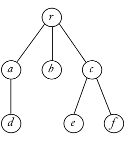

图 1：树

顶点 $r$ 是根。根有三个*子节点*（`children`）：$a, b$ 和 $c$。根是这些顶点的*父节点*（`parent`）。这些顶点也是彼此的*兄弟节点*（`siblings`），因为它们有同一个父。顶点 $a$ 有一个孩子 $d$，顶点 $c$ 有孩子 $e$ 和 $f$。一个顶点的祖先是它到根路径上的所有顶点；一个顶点的*后代*（`descendants`）是所有作为其祖先的顶点。顶点 $f$ 的祖先有 $f, c$ 和 $r$，后代有 $c, e$ 和 $f$。没有孩子的顶点是终端顶点或叶子节点（`leaf`）；有孩子的顶点是非终端顶点或内部顶点。图 1 中的树有三个内部顶点（r, a 和 c）和四个叶子节点（b, d, e 和 f）。由树中的某一个顶点、其所有后代以及连接它们的边组成的图是该树的一棵子树（`sub-tree`）。

由若干棵树组成的图称为森林（`forest`）。顶点在树中的层级是通根路径上的边数。在图 1 中，$r$ 位于零层，$a, b$ 和 $c$ 位于一层，$d, e$ 和 $f$ 位于二层。

## 16.3 二叉树

二叉树对于数据结构尤为重要。

- **二叉树（`Binary tree`）：** 每个顶点最多有两个孩子，称为左孩子和右孩子。
- **满二叉树（`Full binary tree`）：** 每个顶点要么有零孩子，要么有两个孩子的树。
- **完全二叉树（`Complete binary tree`）：** 每一层都是填满的，除了最后一层外，最后层从左到右填满。图 2 展示了这样的树。

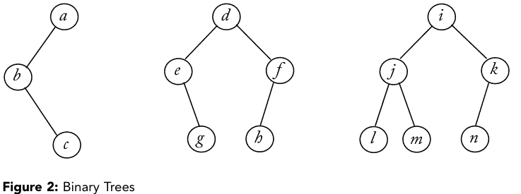

图 2：完全二叉树

一个**有序树（`ordered tree`）**是指每个顶点的值都大于其孩子节点值的树。有序树的高度是从根到叶子节点最长路径的长度。

# Java 数据结构与算法：树、堆与堆排序

## 16.5 堆排序 (`HEAPSORT`)

我们现在已经拥有了构建基于堆的高效且趣味性排序算法所需的所有部分。假设我们有一个已经好序的数组。我们可以将其看作存储在数组中的完全二叉树，如上所述。然后我们可以：

- 如上所述，将该树转换为一个堆。
- 堆中的最大值位于根节点，它始终位于数组索引零的位置。我们可以将此值与数组末尾的值进行交换，并假装数组短了一个元素。这时，我们就得到了一个几乎是完全二叉树的——我们需要将根节点的值沿着树向下移动，直到它再次成为一个堆根。一旦完成，树将再次是一个堆。
- 我们可以重复这个过程，直到整个数组排序完成。

这种排序算法称为堆排序，在图 4 的 Java 代码中所示。

```java
void heapsort(int[] a) {

  if (a.length < 2) return;

  int maxSize = a.length-1;

  for (int i = (maxSize-1)/2; 0 <= i; i--)

    siftDown(a, i, maxSize);

  while (true) {

    int tmp = a[0];

    a[0] = a[maxIndex];

    a[maxIndex] = tmp;

    maxIndex--;

    if (maxIndex <= 0) break;

    siftDown(a, 0, maxSize);

  }

}

private static void siftDown(int[] a, int i, int maxSize) {

  int tmp = a[i];

  for (int j = 2*i+1; j <= maxSize; j = 2*i+1) {

    if (j < maxSize && a[j] < a[j+1]) j++;

    if (a[j] <= tmp) break;

    a[i] = a[j];

    i = j;

  }

  a[i] = tmp;

}
```

**图 4:** 堆排序

一个复杂的分析（我们在此不再重复）显示，堆排序在最情况、最坏情况和平均情况下的比较次数均为 $\Theta(n \log n)$。因此，堆排序加入了 Shell 排序、归并排序和快速排序，成为我们快速排序算法库。实证研究表明，堆排序并没有快速排序快，它比 Shell 排序和归并排序慢一点，优势在于它不需要像归并排序那样的额外空间，也没有像快速排序那样糟糕的最坏情况复杂度。

## 16.6 总结与结论

树是计算中一种重要的特殊图。树用于排序的一种应用是：数组可以被视为二叉树并转换为堆。然后可以对堆进行操作，以在 $\Theta(n \lg n)$ 时间内对数组排序。这种算法被称为堆排序，当空间有限且需要较理想的最坏情况复杂度时，它是一个很好的算法。


因为实现梦想是您最大的挑战。IE 商学院（`IE Business School`）提供英语、西班牙语或双语教学的管理学硕士，通过一项创新且具有启发性的计划，培养职业生涯初的高性能专业人才，帮助他们充分发挥潜力。

- 选择您的专业领域。
- 通过提供的不同选项定制您的硕士课程。
- 在伦敦、硅谷或上海等地点进行全球沉浸式周活动。

因为您在改变，我们也随之而改变。

## 16.7 复习题

1. 在图 1 中，r 的后代有哪些？r 的祖先有哪些？
2. 如何从图中判断一棵树是否是有序的？
3. 每一层都是满的二叉树都是完全二叉树吗？每个完全二叉树的每一层都是满的吗？
4. 堆中的最大值在哪里？
5. 使用堆的数据结构编号方案，顶点 27 的左孩子和右孩子是谁？哪个顶点是顶点 27 的父节点？
6. 堆排序的最坏表现是什么？

## 16.8 练习题

1. 根据图的定义，将图 2 中的三棵树表示为有序对集合。
2. 如果 b 是它的根节点，图 1 中的图还可以是一棵树吗？如果是，请用通常的方法（即根节点在顶部）重新绘制这棵树，以理清顶点之间的关系。
3. 绘制一个具有 12 个顶点的完全二叉树，在顶点处放置任意值。使用本章讨论的算法将树转换为堆，每一步都重新绘制树。
4. 假设我们更改堆序属性的定义，规定存储在顶点上的值小于等于存储在其后代中的值。如果我们使用堆排序算法，结果将会如何？
5. 在图 4 中，`siftDown` 操作应用于什么对象？
6. 绘制一个具有 12 个顶点的完全二叉树，在顶点处放置任意值。使用本章讨论的算法将树转换为堆，每一步都重新绘制树。
7. 写一个程序对不同大小的二叉树进行排序。
8. 写一个程序使用标准库排序二叉树。

## 16.9 参考答案

1. 在图 1 中，r 的后代是树中的所有顶点。r 除了自身外没有祖先。
2. 无法从图中判断一棵树是否有序；必须有某种符号来表示这一点。
3. 每一层都是满的二叉树都是完全二叉树，因为它底部没有缺失的叶子。
4. 堆中的最大值始终位于根节点。
5. 使用堆的数据结构编号方案，顶点 27 的左孩子是 $(2*27)+1$，右孩子是 $(2*27)+2$，顶点 27 的父节点是 $(27-1)/2$。
6. 堆排序的最坏、最好和平均情况均为 $\Theta(n \log n)$。


# 17 二叉树

## 17.1 引言

正如上一章提到的，二叉树最多有两个孩子（左孩子和右孩子）的有序树。虽然计算中会出现其他类型的有序树，但二叉树特别并得到了广泛研究。在本章中，我们将讨论二叉树类型及其实现。

## 17.2 二叉树 ADT

二叉树持有某种类型的值，该 ADT 是 T 二叉树，其中 T 是树中元素的类型。该集合的载体是所有持有 T 值的二叉树。载体集包括空树、带有 T 值的根节点的树、带有根和左孩子的树、带有根和右孩子的树等等。接收者方法的操作包括以下：

- `size()`——返回树中顶点的数量。
- `height()`——返回树的高度。
- `isEmpty()`——如果树为空树则返回真。
- `contains(v)`——如果值 v 存在于树中则返回真。
- `rootValue()`——返回存储在树根节点的值。其先置条件是树不是空树。
- `leftSubtree()`——返回树根节点的左孩子根节点。其先置条件是树不是空树。
- `rightSubtree()`——返回树根节点的右孩子根节点。其先置条件是树不是空树。

假设我们有以下树构造函数：

- `newEmptyTree()`——创建并返回一个新的空树。
- `newTree(v, t₁, t₂)`——创建并返回一个新树，其根节点为 v，左孩子为 t₁，右孩子为 t₂。

例如，考虑图 1 中的二叉树。

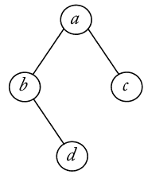

**图 1：** 二叉树

这棵树可以使用下面的表达式构建。

```
newTree(a,
    newTree(b,
        newEmptyTree(),
        newTree(d,
            newEmptyTree(),
            newEmptyTree()))),
    newTree(c,
        newEmptyTree(),
        newEmptyTree()))
```

要从树中提取值，例如最底部的顶点 $d$，我们可以使用以下表达式，其中 $t$ 是图 1 中的节点。

```
t.leftSubtree().rightSubtree().rootValue()
```

## 17.3 二叉树类

我们将二叉树视为一种集合，将其添加到我们的容器层次结构中，但我们没有这样做，原因有两个：

- 在实践中，二叉树被用于实现其他容器，而不是作为容器本身。通常情况下，客户端感兴趣的是使用基本的容器操作，而不是构建和遍历树的细节。将二叉树加入容器层次结构会使层次结构变得复杂，引入了一个许多客户端可能不会使用的容器。
- 虽然二叉树有连续实现（下文将讨论），但除了堆之外，它并没有什么用处。按照我们为所有容器都提供连续和链式实现的做法，提供这种实现将创建一个用处不大的实体。

我们创建了一个 `BinaryTree` 类，但它的作用将是为其他集合提供一种实现机制。因此，`BinaryTree` 类并不是容器层次结构的一部分，尽管它有一个标准的容器操作。它还包括以各种方式访问和遍历树的操作，以及几种迭代器。`BinaryTree` 类如图 2 所示。

注意 `BinaryTree` 类中没有 `newTree()` 方法和 `newEmptyTree()` 方法，尽管 ADT 中有。`BinaryTree` 构造函数完成了这两个操作的工作，因此在类中不需要它们作为独立的操作。

访问或枚举二叉树的顶点是指同时对它们进行遍历或迭代，处理每个顶点持有的值。这需要按照某种顺序遍历顶点。遍历二叉树有三种基本顺序。所有顺序最自然的描述方式都是递归术语。


# Java 数据结构与算法：二叉树

```java
class BinaryTree {

  isEmpty() : boolean

  size() : int

  clear()

  height() : int

  rootValue() : T { not isEmpty() }

  leftSubtree() : BinaryTree { not isEmpty() }

  rightSubtree() : BinaryTree { not isEmpty() }

  contains(value : T) : boolean

  visitPreorder(f : Visitor<T>)

  visitInorder(f : Visitor<T>)

  visitPostorder(f : Visitor<T>)

  preorderIterator() : Iterator<T>

  inorderIterator() : Iterator<T>

  postorderIterator() : Iterator<T>

}
```

```java
interface Visitor {

  visit(element : T)

}
```


**图 2：** `BinaryTree` 类

**先序：** 当先序访问二叉树的顶点时，首先访问树的根顶点，然后先序访问左子树（如果有），然后先序访问右子树（如果有）。

**中序：** 当中序访问二叉树的顶点时，首先中序访问左子树（如果有），然后访问根顶点，然后中序访问右子树。

**后序：** 当后序访问二叉树的顶点时，首先后序访问左子树，然后后序访问右子树，最后访问根顶点。

为了说明这些遍历，请考虑下面图 3 所示的二叉树。图 3 中树的中序遍历按照 $d, m, b, p, k, t, d, a, g, f, h$ 的顺序访问顶点。先序遍历按照 $d, b, m, k, p, t, c, a, g, f, h$ 的顺序访问顶点。后序遍历按照 $m, p, t, k, b, g, a, h, f, c, d$ 的顺序访问顶点。

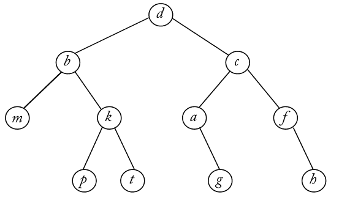

回想第 8 章关于迭代的讨论，可以通过内部迭代（控制权在集合中）或外部迭代（控制权在迭代器中）来实现。`BinaryTree` 类具有创建外部迭代器和进行内部迭代的方法。内部迭代通过某种方式将客户端想要执行的处理封装起来，并将封装后的过程传递给集合，以应用于其元素。在这种情况下，客户端编写一个实现 `Visitor` 接口的类，通过 `visit()` 方法完成处理。然后将该接口的实例传递给 `visitPreorder()`、`visitInorder()` 或 `visitPostorder()`，这些方法将处理应用于其元素。

## 17.4 二叉树的连续实现

我们已经学习了堆，连续实现对于二叉树来说是非常棒的，但许多二叉树远非完全，因此会使用很多位置。这种实现并不特别有用，因为它浪费了空间。这就是为什么 `BinaryTree` 类将使用链式结构。例如，一个 `count` 字段可能对于跟踪树中的数量有用。

## 17.5 二叉树的链式实现

二叉树的链式实现与其他 ADT 相似。树节点需要三个字段：一个用于数据，两个用于子树的引用。此外，使用一个对象作为树的宿主机是有用的。这个宿主机有一个根引用以及所需的其他字段。这些结构中的引用在为空时为 `null`。

树本质上递归，因此递归编写方法是自然的。例如，一个或更少顶点树的高度为零，否则它是其两个子树最大高度加一。因此在 Java 实现中，我们可以写一个 `height()` 方法，它调用一个私有的 `heightOfTree(TreeNode r)` 方法，并将树的根节点作为参数。如果参数节点为空或子树为空，该方法返回零，否则返回对其左右子树递归调用的最大值。许多其他 `BinaryTree` 方法，特别是内部迭代方法，都可以使用递归实现。

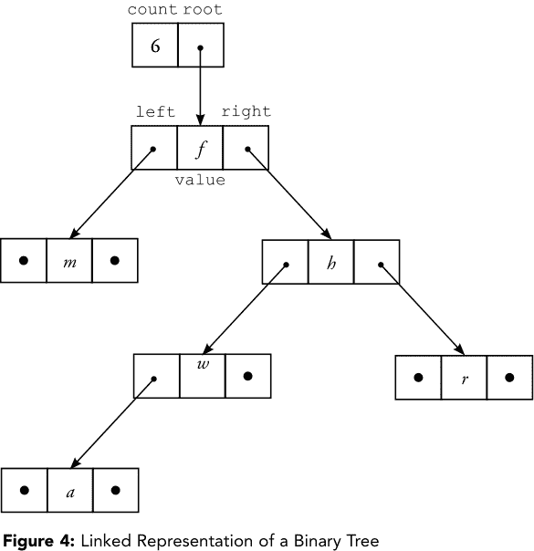

然而，实现外部迭代器更大的挑战。外部迭代器无法递归编写，因为它们每次访问新节点时必须停止，以便将值传递给客户端。解决这个问题有两种方法：

- 写一个递归操作将节点值按顺序复制到队列中，然后当客户端请求时逐个从数据结构中提取项。
- 不要使用递归实现迭代器：使用栈。

第二种替代方案虽然困难一点，但更好，因为它更节省空间。

## 17.6 总结与结论

二叉树 ADT 描述了构建和检查持有类型 T 值顶点的二叉树的基本操作。`BinaryTree` 类具有几个 ADT 中不包含的方法，特别是内部迭代方法，它能以某种顺序将方法（在 `Visitor` 对象中的方法）应用于树中的每个值，以及外部迭代器工厂方法。


# Java 数据结构与算法：二叉树

在某些特殊情况下，二叉树 ADT（抽象数据类型）的连续实现是可能的且有效的，例如在堆排序中；但实现二叉树 ADT 的主要技术是链式表示。递归是实现 `BinaryTree` 操作的一个非常有用的工具，但在实现外部迭代器时并没有那么容易。带有链式结构的二叉树实现将作为后续容器类的实现机制。

## 17.7 复习题

- 1. `BinaryTree` 类在容器层次结构中处于什么位置？
- 2. 为什么 `BinaryTree` 类没有包含 `newTree()` 方法？
- 3. 为什么二叉树的连续实现并不怎么有用？
- 4. 为什么在编写 `BinaryTree` 方法时递归非常重要？

## 17.8 练习题

- 1. 请按照中序遍历、前序遍历和后序遍历的顺序，写出以下树中顶点的值。

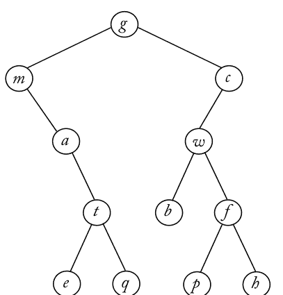

- 2. 用 Java 编写 `Visitor` 接口。
- 3. 开始用 Java 编写 `BinaryTree` 类，创建它的字段、构造函数以及 `BinaryTreeNode` 类。
- 4. 通过添加 `isEmpty()`、`size()`、`clear()`、`rootValue()`、`leftSubtree()` 和 `rightSubtree()` 方法，继续编写 `BinaryTree` 类。
- 5. 通过添加 `height()` 和 `contains()` 方法，继续编写 `BinaryTree` 类。你可能需要私有的递归辅助函数。
- 6. 在 `BinaryTree` 类中添加 `visitPreorder()`、`visitInorder()` 和 `visitPostorder()`。你还需要创建一个 `Visitor` 接口。
- 7. 在 `BinaryTree` 类中添加 `preorderIterator()`、`inorderIterator()` 和 `postorderIterator()`。你需要创建使用栈来跟踪迭代期间状态的迭代器类。

# 17.9 复习题答案

- 1. 我们决定不将 `BinaryTree` 类包含在容器层次结构中，因为它本身并不是作为容器使用的，而是作为其他容器的实现机制。
- 2. `BinaryTree` 类没有包含 `newTree()` 方法是因为该操作是一个创建 `BinaryTree` 实例的工厂函数。这项工作可以使用 `BinaryTree` 构造函数完成。
- 3. 二叉树的连续实现并不怎么有用，因为只有当二叉树至少是满的、理想情况下是完全的时，才能高效利用空间。在实践中，这种情况很少见；链式实现使用空间更高效。
- 4. 递归在编写 `BinaryTree` 方法时非常重要，因为二叉树是递归定义的，二叉树的许多属性和特性也是如此。因此，通过对这些递归定义进行建模，处理二叉树或确定其属性和特性的方法可以很容易地递归写出来。

# 18 二分查找与二叉搜索树

## 18.1 引言

对于有序列表（如字典或电话簿），二分查找是比顺序查找快得多的替代方案。二分查找与二叉搜索树密切相关，二叉搜索树是一种特殊的二叉树。我们将在本章中探讨这两个主题，研究二分查找的复杂度，并得出 `BinarySearchTree` 类的规范。

## 18.2 二分查找

当人们在有序列表（如字典或电话簿）中查找某物时，他们不会从第一个元素开始逐个遍历列表。他们会跳到列表中间，查看自己相对于查找目标的位置，然后向前或向后跳并再次查找，以此类推，直到找到要找的内容或确定它不在列表中。


# Java 数据结构与算法：二分查找与二叉搜索树

二分查找在有序列表中查找键值时采用相同的策略：将键值与列表的中间元素进行比较。如果该相等，则搜索完成。如果键值小于中间元素，则对列表的前部分重复该过程。如果键值大于中间元素，则对列表的后部分重复该过程。最终，要么在列表中找到了键值，要么列表为空（空列表），此时我们知道键值不在列表中。

这种方法自然地适用于递归算法，我们在 Java 中展示了它。

```java
int binarySearchRecursive(int[] a, int key) {
    return binSearch(key, a, 0, a.length - 1);
}

int binSearch(int key, int[] a, int lo, int hi) {
    if (hi < lo) return -1;
    int m = (lo + hi) / 2;
    if (key == a[m]) return m;
    if (key < a[m]) return binSearch(key, a, lo, m - 1);
    return binSearch(key, a, m + 1, hi);
}
```


# JAVA 数据结构与算法

## 二分查找与二叉搜索树

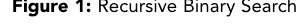

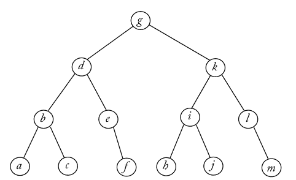

**图 3:** 由列表构建的二叉树

通过这种方式构建的树具有以下有趣的属性：

*   除最后一层外，所有层都是满的，因此它的高度始终为 $\lg n$。
*   对于每个顶点，其左子树（如果有）中的每个元素都小于或等于顶点处的元素，而其右子树（如果有）中的每个元素都大于或等于顶点处的元素。
*   如果我们进行中序遍历，我们将按照原始列表的顺序访问顶点，即按照排序后的顺序访问。


第一个属性告诉我们二分查找的最坏情况性能，因为二分查找会访问从根节点到叶子节点的每个顶点。路径上的顶点数等于树的高度加一，所以 $W(n) = \lfloor \lg n \rfloor + 1$。我们也可以通过考虑每个顶点都有等概率成为二分查找的目标，并计算到每个顶点的路径平均长度来计算平均情况。结果表明，对于成功和失败的查找，这大约都是 $\lg n$。因此，在平均和最坏情况下，二分查找都需要 $\Theta(\lg n)$ 次比较，这是非常好的。

### 18.3 二叉搜索树

我们上面看到的二叉树的本质特征是顶点处的值与左右子树中值之间的关系。这是二叉搜索树（Binary Search Tree）定义的依据。

**二叉搜索树：** 一种二叉树，其顶点满足：每个顶点的值都大于其左子树中的值，且小于其右子树中的值。

二叉搜索树是一种重要的图类型，它保留了按顺序遍历时按排序顺序访问值的属性。然而，二叉搜索树可能是不平衡的，因此它的高度可能大于 $\lfloor \lg n \rfloor$。事实上，一个顶点只有一个子节点的二叉搜索树的高度为 $n-1$。

二叉搜索树非常有趣，因为向它们插入元素、删除元素以及查找元素都很快（前提是它们不要过长细）。这与大多数集合形成对比，大多数集合通常对其中一种操作很快，但对另外两种很慢。例如，元素可以很快地插入到（未排序）列表中，而一个（排序的）连续列表可以通过二分查找快速搜索，但为了保持其排序，对其进行插入和删除操作则很慢。

二叉搜索树 ADT 拥有一组所有顶点持有类型 `T` 值的二叉搜索树。因此，它是 `T` 类型 ADT 的二叉树的载体的子集。该 ADT 的隐式接收者方法包含了二叉树 ADT 的隐式接收者方法集。除了空树外的所有二叉搜索树都是通过下面描述的 `insert()` 和 `delete()` 操作从其他树形成的。

*   `insert(v)`——将 `v` 放入作为一个叶子节点添加到树的新顶点中，保持二分搜索属性。如果 `v` 已在树中，则什么都不做。
*   `delete(v)`——从树中移除顶点 `v`，同时保持其作为二叉搜索树的结构。如果 `v` 不在树中，则什么都不做。

该 ADT 是 `BinarySearchTree` 类的基础。

### 18.9 二叉搜索树类

`BinarySearchTree` 类中的每个函数也都在 `BinaryTree` 类中，因此 `BinarySearchTree` 是 `BinaryTree` 的子类。二分查找要求在添加或删除值时对值进行比较，二叉搜索树的一些操作必须提供可以相互比较的值。这一要求由一个基于 Java `Comparable` 接口建模的接口捕获，该接口包含 `compareTo()` 方法。`compareTo(v)` 方法在实例和 `v` 的值相等时返回 `0`；如果实例小于 `v`，则返回一个负整数；否则返回一个正整数。`Comparable` 接口和 `BinarySearchTree` 类如图 4 所示。

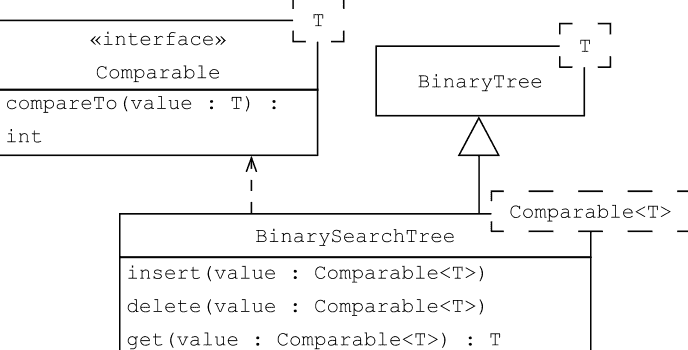

**图 4:** `BinarySearchTree` 类

`insert()` 操作通过在树的底部创建一个新的子节点将元素放入树中，从而保持了二叉搜索树的完整性。如果元素已在树中（通过 `compareTo()` 方法确定），则传递的元素将替换当前存储在树中的值。此条新记录可以替换具有相同键的旧记录（后续章节将对此详细介绍）。`delete()` 操作从树中删除元素，同时保持树的完整性。如果元素不在树中，则不采取任何操作。`get()` 操作返回树中存储的与 `compareTo()` 方法传入元素相等的值，如果没有该元素，则返回 `null`。这是设计预期的。

---

# JAVA 数据结构与算法：二分查找与二分搜索树

假设数值键在数组中均匀分布，且正在使用插值查找法来寻找值 $k$。如果数组中的第一个元素是 $a$，最后一个元素是 $z$，则插值查找将在位置 $(k-a)/(z-a) \times (\text{array.length}-1)$ 处检查 $k$。请使用该策略编写一个非递归的线性插值查找。

4. 根据文中讨论的内容，根据包含 1 到 15 数字的列表元素在二分查找过程中检查的顺序，构造一个二分搜索树。
5. 画出使用值 $a, b$ 和 $c$ 可以形成的二分搜索树。除了最后一层外，每层有多少个空闲节点？
6. `BinarySearchTree` 的 `insert()` 操作并不尝试保持树平衡。它沿着树向下移动，直到找到包含所加元素的节点或位于树底部应该添加节点的位置。请按照 `m, w, a, c, b, z, g, f, r, p, v` 的顺序向树中添加值，并画出二分搜索树的结果。
7. 编写代码实现 `Comparable` 接口和 `BinarySearchTree` 类的骨架。
8. 重写 `BinarySearchTree` 中的 `contains()` 方法，利用二分搜索树的结构并添加到 `BinarySearchTree` 中。
9. 使用练习 6 中解释的策略用 Java 编写 `BinarySearchTree.insert()` 方法。
10. 用 Java 编写 `BinarySearchTree.get()` 方法。
11. `BinarySearchTree` 的 `delete()` 方法必须保留二分搜索树的核心属性，即每个节点的值大于或等于其左子树节点的值，且小于或等于其右子树节点的值。在删除一个值时，会出现三种情况：
    *   持有被删除值的节点没有孩子；在这种情况下，可以移除节点。
    *   持有被删除值的节点有一个孩子；在这种情况下，可以移除该节点并将被移除节点的节点成为被移除父节点的节点。
    *   持有被删除值的节点有两个孩子；这种情况更为复杂。找到持有被删除值后继节点的节点。该节点将始终是被删除值节点右孩子中最左侧的节点。注意，该节点没有左孩子，因此它最多只有一个孩子。将后继值复制到其所在节点中被删除值的位置，并使用移除无孩子或单孩子节点的规则移除该冗余节点。
    *   a) 使用此算法从练习 6 构造的树中移除值 `v, a` 和 `c`。
    *   b) 使用上述算法用 Java 编写 `delete()` 方法。

---

# JAVA 数据结构与算法：二分查找与二分搜索树

## 18.13 复习题答案

1.  递归可以从二分查找算法中移除，因为二分查找算法是尾递归的，也就是说，它在每次激活的最后一个动作仅仅是再次调用自身。
2.  如果通过将包含 100 个名字的有序列表放入树中（以模拟文中讨论的二分查找）来构造二叉树，则生成的树的高度为 $\lfloor \lg 100 \rfloor = 6$。
3.  在搜索包含一百万元素的列表时，最好的情况下，检查的第一个元素就是键，因此只需进行一次比较。最坏的情况下，将进行 $\lfloor \lg 1000000 \rfloor + 1 = 20$ 次比较。在平均情况下，大约将进行 $\lfloor \lg 1000000 \rfloor = 19$ 次比较。
4.  `ArrayList` 和 `LinkedList` 允许快速插入但删除和搜索较慢，或者在有序 `ArrayList` 的情况下允许快速搜索但插入和删除较慢。二分搜索树允许快速插入、删除和搜索。


# 19 AVL 树

## 19.1 引言

二分搜索树是一种极佳的数据结构，只要树不会变得又长又细，插入、删除和搜索都可以快速完成。如果我们能够确保二分搜索树永远不会变长，从而避免最坏情况的行为，我们就能拥有更好的数据结构。具有这种特征的树被称为平衡树。

**平衡树：** 对于树中的每个节点，其子树的高度差不超过某个常数的树。平衡树有几种。我们将在本章考虑一种平衡树（AVL 树），并在下一章考虑另一种平衡树（2-3 树）。

## 19.2 AVL 树中的平衡

AVL 树最初由 G. M. Adelson-Velsky 和 E. M. Landis 于 1962 年引入（因此得名 AVL）。它们的定义如下：

节点的平衡因子是左子树的高度减去右子树的高度，空树的高度定义为 -1。

**AVL 树：** 一种二分搜索树，其中每个节点的平衡因子为 -1、0 或 1。所有节点平衡因子均为 0 的 AVL 树是完美平衡的。但某些有些倾斜的树仍然是 AVL 树，而某些看起来平衡的树则不是。考虑图 1 中的示例（平衡因子如上所示）。两者都是二分搜索树，但只有左侧的树是 AVL 树。右侧树的平衡因子为 -2。

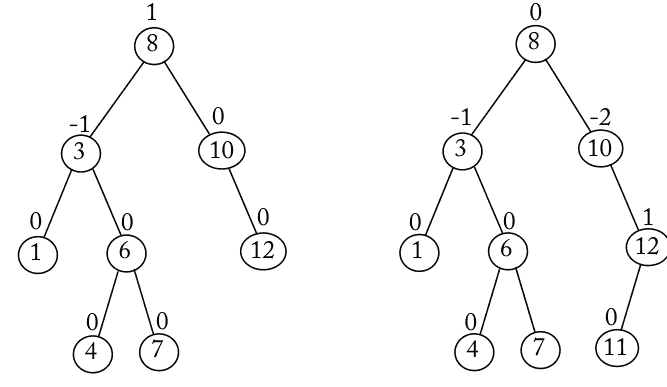

**图 1：** 二分搜索树；AVL 树。尽管某些 AVL 树看起来是平衡的，平衡因子的约束确保每个 AVL 树的高度小于 $1.5 \lg n$。

## 19.3 AVL 树中的插入

向 AVL 树中插入一个值的方法与二分查找相同：从根节点开始，将要插入的值与根节点的值进行比较，沿着路径向下移动，直到到达底部并在底部插入新的叶子节点。新叶子节点会使路径变长，改变至少一个节点的平衡因子。如果所有平衡因子都在范围内，则调整平衡因子并完成插入。然而，某些节点的平衡因子可能会变为 2 或 -2。在这种情况下，必须通过重新排列节点来平衡树。这种在平衡因子为 2 的节点处的重新排列会导致与插入前高度相同的平衡树。

通过应用四种旋转来重新排列树。平衡因子为 2 时应用的旋转如图 2 所示。这些行显示了插入导致某些节点平衡因子为 2 的三种可能性。

在第一行中，平衡因子为 2 的节点的左子树平衡因子为 1，这只发生在向其左子树插入的情况下。在这种情况下，使用 R 旋转来平衡树。注意子树 $t_1, t_2$ 和 $t_3$ 的平衡因子没有改变，根节点的平衡因子也没有改变（因为旋转后子树的高度与插入前相同）。因此，这些变化限制在树的一小部分，可以相对容易地完成。

第二行和第三行显示了根左孩子平衡因子为 -1 的情况。那么插入一定发生在根左孩子的右子树中，尽管它可能发生在该子树（第二行）或其右子树中（第三行）。在这种情况下，使用 LR 旋转来恢复平衡。再次注意子树 $t_1, t_2$ 和 $t_3$ 的平衡因子不受变化影响，根节点的平衡因子也是如此（再次，因为子树的高度恢复到了插入前的状态）。因此这些变化再次发生在树的区域，可以很容易地完成。

当节点平衡因子为 -2 时，使用另外两种旋转 L 和 RL。这些旋转是 R 和 LR 旋转的镜像。


---

# JAVA 数据结构与算法

## AVL 树

插入操作需要修改从新叶子节点到根节点路径上的平衡因子，并可能需要旋转来重新平衡树。执行此操作所需的次数与树的高度成正比，如上所述，该高度小于 $1.5 \lg n$，其中 $n$ 是树中的节点数。另一方面，插入总是发生在树的底部，事实证明 AVL 树中的最短路径长度与 $\lg n$ 成比例。因此，插入的每个复杂度均为 $\Theta(\lg n)$。

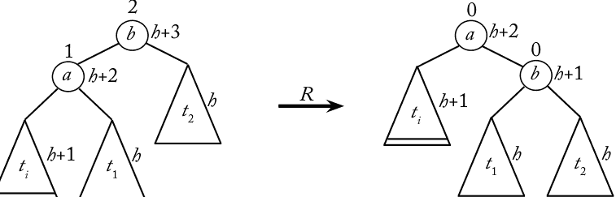
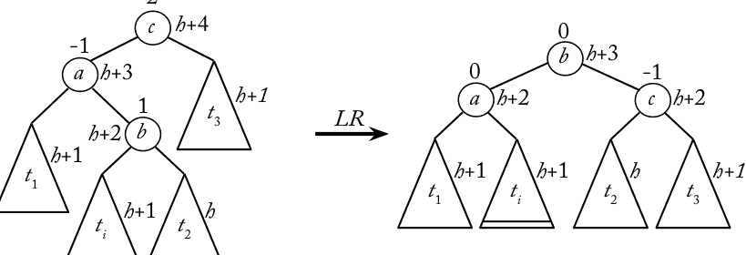
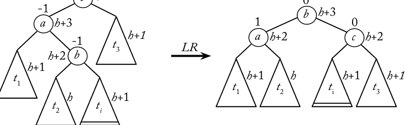

**图 2：** AVL 树 2 次旋转

## 19.4 AVL 树中的删除

AVL 树中的删除类似于普通二叉搜索树的删除：从根节点开始搜索到持有要删除值的节点，即目标节点。如果该节点最多有一个孩子，则可以将其删除并将其孩子（如果有）挂载到它的父节点上替换它的位置。如果目标节点有两个孩子，可以通过向右移动一个节点，然后一直向下到左侧来找到它的后继节点。该后继节点只有一个右子节点，因此可以将其删除并将其值复制到目标节点的值中，从而移除被删除的值并保持树作为二叉搜索树的属性。

在 AVL 树中，移除一个节点后，树可能会变得不平衡。与插入类似，必须回溯到根节点的路径，调整平衡因子，并可能重新排列树以重新平衡。

重新平衡使用与插入时相同的四种旋转。在插入期间，如果一个节点的平衡因子为 2（或 -2），其左（右）子节点的平衡因子必须为 1 或 -1，这决定了使用哪种旋转。在删除期间，平衡因子为 2（或 -2）的节点的孩子可能有一个平衡因子为 0 的左（右）孩子。在这种情况下，使用 R（或 L）旋转来重新平衡树，否则决定使用哪种旋转的方法与插入时相同。

图 3 显示了 AVL 树上的若干操作，说明了强制重新平衡的插入和删除操作。第一次插入使得持有 `e` 的节点平衡因子为 2，其左节点平衡因子为 1，这需要 R 旋转。注意，在此之后子树达到了完美的平衡。插入 `k` 后，节点 `i` 的平衡因子为 -2，其右孩子的平衡因子为 1。这需要 RL 旋转，它再次使子树恢复完美平衡。删除 `e` 导致持有 `e` 的后继（即 `f`）的节点被移除，并将后继复制到持有 `e` 的节点中。这使得持有 `f` 的节点平衡因子为 2，其左孩子的平衡因子为 0。这意味着应该应用 R 旋转。之后，子树并不是完美平衡，但所有平衡因子再次处于 -1 到 1 之间。

此示例旨在展示各种操作如何导致旋转的发生，但很多时候操作并不会导致旋转。例如，删除图 3 最后一棵树中的任何节点 `a` 都不会导致树需要重新平衡。

## 19.5 AVL 重新平衡操作的效率

在插入期间，沿通根节点的路径最多需要一次重新平衡操作。在删除期间，从被删除节点到根节点的路径上的许多节点可能需要重新平衡操作。尽管如此，所有的节点因子调整和旋转只在从移除节点的树底部到根节点的路径节点上进行，如前所述，该路径包含少于 $1.5 \lg n$ 个节点。对于插入，所有删除都发生在叶子节点，且从根节点的最短路径与 $\lg n$ 成比例，因此必须处理 $\Theta(\lg n)$ 个节点。因此，删除的每个复杂度均为 $\Theta(\lg n)$。

AVL 树是二叉搜索树，搜索工作方式完全相同。当所需值位于根节点时，该操作的最优情况复杂度为 $\Theta(1)$。普通二叉搜索树搜索的最坏情况复杂度是 $n$，因为树的高度可能为 $n$。但 AVL 树的高度受限于 $1.5 \lg n$，因此搜索的最坏情况复杂度为 $\Theta(\lg n)$。事实证明，搜索 AVL 树的平均复杂度也是 $\Theta(\lg n)$。我们看到 AVL 树中的插入、删除和搜索都需要 $O(\lg n)$，因此 AVL 树是对于这三种操作都必须高效的应用的理想数据结构。


## 19.6 AVLTree 类

AVL 树是二叉搜索树的一种，因此 `AVLTree` 类应该是 `BinarySearchTree` 的子类。AVL 节点需要一个额外的字段来监控平衡因子。该字段可以是平衡因子本身，但在每个 `BinaryTree` 节点中添加一个高度字段并在需要时根据子节点的高度计算每个节点的平衡因子更为简单。

`AVLTree` 构造函数只创建空的 AVL 树。`insert()` 和 `delete()` 方法必须重写，以便将高度调整和重新平衡整合到这些算法中。`height()` 方法（通过 `BinarySearchTree` 继承）也应该重写，以利用每个节点维护其高度的特性。这使得该方法从 $\Theta(n)$ 变为 $\Theta(1)$ 方法。

`insert()` 和 `delete()` 方法都必须对从底部到根节点路径上的节点进行调整。这条路径可以维护在栈中，但使用递归实现这些方法可能更简单。

## 19.7 总结与结论

AVL 树是平衡的二叉搜索树，保证插入、删除和搜索耗时为 $O(\lg n)$。AVL 树的每个节点都有一个平衡因子，它是其子树高度之差。AVL 树中每个节点上平衡因子的绝对值永远不超过一个，这意味着一个节点的任意两个子树之间的高度差不大于一个。这意味着包含两个以上节点的 AVL 树的高度小于 $1.5 \lg n$，其中 $n$ 是树中的节点数。

插入、删除和搜索的工作方式与二叉搜索树相同，只是在添加或移除节点后，树可能需要重新平衡。重新平衡发生在从插入或删除节点到根节点的路径节点上，并根据节点的平衡因子进行。

`AVLTree` 类可以实现为 `BinarySearchTree` 的子类，只有三个方法需要重写。

## 19.8 复习题

*   如果所有节点的平衡因子均为 0，AVL 树会什么样？
*   在搜索包含百万个值的 AVL 树时，大约会进行多少比较？
*   AVL 树相比 `ArrayList` 和 `LinkedList` 有什么优势？

## 19.9 练习

1.  绘制具有一个、两个、三个节点的 AVL 树。
2.  绘制一个尽可能少的高度为 4 的 AVL 树。你需要多少节点？四是否小于 $1.5 \lg n$？
3.  高度为 4 的 AVL 树节点数是多少？高度为 $h$ 的 AVL 树节点数是多少？
4.  参考图 2，绘制示意图。
5.  用具体的树说明 AVL 旋转的应用。你的示例应展示旋转前后的树，并包含所有节点平衡因子。
6.  绘制一系列 AVL 树，说明向空树中按顺序添加以下数字的结果：3, 2, 1, 10, 11, 7, 5, 8, 12, 9。
7.  从下方的树开始，绘制一系列 AVL 树，说明按顺序删除以下数字的结果：2, 15, 3, 10, 18, 16, 20, 5。

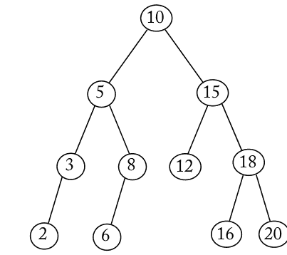

8.  编写 Java 代码实现 `AVLTree` 类的结构，使其作为 `BinarySearchTree` 类的子类。同样创建一个 AVL 节点类，使其作为二叉树节点的子类。
9.  在 `AVLTree` 类中重写来自 `BinaryTree` 的 `height()` 方法。
10. 在 AVL 节点类中编写旋转方法，以及设置节点高度、获取平衡因子和重新平衡一个节点的方法。
11. 在 `AVLTree` 类中重写 `BinarySearchTree` 的 `insert()` 方法。你可能想使用一个递归辅助函数来完成实际工作。
12. 在 `AVLTree` 类中重写 `BinarySearchTree` 的 `delete()` 方法。递归对于该方法特别有用。

## 19.10 复习题答案

1.  节点平衡因子为 0 的 AVL 树必须是每个节点都有零或两个孩子。这就是满二叉树的定义。满二叉树的每一层都是完全满的且完美平衡的。
2.  包含百万个元素的 AVL 树高度小于 $1.5 \lg 1000000 = 29.9$。注意，在搜索该 AVL 树时将进行超过 30 次比较。
3.  `ArrayList` 或 `LinkedList` 允许快速插入 ($\Theta(1)$) 但删除和搜索较慢 ($O(n)$)；或者允许快速搜索（对于有序的 `ArrayList` 为 $O(\log n)$）但插入和删除较慢 ($O(n)$)。AVL 树即使在最坏情况下也允许快速插入、删除和搜索（均为 $O(\log n)$）。

# 20 2-3 树

## 20.1 引言

AVL 树使用旋转技术来维护二叉搜索树的平衡。另一种方法是通过放宽树节点可以拥有的孩子（和键）的数量限制，在搜索树中保持完美平衡。通常，一个树节点可能允许拥有零或二到 $m$ 个孩子；这产生了被称为 B 树的数据结构。我们将重点关注 $m=3$ 的情况，产生的树被称为 2-3 树。

由于 2-3 树是完美平衡的，因此修改它们非常快，而且由于它们维护了节点值之间的搜索树属性，搜索它们也非常快。

## 20.2 2-3 树的属性

2-3 树由 John Hopcroft 于 1970 年发明。它们的定义如下：

*   如果一棵树的所有叶子都在同一层，则它是**完美平衡的**；也就是说，从根节点到任何叶子节点的路径始终等于树的高度。
*   **2-3 树：** 一种完美平衡的树，其节点要么包含一个值 $v$ 且有零或两个孩子的 **2-节点**（使得其左子树中的所有值都小于 $v$，且右子树中的所有值都大于 $v$），要么包含两个值 $v_1$ 和 $v_2$ 且有零或三个孩子的 **3-节点**（使得最左子树中的所有值都小于 $v_1$，中间子树中的所有值都大于 $v_1$ 且小于 $v_2$，而最右子树中的所有值都大于 $v_2$）。

图 1 显示了 2-3 树的一个示例。

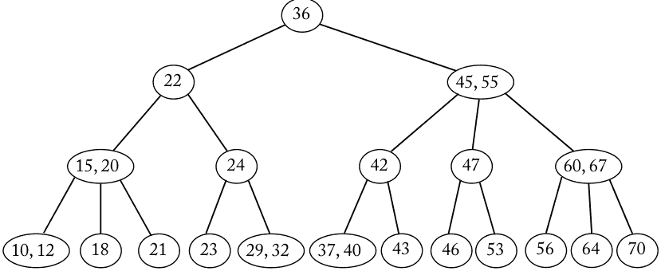

包含最多值的最短 2-3 树将是只包含 3-节点的树。在只包含 3-节点的树中，根节点有一个节点，第一层有三个 3-节点，第二层有九个 3-节点，通常第 $h$ 层有 $3^h$ 个 3-节点。每个节点存储两个值。因此，整棵树存储的值的数量为：

```


$2 \cdot 3^h = 2 \cdot (3^{h+1}-1)/2 = 3^{h+1}-1$。


另一方面，包含最少值的最高树将只包含 2-节点。带有 2-节点的树在根节点有一个 2-节点，第一层有两个 2-节点，第二层有四个 2-节点，通常第 $h$ 层有 $2^k$ 个节点。由于每个节点存储一个值，因此整棵树存储的值的数量为：

$$
\sum_{i=0}^{h} 2^i = 2^{h+1}-1
$$

因此，2-3 树中的 $n$ 个值与它的高度 $h$ 之间存在以下关系：

$2^{h+1}-1 \le n \le 3^{h+1}-1$。


## 20.3 2-3 树的插入

向 2-3 树中插入的方法与二叉树类似：从根节点开始，顺着键找到插入所在的叶子节点。如果叶节点是 2-节点，则将其变为 3-节点，操作完成。如果叶节点是 3-节点，则 3-节点会创建一个 4-节点，这是不允许的。这种转换如图 2 所示。

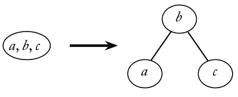

**图 2：分裂叶子节点**

这种转换之后，问题在于叶子节点的高度变为 1，因此树是不平衡的。通过将子树合并上一层来恢复平衡。如果新创建的 2-节点的父节点是 2-节点，则将新的 2-节点添加到其父节点，使其变为 3-节点。然而，如果新创建的 2-节点的父节点是 3-节点，则新的 2-节点进入父节点会创建一个 4-节点，并产生递归。我们可以以相同的方法解决它：将 4-节点变为带有两个孩子的 2-节点，然后重新平衡。

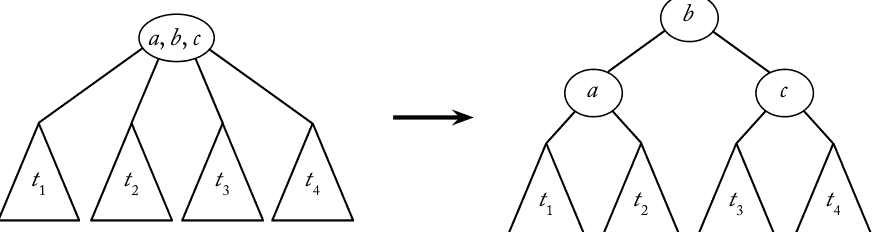

**图 3：分裂带有节点的 4-节点**

这种将 4-节点向上传播的技术将根据需要继续。如果它到达根节点，由分裂 4-节点产生的新 2-节点将成为整棵树的根。这是 2-3 树高度增加唯一方式，也是保持其平衡的关键：树只在根部增加高度。如果树在底部增长，将很难保持完美平衡，因为它只在根部增长，无需任何进一步修改即可保持完美平衡。

图 4 展示了一个示例，说明了这一最具转化性的过程：在叶子节点插入的值会导致 4-节点一直分裂到根节点，从而增加树的高度。

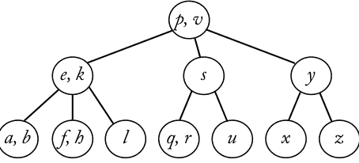

插入 c

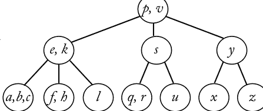

分裂 4 节点叶节点并创建一个 4 节点父节点

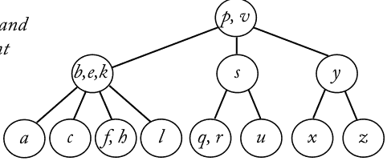

分裂 4 节点创建一个 4 节点根节点

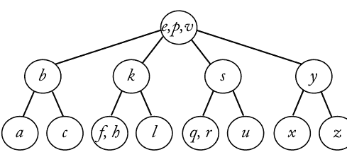

分裂 4 节点根节点并创建一个新根节点

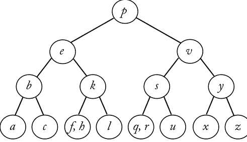

**图 4：** 在叶节点处插入并将 4 节点分裂向上传播

## 20.4 2-3 树中的删除

2-3 树中的删除操作类似于普通二叉搜索树和 AVL 树中的删除：从根节点开始向下遍历树搜索，以找到持有被删除值的节点，即目标节点。如果该节点不是叶节点，则找到被删除值的后继节点，将后继值拷贝到目标节点以覆盖被删除的值，然后从叶节点中移除重复的后继节点。因此，值总是从叶节点中删除的。

与其他搜索树一样，2-3 树中某个值的后继节点通过进入该值的右侧子树（取决于该值是最左侧还是最右侧，进入中间子树或最右侧子树），然后一直向下直到子树叶节点来找到。该后继节点必须是一个叶节点，且后继值是其最左侧的值。

当一个值从叶节点中删除时，如果该节点是 3-节点，它将变为 2-节点，删除完成。如果该叶节点是 2-节点，那么删除其值将使其变为 1-节点，我们定义 1-节点为没有值且可能有一个子树的节点（我们可以假设该子树是最左侧子树）。当然，2-3 树中不应存在 1-节点，因此必须解决这个问题。处理 1-节点的过程对于内部节点和叶节点是相同的，因此我们将其视为一个通用问题。


如果一个节点有一个子节点是 1-节点，则按照以下出现的第一个情况进行处理。

- 如果 1-节点有一个是 3-节点的兄弟节点，则 1-节点从其 3-节点兄弟处“借用”一个值和一个子树，同时对父节点的值进行必要的修改。这种情况如图 5 所示。下文仅展示了有一个相邻兄弟且其为 3-节点的情况。当有两个兄弟且 3-节点不相邻时，也会进行类似的转换。

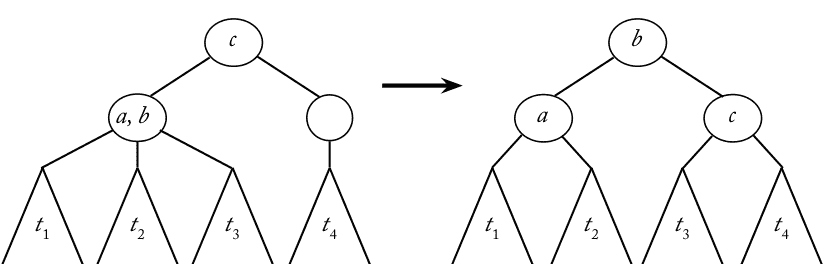

**图 5：从兄弟借用以转换 1-节点**

- 如果 1-节点的父节点是 3-节点，则 1-节点从其父节点处“借用”一个值和一个子树，如图 6 所示。同样，1-节点位于不同位置的其他情况也是相似的。

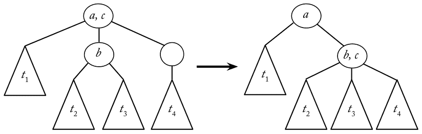

**图 6：从父节点借用以转换 1-节点**

- 如果 1-节点有一个 2-节点父节点和一个 2-节点兄弟，则它与其兄弟合并，并从其父节点处借用值。这使其父节点变成一个只有一个 3-节点子节点的 1-节点。新的 1-节点必须由其父节点处理。这种情况如图 7 所示。同样，1-节点可能在另一侧。

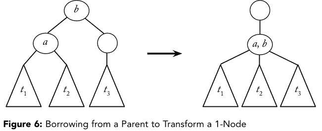

**图 7：合并兄弟节点以转换 1-节点**

- 最后，如果更改传播到根节点并使其变成 1-节点，则树的新根节点变为该 1-节点的子节点。换句话之，树缩小了。与插入相反，树只在根部增长，保证了它保持平衡。图 8 展示了几次删除操作以及当出现 1-节点时 2-3 树是如何转换的。此图显示了两种转换。在第一次，一个 1-节点（被删除的叶节点）有一个 2-节点兄弟和一个 2-节点父节点，因此它从父节点借用并与兄弟合并。


**图 8：删除操作导致的树转换**

# 21 集合

## 21.1 引言

列表具有线性结构，而树具有二维结构。我们现在转向无结构集合。最简单的无结构集合就是集合。

- **集合：** 一个无序的集合，其中每个元素最多出现一次。

我们首先回顾集合 ADT，然后讨论 ADT 的实现。

## 21.2 集合 ADT

$T$ 集合抽象数据类型是 $T$ 类型元素集合的 ADT。它的载体集是所有 $T$ 类型元素的集合。这个 ADT 是我们从小学就开始学习的集合抽象数据类型。它的操作完全符合我们的预想（也可以包含在内）。注意，这不是一组隐式接收者方法集。

```


$e \in s$--如果 $e$ 是集合 $s$ 的成员，则返回 true

$s \subseteq t$--如果 $s$ 的每个元素也是 $t$ 的元素，则返回 true

$s \cap t$--返回同时属于 $s$ 和 $t$ 的元素集合

$s \cup t$--返回属于 $s$ 或 $t$ 的元素集合

$s - t$--返回属于 $s$ 但不属于 $t$ 的元素集合

$s = t$--当且仅当 $s$ 和 $t$ 包含相同的元素时返回 true。

## 21.3 集合接口

接口如图 1 所示。`Set` 接口是 `Collection` 接口的子接口，它继承了 `Collection` 和 `Container` 的所有操作。某些 ADT 操作包含在这些父接口中（例如 `contains()`），因此它们没有显式地出现在 `Set` 接口中。

## 21.4 集合的连续实现

集合的元素可以存储在数组或 `ArrayList` 中，但这种方法并不高效。为了理解这一点，让我们考虑如何使用数组实现最基本的集合操作——插入、删除和成员检查。如果元素是无序存储的，那么插入元素会非常快，但删除元素会很慢（因为必须进行顺序查找来找到被删除的元素），而且成员检查也很慢（因为需要顺序查找）。如果元素是有序存储的，那么成员检查很快（因为可以使用二分查找），但插入和删除非常慢，因为平均有一半的元素必须移动以为插入或删除的元素腾出空间。

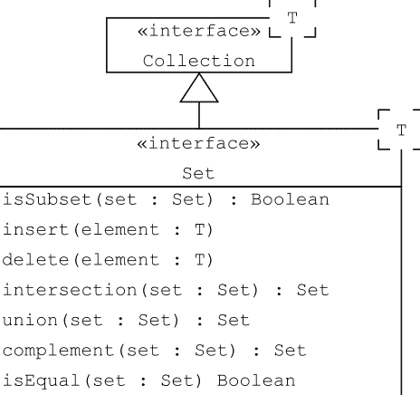

图 1：Set 接口

有一种使用连续存储实现集合的方法，在时间上非常高效，尽管在空间上可能并不高效。称为特征函数（characteristic function）的布尔数组可以表示一个集合。特征函数由元素索引，因此索引 $x$ 处的特征函数值仅当 $x$ 在集合中时才为真。插入、删除和成员检查的时间复杂度都可以是常数级的。当然，问题在于，每个特征函数数组必须为集合中可能的每一个值都留一个元素，且这些值必须能够索引数组。如果集合持有整数类型中较小子范围的值（例如 ASCII 字符或 0 到 50 的整数），那么这种技术是可行的（尽管可能仍然浪费大量空间）。但对于大范围或非整数集合，这种技术就不再可行。

还有一种对于集合来说非常快的连续实现技术：哈希。我们稍后将讨论使用哈希来实现集合。

## 21.5 集合的链式实现

集合连续实现的问题是，插入、删除和成员检查不能都高效地完成。链表也是如此。我们遇到过能够保证提供快速插入、删除和成员检查的数据结构：平衡搜索树。回想平衡搜索树可以……

## 21.6 JAVA 中的集合与树

`TreeSet` 是使用搜索树实现的。理想情况下，集合应该允许任何类型，包括像 `int` 这样没有实现接口的类型。然而很容易将 `int` 值转换为 `Integer` 值。例如，下面的 Java 代码展示了 `TreeSet` 的部分。

```java
public class TreeSet<T> implements Set<T> {

    private AVLTree<T> tree;

    public TreeSet() { tree = new AVLTree<>(); }

    public boolean contains(T item) { return tree.contains(item); }

    ...

    public boolean isSubset(Set<T> set) {

        for (T element : this) {

            if (!set.contains(element)) return false;

        }

        return true;

    }

    ...

} // TreeSet
```

图 2：使用搜索树实现集合

`TreeSet` 类有一个私有的 `AVLTree` 字段用于存储集合的元素。大多数树方法简单地委托给 AVL 树，如 `contains()` 方法所示。某些方法需要一些自己的处理。例如，`isSubset()` 方法遍历宿主集合中的元素，并确保它们都在参数中。在后台，会对宿主搜索树进行中序遍历以遍历元素，并使用搜索树的 `contains()` 操作来快速判断某个值是否在参数集合中。

## 21.7 总结与结论

集合是有用的 ADT，可以使用平衡搜索树高效实现。虽然集合原则上持有任何类型的值，但使用搜索树来实现它们迫使我们在 `TreeSet` 中只存储 `Comparable` 值。我们将在后面的章节中考虑另一种实现集合的数据结构，它具有不同的限制。

## 21.8 复习题

1. 哪个集合操作出现在集合 ADT 中但没有显式出现在 `Set` 接口中？它为什么不存在？
2. 什么是特征函数？
3. 为什么数组或 `ArrayList` 不是实现集合 ADT 的良好数据结构？
4. 为什么 `LinkedList` 不是实现集合 ADT 的良好数据结构？
5. 为什么平衡搜索树是实现集合 ADT 的良好数据结构？

## 21.9 习题

- 1. 你认为在集合（Set） ADT 中添加哪些其他操作可能会很有用？
- 2. 集合需要迭代器吗？这与列表的情况相比如何？
- 3. 哪种搜索树遍历顺序应该作为集合的遍历顺序？你为什么这样选择的？
- 4. 以图 2 中的代码为起点，编写 `Set` 接口。通过实现所有 `Collection` 接口方法来开始编写 `TreeSet` 类。如果你愿意，可以使用 2-3 树。
- 5. 继续上一个练习开始的实现，编写 `insert()` 和 `delete()` 方法。
- 6. 继续练习 4 的实现，在 `TreeSet` 类中实现 `Set` 接口的剩余方法。

## 21.10 复习题答案

- 1. 集合 ADT 中的成员检查操作没有在 `Set` 接口中明确出现，因为 `Collection` 接口中的 `contains()` 操作已经提供了此功能。
- 2. 特征函数是为特定集合创建的函数，它接受一个值作为参数，并在该值是集合成员时返回 true。例如，对于集合 {a, b, c}，特征函数 $f(x)$ 对于 $f(a)$、$f(b)$ 和 $f(c)$ 的值为 true，但对任何其他参数的值为 false。
- 3. 如果使用 `ArrayList` 来实现集合 ADT，那么插入、删除或成员检查操作中的某一个将会很慢。如果数组或 `ArrayList` 保持有序，那么成员检查操作将非常快（可以使用二分查找），但插入和删除将很慢，因为元素必须移动以保持顺序。如果数组或 `ArrayList` 不保持有序，那么插入将非常快，但删除和成员检查操作需要顺序搜索，这种搜索是慢的。
- 4. 如果使用 `LinkedList` 实现集合 ADT，那么删除和成员测试将会很慢，因为需要线性搜索。如果保持列表元素的顺序以加速搜索（这只帮助不大，因为仍然必须使用顺序搜索），
- 5. 平衡搜索树是实现集合 ADT 的一种良好数据结构，因为平衡搜索树允许插入、删除和成员检查均在 $O(\log n)$ 时间内快速完成。

# 22 映射

## 22.1 引言

一种非常有用的集合是列表和集合的混合体，称为映射（map）、表、字典或关联数组。映射（我们将这样称呼它）是一种集合，其元素（我们将它们称为值）是无序的，就像集合一样，其值可以通过键（key）访问，类似于通过索引访问元素的方式。

映射：一种可以使用键访问值的无序集合。

另一种思考映射的方式是将其视为将键映射到值的函数（因此得名），就像数学中的函数一样。因此，映射是一个键值有序对的集合，其中每个键都与单个值配对（一个映射可以对应多个键）。

## 22.2 映射 ADT

映射存储任意类型的值和任意类型的键，因此该 ADT 是 `(K, T)` 的映射，其中 K 是键的类型，T 是映射中值的类型。该类型的载体是所有第一个元素为类型 K 且第二个元素为类型 T 的有序对的集合。该载体集合包括空映射、具有一个类型 K 和 T 值的有序对的映射、具有两个类型 K 和 T 值的有序对的映射，依此类推。

映射的基本隐式接收者操作除了所有集合共有的操作外，还包括插入、删除、搜索和检索键值。

- `isEmpty()`—当且仅当映射为空时返回 true。
- `size()`—返回映射中值对的数量。
- `hasKey(k)`—当且仅当映射包含第一个元素为 k 的有序对时返回 true。
- `hasValue(v)`—当且仅当映射包含第二个元素为 v 的有序对时返回 true。
- `insert(k, v)`—将有序对 `<k, v>` 添加到映射中。如果映射已经包含第一个元素为 k 的有序对，则用新的有序对替换它。
- `delete(k)`—从映射中移除第一个元素为 k 的有序对。如果映射不包含此类有序对，则什么都不做。
- `get(k)`—返回第一个元素为 k 的有序对中的第二个元素。此操作的先置条件是映射中包含一个第一个值为 k 的有序对。
- `equal(m)`—如果接收者映射和映射 m 具有相同的键值对，则返回 true。

这些操作与列表和集合的操作之间有很大的相似性。例如，列表的 `delete()` 操作接受一个索引并移除指定索引处的元素，而映射操作接受一个键并移除与该键匹配的键值对。另一方面，当索引超出范围时，会违反先置条件；而如果键不在映射中，则映射保持不变。后者的行为与调用 `delete()` 操作且参数不在集合中时集合所发生的情况相同。


## 22.6 总结与结论

`Map` 是极其重要的集合，因为允许使用键（keys）来存储值（values），这是编程中非常常见的需求。`(K, T)` Map ADT 指定了该类型的本质特征，而 `Map` 接口捕捉了这些特征并将 map 放入 `Container`（容器）层级结构中。简单的实现并不适用于 map（哈希表除外，我们在下一节中讨论）。然而，平衡搜索树提供了非常高效的实现，因此树形 Map 是 `Map` 接口的一种良好实现。实现这一目标的关键技术是将键值对存储在实现了 `Comparable` 接口的类中，并以这种方式对键进行比较。这些键值对可以根据其键被存储在平衡搜索树中。

## 22.7 复习题

- 1. 为什么 map 被称为 map？
- 2. `Collection` 接口有一个泛型参数 T，而 `Map` 接口有泛型参数 K 和 T。它们之间是什么关系？
- 3. 为什么数组或 `ArrayList` 不是实现 map ADT 的良好数据结构？
- 4. 为什么 `LinkedList` 不是实现 map ADT 的良好数据结构？
- 5. 为什么平衡搜索树是实现 map ADT 的良好数据结构？

## 22.8 练习题

- 1. 编写一个函数，将加州、弗吉尼亚州、密歇根州、佛罗里达州和俄勒冈州映射到它们的首府。如果你想在 map ADT 中存储这个函数，键和值分别是什么？
- 2. map 是否需要迭代器？与列表的情况相比如何？
- 3. 画出整个 `Container` 接口类图，包括到目前为止考虑的所有集合。你可以在图中不包含操作，但请包含 `Iterator` 接口。
- 4. 假设所有的 `Collection` 和 `Map` 操作都是使用平衡搜索树在 `TreeMap` 中实现的，制作一个表格显示 `TreeMap` 中每个操作的时间复杂度。
- 5. 以图 2 中的 Java 代码为起点，为 `Map` 接口和 `TreeMap` 类编写代码，包括类构造函数。
- 6. 继续你在上一个练习题中开始的 Java 实现，编写代码实现 `Map` 接口继承自 `Container` 的所有操作（迭代除外）。
- 7. 继续上一个练习题的 Java 实现，为 `TreeMap` 中的迭代器编写代码。
- 8. 通过编写所有剩余的 `Map` 接口方法完成上一个练习题的 Java 实现。

## 22.9 复习题答案

- 1. map 关联了键和值，使得每个键最多关联一个值。这是从键到值的函数的定义。函数也被称为 map，我们从这个词的这种含义中取了集合的名字。
- 2. `Collection` 泛型参数 T 与 `Map` 接口的泛型参数 T 相同：`Collection` 的元素也是 `Map` 的值。但 `Map` 具有一个额外的数据项——键，其类型为 K。
- 3. 数组或 `ArrayList` 不是实现 map ADT 的良好数据结构，因为键值对必须以有序或无序的方式存储在数组或 `ArrayList` 中。如果它们按顺序存储，通过键查找键值对可以使用二分查找，但添加和删除键值对的速度很慢。如果它们无序存储，则可以通过将它们添加到集合的末尾来快速插入，但搜索它们或寻找它们需要删除的时机是非常缓慢的操作，因为它们必须使用顺序查找。
- 4. 虽然键值对可以快速插入到 `LinkedList` 中，但搜索键值对或寻找需要删除它们是非常缓慢的操作，因为 `LinkedList` 必须通过节点进行遍历，因此 `LinkedList` 不是实现 map ADT 的良好数据结构。
- 5. 平衡搜索树是实现 map ADT 的良好数据结构，因为添加键值对、通过键搜索以及通过键删除都非常快（$O(\log n)$ 时间）。此外，树中的节点按顺序遍历的，然后按键的顺序访问键值对。

# 23 哈希算法

## 23.1 引言

在理想的世界中，从 map 中检索值将通过检查值的键来瞬间完成。这就是哈希的目标，它使用哈希函数将键转换为数组索引，从而瞬间访问存储在持有键值对的数组中的值。这个数组被称为哈希表。

- **哈希函数：** 将键转换为哈希表索引范围内的某个值的函数。
- **哈希表：** 存储键值对的数组，其位置由应用在键上的哈希函数决定。

当然，还有一些细节需要解决。


> “在丹麦，你可以找到极好的工程工作并提升专业水平。特别是在风能领域，你可以向行业中最优秀的人学习，并在稳定的就业市场中发展职业。”
> Mireia Marre,
> 来自西班牙的高级工程师。
> 自2010年起在丹麦的风能行业工作。

## 23.2 哈希问题

如果键值对集合很小，我们可以分配一个足够容纳它们的所有数组，我们总是可以找到将键转换为位置的哈希函数。但在实践中，我们经常遇到不可避免的冲突。

- **冲突（Collision）：** 两个或多个键映射到同一位置的事件。
- **冲突解决方案：** 处理冲突的机制。

为了理解这一点，让我们考虑一下生日问题，这是一个概率问题：在 k 人中，至少有两个人生日相同的概率是多少？如果我们假设哈希表有 365 个位置，而这些概率是哈希函数将键转换到同一位置（冲突）的可能性，那么我们可以看到100个人几乎会发生冲突。因此，冲突解决方案是使哈希工作的至关部分。

| k | p |
| :--- | :--- |
| 5 | 0.027 |
| 10 | 0.117 |
| 15 | 0.253 |
| 20 | 0.411 |
| 22 | 0.476 |
| 23 | 0.507 |
| 25 | 0.569 |
| 30 | 0.706 |
| 40 | 0.891 |
| 50 | 0.970 |
| 60 | 0.994 |
| 100 | 0.9999997 |

表 1：生日问题中的概率

## 23.3 哈希函数

哈希的实现需要两个要素：

- 用于将键转换为哈希表位置的哈希函数，理想是一种能减少冲突概率的函数。
- 处理不可避免的冲突的冲突解决方案。

我们将逐一讨论这两项。

一个哈希函数必须将键转换为 0 到 t-1 范围内的整数，其中 t 是哈希表的大小。哈希函数应该将键尽可能均匀地分布在表中，以减少冲突。尽管已经提出并研究了许多哈希函数，但最好的哈希函数使用除法法，对于数值键如下：

```java
hash(k) = k % t
```

该函数简单、快速，并且将键均匀地分布在表中。当 $t$ 是一个不接近 2 的幂的质数时，效果最佳。因此，哈希表的大小始终应选择不接近 2 的幂的质数。

对于非数值键，通常有一种相当简单的方法将值转换为数字并对其使用除法法。例如，下面的 Java 函数演示了使用除法法对字符串进行哈希的方法：

```java
int hash(String s, int tableName) {

  int result = 0;

  for (int i = 0; i < s.length(); i++)

    result = (result * 151 + s.charAt(i)) % tableName;

  return result;
}
```


```
}
```


> 图 1：用于字符串的 Java 哈希函数

编写哈希函数并不困难。良好的经验法则是：在需要常量时尽可能使用质数，并在代表性的键集上对函数进行测试，以确保它们均匀地分布在哈希表中。

# 我加入 MITAS 是因为我想要真正的责任

工程师与地质科学家研究生计划 www.discovermitas.com


第 16 个月，我在北海担任施工主管，指导并帮助领班解决问题

真实工作 国际机会 三次实习

MAERSK

在 bookboom.com 免费下载电子书 211

点击广告阅读更多

## 23.4 冲突解决方案

冲突解决方案主要有两大类，许多变体：链地址法（chaining）和开放地址法（open addressing）。在每种方案中，需要考虑的重要值是负载因子 $\lambda = n/t$，其中 $n$ 是哈希表中的元素数量，$t$ 是表的大小。

### 链地址法

在链地址法（或分离链地址法）中，键冲突的记录被形成一个链表或链，其头节点位于哈希表数组中。图 2 显示了使用链地址法解决冲突的哈希表。为了简单起见

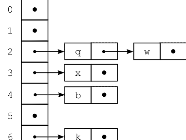

图 2：使用链地址法解决冲突的哈希表

在这个示例中，表有七个位置。两个键 $q$ 和 $w$ 在位置二发生冲突，并放置在头节点位于位置二的链表中。键 $x$、$b$ 和 $k$ 分别被哈希到位置三、四和六。这个示例使用了链表头数组，或者也可以很好地在数据字段中使用某些特殊值来指示节点何时未被使用。

平均链长度为 $\lambda$。如果链是无序的，平均成功搜索需要 $1+\lambda/2$ 次比较，而失败的搜索大约需要 $\lambda$ 次。如果链是有序的，成功和失败的搜索都需要大约 $1+\lambda/2$ 次比较，但插入需要的时间更长。在最坏的情况下，当所有键都映射到单个表位置，且搜索键位于链表的末尾或不在列表中时，搜索需要 $n$ 次比较。

更复杂的链结构（如二叉树）通常不会显著提高性能，特别是当 $\lambda$ 较小时。根据经验法则，$\lambda$ 应该保持在 10 以下。随着表中项目数量的增加，性能会逐渐下降，因此使用链地址法解决冲突的哈希表在宽泛的 $n$ 值范围内表现良好。

### 开放地址法

在开放地址法冲突解决方案中，键冲突的记录将通过*探测*（probing）空闲位置存储在哈希表的其他空闲位置。不同类型的开放地址法方案使用*探测序列*（probe sequences）。在所有情况下，如果 $n \le t$ 且 $\lambda$ 不能超过一，表只能容纳与其数量相同的项目；这种限制在链地址法中不存在。

开放地址法在理论研究中通过随机探测序列进行了建模。在这些研究中，失败搜索的探测次数约为 $\frac{1}{2}(1/(1-\lambda))$，成功搜索大约为 $\frac{1}{2}(1/(1-\lambda)^2)$。这些值在 $\lambda$ 接近 1 时显现。例如，当负载因子为 0.95 时，成功搜索的预期比较次数为 10.5，失败搜索为 200.5。真实的开放地址法方案甚至不允许这样做，因此负载因子通常保持在 0.75 以下。

理解开放地址法的另一个点是，当发生冲突时，算法会沿着探测序列进行，直到 (a) 找到所需的键，(b) 找到空闲位置，或 (c) 遍历了整个表。但只有当在删除元素的槽位中留下标记时，这种方法才有效，该标记指示该位置之前可能是空的，因此算法应该继续执行探测序列。在高度动态的表中，会有很多标记和很少的空槽，因此算法需要遵循很长的探测序列，特别是对于失败搜索，即使在负载因子较低时也是如此。

**线性探测**（Linear probing）使用探测序列，该序列从哈希表索引开始，按表的大小模一个常量值递增。如果表的大小和增量合适，表中的每个槽位都将出现在探测序列中。当负载因子超过 0.8 时，线性探测的性能急剧下降。线性探测还受到*主聚集*（primary clustering）的影响，当填充位置簇在某个位置周围聚集时就会发生这种情况。

**双哈希**（Double hashing）通过第二个哈希函数为探测序列生成一个增量。第二个哈希函数必须生成与第一个函数相当不同的值，以便两个冲突的键被映射到不同的位置。如果表的大小是质数，这很容易实现。双哈希消除了主聚集。

# Java 数据结构与算法 哈希处理

下面的图 3 显示了使用双哈希的开放地址法示例。和之前一样，为了简单起见，示例仅使用键值对。主哈希函数为 $f(x) = x \pmod 7$，用于生成探测序列常量的哈希函数为 $g(x) = (x \pmod 5)+1$。值 8, 12, 9, 6, 25 和 22 被哈希到表中。

| | |
|---|---|
| 0 | 22 |
| 1 | 8 |
| 2 | 9 |
| 3 | -- |
| 4 | 25 |
| 5 | 12 |
| 6 | 6 |

**图 3：** 使用开放地址法和双哈希解决冲突的哈希表

前五个键没有冲突。但 $22 \pmod 7$ 为 1，所以 22 与 8 冲突。双哈希的探测常数为 $(2 \pmod 5)+1 = 3$。我们在冲突的位置 1 加上 3 到位置 4。但 25 已经在该位置了，所以我们加上 3 得到位置 0（使用表的大小回到数组开头：$(4+3) \pmod 7 = 0$）。位置 0 未被占用，因此放置了 22。

注意，在空闲位置必须放置某种特殊值——在示例中我们使用了双哈希。当从表中删除一个值时，必须使用不同的值来指示该位置之前不是空的，这样在探测序列期间遇到该值时，搜索就可以继续进行。

我们已经注意到，使用开放地址法解决冲突时，当负载因子接近 1 时，性能会显著下降。这种影响意味着开放地址法的哈希机制可能会通过扩展表来降低负载因子并提高性能。可以通过遍历旧表并将所有记录插入新表来创建一个更大的表。注意，这涉及到每个键的重新处理，因为哈希函数通常会使用已经改变了的大小。因此，这是一个非常昂贵的操作。

某些表扩展方案通过增量方式工作，即保留旧表并在新表中进行所有插入、从旧表中进行所有删除，并在执行操作过程中逐渐将记录从旧表移动到新表。最终，旧表变为空并可以丢弃。

## 23.5 总结与结论

哈希处理通过哈希函数将键转换为哈希表的位置，从而通过键几乎瞬时地访问值。遗憾的是，多个键不可避免地哈希到同一个表位置，这会导致冲突，并需要某种方法存储与单个表位置关联的多个值。

解决冲突的两种主要方法是链法（chaining）和开放地址法（open addressing）。链法使用从哈希表位置开始的键值对链表。开放地址法使用探测序列（probe sequences）在开放存储区域中查找以存储键值对，并在之后找到它。链法非常健壮，在广泛的负载因子范围内性能良好，但它需要额外的空间存储列表节点中的链接。开放地址法对空间的利用效率高，但随着负载因子接近 1，其性能会迅速下降；扩展表的操作是非常昂贵的。

无论如何实现哈希，插入、删除和查找的平均性能均为 $\Theta(1)$。链法解决冲突的最坏情况性能为 $O(n)$，这只会在极罕见的情况下，即键仅被哈希到极少数位置时发生。开放地址法的最坏情况性能是负载因子的函数，当 $\lambda$ 接近 1 时该值会很大，但如果 $\lambda$ 保持在 0.8 以下，$W(n)$ 将小于 10。


## 23.6 复习题

- 1. 当两个或多个键映射到哈希表的同一个位置时，会发生什么？
- 2. 如果哈希表有 365 个位置，随机向表中放入 50 条记录，至少发生一次冲突的概率是多少？
- 3. 使用除数法的哈希函数时，哈希表的合适大小是什么？
- 4. 什么是负载因子？在什么情况下负载因子可以超过 1？
- 5. 什么是探测序列？线性探测还是双重哈希更好？

## 23.7 练习题

- 1. 为什么文中关于开放地址法和双重哈希的示例使用函数 $g(x) = (x \pmod 5)+1$ 而不是 $g(x) = x \pmod 5$ 来生成探测序列？
- 2. 假设哈希表有 11 个位置，使用简单除数法哈希函数 $f(x) = x \pmod{11}$ 将键映射到表中。计算以下键存储的位置：0, 12, 42, 18, 6, 22, 8, 105, 97。这些键中是否存在冲突？如果所有键都放入表中，表的负载因子是多少？
- 3. 假设哈希表有 11 个位置，使用哈希函数 $f(x) = x \pmod{11}$ 将键放入表中，并使用线性链法解决冲突。绘制一张类似于图 2 的图，展示在表中存储以下键：0, 12, 42, 18, 6, 22, 8, 105, 97 的结果。
- 4. 修改你为练习 3 的图，显示当从哈希表中删除 18 和 42 时发生了什么。
- 5. 假设哈希表有 11 个位置，使用哈希函数 $f(x) = x \pmod{11}$ 将键映射到表中，并使用开放地址法和常数为 3 的线性探测生成探测序列来解决冲突。绘制一张图展示在表中存储以下键：0, 12, 42, 18, 6, 22, 8, 105, 97 的结果。
- 6. 列出在你练习 5 绘制的图中查找 97 时使用的探测序列（表索引）。列出查找 75 时使用的探测序列。
- 7. 从你为练习 5 绘制的图开始，展示从表中删除 18 的结果。列出查找 97 时使用的探测序列。即使在探测序列中不再遇到 18，你如何保证能找到 97 的？
- 8. 假设哈希表有 11 个位置，使用哈希函数 $f(x) = x \pmod{11}$ 将键映射到表中，并使用开放地址法和常数为 3 的线性探测生成探测序列来解决冲突。绘制一张图展示在表中存储以下键：0, 12, 42, 18, 6, 22, 8, 105, 97 的结果。（注：这似乎是第 5 题的重复）。
- 9. 列出查找 75 时使用的探测序列。

## 23.8 复习选择题

- 1. 当两个或多个键映射到哈希表的同一个位置时，它们被称为发生冲突，必须采取某些措施来解决冲突。
- 2. 如果哈希表随机添加了 365 个位置，至少发生一次冲突的概率是……
- 3. 当使用除数法的哈希函数时，哈希表的合适大小是一个质数。
- 4. 哈希表的负载因子是键值对数量与表大小的比例；当使用开放地址法时，负载因子可以超过 1。
- 5. 探测序列是查找键时使用的位置列表。线性探测容易产生主聚集，而双重哈希更好。

# JAVA 数据结构与算法
## 哈希集合

任何 `int` 值，其结果都必须经过修改以作为哈希索引。哈希表本身必须持有（引用）存有键值对的类实例。该类在 `K` 和 `T` 上将是泛型的，且 Java 禁止创建泛型类的数组。因此，哈希表数组必须是 `Objects` 数组，其元素必须强制转换为键值对类。

## 24.3 HASHMAP（哈希映射）

`HashTable` 类显然用于实现映射（maps），产生一种称为哈希映射（hash map）的集合。只要其底层哈希表不会太满，哈希映射为所有操作提供常数时间性能，除了 `contains()` 集合方法（该方法的时间是线性的）。这优于搜索树，因此哈希映射通常比树形映射（tree maps）更快。

`HashMap` 实现了 `Map` 接口并在私有字段中持有哈希表。哈希表存储映射中的键值对，大多数 `Map` 操作直接委托给哈希表。少数 `Map` 操作（如 `contains()` 和 `equals()`）需要几行代码来遍历哈希表并进行比较。

## 24.4 HASHSETS（哈希集合）

哈希表是一种方便的实现数据结构，因为它们可以用于实现各种类型的哈希集合，而不仅仅是映射。例如，假设我们希望使用哈希来实现集合（sets）。如果我们使用哈希表来此，那么键（key）是我们想要存储的集合元素，但键值对中的值（value）是什么呢？没有值，所以我们可以让值字段为空（例如在其中存储 `null`）。这浪费了空间，但提供了哈希表的常数时间性能。因此，哈希表是实现哈希集合（hash sets）的好方法。

`HashSet` 实现了 `Set` 接口并在私有属性中持有哈希表。对于哈希映射，基本的 `Collection` 操作可以通过 `HashTable` 操作轻松实现。为了提高这种效率，例如，`contains()` 集合方法应该使用 `HashTable` 的 `get()` 方法将集合元素作为键进行搜索（使用哈希算法），而不是遍历表查找值。

哈希并集（Hash union）可以通过拷贝宿主集合（及其哈希表）并遍历参数集合，添加其所有值来实现。补集（Complement）通过创建一个新的结果集，然后遍历宿主集合，将不在参数集合中的结果元素添加到结果中来实现。最后，交集（intersection）通过遍历一个集合并仅将另一个集合所包含的值添加到结果哈希集合中来实现。所有这些操作对于所操作集合的大小来说都是线性的。

## 24.5 总结与结论

哈希化是实现集合以及映射的高效方法。哈希表类可以使用开放寻址法（open addressing）或链法（chaining）来解决冲突，从而提供使集合和映射实现快速的操作。在任何情况下，监控负载因子并在负载因子过高时扩展表都可能是明智的。

## 24.6 复习题

- 1. 在 `HashTable` 类中可以使用哪些类型的冲突解决技术？
- 2. 在使用开放寻址且负载因子为 1 的 `HashTable` 类中调用 `insert()` 方法会发生什么？
- 3. 集合没有键和值，那么如何使用哈希表来存储集合？
- 4. 为什么 `HashMap` 类中的 `contains()` 方法比 `get()` 方法慢？

## 24.7 练习

- 1. 用 Java 编写 `HashTable` 类。你的类可以使用开放寻址法来解决冲突。注意，你必须编写一个私有内部类来持有键值对。
- 2. 使用上一个练习中编写的 `HashTable` 在 Java 中编写一个 `HashMap` 类。
- 3. 使用第一个练习中编写的 `HashTable` 在 Java 中编写一个 `HashSet` 类。你可以将元素或 `null` 设置为键值对中的值。
- 4. 哈希表在实现集合时会浪费空间。为了避免这一点，用 Java 编写一个使用哈希来存储类型 `T` 单值的 `HashTable` 类。这些值实现 `Comparable<T>` 以便比较。
- 5. 使用 `HashTable` 实现 `HashMap` 类。在这个类中，你需要一个 `Pair` 类来存储键值对。此外，你的 `hashCode()` 方法需要对希。

## 24.8 复习题答案

- 1. 在 `HashTable` 类中可以使用任何类型的冲突解决技术。
- 2. 假设使用开放寻址的 `HashTable` 类负载因子为 1。在这种情况下，我们知道所有的键值对都存储在表中数组（因为使用了开放寻址解决冲突），并且所有的数组位置都被占用（因为负载因子为 1）。如果调用 `insert()` 方法，则我们尝试向表中添加另一个键值对。没有空间了。该方法要么失败，要么创建一个更大的表并在其中插入新的键值对。
- 3. 集合只存储单个元素，而不是键值对，但哈希表存储键值对。我们可以通过两种方式使用哈希表存储单个元素。我们可以将集合元素视为元素-元素对（换句话说，让键和值相同）。
- 4. `HashTable` 类中可以使用任何类型的冲突解决技术。

# 图

## 25.1 引言

计算中最重要的工具之一是图，通俗理解为由线条连接的点的集合。图用于建模网络、过程、关系等——本章我们将介绍图。

## 25.2 有向图和无向图

我们在第 1 章中定义了图。

- **图：** 顶点（节点）和边（edge）的集合。边可以被看作对。形式上，图是一个有序对 <V, E>，其中 $V$ 是顶点集合，$E$ 是元素集合。
- **无向图：** 边是顶点集合的图。在这种情况下，边没有方向，并用线段表示。
- **有向图或有向图（digraph）：** 边是顶点的有序对的图。在这种情况下，边有方向，并用箭头表示。

# JAVA 数据结构与算法

## 图

虽然图本质上是两个集合的有序对，但如上面的示例所示，用这种方式表示图既笨拙又难以阅读。因此，我们始终以图片的形式来表示图。

无向图和有向图在计算机科学中都非常重要且应用广泛，但在剩下的讨论中，我们将重点关注无向图。从现在起，我们将无向图简单称为*图*。

## 25.3 基础术语

为了讨论图，必须学习几个额外的术语。

- **相邻性 (Adjacency):** 图 $G=<V, E>$ 中的顶点 $v_i$ 和 $v_j$，满足 $\{v_i, v_j\} \in E$。
  在图 2 中，顶点 0 和 1 以及顶点 7 和 4 是相邻的；例如，顶点 0 和 4 以及顶点 1 和 3 不是相邻的。

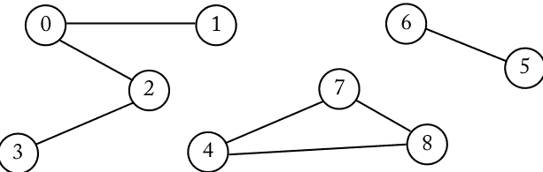

**图 2:** 一个图

- **路径 (Path):** 图中的顶点序列 $p=<v_1, v_2, ..., v_n>$，其中 $n \ge 2$ 且 $p$ 中的每一对顶点 $v_i$ 和 $v_{i+1}$ 均相邻。

- **长度 (Length):** 路径中边的数量。
  在图 2 中，路径 $<0, 2, 3>$ 和 $<4, 7, 8>$ 的长度均为二。

- **环 (Cycle):** 路径 $<v_1, v_2, ..., v_n>$，其中 $v_1 = v_n$ 但没有其他顶点重复。

- **环路图 (Cyclic graph):** 具有长度至少为三的环图。
  在图 2 中，路径 $<0, 1, 0>$ 和 $<4, 7, 8>$ 是环。因为第二个路径的长度为三，所以图 2 中的图是环图。

- **子图 (Sub-graph):** 如果 $W \subseteq V$ 且 $F \subseteq E$，则图 $H<W, F>$ 是图 $G<V, E>$ 的子图。

- **连通顶点 (Connected vertices):** 两个之间存在路径的顶点。

- **连通图 (Connected graph):** 每对顶点之间都有路径的图。不连通图由一组连通分量组成，这些分量是图的子图。
  图 2 显示了一个具有三个连通分量的图。每个分量都是整个图的子图。

- **无环图 (Acyclic graph):** 不是环的图。
  如前，图 2 中的图是环图，但由顶点 0, 1, 2, 3 及其连接边组成的子图，以及由顶点 5 和 6 以及它们的连接边组成的子图，都是无环图。

- **树 (Tree):** 无环的连通图。


- **森林 (Forest):** 一组没有公共顶点的树。

- **生成树 (Spanning tree):** 连通图 $G$ 的任意一个树且包含 $G$ 所有顶点的子图。
  图 3 显示了一个用双线标记了生成树的图。

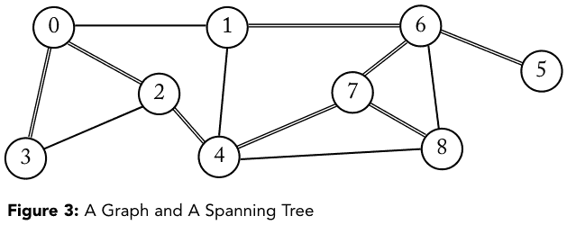

## 25.4 图 ADT

图是一个由两个集合的有序对组成的数学实体。顶点可以是任何事物；例如，它们可以是数字。因此，我们可以将图 ADT 的载体指定为所有满足上述图定义的集合集合，并以自然数初始集合作为顶点。图 ADT 的隐式接收者方法由几个构建和查询图的节点操作组成。我们可以包含添加、删除顶点以及删除边的操作，以及若干查询操作，但对于我们考虑的应用程序来说，这些并不是必要的。

- `newGraph(n)`—返回一个具有 $n$ 个顶点且没有边的图。该操作的前置条件是 $n \geq 0$。
- `edges()`—返回图中边的数量。
- `vertices(v)`—返回图中顶点的数量。
- `addEdge(v,w)`—向图中添加一条连接 $v$ 和 $w$ 的边。前置条件是 $v$ 和 $w$ 是 $g$ 中不同的顶点。
- `isEdge(v,w)`—当且仅当图中顶点 $v$ 和 $w$ 之间存在边时返回 true。

## 25.5 图接口

图不是集合，因此 Graph 接口不是我们容器层次结构中任何其他接口的子接口。能够遍历给定顶点相邻的顶点是非常方便的，因此 Graph 接口依赖于 Iterator 接口（尽管在 UML 图中没有显示）。Graph 接口见图 4。

| interface |
| :--- |
| `edges() : Integer` |
| `vertices() : Integer` |
| `addEdge(v, w : Integer) : { 0 < v != Vertices() }` |
| `isEdge(v, w : Integer) : boolean` |
| `iterator(v : Integer) : Iterator<Integer>` |

**图 4:** 图

大部分这些函数在邻接矩阵中按预期工作。

## 25.6 图的连续型实现

图是一个由两个集合的有序对组成的数学实体。顶点可以是任何事物；例如，它们可以是数字。因此，我们可以将图 ADT 的载体指定为所有满足上述图定义的集合集合，并以自然数初始集合作为顶点。图 ADT 的隐式接收者方法由几个构建和查询图的节点操作组成。我们可以包含添加、删除顶点以及删除边的操作，以及若干查询操作，但对于我们考虑的应用程序来说，这些并不是必要的。

邻接矩阵表示图的方法使操作高效但消耗空间较大。邻接矩阵表示图的方法使操作高效但消耗空间较大。邻接矩阵的矩阵。

## 25.7 图的链型实现

图不是集合，因此 Graph 接口不是我们容器层次结构中任何其他接口的子接口。能够遍历给定顶点相邻的顶点是非常方便的，因此 Graph 接口依赖于 Iterator 接口（尽管在 UML 图中没有显示）。Graph 接口见图 4。

邻接矩阵表示图的方法使操作高效但消耗空间较大。邻接矩阵的。

## 25.8 总结与结论

图是计算中一种重要的建模工具。图 ADT 提供了构建和查询图的若干操作，并落实到 Graph 接口中。邻接矩阵表示图的方法使操作高效但消耗空间较大。邻接表方法几乎同样快但消耗空间小得多。通常情况下，除非图是稠密的或节点数量较少（例如，少于百个），否则邻接表表示法更优。

# Java 数据结构与算法

## 25.9 复习题

- 1. 列举图 ADT 载体集合的若干元素。
- 2. 对相同的顶点两次应用图 ADT 操作 `addEdge()` 的结果是什么？换句话说，如果 g 是一个图，v 和 w 是顶点，那么 `g.addEdge(v,w); g.addEdge(v,w)` 的结果是什么？
- 3. 你如何遍历图中的每一个顶点？
- 4. 为什么图中的每条边在邻接矩阵和邻接表表示中都被表示两次？

## 25.10 练习题

- 1. 在无向图中，顶点可以与自己相邻吗？
- 2. 如果一个图没有边，它可能有任何路径吗？如果图有边，它是否存在最长路径？
- 3. 无向图中最小环中必须有多少个顶点？有向图中最小环中有多少个顶点？
- 4. 在第 16 章中，树被定义为一个具有特殊顶点 r（称为根）的图，使得树中的每个顶点与 r 之间恰好有一条简单路径。证明这个定义与本章陈述的定义是等价。
- 5. 图可以有多个生成树吗？请解释。
- 6. 使用图 ADT 的操作构造图 2 中的图。
- 7. 使用邻接矩阵表示图 2 中的图。
- 8. 使用邻接表表示图 2 中的图。画一张类似于图 5 的图。
- 9. 用 Java 编写 `Graph` 接口。
- 10. 在 Java 中创建一个 `ArrayGraph` 类，用邻接矩阵表示图。`ArrayGraph` 构造函数必须接受 `n`（图中节点数）作为参数。
- 11. 在 Java 中创建一个 `LinkedGraph` 类，用邻接表表示图。`LinkedGraph` 构造函数必须接受 `n`（图中节点数）作为参数。`LinkedGraph` 类应该有一个对象数组的字段，用于存储 `LinkedList<Integer>` 对象。

# Java 数据结构与算法

# 图

# 25.11 复习题答案

- 1. 图 ADT 载体集合包括空图，它没有顶点和边：`<∅, Ø>`。下一个图有一个顶点且没有边：`<{0}, Ø>`。接下来的图有两个顶点且没有边或一条边：`<{0,1}, Ø>`, `<{0,1}, {0,1}>`。有几个三个顶点的图：`<{0, 1, 2}, Ø>`, `<{0, 1, 2}, {0, 1}>`, `<{0, 1, 2}, {0, 1, 0, 2}>`, `<{0, 1, 2}, {0, 1}>`, ...。
- 2. 如果 g 是一个图，v 和 w 是顶点，`g.addEdge(v,w)` 的结果是在 g 的边集中添加了边 `{v, w}`。但这条边已经存在 `{v, w}` 的边集中了，所以第二次调用不会改变 g。在这里，对具有相同顶点的图多次应用 `addEdge` 在第一次调用后将不起任何作用。
- 3. 遍历图 g 中的每个顶点只需要循环从 0 到 `vertices(g)-1` 的每一个整数即可。


- 4. 图中的每条边在邻接矩阵和邻接表表示中都表示两次，是因为在每种情况下，表示法都是通过其顶点来“索引”边的。因为每条边都有两个顶点，所以每个顶点出现两次。注意，我们可以很容易设计出边只出现一次的表示。例如，我们可以将边的两个顶点中较小的那个放入邻接矩阵和邻接表表示的邻接数组中。这将节省一半的空间，但它会让遍历给定顶点的相邻顶点（事实证明这是一个非常重要的操作）变得非常慢：我们需要搜索整个表示来找到与给定顶点相邻的所有顶点。因此，在这种情况下，是用空间换时间，我们使用更多的空间是为了在关键操作中获得更快的性能。

# 26 图算法

## 26.1 引言

图中有很多重要的算法。在本章中，我们将研究一些最基础且应用广泛的算法。特别是，我们考虑了图搜索算法以及几种基于它们的算法。

## 26.2 搜索图

许多涉及图的问题需要沿着其边对图进行系统性的遍历——这被称为图搜索。我们已经以前树遍历的形式见过过图搜索算法，但它们只适用于树，而不适用于一般的图。

作为一个说明需要搜索通用图的问题示例，假设我们想要解决一个迷宫。迷宫可以用图如下表示：将迷宫中的入口、出口和交叉点映射为图顶点，并将入口、出口和迷宫内交叉点之间的路径映射出来。


搜索有两种主要方法：

- 深度优先搜索：一种从访问 v 开始的搜索，然后递归地访问相邻顶点。
- 广度优先搜索：一种从访问 v 开始的搜索，然后访问未访问过的相邻顶点。

## 26.3 深度优先搜索

根据其特征，深度优先搜索可以通过递归轻松实现并不意外。考虑图 1 中的 Java 代码：

```
```


# 图算法

## 递归深度优先搜索

```java
public static void DFS(Graph g, int v, EdgeVisitor edgeVisitor) {
    boolean[] isVisited = new boolean[g.vertices()];
    edgeVisitor.visit(g, -1, v);
    isVisited[v] = true;
    dfs(v, g, edgeVisitor, isVisited);
}

private static void dfs(Graph g, int v, EdgeVisitor edgeVisitor, boolean[] isVisited) {
    Iterator<Integer> iter = g.iterator();
    while (iter.hasNext()) {
        int w = iter.next();
        if (isVisited[w]) continue;
        edgeVisitor.visit(g, v, w);
        isVisited[w] = true;
        dfs(g, w, edgeVisitor, isVisited);
    }
}
```

图 1：递归深度优先搜索

就像二叉树遍历一样，我们也可以使用栈编写深度优先搜索。图 2 显示了这种算法。

基于栈的深度优先算法使用了与递归算法相同的策略：它跟踪未访问的顶点以及之前顶点。递归算法在访问顶点后对未访问的相邻顶点进行递归，这种算法将未访问的相邻顶点放入栈。然而，由于我们使用了边访问器，我们需要有一个边栈而不仅仅是顶点栈。

深度优先搜索的两个版本最多访问每个顶点一次，并处理每个顶点发出的每条边一次。每条边有两个顶点，因此每条边最多被处理两次。深度优先搜索在最坏情况运行时间为 `O(v+e)`。

## 26.4 广度优先搜索

基于栈的深度优先搜索版本将当前顶点的相邻顶点放入栈，然后处理栈顶部的顶点，将其相邻顶点放入栈，以此类推。这种策略的效果是初始顶点的相邻顶点位于栈的底部，因此处理得更远。如果我们使用队列而不是栈，那么相邻顶点将被首先处理，然后是它们的相邻顶点，依此类推。简而言之，我们可以制作广度优先搜索算法。

通过简单将栈替换为队列，即可得到基于队列的广度优先搜索算法。该算法如图 3 所示。

```java
public static void stackDFS(Graph g, int v0, EdgeVisitor visitor) {
    boolean[] isVisited = new boolean[g.vertices];
    Stack<Edge> stack = new LinkedStack<Edge>();
    stack.push(new Edge(-1, v0));
    while (!stack.isEmpty()) {
        Edge edge = stack.pop();
        if (!isVisited[edge.w]) continue;
        visitor.visit(g, edge.w, edge.w);
        isVisited[edge.w] = true;
        Iterator<Integer> iter = g.iterator(edge.w);
        while (iter.hasNext()) {
            int x = iter.next();
            if (!isVisited[x]) stack.push(new Edge(edge.w, x));
        }
    }
}
```

**图 3:** 基于队列的广度优先搜索


该算法恰好访问每个顶点一次，最多访问每条边两次，因此其性能为 `O(v+e)`，与其基于栈的同类算法相同。区别在于它访问顶点的顺序不同。

## 26.5 图中的路径

我们可以使用图搜索算法来确定图的属性。记住，两个顶点连通当且仅当它们之间存在路径。我们可以通过深度优先或广度优先搜索来确定这一点：从其中一个顶点开始搜索，检查搜索是否到达了另一个顶点。此类函数的 Java 代码如图 4 所示。

```java
public static boolean isPath(Graph g, int v, int w) {
    if (v < 0 || g.vertices() <= v) return false;
    if (w < 0 || g.vertices() <= w) return false;
    MarkTarget target = new MarkTarget(w);
    DFS(g, v, target);
    return target.isReached();
}
```

**图 4:** 确定两个顶点是否连通

此函数首先检查参数顶点是否在图中——如果其中一个不在，则它们之间不存在路径。它使用从第一个顶点开始的深度优先搜索，配合一个边访问类（`MarkTarget`），该类负责监控目标顶点并记录其是否已到达。

如果两个顶点连通，它们之间可能存在多条路径，通常知道最短路径（边数最少的路径）是有用的。图 5 中的函数可以找到两个顶点之间的最短路径。

`shortest-path` 函数确保参数顶点之间存在路径，如果没有则返回 `null`。算法代码是一个 `EdgeVisitor`，对于某些源顶点 `w`，它构建一个数组，该数组包含每个顶点通往 `w` 的最短路径上的下一个顶点。该数组在图 5 中被称为 `toEdge`，必须使用广度优先搜索来构建。与 `w` 相邻的顶点 `x` 的 `toEdge` 项被设置为 `w`，因为最短路径显然就是那条边。与 `x` 相邻的顶点 `toEdge` 项被设置为 `x`，因为最短路径首先到 `x` 然后到 `w`（只有当这些边与 `w` 相邻时才可能存在更短的路径）。`toEdge` 项以这种方式为距离 `w` 更远的顶点构建。显然，需要广度优先搜索来按实现工作所需的顺序访问顶点。

一旦构建了 `toEdge` 数组，就包含了从顶点 `v` 到 `w` 的最短路径上的后续顶点。此时，从源顶点 `v` 遍历到目标顶点 `w` 以生成两者之间的最短路径是一项简单的任务。

```java
public static List<Integer> shortestPath(Graph g, int v, int w) {
    if (!sPath(g, v, w)) return null;
    int[] toEdge = new int[g.vertices()];
    PathVisitor visitor = new PathVisitor(toEdge);
    BFS(g, w, visitor);
    List<Integer> result = new ArrayList<Integer>();
    int x = v;
    while (x != w) {
        result.insert(result.size(), x);
        x = toEdge[x];
    }
    result.insert(result.size(), x);
    return result;
}

private static class PathVisitor implements EdgeVisitor {
    private int[] toEdge;
    public PathVisitor(int[] toEdge) { this.toEdge = toEdge; }
    public void visit(Graph g, int v, int w) { toEdge[w] = v; }
}
```

图 5: 寻找连通顶点之间的最短路径

## 26.6 连通图与生成树

除了确定两个顶点是否连通，我们还可以以相同的方式确定整个图是否连通。在这种情况下，我们可以从任何顶点开始深度优先或广度优先搜索。图是连通的当且仅当通过深度优先或广度优先搜索访问所有顶点时。我们将该算法留作练习。记住，生成树是图 `g` 的子图，它是一个树且包含所有顶点。如果我们从源顶点访问图 `g` 并访问的边添加到新图 `h` 中，完成后 `h` 将是生成树。这种策略如图 6 代码所示。

```java
public static Graph spanningTree(Graph g) {
    if (!isConnected(g)) return null;
    Graph result = new LinkedGraph(g.vertices());
    EdgeVisitor visitor = new TreeBuilder(result);
    DFS(g, 0, visitor);
    return result;
}

private static class TreeBuilder implements EdgeVisitor {
    private Graph tree;
    public TreeBuilder(Graph g) { tree = g; }
    public void visit(Graph g, int v, int w) {
        tree.addEdge(v, w);
    }
}
```


**图 6:** 为连通图制作生成树

当参数图不连通时，该函数返回 `null`。


## 26.7 总结与结论

深度优先和广度优先是通过跟随边访问图顶点的两种方法。两种算法的时间都与边和顶点成正比。深度优先和广度优先搜索是许多处理图算法的基础，包括确定两个顶点是否连通、确定图是否连通、寻找两个顶点之间的最短路径以及为连通图寻找生成树。

## 26.8 复习题

- 图搜索与图遍历之间的关系是什么？
- 图搜索算法与栈、队列有什么关系？
- 在什么情况下，一种图搜索算法优于另一种？
- 使用深度优先还是广度优先搜索寻找两个顶点之间的最短路径会有影响吗？
- 使用深度优先还是广度优先搜索为连通图生成树会有影响吗？

## 26.9 练习题

使用下面的图完成练习。

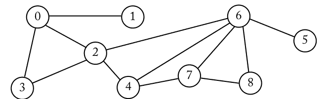

- 列出上图中从顶点 0 开始的深度优先搜索访问顶点的顺序。假设相邻顶点按从最小到大的顺序访问。
- 列出上图中从顶点 0 开始的广度优先搜索访问顶点的顺序。假设相邻顶点按从最小到大的顺序访问。
- 追踪 `shortest-path` 函数在生成图中顶点 0 和 8 之间最短路径的执行过程。路径是什么？
- 追踪在为上述图生成生成树时生成树函数的执行过程。生成的生成树是什么？
- 编写一个 Java 函数 `isConnected(Graph g)` 来判断图 `g` 是否连通。
- 编写一个 Java 函数 `intComponent(Graph g)` 来统计图 `g` 中连通分量的数量。
- 顶点的度（degree）是指与其连接的边数。编写一个 Java 函数 `int maxDegree(Graph g)` 来找到图 `g` 中顶点的最大度。
- 我们的算法被设计为使用深度优先或广度优先搜索对图应用访问函数（visit functions）。也可以使用不带访问函数的图搜索来编写这些函数。直接重写最短路径和生成树算法，使其不调用深度优先或广度优先搜索函数。
- 以下问题可以通过将问题建模为图并将图应用于模型来解决。解释如何使用图和图算法解决这些问题。
    - a) 穿过迷宫的路径。
    - b) 在朋友群体之间传输消息必须进行的最小电话集合。
    - c) 判断是否可能仅通过主干道从 A 点到达 B 点。
    - d) 寻找社区中两个人之间的隔阂（degree of separation）（彼此认识的人之间的隔阂为 1；互不认识但有共同朋友的人之间的隔阂为 2，以此类推）。

## 26.10 复习题答案

- 1. 图搜索是图遍历（graph traversal）的另一个名称。
- 2. 深度优先搜索算法使用栈（或递归），而广度优先搜索算法使用队列。除此之外，它们基本相同。
- 3. 深度优先和广度优先搜索运行时间相同，使用的空间也相同，因此通常情况下没有理由优先选择其中一个而不是另一个。然而，某些算法需要其中其中一个才能正常工作。
- 4. 最短路径算法是一个需要其中一种搜索算法才能正常工作的算法示例；特别是最短路径算法需要广度优先搜索才能正常工作。
- 5. 生成树算法是一个使用哪种算法都相同的算法示例：深度优先或广度优先搜索均可用于生成树。

# JAVA 数据结构与算法

## 图算法

## 27 术语表

- **抽象数据类型（ADT）**：一组值（载体集）以及对这些值进行的操作（方法集）。
- **抽象方法**：具有签名但没有方法体的方法。
- **无环图**：没有环的图。
- **邻接性**：在无向图 $G=<V, E>$ 中，如果 $[v_1, v_2]$ 是 $E$ 的成员，则认为顶点 $v_1$ 和 $v_2$ 是邻接的。
- **邻接列表**：与给定顶点邻接的顶点的链表。
- **邻接矩阵**：用一个 $n \times n$ 的布尔矩阵 $m$ 表示一个具有 $n$ 个顶点的图，当且仅当 $v$ 和 $w$ 之间存在边时，在位置 $m[v,w]$ 处存储为 true。
- **ADT 断言（assertion）**：对于该类型的载体集值或方法操作必须为的语句。


# JAVA 数据结构与算法

- **算法（algorithm）**：完成某些计算任务的有限步骤序列。算法必须具有足够简单且确定的步骤，以便计算机执行，并在有限步数后终止。
- **算法分析（algorithm analysis）**：尽可能精确地确定算法在执行时消耗了多少各种资源（如时间和内存）的过程。
- **摊还分析（amortized analysis）**：通过考虑执行任意 $n$ 个操作序列所需的时间，然后将总和除以 $n$，来确定最坏情况下的操作平均时间。
- **数组（array）**：存储在连续内存位置的相同类型的固定长度、有序值集合；该集合可以在多个维度上排序。
- **断言（assertion）**：程序中指定点必须为真的语句。
- **关联数组（associative array）**：A(n)——在给定关于大小为 $n$ 输入特征假设的情况下，算法对于所有大小为 $n$ 的输入执行的基本操作平均次数。
- **AVL 树**：一种每个节点平衡因子为 -1、0 或 1 的二叉搜索树；空树是 AVL 树。
- **树结点的平衡因子**：该节点左子树的高度减去该节点右子树的高度，空树的高度定义为 -1。
- **平衡树（balanced tree）**：一种树，使得对于每个节点，其子树的高度差最多为常数值。
- **基本操作（basic operation）**：算法基础的基础操作，用于衡量算法完成的工作量。
- **最好情况复杂度 B(n)**：任何算法对于任何大小为 $n$ 的输入所执行的最少基本操作次数。
- **二叉搜索树（binary search tree）**：一种二叉树，其每个顶点的值大于其左子树的值，且小于其右子树的值。
- **二叉树（binary tree）**：一种顶点最多有两个子节点的有序树。孩子区分为*左孩子*和*右孩子*。根为左（右）子树的子树。
- **广度优先搜索（breadth-first search）**：一种先访问 $v$，然后访问 $v$ 相邻的顶点，再访问 $v$ 相邻的未访问顶点的搜索。
- **内置类型（built-in type）**：语言直接提供的数据类型。
- **载体集（carrier set）**：抽象数据类型中的值集合。
- **链法（chaining）**：一种哈希冲突解决方案，冲突的键值对形成一个链表。
- **循环双链表（circular doubly linked list）**：一种最后一个节点为头部的双链表。
- **循环单链表（circular singly linked list）**：一种最后一个节点为头部的单链表。
- **类不变（class invariant）**：在调用方法之前和之后必须为真的断言。
- **集合（collection）**：一种可遍历的容器。
- **冲突（collision）**：当两个或多个键被转换为同一个哈希表位置时发生的事件。
- **完全二叉树（complete binary tree）**：一种除了最后一层外每一层都是满的，且只有最右侧叶子节点缺失的树。
- **复杂度 C(n)**：作为输入大小函数的算法执行的基本操作次数。
- **计算复杂度（computational complexity）**：算法的时间（可能还有空间）需求。
- **连通分量（connected components）**：在不连通图中，连通的子图。
- **连通图（connected graph）**：图中每对顶点都是连通的图。
- **连通顶点（connected vertices）**：图中具有路径的两个顶点。
- **容器（container）**：持有有限数量其他对象的实体。
- **指针（cursor）**：标记数据结构中位置的值。
- **循环（cycle）**：图中的路径 $v_1, v_2, \dots, v_n$，其中 $v_1 = v_n$ 但没有其他顶点重复。
- **循环图（cyclic graph）**：具有长度至少为三的循环的图。
- **数据结构（data structure）**：内存中数据的排列，用于表示抽象数据类型载体集的值。
- **数据类型（data type）**：在计算机上抽象数据类型的实现。
- **深度优先搜索（depth-first search）**：一种从访问 $v$ 开始，然后递归搜索 $v$ 相邻的未访问顶点的搜索。
- **双端队列（deque）**：一种只能在其两端访问、插入或删除元素的容器。
- **字典（dictionary）**：见 map。
- **有向图（digraph）**：有向图。


- **有向图（directed graph）**：边是顶点有序对的图；边具有方向并用箭头表示。
- **分配器（dispenser）**：不可遍历的容器。
- **分治算法（divide and conquer algorithm）**：通过将大问题分解为部分、解决较小的问题，然后将这些组合成原始问题的解决方案的算法。
- **双哈希（double hashing）**：在开放地址法冲突解决中，使用对键应用第二个哈希函数生成的增量的探测序列。
- **双向链表（doubly linked list）**：一种链接结构，其节点具有两个引用或指针字段，用于将节点形成一个序列。除了第一个节点外，每个节点都有一个前驱链接字段，包含指向列表中该节点的引用或指针；除了最后一个节点外，每个节点都有一个后继链接，包含指向列表中下一个节点的引用或指针。
- **动态数组（dynamic array）**：一种大小在运行时确定并可以在执行过程中更改的数组。
- **元素（element）**：存储在数组或可遍历容器（集合）中的值。
- **可枚举的（Enumerable）**：参见遍历（traversal）。
- **所有情况复杂度（every-case complexity）**：当对于任何大小为 $n$ 的输入，算法函数执行的基础操作数相同时，该数量是输入大小 $n$ 的函数。
- **外部迭代（external iteration）**：在由称为迭代器（iterator）的独立实体控制下的集合迭代。
- **工厂方法（factory method）**：一种返回类的新实例的非构造器操作。
- **固定数组（fixed array）**：一种大小在分配数组空间时确定且此后不再更改的数组。
- **森林（forest）**：一组没有公共顶点的树集合。
- **满二叉树（full binary tree）**：一种除可能最后一层外，所有层级都是满的二叉树。
- **图（graph）**：顶点（或节点）和连接顶点的边的集合。一条边可以被看是一对顶点。形式上讲，图是一个有序对 $\langle V,E \rangle$，其中 $V$ 是顶点集合，$E$ 是 $V$ 中元素对的集合。
- **图搜索（graph search）**：沿着图的边对图进行的系统性遍历。
- **哈希函数（hash function）**：一种将键转换为哈希表索引范围内取值的函数。
- **哈希表（hash table）**：一个存储键值对的数组，其位置通过应用于键的哈希函数确定。
- **堆（heap）**：一种每个顶点都具有堆序属性的完全二叉树。
- **堆序（heap-order）**：当存储在顶点处的值大于或等于其后代节点的值时，该顶点具有堆序属性。
- **树的高度（height of a tree）**：树中任何节点的最大深度。
- **隐式接收者方法集（implicit-receiver method set）**：一个包含隐式接收者参数函数的方法集。
- **中缀表达式（infix expression）**：一种运算符出现在操作数之间的表达式。
- **中序遍历（inorder traversal）**：一种树的遍历，在每个节点处，并且对于节点上的每个键从左到右，首先访问节点键左侧的子节点，接着访问节点键，然后访问节点键右侧的节点。
- **内部迭代（internal iteration）**：在集合控制下的集合迭代。
- **可迭代的（iterable）**：参见可遍历的（traversable）。
- **迭代（iteration）**：按顺序访问集合中每个元素的过程；遍历集合的过程。
- **迭代器（iterator）**：一种为关联集合的每个成员提供顺序访问的实体。
- **迭代器模式（iterator pattern）**：一种指定使用外部迭代器的面向对象软件设计模式。
- **节点深度（level of a node）**：在树中，从根到节点的路径上的边数。
- **线性探测（linear probing）**：在开放地址法冲突解决中，一种从哈希表索引开始并按表大小的常数值递增的探测序列。

# JAVA 数据结构与算法术语表

- **链式（数据）结构（linked (data) structure）**：通过组成节点链接字段形成整体的节点集合。
- **链式树（linked tree）**：一种节点形成树的链接结构。
- **列表（list）**：一种有序线性集合。
- **负载因子（load factor）**：在哈希中，值为 $\lambda = n/t$，其中 $n$ 是哈希表中的元素数量，$t$ 是表的大小。
- **循环不变性（loop invariant）**：在循环体每次执行开始时必须为真的断言。
- **映射（map）**：元素的无序集合，其值是*元素类型*的值，可以使用键访问，该键是*键类型*的值；也称为**表（table）**、**字典（dictionary）**或**关联数组（associative array）**。
- **方法集（method set）**：在抽象数据类型或数据类型中，抽象数据类型的操作集合。
- **方法签名（method signature）**：方法的名称、参数的数量和类型以及返回类型。


# JAVA 数据结构与算法术语表

- **节点（node）**：一个带有数据和链接（引用或指针）字段的聚合变量；在图中是顶点。
- **开放地址法（open addressing）**：一种哈希冲突解决方案，其中具有冲突键的键值对存储在哈希表中的其他空位置，通过探测表来寻找空位置来实现。
- **阶（order）**：如果函数 $g$ 属于集合 $O(f)$，记作 $g \in O(f)$，则当存在某些正常数 $c$ 和非负整数 $n_0$，使得对于所有 $n \geq n_0$，$g(n) \leq c \cdot f(n)$；通俗地说，当 $g$ 属于 $O(f)$ 时，我们说 $g$ 与 $f$ 具有相同的阶（增长阶）。
- **有序树（ordered tree）**：一种指定了子节点顺序的树。
- **路径（path）**：在图中，一个序列 $p = v_1, v_2, \dots, v_n$，使得 $v_i$ 和 $v_{i+1}$ 是相邻的。
- **路径长度（path length）**：路径中的边数。
- **完美平衡树（perfectly balanced tree）**：所有叶子节点都在同一层的树。
- **指针（pointer）**：一种其包含关联类型地址的类型。
- **后置条件（post condition）**：在操作完成时必须为真的断言。（注：原文为 post condition，通常指后置条件，此处根据语境译为后置条件）
- **后缀表达式（postfix expression）**：一种运算符出现在操作数之后的表达式。
- **后序遍历（postorder traversal）**：一种遍历，在每个节点处，从左到右访问节点的子节点，最后访问节点。
- **前置条件（precondition）**：在操作开始时必须为真的断言。
- **前缀表达式（prefix expression）**：一种运算符出现在操作数之前的表达式。
- **前序遍历（preorder traversal）**：一种遍历，在每个节点处，首先访问节点，然后从左到右访问节点的子节点。
- **优先级队列（priority queue）**：一种具有非负整数优先级的队列，用于对元素排序，使优先级元素位于头部，最低优先级元素位于队尾。
- **队列（queue）**：一种元素序列分配器，允许在一个端（称为队尾）插入，并在另一端（称为头部）删除和访问元素。
- **接收者（receiver）**：当调用操作时，接收者是操作的隐式参数，也可以是操作的隐式结果。
- **记录（record）**：一组任意类型的命名值的有限集合；记录也称为 struct。
- **递归（recurrence）**：递归关系加上一个或多个初始条件，共同递归地定义一个函数。
- **递归关系（recurrence relation）**：用函数在另一个点的值表示该函数值的方程。
- **递归操作（recursive operation）**：一种直接调用自身或调用会调用它的其他操作。
- **引用类型（reference type）**：其变量持有存储该类型集合值的数据结构引用的类型；与值类型（value type）比较。
- **哨兵值（sentinel value）**：放置在数据结构中标记边界的特殊值。
- **分离链（separate chaining）**：参见链法（chaining）。
- **顺序搜索（sequential search）**：一种从头到尾查找键的算法，在找到键时停止。
- **集合（set）**：一种元素最多出现一次的无序集合。
- **简单环（simple cycle）**：图中没有重复边或顶点（除第一个和最后一个顶点外）的环。
- **简单路径（simple path）**：一种相邻顶点通过边连接的不同顶点列表。
- **简单类型（simple type）**：其类型集合的值是原子的类型，即不能拆分。
- **单向链表（singly linked list）**：一种链接结构，其节点具有单一链接字段，用于将节点形成一个序列。除了最后一个外，每个链接都包含指向下一个节点的引用或指针；最后一个节点的链接字段包含 null。
- **切片（slice）**：关联数组中连续段的引用。
- **软件设计模式**：为了解决软件设计问题而提出的模仿模型。
- **排序算法**：一种重新排列列表中记录的算法，使其根据每条记录中键的值遵循某些良定义的排序关系。
- **生成树**：连通图 G 的子图，它本身是一棵树且包含 G 的所有顶点。
- **栈（stack）**：一种持有元素序列的分配器，只能在其中端（称为顶部）进行访问、插入或删除。
- **静态数组**：参见固定数组（fixed array）。
- **字符串**：从某些字母表中提取的有限字符序列。
- **结构体（struct）**：由各种类型的命名字段组成的记录。
- **结构化类型**：其载集值由原子分子的某种排列组成的类型。
- **子图**：如果 $W \subseteq V$ 且 $F \subseteq E$，则图 $H\langle W, F \rangle$ 是图 $G\langle V, E \rangle$ 的子图。
- **表格（table）**：参见映射（map）。
- **尾递归算法**：一种在算法体每次执行的最后一步中最多进行一次递归调用的算法。
- **可遍历的**：容器是可遍历的，当且仅当其持有的元素对客户端可访问。
- **树（tree）**：一种具有特殊顶点 $v$（称为根）的图，使得树中每个顶点与 $r$ 之间好有一个简单路径；或者说，一种无环图。
- **二三树（two-three tree）**：一种完美平衡树，其节点为具有一个值 $v$ 和零或两个子节点的 2 节点（其左子树中的所有值都小于 $v$，右子树中的所有值都大于 $v$），或者为具有两个值 $v_1$ 和 $v_2$ 以及零或三个子节点的 3 节点（其最左子树中的所有值都小于 $v_1$，中间子树中的所有值都大于 $v_1$ 且小于 $v_2$，最右子树中的所有值都大于 $v_2$）。
- **无向图（undirected graph）**：一种边为两个顶点集合的图；边没有方向，在图片中用线段表示。
- **不可达断言（unreachable assertion）**：放置在程序中任何情况下都不应执行的点的断言。
- **值类型（value type）**：其变量持有表示该类型载集值的数据结构的类型；对比引用类型（reference type）。
- **变长编码（variable-length encoding）**：一组值的表示方法，使用不同长度的位串来节省空间：出现频率较高的值用较短的位串表示，出现频率较低的值用较长的位串表示。
- **最坏情况复杂度 W(n)**：算法对于任何大小为 $n$ 的输入所执行的基本操作的最大次数。
