# Java 高级指南

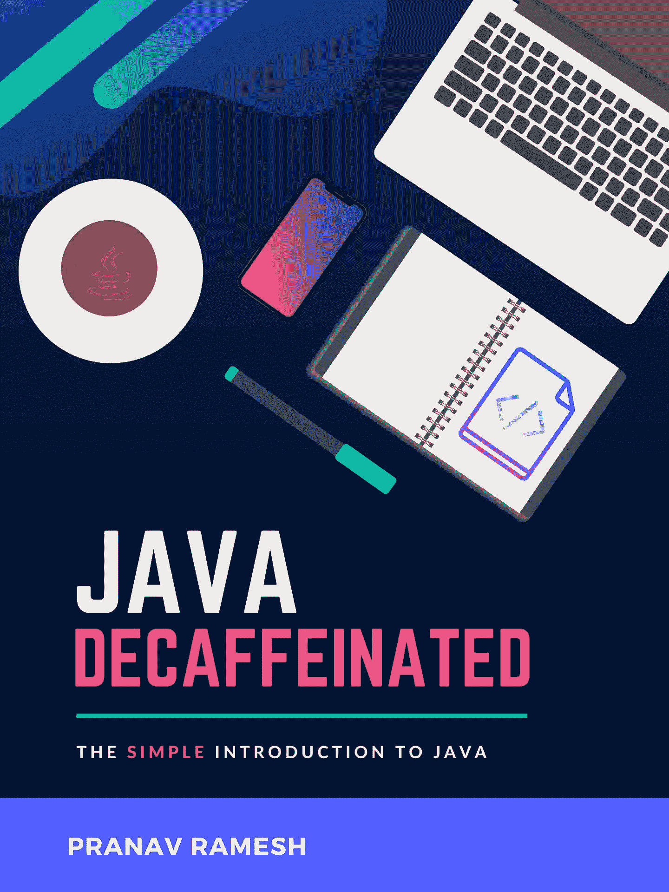

# 目录

# 第 1 章 入门

* 1.1 安装我们的 IDE
* 1.2 编写你的第一段代码
* 1.3 注释
* 1.4 保留关键字
* 1.5 本书使用的规范
    * 1.5.1 图片
    * 1.5.2 表格
    * 1.5.3 内联代码和代码块
    * 1.5.4 笔记
    * 1.5.5 示例、练习题和问题
* 1.6 复习

# 第 2 章 类型

* 2.1 数字
    * 2.1.1 Java 整数类型
    * 2.1.2 整数算术运算
    * 2.1.3 处理小数
    * 2.1.4 小数运算
    * 2.1.5 `Math` 类
* 2.2 文本
    * 2.2.1 字符
    * 2.2.2 创建字符串
    * 2.2.3 字符串拼接
    * 2.2.4 查找字符串长度
    * 2.2.5 特殊字符和转义序列
* 2.3 逻辑
    * 2.3.1 打印 `true` 和 `false`
    * 2.3.2 关系运算符
    * 2.3.3 逻辑运算符
    * 2.3.4 使用 `not`
    * 2.3.5 使用 `and`
    * 2.3.6 使用 `or`
* 2.4 复习
* 2.5 问题

# 第 3 章 变量

* 3.1 处理变量
    * 3.1.1 创建和使用变量
    * 3.1.2 修改变量
    * 3.1.3 简写运算符
    * 3.1.4 不变与可变
* 3.2 变量作用域
* 3.3 类型转换
    * 3.3.1 宽转换
    * 3.3.2 窄转换
* 3.4 复习

# 第 4 章 过程化分解

* 4.1 实现静态方法
* 4.2 控制流
* 4.3 创建带参数的方法
* 4.4 返回值
    * 4.4.1 指定返回类型
    * 4.4.2 `return` 语句
* 4.5 方法重载
* 4.6 复习

# 第 5 章 条件语句

* 5.1 `if` 语句
* 5.2 `else` 子句
* 5.3 `else if` 子句
* 5.4 嵌套条件判断
* 5.5 复习

# 第 6 章 循环

* 6.1 `for` 循环
* 6.2 `while` 循环
* 6.3 `do while` 循环
* 6.4 嵌套循环
* 6.5 中断循环
    * 6.5.1 `break` 语句
    * 6.5.2 `continue` 语句
* 6.6 复习

# 第 7 章 字符串

* 7.1 字符
* 7.2 字符串索引
* 7.3 子字符串
* 7.4 在循环中使用字符串
* 7.5 字符串相等性
* 7.6 字符串格式化
    * 7.6.1 将字符串格式化为字符串
    * 7.6.2 将整数格式化为字符串
    * 7.6.3 将浮点数格式化为字符串
    * 7.6.4 打印格式化
* 7.7 其他常用的字符串方法
    * 7.7.1 `indexOf()`
    * 7.7.2 `compareTo()`
    * 7.7.3 `toLowerCase()` 和 `toUpperCase()`
* 7.8 复习

# 第 8 章 对象与类

* 8.1 类
* 8.2 创建类
* 8.3 创建对象
* 8.4 属性
* 8.5 构造函数和 `this` 关键字
* 8.6 行为
* 8.7 复习

# 第 9 章 数组与 ArrayList

* 9.1 包装类
* 9.2 数组
    * 9.2.1 创建数组
    * 9.2.2 打印数组
    * 9.2.3 获取、set、长度和循环
    * 9.2.4 For-each 循环
    * 9.2.5 二维数组
* 9.3 ArrayList
    * 9.3.1 创建 ArrayList
    * 9.3.2 添加和插入元素
    * 9.3.3 移除元素
* 9.4 复习

# 第 10 章 结语

* 10.1 接下来该去哪里

# 第 11 章 附录

* 11.1 附录 1：Unicode 表

# Java 零基础

# Java 快速入门

## Pranav Ramesh


# 第 1 章 入门

本章将侧重于带你从安装我们的 IDE 到编写你的第一个 Java 程序。我们将使用 JetBrains 出品的 IntelliJ IDEA Java IDE。

## 1.1 安装我们的 IDE

开始，我们可以访问 [`www.jetbrains.com/idea/download/`](https://www.jetbrains.com/idea/download/)。你将被重定向到对应操作系统（Windows、macOS 或 Linux）的下载页面。在 **Community** 下，点击 **Download**。


图 1.1：点击 **Community** 下载此 IDE 的免费版本。

JetBrains 将重定向到一个下载确认页面，IntelliJ IDEA 安装程序开始下载。下载完成后，打开安装程序。


图 1.2：IDE 安装程序的启动页。

当你到达安装程序的后续页面时，请务必勾选所有选项框。


图 1.3：在此页面上勾选所有选项框。

持续点击“Next”直到应用程序开始安装。安装完成后，它会提示你需要重启电脑。请现在执行此操作。


图 1.4：点击“Reboot now”并重启你的电脑。

电脑重启后，打开 IntelliJ IDEA。同意用户协议后，你将被重定向到以下页面：


图 1.5：IntelliJ IDEA 启动页。

点击“New Project”。在 Project SDK `<No SDK>` 下拉菜单下，选择 `Download JDK`。

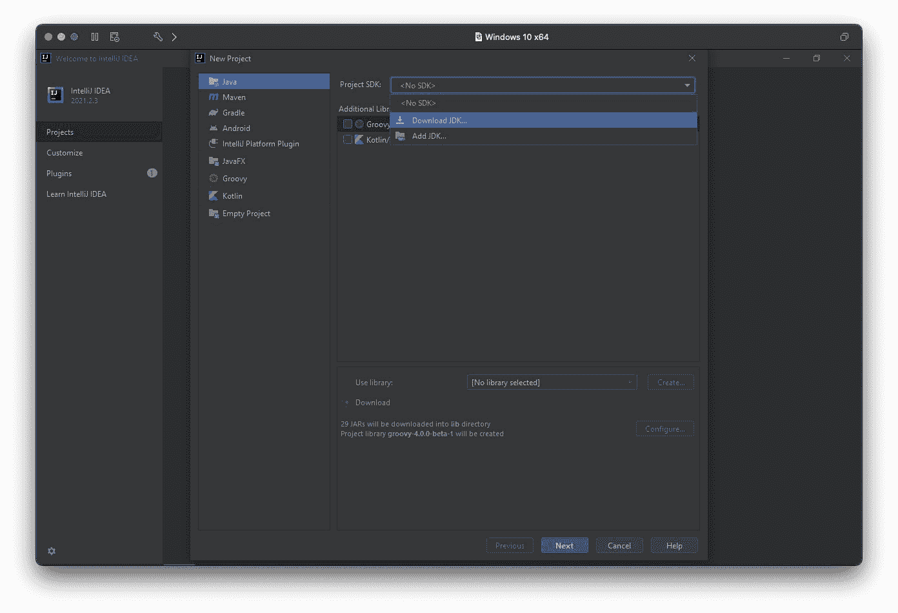
图 1.6：在“Project SDK”下拉菜单下选择 `Download JDK`。

会询问你想要哪个版本和供应商。选择版本 17 和 Oracle OpenJDK 作为你的供应商。然后点击 `Download`。

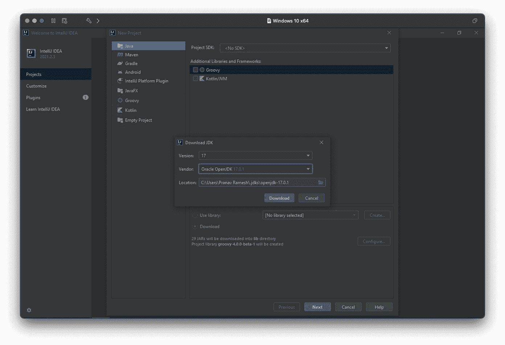
图 1.7：版本 17，Oracle OpenJDK

JDK 需要几分钟时间下载。完成后，Project SDK 将读取 `openjdk-17` 为你正在使用的 JDK。

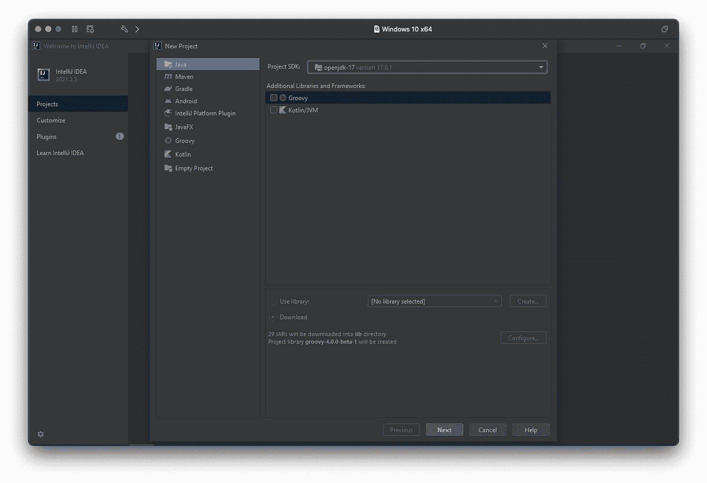
图 1.8：下载完 JDK 后点击 `Next`。

当你被要求从模板创建项目时，点击 `Next` 跳过此步骤。当 IntelliJ IDEA 要求你给项目起名称时，你可以输入 `HelloWorldProject`。完成后点击 `Finish`。你将被重定向到一个空白编辑器屏幕。在项目浏览器中右键点击 `src`，悬停在 `New` 上，并选择 `Java class`。

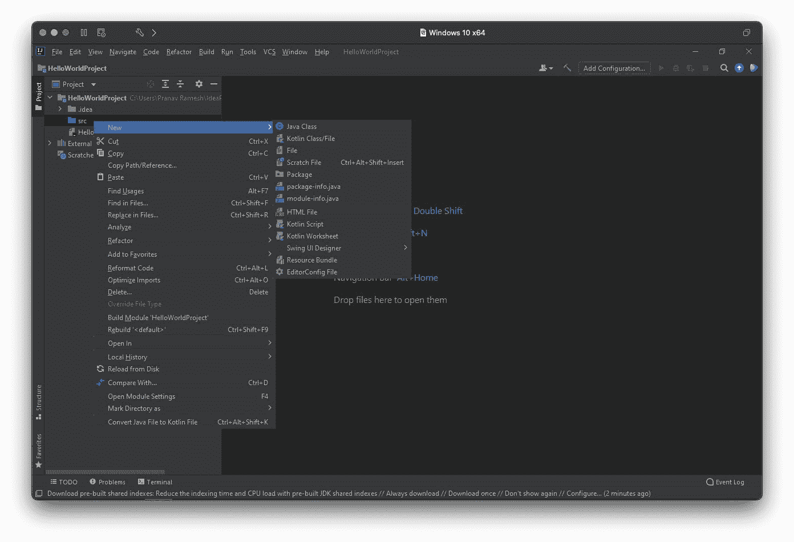
图 1.9：IntelliJ IDEA IDE。

## 1.2 编写你的第一个代码

将类命名为 `Main`。现在，弹出一个代码编辑器并显示以下代码：

```java
public class Main {
}
```

我们需要在类内部包含一个 `main()` 方法。这告诉 Java 要执行哪些代码。在大花括号之间添加以下内容：

```java
public class Main {
    public static void main(String[] args) {
        System.out.println("Hello world!");
    }
}
```

这应该输出“Hello world!”。现在，我们必须编译并执行代码。为了做到这一点，点击 *Run* 菜单栏按钮，然后点击出现的“Run…”选项。之后，点击“Main”表示你想运行来自 `Main` 类的 `main()` 方法。

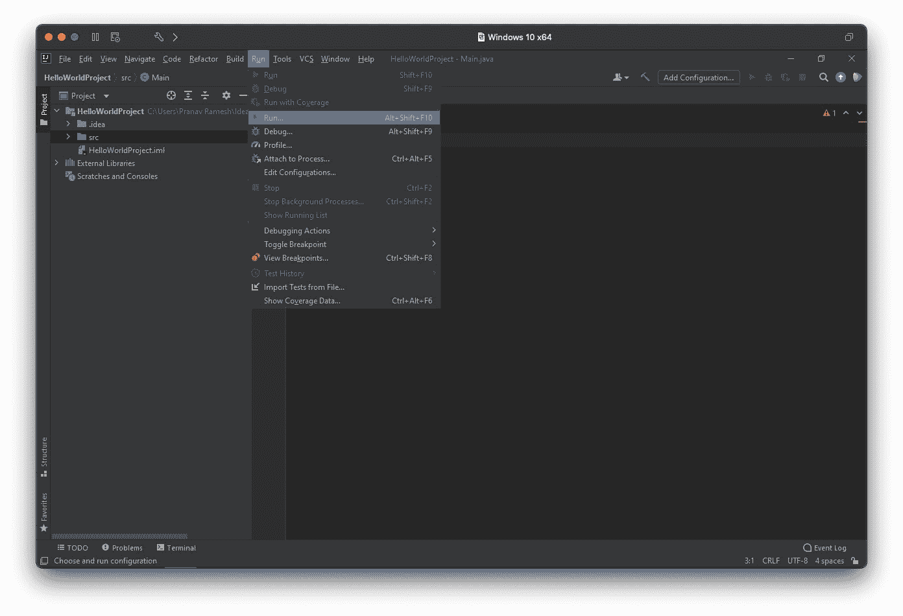
图 1.10：运行你的代码。

几秒钟，窗口底部会弹出一个控制台，显示 `Hello world!`。

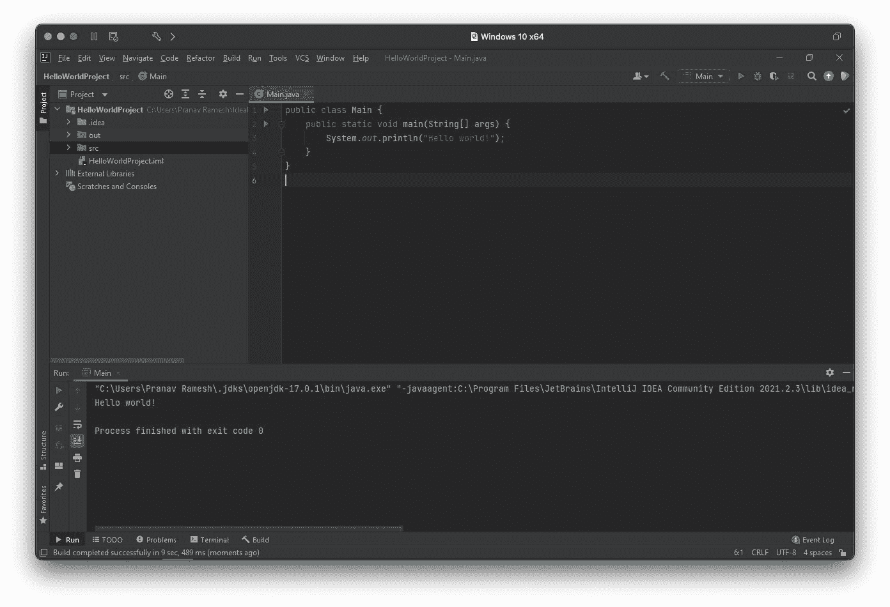
图 1.11：控制台中的“Hello world!”。

恭喜！你刚刚编写了你的第一个 Java 程序！

让我们来看看我们的代码刚刚做了什么。

列表 1.1：分析我们的代码。

```java
1 public class Runner {
2     public static void main(String[] args) {
3         System.out.println("Hello world!");
4     }
5 }
```

在第一行，我们写了类头，这是一个用于声明我们正在创建一个新类的类头。类本质上是对象的蓝图，我们可以通过 Java 创建并操作这些对象。

在第二行，我们为我们的 `main()` 方法写了方法头。方法头用于标记一个函数或代码块，我们稍后可以多次使用。这个特定的方法 `main()` 是 Java 在尝试执行代码时查找的内容。我们必须精确地编写 `public static void main`，并带有类型为 `String[]` 的参数 `args`，以便 Java 正确运行我们的代码。没有这个方法，Java 不一定会按顺序运行。

在第三行，我们通过使用 `System.out` 下的 `println` 打印 `"Hello world!"`。`System.out` 是控制台的引用，通过调用 `println`，我们可以将任何数据写入标准输出。

在第四行和第五行，我们分别用花括号关闭了函数和类。

## 1.1 使用分号

我们可以看到，在单个语句之后有一个分号，而在每个体头之后都有多个语句。这告诉我们，对于单个语句，我们用分号结束，而对于包含多个语句的代码块，我们将该代码块放在花括号内。我们将在后续学习中探索这一概念。现在，在每个语句后包含一个分号是重要的。

让我们再添加几个打印语句。在你的第一个打印语句之后，打印你的名字，然后以数字形式打印你的年龄。要打印你的名字，必须将其包含在双引号中。对于你的年龄则不需要这样做，因为它仅仅是一个数字而不是文本。

列表 1.2：打印我们的名字和年龄。

```java
1 public class Runner {
2     public static void main(String[] args) {
3         System.out.println("Hello world!");
4         System.out.println("Your Name");
5         System.out.println(25);
6 }
```

在运行程序之前，不要忘记保存文件。

列表 1.3：列表 1.2 的输出

```
Hello world!
Your Name
25
```

我们可以看到，与第 3 行和第 4 行相比，第 5 行没有包含分号。这是因为第 5 行打印的内容与第 3 行和第 4 行完全不同。第 5 行打印的是一个数字，即 `int`。我们可以对数字进行各种操作。

让我们加减一些数字。

列表 1.4：加减数字。

```java
1 public class Runner {
2     public static void main(String[] args) {
3         System.out.println("Hello world!");
4         System.out.println("Johnny Appleseed");
5         System.out.println(30);
6         System.out.println("Let's do math!");
7         System.out.println(45 + 15);
8         System.out.println(98 - 26);
9         System.out.println(1002 + 9384 - 56);
10    }
11}
```

在上面的代码中，我们将 45 加 15。之后，我们从 98 中减去 26，然后从 1002 和 9384 的和中减去 56。我们可以看到这里适用于基础数学和运算顺序，并且得到了预期结果。

列表 1.5：列表 1.4 的输出

```
Hello world!
Johnny Appleseed
30
Let's do math!
60
72
10330
```

目前，我们知道在各自行打印数据。但如果我们想让数据相邻打印呢？

在这种情况下，我们将使用 `System.out` 的 `print()` 方法，而不是 `println()`。该函数将数据写入标准输出而不移动文本光标到下一行。

我们可以使用 `print()` 方法在控制台上打印一些字母。

列表 1.6：使用 `System.out.print()`

```java
 1 public class Runner {
2     public static void main(String[] args) {
3         System.out.println("Hello world!");
4         System.out.println("Johnny Appleseed");
5         System.out.println(30);
6         System.out.println("Let's do math!");
7         System.out.println(45 + 15);
8         System.out.println(98 - 26);
9         System.out.println(1002 + 9384 - 56);
10         System.out.print("A");
11         System.out.print("B");
12         System.out.print("C");
13         System.out.println("soup");
14         System.out.println("Done");
15    }
16}
```

在第 10 到 12 行中，我们使用 `print()` 函数将 `"A"`、`"B"` 和 `"C"` 打印到控制台，它们紧紧挨在一起。然后，我们调用 `println()` 函数来打印 `"soup"`。这会将 `"soup"` 打印在 `"ABC"` 旁边，然后将文本光标移动到下一行。这样，当打印 `"Done"` 时，它就不会与 `"ABCsoup"` 在同一行。

列表 1.7：Listing 1.6 的输出

```
Hello world!
Johnny Appleseed
30
Let's do some math!
60
72
10330
ABCsoup
Done
```

干得好！你创建了可以打印文本并进行数学运算的有效代码！

## 1.3 注释

有时，在编写代码时，我们希望对算法中特定点正在发生的情况进行简短描述。在其他情况下，我们只是不想运行某些代码，但又不想删除它们，因为我们以后可能对其进行使用或重构。

解决这一问题的方法是使用**注释**。注释允许我们在代码中编写纯文本，而不会被 Java 求值。我们通过编写双反斜杠（`//`）后跟我们的文本来编写单行注释。

列表 1.8：编写单行注释

```java
// I am a comment
```

如果我们想写跨越多行的注释，则可以将所有纯文本放在 `/*` 和 `*/` 之间，就像大括号一样。

列表 1.9：编写多行注释

```java
/*
I am a comment
that can stretch
across multiple lines
*/
```

作为一个使用注释的示例，假设我们是 Java 编程的初学者，并且被给了一段代码。

列表 1.10：分析陌生代码

```java
public class Runner {
    public static void main(String[] args) {
        int sum = 0;
        for(int i = 1; i <= 10; i++) {
            sum += i;
        }
        System.out.println("The sum of 10 numbers is " + sum);
    }
}
```

我们完全不知道这个程序是要做什么的。然而，如果开发者包含了注释，我们就能对代码将做什么有一个大致的概念。

列表 1.11：在陌生代码中添加注释


```java
public class Runner {
    public static void main(String[] args) {
        // Creating a sum variable
        int sum = 0;

        // Adding every number from 1 to 10 to sum
        for(int i = 1; i <= 10; i++) {
            sum += i;
        }

        // Printing sum
        System.out.println("The sum of 10 numbers is " + sum);
    }
}
```

现在我们可以承认，我们的代码的作用是找到前 10 个连续整数之和。这是注释派用之处的完美例子。当我们运行这段代码时，我们会发现执行的成功没有受到我们注释的影响。

列表 1.12：Listing 1.11 的输出

```
The sum of 10 numbers is 55
```

## 1.4 保留关键字

在 Java 中，以下关键字是**保留的**，这意味着它们被 Java 语言使用，因此不能作为变量标识符。

| abstract | continue | for | new | switch |
| :--- | :--- | :--- | :--- | :--- |
| assert | default | goto | package | synchronized |
| boolean | do | if | private | this |
| break | double | implements | protected | throw |
| byte | else | import | public | throws |
| case | enum | instanceof | return | transient |
| catch | extends | int | short | try |
| char | final | interface | static | void |
| class | finally | long | strictfp | volatile |
| const | float | native | super | while |

## 1.5 本书使用的约定

本书对图像、表格和代码块等内容使用了许多约定。

### 1.5.1 图片

图片将被称为“Figures”（图）。例如，Figure 1.12 指的是之前的示例图像。如下面的图片所示，标题可能会定期出现在图片下方。

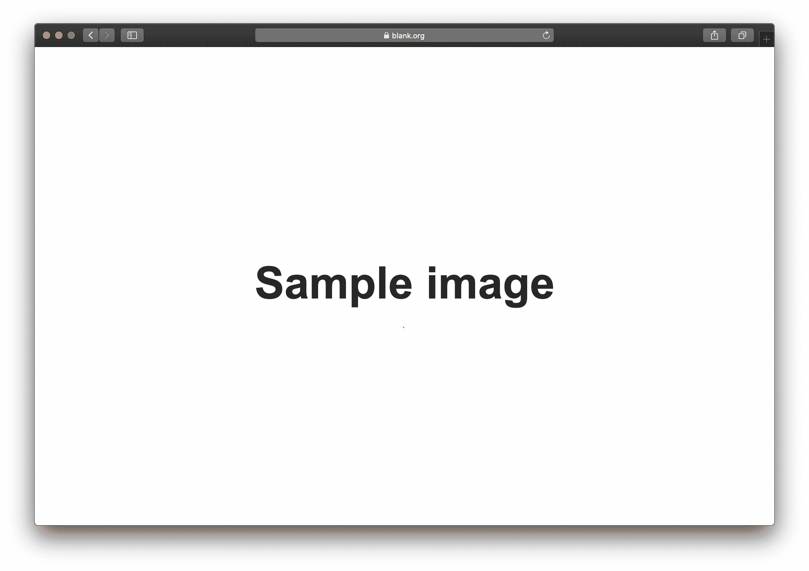

图 1.12：这是上方图片的示例标题。

### 1.5.2 表格

表格将类似于下面，其中有一个包含文本的简单网格。

| Lorem | ipsum | dolor |
| :--- | :--- | :--- |
| sit | amet | consectetur |
| adipiscing | elit | sed |

### 1.5.3 内联代码和代码块

代码在书中通过两种方式表示。第一种是通过`内联代码`，即行内代码。

> 这里的 `for` 和 `while` 循环的区别在于内联代码。

代码的另一种表示方式是通过代码块（code fences）。代码块是可能会遇到的代码块。

代码块将被视为列表 Listing 1.13。

```java
public static void main(String[] args) {
    System.out.println("Sample code");
}
```

代码块要么带有行号，如 Listing 1.14 所示，要么没有行号，如 Listing 1.15 所示。

列表 1.14：带有行号的示例代码。

```java
1public static void main(String[] args) {
2    System.out.println("With line numbers");
3
```

列表 1.15：不带行号的示例代码。

```java
public class Arithmetic {
    public static void main(String[] args) {
        System.out.println("Without line numbers");
    }
}
```

### 1.5.4 Notes

偶尔会出现“注释”，它们讨论有趣的实或主题，但偏离了概念的主旨。这些框并非必读，但很有帮助。它们将出现在阴影块中，并带有所讨论概念的标题。

块 1.2。一个有趣的 Lorem sit amet, consectetur adipiscing elit, sed do eiusmod tempor ut labore et magna aliqua. Ut enim ad minim veniam, quis nostrud exercitation nisi ut aliquip ea commodo consequat. Duis aute irure in voluptate velit esse fugiat nulla pariatur. Excepteur sint occaecat non proident, sunt in culpa qui deserunt mollit anim est laborum.

### 1.5.5 示例、练习和问题

在书中每章都有许多示例。某些示例将在现有代码的基础上进行，而另一些示例只是可能会遇到的情况。

示例将以粗体字体指示，后面跟着示例。

> **Example**
>
> 这是一个示例。

练习也可能出现在特定章节之后，测试你对所学内容的掌握情况。与示例不同，书籍在你完成练习后不会立即向你显示答案。建议你在每个相应章节的 Java 项目中使用独立的 Java 类进行练习。

练习块看起来与 1.5.4 节 中讨论的“注释”一样，但标题将是斜体的 *Exercises*（练习）标签。

块 1.3。*Exercises*

**Ex 1.** 这是一个示例题。

**Ex 2.** 这是另一个示例题。

**Ex 3.** 这是第三个示例题。

最后，每章末尾会有编程问题。除非另有说明，否则将你从 `main()` 方法或 `main()` 调用的另一个静态方法中编写并运行代码。

> **Problem 1**
>
> 编写一个程序使用 `for` 循环打印从 1 到 100 的所有数字。

练习和问题的解答都位于书末。

## 1.6 复习

在本节中，我们开始了 Java 编程之旅，首先安装了用于调试和执行的 JDK。接下来，我们安装了 Eclipse IDE，并创建并运行了第一个“Hello world”程序。最后，我们学习了如何打印更多数据，并分析了注释、重要的关键字以及本书中使用的规范。

# 第 2 章 类型

Java 是一种`object-oriented`（面向对象）语言，这意味着我们使用 Java 来操作`objects`（对象）。现实中的对象可以是任何东西，从汽车网球。以后我们将能够创建自己的对象。然而，在此之前，我们必须处理 Java 处理的最基本内容，即`types`（类型）。

我们可以处理许多不同类型的数据，包括数字和文本。事实上，我们有八种可以使用的`primitive types`（原始类型），或最基本的类型：`int`、`long`、`short`、`float`、`double`、`boolean`、`char` 和 `byte`。我们将重点关注 `int`、`double` 和 `boolean`，但偶尔也要使用其他类型。

除了这些原始类型，我们可以在更大规模上处理对象，例如 `Strings`、`StringBuilders`、`Integers`、`Doubles` 等。这些对象不是原始类型，因为它们的整个基础都是基于原始类型的工作原理。例如，一个 `String` 对象仅仅是 `char` 数据序列。

让我们从学习如何操作数字开始。

## 2.1 数字

Java 允许我们在很大程度上处理数字。例如，2、5.6 和 -93 都是数字的例子。

数字虽然本身不是对象，但可以拆分为 `int`、`long`、`short`、`byte`、`float` 和 `double`。让我们先探索整数的不同类型。

### 2.1.1 Java 整数的类型

在进入整数之前，我们需要复习一个重要的计算机科学概念。我们必须面对现实：一切都是由`binary numbers`（二进制数）组成的，这意味着我们使用 0 和 1 来表示所有类型的数据。特别是整数，表示为 0 和 1 的组合。

块 2.1。二进制与十进制

如果我们从 2 基（二进制格式）开始计数，我们将从这里

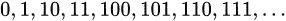

相同的序列在十进制中将是

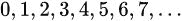

二进制计数和十进制计数之间的区别在于，在 2 基中，在在我们所有的数字都是 1 之后，我们会增加另一个位值（1 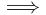 10, 111  1000）。另一方面，在 10 基中，在我们所有的数字都是 9 之后，我们会增加另一个位值（99  100, 9999  10000）。

关于从二进制数转换为十进制数字，如果我们有一个 2 基的 101001110，它将翻译为十进制的 334。我们将 2 基数字转换为十进制的方法是从左开始展开数字，使得个数字乘以 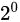，十位乘以 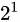，百位乘以 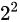，千位乘以 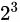，如此，如果我们展开 101001110 会得到 epub/OEBPS/images/texmath/3eb3904567da61028c50dd0f1ed3a8](Images/image00406)epub/OEBPS/images/texmath/2dc08ffff4ef685c7f0793fad7e1f](Images/image00407)epub/OEBPS/images/texmath/7246030adbd039a64fa23dd3cf](Images/image00408)

让我们分析这与 Java 的关系。如表 2.1 所示，Java 整数可以分为：8 位、16 位、32 位、64 位或 128 位。

| 类型 | 位 | 数值范围 |
| :--- | :--- | :--- |
| `byte` | 8 位 | 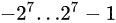 |
| `short` | 16 位 | 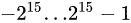 |
| `int` | 32 位 |  |
| `long` | 64 位 | 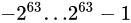 |

表 2.1：Java 整数的类型。

我们将主要关注列表中的 `int` 数据。查看上面的数值范围，我们 `int` 落在  之间。这意味着 `int` 类型数字只能在 -2147483648 和 2147483647 之间。所以，如果你尝试写一个大于 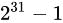 或小于  的整数，你将收到错误。此外，如果你的代码在任何一点 `int` 尝试超过  或小于 ，就会发生所谓的 `overflow`（溢出）。这意味着如果你的整数不断增加，它最终将循环并从最小的负 `int` 开始。同样，如果你的整数不断减小，它最终将循环并从最大的正 `int` 开始。

### 2.1.2 整数数学运算

就像在现实生活中一样，你可以在 Java 中对整数进行简单的算术运算。表 2.2 显示了你可以与数字使用的不同运算符。

| 运算符 | 定义 | 示例 |
| :--- | :--- | :--- |
| `+` | 加 两个数字相加 | `1+2=3` |
| `-` | 减 两个数字相减 | `10-4=6` |
| `*` | 乘 两个数字相乘 | `5*6=30` |
| `/` | 除 两个数字相除 | `6/3=2` |
| `%` | 取模 - 两个数字相除并返回余数 | `7%3=1` |

表 2.2：可以与整数使用的运算符。

需要注意的是，当你对整数进行任何类型的操作时，你得到的是整数结果。这在用 `int` 除以 `int` 时尤为重要。例如，如果你取 `6 / 3`，你会得到预期的 `2`，但如果你除 `17 / 4`（结果本应该是小数 `4.25`），Java 将会删除小数点后的所有内容并只保留整数部分，即 `4`。

我们还应该注意，我们可以在操作中使用括号，这表明 Java 算术遵循 PEMDAS 运算顺序。例如，`(3+5)*2` 将产生 `16`，因为我们先计算括号内的 `3+5`，然后将结果乘以 `2`。

目前，我们将简单地使用 `System.out.println()` 打印想要执行的算术运算。创建一个名为 `Types` 的新 Java 项目。然后，创建一个名为 `Arithmetic.java` 的新类，并在类编写一个空的 `main()` 函数。

列表 2.1：在 `Arithmetic.java` 中添加 `main()` 方法

```java
public class Arithmetic {
    public static void main(String[] args) {

    }
}
```

### 示例 1

现在，让我们来做一些加减法。在括号内编写几个包含算术表达式的 `print` 语句。你不一定需要复制列表 2.2 中执行的相同算术。

列表 2.2：执行加法和减法。

```java
public class Arithmetic {
    public static void main(String[] args) {
        System.out.println(2+4);
        System.out.println(9312-893193);
        System.out.println(128+8592+4829128-4829);
        System.out.println(4578-(7591+38));
    }
}
```

注意第四行和第五行，我们同时发生了多次加法和减法。除非有括号（如第五所示），否则加法和减法的优先级相同，因此在这种情况下 Java 将从左到右计算。

列表 2.3：列表 2.2 的输出

```
6
-883881
4833019
-3051
```

## 示例 2

接下来，编写一些包含乘法和除法的表达式，如列表 2.4 所示。

列表 2.4：执行乘法和除法。


```java
public class Arithmetic {
    public static void main(String[] args) {
        System.out.println(29*73);
        System.out.println(-44/11);
        System.out.println(30/4);
    }
}
```

我们观察到乘法的工作方式与书面数学完全。但对于除法，正如我们之前分析的那样，整数除以整数只会得到一个整数，因此第五行会将 `30/4` 的商向下取整到 7.5 的地板值，即 7。

列表 2.5：列表 2.4 的输出

```
2117
-4
7
```

## 示例 3

最后，我们可以使用列表 2.6 中的取余运算符来获取两个整数除法的余数。当对 `int` 操作数进行操作时，该余数也始终是一个 `int`。

列表 2.6：寻找余数。

```java
public class Arithmetic {
    public static void main(String[] args) {
        System.out.println(1234%10);
        System.out.println(232%2);
        System.out.println(-9%15);
    }
}
```

我们会注意到在第一个取余表达式中，发现一个数字除以 10 的余数就是该数字的个。这是我们在所有基数及其对应数字中都会发现的一致模式。此外，我们计算了 -9 除以 15 的余数。Java 输出 `-9` 作为 `-9%15` 的结果，表明 Java 并没有使用真正的模，而是简单地使用百分号（模）符号来计算余数。如果 Java 确实采用了真正的模运算器，`-9%15` 将是 `6`，因为特定模下的数字不会是负数。

列表 2.7：列表 2.6 的输出

```
4
0
-9
```

## 模块 2.2. 练习

**练习 1.** 求 239 和 9584 的和。

**练习 2.** 求 12038 和 5982831 的积。

**练习 3.** 约翰农民的牛在工作的第一天产 1 加仑牛奶，第二天产 2 加仑，第三天产 3 加仑，以此类推持续七天。七天后，约翰农民的牛共产生了多少加仑牛奶？

**练习 4.** 约翰农民想带上他的 247 头牛去牛肉博物馆，他必须将它们分成 15 头一组。他遗憾不得不留下多少头牛？

### 2.1.3 处理小数

我们经常使用整数，但在某些情况下，我们也需要使用小数。这些小数可以是像 3.44、128.94、-75.1 甚至 4.0 这样的数字。Java 中任何带有小数点的数字，即使是技术上是整数的（如 4.0），都是小数。

小数可以分为 `float` 和 `double`。`float` 和 `double` 的区别在于 `float` 提供 6 到 7 位小数的精度，而 `double` 提供 15 到 16 位小数的精度。因此，如果我们计算诸如 `1.0 / 7.0` 且两者都是 `double` 类型，我们将得到 0.1428571428571。

### 2.1.4 小数运算

我们经常使用整数，但在某些情况下我们需要使用小数。这些小数可以是像 3.44、128.94、-75.1 甚至 4.0 这样的数字。Java 中任何带有小数点的数字，即使是技术上是整数的（如 4.0），都是小数。小数可以分为 `float` 和 `double`。`float` 和 `double` 的区别在于 `float` 提供 6 到 7 位小数的精度，而 `double` 提供 15 到 16 位小数的精度。因此，如果我们计算诸如 `1.0 / 7.0` 且两者都是 `double` 类型，我们将得到 0.1428571428571。

### 2.1.3 处理小数

我们经常使用整数，但在某些情况下我们需要使用小数。这些小数可以是像 3.44、128.94、-75.1 甚至 4.0 这样的数字。Java 中任何带有小数点的数字，即使是技术上是整数的（如 4.0），都是小数。小数可以分为 `float` 和 `double`。`float` 和 `double` 的区别在于 `float` 提供 6 到 7 位小数的精度，而 `double` 提供 15 到 16 位小数的精度。因此，如果我们计算诸如 `1.0 / 7.0` 且两者都是 `double` 类型，我们将得到 0.1428571428571。

（此处省略重复的文本段，根据要求不重复输出原文）

列表 2.11: 列表 2.10 的输出

```
14164.042105263157
77901.88
2.0
-11.0
```

## 区块 2.3. 练习

**练习 1.** 农夫约翰想为牛购买口罩以防止牛类疾病 COWWID-19 的传播。如果每个口罩的价格是 $5.03，他为他的牛购买 198 个口罩需要支付多少钱？

**练习 2.** 农夫约翰拥有 2190 英亩土地，他想分配 43 个牛守护者来保护这些土地。如果牛必须保护相同数量的土地，每个守护者应该负责多少英亩？

**练习 3.** 农夫约翰有 $412.93，他想给他的 24 头牛分等金额的金。每头牛应该收到多少钱？

**练习 4.** 农夫约翰的牛群陷入了困境。它们制作了一把 3.64 米高的梯子来爬过 4.21 米高的谷仓门并逃离 COWWID-19 的隔离，但它们不知道梯子还需要延长多少米。梯子还需要延长多少米，牛群才能成功逃离隔离？

### 2.1.5 `Math` 类

除了我们在中学过的操作之外，我们还可以执行其他数学运算，例如求绝对值、使用指数和求平方根。然而，这些操作需要使用一个名为 `Math` 的特殊类。该类包含了我们可以用于执行这些复杂操作的 `methods`（方法）。

要使用 `Math` 类中的方法，我们只需要编写 `Math`，后面跟着一个点以及我们想要使用的方法即可。

```
Math.method()
```

#### 绝对值

要找到一个数的绝对值，我们可以写 `Math.abs(number)`。

```
System.out.println(Math.abs(5)); // 5
System.out.println(Math.abs(-4)); // 4
```

此方法将任何数字转换为其正数值形式。

#### 指数

要将一个数作为另一个数的幂，可以使用 `Math.pow()` 方法，它产生一个 `double` 类型的结果。我们提供两个参数 `a` 和 `b`，即可得到 `a` 的 `b` 次幂的结果。

```
System.out.println(Math.pow(2, 4)); // 16
System.out.println(Math.pow(5, 3)); // 125
```

#### 平方根

要找到一个数的平方根，可以使用 `Math.sqrt()` 方法，它产生一个 `double` 类型的结果。我们可以提供一个数值参数 `a`，并将得到 `a` 的平方根。

```
System.out.println(Math.sqrt(16)); // 4.0
System.out.println(Math.sqrt(6.25)); // 2.5
```

#### 获取随机数

我们还可以使用 `Math.random()` 方法获取随机数。这将产生一个 0.0 到 1.0 之间的随机 `double` 值。

```
System.out.println(Math.random());
System.out.println(Math.random());
System.out.println(Math.random());
```

```
0.9273683758459681
0.8923263271915217
0.8198859922177231
```

我们可以用此来获取两个数字之间的随机整数。我们需要写以下代码：

```
(int)(Math.random() * b + a)
```

*   我们首先编写 `(int)` 将结果转换为整数。我们将在第 3.3 节 中学习更多关于这种符号的内容。
*   我们将 `Math.random()` 乘以 `b`，因为 `b` 表示可以从中选取的整数数量。
*   我们将此结果加上 `a`，`a` 表示我们可以生成的最小随机数。

例如，假设我们想要一个 10 到 25 之间的随机整数（包含边界）。从 10 到 25 共有 16 个整数，所以 `b` 为 16。此外，下限是 10，因此 `a` 为 10。因此，我们可以打印以下内容。

```
System.out.println((int)(Math.random() * 16 + 10));
```

当我们执行这段代码几次时，我们将……

## 2.2 文本

在 Java 中，字符串是字符序列。字符串对大小写敏感，因为大写字母和小写字母被视为不同的。例如，`"Hello"` 和 `"hello"` 是不同的字符串。

### 2.2.1 字符

正如我们之前提到的，字符串是由字符组成的。`char` 字面量是一个用单引号括的单个字符，例如 `'a'` 或 `'b'`。我们还可以在字符串中使用转义序列。例如，`'\n'` 是它自己的换行字符，而 `'\"'` 是双引号。

### 2.2.2 创建字符串

要创建一个 `String`，我们只需要将文本放在双引号内。让我们从创建一个新文件 `Strings.java` 开始，并在类体中添加一个 `main()` 方法。

```java
public class Strings {
    public static void main(String[] args) {

    }
}
```

现在，我们可以使用列表 2.13 中的打印语句来打印任何我们想要的内容。

```java
public class Strings {
    public static void main(String[] args) {
        System.out.println("My name is Johnny Appleseed.");
        System.out.println("I am 30 years old.");
        System.out.println("I like make Android Apps using Java.");
    }
}
```

我们可以看到，当我们运行代码时，得到的是我们在控制台中完全打印的内容。

列表 2.14: 列表 2.13 的输出

```
My name is Johnny Appleseed.
I am 30 years old.
I like make Android Apps using Java.
```

### 2.2.3 字符串拼接

除了一次处理一个字符串外，我们还可以使用 `+` 运算符将一个字符串和另一个数据合并（或*拼接*）成一个，如列表 2.15 所示。

列表 2.15: 拼接字符串。

```java
public class Strings {
    public static void main(String[] args) {
        System.out.println("My name is " + "Johnny Appleseed.");
        System.out.println("1 and " + "2 and " + "3 and 4");
        System.out.println("I am a string that is force casting " + 123);
        System.out.println(3 + 4.5 + 6 + " is now a string!");
    }
}
```

在第一个打印语句中，我们注意到当使用 `+` 运算符连接 `"My name is "` 和 `"Johnny Appleseed."` 时，打印出一个组合后的字符串。在第二个打印语句中，发生了相同的情况，但是从左到右进行多次字符串拼接。

然而，在第三行中，我们正在将 `String` 与一个 `int` 拼接。当我们这样做时，Java 会将 `int` 转换为 `string` 并将其附加第一个字符串的末尾，以便拼接能够按预期工作。

在第四行中，我们首先计算 `3 + 4.5 + 6`，其结果简化为 `13.5`。然后，我们将结果加到一个字符串。由于我们正在将一个 `float` 加到 `String`，Java 会将 `float` 转换为 `String`，然后将两个数据连接成单个字符串。

列表 2.16：Listing 2.15 的输出。

```
My name is Johnny Appleseed.
1 and 2 and 3 and 4
I am a string that is force casting 123
13.5 is now a string!
```

## 章节 2.5 练习

**Ex 1.** 打印你的名和姓的拼接，且不在任一字符串中添加空格。

**Ex 2.** 打印字符串“Hello! My name is {} and I am {} years old!”，其中第一个 {} 是你的名字，第二个 {} 是你的年龄。确保两个占位符都是它们自己的字符串（即你的名字和年龄都是独立的字符串），这样你就可以在这些字符串上练习拼接。

**Ex 3.** 打印“MM/DD/YYYY”，其中“MM” 是你的出生月份，“DD” 是你的出生日期，“YYYY” 是你的出生年份，且“MM”、“DD”和“YYYY”是独立的字符串。

### 2.2.4 获取字符串的长度

你也可以找到字符串中的字符数。例如，"Hello world" 有 11 个字符。需要注意的是，字符串中的空格、标点符号和符号仍然被视为字符。

要找到字符串的字符数（或 `length`），你会写：

```
"I'm a string".length()
```

其中你先写字符串，后面跟着一个点，然后是字符串方法 `length()`。该方法将以 `int` 值的形式给出字符数量。字符串可以拥的最少字符数是 0 个。编写并查找几个字符串的长度，并对这些值进行一些数学运算，如 Listing 2.17` 方法。

```java
public class Strings {
    public static void main(String[] args) {
        System.out.println("Johnny Appleseed".length());
        System.out.println("Johnny".length() + "Appleseed".length());
        System.out.println("cool".length() * 4 + " is the new length.");
    }
}
```

在第一个打印语句中，我们正在使用 `length()` 方法找到 "Johnny Appleseed" 中的字符数。在第二个打印语句中，我们把 "Johnny" 的长度加上 "Appleseed" 的长度，但我们没有在其中任何一个包含空格，所以字符会少一个。在第三个打印语句中，我们用 "cool" 的长度乘以 4，然后将其连接到另一个字符串上。

列表 2.18：Listing 2.17 的输出。

```
16
15
16 is the new length.
```

## 章节 2.6 练习

**Ex 1.** 使用 `length()` 方法找到你的名字长度和姓的长度之和。

**Ex 2.** 将 "Programming" 的长度乘以 5 并打印结果。

**Ex 3.** 找到你的姓的长度除以你的名字长度的余数（使用 `%` 运算符）。

### 2.2.5 特殊字符和转义序列

字符串的特殊之处在于可以在字符串中使用特殊的字符序列来产生某些效果，比如换行。此外，这些特殊字符序列可以帮助防止意外的语法或逻辑问题影响你的字符串。

要编写这些字符序列（或 `escape sequences`），你需要先写一个 `\`，后面跟着一个字符。我们将在接下来的示例中介绍表 2.3 中显示的某些转义序列。

| 转义序列 | 目的 |
| :--- | :--- |
| `\\` | 插入普通的反斜杠 |
| `\"` | 插入双引号 |
| `\n` | 插入换行符 |
| `\t` | 插入制表符 |
| `\r` | 插入回车 |
| `\b` | 插入退格 |

表 2.3：转义序列。

**示例 1** 假设我们要打印 `said, "Give me liberty, or death!"` 而不终止字符串。

列表 2.19：打印引号

```java
public class Strings {
    public static void main(String[] args) {
        System.out.println(said, "Give me liberty, or death!");
    }
}
```

一旦我们编译，就会遇到大量的错误。

列表 2.20：Listing 2.17 的输出。

```
Exception in thread "main" java.lang.Error: said cannot be resolved to a
liberty, or death!
```

原因是“said”和“Give”之间放置了引号，Java 将解释为我们要终止字符串。

相反，如果我们在引号之前插入反斜杠（`\`），Java 将解释为我们不想终止字符串。

列表 2.21：在 Listing 2.19 的引号中添加反斜杠。


```java
public class Strings {
    public static void main(String[] args) {
        System.out.println("said, \"Give me liberty, or death!\");
    }
}
```

现在，当我们编译并执行代码时，会发现打印出的字符串包含了所有的引号。

列表 2.22：Listing 2.21 的输出。

```
said, "Give me liberty, or death!"
```

**示例 2** 假设我们要在一个语句中打印以下字符串。

```
99 lines of bugs in the code,
99 lines of bugs,
Take one down,
Patch it around,
127 lines of bugs in the code
```

这个字符串似乎有多行。因此，我们可以使用 `\n` 转义序列在代码的每一行之后插入一个新行。

列表 2.23：使用 `\n` 转义序列。

```java
public class Strings {
    public static void main(String[] args) {
        System.out.println("99 lines of bugs in the code,\n" +
                "99 lines of bugs,\n" +
                "Take one down,\n" +
                "Patch it around,\n" +
                "127 lines of bugs in the code");
    }
}
```

注意我们正在拼接的每个字符串末尾添加 `\n` 序列。请注意，你*不需要这样做*；书籍只是在每个字符串末尾带有 `\n` 字符进行拼接，因为没有足够的空间在一个带有多个 `\n` 分隔符的字符串中放入这首诗。

列表 2.24：Listing 2.23 的输出。

```
99 lines of bugs in the code,
99 lines of bugs,
Take one down,
Patch it around,
127 lines of bugs in the code
```

我们还可以选择在字符串的开头或结尾的其他地方插入 `\n` 序列。当在字符串中找到 `\n` 时，Java 会简单地插入新行，并在那里打印剩余字符。

列表 2.25：在字符之间使用 `\n`。

```java
public class Strings {
    public static void main(String[] args) {
        System.out.println("99 lines of\nbugs in the code");
    }
}
```

列表 2.26：列表 2.25 的输出。

```
99 lines of
bugs in the code,
```

## 示例 3

我们还可以使用 `\t` 序列在字符之间生成制表符。例如，我们可以编写如下代码：

列表 2.27：使用 `\t`。

```java
public class Strings {
    public static void main(String[] args) {
        System.out.println("1...\t2...\t3...\nAnd we have liftoff!");
    }
}
```

在上面的字符串中，我们在 `1...`、`2...` 和 `3...` 之间插入了制表符。我们还使用了 `\n` 运算符将 `And we have liftoff!` 插入到下一行。

列表 2.28：列表 2.27 的输出。

```
1...   2...   3...
And we have liftoff!
```

#### 块 2.7. 练习题

**练习 1。** 使用单个字符串分行写下你的全名。

**练习 2。** 打印《星际大战》中的引言：“尤达说：‘做，或者不要，不要尝试。’”

**练习 3。** 使用单个`print`语句打印以下输出。

```
1:    one
2:    two
3:    three
```

注意，这里的空格是制表符。

## 2.3 逻辑

我们已经学习了如何用 Java 处理数字和文本。接下来，我们将探索逻辑推理。Java 可以根据称为 `booleans`（布尔值）的条件表达式做出决策。与数字或文本不同，布尔值只有两个：`true` 和 `false`。

### 2.3.1 打印 `true` 和 `false`

打印 `true` 或 `false` 非常简单。尽管这两个值看起来像字符串，但它们没有被双引号括。

首先，在与 `Strings.java` 和 `Arithmetic.java` 相同的 Java 项目中创建一个新类 `Booleans.java`。然后，在你新的 `Booleans` 类体中添加 `main()` 方法，如列表 2.29 所示。

列表 2.29：在 `Booleans` 类中添加 `main()` 方法。

```java
public class Booleans {
    public static void main(String[] args) {

    }
}
```

接下来，在控制台的一行中打印 `true`，在下一行打印 `false`。

列表 2.30：打印 `true` 和 `false`。

```java
public class Booleans {
    public static void main(String[] args) {
        System.out.println(true);
        System.out.println(false);
    }
}
```

我们可以立即注意到，`true` 和 `false` 的颜色与字符串不同，这表明我们正在打印布尔值。

列表 2.31：列表 2.30 的输出。

```
true
false
```

对于本节，打印 `true` 和 `false` 就是我们需要做的。然而，布尔值并没有那么简单。关于布尔值我们还可以做更多，我们将在接下来的章节和后续章节中学习。

### 2.3.2 关系运算符

因为布尔值求值为为真/假值，我们可以对布尔值执行 `comparisons`（比较）。我们之前见过过比较，特别是针对数字。我们可以使用比较运算符，或称 `relational operators`（关系运算符），来比较数字等数据。当我们使用关系运算符比较两个值时，Java 会确定我们写的比较语句是真还是假。例如，如果我们说 4 大于 2，Java 会说这是 `true`；而如果我们说 56 等于 32，Java 就会判定其为 `false`。表 2.4 演示了我们可以使用的各种比较运算符，以及结果为真的示例。

| 运算符 | 定义 | 示例 |
| :--- | :--- | :--- |
| `>` | 大于 | 5 > 3 |
| `<` | 小于 | 67 < 91.8 |
| `>=` | 大于等于 | 43 >= 42 |
| `<=` | 小于等于 | 67.8 <= 85.2 |
| `==` | 等于 | 19 == 19 |
| `!=` | 不等于 | 32 != 32.1 |

表 2.4：关系运算符

`==` 运算符可能看起来陌生。在第三条语句中，我们使用 `==` 来确定两个对象是否相等。在第四条语句中，我们使用 `==` 来判断是否更短。在第五条语句中，我们使用 `==` 来判断一个是否等于另一个。在第六条语句中，我们使用 `!=` 来判断长度是否不相等。

让我们使用关系运算符。

列表 2.32：使用关系运算符。

```java
public class Booleans {
    public static void main(String[] args) {
        System.out.println(4 > 2);
        System.out.println(56 == 32);
        System.out.println("Hello".length() >= "bye".length());
        System.out.println(5 + 10 <= 20);
        System.out.println("Johnny".length() != 12);
    }
}
```

列表 2.33：列表 2.32 的输出。

```
false
false
true
true
true
```

#### 块 2.7. 练习题

**练习 1。** 使用单个字符串分行写下你的全名。

**练习 2。** 打印《星际大战》中的引言：“尤达说：‘做，或者不要，不要尝试。’”

**练习 3。** 使用单个`print`语句打印以下输出。

```
1:    one
2:    two
3:    three
```

### 2.3.3 逻辑运算符

除了使用关系运算符进行比较，Java 还可以使用 `logical operators`（逻辑运算符）对条件表达式进行评估。逻辑运算符用于连接两个或多个表达式，根据这些表达式的真假决定最终值。

与关系运算符不同，逻辑运算符只能比较布尔值或表达式，包括 `true`、`false` 以及简化为 `true` 或 `false` 的布尔表达式，例如 `5 > 3` 或 `98 != 38`。后者可能包含关系运算符的表达式。

表 2.5 列出了从优先级从高到低的三个逻辑运算符，我们可以使用它们来同时评估多个较小的表达式。

| 运算符 | 定义 | 示例 |
| :--- | :--- | :--- |
| `!` | *not* - 返回布尔值的反值 | `!true` |
| `&&` | *and* - 如果两个操作数都为真则返回真 | `true && false` |
| `||` | *or* - 如果一个或两个操作数为真，则返回真 | `true || false` |

表 2.5：逻辑运算符。

后两个运算符被称为**短路运算符**，因为第一个操作数的结果决定了是否应该评估第二个布尔操作数。这些运算符通常更安全，我们将坚持使用它们。`&&` 和 `||` 运算符确实存在非短路版本，即 `&` 和 `|`。然而，这些是不安全的，因为两个布尔操作数都会被独立地求值。例如，在 `and` 操作中，如果第二个操作数求值的运行时成功取决于取决于对第一个操作数的有效性检查，那么单个的 `&` `and` 运算符是不安全的，但 `&&` 运算符要安全得多。

你不需要担心运算符的不同版本，因为我们将坚持使用 `!`、`&&` 和 `||`。

[Table 2.5] 表明运算符按**优先级**从高到低排序。因为你可以在单个布尔表达式中使用多个逻辑运算符，所以使用 `not` 运算符的操作数会在使用 `and` 运算符的操作数之前求值，而使用 `and` 运算符的操作数会在使用 `or` 运算符的操作数之前求值。这与算术运算符的操作顺序相同。

### 2.3.4 使用 `not`

`not` 运算符（!`）非常直观，因为它简单地反转布尔值，从 `true` 变为 `false` 或反之。此运算符与 `and` (`&&`) 和 `or` (`||`) 不同，它是一个一元运算符，意味着它只需要一个操作数。让我们练习 [Listing 2.34] 中所示示例。

Listing 2.34：使用 `!` 运算符。

```java
public class Booleans {
    public static void main(String[] args) {
        System.out.println(!(true));
        System.out.println(!(23 == 93));
        System.out.println(!("Happy".length() != "Trails".length()));
    }
}
```

在第一个打印语句中，我们打印了 `true` 的反值。在第二个打印语句中，我们打印了两个数字相等性的反向值。`==` 配合外部的 `!`，可以组合组合形成简单的 `!=`。在第三个打印语句中，正在比较两个字符串的长度的相等性，Java 打印了该相等性测试结果的反向值。

注意，在所有的 `not` 操作中，所有使用一元运算符的子表达式都包裹在括号中。这是为了确保 `!` 运算符应用于整个布尔表达式，而不是不小心地应用于大操作数中的某个特定子操作数。

Listing 2.35：[Listing 2.34] 的输出

```
false
true
false
```

### 2.3.5 使用 `and`

`and` 运算符需要两个操作数（即布尔表达式）相互评估。只有当两个布尔表达式都为真时，`and` 运算符才会产生真的的结果。[Table 2.6] 表显示了操作数真/假的所有可能组合的真值表。

| **First** | **`and`** | **Second** | **=** | **Outcome** |
| :--- | :--- | :--- | :--- | :--- |
| `true` | `&&` | `true` | = | `true` |
| `true` | `&&` | `false` | = | `false` |
| `false` | `&&` | `true` | = | `false` |
| `false` | `&&` | `false` | = | `false` |

表 2.6：`and` 真值表。

我们可以看到只有 `true` 和 `true` 会产生结果。有趣的一点是，如果我们将所有的 `true` 值转换为 1，所有的 `false` 值转换为 0，并将 `&&` 运算符转换为乘法符号 (`*`)，我们将得到在 [Table 2.7] 中所示的操作：

| **First** | ***** | **Second** | **=** | **Outcome** |
| :--- | :--- | :--- | :--- | :--- |
| 1 | * | 1 | = | 1 |
| 1 | * | 0 | = | 0 |
| 0 | * | 1 | = | 0 |
| 0 | * | 0 | = | 0 |

表 2.7：修改后的 `and` 真值表。

我们可以看到每个组合都能很好地结合。这让我们承认 `&&` 运算符就像做乘法；只有真的 (1 * 1) 会产生结果 (1)。让我们写一些像 [Listing 2.36] 所示的布尔表达式，使用 `and` 运算符。

Listing 2.36：使用 `&&` 运算符。

```java
public class Booleans {
    public static void main(String[] args) {
        System.out.println(true && false);
        System.out.println(43 != 39 && 16 > 11);
        System.out.println(88 < 99 && !(53 < 21));
    }
}
```

在第一个打印语句中，我们打印 `true && false`。因为其中一个操作数为假，所以整个表达式将简化为 `false`。在第二个打印语句中，我们正在检查 43 是否等于 39 以及 16 是否大于 11。在第三个打印语句中，我们看到同时使用了 `&&` 和 `!`。因为 `not` 的优先级更高，它的操作首先执行，然后进行确定。

Listing 2.37：[Listing 2.36] 的输出

```
false
true
true
```

### 2.3.6 使用 `or`

`or` 运算符像 `and` 运算符一样需要两个操作数相互评估。然而，只要任意布尔表达式为真，`or` 运算符就会产生真的。[Table 2.8] 显示了操作数真/假所有可能组合的真值表。

| **First** | **`or`** | **Second** | **=** | **Outcome** |
| :--- | :--- | :--- | :--- | :--- |
| `true` | `||` | `true` | = | `true` |
| `true` | `||` | `false` | = | `true` |
| `false` | `||` | `true` | = | `true` |
| `false` | `||` | `false` | = | `false` |

表 2.8：`or` 真值表。

让我们写一些像 [Listing 2.38] 所示的布尔表达式，使用 `or` 运算符。

Listing 2.38：使用 `||` 运算符。

```java
public class Booleans {
    public static void main(String[] args) {
        System.out.println(true || false);
        System.out.println(78 == 29 || 15 < 34);
        System.out.println("Horse".length() > 3 || "Cat".length() == 3);
    }
}
```


在第一个打印语句中，我们简单地评估 `true` 或 `false` 是否真。在第二个打印语句中，我们可以看到我们同时使用了 `&&` 和 `||`。因为 `&&` 的优先级更高，它的操作数首先被比较。然后，`and` 操作的结果被用作 `or` 操作中的操作数，我们得到了结果。最后，在第三个打印语句中，我们确定字符串的长度是否超过 3 或另一个字符串的长度是否等于 3。

Listing 2.39：[Listing 2.38] 的输出

```
true
true
true
```

### Block 2.9. 练习

**Ex 1.** 打印你的名字长度是否大于姓氏长度，且你的名字不等于你的姓氏。

**Ex 2.** 打印你的兄弟姐妹数量是否少于你的年龄除以 3，或者你的出生月份数字大于 6。

**Ex 3.** 打印 5 是否大于 6 的反值。

### 问题 1

约翰农夫想保护他的牛免受牛类疾病 COWWID-19 的侵害，因此他决定为每只牛购买 3 个口罩、2 瓶洗手手液和 1 瓶维生素 D。以下是各项物品的价格：

* 口罩：每个 $0.99
* 洗手手液：每个 $34.99
* 维生素 D 瓶：每瓶 $2.49

已知约翰农夫有 91 头牛，请计算他在牛身上共需要花费多少钱。

### 问题 2

约翰农夫将他的牛隔离起来以防止牛类疾病 COWWID-19，而他的牛正策划逃出被锁的谷仓。它们必须爬过一扇高为 293.75 英尺的谷门，它们有一堆高为 `14.6875` 英尺的梯子。它们必须连接多少把梯子才能成功爬过谷门？

### 问题 3

约翰农夫并不是最聪明的农夫，他需要找出他的牛 Bessie Mooman 的名字中有多少字符。请找出他牛名字中的字符数量，不包括空格。

### 问题 4

约翰农夫正在学习编程，他想把他的牛 Bessie、Marco、Ruben、Humphrey 和 Gauri 的名字打印在不同的行。然而，他很固执，想用一个字符串来打印牛的名字。编写一个程序，在单个字符串中将这些名字打印在不同的行。

### 问题 5

约翰农夫想带 247 头牛去牛肉博物馆，他必须将它们分成每组 15 头的小组。他会有多少个完整的组？一个完整的组是指由 15 头牛组成的组。

# 第 3 章 变量

在之前的章节中，我们探索了如何操作在运行时不会改变的常量和静态数据。然而，当涉及到实际存储数据时，我们还不知道该如何做到。

例如，假设我们想要存储一个人的名字和年龄。我们并不确定名字和年龄是什么，但我们知道它们将分别是 `String` 和 `int`，并且无论名字和年龄是什么，我们都想对这些名字和年龄执行操作和命令。

幸运的是，Java 允许我们使用 `variables` 来存储数据。变量是赋值给各种数据的标识符。它们就像物品上的标签贴。标签是变量标识符，数据是标签所指的内容。这个比喻可以进一步扩展，因为它还表明变量并不是数据本身，而是一个指向存储数据的内存位置的标识符。

你可能在数学中见过并使用过变量。例如，你可以变量 `x` 和 `y` 使得：

`x + y = z`

这些变量 `x` 和 `y` 随后可以在后续表达式中使用，例如：

`z = x + y`

其中你将填充存储在 `x` 和 `y` 中的值。

在接下来的几个章节中，我们将探索如何在 Java 中创建、声明和使用变量。

## 3.1 创建变量

```java
public class Variables {
    public static void main(String[] args) {

    }
}
```

### 3.1 声明和使用变量

创建变量包含两个部分：**声明**和**使用**。在下面的示例中，我们声明了一个变量并在稍后使用了它。

```java
public class Variables {
    public static void main(String[] args) {
        int age;
        age = 15;
        System.out.println(age);
    }
}
```

在上面的示例中，我们声明了一个类型为 `int` 的变量，然后给它赋值 `15`。然后，我们使用 `System.out.println()` 方法打印该值。我们也可以同时声明并初始化一个变量：

```java
public class Variables {
    public static void main(String[] args) {
        int age = 15;
        System.out.println(age);
    }
}
```

### 3.2 初始化变量

当我们给变量赋值时，这被称为**初始化**它。

```java
public class Variables {
    public static void main(String[] args) {
        int age;
        age = 15;
        System.out.println(age);
    }
}
```

在上面的示例中，我们声明了一个类型为 `int` 的变量，然后给它赋值 `15`。然后，我们使用 `System.out.println()` 方法打印该值。我们也可以同时声明并初始化一个变量：

```java
public class Variables {
    public static void main(String[] args) {
        int age = 15;
        System.out.println(age);
    }
}
```

### 3.3 重新赋值变量

我们可以在初始化后更改变量的值。

```java
public class Variables {
    public static void main(String[] args) {
        int age = 15;
        age = 16;
        System.out.println(age);
    }
}
```

在上面的示例中，我们用值 `15` 初始化了变量 `age`，然后重新给它赋值为 `16`。程序的最终输出将是 `16`。

### 3.4 类型不匹配

每个变量都有固定的类型，其类型不能更改。

```java
public class Variables {
    public static void main(String[] args) {
        int age = 15;
        age = "Hello";
    }
}
```

在上面的示例中，我们尝试将一个 `String` 赋值给类型为 `int` 的变量。这会导致编译错误：

```
Exception in thread "main" Type mismatch: cannot convert from String to int
```

### 3.5 在表达式中使用变量

我们可以在表达式中使用变量。

```java
public class Variables {
    public static void main(String[] args) {
        int a = 10;
        int b = 20;
        int sum = a + b;
        System.out.println(sum);
    }
}
```

在上面的示例中，我们在表达式中使用变量 `a` 和 `b` 来计算它们的和，并将结果存储在变量 `sum` 中。

### 3.6 常量

为了防止变量的值被更改，我们使用 `final` 关键字。

```java
public class Variables {
    public static void main(String[] args) {
        final int age = 15;
        // age = 16;
        System.out.println(age);
    }
}
```

在上面的示例中，我们将变量 `age` 声明为 `final` 常量。如果我们尝试重新给其赋值，编译器将抛出错误。

```java
public static void main(String[] args) {
    int x = 2;
    int y;
    int z = 14;
    // ...
    // Assigning y later on
    y = 5;
}
```

声明和初始化变量的一个有趣点在于，如果多个变量共享相同的类型，我们可以在同一行内声明和/或初始化它们。因此，因为 `x`、`y` 和 `z` 都存储的是 `int` 值，我们只需要写下 `int`，然后用逗号分隔将所有变量初始化写在同一行。注意，你不一定需要初始化任何特定的变量，只需要说明它存在但没有赋值给任何内容。我们在 Listing 3.11 中的变量 `y` 中看到了这一点。

Listing 3.11：在单行中创建变量 `x`、`y` 和 `z`。

```java
public static void main(String[] args) {
    int x = 2, y, z = 14;
    // ...
    // Assigning y later on
    y = 5
}
```

我们甚至可以修改上面的代码，如果我们立即知道 `y` 的值，只需在开始时为 `y` 赋值即可。

Listing 3.12：在单行中为变量 `x`、`y` 和 `z` 赋值。

```java
public static void main(String[] args) {
    int x = 2, y = 5, z = 14;
}
```

### 示例 1

让我们写一个程序，打印两个小数的和、差、乘积和除。不过，我们不会直接将小数传递给打印语句，而是使用变量。

首先，我们必须声明并初始化这两个变量。我们将它们命名为 `a` 和 `b`。你可以将这些变量赋值给任何 double 类型。

Listing 3.13：创建两个变量 `a` 和 `b`。

```java
public static void main(String[] args) {
    double a = 2, b = 5;
}
```

#### 3.1 将 `int` 值赋值给 `double` 变量

你可能会注意到，当我们初始化 `double` 变量时，正在为它们赋值 `int` 值。Java 会执行一种被称为“隐式转换”的操作。当两个数据类型（例如 `int` 和 `double`）兼容时，就会发生这种情况，这意味着它们在上下文中是相似的（例如都是数字），并且你可以将较小的值转换为较大的值（例如 `int` 转换为 `double`）。虽然我们可以隐式地从 `int` 强制转换为 `double`，但反之则不行，因为这会导致数据丢失。我们将在第 3.3 节 中探索这一概念。

接下来，我们必须打印对 `a` 和 `b` 执行的各种算术操作。

Listing 3.14：打印 `a` 和 `b` 的和、差、乘积和除。

```java
public static void main(String[] args) {
    double a = 2, b = 5;
    System.out.println(a + b);
    System.out.println(a - b);
    System.out.println(a * b);
    System.out.println(a / b);
}
```

当我们运行 Listing 3.14 中的代码时，我们看到得到了预期的结果。

Listing 3.15：Listing 3.14 的输出。

```
7.0
-3.0
10.0
0.4
```

现在，我们必须问自己，如果我们只是为了打印它们的和、差、乘积和商，为什么要费力去创建变量呢？

为了突出变量的重要性，请将 `a` 和 `b` 修改为其他数字并再次运行你的代码。

Listing 3.16：更改 `a` 和 `b`。

```java
public static void main(String[] args) {
    double a = 9, b = 28;
    System.out.println(a + b);
    System.out.println(a - b);
    System.out.println(a * b);
    System.out.println(a / b);
}
```

Listing 3.17：Listing 3.16 的输出。

```
37.0
-19.0
252.0
0.32142857142857145
```

再次运行代码后，我们发现这次打印的所有内容都变了。修改 `a` 和 `b` 导致了完全不同的输出。

然而，我们也可以承认，当我们更改变量的值时，我们不需要手动修改任何算术操作，仅仅因为 `a` 和 `b` 不同，这些操作在运行时自动发生了变化。这表明变量代表了一种高 `抽象`，在执行简单操作时，你并不一定知道存储了什么值。

## 示例 2

假设我们想分别将姓和名作为输入，并打印一个包含我们名字的字符串。

```java
public static void main(String[] args) {
    // 创建新变量
    int number = 5;
    System.out.println(number);
    // 修改变量
    number = 8;
    System.out.println(number);
}
```

在 Listing 3.24 中，我们可以观察到我们在第三行创建了一个新变量 `number`，并将其赋值为 `5`。在第六行，我们把 `number` 重新赋值为 `8`。这是一个我们完全改变 `number` 存储数值的示例。需要注意的是，一旦创建了变量，你就无法更改其类型，因此你只能重新赋值与变量类型相同的值。

Listing 3.25：Listing 3.24 的输出

```
5
8
```

正如前面提到的，我们可以重新赋值变量，使其先前的存储的值影响其新值。例如，假设我们有以下代码。

Listing 3.26：创建一个新变量。

```java
public static void main(String[] args) {
    // 创建数字变量
    int number = 7;
    System.out.println(number);
}
```

假设我们想让 Listing 3.26 中 `number` 存储的值翻倍。当我们执行打印语句后重新赋值 `number` 时，我们赋值的值也可以包含 `number` 本身。因为变量被赋值给表达式，所以表达式首先需要完全简化。因此，如果我们将 `number` 赋值为 `number * 2`，我们将首先计算 `number * 2`，其结果为 `14`。因此，`number` 的新值将被赋值为 `14`。

Listing 3.27：使用其之前的值修改 `number`。

```java
public static void main(String[] args) {
    // 创建数字变量
    int number = 7;
    System.out.println(number);
    number = number * 2;
    System.out.println(number);
}
```

Listing 3.28：Listing 3.27 的输出

```
7
14
```

让我们再来看另一个修改变量的例子。假设我们想求数字 `34`、`76` 和 `12` 的平均值。求平均值的公式是数字之和除以集合中数字个数。我们将首先计算和并将其存储在 `double` 类型变量 `avg` 中。

Listing 3.29：将三个数字的和赋值给 `double` 变量 `avg`。

```java
public static void main(String[] args) {
    double avg = 34 + 76 + 12;
}
```

接下来，我们需要将 `avg` 除以 `3`。我们可以通过将 `avg` 重新赋值为 `avg / 3` 来实现。

Listing 3.30：将 `avg` 除以 `3`。

```java
public static void main(String[] args) {
    double avg = 34 + 76 + 12;
    avg = avg / 3;
}
```

最后，我们可以打印存储在 `avg` 中的值。

Listing 3.31：打印 `avg`。

```java
public static void main(String[] args) {
    double avg = 34 + 76 + 12;
    avg = avg / 3;
    System.out.println(avg);
}
```

Listing 3.32：Listing 3.31 的输出

```
40.666666666666664
```

### 3.1.3 简写运算符

假设我们想对 `int` 类型变量 `num` 执行以下操作。

Listing 3.33：创建并修改变量 `num`。


```java
public static void main(String[] args) {
    int num = 2;
    System.out.println(num);
    num = num + 5;
    System.out.println(num);
    num = num - 3;
    System.out.println(num);
    num = num * 14;
    System.out.println(num);
    num = num + 1;
    System.out.println(num);
    num = num - 1;
    System.out.println(num);
}
```

当我们运行这段代码时，发现我们得到了预期的结果。

Listing 3.34：Listing 3.33 的输出

```
2
7
4
56
57
56
```

然而，必须执行简单的二元运算（如仅仅从变量中加或减一个值）似乎很冗长，因为我们必须费力写类似 `num = num + 5` 这样的代码。

Java 通过提供**简写运算符**来帮助缓解这个问题。简写运算符帮助我们以更简洁的方式修改变量。与其写 `num = num + 5`，因为我们只是让 `num` 增加了 `5`，我们可以写成 `num += 5`，其中 `+=` 运算符就是我们的简写运算符。在自然语言中，这意味着“给 `num` 加 5”，而不是“将 `num` 设置为 num 加 5”。同样，`num = num - 3` 可以重写为 `num -= 3`。我们只需要写普通的运算符（如 `+`、`-`、`*`、`/` 或 `%`），后面跟一个 `=` 符号。

因此，我们可以使用简写运算符重写前三次变量赋值。

Listing 3.35：使用简写运算符。

```java
public static void main(String[] args) {
    int num = 2;
    System.out.println(num);
    num += 5;
    System.out.println(num);
    num -= 3;
    System.out.println(num);
    num *= 14;
    System.out.println(num);
    num += 1;
    System.out.println(num);
    num -= 1;
    System.out.println(num);
}
```

```java
final String greeting;
// 分配初始值
greeting = "Hello world!";
// 不能再次更改 greeting
greeting = "Bye!";
```

```
Exception in thread "main" java.lang.Error: Unresolved compilation problem:
    The final local variable greeting may already have been assigned
```

## 3.2 变量作用域

Java 维持了一种特定的`控制流`。在类中，像 `main()` 方法这样的方法可以位于类的任何位置，但在方法体内部，代码是从上到下、从左到右读取的。这是如何应用于变量的呢？

当我们第一次在方法内部声明并初始化局部变量时，变量声明之后的代码可以访问存储在变量中的值。例如，我们可以在 `main()` 方法内部声明并初始化变量 `number`，如列表 3.39 所示，然后在表达式或语句中使用它。

列表 3.39：在 `main()` 中创建并打印 `number`。

```java
public static void main(String[] args) {
    int number = 5;
    System.out.println(number);
}
```

列表 3.40：列表 3.39 的输出

```
5
```

现在，假设我们尝试在实际声明 `number` **之前** 打印 `number`。

列表 3.41：在声明之前打印 `number`。

```java
public static void main(String[] args) {
    System.out.println(number);
    int number = 5;
}
```

在列表 3.41 中，我们将打印语句移动到了 `number` 声明的上方一行。由于方法内部的代码是从上到下读取的，因此当我们尝试打印它时，`number` 尚未存在。因此，当我们在编译和执行代码时会收到一个错误。

列表 3.42：列表 3.41 的输出

```
Exception in thread "main" java.lang.Error: Unresolved compilation problem:
    number cannot be resolved to a variable
```

因此，我们必须**始终**在尝试使用变量之前确保该变量已存在。

这一概念同样适用于实际声明变量时。假设我们有以下代码：

```java
int number;
```

`number` 仅被声明了，尚未赋值。所以，如果我们尝试在不实际赋值任何内容的情况下使用 `number`，我们将尝试从一个实际上没有指向任何内容的 `number` 获取值。

```java
int number;
System.out.println(number);
```

```
Exception in thread "main" java.lang.Error: Unresolved compilation problem:
    The local variable number may not have been initialized
```

核心思想是，只有在你之前声明**并且**初始化了该局部变量时，你才能使用它。

## 3.3 类型转换

对于本节，请创建一个新类 `TypeCast`，并在类体中添加 `main()` 方法。

有时，我们可能想从一种原始类型转换为另一种原始类型。例如，我们可能想找到 `char` 的 `int` 表示形式，或者将 `float` 转换为 `double`。这些转换被称为`类型转换`。转换有两种类型：`宽转换`和`窄转换`。

### 3.3.1 宽转换

宽转换（自动）转换是可以自动完成的转换，因为它们从较小的数据类型转换为较大的数据类型。在 Java 中，数据类型（布尔类型外）可以从最小类型到最大类型进行排序。

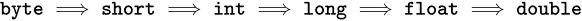

上面的符号告诉我们，我们可以轻松地从较小的类型（如 `short`）转换为较大的类型（如 `long`）。我们可以通过创建许多变量（每个变量类型不同），并将每个变量赋值给上一个值来演示这一点。

列表 3.43：宽转换的示例。

```java
public static void main(String[] args) {
    byte b = 64;
    System.out.println(b);
    short s = b;
    System.out.println(s);
    int i = s;
    System.out.println(i);
    long l = i;
    System.out.println(l);
    float f = l;
    System.out.println(f);
    double d = f;
    System.out.println(d);
}
```

从 `b` 开始，我们可以看到每个连续变量 `s`、`i`、`l`、`f` 和 `d` 都可以赋值给较小的类型。

列表 3.44：列表 3.43 的输出

```
64
64
64
64
64.0
64.0
```

你会在列表 3.43 中注意到，我们没有在数据转换代码中包含 `char`。这是因为 `char` 是一个`无符号 16 位`类型。

列表 3.45：`char` 的宽转换。

```java
public static void main(String[] args) {
    char a = 'a';
    char b = 98;
    System.out.println(a);
    System.out.println(b);
}
```

注意：在第二行，我们将字符赋值给 `a`，但在第三行，我们将 `int` 赋值给 `b`。

列表 3.46：列表 3.45 的输出

```
a
b
```

### 3.3.2 窄转换

窄（显式）转换发生在你想将较大的数据转换为较小的数据时。这可能会导致数据丢失，这就是为什么 Java 要求我们使用`类型转换`。

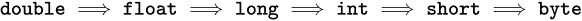

从较大类型转换为较小类型，我们必须将想要转换的类型放在括号中，并放在数据旁边。

列表 3.47：窄转换的示例。

```java
public static void main(String[] args) {
    System.out.println(34.5);
    System.out.println((int)34.5);
    System.out.println(90913 + 318983);
    System.out.println((short)(90913 + 318983));
}
```

列表 3.47 展示了数据转换前后的样子。在第一个打印语句中，打印的是 `double`，但在第二个打印语句中，它被转换为 `int`。当将浮点值转换为整数时，小数点及其后的任何字符将被截断，只保留整数部分。

第三个打印语句打印两个整数的和。因为这些数字自动是 `int` 类型，所以两个 `int` 值相加将产生 `int` 。`int` 是一个 32 位类型，且和小于最大 `int` 值，因此打印了正确的结果。然而，在第四个打印语句中，整个和被转换为 `short`，它是一个 16 位类型。由于 `short` 的最大值为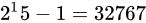，当 `short` 和溢出时，数据将会丢失，导致完全不同的和。

列表 3.48：列表 3.47 的输出

```
34.5
34
409896
16680
```

要在字符和整数之间进行转换，我们可以在整数周围使用 `(char)`。

列表 3.49：字符转换。

```java
System.out.println((char)121);
System.out.println((char)97);
System.out.println((char)('B' + 5));
```

在第一行中，我们将 ASCII 数字 121 转换为其对应的字符。我们在第二行执行了相同的操作。在第三行中，我们首先将一个 `char` 加到一个 `int` 上，然后将结果强制转换为 `char`。这会将 `'B'` 的 ASCII 数值加到 5，然后将该数字在 ASCII 表中映射回另一个字符。

Listing 3.50：Listing 3.49 的输出

```
y
a
G
```

## 复习

在本章中，我们学习了如何使用变量存储数据。我们探索了变量的创建、使用和修改，然后学习了如何在不同类型之间进行转换。接下来，我们将学习如何使用过程化分解来简化重复代码。

# 第 4 章 过程化分解

在本章中，我们将重点关注使用称为“过程化分解”的方法来简化重复任务，这是将相似任务分组为单个代码块的方法。首先，创建一个新的 Java 项目 `ProceduralDecomposition`，并向项目中添加类 `LetterBlocks.java`。

现在，想象我们想用区块字母写“DEE”这个名字：

Listing 4.1：在 `LetterBlocks.java` 中写入 "DEE"。

```java
 1public class LetterBlocks {
 2    public static void main(String[] args) {
 3        // D
 4        System.out.println("-----");
 5        System.out.println(" |   \\");
 6        System.out.println(" |    |");
 7        System.out.println(" |   /");
 8        System.out.println("-----");
 9
10        System.out.println();
11
12        // E
 13        System.out.println("+-----");
 14        System.out.println("|");
 15        System.out.println("+----");
 16        System.out.println("|");
 17        System.out.println("+-----");
 18
19        System.out.println();
20
21        // E
 22        System.out.println("+-----");
 23        System.out.println("|");
 24        System.out.println("+----");
 25        System.out.println("|");
 26        System.out.println("+-----");
 27    }
 28}
```

我们的输出将如下所示：

Listing 4.2：Listing 4.1 的输出

```
-----
 |   \
 |    |
 |   /
-----

+-----
|
+----
|
+-----

+-----
|
+----
|
+-----
```

当我们分析代码时，发现我们在第 22 行到第 26 行再次重复了第 13 行到 17 行的内容，仅仅是为了构造同一个字母。代码重复是不可取的的，因为如果我们在构造第一个“E”时犯了错误，我们就必须对第二个“E”以及之后出现的任何后续字母进行相同的更改。此外，如果我们想再次打印“E”，将不得不浪费时间和存储空间来重新编写该字母。

相反，我们可以将代码分解为一个打印字母“D”的方法和另一个打印字母“E”的方法。`method`（方法）是类中的代码块，概述了如何完成某个特定的过程或任务。`main()` 方法是过程化抽象的一个示例，因为 Java 将此特定函数识别为“运行”方法，或 Java 将立即执行的主代码。

本章将探索用户定义方法的各种，特别是静态方法。

## 4.1 实现静态方法

在我们创建自己的静态方法之前，让我们复习 `main()` 方法。

Listing 4.3：`main()` 方法概览。

```java
public static void main(String[] args) {
    // statement;
    // statement;
    // ...
    // statement;
}
```

我们的主方法以方法签名开始。方法签名包含了关于我们拥有什么类型类型的方法（返回方法或 void 方法）、方法名称以及任何参数的信息。让我们拆解每个关键字来理解它的含义。

第一个关键字是 `public`，意味着我们的方法在 Java 类内部以及其他 Java 类中都是可见的，并且可以这样访问。

第二个关键字是 `static`，意味着我们的方法是类的一部分。

第三个关键字是 `void`，表示我们的方法不返回任何内容。

第四个关键字是 `main`，是方法的名称。

括号 `(String[] args)` 代表方法接受的参数。

Listing 4.4：创建 `writeD()` 方法。


# 4.1 实现 `writeE()` 方法

我们还可以编写另一个静态方法 `writeE()`，它用于用块状字母打印“E”。然后，我们可以替换所有旨在打印“E”的 `print` 语句。注意，我们可以按照任何顺序向类中添加方法。例如，在列表 4.8 中，`writeE()` 可以放在 `writeD()` 之前或 `main()` 之前，但我们选择将其放在末尾。

## 列表 4.8：实现 `writeE()` 方法

```java
public class LetterBlocks {
    public static void main(String[] args) {
        writeD();
        System.out.println();
        writeE();
        System.out.println();
        writeE();
    }

    public static void writeD() {
        // D
        System.out.println("-----");
        System.out.println(" |   \\");
        System.out.println(" |    |");
        System.out.println(" |   /");
        System.out.println("-----");
    }

    public static void writeE() {
        // E
        System.out.println("+-----");
        System.out.println("|");
        System.out.println("+----");
        System.out.println("|");
        System.out.println("+-----");
    }
}
```

注意第 5 和 7 行，我们调用了两次 `writeE()`。这将执行两次 `writeE()` 内部的代码，展示了方法的直观性。

## 列表 4.9：列表 4.8 的输出

```
-----
 |   \
 |    |
 |   /
-----

+-----
|
+----
|
+-----

+-----
|
+----
|
+-----
```

# 4.2 控制流

让我们回到 `LetterBlocks.java` 中最近的代码。

## 列表 4.10：`LetterBlocks.java` 中的代码

```java
public class LetterBlocks {
    public static void main(String[] args) {
        writeD();
        System.out.println();
        writeE();
        System.out.println();
        writeE();
    }

    public static void writeD() {
        // ...
    }

    public static void writeE() {
        // ...
    }
}
```

当我们执行 `main()` 方法时，我们建立了一个**控制流**（flow of control），即语句执行的顺序。默认情况下，语句按从上到下的顺序执行，并从 `main()` 方法中的第一条语句开始。

然而，当我们继续调用函数时，我们**改变**了控制流。例如，当我们在 `main()` 方法中调用 `writeD()` 时，程序从方法调用跳转到方法内部的代码。因此，通过调用 `writeD()`，我们开始执行 `writeD()` 内部所有打印块状字母“D”的 `print` 语句。在 `writeD()` 方法中的所有代码执行完毕后，我们跳转回 `main()` 方法中调用 `writeD()` 的地方，并继续执行剩余的语句（即空 `print` 语句、`writeE()` 等），直到到达 `main()` 方法的末尾。图 4.1 是一个描绘语句执行顺序的流程图。


图 4.1：指示 `LetterBlocks.java` 中控制流的流程图。

# 4.3 创建带参数的方法

*在本节中，创建一个新类 `UseParameters.java`。*

假设我们要找到三个数的平均值。如果我们在代码中多次执行此操作，那么创建一个方法 `average()` 来这样做是有意义的。但我们如何向 `average()` 传递值呢？我们需要为方法提供某种输入，以便它不不仅仅是找到严格的三个数的平均值。

为了为方法传递可使用的数据，我们必须在方法签名中包含**参数**（parameters）。参数就像占位符变量，我们**仅在方法内部**可以使用它们，这样当我们以后调用该方法时，就可以用自己的**实参**（arguments）来填充这些参数。

假设我们回头看 `main()` 方法的签名。

```java
public static void main(String[] args)
```

我们可以看到 `main` 旁边的括号内有一个**参数** `args`。参数的写法与变量声明完全相同，除了没有分号。因此，`args` 是 `main()` 方法的一个参数，它的类型为 `String[]`。

要创建一个带单个参数的方法，我们可以在括号内声明一个变量。

```java
public static void myMethod(int number)
```

要创建一个带多个参数的方法，我们可以用逗号分隔多个变量声明。

```java
public static void myMethod(int number, boolean isPositive)
```

## 示例 1

在 `UseParameters` 类中开始创建一个新方法 `average()`，并包含三个参数 `a`、`b` 和 `c`。

### 列表 4.11：定义 `average()`

```java
public class UseParameters {
    public static void main(String[] args) {

    }

    public static void average(double a, double b, double c) {

    }
}
```

现在我们在列表 4.11 中为方法提供了一些参数，我们可以在方法体中假设 `a`、`b` 和 `c` 存储了平均值。

### 列表 4.12：打印平均值

```java
public static void average(double a, double b, double c) {
    double avg = (a + b + c) / 3;
    System.out.println("The average is " + avg);
}
```

当我们写完方法后，可以在 `main()` 方法中通过不同的参数来调用它。

### 列表 4.13：测试 `average()` 方法

```java
public static void main(String[] args) {
    average(1, 2, 3);
    average(2, 5, 7);
    average(4, 5, 6);
}
```

### 列表 4.14：列表 4.13 的输出

```
The average is 2.0
The average is 4.66666666666667
The average is 5.0
```

## 示例 2

假设我们想写一个方法，根据用户的姓名、年龄和喜欢的爱好打印问候语。输出将类似于：

```
Hello, {name}, who is {age} years old and likes {hobby}!
```

我们可以创建一个新方法 `greet()`。我们需要三个参数 `name`、`age` 和 `hobby`。

### 列表 4.15：`greet()` 的方法签名

```java
public static void greet(String name, int age, String hobby) {

}
```

接下来，我们可以在列表 4.15 的 `greet()` 方法体中使用一个 `print` 语句来输出我们的问候语。在需要的地方拼接字符串。

### 列表 4.16：为 `greet()` 添加代码

```java
public static void greet(String name, int age, String hobby) {
    System.out.println("Hello, " + name + ", who is " + age +
        " years old and likes " + hobby + "!");
}
```

现在我们已经写好了方法，可以在 `main()` 方法中使用各种参数来调用此方法。

### 列表 4.17：测试 `greet()`

```java
public static void main(String[] args) {
    greet("Johnny Appleseed", 30, "coding");
    greet("William Shakespeare", 46, "writing plays");
}
```

在调用方法时，确保你提供的参数类型与其方法签名中相应参数的类型相同。否则，我们将接收到错误。因此，尝试用 `int` 而不是 `String` 作为名称来调用 `greet()` 将导致编译错误。

```java
public static void main(String[] args) {
    greet(49, 23, "playing tennis");
}
```

```
Exception in thread "main" java.lang.Error: Unresolved compilation problem:
    The method greet(String, int, String) in the type UseParameters is not
    applicable for the arguments (int, int, String)
```

# 4.4 返回值

*对于本节，请创建一个新类*，`ReturnMethods.java`

到为止，我们观察了 `void` 方法，或仅在给定数量参数的情况下执行特定任务的方法。然而，虽然这些方法可以完成我们想要的功能，但我们没有办法从用户那里获取数据。

让我们重新回顾 `UseParameters.java` 中的 `average()` 方法作为示例。将该方法复制到 `ReturnMethods.java` 中。

```java
public static void average(double a, double b, double c) {
    double avg = (a + b + c) / 3;
    System.out.println("The average is: " + avg);
}
```

这个方法非常直接；我们只需要提供三个数字，`average()` 计算平均值。

然而，识别这里的问题很重要：我们的方法只是**打印**了平均值。打印与向用户返回值是完全不同的！当我们打印某些内容时，它只会被写入标准输出。打印语句仅用作视觉输出；它们实际上对你代码的整体功能没有贡献。

假设我们想将 `average(1, 2, 3)` 加到 `average(4, 5, 6)`。目前，我们知道可以在 `main()` 方法中分别调用这两个方法。

### 列表 4.19：在 `main()` 方法中调用 `average()`

```java
public static void main(String[] args) {
    average(1, 2, 3);
    average(4, 5, 6);
}
```

运行这段代码时，我们将看到两个平均值被打印出来，但我们从未真正地将两个平均值相加。

### 列表 4.20：列表 4.19 的输出

```
The average is: 2.0
The average is: 5.0
```

如果我们尝试打印 `average(1, 2, 3) + average(4, 5, 6)`，我们将收到一个错误。

```java
System.out.println(average(1, 2, 3) + average(4, 5, 6));
```


```
Exception in thread "main" java.lang.Error: Unresolved compilation problem:
    The operator + is undefined for the argument type(s) void, void
```

在这种情况下，我们必须从方法*返回*值。这与数学函数非常相似。假设你有以下函数：

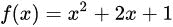

在这种情况下， 是我们选择传递给函数 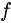 的参数，当我们对任何值  简化表达式 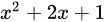 时，这个简化后的结果将是我们的*返回值*。

### 4.4.1 指定返回类型

为了让方法向用户*返回*数据，我们必须做的第一件事是替换 `void` 关键字。目前，我们观察了类似于以下的方法：

```java
public static void myMethod() {}
```

关键字之一是 `void`。我们之前简要学习过，当我们在方法签名中指定 `void` 时，这意味着方法无法向用户返回任何东西，仅用于执行任务。

然而，为了返回值，我们必须将关键字 `void` 更改为其他内容。这特定必须是返回值的*类型*。所以，如果我们想返回一个 `double` 值，我们必须将 `void` 替换为 `double`。

```java
public static double myMethod() {}
```

同样，如果我们想向用户返回一个 `int` 值，我们必须将 `void` 替换为 `int`。

```java
public static int myMethod() {}
```

我们还可以返回对象而不是基本数据类型，例如字符串。

```java
public static String myMethod() {}
```

当我们把 `void` 替换为另一种类型时，它将我们的方法变成一个*返回方法*，这意味着它将向用户返回一个值。这个值*必须*与方法签名中指定的对象类型相同。

让我们将此概念应用到 `ReturnMethods.java` 中的 `average()` 方法。因为我们想返回一个平均值（这是一个 `double` 值），我们将把 `void` 替换为 `double`。

列表 4.21：将 `void` 替换为 `double`。

```java
public static double average(double a, double b, double c) {
    double avg = (a + b + c) / 3;
    System.out.println("The average is: " + avg);
}
```

然而，如果我们现在尝试编译并执行，我们仍然会收到一个错误。

列表 4.22：列表 4.21 的输出

```
Exception in thread "main" java.lang.Error: Unresolved compilation problem:
    This method must return a result of type double
```

从我们的错误信息中提取出的重要短语是“must return a result of type double”（必须返回一个 double 类型的结果）。当我们回看代码时，可以看到尽管我们在方法签名中将返回类型改为 `double`，但我们并没有实际上向用户返回任何东西。记住，打印语句与向用户返回值是不同的。

### 4.4.2 `return` 语句

创建返回方法的第二部分实际上是*返回值*。在方法中，我们可以使用 `return` 语句后跟一个值或表达式来向用户返回或给出一个值。

```java
public static int myMethod() {
    return 0;
}
```

我们返回的表达式*必须*与方法签名中指定的类型相同。所以，如果我们写 `int`，我们就会返回一个整数。如果我们写 `boolean`，我们就会返回一个布尔值。

```java
public static boolean myMethod() {
    return true;
}
```

在 `void` 方法中调用 `return` 语句也是可能的，但我们只能写 `return` 后不跟任何表达式。在 `void` 方法中调用 `return` 语句将直接停止方法。

```java
public static void myMethod() {
    return;
}
```

在我们的 `average()` 函数中，可以将打印语句替换为返回语句，将 `avg` 返回给用户。

列表 4.23：将打印语句替换为返回语句。

```java
public static double average(double a, double b, double c) {
    double avg = (a + b + c) / 3;
    return avg;
}
```

我们的方法终于可以了，所以我们可以重写 `main()` 方法中的测试代码以看到预期的结果。

列表 4.24：重写我们的 `main()` 方法。

```java
public static void main(String[] args) {
    System.out.println(average(1, 2, 3));
    System.out.println(average(4, 5, 6));
    System.out.println(average(1, 2, 3) + average(4, 5, 6));
}
```

注意之前，我们的方法调用单独占一行。这是因为它们只是简单的 `void` 方法，不返回任何东西。当我们继续从 列表 4.23 调用 `average()` 时，现在我们的方法返回一个值，我们可以在可能包含其他操作数的表达式中使用方法调用。当我们在表达式调用方法时（例如在打印语句中），方法首先执行，产生返回值，该值本质上替换了方法调用。

列表 4.25：列表 4.24 的输出

```
2.0
5.0
7.0
```

**示例 2**

让我们练习编写一个方法来计算两个整数点之间的距离（以 `double` 类型表示）。我们将该方法命名为 `distance()`，并包含四个整数参数：`x1`、`y1`、`x2` 和 `y2`。因为我们需要返回一个距离，所以我们的返回类型将是 `double`。

列表 4.26：为 `distance()` 编写方法头。

```java
public static double distance(int x1, int y1, int x2, int y2) {}
```

两点之间距离的公式如下：

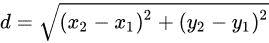

编写此方法还需要使用 `Math` 类中的 `pow()` 和 `sqrt()` 方法。让我们将此表达式分解为子表达式。首先，我们将解决 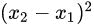，然后是 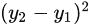，最后是前两个子表达式之和的平方根。

列表 4.27：解决我们的子表达式。

```java
public static double distance(int x1, int y1, int x2, int y2) {
    double x = Math.pow(x2 - x1, 2);
    double y = Math.pow(y2 - y1, 2);
}
```

现在我们有了 `x` 和 `y`，可以将它们相加并返回平方根。

列表 4.28：返回 `x` 和 `y` 之和的平方根。

```java
public static double distance(int x1, int y1, int x2, int y2) {
    double x = Math.pow(x2 - x1, 2);
    double y = Math.pow(y2 - y1, 2);
    return Math.sqrt(x + y);
}
```

为了测试我们的方法，我们可以在 `main()` 方法中打印几次 `distance()` 调用。

列表 4.29：测试我们的 `distance()` 方法。

```java
public static void main(String[] args) {
    System.out.println(distance(0, 0, 3, 4));
    System.out.println(distance(1, 2, 7, 8));
    System.out.println(distance(-9, -5, 31, 24));
}
```

当我们编译并执行代码时，将得到以下输出。

列表 4.30：（列表 4.29 的输出）

```
5.0
8.48528137423857
49.4064773081425
```

### 块 4.1. *练习题*

**Ex 1.** 我们在第 2.1.5.4 节中探索了 `Math` 类的 `random()` 方法。然而，有时我们发现，尝试在两个整数 `a` 和 `b` 之间获取随机整数是不方便的，因为我们必须额外计算关于 `b` 的各种子表达式。编写一个静态方法 `randint()`，它接收两个整数参数 `a` 和 `b`，并使用 `Math.random()` 返回 `a` 和 `b` 之间的随机整数。

*示例输入：*

```
randint(1, 5)
```

*示例输出：* 1 到 5 之间的任意整数。

```
3
```

## 4.5 方法重载

Java 允许我们编写具有相同标识符但参数排列不同的方法。例如，我们可以拥有以下两个方法：

```java
public static double getTax(double price) {
    return 0.06 * price;
}
public static double getTax(double price, double discount) {
    return 0.06 * (price - discount);
}
```

在这种情况下，我们有两个具有相同标识符 `getTax` 的方法，且它们都返回 `double` 结果。然而，虽然第一个 `getTax()` 方法有一个单个 `double` 参数，但第二个 `getTax()` 方法有两个 `double` 参数，这意味着这两个方法是不同的。因此，当我们调用这两个不同的方法时，第一次调用将导致执行第一个方法，第二次调用亦然如此。

```java
public static void main(String[] args) {
    int tax;

    tax = getTax(119.99); // 调用第一个方法
    System.out.println(tax);

    tax = getTax(119.99, 20) // 调用第二个方法
    System.out.println(tax);
}
```

编写具有相同标识符但不同参数的方法被称为**方法重载**。这是 Java 中一个强大的功能，因为它允许我们对不同的输入执行相似的操作。

解决此问题的一种方法是更改参数。

```java
// 以下代码不起作用
public static double getTax(double price) {
    return 0.06 * price;
}
public static double getTax(double price, double discount) {
    return 0.06 * (price - discount);
}
```

其次，即使更改了类型，参数顺序也不行。

```java
// 以下代码不起作用
public static double getTax(double price) {
    return 0.06 * price;
}
public static double getTax(double price, double discount) {
    return 0.06 * (price - discount);
}
```

总的来说，重载的三种方式是：

1. 参数的数量，
2. 参数的数据类型，
3. 参数的顺序。

## 4.6 总结

在本章中我们学习了过程化分解。我们学习了两种类型的方法：`void` 方法和返回类型方法，然后我们识别了如何通过重载设计具有相同标识符的方法。在下一章中，我们将学习根据布尔值（真/假）条件来执行代码块。

# 第 5 章 条件语句

在所有面向对象的编程语言中，根据条件是否满足来执行任务是非常重要的。例如，我们可能想在用户年龄达到 18 岁时告诉他们可以开车。

为了编写条件语句，我们必须能够评估布尔表达式并使用 `true`/`false` 值，正如我们在第 2.3 节中学习的那样。在这一特定章节中，我们曾接触了 `true` 和 `false`，并学习了设计简单的布尔表达式（例如 `84 > 21`、`77 == 53` 等），这些表达式会被简化为 `true` 或 `false`。然而，直到现在我们还没有完全理解布尔表达式的意义。

条件语句允许我们根据结果来执行操作。我们可以将这些条件想象成问题。例如，我们可以问自己：外面冷吗？如果是，我们就计划穿夹克；否则我们就穿短裤出门。

条件语句类似于“当且仅当”（if-and-only-if 或 iff）从句，这在数学中非常常见。这意味着当且仅当条件为真时，条件语句内部的代码才会执行。

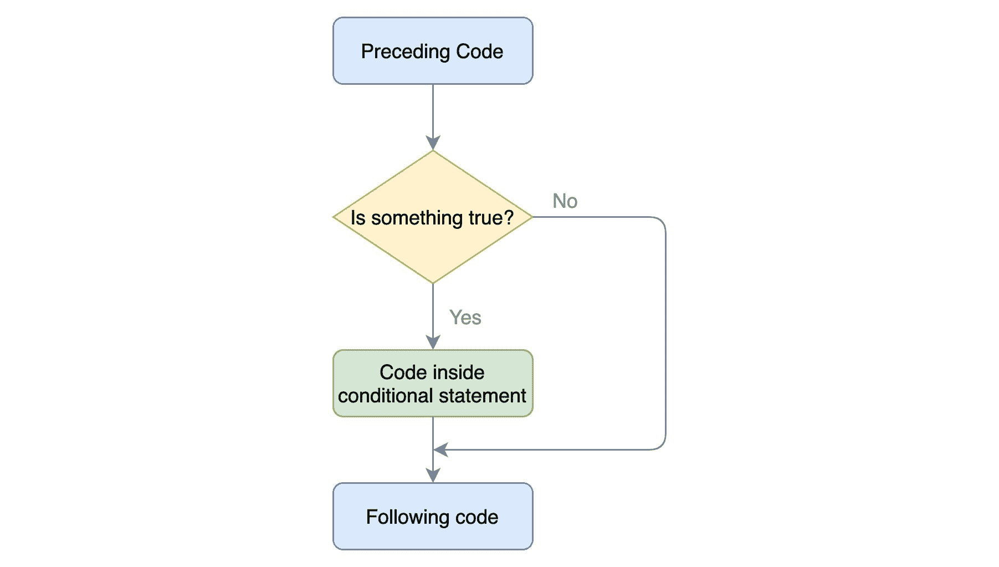图 5.1：典型的 Java 条件语句流程图。

图 5.1 中的流程图是对条件语句格式的一个初步视角。根据控制流，首先执行先前的代码。一旦遇到条件语句，就会提出问题：“_____ 是真的吗？”

如果答案是肯定的（`true`），则执行条件语句内部的代码。在该代码执行完毕后，将执行剩余代码。

如果答案为否（`false`），则条件语句内部的代码将被跳过，并执行条件语句之后但在条件语句之外的其余代码。

在本章中，我们将学习如何使用布尔表达式（或 `conditions`）来编写`conditional statements`。条件语句允许我们修改`flow of control`，即 Java 程序中语句执行的顺序。

对于本章，请创建一个名为 `Conditionals` 的新 Java 项目，并创建一个包含 `main` 方法的类 `Conditional.java`。

## 5.1 `if` 语句

要编写一个 `if` 语句，我们可以写关键字 `if`，后面用括号跟上我们想要评估的布尔表达式。然后，我们可以包含一对大括号。

```java
if (conditionIsTrue) {
    // Do code here
}
```

*   `if` 是我们使用的关键字，用于表示我们想要评估一个条件。
*   `conditionIsTrue` 是一个布尔条件。
*   如果 `conditionIsTrue` 简化后为 `true`，则条件体内部的代码（即 `// Do code here`）将执行。
*   注意，条件体是缩进的。这并不是强制要求的，但为了可读性强烈建议这样做。

### 示例 1

在这个练习中，我们将根据年龄判断一个人是否可以开车。我们可以假设任何 18 岁或以上的人都可以开车。

在 `main()` 方法中，让我们创建一个 `int` 变量 `age`，并将其赋值为一个任意整数。

列表 5.1：创建 `age` 变量。

```java
public static void main(String[] args) {
    int age = 20;
}
```

接下来，我们将编写一个条件语句。我们将判断 `age` 是否大于或等于 18。

列表 5.2：添加条件语句。

```java
public static void main(String[] args) {
    int age = 20;
    if (age >= 18) {
        // Code will follow
    }
}
```

最后，在 `if` 语句的体内部，如果满足条件，我们将向用户打印“You can drive!”。

列表 5.3：填充 `if` 语句的体。

```java
public static void main(String[] args) {
    int age = 20;
    if (age >= 18) {
        System.out.println("You can drive!");
    }
}
```

让我们运行代码。

列表 5.4：Listing 5.3 的输出

```
You can drive!
```


我们的代码打印了“You can drive!”，是因为当评估 `age >= 18` 时，`age` 的值为 20，所以这个条件为 `true`。因为条件为 `true`，`if` 语句体中的代码执行了。

现在，让我们将年龄更改为 18 岁以下的正整数。

Listing 5.5：更改 `age` 使其小于 18。

```java
public static void main(String[] args) {
    int age = 14;
    if (age >= 18) {
        System.out.println("You can drive!");
    }
}
```

让我们运行代码查看差异。

Listing 5.6：Listing 5.5 的输出

```
---No output---
```

当我们这次执行代码时，我们看到没有任何内容被打印。这是因为我们的条件语句失败了，因为 14 并不大于等于 18。因此，条件体不执行，并且由于 `if` 语句之后没有代码，程序结束了。

## 示例 2

假设我们写了一个方法 `getTotalCost`，它接受一个 `double` 参数 `initialPrice` 并返回最终价格。这个最终价格受到潜在折扣和销售税的影响。无论如何，销售税都应用于初始价格，但只有当商品价格超过 100 美元时，才会计入 20% 的潜在折扣。

我们可以从编写方法头开始。我们还将包含一个变量 `finalPrice`，它最初被赋值为 `initialPrice`，但随着我们对折扣和销售税的考虑而改变。

Listing 5.7：编写 `getTotalCost()` 的方法头。

```java
public static double getTotalCost(double initialPrice) {
    double finalPrice = initialPrice;
}
```

首先，如果适用，我们必须应用折扣。这需要一个 `if` 语句。条件将是 `finalPrice` 是否超过 100。如果是，我们将对价格应用 20% 的折扣。为了应用 20% 的折扣，我们可以将价格乘以 0.8。

Listing 5.8：判断 `finalPrice` 是否超过 100。

```java
public static double getTotalCost(double initialPrice) {
    double finalPrice = initialPrice;
    // Add the discount
    if (finalPrice > 100) {
        finalPrice *= 0.8;
    }
}
```

之后，无论价格如何，我们必须考虑销售税。我们假设无论如何，销售税都应用于初始价格，但只有当商品价格超过 100 美元时，才会计入 20% 的潜在折扣。

Listing 5.9：添加销售税。

```java
public static double getTotalCost(double initialPrice) {
    double finalPrice = initialPrice;
    if (finalPrice > 100) {
        finalPrice *= 0.8;
    }
    finalPrice *= 1.05; // 假设为 5% 税
    return finalPrice;
}
```

## 5.2 `else` 子句

目前，我们只观察了条件为真时执行的条件语句。但如果我们的条件失败了该怎么办？

我们可以为 `if` 语句添加一个 `else` 子句，以便在条件不满足时执行。这个 `else` 子句充当了保险，意味着如果 `if` 不执行，`else` 子句将执行。


在图 5.2 中，我们修改了之前的流程图以引入 `else` 子句。如果条件不满足，则执行 `else` 子句的代码。

要编写带有 `else` 子句的 `if` 语句，我们可以像往常编写 `if` 语句。然后，在大括号之后，我们包含 `else`，后面跟另一组大括号。

```
if (conditionIsTrue) {
    // Do code here
} else {
    // Do other code
}
```

*   `if` 是我们使用的关键字，用于表示我们想要评估一个条件。
*   `conditionIsTrue` 是一个布尔条件。
*   如果 `conditionIsTrue` 简化后为 `true`，则条件体内部的代码（即 `// Do code here`）将执行。
*   `else` 是我们使用的关键字，用于表示当 `conditionIsTrue` 为 `false` 时应该发生什么。如果为 `false`，则 `else` 子句体内部的代码（即 `// Do other code`）将执行。

注意，如果我们选择包含它，`else` 子句必须位于条件语句的末尾。

### 示例 1

假设我们回到之前创建的判断一个人是否可以开车的代码。

```java
int age = 14;
if (age >= 18) {
    System.out.println("You can drive!");
}
```

我们可以通过向此 `if` 语句添加一个 `else` 子句开始。

Listing 5.13：为 `if` 语句添加 `else` 子句。

```java
public static void main(String[] args) {
    int age = 14;
    if (age >= 18) {
        System.out.println("You can drive!");
    } else {
        // 代码将在此其后
    }
}
```

之后，我们可以在 `else` 子句的体中添加另一个打印语句，告诉用户他们不能开车。

Listing 5.14：在 `else` 子句中添加代码。

```java
public static void main(String[] args) {
    int age = 14;
    if (age >= 18) {
        System.out.println("You can drive!");
    } else {
        System.out.println("You cannot drive!");
    }
}
```

现在，当我们为 `age` 小于 18 的测试代码时，我们的新消息将被打印出来。

Listing 5.15：Listing 5.14 的输出

```
You cannot drive!
```

当我们将 `age` 大于或等于 18 时，我们原始的消息会被打印出来。

Listing 5.16：测试 `age` 大于或等于 18 的情况。

```java
// ...
int age = 20;
// ...
```

Listing 5.17：Listing 5.16 的输出

```
You can drive!
```

注意，只有当先前的 `if` 子句失败时，`else` 子句内部的代码才会执行。因此，如果 `age >= 18` 为 `true`，则 `else` 子句将不会执行。

### 示例 2

假设我们写了一个名为 `getMin()` 的方法，它接收两个实数作为参数，并返回这两个数中较小的一个。

我们可以从编写方法头开始。

Listing 5.18：`getMin()` 的方法头。

```java
public static double getMin(double x, double y) {

}
```

接下来，我们想比较 `x` 和 `y`。如果 `x` 小于 `y`，那么 `x` 就是两个数中最小的，因此我们将返回 `x`。

Listing 5.19：检查 `x < y` 是否为真。

```java
public static double getMin(double x, double y) {
    if (x < y) {
        return x;
    }
}
```

否则，我们可以返回 `y`，因为此时 `y` 是最小的。

Listing 5.20：返回 `y`。

```java
public static double getMin(double x, double y) {
    if (x < y) {
        return x;
    } else {
        return y;
    }
}
```

现在，当我们对不同的输入测试代码时，我们得到了正确的最小值。

Listing 5.21：测试 `getMin()`。

```java
public static void main(String[] args) {
    System.out.println(getMin(1, 5));
    System.out.println(getMin(4.3, 2.9));
}
```

Listing 5.22：Listing 5.21 的输出

```
1.0
2.9
```

## 5.3 `else if` 子句

条件语句的用处在于，如果第一个条件失败，那么我们可以在尝试评估 `else` 子句（如果存在的话）之前，先评估后续的条件。

例如，假设我们想构建一个评分标准，其中应用以下规则将数字成绩转换为字母等级：

*   `>= 90`: A
*   `80 - 89`: B
*   `70 - 79`: C
*   `60 - 69`: D
*   `< 60`: F

我们首先想检查给定的成绩是否大于或等于 90。

```java
// num 在此之前已经声明并初始化
String grade;
if (num >= 90) {
    grade = "A";
}
```

然而，如果我们的成绩不是大于或等于 90，那么此时我们可以检查是否大于等于 80。为了做到这一点，我们可以使用 `else if` 子句。它看起来和工作原理与 `if` 子句完全一样，但如果你想评估多个情况，只需将其包含在初步的 `if` 子句之后。

```
if (condition_is_true) {
    // 在此处执行代码块 1
} else if (another_is_true) {
    // 在此处执行代码块 2
} else if (possibly_another_is_true) {
    // 在此处执行代码块 3
} else {
    // 在此处执行备用代码
}
```

*   在上方，我们用 `if` 子句开始条件语句。我们在那里评估该条件，如果它为真，我们只执行代码块 1 中的代码。
*   如果第一个 `if` 子句为假，我们就移动到下一个子句，即 `else if`。Java 随后会评估该子句中的条件。如果它为真，我们只执行代码块 2 中的代码。
*   同样，如果这个子句也为假，我们将继续此类推。

### 示例

假设我们想编写一个方法 `numToDay`，它接受一个 `int` 参数 `num` 并返回对应的星期几名称（1 代表 Sunday，以此类推），如果输入无效则返回 `"None"`。

我们可以从编写方法头开始。

```java
public static String numToDay(int num) {
    if (num == 1) {

    } else if (num == 2) {

    } else if (num == 3) {

    } else if (num == 4) {

    } else if (num == 5) {

    } else if (num == 6) {

    } else if (num == 7) {

    } else {

    }
}
```

最后，在每个条件语句的体中，我们可以返回相应的星期几。对于 `else` 子句，我们将直接返回 `"None"`。

Listing 5.31：返回正确的星期几。

```java
public static String numToDay(int num) {
    if (num == 1) {
        return "Sunday";
    } else if (num == 2) {
        return "Monday";
    } else if (num == 3) {
        return "Tuesday";
    } else if (num == 4) {
        return "Wednesday";
    } else if (num == 5) {
        return "Thursday";
    } else if (num == 6) {
        return "Friday";
    } else if (num == 7) {
        return "Saturday";
    } else {
        return "None";
    }
}
```

我们可以通过以下方式在 `main()` 方法中测试我们的方法。

Listing 5.32：测试 Listing 5.31 中的 `numToDay()` 方法。


```java
public static void main(String[] args) {
    System.out.println(numToDay(1)); // Prints Sunday
    System.out.println(numToDay(2)); // Prints Monday
    System.out.println(numToDay(3)); // Prints Tuesday
    System.out.println(numToDay(4)); // Prints Wednesday
    System.out.println(numToDay(5)); // Prints Thursday
    System.out.println(numToDay(6)); // Prints Friday
    System.out.println(numToDay(7)); // Prints Saturday
    System.out.println(numToDay(8)); // Prints None
}
```

列表 5.33：列表 5.32 的输出。

```
Sunday
Monday
Tuesday
Wednesday
Thursday
Friday
Saturday
None
```

## 5.4 嵌套条件语句

正如我们所演示的样，条件语句的体可以包含任何通常可以包含在条件语句之外的代码。这包括额外的条件语句。当我们把条件语句放在另一个条件语句的体内部时，我们将这些语句称为**嵌套条件语句**或简单地称为嵌套 `if` 语句。这些非常直观；就像另一个条件语句体中的任何其他代码一样，只有当外层子句的条件满足时，这些内部条件才会被求值。

假设我们有如下方法 `ticketPrice()`，它接收两个布尔参数 `isChild` 和 `isBetterTicket`，并返回特定类型人员的音乐会票。如果这个人是成年人，普通票的价格为 30 美元，但更好的票要额外花 10 美元。如果这个人是儿童，普通票的价格为 22 美元，而更好的票要额外花 5 美元。我们可以使用嵌套条件来设置这种逻辑：在外层条件中判断人是否为儿童，在内部条件中判断人是否购买了更好的票。

列表 5.34：`ticketPrice()` 中嵌套条件的实现。

```java
public static int ticketPrice(boolean isChild, boolean isBetterTicket) {
    if (isChild) { // 此人是儿童
        if (isBetterTicket) { // 额外收费
            return 27;
        } else { // 为儿童收取普通费用
            return 22;
        }
    } else { // 此人是成年人
        if (isBetterTicket) { // 额外收费
            return 40;
        } else { // 为成年人收取普通费用
            return 30;
        }
    }
}
```

我们最初选择的费用范围是 27、22、40 和 30。`isChild` 条件将我们的选择缩小到 27 和 22，或者 40 和 30，而两个地方的 `isBetterTicket` 条件会进一步缩小我们的选择。

在许多情况下，你可以将一个条件嵌套在另一个条件中，也可以在同一个条件子句中使用 `and` 运算符将两个条件放在一起比较。当你遇到以下场景，且必须遵循以下两种选项之一时，你会希望使用嵌套条件（一个在另一个里面），而不是两个成对（使用 `and` 运算符连接两个条件的单个条件语句）：

*   你的外层条件除了嵌套内部条件外，还包含只有在在外层条件为真时才运行的代码，无论内部条件是否为真；或者

*   你的内部条件在两个外层子句中执行相同的条件检查（例如，在外层 `if` 和外层 `else` 子句中使用相同的内部条件），但内部条件的体在每个外层子句之间有所不同。

在列表 5.34 的 `ticketPrice()` 实现中，我们发现费用范围为 27、22、40 和 30。`isChild` 条件将我们的选择缩小到 $27 和 $22 或 $40 和 $30，而两个地方的 `isBetterTicket` 条件会进一步缩小我们的选择。当我们需要使用嵌套条件时，这是非常直观的。

## 5.5 复习

在本章中我们学习了条件语句的结构，包括 `if`、`else if` 和 `else`。我们还学习了嵌套条件以及何时使用它们。

# 第 6 章 循环

假设我们想打印五次 `"Hello world!"`。我们可以简单地写：

```java
System.out.println("Hello world!");
```

这非常直观；我们只需要写五次即可。现在，假设我们要将这个数字增加到十次。这变得有些费琐，但仍然是可能的。

```java
System.out.println("Hello world!");
```

你可以开始看到，虽然我们能够打印十次语句，但我们必须写那么多次相同的语句。

假设我们现在想打印 *n* 次 `"Hello world!"`，其中 *n* 是一个在运行时提供的未知整数。此时，我们的方法失效了，因为我们需要在实际运行代码之前知道 *n*。因此，我们必须寻求另一种方法。

## 6.1 for 循环

`for` 循环是一种允许用户按次数迭代代码块的循环。`for` 循环的标准形式如下：

```java
for (start; stop; step) {
    // 此处的代码将循环
}
```

让我们拆解一下。

*   `start` 是一个代码语句，我们在其中创建一个变量来表示循环的起点。该变量的赋值通常是给 `int` 或 `double`。此外，该代码语句会在循环开始之前执行一次。

*   `stop` 是一个指示循环何时应该结束的条件。它可以是任何条件，但通常是涉及 `start` 中变量的条件。`stop` 在循环的每次迭代之前都会被求值。如果条件为真，则执行循环中的代码。否则，则不执行。因此，如果循环重复 `n` 次，那么条件就会被检查 `n+1` 次。

*   `step` 是一个修改 `start` 中变量的语句，例如将其递增 1。需要这个语句是为了确保 `for` 循环不会进入`infinite loop`（这些将在稍后讨论）。它在循环块中所有代码执行完毕后执行。因此，如果循环重复 `n` 次，那么条件就会被检查 `n` 次。

Java 将此过程分解为以下步骤：

1.  在 `start` 中创建变量。

2.  检查 `stop` 中的条件（通常包含该变量）是否为真。

3.  如果为，则执行代码块中的代码。否则，退出循环并继续执行循环后的代码。

4.  在 `step` 中更改变量。

5.  重复步骤 2-4，直到执行步骤 2 且条件为假。然后，在步骤 3 中退出循环。

我们将通过许多示例来完善对 `for` 循环的理解。

### 示例 1

考虑本章开头的示例。我们想打印十次 `"Hello world!"`。为了实现这一点，我们可以写如下：

Listing 6.1：打印 `"Hello world!"` 的 `for` 循环。

```java
for (int i = 0; i < 10; i++) {
    System.out.println("Hello world!");
}
```

在 Listing 6.1 中，我们创建了一个变量 `i`，并将其初始化为 0。满足条件 `0 < 10`，所以我们打印 `"Hello world!"`。由于循环体中没有其他内容，我们随后修改了 `i`。在这种情况下，我们将其增加了 1。因此，在此循环中 `i` 的所有可能值将是 0, 1, 2, 3, 4, 5, 6, 7, 8 和 9。当我们将 `i` 从 9 加到 10 并在执行循环体之前再次检查条件时，我们会发现 10 不再小于 10，因此循环将退出。

Listing 6.2：Listing 6.1 的输出。

```
Hello world!
Hello world!
Hello world!
Hello world!
Hello world!
Hello world!
Hello world!
Hello world!
Hello world!
Hello world!
```

如果我们想打印二十次 `"Hello world!"`，我们将写如下：

```java
for (int i = 0; i < 20; i++) {
    System.out.println("Hello world!");
}
```

## 示例 2

与其简单地循环遍历某行代码（如打印语句），我们可以在循环中使用变量本身。我们称之为 `local variable`（局部变量），因为它只在循环内部“可见”的或可用的。

假设我们想打印从 3 到 12 的所有数字（包含 12）。我们可以写如下：

Listing 6.3：打印数字的 `for` 循环。

```java
for (int k = 3; k <= 12; k++) {
    System.out.println(k);
}
```

我们在这里做了几处不同。我们的变量 own `k` 而不是 `i`。我们可以使用任何喜欢的变量名；使用 `i` 只是惯例。此外，`k` 初始化被赋值为 3。在我们的条件中，我们没有使用 `<` 运算符，而是使用了 `<=`，所以当 `k` 变为 12 时，我们的代码仍会执行，但之后就会停止。`k++` 仍然是一样的；我们将 `k` 递增 1。最后，在循环体中，我们打印 `k` 的值。

Listing 6.4：Listing 6.3 的输出。

```
3
4
5
6
7
8
9
10
11
12
```

## 示例 3

假设我们想找到从 1 开始的前 4096 个整数的和。诚然，我们可以直接使用公式 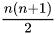，其中 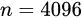，但我们想用 `for` 循环来尝试。我们可以按照如下方式编写代码：

Listing 6.5：前 4096 个整数的和。

```java
int sum = 0;
for (int n = 1; n <= 4096; n++) {
    sum += n;
}
```

让我们分析这段代码。我们的变量 `sum` 初始化为 0。在 `for` 循环中，`n` 从 1 开始，直到小于或等于 4096。每次迭代我们将 `n` 累加到 `sum`。最后，我们打印 `sum`。

Listing 6.6：Listing 6.5 的输出。

```
8389696
```

### 示例 4

在之前的示例中，我们总是循环遍历某行代码（如打印语句）增加变量。例如，如果我们想打印 2 到 10 之间的偶数，我们可以写如下：

Listing 6.7：2 到 10 的偶数。

```java
for (int i = 2; i <= 10; i += 2) {
    System.out.println(i);
}
```

注意这里我们使用了 `+=` 来增加 `i` 2。我们也可以使用 `i = i + 2` 等。

Listing 6.8：Listing 6.7 的输出。

```
2
4
6
8
10
```

## 6.2 `while` 循环

`while` 循环是一种在条件为假之前执行代码块的循环。`while` 循环的通用形式如下：

```java
while (condition) {
    // 代码在这里循环
}
```

让我们将其分解：

*   `while` 是我们用来指示正在使用 `while` 循环的关键字。

*   `condition` 是一个布尔表达式。

Java 将此过程分解为以下步骤：

1.  检查 `condition` 是否为真。如果为假，停止循环。

2.  如果是，则执行 `while` 循环体。

3.  一旦循环体执行完毕，重复步骤 1。

注意，就像 `for` 循环的停止条件一样，`while` 循环的条件最终需要变为假以避免无限循环。

### 示例 1

假设我们想打印 10 到 15 的数字。我们可以写如下来实现这一点：

Listing 6.9：打印 10 到 15 的数字。

```java
int num = 10;
while (num <= 15) {
    System.out.println(num);
    num++;
}
```

我们首先在循环外部创建一个整数 `num`。这样我们就可以在条件和 `while` 循环体中使用 `num`。接下来，我们对 `num <= 15` 条件执行 `while` 循环，这意味着我们的循环一直持续到 `num` 大于 15。最后，在循环体中，我们打印 `num` 并将其递增 1。

Listing 6.10：Listing 6.9 的输出。

```
10
11
12
13
14
15
```

除非你在循环中遇到 `continue` 或 `break` 语句（我们将在本章稍后部分介绍这些内容），请注意 `while` 循环的循环体在再次评估 `while` 条件之前，必须*完全*执行完毕。这意味着，如果在某个时间点条件为真且循环体开始执行，但在循环体的某处某些变量发生了变化，导致条件在该瞬间变为假，那么 `while` 循环将*继续执行*循环体的剩余部分，直到执行完其中包含的所有行为止；在此时，Java 将循环回条件判断处，现在如果不再满足条件，循环将不再运行。

例如，假设我们有以下代码：

```java
int i = 0;
while (i < 3) {
    System.out.println("Previous: " + i);
    i++;
    System.out.println("Next: " + i);
}
```

人们可能会错误地认为，当 `i++` 将 `i` 从 2 变为 3 时，循环会立即结束，我们不会在输出中看到 `"Next: 3"`。然而，循环必须持续到结束。因此，我们将在循环结束前看到打印出的 `"Next: 3"`。

```
Previous: 0
Next: 1
Previous: 1
Next: 2
Previous: 2
Next: 3
```

## 示例 2

在上一个示例中，我们打印了从 10 到 15 的数字。然而，这可以使用 `for` 循环很容易编写。

```java
for (int num = 10; num <= 15; num++) {
    System.out.println(num);
}
```

现在，让我们尝试一个演示 `while` 循环主要用法的示例：循环次数不是由范围定义的。

假设我们想写一个程序，不断掷骰子直到出现某个特定的数字。在这个示例中，我们将使用 `Math` 类中的 `random()` 函数来模拟随机掷骰子。

在 `main()` 方法中，我们将首先初始化三个变量：

列表 6.11：掷骰子的起始代码。

```java
public static void main(String[] args) {
    int desired_number = 6;
    int current_roll = -1;
    int tries = 0;
}
```

*   `desired_number` 是我们希望骰子顶朝上的数字。在这个示例中，我们希望一直掷骰子，直到出现 6 为止，因此我们将 `desired_number` 赋值为 6。

*   `current_roll` 代表骰子当前的顶朝面。我们最初将其赋值为 -1，这样我们的循环至少会有一次迭代来掷骰子。

*   `tries` 代表我们得到 6 作为顶朝面值之前掷骰子的次数。我们将在最后将其作为结果打印。

接下来，我们可以编写 `while` 循环。

列表 6.12：用于掷骰子的 `while` 循环。

```java
public static void main(String[] args) {
    int desired_number = 6;
    int current_roll = -1;
    int tries = 0;
    while (current_roll != desired_number) {
        current_roll = (int)(Math.random() * 6) + 1;
        tries++;
    }
    System.out.println("Number of tries: " + tries);
}
```

在我们的 `while` 循环中，头部包含条件 `current_roll != desired_number`。这意味着只要 `current_roll` 的值不等于 `desired_number`，循环就会持续迭代。一旦 `current_roll` 等于 `desired_number`，循环停止执行。

在循环体内部，我们编写以下内容来获取随机整数：

```java
current_roll = (int)(Math.random() * 6) + 1;
```

在我们的循环体中，我们编写以下内容来获取 1 到 6 之间的随机整数。这意味着只要 `current_roll` 不等于 `desired_number`，循环就会持续迭代。一旦 `current_roll` 等于 `desired_number`，循环停止执行。

最后，我们打印尝试次数。

列表 6.13：对于 6.12 1 输出。

输出。

```
----RUN 1
Number of tries: 5
----RUN 2
Number of tries: 2
----RUN 3
Number of tries: 8
```

## 示例 3

在循环中，我们并不总是以相同方式改变变量。让我们这个例子例子


# 科拉兹猜想

**科拉兹猜想**（Collatz Conjecture）是一个著名的未解决数学猜想，它以以下方式定义整数序列：从任何正整数开始。对于序列中的任何项，如果是偶数，则下一项为它的一半；如果是奇数，则下一项为三倍加一。换句话说，具有如下伪代码：

```
n = 整数
重复：
    如果 n 是偶数：n 除以 2
    如果 n 是奇数：n 为 3n+1
```

该猜想认为任何整数最终都会到达 1。在 `main()` 方法中，我们将首先初始化一个变量。

## 列表 6.14：科拉兹猜想

```java
public static void main(String[] args) {
    int n = 7;
    while (n > 1) {
        if (n % 2 == 0) {
            n = n / 2;
        } else {
            n = 3 * n + 1;
        }
        System.out.println(n);
    }
}
```

当我们运行这段代码时，我们将看到以下输出：

## 列表 6.15：对于 6.14 的输出

```
7
22
11
34
17
52
26
13
40
20
10
5
16
8
4
2
1
```

# 6.3 `do while` 循环

`do while` 循环是另一种 `while` 循环，允许用户在条件为真时迭代代码块。`do while` 循环与普通 `while` 循环的区别在于，前者先执行代码块然后检查条件，而后者先检查条件。这意味着任何 `do while` 循环即使条件永远为假，也至少会有一次迭代。

`do while` 循环的通用形式如下：

```java
do {
    // 这里的代码将循环
} while (condition);
```

Java 将此过程分解为步骤：

1. 执行 `do` 块中的代码。
2. 检查 `condition` 是否为真。
3. 如果是，重复步骤 1。

## 示例 1

假设我们想打印前五个正整数。我们可以编写以下代码来实现：

### 列表 6.17：打印从 1 到 5 的数字

```java
int num = 1;
do {
    System.out.println(num);
    num++;
} while (num <= 5);
```

在这段代码中，我们首先将 `num` 赋值为 1。接下来，我们进入 `do while` 循环，打印 `num`（值为 1）并将其加 1。最后，我们开始“实际”的循环过程，在其中评估条件并相应地进行循环。

### 列表 6.18：列表 6.17 的输出

```
1
2
3
4
5
```

假设我们更改了第一行 `int num = 1;`，使其变为 `int num = 6;`。这显然会使条件失败。然而，使用 `do while` 循环，我们必须记住它至少迭代一次。因此，我们打印 6 并停止循环。

### 列表 6.19：将 `num` 赋值为 6

```java
int num = 6;
do {
    System.out.println(num);
    num++;
} while (num <= 5);
```

### 列表 6.20：列表 6.19 的输出

```
6
```

## 示例 2

假设我们想要倒序打印一个整数的所有数字。我们可以使用“对 10 取模”的技巧来实现：

```
let num be an integer
REPEAT:
    print num mod 10 (打印最后一位)
    floor divide num by 10 (移除最后一位)
STOP REPEATING when num equals 0
```

这是 `do while` 循环的一个完美应用，因为如果 `num` 初始值就为 0，那么 0 仍然会被正确地作为数字打印出来，且任何其他数字对该程序都能正常工作。

我们可以从初始化以下变量开始：

```java
int num = 4230;
```

接下来，我们可以添加一个 `do while` 循环，其条件用于判断 `num` 是否等于 0。

```java
int num = 4230;
do {
    // Code will follow
} while (num != 0);
```

最后，我们可以添加两行代码来打印整数的最后一位，然后通过将整数除以 10 将将其。

### 列表 6.21：倒序打印整数所有数字的最终代码

```java
int num = 4230;
do {
    System.out.println(num % 10);
    num /= 10;
} while (num != 0);
```

### 列表 6.22：列表 6.21 的输出

```
0
3
2
4
```

# 6.4 嵌套循环

我们目前看过的循环运行在所谓的“单维度”上。这意味着在循环的任何特定迭代中，语句最多只会发生一次。在本节中，我们将探索**嵌套循环**，即在**多个维度**上进行迭代的循环。换句话说，它们是包含循环的循环。

通用结构可能如下（假设我们选择使用 `for` 循环；记住我们也可以使用 `while` 循环）：

```java
// 外层循环之前的某些任意代码
for (start; stop; step) {
    // 嵌套循环之前的某些任意代码
    for (start2; stop2; step2) {
        // 嵌套循环内部的某些任意代码
    }
    // 嵌套循环之后的某些任意代码
}
// 外层循环之后的某些任意代码
```

在这里我们看到**外层循环**和一个**内层循环**。我们将使用接下来的示例来演示它们是如何工作的。

## 示例 1

假设我们想要打印如下：

```
1 4
1 5
1 6
2 4
2 5
2 6
3 4
3 5
3 6
```

我们注意到一个模式：对于每一个左侧数字（1、2 和 3），右侧数字都会循环 4、5 和 6。因此，我们需要一个循环来处理每个循环。外层循环从 1 迭代到 3，而内层循环从 4 迭代到 6。你可以这样理解：对于上面的每一行输出，当我们从左到右读取时，相应的数字是作为进一步嵌套循环生成的。

我们知道外层循环需要从 1 迭代到 3，所以我们可以为它写一个循环。

```java
for (int i = 1; i <= 3; i++) { // 外层循环
```

这涵盖了左侧的数字。对于每个左侧数字，我们需要打印右侧数字，无论它是 4、5 还是 6。因此，我们可以包含一个从 4 迭代到 6 的嵌套循环。

```java
for (int i = 1; i <= 3; i++) { // 外层循环
    for (int j = 4; j <= 6; j++) { // 嵌套循环

    }
}
```

## 示例 2

假设我们想要打印如下图案：

```
**********
****  ****
***    ***
**      **
*        *
**      **
***    ***
****  ****
**********
```

初初看起来可能很令人望畏，但我们可以使用嵌套循环轻松解决它。让我们先观察一些现象。

*   总共有 9 行。
*   每行有 10 个字符（星号或空格）。
*   在第 1 行到第 5 行之间，空格数分别为 `0`、`2`、`4`、`6` 和 `8`。
*   在第 6 行到第 9 行之间，空格数分别为 `6`、`4`、`2` 和 `0`。
*   在任意一行中，空格前后的星号数量均等于 10 减去空格数的一半。例如，在第 4 行，有 `6` 个空格，因此空格左右的星号数量均为 `3` 个。

掌握了这些知识后，我们可以将这个过程分为两个部分：打印第 1-5 行和第 6-9 行。让我们从第 1-5 行开始。因为我们知道空格的数量遵循某种模式，我们可以根据这个模式构建外层循环。

```java
for (int spaces = 0; spaces <= 8; spaces += 2) {

}
```

接下来，我们必须打印相应数量的星号，然后是空格，最后又是星号。我们可以利用之前声明的信息来计算星号的数量。

```java
for (int spaces = 0; spaces <= 8; spaces += 2) {
    int stars = (10 - spaces) / 2;
}
```

现在，我们需要添加嵌套循环来打印前面的星号。

```java
for (int spaces = 0; spaces <= 8; spaces += 2) {
    int stars = (10 - spaces) / 2;
    for (int i = 0; i < stars; i++) {
        System.out.print("*");
    }
}
```

然后我们可以打印相应数量的空格。

```java
for (int spaces = 0; spaces <= 8; spaces += 2) {
    int stars = (10 - spaces) / 2;
    for (int i = 0; i < stars; i++) {
        System.out.print("*");
    }
    for (int i = 0; i < spaces; i++) {
        System.out.print(" ");
    }
}
```

注意我们在两个嵌套循环中都重新声明了变量 `i`。这是可以的，因为这两个变量不在同一个作用域内，因为这两个循环是在同一层级上嵌套的。

我们可以重写用于打印前面星号的嵌套 `for` 循环，以打印最右侧的星号。

```java
for (int spaces = 0; spaces <= 8; spaces += 2) {
    int stars = (10 - spaces) / 2;
    for (int i = 0; i < stars; i++) {
        System.out.print("*");
    }
    for (int i = 0; i < spaces; i++) {
        System.out.print(" ");
    }
    for (int i = 0; i < stars; i++) {
        System.out.print("*");
    }
}
```

最后，我们需要分隔行，因此可以在外层循环的底部添加空的 `System.out.println()` 语句。

### 列表 6.32：第 1-5 行的完成代码

```java
for (int spaces = 0; spaces <= 8; spaces += 2) {
    int stars = (10 - spaces) / 2;
    for (int i = 0; i < stars; i++) {
        System.out.print("*");
    }
    for (int i = 0; i < spaces; i++) {
        System.out.print(" ");
    }
    for (int i = 0; i < stars; i++) {
        System.out.print("*");
    }
    System.out.println();
}
```

接下来，我们可以实现打印第 6-9 行的代码。我们需要使用另一个循环来实现。由于第 6-9 行的空格数分别为 `6`、`4`、`2` 和 `0`，我们将使用以下循环头：

```java
for (int spaces = 6; spaces >= 0; spaces -= 2) {

}
```

该循环的体与我们目前编写的内容相同，所以只需将其复制粘贴到这个新循环中。因此，我们的最终代码如下：

### 列表 6.33：第 1-9 行的完成代码

```java
for (int spaces = 0; spaces <= 8; spaces += 2) {
    int stars = (10 - spaces) / 2;
    for (int i = 0; i < stars; i++) {
        System.out.print("*");
    }
    for (int i = 0; i < spaces; i++) {
        System.out.print(" ");
    }
    for (int i = 0; i < stars; i++) {
        System.out.print("*");
    }
    System.out.println();
}
for (int spaces = 6; spaces >= 0; spaces -= 2) {
    int stars = (10 - spaces) / 2;
    for (int i = 0; i < stars; i++) {
        System.out.print("*");
    }
    for (int i = 0; i < spaces; i++) {
        System.out.print(" ");
    }
    for (int i = 0; i < stars; i++) {
        System.out.print("*");
    }
    System.out.println();
}
```

### 列表 6.34：列表 6.33 的输出

```
**********
****  ****
***    ***
**      **
*        *
**      **
***    ***
****  ****
**********
```

诚然地说，有更好的方法编写这段代码。以下是实现相同功能的替代方案。

### 列表 6.35：打印菱形的替代代码

```java
for (int spaces = 0; spaces <= 8; spaces += 2) {
    int stars = (10 - spaces) / 2;
    for (int column = 0; column < stars; column++) {
        if (column < spaces) {
            System.out.print(" ");
        } else {
            System.out.print("*");
        }
    }
    System.out.println();
}
```

# 6.5 中断循环

目前，我们已经探索了用于“中断”循环的语句：`break` 和 `continue`。

## 6.5.1 `break` 语句

`break` 语句是一种循环中断器，它可以完全停止循环的执行。当循环中发生某些情况时，我们使用它。

假设有如下代码：

```java
System.out.println("Starting");
for (int i = 0; i < 10; i++) {
    System.out.println(i);
}
System.out.println("Finished");
```

自然，这个 `for` 循环将从 0 迭代到 9（包含边界）。

```
Starting
0
1
2
3
4
5
6
7
8
9
Finished
```

然而，假设我们不想打印大于等于 7 的数字。诚然，我们可以直接更改 `for` 循环的停止条件。但也可以使用 `break` 语句。

```java
System.out.println("Starting");
for (int i = 0; i < 10; i++) {
    if (i == 7) {
        System.out.println("breaking out");
        break;
    }
    System.out.println(i);
}
System.out.println("Finished");
```

现在运行这段代码，我们将得到以下输出：

```
Starting
0
1
2
3
4
5
6
breaking out
Finished
```

我们可以看到，当 `i` 变为 7 且 `i == 7` 条件为真时，打印了 `"breaking out"` 并中断了循环。因此，7、8 和 9 没有被打印，Java 跳到了循环之后的代码。

尝试尝试对此代码进行一些修改（例如更改包含 `break` 的条件或 `for` 循环头），以理解使用 `break` 会发生什么。

## 示例 2

让我们探索 `break` 语句更实用的用法。假设我们想编写代码来判断一个数字是否为质数。我们将按照以下步骤进行判断：

```
获取数字
boolean isPrime = true
if 数字小于 2: isPrime 为 false
if 数字大于 2 且能被 2 整除: isPrime = false
else:
    从 3 到数字的平方根遍历每个奇数:
        if 奇数是数字的因子:
            isPrime = false
            break
打印 isPrime
```

本质上，我们是在通过反证法进行验证，假设该数字是质数，然后尝试证明它不是。注意我们在哪里包含了 `break` 语句；在循环遍历数字的奇数因子时，一旦遇到一个因子，我们就中断循环，这样就不必继续循环下去。

我们可以从初始化以下变量开始：

### 列表 6.36：为质数检查器初始化变量

```java
int number = 79;
boolean isPrime = true;
```

接下来，我们需要检查数字是否小于 2，或者它是否大于 2 且为偶数。这排除了一大量的整数。

### 列表 6.37：排除偶数和小于 2 的整数

```java
int number = 79;
boolean isPrime = true;
if (number < 2 || number > 2 && number % 2 == 0) {
    isPrime = false;
}
```


最后，在 `else` 子句中，我们可以使用 `for` 循环来遍历直到 `number` 平方根的所有可能的奇数因子。我们可以通过在循环变量（在本例中为 `odd`）乘以它自身小于或等于 `number` 时继续迭代，来模拟获取 `number` 的平方根。在循环内部，我们使用 `%` 运算符检查 `odd` 是否是 `number` 的因数，如果是，我们就将 `isPrime` 设置为 `false` 并执行 `break`。

### 列表 6.38: 遍历直到 `number` 平方根的所有可能的奇数因子

```java
int number = 79;
boolean isPrime = true;
if (number < 2 || number > 2 && number % 2 == 0) {
    isPrime = false;
} else {
    for (int odd = 3; odd*odd <= number; odd += 2) {
        if (number % odd == 0) {
            isPrime = false;
            break;
        }
    }
}
System.out.println(isPrime);
```

### 块 6.2. 使用平方根更高效的质性测试

假设我们想要确定一个正整数是否为质数。如果该整数是偶数或小于 2，那么它自动不是质数（偶数有 2 作为因子，而小于 2 的正整数只包含 1，它既不是质数也不是合数）。如果我们排除了这两种可能性，剩下的就是检查是否有任何奇数能整除我们的数字。如果我们的数字非常大，计算这可能会花费大量时间，因为我们必须遍历直到该数字的每一个奇数来检查它是否为因数。幸运的是，有一个技巧让我们只需遍历到该数字*平方根*的每一个奇数来检查它是否为因数。

例如，假设我们想要检查 `image00444.jpeg` 是否为质数。如果我们遍历所有小于该数字的奇数，在确定该数字是质数之前，我们将花费 `image00445.jpeg` 次操作，这是一个非常大的步数。然而，如果我们改为遍历所有小于或等于该数字平方根的奇数，我们将花费 `image00446.jpeg` 次操作，这个数字要小得多，但仍然会产生相同的结果。

但为什么只遍历到数字的平方根是有效的呢？假设我们想要检查某个任意正整数 `image00447.jpeg` 是否为质数。假设它不是质数，`image00447.jpeg` 可以分解为两个整数 `image00417.jpeg` 和 `image00416.jpeg`，使得 `image00417.jpeg` 和 `image00416.jpeg` 都大于 1 且小于 `image00448.jpeg`。我们必须承认，`image00417.jpeg` 和 `image00416.jpeg` 不可能都大于 `image00415.jpeg`，因为如果 `image00450.jpeg` 都大于 `image00415.jpeg`，那么 `image00449.jpeg` 就会……。同样，`image00417.jpeg` 和 `image00416.jpeg` 不可能都小于 `image00415.jpeg`，因为它们的积将小于 `image00447.jpeg`。因此，`image00417.jpeg` 必须大于 `image00415.jpeg` 或 `image00416.jpeg`，反之亦然。假设 `image00416.jpeg` 是较小的整数，如果我们无法找到一个合适的 `image00417.jpeg` 在小于或等于 `image00447.jpeg` 的同时整除 `image00447.jpeg`，那么它就是质数。我们不需要检查大于 `image00416.jpeg` 的值，因为那样我们将重复我们的检查。因此，只遍历到数字的平方根是有效的。

## 示例 3

虽然 `break` 通常用于跳出它直接所在的循环，但它也可以用于嵌套循环设置中。

假设我们有以下代码：

```java
int i = 0, j = 0;
for (i = 0; i < 3; i++) {
    for (j = 0; j < 3; j++) {
        if (i == 1 && j == 2) {
            break;
        }
    }
}
System.out.println(i + " " + j);
```

假设我们希望在最后一行打印它们时，`i` 为 1 `j` 为 2。然而，当我们运行它时，得到了下面的输出：

```
3 3
```

这是因为第 5 行的 `break` 语句停止了内部 `for` 循环的执行。外部 `for` 循环正常继续。因此，当我们跳出时，`i = 1` 且 `j = 2`，但由于外部 `for` 循环没有剩余执行内容，它启动了下一次迭代，`i` 增加到 2。在新的迭代中，`j` 被重置为 0 并增加到 3。最后，`i` 增加到 3 外部循环结束，这就是为什么我们在输出中看到了 `3 3`。

我们本应该做的是跳出外部循环。但如果 `break` 只允许我们跳出它直接所在的循环（在本例中是嵌套循环），我们该如何做呢？

事实证明，只要对循环进行标记，我们就可以跳出外部循环。要标记循环，只需在想要标记的循环前写一个你选择的标识符，后跟一个冒号。例如，我们可以将其命名为 `outerloop`。

```java
int i = 0, j = 0;
outerloop: for (i = 0; i < 3; i++) {
    for (j = 0; j < 3; j++) {
        if (i == 1 && j == 2) {
            break;
        }
    }
}
System.out.println(i + " " + j);
```

那么，当我们想要跳出 `outerloop` 而不是嵌套循环时，我们可以写 `break outerloop`。

### 列表 6.39: 跳出 `outerloop`

```java
int i = 0, j = 0;
outerloop: for (i = 0; i < 3; i++) {
    for (j = 0; j < 3; j++) {
        if (i == 1 && j == 2) {
            break outerloop;
        }
    }
}
System.out.println(i + " " + j);
```

当调用此 `break` 语句时，并不是嵌套循环终止并让 `outerloop` 正常继续，而是 `outerloop` 将终止（连同其内部的所有内容），我们将直接跳转到第 9 行，不再进行任何后续迭代。

### 列表 6.40：列表 6.39 的输出

```
1 2
```

### 6.5.2 `continue` 语句

`continue` 语句是一种循环中断器，它会停止循环当前迭代的执行并进入下一次迭代（如果还有剩余迭代的话）。

#### 示例 1

假设我们有以下代码：

```java
for (int i = 0; i < 10; i++) {
    if (i % 2 == 0) {
        continue;
    }
    System.out.println(i);
}
```

我们正在从 0 循环到 9（包含边界），但每当 `i` 为偶数时，我们都会 `continue` 循环。这意味着我们停止执行当前迭代并进入下一次。由于我们停止了当前的执行，所以我们不打印 `i`，这意味着我们跳过了每个偶数的打印。

```
1
3
5
7
9
```

我们也可以用 `while` 循环实现相同的操作。

```java
int i = 0;
while (i < 10) {
    if (i % 2 == 0) {
        continue;
    }
    System.out.println(i);
    i++;
}
```

```
1
3
5
7
9
```

`continue` 语句的工作上下文与 `break` 语句相同；你可以在任何类型的循环中使用它，或者当你尝试在嵌套循环环境中继续外层循环时。

## 6.6 复习

在本章中，我们学习了如何使用循环来重复执行代码语句，直到满足某个条件。

# 第 7 章 字符串

在第 2.2 节 中，我们简单回顾了字符串，包括如何打印或拼接字符串，或查找长度。本章将在回顾这些概念的同时，深入探讨字符串的真实本质，即*字符的集合*。

要创建一个字符串变量，你可以编写以下任意一种：

### 列表 7.1：创建字符串变量的不同方法

```java
String one = ""; // 空字符串
String two = new String(); // 空字符串
String three = "Hello"; // 非空字符串
String four = new String("Hello");
```

第一行和第三行是最常见且首选的，因此在创建字符串时，你直接使用双引号即可。在第二行和第四行中，我们引入了 `new` 关键字，它允许我们从类中实例化新对象。我们将在第 8 章中学习更多，但目前只需知道它的存在。

## 7.1 字符

在 Java 中，`char` 类型是一种 16 位无符号整数类型，根据 Unicode 表表示字母和符号（参见附录 11.1）。因此，当我们创建一个 `char` 变量时，可以将其赋值为字母或 Unicode 表上的正整数。记住，字符用单引号（`''`）表示，而字符串用双引号（`"`）表示。

以下代码展示了将字母 `'a'` 赋值变量的不同方法。

### 列表 7.2：将 `char` 变量赋值为 `'a'` 的不同方法

```java
char one = 'a';
char two = 97;
char three = 100 - 3;
char four = 'c' - 2;
char five = '0' + '1';
System.out.println(one);
System.out.println(two);
System.out.println(three);
System.out.println(four);
System.out.println(five);
```

其中一些看起来很奇怪，让我们来逐一分析。

*   `one`：这是表示字符 `'a'` 的正常方式。
*   `two`：正如我们所，`char` 只是另一种整数类型，因此当我们将 `char` 变量赋值给整数时，Java 会在 Unicode 表上查找与该整数（十进制）关联的字符，并将其赋值给该变量。根据附录 11.1，97 与字符 `'a'` 关联，这意味着 `two` 将被赋值为 `'a'`。
*   `three`：`100 - 3` 结果为 97，它与字符 `'a'` 关联。
*   `four`：`'c'` 是 99，所以 `99 - 2` 是 97，即 `'a'`。
*   `five`：`'0'` 是 48，`'1'` 是 49，所以 `48 + 49` 是 97，即 `'a'`。

所有这些示例的结果都是字符 `'a'`。

## 7.2 字符串索引

众所周知，字符串由 `char` 类型组成。我们可以通过索引访问它们。以下是 `"Hello world"` 的索引拆解：

| 索引 | 0 | 1 | 2 | 3 | 4 | 5 | 6 | 7 | 8 | 9 | 10 |
| :--- | :--- | :--- | :--- | :--- | :--- | :--- | :--- | :--- | :--- | :--- | :--- |
| 字符 | `H` | `e` | `l` | `l` | `o` | `w` | `o` | `r` | `l` | `d` | |

索引从 0 开始，从左到右计数，到长度减一。因此，我们可以通过 `string.length()-1` 获取最后一个索引。注意，索引映射到字符，反之亦然。换句话说，索引是唯一的，引用正确的索引会获得正确的字符。你无法从字符访问正确的索引，因为字符可以重复。例如，字母 `l` 的索引为 2、3 和 9。

要获取索引处的字符，我们使用字符串方法 `charAt()`。

```java
string.charAt(index);
```

*   `string` 是一个字符串对象。
*   `charAt()` 是返回 `index` 处字符作为 `char` 值的方法。
*   `index` 是介于 0 和字符串长度减一之间的 `int` 值。

#### 示例 1

假设我们要打印 `"Hello world"` 第四个索引处的字符。我们可以编写以下代码来实现这一目标。

```java
String greeting = "Hello world";
System.out.println(greeting.charAt(4));
```

```
o
```

如果我们不给 `"Hello world"` 赋值变量，而是直接访问它的第四索引，也可以在一行内完成相同的操作。记住，我们可以这样做是因为变量仅仅是对象的引用，这让我们使用它们更加方便。

```
System.out.println("Hello world".charAt(4));
```

#### 示例 2

假设我们想写一个返回任何字符串最后一个字符的函数。我们可以从下面的函数框架开始：

```
public static char lastChar(String str) {
}
```

我们的返回类型是 `char`，因为我们返回的是一个 `char` 值；我们将函数命名为 `lastChar()`，并接收一个参数 `str`，因为它是我们想要获取最后一个字符的 `String` 类型。

接下来，我们可以编写以下代码：

```java
public static char lastChar(String str) {
    return str.charAt(str.length()-1);
}
```

在第 2 行，我们使用 `charAt()` 来访问 `str` 中的最后一个字符。我们提供的索引是字符串的长度减一。记住我们之前提到过，最后一个索引总是字符串的长度减一。

最后，在 `main()` 方法中，我们可以测试我们的函数。

### 代码列表 7.4：测试 `lastChar()` 函数

```java
public static void main(String[] args) {
    System.out.println(lastChar("Hello world"));
    System.out.println(lastChar("Good morning"));
    System.out.println(lastChar("Java"));
}
```

### 代码列表 7.5：代码列表 7.4 的输出

```
d
g
a
```

如果我们尝试用空字符串运行这个函数会怎样？

```java
public static void main(String[] args) {
    System.out.println(lastChar("Hello world"));
    System.out.println(lastChar("Good morning"));
    System.out.println(lastChar("Java"));
    System.out.println(lastChar(""));
}
```

由于字符串是空的，它的长度为 0，所以如果取它的长度减一，就会得到索引 -1。这是不可能的，因为索引范围从 0 到字符串长度减一，而后者必须大于或等于前者。因此，我们得到了以下 `StringIndexOutOfBoundsException` 错误（你的行号可能会不同）：

```
Exception in thread "main" java.lang.StringIndexOutOfBoundsException:
        String index out of range: -1
    at java.base/java.StringLatin1.charAt(StringLatin1.java:47)
    at java.base/java.String.charAt(String.java:693)
    at Strings.lastChar(Strings.java:10)
    at Strings.main(Strings.java:6)

Process finished with exit code 1
```

"String index out of range: -1" 意味着我们尝试访问无效的索引 -1。为了修复这个问题，在 `lastChar()` 中，我们必须写一个条件语句来检查字符串长度是否为 0。如果是，我们应该返回一个空字符（可以表示为整数 0）。

### 代码列表 7.6：修改 `lastChar()`

```java
public static char lastChar(String str) {
    if (str.length() == 0) {
        return 0;
    }
    return str.charAt(str.length()-1);
}
```

在第 2 行，我们检查 `str` 的长度是否为 0。如果是，我们返回 0，由于指定的 `char` 返回类型，它会被转换为空字符。我们不需要将第 5 行放在 `else` 句中，因为如果第 2 行为真，第 3 行将完全停止 `lastChar()` 的执行。

现在如果我们在 `main()` 中编写以下内容，代码就能正常工作。

```java
public static void main(String[] args) {
    System.out.println(lastChar("Hello world"));
    System.out.println(lastChar("Good morning"));
    System.out.println(lastChar("Java"));
    System.out.println(lastChar(""));
}
```

```
d
g
a 
```


注意，在 IntelliJ 中，你可能会看到一个带有叉号的 0 而不是空格；这仍然表示这是一个空字符。

## 7.3 子字符串

除了从字符串获取单个字符外，我们还可以检索字符串的连续部分，即子字符串。例如，“Hello” 和 "world" 都是 "Hello world" 的子字符串。要从字符串中获取子字符串，我们将使用 `substring()` 字符串方法。通过方法重载，该方法有两种可能的版本（参见第 4.5 节）。

```
str.substring(startIndex)
str.substring(startIndex, endIndex)
```

*   `str` 是一个字符串对象。
*   `substring()` 是字符串方法。
*   我们可以提供一个或两个参数。如果我们提供一个参数，将使用第 1 行的 `substring()` 函数，其中 `startIndex` 是子字符串的起始整数索引。这将返回从该索引到末尾的子字符串。

列表 7.9: 最后的 `rightLeft()` 函数。

```java
public static String rightLeft(String str) {
    String left = str.substring(0, str.length()/2);
    String right = str.substring(str.length()/2);
    return right + left;
}
```

在 `main()` 中，我们可以用几个字符串测试 `rightLeft()`。

列表 7.10: 测试 `rightLeft()`。

```java
public static void main(String[] args) {
    System.out.println(rightLeft("program"));
    System.out.println(rightLeft("Java"));
    System.out.println(rightLeft("intelligent"));
}
```

列表 7.11: 列表 7.10 的输出。

```
grampro
vaJa
ligentintel
```

## 7.4 在字符串上使用循环

在计算机科学领域，数据通常以字符串的形式提供给开发者。在这些字符串中，开发者必须搜索特定的特征，包括字符的第一次或第 n 次出现、重复字符、回文特性等。寻找许多此类特征需要遍历整个字符串。幸运的是，我们可以结合字符串索引和循环来高效地完成这一任务。

### 示例 1

假设我们想在每个行上单独地打印字符串中的所有字符。使用 `for` 循环，我们可以遍历从 0 到字符串长度的索引。在每次迭代中，我们可以使用 `charAt()` 函数来打印该字符。

```java
String greeting = "Hello";

// 遍历每一个索引 i
for (int i = 0; i < greeting.length(); i++) {
    // 打印索引 i 处的字符
    System.out.println(greeting.charAt(i));
}
```

```
H
e
l
l
o
```

### 示例 2

假设我们想在每个行上单独地打印字符串中的所有字符，但这次，我们想反向执行操作。在这种情况下，我们可以使用 `for` 循环，但不是从 0 遍历到字符串的长度，而是从最后一个索引开始向后遍历。

```java
String greeting = "Hello";

// 反向遍历每一个索引 i
for (int i = greeting.length()-1; i >= 0; i--) {
    // 打印索引 i 处的字符
    System.out.println(greeting.charAt(i));
}
```

```
o
l
l
e
H
```

### 示例 3

在这个示例中，让我们从第一个字符开始，每隔一个字符打印在*同一行*上。为了做到这一点，我们可以从索引 0 开始迭代，一直持续到达到最后一个索引，并每次递增 2。作为练习，我们将使用 `while` 循环。

列表 7.12: 打印字符串中每隔一个字符。

```java
String phrase = "Algorithm";

// 使用 while 循环遍历每隔一个索引
int i = 0;
while (i < phrase.length()) {
    // 打印索引 i 处的字符
    System.out.print(phrase.charAt(i));

    // i 增加 2
    i += 2;
}
```

列表 7.13: 列表 7.12 的输出。

```
Agrtm
```

### 示例 4

我们将写一个函数 `isPalindrome()` 来确定一个字符串是否为回文。回文的定义是一个正向和反向读取都相同的字符串。我们将实现一个区分大小写的回文检查器（即大写字母与小写字母不同）。

列表 7.14: `isPalindrome()` 的函数头。

```java
public static boolean isPalindrome(String str) {

}
```

写完方法头后，我们可以使用 `for` 循环让索引 `i` 从 0 循环到字符串长度的一半。

列表 7.15: 在 `isPalindrome()` 中添加一个 `for` 循环。

```java
public static boolean isPalindrome(String str) {
    // 遍历 str 左半部分的索引
    for (int i = 0; i < str.length()/2; i++) {

    }
}
```

我们只需要遍历这个范围，因为我们可以将任何索引 `i` 处的字符与其在镜像索引 `str.length()-i-1` 处的字符进行比较。如果这两个索引处的字符不相等，我们可以返回 `false`。

列表 7.16: 检查镜像索引处的字符是否相等。

```java
public static boolean isPalindrome(String str) {
    // 遍历 str 左半部分的索引
    for (int i = 0; i < str.length()/2; i++) {
        // 检查左半部分的字符是否等于
        // 镜像右部分的字符
        if (str.charAt(i) != str.charAt(str.length()-i-1)) {
            // 不相等；返回
            return false;
        }
    }
}
```

如果我们遍历了整个范围且从未返回过 `false`，那么我们就知道这是一个回文，并且可以返回 `true`。

列表 7.17: 检查镜像索引处的字符是否相等。

```java
public static boolean isPalindrome(String str) {
    // 遍历 str 左半部分的索引
    for (int i = 0; i < str.length()/2; i++) {
```

### 示例 5

让我们写一个函数 `firstIndex()` 来查找某个字符的出现位置。因为我们只需要第一次出现，如果我们从头到尾循环，就可以立即停止并返回找到索引。我们可以从编写 `firstIndex()` 的方法头开始。

列表 7.20: `firstIndex()` 的方法头。

```java
public static int firstIndex(String str, char ch) {
```

我们返回一个 `int` 类型的索引值，并且接收两个参数：字符串 `str` 和字符 `ch`，分别是我们要搜索的字符串和我们要查找的字符。接下来，我们可以使用 `for` 循环遍历所有索引。

列表 7.21: 使用 `for` 循环遍历所有索引。

```java
public static int firstIndex(String str, char ch) {
    for (int i = 0; i < str.length(); i++) {
```

在 `for` 循环中，我们可以检查相应的字符是否等于 `ch`。如果是，我们就返回该索引 `i`。

列表 7.22: 检查索引处的字符是否等于 `ch`。

```java
public static int firstIndex(String str, char ch) {
    for (int i = 0; i < str.length(); i++) {
        if (str.charAt(i) == ch) {
            // 找到；返回
            return i;
        }
    }
```

否则，我们返回 -1，表示该字符不在字符串中。

列表 7.23: 检查索引处的字符是否等于 `ch`。

```java
public static int firstIndex(String str, char ch) {
    for (int i = 0; i < str.length(); i++) {
        if (str.charAt(i) == ch) {
            // 找到；返回
            return i;
        }
    }
    // 未找到
    return -1;
}
```

让我们用几次方法调用来测试这个函数。

列表 7.24: 在 `main()` 中测试 `firstIndex()`。

```java
public static void main(String[] args) {
    String greeting = "Hello world";
    System.out.println(firstIndex(greeting, 'l'));
    System.out.println(firstIndex(greeting, 'w'));
    System.out.println(firstIndex(greeting, 'q'));
    System.out.println(firstIndex(greeting, 'o'));
}
```

列表 7.25: 列表 7.24 的输出。

```
2
6
-1
4
```

### 示例 6

假设我们想写一个函数 `containsDuplicates()` 来判断一个字符串是否包含重复字符。由于我们需要同时比较两个未知位置的字符（与回文示例不同，在回文中，我们将一个未知字符与索引依赖于该未知字符的字符进行比较），因此我们需要使用嵌套循环。

我们可以从编写方法头开始。

列表 7.26：`containsDuplicates()` 的方法头。

```java
public static boolean containsDuplicates(String str) {
}
```

接下来，我们可以编写两个循环，一个嵌套在另一个里面。

列表 7.27：添加嵌套循环。

```java
public static boolean containsDuplicates(String str) {
    for (int i = 0; i < str.length()-1; i++) {
        for (int j = i+1; j < str.length(); j++) {

        }
    }
}
```

这是我们使用嵌套循环的方式：对于 `i` 的每一次外部迭代，`j` 将从 `i+1` 迭代到末尾。通过这种方式，我们确保了没有将字符与其自身进行比较，也没有进行多余比较。

在嵌套循环内部，我们检查索引 `i` 处的字符是否等于 `j` 处的。如果是，我们就返回 `true`。

列表 7.28：比较索引 `i` 和 `j` 处的字符。

```java
public static boolean containsDuplicates(String str) {
    for (int i = 0; i < str.length()-1; i++) {
        for (int j = i+1; j < str.length(); j++) {
            if (str.charAt(i) == str.charAt(j)) {
                // 字符相同
                return true;
            }
        }
    }
}
```

如果两个 `for` 循环都执行完毕，说明我们没有发现任何重复，因此我们在循环外部返回 `false`。

列表 7.29：两个 `for` 循环完成迭代后没有重复项。

```java
public static boolean containsDuplicates(String str) {
    for (int i = 0; i < str.length()-1; i++) {
        for (int j = i+1; j < str.length(); j++) {
            if (str.charAt(i) == str.charAt(j)) {
                // 字符相同
                return true;
            }
        }
    }
    // 没有重复
    return false;
}
```

我们现在可以在 `main()` 方法中测试我们的函数。

列表 7.30：在 `main()` 中测试 `containsDuplicates()`。

```java
public static void main(String[] args) {
    System.out.println(containsDuplicates("Java"));
    System.out.println(containsDuplicates("Algorithm"));
    System.out.println(containsDuplicates("Memoization"));
    System.out.println(containsDuplicates("Python"));
}
```

列表 7.31：列表 7.30 的输出。

```
true
false
true
false
```

## 7.5 字符串相等性

目前，如果我们想检查某些值是否相等，可以使用 `==` 运算符。

```
4 == 4.0
true == true
'a' == 97
```

然而，对于字符串来说，情况略有不同。`String` 是一个对象而不是基本数据类型，因此当比较两个对象而不是基本数据类型时，`==` 运算符检查的是对象引用是否相同。存在一个独立的方法 `equals()` 用于比较两个对象。

考虑以下代码：

```java
String one = new String("abc");
String two = new String("abc");
String three = one;
System.out.println(one == two);
System.out.println(one.equals(two));
System.out.println(one == three);
System.out.println(one.equals(three));
System.out.println(two == three);
System.out.println(two.equals(three));
```

我们期望这些结果都是 `true`，对吧？然而我们得到了下面的结果：

```
false
true
true
true
false
true
```

让我们来分析一下。

*   **第 1 行**：我们将变量 `one` 赋值为字面量 `"abc"`。
*   **第 2 行**：我们使用 `String` 构造函数将变量 `two` 赋值为 `"abc"`（更多细节请参见第 8 章）。这将为该字面量创建一个新的内存引用。
*   **第 3 行**：我们将变量 `three` 赋值为 `one`。这使得 `three` 的引用与 `one` 相同。
*   **第 4 行**：由于 `one` 和 `two` 位于不同的内存位置，因此引用方式不同（尽管它们的字符串值相同），`==` 产生 `false` 值。
*   **第 5 行**：当我们使用 `equals()` 方法时，Java 比较的是两个对象的值而不是引用。因此，结果为 `true`。
*   **第 6 行**：`one` 和 `three` 引用存储 `"abc"` 的同一个内存位置，因此 `==` 产生 `true`。
*   **第 7 行**：当我们使用 `equals()` 方法时，Java 比较的是两个对象的值而不是引用。因此结果为 `true`。
*   **第 8 行**：由于 `two` 和 `three` 位于不同的内存位置且引用方式不同（尽管它们的字符串值相同），`==` 产生 `false`。
*   **第 9 行**：当我们使用 `equals()` 方法时，Java 比较的是两个对象的值而不是引用。因此结果为 `true`。

## 7.6 字符串格式化

目前，如果我们想在字符串中添加数据，不需要使用拼接（此处原文逻辑似乎应为“需要使用拼接”），因为这可能很冗长且繁琐。此外，我们可能需要格式化小数数字。

考虑以下代码：

```java
String name = "John Appleseed";
int age = 20;
String product = "coffee";
double initialPrice = 4.99;
double finalPrice = initialPrice * 1.06;
System.out.println("Product: " + name + ", Age: " + age
    + ", purchased: " + product + ", Final price: $" + finalPrice);
```


注意这一行有多长；我们不得不将其分成两行！显然，当我们在 `initialPrice` 上增加 6% 的税费时，得到了一串 0（精度问题）。此外，价格通常保留两位小数。最好的解决方案是使用 `String.format()` 静态方法，其如下：

```
String.format(str, args)
```

*   `String.format()` 是我们用于格式化 `str` 的方法。
*   `str` 是我们要格式化的字符串。
*   `args` 是用逗号分隔的值和或变量。

在 `str` 中，我们必须包含某些格式化符，如 `%s`、`%d` 和 `%f`，它们指示填充数据的位置。这意味着 `str` 本质是一个模板字符串。格式化符的典型格式为：

```
%[argument_index$][flags][width][.precision]conversion
```

这看起来可能很复杂，但不用担心；大多数情况下，括号内的内容是不必要的，对于浮点数，我们有时只使用精度参数。

## 7.6.1 将字符串格式化

常用的格式化符是 `%s`，它指示该位置将由字符串或任何数据类型填充。

### 示例 1

假设我们有以下代码，并想用 `String.format()` 格式化字符串替换第 4 行。

```java
String name = "John Appleseed";
String residence = "Geneva, Switzerland";
int age = 20;
String formattedString = "My name is " + name + ", I am " + age
    + " years old, and I live in " + residence + ".";
System.out.println(formattedString);
```

```
My name is John Appleseed, I am 20 years old, and I live in Geneva, Switzerland.
```

我们可以将其重写为：

```java
String name = "John Appleseed";
String residence = "Geneva, Switzerland";
int age = 20;
String formattedString = String.format(
    "My name is %s, I am %s years old, and I live in %s.",
    name, age, residence);
System.out.println(formattedString);
```

在更新后的示例中，我们的模板字符串在每个需要填充外部数据的地方都包含了 `%s` 格式占位符。然后，我们按照填充格式占位符的顺序列出了变量。我们并不局限于字符串；我们在中间包含了一个整数。结果如下：

```
My name is John Appleseed, I am 20 years old, and I live in Geneva, Switzerland.
```

在大多数情况下，我们将使用 `%s` 来将任何数据输入到格式化字符串中，因为它只向字符串提供强制转换为字符串类型的数据；它不会像我们将要探索的其他格式占位符那样强制执行特定类型，也不会进行任何额外的格式化。

## 7.6.2 将整数格式化为字符串

如果我们想专门强制将整数格式化为字符串，我们将使用 `%d` 格式占位符代替。假设我们采用之前的例子：

```java
String name = "John Appleseed";
String residence = "Geneva, Switzerland";
int age = 20;
String formattedString = String.format(
    "My name is %s, I am %s years old, and I live in %s.",
    name, age, residence);
System.out.println(formattedString);
```

我们将第二个 `%s` 替换为 `%d`，得到相同的输出。

```java
String name = "John Appleseed";
String residence = "Geneva, Switzerland";
int age = 20;
String formattedString = String.format(
    "My name is %s, I am %d years old, and I live in %s.",
    name, age, residence);
System.out.println(formattedString);
```

在这些情况下，可能偏好 `%d` 的原因是可以使用我们之前看到的额外参数进行格式化。然而，我们不会探索这些内容，因此对于整数，你可以使用 `%s` 或 `%d`。

## 7.6.3 将浮点数格式化为字符串

即使对于浮点数，我们也可以简单地使用 `%s`，但在某些情况下，更精细的 `%f` 可能更符合我们需要。

考虑在本节开头介绍的示例。

```java
String name = "John Appleseed";
int age = 20;
String product = "Java coffee";
double initialPrice = 4.99;
double finalPrice = initialPrice * 1.06;
System.out.println("Product: " + name + ", Age: " + age + ", Product purchased: "
    + product + ", Final price: $" + finalPrice + ".");
```

如果我们使用 `String.format()` 修改此，我们将得到下面的代码：

```java
String name = "John Appleseed";
int age = 20;
String product = "Java coffee";
double initialPrice = 4.99;
double finalPrice = initialPrice * 1.06;
System.out.println(
    String.format("Product: %s, Age: %s, Product purchased: %s, Final price: $%s.",
        name, age, product, finalPrice));
```

然而，我们仍然得到相同的输出：

```
Product: John Appleseed, Age: 20, Product purchased: Java coffee, Final
    price: $5.2894000000000005.
```

为了修复这个问题，我们必须将最后一个 `%s` 替换为 `%f`。这将小数点位数减少到六位。

```java
String name = "John Appleseed";
int age = 20;
String product = "Java coffee";
double initialPrice = 4.99;
double finalPrice = initialPrice * 1.06;
System.out.println(
    String.format("Product: %s, Age: %s, Product purchased: %s, Final price: $%f.",
        name, age, product, finalPrice));
```

```
Product: John Appleseed, Age: 20, Product purchased: Java coffee, Final
    price: $5.289400.
```

正如我们早之前所述，金额通常在小数点后保留两位数字。为了格式化此，我们可以在 `%` 和 `f` 之间包含 `.2`。这是 `precision`（精度）参数；它表示我们想要小数点后有两位数字。如果有更多数字，Java 将对数字进行四舍五入。如果较少，Java 将在末尾补 0。

```java
String name = "John Appleseed";
int age = 20;
String product = "Java coffee";
double initialPrice = 4.99;
double finalPrice = initialPrice * 1.06;
System.out.println(
    String.format(
        "Product: %s, Age: %s, Product purchased: %s, Final price: $%.2f.",
        name, age, product, finalPrice));
```

## 7.6.4 格式化字符串

在大多数情况下，我们将使用 `%s` 来将任何数据输入到格式化字符串中，因为它只向字符串提供强制转换为字符串类型的数据；它不会像我们将要探索的其他格式占位符那样强制执行特定类型，也不会进行任何额外的格式化。

## 7.7 其他字符串方法

除了 `charAt()`、`length()` 和 `substring()`，字符串对象还有其他有用的方法。

### 7.7.1 `indexOf()`

`indexOf()` 方法实现与我们之前的代码非常相似：它返回子字符串首次出现的索引。有四种版本的 `indexOf()`：

```
str.indexOf(char)
str.indexOf(char, fromIndex)
str.indexOf(substring)
str.indexOf(substring, fromIndex)
```

*   `str` 是应用 `indexOf()` 方法的字符串对象。
*   **行 1**: `indexOf()` 接收 `char` 作为参数，返回 `str` 中 `char` 首次出现索引的整数值。
*   **行 2**: `indexOf()` 接收 `char` 和 `int` `fromIndex` 作为参数，返回 `str` 中从 `fromIndex` 之后（包含该索引）`char` 首次出现索引的整数值。
*   **行 3**: `indexOf()` 接收 `substring`（子字符串）作为参数，返回 `str` 中 `substring` 首次出现索引的整数值。
*   **行 4**: `indexOf()` 接收 `substring` 和 `int` `fromIndex` 作为参数，返回 `str` 中从 `fromIndex` 之后（包含该索引）`substring` 首次出现索引的整数值。

#### 示例 1

假设我们想在字符串 `"Hello world"` 中搜索字母 `o` 的首次出现。我们可以写如下代码：

```java
System.out.println("Hello world".indexOf('o'));
```

我们将收到以下输出：

```
4
```

#### 示例 2

假设我们想写一个函数 `nfind()`，它返回字符串第 n 次出现的索引，如果第 n 次不存在则返回 -1。我们可以写下下面的方法头。

**列表 7.32：`nfind()` 的方法头。**

```java
public static int nfind(String str, char ch, int n) {

}
```

在此例中，`str` 是我们正在搜索的字符串，`ch` 是我们正在搜索的字符，而 `n` 告诉我们我们想要 `ch` 的第 n 次出现。

接下来，我们将添加一个变量 `lo_bound`，它代表 `indexOf` 开始搜索 `ch` 的索引。添加该变量后，我们将使用一个 `for` 循环迭代 `n` 次，在每次迭代中，如果从上一次找到 `ch` 的索引开始的 `indexOf()` 未返回 -1，则我们将继续搜索。由于我们想从开头开始搜索，但始终使用比上次找到的 `ch` 索引大 1 的 `indexOf()`，我们将让 `lo_bound` 等于 -1。

**列表 7.33：添加 `lo_bound` 变量。**

```java
public static int nfind(String str, char ch, int n) {
    int lo_bound = -1;
}
```

我们现在可以添加 `for` 循环了。

**列表 7.34：添加一个 `for` 循环。**

```java
public static int nfind(String str, char ch, int n) {
    int lo_bound = -1;
    for (int i = 0; i < n; i++) {

    }
}
```

在 `for` 循环内部，我们将 `lo_bound` 赋值为在 `str` 上调用 `indexOf()` 的结果，其中 `ch` 是字符，`lo_bound+1` 是搜索的起始点（而不是 `lo_bound`，因为如果我们写成那样，如果在索引 `lo_bound` 处有一个有效的 `ch`，那么 `lo_bound` 可能永远不会改变，因为 `indexOf` 将从该参数（包含该位置）开始搜索）。然后，我们检查 `lo_bound` 是否等于 -1。如果是，则不存在第 n 次出现的 `ch`，我们返回 -1。

**列表 7.35：更新 `lo_bound` 并确保它不等于 -1。**

```java
public static int nfind(String str, char ch, int n) {
    int lo_bound = -1;
    for (int i = 0; i < n; i++) {
        lo_bound = str.indexOf(ch, lo_bound + 1);
        if (lo_bound == -1) {
            return -1;
        }
    }
}
```

最后，如果我们在完成循环而没有返回，说明我们成功在 `str` 中找到了第 n 次出现的 `ch`，因此可以在循环外返回 `lo_bound`。

**列表 7.36：更新 `lo_bound` 并确保它不等于 -1。**

```java
public static int nfind(String str, char ch, int n) {
    int lo_bound = -1;
    for (int i = 0; i < n; i++) {
        lo_bound = str.indexOf(ch, lo_bound + 1);
        if (lo_bound == -1) {
            return -1;
        }
    }
    return lo_bound;
}
```

我们现在可以通过在 `main()` 中调用它来对其进行测试。

**列表 7.37：在 `main()` 中测试 `nfind()`。**

```java
public static void main(String[] args) {
    String phrase = "mississippi";
    for (int n = 1; n <= 5; n++) {
        System.out.println(nfind(phrase, 'i', n));
    }
}
```

由于 `phrase` 中只有四个 `'i'`，只有前四次方法调用应该产生正整数。第五次将产生 -1。

**列表 7.38：Listing 7.37 的输出。**

```
1
4
7
10
-1
```

### 7.7.2 `compareTo()`

`compareTo()` 方法按字典顺序比较两个字符串。换句话说，它根据 Unicode 表格中的顺序对两个字符串中对应的字符进行比较。

`compareTo()` 的编写方式如下：

```
str1.compareTo(str2);
```

* `str1` 和 `str2` 都是 `String` 对象。
* 如果 `str1` 在字典顺序上在 `str2` 前，则返回一个负的 `int` 值。
* 如果 `str1` 与 `str2` 的值相同，则返回 0。
* 如果 `str1` 在字典顺序上在 `str2` 后，则返回一个正的 `int` 值。

以下解释了 `compareTo()` 是如何实现的：

* 一个迭代变量 `i` 将遍历从 0 到较短字符串末尾的索引。
* 在每次迭代中，将比较 `str1` 和 `str2` 中的第 i 个字符。如果 `str1` 中的字符在 `str2` 相同位置的字符之前，则函数以负的返回值结束。如果 `str1` 中的字符在 `str2` 相同位置的字符之后，则函数以正的返回值结束。如果两个字符相同，则函数继续循环。
* 如果函数完成了较短字符串范围内索引的循环且没有返回，那么如果 `str1` 是较短字符串而 `str2` 是较长字符串，将返回一个负值；反之，则将返回一个正值。
* 如果两个字符串完全相同，则返回 0。

假设我们有以下代码：

```java
String str1 = "aabb";
String str2 = "bb";
String str3 = "aabb";
String str4 = "aaaa";
System.out.println(str1.compareTo(str2));
System.out.println(str1.compareTo(str3));
System.out.println(str2.compareTo(str3));
System.out.println(str1.compareTo(str4));
```

我们将得到以下输出：

```
-1
0
1
1
```

* 在第 1 行，`str1` 在字典顺序上在 `str2` 前，因此返回一个负整数。


* 在第 2 行，`str1` 与 `str3` 的值相同，因此返回 0。
* 在第 3 行，`str2` 在字典顺序上在 `str3` 后，因此返回一个正整数。
* 在第 4 行，`str1` 在字典顺序上在 `str4` 后，因此返回一个正整数。（等待，文本中的逻辑说 "aabb" 在 "aaaa" 之后，这是正确的）。

### 7.7.3 `toLowerCase()` 和 `toUpperCase()`

`toLowerCase()` 和 `toUpperCase()` 两个字符串方法正如它们的名字一样工作：它们返回字符串的小写和大写版本。

```
System.out.println("Hello world!".toLowerCase());
System.out.println("Hello world!".toUpperCase());
System.out.println("Hello world!".equals("hello world!"));
System.out.println("Hello world!".toLowerCase().equals("hello world!"));
```

我们将得到以下输出：

```
hello world!
HELLO WORLD!
false
true
```

* 在第 1 和第 2 行，我们分别将 "Hello world!" 转换为小写和大写。
* 在第 3 行，`equals()` 方法返回 `false`。
* 在第 4 行，通过忽略大小写，方法返回 `true`。

我们已经看到类与对象之间存在一种相似的关系，就像我们使用的原始类型（包括 `int`、`char`、`double` 和 `boolean`）与属于这些类型的值之间的关系。正如类型之于它们可能的值（例如 `int` 之于 `5` 或 `8`），类之于它们的对象。那么，类与原始类型之间的区别在于，类是使用原始类型构建的。将其想象成一个人类细胞；细胞内部有许多特征如细胞核、线粒体和细胞器。

在本章中，我们将探索类和对象的基础，包括它们如何工作以及如何创建它们。

## 8.1 类

正如我们之前所说的，**类**是对象的**蓝图**，定义了它的特征和能力。对象是使用类创建的。同一类的对象可能具有不同的*具体*特征，但仍保持相同的*类型*特征。这些特征分为两类：**属性**和**行为**。

类属性是类内部的变量，定义了由该类创建的任何对象的特征，或者说是将其与其他类区分开来的特征。例如，如果我们创建了一个 `Person` 类，我们可以添加 `name`、`age` 和 `height` 属性/变量，以描述使用该类创建的任何对象的相应数据。

类行为是类内部的方法（函数的另一种说法），它们定义了由该类创建的对象可以做什么。例如，如果我们创建了一个 `Car` 类，我们可以添加 `honk()`、`useGas()` 和 `playRadio()` 作为不同的方法实现，因为这些都是汽车的一些能力。注意，`static` 方法不是类的行为；因此，当我们想给类添加行为时，我们不会在相应的方法头中包含此关键字。

属性和行为在几个方面是不同的。首先，属性是类变量（不是函数内部的变量，而是在函数外部且类内部；我们稍后会看到这些），而行为是方法。其次，属性可以存储不同的值（正如我们已经通过变量所知的那样），而行为通常保持不变（因为来自同一类的任何两个对象虽然特征不同，但能够执行相同的事情）。

## 8.2 创建类

在本章中，我们将重点介绍单个文件 `Car.java` 中类和对象的核心概念，该文件包含了 `Car` 类，这是一个表示 `Car` 对象的类。请记住，类通常存在于自己的文件中，文件名与类名匹配。

创建此文件并为 `Car` 添加类头。使用 `public` 关键字作为前缀。

Listing 8.1：创建一个新文件 `Car.java` 并添加类头。

```java
public class Car {
}
```

我们可以向此类添加 `main()` 方法。

Listing 8.2：创建一个新文件 `Car.java` 并添加类头。

```java
public class Car {
    // Runner
    public static void main(String[] args) {
    }
}
```

注意，由于 `main()` 是 `static` 的（并且是必须静态的），它不是 `Car` 类的行为。

## 8.3 创建对象

现在我们已经创建了 `Car` 类（尽管是空的），我们可以从这个类中创建或**实例化**（instantiate）新对象。实例化对象的通用结构如下：

```java
ClassName objectVariable = new ClassName();
```

* `ClassName` 是类的名称（例如 `Car`）。
* `objectVariable` 是类型为 `ClassName` 的变量名。
* `new` 是我们用于从类中**实例化**新对象的关键字。
* 对于 `=` 符号后的 `ClassName`，我们添加 `()` 就像是在调用一个没有参数的方法一样；正如我们稍后看到的，我们可以为类添加功能，以便在初次实例化新对象时提供参数。
* `=` 符号之前的部分是声明新 `ClassName` 变量的地方，`=` 符号之后的部分是实例化 `ClassName` 对象实例并将其赋值给 `objectVariable` 的地方。

我们已经在 `String` 上见过这种用法，例如在 Listing 7.1 中，那里我们演示了如何创建新的 `String` 变量。

```java
String one = "";
String two = new String(); // 使用实例化
String three = "Hello";
String four = new String("Hello"); // 使用实例化
```

让我们尝试在我们的 `main()` 方法中实例化 `Car` 的新对象实例。

Listing 8.3：创建一个新文件 `Car.java` 并添加类头。

```java
public class Car {
    // Runner
    public static void main(String[] args) {
        Car myCar = new Car();
        Car yourCar = new Car();
        Car thatCar = myCar;
        System.out.println(myCar + " " + yourCar + " " + thatCar);
        System.out.println(myCar == yourCar);
        System.out.println(myCar == thatCar);
    }
}
```

在第 4 行，我们实例化了一个新的 `Car` 并将其赋值给 `myCar`。在第 5 行，我们实例化另一个 `Car` 对象并将其赋值给 `yourCar`。在第 6 行，我们将现有的 `Car` 对象赋值给 `thatCar`。在输出的第一行中，我们打印了 `myCar`、`yourCar` 和 `thatCar`，用空格隔开。由于 `myCar` 和 `yourCar` 是不同的对象，它们具有不同的内存地址（3fb647 和 79bd0f）。在输出的第二行中，我们打印了 `myCar` 是否等于 `yourCar`。当我们对对象使用 `==` 运算符时，比较的是内存地址，因此结果为 `false`。但在输出的第三行中，我们使用 `==` 运算符打印了 `myCar` 和 `thatCar` 是否相等，因为当我们声明 `thatCar` 时，直接将其初始化为 `myCar`，这意味着 `myCar` 和 `thatCar` 指向同一个对象。

```
Car@3fb647 Car@79bd0f
false
true
```

## 8.4 属性

在类中，**属性**是在类体内部但在任何方法之外声明（有时也会初始化）的变量。属性描述了对象的特征；例如，一个假设的 `Phone` 对象可能有 `RAM`、`Storage`、`OperatingSystem` 和 `Version` 作为可能的属性（我们也可以有其他属性）。这些描述了对象的“外观”或“组成”。就像任何变量一样，我们需要为这些每个变量提供类型。

让我们通过向 `Car.java` 中添加一些属性来评估这一点。我们将添加：`color`、`numberSeats`、`mpg`、`gasAmount` 和 `carType`，它们分别代表 `Car` 对象的颜色、汽车座椅数、汽车的每英里油耗、汽车当前的油量以及汽车类型（例如轿车、SUV、面包车）。请注意我们为这些每个属性声明的类型。

Listing 8.5：为 `Car` 类添加属性。

```java
public class Car {
    // Attributes
    String color;
    int numberSeats;
    double mpg;
    double gasAmount = 10;
    String carType;

    // Runner
    public static void main(String[] args) {/* ... */}
}
```

让我们注意几点：`color`、`numberSeats`、`mpg` 和 `carType` 都已声明但未初始化。另一方面，`gasAmount` 既被声明了也进行了初始化。这意味着当我们创建一个新的 `Car` 对象时，需要为未初始化的变量赋值。

通常情况下，我们可以通过先实例化对象，然后使用 `dot notation`（点符号表示法）来访问对象的属性。

```java
// Accessing attributes
object.this_attribute
object.that_attribute
```

当我们访问属性时，本质上我们是将其视为变量来处理。因此，我们可以像对待变量一样为属性赋值，或者在表达式中使用属性。让我们看看下面将如何应用这一点。

Listing 8.6：实例化 `Car` 对象。

```java
public class Car {
    // Attributes
    String color;
    int numberSeats;
    double mpg;
    double gasAmount = 10;
    String carType;

    // Runner
    public static void main(String[] args) {
        // Instantiating car1
        Car car1 = new Car();

        // Modifying car1's attributes
        car1.color = "blue";
        car1.numberSeats = 4;
        car1.mpg = 52;
        car1.carType = "sedan";

        // Printing car1 attributes
        System.out.println(car1.color);
        System.out.println(car1.numberSeats);
        System.out.println(car1.mpg);
        System.out.println(car1.gasAmount);
        System.out.println(car1.carType);
    }
}
```

我们首先修改了新对象 `car1` 的属性。注意，我们没有修改 `gasAmount` 属性。我们可以修改它，但没有必要，因为如果我们稍后想访问它的值，我们不会遇到任何错误（因为它在类本身中已经初始化了）。

接下来，我们打印了 `car1` 的所有属性。同样，我们使用了点符号表示法来访问这些属性。

因此，Java 将输出以下内容：

Listing 8.7：Listing 8.6 的输出

```
blue
4
52.0
10.0
sedan
```

## 8.5 构造函数与 `this` 关键字

在转向行为（behaviors）之前，我们应该考虑一种特殊的行为/方法。`构造函数`（constructor）是在对象实例化时立即被调用的方法。它类似于：

```java
// Example of a constructor with parameters
public ClassName(params) {
    // Do stuff here
}

// Example of a constructor without parameters
public ClassName() {
    // Do stuff here
}
```

注意，构造函数的头部看起来和方法头部几乎完全一样，区别在于我们没有包含类型（例如 `int`、`boolean`）。此外，我们不允许编写 `static`（没有静态构造函数），否则，你学到的任何关于方法的知识都适用于这里。这意味着以下内容成立：

* 我们可以为构造函数添加参数，也可以简单没有构造函数参数。
* 我们可以执行 `构造函数重载`（constructor overloading），只要方法签名不同，我们就可以有多个构造函数；更多细节请参见第 4.5 节。

构造函数用于在对象创建后立即执行某些代码，作为对象使用的“准备”阶段。构造函数的一个重要用途是为已声明但未初始化的属性赋值。

有一点重要的需要注意：在构造函数（或任何行为中，我们将在下一节探讨）中，如果我们想访问属性，应该使用点符号表示法和 `this` 关键字的组合（注意我们说的是“应该”，而不是“必须”；对此将解释）。

```java
// Example
public ClassName(params) {
    this.someAttribute = something;
    this.someOtherAttribute = somethingElse;
    System.out.println(this.aThirdAttribute);
}
```

`this` 指向对象本身，因此可以使用它来访问属性或方法。`除非我们有一个局部变量（行为或构造函数内部的变量），它与属性同名，但意指一个不同的变量，否则是不要求的。`

让我们为我们的类添加一个构造函数。

Listing 8.8：为 `Car` 添加构造函数。

```java
public class Car {
    // Attributes
    String color;
    int numberSeats;
    double mpg;
    double gasAmount = 10;
    String carType;

    // Constructor
    public Car(String color, int numSeats, double mpg, String carType) {
        this.color = color;
        numberSeats = numSeats;
        this.mpg = mpg;
        this.carType = carType;
    }

    // Runner
    public static void main(String[] args) {/* ... */}
}
```

在这里，我们这样命名了参数，然后将我们的属性赋值为这些值。我们注意几点：

* 我们没有为 `gasAmount` 属性赋值任何值。我们不需要这样做，因为 `gasAmount` 已经赋值为 10。但是，如果我们想要也可以这样做。
* `color`、`mpg` 和 `carType` 属性被赋值了构造函数中的对应值。无论怎么强调都不为过分 `this.color` 不同于 `color`！因为两者同名，当我们引用 `color` 时，Java 会自动查找局部变量，所以构造函数没有局部变量，它指的是类属性。当我们赋值 `numberSeats = numSeats` 时，我们不需要写 `this.numberSeats`。

要使用构造函数实例化新对象，我们写：

```java
ClassName object = new ClassName(params);
```

让我们使用这种方法创建一个新的 `Car` 对象。

Listing 8.9：使用自定义构造函数实例化 `Car` 对象。


```java
public class Car {
    // Attributes
    String color;
    int numberSeats;
    double mpg;
    double gasAmount = 10;
    String carType;

    // Constructor
    public Car(String color, int numSeats, double mpg, String carType) {
        this.color = color;
        numberSeats = numSeats;
        this.mpg = mpg;
        this.carType = carType;
    }

    // Runner
    public static void main(String[] args) {
        // Instantiating car1
        Car car1 = new Car("blue", 4, 52, "sedan");
        // Printing car1 attributes
        System.out.println(car1.color);
        System.out.println(car1.numberSeats);
        System.out.println(car1.mpg);
        System.out.println(car1.gasAmount);
        System.out.println(car1.carType);
        // Changing car1's color
        car1.color = "red";
        System.out.println("Changed car1's color to " + car1.color);
    }
}
```

列表 8.10：列表 8.9 的输出

```
blue
4
52.0
10.0
sedan
Changed car1's color to red
```

仅仅为了练习，我们可以添加另一个构造函数。注意在这个新的构造函数头部，类型的顺序必须是不同的。也就是说，我们不能使用以下顺序：`String`、`int`、`double`、`String`。

列表 8.11：为 `Car` 添加另一个构造函数。

```java
public class Car {
    // Attributes
    String color;
    int numberSeats;
    double mpg;
    double gasAmount = 10;
    String carType;

    // Constructor 1
    public Car(String color, int numSeats, double mpg, String carType) {
        this.color = color;
        numberSeats = numSeats;
        this.mpg = mpg;
        this.carType = carType;
    }

    // Constructor 2 - Automatically assign 4 seats to car
    public Car(String color, double mpg, String carType) {
        this.color = color;
        this.mpg = mpg;
        this.carType = carType;
        numberSeats = 4;
    }

    // Runner
    public static void main(String[] args) {/* ... */}
}
```

我们的新构造函数由参数 `color`、`mpg` 和 `carType` 组成。这意味着在构造函数的体内，我们为 `numberSeats` 赋值一个我们已知的值；在这种情况下，我们将其赋值为 `4`，这意味着使用此构造函数假设我们的汽车有四个座位。

我们随后可以使用任何一个构造函数。

列表 8.12：测试新构造函数。

```java
public class Car {
    // Attributes
    String color;
    int numberSeats;
    double mpg;
    double gasAmount = 10;
    String carType;

    // Constructor 1
    public Car(String color, int numSeats, double mpg, String carType) {
        this.color = color;
        numberSeats = numSeats;
        this.mpg = mpg;
        this.carType = carType;
    }

    // Constructor 2 - Automatically assign 4 seats to car
    public Car(String color, double mpg, String carType) {
        this.color = color;
        this.mpg = mpg;
        this.carType = carType;
        numberSeats = 4;
    }

    // Runner
    public static void main(String[] args) {
        // 实例化两个不同的 Car 对象。
        Car car1 = new Car("silver", 6, 36, "minivan");
        Car car2 = new Car("maroon", 52, "sedan");
        // 属性
        System.out.println(car1.color + ", " + car2.color);
        System.out.println(car1.numberSeats + ", " + car2.numberSeats);
        System.out.println(car1.mpg + ", " + car2.mpg);
        System.out.println(car1.gasAmount + ", " + car2.gasAmount);
        System.out.println(car1.carType + ", " + car2.carType);
    }
}
```

列表 8.13：列表 8.12 的输出。

```
silver, maroon
6, 4
36.0, 52.0
10.0, 10.0
minivan, sedan
```

## 8.6 行为 (Behaviors)

我们之前提到构造函数是一种特殊的行为。但什么是行为呢？

我们将 `behavior`（行为）定义为对象方法。（我们将交替使用“行为”和“对象方法”）。行为定义了对象能够做的事情。例如，我们可能会为 `Car` 添加行为，允许它通过行驶消耗燃料、切换指示灯、鸣笛等。

行为与我们目前为止看到的方法不同之处在于，它们在方法头中没有写 `static`。`static` 方法是 `class methods`（类方法），这些方法直接与类关联，而不是与对象关联。

以下展示了我们如何引用对象方法（行为）与类方法的区别：

```java
// 对象方法 - behavior() 是方法
ClassName object = new ClassName(); // 先实例化对象
object.behavior() // 使用对象上的点符号语法调用方法

// 类方法 - behavior() 是（静态）方法
behavior() // 如果你在同一个类中调用（直接调用）则使用这种
ClassName.behavior() // 如果你从不同的类调用则使用这种
```

目前，我们将关注对象方法。请注意，对象方法只能通过 `object` 上的点符号语法来访问。Java 初学者程序员经常会直接从静态方法访问对象的行为，而没有使用对应对象的点符号语法。**你不能直接从静态方法调用对象方法。你必须使用对象上的点符号语法来调用对象方法。**

然而，你*可以*从另一个对象方法或构造函数调用对象方法。这是因为当你处于对象方法内部时，你已经在对象内部了，因此通过在当前对象方法中调用另一个对象方法来进一步深入对象的属性是完全没有问题的。

让我们为 `Car` 类添加一些行为。

### `drive()` 方法

我们首先实现一个带有 `double` 类型参数 `miles` 的 `drive()` 行为。在这个方法中，我们想要模拟一个 `Car` 对象行驶并消耗燃料。

列表 8.14：为 `Car` 添加行为。

```java
public class Car {
    // Attributes
    String color;
    int numberSeats;
    double mpg;
    double gasAmount = 10;
    String carType;

    // Constructor 1
    public Car(String color, int numSeats, double mpg, String carType) { ... }

    // Constructor 2 - Automatically assign 4 seats to car
    public Car(String color, double mpg, String carType) { ... }

    // Runner
    public static void main(String[] args) { ... }

    public void drive(double miles) {
        // 代码将在此处跟随
    }
}
```

为了行驶一段距离，我们需要足够的燃料。我们得到了 `miles` 作为输入，并通过除以 `mpg` 属性来计算将消耗的加仑。

列表 8.15：将 `miles` 转换为加仑。

```java
public void drive(double miles) {
    // 转换
    double gasNeeded = miles / this.mpg;
}
```

接下来，我们包含一个条件语句来判断是否真的可以行驶这段距离。

列表 8.16：添加条件语句。

```java
public void drive(double miles) {
    // 转换
    double gasNeeded = miles / this.mpg;
    // 检查是否有足够的燃料
    if (gasNeeded <= this.gasAmount) { // 有足够的燃料

    } else { // 燃料不足

    }
}
```

如果有足够的燃料，就可以行驶并扣除消耗的燃料。然后我们用户用户这样做。为了避免在出现循环小数或浮点错误时向用户提供长串数字，我们将打印的燃料数量保留四位小数。

列表 8.17：消耗燃料。

```java
public void drive(double miles) {
    // 转换
    double gasNeeded = miles / this.mpg;
    // 检查是否有足够的燃料
    if (gasNeeded <= this.gasAmount) { // 有足够的燃料
        this.gasAmount -= gasNeeded;
        System.out.printf(
            "Traveled %.4f miles. Used: %.4f gal. Remaining: %.4f gal.%n",
            miles, gasNeeded, this.gasAmount);
    } else { // 燃料不足

    }
}
```

否则，我们可以告诉用户他们的燃料不足。

列表 8.18：告知用户燃料不足。

```java
public void drive(double miles) {
    // 转换
    double gasNeeded = miles / this.mpg;
    // 检查是否有足够的燃料
    if (gasNeeded <= this.gasAmount) { // 有足够的燃料
        this.gasAmount -= gasNeeded;
        System.out.printf(
            "Traveled %.4f miles. Used: %.4f gal. Remaining: %.4f gal.%n",
            miles, gasNeeded, this.gasAmount);
    } else { // 燃料不足
        System.out.println("Not enough gas");
    }
}
```

我们的最终代码应该类似于所示。

列表 8.19：当前的 `Car` 类。

```java
public class Car {
    // Attributes
    String color;
    int numberSeats;
    double mpg;
    double gasAmount = 10;
    String carType;

    // useGas()
    public void drive(double miles) {
        double gasNeeded = miles / this.mpg;

        if (gasNeeded <= this.gasAmount) {
            this.gasAmount -= gasNeeded;
            System.out.printf(
                "Traveled %.4f miles. Used: %.4f gal. Remaining: %.4f gal.%n",
                miles, gasNeeded, this.gasAmount);
        } else {
            System.out.println("Not enough gas");
        }
    }

    // Constructor 1
    public Car(String color, int numSeats, double mpg, String carType) {
        this.color = color;
        numberSeats = numSeats;
        this.mpg = mpg;
        this.carType = carType;
    }

    // Constructor 2 - Automatically assign 4 seats to car
    public Car(String color, double mpg, String carType) {
        this.color = color;
        this.mpg = mpg;
        this.carType = carType;
        numberSeats = 4;
    }

    // Runner
    public static void main(String[] args) {/* ... */*/}
}
```

让我们来测试一下代码。将以下内容添加到 `main()` 方法中。

列表 8.20：向 `main()` 方法添加测试代码。

```java
public static void main(String[] args) {
    // Instantiate myCar as a new Car object
    Car myCar = new Car("Graphite", 48, "CRV");

    // Print current amount of gas
    System.out.printf("%s gal remaining\n", myCar.gasAmount);

    // Drive
    myCar.drive(150); // Drive 150 miles
    myCar.drive(240); // Drive 240 miles
    myCar.drive(160); // Drive 160 miles (shouldn't have enough gas to drive)

    // Print current amount of gas
    System.out.printf("%s gal remaining\n", myCar.gasAmount);
}
```

当我们执行这段代码时，我们应该得到以下结果：

列表 8.21：列表 8.20 的输出。

```
10.0 gal remaining
Traveled 150.0000 miles. Used: 3.1250 gal. Remaining: 6.8750 gal.
Traveled 240.0000 miles. Used: 5.0000 gal. Remaining: 1.8750 gal.
Not enough gas.
1.875 gal remaining
```

### `toggleIndicator()` 方法


我们将实现 `toggleIndicator()`，这是一个用于切换开启或关闭转向指示灯的方法。首先，我们添加一个布尔属性 `indicatorOn`，用来表示指示灯是否开启。我们将将其设置为 `false`，表示指示灯未开启。

列表 8.22：添加 `indicatorOn` 属性。

```java
public class Car {
    // Attributes
    String color;
    int numberSeats;
    double mpg;
    double gasAmount = 10;
    String carType;
    boolean indicatorOn = false;

    // ...
}
```

我们现在可以开始编写 `toggleIndicator()` 方法了。

列表 8.23：编写 `toggleIndicator()` 的方法头。

```java
public class Car {
    // ...

    // toggleIndicator()
    public void toggleIndicator() {

    }
}
```

接下来，我们将 `indicatorOn` 改变为它的相反值：如果它是 `true`，我们就将其设置为 `false`，反之亦然。我们通过将 `indicatorOn` 设置为 `!indicatorOn` 来实现这一点。

列表 8.24：改变 `indicatorOn` 的状态。

```java
public void toggleIndicator() {
    this.indicatorOn = !this.indicatorOn;
}
```

最后，如果 `indicatorOn` 的新值为 `true`，我们就告诉用户我们开启了指示灯。否则，我们告诉用户我们关闭了它。

列表 8.25：告知用户指示灯已开启或关闭。

```java
public void toggleIndicator() {
    this.indicatorOn = !this.indicatorOn;
    if (indicatorOn) {
        System.out.println("Indicator was turned ON.");
    } else {
        System.out.println("Indicator was turned OFF.");
    }
}
```

最终的 `Car` 类类似于如下：

列表 8.26：当前的 `Car` 类。

```java
public class Car {
    // Attributes
    String color;
    int numberSeats;
    double mpg;
    double gasAmount = 10;
    String carType;
    boolean indicatorOn = false;

    // useGas()
    public void drive(double miles) {
        double gasNeeded = miles / mpg;
        if (gasNeeded <= this.gasAmount) {
            this.gasAmount -= gasNeeded;
            System.out.printf(
                "Traveled %.4f miles. Used: %.4f gal. Remaining: %.4f gal.%n",
                miles, gasNeeded, this.gasAmount);
        } else {
            System.out.println("Not enough gas.");
        }
    }

    // toggleIndicator()
    public void toggleIndicator() {
        this.indicatorOn = !this.indicatorOn;
        if (indicatorOn) {
            System.out.println("Indicator was turned ON.");
        } else {
            System.out.println("Indicator was turned OFF.");
        }
    }

    // Constructor 1
    public Car(String color, int numSeats, double mpg, String carType) {
        this.color = color;
        numberSeats = numSeats;
        this.mpg = mpg;
        this.carType = carType;
    }

    // Constructor 2 - Automatically assign 4 seats to car
    public Car(String color, double mpg, String carType) {
        this.color = color;
        this.mpg = mpg;
        this.carType = carType;
        numberSeats = 4;
    }

    // Runner
    public static void main(String[] args) {/* ... */}
}
```

让我们来测试 `toggleIndicator()` 方法。

列表 8.27：测试 `toggleIndicator()` 方法。

```java
public static void main(String[] args) {
    // Instantiate myCar as a new Car object
    Car myCar = new Car("Graphite", 48, "CRV");

    // Toggle indicator a few times
    for (int i = 0; i < 4; i++) {
        myCar.toggleIndicator();
    }
}
```

我们得到了以下输出。

列表 8.28：列表 8.27 的输出。

```
Indicator was turned ON.
Indicator was turned OFF.
Indicator was turned ON.
Indicator was turned OFF.
```

## 8.7 复习

在本节中，我们回顾了对象和类设计的基础知识。我们学习了如何使用类作为模板创建自己的对象，如何访问属性以及如何调用行为。下一章将偏离面向对象编程，简要讨论数组和 ArrayList。

# 第 9 章 数组和 ArrayList

到目前，我们处理的几乎任何数据都是单项数据或标量。通过字符串，我们进入了集合的领域，就像在第 7 章 中一样，我们探索了字符串如何表示为字符。在本章中，我们将深入探讨以数组和 ArrayList 形式存在的向量量。

你可能在数学和物理课上学习过向量，以及它们如何表示带有方向的量值；这是向量的几何定义。线性代数对向量有更抽象的定义，它将向量解释为遵循一组法则或“公理”的对象。这在计算机科学中某种程度上也适用，但为了我们的目标，我们将向量定义为一组相似元素的有序列表。这些在数据结构和算法中极其重要，我们可能会处理多变量数据以产生特定的输出。

## 9.1 包装类

在探索数组和 ArrayList 之前，我们必须快速转到包装类。我们知道有八种基本类型：`int`、`byte`、`short`、`long`、`char`、`float`、`double` 和 `boolean`。但在泛型类时，我们无法使用这些类型。例如，当我们以后学习如何制作 ArrayList 时，我们会发现无法创建 `int` 或 `float` 类型的 ArrayList；相反，我们需要使用相应的包装类（在这种情况下它们将是 `Integer` 或 `Float`）。

因此，包装类允许我们将基本数据类型作为对象使用。以下是每种基本类型对应的包装类。

| 基本类型 | 包装类 |
| :--- | :--- |
| `int` | `Integer` |
| `byte` | `Byte` |
| `short` | `Short` |
| `long` | `Long` |
| `char` | `Character` |
| `float` | `Float` |
| `double` | `Double` |
| `boolean` | `Boolean` |

它们彼此之间完全可以互换。例如，我们可以通过以下两种方式之一来实现后续操作：

列表 9.1：基本数据类型和包装类。

```java
public static void main(String[] args) {
    // Using primitive types
    int a = 3;
    double b = 4.5;
    System.out.printf("%s, %s, %s\n", a, b, a+b);

    // Using wrapper classes
    Integer c = 3;
    Double d = 4.5;
    System.out.printf("%s, %s, %s\n", c, d, c+d);
}
```

列表 9.2：列表 9.1 的输出。

```
3, 4, 7.5
3, 4, 7.5
```

对于每个包装类，我们可以使用以下方法访问它所持的基本类型值：

| 包装类 | 访问基本类型值 |
| :--- | :--- |
| `Integer` | `.intValue()` |
| `Byte` | `.byteValue()` |
| `Short` | `.shortValue()` |
| `Long` | `.longValue()` |
| `Character` | `.charValue()` |
| `Float` | `.floatValue()` |
| `Double` | `.doubleValue()` |
| `Boolean` | `.booleanValue()` |

例如，我们可以执行以下操作：

列表 9.3：使用正确的包装类行为访问基本类型值。

```java
public static void main(String[] args) {
    Integer a = 102;
    Character b = 'b';
    System.out.println(a.intValue());
    System.out.println(b.charValue());
}
```

列表 9.4：列表 9.3 的输出。

```
102
b
```

## 9.2 数组

**数组**是固定大小的有序列表/容器，可以存储相同类型的数据。例如，我们可以拥有一个包含五个 `int` 值的数组，或者一个包含九个 `String` 对象的数组。它们的索引方式与字符串一样。

### 9.2.1 创建数组

要**声明**一个数组，我们编写每个元素的类型，紧接着是括号，然后是变量名。

```
Type[] variableName;
```

假设我们想创建一个名为 `numbers` 的 `int` 数组。我们可以编写以下代码：

列表 9.5：声明一个 `int[]` 数组 `numbers`。

```java
public static void main(String[] args) {
    // Declaring numbers
    int[] numbers;
}
```

在**初始化**数组时，我们通常会将变量赋值一个具有固定大小的空容器。因此，当我们初始化数组时，每个索引都是空的（即具有 `null` 值）。我们会在随后的代码中填充这些位置。

例如，我们可以将 `numbers` 初始化为一个具有 10 个槽位的的数组。请注意，一旦我们初始化了数组变量，其大小就无法更改，除非我们初始化一个完全新的数组（就像初始化一个完全新的对象一样）。

要初始化数组变量，我们编写如下：

```
variableName = new Type[int_size];
```

初始化中使用的类型必须与声明中给出的类型相同（或是其子类）。

列表 9.6：将 `numbers` 初始化为特定大小的数组。

```java
public static void main(String[] args) {
    // Declaring numbers
    int[] numbers;
    // Initializing numbers to an array with 10 slots
    numbers = new int[10];
}
```

我们并不非要分两行进行声明和初始化。

列表 9.7：将 `numbers` 的声明和初始化合并为一行。

```java
public static void main(String[] args) {
    // Declaring and initializing numbers to an array with 10 slots
    int[] numbers = new int[10];
}
```

我们目前过的所有语法目前都会创建数组，但并没有向其填充任何内容。我们也可以创建带有实际值的数组。

列表 9.8：创建带有值的数组。

```java
public static void main(String[] args) {
    // Creating an array with values
    int[] numbers = {9, 2, 1, 5, 3, 12, 49, 1, 2, 4};
}
```

### 9.2.2 打印数组

当我们尝试打印数组时，打印打印的是内存引用，就像尝试打印对象一样。相反，我们可以编写以下代码：

列表 9.9：打印数组。

```java
import java.util.*; // Add this line at the top of the code file

public class ArrayArraylists {
    public static void main(String[] args) {
        int[] numbers = new int[10];
        System.out.println(Arrays.toString(numbers));
    }
}
```

在 `main()` 方法的第二行中，`Arrays.toString()` 允许我们将数组转换为字符串格式。这让我们清晰地看到里面的内容。

列表 9.10：列表 9.9 的输出。

```
[0, 0, 0, 0, 0, 0, 0, 0, 0, 0]
```

列表 9.17：列表 9.16 的输出。

```
[0, 0, 9, 1, 0, 0, 0, 44, 0, 0]
0
1
53
10
```

### 示例 1

假设我们创建一个 `int[]` 数组 `twenties`，其中包含按升序排列的前二十个正整数。诚然，我们可以编写 `twenties[0] = 1`、`twenties[1] = 2` 等以此类推（准确地说是写二十次），我们也可以使用 `for` 循环来填充数组。

列表 9.18：包含前二十个整数的数组。

```java
public static void main(String[] args) {
    int[] twenties = new int[20];
    for (int i = 0; i < 20; i++) {
        twenties[i] = i+1;
    }
    System.out.println(Arrays.toString(twenties));
}
```

在这里，我们遍历索引 0…19（包含边界）。在每次迭代中，我们可以使用迭代变量 `i` 作为索引，并将 `twenties[i]` 赋值为 `i+1`。我们将其赋值为 `i+1` 是因为我们需要二十个正整数，而 0 不是正数，所以我们偏移了 1。最后，我们使用 `Arrays.toString()` 来打印数组。确保你在代码文件的顶部引入了 `import java.util.*`。

列表 9.19：列表 9.18 的输出。

```
[1, 2, 3, 4, 5, 6, 7, 8, 9, 10, 11, 12, 13, 14, 15, 16, 17, 18, 19, 20]
```

正如我们看到的，循环是填充数组的有效方法。

### 示例 2

在这个练习中，我们将找到 `Integer[]` 数组中所有元素的和。假设我们有以下数组：

列表 9.20：创建数组 `arr`。

```java
public static void main(String[] args) {
    Integer[] arr = {19238, 60498, 1289, 34578, 3209};
}
```

为了求加所有元素，我们需要一个外部变量（可以命名为 `sum`），以便在遍历 `arr` 中的每个元素并将其加到 `sum` 时存储更新后的和。遍历数组索引时，从 0 到数组的长度进行迭代。

列表 9.21：求 `arr` 元素的和。

```java
public static void main(String[] args) {
    Integer[] arr = {19238, 60498, 1289, 34578, 3209};
    Integer sum = 0;
    for (int i = 0; i < arr.length; i++) {
        sum += arr[i];
    }
    System.out.println(sum);
}
```


列表 9.22：列表 9.21 的输出。

```
118812
```

## 示例 3

我们将编写一个方法 `splitDigits()`，它接收一个正 `int` 作为输入，并返回一个包含该整数所有数字的 `int[]` 数组。我们假设 `int` 参数始终为正数。此外，我们将 `splitDigits()` 设计为静态方法，而不是我们编写的类的行为，因为我们希望无需实例化类对象即可使用点符号表示法调用方法。

列表 9.23：`splitDigits()` 方法头部。

```java
public static int[] splitDigits(int num) {

}
```

我们将使用一个数组 `digits` 来存储 `num` 的数字，但我们需要知道 `digits` 的长度。这将等于 `num` 的位数。我们无法直接找到 `int` 形式的 `num` 的长度，因为 `int` 类型没有这样的长度函数。然而，我们可以通过将 `num` 加到一个空字符串来将其转换为 `String`，并找到该字符串的长度。

列表 9.24：创建特定长度的 `digits`。

```java
public static int[] splitDigits(int num) {
    int[] digits = new int[(""+num).length()];
}
```

接下来，我们编写一个 `for` 循环来遍历 `digits` 的索引。然而，这次我们将反向遍历。这稍后就会变得意义。

列表 9.25：在 `splitDigits()` 中添加 `for` 循环。

```java
public static int[] splitDigits(int num) {
    int[] digits = new int[(""+num).length()];
    for (int d = digits.length-1; d >= 0; d--) {

    }
}
```

我们现在必须逐个从 `num` 中提取数字。最简单的方法是使用取模运算符（`%`）找到 `num` 除以 10 的余数。这提取了 `num` 的最后一位，这也是为什么我们反向遍历 `digits`（为了保持数组的正确顺序）。然后我们可以通过除以 10 来移除 `num` 的最后一位。

列表 9.26：从 `num` 中提取数字。

```java
public static int[] splitDigits(int num) {
    int[] digits = new int[(""+num).length()];
    for (int d = digits.length-1; d >= 0; d--) {
        // 此处逻辑在上文描述
    }
}
```

最后，我们返回 `digits`。

列表 9.27：返回 `digits`。

```java
public static int[] splitDigits(int num) {
    int[] digits = new int[(""+num).length()];
    for (int d = digits.length-1; d >= 0; d--) {
        digits[d] = num % 10;
        num /= 10;
    }
    return digits;
}
```

现在我们可以在 `main()` 方法中测试这段代码。

列表 9.28：测试 `splitDigits()`。

```java
public static void main(String[] args) {
    System.out.println(Arrays.toString(splitDigits(12431)));
    System.out.println(Arrays.toString(splitDigits(983452)));
    System.out.println(Arrays.toString(splitDigits(5789)));
    System.out.println(Arrays.toString(splitDigits(2)));
}
```

列表 9.29：列表 9.28 的输出。

```
[1, 2, 4, 3, 1]
[9, 8, 3, 4, 5, 2]
[5, 7, 8, 9]
[2]
```

### 示例 4

我们将编写一个方法 `find()`，判断 `int` 值是否存在于 `int[]` 数组中。

列表 9.30：`find()` 方法头部。

```java
public static boolean find(int[] arr, int val) {

}
```

我们可以遍历 `arr` 中的每一个索引。如果特定索引处的元素等于 `val`，我们就返回 `true`，因为我们找到了寻找的值。

列表 9.31：遍历 `arr` 的索引。

```java
public static boolean find(int[] arr, int val) {
    for (int i = 0; i < arr.length; i++) {
        if (arr[i] == val) {
            return true;
        }
    }
}
```

遍历整个数组后，如果没有找到 `val`，我们将返回 `false`。

列表 9.32：如果在 `arr` 中未找到 `val` 则返回 `false`。

```java
public static boolean find(int[] arr, int val) {
    for (int i = 0; i < arr.length; i++) {
        if (arr[i] == val) {
            return true;
        }
    }
    return false;
}
```

我们可以在 `main()` 中测试这段代码。

列表 9.33：测试 `find()`。

```java
public static void main(String[] args) {
    int[] numbers = {8, 1, 3, 2};
    System.out.println(find(numbers, 3));
    System.out.println(find(numbers, 8));
    System.out.println(find(numbers, 4));
}
```

列表 9.34：列表 9.33 的输出。

```
true
false
false
```

正如我们在所有这些示例中演示的，数组与循环之间的协同作用允许我们对多个数据项执行复杂任务，例如搜索数据或操作元素。

### 9.2.4 For-each loop

在之前所有的示例中，我们一直使用 `for` 循环来遍历数组可能的索引。我们也可以使用 `while` 和 `do while` 循环来遍历数组可能的索引。

然而，我们并不一定需要遍历*索引*；相反，如果我们想按照给顺序遍历每个*元素*，可以使用 **for-each**（增强型）循环。这是一种增强型的 `for` 循环，让我们避免通过遍历索引并使用下标来引用元素。

我们以以下方式编写 for-each 循环：

```
for (type var: collection) {
    // 在此处使用 var
}
```

*   `for` 是表示我们正在使用 `for` 循环的关键字。
*   `type` 是 `collection` 中每个元素的类型。
*   `var` 是我们在某个任意迭代中用于引用 `collection` 元素的变量。
*   `collection` 是任何类型的集合对象，比如数组（或我们稍后将看到的 `ArrayList`）。

### 示例 1（第 9.2.4 节）

假设我们有以下数组（假设 `import java.util.*` 在代码文件的顶部）：

列表 9.35：`decimals` 数组。

```java
public static void main(String[] args) {
    double[] decimals = {5.5, 2.91, 33.4, 68.7, 10.2};
}
```

我们可以使用 for-each 循环来遍历此数组并逐个打印所有元素。

列表 9.36：使用 for-each 循环打印 `decimals` 的每一个元素。

```java
public static void main(String[] args) {
    double[] decimals = {5.5, 2.91, 33.4, 68.7, 10.2};
    for (double dec: decimals) {
        System.out.println(dec);
    }
}
```

列表 9.37：列表 9.36 的输出。

```
5.5
2.91
33.4
68.7
10.2
```

## 示例 2

考虑与上一个示例相同的相同的起始代码：

列表 9.38：`decimals` 数组。

```java
public static void main(String[] args) {
    double[] decimals = {5.5, 2.91, 33.4, 68.7, 10.2};
}
```

这一次，我们不是打印每个元素，而是想要找到所有元素的乘积。我们首先创建一个 `double` 变量 `product`，用于表示所有小数的乘积。`product` 初始赋值为 1。然后，我们使用 for-each 循环来遍历 `decimals` 的每一个元素。在每次迭代中，我们将当前元素乘到 `product` 上。最后，我们打印 `product`。

列表 9.39：`decimals` 数组。

```java
public static void main(String[] args) {
    double[] decimals = {5.5, 2.91, 33.4, 68.7, 10.2};
    double product = 1;
    for (double dec: decimals) {
        product *= dec;
    }
    System.out.println(product);
}
```

列表 9.40：列表 9.39 的输出。

```
374592.47958
```

## 示例 3

再次，我们从上一个示例中相同的起始代码开始。

列表 9.41：`decimals` 数组。

```java
public static void main(String[] args) {
    double[] decimals = {5.5, 2.91, 33.4, 68.7, 10.2};
}
```

但现在，我们想要从第一个元素开始，找到*每隔一个元素的乘积。在这里我们遇到了 for-each 循环的局限性：只有当我们想要*从第一个元素到最后一个元素遍历集合中的每一个元素*时，才能使用这种循环。然而，在这种情况下，我们想要跳过每个奇数索引的元素。这通过 for-each 循环是无法实现的，因此我们改用普通的 `for` 循环来实现。

列表 9.42：使用普通的 `for` 循环打印每隔元素的乘积。

```java
public static void main(String[] args) {
    double[] decimals = {5.5, 2.91, 33.4, 68.7, 10.2};
    double product = 1;
    for (int i = 0; i < decimals.length; i += 2) {
        product *= decimals[i];
    }
    System.out.println(product);
}
```

列表 9.43：列表 9.42 的输出。

```
1873.7399999999998
```

### 9.2.5 二维数组

我们知道使用以下符号来声明一个特定类型的新数组：

```
type[] variableName;
```

在这里，`type` 可以是任何类型，比如 `int` 或 `String`。然而，它也可以是一个数组，比如 `int[]`。因此我们最终得到如下的声明：

```
type[][] variableName;
```

当我们开始添加更多像这样的括号时，我们就进入了**多维数组**的领域。在本书中，我们只关注一种多维数组：**二维数组**（也称为 2D 数组或矩阵）。二维数组是数组的数组，而不是标量类型的数组（例如，`int`、`double` 或 `String` 等）。当我们在处理网格状数据时，这些数组特别有用。

在实例化一个新的二维数组时，我们需要包含两个括号（就像我们声明变量为二维数组时一样），在其中包含两个整数值，分别表示行数和列数。

```
variableName = new type[row_int][col_int];
```

和往常一样，我们可以在同一行进行声明和实例化。

假设我们创建一个六行四列的二维数组 `grid`，用于在每行存储从 1 到 24 的数字。下表描述了我们的二维数组应该的样子，其中第一列是行索引，第一行是列索引。

| | 0 | 1 | 2 | 3 |
|---|---|---|---|---|
| **0** | 0 | 1 | 2 | 3 |
| **1** | 4 | 5 | 6 | 7 |
| **2** | 9 | 10 | 11 | 12 |
| **3** | 13 | 14 | 15 | 16 |
| **4** | 17 | 18 | 19 | 20 |
| **5** | 21 | 22 | 23 | 24 |

要“获取”或“设置”元素的值，我们需要两个索引而不是一个。第一个索引表示行，第二个索引表示列。下表指示了如何“获取”和“设置”每个元素的值。

| | 0 | 1 | 2 | 3 |
|---|---|---|---|---|
| **0** | `grid[0][0]` | `grid[0][1]` | `grid[0][2]` | `grid[0][3]` |
| **1** | `grid[1][0]` | `grid[1][1]` | `grid[1][2]` | `grid[1][3]` |
| **2** | `grid[2][0]` | `grid[2][1]` | `grid[2][2]` | `grid[2][3]` |
| **3** | `grid[3][0]` | `grid[3][1]` | `grid[3][2]` | `grid[3][3]` |
| **4** | `grid[4][0]` | `grid[4][1]` | `grid[4][2]` | `grid[4][3]` |
| **5** | `grid[5][0]` | `grid[5][1]` | `grid[5][2]` | `grid[5][3]` |

让我们尝试创建这个数组。我们首先通过单行声明并初始化一个新的二维数组。

列表 9.44：声明并实例化 `grid`。

```java
public static void main(String[] args) {
    int[][] grid = new int[6][4]; // 6 行，4 列
}
```

接下来，我们必须填充 `grid` 的元素。我们可以创建一个变量 `counter` 来跟踪下一个访问索引要填充数字。然后，我们可以创建一个嵌套循环来遍历每一行的每一列。对于外层和内部循环，习惯上使用变量 `i` 和 `j` 分别引用行和列。此外，外层循环迭代到 `grid.length`，而内部循环迭代到 `grid[i].length`；这是因为 `grid.length` 是行数，而 `grid[i].length` 是列数。（`i` 实际上可以是 0 到 6 之间的任何数字，但在这种情况下我们使用 `i` 是因为我们已经创建了这个变量，所以为什么不利用它呢？）

列表 9.45：创建 `counter` 并添加嵌套循环。

```java
public static void main(String[] args) {
    int[][] grid = new int[6][4]; // 6 行，4 列

    int counter = 1;
    for (int i = 0; i < grid.length; i++) {
        for (int j = 0; j < grid[i].length; j++) {

        }
    }
}
```

在嵌套循环内部，我们可以将 `i, j` 处的 `grid` 索引设置为 `counter`。然后，我们可以增加 `counter`。

列表 9.46：在嵌套循环内为 `grid[i][j]` 并增加 `counter`。

```java
public static void main(String[] args) {
    int[][] grid = new int[6][4]; // 6 行，4 列

    int counter = 1;
    for (int i = 0; i < grid.length; i++) {
        for (int j = 0; j < grid[i].length; j++) {
            grid[i][j] = counter;
            counter++;
        }
    }
}
```

最后，我们可以打印这个二维数组。记住 `grid` 中的每个元素都是数组，所以我们不能简单地对整个数组使用 `Arrays.toString()`；相反，我们可以遍历每一行并使用 `Arrays.toString()` 打印与该行相关的数组。

列表 9.47：打印 `grid` 的内容。


```java
public static void main(String[] args) {
    int[][] grid = new int[6][4]; // 6 行，4 列

    int counter = 1;
    for (int i = 0; i < grid.length; i++) {
        for (int j = 0; j < grid[i].length; j++) {
            grid[i][j] = counter;
            counter++;
        }
    }

    for (int i = 0; i < grid.length; i++) {
        System.out.println(Arrays.toString(grid[i]));
    }
}
```

列表 9.48：列表 9.47 的输出。

```
[1, 2, 3, 4]
[5, 6, 7, 8]
[9, 10, 11, 12]
[13, 14, 15, 16]
[17, 18, 19, 20]
[21, 22, 23, 24]
```

## 9.3 ArrayLists

`ArrayList` 是一种基于数组的集合，它与数组唯一的区别在于其大小是可以改变的。这使得数组的功能扩展到了以下几点：

*   我们可以在 `ArrayList` 的末尾 `add` 添加值。
*   我们可以从 `ArrayList` 中 `remove` 移除值。
*   我们可以在 `ArrayList` 的其他元素之间 `insert` 插入新值。

我们将探索所有这些新功能，以及熟悉的用法，例如获取和设置现有元素的值、查找长度以及遍历 `ArrayLists`。

### 9.3.1 创建 ArrayList

我们使用以下语法来创建一个 `ArrayList`：

```java
// 1. 为每个元素创建一个指定对象类型的 ArrayList
ArrayList<ObjectType> listName = new ArrayList<ObjectType>();

// 2. 在实例化时不指定对象类型
ArrayList<ObjectType> listName = new ArrayList<>();

// 3. 在声明或实例化时不指定对象类型
ArrayList listName = new ArrayList();
```

让我们分析这些声明和实例化新 `ArrayList` 的方法。

1.  我们创建了一个类型为 `ObjectType` 的 `ArrayList`。注意两点：首先，我们在尖括号之间提供了一个类型参数，表示 `ArrayList` 中的每个元素都将是特定类型。其次，我们指定的类型不能是基本类型（`primitive type`）！因此，如果我们想创建一个包含 `int` 对象的 `ArrayList`，我们必须提供 `Integer` 对象类型。记住这一点不仅对于 `ArrayLists` 非常重要，对于任何要求类型参数的对象（即任何在声明和或实例化时要求在尖括号内提供对象类型的对象）也是同样重要。

2.  我们创建了一个类型为 `ObjectType` 的 `ArrayList`，但在实例化时使用了空类型参数。只要声明时在尖括号之间有对象类型，这种做法是可以的。

3.  我们在没有为类型参数提供任何值的情况下创建了 `ArrayList`。在创建 `ArrayLists` 时使用这种语法是有点危险的，尽管它的有用之处在于你可以向此类 `ArrayList` 中添加不同类型的元素。例如，对于这种 `ArrayList`，我们可以添加 `String`、`Integer` 和 `Double` 元素。建议采用前两种创建和使用 `ArrayLists` 的方法，因为对于这种 `ArrayList`，除非你对使用的每个元素进行类型转换，否则无法在多个元素之间执行操作。这是因为在这种 `ArrayList` 中，每个元素实际上都是 `Object` 类型，而 `Object` 对象并不像 `Integer` 类型那样具备加法和乘法的功能。

在本书范围内，我们仅使用第一或第二种创建 `ArrayList` 的方法。当然还有其他创建 `ArrayList` 的方法，但根据 Java 的术语，那是“原始且未经检查的”（raw and unchecked）方法。除非代码只有这样才能运行，否则避免使用此类语法创建 `ArrayList` 是明智的。

### 9.3.2 添加和插入元素

除非另有指定，每个 `ArrayList` 初始都是空的。因此，我们必须向 `ArrayList` `add` 添加值。以下演示了我们如何向 `ArrayList` 添加值：

```java
// 添加到末尾
myArrayList.add(element);
// 在索引处插入
myArrayList.add(index, element);
```

当我们使用第一种语法将 `element` 添加到 `myArrayList` 时，`element` 将于 `myArrayList` 的末尾。当我们使用第二种语法时，`element` 被插入到 `myArrayList` 指定的 `index` 处。当前位于 `index` 处的元素将向右移动一位。

**示例 1**

假设我们要创建一个包含前十个正整数的 `ArrayList`，`firstTen`：

Listing 9.49：声明并实例化 `firstTen` 为 `ArrayList`。

```java
public static void main(String[] args) {
    ArrayList<Integer> firstTen = new ArrayList<Integer>();
}
```

我们使用 `for` 循环遍历 1 到 10（包含）之间的值。在每次迭代中，我们使用带单个参数的 `add` 方法将当前数字附加到 `firstTen` 的末尾。最后，我们打印 `firstTen`。

Listing 9.50：向 `firstTen` 添加元素。

```java
public static void main(String[] args) {
    ArrayList<Integer> firstTen = new ArrayList<Integer>();
    for (int i = 1; i <= 10; i++) {
        firstTen.add(i);
    }
    System.out.println(firstTen);
}
```

注意，当我们打印 `firstTen` 时，可以像打印其他变量一样打印它，并获得连贯的输出。

Listing 9.51：Listing 9.50 的输出。

```
[1, 2, 3, 4, 5, 6, 7, 8, 9, 10]
```

**示例 2**

考虑以下 `ArrayList`：

Listing 9.52：`nums` ArrayList。

```java
public static void main(String[] args) {
    ArrayList<Integer> nums = new ArrayList<>();
}
```

恭喜你！你已经完成了 Java 编程基础的学习！在本书中，我们学习了 Java 的基本语法，从类型和变量到对象和数组。本书的更新版本将会出版，其中每章都将包含超出我们目前所学的内容（例如与 OOP 相关的概念，如封装、多态、抽象和继承，错误处理、文件管理等），并包含章节示例、练习题以及章节复习题。

## 10.1 接下来该去哪里

现在我们已经完成了 Java 基础知识的学习，让我们看看通过这些知识可以向哪些方向发展。首先，我们可以学习通用的应用程序开发。Java 可以被扩展，我们可以创建主要依赖 Java 进行计算和数据处理的 Windows Applet。此外，Java 还允许我们扩展到移动应用开发。大多数 Android 应用都是用 Java 和 Kotlin（一种类似的编程语言）编写的。

除了将 Java 应用于各个领域外，你还可以学习其他语言。不同语言之间的语法通常没有太大区别，概念通常也相似。让我们来看用不同语言打印“Hello world”的几个例子。

### Java

```java
class Main {
    public static void main(String[] args) {
        System.out.println("Hello world")
    }
}
```

### C++

```cpp
#include <iostream>
int main() {
    std::cout << "Hello world!";
    return 0;
}
```

### Python

```python
print("Hello world")
```

### JavaScript

```javascript
console.log("Hello world")
```

### Swift

```swift
print("Hello world")
```

如你所看到的，Python、JavaScript 和 Swift 属于高级语言通常具有更简单的语法，而 Java 和 C++ 这样的低级语言语法则稍微复杂一些，尽管是可以预测的。决定坚持 Python 还是学习其他语言取决于你。我强烈鼓励你继续学习计算机科学，因为你可以解决那些让自己和其他人的生活变得更轻松的问题。祝你的编程之路顺利！

# 第 11 章 附录

## 11.1 附录 1：Unicode 表格

此表包含了 Unicode 表中的前 128 个字符。

| 位置 | 十进制 | 名称 | 外观 |
| :--- | :--- | :--- | :--- |
| 0x0000 | 0 | <control>: NULL | |
| 0x0001 | 1 | <control>: START OF HEADING | |
| 0x0002 | 2 | <control>: START OF TEXT | |
| 0x0003 | 3 | <control>: END OF TEXT | |
| 0x0004 | 4 | <control>: END OF TRANSMISSION | |
| 0x0005 | 5 | <control>: ENQUIRY | |
| 0x0006 | 6 | <control>: ACKNOWLEDGE | |
| 0x0007 | 7 | <control>: BELL | |
| 0x0008 | 8 | <control>: BACKSPACE | |
| 0x0009 | 9 | <control>: HORIZONTAL TABULATION | |
| 0x000A | 10 | <control>: LINE FEED | |
| 0x000B | 11 | <control>: VERTICAL TABULATION | |
| 0x000C | 12 | <control>: FORM FEED | |
| 0x000D | 13 | <control>: CARRIAGE RETURN | |
| 0x000E | 14 | <control>: SHIFT OUT | |
| 0x000F | 15 | <control>: SHIFT IN | |
| 0x0010 | 16 | <control>: DATA LINK ESCAPE | |
| 0x0011 | 17 | <control>: DEVICE CONTROL ONE | |
| 0x0012 | 18 | <control>: DEVICE CONTROL TWO | |
| 0x0013 | 19 | <control>: DEVICE CONTROL THREE | |
| 0x0014 | 20 | <control>: DEVICE CONTROL FOUR | |
| 0x0015 | 21 | <control>: NEGATIVE ACKNOWLEDGE | |
| 0x0016 | 22 | <control>: SYNCHRONOUS IDLE | |
| 0x0017 | 23 | <control>: END OF TRANSMISSION BLOCK | |
| 0x0018 | 24 | <control>: CANCEL | |
| 0x0019 | 25 | <control>: END OF MEDIUM | |
| 0x001A | 26 | <control>: SUBSTITUTE | |
| 0x001B | 27 | <control>: ESCAPE | |
| 0x001C | 28 | <control>: FILE SEPARATOR | |
| 0x001D | 29 | <control>: GROUP SEPARATOR | |
| 0x001E | 30 | <control>: RECORD SEPARATOR | |
| 0x001F | 31 | <control>: UNIT SEPARATOR | |
| 0x0020 | 32 | SPACE | |
| 0x0021 | 33 | EXCLAMATION MARK | ! |
| 0x0022 | 34 | QUOTATION MARK | " |
| 0x0023 | 35 | NUMBER SIGN | # |
| 0x0024 | 36 | DOLLAR SIGN | $ |
| 0x0025 | 37 | PERCENT SIGN | % |
| 0x0026 | 38 | AMPERSAND | & |
| 0x0027 | 39 | APOSTROPHE | ' |
| 0x0028 | 40 | LEFT PARENTHESIS | ( |
| 0x0029 | 41 | RIGHT PARENTHESIS | ) |
| 0x002A | 42 | ASTERISK | * |
| 0x002B | 43 | PLUS SIGN | + |
| 0x002C | 44 | COMMA | , |
| 0x002D | 45 | HYPHEN-MINUS | - |
| 0x002E | 46 | FULL STOP | . |
| 0x002F | 47 | SOLIDUS | / |
| 0x0030 | 48 | DIGIT ZERO | 0 |
| 0x0031 | 49 | DIGIT ONE | 1 |
| 0x0032 | 50 | DIGIT TWO | 2 |
| 0x0033 | 51 | DIGIT THREE | 3 |
| 0x0034 | 52 | DIGIT FOUR | 4 |
| 0x0035 | 53 | DIGIT FIVE | 5 |
| 0x0036 | 54 | DIGIT SIX | 6 |
| 0x0037 | 55 | DIGIT SEVEN | 7 |
| 0x0038 | 56 | DIGIT EIGHT | 8 |
| 0x0039 | 57 | DIGIT NINE | 9 |
| 0x003A | 58 | COLON | : |
| 0x003B | 59 | SEMICOLON | ; |
| 0x003C | 60 | LESS-THAN SIGN | < |
| 0x003D | 61 | EQUALS SIGN | = |
| 0x003E | 62 | GREATER-THAN SIGN | > |
| 0x003F | 63 | QUESTION MARK | ? |
| 0x0040 | 64 | COMMERCIAL AT | @ |
| 0x0041 | 65 | LATIN CAPITAL LETTER A | A |
| 0x0042 | 66 | LATIN CAPITAL LETTER B | B |
| 0x0043 | 67 | LATIN CAPITAL LETTER C | C |
| 0x0044 | 68 | LATIN CAPITAL LETTER D | D |
| 0x0045 | 69 | LATIN CAPITAL LETTER E | E |
| 0x0046 | 70 | LATIN CAPITAL LETTER F | F |
| 0x0047 | 71 | LATIN CAPITAL LETTER G | G |
| 0x0048 | 72 | LATIN CAPITAL LETTER H | H |
| 0x0049 | 73 | LATIN CAPITAL LETTER I | I |
| 0x004A | 74 | LATIN CAPITAL LETTER J | J |
| 0x004B | 75 | LATIN CAPITAL LETTER K | K |
| 0x004C | 76 | LATIN CAPITAL LETTER L | L |
| 0x004D | 77 | LATIN CAPITAL LETTER M | M |
| 0x004E | 78 | LATIN CAPITAL LETTER N | N |
| 0x004F | 79 | LATIN CAPITAL LETTER O | O |
| 0x0050 | 80 | LATIN CAPITAL LETTER P | P |
| 0x0051 | 81 | LATIN CAPITAL LETTER Q | Q |
| 0x0052 | 82 | LATIN CAPITAL LETTER R | R |
| 0x0053 | 83 | LATIN CAPITAL LETTER S | S |
| 0x0054 | 84 | LATIN CAPITAL LETTER T | T |
| 0x0055 | 85 | LATIN CAPITAL LETTER U | U |
| 0x0056 | 86 | LATIN CAPITAL LETTER V | V |
| 0x0057 | 87 | LATIN CAPITAL LETTER W | W |


| Code Point | Decimal | Name | Character |
| :--- | :--- | :--- | :--- |
| `0x0058` | 88 | LATIN CAPITAL LETTER | `X` |
| `0x0059` | 89 | LATIN CAPITAL LETTER | `Y` |
| `0x005A` | 90 | LATIN CAPITAL LETTER | `Z` |
| `0x005B` | 91 | LEFT SQUARE BRACKET | `[` |
| `0x005C` | 92 | REVERSE SOLIDUS | `\` |
| `0x005D` | 93 | RIGHT SQUARE BRACKET | `]` |
| `0x005E` | 94 | CIRCUMFLEX ACCENT | `^` |
| `0x005F` | 95 | LOW LINE | `_` |
| `0x0060` | 96 | GRAVE ACCENT | `` ` `` |
| `0x0061` | 97 | LATIN SMALL LETTER | `a` |
| `0x0062` | 98 | LATIN SMALL LETTER | `b` |
| `0x0063` | 99 | LATIN SMALL LETTER | `c` |
| `0x0064` | 100 | LATIN SMALL LETTER | `d` |
| `0x0065` | 101 | LATIN SMALL LETTER | `e` |
| `0x0066` | 102 | LATIN SMALL LETTER | `f` |
| `0x0067` | 103 | LATIN SMALL LETTER | `g` |
| `0x0068` | 104 | LATIN SMALL LETTER | `h` |
| `0x0069` | 105 | LATIN SMALL LETTER | `i` |
| `0x006A` | 106 | LATIN SMALL LETTER | `j` |
| `0x006B` | 107 | LATIN SMALL LETTER | `k` |
| `0x006C` | 108 | LATIN SMALL LETTER | `l` |
| `0x006D` | 109 | LATIN SMALL LETTER | `m` |
| `0x006E` | 110 | LATIN SMALL LETTER | `n` |
| `0x006F` | 111 | LATIN SMALL LETTER | `o` |
| `0x0070` | 112 | LATIN SMALL LETTER | `p` |
| `0x0071` | 113 | LATIN SMALL LETTER | `q` |
| `0x0072` | 114 | LATIN SMALL LETTER | `r` |
| `0x0073` | 115 | LATIN SMALL LETTER | `s` |
| `0x0074` | 116 | LATIN SMALL LETTER | `t` |
| `0x0075` | 117 | LATIN SMALL LETTER | `u` |
| `0x0076` | 118 | LATIN SMALL LETTER | `v` |
| `0x0077` | 119 | LATIN SMALL LETTER | `w` |
| `0x0078` | 120 | LATIN SMALL LETTER | `x` |
| `0x0079` | 121 | LATIN SMALL LETTER | `y` |
| `0x007A` | 122 | LATIN SMALL LETTER | `z` |
| `0x007B` | 123 | LEFT CURLY BRACKET | `{` |
| `0x007C` | 124 | VERTICAL LINE | `|` |
| `0x007D` | 125 | RIGHT CURLY BRACKET | `}` |
| `0x007E` | 126 | TILDE | `~` |
| `0x007F` | 127 | control: DELETE | `` |
