# Java 解密：自学指南

---

## 想了解更多吗？

我们希望您喜欢这本 McGraw-Hill 电子书！如果您想了解更多关于本书、其作者或相关书籍和网站的信息，请[点击这里](click here)。

---

本书献给安妮、桑迪、乔安、安珀-莉·克里斯汀和格拉夫，没有他们的帮助和支持，这本书无法写成。

---

## 关于作者

吉姆·基奥是哥伦比亚大学的教员，在那里他教授 Java 应用程序开发课程，同时也是 Java 社区流程计划的成员。他在哥伦比亚大学开发了第一个电子商务方向并成为其首任主席。吉姆在华尔街主要公司工作了十多年，负责开发高级系统，也是几本畅销计算机书籍的作者。

---

*此页有意留白。*

---

有关本书的更多信息，[请点击这里](http://www.oreilly.com/catalog/9781449369415/)。

# 引言

本书适用于所有想学习 Java 编程语言基础而无需参加正式课程的人。本书也可作为课堂补充教材。为了取得最佳效果，你应该从书的开头开始，一直读到最后。

如果你对自己的编程基础知识有信心，可以跳过第一章，但一定要做章节末尾的测验，看看你是否真的准备好直接学习 Java。

如果你答对了 90% 的题目，你就准备好了。如果你答对了 75% 到 89%，请快速浏览第 1 章和第 2 章。如果你答对的题目少于 75%，那么请找一个安静的地方，开始阅读第 1 章。这样做将使你具备学习本书其余章节所需的基础。

为了学习 Java，你必须具备一些计算机技能。如果我们告诉你不需要，那就是在欺骗你。不要被吓倒。你所需的计算机知识都不会超出基本的操作系统使用和如何在编辑器中输入文本。

本书在每章末尾都包含一个练习测验。这些问题与 Java 课程中使用的问题类型相似。你可以在做测验时参考各章节。当你觉得自己准备好了，就进行测验，写下你的答案，然后把你的答案列表交给一个朋友。让你的朋友告诉你分数，但不要告诉你哪些题目答错了。你可以在书的最后找到答案。一章一章地学习，直到通过测验。

本书末尾还有一个期末考试。题目都是实用的，涵盖了本书的所有章节。当你学完所有章节并完成了所有测验后，再参加期末考试。满意的分数是至少答对 75% 的题目。让一个朋友告诉你分数，但不要让你知道考试中哪些题目答错了。

我们建议你每天花一两个小时学习本书。你应该期望每周完成一章。保持稳定的节奏。花时间消化材料。不要着急。几个月后你就能完成这门课程，然后你可以把这本书作为全面的永久参考书。

## 第 1 章

## 探索 Java

计算机编程可能看起来很神秘，似乎应该留给大学科学家去做，但事实并非如此。只需花一点时间和精力，你就可以轻松掌握计算机编程，并以你从未想过的方式掌控你的计算机。如果你能阅读本书并做一些笔记，你就具备了编写计算机程序所需的所有技能。计算机程序是计算机要遵循的一套指令。这些指令是用一种非常类似于英语的编程语言编写的。计算机语言有很多种。其中比较流行的一种是 Java。到现在为止，你可能已经听说了所有关于 Java 的炒作，以及 Java 如何革命性地改变了计算机编程的世界。通过学习如何编写自己的 Java 程序来让计算机发挥其潜力，你将站在这场革命的前沿。让我们从基础开始，然后逐步深入到编写 Java 程序所需的一切知识。

## 计算机程序

你可能使用的是个人计算机；然而，个人计算机只是计算机的一种。其他类型的计算机包括个人数字助理、运行公司的强大计算机，以及汽车、飞机和家用电器中的微型计算机。

所有计算机都有一个共同点：它们执行计算和做出逻辑决策的速度比你我快数十亿倍。从技术上讲，计算机只执行两种计算——加法和减法。

准备好你的第一个测验了吗？你怎么知道两个数字是否是同一个数字？将它们相减。如果差为零，这两个数字就相同。如果差是正数，第一个数字大于第二个数字。如果差是负数，第一个数字小于第二个数字。这就是计算机做出逻辑决策的方式。

计算机程序员通过编写计算机程序来指导计算机如何执行计算和如何做出逻辑决策。计算机程序包含必须按照特定顺序执行的所有步骤，以执行计算并得出逻辑决策。

## 数据

许多计算机指令要求计算机处理由程序员、计算机使用者或另一台计算机提供的信息。这些信息被称为 `数据`。

每次你在计算机中输入你的 ID 和密码时，你都在为程序提供数据。程序接收你的 ID 和密码，然后验证它们，之后才允许你访问你的计算机。这里是另一个测验。什么计算被用来验证你的 ID 和密码？减法！程序将你输入到计算机中的 ID 和密码从有效的 ID 和密码中减去。如果差为零，它们就匹配，并授予访问权限。

如果程序员提供数据，就可以将数据直接输入到指令中。例如，这是一条指令，告诉计算机将两个数字相加（程序员将这些数字放入了指令中）：

```
10 + 15
```

看到计算机指令可以如此简单，感到惊讶吗？如果是这样，你将有惊喜，因为你用 Java 编程语言编写的许多指令都易于理解和编写。

很多时候，程序员在编写程序时没有指令所需的数据，例如用户的 ID 和密码。使用程序的人必须在程序运行时输入这些数据。

但是，指令在编写时仍然必须知道数据，因此程序员使用数据占位符。你可以将

## 走进 Java

占位符作为数据的临时标签。程序员将这些标签称为`变量`，你将在本书后续内容中了解更多相关信息。以下示例是用于将两个数相加的同一指令，只是字母 A 和 B 是数字的占位符：

```
A + B
```

当使用程序的人员将数字输入程序，或者数字由另一个计算机程序提供给程序时，计算机会将这些字母替换为实际的数字。

## 编程语言

像 Java 这样的计算机编程语言使程序员能够轻松地为计算机编写指令，因为这些指令是使用类英语的单词编写的。然而，计算机并不理解这些类英语的单词。相反，计算机理解的是用机器语言编写的指令。机器语言指令由一系列零和一组成，这些零和一能被计算机的中央处理单元（CPU）所理解，CPU 是计算机中执行所有处理工作的部件。

尽管程序员倾向于将机器语言视为一种单一的语言，但实际上存在不同版本的机器语言。可以将这些版本理解为方言。一个 CPU 只能理解机器语言的一种方言。这意味着用一种方言编写的程序只能在拥有能理解该方言的 CPU 的计算机上运行。这使得该程序是`计算机相关的`，有时也称为`机器相关的`。也就是说，为某种计算机编写的机器语言程序无法在不同种类的计算机上运行。

你不需要是火箭科学家也能看出使用机器语言编写程序存在的问题。首先，头脑正常的人谁愿意只用一系列零和一来编写程序？我们是用文字思考的，而不是数字。其次，当一个程序只能在一种计算机上运行时，谁愿意花那么多时间去编写它？

汇编语言的引入至少解决了这些问题中的一个。汇编语言是另一种编程语言，由称为`汇编语言指令`的英语缩写组成，每条指令代表计算机的一个基本操作。

程序员首先确定需要执行的操作，然后使用汇编语言指令来告诉计算机执行该操作。计算机仍然只理解零和一，因此需要使用一种称为`汇编器`的程序将汇编语言指令翻译成机器语言。

## Java 揭秘

下面是一个汇编语言程序的示例。你大概能看出计算机被指示执行什么操作。计算机被指示将 10 和 15 相加。

```
ADD 10, 15
```

你必须承认，汇编语言相比机器语言有一个很大的优势——程序员可以使用类英语的单词来为计算机编写指令。然而，它也有关键的缺点。

程序员必须学习许多不直观的汇编语言缩写，例如 `POP` 和 `PUSH`。此外，执行基本操作需要很多条指令。而最大的难题是可移植性。每种计算机只理解自己的汇编语言方言，这使得编写一个汇编语言程序能够在不同种类的计算机上运行几乎是不可能的，除非重写程序。

汇编语言逐渐演变为高级编程语言，这些语言因为使用类英语的单词、语句（句子）和标点符号来指示计算机执行操作而具有直观性。C、C++ 和 Java 是当今流行的高级编程语言。

此外，可以编写单条指令来执行一组相关操作。程序员不再需要为每个操作编写一条指令。而且，用高级编程语言编写的程序可以在不同的计算机上运行，程序员无需重写它们。

高级编程语言的工作原理如下：程序员使用编程语言的关键字来构成语句，告诉计算机执行某些操作。关键字类似于你用来构成句子以告诉某人做事的英语单词。

你可能已经推测出计算机并不理解用高级计算机语言编写的程序，因为计算机只理解机器语言。因此，高级计算机语言程序必须被翻译成机器语言。

这个翻译过程涉及两个步骤。首先，程序被翻译成一个称为`目标文件`的中间阶段。然后，目标文件被转换成可以在计算机上运行的机器语言程序。

将程序翻译成目标文件的过程称为`编译`，由称为`编译器`的翻译程序执行。将目标文件转换为机器语言程序的过程称为`链接`，由称为`链接器`的程序执行。

你可能想知道为什么不直接将程序编译成机器语言。原因在于，一个典型的程序有两个或更多目标文件，必须将它们组合在一起才能形成机器语言程序。程序员将组合目标文件称为`链接`。

编译和链接是高级编程语言的重要特性，因为这两个过程使得程序可以在不同种类的计算机上运行，而程序员无需重写程序。

这之所以成为可能，是因为每种计算机都有不同的编译器和链接器，能够将特定的高级编程语言翻译成特定计算机的机器语言。例如，用 C++ 编写的程序可以被编译和链接，使其能够在不同种类的计算机上运行，而无需重写。

以下是本节前面展示的汇编语言示例的高级编程语言版本：

```
10 + 15
```

## 起源

在 20 世纪 50 年代，FORTRAN（FORmula TRANslator，公式翻译器）和 COBOL（COmmon Business Oriented Languages，通用商业导向语言）是两种流行的高级计算机语言，至今仍在使用。

FORTRAN 由 IBM 开发，是一种高级编程语言，旨在为科学和工程应用执行复杂的数学计算。COBOL 由联邦政府开发，旨在处理和操作大量数据。尽管这两种语言都很好地实现了各自的目标，但它们不够灵活，缺乏构建编译器和操作系统所需的功能。

因此，工程师们寻求开发一种更通用的高级编程语言。到 20 世纪 60 年代末，Martin Richards 开发了一种新的编程语言。它被称为 `BCPL 编程语言`，用于编写编译器。BCPL 推出后不久，Ken Thompson 开发了 BCPL 的增强版本，并将其命名为 `B 编程语言`。B 编程语言被用于在贝尔实验室创建 Unix 操作系统的早期版本。

BCPL 和 B 编程语言在计算机内存使用方式上有一个主要缺点。如今，计算机内存相对便宜。然而，在 20 世纪 60 年代，计算机内存非常昂贵，而 BCPL 和 B 都没有高效地使用计算机内存。

## Java 揭秘

可以将计算机内存想象成一堆盒子。每个盒子可以存放一瓶汽水（数据）。在存放汽水之前，你必须先预定一个盒子。因此，如果你需要存放十瓶汽水，预定十个盒子是合理的；如果需要存放五瓶汽水，预定五个盒子也是合理的。而 BCPL 和 B 要求无论存放多少瓶汽水，都必须预定相同数量的盒子。所以，假设每次你想存放一瓶汽水时，都必须预定十个盒子。这意味着有九个盒子未被使用，从而造成了浪费。

1972 年，Dennis Ritchie 在贝尔实验室创建了 C 编程语言。它克服了 BCPL 和 B 的缺陷。C 编程语言包含了 BCPL 和 B 的许多特性，此外还引入了新特性，其中之一就是使程序员能够精确指定在计算机内存中存储数据所需的内存量。

尽管 C 编程语言解决了 BCPL 和 B 的缺点，但一些程序员认为它缺乏模拟我们看待真实世界方式的能力。这是一个重要的缺陷，因为计算机程序的设计目的是在计算机内部模拟真实世界。因此，C 编程语言无法模拟真实世界以满足程序员的愿望。

我们将真实世界看作对象。这些对象具有属性（数据）和行为。以窗户为例。窗户的尺寸就是属性。此外，窗户可以被打开和关闭，这是与窗户关联的功能。

C 编程语言是一种过程式语言，侧重于在计算机内部模拟真实世界的行为。遗憾的是，C 编程语言没有提供将行为与属性结合的方式。

1980 年，Bjarne Stroustrup 在贝尔实验室开发了一种新的编程语言，称为 C++。C++ 最突出的进步是能够将属性和功能组合成对象。随之而来的是面向对象设计和面向对象编程的发展（更多相关信息请参阅*面向对象编程揭秘*）。

你可能想知道为什么 Stroustrup 使用 ++ 而不是为该语言起一个全新的名字。`++` 是 C（以及 Java）中的递增运算符，你将在本书后续内容中学习到。目前重要的是要知道，递增运算符将当前值加 1。C++ 被认为是在 C 编程语言的基础上进行递增，即包含 C 中的所有特性并添加新特性。因此，你可以将 C++ 视为 C 编程语言的扩展。

# 第 1 章 走进 Java

## 计算机语言如何成为标准

你是否曾好奇一门计算机语言是如何发展起来的？这需要极大的毅力和运气。让我们稍微回溯一下，回顾一下编程语言的组成部分。所有编程语言都由关键字和功能组成。

关键字是类似英语的单词。功能则是当关键字在程序中使用时计算机执行的动作。可以将功能理解为关键字的定义。

开发编程语言的第一步是列出关键字和功能清单。理想情况下，你的编程语言的关键字和功能相比现有编程语言提供了亟需的改进；否则，除了你之外，将无人使用你的新语言。

接下来，在技术界成员中传播消息，激发对新编程语言的兴趣。如果能引起足够关注并带来实际利益，技术和业界的领导者就会推动对新编程语言进行标准化。

标准化是一个正式的过程，技术界通过标准组织就一组关键字及相应功能达成一致。知名的标准组织包括美国国家标准协会（ANSI；www.ansi.org）和国际标准化组织（ISO；www.iso.ch）。Java 社区进程（www.jcp.org）则为 Java 编程语言制定标准。

标准一旦确立，软件工具制造商就会开发编译器、链接器和其他软件工具，这些工具能够识别用新编程语言编写的程序，并将其转换为机器语言程序，以便在不同类型的计算机上运行。新编程语言也会在教育机构中教授，在书籍中撰写，并被程序员用来编写程序。

## Java 的登场

C++ 和其他高级编程语言都有一个缺点：用这些语言编写的程序必须重新编译才能在不同类型的计算机上运行。企业组织希望有一种编程语言，使他们能够开发一个可以在所有计算机上运行而无需重新编译的程序。

Sun Microsystems 以一种间接的方式通过推出 Java 编程语言满足了这一需求。1991 年，Sun Microsystems 启动了 Green 项目，旨在开发一种适合为消费电子产品（如电视机和汽车计算机）编写程序的编程语言。他们期望这成为一个热门新市场。

James Gosling 是 Green 项目的首席工程师之一，他创建了 Oak 编程语言以实现这一目标。因其办公室外的橡树而得名。然而，问题在于，已经存在一门名为 Oak 的编程语言。Gosling 和 Green 项目的其他工程师聚集在一家咖啡馆，试图为他们的语言想一个新名字——于是，Java 诞生了。

虽然为消费电子产品编写程序的需求从未真正实现，但在 1993 年，万维网爆发了。这个曾经的学术界和政府通讯网络，变成了商业和普通公众相互交流的新手段。

网页成为一种关键的交流方式。每个网页都是使用超文本标记语言（HTML）手动编写的，用于在远程计算机上显示文本和图形。这些被称为`静态`网页，因为每次查看网页时内容都保持不变。

然而，网页开发者希望有一种强大的方式来构建动态网页，这些网页可以为每个访问网站的用户定制。他们希望网页由计算机程序生成，该程序还能自动与组织中使用的数据库和计算机系统进行交互。

Gosling 的 Java 编程语言非常适合创建具有交互内容的动态网页，使网页能够为网站的每个访问者进行定制。此外，Java 几乎可以在任何类型的计算机上运行，无需重新编译。

Sun Microsystems 于 1995 年正式推出 Java，四年后，它成为围绕万维网构建大型企业应用程序的首选编程语言。

如今，Java 编程语言已发展出多个版本，称为`版本`。最常用的版本是 Java 2 标准版（J2SE），这正是我们本书将要探索的版本。还有 Java 2 企业版（J2EE），用于为企业构建应用程序。Java 2 微型版（J2ME）是 Java 的另一个常见版本；它专为构建移动设备（如手机和个人数字助理）的应用程序而设计。你可以通过阅读*《J2EE：完全参考》*来了解更多关于 J2EE 的信息。也可以通过阅读*《J2ME：完全参考》*来了解更多关于 J2ME 的信息。

## Java 内部探秘

让我们来了解一些 Java 的基础知识。`程序` 是用编程语言编写的一系列指令，用于告诉计算机执行特定任务。这就像你写给朋友的指路说明，告诉他如何开车到你家。每条指令都必须精确编写，以便计算机理解你想要它做什么。

你肯定听说过`计算机应用程序`这个词。计算机应用程序通常是一组相关的程序，共同告诉计算机如何模拟现实世界。例如，你当地的超市有一个交易处理应用程序，用于记录、处理和报告购买情况。该应用程序最显眼的部分是结账台的扫描仪。超市使用的交易处理应用程序由许多程序组成。

Java 程序由一个或多个用 Java 编程语言编写的 Java 类组成。`类` 就像饼干模具，用于在你的计算机中定义一个现实世界的对象。就像饼干模具定义了饼干的形状，类定义了对象的外观。并且像饼干模具一样，类用于在你的程序中创建一个真实的对象。你将在第 7 章看到这是如何实现的。

这些类包含指令，告诉计算机该做什么，以及计算机执行任务所需的数据。类是使用编辑器编写到 Java 源代码文件中的。Java 源代码文件类似于文字处理文档。然而，它包含的不是文本，而是用 Java 编写的指令。编辑器是一个基础的文字处理器，没有你在文字处理器中通常能找到的所有花哨的格式化功能。

你编写 Java 源代码，它就变成了一个 Java 程序。源代码必须以 `.java` 作为文件扩展名保存到磁盘上的一个文件中。

Java 的工作方式与 C++ 和其他高级编程语言不同。高级编程语言必须编译成目标代码，然后通过链接器链接，形成在计算机上运行的机器语言程序。

Java 源代码不会被编译成目标代码。相反，Java 源代码被编译成字节码，并保存在具有 `.class` 文件扩展名的文件中。Java 编译器是 Java 2 软件开发工具包（J2SDK）的一个组件，可以从 java.sun.com 网站免费下载。

> **注意：** Java 编译器也是商业化的 Java 集成开发环境（IDE）的组件，例如 Borland 的 JBuilder。除了 Java 编译器，IDE 还包括编辑器、调试器和其他节省时间的软件工具。

Java 编译器生成的字节码由 Java 虚拟机（JVM）解释，后者将字节码转换为在计算机上运行的机器语言。如今，大多数类型的计算机都有可用的 Java 虚拟机，并且可以从 java.sun.com 网站免费下载。


# Java虚拟机是Java成功的关键

Java虚拟机是Java成功的关键，因为Java编译器产生的字节码可以被每个Java虚拟机读取，无论运行Java虚拟机的计算机类型如何。业界的目标终于实现了。程序只需编译一次，几乎可以在任何计算机上运行，无需重新编译或进行任何修改。

# 从头开始编写Java程序

在深入了解Java的细节之前，让我们先动手实践，编写、编译并运行传统的HelloWorld程序，这是每个程序员编写的第一个程序。它包含了Java程序的所有基本元素，将帮助你在学习本书中关于Java的所有知识时建立信心。

首先从`java.sun.com`下载Java 2软件开发工具包。将整个文件复制到你的计算机上需要几分钟时间。下载完成后，点击J2SDK图标安装开发工具包。确保将`/bin`子目录添加到你的路径中，这样你就可以在计算机的任何目录中编译Java程序。

在J2SDK安装到你的计算机后，你就可以开始编写第一个Java程序了。你需要将Java指令写入一个编辑器。大多数计算机都自带编辑器。如果你使用的是Windows计算机，请打开记事本。如果你使用的是Unix/Linux计算机，请打开vi。在你的编辑器中输入图1-1所示的内容。这就是HelloWorld Java程序。

将文件保存为`HelloWorld.java`。确保文件名的拼写与此处所示完全一致。否则，你会收到编译器错误。类名和文件名区分大小写。

```
class HelloWorld {
    public static void main ( String args[] )
    {
        System.out.println("Hello world!");
    }
}
```

如果你正在使用记事本，请选择“另存为”。你会注意到默认文件名是`*.txt`。将其替换为`HelloWorld.java`。要在记事本中打开此文件，你需要将文件类型从文本文档（`*.txt`）更改为所有文件（`**`），以便查看扩展名不是`*.txt`的文件。

# 编译 Java 程序

我将在下一节解释`HelloWorld.java`程序的各个部分。现在，让我们先编译并运行这个程序。你需要从命令行运行编译器。如果你使用的是 Windows 电脑，请打开命令提示符窗口。如果你使用的是 Unix/Linux 电脑，则需要打开一个 shell 窗口。

在提示符下输入以下内容，然后按回车键：

`javac HelloWorld.java`

如果 Java 程序编译成功，屏幕上会出现一个新的命令提示符。如果你显示目录内容，你会看到`HelloWorld.class`，这是你程序的字节码文件。在 Windows 电脑上，你可以在命令提示符下输入`dir`然后按回车键来显示目录。在 Unix/Linux 电脑上，输入`ls`然后按回车键。

如果编译不成功，屏幕上可能会出现各种各样的提示信息。以下是一些常见信息及其可能的解决方案：

- **'javac' is not recognized as an internal or external command, operable program or batch file**  
  这类错误有两个可能的原因。首先，你下载了 J2SDK 但没有安装。如果是这种情况，你需要安装 J2SDK。其次，你安装了 J2SDK，但没有将 J2SDK 的 `bin` 子目录添加到计算机的系统路径中。如果是这种情况，你需要将 `bin` 子目录添加到你的计算机系统路径中。

- **"...should be declared in a file named ..."**  
  如果你在尝试编译 Java 程序后看到的屏幕信息中包含这行文字，可能的原因是你没有使用本章中所示的确切拼写。文件名必须完全按照本章中显示的拼写输入，包括大小写字母。请仔细检查拼写和大小写。

- **`javac: invalid flag`**  
  如果你看到此消息，后面跟着一长串以连字符开头的单词，编译器可能找不到 Java 程序文件。显示当前目录以确认`HelloWorld.java`在目录中。如果你在那里看不到它，请将 Java 程序文件重新保存到该目录。另一种可能性是你在尝试编译时拼错了文件名。  
  请重试，并确保你正确拼写了文件名。另一个常见的问题是，你在编译文件时没有包含文件扩展名。编译文件时必须包含`.java`。

- **HelloWorld.java:6: ';' expected**  
  任何时候你看到包含 *expected* 这个词的信息，请怀疑发生了语法错误。语法错误只是指编译器无法理解你在程序文件中写的一些内容。该信息通常紧跟着编译器不理解的部分程序。以下是修复问题的方法：信息中文件名旁边的数字告诉你可能导致问题的程序行号。在这个例子中，第 6 行包含问题指令。行号旁边是编译器期望在你的程序中看到的 Java 语法。在这个例子中，编译器期望看到一个分号。同时，请仔细查看与信息一起显示的代码。你会看到一个插入符号（^）指向编译器发现问题的代码位置。掌握了所有这些线索后，你的任务是在编辑器中打开你的 Java 程序，进行必要的修正，然后重新编译你的程序。

# 运行 Java 程序

一旦你成功编译了你的 Java 程序，就该运行它了。在命令提示符下输入以下行并按回车键：

```
java HelloWorld
```

你应该在命令提示符窗口中看到屏幕上显示 "Hello world!"。如果没有看到，则发生了两个常见问题之一：

- **'java' is not recognized as an internal or external command, operable program or batch file**  
  如果你看到此信息，你的计算机找不到 Java 类加载器。请确保你的计算机上安装了 Java 虚拟机。如果没有，请从 `java.sun.com` 下载适用于你计算机的 Java 虚拟机。

- **Exception in thread "main" java.lang.NoClassDefFoundError:**  
  你可能在尝试运行程序时输入了`HelloWorld.java`或`HelloWorld.class`而不是`HelloWorld`。运行 Java 程序时不要包含文件扩展名。

# 拆解 Java 程序

现在你已经编译并运行了你的第一个 Java 程序，让我们仔细看看它，了解 HelloWorld 程序是如何工作的。这个程序有三个部分：类定义、方法定义和一条语句。

## 类定义

HelloWorld 程序中的类定义包含了在屏幕上显示 "Hello world!" 所需的所有程序部分。如图 1-2 所示，类定义由以下部分组成：

- `class` 关键字
- 类名
- 类体

关键字 `class` 告诉编译器你正在定义一个类。关键字 `class` 后面必须跟着类名。在这个例子中，`HelloWorld` 是类名。HelloWorld 程序中的类名必须与程序的文件名相同。两个名称必须完全匹配；否则，编译程序时你会收到编译器错误。

请注意，这个类的名称由两个单词组成：Hello 和 World。Java 不允许在类名中使用空格；但是，最好将类名中每个单词的首字母大写。这让你和其他程序员更容易阅读。

类体是声明属性和定义方法的地方。类体以左大括号（`{`）开始，称为*开大括号*，以右大括号（`}`）结束，称为*闭大括号*。

## 方法定义

在本章前面你了解到类有两个元素。这些是属性和行为，行为被称为*方法*。属性是与类关联的数据，方法是类的功能。属性不是类的必需部分，但每个 Java 应用程序必须定义一个方法——`main()` 方法。如图 1-3 所示，`main()` 方法是 Java 程序开始的地方。

方法定义由以下项目组成：

- 方法名
- 方法参数
- 方法体
- 方法返回值

方法名用于标识方法，并在需要程序执行该方法提供的功能时调用该方法。你将在第 5 章学习关于方法的所有内容。现在，只需理解当程序运行时，Java 虚拟机会调用 `main()` 方法。

方法参数是识别在方法名右侧括号之间的数据，由方法用来提供必要的功能。HelloWorld 程序中的 `main()` 方法有一个方法参数：`String args[]`。你将在第 5 章学习这个参数。现在，我们暂不讨论它，因为 HelloWorld 程序没有使用它。

方法体是你放置指示计算机执行特定功能的语句的地方。一对类似于类体的大括号定义了方法体。方法体中包含的语句按顺序执行。当 `main()` 方法中的最后一条语句执行完毕后，程序终止。

**图 1-3** 所有 Java 应用程序都必须有一个 `main()` 方法，因为 `main()` 方法是应用程序的入口点。

方法的返回值是返回给请求该方法执行其功能的程序部分的数据。并非所有方法都有返回值，你将在第 5 章学习这一点。在这个例子中，`main()` 方法没有返回值。因此，我们必须在方法名前加上关键字 `void`，表示没有返回值。

你会注意到 `main()` 方法名旁边还使用了另外两个关键字。它们是 `public` 和 `static`。关键字 `public` 表示该方法可以从类定义外部被调用。`main()` 方法也是公共的，因为它由 Java 虚拟机调用。关键字 `static` 是一个高级主题，将在第 5 章讨论。现在，只需知道 `static` 关键字必须出现在方法定义中。

## 语句

正如你在本章前面所学，*语句*是指示计算机做某事的指令。本例中包含一条语句，告诉计算机在屏幕上显示单词 "Hello world!"。

如图 1-4 所示，这条语句调用了 Java 的一个标准方法：`println()`。你将在第 5 章学习 `println()` 方法。现在，重要的是要理解 `println()` 方法的功能是在屏幕上显示数据。然而，你必须告诉 `println()` 方法你想要显示什么数据。你在调用 `println()` 方法时，将数据放在括号之间来实现这一点。在本例中，单词 "Hello world!" 被放在括号之间并显示在屏幕上。

最后，Java 程序中的每条语句都必须以分号（;）结束。否则，编译器将无法识别该语句，并且在你尝试编译程序时可能会显示错误信息。

```
class HelloWorld {
    public static void main ( String args[] )
    {
        System.out.println("Hello world!");
    }
}
```

**图 1-4** 这条语句告诉 Java 在屏幕上显示 "Hello world!"。

# 问答题

1.  什么是编译器？
2.  什么是高级编程语言？
3.  什么是机器语言？
4.  C和Java之间的一个关键区别是什么？
5.  C++和Java之间的一个关键区别是什么？
6.  什么是字节码？
7.  什么是Java虚拟机？
8.  Java应用程序中`main()`方法的目的是什么？
9.  是否所有Java类都必须至少声明一个属性？
10. `main()`方法中的最后一条语句执行后会发生什么？

# 第2章 数据类型和变量

你编写的几乎每个Java程序都专注于数据和指令。数据是计算机用来执行你（程序员）给出的指令的信息。让我们通过仔细研究数据，开始掌握Java的旅程。你将了解什么是数据，如何在内存中存储数据，以及你的Java程序如何使用数据来实现程序目标。

## 数据与数字

对于我们许多人来说，*信息*和*数据*这两个术语是同义的。然而，信息和数据有着明显的区别。数据是最小的有意义信息单元。毫无疑问，这听起来像是技术性的模糊表述，所以让我们用一个例子来说明数据和信息的区别。

### Java 揭秘

一个人的名字是信息而不是数据，因为一个人的名字可以分解为名、中间名和姓。一个人的名、中间名和姓是数据，因为它们不能再分解为更小的有意义信息单元。

区分信息和数据很重要，因为Java程序使用的是数据而不是信息。也就是说，你不会指示计算机询问你的程序用户输入他们的名字。相反，用户会被提示输入名、中间名和姓。我们将数据视为一个或多个字符，可以是字母字符、数字字符和符号（如标点符号）的混合。然而，计算机将数据视为一系列以二进制数系表示的数字。这些就是人们常说的零和一。

数系是那些令人畏惧的术语之一，会让人联想到可怕的数学课程。然而，数系不过是一种计数方式，你可能在三年级就学过了。

我们一直使用十进制数系来计数。十进制数系有十个数字，即0到9。当我们数到9时，向左列进1，然后从0开始重新计数。

```
9
+ 1
10
```

然而，还存在许多其他数系。它们的作用完全相同，都用于计数。数系之间的唯一区别是数字的数量。在阅读计算机书籍时，你会遇到三种数系：八进制数系、十六进制数系和二进制数系。

八进制数系由八个数字组成，从0到7。当你数到7时，向左列进1，然后重新开始计数。以下示例说明了这一点。这个加法计算的结果看起来是错误的，因为我们已经知道7 + 1 = 8，而不是10。然而，这只是在我们使用十进制数系时才成立。在这个例子中，使用的是八进制数系，所以下面的和是正确的：

```
7
+ 1
10
```

十六进制数系有16个数字。十六进制（程序员称之为Hex）乍一看很令人困惑，因为很难想象超过9的数字。字母*A*到*F*用于表示数字10到15。

看看下面的例子。它可能看起来像一个格式奇怪的代数问题。这不是代数，因为字母*A*和*B*不是真正数字的占位符。这些字母在十六进制数系中是真正的数字。

```
A
+  1
----
B
```

让我们将之前的问题从十六进制数系转换为十进制数系，以便更好地理解这个计算。十进制下的相同计算是：

```
10
+  1
----
11
```

二进制数系可能是除十进制数系外被谈论最多的数系，因为二进制数系用于表示计算机内部的数据和指令。

二进制数系由两个数字组成：0和1。计数时，当你数到数字1时，向左列进1，然后重新开始计数。下一个示例展示了这一点。毫无疑问，下一个例子看起来很奇怪，但那是因为我们倾向于假设所有计算都是使用十进制数系进行的：

```
 1
+  1
----
10
```

二进制数系是表示计算机内部数字的自然选择，因为计算机实际上是一堆微小的开关。二进制数字0表示关闭的开关，二进制数字1表示打开的开关。程序员将每个这样的开关称为一个*位*。不熟悉计算机的人通常认为*位*这个术语指的是“一点点信息”。这是不正确的。*位*这个术语是二进制数字的缩写。

重要的是要理解，任何你用十进制数系可以写的数字，也可以用其他数系写出来，无论该数系使用多少个数字。

同样，任何使用十进制数系可以执行的计算，也可以使用任何其他数系来执行。这意味着，如果你愿意，你可以使用二进制数系进行复杂的微积分运算，尽管我们中很少有人会做这样的事情。

## 玩转数系

你可以使用Windows自带的计算器，将数字从一个数系转换为另一个数系，来展示你对数系的新理解。以下是操作步骤：

1.  打开Windows计算器。你可以在“程序”|“附件”下找到它。
2.  从菜单栏选择“查看”，然后从下拉菜单中选择“科学型”。计算器的图像会扩展显示，其中包括本节讨论的四种数系。
3.  如果尚未选择“十进制”单选按钮，请选择它，然后输入数字15。
4.  选择“十六进制”单选按钮，会出现字母*F*，这是十六进制中等同于十进制值15的表示。
5.  选择“八进制”单选按钮，数字15会转换为17，这是数字15在八进制数系中的表示方式。
6.  选择“二进制”单选按钮，数字15会转换为1111。这是十进制值15在二进制数系中的表示。

## 数字与字符

计算机内存实际上是一堆开关。当你想将一个十进制数字放入内存时，该数字会被转换为二进制数系的表示形式，然后通过开关（计算机内存）的通断来表示该数字。

因此，如果我们想在内存中存储数字15，首先将该数字转换为其二进制等效值，即1111。接下来，四个开关（计算机内存）被打开。正如你在前一节中回忆的那样，将开关置于“开”位置表示二进制1。

幸运的是，你不必打开或关闭任何开关。正如你将在本章后面看到的，Java编译器会为你完成这项工作。

计算机内存被分成八个开关一组，称为一个*字节*。每组在计算机内部通过一个称为*内存地址*的唯一地址标识。一个字节是存储一个数字所需的最小开关（内存）量。这意味着十进制数字15在内存中表示为00001111。前四个零称为*前导零*。因此，1111和00001111是等价的。

一个字节内存中可以存储的最大十进制值是255，相当于二进制的11111111。大于255的数字可以通过使用多个字节的内存来存储。

# 第2章 数据类型与变量

既然你已经了解了数字在计算机中的存储方式，你可能想知道键盘上的字母、标点符号以及其他字符是如何存储的。答案隐藏在一个秘密编码中。好吧，其实它并不是那么神秘的编码。

20世纪80年代末，一个由硬件和软件制造商组成的联盟为世界各国语言中使用的每个字符分配了一个唯一的16位十进制编号系统的编号。他们称之为Unicode。Unicode拥有表示1,114,112个独立字符的空间，目前约有95,221个字符在Unicode中被表示，涵盖了世界各国语言中使用的几乎所有字符。每个字符在内存中需要两个字节（16个开关）来存储。

在采用Unicode之前，程序员使用美国信息交换标准代码（ASCII）来表示字符。ASCII码使用一个字节的内存，但它基于该字节的七位，因此只能表示128个字符。随着计算机在全球范围内的普及，ASCII码的不足很快变得显而易见，因为俄语、阿拉伯语、日语和中文等语言的字符数超过128个。例如，中文汉字有21,000个字符。Unicode的采用解决了这一问题。Unicode中的前128个字符及其对应的值与ASCII相同。幸运的是，你不需要关心Unicode或ASCII，因为Java编译器会自动将字符转换为其Unicode值的二进制等效值。

假设你的程序提示用户输入他的名字（在本例中为Bob），并将其保存到内存中。名字的每个字母都被转换为等效的Unicode值，如表2-1所示，以十进制数字表示。Unicode值的等效二进制值用于确定开关（内存）的设置。

大小写字母各自被分配了自己的Unicode值。作为字符使用的数字也有Unicode值。这些通常是用于街道地址、邮政编码以及其他不用于计算的数字场景中的数字。


# 第2章 数据类型与变量

重要的是要理解，Unicode值就是一个普通的数字。例如，Unicode值`66`就是数字`66`。计算机对待Unicode值`66`的方式与你直接输入数字`66`完全相同。两者没有区别。

| 字符 | Unicode（十进制） | 二进制 |
|-----------|-------------------|--------|
| B | 66 | 0000000001000010 |
| o | 111 | 0000000001101111 |
| b | 98 | 0000000001100010 |

表2-1 Bob的Unicode和二进制值

你可能想知道程序是如何知道数字`66`实际上表示字符`B`，而不仅仅是数字`66`的。程序之所以能区分，是因为程序员编写程序的方式。如果程序员在程序中使用关键字`char`，则该数字会被转换为对应的Unicode字母。如果程序员使用关键字`int`（或本章后面将学到的其他类似关键字之一），则该数字会被当作数字处理。

## 查找Unicode值

字符的Unicode值可以通过多种方式确定。最直接的方式是让计算机告诉你Unicode值。你可以通过运行以下Java程序来实现。将字母`B`替换为你想要查找的字符。确保将字符放在单引号内。该程序会显示字符的Unicode十进制值。当你在本章后面学习数据类型和变量时，你将了解到该程序的工作细节：

```java
class DemoDeclarationDemo {
    public static void main(String args[]) {
        char x = 'B';
        double a = x;
        System.out.println("Unicode is " + a);
    }
}
```

## 字面量

*数据*是以字面量形式表示的数字或字符。可以把字面量理解为你直接输入到Java程序中的数字或字符。例如，前面程序中使用的字母`B`就是一个字面量字符。Java有五种字面量：

- 整数
- 浮点数
- 布尔值
- 字符
- 字符串

## 整数字面量

*整数*是一个没有小数部分的完整数字。整数字面量是直接输入到Java程序中的整数。该整数可以以十进制、八进制或十六进制的值输入，不过大多数时候你会使用十进制值。

你以通常书写数字的方式将整数字面量输入到程序中。例如，以下是如何将十进制值`5`作为整数字面量输入：

```java
class Demo {
    public static void main(String args[]) {
        System.out.println("Decimal Integer Literal: " + 5);
    }
}
```

八进制值的书写格式略有不同。八进制值必须始终以一个前导零书写。前导零是告知Java编译器该整数字面量使用八进制编号系统的标志。请记住，`7`是八进制值中使用的最大数字。以下是如何使用八进制书写十进制值`5`：

```java
class Demo {
    public static void main(String args[]) {
        System.out.println("Octal Integer Literal: " + 05);
    }
}
```

以十六进制编号系统书写的整数字面量也有特殊格式。十六进制必须以一个前导零开头，后跟一个`x`，然后再跟上十六进制值。请记住，十六进制编号系统中最大的数字是`15`。字母`A`到`F`分别代表值`11`到`15`。以下是如何以十六进制书写整数字面量：

```java
class Demo {
    public static void main(String args[]) {
        System.out.println("Hex Integer Literal: " + 0x5);
    }
}
```

## 浮点字面量

浮点数是程序员用来指代实数的术语。实数由一个整数和一个小数组成，以小数值表示。实数之所以被称为*浮点数*，是因为计算机表示小数值的方式。计算机不是在实数中放置小数点，而是将实数表示为一个整数，然后单独标记小数点的位置。

假设`5.55`是一个需要被程序存储的实数。由于它包含小数值，该数字必须表示为浮点数。该数字被存储为`555`。注意小数点不见了。然而，小数点的位置会被单独标记。在底层，计算机可能会这样说："将小数点放在第一个和第二个数字`5`之间。"幸运的是，你不需要关心浮点数是如何表示的。你只需要将浮点数写入程序即可。

你可以用两种方式之一来书写浮点数。你可以像在其他地方输入实数一样将数字输入到程序中（即，你只需书写`5.55`），或者你可以使用科学计数法来书写实数。科学计数法通常在你需要书写非常大或非常小的数字时使用。你可以使用指数来代替书写一长串似乎无穷无尽的数字。指数指定一个十的幂，值将乘以该幂。

你在程序中通过在指数前加上字母`E`或`e`来书写指数。该符号后面跟着加号或负号，以表示数字是非常大（加号）还是非常小（负号）。如果你省略符号，计算机假定指数为正。

以下示例演示了如何在程序中使用科学计数法书写实数：

```java
class Demo {
    public static void main(String args[]) {
        System.out.println("Scientific Notation.: "
            + 5E+10);
        System.out.println("Scientific Notation.: "
            + 5E-20);
        System.out.println("Scientific Notation.: "
            + 5E30);
    }
}
```

以科学计数法书写的实数通常在小数点后有许多数字。然而，所有这些数字可能对你的程序并不重要。

让我们来看一个简单的例子，以便你理解这一点。假设你有一个实数`5.5543213421`。假设这个数代表某人购物后应找回的零钱。由于美国货币的最小面值是一分钱，所以小数点后十位数字中只有两位是重要的。因此，零钱是`$5.55`。

程序员将小数点后对程序重要的数字称为*有效数字*。在上一个例子中，有两个有效数字：`55`。其他数字（`43213421`）是不重要的，你的程序可以忽略它们。

一些Java程序要求数字具有特定的精确度。这被称为*精度*。例如，前一个例子需要两位有效数字的精度，因为顾客期望收到应得的每一分钱。

浮点数字面值存储时具有大约七位有效数字或大约15位有效数字的精度。七位精度称为*单精度*，而15位精度称为*双精度*。这里使用“大约”一词，是因为数值可能无法精确对应于十进制数字，因为数字是以二进制值表示的。

默认情况下，浮点值以单精度存储。因此，`5.1234567891011121314`被存储为`5.1234567`。如果你的程序需要超过七位有效数字，你需要使用双精度存储该值。在此例中，使用符号`F`或`f`置于值末尾来指定双精度：

```java
class Demo {
    public static void main(String args[]) {
        System.out.println("Scientific Notation.: "
                           + 5E+10F);
        System.out.println("Scientific Notation.: "
                           + 5E-20F);
        System.out.println("Scientific Notation.: "
                           + 5E30f);
    }
}
```

## 布尔字面值

无论何时你看到*布尔*这个术语，都应该想到真与假、是与否、开与关以及`0`和`1`，因为布尔值只能是两个值之一。布尔值不能是“是”、“否”和“也许”。它必须是一个值或另一个值。

你通过使用布尔运算符`true`和`false`来编写布尔字面值。你将在下一章中学到更多关于它们的内容。在这个例子中，两个布尔字面值被赋给了变量。你将在本章后面学习变量。现在，把变量想象成一个空盒子，你的程序将布尔值放入其中。这个盒子实际上是计算机内存，通过标签来标识。我们在下面的例子中使用`box1`和`box2`作为内存的标签：

```java
class Demo {
    public static void main(String args[]) {
        boolean box1 = true;
        boolean box2 = false;
    }
}
```

## 字符字面值

字符是字母、数字、标点符号或Unicode中定义的任何其他字符。要区分作为字符处理的数字和作为数值处理的数字很容易混淆，因为它们看起来非常相似。例如，地址`121 Gordon Street`中的门牌号`121`被视为字符，而表达式`5 + 10`中的`5`和`10`则包含数值。

然而，程序对它们的处理方式不同。数值可以直接用于计算，而数字字符是Unicode值，必须转换为数值才能使用。

字符字面值是通过将字符放在单引号之间写入程序的Unicode定义的字符。要小心。将字符字面值放在双引号中是编写字符字面值时常见的错误。正如你将在下一节中学到的，双引号用于编写字符串字面值，它与字符字面值有本质的不同。

以下是如何在程序中编写字符字面值：

```java
class Demo {
    public static void main(String args[]) {
        System.out.println("Character Literal:   " + 'A');
    }
}
```

作为良好的实践，如果数值将用于计算，不要将其写为字符字面值。数值应写为整数字面值或浮点字面值；否则，你需要将字符字面值形式的数字转换为整数字面值或浮点字面值，然后才能在计算中使用。

## 转义字符

并非你程序中使用的所有字符都是可打印字符。有些字符无法在屏幕上打印出来。这些被称为*不可打印字符*，用于向计算机和程序提供特殊指令。不可打印字符是Unicode表中定义的前32个字符。表2-2列出了更常用的不可打印字符。

例如，每次你想在文字处理文档中开始新行时，就会使用一个不可打印字符。你看不到换行符，因为它不会在屏幕上显示。相反，文字处理器将换行符识别为将光标移动到新行开头的特殊命令。

你通过使用转义字符后跟Unicode表中用于表示不可打印字符的符号，将不可打印字符写入程序。反斜杠（`\`）是Java中的转义字符。转义字符和用于表示不可打印字符的符号的组合称为*转义序列*。转义序列也称为*控制序列*或*控制字符*，因为不可打印字符通常用于控制程序以及有时硬件的行为。

以下示例说明了如何在程序中编写转义序列。这里，换行转义序列（`\n`）用于将文本的第二部分放在自己的行上。注意转义序列由两个字符组成。第一个字符是反斜杠，第二个字符是Unicode表上找到的符号。然而，转义序列被包含在单引号内，因为两个字符被视为一个字符而不是两个字符。

```java
class Demo {
    public static void main(String args[]) {
        System.out.println("Line 1" + '\n' + "Line 2");
    }
}
```

| 转义字符 | 描述 |
|---|---|
| `\n` | 换行符（也称为行馈送字符） |
| `\t` | 制表符 |
| `\r` | 回车符 |
| `\f` | 换页符 |
| `\b` | 退格符 |

表 2-2 转义字符

## 字符串字面值

*字符串*是一系列相关的字符，例如名字`Amber Leigh`。你通过将一系列字符放在单行的双引号内来编写程序中的字符串字面值。程序中最常见的字符串字面值用途是初始化一个`String`对象。你将在第7章学习`String`对象。现在，把`String`对象想象成在内存中存储字符串字面值的东西，并让你能够对字符串字面值执行操作，例如计算其中的字符数。

以下示例展示了如何编写字符串字面值以初始化`String`对象：

```java
class Demo {
    public static void main(String args[]) {
        String name = "Amber Leigh";
    }
}
```

### 数据类型

当一些学习计算机编程的人听到*内存*这个术语时，他们会陷入恐慌状态，因为内存是抽象的东西。很难想象内存是什么，因为没有人能真正感觉到和触摸到它。

然而，学习内存时没有必要恐慌。把内存想象成一堆空盒子。如你在第一章所学，每个盒子可以容纳八个二进制数字（位），统称为一个*字节*。每个“盒子”由一个称为*内存地址*的数字唯一标识。

幸运的是，你不必担心内存地址，因为Java会为你处理内存地址。但是，你确实需要告诉Java你需要多少个盒子来在内存中存储数据。

假设你的程序需要将一个整数存储到内存中。一个整数占用四个盒子（四个字节）。因此，你需要告诉Java为你的程序保留四个盒子的内存，然后你的程序才能将整数存储到内存中。

没有程序员想记住将各种数据存储到内存所需的盒子（字节）数量。因此，程序员不是告诉Java保留特定数量的盒子，而是简单地使用一个关键字告诉Java程序需要在内存中存储的数据种类。这个关键字称为*数据类型*。数据类型告诉Java要保留多少内存以及将存储在该内存位置的数据种类。数据类型还告诉Java可以使用存储在该内存位置的数据执行哪些操作。表2-3列出了用于告诉Java保留多少盒子（字节）内存的数据类型。

| 数据类型 | 数据类型位数 | 取值范围 | 分组 |
|---|---|---|---|
| `byte` | 8 | –128 到 127 | 整数 |
| `short` | 16 | –32,768 到 32,767 | 整数 |
| `int` | 32 | –2,147,483,648 到 2,147,483,647 | 整数 |
| `long` | 64 | –9,223,372,036,854,775,808 到 9,223,372,036,854,775,807 | 整数 |
| `char` | 16 (Unicode) | 65,000 (Unicode) | 字符型 |
| `float` | 32 | 3.4e-038 到 3.4e+038 | 浮点型 |
| `double` | 64 | 1.7e-308 到 1.7e+308 | 浮点型 |
| `boolean` | 1 | 0 或 1 | 布尔型 |

表 2-3 简单 Java 数据类型

你的任务是为程序选择能够提供足够内存来存储数据的数据类型。表 2-3 展示了每种数据类型可以存储的值的范围。无论何时为应用程序选择数据类型，都请参考此表，以确保你预留了足够的内存来存储数据。

假设你的程序需要在内存中存储 `–2,147,483,650`。查阅表 2-3，你会注意到这个值超出了 `int` 数据类型的范围。这意味着，如果你告诉 Java 预留一个 `int` 数据类型，并且你的程序将 `–2,147,483,650` 存入该内存位置，部分数据将会丢失，因为根本没有足够的空间来存储这个数字。`long` 数据类型是首选，因为这个值落在 `long` 数据类型的范围内。

每种数据类型都属于以下四组之一：

- **整数** 存储整数和带符号的数字
- **浮点型** 存储实数（整数和小数值）
- **字符型** 存储字符
- **布尔型** 存储真或假的值

## 整数数据类型

整数数据类型组包含四种数据类型：`byte`、`short`、`int` 和 `long`。它们用于存储带符号的值。（带符号的值是正数或负数。）与其他编程语言（如 C++）不同，Java 不允许存储无符号的值。

你可能对有符号数和无符号数的重要性感到好奇。问题的关键在于内存中可以存储的带符号数的最大值。

正如你从表 2-3 所看到的，`byte` 数据类型预留一个单元（一个字节），其中包含八个位。其中一位用于表示符号。另外七位用于存储数字的值。最小值可以是 `–128`，最大值可以是 `127`。然而，如果将该值视为无符号数，我们就可以使用所有八位来表示值。这意味着最小值为 `0`，最大值为 `256`。如果数字始终为正数，则可以在相同的内存大小中存储更大的数字。

## byte

`byte` 数据类型是整数组中最小的数据类型。你通过使用关键字 `byte` 来告诉 Java 预留足够的内存来存储一个字节。除非你的程序需要通过文件或计算机网络发送和接收信息，否则你不会在程序中经常使用 `byte` 数据类型。程序员在处理与其他数据类型不兼容的二进制数据时使用 `byte` 数据类型，例如读取包含图片的图形文件。

## short

`short` 数据类型是整数数据类型组中使用最少的数据类型。这是因为程序员传统上在利用 16 位计算机效率的程序中使用 `short` 数据类型。然而，16 位计算机已被 64 位计算机取代，使得 `short` 数据类型几乎过时。

## int

`int` 数据类型是整数数据类型组中使用最频繁的数据类型。它用于控制变量（第 4 章）和数组索引（第 5 章），并用于执行整数运算。

你会注意到在表 2-3 中，`int` 数据类型告诉 Java 预留 32 位内存。根据程序的性质，一些程序员觉得 32 位对于他们打算存储在内存中的值来说内存太大了。因此，他们使用 `byte` 或 `short` 数据类型而不是 `int` 数据类型。

这是一种虚假的节省，因为数据类型的选择告诉了 Java 你的程序将在内存中存储什么类型的数据。你的选择并不能指示 Java 使用你选择的数据类型。Java 虚拟机在决定预留多少内存方面拥有最终决定权。但是，你可以确信 Java 虚拟机会预留足够的内存来存储你的程序放入其中的值。

## long

当你的程序需要存储超出 `int` 数据类型范围的非常大的整数时，`long` 数据类型是最佳选择。始终查阅表 2-3 以确定程序使用的整数值是否超出了 `int` 数据类型的范围。

## 浮点数据类型

浮点数据类型组由用于存储实数的数据类型组成。实数包含整数和小数值。浮点数据类型组中有两种数据类型：`float` 和 `double`。

## float


# 数据类型与变量

## float 数据类型

`float` 数据类型用于存储单精度值，非常适合存储美国货币，其中几分之一美分对程序来说并不关键。但是，你应该始终验证使用浮点数据类型组中数据类型的任何计算的结果，以确保值没有被截断。当由于内存空间不足而丢失小数点左边的一个或多个数字时，就会发生截断。

## double 数据类型

当你有超出 `float` 范围的非常大或非常小的值时，使用 `double` 数据类型。`double` 数据类型用于存储双精度值。

## 字符数据类型

字符数据类型组包含 `char` 数据类型，用于在内存中存储字符。在本章前面，你了解到每个字符在 Unicode 中都被分配了一个整数。正是这个整数被存储在内存中。

除了告诉 Java 程序需要在内存中存储一个字符外，`char` 数据类型还告诉 Java 如何解释表示该字符的整数。正如你在本章开头所看到的，字母 `B` 在 Unicode 中被分配了整数 66。这意味着当你的程序将字母 `B` 存储在内存中时，Java 将整数 66 存储在内存中（66 是一个数字，就像你将数字 66 存储在内存中一样）。然而，通过使用 `char` 数据类型，你是在告诉 Java 66 必须被解释为 Unicode，而不是一个数字。这意味着在程序中使用的是字符 `B`，而不是整数 66。

## 布尔数据类型

布尔数据类型组由 `boolean` 数据类型组成。`boolean` 数据类型告诉 Java 预留足够的内存来存储一个布尔值。布尔值要么是真，要么是假。

当你的程序需要存储表示条件状态的两种可能值之一时，例如开/关、真/假、是/否或 0/1，你应该使用 `boolean` 数据类型。然后 Java 将决定如何有效地在内存中存储这个条件。

## 数据类型转换

有时你的程序会调用一个执行特定功能并返回值的方法。然而，方法返回的数据类型可能与你告诉 Java 为程序预留内存的数据类型不同。

假设提示需要从键盘读取一个字符。为了做到这一点，你需要调用 `System.in.read()` 方法。你将在第 11 章学习如何做到这一点。现在，你需要知道这个方法返回键盘输入的字符，作为对应于该字符 Unicode 值的整数。

假设你的程序将 `System.in.read()` 方法的返回值保存为字符而不是整数，如下面的示例所示。名称选择被称为一个*变量*。你将在下一节中了解变量。现在，将变量视为你分配给用于存储从键盘读取的字符的内存框的名称。还要注意，`char` 数据类型用于告诉 Java 预留足够的内存来存储该字符。你也在告诉 Java，你将在整个程序中使用名称 `choice` 来引用该内存位置（内存框）。

```java
class Demo {
    public static void main(String args[]) {
        char choice = System.in.read();
    }
}
```

然而，这里有一个问题。`System.in.read()` 方法返回一个整数（技术上是一个 `byte` 数据类型）。内存被预留用于存储一个 `char` 数据类型。这些是不同的数据类型。当你尝试编译此示例时，将显示一条错误消息。

通过对 `System.in.read()` 方法返回的值进行*强制类型转换*，你可以将其返回的整数数据类型临时转换为字符数据类型。强制类型转换是将值从一种数据类型临时转换为另一种数据类型以执行某种操作。在前面的例子中，该操作是将从键盘输入的字符存储到内存中。

要对值进行强制类型转换，你需要将目标数据类型放在圆括号中，如下例所示：

```java
class Demo {
    public static void main(String args[])
            throws java.io.IOException {
        char choice = (char) System.in.read();
    }
}
```

以下是强制类型转换时发生的过程：

1.  方法 `System.in.read()` 返回一个整数，表示从键盘输入的字符。
2.  返回值（整数）被临时转换（强制转换）为 `char` 数据类型，使其与 `choice` 变量的数据类型一致。
3.  转换后的整数被赋值给 `choice` 变量。

你可能注意到前面的例子中有一处不同。在 `main()` 方法名旁边有 `throws java.io.IOException`。这是告诉 Java，当从键盘读取字符时如果出现异常，该方法会抛出一个 `IOException`。你将在第 9 章学习异常。

## 变量

在本章前面的内容中，你已经了解到计算机内存被划分为八位（一个字节）一块的存储单元。每个字节都有一个唯一的内存地址来标识，这就像你所在城镇中的每栋房子都有一个唯一地址一样。

不过，你可能更习惯于把每块内存想象成一个空盒子，每个盒子都有一个唯一的编号。用编号来标识盒子（内存位置）并不是在程序中跟踪它们的最直观方式。一种更合适的方式是给盒子分配一个对你有意义的名称，并告诉 Java 为你的程序保留该内存空间。

在前面的例子中，我们使用 `choice` 这个词作为 Java 保留的盒子（内存位置）的名称，用于存储从键盘输入的字符。当程序需要访问存储在对应盒子（内存位置）中的数据时，我们就在程序中引用 `choice` 这个词。Java 足够智能，能够将 `choice` 这个词翻译为盒子的实际地址（内存地址）。

程序保留的内存位置被称为*变量*，而你赋予变量的名称被称为*标识符*。因此，`choice` 是一个标识符，它指向一个称为*变量*的内存位置。

Java 会自动将标识符与变量的内存地址关联起来。每次在程序中引用标识符时，Java 会查找该标识符对应的内存地址并访问该地址。这个过程被称为*解析*。

## 声明变量

你的程序必须先告诉 Java 保留内存空间，然后才能在内存中存储数据。保留内存空间的指令被称为*声明变量*。你通过在程序中使用声明语句来声明变量。声明语句由三个部分组成：

- 数据类型
- 标识符
- 分号

数据类型是表 2-3 中描述的关键字之一，它告诉 Java 你的程序将在内存中存储什么类型的数据。这样 Java 就知道要保留多少内存空间。标识符是你在程序中用来引用该内存位置的名称。分号是 Java 的标点符号，告诉 Java 该语句已经结束。

以下是声明变量的方法。在这个例子中，Java 被告知保留足够的内存来存储一个 `int` 类型的值，并且你将在程序中使用标识符 `grade` 来引用该内存位置：

```java
class Demo {
    public static void main(String args[]) {
        int grade;
    }
}
```

你为变量选择的标识符名称应该是有意义的，能够反映存储在对应内存位置中的数据的性质。前面的例子在内存中存储了一个成绩。因此，使用 `grade` 作为标识符是合理的。这样，我们就能始终记住数据的性质。不过，选择标识符时有一些限制：

- 标识符不能以数字开头。
- 标识符不能包含空格。
- 标识符不能是以下 Java 关键字之一：

| abstract | do | instanceof | static | while |
| --- | --- | --- | --- | --- |
| assert | double | int | strictfp | |
| boolean | else | interface | super | |
| break | extends | long | switch | |
| byte | final | native | synchronized | |
| case | finally | new | this | |
| catch | float | package | throw | |
| char | for | private | throws | |
| class | goto | protected | transient | |
| const | if | public | try | |
| continue | implements | return | void | |
| default | import | short | volatile | |

标识符名称必须在变量声明所在的代码块及其外部代码块中是唯一的（参见本章后面的“变量的作用域”）。这意味着你不能在同一代码块中使用相同的标识符声明两个变量；否则会产生编译错误。但是，你可以在不同的代码块中使用相同的标识符声明变量。

## Java 命名规范

Java 程序员发展出了一种独特的命名风格，称为 Java 命名规范，用于标识符的命名。Java 命名规范不是 Java 编译器强制执行的严格规则，而是 Java 程序员自愿遵循的一种风格。因此，你在程序中为标识符命名时也应该遵循 Java 命名规范。

Java 命名规范要求用于变量的标识符以小写字母开头，标识符中连接的单词则以大写字母开头。假设我们将前面例子中的标识符从 `grade` 改为 `mygrade`。为了符合 Java 命名规范，我们必须将标识符写为 `myGrade`，因为单词 `grade` 连接在单词 `my` 后面，所以连接的单词必须以大写字母开头。

## 声明多个变量

变量通常在程序开头、方法定义开头或类定义开头进行声明。这样你就不用在代码的各个角落去寻找变量的定义了。

变量可以在单独的语句中声明，如果变量是相同的数据类型，也可以在一条语句中声明。不同数据类型的变量必须在不同的语句中声明。你可以在同一条语句中声明相同数据类型的变量，将标识符并列放置并用逗号分隔即可。

以下是在程序中声明多个变量的示例。第一条语句在一条语句中声明了三个变量。其余语句各声明一个变量。我们本可以在一条语句中声明所有这些变量，因为它们是相同的数据类型，但为了演示另一种变量声明方式，我们没有这样做。

```java
class Demo {
    public static void main(String args[]) {
        int projectGrade, finalGrade, midTermGrade;
        int quiz1;
        int quiz2;
        int quiz3;
    }
}
```

## 初始化变量

每次声明变量时，最好在对应的内存位置存储一个初始值。这样，如果你在实际赋值之前尝试使用该变量的值，就不会出现错误。这就好比在杯子还没装水之前就试图喝水。

将初始值存储到变量的过程被称为*初始化*，通常在声明变量的语句中使用赋值运算符（`=`）来完成。你将在第 3 章学习运算符。目前，你需要知道赋值运算符是一个等号，它将右侧的值复制到左侧的变量中。

在底层，Java 会存储赋值操作符右侧出现的值的副本，并将该副本存储到语句中与变量标识符对应的内存地址中。变量可以通过以下方式初始化：

- 字面量
- 表达式
- 另一个变量

以下示例展示了如何使用字面量初始化变量：

```java
class Demo {
    public static void main(String args[]) {
        int projectGrade = 0,
                   finalGrade = 0, midTermGrade = 0;
        int quiz1 = 0;
        int quiz2 = 0;
        int quiz3 = 0;
    }
}
```

正如你将在下一章学到的，表达式是一个包含操作符和操作数的数学语句。操作符是你在算术中使用的符号。操作数是操作符用来执行操作的值。例如，`5 + 10` 是一个表达式。加号是操作符，每个数字都是一个操作数。你可以使用表达式的结果来初始化变量。以下示例说明了这一点：

```java
class Demo {
    public static void main(String args[]) {
        int totalFee = 50 + 100 + 50;
    }
}
```

你也可以通过使用另一个已经初始化的变量来初始化一个变量。下一个示例说明了这一点，其中声明了四个变量。前三个变量分别声明了单独的费用，每个都已初始化。最后一个变量包含总费用，它通过使用之前声明的变量来初始化。这是 Java 被告知要做的事情：在第一个声明语句中，Java 被告知要保留足够存储一个 `int` 的内存，并且在整个程序中该内存位置将被称为 `fee1`。然后，Java 被告知将值 50 复制到该内存位置。接下来两个变量会发生类似的过程。最后一个语句告诉 Java 为另一个 `int` 保留内存，该 `int` 在程序中将被称为 `totalFee`。然后，Java 被告知将存储在 `fee1`、`fee2` 和 `fee3` 中的值相加，并将总和复制到与变量 `totalFee` 相关联的内存位置。重要的是要理解，在 Java 执行最后一条语句时，存储在 `fee1`、`fee2` 和 `fee3` 中的值保持不变。

```java
class Demo {
    public static void main(String args[]) {
        int fee1 = 50;
        int fee2 = 100;
        int fee3 = 50;
        int totalFee = fee1 + fee2 + fee3;
    }
}
```

## 变量的作用域

Java 应用程序被分成称为*代码块*的代码段。代码块的开始由一个左大括号 (`{`) 定义，结束于一个右大括号 (`}`)。正如你将在后面的章节中看到的，代码块用于定义方法、类和控制结构，例如 `if` 语句和循环。

我们将在本书后面探讨这些内容。目前，重要的是要理解代码块也定义了变量的作用域。同一代码块内的其他语句可以访问在代码块内声明的变量。代码块外的语句无法访问该变量，我们将在相关章节讨论一些例外情况。

能够访问变量的语句被称为*在变量的作用域内*。程序员有时说该变量对该语句是*可见*的。无法访问变量的语句在变量的作用域之外。程序员说该变量对该语句是*隐藏*的。

正如你将在下一个示例中看到的，一个代码块可以放置在另一个代码块内。这被称为*嵌套*。在外层代码块中声明的变量在内层代码块的语句作用域内。然而，在内层代码块中声明的变量不在外层代码块的语句作用域内。

下一个示例包含三个代码块。最外层的代码块用于定义类。下一个代码块用于定义 `main()` 方法。最内层的代码块用于定义 `if` 语句。只有当存储在 `grade` 变量中的值为零时，`if` 语句代码块内的语句才会执行。`grade` 变量在 `main()` 方法代码块中声明并初始化为零，这导致 `if` 语句内的语句执行，因为存储在 `grade` 变量中的值为零。请注意，`grade` 变量的值通过 `System.out.println()` 方法显示在屏幕上。这是可能的，因为 `grade` 变量是在外层代码块中声明的。

现在看看程序中的最后一条语句，你会看到 `System.out.println()` 方法试图显示变量 `x` 的值。当你编译这个程序时，你会收到一条错误消息，因为变量 `x` 未声明。这可能会令人困惑，因为变量 `x` 是在 `if` 语句代码块内声明的。问题在于该语句试图在外层代码块中显示变量 `x` 的值，因此超出了变量 `x` 的作用域。简单地说，该语句无法访问变量 `x`，因为从外部代码块无法看到变量 `x`。

如果变量需要被其他代码块中的语句访问，你可以通过在最外层代码块中声明变量来避免此问题。

```java
class Demo {
    public static void main(String args[]) {
        int grade = 0;
        if (grade == 0) {
            int x = 0;
            System.out.println(grade);
        }
        System.out.println(x);
    }
}
```

## 变量的生命周期

只要变量在其作用域内，Java 就会持续为其保留内存。一旦变量超出作用域，程序就无法再访问该内存位置。存储在那里的值将永远丢失。

当程序执行变量声明所在的代码块中的最后一条语句时，变量就超出了作用域。在上一个示例中，变量 `x` 在语句将 `grade` 变量的值显示在屏幕上后被销毁。然后程序离开 `if` 语句代码块，继续执行 `if` 语句代码块右大括号之后的语句。

程序员将变量的生命周期定义为从变量声明开始，到变量超出作用域结束。

## 小测验

1. 数据类型的目的是什么？
2. 可以在同一条语句中声明不同数据类型的变量吗？
3. 强制类型转换的目的是什么？
4. 你将如何确定变量的合适数据类型？
5. 什么是变量标识符？
6. 变量标识符和内存地址之间是什么关系？
7. 什么是变量的作用域？
8. 什么是精度？
9. 当你将一个字符赋值给一个 `char` 变量时，内存中存储的是什么值？
10. `float` 和 `double` 数据类型具有相同的精度吗？

# 第 3 章 表达式与语句

只要你懂得如何表达自己，你就能让任何计算机都听你使唤。嗯，用几个精选的词语并不能让你给计算机喂食，但它会让你有能力让几乎任何计算机按你的意愿运行，以自动化一个流程或解决问题。在上一章中，你学习了如何在计算机内存中存储信息。在本章中，你将学习如何通过创建表达式并将其组合成语句来告诉计算机做某事，从而利用这些信息做些什么。

## 表达式

你通过将名词、动词和其他类型的词语组织成句子来向朋友和家人表达你的想法和观点。如果你正确地构造句子，另一个人就会理解你想说什么。

当你向计算机表达你的想法和观点时，应用的是几乎相同的概念。然而，你不是使用名词和动词，而是使用类似数学的表达式来表达自己。仅仅提到数学就足以让一些人因为过去在数学课上的糟糕经历而避而不读。

放下你在数学课上可能有过的任何不愉快经历吧。学习如何向计算机表达自己一点也不难，因为你将使用你每天都在使用的数学表达式。


我们大多数人从未仔细思考过计算销售价格或计算购物后找回的零钱。然而，要完成这些任务，我们需要使用数学表达式。也就是说，我们按照正确的顺序使用数字、等号、加号、减号、乘号和除号来执行这样的计算。我们放置数字和数学符号的顺序就是一个数学表达式。

程序员对数字和数学符号有自己的术语。表达式中的数字称为`操作数`，数学符号称为`操作符`。在以下表达式中，5 和 10 是操作数，加号是操作符：

```
5 + 10
```

在 Java 中，一个表达式有一个操作符和至少一个操作数，尽管许多表达式有两个操作数。操作符是一个符号，它告诉 Java 使用操作数执行一个操作。虽然我们认为操作数是一个数字，但操作数也可以是一个变量或另一个表达式的结果。

下面是一个示例，展示了如何将两个变量用作表达式中的操作数。正如你从上一章回忆的，*变量*是一个对应于内存地址的名称。在执行表达式中指定的操作之前，Java 会将变量替换为存储在内存地址中的值。在这个例子中，Java 将 `A` 替换为存储在相应内存地址中的值。同样，`B` 被替换为存储在其相应内存地址中的值。然后 Java 将两个值相加。

```
A + B
```

下一个示例说明了如何将另一个表达式的结果用作操作数。这里展示了两个表达式。第一个是加法，第二个表达式从第一个表达式的结果中减去 5。在这个例子中，Java 在减法之前执行加法。

```
5 + 10 - 5
```

## 表达式的类型

表达式有两种类型：简单表达式和复合表达式。简单表达式是只包含一个运算符的表达式。复合表达式是包含两个或更多运算符的表达式。

下面是一个简单表达式的例子：

`5 + 10`

而这是一个复合表达式的例子：

`5 + 10 - 5`

复合表达式可能会让人困惑，因为通常不清楚哪个操作先执行。程序员将这种情况称为*运算顺序*。在前面的例子中，Java是先执行减法还是加法？

这其实并不重要，因为无论你先执行减法还是加法，都会得到相同的答案。然而，情况并非总是如此，操作的执行顺序可能会影响表达式的结果。

举个例子，计算这个复合表达式：

`10 * 5 + 2`

很费解吧？如果乘法先于加法执行，这个复合表达式的结果是52。如果加法先于乘法执行，结果也可能是70。

为了确定Java如何计算复合表达式，程序员需要查阅Java优先级表（见表3-1）。Java优先级表按照Java执行操作的顺序列出了每个运算符。优先级值较高的运算符会在优先级值较低的运算符之前被计算。本章稍后将向你介绍所有这些运算符。

| 运算顺序 | 运算符类型 | 运算符 |
|---|---|---|
| 1 | 后缀运算符 | `[] . (params) expr++ expr--` |
| 2 | 一元运算符 | `++expr --expr +expr -expr ~ !` |
| 3 | 创建或强制转换 | `new (type)expr` |
| 4 | | |
| 5 | 乘法类 | `* / %` |
| 6 | 加法类 | `+ -` |
| 7 | 移位 | `<< >> >>>` |
| 8 | 关系 | `< > <= >= instanceof` |
| 9 | 相等 | `== !=` |
| 10 | 按位与 | `&` |
| 11 | 按位异或 | `^` |
| 12 | 按位或 | `\|` |
| 13 | 逻辑与 | `&&` |
| 14 | 逻辑或 | `\|\|` |
| 15 | 条件 | `? :` |
| 16 | 赋值 | `= += -= *= /= %= &= ^= \|= <<= >>= >>>=` |

**表 3-1** Java优先级表

注意，加法和减法运算符具有相同的优先级值。因此，Java在`5 + 10 – 5`复合表达式中从左到右执行运算。也就是说，先加法后减法。

然而，Java在`10 * 5 + 2`复合表达式中会先执行乘法再执行加法，因此52是正确的结果。这是因为乘法的优先级高于加法。

> *注意：* 如果表达式中有多个相同优先级级别的运算符，运算符会从左到右进行计算。

诚然，运算顺序甚至会让经验丰富的Java程序员感到困惑。而且说实话：有些Java程序员不想花时间查阅Java优先级表。因此，他们使用的捷径是：程序员不查阅Java优先级表，而是在复合表达式中希望先计算的部分周围加上括号。注意，括号在Java优先级表中具有最高的运算顺序。

假设我们不确定在复合表达式中是先执行乘法还是加法。与其在Java优先级表中查找这些运算符，我们可以简单地在想要先计算的部分周围加上括号。在下面的例子中，加法会先于乘法执行：

```
10 * (5 + 2)
```

复合表达式可以包含两种可能形式的多重括号。括号组可以出现在表达式中的多个层级，或者在同一层级。下面是一个使用多层括号的复合表达式。程序员称这些为*嵌套括号*。最高层级的括号是`(20 * 4)`。较低层级的括号是`(5 + 2 + (20 * 4))`。

```
10 * (5 + 2 + (20 * 4))
```

Java从最高层级括号中包含的表达式开始计算，然后逐步向下到下一层级括号。因此，Java先计算`(20 * 4)`，然后将积与7相加，再将和乘以10。

如果两组括号在同一层级，Java从左到右计算括号，如下所示。在这个例子中，`(5 + 2)`在`(20 * 4)`之前计算：

```
10 * (5 + 2) + (20 * 4)
```

虽然使用括号可以为你和Java明确运算顺序，但要警惕一个常见问题：括号不匹配，即复合表达式中开括号和闭括号的数量不一致。即使是经验丰富的Java程序员也会犯这个错误，所以如果你也加入他们的行列，不必感到尴尬。下面是一个括号不匹配的例子。注意，开括号的数量多于闭括号。

```
10 * (5 + 2 + (20*4)
```

你可以使用一个技巧来帮助减少犯这个错误的可能性。计算复合表达式中开括号和闭括号的数量。两者的数量应该相同。如果不同，就说明有括号不匹配，你需要匹配每一对来找出缺失的括号。如果你不这样做，你的程序将无法编译。

## 运算符

Java中有两种通用类型的运算符：二元运算符和一元运算符。二元运算符需要两个操作数，例如本章前面示例中使用的加法运算符。一元运算符需要一个操作数。例如，增量运算符(`++`)，你将在本章稍后学习，它是一个一元运算符，因为它增加操作数的值。也就是说，它给操作数的值加一。

运算符还分为以下四组：

- 算术运算符
- 关系运算符
- 逻辑运算符
- 位运算符

### 算术运算符

算术运算符执行算术运算。表3-2列出了算术运算符。你已经熟悉其中许多运算符，因为它们与你日常使用的算术运算符相同。然而，你会注意到一些不寻常的，因此我们将在本节中仔细研究这些运算符。

| 运算 | 运算符 |
| --- | --- |
| 加法 | `+` |
| 减法和一元负号 | `-` |
| 乘法 | `*` |
| 除法 | `/` |
| 取模 | `%` |
| 加法赋值 | `+=` |
| 减法赋值 | `-=` |
| 乘法赋值 | `*=` |
| 除法赋值 | `/=` |
| 取模赋值 | `%=` |
| 增量 | `++` |
| 减量 | `--` |

**表 3-2** 算术运算符

## 取模运算符

取模运算符可能是你首先注意到的奇怪运算符。它似乎应该返回操作数的百分比，因为取模运算符的符号是百分号。然而，取模运算符与百分比毫无关系。相反，取模运算符返回两个操作数相除的余数。这听起来令人困惑，所以我们直接看一个例子，看看取模运算符是如何工作的。运行下面的例子，你会在屏幕上看到"modulus: 4"（4是14 / 5的余数）。

```
class Demo {
    public static void main (String args[]) {
        System.out.println ("modulus: " + 14%5);
    }
}
```

## 赋值运算符

赋值运算符(`=`)可能是所有运算符中最具误导性的一个，因为赋值运算符的符号通常用来表示相等。也就是说，两个值相同。

然而，Java中的赋值运算符告诉Java复制右操作数的值，并将其放入左操作数中。这在下面的例子中得到了说明，其中`main()`方法中的第一条语句里的赋值运算符告诉Java将数值5（右操作数）复制给变量`a`（左操作数）：

```
class Demo {
    public static void main (String args[]) {
        int a = 5;
        System.out.println ("assignment operator: " + a);
    }
}
```

有一种倾向是说"a等于5"，但这里实际发生的情况并非如此。相反，我们应该说"a被赋值为5的值"。在本章稍后，你将学习关系等价运算符(`==`)，它用于确定两个操作数是否相等。

## 组合赋值运算符

你会在表3-2中注意到几个看起来奇怪的算术运算符，它们似乎使用了两个运算符符号，例如`+=`。这些运算符将两个运算组合在一个运算中。请注意，第一个运算符符号是算术运算符。第二个运算符符号是赋值运算符。

其工作原理如下：首先，Java 使用运算符左侧和右侧的操作数执行第一个运算符指定的运算。然后将结果赋值给左侧的操作数。

下一个示例说明了每个组合运算符的工作方式。第一条语句将值 5 赋给变量 `a`，然后在屏幕上显示该值。接下来，使用 `+=` 运算符。首先，Java 将 5 加到变量 `a` 中存储的值。记住，变量 `a` 代表值 5。这些值的和为 10。接下来，Java 将和赋值给左侧的操作数，即变量 `a`。变量 `a` 的新值为 10。

尝试判断当此示例中的其他语句执行时会发生什么，然后运行示例以检查你的答案：

```
class Demo {
    public static void main (String args[]) {
        int a = 5;
        System.out.println ("a = 5: " + a);
        a += 5;
        System.out.println ("a += 5: " + a);
        a -= 5;
        System.out.println ("a -= 5: " + a);
        a *= 2;
        System.out.println ("a *= 2: " + a);
        a /= 5;
        System.out.println ("a /= 5: " + a);
        a %= 5;
        System.out.println ("a %= 5: " + a);
    }
}
```

## 自增和自减运算符

自增 (`++`) 和自减 (`--`) 运算符是两种你可能在 Java 编程圈外不常看到的运算符。这两个运算符的两个方面可能显得不寻常。首先，每个运算符的符号是两个其他运算符的组合。自增运算符使用两个加号，自减运算符使用两个减号。另一个不寻常的特征是它们都只使用一个操作数。也就是说，它们是一元运算符。

自增运算符将其操作数的值加 1，然后将和赋值给操作数。自减运算符将其操作数的值减 1，然后将差赋值给操作数。下一个示例演示了这两个运算符。

首先，将值 5 赋给变量 `a`，然后在屏幕上显示该值。接着，自增运算符将变量 `a` 的值增加 1。然后再次在屏幕上显示变量 `a`。接着，自减运算符将变量 `a` 的值减少 1，然后再次在屏幕上显示它。

```
class Demo {
    public static void main (String args[]) {
        int a = 5;
        System.out.println ("Initial value: " + a);
        a++;
        System.out.println ("increment operator: " + a);
        a--;
        System.out.println ("decrement operator: " + a);
    }
}
```

自增和自减运算符可以放置在操作数的任一侧。它们的位置告诉 Java 何时对操作数进行加 1 和减 1 操作。将自增或自减运算符放在操作数的左侧，告诉 Java 在对操作数执行任何其他操作之前对其进行自增或自减。将自增或自减运算符放在操作数的右侧，告诉 Java 在对操作数执行任何其他操作之后对其进行自增或自减。

这有点令人困惑，尤其是当你查看前面的示例时，因为只对操作数执行了一个运算。无论你将自增或自减运算符放在哪里都没有区别，因为你最终总是得到相同的结果。

然而，自增和自减运算符通常用于复合表达式中，在这些表达式中，这些运算符的位置对表达式的结果有实质性影响，正如你将在下一个示例中看到的那样。

注意使用自增运算符的第一个表达式 (`b = a++`)。变量 `b` 的值是多少？变量 `a` 的值是多少？变量 `b` 被赋值为变量 `a` 的值，然后 Java 才增加变量 `a` 的值。因此，变量 `b` 被赋值为 5，然后变量 `a` 自增 1，其值变为 6。

然而，在第二个使用自增运算符的表达式 (`b = ++a`) 中，操作发生了变化。请记住，在此语句执行之前，变量 `b` 的值为 5，变量 `a` 的值为 6。因为自增运算符出现在变量 `a` 的左侧，所以 Java 在将其值赋给变量 `b` 之前，先增加变量 `a` 的值。此语句执行后，变量 `a` 的值为 7，变量 `b` 被赋值为 7。

自减运算符的位置与自增运算符有类似的效果。尝试判断在下一个示例中每次使用自减运算符时变量 `a` 和变量 `b` 的值。运行示例以检查你的答案。

```
class Demo {
    public static void main (String args[]) {
        int a = 5, b = 0;
        System.out.println ("Initial value: a = " + a + " b = " + b);
        b = a++;
        System.out.println ("b = a++ value: a = " + a + " b = " + b);
        b = ++a;
        System.out.println ("b = ++a value: a = " + a + " b = " + b);
        b = a--;
        System.out.println ("b = a-- value: a = " + a + " b = " + b);
        b = --a;
        System.out.println ("b = --a value: a = " + a + " b = " + b);
    }
}
```

以下是使用自增和自减运算符的规则：

- 将自增/自减运算符放在变量的左侧，会导致变量的值在用于另一个操作之前被自增/自减。
- 将自增/自减运算符放在变量的右侧，会导致变量的值在用于另一个操作之后被自增/自减。

## 关系运算符

你的许多程序将比较两个值，以确定它们是否相同，或者确定两个值之间的关系。每次你向程序输入密码时，都会发生这种情况。程序会将你输入的密码与已知密码进行比较。当程序确定你的最终成绩是否等于或大于课程的及格成绩时，也会发生这种情况。

告诉 Java 确定这种关系的运算符被称为 *关系运算符*，因为它们确定两个操作数之间的关系。关系运算符在条件表达式中使用，以测试程序要求的两个操作数之间是否存在特定类型的关系。

例如，一个程序可能需要确定两个操作数是否相同。另一个程序可能需要知道左侧操作数是否大于右侧操作数。还有一个程序可能想了解操作数是否不相同。关系运算符使你能够测试两个操作数之间的任何关系。

所有关系运算符都指示 Java 返回一个布尔值，该值指示正在测试的关系是真还是假。你可能还记得上一章的内容，布尔值要么是真，要么是假。

条件表达式被 Java 用来确定程序的某一部分是否应该执行。正如你将在第 4 章中学到的，你可以使用控制语句根据条件告诉 Java 是否执行一个或多个语句。

最常用的控制语句之一是 `if` 语句，它告诉 Java 测试一个条件。（如果条件为真，则执行一个或多个语句。如果条件不为真，则不执行那些语句。）陈述条件的表达式称为 *条件表达式*，它使用一个或多个关系运算符。表 3-3 列出了关系运算符。以下示例说明了如何在程序中的 `if` 语句中使用关系运算符。

| 运算 | 运算符 | 示例 |
|-----------|----------|---------|
| 等于 | `==` | `a == b` |
| 不等于 | `!=` | `a != b` |
| 大于 | `>` | `a > b` |
| 小于 | `<` | `a < b` |
| 大于或等于 | `>=` | `a >= b` |
| 小于或等于 | `<=` | `a <= b` |

**表 3-3** 关系运算符

以下示例让你初步了解 `if…else` 构造在程序中的使用方式。你将在第 4 章正式学习它；然而，让我们看看如何使用关系运算符让 Java 做出决策。

`if…else` 语句相当直观。它告诉 Java，如果条件表达式为真，则执行 `if` 语句主体内的语句。如果不为真，则执行 `else` 语句主体内的语句。只有一个语句将根据条件表达式的求值结果来决定是否执行。另一条语句则不会被执行。

本示例中的条件表达式使用了大于等于(`>=`)关系运算符。Java 会比较变量 `b` 的值与变量 `a` 的值。如果变量 `b` 大于或等于变量 `a`，则条件表达式为真；否则，条件表达式为假。


```java
class demo {
    public static void main (String args[]) {
        int a = 5, b = 7;
        if ( b >= a)
        {
            System.out.println (
                " b is greater than or equal to a");
        }
        else
        {
            System.out.println (
                " b is not greater than or equal to a");
        }
    }
}
```

## 逻辑运算符

如前一节所述，`if` 语句是一种条件语句，它告诉 Java 对关系表达式进行求值。根据关系表达式是否为真，Java 会执行或跳过 `if` 语句中的语句。

有时，你需要让 Java 对两个关系表达式进行求值，以确定是否执行某些语句。这种情况出现在程序验证用户 ID 和密码时。此时，两个条件都必须为真，Java 才会执行 `if` 语句中包含的语句。

还有其他情况，只要任一关系表达式为真，就会执行语句。例如，用户可能在你的程序中输入有效的用户 ID 或访客 ID。两者任何一个都是可接受的。

为了让 Java 对两个关系表达式进行求值，这些表达式必须使用逻辑运算符连接起来。共有三个逻辑运算符，如表 3-4 所示。它们是 AND（`&&`）、OR（`||`）和三元（`?:`）运算符。

# 第 3 章 表达式与语句

| 运算 | 运算符 | 说明 | 示例 |
| :--- | :--- | :--- | :--- |
| AND | `&&` | 如果第一个关系表达式为假，则不计算第二个关系表达式。 | `a == b && b == c` |
| OR | `||` | 如果第一个关系表达式为真，则不计算第二个关系表达式。 | `a == b || b == c` |
| AND | `&` | 如果第一个关系表达式为假，仍然计算第二个关系表达式。 | |
| OR | `\|` | 如果第一个关系表达式为真，仍然计算第二个关系表达式。 | |
| 三元 if-then-else | `?:` | 如果条件表达式为真，则使用第一个值（即 `b`），否则使用第二个值（即 `c`）。 | `a == 50 ? b : c` |

表 3–4 逻辑运算符

## AND 逻辑运算符（&&）

AND 逻辑运算符用于检查两个关系表达式的结果是否都为真。如果两个关系表达式都为真，则 AND 逻辑运算符返回布尔值真。如果其中一个或两个关系表达式为假，则 AND 逻辑运算符返回布尔值假。

以下示例说明了如何在程序中使用 AND 逻辑运算符。本示例用于判断学生课程是否通过。`main()` 方法中的第一条语句声明了两个整型变量，用于存储期末考试成绩和课程项目成绩。两者都用成绩进行了初始化。

`if` 语句中使用两个关系表达式来确定屏幕上应显示单词“通过”还是“不及格”。这些表达式使用 AND 逻辑运算符连接起来。这可能看起来有点令人困惑，但其实不然。以下是告诉 Java 执行的操作：首先，Java 被要求对 AND 逻辑运算符左侧的关系表达式进行求值。这个关系表达式提出的问题是，`gradeFinalExam` 变量的值是否大于或等于 70？答案是肯定的。`gradeFinalExam` 的值为 80。

接下来，Java 被要求对 AND 逻辑运算符右侧的关系表达式进行求值。这个关系表达式提出的问题是，`gradeClassProject` 变量的值是否大于或等于 70？答案也是肯定的，因为 `gradeClassProject` 变量的值为 90。

然后，Java 被要求比较这两个关系表达式的结果。AND 逻辑运算符提出的问题是，两个关系表达式都为真吗？如果是，则 Java 被要求执行 `if` 语句中的语句。如果任一关系表达式为假，则 Java 被要求执行 `else` 语句中的语句。

```java
class Demo {
    public static void main (String args[]) {
        int gradeFinalExam = 80, gradeClassProject = 90;
        if (gradeFinalExam >= 70 && gradeClassProject >= 70)
        {
            System.out.println ("Pass");
        }
        else
        {
            System.out.println ("Fail");
        }
    }
}
```

## OR 逻辑运算符（||）

OR 逻辑运算符同样用于检查两个关系表达式的结果是否为真。但是，OR 逻辑运算符只需要其中一个关系表达式为真即可返回布尔值真。只有当两个关系表达式都为假时，OR 逻辑运算符才返回布尔值假。

让我们看看在下一个示例中这是如何工作的。本示例是对前一个示例稍作修改。请注意，期末考试成绩被初始化为 60。但是，学生只需要期末考试或课程项目任一通过即可通过课程。

OR 逻辑运算符用于将 `if` 语句中的两个关系表达式连接起来。Java 被要求基本上执行与上一个示例相同的关系表达式求值。但是，最后一步是让 Java 确定是否有任一关系表达式为真。如果是这样，则 OR 逻辑运算符返回布尔值真，在本示例中正是这种情况。

```java
class Demo {
    public static void main (String args[]) {
        int gradeFinalExam = 60, gradeClassProject = 90;
        if (gradeFinalExam >= 70 || gradeClassProject >= 70)
        {
            System.out.println ("Pass");
        }
        else
        {
            System.out.println ("Fail");
        }
    }
}
```

## 单 AND 运算符（&）和 OR 运算符（|）

Java 有两个版本的 AND 逻辑运算符和 OR 逻辑运算符。第一个版本使用双与号（`&&`）和双竖线（`||`）。双与号告诉 Java 对第一个关系表达式进行求值。如果第一个关系表达式为假，则 Java 不会对第二个关系表达式进行求值，因为 AND 逻辑运算符要返回布尔值真，两个关系表达式都必须为真。如果第一个关系表达式为假，则 AND 逻辑运算符必须返回假。

同样，双竖线（`||`）告诉 Java 对第一个关系表达式进行求值。如果第一个关系表达式为真，则 Java 不会对第二个关系表达式进行求值，因为 OR 逻辑运算符要返回布尔值真，只需一个关系表达式为真即可。如果第一个关系表达式为真，则 OR 逻辑运算符必须返回真。

这些逻辑运算符的单与号（`&`）和单竖线（`|`）版本告诉 Java，无论第一个关系表达式返回真还是假，都对两个关系表达式进行求值。

## 三元运算符（?:）

三元逻辑运算符与其说与 AND 逻辑运算符和 OR 逻辑运算符相似，不如说更接近于 `if...else` 语句。这是因为三元逻辑运算符用于让 Java 做出决策。

三元逻辑运算符由三个元素组成——一个关系表达式和两个值。如果关系表达式为真，则 Java 使用第一个值。否则，使用第二个值。

下面的示例展示了三元逻辑运算符。首先声明了一个名为 `gradeClassProject` 的整型变量，并将其初始化为成绩 90。接下来的语句声明了一个名为 `grade` 的字符型变量，并使用三元逻辑运算符来确定初始成绩。

问号左侧是关系表达式，要求 Java 判断 `gradeClassProject` 的值是否大于或等于 70。如果该表达式为真，则使用问号右侧的值；如果该表达式为假，则使用冒号右侧的值。

虽然本示例只使用了一个关系表达式，但如果使用 AND 逻辑运算符或 OR 逻辑运算符将两个或多个关系表达式连接在一起，也可以使用多个关系表达式。

```java
class Demo {
    public static void main (String args[]) {
        int gradeClassProject = 90;
        char grade = gradeClassProject >= 70 ? 'P' : 'F';
        System.out.println( "Course grade: " + grade);
    }
}
```

## 位运算符（Bitwise Operators）

本书前面提到，信息在计算机内部以二进制数的形式存储。我们通常将其称为 0 和 1。在程序中，通常不会直接使用二进制数系统来表示数字，而是使用十进制数系统来表示数字，并使用键盘上的字符来表示字符。在编译和运行程序时，Java 会自动将这些值转换为二进制。

然而，更高级的 Java 程序员有时需要处理二进制位（bits）。这对于编写网络通信程序的开发人员来说很常见。这些程序员使用位运算符来将某个位的值从 0 变为 1，或者从 1 变为 0。

本节将介绍如何使用位运算符，但你可以选择粗略浏览一下，或者完全跳过本节，直到进入高级 Java 程序员的行列再回来学习。

在位级别上工作可能会令人困惑，因为我们通常不会将数据视为位。如果你决定深入学习本节，请慢慢来。将每个位运算操作写在纸上进行分析，然后按照位运算符的要求来改变其值，就像位运算符告诉计算机改变位值一样。在理解了位运算符的工作原理后，运行示例，看看你在纸上得到的结果是否与示例的输出一致。

位运算符用于改变一个位的值。表 3-5 列出了 Java 中可用的位运算符。

| Operation | Operator | Example |
| :--- | :--- | :--- |
| Bitwise AND | `&` | `a & b` |
| Bitwise inclusive OR | `\|` | `a \| b` |
| Bitwise exclusive OR | `^` | `a ^ b` |
| Left shift | `<<` | `a << b` |
| Right shift | `>>` | `a >> b` |
| Unsigned right shift | `>>>` | `a >>> b` |
| Bitwise complement | `~` | `~a` |

表 3-5 位运算符

## 位 AND 运算符（&）

让我们从位 AND 运算符（`&`）开始探索位运算符。位 AND 运算符比较两个位。如果两个位都是 1，则 AND 运算符返回二进制 1。否则，返回二进制 0。

理解这一点的最好方式是建立一个算式。在本例中，我们将使用十进制值 15 和 10 的二进制等效值。具体的数字对于学习 AND 位运算符的工作原理并不重要。最上面的值是 15，中间的值是 10。最下面的值由 AND 运算符通过比较顶部和中间值的各位来确定。请注意，最下面的值与中间的值相同。如果将最下面的值从二进制数系统转换为十进制数系统，你会发现 AND 位运算符在本例中返回的值是 10。

```
00001111
& 00001010
00001010
```

位运算符通常用于交换数据的程序中，例如网络通信软件。因此，位运算的结果不会显示在屏幕上。但是，我们将在示例中使用位运算符来显示位运算符返回的二进制值对应的十进制值。

让我们从下面的示例开始，该示例使用 AND 位运算符来改变前面算式中描述的位值：

```java
class Demo {
    public static void main (String args[]) {
        int a = 15, b = 10, c;
        c = a & b;
        System.out.println ("a & b = " + c);
    }
}
```

## 位 OR 运算符

接下来我们要探索的位运算符是位 OR 运算符。实际上，Java 中有两个版本的位 OR 运算符——**包容 OR 运算符**（`|`）和**排他 OR 运算符**（`^`）。这两个运算符都用于比较两个位的值。

位包容 OR 运算符如果其中一个位是二进制 1，则返回二进制 1。但是，如果两个位都是二进制 0，则返回二进制 0。让我们再次建立表达式来看看包容 OR 运算符的工作原理。下面的表达式使用了本章讲解其他位运算符时使用的相同二进制数。每当两个位都为 0 时，位包容 OR 运算符返回二进制 0；否则，返回二进制 1。

```
    00001111
  | 00001010
    ---------
    00001111
```

下面的示例展示了如何在程序中使用位包容 OR 运算符。与本章前面的示例一样，数字以十进制值表示。Java 将它们转换为二进制，然后应用包容 OR 运算符。结果再从二进制值转换为十进制值，然后显示在屏幕上。该示例使用了前面表达式中相同的数字。该示例在屏幕上显示什么数字？运行示例以验证你的答案是否正确。

```java
class Demo {
    public static void main (String args[]) {
        int a = 15, b = 10, c;
        c = a | b;
        System.out.println ("a | b = " + c);
    }
}
```

## 位排他 OR 运算符（^）

位排他 OR 运算符（`^`），简称 XOR，比较两个位。如果其中一个位是二进制 1，则 XOR 运算符返回二进制 1。如果两个位都是二进制 1，则 XOR 运算符返回二进制 0。如果两个位都不是二进制 1，则返回二进制 0。下面的表达式说明了这一点。

```
  00001111
^ 00001010
  00000101
```

以下是在 Java 程序中使用位排他 OR 运算符的方法。该示例使用了前面表达式中使用的数字的十进制等效值。该示例在屏幕上显示什么数字？

```java
class Demo {
    public static void main (String args[]) {
        int a = 15, b = 10, c;
        c = a ^ b;
        System.out.println ("a ^ b = " + c);
    }
}
```

## 位移位运算符

到目前为止，本章你已经了解到可以使用 AND 位运算符和 OR 位运算符来比较两个位的值，从而改变一个位的值。另一种改变位值的方法是使用*位移位*。

位移位是将二进制数中的位向左或向右移动（移位）的技术。让我们看看如何使用下面的二进制数来实现这一点。这相当于十进制值 15：

```
00001111
```

我们可以通过将每个位向右移位来改变每个位的值。这样做时，最右边的位从值中移除，最左边的位用零替换。以下是将位向右移位后产生的新值。这相当于十进制值 7：

```
00000111
```

请记住，这些位的数值对于使用位运算符的应用程序通常无关紧要。例如，你不会移位位来将值从 15 变为 7。在某些应用程序中，如网络通信中，程序员使用位作为标志而不是数值。可以将某位打开（1）以表示程序准备好发送消息，也可以将某位关闭（0），表示程序不会发送消息。

Java 提供了三种位运算符用于位移操作：

- 左移（`<<`）运算符
- 带符号右移（`>>`）运算符
- 无符号右移（`>>>`）运算符

左移运算符将位向左移动一个位置，丢弃最左边的位，并在最右边补零。其工作原理如下：让我们将以下数字左移一位：

```
00001111
```

这是移位完成后的值。它等同于十进制值 30：

```
00011110
```

下面的示例展示了如何在 Java 程序中使用按位左移运算符。此示例首先声明了两个 `int` 变量。一个初始化为十进制值 15，另一个初始化为 0。

接下来，使用左移运算符将位向左移动。左移运算符需要两个操作数。左操作数包含要移位的值。右操作数是一个整数，告诉 Java 要移动多少位。此示例将位左移一位；但是，你可以将左操作数更改为任何整数。如果你的应用程序需要将位移动两位，则将此语句中的 `1` 替换为 `2`。位移位后，得到的值被赋给一个变量，然后显示在屏幕上。

```java
class Demo {
    public static void main (String args[]) {
        int a = 15, c = 0;
        c = a << 1;
        System.out.println (" a << 1 = " + c);
    }
}
```

Java 中提供了两种右移运算符。它们是带符号右移运算符（`>>`）和无符号右移运算符（`>>>`）。这两种运算符都将位向右移动一位，这会使最左边的位位置为空。带符号右移运算符用表示符号的位填充空位。如果值是正数，则最左边的位置填充为 0。如果值是负数，则最左边的位置填充为 1。带符号右移运算符使用与位移前值相同的符号。

让我们使用带符号右移运算符来更改以下二进制值的值。在此示例中，最左边位的值很重要，因为该值是带符号的值。最左边的位是 1，这意味着这是一个负值：

```
10001111
```

这是位向右移动一位后的相同值。最左边的位必须保持为 1，因为该位表示这是一个负值：

```
10000111
```

以下示例展示了如何在 Java 程序中使用带符号右移运算符。与左移运算符类似，右移运算符也需要两个操作数。左操作数是其位向右移动的值。右操作数是一个整数，指示值移动的位数。在此示例中，位向右移动一位：

```java
class Demo {
    public static void main (String args[]) {
        int a = -15, c = 0;
        c = a >> 1;
        System.out.println (" a >> 1 = " + c);
    }
}
```

无符号右移运算符执行的操作与带符号右移运算符几乎相同，不同之处在于无符号右移运算符在左侧空位填充 0，因为该值不是带符号的值。这是无符号右移运算符版本的前面程序：


```java
class Demo {
    public static void main (String args[]) {
        int a = 15, c = 0;
        c = a >>> 1;
        System.out.println (" a >>> 1 = " + c);
    }
}
```

## 按位取反运算符

程序员改变位值的另一种方法是使用取反运算符（`~`）来翻转每一位。取反运算符将二进制 0 更改为二进制 1，将二进制 1 更改为二进制 0。让我们看看这如何应用于以下值：

```
00001111
```

通过使用取反运算符，我们反转每一位并最终得到以下值。由于最左边的位是二进制 1，表示负号，因此这等同于十进制值 –16：

```
11110000
```

以下是如何在 Java 程序中使用取反运算符。取反运算符需要一个操作数，即其位被翻转的值。然后将得到的值分配给一个变量并显示在屏幕上。

```java
class Demo {
    public static void main (String args[]) {
        int a = 15, c = 0;
        c = ~a;
        System.out.println (" ~a = " + c);
    }
}
```

## 二进制补码

有时你会遇到需要将二进制数的符号从正变为负或从负变为正的情况。你可以使用一种称为 *二进制补码* 的技术来更改符号。二进制补码技术对一的补码值加 1，从而导致符号改变。

一的补码、二进制补码。这些是令人困惑的术语。你可能挠着头问自己，“什么是补码？” 让我们回到上一节的示例，以更好地理解什么是补码。该示例使用取反运算符（`~`）反转二进制数中的每一位。0 变成了 1，1 变成了 0。程序员称此为 *一的补码*。

二进制补码要求你首先对数字执行一的补码（即将所有 0 更改为 1，所有 1 更改为 0），然后对结果加 1。

让我们在以下示例中看看这是如何工作的。与前面的示例一样，我们将使用十进制值而不是二进制值，以便更容易理解二进制补码的工作原理。该示例首先将值 15 赋给变量 `a`，该变量稍后将显示在屏幕上。接下来，使用二进制补码将值 15 的符号从隐含的正号更改为负号。取反运算符告诉 Java 先翻转位，然后对值加 1，以将符号从正更改为负。结果被分配给变量 `c`，然后显示在屏幕上。

```java
class Demo {
    public static void main (String args[]) {
        int a = 15, c = 0;
        c = ~a+1;
        System.out.println (" a = " + a);
        System.out.println (" ~a + 1 = " + c);
    }
}
```

# 第 3 章 表达式和语句

## 语句

学习 Java 的目的是能够控制计算机。为此，你必须学习如何使用 Java 关键字、运算符和操作数来创建表达式。你可以将关键字、运算符和操作数视为 Java 理解的词语，并且你可以将表达式视为组织这些词语以向 Java 传达你的请求的方式。在 Java 满足你的请求之前，该请求必须放在一个语句中。将语句想象成一个句子。

语句是一个包含表达式的句子，该表达式向 Java 发出指令。每个语句必须以分号结尾。除非表达式位于以分号结尾的语句中，否则 Java 不会将表达式视为指令。

将此视为句子末尾的句号。如果你省略了句号，读者将不知道一个想法在哪里结束，另一个想法在哪里开始。读者很快就会感到困惑。Java 也是如此。如果你省略分号，Java 会感到困惑。

到目前为止，你应该已经非常熟悉编写语句了，因为本章的每个示例中都使用了语句。

## 测验

1. 什么是复合表达式？
2. 什么是单元运算符？
3. 运算符和操作数有什么区别？
4. 括号在复合表达式中的作用是什么？
5. 什么是优先级？
6. 取模运算符返回什么？
7. 为什么自增和自减运算符的位置很重要？
8. 关系运算符做什么？
9. 按位运算符做什么？
10. `||` 运算符做什么？

# 第 4 章 控制结构

## 控制结构

有些人认为计算机比人类更聪明，但这未免过于抬举计算机了。计算机的智能程度取决于编写其指令的程序员。在许多程序中，计算机仅在满足特定条件时才执行某些指令。这要求计算机做出决策。程序员通过在程序中使用控制语句来指导计算机如何做出决策。在本章中，你将学习如何指示计算机进行决策，以及如何在程序中使用各种 Java 控制语句。

## 程序流程

计算机按顺序执行指令，从程序的第一条指令开始，持续执行直到没有更多指令为止。正如你在第一章所学，所有 Java 应用程序都从 `main()` 方法定义的第一条指令开始。然后程序流程跳转到第二条指令，接着是第三条指令，依此类推，直到执行完 `main()` 方法中的最后一条指令。

通常，`main()` 方法中的一些指令会调用其他方法定义中的指令组。例如，每次调用 `System.out.println()` 方法时，程序流程都会从 `main()` 方法跳转到 `System.out.println()` 方法。在执行完 `System.out.println()` 方法定义中的最后一条指令后，流程会返回到调用 `System.out.println()` 方法的那条指令。

无论所有指令是包含在 `main()` 方法中还是分散在其他方法中，程序流程始终保持顺序执行。也就是说，所有指令最终都会被执行。

在现实世界中，程序中包含的所有指令很少全部执行。有些指令总是执行，而其他指令仅在满足特定条件时才执行。因此，程序中的所有指令并非顺序执行。相反，有些指令会被跳过。

这种情况发生在用于学生课程注册的程序中。每当学生注册课程时，程序会确定该学生是否满足先决条件。如果条件为真，程序执行注册该学生到该课程的指令。如果条件为假，则跳过注册该学生到该课程的指令。

程序员通过使用控制语句来改变程序的流程，控制语句指示计算机计算表达式，并根据计算结果决定执行或跳过一条或多条指令。

## 控制语句

*控制语句* 指示 Java 改变程序中语句的执行顺序。控制语句有三种类型：选择语句、迭代语句和跳转语句。

选择控制语句指示 Java 计算一个表达式。如果表达式为真，则指示 Java 执行一条或多条语句。如果表达式为假，则指示 Java 跳过这些语句或执行另一组语句。上一章简要讨论的 `if...else` 控制语句就是选择控制语句的一个例子。

迭代语句指示 Java 重复执行一条或多条语句。程序员将迭代语句称为 *循环*，因为在迭代语句中执行完最后一条语句后，Java 会自动返回到迭代语句的顶部（循环的顶部）并开始再次执行指令。

跳转语句将控制权转移到程序的另一部分。 `return` 语句是一种跳转语句，许多程序中用于将控制权从方法转移回调用该方法的语句。

## 选择语句

选择语句指示 Java 计算一个条件，然后根据条件是否为真决定是否执行一条或一组语句。选择语句有两种类型：`if` 语句和 `switch` 语句。

`if` 语句指示 Java 如果表达式为真，则执行这些语句。一些编程语言将 `if` 语句称为 `if...then` 语句。两者对程序的影响相同。通常，`if` 语句与 `else` 语句结合使用。`else` 语句包含另一组在表达式不为真时执行的语句。程序员将这种组合称为 `if...else` 语句。

`switch` 语句指示 Java 将 `switch` 语句中的值与存储在一个或多个 `case` 语句中的值进行比较。如果匹配，则执行相应 `case` 语句中定义的语句。`switch` 语句也称为 `switch...case` 语句。

## `if` 语句

`if` 语句是 Java 做出决策时最常用的控制语句。`if` 语句指示 Java 计算一个表达式。如果表达式为真，则指示 Java 执行 `if` 语句中的一条或多条语句。否则，如果表达式不为真，则跳过这些语句。

在 `if` 语句中计算的表达式称为 *条件表达式*。条件表达式的计算结果必须是布尔值。也就是说，表达式的结果必须是真或假。用作 `if` 语句条件表达式的表达式如果计算结果不是布尔值，将导致编译器错误。

条件表达式通常是关系表达式。正如你在上一章所回忆的，关系表达式使用关系运算符确定两个值是相同还是不同。结果只能是真或假。

条件表达式也可以是关键字 `true` 或 `false`，无需任何运算符和操作数。例如，如果在 `if` 语句的条件表达式中放置关键字 `true`，则将执行 `if` 语句中的语句。你将在本章后面了解如何操作。你也可以在条件表达式中使用关键字 `false`，但这没有意义，因为 `if` 语句中的语句将永远不会执行。

### `if` 语句的形式

`if` 语句有两种形式：一种是没有代码块的 `if` 语句，另一种是有代码块的 `if` 语句。让我们先看看 `if` 语句的第一种形式。

`if` 语句的第一种形式有三个部分，如下例所示。第一部分是关键字 `if`。第二部分是条件表达式。条件表达式必须包含在圆括号中。第三部分是一条在条件表达式为真时执行的语句。在 `if` 语句的第一种形式中只能执行一条语句。如果条件表达式为真时需要执行多条语句，则必须使用 `if` 语句的第二种形式。

在这个例子中，指示 Java 比较变量 `a` 和变量 `b` 的值。如果它们匹配，Java 执行在屏幕上显示消息的语句。如果它们不同，则跳过该语句。

```java
class Demo {
    public static void main (String args[]) {
        int a = 80, b = 80;
        if (a==b)
            System.out.println("Hello world!");
    }
}
```

一些程序员发现，当阅读程序时，`if` 语句的第一种形式可能会引起混淆，因为没有任何符号告诉你 `if` 语句在哪里结束。在下一个例子中这一点变得很明显，其中在 `if` 语句中的语句下面出现了另一条语句。当这个程序执行时，屏幕上显示什么？

```java
class Demo {
    public static void main (String args[]) {
        int a = 80, b = 90;
        if (a==b)
            System.out.println("Hello world!");
        System.out.println("Goodbye!");
    }
}
```

如果你快速浏览这个程序，你可能会认为显示 "Goodbye!" 消息的语句是 `if` 语句的一部分，因为程序中没有任何内容告诉你 `if` 语句在哪里结束。

实际上，显示 "Hello world!" 消息的语句才是 `if` 语句中唯一的语句。只有当条件表达式为真时，才会显示 "Hello world!"。而无论 `if` 语句中的条件表达式为真或为假，"Goodbye!" 都会显示，因为显示 "Goodbye!" 消息的语句不属于 `if` 语句。

第二种形式的 `if` 语句与第一种形式几乎完全相同；不过，第二种形式使用开括号和闭括号来指定在条件表达式为真要执行的语句。

下面是使用第二种形式 `if` 语句的前一个示例。第二种形式的 `if` 语句有四个部分。第一部分是关键字 `if`。第二部分是括号内的条件表达式。第三部分是由开括号和闭括号定义的 `if` 语句体。第四部分是在条件表达式为真时执行的一个或多个语句。

```java
class Demo {
    public static void main (String args[]) {
        int a = 80, b = 90;
        if (a==b)
        {
            System.out.println("Hello world!");
        }
        System.out.println("Goodbye!");
    }
}
```

如果条件表达式为真时只需执行一条语句，你可以选择使用任一种形式的 `if` 语句。但是，如果条件表达式为真时需要执行多条语句，你 *必须* 使用第二种形式的 `if` 语句，并且这些语句必须包含在开括号和闭括号内。

> **提示：** *这里有一个在使用第二种形式的 `if` 语句时避免常见编译器错误的技巧。在编写条件表达式为真时要执行的语句之前，务必先插入开括号和闭括号。这样可以避免你忘记在 `if` 语句中包含闭括号，即使是专业的 Java 程序员有时也会犯这种疏忽。*

如本章前面所述，条件表达式可以简单到只是布尔值 true。这在下一个示例中有所说明。虽然使用关键字 `true` 作为条件表达式等同于一个求值为真的关系表达式，但在 `if` 语句中使用它确实没有任何意义，因为 `if` 语句内的语句总会执行。你可以直接去掉 `if` 语句来达到相同的效果。不过，当在迭代控制语句中使用关键字 `true` 作为条件表达式时，这确实是有意义的，关于迭代控制语句你将在本章后面学到。

```java
class Demo {
    public static void main (String args[]) {
        if (true)
        {
            System.out.println("Hello world!");
        }
        System.out.println("Goodbye!");
    }
}
```

## else 子句

很多时候程序员会将 `if` 语句与 `else` 子句结合使用。`else` 子句提供了一条或多条替代语句，当 `if` 语句中的条件表达式为假时执行这些语句。你可以将 `else` 子句理解为告诉 Java：如果 Java 没有执行 `if` 语句内的语句，就执行一条或多条语句。

`else` 子句有两种形式，与 `if` 语句的两种形式几乎相同。第一种形式不使用开括号和闭括号，仅用于执行一条语句。这在下一个示例中有所说明，只有当 `if` 语句中的条件表达式求值为假时，才会显示 "Goodbye!" 消息。

```java
class Demo {
    public static void main (String args[]) {
        int a = 80, b = 90;
        if (a==b)
            System.out.println("Hello world!");
        else
            System.out.println("Goodbye!");
    }
}
```

第二种形式的 `else` 子句使用开括号和闭括号，在括号内放置一条或多条语句，这些语句在条件表达式不为真时执行。下面的示例展示了这种形式的 `else` 子句如何在 Java 程序中使用。虽然本示例中只显示了一条语句，但你可以在 `else` 子句的括号内包含任意数量的语句。

```java
class Demo {
    public static void main (String args[]) {
        int a = 80, b = 90;
        if (a==b)
            System.out.println("Hello world!");
        else
        {
            System.out.println("Goodbye!");
        }
    }
}
```

你可以根据程序的性质混合搭配 `if` 语句的形式与 `else` 子句的形式。这些形式之间没有任何要求必须匹配的规定。例如，你可以使用不带括号的 `if` 语句与带括号的 `else` 语句搭配，反之亦然。基本上，如果只需执行一条语句，就不要使用括号；否则，使用括号。

## else if 子句

`else if` 子句是 `else` 子句与 `if` 语句的结合体。它让你可以告诉 Java 去评估另一个条件表达式。你可以将 `else if` 子句理解为："如果第一个条件不为真，就评估第二个条件。如果第二个条件为真，就执行这些语句。"

`else if` 子句采用与 `if` 语句相同的形式。也就是说，`else if` 子句需要括号内的条件表达式以及在条件为真时执行的语句。你还可以选择使用开括号和闭括号。与 `if` 语句和 `else` 子句一样，如果 `else if` 子句执行一条语句，括号是可选的；如果执行多条语句，则括号是必需的。

下面的示例展示了如何使用 `else if` 子句。这个示例在 `if` 语句中使用条件表达式告诉 Java 比较两个变量的值。如果它们值相同，屏幕上会显示消息 "a and b match"。如果它们不匹配，`else if` 子句中的条件告诉 Java 判断变量 `a` 是否小于变量 `b`。如果为真，则显示消息 "a less than b"。

```java
class Demo {
    public static void main (String args[]) {
        int a = 80, b = 90;
        if (a==b)
            System.out.println("a and b match");
        else if ( a < b)
            System.out.println("a less than b");
    }
}
```

程序员在使用 `else if` 子句时，通常会包含一个 `else` 子句，以便在 `if` 语句和 `else if` 子句的条件表达式都不为真时，给 Java 提供要执行的指令。你可以将 `else` 子句理解为 Java 应该执行的默认动作，除非满足前面的某个条件。

下一个示例说明了如何以这种方式使用 `else` 子句。这个示例显示消息 "a is greater than b"。我们将此设为默认动作，因为如果前两个条件都不成立，这是唯一可能存在的条件。如果 `a` 不等于 `b` 且 `a` 不小于 `b`，那么 `a` 必定大于 `b`。因此，我们使用 `else` 子句而不是 `else if` 子句来测试 `a` 是否大于 `b` 的条件。


```java
class Demo {
    public static void main (String args[]) {
        int a = 80, b = 90;
        if (a==b)
            System.out.println("a and b match");
        else if ( a < b)
            System.out.println("a is less than b");
        else
            System.out.println("a is greater than b");
    }
}
```

好东西太多也不是好事，这对`else if`子句来说也是如此。使用过多的`else if`子句会使程序难以被其他程序员阅读，尽管长度不会影响Java执行你指令的能力。

如果你发现自己在同一个`if`语句中使用了大量的`else`子句，你应该用`switch`控制

## 嵌套 `if` 语句

有时你会遇到一种情况：如果第一个条件判断为真，你需要做出另一个决定。例如，你可能需要告诉Java，如果学生的学号有效，接着就应该判断学生的密码是否有效。如果学号无效，你就不需要对密码进行判断了。

你可以通过使用嵌套的 `if` 语句来告诉Java做出这些决策。嵌套的 `if` 语句是指存在于另一个 `if` 语句内部的 `if` 语句。这在接下来的示例中会有说明。程序员将嵌套的 `if` 语句称为 *内部* `if` 语句，而将第一个 `if` 语句称为 *外部* `if` 语句。

这个示例告诉Java判断变量 `a` 的值是否大于零。如果为真，Java接着会判断变量 `a` 的值是否与变量 `b` 的值相同。如果相同，则显示消息 "a and b match"。

请注意，如果第一个 `if` 语句中的条件表达式为假，Java会跳过第二个 `if` 语句。在这个示例中，每个 `if` 语句都有一个 `else` 子句，用于在任一条件表达式为假时显示相应的消息。

```java
class Demo {
  public static void main (String args[]) {
    int a = 80, b = 90;
    if (a > 0 )
      if ( a == b)
        System.out.println("a and b match");
      else
        System.out.println("a and b are different");
    else
      System.out.println(
        "a is less than 0 or equal to 0 ");
  }
}
```

不要将嵌套的 `if` 语句与 `if` 语句的 `if...else` 子句混淆。`if...else` 子句告诉Java，只有在 `if` 语句中的条件表达式为假时，才去评估 `else if` 子句中的第二个条件表达式。而在嵌套的 `if` 语句中，只有在第一个 `if` 语句中的条件表达式为真时，才会评估第二个条件表达式。

一个外部 `if` 语句可以包含多个嵌套的 `if` 语句。这些语句可以采取两种形式。第一种形式是每个嵌套的 `if` 语句处于同一层级。第二种形式是每个嵌套的 `if` 语句处于不同的层级。这意味着每个嵌套的 `if` 语句自身都拥有自己的嵌套 `if` 语句。

下一个示例展示了多个嵌套 `if` 语句的第一种形式。它包含一个外部 `if` 语句和两个内部 `if` 语句。在这个示例中使用了大括号，以便你更容易看清 `if` 语句的开始和结束位置。外部 `if` 语句判断变量 `a` 的值是否大于零。如果是，Java接着会测试变量 `a` 是否与变量 `b` 的值相同。无论此测试结果如何，Java都会判断变量 `a` 的值是否大于变量 `b` 的值。

```java
class Demo {
  public static void main (String args[]) {
    int a = 80, b = 90;
    if (a > 0 )
    {
      if ( a == b)
      {
        System.out.println("a and b match");
      }
      if (a > b)
      {
        System.out.println("a greater than b ");
      }
    }
  }
}
```

下一个示例展示了嵌套多个 `if` 语句的第二种形式，其中每个 `if` 语句位于其自身的层级。最外层的 `if` 语句告诉Java判断变量 `a` 的值是否大于零。如果是，Java接着会判断变量 `b` 的值是否大于零。如果为真，Java会判断两个变量的值是否相同。

最外层的 `if` 语句只有一个内部（嵌套）的 `if` 语句。这个内部 `if` 语句也拥有一个内部（嵌套）的 `if` 语句。

```java
class Demo {
  public static void main (String args[]) {
    int a = 80, b = 90;
    if (a > 0 )
    {
      if ( b > 0 )
      {
        if ( a == b)
        {
          System.out.println("a and b match");
        }
      }
    }
  }
}
```

## 第四章 控制结构


## 复合条件

在某些情况下，你可以避免使用嵌套的 `if` 语句，转而使用复合条件表达式。一个复合条件表达式由两个关系表达式组成，它们通过逻辑运算符连接。

你可能记得上一章的内容，那里有两个逻辑运算符：与（`&&`）运算符和或（`||`）运算符。与运算符在两个关系表达式都为真时返回布尔值 true；否则返回布尔值 false。或运算符在其中一个关系表达式为真时返回布尔值 true；否则返回布尔值 false。

以下示例展示了如何在 `if` 语句中使用复合条件表达式。这种形式也适用于 `else...if` 子句以及程序中任何使用条件表达式的其他地方。

这个示例在第一个 `if` 语句中使用了复合条件语句，Java被告知判断 `a` 的值是否大于零。如果是，Java会评估第二个关系表达式以判断 `b` 的值是否大于零。如果 `a` 不大于零，由于复合表达式要求两个关系表达式都为真时整个表达式才为真，因此第二个表达式不会被评估。（参考上一章了解如何强制Java评估两个关系表达式。）只有在两个关系表达式都为真时，复合表达式才为真，第一个 `if` 语句中的语句才会被执行。

将此示例与前面的示例比较，你会注意到我们如何通过使用复合表达式消除了一嵌套的 `if` 语句。你应该尽可能使用复合表达式而不是嵌套的 `if` 语句。

```java
class Demo {
    public static void main (String args[]) {
        int a = 80, b = 90;
        if (a > 0 && b > 0)
        {
            if ( a == b)
            {
                System.out.println("a and b match");
            }
        }
    }
}
```

## `switch` 语句

在 `if` 语句中，使用长串 `if...else` 子句的替代方案是使用 `switch` 控制语句，通常称为 `switch...case` 语句或简称 `switch` 语句。`switch` 语句告诉Java将一个值与多个值中的一个进行比较，每个值包含在一个 `case` 语句中。如果匹配，Java将执行 `case` 语句中包含的语句。

`switch` 语句的格式在接下来的示例中说明。一个 `switch` 语句有七个部分。它们是关键字 `switch`、用于比较的值、定义 `switch` 语句主体的大括号、关键字 `case`、`case` 常量、分号以及当值与 `case` 值匹配时执行的语句。

`switch` 关键字出现在每个 `switch` 语句的开头，后跟括在括号内的一个值。该值必须是 `char`、`byte`、`short` 或 `int` 数据类型，可以是字面量或变量。但是，该值不能是任何其他数据类型或表达式。

`switch` 语句的主体应至少包含一个 `case` 语句，但根据程序需要，可以包含任意多个 `case` 语句。一个 `case` 语句由关键字 `case` 后跟一个 `case` 常量组成，以冒号结束。`case` 常量必须是 `char`、`byte`、`short` 或 `int` 数据类型的字面量。`case` 语句还包含一个或多个语句，当 `switch` 语句的值与 `case` 常量匹配时，这些语句将被执行。

以下是Java执行 `switch` 语句时发生的情况。首先，Java将 `switch` 语句的值与第一个 `case` 语句的常量进行比较。如果不匹配，Java将该值与下一个 `case` 语句的常量进行比较。此过程持续进行，直到找到匹配项或直到Java到达 `switch` 语句的右大括号。

如果找到匹配项，Java将执行 `case` 语句（其常量与 `switch` 值匹配）下方包含的每条语句。如果其中一条语句是 `break` 语句，Java将立即退出 `switch` 语句的主体，并执行右大括号下方的下一条语句。

然而，如果没有 `break` 语句，Java将继续将 `switch` 值与所有在匹配 `switch` 语句值的 `case` 语句之后的 `case` 语句常量进行比较。

让我们看看下面的例子是如何运作的。`switch`的值是80。Java会将`switch`的值与每一个`case`常量进行比较，从第一个`case`语句开始。直到第三个`case`语句才匹配上。Java随后执行`System.out.println()`语句，在屏幕上显示"80"。一旦"80"显示出来，Java执行`break`语句，这使得Java退出`switch`语句。

```java
class Demo {
    public static void main (String args[]) {
        switch (80) {
            case 100:
                System.out.println("100");
                break;
            case 90:
                System.out.println("90");
                break;
            case 80:
                System.out.println("80");
                break;
        }
    }
}
```

下一个例子是对前一个的修改。`switch`的值改为90，并且从常量为90的`case`语句中移除了`break`语句。在这个例子中，Java的行为与前一个例子不同。

以下是发生的具体情况：Java将`switch`的值与第一个`case`常量进行比较，正如前例所做的那样。由于第一个`case`常量不匹配，Java比较第二个`case`常量，这里有了匹配。Java继续执行该`case`常量下方的语句，在屏幕上显示"90"。

之后，Java移动到下一个语句。注意下一个语句是另一个`case`语句而不是`break`语句。`break`语句告诉Java跳出`switch`语句。由于没有`break`语句，Java继续将`switch`的值与下一个`case`常量进行比较。

```java
class Demo {
    public static void main (String args[]) {
        switch (90) {
            case 100:
                System.out.println("100");
                break;
            case 90:
                System.out.println("90");
            case 80:
                System.out.println("80");
                break;
        }
    }
}
```

在本章前面，你了解到`if`语句中使用`else`子句来定义当`if`语句中的条件不为真时将要执行的语句。`switch`语句有一个类似的功能，叫做*default语句*。

default语句的写法与`case`语句类似，它被放在最后一个`case`语句之后。default语句没有常量也没有`break`语句，因为它是`switch`语句中的最后一个语句。然而，default语句下方有其他语句，当Java到达default语句时这些语句会被执行。

下面的例子说明了如何在你的程序中使用default语句。这个例子告诉Java检查每个`case`语句的常量，寻找与`switch`值（即70）匹配的项。由于没有匹配的，Java执行default语句下方的语句，在屏幕上显示一条消息。

```java
class Demo {
    public static void main (String args[]) {
        switch (70) {
            case 100:
                System.out.println("100");
                break;
            case 90:
                System.out.println("90");
                break;
            case 80:
                System.out.println("80");
                break;
            default:
                System.out.println("No match.");
        }
    }
}
```

当`case`语句的常量与`switch`值匹配但没有使用`break`语句时，default语句会发生非常有趣的情况。如果匹配的`case`语句中排除了`break`语句，Java会执行default语句下方的语句。

让我们看看下面的例子是如何运作的。Java被指示查看`case`常量并找到与`switch`值（即80）匹配的项。当找到匹配时，Java在屏幕上显示"80"。

然而，注意匹配的`case`语句没有`break`语句。这意味着Java继续执行程序中显示80的语句下方的下一行，该处包含default语句。当Java遇到default语句时，它总是运行default语句中包含的语句。因此，"No match"也会显示在屏幕上。

```java
class Demo {
    public static void main (String args[]) {
        switch (80) {
            case 100:
                System.out.println("100");
                break;
            case 90:
                System.out.println("90");
                break;
            case 80:
                System.out.println("80");
            default:
                System.out.println("No match.");
        }
    }
}
```

## 嵌套`switch`语句

与`if`语句一样，你也可以嵌套`switch`语句。嵌套`switch`语句是指放置在另一个`switch`语句的`case`语句或default语句内部的`switch`语句。嵌套`switch`语句的目的是让Java在做出第一个决定后再做出另一个决定。

下一个例子展示了如何嵌套`switch`语句。嵌套的`switch`语句出现在`case 90`语句中。Java开始比较`switch`值与每个`case`常量。只有一个`case`语句与`switch`值匹配。然后Java比较第二个`switch`值，即字符*B*，与第二组`case`语句。

你可以在嵌套的`switch`语句中包含程序所需的任意数量的`case`语句。同样，你也可以包含一个default语句。


# 第 4 章 控制结构

## 迭代语句

迭代语句就是程序员所说的循环。它使得 Java 在某个条件存在时继续执行一个或多个语句。可以把迭代语句想象成一名教官，告诉你继续做俯卧撑直到被告知停止。

Java 有三种迭代语句：`for` 循环、`while` 循环和 `do...while` 循环。

## `for` 循环

`for` 循环告诉 Java，只要指定的条件为真，就执行 `for` 循环中包含的一个或多个语句。该条件在*控制表达式*中指定，控制表达式是一个关系表达式，求值结果为布尔真或布尔假。

如果控制表达式为假，Java 就跳到程序中 `for` 循环后面的语句。如果控制表达式为真，Java 进入 `for` 循环并执行其中的语句。在循环内的最后一个语句执行完毕后，Java 再次求值控制表达式，以确定是否应该再次进入循环进行下一次迭代。

`for` 循环有三个表达式，包含在括号内并用分号分隔。每个表达式都是可选的。但是，括号和分号是必需的。在大多数程序中，你会包含全部三个表达式。

第一个表达式称为*初始化表达式*，用于声明和初始化一个通常在条件表达式中使用的控制变量。这是 Java 在 `for` 循环中求值的第一个表达式。从技术上讲，初始化表达式和控制变量不一定非得在条件表达式中使用，但在我们的例子中会这样使用。

第二个表达式是条件表达式。这是 Java 在 `for` 循环中求值的第二个表达式。条件表达式设定了 Java 进入 `for` 循环的阈值。你可以使用任何关系表达式以及通过逻辑运算符连接在一起的复合关系表达式作为 `for` 循环的条件表达式。

第三个表达式是迭代表达式，它是 Java 在执行完循环内的语句后求值的第一个表达式。迭代表达式改变控制变量的值。通常，这种改变涉及对控制变量进行递增或递减。

下一个例子说明了如何在你的 Java 程序中编写 `for` 循环。以下是告诉 Java 要做的事情：当它第一次遇到 `for` 循环时，Java 求值第一个表达式。该表达式声明变量 `x` 并将其初始化为零。变量 `x` 用作控制变量。*控制变量*是指在条件表达式中使用其值来帮助控制 Java 在 `for` 循环中执行迭代次数的变量。

接下来，Java 求值第二个表达式，即确定 Java 是否应该进入 `for` 循环的条件表达式。条件表达式告诉 Java 判断 `x` 的值是否小于 2。如果是，条件表达式为真，Java 进入 `for` 循环。`x` 的值是零，使得条件表达式为真。

Java 进入循环并执行 `System.out.println()` 语句，在屏幕上显示变量 `x` 的值。该语句执行后，Java 求值第三个表达式。第三个表达式将变量 `x` 的值递增。变量 `x` 的值变为 1。

然后 Java 求值第二个表达式以确定是否应该重新进入循环。因为 `x` 的值仍然小于 2，Java 再次进入 `for` 循环并显示 `x` 的值。

再一次，Java 求值第三个表达式并将 `x` 的值递增，将其值改为 2。然后求值第二个表达式。这一次，值此时 `x` 的值为 2，导致条件表达式为 false。Java 不再进入 `for` 循环，而是转到 `for` 循环下方的语句。没有可执行的语句，因此程序结束。

```
class Demo {
    public static void main(String args[]) {
        for (int x = 0; x < 2; x++)
            System.out.println("Current value of x = " + x);
    }
}
```

尽管前面的示例在 `for` 循环中只有一条语句，但你可以通过使用花括号在 `for` 循环中包含多条语句，类似于花括号在 `if` 语句中的用法。

以下是如何格式化 `for` 循环以使用多条语句：

```
class Demo {
    public static void main(String args[]) {
        for (int x = 0; x < 2; x++) {
            System.out.println("Current value of x:");
            System.out.println(x);
        }
    }
}
```

## 替代初始化表达式

`for` 循环非常灵活，因为其三个表达式可以有多种形式用于 `for` 循环。此外，正如你将在本章后面看到的，`for` 循环可以不需要任何表达式。

现在，让我们来看两种替代初始化表达式形式中的第一种。在下面的示例中，控制变量在 `for` 循环的初始化表达式之外声明；然而，初始化表达式仍然设置控制变量的初始值：

```
class Demo {
    public static void main(String args[]) {
        int x;
        for (x = 0; x < 2; x++)
            System.out.println("Current value of x = " + x);
    }
}
```

下一个示例说明了初始化表达式的第二种替代形式。在此示例中，初始化表达式在 `for` 循环之前的程序中插入。`for` 循环中没有初始化表达式；然而，`for` 循环仍然需要通常跟在初始化表达式后面的分号。

在 `for` 循环外部声明和初始化控制变量的好处是，控制变量可以被 `for` 循环外部的语句使用。

```
class Demo {
    public static void main(String args[]) {
        int x = 0;
        for (; x < 2; x++)
            System.out.println("Current value of x = " + x);
    }
}
```

## 替代条件表达式

`for` 循环还可以使用替代形式的条件表达式。即使用布尔值代替求值为布尔值的关系表达式。

例如，你可以简单地使用关键字 `true` 作为条件表达式。这将使 `for` 循环变成无限循环。无限循环是指循环体中的语句控制循环何时结束的循环。

有三种方法可以创建无限 `for` 循环。第一种方法是使用初始化为 `true` 的布尔变量作为条件表达式。然后 `for` 循环体中的语句将该变量的值更改为 `false`。这在下面的示例中展示，该示例首先声明一个名为 `y` 的布尔变量并将其初始化为 `true`。然后变量 `y` 被用作 `for` 循环中的条件表达式。控制变量 `x` 在初始化表达式中初始化，在迭代表达式中递增。然而，它没有在条件表达式中使用。相反，控制变量在 `for` 循环体中的 `if` 语句的条件表达式中使用。如果控制变量为 5，则在 `if` 语句中将 `y` 的值更改为 `false`，从而使 Java 跳出循环。

```
class Demo {
    public static void main(String args[]) {
        boolean y = true;
        for (int x = 0; y; x++) {
            System.out.println("Current value of x = " + x);
            if (x == 5)
                y = false;
        }
    }
}
```

创建无限 for 循环的第二种方法是简单地使用关键字 `true` 作为条件表达式。为了跳出循环，你需要在循环体中包含一个 `break` 语句。

下一个示例说明了这种方法。`for` 循环体包含一个 `if` 语句，该语句在其条件表达式中使用控制变量。当 Java 检测到条件变量为 5 时，执行 `if` 语句中的 `break` 语句。这与 `switch` 语句中使用的 `break` 语句相同。`break` 语句告诉 Java 退出 `for` 循环。

```
class Demo {
    public static void main(String args[]) {
        for (int x = 0; true; x++) {
            System.out.println("Current value of x = " + x);
            if (x == 5)
                break;
        }
    }
}
```

创建无限 for 循环的第三种方法是简单地不包含条件表达式。如果在 `for` 循环中找不到条件表达式，Java 假定条件为 `true`。

以下示例展示了如何创建这种类型的无限 `for` 循环。你会发现这个示例实际上与前一个示例几乎相同，只是 `for` 循环中的条件表达式为空。虽然没有条件表达式，但你仍然需要包含分号。

```
class Demo {
    public static void main(String args[]) {
        for (int x = 0; ; x++) {
            System.out.println("Current value of x = " + x);
            if (x == 5)
                break;
        }
    }
}
```

## 嵌套 `for` 循环

你可以在另一个 `for` 循环的循环体中放置一个或多个 `for` 循环。程序员将此称为*嵌套* `for` 循环。嵌套的 `for` 循环被称为*内层* `for` 循环，并放置在*外层* `for` 循环内部。

每次 Java 在外层 `for` 循环中循环时，它都会在内层 `for` 循环中循环，直到跳出内层循环。让我们看看它在下一个示例中的工作原理，该示例有两个 `for` 循环。外层循环中的语句在条件表达式为 false 之前执行五次。内层循环中的语句在内层循环的条件表达式为 false 之前执行三次。每次外层循环时，内层循环循环三次。

```
class Demo {
    public static void main(String args[]) {
        for (int x = 0; x < 5; x++) {
            System.out.println("Current value of x = " + x);
            for (int y = 0; y < 3; y++)
                System.out.println("Current value of y = " + y);
        }
    }
}
```

## `while` 循环

另一种迭代语句是 `while` 循环。`while` 循环告诉 Java 在条件表达式为 true 时执行 `while` 循环体中包含的一条或多条语句。如果条件语句为 false，则 `while` 循环内的语句不会执行。

当 Java 在程序中看到 `while` 循环时，它会立即求值 `while` 循环的条件表达式，这是一个关系表达式。如果条件为 false，Java 会跳过 `while` 循环的循环体，并继续执行程序中出现在 `while` 循环体下方的第一条语句。

然而，如果条件表达式为 true，Java 进入 `while` 循环的循环体并按顺序执行其中的每条语句。如果其中一条语句是 `break` 语句，Java 会立即退出 `while` 循环的循环体，并继续执行 `while` 循环体下方的第一条语句。

如果 Java 没有遇到 `break` 语句，它会继续执行 `while` 循环内的语句，直到到达循环底部。此时，Java 返回 `while` 循环顶部并重新求值条件表达式。如果条件表达式仍然为 true，Java 重新进入 `while` 循环的循环体并重新执行这些语句。如果条件表达式为 false，Java 跳出 `while` 循环并执行 `while` 循环体底部下方的第一条语句。

`while` 循环由四个部分组成：关键字 `while`、放在括号内的条件表达式、由花括号定义的 `while` 循环体，以及当条件表达式为 true 时执行的 `while` 循环体内的一条或多条语句。

以下示例说明了如何在程序中使用 `while` 循环。此示例首先声明一个整型变量并将其初始化为零。`while` 循环在条件表达式 `x < 5` 中使用该整型变量。如果变量 `x` 小于 5，则执行 `while` 循环体内的两条语句。第一条语句在屏幕上显示 `x` 的值。第二条语句使用增量运算符将 `x` 的值增加 1。

`x` 的值递增后，Java 返回循环顶部并重新求值条件表达式。`x` 的值现在是 1，仍然小于 5，因此条件表达式为 true，Java 再次进入 `while` 循环的循环体执行这两条语句。Java 继续循环执行 `while` 循环，直到 `x` 的值为 5，此时 Java 退出循环。由于 `while` 循环的闭花括号后没有其他语句，程序终止。

```
class Demo {
    public static void main(String args[]) {
        int x = 0;
        while (x < 5) {
            System.out.println("Current value of x = " + x);
            x++;
        }
    }
}
```

在本章的上一节中，你学习了如何创建一个无尽的 `for` 循环。无尽循环是指条件表达式始终为真的循环。`break` 语句是退出循环的唯一方式。

你可以通过使用关键字 `true` 作为条件表达式来创建一个无尽的 `while` 循环。以下是创建无尽 `while` 循环的方法：首先，注意条件表达式由关键字 `true` 组成。这导致 Java 执行 `while` 循环体内的语句。第一条语句显示 `x` 的值。第二条语句使用自增运算符将 `x` 的值增加 1。你在前面的示例中已经看到过这两条语句的使用。

下一条语句是一个 `if` 语句。`if` 语句中的条件表达式用于确定 `x` 的值是否为 5。如果是，则执行 `if` 语句体内的 `break` 语句，导致 Java 退出 `while` 循环。如果 `x` 的值不是 5，Java 会返回到 `while` 循环的顶部，发现条件表达式仍然为真，因此再次进入 `while` 循环体并执行那些语句。

```
class Demo {
    public static void main(String args[]) {
        int x = 0;
        while (true) {
            System.out.println("Current value of x = " + x);
            x++;
            if (x == 5)
                break;
        }
    }
}
```

## `do while` 循环

`do while` 循环是另一种迭代语句，其工作方式与 `while` 循环几乎完全相同，但有一个例外。正如你在上一节所学，`while` 循环中的条件表达式必须为真，其循环体内的语句才会至少执行一次。如果条件表达式从不为真，那些语句将永远不会执行。

然而，`do while` 循环体内的语句至少会执行一次，即使条件表达式为假。可以将 `do while` 循环理解为告诉 Java：“执行这些语句，然后检查条件是否为真。”

`do while` 循环有六个组成部分：关键字 `do`、由开始和结束花括号定义的 `do while` 循环体、循环体内的语句、关键字 `while`、包含在圆括号内的条件表达式，以及一个分号。

以下示例展示了如何在程序中使用 `do while` 循环。在此示例中，Java 在计算条件表达式 `x > 0` 之前，先在屏幕上显示 `x` 的值。注意条件表达式为假，导致 Java 退出循环。然而，`do while` 循环体内的语句已经执行了一次。

程序员通常使用 `do while` 循环来显示菜单，然后从键盘读取菜单选择，因为菜单至少会在条件表达式评估菜单选择之前显示一次。

```
class Demo {
    public static void main(String args[]) {
        int x = 0;
        do {
            System.out.println("Current value of x = " + x);
        } while (x > 0);
    }
}
```


```java
class Demo {
    public static void main(String args[]) {
        int x = 0;
        do {
            System.out.println("Current value of x = " + x);
        } while (x > 0);
    }
}
```

# 跳转语句

跳转语句是另一种控制语句，它将控制权转移到程序的另一部分。跳转语句有三种：`break`、`continue` 和 `return`。

## break

你在学习 `switch` 语句、`for` 循环和 `while` 循环时已经接触过 `break` 语句。`break` 语句告诉 Java 退出由开始和结束花括号定义的代码块，该代码块用于循环或 `switch` 语句中。

## continue

`continue` 语句用于循环体内，告诉 Java 立即返回到循环顶部，而不执行 `continue` 语句之后的语句。这与 Java 到达循环末尾的效果相同。

以下示例展示了 `continue` 语句在程序中的工作方式。你会注意到这个示例是本章 `while` 循环部分所用示例的微小改动。该示例首先将变量 `x` 初始化为零。然后告诉 Java，如果 `x` 的值小于 5（确实如此），则进入 `while` 循环体。

在 `while` 循环体内，Java 在 `continue` 语句有机会执行之前显示 `x` 的值。然后 `x` 的值增加，接着 Java 判断 `x` 的值是否为 3。如果不是，Java 会在返回到循环顶部之前再次显示 `x` 的值。

然而，当 `x` 的值为 3 时，Java 进入 `if` 语句体并执行 `continue` 语句。`continue` 语句告诉 Java 返回到循环顶部并重新评估 `while` 循环的条件表达式。`while` 循环的条件表达式为真，因此 Java 重新进入 `while` 循环体并继续执行那些语句。注意，当 `x` 的值为 3 时，第二条 `System.out.println()` 语句没有被执行，因为 Java 被告知跳过该语句并返回到循环顶部。

```java
class Demo {
    public static void main(String args[]) {
        int x = 0;
        while (x < 5) {
            System.out.println("Before continue x = " + x);
            x++;
            if (x == 3)
                continue;
            System.out.println("After continue x = " + x);
        }
    }
}
```

以下是该程序的输出：

```
Before continue x = 0
After continue x = 1
Before continue x = 1
After continue x = 2
Before continue x = 2
Before continue x = 3 //The continue statement executes
After continue x = 4
Before continue x = 4
After continue x = 5
```

## return

`return` 语句用于方法中，将控制权返回给调用该方法的语句。`return` 语句可以返回值，也可以不返回值。你将在第 6 章（方法介绍）中学习更多关于如何使用 `return` 语句的内容。

## 测验

1. 程序的正常执行流程是什么？
2. 什么是无尽循环？
3. 条件表达式的目的是什么？
4. `switch` 语句能否使用布尔值作为 `switch` 变量？
5. 如何在 `switch` 语句中使用常量？
6. `while` 循环和 `do while` 循环有什么区别？
7. `switch` 语句中 `default` 语句的目的是什么？
8. 在控制语句的语境中，术语 *嵌套* 意味着什么？
9. `break` 语句的作用是什么？
10. `continue` 语句的作用是什么？

# 第5章 数组

为存储数据预留内存是理所当然的。你只需使用数据类型和名称来声明一个变量。你在第2章学习了如何做到这一点。但是，假设你需要为100个数据元素预留内存。起初这可能看起来不具挑战性，因为你只需要声明100个变量。然而，尝试这样做，你会发现你需要想出100个独特且有意义的名字——每个变量一个名字。有些程序员会发现自己为命名100个变量而绞尽脑汁。幸运的是，有一个更好的方法。你可以使用数组来代替变量。数组需要一个独特且有意义的名字，这个名字可以用来引用所有100个数据元素——或者你程序所需的任意数量的数据元素。你将在本章学习数组，并了解如何在 Java 程序中使用它们。

## 数组内部

在本书前面，你学习了在向计算机内存存储数据之前，必须先预留内存。可以将此理解为在结账前确保有一个空袋子可用，以便在结账柜台放你的杂货。

你使用数据类型来告诉 Java 在内存中预留多少空间，以及你计划在该内存位置存储的数据类型。例如，你回想一下，`char` 数据类型告诉 Java 在内存中预留足够的空间来存储一个 `char`，并且你将使用该内存位置来存储一个字符。

每个内存位置都由一个内存地址唯一标识，该地址类似于你所在城镇的房屋地址。你不必担心内存地址，因为 Java 会为你处理它们。但是，你必须告诉 Java 你在程序中将使用什么名字来引用你要求 Java 预留的每个内存地址。

你赋予内存地址的名字应该反映你将要存储在那里的数据的本质。例如，`finalGrade` 可能是一个用于存储学生最终成绩的内存位置的好名字。

Java 将你提供的名字与为你的数据预留的内存地址相关联。每次你在程序中引用该名字时，Java 会自动查找相应的内存地址，然后使用该内存地址来存储或检索数据。

你通过在程序中使用声明语句来预留内存，如下所示：

```java
int finalGrade;
```

这条语句告诉 Java 预留足够的内存来存储一个整数，并且你将在该位置存储一个整数。它还告诉 Java，在程序中你将通过名字 `finalGrade` 来调用该内存位置。

你赋予内存位置的名字被称为变量，主要是因为你可以在程序运行时无数次地更改存储在该内存位置的值。因此，内存位置的值是“可变的”。

数组是相同数据类型变量的集合，该集合被赋予一个名字。这个集合被称为数组。集合中的每个变量被称为数组元素。数组元素通过组合数组名称和唯一索引来标识。索引是从零到数组最大元素数减一的整数。索引包含在数组名称右侧的方括号内。

假设我们声明了一个名为 `finalGrades` 的数组，并希望在程序中引用该数组的第一个元素。以下是引用它的方式：

```java
finalGrades[0]
```

注意，引用数组元素的方式与引用变量几乎相同，但有一个例外：尽管变量和数组元素都有一个独特且有意义的名字，但你是通过指定其索引来引用数组元素的。

你可以在程序中以使用变量的方式使用数组元素。以下是两种常见的数组元素使用方式。第一条语句将整数 90 赋值给数组元素，第二条语句将数组元素的值赋值给一个变量：

```java
finalGrades[0] = 90;
myFinalGrade = finalGrades[0];
```

## 为数组分配内存

与变量类似，你必须告诉 Java 为数组预留内存。你需要通过*声明*一个数组来完成此操作。程序员将声明数组称为*为数组分配内存*。内存的分配是一个三步动态过程。第一步是声明一个指向为数组分配的内存的引用。第二步是预留内存，第三步是将预留的内存位置赋值给该引用。所有三个步骤在以下示例中均有展示：

```java
class Demo {
    public static void main(String args[]) {
        int finalGrades[] = new int[100];
    }
}
```

以下是其工作原理。首先，`new` 运算符告诉 Java 预留内存以容纳 100 个整数，如下所示：

```java
new int[100]
```

然后，`new` 运算符返回第一个内存位置的地址。你可以将 `new` 运算符预留的其他内存位置想象成紧挨着第一个内存位置依次排列。

Java 还被告知创建一个指向整数数组的引用，如下所示：

```java
int finalGrades[]
```

你可以将引用想象成指向为数组预留的内存块的首地址的东西。该引用被称为 `finalGrades[]`。然后，Java 将第一个内存位置的地址赋值给该引用，如下所示：

```java
int finalGrades[] = new int[100];
```

以下是声明数组时需要记住的重要一点：**务必在数组声明中指定所需的数组元素数量**。如果你需要 100 个数组元素，请在声明中放入 **100**。但是，请记住数组的第一个索引是 0，而不是 1。一些程序员会混淆，将 0 用作数组大小，或者在引用第一个数组元素时使用索引 1。这两种做法都是错误的。

## 数组初始化

*初始化*是通过将值赋给变量或数组元素，从而在内存中放置初始值的过程。在第二章中，你已经学习了如何在声明变量时通过赋值来初始化变量，如下所示：

```java
int myGrade = 0;
```

数组的初始化方式略有不同。你需要将每个数组元素的初始值放在大括号内，如以下示例所示：

```java
class Demo {
    public static void main(String args[]) {
        int finalGrades[] = {95, 87, 93, 84, 79};
    }
}
```

请注意，你没有显式指定数组大小。相反，初始值的数量隐含了数组的大小。前面的示例隐含该数组有五个数组元素，因为使用了五个值来初始化数组。每个初始值必须用逗号分隔，并且所有初始值都必须包含在大括号内。

如果你打算初始化数组，则不要使用 `new` 运算符来声明数组，因为 Java 会根据初始值动态分配足够的内存来确定数组的大小。

## 多维数组

到目前为止，你在本章中看到的数组被称为*一维*数组，因为它们由一个数组元素列表组成。你可以将用于声明数组的一对方括号想象成一个维度。

数组可以有多个维度。这些被称为*多维*数组。你可以将多维数组想象成在两对或多对方括号内声明，其中每对方括号代表一个维度。

一些程序员将多维数组称为*数组的数组*。例如，一个二维数组有两个数组元素列表。第一个列表（第一维）的每个元素指向另一个数组（第二维）。

程序员使用多维数组来组织相关信息列表，以便这些列表可以在 Java 程序中进行操作。然而，程序员通常处理不超过两个维度的多维数组，因为维度更多的数组难以操作。

### 创建多维数组

你使用 `new` 运算符来声明多维数组，这与使用 `new` 运算符声明一维数组的方式非常相似。以下示例演示了如何操作。此示例声明一个二维数组。第一维由三个数组元素组成，第二维由两个数组元素组成。可以将其理解为：三个数组元素中的每一个都有自己的一组两个数组元素（见图 5-1）。

```java
class Demo {
    public static void main(String args[]) {
        int grades[][] = new int[3][2];
    }
}
```

你可以通过为每个额外维度插入一对方括号来声明更多维度。例如，这是一个三维数组的声明：

```java
int grades[][][] = new int[5][2][3];
```

三维数组可能有点难以理解，因为我们不习惯在三维空间中组织数据。你可以这样理解三维数组：第一维中的每个数组元素都有自己的一组两个数组元素，并且这三个数组元素中的每一个又都有自己的一组两个数组元素。

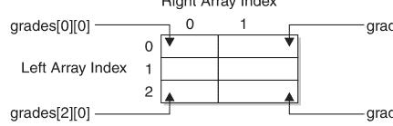

**图 5-1** 第一维的每个元素都有自己的两个元素。

## 赋值给数组元素

数组元素在表达式中的使用方式类似于变量在表达式中的使用方式。变量和数组元素之间唯一的区别是，在使用数组元素时，你必须同时指定数组名和索引。

你可以使用赋值运算符将值赋给数组元素，如下所示。此示例将 90 赋值给 `grades` 数组的第一个数组元素：

```java
grades[0] = 90;
```

赋值给数组元素的值在表达式中的使用方式类似于你在表达式中使用变量值的方式。以下示例对此进行了说明，其中 `grades[0]` 的值被赋值给数组 `grades` 的第二个元素：

```java
grades[1] = grades[0];
```

将值赋值给多维数组的方式与一维数组基本相同，只是在引用数组元素时必须同时使用两个维度的索引。

以下示例将一个成绩赋值给第一个数组元素（第一维）的第二个元素（第二维）：

```java
grades[0][1] = 90;
```

同样，当你需要访问存储在数组元素中的值时，你需要引用多维数组的每个维度。以下示例对此进行了说明，其中赋值给第一个数组元素（第一维）的第二个元素（第二维）的值，被赋值给第一个数组元素的第三个元素：

```java
grades[0][2] = grades[0][1];
```

对于包含两个以上维度的数组，也使用相同的格式，只是在表达式中引用数组元素时需要包含每个维度。

## 长度数据成员

有时在处理数组时，你需要引用数组的长度。例如，假设你想访问每个数组元素。你可以使用 `for` 循环轻松完成此操作。正如你在上一章中所回顾的，`for` 循环可以使用一个控制变量和一个计算控制变量值的条件表达式。在每次循环迭代中，控制变量通常使用增量运算符进行递增。

`for` 循环是遍历数组元素的完美方式，因为随着 `for` 循环的每次迭代，Java 会被指示移动到下一个数组元素。条件表达式被设置为在 Java 访问到最后一个数组元素时计算结果为 false。为此，你必须在条件表达式中包含数组的大小。程序员也将数组的大小称为数组的*长度*。

你有两种方式可以引用数组的长度。你可以显式地将长度放入条件表达式中，也可以引用数组对象的 `length` 数据成员。在探讨 `length` 数据成员之前，让我们先看看指定数组长度的显式方式。

以下示例展示了如何使用 `for` 循环访问每个数组元素。请注意，数组的长度被显式包含在 `for` 循环的条件表达式中。此示例声明了一个包含三个元素的数组。因此，数组的长度为 3。它还初始化了该数组。

```java
class Demo {
    public static void main(String args[]) {
        int myGrades[] = {90, 70, 80};
        for (int x = 0; x < 3; x++) {
            System.out.println("The value of array element x is " + myGrades[x]);
        }
    }
}
```

然后使用 `for` 循环让 Java 遍历数组的每个元素，并在屏幕上打印每个数组元素的值。控制变量用作每个数组元素的索引。`for` 循环持续进行，直到 `x` 的值等于数组的长度，此时 Java 退出循环，程序结束。

既然你已经了解了如何使用 `for` 循环遍历数组元素，让我们修改前面的示例，使用 `length` 数据成员而不是在 `for` 循环的条件表达式中显式放置数组的长度。

如果你熟悉其他编程语言，如 C，你可能会对 `length` 数据成员感到有些困惑，因为在一些编程语言中，数组没有任何与之关联的方法。在其他编程语言中，数组是特定数据类型的变量的集合。

Java 将数组视为类的实例，这被称为*对象*。你将在第七章中学习类。目前，你可以将*类*理解为一个定义了数据和方法的饼干模具。饼干模具不是饼干。因此，类不是实际的数据和方法。也就是说，内存并未为与类相关联的数据和方法预留。

当你把饼干模具压入面团，然后移开模具时，留下的就是一个真正的饼干（虽然你还需要烘焙它）。当你声明一个类的对象时，留下的就是一个真正的对象。也就是说，系统会为与该类对象相关的数据和方法保留内存空间。

因此，当你声明一个数组时，Java会将该数组视为你声明了一个拥有数据成员的数组对象。在本章后续部分，我们将探讨与数组对象关联的方法。数组拥有数据成员：数组元素和 `length` 数据成员。`length` 数据成员的值就是数组的长度。在程序中，任何时候你需要引用数组的长度，都可以访问这个 `length` 数据成员。

让我们看看这是如何工作的。下一个示例是前面示例的修改版，其中数组的 `length` 数据成员被用在条件表达式中，代替了显式指定数组长度。请注意，你是通过数组名来引用 `length` 数据成员的。

```java
class Demo {
    public static void main(String args[]) {
        int myGrades[] = {90, 70, 80};
        for (int x = 0; x < myGrades.length; x++) {
            System.out.println("The value of array element x is " + myGrades[x]);
        }
    }
}
```

## 将数组传递给方法

正如你在第1章学到的，*方法*是一段由唯一名称标识的语句块。在程序中，每当你想执行这些语句时，就可以调用该方法的名称。有时，方法需要数据来执行这些语句。这些数据在方法被调用时由程序提供给方法。这称为*传递数据*给方法。

假设你有一个方法，它根据正确回答的数量和测试的总问题数来计算成绩。这个方法需要两个数据元素来计算成绩：正确回答的数量和测试的总问题数。这两个值都由调用该方法的程序提供给方法。


方法所需的数据称为参数，包含在参数列表中。参数列表由数据元素组成，每个元素表示为数据类型和名称，这与你声明变量的方式非常相似。

有时，方法会返回数据给调用它的程序。这称为返回值。例如，计算成绩的方法可能会将成绩返回给请求计算成绩的程序。

既然你已经理解了方法是如何工作的，现在让我们看看如何将数组传递给方法。第一步是定义一个将要接收数组的方法。这在以下示例中展示：

```java
class Demo {
    public static void main (String args[]) {
        float grade;
        float rawTest[] = {70,100};
        grade = gradeCalc(rawTest);
        System.out.println("Your grade is:  " + grade );
    }
    static float gradeCalc(float test[])
    {
        return (test[0]/test[1]) * 100;
    }
}
```

该方法名为`gradeCalc()`，定义在`main()`方法下方。`gradeCalc()`方法的目的是根据学生在测试中正确回答的数量和测试的总问题数来计算成绩。这两个值都存储在一个传递给`gradeCalc()`方法的数组元素中。计算完成后，成绩由`gradeCalc()`方法返回。

让我们看看这个程序是如何工作的。程序从`main()`方法开始，声明了一个浮点变量和一个名为`rawTest`的数组。该数组有两个数组元素，存储两个浮点值。第一个数组元素是正确回答的数量。第二个数组元素是测试的总问题数。请注意，数组在声明时就进行了初始化。

然后程序调用`gradeCalc()`方法。`gradeCalc()`方法期望接收一个数组的引用，该数组包含计算成绩所需的数据。为了将数组传递给方法，你需要将数组名放在括号中。

让我们跟随数组进入`gradeCalc()`方法的定义。`gradeCalc()`方法的参数是`float test[]`。请注意，这并没有声明数组的长度。相反，它声明了一个对数组的引用，类似于动态声明数组时声明的引用。可以将引用视为指向包含数组的内存块第一个地址的指针。恰好数组名也是指向包含数组的内存块地址的指针。因此，参数被赋值为指向数组的指针。

然后`gradeCalc()`方法使用数组的每个元素来计算成绩。计算结果被返回给`main()`方法中调用`gradeCalc()`方法的语句。

`gradeCalc()`返回的成绩随后被赋值给变量`grade`，然后显示在屏幕上。

## 从方法返回数组

有时，方法需要返回一个数组给调用它的语句。这通过将数组名放在方法的`return`语句中来实现，如下例所示：

```java
class Demo {
  public static void main (String args[]) {
    float rawTest[];
    rawTest = testData();
    System.out.println("Correct Answers:  " +
        rawTest[0]);
    System.out.println("Total Questions:  " +
        rawTest[1]);
  }
  static float[] testData()
  {
    float rawTest[] = {70,100};
    return rawTest;
  }
}
```

让我们看看这个程序是如何工作的。它从`main()`方法开始，声明了一个对浮点数组的引用。记住，声明引用与声明数组是不同的。引用仅仅是指向数组的指针，而数组实际上是一块内存。

该引用用于接收`testData()`方法的返回值。`testData()`方法返回正确回答的数量和测试中出现的总问题数。从`testData()`方法的定义中，你会注意到没有参数，因为`testData()`方法不需要任何额外信息来完成其处理。

`testData()`方法声明了一个包含两个数组元素的浮点数组。这与前面示例中使用的数组相同。第一个数组元素包含正确回答的数量，第二个数组元素包含测试中出现的总问题数。请注意，数组名被用作返回值。正如你在前一节所回忆的，数组名指向包含数组的内存的第一个地址。正是这个地址被赋值给调用`testData()`方法的语句中的数组引用。

一个数组被方法返回。也就是说，方法和调用该方法的语句都可以访问该数组。两者都可以更改数组的元素。

## 创建数组的其他方式

在Java中，除了本章目前讨论的方式外，你还有几种其他方式来声明数组。其中一种方式是将方括号放在数组名的左侧。在目前的示例中，我们将方括号放在数组的右侧。两种方式都是可以接受的，如这里所示。使用其中一种方式没有优势或劣势。

```java
float rawTest []
float rawTest [] []
float [] rawTest
float [] [] rawTest
```

另一种选择是用两条不同的语句来声明数组引用。在本章前面，我们在声明数组的同一语句中声明了数组引用。以下是两种方式的示例：

```java
float rawTest = new float [4];
```

以及

```java
float rawTest;
rawTest = new float [4];
```

此外，你可以通过只指定一个维度而不是所有维度来声明多维数组。这被称为不规则数组，因为数组的所有维度不是在同一个语句中创建的。声明不规则数组没有优势或劣势。

其工作原理如下：在下面的示例中，第一条语句声明了一个二维数组，但仅在该声明语句中定义了维度。后续语句声明了第二维度。

```java
float rawTest[][] = new float[3][];
rawTest[0] = new float[2];
rawTest[1] = new float[2];
rawTest[2] = new float[2];
```

## Arrays 类

在本书的前面部分，你已经了解到类就像饼干模具。饼干模具定义了饼干的所有部分，而类定义了该类对象的所有部分。可以将类的对象想象成由饼干模具制作的饼干。

如你所记得的，类的部分被称为类的`成员`，它们分为两类：数据成员和方法成员。`数据`成员类似于数组的`length`数据成员，这在本章前面已经介绍过。`方法`成员是与类相关联的方法。

你将在第7章中学习更多关于类的知识，但目前你只需要了解这些，以便理解如何在程序中使用`Arrays`类。`Arrays`类是你的Java编译器自带的`java.util`包中已经为你定义好的类。其目的是让你能方便地处理数组。

通常，你会想要搜索、排序以及以其他方式操作数组元素。你可以使用循环和各种语句及表达式来完成这些操作。然而，通过使用`Arrays`类中定义的方法，你可以节省大量时间并减少必须编写的语句数量。

`Arrays`类定义了许多方法。我们将仔细研究如何使用更常用的方法：`equals()`、`fill()`、`sort()`和`binarySearch()`。

## equals()

`equals()`方法用于比较两个数组的元素。每个数组都作为参数传递给`equals()`方法，然后该方法计算数组是否相等。如果是，则`equals()`方法返回布尔值 true；否则，返回布尔值 false。

以下示例展示了如何在程序中使用`equals()`方法：

```java
import java.util.*;
class Demo {
    public static void main(String args[]) {
        int student1Grades[] = new int[3];
        student1Grades[0] = 90;
        student1Grades[1] = 80;
        student1Grades[2] = 70;
        int student2Grades[] = new int[3];
        student2Grades[0] = 90;
        student2Grades[1] = 80;
        student2Grades[2] = 70;
        if (Arrays.equals(student1Grades, student2Grades))
            System.out.println("Match");
        else
            System.out.println("No Match");
    }
}
```

此示例声明了两个数组，都包含学生成绩。然后调用`equals()`方法并将两个数组的名称传递给它。`equals()`方法返回的值成为`if`语句的条件表达式。请记住，如果条件表达式为真，则执行`if`语句中的语句；否则，执行`else`语句中的语句。根据`equals()`方法返回的值，屏幕上会显示适当的消息。

在这个示例中，由于我们使用了`equals()`方法，发生了两件特殊的事情。第一件事是将`java.util`包导入到程序中。你将使用的许多包都随Java编译器一起提供。每个包都有一个名称。在此示例中，`java.util`是我们在本程序中使用的包的名称。你必须将包含程序所用类的包导入到程序中；否则，你将遇到编译器错误。这是因为Java需要在使用类之前知道类的定义。`java.util`包包含我们在本示例中使用的`Arrays`类的定义。

此示例中另一件特殊的事情是，`equals()`方法通过引用`Arrays`类的名称来调用。类名必须放在你想在程序中使用的类成员之前，并且类名和类成员名称之间必须用点号分隔，这称为`点运算符`。将其理解为告诉Java："使用在`Arrays`类中定义的`equals()`方法。"

## fill()

每当你需要为具有大量数组元素的数组分配初始值时，`fill()`方法是一个方便的工具。假设你声明了一个包含2,000个整数的数组，并且遵循良好的编程实践，你决定将每个数组元素初始化为零。在本章前面，你学习了完成此操作的两种方法。首先，你可以在声明数组时分配初始值。但是，你最终会看到一个非常长的语句，包含2,000个零。或者，你可以声明一个包含2,000个元素的数组，然后编写2,000条语句将零分配给每个数组元素。

这两种选项都不吸引人，因为两者都耗时且容易让你出现打字错误。最佳解决方案是让`fill()`方法将所有这些数组元素分配为零。以下示例展示了如何做到这一点。

此示例声明了一个包含2,000个浮点数的数组。然后调用`fill()`方法来初始化数组的每个元素。`fill()`方法需要两个参数。第一个参数是数组名称，第二个参数是将分配给每个数组元素的值。初始值的数据类型必须与数组的数据类型兼容，这一点至关重要；否则，你将收到编译错误。`fill()`方法完成后，此程序显示每个数组元素的值。

```java
import java.util.*;
class Demo {
    public static void main(String args[]) {
        int studentIDs[] = new int[2000];
        Arrays.fill(studentIDs, 0);
        for (int i = 0; i < studentIDs.length; i++)
            System.out.println(studentIDs[i]);
    }
}
```

有时你需要重置一段数组元素的值，而不是整个数组的值。假设在使用前面的示例初始化2,000个学生ID数组后，你用数据库中的真实学生ID替换了初始化的值。但是，在这样做的过程中，你发现其中100个学生ID的范围是错误的，必须重置为零。

你有三种方法来解决这个问题。首先，你可以使用`fill()`方法重新开始，将所有数组元素重置为零。其次，你可以手动将100个错误ID的范围重置为零。第三，你可以使用另一个版本的`fill()`方法，仅将特定范围的数组元素重置为某个值。第三种选择显然是最佳的。

另一个版本的`fill()`方法使你能够指定希望`fill()`方法填充的数组元素范围。程序员称之为`重载`方法。你将在第6章中学习方法重载。目前，只需将重载理解为与方法同名的方法，但括号内传递的数据种类不同，这称为`参数列表`。

这在下一个示例中进行了说明。你会注意到，此示例的第一部分与上一个示例相同，只是`fill()`方法将1而不是0分配给数组元素。

在数组的值显示在屏幕上之后，调用另一个版本的`fill()`方法将100个数组元素的值从1重置为0。此版本的`fill()`方法需要四个参数。第一个参数是数组名称，第二个参数是值将被更改的第一个数组元素的索引。

第三个参数是值将被更改的最后一个数组元素之后的那个数组元素的索引。这有点令人困惑，所以我们仔细看看这个示例。第二个参数是200。这告诉`fill()`方法从`studentIDs[200]`开始更改值。第三个参数是301，指的是`studentIDs[301]`。这告诉`fill()`方法在到达数组元素`studentIDs[301]`时停止更改值。换句话说，数组元素`studentIDs[301]`的值不会被更改。`fill()`方法更改的最后一个数组元素是`studentIDs[300]`。

`fill()`方法的第四个参数是将分配给数组元素范围的值。在此示例中，从`studentIDs[200]`到`studentIDs[300]`的数组元素从1更改为0。

```java
import java.util.*;
class Demo {
    public static void main(String args[]) {
        float studentIDs[] = new float[2000];
        Arrays.fill(studentIDs, 1);
        for (int i = 0; i < studentIDs.length; i++)
            System.out.println(studentIDs[i]);
        Arrays.fill(studentIDs, 200, 301, 0);
        for (int i = 0; i < studentIDs.length; i++)
            System.out.println(studentIDs[i]);
    }
}
```

## sort()

对数组元素的值进行排序是你使用数组时最基本的操作之一。最简单的方式是调用`Arrays`类的`sort()`方法。`sort()`方法要求你传入数组的名称。随后它会重新排列数组元素的值，使它们按顺序排列。

让我们看看下面这个例子是如何工作的。这个例子声明了一个字符串数组，然后为每个数组元素赋了一个名称。注意这些名称并不是按顺序排列的。调用`sort()`方法并传入数组名称。数组排序后，数组元素会按顺序显示在屏幕上。

```java
import java.util.*;
class Demo {
    public static void main(String args[]) {
        String myArray[]= new String[4];
        myArray [0] = "Mary";
        myArray [1] = "Adam";
        myArray [2] = "Clark";
        myArray [3] = "Bob";
        Arrays.sort(myArray);
        for (int i = 0; i < 4; i++)
            System.out.println(myArray[i]);
    }
}
```

## binarySearch()

我们要讨论的`Arrays`类中最后一个常用方法是`binarySearch()`方法。`binarySearch()`方法用于查找包含特定值的数组元素。当你有一个非常大的数组时，这非常有用。你不必自己逐个检查数组元素来寻找特定值，只需调用`binarySearch()`方法，它就会帮你在数组中找到该值。

`binarySearch()`方法要求数组在搜索之前必须先排序；否则，`binarySearch()`方法将无法找到搜索条件。因此，在调用`binarySearch()`方法之前，你需要先将数组传递给`sort()`方法。

`binarySearch()`方法需要两个参数。第一个参数是数组名称，第二个参数是搜索条件。搜索条件必须与数组的数据类型兼容；否则，你会收到编译器错误。

`binarySearch()`方法返回一个整数。该整数可以是正数或负数。正数表示包含搜索值的数组元素的索引。负数则表示搜索条件不是索引中的值。

下面的例子展示了如何在你的程序中使用`binarySearch()`方法。你会发现这个例子与前面的例子几乎相同，使用了相同的数组和数组元素值。这些值在调用`binarySearch()`方法之前由`sort()`方法进行了排序。

传递给`binarySearch()`方法两个参数。第一个参数是数组名称，第二个参数是搜索条件。当这个程序运行时，`binarySearch()`方法返回2，因为2代表包含值Clark的数组元素的索引。然后索引会显示在屏幕上。


```java
import java.util.*;
class Demo {
    public static void main(String args[]) {
        int index;
        String myArray[] = new String[4];
        myArray[0] = "Mary";
        myArray[1] = "Adam";
        myArray[2] = "Clark";
        myArray[3] = "Bob";
        Arrays.sort(myArray);
        index = Arrays.binarySearch(myArray, "Clark");
        System.out.println("Clark is in array element: " + index);
    }
}
```

## 测验

1. 什么是索引？
2. 什么是数组引用？
3. 声明数组时，`new`运算符返回什么？
4. 数组第一个元素的索引是多少？
5. 如何将数组传递给方法？
6. 如何从方法返回数组？
7. 如何确定数组的元素个数？
8. `fill()`方法的第三个参数（方法的第二个版本）代表什么？
9. 当`binarySearch()`方法返回负数时意味着什么？
10. 什么是包？

# 第6章 方法 与 多态性

叫水管工来修漏水管道最好的地方在于，你不需要自己修管道。你甚至不需要知道如何修管道。相反，你只要说：“这根管子漏水了。修一下。”几小时后，水管工回来告诉你管子修好了——然后给你一张账单。水管工就像Java程序中的方法，因为程序员调用方法来执行任务，然后方法告诉程序员任务是否成功完成。幸运的是，方法不会向程序员出示账单。在本章中，你将学习如何在程序中调用方法以及如何创建自己的方法。

## 方法内部剖析

方法是Java程序中包含执行任务逻辑的部分。每次你需要执行任务时，只需调用该方法。然后方法会完成它的工作，回来告诉你任务已完成。

假设你的Java程序需要在学生选课时在屏幕上显示课程注册表单。你可以创建一个方法来显示课程注册表单，然后在需要显示表单时调用该方法。方法处理显示表单所需的所有步骤。

使用方法的一个主要原因是大幅减少程序中重复语句的数量。这可以在课程注册表单的例子中看出。假设显示课程注册表单需要15条语句，再假设你没有创建显示表单的方法。这意味着每次你想显示课程注册表单时都需要写15条语句——如果表单在程序中显示十次，总共就是150条语句。

另一种选择是将这15条语句放在一个方法中，然后调用该方法十次。这15条语句在程序中只写一次，为你节省了135条语句的编写工作。

使用方法的另一个原因是方便你维护程序。更改只在一个地方进行——在方法中。你不必在程序的所有地方搜寻并更改语句。相反，你只需查看程序中的一个地方，进行一次更改。

使用方法还能降低出错的风险。在程序中输入指令时，拼写错误经常发生。通过减少程序中重复的语句数量，你也减少了出现拼写错误的机会。

## 方法的类型

方法的两种类型是`非静态方法`和`静态方法`。`非静态方法`是类的成员，只能由该类的实例调用。`静态方法`也是类的成员，但可以在不声明类实例的情况下调用。

通常，`非静态方法`执行的任务依赖于存储在类实例中的数据。例如，假设你有一个名为`Student`的类，其中有一个名为`display()`的`非静态方法`。`display()`非静态方法显示包含在该类中的学生信息。你将在第7章中全面了解类。

`静态方法`通常执行与类的数据成员没有直接关联的任务。事实上，`静态方法`可能与类没有任何关系，除了它是该类的静态方法。

你在程序中使用的方法很多都是成员方法。

## 方法定义

在程序中调用方法之前，必须在类定义中的方法定义里对其进行定义。方法定义包含方法执行任务所需的所有语句，它由两部分组成：方法头和方法体。

## 方法头

方法头由三个基本元素组成，但有时还包括访问修饰符和行为修饰符。我们将在本节探讨基本元素。你将在第7章中学习其他元素。这三个基本元素是方法名、方法参数列表和方法返回值的数据类型。方法名和方法参数列表统称为**方法签名**，它能唯一标识一个方法，使其与其他方法区分开来。

方法名是你给方法起的名称。名称应反映方法执行的任务。例如，`display()`是显示屏幕上数据的方法的好名称，因为这个名称暗示了方法执行的任务。此外，名称必须符合Java命名规范（参见第1章）。

方法参数列表由方法执行任务所需的数据组成。回想一下，在第5章中，我们定义了一个根据正确答案数量和试题总数来计算成绩的方法。这个方法需要这两个数据元素才能计算成绩。这些数据由调用方法的语句传递给方法的参数列表。

方法参数列表通过指定传递给方法的每个数据元素的数据类型和名称来形成。下面的例子展示了这一点。这里显示了两个参数。第一个参数是正确答案的数量，第二个参数是试题总数。两者都是`int`数据类型。

```java
calcGrade(int correctAns, int numberTestQuestions)
```

参数的名称应反映存储在参数中的数据的性质。名称也必须符合Java命名规范。在方法语句中需要引用存储在参数中的数据。例如，你会使用`correctAns`来指代学生给出的正确答案数量。

参数列表中可以包含任意数量的参数，只要参数之间用逗号分隔，并且每个参数的名称是唯一的。也就是说，你不能有两个名为`correctAns`的参数。

参数列表是可选的。只有需要从调用该方法的语句中获取数据的方法才需要有参数列表。但是，即使没有参数列表，方法定义仍然需要括号，如下面的示例所示：

```java
display()
```

方法头部的剩余部分是返回值的数据类型。有些方法在完成任务后，会将数据返回给调用它的语句。其他方法则不会返回任何数据。

如果方法返回数据，你必须在方法头部包含该数据的数据类型。如果方法不返回数据，你必须使用`void`作为数据类型。关键字`void`表示无（即没有返回数据类型）。不要将`void`（无）与零混淆。零是一个值，而`void`是值的缺失。

方法返回的数据类型放在方法名称的左侧，如下面的示例所示，该方法返回一个浮点数：

```java
float calcGrade(int correctAns, int numberTestQuestions)
```

但是，如果`calcGrade()`方法不返回数据，则`void`放在方法名称的左侧，如下所示：

```java
void calcGrade(int correctAns, int numberTestQuestions)
```

### 方法体

方法的主体定义在开始和结束的大括号内，位于方法头部下方。这是你放置在方法被调用时执行的语句的地方。Java从开始大括号下方的第一条语句开始执行，并顺序执行语句，直到遇到结束大括号或执行到`return`语句。

以下示例说明了如何构造方法体：

```java
void calcGrade(int correctAns, int numberTestQuestions) {
    // 在此处放置语句
}
```

### 方法返回值

根据方法执行的任务，方法可能会将数据返回给调用它的语句。例如，本章前面展示的`calcGrade()`方法会计算并返回一个成绩。

程序员将方法返回的数据称为*返回值*。返回值放在`return`关键字的右侧。当`return`语句执行时，Java会立即退出方法并返回到调用该方法的语句。`return`语句下方的语句不会被执行。

返回值可以是字面量、变量或对象。一些程序员在`return`语句中放置一个表达式。Java随后会计算该表达式并返回表达式的结果。返回值必须与方法头部指定的返回数据类型兼容；否则，你将收到编译器错误。

`return`语句可以放置在方法体内的任何位置。请记住，一旦Java执行`return`语句，其下方的任何语句都不会被执行。通常，如果方法有返回值，程序员会在方法体结束大括号之前立即放置一个`return`语句。如果方法没有返回值，则不包含`return`语句。

可以使用多个`return`语句根据方法体内的条件返回不同的返回值。

假设你创建了一个方法来验证用户密码。如果密码有效，则返回值0。如果密码无效，则返回值1。在`if...else`语句中使用了两个`return`语句。一个在`if`语句中，仅在密码有效时执行；另一个在`else`语句中，在密码无效时执行。只有一个会执行。这在下面的代码段中进行了说明，其中用户输入的密码被赋值给变量`password`：

```java
if (password == "Bob")
    return 0;
else
    return 1;
```

一些程序员总是在方法中使用`return`语句，即使该方法不需要返回值。他们这样做是为了表明方法是否成功执行了任务。如果任务成功执行，则返回零。

如果方法在执行任务时遇到问题，则返回非零数字。一些程序员返回负数来表示发生了问题。其他程序员返回与错误对应的正值，以帮助他们识别问题。这通常被称为*错误码*。

让我们回到验证用户密码的方法，看看错误码是如何使用的。验证任务包含三个子任务。第一个子任务是打开包含有效密码的数据库。第二个子任务是搜索由调用该方法的语句传递的用户密码。第三个子任务是报告密码的状态。

如果第一个子任务失败，因为方法无法打开数据库，我们可以返回-1。同样，如果搜索数据库时出现问题，我们可以返回-2。如果两个子任务都成功完成，如果用户密码有效，我们可以返回0；如果无效，则返回1。

错误码通常只在复杂的程序和方法中使用，在这些情况下，跟踪程序中发生的问题既困难又耗时。

下面的示例是一个完整的方法定义，说明了如何将值返回给调用它的语句。此示例计算并返回一个测试成绩。你会注意到`return`语句包含一个表达式，而不是一个返回值。请记住，Java在执行`return`语句之前会计算表达式。表达式的结果会替换`return`语句中的表达式，并返回该结果。

```java
float calcGrade(int correctAns, int totalQuestions) {
    return (correctAns / totalQuestions) * 100;
}
```

### 参数列表

既然你知道了如何定义方法，让我们更仔细地看看方法参数列表。之前你了解到，有些方法需要数据才能执行任务，而这些数据由调用该方法的语句提供。这些数据被称为*参数*，并通过参数列表的形式传递给方法。将参数列表视为方法执行任务所需的数据集合。

调用该方法的语句将数据放在*方法调用*的括号之间，如下面的示例所示，该示例将两个整数字面量传递给本章前一节定义的`calcGrade()`方法：

```java
calcGrade(70, 100)
```

一些程序员将传递给方法的数据称为*参数列表*。参数列表中的每个数据元素都称为*参数*。因此，70和100合起来构成了参数列表，每个都是一个参数。其他程序员使用术语*argument list*和*arguments*作为*parameter list*和*parameters*的同义词。在本书中，我们将使用术语*argument list*和*arguments*。

使用参数列表时，你需要记住三点。首先，由语句传递给方法的数据必须与方法参数列表中指定的数据类型兼容，如方法定义中所述。

其次，传递给方法的数据顺序必须与方法参数列表的顺序相同。

第三，你必须向方法传递正确数量的参数。也就是说，方法定义中参数列表中的参数数量必须与传递给方法的数据元素数量相同。

未能做到这三点可能会导致编译器错误，或者导致方法处理错误的数据。例如，交换传递给`calcGrade()`方法的数据位置会导致方法计算出错误的成绩。

#### 参数列表的元素

参数列表由两个元素组成：参数数据类型和参数名称。参数数据类型与变量的数据类型相同。它告诉Java为参数保留多少内存以及将存储哪种类型的数据。

参数名称类似于变量名称。它是包含由调用该方法的语句传递的数据的内存地址的别名。你在方法内部使用参数名称的方式与使用变量名称的方式相同。

#### 参数列表的工作原理

在数据传递给方法之前，它存储在内存中。当调用该方法时，Java根据方法定义中指定的参数数据类型分配内存。然后，Java将调用该方法的语句传递的数据提供给该方法。

数据通过两种方式提供给方法：按值传递和按引用传递。*按值传递*使方法可用的数据副本。也就是说，Java创建传递给方法的数据的副本，并将副本存储为参数分配的内存中。方法中的语句可以更改传递给它的数据值，但该更改不会传递给调用该方法的语句，因为每个语句都有自己的数据副本。

以下是如何将数据按值传递给方法的示例。此示例声明了三个`int`。一个存储方法返回的值，另外两个存储传递给方法的值，初始化为70和100。

这些值分别被分配给参数`correctAns`和`totalQuestions`。Java将这些值分配给参数。数值70和100在内存中出现了两次——一次是给`calcGrade()`方法，另一次是给`main()`方法。

```java
class Demo {
    public static void main(String args[]) {
        float a;
        int b = 70, c = 100;
        a = calcGrade(b, c);
        System.out.println("Your grade is:  " + a);
    }
    static float calcGrade(int correctAns, int totalQuestions) {
        return (correctAns / totalQuestions) * 100;
    }
}
```

## 命令行参数

命令行参数是在运行程序时从命令行传递给你的Java程序的数据。命令行也称为*命令提示符*。（你可以在Windows中选择“开始” | “程序” | “附件” | “命令提示符”来显示命令提示符。）

有时程序员使用命令行参数来覆盖Java程序中的默认设置。例如，一个Java程序可能在整个程序中使用系统日期作为今天的日期，除非通过命令行参数传递一个日期，该参数会覆盖默认日期。

Java程序通过`main()`方法的参数列表接收来自命令行的数据。你可能已经在本书的示例中注意到了`main()`方法的参数列表，如下所示：

```java
void main(String args[])
```

`main()`方法的参数列表由一个参数组成，这是一个名为`args`的`String`对象数组的引用。你将在第7章学习`String`对象。目前，可以将`String`对象视为一个或多个单词，例如"Bob Smith"或"121 Main Street"。

正如你在上一章中了解到的，数组的引用并不是数组本身。相反，它是指向包含数组第一个元素的内存地址的东西。传递给程序的数据被放置在内存中，第一个数据元素的内存地址被分配给`args`引用。你已经在本章前面看到过当数组传递给方法时是如何处理的。

传递到命令行的数据元素的数量决定了`args`数组中数组元素的数量。你可以使用数组的`length`成员来确定数组元素的数量，这在上一章中已经学过。以下示例将帮助你回忆如何执行此操作：

```java
class Demo {
    public static void main(String args[]) {
        System.out.println(
            "The number of command line arguments is: " + args.length);
    }
}
```

传递到命令行的数据被分配给`args`数组的每个元素，你可以通过引用数组元素（与引用任何数组元素的方式相同）在程序内部访问该数据（参见第5章）。

让我们看看如何操作。以下示例首先确定是否有任何命令行参数。如果没有，则显示适当的消息。如果有，则使用`for`循环显示`args`引用指向的数组的每个元素。

```java
class Demo {
    public static void main(String args[]) {
        if (args.length > 0) {
            for (int x = 0; x < args.length; x++) {
                System.out.println(
                    "Command line argument " + x + " : " + args[x]);
            }
        } else {
            System.out.println(
                "There are no command line arguments.");
        }
    }
}
```

## 传递命令行参数

现在你知道如何在程序中使用命令行参数了，让我们把注意力转向参数是如何从命令行传递到你的程序的。如果你使用Windows，你可能没有机会使用命令行，因为Windows中运行的许多程序都是通过双击图标或从菜单中选择程序来启动的。

为了从命令行运行程序并传递命令行参数，你需要在屏幕上显示命令行。在Windows的许多版本中，你可以通过选择“开始” | “程序” | “附件” | “命令提示符”来执行此操作。

我们将使用上一节中的示例来说明如何传递命令行参数。在命令行上键入以下内容并按ENTER运行程序：

```bash
java demo Amber
```

以下是正在发生的情况：第一个单词`java`用于运行Java虚拟机。第二个单词`demo`是Java程序的名称，即上一节所示的程序。第三个单词`Amber`是命令行参数。

当你按ENTER时，你的操作系统运行Java虚拟机，并将你的程序名称和命令行参数传递给它。然后Java虚拟机在执行你的程序时使用命令行参数。


你可以通过在命令行上键入多个命令行参数并用空格分隔它们来传递给你的程序。参数按照它们在命令行上出现的顺序分配给 `args` 数组。例如，第一个参数分配给第一个数组元素，第二个参数分配给第二个数组元素，依此类推。

以下命令行向你展示了如何使用多个命令行参数。请注意，有两个命令行参数：Amber 和 Joanne。当程序运行时，Amber 被分配给 `args[0]`，Joanne 被分配给 `args[1]`。

```
java demo Amber Joanne
```

有时你可能需要传递一个由两个或更多单词组成的命令行参数，例如 "Amber Leigh"。这里有一个问题。这些单词被空格分隔，这会混淆 Java，因为它将这些单词解释为两个命令行参数，而不是一个命令行参数。

这个问题的解决方法是将构成命令行参数的所有单词放在双引号内。这使得 Java 将空格解释为参数的一部分，而不是新参数的开始。以下命令行说明了如何执行此操作。本示例中有两个命令行参数（"Amber Leigh" 和 Joanne）：

```
java demo "Amber Leigh" Joanne
```

在其他情况下，你可能希望引号成为命令行参数的一部分。例如，命令行参数可能是 "Amber"，包括引号。问题是，操作系统 shell 将引号解释为将其之间的所有内容作为命令行参数的信号（不包括引号）。

解决方法是在每个引号前加上反斜杠（\）。反斜杠告诉操作系统 shell 引号是命令行参数的一部分。以下命令行参数向你展示了这是如何工作的。当程序运行时，`args[0]` 被分配给 `"Amber"`，`args[1]` 被分配给 Joanne。

```
java demo \"Amber\" Joanne
```

# 调用方法

在本章前面，你已经看到了如何在语句中调用方法。你只需使用方法名后跟任何参数。参数必须包含在括号内。如果方法不需要任何参数，则使用空括号。调用方法时，你需要考虑许多因素。我们将在本节中讨论这些因素。

首先需要考虑的是 Java 区分大小写。因此，调用方法时必须小心使用与方法定义中完全相同的名称。否则，Java 会认为你想使用一个不同的方法，如果该方法未找到，则会显示编译器错误。

其次，确保在方法调用中包含方法定义中找到的所有参数。方法调用必须具有相同数量的参数。方法调用传递的参数的数据类型必须与方法定义中的参数兼容。此外，这些参数在方法调用中出现的顺序必须与它们在方法定义中出现的顺序相同。如果参数不匹配，你将收到编译器错误。

有些方法会返回一个值；但是，调用该方法的语句可以忽略返回值而不会遇到编译错误。这是本章前面使用的调用方法计算成绩的示例的修改版本：

```
class Demo {
  public static void main (String args[]) {
    float rawTest[] = {70,100};
    calcGrade (rawTest);
  }
  static float calcGrade (float test[])
  {
    return (test[0]/test[1]) * 100;
  }
}
```

# Java 神秘面纱揭开

你会注意到，一条语句调用了 `calcGrade(rawTest)` 方法，并传入了一个数组的名称。`calcGrade()` 方法计算出成绩并将其返回给这条语句。然而，这条语句并未对这个成绩做任何处理。虽然这不是一个 Java 错误，但调用 `calcGrade()` 方法而不使用其返回值是不符合逻辑的。因此，你需要确保在你的程序中，忽略方法的返回值是有意义的。

程序员的常见做法是，当方法的返回值要在表达式中使用时，就从表达式内部调用该方法。下一个示例将说明这一点。该示例对 `calcGrade()` 计算出的成绩应用了一个调整系数（curve），这个方法在前面的示例中已经出现过。对 `calcGrade()` 方法的调用是在计算调整系数的表达式中进行的。Java 会在计算表达式之前先调用该方法。

```
class Demo {
    public static void main(String args[]) {
        float rawTest[] = {70, 100};
        double finalGrade, curve = 1.2;
        finalGrade = curve * calcGrade(rawTest);
        System.out.println(
                "Your final grade is: " + finalGrade);
    }
    static float calcGrade(float test[]) {
        return (test[0] / test[1]) * 100;
    }
}
```

## 多态性

希腊人创造了一个术语来指代具有多种形式的事物——*多态性*。程序员也使用这个术语来描述 Java 的一种能力：一个方法可以根据其在程序中被调用的上下文环境，呈现出不同的含义（形式）。

Java 通过允许程序员重载一个方法来实现多态性。程序员通过使用相同的名字但定义不同的参数列表来“重载”一个方法。

你可能想知道为什么程序员会想为两个方法使用相同的名字。表面上看，这似乎会让调用该方法的任何人感到困惑。然而，重载实际上使方法的使用变得更加容易，因为程序员不必记住大量的方法名。程序员只需要记住方法名和相应的参数列表。

下一个示例说明了重载一个方法的好处。这个示例定义了一个名为 `displayError()` 的方法，用于在屏幕上显示错误消息。错误消息包含在 `displayError()` 方法体内的 `System.out.println()` 语句中。

你会注意到这是一个通用的错误消息，没有提供任何关于错误性质的线索。在某些情况下，这个错误消息是可以接受的。在其他情况下，程序员可能希望使用信息更丰富的错误消息。

因此，我们用另一个同样名为 `displayError()` 的方法重载了 `displayError()` 方法。另一个版本的 `displayError()` 方法有一个参数：将要显示在屏幕上的错误消息文本。

程序员可以选择调用 `displayError()` 方法并使用通用错误消息，或者调用另一个版本并为 `displayError()` 方法提供要显示在屏幕上的错误消息。无论哪种情况，程序员仍然调用的是 `displayError()` 方法，只是根据程序员希望显示通用错误消息还是自定义错误消息，来决定在方法调用中包含参数还是不包含参数。

```
class Demo {
    public static void main(String args[]) {
        displayError();
        displayError("Your printer is out of paper.");
    }
    static void displayError() {
        System.out.println("An error has occurred.");
    }
    static void displayError(String errorMsg) {
        System.out.println(errorMsg);
    }
}
```

## 方法签名

虽然我们倾向于使用方法名来标识一个方法，但 Java 是通过其签名来标识一个方法的。正如你在本章前面所回忆的，方法的签名是方法名和方法参数列表的组合。

这意味着程序员会将 `displayError()` 方法的两个版本视为同一个方法。然而，Java 将这些版本视为不同的方法，因为它们的参数列表不同。

参数列表可以在几个方面不同。你可以拥有不同数量的参数，相同数量但不同数据类型的参数，或者相同数量和相同数据类型但在参数列表中顺序不同的参数。

其中一些差异可以在下一个示例中看到。注意 `displayError()` 方法的第三和第四个版本包含基本相同的参数，只是它们在参数列表中出现的顺序相反。Java 将每个都视为不同的方法。

```
class Demo {
    public static void main(String args[]) {
        displayError();
        displayError("Your printer is out of paper.");
        displayError("ver3", 1);
        displayError(1, "ver4");
    }
    static void displayError() {
        System.out.println("An error has occurred.");
    }
    static void displayError(String errorMsg) {
        System.out.println(errorMsg);
    }
    static void displayError(String errorMsg,
            int errorNum) {
        System.out.println("ver 3");
    }
    static void displayError(int errorNum,
            String errorMsg) {
        System.out.println("ver 4");
    }
}
```

## 测验

1. 方法头由哪些部分组成？

2. 方法签名由哪些部分组成？

3. `return` 语句的目的是什么？

4. 参数的两个组成部分是什么？

5. 什么是命令行参数？

6. 如何将引号作为命令行参数传递？

7. 什么是多态性？

8. 什么是方法重载？

9. 什么是方法？

10. Java 中有哪些两种方法？

# 第 7 章 类

一些编程语言缺少类（class），但 Java 不能这样说，因为 Java 的类比英国皇室还要多（尽管 Java 的类在技术上比上流社会产生的“阶级”更技术化一点）。Java 的类用于在 Java 程序中模拟现实世界中的物品，例如学生、课程注册表或成绩单。现实世界的事物由属性和行为组成，例如学生姓名和学生选课。Java 类也有属性和行为，称为*数据*和*方法*。你将在本章学习如何创建和使用 Java 类。

## 类定义

像 Java 这样的面向对象编程语言的一个主要目标是通过在程序中定义一个类来模拟现实世界的事物——我们称之为*对象*。你也可以将类视为你定义的一个新数据类型，用于创建该类的实例。

类将与对象相关联的属性和行为组合成一种新的数据类型。这被称为*封装*。程序员喜欢说属性和行为被*封装*在类定义中。

类定义就像一个饼干模具，定义了类的属性和行为。属性和行为被认为是类的*成员*。重要的是要理解，类定义是一个模板，而不是对真实对象的模拟。这类似于饼干模具不是饼干。饼干模具必须压入饼干面团才能制作出真正的饼干。

类的饼干被称为类的*实例*。许多程序员将类的实例称为*类的对象*或简称为*对象*。我们将在本书中使用*实例*这个术语，这样你就不会将*对象*（指现实世界对象的术语）与由类创建的对象混淆了。

这样来思考一个类：饼干模具制作饼干，而类制作实例或对象。你将在本章后面学习如何创建类的实例。现在，我们将专注于定义一个类。

类定义由三个部分组成：关键字 `class`、类名和类体。`class` 关键字用于告诉 Java 你正在定义一个类。类名是你将在 Java 程序中调用该类的名字。类名必须符合第 1 章介绍的 Java 命名规范。类体由一对花括号定义，是你声明属性和定义行为的地方。

这是一个 Java 类定义的形式。这个类名为 `myClass`。

```
class myClass {
}
```

类的*属性*是与该类相关联的数据。程序员将属性称为*实例变量*。在第 2 章中，你学习了程序类的实例变量。类的每个实例都有自己的一份分配给实例变量的数据。稍后会详细介绍这一点。

类的*行为*是与该类相关联的方法。程序员称之为*方法成员*。在第 6 章中，你学习了程序类的方法成员。类的每个实例共享该类的方法成员。

如果你创建 `myClass` 的两个实例，每个实例都有自己的实例变量，但共享相同的方法成员。

在第 1 章中，你了解到一个 Java 应用程序是一个被称为*应用程序类*的类。Java 应用程序类必须定义 `main()` 方法，这是应用程序的入口点。Java 应用程序实际上是一个类定义，而 `main()` 方法是该类的一个成员方法。但是，你在程序中定义的其他类不需要有 `main()` 方法，因为一个 Java 程序中只有一个 `main()` 方法。

## 定义方法成员

成员方法的定义方式与方法的定义方式几乎相同，这一点你在第 6 章中已经学习过。但是，存在两个区别。首先，方法成员的定义必须放置在类定义的主体内。另一个区别是你必须包含访问说明符，它告诉 Java 在 Java 程序中如何调用该方法成员（请参见本章接下来的"访问说明符"部分）。

回忆第 6 章的内容，方法定义由方法名、参数列表、返回值和方法体组成。方法名用于在 Java 程序中调用该方法。参数列表用于向方法提供执行任务所需的信息。参数列表是可选的。如果方法拥有执行任务所需的全部信息，则不需要参数列表。如果方法需要信息来执行任务，则需要参数列表。

返回值是方法返回给调用该方法的语句的信息。返回值也是可选的，因为并非每个方法都需要返回值。方法体使用一对花括号定义，在其中放置当程序中的语句调用该方法时要执行的语句。

## 访问说明符

类的每个成员都有一个访问说明符，它告诉 Java 程序的其他部分如何访问该成员。三种类型的访问说明符分别是 `public`、`private` 和 `protected`。

指定为 `public` 的类成员可以被程序的任何部分访问，前提是访问该成员之前已创建了类的实例。许多方法被指定为 `public`，以便程序的各个部分可以调用这些方法。此规则的例外涉及类的 `public static` 成员。你可以在不先创建类实例的情况下访问类的 `public static` 成员。

指定为 `private` 的类成员只能被同一类的成员访问。其他程序部分无法访问 `private` 成员。许多实例变量被指定为 `private`，以保护它们免受程序其他部分的访问。通常，只有类的方法成员可以访问实例变量。

指定为 `protected` 的类成员可以被同一类的方法成员以及继承该类的类的方法成员访问。它还可以被同一包中的类访问（请参见本章后面的"包"）。你将在第 8 章中学习继承。程序的其他部分无法访问类的 `protected` 成员。一些方法成员和可能的一些实例变量被设计为 `protected`，具体取决于程序的性质。

你将访问说明符放在方法成员定义的数据类型的左侧，以及声明实例变量时放在数据类型的左侧，你将在本章后面看到这些内容。

你不必包含访问说明符。如果省略访问说明符，Java 会假定该成员被指定为 `public`，使其对与该类在同一包中的所有程序部分可用。

以下示例展示了如何定义一个名为 `print()` 的方法成员，它是 `myClass` 类的成员。该方法显示从调用该方法的语句中接收的文本。没有返回值，程序的任何部分都可以访问该方法。你会注意到 `main()` 方法的主体不包含任何语句，因此运行此程序时不会发生任何事情。

```
class Demo {
    public static void main (String args[]) {
        
    }
}
class myClass {
    public void print(String str){
        System.out.println(str);
    }
}
```

## 声明实例变量

在本章前面，你了解到实例变量是与类相关联的数据，例如模拟学生的类中学生的学号。实例变量的声明方式与声明变量类似（第 2 章），但有三个例外。

回忆一下，变量是通过在语句中指定数据类型后跟变量名来声明的。以下语句声明了一个学生 ID。变量是 `int` 数据类型，名为 `student`。

```
int student;
```

相同的语句用于声明实例变量。但是，实例变量必须在类的主体内声明，并且前面应加上访问说明符。请记住，如果你不使用访问说明符，Java 会将实例变量指定为对与该类在同一包中的类可用。

以下示例展示了如何声明实例变量。实例变量通常被指定为 `private`，从而将对这些变量的访问限制为仅同一类的方法成员。

```
class Demo {
  public static void main (String args[]) {

  }
}
class myClass {
  private int student;

}
```

声明变量和声明实例变量之间的第三个区别在于两者的初始化方式。回忆一下，*初始化*是为变量赋初始值的过程。你可以在声明变量时初始化变量，如下一条语句所示：

```
int student = 12345;
```

但是，一些程序员使用类构造函数来初始化实例变量（请参见下一节）。

请记住，对一个实例的实例变量进行更改不会对另一个不同实例的实例变量产生任何影响。这意味着如果我们声明两个 `myClass` 类的实例 `student`，每个实例都有自己的 `student` 实例变量。对一个实例变量的更改不会改变另一个。

## 构造函数

每次创建类的实例时，构造函数都会被自动调用。从技术上讲，构造函数在声明类的实例时，在 `new` 运算符完成其操作之前被调用（请参见"声明类的实例"部分）。程序员使用构造函数来初始化实例变量以及在创建类的实例时执行其他任务。

构造函数的定义方式与定义类的方法成员几乎相同，但有三个例外。首先，构造函数的名称必须与类的名称相同。其次，构造函数有一个隐式返回值，即类类型。也就是说，不允许为构造函数定义返回值。第三，构造函数必须被指定任何访问说明符或不指定访问说明符。


# 类的构造函数与实例

以下示例展示了如何定义构造函数。此示例定义了 `myClass` 类，其中包含一个名为 `student` 的实例变量和一个名为 `myClass()` 的方法成员。此方法成员是该类的构造函数，因为它与类同名。构造函数被指定为具有 public 访问权限。此示例中的构造函数使用学生 ID 号初始化实例变量 `student`。

```java
class Demo {
    public static void main (String args[]) {

    }
}
class myClass {
    private int student;
    myClass (){
        student = 12345;
    }
}
```

你不必为程序定义构造函数，除非需要在创建实例时执行语句。如果你不定义构造函数，Java 会使用默认构造函数。

你可以为程序定义多个构造函数，每个构造函数具有不同的参数列表。例如，一个没有参数列表的构造函数可能会使用默认值初始化实例变量。另一个带有参数列表的构造函数可能会使用实例声明时传递给构造函数的值来初始化实例变量。

## 声明类的实例

请记住，类定义就像饼干模具，而不是饼干本身。这意味着你必须使用类定义来创建类的真实副本，这被称为类的*实例*。你可以通过在程序中声明类的实例来实现这一点。

当实例被声明时，Java 会为所有实例变量保留内存，然后调用构造函数。如果构造函数初始化了实例变量，则初始值会被存储到内存中。同时，构造函数中的其他语句也会被执行。

下面是声明类实例的方式。这条语句看起来可能很熟悉，因为它本质上与声明数组时使用的语句相同（参见第 5 章）。

```java
myClass x = new myClass();
```

这条语句中发生了三个步骤。首先，`new` 运算符告诉 Java 为该实例保留一块内存。这块内存的大小足以存储实例变量。`new` 运算符返回该内存块的地址。

其次，声明一个指向 `myClass` 实例的引用，该引用名为 `x`。引用通过使用类名来声明，这被称为*类类型*。最后，第三个步骤是将实例内存块的首地址赋值给该引用。当你需要在程序中引用该实例时，都可以使用该引用（在此例中为 `x`）。

虽然前面的示例在一条语句中同时声明了引用和类的实例，但这些声明也可以拆分为两条语句，如下例所示。第一条语句声明引用，第二条语句将实例赋值给引用。

```java
myClass x;
x = new myClass();
```

程序员将引用的声明与类实例的声明分开，是为了能够将不同的实例赋值给同一个引用，除非该引用被声明为 `final`。任何被声明为 `final` 的引用都不能被重新赋值。你将在下一个示例中看到这是如何实现的。

请注意，下一个示例开头声明了三个指向 `myClass` 的引用。接下来的两条语句分别声明了 `myClass` 的一个实例，并将它们分别赋值给引用 `x` 和引用 `y`。

然后，将引用 `x` 赋值给引用 `current`。`x` 和 `current` 都指向同一个类实例，因为 `x` 的值指向包含该实例的内存块。存储在引用 `x` 中的内存地址被复制（赋值）给引用 `current`。这意味着 `x` 和 `current` 都可以用来访问同一实例的成员，因为它们指向内存中的同一个地址。

最后一条语句将引用 `y` 的值赋给 `current`。`y` 的值是 `myClass` 第二个实例的内存地址。`y` 和 `current` 都指向同一个内存地址，该地址包含类的第二个实例。程序员使用这种技巧在类的不同实例之间进行切换。

```java
myClass x,y,current;
x = new myClass();
y = new myClass();
current = x;
current = y;
```

在前面的示例中，`new` 运算符后面紧跟着类名。类名实际上调用了类的构造函数（参见标题为"构造函数"的部分）。`new` 运算符为类的实例动态分配内存。*动态分配*是指 Java 在运行时而非编译时保留内存。但是，运行你程序的计算机上可能没有足够的内存。如果发生这种情况，`new` 运算符会抛出一个异常（参见第 9 章）。

## 访问类的成员

一旦声明了类的实例，就可以使用该实例的引用来访问类的成员。要访问类的成员，你需要使用引用名，后跟点运算符，然后再跟成员名。你可以在下一个示例中看到具体的做法。

以下示例定义了 `myClass` 类，该类有三个成员。它们分别是一个名为 `student` 的实例变量、一个构造函数和一个名为 `print()` 的方法成员。当实例被声明时，构造函数会为实例变量赋一个学号。然后，使用该实例调用 `print()` 方法成员。`print()` 方法成员将学号显示在屏幕上。

```java
class Demo {
    public static void main (String args[]) {
        myClass x = new myClass();
        x.print();
    }
}
class myClass {
    int student;
    myClass(){
        student = 1234;
    }
    public void print(){
        System.out.println("Hello, student: " + student);
    }
}
```

# 第 7 章 类

## 重载成员方法

在第 6 章中，你了解到 Java 通过方法签名来识别方法，方法签名是方法名和参数列表的组合。这意味着两个方法可以有相同的名字和不同的参数。

类的方法成员也是如此。也就是说，一个类可以有多个同名方法，只要每个方法成员的参数列表在类定义中是唯一的。同一个类的两个方法成员不能具有相同的方法签名。但是，属于不同类的方法成员可以具有相同的方法签名。当同一个类中有两个方法成员具有相同的方法名时，程序员会说第二个方法*重载*了第一个方法。

正如你在第 6 章中所回忆的，程序员重载方法是为了减少需要学习的方法数量。通常，同名方法执行的是同一任务的不同变体。程序员只需记住一个方法名和相应的参数列表，而不需要为每个变体记住不同的名称。

下一个示例说明了这一点，其中两个方法成员的名称都是 `print()`。一个版本没有参数列表，每次调用时显示默认问候语。另一个版本允许程序员输入将被整合到消息中的文本。你可以看到，程序员可以选择使用默认问候语，也可以使用个性化问候语。

```java
class Demo {
    public static void main (String args[]) {
        myClass x = new myClass();
        x.print();
        x.print("Bob");
    }
}
class myClass {
    public void print(){
        System.out.println("Hello.");
    }
    public void print(String str){
        System.out.println("Hello, " + str);
    }
}
```

## 重载构造函数

重载方法的一个常见用途是重载构造函数。在本章前面，你已经了解到构造函数与 `new` 运算符配合使用来创建类的实例。默认构造函数没有参数列表。程序员通过定义带有参数列表的构造函数来重载构造函数，这被称为*带参构造函数*。你可以在构造函数的参数中使用任意数量和类型的参数。

重载构造函数有很多原因。一个常见的原因是允许程序员覆盖用于初始化实例变量的值。下一个示例说明了这一点，其中定义了两个构造函数。一个构造函数将实例变量初始化为零，另一个构造函数将实例变量初始化为程序员传递给构造函数的任意值。

本例中创建了两个 `myClass` 的实例。第一个实例使用默认值来初始化实例变量。第二个实例使用带参构造函数，传入了数字 354。然后将实例变量的值显示在屏幕上。

```java
class Demo {
    public static void main (String args[]) {
        myClass x = new myClass();
        myClass y = new myClass(354);
        x.print();
        y.print();
    }
}
class myClass {
    int student;
    myClass(){
        student = 0;
    }
    myClass(int ID){
        student = ID;
    }
    public void print(){
        System.out.println("Hello, student: " + student);
    }
}
```

## this 关键字

类的方法成员隐式地拥有对其所在类中实例变量和其他方法成员的访问权限。在本书前面的示例中，你已经看到如何使用类的方法成员来初始化同一类的实例变量。

在某些情况下，你可能需要在方法成员的定义中声明一个与实例变量同名的变量。在方法成员内部声明的变量称为局部变量。当方法成员中的语句引用变量名时，如果局部变量和实例变量同名，Java 会优先使用局部变量。

然而，你可以通过使用 `this` 关键字来告诉 Java 使用实例变量而非同名的局部变量。`this` 关键字是一种在类定义内部引用该类对象的方式。

使用 `this` 关键字可能会让人感到困惑。不过，请回想一下你在程序中是如何访问类成员的。首先，你声明一个该类实例的引用，然后在需要引用该类的成员时使用这个引用的名称。

例如，假设我们创建了一个类的实例并将其赋值给引用 `newClass`。以下是你如何访问 `newClass` 的 `display()` 方法成员，假设该方法成员已在类定义中定义：

```java
newClass.display()
```

本质上，当你想从同一类的方法成员中访问类成员时，你做的也是同样的事情。不过，对类的引用是隐含的。也就是说，在访问类的另一个成员时，你不需要引用该类的实例。Java 会假定你想使用的是该类的成员。

然而，当出现冲突时，比如两个变量同名，你必须明确告诉 Java 你想使用哪一个。如果你想使用局部变量，直接使用变量名即可。如果你想使用实例变量，则需要在访问实例变量的语句中引用该实例。

毫无疑问，你会发现一个问题。一个类可能有多个实例，每个实例都有不同的引用。因此，你无法在类定义中引用某个实例的引用。解决方案是使用 `this` 关键字来代替引用名。`this` 关键字告诉 Java 使用当前实例。

以下示例说明了如何在 Java 程序中使用 `this` 关键字。该示例定义了一个名为 `myClass` 的类，它有三个成员：实例变量 `student` 和两个方法成员。第一个方法成员是用于初始化实例变量的构造方法。第二个方法成员名为 `display()`。`display()` 方法成员声明了一个同样名为 `student` 的局部变量，并用一个与实例变量值不同的值进行初始化。在 `display()` 方法中还有两条在屏幕上显示每个变量的语句。一条显示局部变量，另一条使用 `this` 关键字显示实例变量。

```java
class Demo {
    public static void main(String args[]) {
        myClass x = new myClass();
        x.display();
    }
}
class myClass {
    int student;
    myClass() {
        student = 1234;
    }
    void display() {
        int student = 12;
        System.out.println("Hello, student " + student);
        System.out.println("Hello, student " + this.student);
    }
}
```

## 垃圾回收

只要类的实例仍在作用域内，你的程序就可以访问该类的成员，这一点你在本章前面已经学过。虽然实例可能超出作用域，但该实例仍会保留在内存中，直到 Java *垃圾回收*将其移除。

在某些计算机语言中，例如 C 和 C++，程序员可以移除从内存中动态声明的任何实例或数据类型，就像你在 Java 中使用 `new` 运算符所做的那样。例如，`delete` 关键字指示 C 和 C++ 从内存中移除对象或数据类型，并使该内存可供其他用途使用。

你无法显式指示 Java 从内存中移除动态声明的实例或其他任何内容。相反，Java 会在幕后无需你干预的情况下将其移除。垃圾回收的好处是你不会忘记释放不需要的内存。不太好的地方是你无法控制内存何时被释放。如果你的程序内存密集，而运行程序的计算机可用内存有限，这可能会成为问题。简单来说，你无法释放内存供程序的另一部分使用。只有 Java 才能按照 Java 自己的时间表释放内存。

## finalize() 方法

`finalize()` 方法是类的另一个特殊方法成员。`finalize()` 方法成员在 Java 垃圾回收释放为实例分配的内存之前立即被调用。你可能会问自己，`finalize()` 方法成员是否可以替代在类定义中使用析构函数。答案是否定的。

如你所知，析构函数是一个特殊的方法成员，当类的实例超出作用域时被调用。虽然实例超出了作用域，但该实例仍会保留在内存中，直到被 Java 的垃圾回收回收。

`finalize()` 方法成员在实例超出作用域之后、被 Java 垃圾回收回收之前立即被调用。也就是说，`finalize()` 方法成员在析构函数被调用之后、实例从内存中移除之前被调用。

程序员在 `finalize()` 方法成员中放置释放资源的语句，例如为将程序连接到网络或文件而获取的资源。

以下示例展示了如何定义类的 `finalize()` 方法成员。你必须使用 `protected` 访问修饰符将 `finalize()` 方法成员指定为受保护访问，并且必须使用 `void` 作为返回类型，因为 `finalize()` 执行后不返回任何值。任何希望在 `finalize()` 被调用时执行的语句都必须放在 `finalize()` 方法成员的体内。

```java
class Demo {
    public static void main(String args[]) {
        myClass x = new myClass();
    }
}
class myClass {
    int student;
    myClass() {
        student = 0;
    }
    protected void finalize() {
        //Place statements here
    }
}
```

## 内部类

类定义可以包含另一个类的定义。这称为*嵌套类*。嵌套类有两种：静态嵌套类和非静态嵌套类。

静态嵌套类是使用 `static` 修饰符设计的类，不能直接访问其外部类的成员。相反，它必须创建外部类的实例，并使用该实例来访问外部类的成员。嵌套类很少使用。

非静态类称为*内部*类，程序员经常使用。内部类定义在外部类内部。外部类称为*外部*类。内部类可以直接访问外部类的所有成员，而无需声明外部类的实例。

内部类可以包含实例变量和方法成员。然而，只有内部类知道这些成员。外部类可以通过声明内部类的实例，然后使用该实例来访问内部类的成员。从外部类定义之外无法访问内部类。这意味着你不能在程序中声明内部类的实例。内部类的实例只能在外部类的定义中声明。

以下示例说明了这是如何完成的。该示例定义了一个名为 `Outer` 的类。在 `Outer` 类定义内部是 `Inner` 类的定义。你会注意到这些定义没有什么不寻常之处。它们看起来与本章中使用的其他类定义类似。

然而，请注意本示例中实例变量 `student` 是如何在屏幕上显示的。实例变量 `student` 被声明为 `Outer` 类的成员，`display()` 成员方法也是如此。`display()` 方法成员不包含直接在屏幕上显示实例变量的语句。相反，`display()` 方法成员声明了一个 `Inner` 类的实例，并调用了 `Inner` 类的 `print()` 成员方法，该方法直接显示实例变量。`Inner` 类可以直接访问 `Outer` 类的实例变量。

```java
class Demo {
  public static void main (String args [] ) {
    Outer outer = new Outer();
    outer.display();
  }
}
class Outer {
  int student = 1234;
  void display() {
    Inner inner = new Inner();
    inner.print();
  }
  class Inner {
    void print() {
      System.out.println("Hello, student " + student);
    }
  }
}
```

## 静态初始化器

有时，程序员会定义一个类，其唯一目的是初始化程序中其他类所使用的变量。程序员将这种类称为*静态初始化器*。静态初始化器类包含可以在程序中直接使用的静态变量，而无需声明该类的实例。这是 Java 有效使程序能够创建全局变量的方式，全局变量是可以在整个程序中使用的变量。

你可以通过使用类名和静态变量名并用点号分隔来引用静态变量，如下例所示。此示例定义了 `DefaultValues` 类。该类包含在类中初始化的静态变量 `passingGrade`。然后在 `main()` 方法中调用 `passingGrade` 变量，并将其显示在屏幕上。


```java
class DefaultValues {
  static int passingGrade = 70;
}

class demo {
  public static void main(String args[]) {
        System.out.println(
             "The value of the passing grade is : " + DefaultValues.
        passingGrade);
  }
}
```

## 包

程序员将类组织成组，每组存储在一个包中。包除了是管理类的有效方式外，还提供命名和可见性控制。每当源代码中使用包含在包中的类时，程序员都会在源代码顶部引用该包。

在向你展示如何访问存储在包中的类之前，让我们先了解如何定义自己的包。你可以通过在 Java 源文件中将 `package` 语句作为第一条语句来创建包。源文件中定义的类成为该包的成员。

`package` 语句如下所示：

```java
package MyPackage;
```

此语句创建一个名为 `MyPackage` 的包，并在源代码编译时将源代码中定义的任何类放入此包中。如果在源代码中省略 `package` 语句，Java 将使用默认包来存储你的类，这是本书示例中使用的包。默认包没有名称。程序员在示例程序中使用默认包，但他们会为实际应用创建自己的包。

你可以在多个源代码文件中使用相同的 `package` 语句，以便将这些文件中存储的类放入同一个包中。程序员通常有许多源代码文件，其类存储在同一个包中。

Java 将包存储在磁盘驱动器上同名的目录中。这意味着 `MyPackage` 包存储在 MyPackage 目录中。目录名称必须与包名称完全匹配，且包必须始终位于该目录中。

程序员创建包的层次结构是很常见的，其中父包与子包相关联。你会在 Java 类库中一直看到这种情况。Java 类库由许多层次化包组成。例如，Java GUI 类按以下层次结构存储：

```java
java.awt.Image
```

### 第7章 类

在这种情况下，`java` 是父包，`awt` 是子包，同时也是 `image` 的父包。

你可以通过在 `package` 语句中指定包层次结构来创建自己的包层次结构。层次结构中的每个包必须用点号分隔，如下所示：

```java
package MyPackage.MyDaughter.MyGranddaughter
```

系统会创建目录结构来复制包层次结构。层次结构中的每个包都有自己的目录/子目录。例如，`MyPackage` 层次结构存储在以下目录结构中：

```
C:\MyPackage\MyDaugher\MyGraddaughter
```

这些目录的名称必须与这些包的名称完全匹配。

### 使用包

你可以通过在源代码顶部使用 `import` 语句来访问存储在包中的类。`import` 语句必须包含包的名称以及你要在源代码中使用的类。

假设你想使用包含在 `MyPackage` 包中的 `Student` 类。你需要在源代码顶部编写以下 `import` 语句：

```java
import MyPackage.Student
```

`import` 语句告诉 Java 在哪里引用类。一旦类被导入到你的源代码中，你就可以使用类的名称来引用它。你不需要引用包名。

在实际应用中，你可能希望导入包中的所有类，而不是少数几个类。你可以通过在 `import` 语句中使用星号而不是类名来实现这一点。使用星号可能会增加编译时间，但不会对运行时性能产生影响。以下是你导入 `MyPackage` 包中所有类的方式：

```java
import MyPackage.*
```

你可以通过在源代码的语句中使用完全限定类名来引用包中的类，而无需导入包。完全限定类名由包名、点号和类名组成。假设 `MyPackage` 中的 `Student` 类有一个名为 `display()` 的方法成员，我们想在我们的源代码中调用该方法。这是如何实现的：

```java
MyPackage.Student.display();
```

## Java 揭秘

注意，使用的是完全限定类名而不是 `import` 语句。使用 `import` 语句或使用完全限定类名会产生相同的结果。

你在 `import` 语句中引用包层次结构的方式与引用单个包相同，只是你需要使用层次结构中的所有包名，并用点号分隔每个包名。

## CLASSPATH

由于 Java 定位包的方式，包在编译和运行程序时可能会给你带来问题。Java 使用 `CLASSPATH` 环境变量来定位包。如果包含包的目录未在 `CLASSPATH` 中引用，Java 将无法找到该包。

环境变量是操作系统分配的内存位置，其内容可供在操作系统中运行的程序使用。有些环境变量由操作系统自动定义。其他环境变量由程序在安装时定义。还有一些环境变量由程序员定义。`CLASSPATH` 环境变量在你安装 Java 时定义。

在本章前面，你了解到当源代码中未指定包时会使用默认包。默认包存储在默认当前工作目录中，而默认当前工作目录在 `CLASSPATH` 上。这就是为什么你可以在不显式指定包的情况下编译和运行程序。

如你所记得的，每个包都存储在自己的目录中。该目录必须包含在 `CLASSPATH` 中，以便你的源代码使用该包；否则，你将无法编译源代码，因为编译器不知道在哪里查找包。

`CLASSPATH` 设置类层次结构的顶部，因此你必须在 `CLASSPATH` 中包含包层次结构的顶部目录。你可以通过编辑 `CLASSPATH` 来实现这一点。在 Windows 中，你可以通过以下步骤创建或编辑环境变量：

1.  选择控制面板。
2.  选择系统。
3.  选择高级选项卡。
4.  选择环境变量。
5.  如果 `CLASSPATH` 环境变量不存在，选择新建以插入它。你可以通过输入变量名（`CLASSPATH`）和值来实现，值是包的路径。
6.  如果 `CLASSPATH` 已存在，请选中 `CLASSPATH` 并点击“编辑”。然后将包的路径添加到 `CLASSPATH` 的末尾。
7.  点击“确定”。

## 包与访问控制

本章前面，你学习了如何使用访问说明符来控制对类成员的访问。包也提供了一种控制访问的机制。类是封装其成员的容器。包也是封装类及其下级包的容器。

包为其中包含的类提供四种访问控制：

-   对同一包内子类的控制
-   对同一包内非子类的控制
-   对不同包内子类的控制
-   对非同一包内且非子类的类的控制

下表展示了访问说明符对包的影响。

| | 同一包 | 同一包，子类 | 同一包，非子类 | 不同包，子类 | 不同包，非子类 |
| :--- | :--- | :--- | :--- | :--- | :--- |
| **无修饰符** | 是 | 是 | 是 | 否 | 否 |
| **Public** | 是 | 是 | 是 | 是 | 是 |
| **Protected** | 是 | 是 | 是 | 是 | 否 |
| **Private** | 是 | 否 | 否 | 否 | 否 |

## 测验

1.  什么是实例变量？
2.  实例和对象有什么区别？
3.  什么是类？
4.  什么是构造方法？
5.  析构方法与类的 `finalize()` 方法成员有什么区别？
6.  方法成员重载是什么意思？
7.  如何声明一个类的实例？
8.  访问说明符的目的是什么？
9.  构造方法可以有参数列表吗？
10.  重载构造方法的常见原因是什么？

### 第八章 继承

有人说，继承财富是发生在你身上最美好的事情，因为你无需为了得到想要的东西而省吃俭用。相反，别人已经为你做到了，让你可以专注于花钱。当你编写 Java 程序时，继承也有类似的效果。尽管你仍然需要精打细算，但你可以利用别人的类。你无需自己编写所有的类，而是可以专注于创建别人尚未编写的类。你将在本章学习如何继承类。

## 什么是继承？

在上一章中，你学到类的定义描述了现实世界对象的属性和行为。属性由实例变量表示，行为由类的方法成员表示。

有些对象具有一些共同点，同时也有各自独有的特点。例如，研究生和本科生都是学生。也就是说，他们拥有所有学生的共同属性和行为。然而，研究生还具有与其他类型学生不同的属性和行为，例如按照研究生每学分费率支付学费，而本科生则按照本科生每学分费率支付学费。

程序员倾向于将多个对象共有的实例变量和方法成员在一个类定义中声明。然后，定义相关对象的类可以继承该类。以学生为例，程序员会定义一个学生类，其中包含所有学生的共同属性和行为。程序员还会定义研究生类和本科生类。这两个类都会从学生类继承学生的共同属性和行为。

从实际角度来看，如果学生类不能被继承，程序员就必须在研究生类和本科生类中重复所有学生的共同属性和行为。这会导致冗余代码，应当避免，因为它会使你的程序不必要地复杂化，并且要求你在程序的多个位置维护相同的代码。

## 何时使用继承

程序员遵循一个简单的规则来判断何时适合使用继承。这个规则称为“is a”（是一个），它要求一个对象与另一个对象存在某种关系才能继承后者。

“is a”规则提出的问题是：对象 A 是一个对象 B 吗？如果是，那么对象 A 可以继承对象 B。如果不是，那么对象 A 不应该继承对象 B。从技术上讲，并没有任何规定禁止一个类继承另一个类，但每次继承都应该通过“is a”规则的检验。

让我们将“is a”规则应用到本章前面讨论的学生示例中。本例中的三个对象是学生、研究生和本科生。

首先，将“is a”规则应用于研究生对象。你可以通过提问来做到这一点：研究生是学生吗？当然是！因此，研究生可以继承学生对象。

接下来，将“is a”规则应用于本科生对象，提问：本科生是学生吗？这也是事实。因此，本科生可以继承学生对象。

现在来看一个略有不同的例子。假设你想让研究生对象继承本科生对象。这能通过“is a”测试吗？要回答这个问题，你需要问：研究生是本科生吗？答案是否定的。因此，你知道研究生不应该继承本科生。

## 继承内部

你在类定义中使用关键字 `extends` 来使一个类继承另一个类。可以将其理解为告诉 Java，第二个类正在扩展第一个类的定义。被继承的类称为*超类*。有些程序员也称之为*父类*。进行继承的类称为*子类*或*孩子类*。

关键字 `extends` 放在子类的类定义中。以下是使用 `extends` 关键字的格式。类 B 将继承类 A 的部分或全部属性和行为，具体取决于访问说明符（见第七章）。

```java
class B extends A {
}
```

以下示例说明了如何继承一个类。此示例包含两个类定义。首先是 `Student` 类定义，其次是 `GraduateStudent` 类定义。`GraduateStudent` 类是一个子类，通过使用 `extends` 关键字继承 `Student` 类，该关键字放在类名右侧。

```java
class Student {
}

class GraduateStudent extends Student {
}
```

## 访问继承类的成员

回顾第七章，类的成员可以基于其访问说明符进行访问。有三种访问说明符：`public`、`private` 和 `protected`。任何类的成员都可以访问标记为 `public` 的成员。标记为 `private` 的成员只能被其自身类的方法成员访问。标记为 `protected` 的成员可以被其自身类的方法成员以及继承超类的子类的方法成员访问。

这可能看起来令人困惑，所以让我们看一个例子，看看它是如何工作的。这个例子声明了两个类，不包括名为 demo 的 Java 应用类。它们是 `Student` 类和 `GraduateStudent` 类。`GraduateStudent` 类继承了 `Student` 类。

```java
class Demo {
    public static void main(String args[]) {
        GraduateStudent gs = new GraduateStudent();
        gs.display();
    }
}
```

```java
class Student {
    private int studentID;
    Student() {
        studentID = 12345;
    }
    protected void display() {
        System.out.println("Student ID: " + studentID);
    }
}
```

```java
class GraduateStudent extends Student {
}
```

除了构造方法外，`Student` 类还有两个成员。一个是名为 `studentID` 的实例变量，另一个是 `display()` 方法成员，用于在屏幕上显示实例变量的值。构造方法（见第七章）用于初始化实例变量。

`GraduateStudent` 类没有任何成员，但由于它继承了 `Student` 类，它可以访问 `Student` 类的公共和受保护成员。这意味着 `GraduateStudent` 类的实例可以访问 `Student` 类的 `display()` 成员方法，就好像 `display()` 方法成员是 `GraduateStudent` 类的成员一样。

这在应用程序的 `main()` 方法内的语句中得到了说明。第一条语句声明了一个 `GraduateStudent` 类的实例。第二条语句使用该实例调用 `display()` 方法成员。查看 `main()` 方法时，你会认为 `display()` 方法是 `GraduateStudent` 类的成员，而实际上 `display()` 方法是 `Student` 类的成员。

## 超类可以被实例化

超类和子类之间实际上没有区别，只是子类可以访问超类的公共成员和受保护成员。这意味着你可以声明超类的实例，而无需声明子类的实例。

让我们修改前面的示例来说明这是如何完成的。这个示例实际上与前面的示例几乎相同。`GraduateStudent` 类继承了 `Student` 类。但是，我们在 `main()` 方法中并没有声明 `GraduateStudent` 类的实例，而是声明了 `Student` 类的实例。然后我们调用 `display()` 方法，在屏幕上显示 `studentID` 实例变量的值。

```java
class Demo {
    public static void main (String args[]) {
        Student s = new Student();
        s.display();
    }
}
class Student {
    private int studentID;
    Student (){
        studentID = 12345;
    }
    protected void display(){
        System.out.println("Student ID: " + studentID);
    }
}
class GraduateStudent extends Student {

}
```

## 单向继承

继承是一条单行道。也就是说，子类可以访问超类的公共成员和受保护成员，但超类不能访问子类的成员。事实上，超类并不知道子类的存在。

在程序中使用继承时，记住这一点非常重要；否则，你可能会使用超类的方法来与子类的成员进行交互，结果在编译程序时收到错误。

## 调用构造方法

每当子类继承超类时，至少会涉及到两个构造方法。这两个类都有各自的构造方法。正如你在第7章中回忆起的，每个类都有一个默认构造方法，在你创建类的实例时会自动调用。即使你没有在类中定义构造方法，这一点依然成立。默认构造方法是 Java 语言为每个类定义的，它没有参数。但是，如果在类中声明了一个构造方法，那么默认构造方法就不存在了。

当你声明子类的实例时，Java 会同时调用子类和超类的构造方法。也就是说，两个构造方法都会执行。Java 先调用超类的构造方法，然后再调用子类的构造方法。只有当一个构造方法没有显式调用另一个构造方法时，Java 才会隐式地自动调用超类构造方法。隐式调用是 `super()`。

以下程序演示了前面的示例。该程序定义了 `Person` 类、`Student` 类和 `GraduateStudent` 类。`Person` 类包含一个名为 `name` 的实例变量、一个初始化该实例变量的构造方法，以及一个在屏幕上显示该实例变量的方法成员。`Student` 类与 `Person` 类类似，但其实例变量存储的是学生 ID。`GraduateStudent` 类有一个成员——一个名为 `display()` 的方法成员。`display()` 方法成员调用了 `Person` 类和 `Student` 类的 `display()` 方法成员。

`main()` 方法中的语句声明了 `GraduateStudent` 类的实例，并调用该类的 `display()` 方法成员来显示学生的姓名和学生 ID。这些操作都是由对应的类在后台处理的。

```java
class Demo {
    public static void main (String args[]) {
        GraduateStudent gs = new GraduateStudent ();
        gs.display();
    }
}
class Person {
    private String name;
    Person(){
        name = "Bob Smith";
    }
    protected void displayName(){
```


```
System.out.println("Student Name: " + name);
        }
    }
    class Student extends Person {
        private int studentID;
        Student (){
            studentID = 12345;
        }
        protected void displayStudentID(){
            System.out.println("Student ID: " + studentID);
        }
    }
    class GraduateStudent extends Student {
        protected void display(){
            displayName();
            displayStudentID();
        }
    }
```

## 方法成员的重写

### 使用继承

先前你已经了解到，方法成员能够使类的实例执行特定类型的行为，例如在屏幕上显示实例变量。当子类可以访问超类的方法成员时，子类就继承了超类的行为。你在前面的例子中看到了这一点，其中`GraduateStudent`类调用了其超类的方法成员来显示实例变量。

有时，超类的方法成员的行为无法满足子类的需求。例如，超类的方法成员显示实例变量的方式并不完全符合子类希望显示该实例变量的方式。

在这种情况下，程序员在子类中定义超类方法成员的另一个版本，并包含增强超类方法成员原始行为的语句。程序员将这种做法称为**重写**（overriding）方法成员。

不要将重写方法成员与重载方法混淆，后者是你在第6章学过的。重载方法要求你定义一个方法，该方法与已定义的方法具有相同的名称但参数列表不同。也就是说，每个方法具有不同的签名。重写方法成员要求你使用与子类的超类中定义的方法成员相同的方法名和相同的参数列表。

你可能会认为具有相同签名的两个方法成员会让 Java 感到困惑。事实并非如此，原因如下：Java 使用调用该方法的那个类的实例所属的方法成员。因此，如果你在程序中使用子类的实例来调用该方法成员，Java 就会使用子类版本的方法成员。

让我们来看一个例子，看看这是如何工作的。下面的程序是前面例子中程序的一个变体。程序中发生了以下事情：定义了三个类。它们是`Person`类、`Student`类和`GraduateStudent`类。`Person`类和`Student`类都声明了一个实例变量、初始化该实例变量，并定义了一个名为`display()`的方法成员来显示其实例变量。请注意，这些实例变量是使用受保护访问说明符设计的。这意味着它们可以被子类直接访问。

无论是哪个版本的`display()`方法成员，都不适合`GraduateStudent`类。因此，`GraduateStudent`类重写了`display()`方法成员。新版本`display()`方法中的语句直接访问`Person`类和`Student`类的实例变量。

`GraduateStudent`类的一个实例在`main()`方法中声明，并且该实例用于调用`display()`方法。Java 使用定义在`GraduateStudent`类中的`display()`方法成员。

```
class Demo {
    public static void main (String args[]) {
        GraduateStudent gs = new GraduateStudent ();
        gs.display();
    }
}
class Person {
    protected String name;
    Person(){
        name = "Bob Smith";
    }
    void display(){
        System.out.println("Person Class: " + name);
    }
}
class Student extends Person {
    protected int studentID;
    Student (){
        studentID = 12345;
    }
    void display(){
        System.out.println("Student Class: " + studentID);
    }
}
class GraduateStudent extends Student {
    void display(){
        System.out.println("Graduate Student Class:");
        System.out.println("Name:" + name);
        System.out.println("Student ID: " + studentID);
    }
}
```

## 动态方法调度

*动态方法调度*（Dynamic method dispatch）听起来似乎是一个你需要在麻省理工读四年才能理解的术语。然而，动态方法调度的概念其实相当简单易懂。首先，让我们将这个术语翻译成日常用语。

单词*dynamic*（动态的）指的是在程序运行时做某事，而不是在程序编译时。你之前在本书中已经见过这个词，当时你学习了如何动态声明对象（也就是说，在运行时而不是编译时为对象分配内存）。*Method dispatch*（方法调度）仅仅意味着程序正在调用某个类的方法成员。因此，动态方法调度意味着在程序运行时决定调用哪个方法成员，而不是在程序编译时就做出该决定。

我们所说的方法成员是子类中重写超类方法成员的那个方法成员。你在本章的前一节已经学习了如何重写方法成员。

你通过使用对其实例的引用、点运算符和方法成员的名称来调用方法成员，这是你在本章学习过的内容。例如，下面是如何调用`Person`类的`display()`方法成员：

```
Person p = new Person ();
p.display();
```

假设`Person`类是超类，而其子类（称为`Student`类）需要修改`display()`方法成员的行为。`Student`类通过重写`display()`方法成员来实现这一点。你在本章前一节已经学习了如何做到这一点。你可以通过引用适当的实例来确定调用哪个版本的`display()`方法成员。

例如，在调用`Person`类的`display()`方法成员时，你会引用`Person`类的实例。同样，在调用`Student`类的`display()`方法成员时，你会引用`Student`类的实例。这些调用是在编译时进行的。

动态方法调度使你能够使用相同的引用来调用被重写方法成员的不同版本。这些调用是在运行时进行的。让我们讨论一下这是如何工作的。

在第7章中，你学习了如何将类的实例赋值给引用，然后使用该引用来调用实例的成员。通常，程序员会在一条语句中声明引用、声明实例并将实例赋值给引用，如下所示：

```
Person p = new Person();
```

或者，引用可以在一条语句中声明，而将实例赋值给引用的操作发生在另一条语句中，如下所示：

```
Person p;
p = new Person();
```

当你声明一个引用，然后用你想要调用其方法成员的实例的引用来赋值给该引用时，Java 就会使用动态方法调度。在整个程序中，你可以切换引用，从而调用被重写方法成员的不同版本。

下面的例子演示了如何使用动态方法调度以这种方式调用方法成员：

```
class Demo {
    public static void main (String args[]) {
        Person temp;
        Person p = new Person ();
        Student s = new Student ();
        GraduateStudent gs = new GraduateStudent ();
        temp = p;
        temp.display();
        temp = s;
        temp.display();
        temp = gs;
        temp.display();
    }
}
```

```
class Person {
    protected String name;
    Person(){
        name = "Bob Smith";
    }
    void display(){
        System.out.println("Person Class: " + name);
    }
}
class Student extends Person {
    protected int studentID;
    Student (){
        studentID = 12345;
    }
    void display(){
        System.out.println("Student Class: " + studentID);
    }
}
class GraduateStudent extends Student {
    void display(){
        System.out.println("Graduate Student Class:");
        System.out.println("Name:" + name);
        System.out.println("Student ID: " + studentID);
    }
}
```

如你所见，该例子定义了三个类——`Person`类、`Student`类和`GraduateStudent`类。这三个类与本章前面例子中使用的类相同。`Person`类定义了一个`display()`方法成员，而另外两个类重写了`display()`方法成员。

动态方法调度发生在`main()`方法中，其中第一条语句声明了一个名为`temp`的`Person`类引用。随后，`temp`引用被依次赋值给`Person`类、`Student`类和`GraduateStudent`类的实例引用。

请记住，引用指向实例的第一个成员地址。当一个指向实例的引用被赋值给`temp`引用时，`temp`引用也指向同一个实例。这在前面的程序中的以下语句中得到了说明：

```
temp = p;
```

在此赋值之前，程序将`p`声明为指向`Person`类实例的引用，并为其分配了一个实例。同样，程序将`temp`声明为指向`Person`类实例的引用。然而，`temp`并没有被分配该类的实例。相反，`temp`是一个空引用——直到程序将引用`p`赋值给它，此时引用`temp`和`p`都指向同一个实例。

## 抽象类

到目前为止，在本章中，你已经了解了子类如何覆盖其父类的方法成员。然而，覆盖方法成员对于子类来说是可选的。在某些情况下，父类会要求子类必须覆盖某个方法成员。

假设你希望任何继承`Person`类的类都定义一个`display()`方法，以显示一个人的姓名。每个子类都有自己显示人名的方式。例如，`Student`类可能使用学生的名，而`GraduateStudent`类可能使用研究生的名。

你可以在`Person`类中定义一个`display()`方法成员，其中包含显示人名的语句，但所有子类都不会使用这个方法成员，因为每个子类都会用自己的方式覆盖这个方法来向用户显示信息。

另一种选择是在`Person`类中不定义`display()`方法成员，而让每个子类自己定义其方法成员。这种方案的问题在于，编写子类的程序员可以选择不定义这样的方法成员。

第三种也是首选的替代方案是在`Person`类中定义一个通用的`display()`方法成员，让每个子类在`display()`方法成员内提供自己的具体实现，以获取一个人的姓名。通用方法成员是一种方法定义，它包含方法名、参数列表和返回值，但没有方法体。每个子类都覆盖这个方法成员并提供自己的方法体。子类必须覆盖这个方法成员。它不能简单地使用父类的方法成员。

定义通用方法成员的父类被称为**抽象**类，而通用方法被称为**抽象**方法成员。你不能声明抽象类的实例。所有抽象类都必须是父类。

你定义抽象类的方式与定义任何类类似，只是在类名前加上关键字`abstract`。在抽象类定义中，必须至少有一个抽象方法成员。你声明抽象方法成员的方式与定义方法成员类似，只是定义以关键字`abstract`开头。以下示例展示了如何定义抽象类和抽象方法成员：

```
abstract Person {

    abstract void display();

}
```

请注意，`display()`方法成员没有定义方法体，因为这个版本的`display()`方法成员永远不能被调用。因此，在方法体中放置语句是没有意义的。

以下示例展示了如何在程序中使用抽象类和抽象方法成员。这个示例与本章中使用的其他示例非常相似，因为它定义了一个`Person`类、一个`Student`类和一个`GraduateStudent`类。

这个程序的不同之处在于，`Person`类是一个`abstract`类，该类的`display()`方法成员是一个抽象方法。另一个区别是，程序中没有声明`Person`类的实例。如果我们尝试声明`Person`类的实例，将会收到编译器错误。同样，如果`Student`类和`GraduateStudent`类未能定义`display()`方法成员，我们也会收到编译器错误。

```
class Demo {

    public static void main (String args[]) {

        Student s = new Student ();

        GraduateStudent gs = new GraduateStudent ();

        s.display();

        gs.display();

    }

}

abstract class Person {

    abstract void display();

}

class Student extends Person {

    protected int studentID;

    Student (){

        studentID = 12345;

    }

    void display(){

        System.out.println("Student Class: " + studentID);

    }

}

class GraduateStudent extends Student {

    void display(){

        System.out.println("Graduate Student Class:");

        System.out.println("Student ID: " + studentID);

    }

}
```

虽然你不能声明抽象类的实例，但你可以声明一个指向抽象类的引用，并使用该引用来指向其他适当类的实例。例如，以下语句是非法的，因为`Person`类是一个抽象类：

```
Person p = new Person();
```

然而，以下语句是合法的，因为你可以声明一个指向`Person`类的引用，即使`Person`类是一个抽象类：

```
Person p;
```

抽象类可以定义非抽象成员。抽象类的子类可以访问非抽象成员。下一个示例说明了这一点，其中在`Person`类中声明了一个名为`name`的实例变量，`Person`类的构造函数初始化了该实例变量。`Student`类继承了`Person`类，并可以访问已初始化的实例变量。

```
abstract class Person {

    protected String name;

    Person(){

        name = "Bob Smith";

    }

    abstract void display();

}

class Student extends Person {

    protected int studentID;

    Student (){

        studentID = 12345;

    }

    void display(){

        System.out.println("Student Class: " + studentID);

        System.out.println("Student Class: " + name);

    }

}
```

## final 关键字与继承

`final`关键字在继承中有两种用法。首先，`final`关键字与父类的方法成员一起使用，以防止子类覆盖该方法成员。第二种用法是将`final`关键字与类一起使用，以防止该类成为父类（即防止其他类继承它）。

让我们通过使用`final`关键字来防止子类覆盖父类的方法成员，开始探索它。假设一个父类定义了一个在屏幕上显示警告消息的方法成员。为了防止子类覆盖这个父类的方法成员，我们将该方法成员指定为`final`。关键字`final`告诉Java这是该方法成员的最终定义。

你通过在方法成员定义前加上关键字`final`来将方法成员指定为final，如下所示。任何子类尝试覆盖`warningMsg()`方法成员的操作都将导致编译器错误。

```
class Person {

    final void warningMsg(){

        System.out.println("Invalid Entry.");

    }

}
```


一个类可以继承任何其他类。然而，你可以通过在类名前加上关键字`final`来防止你的类被继承。关键字`final`告诉Java没有类可以继承这个类。这意味着访问该类成员的唯一方法是在程序中声明该类的实例，并使用该实例来访问其成员。

以下示例展示了如何使用`final`关键字来防止`Person`类被其他类继承：

```java
final class Person {

    void warningMsg(){

        System.out.println("Invalid Entry.");

    }

}
```

## Object 类与子类

Java定义了一个名为`Object`类的主超类，所有其他类都自动继承它，包括你在程序中定义的类。这意味着你的类是`Object`类的子类，而无需你使用`extends`关键字来继承`Object`类。这也意味着你的类可以访问`Object`类中定义的方法成员。

Object类定义了11个成员方法，对你定义的所有类都可用。这些方法如表8-1所示。

| 方法成员 | 描述 |
| --- | --- |
| `Object clone()` | 创建正在克隆对象的一个新对象 |
| `boolean equals(Object obj)` | 判断两个对象是否相等 |
| `void finalize()` | 在垃圾回收器回收对象之前被调用 |
| `Class getClass()` | 在运行时获取对象的类 |
| `int hashCode()` | 返回对象的哈希码 |
| `void notify()` | 恢复一个等待对象被调用的线程的执行 |
| `void notifyAll()` | 恢复所有等待对象被调用的线程的执行 |
| `String toString()` | 返回对象的字符串表示 |
| `void wait()`<br>`void wait(long milliseconds)`<br>`void wait(int nanoseconds)` | 等待另一个线程来调用一个对象 |

**表8-1** Object类的方法成员

## 小测验

1.  什么是类的抽象方法成员？
2.  解释继承的“is a”（是一个）规则。
3.  关键字`extends`的目的是什么？
4.  关键字`final`对方法成员有什么影响？
5.  什么是父类？
6.  什么是抽象类？
7.  什么是Object类？
8.  如何防止一个类被继承？
9.  关键字`super`的目的是什么？
10. 什么是多级继承？

## 异常处理

假设你编写的每个程序每次运行都能完美运行，这或许是一厢情愿。事实是，设计精良、编码巧妙的程序几乎总是能近乎完美地运行，但对于许多不能容忍错误导致崩溃的应用程序来说，这还不够好。没有任何方法可以保证错误不会发生。然而，有一种方法可以让程序在错误发生时处理它们——通过编写代码来处理这些偏离程序正常操作的异常。程序员将此称为*异常处理*，这正是本章的主题。

## 什么是异常？

异常是指与正常发生的情况不同的事情。例如，大多数汽车在红灯前会停下。一辆闯红灯的汽车就是一个异常。

异常处理是指通过纠正问题或防止问题恶化来处理异常情况。对于闯红灯的鲁莽司机，警察通过拦下车辆并开具罚单来处理这一异常。希望罚单能纠正司机的不良驾驶行为。警察也可能将警车停在十字路口附近，以防止问题恶化。只有鲁莽的人才会在警察视线清晰的情况下闯红灯，拿命运冒险。

在编程中，程序可能会发生两种异常。它们通常被称为*编译错误*和*运行时错误*。编译错误通常是因为程序员在程序中犯了基本错误，例如语句末尾缺少分号或变量名拼写错误。编译器会捕获这类错误。

运行时错误发生在程序运行时，由多种原因引起，例如程序预期某事发生但实际没有发生。假设一个程序计算参加考试学生的平均成绩。教师首先向程序输入参加考试的学生人数，然后输入考试分数。程序将分数求和，然后除以参加考试的学生人数。假设教师将参加考试的学生人数输入为零，但输入了考试分数。程序在计算平均成绩时尝试除以零。这是非法的，并会导致运行时错误。在这种情况下，程序预期教师会输入一个大于零的数字，但这并未发生。

运行时错误比编译错误更严重，因为程序员可以在场处理编译错误，但在运行时错误发生时可能不在场。因此，程序员必须预见运行时问题，并在程序中内置自动处理这些问题的方法。

## 异常处理程序

程序员在程序中内置*异常处理程序*，旨在响应运行时错误。异常处理程序是程序的一部分，包含在程序运行时发生特定运行时错误时自动执行的语句。在程序中包含异常处理程序被称为*异常处理*。

并非所有计算机语言都支持异常处理。因此，程序员只能自行处理运行时错误，通常通过测试可能引发运行时错误的条件来实现。例如，程序员在处理输入之前，很可能会测试教师是否输入了有效的条目（例如，参加考试的学生人数为零）。程序在条目导致运行时错误之前就捕获了无效条目。

在典型的程序中，需要测试很多条件，这使得这种异常处理方法对于许多程序来说既复杂又繁琐。幸运的是，Java支持异常处理，使程序员无需识别可能导致运行时错误的条件，也无需设计和编码测试来在错误影响程序运行之前捕获错误。

## 基本异常处理

程序中的某些语句容易导致运行时错误。这些语句通常依赖于程序控制之外的来源，例如使用程序的人输入的内容或可能产生运行时错误的处理。

程序员不再测试从外部来源和处理接收到的输入，而是告诉Java监视这些语句，然后在发生运行时错误时抛出异常。程序员向Java提供在抛出异常时要执行的语句。这被称为*捕获*异常。

需要Java监视的语句必须出现在try块内。try块由关键字`try`后跟定义块本身的花括号组成。出现在花括号内的语句由Java监视是否有异常。

当Java抛出异常时执行的语句放置在catch块内。catch块由关键字`catch`后跟花括号组成。当抛出异常时，花括号内的语句被执行。catch块响应一种异常，该异常在catch块的括号内指定。使用多个catch块来响应多个异常。

每个try块必须至少有一个catch块或一个finally块。catch块必须紧跟在相应的try块之后。未能配对它们会导致编译器错误。

让我们看看try和catch块在程序中是如何使用的。以下示例使用try块来监视`main()`方法中的语句。这些语句声明并初始化变量，然后执行除法。注意变量`b`的值为零，并且变量`b`在除法表达式中用作除数，这会产生运行时错误。try块的末尾是一个catch块。据说catch块捕获了一个由变量`e`表示的`ArithmeticException`。可以将`ArithmeticException`视为一种异常类型，变量`e`是该异常类型中的特定异常。`ArithmeticException`类型的异常是算术错误。因此，`catch`捕获算术错误。

被try块监视的代码在尝试除以零时产生算术错误。当Java检测到这个错误时，它会抛出一个“除以零”异常，并将其分配给变量`e`。然后，变量`e`的内容被catch块体内的语句用来在屏幕上显示异常。运行此程序时，屏幕上会显示以下消息：

```
Error: java.lang.ArithmeticException: / by zero
```

```java
class Demo {

    public static void main (String args[]) {

        try {

            int a = 10, b = 0, c;

            c = a/b;

        } catch (ArithmeticException e) {

            System.out.println("Error: " + e);

        }

    }

}
```

## 多个catch块

在现实世界中，一系列语句可能会产生多种运行时错误。因此，程序员使用多个catch块，每个catch块旨在捕获特定类型的异常。

多个catch块必须紧跟在可能抛出异常的try块之后。此外，这些catch块必须彼此相邻，这将在下一个示例中说明。

当异常发生时，Java按照相关try块下方catch块出现的顺序，将异常抛给每个catch块。假设有两个catch块。如果第一个catch块捕获了异常，第二个catch块就不会接收到异常，因为第一个catch块已经处理了它。

以下示例展示了如何在程序中使用多个catch块。此示例与前一个示例几乎相同，只是使用了数组而不是变量。我们这样做是为了演示第二个catch块是如何工作的。第二个catch块捕获异常`ArrayIndexOutOfBoundsException` 在程序使用超出数组边界的索引时抛出。请注意，程序在计算中引用了 `a[3]`。然而，并不存在索引3。因此，Java抛出越界异常，导致第二个`catch`块在屏幕上显示以下信息：

```
Error: java.lang.ArrayIndexOutOfBoundsException: 3
```

```java
class Demo {

    public static void main (String args[]) {

        try {

            int a[] = new int[3];

            a[0] = 10;

            a[1] = 0;

            a[2] = a[0]/a[3];

        } catch (ArithmeticException e) {

            System.out.println("Error: " + e);

        } catch (ArrayIndexOutOfBoundsException e) {

            System.out.println("Error: " + e);

        }

    }

}
```

## Finally 块

`finally` 块用于放置那些无论是否发生异常都必须执行的语句。也就是说，`finally` 块中的语句总是会执行。通常，程序员会将释放程序预留资源的语句放在 `finally` 块中。

例如，程序开始时可能已经打开了一个数据库连接。如果在程序正常终止前抛出了异常，数据库连接可能仍然处于打开状态。程序员通过在 `finally` 块中放置关闭数据库连接的语句来解决这个问题，因为无论是否抛出异常，`finally` 块中的语句都会执行。

以下示例说明了如何在程序中使用 `finally` 块。你会注意到这个示例与前一个示例相同，只是我们加入了 `finally` 块。`finally` 块包含一条语句，用于在屏幕上显示一条消息，向你展示该语句已执行：

```java
class Demo {

    public static void main (String args[]) {

        try {

            int a[] = new int[3];

            a[0] = 10;

            a[1] = 0;

            a[2] = a[0]/a[3];

        } catch (ArithmeticException e) {

            System.out.println("Error: " + e);

        } catch (ArrayIndexOutOfBoundsException e) {

            System.out.println("Error: " + e);

        } finally {

            System.out.println(

                "The finally block executed.");

        }

    }

}
```

## 处理未捕获的异常

尽管程序执行时可能发生许多异常，但你不必编写`catch`块来捕获所有异常。这样做实际上是不可行的。相反，程序中任何没有对应`catch`块的异常，都会被Java的默认`catch`块捕获，该默认块被称为 *默认处理器*。

默认处理器在捕获异常时，会在屏幕上显示两类信息：描述异常的字符串和堆栈跟踪。堆栈跟踪会向你展示从异常抛出点到程序终止点之间，程序执行了哪些内容。

这在下一个示例中得到了清晰的说明，该示例导致抛出“除以零”异常。请注意，这个示例不包含`try`块或`catch`块。因此，所有异常都由默认处理器捕获。

```java
class Demo {

    public static void main (String args[]) {

        int a = 10, b = 0, c;

        c = a/b;

    }

}
```

当默认处理器遇到此异常时，它在屏幕上显示的内容如下：

```
Exception in thread "main" java.lang.ArithmeticException:
      / by zero at demo.main(demo.java:4)
```

第一行是描述异常的字符串消息。第二行是堆栈跟踪。堆栈跟踪表明，异常发生在 `demo.java` 程序的 `main()` 方法的第4行。如果你查看前一个示例的第4行，会注意到它是包含计算的那一行。这就是一旦抛出异常，程序终止的地方。

如果异常是由 `main()` 方法调用的方法中的某个语句引起的，堆栈跟踪将包含这两个方法，向你展示导致异常的语句的调用路径。你可以在下一个示例中看到这一点，其中导致“除以零”错误的计算被放在一个由 `main()` 方法内语句调用的方法中：

```java
class Demo {

    public static void main (String args[]) {

        myMethod();

    }

    static void myMethod() {

        int a = 10, b = 0,  c;

        c = a/b;

    }

}
```

执行上一个示例时显示的堆栈跟踪如下：

```
Exception in thread "main" java.lang.ArithmeticException: / by zero
        at demo.myMethod(demo.java:7)
        at demo.main(demo.java:3)
```

第一行是描述异常的消息。第二行开始是堆栈跟踪。从最后一行开始阅读堆栈跟踪，它表达的意思是：首先，调用了 `demo.java` 程序的 `main()` 方法。然后，在程序的第3行，调用了 `myMethod()`。程序的第7行（位于 `myMethod()` 定义内部）是由于异常而终止的地方。

## 嵌套 Try 语句

有时程序员通过将一个 `try` 块放置在另一个 `try` 块内部，来组合两个或更多 `try` 块。这被称为 *嵌套* 一个 `try` 块，其中内部的 `try` 块被视为嵌套的 `try` 块（即嵌套在外层 `try` 块内）。它们合在一起被称为 *嵌套对*。

嵌套对中的每个 `try` 块都应该有一个或多个 `catch` 块或一个 `finally` 块，来捕获Java抛出的异常。`catch` 块紧随相应的 `try` 块之后，其编写方式与单个 `try` 块和 `catch` 块的方式完全相同。

当内部 `try` 块中的语句导致抛出异常时，与内部 `try` 块关联的 `catch` 块是首先与该异常匹配的。如果这些 `catch` 块都没有捕获该异常，则与外部 `try` 块关联的 `catch` 块会进行匹配。如果异常仍然未被捕获，则由默认处理器捕获。

以下示例说明了嵌套 `try` 块的工作方式。这个示例与前面用于展示如何在程序中使用两个 `catch` 块的示例类似。这个程序中有一个错误。我们试图访问不存在的数组元素 `a[3]`。因此，数组索引越界。

这个示例包含两个 `try` 块。内部 `try` 块包含导致错误的语句。与内部 `try` 块关联的 `catch` 块只捕获算术异常。这意味着它不会捕获“越界”异常。外部 `try` 块只包含内部 `try` 块。但是，与外部 `try` 块关联的 `catch` 块确实会捕获算术异常。因此，正是这个 `catch` 块捕获了内部 `try` 块抛出的算术异常。

重要的是要理解，尽管在这个示例中，外层 `try` 块除了内部 `try` 块之外不包含任何语句，但你可以在外层 `try` 块内包含语句。

```java
class Demo {

    public static void main (String args[]) {

        try {

            try {

                int a[] = new int[3];

                a[0] = 10;

                a[1] = 0;

                a[2] = a[0]/a[3];

            } catch (ArithmeticException e) {

                System.out.println("Error: " + e);

            }

        } catch (ArrayIndexOutOfBoundsException e) {

            System.out.println("Error: " + e);

        }

    }

}
```


## 抛出异常

有时，程序员发现每当程序遇到可以由 `catch` 块处理的错误时，从程序中显式地抛出异常是有利的。假设用户输入被用作计算的除数。程序确定输入为零，因此如果计算该表达式，将导致“除以零”错误。程序员可以编写语句，让程序显式地抛出“除以零”异常，而不是执行计算。

程序员也显式地抛出异常来测试 `catch` 块的功能。想一想这一点。你可以编写 `catch` 块来处理异常，但在异常发生之前，没有任何方法来测试这些 `catch` 块——而且异常在测试期间可能永远不会发生。程序员在测试期间抛出异常，以确定 `catch` 块处理异常的成功程度。

你通过在程序中的语句内使用 `throw` 关键字来显式地抛出异常。`throw` 关键字后必须跟上要抛出的异常。异常使用 `new` 运算符、异常名称以及当异常被 `catch` 块捕获时要显示的错误消息来指定。

以下示例说明了如何显式地抛出 `ArithmeticException`。这个示例在执行计算之前检查除数。如果除数为零，则抛出异常，而不是执行计算。

调用 `throw` 关键字的语句使用 `new` 运算符创建 `ArithmeticException` 异常的实例。在这个示例中，`ArithmeticException()` 是一个接受参数的构造函数，该参数用作错误消息。还有一个不接受参数的构造函数。当你不想创建自己的异常消息时使用它。

`catch` 块匹配该异常并因此捕获它。参数 `e` 包含以下值：

`java.lang.ArithmeticException: Divide by zero.`

第一部分由 Java 提供，“Divide by zero.” 部分是 `ArithmeticException` 构造函数的参数。`catch` 块还通过将零赋给变量 `a` 来纠正问题，然后由 `catch` 块后面的语句在屏幕上显示该值。

```java
class Demo {

    public static void main(String args[]) {

        int a = 10, b = 0, c;

        try {

            if (b == 0)
                throw new ArithmeticException("Divide by zero.");
            else
                c = a / b;

        } catch (ArithmeticException e) {

            System.out.println("Error: " + e);
            a = 0;

        }

        System.out.println("a = " + a);

    }

}
```

理解 `throw` 关键字必须使用一个可抛出对象或其子类的实例，这一点很重要。这意味着你必须使用异常，而不能使用 `int`、`char` 或 `String`。

## 不处理异常的方法

一个可能引发异常的方法不必处理该异常。但是，方法头必须指定该方法可能引发的异常。这样，调用该方法的程序员就可以提供一个 `catch` 块来处理该方法未捕获的任何异常。

你通过在方法头中参数列表的右侧使用 `throws` 关键字来指定异常。程序员将其称为*异常列表*。异常列表中的每个异常必须用逗号分隔。调用该方法的程序员不必提供任何 `catch` 块来捕获该方法抛出的异常。Java 提供的默认处理程序会捕获程序未捕获的异常。

以下示例展示了如何指定一个方法抛出但未捕获的异常。`myMethod()` 可能抛出两个异常：`ArithmeticException` 和 `ArrayIndexOutOfBoundsException`。然而，`myMethod()` 两者都不捕获。`main()` 方法确实捕获了 `ArithmeticException` 异常，但它将 `ArrayIndexOutOfBoundsException` 异常留给 Java 的默认处理程序来捕获。

```java
class Demo {

    static void myMethod() throws ArithmeticException, ArrayIndexOutOfBoundsException {

        int a[] = new int[3];

        a[0] = 10;
        a[1] = 0;
        a[2] = a[0] / a[1];

        System.out.println("Inside myMethod.");

    }

    public static void main(String args[]) {

        try {
            myMethod();
        } catch (ArithmeticException e) {
            System.out.println("Error: " + e);
        }

    }

}
```

## 受检异常和非受检异常

异常类分为两组：*受检*异常和*非受检*异常。如果一个方法可能抛出异常且不捕获它们，那么受检异常类必须包含在该方法的 throws 列表中。这是因为 Java 编译器会检查是否有 `catch` 块将处理这些异常。也就是说，受检异常必须被显式处理，要么被捕获，要么被声明为抛出。

非受检异常类是你不需要包含在方法 throws 列表中的异常，因为编译器不会检查是否有 `catch` 块将处理这些异常。受检异常和非受检异常都在 `java.lang` 包中定义，该包被隐式导入到所有 Java 程序中。

表 9-1 包含非受检异常类的列表，表 9-2 包含受检异常类的列表。

### 表 9-1 Java 非受检异常类

| 异常 | 描述 |
| :--- | :--- |
| `ArithmeticException` | 算术错误，例如除以零。 |
| `ArrayIndexOutOfBoundsException` | 数组索引越界。 |
| `ArrayStoreException` | 尝试将不兼容类型的值赋给数组元素。 |
| `ClassCastException` | 无效的类型转换。 |
| `IllegalArgumentException` | 用于调用方法的非法参数。 |
| `IllegalMonitorStateException` | 非法的监视器操作，例如在未锁定的线程上等待。 |
| `IllegalStateException` | 环境或应用程序处于不正确的状态。 |
| `IllegalThreadStateException` | 请求的操作与当前线程状态不兼容。 |
| `IndexOutOfBoundsException` | 某种类型的索引越界。 |
| `NegativeArraySizeException` | 使用负大小创建数组。 |
| `NullPointerException` | 空引用的无效使用。 |
| `NumberFormatException` | 字符串到数字格式的无效转换。 |
| `SecurityException` | 尝试违反安全限制。 |
| `StringIndexOutOfBoundsException` | 尝试索引超出字符串的边界。 |
| `UnsupportedOperationException` | 遇到了不支持的操作。 |

### 表 9-2 Java 受检异常类

| 异常 | 描述 |
| :--- | :--- |
| `ClassNotFoundException` | 未找到类。 |
| `CloneNotSupportedException` | 尝试克隆未实现 `Cloneable` 接口的对象。 |
| `IllegalAccessException` | 拒绝对类的访问。 |
| `InstantiationException` | 尝试创建抽象类或接口的对象。 |
| `InterruptedException` | 一个线程被另一个线程中断。 |
| `NoSuchFieldException` | 请求的字段不存在。 |
| `NoSuchMethodException` | 请求的方法不存在。 |
| `IOException` | 在输入/输出过程中发生异常。 |
| `SQLException` | 使用 SQL 与数据库管理系统交互时发生异常。 |

## 创建异常子类

许多程序员定义自己的异常类，而不是使用 Java 的内置异常类。这使他们能够根据其 Java 程序的特定需求来定制异常。你也可以通过创建 Java `Exception` 类的子类来定义自己的异常类。也就是说，你必须扩展 `RuntimeException` 类。

正如你从第 8 章回忆的那样，子类是继承另一个类的类。被继承的类称为*超类*。所有异常子类的超类是 Java 的 `Exception` 类。`Exception` 类本身又是 `Throwable` 类的子类。`Throwable` 类定义了几个非常有用的方法来帮助处理异常。你的子类继承了这些方法。这意味着你可以使用这些方法，就像你在子类中定义了它们一样。表 9-3 列出了 `Throwable` 类中定义的方法。你可以重写其中任何一个（参见第 8 章）。

### 表 9-3 `Throwable` 类中定义的方法

| 方法 | 描述 |
| :--- | :--- |
| `Throwable fillInStackTrace()` | 返回一个包含完整堆栈跟踪的可抛出对象。此对象可以被重新抛出。 |
| `String getLocalizedMessage()` | 返回异常的本地化描述。 |
| `String getMessage()` | 返回异常的描述。 |
| `void printStackTrace()` | 显示堆栈跟踪。 |
| `void printStackTrace(PrintWriter stream)` | 将堆栈跟踪发送到指定的流。 |
| `String toString()` | 返回一个包含异常描述的 `String` 对象。当输出 `Throwable` 对象时，`println()` 会调用此方法。 |

你的新异常的名称就是定义该异常的类的名称。假设我们想创建一个名为 `DivideByZero` 的异常。我们将用它来替代本章示例中使用的 `ArithmeticException` 异常。

为了创建 `DivideByZero` 异常，我们需要定义一个名为 `DivideByZero` 的类，然后继承 `Exception` 类。你会从第 8 章回忆起，我们通过使用关键字 `extends` 后跟超类的名称来继承超类，如下所示：

```java
class DivideByZero extends Exception
```

类定义包含处理异常的语句。你可以在类定义中放置任何你想要的语句。一些程序员只是让他们的异常类在屏幕上显示一条消息，这正是我们将在下面的异常类定义中所做的。`DivideByZero` 类包含三个成员：一个整型变量、一个构造函数和一个方法成员。程序通过调用 `DivideByZero` 构造函数并传递一个表示异常详细信息的整数来显式地抛出异常。构造函数将该整数赋值给 `detail` 变量。然后，`toString()` 方法成员返回程序在屏幕上显示的消息。

```java
class DivideByZero extends ArithmeticException {

    private int detail;

    DivideByZero() {
        detail = 0;
    }

    DivideByZero(int a) {
        detail = a;
    }

    public String toString() {
        return "DivideByZero [" + detail + "]";
    }

}
```

以下示例展示了如何在程序中使用你自己的异常。该示例首先定义了 `DivideByZero` 类。然后定义了程序类。程序类定义了两个方法：`calc()` 和 `main()`。`calc()` 方法在其参数作为除数进行计算。然而，`calc()` 方法在执行除法之前会确定参数是否为零。如果是，则抛出 `DivideByZero` 异常。如果不是，则计算表达式并将结果返回给调用 `calc()` 方法的语句。注意方法头中使用了 `throws DivideByZero`。我们需要这个，因为 `calc()` 方法可能抛出 `DivideByZero` 异常，并且没有用于处理该异常的 `catch` 块。还要注意，`DivideByZero` 异常是你自己的异常，而不是 Java 定义的异常类。一旦你定义了自己的异常类，你就可以像使用 Java 定义的异常类一样使用异常类的名称。

`main()` 方法在 `try` 块内调用了两次 `calc()` 方法。第一次调用该方法时，传递的是一，这不会导致抛出异常。第二次调用该方法时，传递的是零，这确实会导致 `DivideByZero` 异常。与 `try` 块关联的 `catch` 块捕获了该异常。请注意，`catch` 块捕获的是你自定义的 `DivideByZero` 异常。

捕获此异常，并以与处理 Java 定义异常相同的方式处理它。当抛出异常时，屏幕上显示的内容如下：

```
Result: 1
Error: DivideByZero[0]
```

```java
class DivideByZero extends ArithmeticException {

    private int detail;

    DivideByZero() {
        detail = 0;
    }

    DivideByZero(int a) {
        detail = a;
    }

    public String toString() {
        return "DivideByZero [" + detail + "]";
    }

}

class Demo {

    static void calc(int a) throws DivideByZero {

        int b = 10, c;

        if (a == 0) {
            throw new DivideByZero(a);
        } else {
            c = b / a;
            System.out.println("Result: " + c);
        }

    }

    public static void main(String args[]) {

        try {
            calc(1);
            calc(0);
        } catch (DivideByZero e) {
            System.out.println("Error: " + e);
        }

    }

}
```


## 测验

1. 什么是异常？
2. `try` 块的目的是什么？
3. `catch` 块的目的是什么？
4. 如果抛出了异常，但你在程序中没有捕获它，会发生什么？
5. `Exception` 类的父类是什么？
6. 如何创建自己的异常类？
7. 如果你定义了一个可能抛出异常的方法，但没有在方法定义中捕获该异常，你应该怎么做？
8. 一个 `catch` 块可以捕获多少个异常？
9. `finally` 块的目的是什么？
10. 你可以重写异常类继承的方法吗？

# 第 10 章 多线程

马拉松选手有时会面临一个困境：当两场重大比赛在同一周举行时，他们必须选择参加哪一场比赛。他们可能希望有一种方法，让他们的一部分去参加一场比赛，另一部分去参加另一场比赛。这是不可能发生的——也就是说，除非该选手是一个 Java 程序，因为通过使用多线程，同一个 Java 程序的两个部分可以并发运行。在本章中，你将学习多线程以及如何并发运行程序的不同部分。

## 多任务

多任务是指同时执行两个或更多任务。几乎所有操作系统都能够通过使用两种多任务技术之一来实现多任务：基于进程的多任务和基于线程的多任务。

基于进程的多任务是指并发运行两个程序。程序员将一个程序称为一个进程。因此，你可以说基于进程的多任务就是基于程序的多任务。

基于线程的多任务是指让一个程序同时执行两个任务。例如，一个文字处理程序可以在你编写文档的同时检查文档中单词的拼写。这就是基于线程的多任务。

记住基于进程的多任务和基于线程的多任务之间区别的一个好方法是：将基于进程的多任务视为使用多个程序，将基于线程的多任务视为使用一个程序的不同部分。

多任务的目的是利用 CPU 的空闲时间。将 CPU 视为你汽车的发动机。无论汽车是否在移动，你的发动机都在持续运转。你的目标是让汽车尽可能多地移动，以便从每加仑汽油中获得最多的里程。空转的发动机会浪费汽油。

同样的概念也适用于计算机中的 CPU。你希望 CPU 周期用于处理指令和数据，而不是等待某些东西来处理。CPU 周期在某种程度上类似于你的发动机运转。

这可能令人难以置信，但在许多台式计算机中，CPU 的空闲时间比处理时间还要多。假设你正在使用文字处理器编写文档。在大多数情况下，CPU 处于空闲状态，直到你从键盘输入字符或移动鼠标。多任务的设计目的是利用击键之间的几分之一秒来处理来自另一个程序或同一程序不同部分的指令。

对于在台式计算机上运行的应用程序来说，高效利用 CPU 可能并不是太关键，因为我们大多数人很少需要运行并发程序或同时运行同一程序的不同部分。然而，在网络环境中运行的程序，例如处理来自多台计算机的事务的程序，需要利用 CPU 的空闲时间使其变得富有成效。

## 开销

操作系统必须做额外的工作来管理多任务。程序员将这种额外的工作称为*开销*，因为计算机内部的资源被用于管理多任务操作，而不是被程序用于处理指令和数据。

基于进程的多任务比基于线程的多任务有更大的开销。在基于进程的多任务中，每个进程都需要在内存中有自己的地址空间。操作系统需要大量的 CPU 时间来从一个进程切换到另一个进程。程序员称之为*上下文切换*，其中每个进程（程序）就是一个上下文。每个进程之间通信还需要额外的资源。

相比之下，基于线程的多任务中的线程共享内存中的相同地址空间，因为它们共享同一个程序。这也对上下文切换产生影响，因为从程序的一个部分切换到另一个部分发生在内存中的相同地址空间内。同样，程序各部分之间的通信发生在相同的内存位置。

## 线程

线程是正在运行的程序的一部分。基于线程的多任务有多个线程同时运行（即，程序的多个部分并发运行）。每个线程都是一条不同的执行路径。

让我们回到文字处理程序的例子来看看线程是如何使用的。文字处理器的两个部分值得关注：第一部分是接收键盘字符、将其保存在内存中并显示在屏幕上的程序部分。第二部分是检查拼写的程序部分。每个部分都是一个线程，它们彼此独立执行，即使它们是同一个程序的一部分。当一个线程接收并处理键盘输入的字符时，另一个线程处于休眠状态。也就是说，另一个线程暂停，直到 CPU 空闲。CPU 通常在击键之间处于空闲状态。正是在这个时间段，拼写检查线程唤醒并继续检查文档的拼写。当下一个字符输入键盘时，拼写检查线程再次暂停。

Java 运行时环境管理线程，这与基于进程的多任务不同，在基于进程的多任务中，操作系统管理程序之间的切换。线程是异步处理的。这意味着一个线程可以暂停，而其他线程继续处理。

线程可以处于以下四种状态之一：

- **运行中** — 线程正在被执行。
- **挂起** — 执行被暂停，可以从暂停处恢复。
- **阻塞** — 无法访问资源，因为它正被另一个线程使用。
- **终止** — 执行已停止，无法恢复。

所有线程并非平等。有些线程比其他线程更重要，并被赋予更高的优先级来访问 CPU 等资源。每个线程都被分配一个线程优先级，用于确定何时从一个正在执行的线程切换到另一个线程。这称为*上下文切换*。

线程的优先级是相对于其他线程的优先级而言的。也就是说，如果只有一个线程在运行，那么该线程的优先级就无关紧要。如果没有其他线程并发执行，低优先级线程的运行速度与高优先级线程一样快。线程优先级在应用上下文切换规则时使用。这些规则如下：

- 一个线程可以自愿让出给另一个线程。这样做时，控制权将移交给最高优先级的线程。
- 高优先级线程可以抢占低优先级线程对 CPU 的使用。无论低优先级线程正在做什么，它都会被暂停，为高优先级线程让路。程序员称之为*抢占式多任务*。
- 同等优先级的线程根据用于运行程序的操作系统的规则进行处理。例如，Windows 使用*时间片*，即给每个高优先级线程几毫秒的 CPU 周期，并在高优先级线程之间不断轮换。在 Solaris 中，第一个高优先级线程必须自愿让出给另一个高优先级线程。如果它不这样做，第二个高优先级线程必须等待第一个线程终止。

## 同步

多线程是*异步*发生的，意味着一个线程独立于其他线程执行。这样，线程不依赖于彼此的执行。相比之下，同步运行的进程相互依赖。也就是说，一个进程等待另一个进程终止后才能执行。

有时，一个线程的执行依赖于另一个线程的执行。假设你有两个线程——一个负责收集登录信息，另一个负责验证用户的 ID 和密码。登录线程必须等待验证线程完成处理，然后才能告诉用户登录是否成功。因此，两个线程必须同步执行，而不是异步执行。

Java 使你能够通过定义同步方法来同步线程。位于同步方法内部的线程会阻止任何其他线程调用同一对象上的另一个同步方法。你将在本章后面学习如何做到这一点。

## `Thread` 类与 `Runnable` 接口

你可以通过 `Thread` 类和 `Runnable` 接口来创建线程。这意味着你的类必须继承 `Thread` 类或实现 `Runnable` 接口。`Thread` 类定义了用于管理线程的方法。表 10-1 列出了 `Thread` 类的常用方法。你将在本章的示例中看到这些方法的使用。

| 方法 | 描述 |
|--------|-------------|
| `getName()` | 返回线程的名称。 |
| `getPriority()` | 返回线程的优先级。 |
| `isAlive()` | 判断线程是否正在运行。 |
| `join()` | 暂停，直到该线程终止。 |
| `run()` | 线程的入口点。 |
| `sleep()` | 挂起线程。此方法允许你指定线程挂起的时长。 |
| `start()` | 启动线程。 |

**表 10-1** `Thread` 类中定义的常用方法

## 主线程

每个 Java 程序都至少有一个线程，即使你没有创建任何线程。这个线程被称为 *main* 线程，因为它是程序启动时执行的线程。主线程会派生你创建的线程。这些被称为 *子* 线程。主线程通常是最后一个结束执行的线程，因为通常它需要释放程序使用的资源，例如网络连接。

程序员可以通过首先创建一个 `Thread` 对象，然后使用 `Thread` 对象的方法成员来控制主线程。你可以通过调用 `currentThread()` 方法来创建一个 `Thread` 对象。`currentThread()` 方法返回一个指向该线程的引用。然后你就可以像控制任何线程一样，使用这个引用来控制主线程，本章将教你如何操作。

让我们创建一个指向主线程的引用，然后将线程的名称从 main 更改为 Demo Thread。以下程序展示了具体做法。程序运行时屏幕上显示的内容如下：

```
当前线程：Thread[main,5,main]
已重命名的线程：Thread[Demo Thread,5,main]
```

```java
class Demo {

    public static void main (String args[] ) {

        Thread t = Thread.currentThread();

        System.out.println("Current thread: " + t);

        t.setName("Demo Thread");

        System.out.println("Renamed Thread: " + t);

    }

}
```

正如你在本章前面所学，当你执行一个程序时，会自动创建一个线程。本例的目标是声明一个线程的引用，然后将该引用赋值给主线程的引用。这在 `main()` 方法的第一条语句中完成。

我们通过指定类名和引用名来声明引用，这在以下代码行中完成：

`Thread t`

我们通过使用以下方法调用 `Thread` 类的 `currentThread()` 方法成员来获取主线程的引用：

`Thread.currentThread()`

然后将 `currentThread()` 方法返回的引用赋值给开头语句中声明的引用。接着我们在屏幕上显示该线程：

`Thread[main,5,main]`

方括号内的信息告诉我们关于线程的一些情况。第一个出现的 `main` 是线程的名称。数字 5 是线程的优先级，这是正常优先级。优先级范围从 1 到 10，其中 1 是最低优先级，10 是最高优先级。最后一个出现的 `main` 是该线程所属线程组的名称。线程组是用于控制一组线程状态的数据结构。你无需关心线程组，因为 Java 运行时环境会处理它。

然后调用 `setName()` 方法来演示你如何控制程序的主线程。`setName()` 方法是 `Thread` 类的一个方法成员，用于更改线程的名称。本例使用 `setName()` 方法将主线程的名称从 main 更改为 Demo Thread。再次显示线程以表明名称已更改。显示内容如下：

```
Renamed Thread: Thread[Demo Thread,5,main]
```

## 创建你自己的线程

记住，你的程序就是主线程，而程序的其他部分也可以是线程。你可以通过创建自己的线程，将程序的一部分指定为一个线程。最简单的方法是实现 `Runnable` 接口。实现 `Runnable` 接口是你的类继承 `Thread` 类的一种替代方案。

接口描述了一个或多个你必须在自己的类中定义的方法成员，以便符合接口规范。这些方法通过它们的方法名、参数列表和返回值来描述。

`Runnable` 接口描述了创建和与线程交互所需的方法类。为了在你的类中使用 `Runnable` 接口，你必须定义 `Runnable` 接口描述的方法。

幸运的是，你只需要定义一个 `Runnable` 接口描述的方法——`run()` 方法。`run()` 方法必须是一个公共方法，它不需要参数列表，也没有返回值。

`run()` 方法的内容将成为新线程的程序部分。`run()` 方法外的语句是主线程的一部分。`run()` 方法内的语句是新线程的一部分。当你启动新线程时，主线程和新线程将并发运行，你将在下一个示例中学习如何操作。当 `run()` 方法终止时，新线程也随之终止。然后控制权返回给调用 `run()` 方法的语句。

当你实现 `Runnable` 接口时，你需要调用 `Thread` 类的以下构造函数。此构造函数需要两个参数。第一个参数是实现 `Runnable` 接口的类的实例，它告诉构造函数新线程将在哪里执行。第二个参数是新线程的名称。构造函数的格式如下：

`Thread(Runnable class, String name)`

该构造函数创建新线程，但不会启动线程。你需要显式地通过调用 `start()` 方法来启动新线程。`start()` 方法会调用你在程序中定义的 `run()` 方法。`start()` 方法没有参数列表，也不返回任何值。

以下示例说明了如何创建和启动新线程。程序运行时显示如下：

```
主线程已启动
子线程已启动
子线程已终止
主线程已终止
```

> 注意：当你运行此程序时，输出可能不同。某些 Java 运行时环境会在子线程之前终止主线程，而另一些则会在主线程之前终止子线程。因此，当你运行此程序时，此处显示的文本可能会以不同的顺序出现。

```java
class MyThread implements Runnable {

    Thread t;

    MyThread () {

        t = new Thread(this, "My thread");

        t.start();

    }

    public void run() {

        System.out.println("Child thread started");

        System.out.println("Child thread terminated");

    }

}

class Demo {

    public static void main (String args[]){

        new MyThread();

        System.out.println("Main thread started");

        System.out.println("Main thread terminated");

    }

}
```

此示例首先定义了一个名为 `MyThread` 的类，它实现了 `Runnable` 接口。因此，我们使用关键字 `implements` 来实现 `Runnable` 接口。接下来，声明了一个线程的引用。然后是定义类的构造函数。构造函数调用了 `Thread` 类的构造函数。由于我们正在实现 `Runnable` 接口，我们需要将构造函数引用传递给执行新线程的类的实例，以及新线程的名称。注意，我们使用关键字 `this` 作为类的实例的引用。关键字 `this` 是指向类的当前实例的引用。

该构造函数返回一个指向新线程的引用，该引用被赋值给 `MyThread` 类定义的第一条语句中声明的引用。我们使用该引用来调用 `start()` 方法。请记住，`start()` 方法会调用 `run()` 方法。

接下来，我们定义 `run()` 方法。`run()` 方法中的语句构成了线程执行时运行的程序部分。`run()` 方法中目前只有两条显示语句。在本章后面，我们将扩展 `run()` 方法，添加更多有意义的语句。

接下来，我们定义程序类。程序类通过创建 `MyThread` 类的实例来显式地执行新线程。这通过使用 `new` 运算符并调用 `MyThread` 的构造函数来实现。

最后，程序通过在屏幕上显示两行内容来结束运行。

## 使用 `extends` 创建线程

你可以通过继承 `Thread` 类作为在程序中创建线程的另一种方式。正如你在第 8 章中所回忆到的，你可以在定义类时使用关键字 `extends` 来使你的类继承另一个类。当你声明类的实例时，你也将可以访问 `Thread` 类的成员。

每当你的类继承 `Thread` 类时，你必须重写 `run()` 方法，它是进入新线程的入口。以下示例展示了如何继承 `Thread` 类以及如何重写 `run()` 方法。

此示例定义了 `MyThread` 类，它继承了 `Thread` 类。`MyThread` 类的构造函数使用 `super` 关键字调用 `Thread` 类的构造函数，并传入新线程的名称，即 "My thread"。然后它调用 `start()` 方法来激活新线程。

`start()` 方法调用 `MyThread` 类的 `run()` 方法。正如你在此示例中所注意到的，`run()` 方法被重写为在屏幕上显示两行内容，分别表示子线程已启动和已终止。请记住，`run()` 方法中的语句构成了作为线程运行的程序部分。因此，你的程序中 `run()` 方法定义内的语句可能比本示例中使用的语句更有意义。

新线程在 `Demo` 类的 `main()` 方法中声明，`Demo` 类是应用程序的程序类。在线程启动后，会显示两条消息，指示主线程的状态。

```java
class MyThread extends Thread {

    MyThread() {

        super("My thread");

        start();

    }

    public void run() {

        System.out.println("Child thread started");

        System.out.println("Child thread terminated");

    }

}

class Demo {

    public static void main (String args[]){

        new MyThread();

        System.out.println("Main thread started");

        System.out.println("Main thread terminated");

    }

}
```


> **注意：** 作为一条经验法则，如果你只需要重写`Thread`类的`run()`方法，你应该实现`Runnable`接口。如果你需要重写`Thread`类中定义的其他方法，你应该继承`Thread`类。

## 在程序中使用多线程

需要运行线程的多个实例的情况并不少见，例如当你的程序需要同时打印多个文档时。程序员将此称为派生线程。你可以通过首先定义自己的类（该类要么实现`Runnable`接口，要么继承`Thread`类），然后声明该类的实例来派生任意数量的线程。每个实例都是一个新线程。

让我们看看如何实现。下一个示例定义了一个名为`MyThread`的类，它实现了`Runnable`接口。`MyThread`类的构造函数接受一个参数，即用作新线程名称的字符串。我们通过调用`Thread`类的构造函数并传入定义线程的对象引用和线程名称，在构造函数中创建新线程。请记住，`this`关键字是对当前对象的引用。然后调用`start()`方法，它会调用`run()`方法。

`run()`方法在`MyThread`类中被重写。当`run()`方法执行时，会发生两件事。首先，线程的名称会显示在屏幕上。其次，当调用`sleep()`方法时，线程暂停2秒。`sleep()`方法定义在`Thread`类中，可以接受一个或两个参数。第一个参数是线程暂停的毫秒数。第二个参数是线程暂停的微秒数。在此示例中，我们只关心毫秒数，因此不需要包含第二个参数（2,000毫秒即2秒）。线程暂停后，屏幕上会显示另一条语句，表示线程正在终止。

`Demo`类的`main()`方法通过调用`MyThread`类的构造函数并传入线程名称来声明四个相同线程的实例。每个都被视为一个单独的线程。然后通过调用`sleep()`方法使主线程暂停10秒。在此期间，线程继续执行。当主线程醒来时，它会显示主线程正在终止的消息。

以下是此示例运行时在屏幕上显示的内容：

```
Thread: 1

Thread: 2

Thread: 3

Thread: 4

Terminating thread: 1

Terminating thread: 2

Terminating thread: 3

Terminating thread: 4

Terminating thread: main thread.
```

```java
class MyThread implements Runnable {

    String tName;

    Thread t;

    MyThread (String threadName) {

        tName = threadName;

        t = new Thread (this, tName);

        t.start();

    }

    public void run() {

        try {

            System.out.println("Thread: " + tName );

            Thread.sleep(2000);

        } catch (InterruptedException e ) {

            System.out.println("Exception: Thread "

                + tName + " interrupted");

        }

        System.out.println("Terminating thread: " + tName );

    }

}

class Demo {

    public static void main (String args []) {

        new MyThread ("1");

        new MyThread ("2");

        new MyThread ("3");

        new MyThread ("4");

        try {

            Thread.sleep (10000);

        } catch (InterruptedException e) {

            System.out.println(

                "Exception: Thread main interrupted.");

        }

        System.out.println(

            "Terminating thread: main thread.");

    }

}
```

## 使用`isAlive()`和`join()`

通常，主线程是程序中最后一个结束的线程。但是，不能保证主线程不会在子线程结束之前就结束。在前面的示例中，我们让主线程休眠直到子线程终止。然而，我们估算了子线程完成处理所需的时间。如果我们的估算太短，子线程可能会在主线程终止之后才结束。因此，sleep技术并不是保证主线程最后终止的最佳方法。

程序员使用另外两种技术来确保主线程是最后一个终止的线程。这些技术涉及调用`isAlive()`方法和`join()`方法。这两个方法都定义在`Thread`类中。

`isAlive()`方法用于确定线程是否仍在运行。如果线程正在运行，`isAlive()`方法返回布尔值`true`；否则返回布尔值`false`。你可以使用`isAlive()`方法来检查子线程是否继续运行。`join()`方法的工作方式与`isAlive()`方法不同。`join()`方法会等待子线程终止并与主线程"汇合"。此外，你可以使用`join()`方法来指定等待子线程终止的时间长度。

以下示例说明了如何在程序中使用`isAlive()`方法和`join()`方法。此示例与前一个示例几乎相同。区别在于`Demo`类定义中的`main()`方法。

# 第10章 多线程

使用 `MyThread` 类的构造函数声明线程后，会对每个线程调用 `isAlive()` 方法。然后将 `isAlive()` 方法返回的值显示在屏幕上。接下来，会对每个线程调用 `join()` 方法。`join()` 方法会使主线程等待所有子线程完成处理后，主线程才会终止。

以下是程序运行时屏幕上显示的内容：

```
Thread Status: Alive

Thread 1: true

Thread 2: true

Thread 3: true

Thread 4: true

Threads Joining.

Thread: 1

Thread: 2

Thread: 3

Thread: 4

Terminating thread: 1

Terminating thread: 2

Terminating thread: 3

Terminating thread: 4

Thread Status: Alive

Thread 1: false

Thread 2: false

Thread 3: false

Thread 4: false

Terminating thread: main thread.
```

```java
class MyThread implements Runnable {

    String tName;

    Thread t;

    MyThread (String threadName) {

        tName = threadName;

        t = new Thread (this, tName);

        t.start();

    }

    public void run() {

        try {

            System.out.println("Thread: " + tName );

            Thread.sleep(2000);

        } catch (InterruptedException e ) {

            System.out.println("Exception: Thread "

                + tName + " interrupted");

        }

        System.out.println("Terminating thread: " + tName );

    }

}

class Demo {

    public static void main (String args []) {

        MyThread thread1 = new MyThread ("1");

        MyThread thread2 = new MyThread ("2");

        MyThread thread3 = new MyThread ("3");

        MyThread thread4 = new MyThread ("4");

        System.out.println("Thread Status: Alive");

        System.out.println("Thread 1: "

                + thread1.t.isAlive());

        System.out.println("Thread 2: "

                + thread2.t.isAlive());

        System.out.println("Thread 3: "

                + thread3.t.isAlive());

        System.out.println("Thread 4: "

                + thread4.t.isAlive());

        try {

            System.out.println("Threads Joining.");

            thread1.t.join();

            thread2.t.join();

            thread3.t.join();

            thread4.t.join();

        } catch (InterruptedException e) {

            System.out.println(

                    "Exception: Thread main interrupted.");

        }

        System.out.println("Thread Status: Alive");

        System.out.println("Thread 1: "

                + thread1.t.isAlive());

        System.out.println("Thread 2: "

                + thread2.t.isAlive());

        System.out.println("Thread 3: "

                + thread3.t.isAlive());

        System.out.println("Thread 4: "

                + thread4.t.isAlive());

        System.out.println(

                "Terminating thread: main thread.");

    }

}
```

### 设置线程优先级

在本章前面的内容中，你已经了解到每个线程都有一个指定的优先级，其作用是让更重要的线程优先使用资源。优先级被用作操作系统判断哪个线程获得资源（如CPU）访问权的参考依据。但实际上，操作系统还会考虑其他因素。通常，程序员对这些其他因素几乎没有控制权。因此，他们在为线程设置优先级时，无需过多考虑这些其他因素。

优先级是一个1到10之间的整数，其中10是最高优先级，称为最大优先级，1是最低优先级，也称为最小优先级。普通优先级为5，是每个线程的默认优先级。

一般来说，优先级较高的线程会使优先级较低的线程暂停使用资源。优先级较低的线程会暂停，直到优先级较高的线程使用完资源。当两个优先级相同的线程需要同一资源时，先访问该资源的线程将使用该资源。第二个线程会发生什么取决于你的程序运行的操作系统。有些操作系统会强制第二个线程等待，直到第一个线程使用完资源。其他操作系统则要求第一个线程在指定的时间段后让第二个线程访问该资源。这是为了确保一个线程不会独占资源，从而阻止其他线程使用它。

在实际应用中，第一个线程通常在使用资源时暂停，因为它需要的另一个资源不可用。正是在这个暂停期间，操作系统让第一个线程放弃该资源。问题在于，你无法知道暂停是否会发生以及何时发生。最好在长时间使用资源时，总是让线程定期暂停。这样，线程就能与其他线程共享资源。你将在本章的"挂起和恢复线程"一节中学习如何暂停线程。

你需要记住，定期暂停线程也有不利的一面。暂停线程会降低程序的性能，并可能导致资源使用积压。因此，你需要定期监控程序的性能，确保你不会遇到暂停线程带来的这种负面影响。

现在，让我们专注于你能控制的事情——设置线程的优先级。你可以通过调用 `setPriority()` 方法来设置线程的优先级，该方法在 `Thread` 类中定义。`setPriority()` 方法需要一个参数，即表示优先级级别的整数。你有两种方式来表示优先级。你可以使用1到10的整数，也可以使用 `Thread` 类中定义的常量。这些常量是 `MIN_PRIORITY`、`MAX_PRIORITY` 和 `NORM_PRIORITY`。

你可以通过调用 `getPriority()` 方法来确定线程的优先级级别，该方法同样定义在 `Thread` 类中。`getPriority()` 方法不需要参数，它返回一个表示线程优先级级别的整数。

以下示例展示了如何使用 `setPriority()` 和 `getPriority()` 方法。该示例创建两个子线程，并为每个线程设置优先级。首先启动低优先级线程，然后启动高优先级线程。运行此程序时显示的内容如下（请注意，即使低优先级线程先启动，高优先级线程仍然运行在前面）：

> *注意：由于操作系统处理线程优先级的方式不同，你屏幕上显示的结果可能与此处显示的结果不同。*

```
low priority started

high priority started

high priority running.

low priority running.

low priority stopped.

high priority stopped.
```

```java
class MyThread implements Runnable {

    Thread t;

    private volatile boolean running = true;

    public MyThread (int p, String tName) {

        t = new Thread(this,tName);

        t.setPriority (p);

    }

    public void run() {

        System.out.println(t.getName() + " running.");

    }

    public void stop() {

        running = false;

        System.out.println(t.getName() + " stopped.");

    }

    public void start() {

        System.out.println(t.getName() + " started");

        t.start();

    }

}

class Demo {

    public static void main(String args[] ) {

        Thread.currentThread().setPriority(10);

        MyThread lowPriority =

                new MyThread (3, "low priority");

        MyThread highPriority =

                new MyThread (7, "high priority");

        lowPriority.start();

        highPriority.start();

        try {

            Thread.sleep(1000);

        } catch ( InterruptedException e) {

            System.out.println("Main thread interrupted.");

        }

        lowPriority.stop();

        highPriority.stop();

        try {

            highPriority.t.join();

            lowPriority.t.join();

        } catch (InterruptedException e) {

            System.out.println(

                    "InterruptedException caught");

        }

    }

}
```


### 线程同步

当两个或多个线程共享同一资源时，一个主要问题是同一时间只能有一个线程访问该资源。程序员通过同步线程来解决这个问题，这与棒球运动员轮流击球的方式非常相似。

在 Java 中，线程通过使用监视器来实现同步。可以将监视器理解为一个使线程能够访问资源的对象。在任何时间段内，只能有一个线程使用监视器。程序员说该线程在该时间段内*拥有*监视器。监视器也被称为*信号量*。

一个线程只有在没有其他线程拥有监视器的情况下才能拥有它。如果监视器可用，线程就可以拥有监视器，并获得对与该监视器关联的资源的独占访问权。如果监视器不可用，该线程就会被挂起，直到监视器变得可用。程序员说该线程正在*等待*监视器。

幸运的是，在 Java 中，获取资源的监视器这一任务是在后台自动完成的。Java 会为你处理所有细节。但是，如果多个线程将使用同一资源，你必须在程序中对创建的线程进行同步。

有两种方式可以同步线程：可以使用 `synchronized` 方法或 `synchronized` 语句。

## 同步方法

Java 中的所有对象都有一个监视器。每当调用被 `synchronized` 关键字修饰的方法时，线程就会进入监视器。首先调用同步方法的线程被称为*处于*该方法内部，因此拥有该方法以及该方法所使用的资源。另一个调用同步方法的线程会被挂起，直到第一个线程放弃同步方法。

如果同步方法是实例方法，那么该同步方法会激活与调用该同步方法的实例相关联的锁，也就是在方法体执行期间被称为 `this` 的对象。如果同步方法是静态方法，它会激活与定义该同步方法的类对象相关联的锁。

在学习如何在程序中定义同步方法之前，让我们先看看如果在程序中不使用同步会发生什么。这是下面这个示例的目的。该程序使用两个线程在括号内显示两个名字。这是一个三步过程，其中左括号、名字和右括号分别在三个独立的步骤中显示。

该示例定义了三个类：`Parentheses` 类、`MyThread` 类和 `Demo` 类（即程序类）。`Parentheses` 类定义了一个名为 `display()` 的方法，该方法在其参数列表中接收一个字符串，并将该字符串用括号显示在屏幕上。`MyThread` 类定义了一个线程。为此，`MyThread` 的构造函数需要两个参数。第一个参数是对 `Parentheses` 类实例的引用。第二个参数是包含将在屏幕上显示的名字的字符串。`run()` 方法使用 `Parentheses` 类的实例调用其 `display()` 方法，并将要显示在屏幕上的名字传递给 `display()` 方法。

其余的操作发生在 `Demo` 类的 `main()` 方法中。第一条语句声明了一个 `Parentheses` 类的实例。接下来的两条语句创建了两个线程。请注意，两个线程使用的是同一个 `Parentheses` 类的实例。

运行该程序时显示的内容如下。这可能不是你期望看到的结果。每个名字都应该被包含在自己的括号内。问题在于 `display()` 方法没有被同步。

> 注意：如果一个变量被一个线程赋值，并被其他线程使用或赋值，那么对该变量的所有访问都应该包含在同步方法或同步语句中。

```text
(Bob(Mary)
)
```

```java
class Parentheses {

    void display(String s) {

        System.out.print ("(" + s);

        try {

            Thread.sleep (1000);

        } catch (InterruptedException e) {

            System.out.println ("Interrupted");

        }

        System.out.println(")");

    }

}

class MyThread implements Runnable {

    String s1;

    Parentheses p1;

    Thread t;

    public MyThread (Parentheses p2, String s2) {

        p1= p2;

        s1= s2;

        t = new Thread(this);

        t.start();

    }

    public void run() {

        p1.display(s1);

    }

}

class Demo{

    public static void main (String args[]) {

        Parentheses p3 = new Parentheses();

        MyThread name1 = new MyThread(p3, "Bob");

        MyThread name2 = new MyThread(p3, "Mary");

        try {

            name1.t.join();

            name2.t.join();

        } catch (InterruptedException e ) {

            System.out.println( "Interrupted");

        }

    }

}
```

前面示例的问题在于两个线程并发地使用同一资源。该资源是 `Parentheses` 类中定义的 `display()` 方法。为了让一个线程控制 `display()` 方法，我们必须同步 `display()` 方法。这可以通过在 `display()` 方法的头部使用 `synchronized` 关键字来实现，如下一个示例所示。

运行下一个示例时显示的内容如下。这正是你在前一个示例中期望看到的结果。

```text
(Bob)
(Mary)
```

```java
class Parentheses {

    synchronized void display(String s) {

        System.out.print ("(" + s);

        try {

            Thread.sleep (1000);

        } catch (InterruptedException e) {

            System.out.println ("Interrupted");

        }

        System.out.println(")");

    }

}

class MyThread implements Runnable {

    String s1;

    Parentheses p1;

    Thread t;

    public MyThread (Parentheses p2, String s2) {

        p1= p2;

        s1= s2;

        t = new Thread(this);

        t.start();

    }

    public void run() {

        p1.display(s1);

    }

}

class Demo{

    public static void main (String args[]) {

        Parentheses p3 = new Parentheses();

        MyThread name1 = new MyThread(p3, "Bob");

        MyThread name2 = new MyThread(p3, "Mary");

        try {

            name1.t.join();

            name2.t.join();

        } catch (InterruptedException e ) {

            System.out.println( "Interrupted");

        }

    }

}
```

## 使用同步语句

同步方法是每次限制一个线程使用某个方法的最佳方式。但是，有时你无法同步某个方法，例如当你使用第三方提供的类时。在这种情况下，你无法访问该类的定义，因此无法使用 `synchronized` 关键字。

使用 `synchronized` 关键字的替代方案是使用同步语句。同步语句包含一个同步块，其中放置需要同步的对象和方法。只有在线程进入对象的监视器后，才会调用同步块中包含的方法。

虽然你可以在同步块中调用方法，但方法声明必须在同步块之外进行。

下面的示例展示了如何使用同步语句。这与前面的示例基本相同；但是，这里使用的是同步语句而不是 `synchronized` 关键字。同步语句放置在 `MyThread` 类的 `run()` 方法中。该同步语句同步了 `Parentheses` 类的实例，从而防止两个线程并发调用 `display()` 方法。

```java
class Parentheses  {

  void display(String s) {

    System.out.print ("(" + s);

    try {

      Thread.sleep (1000);

    } catch (InterruptedException e) {

      System.out.println ("Interrupted");

    }

    System.out.println(")");

  }

}

class MyThread implements Runnable {

  String s1;

  Parentheses p1;

  Thread t;

  public MyThread (Parentheses p2, String s2) {

      p1= p2;

      s1= s2;

      t = new Thread(this);

      t.start();

  }

  public void run() {

      synchronized(p1){

          p1.display(s1);

      }

  }

}

class Demo{

    public static void main (String args[]) {

        Parentheses p3 = new Parentheses();

        MyThread name1 = new MyThread(p3, "Bob");

        MyThread name2 = new MyThread(p3, "Mary");

        try {

            name1.t.join();

            name2.t.join();

        } catch (InterruptedException e ) {

            System.out.println( "Interrupted");

        }

    }

}
```

这里，`display()` 方法没有被 `synchronized` 修饰。相反，同步语句是在调用方的 `run()` 方法内部使用的。这产生了与之前相同的正确输出，因为每个线程都会等待前一个线程完成后再继续执行。

## 线程间通信

线程为程序员打开了编程的新维度，在这个维度中，程序的各个部分可以异步执行，每个部分独立于其他部分进行处理。然而，有时线程需要协调它们的处理，因此需要能够在处理过程中相互通信。程序员称之为*进程间通信*。

# 第10章 多线程

你可以通过使用 `wait()`、`notify()` 和 `notifyAll()` 方法让你的程序中的线程相互通信。这些方法在同步方法内部调用。`wait()` 方法告诉线程释放监视器并进入挂起状态。`wait()` 方法有两种形式。一种形式不需要参数，它会导致线程等待直到被通知。另一种形式的 `wait()` 方法允许你指定等待的时间。你指定时间的长度（以毫秒为单位），并将其传递给 `wait()` 方法。

`notify()` 方法告诉被 `wait()` 方法挂起的线程再次唤醒并重新获得对监视器的控制权。`notifyAll()` 方法唤醒所有等待获得监视器控制权的线程。只有优先级最高的线程被授予对监视器的控制权。其他线程在挂起状态下等待，直到监视器再次可用。

下面的示例向你展示如何在应用程序中使用这些方法。该程序的目标是让 `Publisher` 类通过 `Queue` 类将一个值传递给 `Consumer` 类。`Publisher` 类将一个值放入队列，然后等待 `Consumer` 类取走该值，之后 `Publisher` 类才会将另一个值放入队列。

此示例定义了四个类：`Queue` 类、`Publisher` 类、`Consumer` 类和 `Demo` 类。`Queue` 类定义了两个实例值：`exchangeValue` 和一个标志位。`exchangeValue` 用于存储发布者放置在队列上的值。标志变量用作一个标志，表示是否已将值放入队列。默认情况下它被设置为 `false`，这使得生产者可以将值放入队列。`Queue` 类还定义了一个 `get()` 方法和一个 `put()` 方法。`put()` 方法用于将一个值放入队列（即，将一个值赋给 `exchangeValue` 变量）。`get()` 方法用于检索队列中包含的值（即，返回 `exchangeValue` 的值）。一旦值被赋值，`put()` 方法就会将标志位的值从 `false` 更改为 `true`，表示队列中有一个值。请注意，标志位的值在 `get()` 方法和 `put()` 方法中是如何使用的，以便让调用该方法的线程等待，直到队列中有值或队列中没有值，具体取决于调用哪个方法。

`Publisher` 类声明了一个 `Queue` 类的实例，然后调用 `put()` 方法将五个整数放入队列。尽管 `put()` 方法是在 `for` 循环中调用的，但每个整数被放入队列后，程序会暂停，直到该整数被 `Consumer` 类取走。

`Consumer` 类的设计与 `Publisher` 类非常相似，不同之处在于 `Consumer` 类在 `for` 循环内调用 `get()` 方法五次。每次调用 `get()` 方法都会暂停，直到 `Publisher` 类将一个整数放入队列。

`Demo` 类的 `main()` 方法创建 `Queue` 类、`Publisher` 类和 `Consumer` 类的实例。请注意，`Publisher` 类和 `Consumer` 类的构造函数都传递了同一个 `Queue` 类实例的引用。它们使用 `Queue` 类的实例进行进程间通信。

运行此程序时你会看到以下内容。请注意，`Publisher` 放入队列的值会在 `Publisher` 将下一个值放入队列之前被 `Consumer` 取走。

```text
Put: 0
Get: 0
Put: 1
Get: 1
Put: 2
Get: 2
Put: 3
Get: 3
Put: 4
Get: 4
```

```java
class Queue {

    int exchangeValue;

    boolean busy = false;

    synchronized int get() {

        if (!busy)

            try {

                wait();

            } catch (InterruptedException e) {

                System.out.println("Get: InterruptedException");

            }

        System.out.println("Get: " + exchangeValue);

        notify();

        return exchangeValue;

    }

    synchronized void put(int exchangeValue) {

        if (busy)

            try {

                wait();

            } catch (InterruptedException e) {

                System.out.println("Put: InterruptedException");

            }

        this.exchangeValue = exchangeValue;

        busy = true;

        System.out.println("Put: " + exchangeValue);

        notify();

    }

}

class Publisher implements Runnable {

    Queue q;

    Publisher(Queue q) {

        this.q = q;

        new Thread(this, "Publisher").start();

    }

    public void run() {

        for (int i = 0; i < 5; i++) {

            q.put(i);

        }

    }

}

class Consumer implements Runnable {

    Queue q;

    Consumer(Queue q) {

        this.q = q;

        new Thread(this, "Consumer").start();

    }

    public void run() {

        for (int i = 0; i < 5; i++) {

            q.get();

        }

    }

}

class Demo {

    public static void main(String args[]) {

        Queue q = new Queue();

        new Publisher(q);

        new Consumer(q);

    }

}
```


> **注意：** 如果你的程序在使用两个或多个线程时似乎挂起，你应该怀疑发生了死锁。死锁发生在所有竞争资源的线程都在等待，认为另一个线程正在使用该资源，而实际上没有线程在使用它时。查找两个线程访问两个同步对象的代码。它们可能以异常的顺序执行此操作。重新设计你的程序以避免这种情况。死锁也可能在罕见的时间片序列中发生，其中操作系统导致两个线程形成循环依赖。

## 挂起和恢复线程

有时你可能需要临时停止一个线程的处理，然后恢复处理，例如当你想让另一个线程使用当前资源时。你可以通过定义自己的挂起和恢复方法来实现这一目标，如下例所示。

此示例定义了一个 `MyThread` 类。`MyThread` 类定义了三个方法：`run()` 方法、`suspendThread()` 方法和 `resumeThread()` 方法。此外，`MyThread` 类声明了实例变量 `suspended`，其值用于指示线程是否被挂起。

`run()` 方法包含一个 `for` 循环，用于显示计数器变量的值。每次显示计数器变量时，线程会短暂暂停。然后它进入一个同步语句，以确定 `suspended` 实例变量的值是否为 true。如果是，则调用 `wait()` 方法，导致线程被挂起，直到调用 `notify()` 方法。

`suspendThread()` 方法只是将 true 赋值给 `suspended` 实例变量。`resumeThread()` 方法将 false 赋值给 `suspended` 实例变量，然后调用 `notify()` 方法。这会导致被挂起的线程恢复处理。

`Demo` 类的 `main()` 方法声明一个 `MyThread` 实例，然后暂停大约一秒，再调用 `suspendThread()` 方法并在屏幕上显示相应的消息。然后它再次暂停大约一秒，再调用 `resumeThread()` 方法并再次在屏幕上显示相应的消息。

线程继续显示计数器变量的值，直到线程被挂起。线程恢复处理后，继续显示计数器变量的值。运行此程序时显示的内容如下：

```
Thread: 0

Thread: 1

Thread: 2

Thread: 3

Thread: 4

Thread: Suspended

Thread: Resume

Thread: 5

Thread: 6

Thread: 7

Thread: 8

Thread: 9

Thread exiting.
```

```java
class MyThread implements Runnable {

    String name;

    Thread t;

    boolean suspended;

    MyThread() {

        t = new Thread(this, "Thread");

        suspended = false;

        t.start();

    }

    public void run() {

        try {

            for (int i = 0; i < 10; i++) {

                System.out.println("Thread: " + i);

                Thread.sleep(200);

                synchronized (this) {

                    while (suspended) {

                        wait();

                    }

                }

            }

        } catch (InterruptedException e) {

            System.out.println("Thread: interrupted.");

        }

        System.out.println("Thread exiting.");

    }

    void suspendThread() {

        suspended = true;

    }

    synchronized void resumeThread() {

        suspended = false;

        notify();

    }

}

class Demo {

    public static void main(String args[]) {

        MyThread t1 = new MyThread();

        try {

            Thread.sleep(1000);

            t1.suspendThread();

            System.out.println("Thread: Suspended");

            Thread.sleep(1000);

            t1.resumeThread();

            System.out.println("Thread: Resume");

        } catch (InterruptedException e) {

            System.out.println("Thread: interrupted.");

        }

        try {

            t1.t.join();

        } catch (InterruptedException e) {

            System.out.println("Main Thread: interrupted");

        }

    }

}
```

## 问答

1. 什么是线程？
2. 什么是多任务处理？
3. 多任务处理期间会产生什么开销？
4. 什么是线程优先级？
5. 什么是同步？
6. 什么是 `Runnable` 接口？
7. 何时应该扩展 `Thread` 类？
8. 如果你在程序中创建了一个线程，实际上有多少个线程在运行？
9. 当你在程序中创建线程时，必须重写哪个方法？
10. 你如何定义程序中成为线程的部分？

# 第十一章 文件与流

如果内存能永久保存，我们永远无需将信息存储在磁盘上。在那一天到来之前，你需要将程序处理的信息保存到磁盘，并从磁盘高效地检索这些信息。Java 提供了多种专门设计的文件和流类，用于处理信息到磁盘的存储和从磁盘流出的流程。文件类让你的程序与计算机的文件系统进行交互，而流类则专注于管理程序与文件系统之间的字节流。本章你将学习如何使用这两类类。

## 文件与文件系统

文件是存储在二级存储上的相关字节的逻辑集合。二级存储是能够永久保留信息的磁盘、CD 或磁带。文件系统是用于在二级存储设备上组织和维护文件的软件。

每个文件都有描述文件的属性。文件系统决定了描述文件的属性类型；但通常包括文件的名称、访问文件的权限以及文件最后更新的日期和时间。三种常用的文件权限是读/写、只读和执行。

读/写权限表示程序可以读取文件内容并写入信息到文件。只读权限允许你的程序读取文件内容，但不能写入文件。执行权限意味着文件包含一个计算机程序。

文件被组织在一系列的目录和子目录中，有时称为*文件夹*。最顶层的目录称为*根*目录。子目录的层级结构正是从这里开始。这些目录和子目录统称为*目录结构*，由负责维护二级存储设备的管理员创建。

## File 类

`File` 类包含在 `java.io` 包中，并定义了你与文件系统交互和导航目录结构所使用的方法，这与你交互式地从一个子目录移动到另一个子目录的方式非常相似。

你通过使用三个构造函数之一来创建 `File` 类的实例，如下所示：

```java
File file1 = new File(String directory);

File file1 = new File(String directory, String fileName);

File file1 = new File(File directoryObject, String fileName);
```

第一个构造函数要求你传递给它一个文件的路径。很多时候，这个路径是一个以你的程序所需的子目录结尾的目录层级。例如，`c:\junk\test` 是一个指向 C 驱动器 `junk` 目录内 `test` 子目录的目录路径。

第二个构造函数需要两个参数。第一个参数是目录路径，第二个参数是路径上最后一个子目录中包含的文件的名称。假设目录路径是 `c:\junk\test`，文件名是 `demo.java`。如果我们把这些传递给第二个构造函数，我们就是在告诉 Java，`demo.java` 文件位于 `c:\junk\test` 子目录中。

第三个构造函数与第二个构造函数非常相似，只是目录路径是作为 `File` 类的实例传递的，而不是作为字符串。

重要的是要记住，这些构造函数不会创建目录或子目录，也不会创建文件。相反，可以将这些构造函数视为指向目录路径或文件。

一旦你的程序能够指向目录路径或文件，你就可以调用 `File` 类中定义的方法来与该目录路径或文件进行交互。表 11-1 包含了一些常用方法的列表。下面的程序向你展示了如何使用其中许多方法。这个程序指向 `\junk\test` 目录路径，然后查询 `test` 子目录。以下是该程序运行后屏幕上显示的内容。你可以将目录路径更改为你的计算机上存在的路径。如果你这样做，你的结果可能与这里显示的略有不同：

```
Name: test
Path: \junk\test
Absolute Path: C:\junk\test
Parent: \junk
Exists: true
Write: true
Read: true
Directory: true
File: false
Absolute: false
Length: 0
```

```java
import java.io.*;

class Demo {

    public static void main(String args[]) {

        File file1 = new File("\\junk\\test");

        System.out.println("Name: " + file1.getName());

        System.out.println("Path: " + file1.getPath());

        System.out.println("Absolute Path: " + file1.getAbsolutePath());

        System.out.println("Parent: " + file1.getParent());

        System.out.println("Exists: " + file1.exists());

        System.out.println("Write: " + file1.canWrite());

        System.out.println("Read: " + file1.canRead());

        System.out.println("Directory: " + file1.isDirectory());

        System.out.println("File: " + file1.isFile());

        System.out.println("Absolute: " + file1.isAbsolute());

        System.out.println("Length: " + file1.length());

    }

}
```

| 方法 | 描述 |
|---|---|
| `isFile()` | 如果对象是文件，则返回布尔值 true；否则返回 false。如果 `File` 类的实例指向目录、子目录、管道或设备驱动程序，也会返回 false。 |
| `isAbsolute()` | 如果文件包含绝对路径，则返回布尔值 true；否则返回布尔值 false。 |
| `boolean renameTo(File newName)` | 将目录、子目录或文件重命名为传递给 `renameTo()` 方法的名称。 |
| `delete()` | 删除磁盘文件。 |
| `void deleteOnExit()` | 当 Java 虚拟机终止时删除文件。 |
| `boolean isHidden()` | 如果目录路径或文件是隐藏的，则返回布尔值 true；否则此方法返回布尔值 false。 |
| `boolean setLastModified(long millisec)` | 设置文件的时间戳。时间戳必须指定从 1970 年 1 月 1 日开始到当前日期和时间的毫秒数。 |
| `boolean setReadOnly()` | 将文件设置为只读。 |
| `compareTo()` | 比较两个文件的属性。 |
| `length()` | 以字节为单位的文件长度。 |
| `isDirectory()` | 如果是目录，则返回布尔值 true；否则返回布尔值 false。 |
| `canRead()` | 如果目录路径或文件具有读取权限，则返回布尔值 true；否则返回布尔值 false。 |
| `canWrite()` | 如果目录路径或文件具有写入权限，则返回布尔值 true；否则返回布尔值 false。 |
| `exists()` | 如果目录路径或文件存在，则返回布尔值 true；否则返回布尔值 false。 |
| `getParent()` | 返回包含该子目录的父目录路径的名称。 |
| `getAbsolutePath()` | 返回绝对路径。 |
| `getPath()` | 返回目录路径。 |
| `getName()` | 返回目录路径或文件的名称。 |

表 11-1 File 类中定义的方法

> **注意：** Windows 使用反斜杠作为子目录之间的分隔符。Unix 和 Linux 使用正斜杠实现相同目的。如果你在 Windows 机器上运行，Java 会将正斜杠转换为反斜杠。如果你使用反斜杠，请记住必须使用两个反斜杠而不是一个。第一个反斜杠是转义字符；第二个才是实际的反斜杠。这在前面的程序中有所说明。

## 列出目录中包含的文件

你可以通过调用 `list()` 方法来返回目录的内容。`list()` 方法返回一个字符串数组，其中包含存储在该目录中的文件名。`list()` 方法只能用于目录；因此，在调用 `list()` 方法之前，你应该调用 `isDirectory()` 方法来确定该文件实际上是否是一个目录。`isDirectory()` 方法在文件是目录时返回布尔值 true；否则返回布尔值 false。

以下示例展示了如何使用 `isDirectory()` 方法和 `list()` 方法来检索并显示屏幕上的目录内容。该示例首先引用 `temp` 目录。名称 `temp` 被赋值给一个字符串，然后传递给 `File` 对象的构造函数。在搜索目录之前，我们通过调用 `isDirectory()` 方法来确定它是否确实是一个目录。如果它不是一个目录，程序会在屏幕上显示相应的消息；否则，程序将继续检索目录的内容。

调用 `list()` 方法来检索目录的内容，这些内容存储在名为 `str` 的字符串数组中。程序进入一个 `for` 循环，以便遍历字符串数组的元素。数组中的每个条目都传递给 `File` 类的构造函数。这使我们能够调用 `isDirectory()` 方法来确定数组元素是否为一个子目录。如果是，我们在屏幕上显示名称时会标明它是一个子目录。如果不是，则只显示该条目的名称。

```java
import java.io.File;

class Demo {

    public static void main(String args[]) {

        String dir = "/temp";

        File file1 = new File(dir);

        if (file1.isDirectory()) {

            System.out.println("Directory: " + dir);

            String str[] = file1.list();

            for (int i = 0; i < str.length; i++) {

                File file2 = new File(dir + "/" + str[i]);

                if (file2.isDirectory()) {

                    System.out.println("Directory: " + str[i]);

                } else {

                    System.out.println(str[i]);

                }

            }

        } else {

            System.out.println("Not a directory");

        }

    }

}
```


## 流

毫无疑问，你听说过*流*这个术语被用来描述水流，甚至是电子流过电路。Java 程序中的流与这些非常相似，只不过 Java 中的流不是水和电子，而是由字节组成。

Java 有多个流类，它们建立在四个抽象类之上。这些类是 `InputStream`、`OutputStream`、`Reader` 和 `Writer`。当你使用 Java 的具体流类与字节流进行交互时，你会间接地使用这些类。

Java 中有许多子类可用于与流交互。与其探索所有这些子类，不如将注意力集中在四个常用的文件操作上，这些操作展示了一些子类的用法。你将学习如何写入文件、从文件读取、追加到文件，以及将对象写入文件和从文件中读取对象。

通常，程序以三种方式之一存储数据：作为未封装在类中的单个数据片段、作为封装在类中的数据，或作为存储在数据库中的数据。本章接下来的三个部分将向你展示如何存储和检索未封装在类中的数据。本章的最后一部分将向你展示如何存储和检索*封装*在类中的数据。此外，在第 13 章中，你将学习如何将数据存储到数据库以及从数据库中检索数据。

## 写入文件

为了将数据写入文件，你需要首先创建一个文件输出流。文件输出流会打开文件，如果文件不存在，则会创建一个新文件。一旦文件输出流打开，你就可以使用打印写入器将数据写入文件。

你可以通过使用 `FileOutputStream` 类的构造函数并传递你想打开的文件名来打开文件输出流。如果文件不在当前目录中，你可以将完整路径作为文件名的一部分。该构造函数返回文件输出流的引用。

你可以通过调用 `PrintWriter` 类的构造函数并传递文件输出流的引用来创建打印写入器。该构造函数返回 `PrintWriter` 的引用。你使用 `PrintWriter` 引用调用 `PrintWriter` 类的方法来写入文件。完成写入后，你必须调用 `close()` 方法来关闭文件。

以下示例展示了如何打开文件输出流、创建打印写入器以及将数据写入文件。该示例首先声明并初始化三个将写入文件的字符串。接下来，程序打开文件输出流并创建打印写入器。此示例的文件名为 `Student.dat`，存储在当前目录中。然后，该示例调用 `PrintWriter` 类中定义的 `print()` 方法将数据写入 `Student.dat` 文件。每次调用 `print()` 方法时，都会传递要写入文件的数据。在写入最后一个数据元素后，文件被关闭。

请注意，所有涉及打开文件输出流和写入文件的语句都包含在 try 块中。如果发生任何异常，例如磁盘空间不足，将抛出异常并由 catch 块捕获。

```java
import java.io.*;
import java.util.*;

public class Demo {
    public static void main(String args[]) {
        String studentFirstName = "Bob ";
        String studentLastName = " Smith ";
        String finalGrade = "A";
        try {
            PrintWriter out = new PrintWriter(
                new FileOutputStream("Student.dat"));
            out.print(studentFirstName);
            out.print(studentLastName);
            out.println(finalGrade);
        } catch (IOException e) {
            System.out.println(e);
        } finally {
            out.close();
        }
    }
}
```

## 从文件读取

你有几种方法可以从文件读取数据。你可以一次读取一个字节的数据。你可以一次读取特定数量的字节。你也可以一次读取一行字节。一行由一系列字节组成，以对应于换行符的字节结尾。这类似于在句子末尾按下 ENTER 键。ENTER 键通常会导致程序插入一个换行符。一旦读取了该行，你可以让程序使用 `String` 类中定义的功能将行分成有意义的片段，例如学生的名字和姓氏。或者，你的程序可以简单地将整行显示在屏幕上。另一种常见的从文件读取的方法是将数据作为字符串读取。也就是说，从文件读取的是字符串而不是字节。你将在本节后面看到如何实现这一点。

为了读取文件，你需要打开文件。在 Java 中有多种方法可以实现这一点。一种常见的方法是使用 `FileReader` 类的构造函数创建文件读取器，并传递你想打开的文件名。如果文件不在当前目录中，文件名应包含完整路径名。

从磁盘驱动器读取字节需要时间。程序员将此称为*必要开销*，即读取文件的成本。为了减少这种开销，程序员一次读取一块字节并将它们存储在称为*缓冲区*的内存中。然后程序从缓冲区而不是磁盘驱动器读取字节。

你可以在你的程序中使用相同的技术，通过创建*缓冲读取器*，它为存储来自磁盘驱动器的数据创建缓冲区。你可以使用 `BufferedReader` 构造函数并传递用于打开文件的 `FileReader` 的引用来创建缓冲读取器。`BufferedReader` 类定义了你从缓冲区读取数据的方法。这种方法也适用于写入数据，在前面的示例中，使用 `BufferedWriter` 会使程序更高效。

以下示例展示了如何创建文件读取器和缓冲读取器。然后使用它们从前面示例中创建的文件读取数据。此示例打开 `Student.dat` 文件，该文件包含一名学生的数据。这些数据从文件复制到缓冲区。然后调用 `readLine()` 方法从缓冲区一次读取一行，并将其赋值给字符串变量。

请注意，所有这些都发生在 `while` 循环的条件表达式中。我们这样做是为了确定何时到达文件末尾。当到达文件末尾时，`readLine()` 方法返回 null。只要行不为 null（即，只要我们没有到达文件末尾），程序就进入 while 循环将行打印到屏幕上。一旦到达文件末尾，程序就跳出 while 循环并调用 `close()` 方法关闭文件。

```java
import java.io.*;
import java.util.*;

public class Demo {
    public static void main(String args[]) {
        String line;
        try {
            BufferedReader in = new BufferedReader(
                new FileReader("Student.dat"));
            while ((line = in.readLine()) != null) {
                System.out.println(line);
            }
        } catch (IOException e) {
            System.out.println(e);
        } finally {
            in.close();
        }
    }
}
```

## 追加到文件

将文件想象成一条长磁带，写入文件的第一个字节在磁带的开头，后续字节依次排在第一个字节之后。当你在本书前面将数据写入文件时，数据总是写在文件的开头。如果你不想保留文件中已存储的数据，这没问题，因为新数据会覆盖文件中的现有数据。

然而，程序员通常希望向文件添加数据，而不是替换现有数据。要做到这一点，新数据必须写在文件的最后一个字节之后，而不是写在文件的开头。程序员将此称为*追加数据到文件*。

通过将 `FileOutputStream` 构造函数的第二个参数设置为 true，你可以将数据附加到文件中。正如你在本章“写入文件”部分所回忆的，`FileOutputStream` 构造函数用于打开一个文件以进行写入。在“写入文件”部分使用的构造函数版本只包含一个参数，即文件名。默认情况下，字节被写入文件的开头。

`FileOutputStream` 构造函数的另一个版本使用两个参数。第一个参数同样是文件名，第二个参数是布尔值 true。这会导致字节被写入文件的末尾。如果文件不存在，则会创建该文件。

以下示例说明了如何向文件追加数据。此示例与“写入文件”部分中显示的示例几乎相同，只是我们使用了 `FileOutputStream` 构造函数的第二个版本，并将其第二个参数传递为布尔值 true，从而导致数据被写入文件的末尾。

```java
import java.io.*;
import java.util.*;

public class Demo {
    public static void main(String args[]) {
        String studentFirstName = "Mary";
        String studentLastName = " Jones ";
        String grade = "A";
        try {
            PrintWriter out = new PrintWriter(
                new FileOutputStream("Student.dat", true));
            out.print(studentFirstName);
            out.print(studentLastName);
            out.println(grade);
        } catch (IOException e) {
            System.out.println(e);
        } finally {
            out.close();
        }
    }
}
```

## 读写对象到文件

在本章前面，你学习了如何向文件写入数据和从文件读取数据，而这些数据并未封装在类定义中。也就是说，前面示例中使用的学生成绩并未在类中相互关联。

在现实世界中，你希望存储在文件中的许多数据元素将是类的数据成员。正如你所记得的，类是一个模板，描述了对象的属性和行为，例如学生。属性基本上是数据，行为是方法。当你将模板压入面团时，你就制作了一个真正的饼干。当你声明一个类的实例时，你就创建了该类的一个真实对象（在这种情况下，是一个真实的学生）。

类的许多属性存储在实例变量中。实例变量表示用于存储对象实例数据的内存位置。假设在类定义中定义了两个实例变量，并且你创建了该类的五个对象。Java 会为这五个对象分别分配五组实例变量，每组都相互独立。然而，这五个对象中的每一个都共享与该类相关联的同一组方法。

当程序员需要保留一个类的实例时，程序员会将该实例保存到文件中。在此过程中，只有实例变量被存储在文件中。方法不会保存在文件中。这与我们之前在本章中使用的技术不同，我们之前保存的是单个数据元素。

我们通过从文件中读取对象（而不是读取单个数据元素）来检索文件中的数据。也就是说，我们从文件中读取整个实例变量集，这些变量存储在内存中，并通过类的引用来访问。

为了能够向文件写入和读取对象，你必须遵循以下步骤。第一步是在你打算写入文件的对象的类中实现 `Serializable` 接口。`Serializable` 接口使类的实例能够转换为字节流，该字节流可以写入磁盘或通过网络传输。程序员称此过程为*序列化*。当对象被读取并重新构造成类的实例时，字节流随后被反序列化。

接下来，你创建类的一个实例，并为实例变量赋值。数据就绪后，你就可以打开文件了。你通过使用 `new` 运算符调用 `FileOutputStream` 类的构造函数并传递文件名来打开文件，这你在本章前面已经学过。`new` 运算符返回一个指向 `FileOutputStream` 的引用。此引用被传递给 `ObjectOutputStream` 类的构造函数，该类定义了用于将对象写入文件的方法。

一旦你创建了 `ObjectOutputStream` 的实例，你就可以开始将对象写入文件了。为此，你需要调用 `writeObject()` 方法，并传递你想要写入文件的对象实例的引用。对象的实例变量被保存到文件中。对象的静态变量不会被保存。然后，你调用 `close()` 方法来关闭文件。

从文件读取对象与将对象写入文件一样简单。但是，你使用的是 `FileInputStream` 而不是 `FileOutputStream`，并且你使用 `ObjectInputStream` 类而不是 `ObjectOutputStream` 类。你通过调用 `readObject()` 方法从文件中读取对象，该方法在 `ObjectInputStream` 类中定义。`readObject()` 方法返回一个 `Object` 类的实例。你需要将其强制转换为特定的对象类。例如，在下一个示例中，我们保存 `Student` 类的实例。当我们从文件中读取实例时，我们将其强制转换为 `Student`。`readObject()` 方法返回的对象随后被分配给该对象的引用，并像程序中的任何其他对象一样使用。

让我们通过查看以下示例来了解这在实际中是如何工作的。该示例定义了一个 `Student` 类，该类由三个实例变量组成。这些是学生的名字、姓氏和成绩。请注意，该类实现了 `Serializable` 接口，因此我们可以将实例转换为字节流。声明了三个该类的实例，每个实例都将数据传递给类的构造函数。这些数据被分配给实例变量。请注意，我们为此目的使用了对象数组，以便可以使用 `for` 循环将每个对象写入文件。这减少了需要编写的代码行数。

然后，我们通过调用 `FileOutputStream` 构造函数并传递两个参数来打开 `Student.dat` 文件。第一个参数是文件名，第二个参数是布尔值 true，表示我们要追加到文件。

然后在第一个 `for` 循环中调用 `writeObject()` 方法，并传递给此程序中声明的每个 `Student` 类实例的引用。最后一个实例写入文件后，文件被关闭。

接下来，我们再次打开文件。这次打开文件是为了从文件中读取对象。在第二个 `for` 循环中调用 `readObject()` 方法，以从文件中检索每个对象。请注意，我们将 `readObject()` 方法的返回值强制转换为 `Student`。我们这样做是因为 `readObject()` 方法返回一个指向 `Object` 类的引用，该类过于通用，无法在此程序中使用。`Object` 类是所有对象的超类。`readStudentInfo` 数组用于在从文件中读取每个对象后存储该对象。

从文件中读取最后一个对象后，文件被关闭，并在屏幕上显示从文件中读取的每个对象的每个实例变量。


```java
import java.io.*;
import java.util.*;
public class Demo {
    public static void main(String args[])
    {
        Student[] writeStudentInfo = new Student[3];
        Student[] readStudentInfo = new Student[3];
        writeStudentInfo[0] = new Student(
            "Bob", "Smith", "B");
        writeStudentInfo[1] = new Student(
            "Mary", "Jones", "A");
        writeStudentInfo[2] = new Student(
            "Tom", "Jones", "B+");
        try
        {
            ObjectOutputStream out = new ObjectOutputStream(
                new FileOutputStream("Student.dat", true));
            for (int y = 0; y < 3; y++){
                out.writeObject(writeStudentInfo[y]);
            }
            out.close();
            ObjectInputStream in = new ObjectInputStream(
                new FileInputStream("Student.dat"));
            for (int x = 0; x < 3; x++) {
                readStudentInfo[x] =
                    (Student) in.readObject();
            }
            in.close();
            for (int i = 0; i < 3; i++){
                System.out.println(
                    readStudentInfo[i].studentFirstName);
                System.out.println(
                    readStudentInfo[i].studentLastName);
                System.out.println(
                    readStudentInfo[i].studentGrade);
            }
        }
        catch (Exception e)
        {
            System.out.println(e);
        }
    }
}

class Student implements Serializable
{
    String studentFirstName;
    String studentLastName;
    String studentGrade;
    public Student(String f, String l, String g)
    {
        studentFirstName = f;
        studentLastName = l;
        studentGrade = g;
    }
}
```

```java
String studentFirstName, studentLastName, studentGrade;

public Student() { }

public Student(String fn, String ln, String grade) {

    studentFirstName = fn;

    studentLastName = ln;

    studentGrade = grade;

}
```

## 测验

1. 为什么你需要对类进行序列化才能将其对象保存到文件中？
2. 什么是流？
3. 使用 `File` 类有什么好处？
4. 将数据元素保存到文件与将对象保存到文件有什么区别？
5. 文件名过滤器的用途是什么？
6. `PrintWriter` 类能否打开文件？
7. 打开文件时如何指定路径？
8. 使用 `BufferedReader` 类的目的是什么？
9. 如何向文件末尾追加数据？
10. 如何确定包含子目录的父目录路径？

## 图形用户界面

如果有人向你提到 *Excel* 这个词，你可能会联想到 Excel 电子表格的画面，它由列、行、菜单、按钮和各种组件组成。你可能会说这个画面是 Excel 程序的 *脸面*，因为它是程序中你能看到的部分。程序员将这个画面称为 *图形用户界面（GUI）*，因为这些组件集合在一起用于与程序交互。在本章中，你将学习如何在自己的程序中使用商业程序中常见的按钮、单选按钮、文本框和其他组件。

## 什么是用户界面？

*接口* 是与某物进行交互的方式。例如，你的电视遥控器就是与电视交互的接口。在本书中，你已经学习了如何使用应用程序编程接口（API）来编写与计算机交互的代码。用户界面是人与程序交互的方式。

最简单的用户界面由两个组件组成：屏幕上显示的提示信息和用于向程序输入信息的键盘。提示信息可能是一些文本，告知程序用户输入学生 ID。然后用户使用键盘将学生 ID 输入到程序中。程序在按下 ENTER 键后处理学生 ID。

以下示例展示了如何创建这个简单的用户界面。`System.in` 用于引用计算机的标准输入，默认情况下就是键盘。运行你程序的人可以将标准输入重定向到另一个输入设备，例如文件。

此示例使用 `InputStreamReader` 对象和 `BufferedReader` 对象来改善从键盘读取信息的功能。用户通过键盘输入的信息以一系列字节的形式存储。然而，我们的示例需要一串字符。`InputStreamReader` 将字节转换为字符。我们希望能够快速从键盘读取信息。为此，我们希望从内存（称为 *缓冲区*）中读取字符，而不是直接从键盘读取。然而，`InputStreamReader` 不使用缓冲区。因此，我们需要使用 `BufferedReader`，它从 `InputStreamReader` 读取字符并将其保存到缓冲区中。然后我们调用 `BufferedReader` 类中定义的 `readLine()` 方法从缓冲区中读取一整行文本。

此示例展示了一个非常简单的用户界面。它在屏幕上显示提示信息，然后调用 `readLine()` 方法。`readLine()` 方法返回所有输入到键盘中的字符，然后将这些字符统一赋值给 String `studentID` 并显示在屏幕上。

```java
import java.io.*;

public class Demo {
    public static void main(String args[]) {
        BufferedReader stdin = new BufferedReader(
            new InputStreamReader(System.in));
        try {
            System.out.print("Enter your student ID: ");
            String studentID = stdin.readLine();
            System.out.println("Student ID: " + studentID);
        } catch (IOException e) {
            System.out.println("Exception:" + e);
        }
    }
}
```

## 第 12 章 图形用户界面

## 什么是 GUI？

毫无疑问，每当有人谈到程序的用户界面时，你都听过 *GUI* 这个术语。GUI 是 *图形用户界面*（graphical user interface）的首字母缩写。如今几乎所有程序都使用图形作为用户与程序交互的方式，因为 GUI 是从用户那里收集信息并为用户显示信息的一种直观且高效的方式。

施乐帕洛阿尔托研究中心（PARC）的研究人员被认为是 GUI 的开发者，后来由苹果计算机公司和微软公司对其进行改进。GUI 的核心是标准图形元素，它们共同构成了用户界面。这些元素通常被识别为窗口、菜单、按钮、标签、文本框、单选按钮以及你在几乎所有商业程序中看到的其他类似 GUI 对象。

除了使程序看起来更美观之外，标准 GUI 大幅减少了用户学习使用新程序所需的时间。可以说，每个程序中有 75% 是相同的。也就是说，它使用相同的二十多种图形元素。这些图形元素在不同程序中的操作方式完全相同。例如，几乎每个使用过计算机程序的人都知道，要选择文本框右侧的向下箭头来查看可以输入到文本框中的值列表。这些值可能因程序而异，但在所有程序中选择这些值的过程是相同的。

你有两种方式可以为程序创建 GUI。第一种是使用消息对话框和输入对话框的简单方法。对话框是一个小窗口。当你从菜单栏中选择 File | Open 时，你会看到一个对话框——打开对话框就会显示出来。

消息对话框是显示一条消息和一个"确定"按钮的对话框，这就是你在屏幕上看到警告消息时所看到的。输入对话框与消息对话框类似，不同之处在于你可以在输入对话框中输入信息。

消息对话框和输入对话框都通过调用一个方法来显示，你将在下一节学习如何操作。这是为程序创建 GUI 的一种快捷方式。然而，这些方法非常有限，因为你无法在这些对话框中使用所有的 GUI 元素。

第二种为程序创建 GUI 的方法是使用单选按钮、按钮以及你在大多数程序中看到的其他 GUI 对象。本章大部分内容将向你展示如何为程序创建 GUI 对象。

## 一个简单的 GUI

为程序创建 GUI 最简单的方法是使用消息对话框和输入对话框。消息对话框用于在屏幕上显示消息，输入对话框则提示用户输入信息，然后将信息返回给你的程序进行处理。

让我们看看如何创建消息对话框。你通过调用 `showMessageDialog()` 方法来创建消息对话框，该方法定义在 `javax.swing` 包中包含的 `JOptionPane` 类中。这意味着你需要在程序顶部导入 `javax.swing` 包，以便调用 `showMessageDialog()` 方法。

`showMessageDialog()` 方法需要四个参数。第一个参数是调用 `showMessageDialog()` 方法的父组件引用。许多程序员直接使用 null 作为此参数的值，因为此对话框没有父组件。

第二个参数是你希望在屏幕上显示的消息。第三个参数是出现在对话框标题栏中的标题，最后一个参数是一个常量，指明你想要显示的消息对话框的类型。表 12-1 包含了最常用的消息常量列表。每个常量在消息对话框中显示一个与所显示消息类型对应的图标。

| 常量 | 描述 |
| :--- | :--- |
| `JOptionPane.PLAIN_MESSAGE` | 用于显示通用消息 |
| `JOptionPane.ERROR_MESSAGE` | 用于显示错误消息 |
| `JOptionPane.INFORMATION_MESSAGE` | 用于显示通用消息 |
| `JOptionPane.WARNING_MESSAGE` | 用于显示警告消息 |
| `JOptionPane.QUESTION_MESSAGE` | 用于向用户询问关于你的程序的用户响应 |

表 12-1 用于确定要显示的消息对话框类型的常量

`showMessageDialog()` 方法还会显示一个"确定"按钮，用户选择它来确认收到消息。选择该按钮后会关闭对话框。

以下是调用 `showMessageDialog()` 方法的方式：

```java
JOptionPane.showMessageDialog(null, "Message", "Window Caption",
JOptionPane.PLAIN_MESSAGE);
```

图12-1展示了此方法调用创建的对话框。

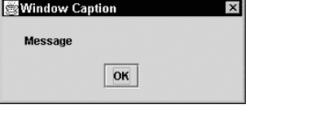

**图12-1** 这是一个“普通”消息对话框，用于在屏幕上显示任何类型的消息。

输入对话框通过调用 `showInputDialog()` 方法创建，该方法同样定义在 `JOptionPane` 类中。`showInputDialog()` 方法需要一个参数，即提示用户向对话框输入信息的消息。

`showInputDialog()` 方法显示消息和一个文本框，供用户输入信息。此外，还会显示“确定”和“取消”按钮。选择“确定”会导致 `showInputDialog()` 方法返回用户在文本框中输入的信息。选择任一按钮都会关闭对话框。

用户输入到文本框中的信息由 `showInputDialog()` 方法作为字符串返回，通常赋值给一个 `String` 变量，然后由程序处理。以下是调用 `showInputDialog()` 的方法：

```java
String str = JOptionPane.showInputDialog("Enter Student ID: ");
```

图12-2显示了调用此方法时显示的输入对话框。

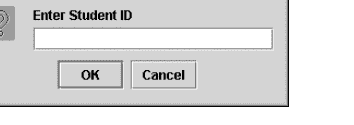

**图12-2** `showInputDialog()` 方法显示一个输入对话框，用于从程序用户那里收集信息。

以下示例演示了如何在程序中同时调用 `showMessageDialog()` 方法和 `showInputDialog()` 方法。此示例首先导入所有 swing 类，这是调用任一对话框方法所必需的。接下来，声明一个字符串，稍后用于存储 `showInputDialog()` 方法返回的信息。首先调用 `showMessageDialog()` 方法显示消息对话框。一旦用户通过选择“确定”按钮确认消息，消息对话框关闭，然后调用 `showInputDialog()` 方法显示输入对话框。`showInputDialog()` 方法返回的信息随后被赋值给该字符串。

```java
import javax.swing.*;
public class Demo {
    public static void main(String[] args) {
        String str;
        JOptionPane.showMessageDialog(null,
            "Message", "Window Caption", JOptionPane.
PLAIN_MESSAGE);
        str = JOptionPane.showInputDialog (
            "Enter Student ID ");
        System.exit(0);
    }
}
```

## Swing

在上一节中，你学习了如何使用 `javax.swing` 包中的 `JOptionPane` 类。`javax.swing` 包包含了大量的 GUI 类，这些类被称为 *Java基础类（JFC）*。`javax.swing` 包包含的图形类比抽象窗口工具包（AWT）的类包更丰富。AWT 和 JFC 是互补的。程序员使用这两个库来为他们的程序创建图形界面。

JFC 包含许多你可以融入程序中的有趣类。事实上，JFC 包含如此多的类，本书没有足够的篇幅来解释每一个类。因此，我们将重点介绍用于为典型程序创建 GUI 的常用类。你可以在 java.sun.com 上了解完整的 JFC。

让我们从介绍 GUI 的基础知识开始。所有 GUI 都需要一个窗口，该窗口可以被使用计算机的人最小化、最大化和调整大小。窗口需要一个内容容器，用于容纳组成程序 GUI 的按钮、文本框和其他 GUI 元素。内容容器显示在窗口内部。

通常，程序员会定义自己的窗口类，该类包含其窗口所有元素的定义，包括内容容器和 GUI 元素。然后，每当程序员需要一个窗口时，就声明该窗口类的一个实例。对窗口的任何更改都在一个地方——窗口类中进行。

窗口类扩展了 `JFrame` 类。JFC 中的 `JFrame` 类定义了管理窗口所需的所有方法，例如调整窗口大小的方法。这意味着你的窗口类拥有 `JFrame` 类中的所有功能。

`JFrame` 类中定义了三个常用方法。它们是 `setSize()` 方法、`setDefaultCloseOperation()` 方法和 `setVisible()` 方法。`setSize()` 方法需要两个参数：定义窗口宽度和高度的整数，以像素为单位。例如，以下方法将窗口大小定义为 400 像素宽、100 像素高：

```java
setSize(400, 100);
```

`setDefaultCloseOperation()` 方法定义了当用户关闭窗口时（例如，通过点击窗口右上角的“X”）窗口的行为。`setDefaultCloseOperation()` 方法需要一个参数：定义该行为的常量。许多程序员使用 `EXIT_ON_CLOSE` 常量（当用户选择关闭时，该常量会导致窗口退出），如下所示：

```java
setDefaultCloseOperation(JFrame.EXIT_ON_CLOSE);
```

创建的窗口在调用 `setVisible()` 方法之前不会显示。`setVisible()` 方法需要一个参数：布尔值 true 或 false。布尔值 true 导致窗口被显示。布尔值 false 导致窗口被隐藏。以下是 `setVisible()` 方法。

```java
setVisible(true);
```


# 第12章 图形用户界面

通常，每个窗口的标题栏上都有一个说明窗口用途的标题。你通过调用`JFrame`类的构造函数并传递标题来创建窗口标题。因为你的窗口类扩展了`JFrame`类，你可以使用`super`来调用构造函数，如下所示：

```java
super("Window Title");
```

以下示例说明了如何定义自己的窗口类并在屏幕上显示窗口。图12-3显示了它显示的窗口。

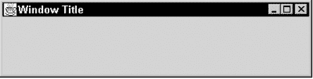

**图12-3** 通过定义自己的窗口类来创建一个窗口，该类扩展了`JFrame`类。

```java
import javax.swing.*;
public class Demo {
    public static void main(String[] args) {
        Window win = new Window();
    }
}
class Window extends JFrame {
    public Window() {
        super("Window Title");
        setSize(400, 100);
        setDefaultCloseOperation(JFrame.EXIT_ON_CLOSE);
        setVisible(true);
    }
}
```

## 内容容器

在向窗口插入GUI元素之前，你需要为它们创建一个容器。可以将容器想象成一个盒子，你将GUI元素放入其中。然后将容器放置在窗口内部。

容器在抽象窗口工具包的`Container`类中定义。你可以通过导入`java.awt`包来访问`Container`类。你通过在程序定义的窗口类中调用`JFrame`类的`getContentPane()`方法来声明`Container`类的一个实例。`getContentPane()`方法返回对内容容器的引用，该引用被赋值给一个`Container`对象引用。以下语句说明了这一点：

```java
Container ca = getContentPane();
```

`Container`类定义了许多方法，但最常用的方法是`setBackground()`方法。`setBackground()`方法为内容容器着色，为你的窗口提供背景色。`setBackground()`方法需要一个参数：`Color`类中定义的常量，该常量代表你想要的背景颜色。表12-2列出了最常用的颜色常量。

| 常量 | 颜色 |
|---|---|
| `Color.white` | 白色 |
| `Color.lightGray` | 浅灰色 |
| `Color.gray` | 灰色 |
| `Color.black` | 黑色 |
| `Color.blue` | 蓝色 |
| `Color.green` | 绿色 |
| `Color.cyan` | 青色 |
| `Color.magenta` | 品红色 |
| `Color.orange` | 橙色 |
| `Color.pink` | 粉色 |
| `Color.yellow` | 黄色 |

表12-2 用于绘制窗口内容容器的颜色常量

以下示例展示了如何声明容器的一个实例并在窗口内显示该容器。你会注意到此示例建立在前一个示例的基础上。此示例将容器的背景色设置为浅灰色：

```java
import java.awt.*;
import javax.swing.*;
public class Demo {
    public static void main(String[] args) {
        Window win = new Window();
    }
}
class Window extends JFrame {
    public Window() {
        super("Window Title");
        setSize(400, 100);
        setDefaultCloseOperation(JFrame.EXIT_ON_CLOSE);
        setVisible(true);
        Container ca = getContentPane();
        ca.setBackground(Color.lightGray);
    }
}
```

## Java布局管理器

在某些编程语言中，你需要指定图形用户界面元素在窗口中显示的像素坐标。程序员将此称为指定图形用户界面元素的精确位置。在容器中放置图形用户界面元素有点棘手，因为你指定的是相对位置而非精确位置。也就是说，你大致指定图形用户界面元素在屏幕上的位置，然后由Java虚拟机确定其精确位置。

起初，这种在容器中定位图形用户界面元素的技术显得有些过时。然而，Java使用这种技术有非常合理的理由。请记住，Java程序是机器无关的。这意味着，在你的计算机上运行的程序也必须能够在任何运行Java虚拟机的计算机上运行。而那些其他计算机很可能拥有与你设计程序时使用的不同的屏幕。

为了补偿这些差异，Java要求Java虚拟机为图形用户界面元素确定精确的屏幕位置。你只需为图形用户界面元素提供屏幕上的大致位置即可。

你的第一步是为容器选择一个布局管理器。可以将布局管理器看作Java组织容器的一种方式。有四种常用的布局管理器：流式布局管理器、边框布局管理器、网格布局管理器和网格包布局管理器。

### 流式布局管理器

流式布局管理器用于将图形用户界面元素放置在容器中，其方式类似于单词在页面上的放置——即从左到右，然后到下一行的开头。当窗口大小改变时，图形用户界面元素会自动重新定位到容器的中心。

你通过声明一个`FlowLayout`类的实例来使用流式布局管理器，如下所示：

```java
FlowLayout flm = new FlowLayout();
```

正如你很快会在将图形用户界面元素放入容器时发现的，你对元素放置的控制很少。例如，`FlowLayout`类允许你通过向构造函数传递相应的常量来指定希望图形用户界面元素居中、左对齐还是右对齐。默认行为是居中元素，因此你不需要向构造函数传递常量来居中元素。你可以通过向构造函数传递`FlowLayout.LEFT`或`FlowLayout.RIGHT`常量来指定左对齐或右对齐。你还可以通过向构造函数传递两个整数值来指定图形用户界面元素之间的水平和垂直间距。整数表示分隔元素的像素数。

本章的许多示例都使用了流式布局管理器。

### 边框布局管理器

边框布局管理器将容器划分为五个区域。这些区域是北、南、东、西和中心。你通过声明一个`BorderLayout`类的实例来使用边框布局管理器，该实例将在下一个示例中展示。

容器类的`add()`方法用于将图形用户界面元素放置在容器中。`add()`方法的一个版本需要两个参数。第一个参数是图形用户界面元素的引用。第二个参数是用于定位元素的布局管理器引用。

你使用`BorderLayout`类的常量之一来指定位置。`BorderLayout`类的常量在此列出：

```java
BorderLayout.NORTH
BorderLayout.SOUTH
BorderLayout.EAST
BorderLayout.WEST
BorderLayout.CENTER
```

以下示例演示了如何使用边框布局管理器。此示例显示一个包含两个按钮的窗口。你将在“按钮”部分了解更多关于按钮的信息。一个按钮放置在容器的西部区域，另一个按钮显示在容器的东部区域（图12-4）。

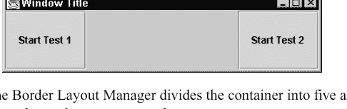

**图12-4** 边框布局管理器将容器划分为五个区域，称为北、南、东、西和中心。

```java
import java.awt.*;
import javax.swing.*;
public class Demo {
    public static void main(String[] args) {
        Window win = new Window();
    }
}
class Window extends JFrame {
    public Window () {
        super ("Window Title");
        setSize(400,100);
        setDefaultCloseOperation(JFrame.EXIT_ON_CLOSE);
        setVisible(true);
        Container ca = getContentPane();
        ca.setBackground(Color.lightGray);
        BorderLayout blm = new BorderLayout();
        ca.setLayout(blm);
        JButton bt1 = new JButton("Start Test 1");
        ca.add(bt1, blm.WEST);
        JButton bt2 = new JButton("Start Test 2");
        ca.add(bt2, blm.EAST);
        setContentPane(ca);
    }
}
```

### 网格布局管理器和网格包布局管理器

网格布局管理器将容器划分为行和列。你通过声明一个`GridLayout`类的实例来创建网格布局管理器，如下所示：

```java
GridLayout glm = new GridLayout();
```

在声明`GridLayout`类的实例时，你需要指定构成网格的行数和列数。为此，你需要向构造函数传递两个参数。两个参数都是整数。第一个参数指定行数，第二个参数指定列数。无论分配给该单元格的图形用户界面元素大小如何，每个单元格的大小都是相等的。

使用网格布局管理器的一个缺点是你无法指定放置图形用户界面元素的单元格。元素按照添加到容器的顺序从左到右放置在单元格中。

正是由于这个原因，一些程序员更喜欢使用网格包布局管理器。网格包布局管理器使你能够将图形用户界面元素放置到特定的单元格中。你通过声明一个`GridBagLayout`类的实例来创建网格包布局管理器，该实例将在下一个示例中展示。

你还需要声明一个`GridBagConstraints`类的实例。`GridBagConstraints`类用于指定在网格中定位图形用户界面元素的位置。你分别为`gridx`和`gridy`属性分配行号和列号，然后在向容器添加新的图形用户界面元素时，将`GridBagConstraints`类实例的引用传递给容器的`add()`方法。

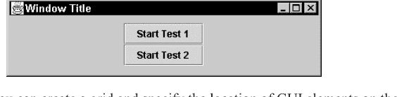

以下示例展示了如何创建一个网格，然后在网格中定位两个按钮。图12-5显示了此示例创建的网格。

```java
import java.awt.*;
import javax.swing.*;
public class Demo {
    public static void main(String[] args) {
        Window win = new Window();
    }
}
class Window extends JFrame {
    public Window () {
        super ("Window Title");
        setSize(400,100);
        setDefaultCloseOperation(JFrame.EXIT_ON_CLOSE);
        setVisible(true);
        Container ca = getContentPane();
        ca.setBackground(Color.lightGray);
        GridBagLayout gblm = new GridBagLayout();
        GridBagConstraints gbc = new GridBagConstraints();
        ca.setLayout(gblm);
        JButton bt1 = new JButton("Start Test 1");
        gbc.gridx = 1;
        gbc.gridy = 0;
        ca.add(bt1,gbc);
        JButton bt2 = new JButton("Start Test 2");
        gbc.gridx = 1;
        gbc.gridy = 1;
        ca.add(bt2, gbc);
        setContentPane(ca);
    }
}
```

### 按钮

现在你已经学习了如何创建窗口和容器，以及如何指定布局管理器，我们可以将注意力转向向容器添加图形用户界面元素。让我们从创建一个按钮开始。

要向容器添加按钮，必须遵循三个步骤。首先，你需要创建按钮。这通过声明一个`JButton`类的实例来完成。除少数例外情况，你创建的大多数按钮上都会有一个标签。向构造函数传递文本即可创建标签。以下是创建一个“开始”按钮的方法：

```java
JButton start = new JButton("Start");
```

第二步是将`JButton`实例的引用传递给容器的`add()`方法。根据你选择的布局管理器，你可能还想将按钮的位置作为`add()`方法的第二个参数（参见“Java布局管理器”）。

第三步是将容器内容面板的引用传递给`setContentPane()`方法。可以将内容面板看作嵌入容器的一块玻璃窗格。图形用户界面元素就位于这块玻璃窗格上。`setContentPane()`方法将这块玻璃窗格放入窗口（容器）中。你通过调用`getContentPane()`方法来创建内容面板，如以下示例所示。


**图12-6** 向窗口添加两个按钮

图12-6显示了运行此示例时显示的窗口。

```java
import java.awt.*;
import javax.swing.*;
public class Demo {
    public static void main(String[] args) {
        Window win = new Window();
    }
}
class Window extends JFrame {
    public Window() {
        super("Window Title");
        setSize(400, 100);
        setDefaultCloseOperation(JFrame.EXIT_ON_CLOSE);
        setVisible(true);
        Container ca = getContentPane();
        ca.setBackground(Color.lightGray);
        FlowLayout flm = new FlowLayout();
        ca.setLayout(flm);
        JButton start = new JButton("Start");
        ca.add(start);
        JButton stop = new JButton("Stop");
        ca.add(stop);
        setContentPane(ca);
    }
}
```

## 标签和文本字段

最常用的两种 GUI 元素是标签和文本字段。标签元素用于在容器中放置文本，而文本字段元素则使程序使用者能够输入文本。

通过声明 `JLabel` 类的一个实例并为其构造函数传入将作为标签显示的文本，即可创建一个标签，如下所示，其中 "Student Information" 就是标签的文本：

```java
JLabel lab1 = new JLabel("Student Information");
```

通过声明 `JTextField` 类的一个实例并向该类的构造函数传递两个参数，可以创建一个文本字段。第一个参数是将在文本字段中显示的文本。第二个参数是可以输入到文本字段中的字符数。一些程序员干脆省略第一个参数，因为他们会使用标签 GUI 元素来标记文本字段，而不是在文本字段中放置默认文本。

下面的示例展示了如何将标签和文本字段添加到容器中。注意，每个 GUI 元素都调用了 `add()` 方法。一旦所有元素都已添加到内容窗格，就会调用 `setContentPane()` 方法将内容窗格放入容器中。图 12-7 显示了运行此示例时显示的窗口。

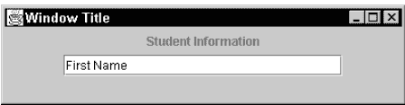

**图 12-7** `JLabel` 类用于创建标签，`JTextField` 类用于创建文本字段。


```java
import java.awt.*;
import javax.swing.*;
public class Demo {
    public static void main(String[] args) {
        Window win = new Window();
    }
}
class Window extends JFrame {
    public Window() {
        super("Window Title");
        setSize(400, 100);
        setDefaultCloseOperation(JFrame.EXIT_ON_CLOSE);
        setVisible(true);
        Container ca = getContentPane();
        ca.setBackground(Color.lightGray);
        FlowLayout flm = new FlowLayout();
        ca.setLayout(flm);
        JLabel labl = new JLabel("Student Information");
        ca.add(labl);
        JTextField text = new JTextField("First Name", 25);
        ca.add(text);
        setContentPane(ca);
    }
}
```

## 单选按钮和复选框

单选按钮和复选框使程序的使用者能够选择一项，而不必将选择内容输入到文本字段中。单选按钮通常以一组的形式显示。一组中只能选中一个单选按钮。当用户选中组内的一个单选按钮时，所有其他单选按钮会自动变为未选中状态。通常，组内必须有一个单选按钮被选中。相比之下，复选框不分组，允许用户选择零个、全部或任意组合的复选框。

通过声明 `JRadioButton` 类的一个实例来创建单选按钮。每个单选按钮在组内通过标签唯一标识。通过向 `JRadioButton` 构造函数传递文本来创建标签，如下所示：

```java
JRadioButton rb1 = new JRadioButton("Pass");
```

还必须创建一个单选按钮组。通过声明 `ButtonGroup` 类的一个实例来实现，如下所示：

```java
ButtonGroup passFail = new ButtonGroup();
```

通过调用 `ButtonGroup` 类实例的 `add()` 方法，将单选按钮添加到按钮组中。这在下面的语句中显示，其中单选按钮 `rb1` 被添加到按钮组 `passFail`：

```java
passFail.add(rb1);
```

然后通过调用 `add()` 方法将按钮组添加到内容窗格中，如前面的示例所示。

通过声明 `JCheckBox` 类的一个实例并为其构造函数传入将用作复选框标签的文本来创建复选框。如下所示：

```java
JCheckBox cb1 = new JCheckBox("Completed");
```

将对复选框的引用传递给内容窗格的 `add()` 方法，以便复选框显示在内容窗格中。这与将对按钮组的引用传递给内容窗格的 `add()` 方法的基本步骤相同。

一旦所有 GUI 元素都添加到内容窗格，就会调用 `setContentPane()` 方法并传入对内容窗格的引用。


**图 12-8** 单选按钮必须出现在按钮组中。复选框不必出现在按钮组中。

下面的示例展示了如何在窗口的内容窗格中显示单选按钮和复选框。图 12-8 显示了运行以下示例时显示的窗口：

```java
import java.awt.*;
import javax.swing.*;
public class Demo {
    public static void main(String[] args) {
        Window win = new Window();
    }
}
class Window extends JFrame {
    public Window() {
        super("Window Title");
        setSize(400, 100);
        setDefaultCloseOperation(JFrame.EXIT_ON_CLOSE);
        setVisible(true);
        Container ca = getContentPane();
        ca.setBackground(Color.lightGray);
        FlowLayout flm = new FlowLayout();
        ca.setLayout(flm);
        JCheckBox cb1 = new JCheckBox("Completed");
        ButtonGroup passFail = new ButtonGroup();
        JRadioButton rb1 = new JRadioButton("Pass");
        JRadioButton rb2 = new JRadioButton("Fail");
        passFail.add(rb1);
        passFail.add(rb2);
        ca.add(cb1);
        ca.add(rb1);
        ca.add(rb2);
        setContentPane(ca);
    }
}
```

## 组合框

组合框是一种 GUI 元素，使程序的使用者能够从下拉菜单包含的项目列表中选择一项。通过声明 `JComboBox` 类的一个实例来创建组合框，如下所示：

```java
JComboBox combo1 = new JComboBox();
```

声明实例后，通过调用 `JComboBox` 中定义的 `addItem()` 方法将项目插入下拉列表。`addItem()` 方法需要一个参数：要添加到组合框中的项目的文本。以下语句将文本 "One" 插入到名为 combo1 的 `JComboBox` 实例中。

```java
combo1.addItem("One");
```

要将组合框放入窗口的容器中，还需要两个额外的步骤。首先，需要通过调用内容窗格的 `add()` 方法将组合框放入内容窗格中。其次，需要通过调用 `setContentPane()` 方法将内容窗格放入容器中。

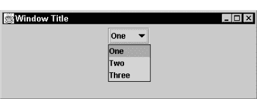

**图 12-9** 组合框 GUI 元素包含一个下拉列表，程序使用者可从中选择一项。

下面的示例展示了如何在 Java 程序中创建组合框。图 12-9 显示了运行此示例时显示的窗口。

```java
import java.awt.*;
import javax.swing.*;
public class Demo {
    public static void main(String[] args) {
        Window win = new Window();
    }
}
class Window extends JFrame {
    public Window() {
        super("Window Title");
        setSize(400, 100);
        setDefaultCloseOperation(JFrame.EXIT_ON_CLOSE);
        setVisible(true);
        Container ca = getContentPane();
        FlowLayout flm = new FlowLayout();
        ca.setLayout(flm);
        ca.setBackground(Color.lightGray);
        JComboBox combo1 = new JComboBox();
        combo1.addItem("One");
        combo1.addItem("Two");
        combo1.addItem("Three");
        ca.add(combo1);
        setContentPane(ca);
    }
}
```

## 文本区域

文本区域 GUI 元件用于在窗口中放置一段文本块。你可以通过声明 `JTextArea` 类的实例来创建一个文本区域，如下所示：

```java
JTextArea ta = new JTextArea("Default text", 5, 30);
```

`JTextArea` 的构造方法需要两个参数：行数和每行可显示的字符数。程序员将行数称为文本区域的*高度*，将字符数称为其*宽度*。你指定的字符数实际上只是 Java 虚拟机的一个近似值，因为每行实际能容纳的字符数取决于用于显示文本的字体。

`JTextArea()` 构造方法的另一种版本使用三个参数，第一个参数是显示在文本区域中的文本。本节开头的语句就展示了这一点。其余两个参数分别是行数和字符数，用于定义文本区域的高度和宽度。

你可以通过调用 `setText()` 方法并将要在文本区域中显示的文本作为参数传递来设置文本区域中的文本内容。下面的语句展示了这一点，其中 `JTextArea` 的实例名为 ta：

```java
ta.setText("Default text");
```

文本区域可以用来显示文本，但你也可以用它来让用户输入文本或编辑已有的文本内容。你可以通过调用 `setEditable()` 方法并传递布尔值 true（使文本区域可编辑）或布尔值 false（使文本只读）来决定用户是否可以编辑文本区域。示例如下：

```java
ta.setEditable(true);
```

以下示例展示了如何在窗口中创建一个文本区域。该示例展示了一个五行高、大约 30 个字符宽的文本区域，其中包含默认文本。图 12-10 显示了此示例显示的窗口：

```java
import java.awt.*;
import javax.swing.*;
public class Demo {
    public static void main(String[] args) {
        Window win = new Window();
    }
}
class Window extends JFrame {
    public Window () {
        super ("Window Title");
        setSize(400,100);
        setDefaultCloseOperation(JFrame.EXIT_ON_CLOSE);
        setVisible(true);
        Container ca = getContentPane();
        FlowLayout flm = new FlowLayout();
        ca.setLayout(flm);
        ca.setBackground(Color.lightGray);
        JTextArea ta = new JTextArea("Default text",5, 30);
        ca.add(ta);
        setContentPane(ca);
    }
}
```

## 滚动窗格

有时 GUI 元件的全部内容无法完全放入为其分配的空间中。当文本超出文本区域的高度时就会出现这种情况。为了使用户能够查看额外的内容，你可以使用滚动窗格。滚动窗格是一种 GUI 元件，它允许用户通过滚动条在另一个 GUI 组件上进行水平和垂直滚动。

你可以通过声明 `JScrollPane` 类的实例来创建一个滚动窗格，如下所示：

```java
JScrollPane sp = new JScrollPane(
        ta, JScrollPane.VERTICAL_SCROLLBAR_ALWAYS,
        JScrollPane.HORIZONTAL_SCROLLBAR_ALWAYS);
```

`JScrollPane` 类的构造方法接受三个参数。第一个参数是指向将使用滚动条的 GUI 元件的引用。在前面的语句中，ta 是指向文本区域 GUI 元件的引用。第二个和第三个参数是 `JScrollPane` 类的常量，用于指定垂直和水平滚动条的行为。前面的语句会使垂直和水平滚动条始终显示，即使 GUI 元件的所有内容都已显示在屏幕上。表 12-3 列出了可用于设置滚动条行为的常量。

| 常量 | 描述 |
| --- | --- |
| `JScrollPane.VERTICAL_SCROLLBAR_AS_NEEDED` | 仅在内容超出 GUI 元件的区域时显示垂直滚动条 |
| `JScrollPane.VERTICAL_SCROLLBAR_NEVER` | 表示永远不使用垂直滚动条，即使内容超出了 GUI 元件的区域 |
| `JScrollPane.VERTICAL_SCROLLBAR_ALWAYS` | 表示始终显示垂直滚动条，即使内容未超出 GUI 元件的区域 |
| `JScrollPane.HORIZONTAL_SCROLLBAR_AS_NEEDED` | 仅在内容超出 GUI 元件的区域时显示水平滚动条 |
| `JScrollPane.HORIZONTAL_SCROLLBAR_NEVER` | 表示永远不使用水平滚动条，即使内容超出了 GUI 元件的区域 |

**表 12-3** 用于滚动窗格的常量

以下示例展示了如何在程序中使用滚动窗格。该示例在文本区域周围显示了垂直和水平滚动条。图 12-11 显示了此示例显示的窗口。

**图 12-11** 可以通过使用滚动窗格 GUI 元件为文本区域添加垂直和水平滚动条。

```java
import java.awt.*;
import javax.swing.*;
public class Demo {
    public static void main(String[] args) {
        Window win = new Window();
    }
}
class Window extends JFrame {
    public Window () {
        super ("Window Title");
        setSize(400,100);
        setDefaultCloseOperation(JFrame.EXIT_ON_CLOSE);
        setVisible(true);
        Container ca = getContentPane();
        FlowLayout flm = new FlowLayout();
        ca.setLayout(flm);
        ca.setBackground(Color.lightGray);
        JTextArea ta = new JTextArea("Default text",5, 30);
        JScrollPane sp = new JScrollPane(
                ta, JScrollPane.VERTICAL_SCROLLBAR_ALWAYS,
                JScrollPane.HORIZONTAL_SCROLLBAR_ALWAYS);
        ca.add(sp);
        setContentPane(ca);
    }
}
```

## 从 GUI 组件获取数据

使用 GUI 元件的目的是使用户能够方便地向程序中输入信息。在本章的前面部分，你学习了如何创建窗口以及在窗口中显示 GUI 元件。现在我们将把注意力转向从这些 GUI 元件中收集信息。

每次用户与 GUI 元件交互时，都会触发一个事件。你的程序必须具备两个特性才能对事件做出响应：事件监听器和处理方法，也称为*事件处理方法*。

可以将事件监听器想象成程序中监控 GUI 的一部分，用于监测特定事件的发生，例如用户点击按钮时。当事件发生时，监听器检测到该事件，然后调用一个事件处理程序。事件处理程序是一个对特定事件做出响应的方法，例如选择某个特定按钮时的响应。

假设你的窗口上有两个文本区域和一个按钮。用户可以选择第一个文本区域中全部或部分文本，然后点击按钮将文本复制到第二个文本区域中。你将在本章稍后看到这是如何工作的。现在，我们先简要解释其实现方式。

程序使用一个监听器来监控与按钮相关的事件。当用户点击按钮时，监听器识别该事件，然后调用与该按钮关联的事件处理程序。事件处理程序是一个包含以下语句的方法：读取第一个文本区域中选中的文本，然后将文本的副本放入第二个文本区域中。

事件监听器是你的程序必须实现的一个接口。实际上，有许多事件监听器，每种都设计用于监听特定的 GUI 事件。表 12-4 列出了常用的事件监听器。

| 事件监听器 | GUI 元件 |
| --- | --- |
| `ActionListener` | 按钮 |
| `ItemListener` | 复选框、单选按钮和下拉列表框 |
| `KeyListener` | 键盘输入 |
| `MouseListener` | 鼠标操作 |
| `MouseMotionListener` | 鼠标移动 |

**表 12-4** 常用事件监听器

你需要执行两个步骤才能使用事件监听器。首先，你需要实现相应的事件监听器接口。你将在本章后续的示例中看到具体做法。

其次，你需要将监听器与 GUI 元件关联起来。假设你使用以下语句创建了一个按钮：

```java
JButton bt = new JButton("Copy");
```


# 第12章 图形用户界面

按钮 GUI 元件需要 `ActionListener` 接口，因此你需要在创建按钮的类中实现该 `ActionListener` 接口。你通过调用 `JButton` 类定义的 `addActionListener()` 方法将按钮与 `ActionListener` 接口关联起来。`addActionListener()` 方法要求你传递 `this` 关键字来引用动作事件。以下语句展示了这一点：

```java
bt.addActionListener(this);
```

`ActionListener` 检测用户选择按钮时触发的事件，然后调用 `actionPerformed()` 方法。`actionPerformed()` 方法是你在程序中定义的用于响应事件的方法。

`actionPerformed()` 方法需要一个参数——事件引用，如下所示：

```java
actionPerformed(ActionEvent event)
```

方法内的语句可以使用该事件来确定应采取的正确操作。

## 读取按钮

如前一节所述，你需要实现 `ActionListener`，以便程序能够响应按钮这一 GUI 元素。以下示例展示了如何响应按钮的选中操作。该示例显示了两个文本区域和一个名为 Copy 的按钮。

调用 `addActionListener()` 方法将按钮与动作监听器关联。如果你忘记调用 `addActionListener()` 方法，程序将无法响应按钮的选中操作。

随后，通过调用 `add()` 方法将按钮和文本区域添加到内容面板；再通过调用 `setContentPane()` 方法将内容面板放置到容器中。

接下来定义 `actionPerformed()` 方法。当用户点击按钮时，该方法内的语句将被执行。此示例在用户点击按钮时，将第一个文本区域中高亮的文本复制到第二个文本区域。图 12-12 展示了运行此示例时的窗口。

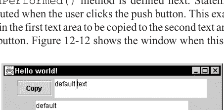

**图 12-12** 当点击 Copy 按钮时，第二个文本区域包含了从第一个文本区域复制的选中。

`actionPerformed()` 方法在任何按钮被点击时都会调用。虽然此示例只展示了一个按钮，但通常你的应用程序窗口中会有多个按钮。你可以通过调用 `event.getSource()` 方法来确定哪个按钮被点击了。`event.getSource()` 方法返回用户选中的按钮的引用。你可以使用 if 语句将此引用与屏幕上每个按钮的引用进行比较，以确定哪个按钮被点击了。

你还可以通过调用 `event.getActionCommand()` 方法来确定执行的操作类型。尝试显示 `event.getActionCommand()` 方法返回的操作，看看按钮会产生哪些类型的动作。

```java
import javax.swing.*;
import java.awt.*;
import java.awt.event.*;

public class Demo {
    public static void main(String[] args) {
        Window win = new Window();
    }
}

class Window extends JFrame implements ActionListener {
    JTextArea ta1 = new JTextArea("default text", 2, 25);
    JTextArea ta2 = new JTextArea(2, 25);
    JButton bt1 = new JButton("Copy");

    public Window() {
        super("Hello world!");
        setSize(400, 200);
        setDefaultCloseOperation(JFrame.EXIT_ON_CLOSE);
        setVisible(true);
        Container ca = getContentPane();
        ca.setBackground(Color.lightGray);
        FlowLayout flm = new FlowLayout();
        ca.setLayout(flm);
        bt1.addActionListener(this);
        ca.add(bt1);
        ca.add(ta1);
        ca.add(ta2);
        setContentPane(ca);
    }

    public void actionPerformed(ActionEvent event) {
        ta2.setText(ta1.getSelectedText());
    }
}
```

## 读取单选按钮和复选框

使用 `ItemListener` 来读取单选按钮和复选框，你需要在响应这些 GUI 元素的类中实现该接口。`ItemListener` 与 `ActionListener` 非常相似，因为单选按钮和复选框都有 `addItemListener()` 方法，用于将按钮与 `ItemListener` 关联。同样，与 `addActionListener()` 方法一样，你必须向 `addItemListener()` 方法传递 `this` 关键字。

每当单选按钮或复选框的状态发生变化时，`ItemListener` 会调用 `itemStateChanged()` 方法。因此，你需要在程序中定义 `itemStateChanged()` 方法来响应这些变化。`itemStateChanged()` 方法必须有一个参数——一个 `ItemEvent` 对象。

以下示例展示了如何响应复选框，这与响应单选按钮的技术相同，只是在复选框内部引用单选按钮。通过选中复选框或取消选中复选框来改变它。这被称为*状态变化*。你可以通过调用 `getStateChange()` 方法来确定发生了什么变化。`getStateChange()` 方法返回一个整数，该整数与两个 `ItemEvent` 常量进行比较。它们是 `ItemEvent.SELECTED` 和 `ItemEvent.DESELECTED`。

让我们看看 `itemStateChanged()` 方法内部如何使用 `getStateChange()` 方法。第一条语句调用 `getStateChange()` 方法并将返回值赋给 state 整数。state 整数的值通过 if 语句与两个 `ItemEvent` 常量进行比较。每个 if 语句都有一个嵌套的 if，用于确定哪个复选框生成了事件。调用 `getItem()` 方法获取复选框的引用，然后与程序中创建的复选框引用进行比较。当匹配时，通过调用 `setText()` 方法在文本区域中显示适当的消息。图 12-13 展示了此示例创建的窗口。

```java
import javax.swing.*;
import java.awt.*;
import java.awt.event.*;

public class Demo {
    public static void main(String[] args) {
        Window win = new Window();
    }
}

class Window extends JFrame implements ItemListener {
    JTextArea ta = new JTextArea(2, 25);
    JCheckBox cb1 = new JCheckBox("Test 1");
    JCheckBox cb2 = new JCheckBox("Test 2");

    public Window() {
        super("Hello world!");
        setSize(400, 200);
        setDefaultCloseOperation(JFrame.EXIT_ON_CLOSE);
        setVisible(true);
        Container ca = getContentPane();
        ca.setBackground(Color.lightGray);
        FlowLayout flm = new FlowLayout();
        ca.setLayout(flm);
        cb1.addItemListener(this);
        cb2.addItemListener(this);
        ca.add(cb1);
        ca.add(cb2);
        ca.add(ta);
        setContentPane(ca);
    }

    public void itemStateChanged(ItemEvent event) {
        int state = event.getStateChange();
        if (state == ItemEvent.SELECTED) {
            if (event.getItem() == cb1)
                ta.setText("Test 1 Selected");
            if (event.getItem() == cb2)
                ta.setText("Test 2 Selected");
        }
        if (state == ItemEvent.DESELECTED) {
            if (event.getItem() == cb1)
                ta.setText("Test 1 Deselected");
            if (event.getItem() == cb2)
                ta.setText("Test 2 Deselected");
        }
    }
}
```

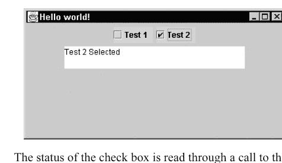

**图 12-13** 通过调用 `getStateChange()` 方法读取复选框的状态，然后用于确定要在文本区域中显示的适当消息。

## 读取组合框

组合框也使用 `ItemListener`；因此，你将组合框与 `ItemListener` 关联的技术与将复选框与 `ItemListener` 关联的技术相同。

你还需要定义一个 `itemStateChanged()` 方法。在 `itemStateChanged()` 方法中，你需要调用 `getItem()` 方法来获取组合框中显示的文本。你需要使用以下语句将返回值转换为字符串（注意 `getItem()` 方法由 `ItemEvent` 的引用前缀）：

```java
String pick = event.getItem().toString();
```

以下示例展示了如何读取组合框的内容。此示例显示了一个组合框和一个文本区域。每当有人从下拉列表中选择不同的项目时，`ItemListener` 会调用 `itemStateChanged()` 方法，在该方法中通过调用 `getItem()` 方法获取组合框中显示的文本，然后显示在文本区域中。图 12-14 展示了运行此示例时你将看到的内容。

```java
import javax.swing.*;
import java.awt.*;
import java.awt.event.*;

public class Demo {
    public static void main(String[] args) {
        Window win = new Window();
    }
}

class Window extends JFrame implements ItemListener {
    JTextArea ta = new JTextArea(2, 25);
    JComboBox combo1 = new JComboBox();

    public Window() {
        super("Hello world!");
        setSize(400, 200);
        setDefaultCloseOperation(JFrame.EXIT_ON_CLOSE);
        setVisible(true);
        Container ca = getContentPane();
        ca.setBackground(Color.lightGray);
        FlowLayout flm = new FlowLayout();
        ca.setLayout(flm);
        combo1.addItemListener(this);
        combo1.addItem("Test 1");
        combo1.addItem("Test 2");
        ca.add(combo1);
        ca.add(ta);
        setContentPane(ca);
    }

    public void itemStateChanged(ItemEvent event) {
        String pick = event.getItem().toString();
        ta.setText(pick);
    }
}
```

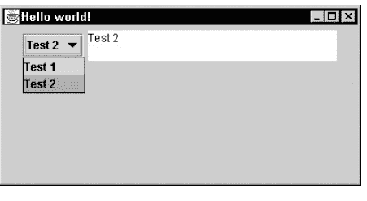

**图 12-14** 每当组合框中的文本发生变化时，该事件会触发程序将文本复制到文本区域中。

## 禁用与启用 GUI 元素

你可能在使用 GUI 应用程序时注意到，某些 GUI 元素是灰色且不可访问的。程序员称这些为*禁用的* GUI 元素。GUI 元素在不应被使用或不适用于当前过程时会被禁用。

例如，你会回想起在前面的章节中，我们使用了一个按钮将文本从一个文本区域复制到另一个文本区域。我们可以禁用该按钮，直到用户在第一个文本区域中输入文本，因为我们无法复制不存在的内容。一旦在第一个文本区域中输入了文本，我们就会启用该按钮。

你可以通过调用 `setEnabled()` 方法并传递一个布尔值 `true` 来启用元素，或传递一个布尔值 `false` 来禁用元素，从而启用或禁用 GUI 元素。以下是一条启用按钮 1 的语句（`bt1` 是对按钮的引用）：

```java
bt1.setEnabled(true);
```

## 小测验

1. 事件监听器的目的是什么？
2. 什么是事件处理器？
3. 你能在窗口中显示 GUI 元素吗？
4. 内容面板的目的是什么？
5. 为什么要禁用 GUI 元素？
6. 可以创建一个窗口但不显示它吗？
7. 如何将内容面板放置在容器中？
8. 布局管理器的目的是什么？
9. 你能明确指定窗口中 GUI 元素的位置吗？
10. 与在另一种编程语言（如 C++）中创建 GUI 相比，在 Java 中创建 GUI 的一个主要区别是什么？

# 第 13 章 JDBC 与 Java 数据对象

每当你在本地超市通过收银台时，关于你购买的信息都会存储在计算机数据库中。当你使用信用卡时，日期、时间、地点以及你的购买信息都会记录在信用卡公司的数据库中。你的学校记录和医疗记录也存储在数据库中。事实上，你所做的一切几乎都会存储在某个数据库中。信息由计算机程序收集、存储、更新、检索和删除。在本章中，你将学习如何创建一个与数据库进行这些交互的 Java 程序。

## 数据库 101

在学习如何编写与数据库对话的程序之前，让我们花点时间回顾一下基本的数据库概念。如果你熟悉数据库，可以跳过这一节；否则，请继续阅读，因为你需要这些信息来理解本章其余部分的内容。

可以把数据库想象成一个 Excel 工作簿。一个 Excel 工作簿由几个称为*表*的工作表组成，每个工作表由一个选项卡标识。你通过选择选项卡来显示一个表。一个表由列和行组成。通常，每列包含相似的信息，例如你班级所有学生的名字。一行通常包含一组相关信息。你可以在表的一行中找到某个学生的姓、名、学号以及关于该特定学生的其他相关信息。

数据库的信息组织方式与 Excel 工作簿几乎相同。数据库是表的集合。表是行的集合。行是列的集合。数据存储在行和列交叉的地方。你在 Excel 中将此称为*单元格*。

数据库管理软件（DBMS）是一种应用程序，使你能够将数据组织到数据库中。它也为你管理数据。你只需告诉 DBMS 做某事，它就会去做。例如，你可能会说，“将此学生注册存储在数据库中”，有关注册的信息就会被放置在数据库中适当的行和表中。同样，你可能会说，“显示 Bob Smith 本学期选修的所有课程”，DBMS 就会搜索数据库并提供你请求的信息副本。

市场上有许多商用 DBMS 产品。其中包括我们熟悉的名字，例如 Microsoft Access、IBM 的 DB2、Oracle、Sybase 和 MySQL 等。所有这些产品都为你组织和管理数据，并能够遵循你的指令。

这些指令称为*查询*，是使用结构化查询语言（SQL）编写的。SQL 超出了本书的范围；但是，在本章后面，你将学习如何将 SQL 查询合并到你的程序中，并让你的程序将这些查询发送给 DBMS 进行处理。

关于数据库还有更多需要学习的内容，但我将让你在另一本书中探索这些内容。现在，我们将把注意力转向学习你的程序如何连接到 DBMS、发送查询以及检索 DBMS 返回的数据。

Sun Microsystems 在 1990 年代末面临一个挑战。他们必须找到一种方法，让 Java 开发人员编写高级 Java 代码来访问流行的 DBMS 产品。问题在于语言障碍。每个 DBMS 都要求程序在与其交互时使用其自己的底层语言。因此，为与 Oracle 交互而编写的底层代码需要重写才能与 DB2 交互。


Sun Microsystems 创建了 JDBC 驱动程序规范和 JDBC 应用程序编程接口（API）来应对这一挑战。JDBC 驱动程序规范描述了 JDBC 驱动程序应如何工作的详细功能。构建驱动程序的任务交给了 DBMS 制造商。

JDBC 驱动程序是一个翻译器，它将底层的专有 DBMS 消息转换为 Java 运行时环境能够理解的消息。驱动程序还将使用 JDBC API 编写的 Java 代码通过 Java 运行时环境转换为底层的专有 DBMS 消息。

这种双向通道使 Java 开发人员能够用 Java 编写指令，只要为该 DBMS 提供了 JDBC 驱动程序，这些指令就可以与任何 DBMS 通信。几乎所有的商用 DBMS 都可以从 Sun Microsystems 网站（www.sun.com）或 DBMS 制造商的网站上获得 JDBC 驱动程序。

### JDBC 驱动程序类型

JDBC 驱动程序分为四组，称为 *JDBC 驱动程序类型*。JDBC 驱动程序类型如下：

- **Type 1 JDBC to ODBC driver** 此驱动程序类型将 Java JDBC API 转换为 Microsoft 的开放数据库连接（ODBC）驱动程序，然后 ODBC 驱动程序再与 DBMS 通信。ODBC 驱动程序也称为 *JDBC/ODBC 桥接器*。避免在任务关键型应用程序中使用 JDBC/ODBC 桥接器，因为额外的翻译可能会对性能产生负面影响。

- **Type 2 Java/Native Code driver** Java/本机代码驱动程序特定于每个 DBMS。使用 Java/本机代码驱动程序的缺点是代码可移植性的丧失。

- **Type 3 JDBC driver** Type 3 JDBC 驱动程序称为 *Java 协议*，是最常用的 JDBC 驱动程序。

- **Type 4 JDBC driver** Type 4 JDBC 驱动程序称为 *Type 4 数据库协议*，与 Type 3 JDBC 驱动程序类似，不同之处在于 SQL 查询被转换为 DBMS 所需的格式。这是将 SQL 查询传递给 DBMS 的最快方式。

### Java 揭秘

## JDBC API 包

除了确保为你的 DBMS 安装了正确的 JDBC 驱动程序外，你无需担心 JDBC 驱动程序。相反，你将专注于使用 JDBC API 来让你的程序与 DBMS 通信。

JDBC API 由包含在两个包中的一系列类组成。第一个包名为 `java.sql`，包含 JDBC API 的核心 Java 数据对象。第二个包名为 `javax.sql`，扩展了 `java.sql` 包。

正如本章中你将看到的，你需要将 `javax.sql` 和 `java.sql` 包都导入到你的程序中，才能使用 JDBC API 连接到 DBMS 并与其交互。

## JDBC 过程

在开始与 DBMS 交互之前，你的程序需要执行五个例行程序来连接到 DBMS。统称为 *JDBC 过程*，如下所示：

1. 加载 JDBC 驱动程序。
2. 连接到 DBMS。
3. 创建并执行 SQL 查询。
4. 处理来自 DBMS 的响应。
5. 断开与 DBMS 的连接。

## 加载 JDBC 驱动程序

第一个例行程序是加载 JDBC 驱动程序。这告诉 Java 运行时环境在你的程序中使用哪个 JDBC 驱动程序。你通过调用 `Class.forName()` 类并将驱动程序名称作为参数传递给该方法来加载 JDBC 驱动程序。在本章的示例中，我们将使用 JDBC/ODBC 桥作为驱动程序，因为这是你用于将程序连接到 Microsoft Access 的驱动程序，而 Access 是你的计算机上最可能可用的 DBMS。

JDBC/ODBC 桥称为 `sun.jdbc.odbc.JdbcOdbcDriver`。你通过在程序中放置以下语句来加载此驱动程序：

```java
Class.forName("sun.jdbc.odbc.JdbcOdbcDriver");
```

## 将 JDBC/ODBC 桥与数据库关联

在加载 JDBC/ODBC 桥之前，你必须将数据库与驱动程序关联起来。使用 ODBC 数据源管理器，按照以下步骤将数据库与 JDBC/ODBC 桥关联：

1. 选择“开始”|“设置”，然后选择“控制面板”。
2. 选择“ODBC 32”以显示 ODBC 数据源管理器。
3. 通过选择“添加”按钮来添加新用户。
4. 选择驱动程序，然后选择“完成”。如果你使用的是 Microsoft Access，请使用 Microsoft Access 驱动程序；否则，请为你使用的 DBMS 选择驱动程序。如果你在列表中找不到适用于你的 DBMS 的驱动程序，则需要安装该驱动程序。有关如何获取驱动程序的更多信息，请联系 DBMS 的制造商。
5. 在“ODBC Microsoft Access 设置”对话框中，输入数据库的名称作为数据源名称。这是你的 Java 数据库程序中将用于连接到 DBMS 的名称。
6. 为数据源输入描述。这是可选的。它将提醒你数据库中存储的数据类型。
7. 单击“选择”按钮。系统将提示你浏览连接到计算机的每个硬盘驱动器的目录，以定义数据库的直接路径。找到数据库后单击“确定”，目录路径和数据库名称将显示在“ODBC Microsoft Access 设置”对话框中。
8. 由于这是你的数据库，你可以决定访问数据库是否需要登录名和密码。如果是这种情况，请单击“高级”按钮以显示“设置高级选项”对话框。此对话框用于为数据库分配登录名（也称为 *用户 ID*）和密码。选择“确定”。否则，请跳过此步骤。
9. 当“ODBC Microsoft Access 设置”对话框出现时，选择“确定”。
10. 选择“确定”关闭“ODBC 数据源管理器”对话框。

## 连接到 DBMS

加载驱动程序后，你必须通过调用 `DriverManager` 类中定义的 `DriverManager.getConnection()` 方法来连接到 DBMS，该类负责管理驱动程序信息。

你必须将数据库的 URL 以及用户 ID 和密码（如果 DBMS 要求）传递给 `DriverManager.getConnection()` 方法。

`DriverManager.getConnection()` 方法返回一个 `Connection` 接口，在整个过程中用于引用数据库。`java.sql.Connection` 接口管理驱动程序和你的程序之间的通信。

以下示例显示了加载驱动程序并连接到数据库的例行程序。数据库名为 CustomerInformation。当你在 Windows 中使用 ODBC 驱动程序关联 DBMS 时，会指定 CustomerInformation 数据库的实际位置。用户 ID 是 "jim"，密码是 "keogh"。你使用 DBMS 应用程序创建用户 ID 和密码。

此示例首先声明 `url`、`userID` 和 `password` 字符串。然后程序声明一个对 `Connection` 类实例的引用，名为 `dB`。程序进入一个 try 块，其中调用 `forName()` 方法来加载驱动程序。下一条语句调用 `getConnection()` 方法，并传递 `url`、`userID` 和 `password` 字符串。这连接到数据库并登录到 DBMS。如果 DBMS 不需要登录，则 `userID` 和 `password` 都是可选参数。`getConnection()` 方法返回 `Connection` 类的一个实例，该实例被分配给程序前面声明的 `Connection` 引用。此时，程序已连接、登录到 DBMS，并准备向 DBMS 发送查询。

> **注意：** *此示例是一个部分程序，将在整个章节中展开。*

```java
String url = "jdbc:odbc:CustomerInformation";
String userID = "jim";
String password = "keogh";
private Connection dB;
Class.forName("sun.jdbc.odbc.JdbcOdbcDriver");
dB = DriverManager.getConnection(url, userID, password);
```

## 创建并执行 SQL 查询

一旦建立连接并登录到 DBMS，你的程序就准备好创建 SQL 查询并将其发送到 DBMS 进行处理。SQL 查询由一个或多个包含在 SQL 语句中的 SQL 命令组成。

你的程序需要执行几个步骤才能将 SQL 查询发送到 DBMS。第一步，你需要 `Statement` 类的一个实例，因为 `Statement` 类定义了用于将 SQL 查询发送到 DBMS 并执行它的 `executeQuery()` 方法。你通过调用 `Connection` 类中定义的 `createStatement()` 方法来创建 `Statement` 类的一个实例。`createStatement()` 类返回一个 `Statement` 类的实例。

接下来，你必须将 SQL 查询发送到 DBMS。你通过调用 `executeQuery()` 方法并传递 SQL 查询来执行此操作。`executeQuery()` 方法返回一个 `ResultSet` 类的实例，其中包含来自 DBMS 的响应。然后，你使用 `ResultSet` 类中定义的方法来访问 DBMS 响应。一旦你的程序收到响应，你就需要通过调用 `close()` 方法来终止语句。

让我们看看这是如何完成的。以下示例通过创建 SQL 查询并将其发送到 DBMS 来增强前一个示例。与前面的示例一样，这不是一个完整的程序。在你了解所有五个例行程序如何工作后，你将在本章后面看到此程序的完整版本。

此示例的第一部分与前一个示例几乎相同，除了两个语句。一个语句声明对 `Statement` 类实例的引用，另一个声明对 `ResultSet` 类的引用。

让我们进入第二个 try 块。第一条语句创建一个 SQL 查询，用于初始化名为 `query` 的 String 对象。这是程序将发送给 DBMS 的查询。

该查询告诉 DBMS 返回 Registration 表中 studentID 列等于 1234 的所有列。`SELECT` 关键字用于标识你希望 DBMS 返回的列名。此示例使用星号代替列名。星号是一个通配符字符，告诉 DBMS 返回所有列。`FROM` 关键字用于指定包含这些列的表的名称。`WHERE` 关键字，称为 WHERE *子句*，设置了 DBMS 用于选择要返回给程序的行的选择标准。

在查询下方是调用 `createStatement()` 方法。这返回一个 `Statement` 类的实例，该实例被分配给名为 `DataRequest` 的 `Statement` 引用。接下来，查询被传递给 `executeQuery()` 方法。`executeQuery()` 方法将查询发送到 DBMS。然后将 DBMS 响应分配给名为 `result` 的 `ResultSet` 类的引用。你使用此引用来引用 DBMS 针对你的查询返回的数据。你将在下一节中了解这是如何完成的。

```java
String url = "jdbc:odbc:CustomerInformation";
String userID = "jim";
String password = "keogh";
Statement dataRequest;
ResultSet results;
private Connection dB;
try {
```

### 处理 DBMS 返回的数据

`ResultSet` 类定义了用于与 DBMS 返回的数据进行交互的方法。本章后续部分将介绍如何使用这些方法。不过，以下简要示例预先展示了一个常用的例程，用于提取 DBMS 返回的数据。本示例故意移除了错误捕获代码，以尽量减少代码冗余。该例程的完整版本将在本章后面给出。

本示例紧接上一个示例。在程序的这一阶段，DBMS 的响应已经赋值给名为 `result` 的 `ResultSet` 引用。在操作数据之前，我们需要在程序中分配存储数据的空间。因此，本示例中的前三条语句声明了三个字符串变量。前两个字符串用于赋值 DBMS 返回的数据。`printRow` 字符串用于将 `firstName` 和 `lastName` 的值拼接成一个字符串，然后显示在屏幕上。

既然已经在内存中预留了存储 DBMS 返回数据的空间，接下来我们需要判断 DBMS 是否返回了任何数据。永远不能假设 DBMS 一定找到了匹配查询的数据。我们通过调用 `next()` 来判断是否至少返回了一行数据。`next` 方法返回一个布尔值，指示是否存在下一行数据。

`next()` 方法的返回值由 `if` 语句进行判断。如果返回值为 `false`，则表示没有下一行数据，程序会在屏幕上显示相应的提示信息，然后退出该例程。

如果 `next()` 方法的返回值为 `true`，程序将继续检索数据。数据存储在行集中。可以将行集理解为表中的一行。你通过调用与该列数据类型相匹配的 `get()` 方法版本来访问行集中的每一列。

本示例中调用 `getString()` 方法，因为行集中的两个列都包含字符串。`getString()` 方法以及其他数据类型的 `get()` 方法都需要一个参数，即指向要获取值的列的引用。引用可以是列名或列号。本示例中使用的是列名。

`getString()` 方法返回指定列的值。我们将该值赋给程序前面声明的相应字符串变量。之后就可以像使用程序中任何其他变量一样使用该变量。在本示例中，`firstName` 和 `lastName` 变量被拼接后赋值给 `printRow` 变量，然后显示在屏幕上。

注意，我们在 `do...while` 循环中调用 `getString()` 方法并显示 `printRow` 变量。当第一行集的数据被复制到变量并显示后，`next()` 方法再次被调用，以判断 DBMS 的响应中是否包含下一行数据。如果包含，则再次执行 `do...while` 循环中的语句，从行集的下一行检索数据。否则，程序退出 `do...while` 循环。

```java
String firstName;
String lastName;
String printRow;
boolean records = results.next();
if (!records) {
    System.out.println("No data returned");
    return;
} else {
    do {
        firstName = results.getString("FirstName");
        lastName = results.getString("LastName");
        printRow = firstName + " " + lastName;
        System.out.println(printRow);
    } while (results.next());
}
```

## 终止与 DBMS 的连接

处理流程的第五步是关闭 `ResultSet` 实例和与 DBMS 的连接。可以通过调用 `close()` 方法来实现，如下所示：

```java
result.close();
dB.close();
```

当关闭与 DBMS 的连接时，`ResultSet` 实例会自动关闭；不过，许多程序员更倾向于显式关闭 `ResultSet` 实例。

## 异常处理

本章前面的示例没有涉及连接和操作 DBMS 时可能出现的异常情况。我们故意这样做是为了保持示例的简洁性。现在你已经学会了如何使用基本的 JDBC API，接下来我们将转向异常处理。

首先来看加载驱动程序。当驱动程序加载过程中出现异常情况时，`Class.forName()` 会抛出 `ClassNotFoundException`。你可以通过使用 `catch` 块来捕获此异常，如以下示例所示。

当 `catch` 块捕获到 `ClassNotFoundException` 时，会调用 `getMessage()` 方法获取异常的描述信息，然后将其显示在屏幕上。接着调用 `exit()` 方法终止程序。注意，`exit()` 方法传入了整数 `1`。该值在程序终止时返回给操作系统，表示程序因无法加载驱动程序而异常终止。

```java
try {
    Class.forName("sun.jdbc.odbc.JdbcOdbcDriver");
} catch (ClassNotFoundException e) {
    System.err.println("Unable to load the JDBC/ODBC bridge." + e.getMessage());
    System.exit(1);
}
```

下一个可能出现异常的地方是程序尝试连接 DBMS 时。许多问题可能导致异常，例如数据库的 URL 不正确，或者用户 ID 和/或密码不正确。如果 `getConnection()` 方法遇到异常情况，会抛出 `SQLException`。

以下示例在前面示例的基础上，演示如何在程序中捕获 `SQLException`。该异常在第二个 `catch` 块中被捕获。注意，`catch` 块中调用了 `exit()` 方法来终止程序。`exit()` 方法传入了整数 `2`，程序终止时返回该值，表示程序因连接数据库时遇到问题而异常终止。

```java
String url = "jdbc:odbc:Registration";
String userID = "jim";
String password = "keogh";
Connection dB;
try {
    Class.forName("sun.jdbc.odbc.JdbcOdbcDriver");
    dB = DriverManager.getConnection(url, userID, password);
} catch (ClassNotFoundException e) {
```


System.err.println("Unable to load the JDBC/ODBC bridge." + e);

System.exit(1);

} catch (SQLException e) {

System.err.println("Cannot connect to the database." + e);

System.exit(2);

} finally {

dB.close();

}

## 避免超时

在实际环境中，当程序需要连接 DBMS 时，它可能不可用。这通常是因为在程序尝试连接时，DBMS 正处于高负载状态。

程序排在似乎无穷无尽的队列中等待连接 DBMS 的情况并不罕见。与其无限等待，你可以设置一个超时时间，超过该时间后 `DriverManager` 将停止尝试连接 DBMS。

你可以通过调用 `DriverManager.setLoginTimeout()` 方法来设置超时时间。该方法需要传入超时前等待的秒数。

你可以通过调用 `DriverManager.getLoginTimeout()` 方法来获取当前的超时时间。该方法返回一个整数，表示 `DriverManager` 超时前等待的秒数。

## 关于 Statement 对象的更多信息

本章前面的内容中，你已经了解到在打开与 DBMS 的连接后，需要调用 `createStatement()` 方法，该方法返回一个 `Statement` 类的实例。`Statement` 类的实例用于调用 `executeQuery()` 方法，该方法将你的 SQL 查询发送到 DBMS。

可以使用三种类型的语句对象来执行查询：`Statement`、`PreparedStatement` 和 `CallableStatement`。`Statement` 语句对象在执行查询时立即执行该查询。查询在被 DBMS 执行之前会先进行编译。`PreparedStatement` 语句对象用于执行已编译的查询。已编译的查询是指查询中的语句已经被转换为 DBMS 能理解的代码。

`CallableStatement` 语句对象用于执行存储过程。存储过程是由程序员编写的、存储在 DBMS 中的一段查询代码。你通过向 DBMS 发送一条 SQL 查询来执行存储过程，该查询告知 DBMS 运行某个特定的存储过程。这种方式比执行常规 SQL 查询更快。当执行常规 SQL 查询时，你的程序必须将查询发送到 DBMS，在那里进行编译然后执行。而当执行存储过程时，你不需要发送完整的查询，因为它已经存在于 DBMS 中。你只需发送运行存储过程的命令以及存储过程的名称即可。

## `Statement` 对象

当你需要立即执行查询时，可以使用 `Statement` 对象。你通过调用 `executeQuery()` 方法来执行使用 `Statement` 对象的查询，这个方法在本章前面已经介绍过。

如果查询是插入新行、更新或删除行，你需要使用 `executeUpdate()` 方法而不是 `executeQuery()` 方法。`executeUpdate()` 方法返回一个整数，表示查询所更新的行数。

以下示例演示了如何使用 `Statement` 对象。该示例返回 Registration 表中的所有列。此程序运行时不会显示任何内容。为了显示从 DBMS 检索到的数据，你需要将第二个 try 块中的注释替换为从结果集中读取数据的语句，这在本章前面已经介绍过。

```
String url = "jdbc:odbc:Registration";
String userID = "jim";
String password = "keogh";
Statement dataRequest;
ResultSet results;
Connection dB;
try {
    Class.forName( "sun.jdbc.odbc.JdbcOdbcDriver" );
    dB = DriverManager.getConnection(url,userID,password);
    }
    catch (ClassNotFoundException e) {
        System.err.println(
            "Unable to load the JDBC/ODBC bridge." + e);
        System.exit(1);
    }
    catch (SQLException e) {
        System.err.println(
            "Cannot connect to the database." + e);
        System.exit(2);
    }
    try {
        String query = "SELECT * FROM Registration";
        dataRequest = dB.createStatement();
        results = dataRequest.executeQuery (query);
        //Place code here to interact with the ResultSet
    }
    catch ( SQLException e ){
        System.err.println("SQL error." + e);
        System.exit(3);
    }
    finally {
        dataRequest.close();
        dB.close();
    }
```

下一个示例展示了如何使用 `executeUpdate()` 方法。此程序与前一个示例几乎相同，只有两处语句不同。SQL 查询用于更改表中特定行的某一列的值。

该查询告诉 DBMS 执行以下操作：更新 Registration 表。找到 StudentID 列值为 123 的行。找到该行后，将该行的 Enrolled 列的值更改为 Y。

另一个更改的语句调用了 `executeUpdate()` 方法，并传入了更改 Registration 表中 Enrolled 列值的 SQL 查询。我们必须使用 `executeUpdate()` 方法，因为该查询是修改表格，而不是简单地从表中请求数据。

```
String url = "jdbc:odbc:Registration";
String userID = "jim";
String password = "keogh";
Statement dataRequest;
Connection dB;
int rowsUpdated;
try {
Class.forName( "sun.jdbc.odbc.JdbcOdbcDriver");
dB = DriverManager.getConnection(url,userID,password);
}
catch (ClassNotFoundException e) {
    System.err.println(
        "Unable to load the JDBC/ODBC bridge." + e);
    System.exit(1);
}
catch (SQLException e) {
    System.err.println("Cannot connect to the database." + e);
    System.exit(2);
}try {
    String query =
        "UPDATE Registration SET Enrolled='Y' WHERE StudentID = '123';"
    dataRequest = dB.createStatement();
    rowsUpdated = dataRequest.executeUpdate (query);
    dataRequest.close();
}
catch ( SQLException e ){
    System.err.println("SQL error." + e);
    System.exit(3);
}
finally {
    dataRequest.close();
    dB.close();
}
```

## PreparedStatement 对象

SQL 查询在 DBMS 处理之前必须先经过编译。编译发生在调用执行方法之后。当 SQL 查询需要多次执行时，程序员会在执行前对其进行预编译。这减少了执行 SQL 查询所需的时间，因为只需要编译一次，而不需要每次都编译。可以使用 PreparedStatement 对象来预编译和执行 SQL 查询。

在实际应用中，同一个 SQL 查询很少被执行多次，因为通常每次执行时搜索条件都会发生变化。假设你想查看某个学生是否已注册某门课程。你每次几乎都会使用相同的 SQL 查询，但可能会在每次执行时更改学生 ID。

在这种情况下，你仍然可以使用 PreparedStatement 对象，只要以特定方式编写 SQL 查询。你需要使用问号作为占位符，代表每次执行 SQL 查询时会变化的数据。例如，你可以使用问号来代替学生 ID。

执行 PreparedStatement 对象是一个三步过程。第一步是声明一个 PreparedStatement 对象并将其赋值给一个 PreparedStatement 引用，如下所示。记住 dB 是与 DBMS 的连接引用。你将查询传递给 prepared Statement。

```
PreparedStatement pstatement = dB.prepareStatement(query);
```

第二步是用将用于 SQL 查询的值替换问号。你通过调用某个 setxxx() 方法来实现这一点，其中 XXX 代表该值的数据类型。

setXXX() 方法需要两个参数。第一个参数是一个整数，表示问号在 SQL 查询中的位置。你可以在 SQL 查询中使用任意多个问号，只要确定了每个值将替换的问号的位置即可。第二个参数是该值。在下面的语句中，我们将 SQL 查询中的第一个问号替换为字符串 "123"：

```
pstatement.setString(1, "123");
```

第三步是调用 executeQuery() 方法，如下所示。注意，你不需要像之前调用该方法时那样将 SQL 查询传递给 executeQuery() 方法。你不需要这样做，因为在声明 PreparedStatement 对象实例时已经传递了 SQL 查询。

```
Results = pstatement.executeQuery ();
```

以下示例展示了如何在程序中使用 PreparedStatement 对象。此程序允许你在每次执行 SQL 查询时更改学生 ID。

```
String url = "jdbc:odbc:Registration";
String userID = "jim";
String password = "keogh";
ResultSet results;
Connection dB;
try {
  Class.forName( "sun.jdbc.odbc.JdbcOdbcDriver");
  dB = DriverManager.getConnection(url,userID,password);
}
catch (ClassNotFoundException e) {
    System.err.println(
        "Unable to load the JDBC/ODBC bridge." + e);
    System.exit(1);
}
catch (SQLException e) {
    System.err.println(
        "Cannot connect to the database." + e);
    System.exit(2);
}try {
    String query = "
        SELECT * FROM Registration WHERE studentID = ?";
    PreparedStatement pstatement =
        dB.prepareStatement(query);
    pstatement.setString(1, "123");
    results = pstatement.executeQuery ();
    //Place code here to interact with the ResultSet
}
catch ( SQLException e ){
    System.err.println("SQL error." + e);
    System.exit(3);
}
finally {
pstatement.close();
    dB.close();
}
```

## CallableStatement 对象

程序员使用 `CallableStatement` 对象来调用存储过程。存储过程是一段通过唯一名称标识并存储在 DBMS 中的代码块。代码块的性质取决于 DBMS。通常，代码是用 PL/SQL、TransactSQL、C 或其他编程语言编写的。

你通过向 DBMS 发送存储过程的名称，然后告知 DBMS 运行它来执行存储过程。程序员将此称为*调用*存储过程的*名称*。存储过程经常用于需要多次执行同一代码块的应用程序中，以最小化通过网络传输该代码块并进行编译所需的时间。存储过程只需传输和编译一次，之后通过调用其名称即可执行。

# 第13章 JDBC与Java数据对象

使用CallableStatement对象调用存储过程时，需要使用三个参数。它们是IN、OUT和INOUT。IN参数包含存储过程执行所需的数据，类似于方法的参数。通过调用`setXXX()`方法来设置IN参数的值，该方法在前一节中已经介绍过。

OUT参数包含存储过程执行完毕后返回的值。OUT参数必须使用`registerOutParameter()`方法进行注册，然后使用`getXXX()`方法进行检索。`getXXX()`方法与`setXXX()`方法非常相似，区别在于`getXXX()`方法是检索值而不是设置值。XXX被替换为与`setXXX()`方法相同的值的适当数据类型。

INOUT参数用于向存储过程传递信息，以及使用前两段描述的两种技术从存储过程中检索信息。

以下示例说明了如何调用存储过程并检索存储过程返回的值。此示例与本章中使用的其他列表相似，但已稍作修改以调用存储过程。

```
String url = "jdbc:odbc:Registration";
String userID = "jim";
String password = "keogh";
String lastOrderNumber;
Connection dB;
try {
    Class.forName( "sun.jdbc.odbc.JdbcOdbcDriver");
    dB = DriverManager.getConnection(url,userID,password);
}
catch (ClassNotFoundException e) {
    System.err.println(
        "Unable to load the JDBC/ODBC bridge." + e);
    System.exit(1);
}
catch (SQLException e) {
    System.err.println(
        "Cannot connect to the database." + e);
    System.exit(2);
}try {
    String query = "{ CALL LastOrderNumber}";
    CallableStatement cstatement = dB.prepareCall(query);
    cstatement.registerOutParameter(1, Types. VARCHAR);
    cstatement.execute();
```

```
lastOrderNumber = cstatement.getString(1);
}
catch ( SQLException e ){
    System.err.println("SQL error." + e);
    System.exit(3);
}
finally {
    cstatement.close();
    dB.close();
}
```

你会注意到第二个`try { }`块中的第一个语句创建了调用存储过程`LastOrderNumber`的SQL查询，该过程检索最近使用的订单号。

接下来，调用`Connection`对象的`prepareCall()`方法并传入SQL查询，该方法返回一个名为`cstatement`的`CallableStatement`对象。OUT参数必须使用`CallableStatement`对象的`registerOutParameter()`方法进行注册。

`registerOutParameter()`方法需要两个参数。第一个参数是一个整数，表示参数的编号，即1。这意味着该参数是存储过程的第一个参数。`registerOutParameter()`的第二个参数是存储过程返回的值的数据类型，即`Types.VARCHAR`。

接下来，调用`CallableStatement`对象的`execute()`方法来执行SQL查询。注意，`execute()`方法不需要查询的名称。这是因为当`prepareCall()` SQL查询方法返回`CallableStatement`对象时，查询已经被标识。

存储过程执行后，调用`getString()`方法来检索存储过程的返回值，即最后一个订单号。

## ResultSet对象

`executeQuery()`方法将SQL查询发送到DBMS进行处理，并返回一个`ResultSet`对象，该对象包含DBMS返回的数据。您可以使用`ResultSet`对象中定义的方法将DBMS返回的数据复制到Java集合或变量中，以便进一步处理。


DBMS返回的数据存储在`结果集`中。将结果集视为一个由行和列组成的虚拟表，类似于电子表格。结果集还包含`元数据`，即描述数据的信息，例如列名、大小和数据类型。

通过使用虚拟指针指向表中的每一行来遍历结果集。使用`ResultSet`对象中定义的方法来移动虚拟指针。一旦指向某一行，就可以使用`ResultSet`对象的其他方法来检索该行中每一列存储的值。

当DBMS返回结果集时，虚拟游标位于第一行之前。这意味着您必须将虚拟游标移动到第一行才能访问DBMS返回的数据。`next()`方法用于将虚拟游标向下移动一行。如果存在下一行，`next()`方法返回true；否则返回false，表示已到达结果集的末尾。

使用`getXXX()`方法将当前行的列数据复制到Java集合的元素或变量中。本章前面介绍了`getXXX()`方法。XXX是列数据类型的占位符。例如，`getString()`方法将结果集中String列的值复制到Java集合或变量中。您必须确保`getXXX()`方法中使用的数据类型与列的数据相对应。

`getXXX()`方法需要一个参数——一个整数，表示您希望将其值复制到程序中的结果集内的列号。列按照它们在SQL查询的`SELECT`语句中输入的顺序出现。

假设您的SQL查询请求StudentFirstName和StudentLastName作为`SELECT`语句中的前两列。这些将成为结果集的第一列和第二列。因此，要复制StudentFirstName列的值，您需要输入`getString(1)`，`getString()`方法将返回当前行StudentFirstName列的值。学生的姓氏通过使用`getString(2)`来复制，因为学生的姓氏位于DBMS返回的第二列中。

## 读取结果集

以下示例说明了如何从结果集中读取值到变量中，以便您的程序可以进一步处理。您会注意到此示例中使用的许多语句在之前的示例中已使用过，因此您可能知道如何告诉Java执行操作。如果有任何不熟悉的语句，请随时返回本章前面的部分进行复习。

```java
String url = "jdbc:odbc:Registration";
String userID = "jim";
String password = "keogh";
```

```java
String printRow;
String firstName;
String lastName;
Statement dataRequest;
ResultSet results;
Connection dB;
try {
  Class.forName("sun.jdbc.odbc.JdbcOdbcDriver");
  dB = DriverManager.getConnection(url, userID, password);
}
catch (ClassNotFoundException e) {
     System.err.println(
          "Unable to load the JDBC/ODBC bridge." + e);
     System.exit(1);
}
catch (SQLException e) {
     System.err.println(
          "Cannot connect to the database." + e);
     System.exit(2);
}
try {
     String query = "SELECT FirstName,LastName FROM Students";
     dataRequest = dB.createStatement();
     results = dataRequest.executeQuery(query);
}
catch (SQLException e) {
     System.err.println("SQL error." + e);
     System.exit(3);
}
boolean records = results.next();
if (!records) {
  System.out.println("No data returned");
  System.exit(4);
}
try {
  do {
      firstName = results.getString(1);
      lastName = results.getString(2);
      printRow = firstName + " " + lastName;
      System.out.println(printRow);
  } while (results.next());
  dataRequest.close();
}
catch (SQLException e) {
    System.err.println("Data display error." + e);
    System.exit(5);
}
finally {
    dB.close();
}
```

以下是此示例中发生的事情。与数据库建立连接后，在第二个try块中定义了一个查询，从Registration数据库的Students表中检索学生的名字和姓氏。

学生的名字在结果集中返回。在程序复制这些名字之前，必须将虚拟指针从结果集第一行上方的行移动到第一行。这是通过调用`next()`方法完成的。

我们不能假设DBMS返回了任何数据，因为可能没有与SQL查询请求的数据匹配的数据。因此，我们必须测试`next()`方法返回的结果。如果返回false，则不存在任何行。因此，显示"No data returned"消息，程序终止。

但是，如果返回true值，则进入`do...while`循环。`do...while`循环是调用`getString()`方法的地方，该方法将值从结果集的第一列和第二列复制到变量`firstName`和`lastName`。这些变量的值然后被连接并赋值给`printRow`变量，然后显示在屏幕上。

再次调用`next()`方法将虚拟游标移动到结果集中的下一行。`do...while`循环中的条件语句评估`next()`方法返回的值。如果返回true，程序再次执行`do...while`循环内的语句；否则，程序退出`do...while`循环并调用`close()`方法，该方法关闭`Statement`对象。您在本章前面已经学习了`close()`方法的工作原理。

## 定位虚拟游标

`ResultSet`对象定义了六种方法：`first()`、`last()`、`previous()`、`absolute()`、`relative()`和`getRow()`。这些方法用于在结果集中移动虚拟游标。

`first()`方法将虚拟游标移动到结果集的第一行，`last()`方法将虚拟游标定位到最后一行。`previous()`方法将虚拟游标移动到前一行。`absolute()`方法使您能够指定希望虚拟游标

## Java 揭秘

虚拟游标的位置通过向`absolute()`方法传递整数参数来指定行号。

`relative()`方法将虚拟游标从当前行移动指定的行数。你需要向`relative()`方法传递一个整数，表示要移动的行数。你可以使用正号（可选）或负号来指示虚拟游标的移动方向。例如，值-6表示将虚拟游标从当前行向后移动六行，而值3表示将虚拟游标向前移动三行。

你始终可以通过调用`getRow()`方法来确定当前行的行号。`getRow()`方法返回一个整数，即当前行的行号。

为了在结果集中定位虚拟游标，你必须创建一个可滚动的结果集。为此，你需要向`createStatement()`方法传递以下三个常量之一：`TYPE_FORWARD_ONLY`、`TYPE_SCROLL_INSENSITIVE`或`TYPE_SCROLL_SENSITIVE`。

`TYPE_SCROLL_INSENSITIVE`常量将虚拟游标限制为只能向下移动，这是默认设置。这意味着你将无法将虚拟游标移动到前面的行。

`TYPE_SCROLL_INSENSITIVE`和`TYPE_SCROLL_SENSITIVE`常量允许虚拟游标双向移动。`TYPE_SCROLL_INSENSITIVE`常量使结果集不受另一个程序对反映在结果集中的行所在表的数据所做的更改的影响。`TYPE_SCROLL_SENSITIVE`常量使结果集感知这些更改。

假设另一个程序在你的程序将学生姓名从结果集复制到程序变量的过程中，更新、删除或更改了Students表中的数据。如果你创建的结果集是insensitive（不敏感）的，它不会自动更新以反映这些更改。但是，如果你创建的结果集是sensitive（敏感）的，这些更改将反映在结果集中。

请注意：已经从结果集中的列复制到变量的值不会自动更新。假设你已经将第一行的姓名复制到变量中，然后将虚拟游标移动到下一行。然后，当你在下一行时，Students表中第一行的姓名被更新。如果你创建的是sensitive（敏感）结果集，结果集将更新以反映这些更改；但是，你的变量不会被更新，因为你已经从该行复制了这些值。

以下示例展示了如何在结果集中重新定位虚拟游标。此示例创建一个insensitive（不敏感）结果集，然后使用各种方法在结果集中上下移动虚拟游标。

## 第13章 JDBC 与 Java 数据对象

```java
String url = "jdbc:odbc:Registration";
String userID = "jim";
String password = "keogh";
String printRow;
String firstName;
String lastName;
Statement dataRequest;
ResultSet results;
Connection dB;
try {
    Class.forName("sun.jdbc.odbc.JdbcOdbcDriver");
    dB = DriverManager.getConnection(url, userID, password);
} catch (ClassNotFoundException e) {
    System.err.println("Unable to load the JDBC/ODBC bridge." + e);
    System.exit(1);
} catch (SQLException e) {
    System.err.println("Cannot connect to the database." + e);
    System.exit(2);
}
try {
    String query = "SELECT FirstName, LastName FROM Students";
    dataRequest = dB.createStatement(TYPE_SCROLL_INSENSITIVE);
    results = dataRequest.executeQuery(query);
} catch (SQLException e) {
    System.err.println("SQL error." + e);
    System.exit(3);
}
boolean records = results.next();
if (!records) {
    System.out.println("No data returned");
    System.exit(4);
}
try {
    do {
        results.first();
        results.last();
        results.previous();
        results.absolute(10);
        results.relative(-2);
        results.relative(2);
        firstName = results.getString(1);
        lastName = results.getString(2);
        printRow = firstName + " " + lastName;
        System.out.println(printRow);
    } while (results.next());
    dataRequest.close();
} catch (SQLException e) {
    System.err.println("Data display error." + e);
    System.exit(5);
} finally {
    dB.close();
}
```

## 如何测试 JDBC 驱动程序是否支持可滚动功能

某些 JDBC 驱动程序可能不支持本节中提到的部分或全部可滚动功能。以下示例展示了如何测试你的程序所使用的 JDBC 驱动程序是否支持可滚动功能。

```java
boolean forward, insensitive, sensitive;
DataBaseMetaData meta = dB.getMetaData();
forward = meta.supportsResultsSetType(ResultSet.TYPE_FORWARD_ONLY);
insensitive = meta.supportsResultsSetType(ResultSet.TYPE_SCROLL_INSENSITIVE);
sensitive = meta.supportsResultsSetType(ResultSet.TYPE_SCROLL_SENSITIVE);
System.out.println("forward: " + forward);
System.out.println("insensitive: " + insensitive);
System.out.println("sensitive: " + sensitive);
```

## 获取行

当你从数据库管理系统请求行时，JDBC 驱动程序会获取由获取大小定义的行数，并丢弃之前获取的行集。重要的是要理解，从数据库管理系统获取的行数与结果集中出现的行数之间存在差异。

例如，JDBC 驱动程序可能从数据库管理系统获取 500 行，但根据结果集的最大行设置，仅在结果集中包含其中的 100 行。在这种情况下，结果集会静默丢弃 400 行，尽管所有 500 行都通过网络从数据库管理系统传输到你的程序。

你可以通过使用`setFetchSize()`方法设置 JDBC 从数据库管理系统获取的行数来提高获取行的效率。在实际应用中，数据库管理系统管理员会告诉你首选的获取大小设置，因为这取决于所使用的数据库管理系统的性能规格。某些数据库管理系统可能不实现获取大小控制。如果获取大小不受支持，这些方法将编译和执行，但没有任何效果。

以下示例展示了如何通过调用 Statement 对象中定义的`setFetchSize()`方法在程序中设置获取大小。这里，我们将获取大小设置为 500 行。这意味着一次最多获取 500 行。

```java
String url = "jdbc:odbc:CustomerInformation";
String userID = "jim";
String password = "keogh";
String printRow;
String firstName;
String lastName;
Statement dataRequest;
ResultSet results;
Connection dB;
try {
    Class.forName("sun.jdbc.odbc.JdbcOdbcDriver");
    dB = DriverManager.getConnection(url, userID, password);
} catch (ClassNotFoundException e) {
    System.err.println("Unable to load the JDBC/ODBC bridge." + e);
    System.exit(1);
} catch (SQLException e) {
    System.err.println("Cannot connect to the database." + e);
    System.exit(2);
}
try {
    String query = "SELECT FirstName, LastName FROM Students";
    dataRequest = dB.createStatement(TYPE_SCROLL_INSENSITIVE);
    dataRequest.setFetchSize(500);
    results = dataRequest.executeQuery(query);
} catch (SQLException e) {
    System.err.println("SQL error." + e);
    System.exit(3);
} finally {
    dB.close();
}
```

## 可更新的结果集

在本章前面，你已经了解到结果集是从数据库的一个或多个表中复制数据的行和列的虚拟表。在本章中，你已经看到了如何从数据库表中选择行和列的子集并将其复制到结果集中的示例。然后，你将数据从结果集复制到程序中进行进一步处理。

你也可以更新结果集中的数据。例如，你可能想在进一步处理数据之前更改某一列的值。你可以通过向 Connection 对象的`createStatement()`方法传递常量`CONCUR_UPDATABLE`来实现。一旦这样做，你就可以更改行的值、删除行或插入新行。

> 注意：使用常量`CONCUR_READ_ONLY`可以防止结果集被更新。

## 更改结果集的值

你可以通过调用`updateXXX()`方法来更改结果集当前行中某一列的值，其中 XXX 替换为你要更新的列的数据类型。


`updateXXX()` 方法需要两个参数。第一个参数指示当前行中其值正在被更改的列。你可以通过两种方式之一来指示列。你可以使用列号或列名。一些程序员更喜欢使用列名而不是列号，因为他们不必关心列的顺序。`updateXXX()` 方法的第二个参数是将覆盖当前行中列当前值的新值。

# 第13章 JDBC与Java数据对象

有时你可能希望简单地将列留空。你可以通过调用 `updateNull()` 方法来实现这一点。如你所知，空值是表示该列为空的另一种方式。`updateNull()` 方法需要一个参数，即其内容将变为空的列的列号。`updateNull()` 方法不接受列名作为参数。

一旦调用了 `updateXXX()` 方法，你就需要调用 `updateRow()` 方法。`updateRow()` 方法根据 `updateXXX()` 方法的值，更改结果集中当前行的列中的值。

以下示例展示了如何更新结果集。在此示例中，Mary Jones最近结婚并将姓氏更改为Smith。`updateString()` 方法用于将结果集中姓氏列的值更改为'Jones'。一旦调用 `updateRow()` 方法，更改即生效。

```
String url = "jdbc:odbc:Registration";
String userID = "jim";
String password = "keogh";
Statement dataRequest;
ResultSet results;
Connection dB;
try {
    Class.forName( "sun.jdbc.odbc.JdbcOdbcDriver");
    dB = DriverManager.getConnection(url,userID,password);
}
catch (ClassNotFoundException e) {
     System.err.println(
          "Unable to load the JDBC/ODBC bridge." + e);
     System.exit(1);
}
catch (SQLException e) {
     System.err.println("Cannot connect to the database." + e);
     System.exit(2);
}
try {
     String query =
          "SELECT FirstName,LastName FROM Students
          WHERE FirstName = 'Mary' and LastName = 'Jones'";
     dataRequest = dB.createStatement(
          ResultSet.CONCUR_UPDATABLE);
     results = dataRequest.executeQuery (query);
}
catch ( SQLException e ){
     System.err.println("SQL error." + e);
     System.exit(3);
}
boolean records = results.next();
if (!records ) {
    System.out.println("No data returned");
    System.exit(4);
}
try {
    results.updateString ("LastName", "Jones");
    results.updateRow();
    dataRequest.close();
}
catch (SQLException e ) {
    System.err.println("Data display error." + e);
    System.exit(5);
}
```

## 在结果集中删除行

你可以通过调用 `deleteRow()` 方法从结果集中移除一行。程序员经常使用此方法来减少程序必须处理的行数。不应被处理的行从结果集中消除，而不是你需要完善SQL查询选择标准并重新运行SQL查询。

`deleteRow()` 方法需要一个参数——一个整数，指示被删除行的行号。通常，程序员会将虚拟光标移动到结果集中要删除的行。但是，在删除行之前，程序员通常会检查相关列中的值，以确保应该删除该行。

一旦你确认当前行就是你想要删除的行，你就调用 `deleteRow()` 方法，如下所示：

```
Results.deleteRow();
```

## 在结果集中插入行

你可能需要将自己的一行数据合并到DBMS提供的结果集中。你可以通过在结果集中插入一个新行来做到这一点。请记住，如果你想或需要数据包含在表中，你仍然需要编写并执行SQL查询，将新行插入到数据库中的基础表中。

向结果集中插入行是一个三步过程。首先，通过调用 `moveToInsertRow()` 方法将光标定位到该行。

其次，将值放入新行的列中。你通过调用本章前面描述的 `updateXXX()` 方法来实现。`updateXXX()` 方法必须传递列名或列号作为第一个参数，以及将要放入列中的值作为第二个参数。请记住，XXX必须替换为列的数据类型。

第三，在调用 `updateXXX()` 方法之后，你调用 `insertRow()` 方法。`insertRow()` 方法在结果集中打开一个新行，并将 `updateXXX()` 方法中指定的值放入每一列。以下示例说明了如何在结果集中插入新行：

```
String url = "jdbc:odbc:Registration";
String userID = "jim";
String password = "keogh";
Statement dataRequest;
ResultSet results;
Connection dB;
try {
   Class.forName( "sun.jdbc.odbc.JdbcOdbcDriver");
   dB = DriverManager.getConnection(url,userID,password);
 }
catch (ClassNotFoundException e) {
     System.err.println(
         "Unable to load the JDBC/ODBC bridge." + e);
     System.exit(1);
}
catch (SQLException e) {
     System.err.println(
         "Cannot connect to the database." + e);
     System.exit(2);
}
try {
     String query = "SELECT FirstName,LastName FROM Students";
     DataRequest = dB.createStatement(CONCUR_UPDATABLE);
     results = dataRequest.executeQuery (query);
}
catch ( SQLException e ){
     System.err.println("SQL error." + e);
     System.exit(3);
}
boolean records = results.next();
if (!records ) {
    System.out.println("No data returned");
    System.exit(4);
}
try {
    results.moveToInsertRow ();
    results.updateString (1, "Tom");
    results.updateString (2, "Smith");
    results.insertRow();
    results.moveToCurrentRow();
    dataRequest.close();
}
catch (SQLException e ) {
    System.err.println("Data display error." + e);
    System.exit(5);
}
finally {
    dB.close();
}
```

## 元数据

正如你之前在本章中所学，元数据是关于数据的数据，例如列的名称、列的数据类型以及列的大小。元数据由DBMS作为结果集的一部分返回。你可以通过使用 `DatabaseMetaData` 接口访问元数据。

为了访问元数据，你必须调用在 `Connection` 类中定义的 `getMetaData()` 方法。`getMetaData()` 方法返回一个包含元数据的 `DatabaseMetaData` 对象。你的程序可以访问各种元数据。你通过调用适当的方法来检索特定的元数据。以下是一些更常用的方法（注意方法的名称暗示了其返回的元数据的性质）：

- `getDatabaseProductName()` 返回数据库的产品名称
- `getUserName()` 返回用户名
- `getURL()` 返回数据库的URL
- `getSchemas()` 返回此数据库中所有可用的模式名称
- `getPrimaryKeys()` 返回主键
- `getProcedures()` 返回存储过程名称
- `getTables()` 返回数据库中的表名

可以从DBMS检索两种类型的元数据。第一种类型包含描述DBMS中数据库的元数据，可通过调用上表中的相应方法访问。

另一种类型的元数据描述结果集。为了访问结果集的元数据，你需要调用由 `ResultSet` 对象定义的 `getMetaData()` 方法，如下所示：

```
ResultSetMetaData rm = result.getMetaData();
```

`getMetaData()` 方法返回一个包含结果集元数据的 `ResultSetMetaData` 对象。以下是从结果集中检索特定元数据的常用方法：

- `getColumnCount()` 返回结果集中包含的列数
- `getColumnName(int number)` 返回由列号指定的列名
- `getColumnType(int number)` 返回由列号指定的列的数据类型

本章没有足够的空间容纳用于检索元数据的所有方法。你可以通过访问Sun Microsystems的网站 java.sun.com 来查找有关这些方法的信息。

### 数据类型

在本章中，我们提到了用于在结果集的列中存储值和从结果集的列中检索值的 `setXXX()` 和 `getXXX()` 方法。`XXX` 指的是列的数据类型。表13-1包含数据类型及其Java等效项的列表。你可以使用此列表来确定在替换 `setXXX()` 和 `getXXX()` 方法中的 `XXX` 时使用的正确数据名称。

| SQL 类型 | Java 类型 |
|---|---|
| CHAR | String |
| VARCHAR | String |
| LONGVARCHAR | String |
| NUMERIC | java.math.BigDecimal |
| DECIMAL | java.math.BigDecimal |
| BIT | Boolean |
| TINYINT | Byte |
| SMALLINT | Short |
| INTEGER | Integer |
| BIGINT | Long |
| REAL | Float |
| FLOAT | Float |
| DOUBLE | Double |
| BINARY | Byte[] |
| VARBINARY | Byte[] |
| LONGVARBINARY | Byte[] |
| BLOB | java.sql.Blob |
| CLOB | java.sql.Clob |
| ARRAY | java.sql.Array |
| STRUCT | java.sql.Struct |
| REF | java.sql.Ref |
| DATALINK | java.sql.Types |
| DATE | java.sql.Date |
| TIME | java.sql.Time |
| TIMESTAMP | java.sql.Timestamp |

**表 13-1** 与 `setXXX()` 和 `getXXX()` 方法配合使用的数据类型列表

## 异常

JDBC 方法抛出三种类型的异常：`SQLExceptions`、`SQLWarnings` 和 `DataTruncation`。`SQLExceptions` 通常反映查询中的 SQL 语法错误，由 `java.sql` 包中包含的许多方法抛出。希望你代码中的语法错误能很快得到解决。在生产环境中，与数据库的连接问题最常导致此异常。它也可能由细微的编码错误引起，例如尝试访问已关闭的对象。例如，你尝试在 `catch` 子句中回滚事务，却没有事先检查数据库连接是否仍然有效。`SQLExceptions` 对象的 `getNextException()` 方法用于返回关于 SQL 错误的详细信息，如果最后一个异常已被检索，则返回 null 值。`SQLException` 对象的 `getErrorCode()` 方法用于检索特定于供应商的错误代码。

`SQLWarnings` 异常抛出 `Connection` 对象从 DBMS 接收到的警告。`Connection` 对象的 `getWarnings()` 方法用于检索警告，`Connection` 对象的 `getNextWarning()` 方法用于检索后续警告。

最后，每当数据因数据值截断而丢失时，都会抛出 `DataTruncation` 异常。

## 测验

1. 在 DBMS 中存储数据与在文件中存储数据有什么不同？
2. 什么是结果集？
3. 如何检索存储在结果集中的数据？
4. 如何在结果集中移动虚拟游标？
5. 如何更新结果集中的值？
6. 如何更新表中的值？
7. 什么是元数据？
8. 如何更新元数据？
9. 如何在结果集中选择一列？
10. 为什么要检索元数据？

# 第 14 章 Java 小程序

Java *小程序*（applet）是一种小型 Java 应用程序，用于增强网页的功能，因为 Java 小程序可以做到网页本身无法直接完成的事情，例如计算。网页是一种使用超文本标记语言（HTML）编写的文档。HTML 指令的功能类似于 Java 中的关键字和语句指示 Java 环境执行某些操作的方式。然而，HTML 缺乏 Java 中常见的关键字。例如，HTML 无法指示网页浏览器做出决策或重复指令。这就是 Java 小程序的用武之地——Java 小程序弥补了 HTML 功能的不足。你将在本章学习如何创建自己的 Java 小程序。

## Java 小程序基础

Java 小程序是你使用 Java 编写的程序，其方式与你在本书中创建的其他 Java 应用程序非常相似。然而，Java 小程序没有 `main()` 方法。相反，Java 小程序有大约 200 个从 `JApplet` 类继承的方法。这些方法由浏览器调用，以响应浏览器运行时发生的事件。你的任务是重写这些方法，为它们提供自己的 Java 语句，当浏览器调用这些方法时执行这些语句。

以下是其工作原理：假设你使用 Java 小程序为学校创建了一个基于浏览器的注册表单。该表单使学生能够通过互联网注册课程。学生访问学校的网站并点击注册链接，浏览器加载并运行你的 Java 小程序。浏览器首先做的事情之一就是调用 Java 小程序的 `paint()` 方法。`paint()` 方法包含在屏幕上绘制 Java 小程序注册表单的语句。你的任务是在 `paint()` 方法中放置绘制表单的语句。

现在假设学生将浏览器窗口拖到桌面上的不同位置。这就产生了一个浏览器*事件*——可能需要浏览器做出响应的事情。在此示例中，浏览器需要在桌面上的新位置重新绘制表单。浏览器通过调用 Java 小程序的 `paint()` 方法来响应此事件。

你可能对 Java 小程序中为什么没有 `main()` 方法感到困惑。要回答这个问题，我们需要回到本书开头学到的概念。`main()` 方法是 Java 应用程序的入口点。每当 Java 应用程序执行时，Java 环境会调用 `main()` 方法并按顺序执行 `main()` 方法中的每条语句，直到最后一条语句执行完毕或直到某条语句指示 Java 环境终止程序。

Java 小程序实际上是浏览器程序的扩展，两者协同工作。入口点是浏览器，而不是 Java 小程序。Java 小程序只是定义了补充浏览器程序的方法。

运行 Java 小程序的程序称为*小程序容器*。因此，浏览器就是一个小程序容器。Java 2 软件开发工具包中有一个名为 appletviewer 的程序，用于测试 Java 小程序。它也是一个小程序容器，你将在本章稍后学习如何使用它。本书将使用*浏览器*一词来指代小程序容器，因为你的大部分 Java 小程序都将在浏览器中运行。

浏览器不理解 Java。因此，当浏览器遇到 Java 小程序时，它会从 Java 类加载器获取帮助。Java 类加载器是一个将 Java 小程序加载到内存中的程序，并创建 Java 小程序类的对象，该对象包含在浏览器需要执行某些任务时可以调用的方法。

## 编写 Java 小程序

首先，请放宽心。虽然 Java 小程序中有超过 200 个方法，但你只需重写其中的几个，因为 `JApplet` 类中其他方法的定义足以处理大多数浏览器请求。事实上，这些方法中有许多是空的，另一些只包含最少的语句来响应来自浏览器的调用。

你的任务是重写选定的方法，以控制这些方法如何响应浏览器发出的请求。大多数程序员在 Java 小程序中重写的五个方法是 `init()`、`start()`、`paint()`、`stop()` 和 `destroy()`。你必须重写 `init()`、`start()` 和 `paint()` 方法。

`init()` 方法在浏览器首次启动 Java 小程序时被调用。通常，你会在此方法中放置声明对象和初始化 Java 小程序中使用的变量的语句。


`start()` 方法在浏览器通过调用 `stop()` 方法暂时停止 Java 小程序后重新启动时被调用。假设一个学生正在使用你的 Java 小程序注册课程，但临时打开了一个电子邮件。浏览器调用 `stop()` 方法停止 Java 小程序，当学生再次选择桌面上打开的浏览器窗口时，浏览器调用 `start()` 方法。

`paint()` 方法在浏览器需要绘制屏幕时被调用。浏览器在 Java 小程序首次运行时绘制屏幕，在 Java 小程序运行期间，如果屏幕需要刷新（例如当学生移动包含 Java 小程序的浏览器窗口时），也会调用此方法。只要学生使用你的 Java 小程序注册课程，此计时器就会每十分之一秒重复一次，这使你能够在屏幕上为学生显示最新的横幅广告。

## Java 小程序的结构

Java 小程序看起来与 Java 应用程序非常相似，因为两者都有一个应用程序类。但是，Java 小程序必须扩展 `JApplet` 类，而 Java 应用程序则不需要。`JApplet` 类包含在 `javax.swing` 包中。

以下示例是一个 Java 小程序（Java applet）。你可能会觉得似乎缺了点什么，因为类的正文是空的。虽然这个类确实是空的，但 `JApplet` 类包含了 200 多个可能被浏览器调用的方法的定义。

```
import javax.swing.JApplet;
public class Demo extends JApplet {
}
```

现在，我们通过重写 `JApplet` 类的 `paint()` 方法来自定义这个 Java 小程序，使其在屏幕上显示 "Hello world!"。`paint()` 方法需要一个参数，即一个 `Graphics` 对象的引用。该 `Graphics` 对象用于调用 `Graphics` 类的方法，从而让你在屏幕上显示文本和线条等。当浏览器调用 `paint()` 方法时，该方法会接收一个 `Graphics` 对象的引用。

我们将在 `paint()` 方法中放入一条语句，即调用 `drawString()` 方法。`drawString()` 方法用于在屏幕上显示一串字符。你需要向 `drawString()` 方法传递三个参数。第一个参数是要在屏幕上显示的字符串。另外两个参数是屏幕坐标，用于指定字符串在屏幕上的位置。第二个参数称为 `x` 坐标，第三个参数称为 `y` 坐标。

该屏幕被称为 *Java 小程序窗口*，并被划分为列和行。列与行相交的点称为 *像素*（*pixel*）。每个像素由 `x, y` 坐标标识。`x` 坐标（`x` 轴）表示列号，`y` 坐标（`y` 轴）表示行号。这与电子表格单元格的概念类似。

Java 小程序窗口左上角的像素坐标为 0,0。最大坐标取决于 Java 小程序窗口的大小以及用于显示该小程序的电脑显示器的分辨率。许多计算机的分辨率为 800 像素宽（列）和 600 像素高（行）。

以下示例演示了如何编写一个 Hello world! Java 小程序。请注意，我们将文本放置在坐标 15, 15 处。

```
import javax.swing.JApplet;
public class Demo extends JApplet {
    public void paint(Graphics g){
        g.drawString("Hello world!", 15, 15);
    }
}
```

编译 Java 小程序的方式与编译 Java 应用程序相同。首先，使用编辑器编写 Java 小程序源代码，并将其保存为扩展名为 `.java` 的文件。接下来，使用 Java 编译器（如 `javac Demo.java`）编译源代码。这将生成 Java 类文件（在本例中为 `Demo.class`），该文件可供调用 Java 小程序的 HTML 文档使用。

## 调用 Java 小程序

你无法像运行 Java 应用程序那样直接从 Java 环境中运行 Java 小程序。Java 小程序必须从用 HTML 编写的文档中调用。HTML 被称为 *标记语言*，因为它由标准标签组成，这些标签描述了文本和图像如何在屏幕上显示。浏览器解释 HTML 文档中的标签，并适当地在屏幕上显示文本和图像。

许多 HTML 标签由开始标签和结束标签组成。开始标签和结束标签告诉浏览器如何显示 HTML 文档中这两个标签之间的所有内容。标签的名称包含在尖括号内，例如 `<applet>`，这是用于告诉浏览器加载并运行小程序的 HTML 标签。结束标签与之相同，只是在其名称前加了一个斜杠，如 `</applet>`。

HTML 文档必须以 `<html>` 标签开始，以 `</html>` 标签结束。所有其他标签都放置在这两个标签之间。为了运行 Java 小程序，你必须将 `<applet>` 开始标签和 `</applet>` 结束标签放在 `<html>` 和 `</html>` 标签之间。

`<applet>` 标签需要三个属性。将 *属性* 理解为方法的参数。每个属性必须使用相应的 HTML 属性名，后跟赋值运算符（`=`），然后是一个值。属性放在开始标签中标签名称后面的尖括号内。

第一个属性称为 `code`，其值是放在双引号内的 Java 小程序的名称。第二个属性称为 `width`。它定义了 Java 小程序在屏幕上显示的窗口的宽度。宽度是一个整数，表示窗口宽度方向上可容纳的像素数量。第三个属性称为 `height`，它是一个整数，表示 Java 小程序窗口高度方向上可容纳的像素数量。

以下示例向你展示了一个加载并运行 Java 小程序的 HTML 文档。该 Java 小程序名为 `Demo.class`，在一个宽 300 像素、高 45 像素的窗口中运行。Java 小程序窗口不应超过 800 像素宽和 600 像素高；否则，它可能无法适应大多数计算机屏幕。HTML 文档必须保存在扩展名为 .html 或 .htm 的文件中。例如，你可以将以下程序保存在名为 demo.html 的文件中：

```
<html>
  <applet code="Demo.class" width="300" height="45">
  </applet>
</html>
```

## 运行 Java 小程序

为了运行 Java 小程序，你需要显示包含调用该 Java 小程序的 HTML 文档。通常情况下，HTML 文档和 Java 小程序都位于连接到互联网或内联网的 Web 服务器上，而内联网通常用于公司内部的本地网络。浏览器通常位于连接到互联网或内联网的 PC 上。

你可能有显示网页的经验。网页就是一个 HTML 文档。因此，你显示调用 Java 小程序的 HTML 文档的方式与显示网页的方式相同。

在现实世界中，程序员在测试 Java 小程序的早期阶段不会使用 Web 服务器。相反，他们通过小程序查看器（appletviewer）来显示调用 Java 小程序的 HTML 文档，例如 Java 2 Platform Standard Edition 自带的小程序查看器。这样，程序员就不必在每次想要测试更改时，都浪费时间将 HTML 文档文件和 Java 小程序文件复制到 Web 服务器上。相反，他们使用小程序查看器从自己的计算机上显示该 HTML 文档。以下是运行小程序查看器时需要输入的内容。请注意，你调用的是 HTML 文档而不是 Java 小程序。这是因为 HTML 文档调用了 Java 小程序。

```
appletviewer Demo.html
```

## 其他属性

`<applet>` 标签的三个属性只是 Java 小程序的最低要求属性。还有其他属性可用，它们向浏览器或小程序查看器提供关于如何调用 Java 小程序的额外信息。这些属性如表 14-1 所示。

| 属性 | 说明 |
|-----------|-------------|
| codebase | 指定小程序的基础 URL。基础 URL 是远程计算机上包含小程序类的目录。默认目录是存放包含 applet 标签的 HTML 文档的同一目录。 |
| code | 小程序的名称。这是必需属性。 |
| alt | 如果 Web 浏览器由于任何原因无法运行 Java 小程序（例如，在远程计算机上找不到该 Java 小程序），则显示此文本。 |
| name | 指定 Java 小程序实例的名称。然后，同一 HTML 文档调用的其他 Java 小程序可以使用该 name 属性与此 Java 小程序实例进行通信。 |
| width, height | 用于告诉 Web 浏览器定义 Java 小程序窗口宽度和高度的像素数。 |
| vspace, hspace | 用于指定 Java 小程序上方和下方的间距（vspace）以及小程序两侧的间距（hspace）。 |
| param, name, value | 用于定义 Java 小程序加载并执行后可用到的参数。param 是一个标签。name 是 param 标签的一个属性，被赋值为参数的名称。value 也是 param 标签的一个属性，被赋值为参数的值。 |

表 14-1 Applet 标签的属性

## 向小程序窗口添加图形

Java 小程序几乎可以执行 Java 应用程序所能执行的所有操作。例如，你可以通过添加线条和矩形等图形元素来增强前面的示例。

通过调用 `Graphics` 类中定义的 `drawLine()` 方法，你可以在屏幕上绘制线条。线条由起点和终点的坐标定义。这些坐标是对应于小程序窗口中像素的整数。每个坐标由两个整数组成。第一个整数表示列，第二个整数表示像素在小程序窗口中的行位置。例如，坐标 10,5 表示从小程序窗口左侧起第十个像素（十列）和从顶部起第五个像素（五行）。

为了绘制线条，你必须向 `drawLine()` 方法传递四个参数。前两个参数是线条起点的坐标，后两个参数是线条终点的坐标。

例如，以下语句告诉 Java 绘制一条从坐标 10, 5（第 10 列，第 5 行）开始到坐标 375, 5（第 375 列，第 5 行）结束的直线：

```
g.drawLine(10, 5, 375, 5);
```

所有坐标必须指定为整数。超出小程序窗口大小的坐标将不起作用。也就是说，你不会看到超出小程序窗口像素范围的线条。

下一个示例演示了如何在小程序窗口中绘制一条直线。这个示例绘制了一个方框，然后在屏幕上显示一个人的名字。之前你已经学会了如何使用 `drawString()` 方法将文本定位到由传递给 `drawString()` 方法最后两个参数所指定的坐标位置。需要记住的重要一点是，传递给 `drawString()` 方法的坐标与小程序窗口相关，而与小程序在屏幕上绘制的线条无关。你可以使用此 Java 小程序之后出现的 HTML 文档来运行这个示例。

```
import java.awt.Graphics;
import javax.swing.JApplet;
public class Demo extends JApplet {
    public void paint (Graphics g)
    {
        g.drawLine(10, 5, 375, 5);
        g.drawLine(10, 5, 2, 25);
        g.drawLine(375, 5, 375, 100);
        g.drawLine(2, 25, 2, 100);
        g.drawString("Mary Jones", 15, 15);
    }
}
```

```
<html>
    <applet code="Demo.class" width="400" height="45">
    </applet>
</html>
```

你还可以通过使用 `drawRect()` 方法在文本周围绘制矩形来装饰小程序窗口。`drawRect()` 方法同样需要传递两个坐标作为参数。第一个坐标（前两个参数）指定矩形的左上角，第二个坐标（后两个参数）指定矩形的右下角。

以下示例演示了如何调用 `drawRect()` 方法在名字周围绘制一个矩形。你可以使用之前的 HTML 文档来运行这个小程序。

```
import java.awt.Graphics;
import javax.swing.JApplet;
public class Demo extends JApplet {
  public void paint (Graphics g)
  {
    g.drawRect(10, 5, 375, 75);
    g.drawString("Mary Jones", 20, 20);
  }
}
```

## 第 14 章 Java 小程序

## 传递参数

很多时候你的小程序需要从 HTML 文档中获取信息来处理数据。假设小程序在屏幕上显示一条个人问候语；但是，被问候者的名字并不包含在小程序中。相反，名字是在调用小程序时由 HTML 文档提供的。

你可以通过使用 `<param>` HTML 标签从 HTML 文档向小程序传递信息。`<param>` 标签由两个属性组成：`name` 和 `value`。`name` 属性用于标识小程序中用于表示该参数的名称。可以将其理解为 Java 方法参数的名称。`value` 属性用于标识传递给小程序的值。可以将其理解为传递给 Java 方法参数的值。

`<param>` 标签必须放在 HTML 文档中 `<applet>` 开始和结束标签之间。下一个示例展示了这一点，其中参数 `FirstName` 被赋值为 "Bob"，然后传递给小程序。虽然这个示例只展示了一个参数，但你可以根据需要使用任意多个参数，只需在 HTML 文档中插入额外的 `<param>` 标签即可。

```
<html>
  <applet code="Demo.class" width="400" height="45">
    <param name="FirstName" value="Bob">
  </applet>
</html>
```

接下来，你需要修改小程序以读取从 HTML 文档传递过来的参数。为此，你需要对小程序进行两项操作。首先，你需要预留内存以便存储参数。你可以通过声明一个 `String` 变量来实现这一点。其次，你需要调用 `getParameter()` 方法。`getParameter()` 方法需要一个参数——即 `<param>` 标签对应属性中指定的 `name` 参数的名称。`getParameter()` 方法返回对应的值。

程序员通常将 `getParameter()` 方法调用放在小程序重写的 `init()` 方法中，因为小程序在启动时只读取一次参数。下一个示例展示了这一点，其中一个人的名字作为参数被传递并放入欢迎消息中。注意，用于存储参数的变量与字符串进行了拼接以创建问候语。它们通过连接运算符（`+`）连接在一起。

```
import javax.swing.JApplet;
import java.awt.Graphics;
public class Demo extends JApplet {
    private String firstName;
    public void init()
    {
        firstName = getParameter("FirstName");
    }
    public void paint( Graphics g)
    {
        g.drawString( "Hello, "+ firstName +"!", 30, 30 );
    }
}
```

## 限制

Java 应用程序可以做一些小程序无法做到的事情。例如，应用程序可以删除本地计算机上的文件，但小程序不能，因为小程序被认为是不可信的。

小程序在沙箱中运行。它可以显示和接收信息，但不能访问本地文件系统，除非使用 Java 小程序的用户授予其访问本地文件系统的必要权限。该权限通过 Web 浏览器设置来授予。

Web 浏览器在 Java 小程序运行之前使用字节码验证器对其进行检查，以确保小程序符合 Java 安全策略。Java 安全策略限制了 Java 小程序在本地计算机上可以做和不可以做的事情。这些限制可能因 Web 浏览器以及 Java 小程序是从本地计算机还是远程计算机加载而有所不同。

预计小程序将无法发起打印任务或读写本地文件。此外，小程序通常无法访问以下内容：

- 剪贴板
- 本地计算机的事件队列
- 本地计算机的操作系统属性
- 本地计算机的操作安全属性

## 在小程序中使用对话框

你在编写 Java 应用程序时学到的几乎所有技术都可以用于编写小程序。其中一个功能就是为你的小程序提供专业外观的用户界面，包括对话框、按钮、文本框以及我们期望从计算机程序中获得的所有其他便利功能。

你在上一章中学习了如何为程序创建图形用户界面（GUI）。你可以使用其中的许多技术来为小程序创建用户界面。在小程序中集成 GUI 最快的方式是使用消息对话框和输入对话框。

正如你在上一章中回忆的那样，消息对话框是一种向用户显示消息和"确定"按钮的 GUI 显示。输入对话框向用户显示一条消息、一个用于输入信息的文本框和一个"确定"按钮。输入到对话框中的信息可供你的小程序使用。

你可以通过使用 `JOptionPane` 类中定义的方法来创建这两种对话框，该类包含在 `javax.swing` 包中。`JOptionPane` 类中定义了许多非常有用的方法；然而，我们只关注其中两个：`showMessageDialog()` 和 `showInputDialog()`。

`showMessageDialog()` 方法显示一个消息对话框。此方法需要四个参数。第一个参数是对其父对话框的引用。通常没有父对话框，因此你会传递一个 `null`。第二个参数是一个字符串，包含将在对话框中显示的消息。第三个参数也是一个字符串，用作对话框的标题。最后一个参数是一个静态变量，指示你想要显示的消息对话框的类型。出于我们的目的，将使用 `PLAIN_MESSAGE`。其他类型的消息对话框在上一章中已经提到。以下是调用 `showMessageDialog()` 方法的方式：

```
JOptionPane.showMessageDialog(null, "Message" , "Caption",
JOptionPane.PLAIN_MESSAGE);
```


`showInputDialog()` 方法用于显示输入对话框，需要一个参数——一个字符串，包含提示用户向对话框中输入信息的消息。用户选择"确定"后，`showInputDialog()` 方法以字符串形式返回用户输入的信息。然后你可以在小程序中处理该字符串。以下是调用 `showInputDialog()` 方法的方式。在这个例子中，`value` 是一个之前在执行此语句的程序中某处声明的字符串变量。

```java
value = JOptionPane.showInputDialog("Message");
```

## Java 揭秘

以下示例展示了如何在 Applet 中使用两个对话框。本示例用于计算成绩。首先，系统会提示用户输入测试题目的总数（参见图 14-1）。接下来，系统会提示用户输入正确回答的题目数量（参见图 14-2）。然后，Applet 会计算成绩，并在消息框中显示成绩（参见图 14-3）。用于运行此 Applet 的 HTML 文档显示在示例末尾。

```java
import java.awt.Graphics;
import javax.swing.*;
public class Demo extends JApplet {
    double doubleGrade;
    public void init()
    {
        String totalNumberQuestions;
        String totalCorrectAnswers;
        double doubleNumberQuestions;
        double doubleCorrectAnswers;
        totalNumberQuestions = JOptionPane.showInputDialog(
            "Enter the total number of test questions.");
        totalCorrectAnswers = JOptionPane.showInputDialog(
            "Enter the total number of correct answers.");
        doubleNumberQuestions = Double.parseDouble(totalNumberQuestions);
        doubleCorrectAnswers = Double.parseDouble(totalCorrectAnswers);
        doubleGrade = (doubleCorrectAnswers / doubleNumberQuestions) * 100;
    }
    public void paint(Graphics g)
    {
        JOptionPane.showMessageDialog(null,
            "Your grade is " + doubleGrade + "%",
            "Grade", JOptionPane.PLAIN_MESSAGE);
    }
}
```

```html
<html>
<applet code="Demo.class" width="400" height="75">
</applet>
</html>
```

## 第 14 章 Java Applets

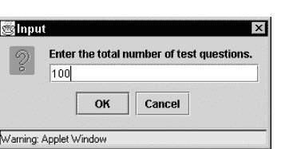

**图 14-1** 提示用户输入测试题目的总数

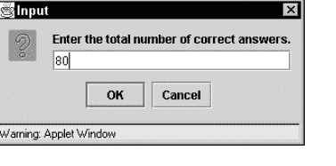

**图 14-2** 提示用户输入正确回答的题目总数

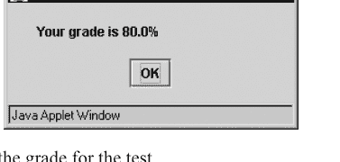

**图 14-3** 显示测试成绩

## 状态窗口

在 Applet 运行期间，为用户提供状态信息始终是一个良好的编程实践。这样，如果您的 Applet 正忙于处理任务，用户就能看到一条不断变化的消息，告知用户 Applet 正在正常工作或遇到了错误。

状态行位于 Applet 窗口底部，用于显示 Applet 的当前状态。你可以通过调用 `showStatus()` 方法来向状态行写入信息。`showStatus()` 方法需要一个参数——即你希望在状态行上显示的消息。

以下示例说明了如何在 Applet 窗口的状态行上显示 Applet 的状态。你可以使用前面示例中的 HTML 文档来运行此 Applet。图 14-4 显示了运行此 Applet 后的效果。

```java
import javax.swing.JApplet;
import java.awt.Graphics;
public class Demo extends JApplet {
    public void paint(Graphics g)
    {
        g.drawString("Hello world!", 30, 30);
        showStatus("The Hello world applet is running.");
    }
}
```

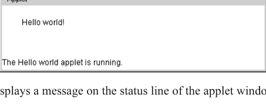

**图 14-4** 在 Applet 窗口的状态行上显示消息

## 测验

- 1. 什么是 Applet？
- 2. Applet 受到哪些限制？
- 3. 如何执行一个 Applet？
- 4. 为什么 Applet 没有 `main()` 方法？
- 5. 为什么不需要覆盖 `JApplet` 类的所有方法？
- 6. 为什么 Applet 不能从命令行运行？
- 7. `init()` 方法的目的是什么？
- 8. 为什么要使用 Applet？
- 9. 状态行的目的是什么？
- 10. 如何向 Applet 传递参数？

## 期末考试

- 1. Applet 和 Java 应用程序有什么区别？
- 2. Applet 中的语句能否向本地计算机写入文件？
- 3. Applet 能否从命令行执行？
- 4. Applet 的入口点是什么？
- 5. 每个 Applet 中应该覆盖哪三个方法？
- 6. Applet 加载后会调用哪个方法？
- 7. `start()` 方法的目的是什么？
- 8. Applet 能使用 GUI 元素吗？
- 9. 如何运行一个 Applet？
- 10. 能否从命令行向 Applet 传递参数？
- 11. 调用哪个方法可以显示一个 GUI 窗口？
- 12. 哪些 GUI 元素需要使用 `ItemListener`？
- 13. 以下组装 GUI 窗口的顺序是否正确？窗口、容器、内容面板、GUI 元素
- 14. 内容面板和 GUI 元素之间是什么关系？
- 15. 对还是错？所有 GUI 元素应该始终启用。
- 16. 如何获取内容面板？
- 17. 如何设置容器的背景颜色？
- 18. 可以使用像素坐标在窗口中定位 GUI 元素吗？
- 19. 为什么在某些情况下会选择使用 GridBag 布局管理器而不是 Grid 布局管理器？
- 20. 与用其他编程语言（如 C++）创建 GUI 相比，用 Java 创建 GUI 的一个主要区别是什么？
- 21. 访问说明符的目的是什么？
- 22. 什么是接口？
- 23. 对还是错？类的每个实例都有自己的实例变量。
- 24. 一个类如何继承另一个类？
- 25. 什么是抽象类？
- 26. 什么是方法重载？
- 27. 什么是方法签名？
- 28. Java 中的封装指的是什么？
- 29. Java 应用程序的入口点是什么？
- 30. 什么是 Java 虚拟机？
- 31. Java 应用程序如何能在几乎任何计算机上运行？
- 32. 什么是结果集？
- 33. 什么是嵌入式查询？
- 34. 什么是数据库管理系统？
- 35. `while` 循环和 `do...while` 循环有什么区别？
- 36. `int` 和 `float` 有什么区别？
- 37. `System.out.println()` 中的 `System` 是什么？
- 38. `new` 运算符的作用是什么？
- 39. 假设 x 等于 10，求值这个表达式：`!x==10`
- 40. 为什么要创建一个无限循环？
- 41. 数组和 `Arrays` 类有什么区别？
- 42. Java 编译器生成什么类型的代码？
- 43. 如何临时将一种数据类型转换为另一种？
- 44. 变量标识符代表什么？
- 45. 什么决定了一个值的精度？
- 46. 可以在同一条语句中声明相同数据类型的变量吗？
- 47. 变量何时超出作用域？
- 48. 赋值给字符变量的值在内存中如何表示？
- 49. 单精度值的精度有多高？
- 50. 什么运算符需要一个操作数？
- 51. Java 遵循什么规则来求值表达式？
- 52. 自增运算符的位置为什么重要？
- 53. 在 `switch...case` 语句中，是否所有 `case` 语句都会被求值？
- 54. 如果 `switch` 的值未包含在任何 `case` 语句中，如何确保 `switch...case` 语句仍能响应？
- 55. 如何描述将一个 `if` 语句嵌套在另一个 `if` 语句内部？
- 56. 在循环中，如何告诉 Java 跳过循环中剩余的语句，直接回到循环顶部？
- 57. 如何识别数组中的一个元素？
- 58. 如何将你定义并希望在其他程序中使用的类分组和分发？
- 59. 用什么术语来描述 Java 的能力，即一个方法可以根据其在程序中被调用的上下文而呈现不同形式？
- 60. 哪种成员方法可以在不首先声明其实例的情况下被调用？
- 61. 构造函数的目的是什么？
- 62. 什么就像一个饼干模具，描述了由成员变量和成员方法组成的新数据类型？
- 63. 何时调用构造函数？
- 64. 在 Java 垃圾回收释放类实例使用的内存之前，哪个方法会自动被调用？
- 65. 参数列表的目的是什么？
- 66. 如何确定子类是否应该继承父类？
- 67. 如何防止子类覆盖父类的方法？
- 68. Java 中所有其他类都自动继承哪个类？
- 69. 如何在子类中显式调用父类的方法？

## Java 揭秘

- 70. 如何设计一个程序来处理异常？
- 71. 在程序中应该捕获哪些类型的异常？
- 72. 如果在程序中没有捕获异常，异常会如何处理？
- 73. 所有的异常都是由 Java 生成的吗？
- 74. 有没有办法确保某些语句无论是否抛出异常都会执行？
- 75. 用什么术语来描述同时执行两个进程？
- 76. 线程优先级是如何工作的？
- 77. 如何防止两个线程同时尝试访问同一资源？
- 78. 要在程序中创建线程，需要实现哪个接口？
- 79. 在你没有创建线程的程序中，是否有线程在运行？
- 80. 如果实现了 `Runnable` 接口，必须重写哪个方法？
- 81. 如何创建一个线程？
- 82. 如何将实例变量转换为字节流？
- 83. 字节流被称为什么？
- 84. 使用 `File` 类的目的是什么？
- 85. `BufferedReader` 是如何工作的？
- 86. `File` 类的 `getParent()` 方法返回什么？
- 87. 你使用 `getXXX()` 方法从结果集中检索数据。XXX 代表什么？
- 88. 所有的结果集都可以更新吗？
- 89. 用什么术语来描述结果集中的列名？
- 90. 判断题：引用结果集中列的唯一方式是使用列名。
- 91. `last()` 方法相对于结果集有什么作用？
- 92. 当你声明 `FileOutputStream` 类的实例时，需要向其构造函数传递两个参数。第一个参数是文件名。第二个参数是什么？
- 93. 如果你需要小数点右边 15 位有效数字，你需要什么样的精度？
- 94. 计算机能理解哪种计算机语言？

## 期末考试

- 95. 什么能够唯一标识计算机内存的每个块？
- 96. 哪个运算符返回两个数相除后的余数？
- 97. 关系运算符返回什么值？
- 98. 你会如何改变一个位的值？
- 99. 在表达式 `a == 10 || b == 20` 中，要使该表达式为真，必须满足什么条件？
- 100. Java 应用程序的正常流程是什么？


# 测验和期末考试答案

## 第 1 章

- 1. 编译器是一种程序，它将用高级编程语言编写的程序翻译成字节码或目标代码，具体取决于编写程序所用的语言。
- 2. 高级编程语言包含类似英语的单词，程序员用它们来指示计算机执行特定的功能。
- 3. 机器语言是计算机唯一能理解的语言。用机器语言编写的指令以一系列零和一的形式编写。
- 4. C 和 Java 的关键区别在于，Java 允许程序员定义类。在 C 中不能定义类。
- 5. C++ 和 Java 的关键区别在于，Java 程序可以在不同种类的计算机上运行，而无需重新编译。C++ 程序必须重新编译才能在不同种类的计算机上运行。
- 6. 字节码是编译后的 Java 代码，可以在任何运行 Java 虚拟机的计算机上执行。
- 7. Java 虚拟机是一种解释 Java 字节码的程序。
- 8. Java 应用程序中的 `main()` 方法是应用程序的入口点。
- 9. 不能。你可以定义一个不将属性声明为类成员的 Java 类。
- 10. Java 应用程序在 `main()` 方法中的最后一条语句执行后终止。

## 第 2 章

- 1. 数据类型是程序员用来告诉 Java 需要在内存中存储哪种数据的关键字。
- 2. 不能。只有相同数据类型的变量才能在同一语句中声明。
- 3. 强制类型转换是一种临时将值从一种数据类型转换为另一种数据类型，使其与操作兼容的方法。
- 4. 确定变量合适数据类型的最佳方法是：确定需要存储在内存中的最小值和最大值，然后找到范围与这些值匹配的数据类型。
- 5. 变量标识符是你给变量起的名称。你在整个程序中使用这个名称来引用 Java 与变量标识符相关联的内存位置。
- 6. 内存地址是唯一标识内存中某个位置的唯一数字。变量标识符是程序员用来引用相应内存位置的名称。
- 7. 变量的作用域由声明该变量的代码块定义。当程序离开声明该变量的代码块时，变量就会超出作用域。
- 8. 精度是小数点右边准确的位数。
- 9. 当字符赋值给 char 变量时，Unicode 中分配给该字符的整数被存储在内存中。
- 10. 不能。float 是单精度（小数点右边 7 位有效数字），而 double 是双精度（小数点右边 15 位有效数字）。

## 第 3 章

- 1. 复合表达式是由两个或多个子表达式组成的表达式。
- 2. 一元运算符是只需要一个操作数的运算符。
- 3. 运算符告诉 Java 使用一个或多个值（称为操作数）执行操作。
- 4. 括号放在需要先于其他子表达式计算的子表达式周围。
- 5. 优先级定义了 Java 在表达式中执行操作的顺序。
- 6. 取模运算符返回两个数相除后的余数。
- 7. 如果增量或减量运算符用在复合表达式中，例如 `a = ++b`，增量或减量运算符的位置告诉 Java 是在赋值操作之前还是之后进行增量/减量。如果增量/减量运算符位于变量之前，则在赋值之前进行增量/减量。如果增量/减量运算符位于变量之后（例如 `a++`），则在赋值之后进行增量/减量。
- 8. 关系运算符比较两个值并返回布尔值。
- 9. 位运算符改变一个位的值。
- 10. OR 逻辑运算符（`||`）比较两个表达式的结果。如果任一表达式为真，则 OR 逻辑运算符返回真值；否则返回假值。

## 第 4 章

- 1. 程序的正常流程从 `main()` 方法的第一条语句开始。然后语句按顺序执行，直到 `main()` 方法的最后一条语句执行完毕。
- 2. 无限循环是指条件表达式永远为真的循环。
- 3. 条件表达式是决定 Java 应该或不应该执行一个或多个语句的关系表达式。
- 4. 不能。`switch` 语句不能使用布尔值作为 `switch` 变量。
- 5. 常量是与 `case` 语句相关联的值，在 `switch` 语句中与 `switch` 变量进行比较。
- 6. `while` 循环体内的语句只有在条件语句为真时才执行。`do while` 循环体内的语句至少执行一次，即使条件语句为假。
- 7. `switch` 语句中 default 语句的目的是：如果没有任何 `case` 常量与 `switch` 值匹配，则指定要执行的语句。
- 8. 术语 "totally" 一词意味着将一个控制语句放在另一个控制语句内部。
- 9. `break` 语句告诉 Java 退出一个块，例如 `for` 循环或 `switch` 语句。
- 10. `continue` 语句告诉 Java 跳到循环顶部，而不执行循环中 `continue` 语句下方的语句。

## 第 5 章

- 1. 索引是用来标识数组元素的整数。
- 2. 对数组的引用指向数组第一个元素的内存地址。
- 3. `new` 运算符动态地为数组分配内存，并返回数组第一个元素的内存地址。
- 4. 数组第一个元素的索引始终为零。
- 5. 你可以通过传递数组名将数组传递给方法。
- 6. 你可以通过返回数组名从方法中返回数组。
- 7. 你可以使用数组的 `length` 数据成员来确定数组元素的数量。
- 8. `fill()` 的第三个参数告诉 `fill()` 方法在到达索引作为第三个参数传递的数组元素时停止填充。

## 测验与期末考试答案


- 9. `binarySearch()` 方法在数组中未找到搜索条件时会返回一个负数。

- 10. 包是一组预定义类的集合，当你需要使用程序中的任何预定义类时，它可以被导入到你的程序中。

## 第 6 章

- 1. 方法头由三个元素组成：方法名、方法参数以及方法返回值的数据类型。

- 2. 方法签名由方法名和方法参数列表组成。

- 3. 返回语句用于在方法中向调用该方法的语句返回一个值。

- 4. 参数的两个组成部分是参数的数据类型和名称。

- 5. 命令行参数是在程序从命令行运行时传递给程序的参数。

- 6. 要将引号作为命令行参数传递，必须在引号前加上反斜杠。

- 7. 多态是程序员用来描述 Java 能力的一个术语，即一个方法可以根据其在程序中被调用的上下文采取不同的含义（形式）。

- 8. 方法重载是定义两个或多个具有相同方法名但具有不同参数列表的方法的技术。

- 9. 方法是 Java 程序中包含执行任务逻辑的部分。

- 10. Java 中的两种方法是非静态方法和静态方法。

## 第 7 章

- 1. 实例变量是作为类成员声明的非静态变量。

- 2. 实例和对象都指代类的声明。程序员可以互换使用这些术语。

- 3. 类就像一个饼干模具，它描述了一种新的数据类型，该类型由实例变量和方法成员组成。

## Java 揭秘

- 4. 构造函数是类的一种方法成员，当类的实例被声明时会被自动调用。

- 5. 两者都是类的方法成员。在 Java 垃圾回收释放类实例所用内存之前，`finalize()` 方法会被自动立即调用。

- 6. 方法成员重载意味着类的两个或多个方法成员具有相同的方法名但具有不同的参数列表。

- 7. 你可以通过使用 `new` 运算符来声明一个类的实例，如下所示：

```
new myClass()
```

- 8. 访问说明符用于限制对类成员的访问。

- 9. 是的。构造函数可以有一个参数列表。

- 10. 构造函数重载的原因很多，其中最常见的是为程序员提供为实例变量提供初始值的机会。

## 第 8 章

- 1. 类的抽象方法成员是一种必须由继承定义该抽象方法成员的类的子类重写的成员方法。抽象方法成员没有方法体，因为它不能被调用。只有重写抽象方法成员的方法成员才能被调用。

- 2. 继承的“is a”规则定义了超类和子类之间的关系。这个规则要求子类“是一个”超类。例如，一个学生类（子类）应该是一个人，以便继承人类。

- 3. 关键字 `extends` 由子类用来指定要继承的超类。

- 4. 关键字 `final` 禁止将指定为 final 的方法成员被子类的方法成员重写。

- 5. 超类是被子类继承的类。

- 6. 抽象类是包含至少一个抽象方法成员的类。你不能声明一个抽象类的实例。

## 测验与期末考试答案

- 7. `Object` 类是 Java 定义的一个类，它会被 Java 中定义的所有其他类自动继承，包括你在程序中定义的类。

- 8. 你可以通过使用关键字 `final` 指定一个类来阻止该类被继承。

- 9. 关键字 `super` 用于在子类中显式引用超类的方法成员。

- 10. 当一个子类被另一个子类继承时，就会发生多级继承。

## 第 9 章

- 1. 异常是指通常不会发生的事情。在编程中，程序可能会发生两种异常。这些通常被称为 *编译错误* 和 *运行时错误*。Java 中的异常类处理运行时错误。

- 2. try 块包含被监控是否有异常的语句。

- 3. catch 块紧随 try 块之后，并处理 try 块内语句抛出的异常。

- 4. 如果抛出异常而你在程序中没有捕获它，Java 的默认处理器将响应此异常。

- 5. `Throwable` 类是 `Exception` 类的父类。

- 6. 通过继承 Java 的 `Exception` 类或 `Exception` 的任何子类（例如 `RuntimeException` 类），你可以创建自己的异常类。

- 7. 如果你定义了一个可能抛出受检异常的方法，但没有在方法定义中捕获该异常，则必须在方法头中使用关键字 `throws` 并列出该方法可能抛出的异常。

- 8. 一个 catch 块可以捕获一个异常类。你可以使用多个 catch 块来捕获多个异常。

- 9. finally 块包含无论异常是否抛出都会执行的语句。

- 10. 是的，你可以重写你的异常类从 `Throwable` 类继承的方法。

## 第 10 章

- 1. 线程是程序中与其它部分并发运行的部分。

- 2. 多任务是同时执行两个或更多任务。

- 3. 在并发线程之间切换需要 CPU 处理时间。这被称为 *开销*，因为此处理与直接处理程序无关。

- 4. 线程优先级是一个 1 到 10 的整数，它指定线程是否应该被更高优先级的线程抢占。最低优先级为 1。默认正常优先级为 5。最高优先级为 10。

- 5. 同步是一种要求一次只有一个线程访问资源的技术。需要该资源的其他线程必须等待直到资源可用。

- 6. `Runnable` 接口是一种用于在程序中创建线程的接口，因为你只需要定义 `run()` 方法。

- 7. 如果你需要重写 `Thread` 类的 `run()` 方法之外的更多方法，则应在程序中扩展 `Thread` 类，而不是实现 `Runnable` 接口。

- 8. 你有两个线程——主线程和你创建的子线程。

- 9. 你必须重写 `run()` 方法。

- 10. 你通过重写 `run()` 方法来定义程序中成为线程的部分。`run()` 方法内的语句成为线程。

## 第 11 章

- 1. 序列化一个类会将其转换为一个字节流。

- 2. 流是字节的流动。

- 3. `File` 类用于与计算机的文件系统进行交互。

- 4. 用对象保存的数据被封装在对象内，通常被你的程序视为一个单元。也就是说，你保存和读取的是类的实例，而不是类的实例变量。使用 `PrintWriter` 类保存数据元素会分别保存数据。

## 测验与期末考试答案

- 5. 文件名过滤器用于过滤文件目录，以便只有包含指定字符模式的文件名被返回给你的程序。

- 6. `PrintWriter` 类不能打开文件。它使用对另一个类（如 `FileOutputStream` 类）的引用来打开文件。

- 7. 你在打开文件时通过包含完整路径和文件名来指定路径。

- 8. `BufferedReader` 类用于将文件中的数据读入内存缓冲区，然后从内存缓冲区读取数据到你的程序中。

- 9. 通过使用接受两个参数的 `FileOutputStream` 构造函数版本，你可以将数据附加到文件的末尾。第一个参数是文件名，第二个参数是布尔值 true，这会导致所有数据都被写入文件的末尾。

- 10. 你可以通过调用 `File` 类中定义的 `getParent()` 方法来确定包含子目录的父目录路径。

## 第 12 章

- 1. 事件监听器监控 GUI 元素发生的变化。

- 2. 事件处理程序是你定义的一个方法，当 GUI 元素发生事件时会被调用。

- 3. 你不能在窗口中显示 GUI 元素。你必须将 GUI 元素放入内容窗格中，然后将内容窗格放入窗口的容器中。

- 4. 内容窗格的目的是将放置在窗口容器中的 GUI 元素分组在一起。

- 5. 如果 GUI 元素不适合当前处理过程，你可能希望禁用它。

- 6. 窗口可以创建但不显示。你必须通过调用 `setVisible(true)` 方法显式告诉 Java 虚拟机显示窗口。

- 7. 通过调用 `setContentPane(ca)` 方法并传递内容窗格的引用，你可以将内容窗格放入容器中。

- 9. 你不能在窗口中显式指定 GUI 元素的位置。相反，你需要在布局管理器中为每个 GUI 元素指定相对位置。

- 10. 在 Java 中创建 GUI 与在 C++ 等其他编程语言中创建 GUI 的一个主要区别是，你不能在窗口中显式定位 GUI 元素。这是因为 Java 虚拟机需要灵活性来使你的 GUI 布局适应各种计算机，而无需你重写程序。

## 第 13 章

- 1. DBMS（数据库管理系统）是一种软件，使你能够使用 SQL 查询来组织和管理数据。存储在文件中的数据可能是有组织的，也可能不是，并且由你的程序直接管理。

- 2. 结果集（resultset）是 DBMS 响应 SQL 查询而返回的虚拟数据表。

- 3. 你通过使用 `getXxx()` 方法并传递对要访问其值的列的引用，来检索存储在结果集中的数据。

- 4. 你通过调用 `next()`、`first()`、`last()`、`previous()`、`absolute()`、`relative()` 和 `getRow()` 方法来移动虚拟游标。

- 5. 你通过调用 `updateXxx()` 方法来更新结果集中的值（如果该结果集是可更新的结果集），其中 Xxx 是要更新的列的数据类型。`updateXxx()` 方法需要两个参数：第一个标识列，第二个是要放入该列的值。

- 6. 你通过创建并执行包含更新语句的 SQL 查询来更新表中的值。

- 7. 元数据（metadata）是关于数据的数据，例如列的名称、数据类型和大小。

- 8. 你不能更新元数据。元数据在你创建数据库和表时设置。只有当 DBMS 的这些组件发生变化时，元数据才会改变。

- 9. 你通过引用列在结果集中的位置来选择结果集中的列。

- 10. 你检索元数据，以便让你的程序了解存储在表中的数据，或者了解表和数据库本身的信息。

# 测验和期末考试答案

## 第 14 章

- 1. 小程序（applet）是一种由 HTML 文档调用的 Java 程序。

- 2. 通常，小程序不能访问剪贴板、本地计算机的事件队列、本地计算机的操作系统属性以及本地计算机的操作安全属性。

- 3. 当浏览器在 HTML 文档中遇到 `<applet>` 标签时，就会执行小程序。

- 4. `main()` 方法是 Java 应用程序的入口点。小程序的入口点是浏览器在 HTML 文档中遇到 `<applet>` 标签的位置。因此，小程序不需要有 `main()` 方法。

- 5. 只有当你想要改变 `JApplet` 类中某些方法的默认行为时，才需要重写这些方法。通常，你只需要改变少数方法的默认行为，而不是 `JApplet` 类中定义的所有方法。

- 6. 小程序不能从命令行运行，因为它没有定义 `main()` 方法。

- 7. `init()` 方法在小程序首次执行时调用一次，通常包含初始化小程序中其他方法所用变量的语句。

- 8. HTML 文档不具备执行复杂处理的能力。因此，你会使用小程序来增强 HTML 文档的功能。

- 9. 状态栏用于显示消息，让小程序用户了解小程序的状态。

- 10. 你通过在调用小程序的 HTML 页面中使用 `<param>` 标签来向小程序传递参数。然后使用 `<param>` 标签的 `name` 和 `value` 属性来标识参数。

## 期末考试

- 1. 小程序必须使用浏览器或 appletviewer 运行。Java 应用程序可以使用 Java 虚拟机从命令行运行。

- 2. 可能不行。小程序在本地计算机上的操作受到限制。然而，这些限制由本地环境决定。许多本地环境会保护本地文件系统免受小程序的访问。

## Java 揭秘

- 3. 不行。小程序必须从浏览器或 appletviewer 运行。

- 4. 小程序的入口点是浏览器。小程序中定义的方法就是从那里被调用的。

- 5. `init()`、`start()` 和 `paint()`。

- 6. `init()`。

- 7. `start()` 方法包含每次启动小程序时执行的语句。

- 8. 是的。

- 9. 你通过在 HTML 文档中使用 applet 标签来运行小程序。

- 10. 不行，因为小程序不能从命令行运行。参数可以从 HTML 文档传递给小程序。

- 11. 你调用 `setVisible()` 方法并传递一个布尔值 true。

- 12. 单选按钮、复选框、组合框以及其他使用项目列表供用户选择的 GUI 元素。

- 13. 是的。

- 14. GUI 元素被添加到内容窗格（content pane）中。然后内容窗格被放置到窗口的容器中。

- 15. 错误。GUI 元素只有在当前进程中使用时才应该被启用。

- 16. 你调用 `getContentPane()` 方法。

- 17. 你调用 `setBackground()` 方法并传递一个与你想要使用的颜色对应的常量。

- 18. 不行。你不能使用像素坐标，因为它们是机器相关的，在不同机器上的位置可能不同。Java 是一种与机器无关的语言；因此，你必须使用相对坐标而不是显式坐标来定位窗口中的 GUI 元素。

- 19. Gridbag 布局管理器使你能够指定 GUI 元素要放置在网格的哪个单元格中。Grid 布局管理器将 GUI 元素放置在网格中下一个可用的单元格中。

- 20. 在许多编程语言中，你可以指定每个 GUI 元素在屏幕上的确切位置。在 Java 中，你指定相对位置，然后由 Java 虚拟机确定 GUI 元素的确切放置位置。

- 21. 访问修饰符（access specifier）决定程序的哪些部分可以访问类的成员。

- 22. 接口（interface）是一组预定义的方法，实现该接口的类必须定义这些方法。接口告诉程序员，他/她必须在类中定义一组特定的方法才能使用（实现）该接口。

- 23. 正确。

- 24. 你可以通过在类头中使用关键字 `extends` 来使一个类继承另一个类。

- 25. 抽象类（abstract class）是不能被实例化的类。

- 26. 重载（overloading）是一种创建同一方法的两个或多个版本的技术，方法的名称保持不变，但每个版本的方法签名不同。

- 27. 方法签名由方法名称和参数列表组成。

- 28. 封装（encapsulation）是指将相关的数据和方法组合到一个类中，并保护数据免受程序其他部分的访问。

- 29. `main()` 方法是每个 Java 应用程序的入口点。

- 30. Java 虚拟机（Java Virtual Machine）是一种与机器相关的可执行程序，能够将 Java 字节码转换为机器可读的指令。

- 31. Java 应用程序可以在任何装有 Java 虚拟机的计算机上运行，因为 Java 应用程序的字节码是与机器无关的，并由特定于机器的 Java 虚拟机解释执行。

- 32. 结果集（resultset）是 Java 应用程序向 DBMS 发送 SQL 查询后，DBMS 返回给 Java 应用程序的数据。

- 33. 嵌入式查询（embedded query）是程序（如你的 Java 程序）的一部分的 SQL 查询。

- 34. DBMS（数据库管理系统）用于存储、检索和维护大量数据，并且能够执行用 SQL 编写的指令。

- 35. 如果 `while` 循环的条件表达式为假，则 `while` 循环中的语句可能永远不会被执行。然而，`do...while` 循环中的语句总是至少执行一次，即使 `while` 循环的条件表达式为假。

- 36. int 是用于整数的*数据类型*。float 是用于混合数（带小数）的数据类型。

- 37. *System* 是 `System` 类的名称。

- 38. `new` 运算符为对象分配内存，并返回对该对象的引用，如果该对象存在构造方法，则还会调用构造方法。

## Java 揭秘

- 39. 该表达式的值为 false，因为感叹号会反转表达式的逻辑。换句话说，它表示“非”。

- 40. 逻辑运算符用于连接两个或多个关系表达式。

- 41. 关系运算符用于比较两个值。

- 42. 赋值运算符用于将值赋给变量。

- 43. 算术运算符用于执行数学计算。

- 44. `return` 语句会导致方法立即返回。

- 45. *运算符优先级*是指用于计算表达式的符号顺序。

- 46. *括号*。

- 47. 不具有。`--var` 更改变量的值，但不评估使用其当前值的生成表达式。

- 48. 降序排列表示顺序从右到左。升序排列则表示顺序从左到右。

- 49. `54`

- 50. `74`

- 51. 在通信中，*以太网*是用于在局域网中连接计算机的通信标准。以太网定义了计算机之间的连接、数据发送方式以及数据的格式。

- 52. *CIDR* 是一种指定 IP 地址范围的方法。

- 53. `150.96.255.255`

- 54. `nd<sub>1</sub>.nd<sub>2</sub>.nd<sub>3</sub>.nd<sub>4</sub>/prfx`

- 55. `strcat(A, A);`

- 56. 
```
uintptr_t ptr_a = &A;
intptr_t ptr_b = &B;
```

- 57. `A == B`

- 58. 冲突。

# 索引

## C

条件表达式, 51–52, 67–68, 81

- 替代形式, 83–85

- 复合条件, 75–76

- *另见* if 语句

上下文切换, 182, 183

continue 语句, 89–90

控制表达式, 80

控制序列, 27

控制语句, 66–67

控制变量, 81

## D

数据

- 定义, 2–3

- 与信息的区别, 17–18

- 字面量, 22–28

数据类型, 28–29, 285–287

- 布尔型, 32

- 字节型, 30

- 类型转换, 32–33

- 字符型, 31–32

- 双精度型, 31

- 单精度型, 31

- 浮点型, 31

- 整型, 30

- 整数型, 29–31

- 长整型, 31

- 短整型, 30

- 类型表, 29

- 与 `setXXX()` 和 `getXXX()` 方法一起使用, 286

数据库, 255–256

- *另见* JDBC

数据库管理系统, 256

- 避免超时, 265

- 连接到, 259–260

- 获取行, 278–280

- 元数据, 284–285

- 处理返回的数据, 262–263

- 终止与数据库的连接, 263

- 捕获异常, 264–265

- *另见* JDBC；`ResultSet` 对象

死锁, 205

十进制数制, 18

自减运算符, 48–50

default 语句, 78–79

对话框, 226–228

- 与小程序一起使用, 299–301

- *另见* GUI

目录结构, 210

- *另见* 文件

do while 循环, 87–88

点运算符, 103

双精度数据类型, 31


# 索引

## 双精度, 25

## 动态内存分配, 132

## 动态方法分派, 156–159

## E

### else 子句, 70–71

- *另见* `if` 语句

### else if 子句, 71–73

- *另见* `if` 语句

### 封装, 126

### `equals()` 方法, 102–103

### 错误码, 113–114

### 转义字符, 27

### 转义序列, 27

### 事件监听器, 245–247

### 考试, 303–307

- 答案, 319–324

### 异常处理

- 基础, 167–168
- 默认处理器, 170
- 异常处理器, 166–167
- `finally` 块, 169–170
- 不处理异常的方法, 174–175
- 多重 `catch` 块, 168–169
- 嵌套 `try` 语句, 171–172
- 抛出异常, 172–175
- 未捕获的异常, 170–171

### 异常

- 捕获, 167
- 检查型与非检查型, 175–176
- 定义, 165–166
- 异常列表, 174
- 子类, 176–179
- 抛出, 172–175
- 捕获（数据库）, 264–265
- 未捕获的, 170–171

### 表达式, 41–42

- 条件表达式, 51–52, 67–68, 75–76, 81, 83–85
- 控制表达式, 80
- 初始化表达式, 81, 82–83
- 运算顺序, 43
- 类型, 43–45

### `extends` 关键字, 147, 189–190

## F

### `File` 类, 210–213

- 定义的方法, 212

### 文件, 209–210

- 追加到文件, 217–218
- 文件夹, 210
- 列出目录中包含的文件, 213–214
- 向文件读写对象, 219–222
- 从文件读取, 216–217
- 写入文件, 214–216
- *另见* 流

### `fill()` 方法, 104–105

### 期末考试, 303–307

- 答案, 319–324

### `final` 关键字, 161–162

### `finalize()` 方法, 137–138

### `finally` 块, 169–170

### 浮点数据类型, 31

### 浮点型数据类型, 31

### 浮点数字面量, 24–25

### 流式布局管理器, 232–233

### 文件夹, 210

- *另见* 文件

### `for` 循环, 80–85

- 嵌套, 85

### FORTRAN, 5

## G

### 垃圾回收, 136–137

### Gosling, James, 8

### 图形用户界面。*见* GUI

### Green 项目, 8

### 网格布局管理器, 234–236

### 网格包布局管理器, 234–236

### GUI

- 边界布局管理器, 233–234
- 复选框, 238–240, 249–251
- 颜色常量, 231
- 组合框, 240–241, 251–252
- 滚动窗格常量, 244
- 内容容器, 230–231
- 定义, 225
- 禁用和启用元素, 253
- 流式布局管理器, 232–233
- 从 GUI 获取数据, 245–253
- 网格布局管理器, 234–236
- 网格包布局管理器, 234–236
- Java 基础类 (JFC), 228
- Java 布局管理器, 232–236
- 标签, 237–238
- 消息常量, 226
- 按钮, 236–237, 247–248
- 单选按钮, 238–240, 249–251
- 滚动窗格, 243–245
- 简单 GUI, 226–228
- 文本区域, 242–243
- 文本框, 237–238
- 窗口类, 228–230

## H

### HelloWorld 程序, 10–12

- 类定义, 13
- 方法定义, 14–15
- 语句, 15

### 十六进制数制, 18–19

### HTML, 293–294

- *另见* 小程序

## I

### 标识符, 34

### 集成开发环境。*见* IDE

### `if` 语句, 67–68

- 复合条件, 75–76
- `else` 子句, 70–71
- `else if` 子句, 71–73
- 形式, 68–70
- 嵌套, 73–75

### 自增运算符, 48–50

### 信息, 与数据的区别, 17–18

### 继承

- 抽象类, 159–161
- 访问继承类的成员, 147–148
- 调用构造函数, 150
- 子类, 147
- 定义, 145–146
- `extends` 关键字, 147
- `final` 关键字, 161–162
- 实例化超类, 149
- 多级继承, 152–154
- `Object` 类, 162–163
- 单向继承, 149–150
- 重写方法成员, 154–159
- 父类, 147
- 子类, 147, 162–163
- `super` 关键字, 150–152
- 超类, 147, 149
- 何时使用, 146
- *另见* 类

### 初始化表达式, 81

- 替代形式, 82–83

### 实例变量, 126

- 声明, 129

### 整型数据类型, 30

### 整数数据类型, 29–31

### 整数字面量, 23

### 集成开发环境。*见* IDE

### 国际标准化组织。*见* ISO

### 进程间通信, 202

### `isAlive()` 方法, 192–194

### ISO, 7

## J

### Java

- 发展历程, 7–8
- 版本, 8

### Java 2 软件开发工具包 (J2SDK), 10

### Java 小程序。*见* 小程序

### Java 社区进程, 7

### Java 基础类 (JFC), 228

### Java 布局管理器, 232–236

### Java 命名约定, 35–36

### Java 优先级表, 43–44

### Java 虚拟机, 10

### `javax.swing` 包, 228

### JDBC

- API 包, 258
- 将 JDBC/ODBC 桥接与数据库关联, 259
- 连接到数据库管理系统, 259–260
- 创建并执行 SQL 查询, 260–263
- 发展历程, 256–257
- 驱动程序类型, 257
- 获取行, 278–280
- 加载驱动程序, 258–259
- 元数据, 284–285
- 流程, 258–263
- 处理数据库管理系统返回的数据, 262–263
- `ResultSet` 对象, 272–284
- 终止与数据库管理系统的连接, 263
- 测试驱动程序是否可滚动, 278
- *另见* 数据库管理系统

### `join()` 方法, 192–194

### 跳转语句, 88–90

### JVM。*见* Java 虚拟机

## K

### 关键字

- `extends`, 147, 189–190
- `final`, 161–162
- `super`, 150–152
- `synchronized`, 198–201
- `this`, 135–136

## L

### 编程语言, 3–5

- B 语言, 5
- BCPL, 5
- 成为标准, 7
- C 语言, 6
- C++ 语言, 6
- COBOL, 5
- FORTRAN, 5
- 历史, 5–6
- Java, 7–8

### 布局管理器, 232–236

### 前导零, 20

### 链接器, 4

### 链接, 4–5

### `list()` 方法, 213–214

### 字面量, 22

- 布尔型, 25–26
- 字符型, 26
- 浮点型, 24–25
- 整型, 23
- 字符串型, 28

### 局部变量, 135

### 逻辑运算符, 52–56

### 长整型数据类型, 31

## M

### 机器相关程序, 3

### 内存, 28–29

### 内存地址, 20, 28

### 元数据, 284–285

### 方法分派, 动态, 156–159

### 方法成员, 126

- 定义, 127–130
- `Object` 类的方法, 162–163
- 重载, 133–135
- 重写, 154–159

### 方法, 110

- 参数列表, 105, 114–116
- `binarySearch()`, 106–107
- 方法体, 112
- 调用, 119–120
- 命令行参数, 116–119
- 定义, 14–15, 111–114
- `equals()`, 102–103
- `fill()`, 104–105
- `finalize()`, 137–138
- 方法头, 111–112
- `isAlive()`, 192–194
- `join()`, 192–194
- `list()`, 213–214
- 方法调用, 114
- 重载, 105
- 参数列表, 114
- 按引用传递, 115
- 按值传递, 115–116
- 传递数组, 98–100
- 多态, 120–122
- 返回值, 113–114
- 返回数组, 100–101
- 方法签名, 111, 121–122
- `sort()`, 106
- `synchronized`, 198–201
- 不处理异常的方法, 174–175
- 类型, 110–111

### 取模运算符, 47

### 多任务, 181–182

### 多线程

- 子线程, 185
- 线程间通信, 202–205
- 使用 `extends` 关键字创建线程, 189–190
- 创建自己的线程, 187–189
- 死锁, 205
- `isAlive()` 方法, 192–194
- `join()` 方法, 192–194
- 主线程, 185–187
- `Runnable` 接口, 185, 187–188, 190
- 设置线程优先级, 195–197
- 挂起和恢复线程, 206–208
- 同步, 184, 197–202
- `Thread` 类, 185
- 线程, 183–184
- 在程序中使用多线程, 190–192
- *另见* 多任务；开销

## N

### 命名约定, 35–36

### 必要的开销, 216

### 不可打印字符, 27

### 非静态方法, 110

### 数制, 18–20

### 数字, 20–22

## O

### 对象文件, 4

### 八进制计数系统, 18

### 一的补码, 62–63

### 运算符, 45–46

- 与运算符, 53–54
- 算术运算符, 46–50
- 赋值运算符, 47
- 位运算符, 56–63
- 复合赋值运算符, 47–48
- 点运算符, 103
- 递增和递减运算符, 48–50
- 逻辑运算符, 52–56
- 模运算符, 47
- 或运算符, 54–55
- 关系运算符, 50–52
- 单与和单或运算符, 55
- 三元运算符, 55–56
- 二的补码, 62–63

### 或逻辑运算符, 54–55

- 单或运算符, 55

### 开销, 182–183

- 必要开销, 216

## P

### 包, 140–143

### 参数列表, 114

- *另请参见* 参数列表

### 参数化构造方法, 134

### 多态性, 120–122

- *另请参见* 方法

### 优先级, 43–44

### 精度, 25

### `PreparedStatement` 对象, 268–270

### 编程语言。*参见* 语言

### 程序, 1–3, 9

- 计算机相关的, 3
- 流程, 65–66
- 从零开始编写 Java 程序, 10–12

## Q

### 测验

- 答案, 309–319
- 第 1 章, 16
- 第 2 章, 40
- 第 3 章, 63–64
- 第 4 章, 90
- 第 5 章, 107–108
- 第 6 章, 123
- 第 7 章, 143–144
- 第 8 章, 163
- 第 9 章, 180
- 第 10 章, 208
- 第 11 章, 222
- 第 12 章, 253
- 第 13 章, 287
- 第 14 章, 302

## R

### 关系运算符, 50–52

### `ResultSet` 对象, 272–273

- 更改结果集的值, 280–282
- 删除结果集中的行, 282
- 获取行, 278–280
- 在结果集中插入行, 282–284
- 定位虚拟游标, 275–278
- 读取结果集, 273–275
- 更新结果集, 280–284

### `return` 语句, 90

### 返回值, 99, 113–114

- *另请参见* 方法

### Richards, Martin, 5

### Ritchie, Dennis, 6

### 根目录, 210

### `Runnable` 接口, 185, 187–188, 190

### 运行 Java 程序, 12

### 运行时错误, 166

## S

### 选择语句, 67–80

- `if` 语句, 67–76
- `switch` 语句, 76–80

### 信号量, 197

### 分号, 15

### 序列化, 219

### `short` 数据类型, 30

### 有效数字, 25

### 单精度, 25

### `sort()` 方法, 106

### SQL, 256

- 创建和执行查询, 260–263

### 标准化, 7

### 语句对象, 265–266

- `CallableStatement` 对象, 270–272
- `PreparedStatement` 对象, 268–270
- `Statement` 对象, 266–268

### 语句, 15, 63

- 控制语句, 66–67
- 默认语句, 78–79
- `if` 语句, 67–76
- 迭代语句, 80–88
- 跳转语句, 88–90
- 选择语句, 67–80
- `switch` 语句, 76–80
- `synchronized`, 201–202

### 静态初始化块, 139–140

### 静态方法, 110–111

### 流, 214

- 向文件追加内容, 217–218
- 打开文件输出流, 214–216
- 读写对象到文件, 219–222
- 从文件读取, 216–217
- *另请参见* 文件

### 字符串字面量, 28

### Stroustrup, Bjarne, 6

### Sun Microsystems, 8

- JDBC, 256–257

### `super` 关键字, 150–152

### `switch` 语句, 76–79

- 默认语句, 78–79
- 嵌套, 79–80

### 同步, 184, 197–202

### 同步方法, 198–201

### 同步语句, 201–202

## Java 揭秘

## T

### 三元运算符, 55–56

### `this` 关键字, 135–136

### Thompson, Ken, 5

### 线程, 183–184

- 子线程, 185
- 线程间通信, 202–205
- 使用 `extends` 关键字创建, 189–190
- 创建自己的线程, 187–189
- `isAlive()` 方法, 192–194
- `join()` 方法, 192–194
- 主线程, 185–187
- 设置优先级, 195–197
- 生成, 190
- 挂起和恢复, 206–208
- 同步, 197–202
- `Thread` 类, 185
- 在程序中使用多线程, 190–192
- *另请参见* 多线程

### 故障排除

- 编译, 11–12
- 运行 Java 程序, 12

### `try` 块, 167–168

- 嵌套 `try` 语句, 171–172

### 二的补码, 62–63

## U

### 一元运算符, 45–46

- *另请参见* 运算符

### Unicode, 21–22

### 用户界面, 223–224

- *另请参见* GUI

## V

### 变量, 32, 33–34

- `CLASSPATH` 环境变量, 142–143
- 控制变量, 81
- 声明, 34–36
- 定义, 3
- 初始化, 36–38
- 实例变量, 126, 129
- 生命周期, 39
- 局部变量, 135
- 多个, 36
- 解析, 34
- 作用域, 38–39

### 虚拟游标, 273, 275

- 定位, 275–278

### 虚拟指针。*参见* 虚拟游标

## W

### `while` 循环, 85–87

## X

### XOR（异或）, 59

## Z

### 前导零, 20

## 国际联系信息

### 澳大利亚

**McGraw-Hill Book Company**

Australia Pty. Ltd.

电话 +61-2-9900-1800

传真 +61-2-9878-8881

<http://www.mcgraw-hill.com.au>

books-it_sydney@mcgraw-hill.com

### 南非

**McGraw-Hill South Africa**

电话 +27-11-622-7512

传真 +27-11-622-9045

robyn_swanepoel@mcgraw-hill.com

### 加拿大

**McGraw-Hill Ryerson Ltd.**

电话 +905-430-5000

传真 +905-430-5020

<http://www.mcgraw-hill.ca>

### 西班牙

**McGraw-Hill/Interamericana de España, S.A.U.**

电话 +34-91-180-3000

传真 +34-91-372-8513

<http://www.mcgraw-hill.es>

professional@mcgraw-hill.es

### 希腊、中东和非洲（南非除外）

**McGraw-Hill Hellas**

电话 +30-210-6560-990

电话 +30-210-6560-993

电话 +30-210-6560-994

传真 +30-210-6545-525

### 英国、北欧、东欧和中欧

**McGraw-Hill Education Europe**

电话 +44-1-628-502500

传真 +44-1-628-770224

<http://www.mcgraw-hill.co.uk>

emea_queries@mcgraw-hill.com

### 墨西哥（同时服务拉丁美洲）

**McGraw-Hill Interamericana Editores S.A. de C.V.**

电话 +525-1500-5108


# 联系方式

## 墨西哥

传真 `+525-117-1589`

<http://www.mcgraw-hill.com.mx>

<carlos_ruiz@mcgraw-hill.com>

## 所有其他咨询请联系

**McGraw-Hill/Osborne**

电话 `+1-510-420-7700`

传真 `+1-510-420-7703`

<http://www.osborne.com>

<omg_international@mcgraw-hill.com>

## 新加坡（服务亚洲）

**McGraw-Hill Book Company**

电话 `+65-6863-1580`

传真 `+65-6862-3354`

<http://www.mcgraw-hill.com.sg>

<mghasia@mcgraw-hill.com>

---

# 请发表意见！

请访问 <www.osborne.com/bookregistration>，让我们知道您对本书的看法。在线时，您将有机会注册订阅 McGraw-Hill/Osborne 的通讯和特别优惠。

**我们期待您的反馈！**

---

# 新书预览

今天就访问 <www.betabooks.com>，了解 McGraw-Hill/Osborne 即将推出的新书！

基于成功的软件模式，Bet@Books™ 允许计算专业人士在线查看部分或有时是完整书稿的选定书籍。Bet@Books™ 浏览是免费的，邀请评论和反馈，并允许您在最感兴趣的领域对正在创作的书籍进行“试驾”。

---

# 快速轻松理解计算基础

- 无需正式培训
- 自定进度，易于遵循，用户友好
- 价格惊人地低廉

| ISBN | 上市时间 |
| :--- | :--- |
| 0-07-225454-8 | 2004年5月 |
| 0-07-225363-0 | 2004年4月 |
| 0-07-225514-5 | 2004年7月 |
| 0-07-225359-2 | 2004年3月 |
| 0-07-225370-3 | 2004年5月 |
| 0-07-225364-9 | 2004年3月 |

有关这些和其他 McGraw-Hill/Osborne 书籍的更多信息，请访问 <www.osborne.com>。
