# Java 设计模式：教程

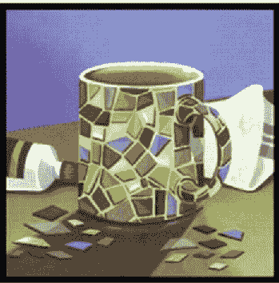

## 第17章 命令模式

- 命令模式说明
- 状态管理器
- CD-ROM 中的程序
- 解释器示例
- 解析
- 解释器模式的实现
- 思考题
- CD-ROM 中的程序
- 迭代器模式说明
- 示例代码
- 迭代器模式的后果
- Java
- CD-ROM 中的程序
- 控件之间的交互
- 中介者与命令对象
- 单一接口中介者
- CD-ROM 中的程序
- 备忘模式实现
- 备忘模式的后果
- CD-ROM 中的程序

状态模式的影响

思考题

CD-ROM 上的程序

动机

示例代码

上下文类

程序命令

折线图与柱状图策略

在 Java 中绘制图表

策略模式的影响

思考题

CD-ROM 上的程序

动机

模板类中的方法种类

Java 中的模板方法模式

示例代码

模板与回调函数

模板模式的影响

思考题

CD-ROM 上的程序

# 第 26 章 访问者模式

动机

何时使用访问者模式

示例代码

访问类

访问多个类

老板也是员工

使用访问者的全捕获操作

双重派发

遍历一系列类

+ 访问者模式的影响

+ 思考题

+ CD-ROM 上的程序

+ 第 27 章 JFC 或 Swing

+ 安装和使用 Swing

+ Swing 背后的思想

+ Swing 类层次结构

+ 第 28 章 编写简单的 JFC 程序

+ 设置外观和感觉

+ 设置窗口关闭框

+ 创建 `JFrame` 类

+ 一个简单的双按钮程序

+ 关于 `JButton` 的更多信息

+ CD-ROM 上的程序

+ 第 29 章 单选按钮和工具栏

+ 单选按钮

+ `JToggleButton`

+ `JToggleButton`

+ 一个示例按钮程序

+ CD-ROM 上的程序

+ 第 30 章 菜单和动作

+ `Action` 对象

+ `Action` 对象中的设计模式

+ CD-ROM 上的程序

+ 第 31 章 `JList` 类

+ 列表选择与事件

+ 动态更改列表显示

+ 带有 `ListModel` 的排序 `JList`

+ 排序更复杂的对象

获取数据库键值

在列表框中添加图片

+ CD-ROM 上的程序

一个简单的 `JTable` 程序

单元格渲染器

渲染其他类型的类

在表格中选择单元格

在此图像表格中使用的模式

CD-ROM 上的程序

`TreeModel` 接口

CD-ROM 上的程序

总结

第 34 章 Sandy 与中介者

第 35 章 Herb 的文本处理纠结

第 36 章 Mary 的困境

参考文献

# 前言

这是一本实用的书籍，教你如何使用一些最常用的设计模式来编写 Java 程序。它的结构由系列短章组成，每章描述一种设计模式，并提供一个或多个完整的、可运行的视觉化示例程序来使用该模式。每章还包含了统一建模语言（UML）图，用来说明类之间的交互。

这本书并不是由“四人帮”编写的著名著作《设计模式》[Gamma, 1995] 的“伴侣”读。相反，它是为想要了解设计模式是什么以及如何在工作中使用它们的人编写的教程。你不需要读过《设计模式》也能从书中获益，但当你读完这本书后，你可能想阅读或重读那本书以获得额外的见解。

在书中，你将学到设计模式是组织程序对象的常用方式，使得这些模式更容易编写和修改。你还会发现，通过熟悉这些设计模式，你将获得一套讨论你的模式如何构建的宝贵词汇。

人们可以以不同的方式欣赏设计模式——从高度理论化的到极度实用的——当他们最终看到这些模式的巨大威力时，他们会经历一个“啊！”的时刻。通常这种时刻意味着你突然在脑海中有了该模式如何帮助你工作的画面。

在书中，我们试图通过尽可能多地描述模式，帮助你形成那种概念性的想法（或称“完形”）。全书分为六部分：

- 介绍性描述
- 将模式分为三部分的并进行描述：创建型、结构型和行为型
- 对 Java 基础类（JFC）的描述，展示它们所阐述的模式
- 一系列模式发挥帮助的案例研究

对于每种模式，我们从简短的口头描述开始，然后构建你可以运行和检查的示例程序，以便使模式变得具体。

## 引言

坐在工作站前的桌旁，你凝视着虚空，试图弄清楚如何编写一个新的程序功能。你直觉上知道必须做什么以及哪些对象会参与其中，但你内心有一种感觉，认为有一种更优雅、更通用的方法来编写这个程序。

事实上，在你脑海中构建出代码的功能以及这些代码之间如何相互作用之前之前，你可能不会编写任何代码。对这个“有机整体”或完形（gestalt）的构思越清晰，你就越可能对自己为问题开发的最佳解决方案感到满意。如果你没有立即抓住这一点，可能会盯着窗外发呆很久，尽管问题的基本解决方案是显而易见的。

在某种意义上，你觉得更优雅的解决方案将更具重用性和可维护性。然而，即使你可能是唯一的程序员，一旦设计出一个相对整洁且不暴露太多内部拙劣之处的解决方案，你会感到如释重负。

计算机研究人员开始关注设计模式的主要原因之一，是为了满足这种对良好、简单且可重用解决方案的需求。“设计模式”这个术语对于初学者来说听起来有些正式，在第一次遇到它时可能会有些反感。但事实上，一种设计模式只是在项目之间、程序员之间重用面向对象（OO）代码的一种方便方法。设计模式背后的思想是：对程序员发现有用的对象间交互进行分类。

编程框架早期文献中引用的一种常用模式是用于 Smalltalk 的模型-视图-控制器（MVC）[Krasner and Pope, 1988]，它将用户界面问题分为三个部分（见图1.1）：

- 数据模型（Data Model）：包含程序的计算部分
- 视图（View）：展示用户界面
- 控制器（Controller）：在用户和视图之间交互

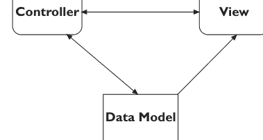

**图 1.1** MVC 框架。

问题的每个方面都是一个独立的对象，每个对象都有自己管理数据的规则。用户、图形用户界面（GUI）和数据之间的通信应该被仔细控制；这种功能分离很好地实现了这一点。三个对象通过这种受限的连接相互通信，就是一个强大设计模式的例子。

换句话说，设计模式描述了对象如何在不纠缠彼此数据模型和方法的情况下进行通信。保持这种分离一直是良好的面向对象编程的目标。如果你一直试图让对象各司其职，那么你可能已经在使用一些常见的的设计模式了。有趣的是，MVC 模式在 Java 1.2 中作为 JFC（也称为 Swing 组件）的一部分被使用。

对设计模式更正式的认可始于 20 世纪 90 年代初， Erich Gamma [1993] 描述了集成在 GUI 框架 ET++ 中的模式。程序员开始聚会并讨论这些想法。这些讨论以及多次技术会议的结晶就是 Gamma、Helm、Johnson 和 Vlissides [1995] 出版了开创性著作——《设计模式：可重用软件的要素》（Design Patterns—Elements of Reusable Software）。这本书通常被称为“四人手”（GoF）书，它成为了当时的畅销书，并对那些寻求理解如何使用设计模式的人产生了巨大影响。它描述了 23 种常见的、通用的模式，并对如何以及在何时应用它们进行了评论。在本书书中，我们将这本突破性的书籍称为《设计模式》。

自从《设计模式》出版以来，又出版了几本实用的书籍。一本密切相关的书籍是《设计模式 Smalltalk 伙伴》（The Design Patterns Smalltalk Companion [Alpert, Brown, and Woolf, 1998]），它从 Smalltalk 的视角涵盖了同样的 23 种模式。在书中，我们称之为 Smalltalk 伙伴。

## 定义设计模式

我们都会谈论日常工作、爱好和生活中处理事情的方式，并不断发现重复的模式。

- 甜甜圈像卷饼，但我在里面加入了红糖和坚果馅。
- 她的花园像我的一样，只是我的那里用了……
- 这个边桌的构造像那样的，但这个用门代替了抽屉。

有趣的是，MVC 模式在 Java 1.2 中作为 JFC（也称为 Swing 组件）的一部分被使用。

## 关于面向对象方法的说明

对于某些幸运的人来说，设计模式是显而易见的工具，他们只需通过阅读模式的摘要就能掌握其核心用途。但对于我们大多数人来说，在阅读了一个模式后会有一段缓慢的感悟期，在看到如何将它们应用于工作中时，才会产生所谓的“啊！哈！”。本书通过提供代码——即你可以自己尝试的运行程序，帮助你达到那最终的内化阶段。

《设计模式》中的示例非常简短，且使用 C++ 编写，在某些情况下是 Smalltalk 语言。如果你正在使用其他语言，那么拥有你所选语言的模式示例将非常有帮助。本书试图填补 Java 程序员的这一需求。

一组 Java 示例的形式与 C++ 略有不同，因为 Java 在应用面向对象准则时更加严格——你不能拥有全局变量、数据结构或指针。此外，我们将看到，Java 接口和抽象类是我们在 Java 中实现设计模式的主要因素。

有其他方法可以让你熟悉这些模式。在每种方法中，你都应该按顺序阅读本书和父书籍《设计模式》。我们还强烈建议你为了完整性而阅读《Smalltalk 伴侣》，因为它对每种模式提供了另一种描述。最后，还有许多关于学习和讨论设计模式的网站。

## 关于面向对象方法的说明

使用设计模式的根本原因是保持类的分离，并防止它们之间了解得过多。同样重要的是，这些模式帮助你避免重复造轮子，并允许你用其他程序员易于理解的术语简洁扼要地描述你的编程方法。

最近，我们从一位同事那里获得了一些由一位非常有才华的学生编写的代码。然而，为了将其用于我们的项目，我们必须重新组织对象以使用 Java 基础类（JFCs）。我们将修改后的代码提供给同事，并简单地总结了我们的更改，说明我们将按钮转换成了命令模式（Command patterns），并实现了一个中者模式（Mediator pattern）来处理它们的动作。这正是设计模式所促进的通信类型。

面向对象程序员使用多种策略来实现类的分离，其中封装和继承。几乎所有具有面向对象能力的语言都支持继承。继承父类的类可以访问父类的所有方法。它还可以访问父类的所有非私有变量。然而，如果你从一个完整的、运行的类开始你的继承层次，你可能会过度限制自己，并带上特定的方法实现包袱。相反，《设计模式》建议你始终**面向接口编程，而不是面向实现编程**。

更简洁地来说，你应该用抽象类或接口定义任何类层次结构的顶端，它不实现任何方法，而只是定义了该类将支持的方法。然后，在你所有的派生类中，你将有更多的自由来实现这些方法以适应你的需求。

你所识别出的主要概念是对象组合（object composition）。这简单来说就是构造包含其他对象的对象，即将几个对象封装在另一个对象内部。虽然许多面向对象程序员使用继承来解决所有问题，但当你开始编写更复杂的程序时，对象组合的优点就变得显而易见了。你的新对象拥有最适合你实现目标的接口，而无需拥有父类的所有方法。因此，《设计模式》提出的第二个主要准则是：**优先使用对象组合而非继承**。

这初看起来与面向对象编程的习惯相反，但你将在设计模式的许多案例中发现，将一个或多个对象包含另一个对象内部是首选方法。

Java 基础类在 Java 1.1 之后引入并整合到 Java 1.2 中，是编写良好的图形 Java 程序的关键部分。它们在开发期间也被称为 Swing 类，现在仍非正式地这样称呼。它们提供了简单的方法来编写看起来非常专业的用户界面，并允许你更改界面的外观和感受，以匹配程序运行的平台。此外，它们还让你可以……（此处原文未完）。

我们可以通过使用 JFC 编写看起来非常专业的用户界面，并允许你更改界面的外观和感受，以匹配程序运行的平台。此外，它们通过使用 JFC 展示了的的（（此处原文的的。

UML 图

```java
public class Employee extends Person {

    public Employee (String name) {

        super (name);

    }

    public String getJob () {

        return "Research Staff";

    }

}
```

这在 UML 中的表示如图 2.3 所示。

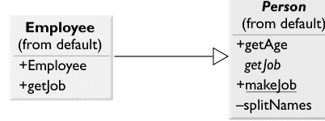

**图 2.3** 显示 `Employee` 继承自 `Person` 的 UML 图。

注意，`Employee` 类名没有使用斜体。这是因为该类现在是一个具体类，因为它包含了对原先抽象的 `getjob` 方法的具体方法实现。虽然在习惯上会使用指向父类的箭头来表示继承关系，但 UML 并不要求这样做，有时不同的布局更清晰，或者能更有效地利用空间。

接口看起来和继承非常像，不同之处箭头有一个虚线尾部，如图 2.4 所示

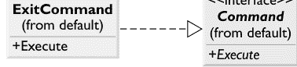

**图 2.4** `ExitCommand` 实现了 `Command` 接口。

注意名称 `<<interface>>` 显示在双双角括号（或书名号）内。

很多时候，类层次结构的有效表示方法必须包含对象是如何包含在其他对象中的。例如，一个 `Company`（公司）可能包含一个 `Employee` 和一个 `Person`（可能是承包工）。

```java
public class Company {

    Employee emp1;

    Person per1;

    public Company() {

}
```

我们在 UML 中对其进行表示，如图 2.5 所示

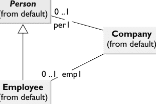

**图 2.5** 包含了 `Person` 和 `Employee` 的实例。

类之间的线表示 `Company` 中可以有 0 到 1 个 `Person` 实例，以及 0 到 1 个 `Employee` 实例。如果一个类内部可以有多个该类的实例，例如这里显示的 `Employees` 数组，

```java
public class Company1 {

    Employee [] emp1;

    public Company1() {

}
```

我们将该对象组合表示为单条线，上面带有一个 `*` 或 `0, *`，如图 2.6 所示。


**图 2.6** `Company1` 包含了任意数量的 `Employee` 实例。

有些用户使用空心菱形和实心菱形箭头来表示聚合的包含，并使用圆形箭头表示单个对象的组合，但这不是强制要求的。

# 注释

你还会发现对 UML 进行标注或插入注释非常方便，用以解释哪个类调用了另一个类中的方法。你可以在 UML 图的任何地方放置注释，将其包含在带有折角的框中，或者直接作为文本输入。文本注释通常沿箭头线显示，指示被调用方法的性质，如图 2.7 所示。

| VacationVisitor | visit(this) | Employee |
| :--- | :--- | :--- |
| (from default) | | (from default) |
| +visit | accept(v) | +accept |


**图 2.7** 注释通常显示带有折角的框中。

UML 是表示程序中对象关系的强大方式，完整规范包含了更多的图功能。之前的讨论涵盖了本文使用的标记方法。

书中所有的 UML 图都是使用 Object Insight 的 JVISION 程序绘制的。该程序读取实际编译的类，然后生成 UML 类图。许多类图都经过了编辑，仅显示最重要的方法和关系。然而，每个设计模式的完整 JVISION 图文件存储在随附 CD-ROM 上相应的模式目录中。因此，你可以运行你的 JVISION 副本，并从书中看到的相同图表开始，读取并研究详细的 UML 图。

书中的所有程序都是使用 Visual SlickEdit 4.0 通过项目文件功能编写的。CD-ROM 上的每个子目录都包含该项目的项目文件，以便你可以像我们所那样加载并编译项目。

所有的创建模式都涉及创建对象实例的方法。这很重要，因为你的程序不应该依赖对象是如何创建和安排的。在 Java 中，创建对象实例的最简单方法是使用 `new` 运算符：

```java
fred = new Fred(); // Fred 类的实例
```


- **单例模式**：确保类只有一个实例并提供一个全局访问点。

## 工厂模式

我们在 OO 程序中反复看到的一种模式是简单工厂模式。简单工厂模式根据提供的数据返回一个实例。通常，它返回的类具有公共父类，但每个类的实现又不同。这作为我们将要讨论的微妙的工厂方法模式的介绍。

## 工厂如何工作

为了理解简单工厂模式，让我们看看 3.1 中的图。

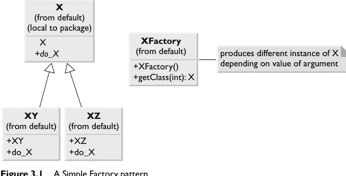

**图 3.1** 简单工厂模式。

在图中，`X` 是基类，`XY` 和 `XZ` 派自它。`XFactory` 类根据我们提供的参数决定返回这些子类之一。在右侧，我们定义了 `getClass` 方法，它接收一个值并返回某个实例。返回哪一个对程序员来说并不重要，因为它们的方法相同。返回哪一个完全取决于工厂。

### 示例代码

让我们考虑一个可以使用工厂类的简单情况。假设我们有一个表单，并允许用户以“名 姓”或“姓, 名”的形式输入姓名。我们将做出进一步的简化假设，我们总是能够通过姓名之间的逗号来判断姓名的顺序。

这是一个非常简单的决策类型，你可以在单个类中使用一个简单的语句来完成，但让我们用它来说明工厂的工作原理及其能产生的内容。我们首先定义一个基类，它接收一个字符串并（以某种方式）拆分成两个名字：

```java
public class Namer {

    protected String last;      // 拆分的名字

    protected String first;     // 存储在这里

    public String getFirst() {

        return first;

    }

    public String getLast() {

        return last;

    }

}
```

在这个基类中，我们没有计算任何名字，但我们提供了 `getFirst` 和 `getLast` 方法的实现。我们将拆分后的姓名存储在字符串 `first` 和 `last` 中。

现在我们可以编写两个非常简单的子类，在构造函数并将姓名拆分成两个部分。在 `FirstFirst` 中，我们做的简化假设是最后一个空格之前的所有内容都是名字的一部分。

在 `LastFirst` 类中，我们假设用逗号分隔姓和名。在这两个类中，我们还针对空格或逗号不存在的情况提供了错误恢复机制。

```java
// 从名字中提取姓
// 前提是使用逗号分隔的
public LastFirst(String s) {

    int i = s.indexOf(","); // 寻找逗号

    if (i > 0) {

        last = s.substring(0, i).trim();

        first = s.substring(i + 1).trim();

    } else {

        last = s; // 无逗号

        first = ""; // 将所有内容放入姓中

    }

}
```

现在我们的简单工厂类（Simple Factory）非常简单。我们只需要测试逗号是否存在，然后返回其中一个类的实例。

```java
// 工厂根据逗号的存在
// 决定返回哪种类
public Namer getNamer(String entry) {

    // 逗号决定名字的顺序
    int i = entry.indexOf(",");

    if (i > 0) {

        return new LastFirst(entry);

    }

    return new FirstFirst(entry);

}
```

让我们看看如何将它们整合在一起。完整的类图如图 3.2 所示。

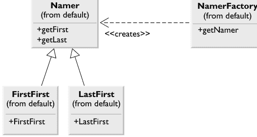

图 3.2 Namer 工厂程序。

我们构建了一个简单的 Java 用户界面，允许我们以任何顺序输入名字，并分别显示两个名字。该程序如图 3.3 所示。

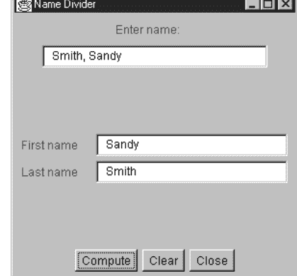

图 3.3 执行中的 Namer 程序。

我们输入名字并点击计算（Compute）按钮，分割后的名字会出现在下方的两个文本框中。该程序的核心是 `compute` 方法，它负责获取文本、获取 `Namer` 类的实例并显示结果。

这就是简单工厂模式的基本原理。你创建一个抽象类，它决定从哪几个可能的类中返回其中一个。然后你调用该类的方法，而无需知道你实际上在使用的是哪一个子类。这种方法将数据依赖性问题与类的实用方法隔离开来。

大多数使用工厂模式的人倾向于将其视为简化程序类的工具。你也可以在执行数学计算的程序中使用这些模式。例如，在快速傅里叶变换（FFT）中，当你对正在转换的数组进行遍历时，会对大量的点对反复评估以下四个方程。由于这些计算图表的结构特性，这些方程（方程 1–4）构成了 FFT “蝴蝶形”操作的一个实例。

```
$R_1 = R_1 + R_2 \cos(y) - I_2 \sin(y) \quad (1)$

$R_2 = R_1 - R_2 \cos(y) + I_2 \sin(y) \quad (2)$

$I_1 = I_1 + R_2 \sin(y) + I_2 \cos(y) \quad (3)$

$I_2 = I_1 - R_2 \sin(y) - I_2 \cos(y) \quad (4)$
```

然而，在每次遍历数据期间，有许多次角度 $y$ 为 0。在这种情况下，你的复杂数学评估将简化为方程 5–8。

```
$R_1 = R_1 + R_2 \quad (5)$

$R_2 = R_1 - R_2 \quad (6)$

$I_1 = I_1 + I_2 \quad (7)$

$I_2 = I_1 - I_2 \quad (8)$
```

然后，我们可以制作一个简单工厂类来决定返回哪个类实例。由于我们正在制作“蝴蝶形操作”（Butterflies），我们将这个工厂称为“茧”（Cocoon）。

```java
public Butterfly getButterfly(float y) {

    if (y != 0)

        return new trigButterfly(y); // 获取三角类

    else {

        return new addButterfly(y); // 获取加减类

    }

}
```

- 1. 考虑一个如 Quicken 的个人支票簿管理程序。它管理多个银行账户和投资，并可以处理你的账单。在设计这样的程序时，你可以在哪里使用工厂模式？
- 2. 假设你正在编写一个程序帮助房屋主设计房屋扩建。工厂模式可能被用于生成哪些对象？

| 程序 | 描述 |
| :--- | :--- |
| \Base Factory\ | 演示了 Namer 工厂。 |
| \FactoryIllustration\ | 显示简单工厂模式的简单原型。 |
| \FFT\ | 演示了简单工厂在 FFT 中的用法。 |

我们刚刚看到了几个简单工厂的例子。工厂概念在整个面向对象（OO）编程中反复出现，我们在 Java 本身中（例如 `SocketFactory` 类）以及其他设计模式（如生成器模式 Builder）中都能发现它的例子。工厂方法通过定义一个接口，让子类决定要实例化的类。这种工厂方法允许子类改变类的实例化方式。

工厂方法是简单工厂的变体。在简单工厂中，一个工厂类决定创建哪种对象；而在工厂方法中，我们将这个决策委托给子类。这使得我们可以在不修改现有代码的情况下引入新的产品类型。

假设我们有一个抽象类 `Shape`，它有一个抽象方法 `draw()`。我们有两个具体的子类 `Circle` 和 `Square`，它们都实现了 `draw()` 方法。现在我们创建一个抽象工厂类 `ShapeFactory`，它有一个抽象方法 `createShape()`。

```java
abstract class Shape {

    public abstract void draw();

}

class Circle extends Shape {

    public void draw() {

        System.out.println("Drawing a circle");

    }

}

class Square extends Shape {

    public void draw() {

        System.out.println("Drawing a square");

    }

}

abstract class ShapeFactory {

    public abstract Shape createShape();

    public void doOperation() {}

}

class CircleFactory extends ShapeFactory {

    public Shape createShape() {

        return new Circle();

    }

}

class SquareFactory extends ShapeFactory {

    public Shape createShape() {

        return new Square();

    }

}
```

在上面的例子中，`doOperation()` 方法可以调用 `createShape()` 然后调用 `draw()`，而它不需要知道具体创建的是哪种形状。这允许我们添加新的形状（例如 `Triangle`），而只需要创建一个新的 `Triangle` 类和对应的 `TriangleFactory`，而不需要修改现有的工厂类或客户端代码。

工厂方法在实际开发中非常有用。例如，Java 的许多库都使用了这种模式。`java.util.List` 接口就是一个例子，它的 `iterator()` 方法就是一个工厂方法，不同的列表实现（如 `ArrayList` 或 `LinkedList`）会返回不同的迭代器。

- 1. 简单工厂和工厂方法之间有什么区别？
- 2. 在你熟悉的库中，哪里能看到工厂方法的应用？

我们的 `PrelimEvent` 类仅返回一个 `CircleSeeding` 实例。

```java
public class PrelimEvent extends Event {

    // 类描述了一个将进行两次比赛的事件
    public PrelimEvent(String filename, int lanes) {

        super(filename, lanes);

    }

    // 返回圆形种子法
    public Seeding getSeeding() {

        return new CircleSeeding(swimmers, numLanes);

    }

    public boolean isPrelim() {

        return true;

    }

    public boolean isFinal() {

        return false;

    }

    public boolean isTimedFinal() {

        return false;

    }

}
```

在实际编写此程序时，我们会发现大部分工作都在直线种子布法中完成的；圆形种子法的更改非常微小。我们实例化 `StraightSeeding` 类，并复制了游泳者的向量（Vector）和泳道数。

```java
public class StraightSeeding extends Seeding {

    protected Vector swimmers;

    protected Swimmer[] swmrs;

    protected int numLanes;

    protected int[] lanes;

    protected int count;

    protected int numHeats;

    public StraightSeeding(Vector sw, int lanes) {

        swimmers = sw;

        numLanes = lanes;

        count = sw.size();

        calcLaneOrder();

        seed();

    }

}
```

然后，作为构造函数的一部分，我们执行基础的种子布法：

```java
protected void seed() {

    // 加载 swmrs 数组并对其排序
    sortUpwards();

    int lastHeat = count % numLanes;

    if(lastHeat < 3) {

        lastHeat = 3; // 最后一组必须有 3 人或更多

    }

    int lastLanes = count - lastHeat;

    numHeats = count / numLanes;

    if(lastLanes > 0)

        numHeats++;

    int heats = numHeats;

    // 在每个游泳者的对象中放置小组组和泳道
    int j = 0;

    for(int i = 0; i < lastLanes; i++) {

        Swimmer sw = swmrs[i];

        sw.setLane(lanes[j++]);

        sw.setHeat(heats);

        if(j >= numLanes) {

            j=0;

        }

    }

    // 添加列表部分小组
    if(j < numLanes)

        heats--;

    j = 0;

    for(int i = lastLanes-1; i<count; i++) {

        Swimmer sw = swmrs[i];

        sw.setLane(lanes[j++]);

    }

    swimmers = new Vector();

    for(int i = 0; i < count; i++)

        swimmers.addElement(swmrs[i]);

}
```

使得在我们调用 `getSwimmers` 方法时，整个已布种的游泳者数组都是可用的。

## 圆形种子布法 (Circle Seeding)

`CircleSeeding` 类继承自 `StraightSeeding`，因此它复制了相同的数据。

```java
public class CircleSeeding extends StraightSeeding {

    public CircleSeeding(Vector sw, int lanes) {

        super(sw, lanes); // 先进行直线布种

        seed();

    }

    protected void seed() {

        int circle;

        super.seed(); // 默认执行直线布种

        if(numHeats >= 2 ) {

            if(numHeats >= 3) {

                circle = 2;

            } else {

                circle = 1;

            }

            int i = 0;

            for(int j = 0; j < numLanes; j++) {

                for(int k = 0; k < circle; k++) {

                    swmrs[i].setLane(lanes[j]);

                    swmrs[i++].setHeat(numHeats - k);

                }

            }

        }

    }

}
```


由于构造函数调用了父类的构造函数，它复制了游泳者向量和泳道值。调用 `super.seed()` 执行了直线布种。这简化了问题，因为我们总是需要通过直线布种对剩余小组进行布种。然后，我们如之前所示对最后 2 或 3 组进行布种，这样该类型的布种就完成了。

## 种子布法程序

在例例中，我们从网上获取了一份参加过 500 码自由泳和 100 码自由泳的游泳者列表，并用它构建了我们的 `TimedFinal4.2` 和 `PrelimEvent` 类。你可以在图 4.2 中看到这些种子的结果。

| 工厂方法布种 | | | |
|---|---|---|---|
| 500 | 13 Emily Fenn 459.54 | 13 Kelly Harrigan 54.13 |
| 100 | 14 Kathryn Miller 501.35 | 12 Torey Tlin 55.03 |
| | 12 Melissa Skolnick 501.58 | 11 Lindsay McKenna 55.01 |
| | 15 Sarah Bowman 502.44 | 14 Jen Pittman 56.67 |
| | 13 Caitlin Healy 503.32 | 12 Anne Goldenstein 55.62 |
| | 12 Kim Richardson 504.32 | 14 Hila Kyle Patterson |

因此，圆形布种方法是基于直线布种的。

## 花园制造工厂

```java
public Plant getCenter() {
    return new Plant("Corn");
}

public Plant getBorder() {
    return new Plant("Peas");
}
```

同样，我们可以为 `PerennialGarden`（多年生花园）和 `AnnualGarden`（一年生花园）创建 `Garden` 类。这些具体类都是具体工厂（Concrete Factory），因为它们实现了父抽象类中列出的方法。现在我们有一系列对象，每个对象都返回一个 `Plant` 对象。这在图 5.1 的类图中得到了阐示。

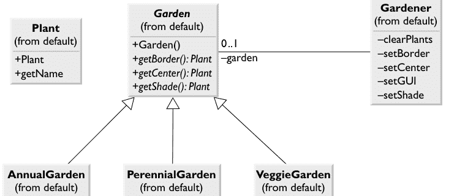

图 5.1 Gardener 程序中的主要对象。

我们可以轻松构建 `Gardener`（即我们的抽象工厂驱动程序），根据用户选择的单选按钮返回这些 `Garden` 对象之一，如图 5.2 所示的用户界面所示。

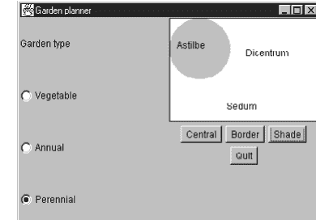

图 5.2 Gardener 程序的用户界面。

## 用户界面的工作原理

这个简单的界面由两部分组成：左侧和选择植物类别的右侧。当你点击其中一种花园类型时，这会导致程序根据你选择的按钮返回对应类型的花园。起初，你可能会认为我们需要进行某种测试来判断选择了哪个按钮并实例化具体工厂类。然而，一种更优雅的解决方案是为每个单选按钮创建一个不同的内部类 `ItemListener`，并让每个监听创建一个不同的花园类型。

首先，我们创建每个 `Listener`（监听器）的实例。

```java
Veggie.addItemListener(new VeggieListener());
Peren.addItemListener(new PerenListener());
Annual.addItemListener(new AnnualListener());
```

然后，我们定义实际的内部类。

```java
class VeggieListener implements ItemListener {
    public void itemChanged(Item e) {
        garden = new VeggieGarden();
        clearPlants();
    }
}

class PerenListener implements ItemListener {
    public void itemChanged(Item e) {
        garden = new PerennialGarden();
        clearPlants();
    }
}

class AnnualListener implements ItemListener {
    public void itemChanged(Item e) {
        garden = new AnnualGarden();
        clearPlants();
    }
}
```

当用户点击其中一个植物类型按钮时，就会返回该植物类型并显示该植物名称。

```java
public void actionPerformed(ActionEvent e) {
    Object obj = e.getSource();
    if (obj == Center) {
        setCenter();
    }
    if (obj == Border) {
        setBorder();
    }
    if (obj == Shade) {
        setShade();
    }
}
```

```java
if (obj == Quit)
    System.exit(0);
```

你可以通过创建三个不同的 `ActionListener` 类来避免之前 `actionPerformed` 方法中的 if 测试，但对于这样一个简单的程序来说，这似乎没有必要。你可以查看 CD-ROM 中代码中关于绘制花园的细节。

## 添加类

抽象工厂模式的巨大优势之一是你可以非常容易地添加新的子类。例如，如果你需要 `GrassGarden`（草地花园）或 `WildflowerGarden`（野花花园），你可以为 `Garden` 子类并生成这些类。你在任何现有代码中需要做的唯一实际更改是添加某种选择这些新类型花园的方法。

## 抽象工厂模式的影响

抽象工厂的主要目的之一是隔离所生成的具体类。这些类的实际名称隐藏在工厂中，在客户端级别不需要知道。

由于类的隔离，你可以自由地更改或交换产品类族。此外，由于你只生成一种类型的类，该系统可以防止你无意中使用来自不同产品家族的类。然而，添加新的类族需要一些精力，因为你必须定义新的、无歧义的条件，以导致这样一个新类族的返回。

虽然抽象工厂模式生成的所有类都具有相同的基类，但并没有阻止子类拥有与其它类不同的方法。例如，`BonsaiGarden`（盆景花园）类可能拥有其他类中不存在的 `Height`（高度）或 `WateringFrequency`（浇水频率）。这产生了与任何子类中都相同的问题。即，除非知道该子类是否允许这些方法，否则你不知道是否可以调用该类方法。这个问题与任何类似的情况一样，有两种解决方案。要是，你可以在基类中定义所有方法，即使它们并不总是具有实际功能；或者，如果你无法更改基类，可以派生出一个包含你所需的所有方法的新基类，并为你所有的花园类型派生该基类。

## 思考题

- 1. 假设你正在编写一个跟踪投资的程序，例如股票、债券、金属期货和衍生品。你会如何使用抽象工厂模式？

## CD-ROM 上的程序

| 程序 | 描述 |
| --- | --- |
| `\Abstract Factory\Gardener.java` | 启动本章提供的用户界面，并练习抽象工厂模式以及各种 Garden 类。 |

# 第 6 章

## 单例模式 (Singleton Pattern)

在本章中，我们将介绍单例模式。该模式与其他创建型模式（Creational patterns）归为一类，尽管在某种程度上，它是一种限制而非促进类创建的模式。具体而言，它确保确保了一个类只有一个且仅有一个实例，并为该实例提供了全局访问点。在编程中，任何需要确保一个类只有一个且仅有一个实例的场景都是可能的。例如，你的系统可能只有一个窗口管理器或打印池处理程序，或者只有一个数据库引擎的访问点。或者，你的计算机可能有几个串串口，但 COM 只能有一个实例。

### 使用静态方法创建单例

创建一个只能有一个实例的类最简单的方法是在类内部嵌入一个静态变量，并在第一次调用时设置它。在编程中，任何需要确保一个类只有一个且仅有一个实例的情况都是可能的。为了防止多次实例化，可以将构造函数设置为私有，并在进入时检查。我们创建一个名为 `Instance` 的方法，它可以返回一个 `Spooler` 实例，如果类已经实例化，则返回 null。这如下代码所示：

```java
```


public class Spooler {

    private static Spooler spooler;

    private Spooler() {

    }

    // 返回唯一的 spooler 实例
    public static synchronized Spooler getSpooler() {
        if (spooler == null) // 如果未创建
            spooler = new Spooler(); // 创建
        return spooler; // 返回它
    }

    public void print(String s) {
        System.out.println(s);
    }
}

这种方法的主要优势是，你不需要担心单例已经存在时的异常处理——而且，如果你尝试直接创建 `Spooler` 类的实例，创建将在编译时失败，因为构造函数被声明为私有。

```java
// 因为构造函数是私有的，所以在编译时失败
Spooler pr3 = new Spooler();
```

最后，你可能需要修改程序以允许两个或三个实例，该类很容易修改。

如果你想知道是否已经创建了 spooler 以及不能创建另一个，如果 spooler 已经存在，你可以返回 `null`，或者你可以抛出一个异常。

## 异常与实例

如果你想知道你是否创建了新实例，你必须检查 `getSpooler` 方法以确保它不为空。假设程序员总是记住检查错误是一个很多人希望避免的滑坡行为。

相反，你可以创建一个在尝试多次实例化时抛出异常的类。这要求程序员采取行动，因此是一种更安全的方法。

让我们为这种情况创建一个自定义的异常类。

```java
public class SingletonException extends RuntimeException {
    // 针对单例类的异常类型
    public SingletonException() {
        super();
    }

    public SingletonException(String s) {
        super(s);
    }
}
```

## 抛出异常

注意，与其他通过 `super` 方法调用父类的方法不同，这种新的异常类型并没有特殊作用。然而，拥有自己命名的异常类型是非常方便的，这样当我们尝试创建 `PrintSpooler` 实例时，编译器会警告我们必须捕获的异常类型。

让我们编写 `Spooler` 类的骨架——我们将省略所有的打印方法，仅专注于正确地实现单例模式：

```java
public class Spooler {
    // 这是一个打印机置处理器类的原型
    // 确保只存在一个实例
    static boolean instance_flag = false; // 如果存在一个实例则为 true

    public Spooler() throws SingletonException {
        if (instance_flag)
            throw new SingletonException("只允许一个打印器");
        else
            instance_flag = true; // 为单实例设置标记
        System.out.println("printer opened");
    }
}
```

## 创建类的实例

现在我们已经已经在 `PrintSpooler` 类中创建了简单的单例模式，让我们看看如何使用它。记住，我们必须将每个方法封装在 `try-catch` 块中。

```java
public class singleSpooler {
    static public void main(String argv[]) {
        Spooler pr1, pr2;

        // 打开一个打印机--应该始终工作
        try {
            System.out.println("Opening one spooler");
            pr1 = new Spooler();
        } catch (SingletonException e) {
            System.out.println(e.getMessage());
            // 尝试打开另一个打印机--应该会失败
            System.out.println("Opening two spoolers");
        }

        try {
            pr2 = new Spooler();
        } catch (SingletonException e) {
            System.out.println(e.getMessage());
        }
    }
}
```

如果我们执行这个程序，将得到以下结果：

- Opening one spooler
- printer opened
- Opening two spoolers
- Only one spooler allowed

最后一行表示如预期地抛出了异常。该程序的完整源代码位于示例光盘上，文件名为 `singleSpooler.java`。

## 为单例模式提供全局访问点

由于单例模式被用于为类提供单一访问点，因此你的程序设计必须提供一种在整个程序中引用单例的方法，尽管 Java 没有全局变量。

一种解决方案是在程序开始时创建单例，并将它们作为参数传递给可能需要使用它们的主类。

```java
pr1 = new Spooler();
Customers cost = new Customers(pr1);
```

这种方法的缺点是，对于特定的程序执行，你可能并不需要创建的所有单例。一个更复杂的解决方案是创建一个程序所有类的注册表，并使该注册表全局可用。每当一个单例被实例化时，它都会在注册表中记录。程序的任何部分都可以使用标识字符串请求任何单例的实例，并返回该实例变量。

注册表方法的缺点是类型检查可能会减少，因为单例表将所有单例都作为对象存储（例如存储在 `Hashtable` 对象中）。而且，当然，注册表本身可能也是单例，必须通过各种设置函数的构造函数传递给程序的各个部分。

可能是提供全局访问点最常见的方法是使用类的静态方法。类名始终可用，且静态方法只能从类本身调用而不能从其实例调用，因此无论在程序中有多少个地方调用该方法，都永远只有一个这样的实例。

## 作为单例的 javax.comm 包

这是在接下来讨论的 Java 串口包 `javax.comm` 中使用的方法。

`javax.comm` 包是独立于 Java 软件开发包 (SDK) 提供的，并可以从 Sun 网站下载。该包设计用于控制计算机的串口和并行端口。每个支持的平台都有该包的实现，因为它必须包含处理实际系统硬件的本地代码。

串口是应该由单例表示的资源的良好示例，因为同一时间只有一个程序可以访问串口，即使在程序内部，也应该只有一个模块或一组模块通过该端口进行通信。

实际上，这里可能存在两个单例：一个管理端口集合并允许每个端口产生一个实例，另一个管理端口对象本身，每个对象都必须引用一个单一的端口。

在 `javax.comm` 包中，`CommPortIdentifier` 类有一个静态方法，用于返回系统中所有端口的枚举：

```java
public static Enumeration getPortIdentifiers()
```

该枚举包含一个与系统中的每个元素对应的 `CommPortIdentifier` 对象。该包同时处理并行端口和串口端口，因此你还需要过滤返回的对象，以只允许串口。

```java
// 端口的枚举--静态方法
portEnum = CommPortIdentifier.getPortIdentifiers();
while (portEnum.hasMoreElements()) {
    portId = (CommPortIdentifier) portEnum.nextElement();
    if (portId.getPortType() == CommPortIdentifier.PORT_SERIAL)
        ports.add(portId.getName()); // 添加到列表
}
```

`getPortIdentifiers` 方法是静态的，因此它提供了单例定义所需的单一全局访问点。此外，由于它是静态方法，不允许存在多个实例。你只能从类调用此方法而不能从其实例调用。类名始终可用，且静态方法只能从类调用而不能从其实例调用，因此无论在程序中有多少个地方调用该方法，都永远只有一个这样的实例。

## 构建 CommPortManager

让我们考虑为这些单例方法构建一个封装类并命名为 `PortManager`。我们期望该类能够允许枚举可用端口以及任何一个端口。该类的方法可能如下：

```java
public abstract class PortManager {
    public static Enumeration getAllPorts();
    public static Enumeration getAvailablePorts();
    public static CommPort openPort(String portName);
    public static CommPort openPort();
}
```

由于 Java 语法规则，我们不能拥有抽象类，因此我们实际上在父类中声明每个方法并返回 `null`。

`getAllPorts` 方法与之前所示相同，当我们枚举端口时。然而，当我们捕获端口异常时，我们什么都不需要做。我们获取端口并尝试打开它。如果这两个操作都没有失败，我们将端口名称添加到可用端口列表中。

```java
public static Enumeration getAvailablePorts() {
    Vector portOpenList = new Vector();
    CommPortIdentifier portId;
    Enumeration enum = getAllPorts();
    while (enum.hasMoreElements()) {
        CommPort cp = portId.open("SimpleComm", 100);
        // report success
        portOpenList.addElement(portName);
        cp.close();
    }
    catch (NoSuchPortException e) {
    }
    catch (PortInUseException e) {
    }
    return portOpenList.elements();
}
```


`getAvailablePorts` 方法在图 6.2 所示。

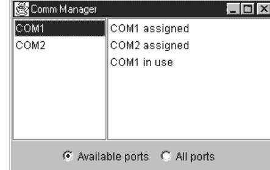

**图 6.2** 已分配和使用的端口。

哪些是单例（Singletons）？我们实际上只是封装了 `CommPortIdentifier` 的方法，以便在内部处理异常。静态的 `CommPortIdentifier` 方法可以被视为单例注册表，因为它提供了对四个或更多不同端口的访问。但是作为一个静态方法，它提供了单一访问点。端口仍然是单例，因为一个打开的端口只能有一个实例。

## 单例模式的其他后果

单例模式具有以下额外后果：

- 单例的子类化可能是困难的，因为只有在基单例类尚未被实例化时，这样做才可行。
- 你可以轻松更改单例以允许存在少数量的实例，如果这种做法是被允许且有意义的。

## 思考题

1. 考虑一个处理 ATM 卡交易的系统。一个小偷正在使用窃取的 ATM 卡号盗取资金，同时合法用户正在进行取款。你将如何设计一个单例来降低这种风险？

## CD-ROM 上的程序

| 程序 | 描述 |
| --- | --- |
| `\Singleton\singleSpooler\SingleSpooler.java` | 显示如何编写一个会抛出异常的打印池程序。 |
| `\Singleton\finalSpool\finalspool.java` | 返回打印池的单实例且不再创建更多。 |
| `\Singleton\InstanceSpooler\InstanceSpooler.java` | 创建一个实例或返回 null。 |
| `\Singleton\CommSimpleComm.java` | Comm 类用法的简单示例。 |
| `\Singleton\PortManager\ManageComm.java` | 使用 `CommPortManager` 类。 |

## 第 7 章 建造器模式

在本章中，我们将考虑如何使用建造器模式（Builder pattern）从组件构建对象。我们已经看到，工厂模式（Factory Pattern）根据传递给创建方法的参数数据返回若干个不同子类之一。但假设我们需要的不再仅仅是一个计算算法，而是根据我们需要显示的数据提供一个完全不同的用户界面。一个典型的例子可能是你的电子邮件通讯录。你可能在地址通讯录中既有个人也有群组，并且你期望地址通讯录的显示发生变化，使得“人员”能看到名字、姓氏、公司名称、电子邮件地址和电话号码的区域。

另一方面，如果你正在显示一个组地址页面，你会看到组名、其目的以及成员和电子邮件地址的列表。你点击一个人的名字获得一种显示方式，点击一个组的名字获得另一种显示方式。假设所有的电子邮件地址都存储在 `Address` 对象中，并且 `People` 和 `Group` 类派生自这个基类，如图 7.1 所示。

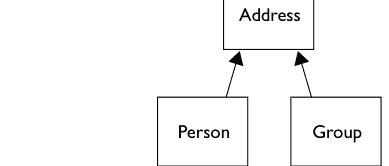

**图 7.1** “人员”和“组”都派生自“地址”。

取决于我们点击哪种类型的 `Address` 对象，我们希望看到该对象属性略有不同的显示方式。这不仅仅是工厂模式，因为返回的对象不是基显示对象的简单后代，而是一个基显示对象，而是由不同显示对象的组合而成的不同用户界面。建造器模式根据数据以各种方式组装若干对象（作为显示小部件）。此外，由于 Java 是少数几种可以让你数据与显示方法整洁地分离为简单对象的语言之一，因此 Java 是实现建造器模式的理想语言。

## 一个投资追踪器

让我们考虑一个稍微简单的情况，在这种情况下，有一个类为我们构建 GUI（图形用户界面）将很有用的。假设我们想写一个程序来跟踪投资的性能，例如股票、债券和基金。我们希望显示每个类别的持仓列表，我们可以从中选择一项或多项投资，并绘制它们的性能对比图。

尽管我们无法预先预测在给定时间可能拥有多少种投资，但我们希望显示界面对于较多的基金（如股票）或较少的基金（如基金）都易于使用。在每种情况下，我们都希望有一种选择显示，可以让我们选择一个或多个基金进行绘图。如果基金三个或更少，我们将使用一组复选框。我们希望我们的 `Builder` 类生成一个取决于要显示项目数量的界面，并具有相同的方法来返回结果。

我们的显示如图 7.2 所示。第一个显示图 7.2(a) 包含大量的股票，第二个图 7.2(b) 包含少量的债券。

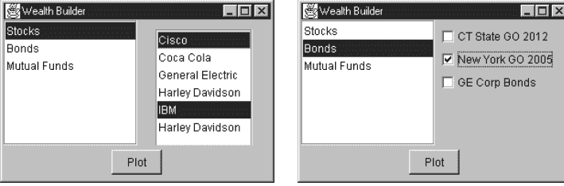

**图 7.2** (a) 显示列表界面的股票显示和 (b) 显示复选框界面的债券显示。

在设计模式语言中，这个简单的工厂类被称为 Director（调度器），每个派生自 `multiChoice` 的类都是 Builder（建造器）。

## 调用 Builder

```java
//右侧初始为空空的
choicePanel = new JPanel();
choicePanel.setBackground(Color.lightGray);
p.add(choicePanel);
```

```java
setBounds(100, 100, 300, 200);
setVisible(true);
```

在这个简单的程序中，我们将三组投资列表存储在三个 Vector 中：股票、债券和共同基金。在程序初始化时，我们为它们加载了任意值。

```java
Vector Mutuals = new Vector();
Mutuals.addElement("Fidelity Magellan");
Mutuals.addElement("T Rowe Price");
Mutuals.addElement("Vanguard PrimeCap");
Mutuals.addElement("Lindner Fund");
```

在实际系统中，我们可能会从文件或数据库读取这些数据。然后，当用户点击左框中的三种投资类型之一时，我们将等效的 Vector 传递给工厂（Factory），工厂返回一个 Builder 实例：

```java
private void stockList_Click() {
    V = null;
    int index = stocklist.getSelectedIndex();
    choicePanel.removeAll(); //移除之前的 GUI 面板
    // 在三个不同的 Vector 之间切换
    //并将选中的一个传递给 Builder 模式
    switch (index) {
        case 0:
            V = Stocks; break;
        case 1:
            V = Bonds; break;
        case 2:
            V = Mutuals;
    }
    mchoice = cfact.choiceUI(V); //获取一个 GUI
    choicePanel.add(mchoice.getUI()); // 插入右侧
    choicePanel.validate();
    choicePanel.repaint();
    Plot.setEnabled(true); // 允许绘图
}
```

为了简单起见，我们展示了这段切换代码。我们同样可以为三个按钮中的每一个绑定一个 `ActionListener`。我们将工厂创建的多选择面板保存在 `mchoice` 变量中，以便将其传递给 Plot 对话框。

## 列表框 Builder

```java
public class listBoxChoice extends multiChoice {
    JList list;
    //----------------------
    public listBoxChoice(Vector choices) {
        super(choices);
    }
    public JPanel getUI() {
        // 创建一个包含列表框的面板
        JPanel p = new JPanel();
        list = new JList(choices.size());
        list.setMultipleMode(true);
        p.add(list);
        for (int i = 0; i < choices.size(); i++) {
            list.add((String)choices.elementAt(i));
        }
        return p;
    }
    public String[] getSelected() {
        String[] slist = list.getSelectedItems();
        return(slist);
    }
}
```

## 复选框 Builder

复选框 Builder 更加简单。在这里我们需要找出有多少个元素要显示，并创建一个包含许多单元的水平网格。我们在每个网格行中插入一个复选框。

```java
public class checkBoxChoice extends multiChoice {
    // 此派生类创建
    // 垂直的复选框网格
    int count; // 复选框的数量
    JPanel p;
    //---------------------------------
    public checkBoxChoice(Vector choices) {
        super(choices);
        count = 0;
        p = new JPanel();
    }
    //---------------------------------
    public JPanel getUI() {
        String s;
        // 创建一个 1 列 n 行的网格布局
        p.setLayout(new GridLayout(choices.size(), 1));
        // 并添加带标签的复选框
        for (int i = 0; i < choices.size(); i++) {
            s = (String)choices.elementAt(i);
            p.add(new Checkbox(s));
            count++;
        }
        return p;
    }
}
```

## Builder 模式的影响


这个 `getSelected` 方法与之前显示的方法类似，并包含在 CD-ROM 的示例代码中。我们在图 7.3 中展示了最终的 UML 类图。

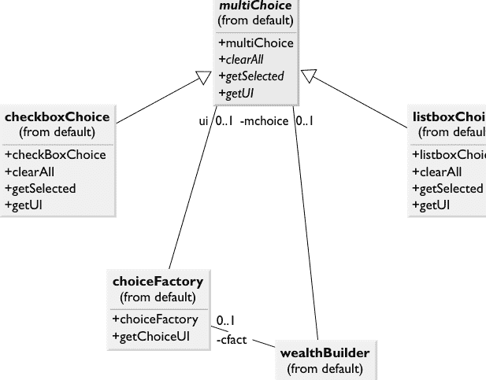

**图 7.3** Builder 类图。

## Builder 模式的影响

使用 Builder 模式会有以下影响：

- Builder 模式允许你改变所构建的产品的内部表示。它还隐藏了产品如何组装的细节。
- 每个具体的 Builder 都独立于任何其他 Builder 以及程序的其余部分。这提高了模块化，并使得添加其他 Builder 变得相对简单。
- 因为每个 Builder 都是一步步构建最终产品的，根据提供的数据，你对 Builder 构建的每个最终产品都有更多的控制。

Builder 模式某种程度上类似于抽象工厂模式，因为两者都返回由许多方法和对象组成的类。主要区别在于，抽象工厂返回的是一组相关的类，而 Builder 是根据呈现给它的数据逐步构建一个复杂对象。

## 思考题

- 某些文字处理和图形程序会根据显示数据的上下文动态构建菜单。在此处你可以如何有效地使用 Builder？
- 并不是所有的 Builder 都必须构建视觉对象。对于个人财务行业，你可以使用 Builder 构建什么？假设你正在对一个由五到六个不同项目组成的轨道进行评分。在这种情况下你会如何使用 Builder？

## CD-ROM 上的程序

| 程序 | 描述 |
| --- | --- |
| `\Builder\wealthBuilder.java` | 构建本章讨论的最后一个框和复选框多选面板。 |

# 第 8 章

## 原型模式

通过原型模式，你可以通过复制对象来创建新对象。原型模式允许你根据运行时动态配置对象的创建。它还隐藏了对象如何初始化的细节。

原型模式允许你通过复制现有对象（原型）来创建新对象，而不是通过 `new` 关键字。这在对象创建开销很大时非常有用。

原型模式在某些方面与抽象工厂模式相似，因为两者都通过一组方法来创建对象。主要区别在于，工厂模式通过类来创建对象，而原型模式通过克隆现有对象来创建。考虑一个需要查询数据库生成答案的情况。一旦你有了结果集，你可能需要处理它来生成答案。组装这个时间表的计算开销因此相当高。一旦你得到了按性别排序的类，你可能想按时间或实际年龄来查看这些信息。重新计算这些数据是不合理的，而且你不想破坏原始数据，因此需要数据对象的某种拷贝。

### Java 中的克隆

可以使用 `clone` 方法创建任何 Java 对象的拷贝。

```java
(Object)obj.clone();
```

`clone` 方法始终返回声明为 `Object` 类型的对象。因此，你必须将其转换为克隆对象的实际类型。该方法还有三个主要的限制：

1. 它是受保护的方法，只能在类内部或子类中调用。
2. 你可以克隆声明实现了 `Cloneable` 接口的对象。所有数组都被认为实现了 `Cloneable` 接口。
3. `Object` 类没有实现 `Cloneable` 且抛出 `CloneNotSupportedException`。

由于 `clone` 方法是受保护的，建议在类内部封装一个公共的可见的 clone 方法，以便它可以访问该受保护的方法。

```java
public abstract class SwimData implements Cloneable {

    public Object cloneMe() throws CloneNotSupportedException {
        return super.clone();
    }
}
```

你还可以创建特殊的克隆过程，根据传递给 clone 方法的参数更改克隆类的数据或处理方法。在这种情况下，像 `make` 这样的方法可能更具描述性且合适。

### 使用原型

现在让我们写一个简单的程序，从数据库读取数据并克隆生成的对象。在我们的示例程序 `SwimInfo` 中，我们只是从文件读取这些数据，但原始数据源自大型数据库，正如我们之前提到的。

然后我们创建一个 `Swimmer` 类，持有一个运动员的姓名、年龄、性别、俱乐部和时间。

```java
public class Swimmer {
    String name;     // 运动员姓名
    int age;         // 运动员年龄
    String club;     // 俱乐部名称
    float time;      // 时间结果
    boolean female;  // 性别
}
```

我们还创建了一个名为 `TimeSwimData` 的类（派生自 `SwimData`），它维护了一个从数据库中读取的游泳者的 `Vector`。

```java
public class TimeSwimData extends SwimData implements Cloneable, Serializable {
    public TimeSwimData(String filename) {
        String s = "";
        swimmers = new Vector();
        InputFile f = new InputFile(filename);
        s = f.readLine();
        while (s != null) {
            swimmers.addElement(new Swimmer(s));
            s = f.readLine();
        }
        f.close();
    }
}
```

我们在 `SwimData` 中提供了 `getSwim` 方法，并在 `Swimmer` 类中提供了 `getName`、`getAge` 和 `getTime` 方法。一旦我们将数据读入 `SwimInfo`，就可以在列表框中显示它们。

然后，当用户点击 `Clone` 按钮时，我们将克隆这个类并在新类中以不同的方式对数据进行排序。再次克隆数据是因为创建一个新实例要慢得多，而且我们希望在两种形式中都保留数据。

```java
public class SwimInfo extends Frame implements ActionListener {
    SwimData sdata;
    List swList, cloneList;
    Button cloneBtn, refreshBtn, quitBtn;
    Swimmer sw;

    private void cloneAndLoad(SwimData sxdata) {
        sxdata = null;
        try {
            sxdata = (SwimData) sdata.cloneMe();
            sxdata.sort();
        } catch (CloneNotSupportedException e) {
        }
        cloneList.removeAll();
        // 现在从克隆打印排序后的值
        for (int i = 0; i < sxdata.size(); i++) {
            sw = sxdata.getSwimmer(i);
            cloneList.add(sw.getName() + sw.getTime());
        }
    }
}
```

## 第 8 章 原型模式

在同一个类中，名称按字母后按时间排序，而在克隆类中，仅按时间排序。在图 8.1 中，我们看到简单的用户界面允许我们在左侧显示原始数据，在右侧类中显示排序后的数据。

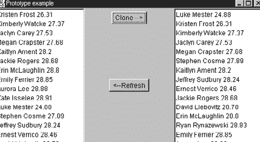

**图 8.1** 原型示例。

左侧列表框在程序启动时加载，右侧列表框在您点击 `Clone` 按钮时加载。现在让我们点击 `Refresh` 按钮，从原始数据重新加载左侧列表框。结果如图 8.2 所示。

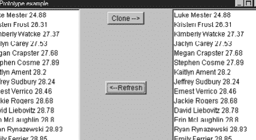

**图 8.2** 原型示例，点击 `Clone` 后再点击 `Refresh`。

### 使用原型模式

为什么左侧列表框中的名称也被重新排序了？这在 Java 中发生是因为 `clone` 方法是原始类的浅拷贝。换句话说，对数据对象的引用是复制的，但它们指向相同的底层数据。因此，在所复制的数据上执行的任何操作也将作用于原型类中的原始数据。

在某些情况下，这种浅拷贝是可以接受的，但如果你想对数据进行深拷贝，你必须在你所克隆的类中编写自己的深拷贝程序。在这个简单的类中，你只需要使用创建一个新实例的构造函数创建一个新的 `Vector`，并将旧 `Vector` 的元素复制到新的 `Vector` 中。

```java
public TimeSwimData(Vector sw) {
    // 此构造函数作为拷贝复制 vector
    swimmers = new Vector();
    for (int i = 0; i < sw.size(); i++) {
        swimmers.add(sw.elementAt(i));
    }
}

public SwimData myClone() {
    return new TimeSwimData(swimmers);
}
```

当一组类中的任何类可能被创建或者类在创建后被修改时，你可以使用原型模式。只要所有类都具有相同的接口，它们实际上可以来自完全不同的层次结构。

让我们考虑之前讨论过的游泳者列表的更复杂的示例。与其仅仅对游泳者进行排序，不如创建操作数据的子类，修改数据并呈现结果以便在列表框中显示。我们从抽象类 `SwimData` 开始，它拥有所有抽象方法，除了我们刚刚描述的 `deepClone` 方法外。

```java
// 定义接口和深拷贝例程序的抽象类
public abstract class SwimData implements Cloneable, Serializable {
    public abstract int size();
    public abstract Swimmer getSwimmer(int i);
    public abstract String getName(int i);
    public abstract void sort();
    public abstract void setName(boolean f);

    public SwimData deepClone() {
        // 同上
    }
}
```

那么，根据应用程序的需求，编写不同的 `SwimData` 类就变得可能了。我们总是从 `TimeSwimData` 类开始，然后克隆它以用于各种显示。例如，`SexSwimData` 类按性别重新排序数据并只显示一种性别，如图 8.3 所示。

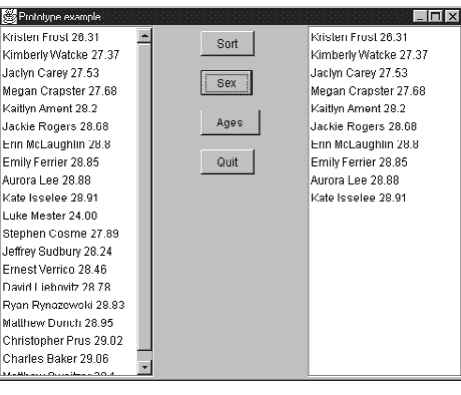

**图 8.3** `SwimData` 类显示一种性别。

在 `SwimData` 类中，我们根据是否想要女性进行排序。该类有一个额外的方法：

```java
public void setFemale(boolean f) {
    female = f;
}
```

每当你点击标记为 `Sex` 的按钮时，我们都使用原型来创建一个实例。

类甚至不需要那样相似。在这种情况下，原型有效地将具体产品从类中隐藏（在本例中，为显示列表）。只要具体产品类具有相同的接口，原型就是一种合适的模式选择。在我们之前的示例程序中，用户是决策点或工厂，因为他只需点击几个按钮中的一个。在更复杂的情况下，每个具体类都可以有一组特征数组，而决策点可以是类注册表或原型管理器，它检查这些特征并选择最合适的类。

**图 8.4** `AgeSwimData` 类显示年龄分布。

你还需要注意，你不限于这里演示的几个子类。你可以轻松创建额外的具体类，并将它们与选择具体类的代码注册。

图 8.5 中的 UML 图清晰地说明了这个系统。`SwimInfo` 类是主 GUI 类。它保留两个 `SwimData` 实例，但不指定是哪些。`TimeSwimData` 和 `SwimData` 类是派生自抽象 `SwimData` 的具体类。创建直方图的 `AgeSwimData` 类派生自 `SwimData` 类。

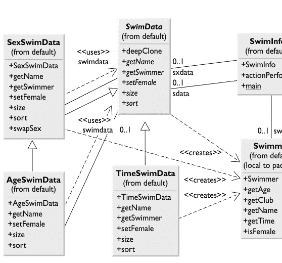

**图 8.5** 各种 `SwimData` 类的 UML 图。

### 原型管理器

原型管理器类可以用于决定向客户端返回多个类中的哪一个。它还可以同时管理多组原型。例如，除了返回几种游泳者类之一之外，它可以返回一组游过不同泳姿和距离的游泳员。它还可以管理返回的（多种类型的）列表框并显示它们，包括表格、多列列表和图形显示。重要的一点是，返回的子类在程序中使用不需要强制类型转换为新类。换句话说，父抽象类或基类的方法应该是足够的，客户端永远不需要知道它正在处理的是哪一个具体的子类。

### 使用序列化进行克隆

这是一个巧妙的技巧，有些人称之为“黑科技”，用于使用可序列化接口进行克隆。如果你可以将一个类写入字节流，然后重新读取这些字节来重建该类，则称该类是可序列化的。这就是 Java 远程方法调用 (RMI) 和 Java Beans 的实现。

然而，如果我们将 `Swimmer` 和 `SwimData` 类都声明为 `Serializable`：

```java
public class SwimData implements Cloneable, Serializable

class Swimmer implements Serializable
```

我们就可以将字节写入输出流并重新读取它们，以创建该类实例的数据拷贝。

```java
public Object deepClone() {
    ByteArrayOutputStream b = new ByteArrayOutputStream();
    ObjectOutputStream out = new ObjectOutputStream(b);
    out.writeObject(this);
    ByteArrayInputStream bin = new ByteArrayInputStream(b.toByteArray());
    ObjectInputStream oi = new ObjectInputStream(bin);
    return (oi.readObject());
} catch (Exception e) {
    System.out.println("exception: " + e.getMessage());
    return null;
}
```


此 `deepClone` 方法允许你拷贝任何复杂类的实例，并确保两个拷贝之间的数据是完全独立的，只要该类所包含的所有类都可以声明为可序列化的。

## 原型模式的后果

使用原型模式（Prototype pattern）：

1. 你可以根据需要通过克隆在运行时添加和删除类。
2. 你可以根据程序条件在运行时修改类的内部数据表示。
3. 你还可以在运行时指定新对象，而无需产生大量的类和继承结构。

在 Java 中实现原型模式的一个困难点是，如果这些类已经存在，你可能无法修改它们以添加必需的 `clone` 或 `deepClone` 方法。如果类中包含的所有类对象都无法轻易声明为可序列化，那么使用 `deepClone` 方法将特别困难。此外，与其它类存在循环引用的类无法被克隆。

与第 6 节讨论的单例模式（Singletons）类似，你可以创建一个原型类的注册表，并向注册表请求可能的原型列表。你可能可以克隆一个现有的类，而不是让原型本身实例化（可能需要付出代价）以便使用原型注册表。但请注意，可能用作原型注册表的每个类都可能成为性能瓶颈。

## 思考题

1. 一个有趣的横幅程序，在屏幕的不同位置、在不同时间、以不同的字体和大小显示口号。请使用原型模式设计该程序。


## 光盘中的程序

| 程序名称 | 描述 |
| --- | --- |
| `\Prototype\MyClone\SwimInfo.java` | 使用构造函数通过拷贝 `Vector` 创建新实例来完成克隆。 |
| `\Prototype\DeepProto\SwimInfo.java` | 使用序列化进行克隆。 |
| `\Prototype\SimpleProto\SwimInfo.java` | 浅克隆和原型模式的示例。 |
| `\Prototype\AgeProto\SwimInfo.java` | 展示了用于按时间和性别显示游泳员的原型，该原型还提供了年龄区分。 |

## 创建模式总结

以下是创建类型模式的总结：

- **工厂模式**（Factory pattern）：用于根据你提供给工厂的数据，从许多相似的类中选择并返回类的实例。
- **抽象工厂模式**（Abstract Factory pattern）：返回几组类中的其中一组。在某些情况下，它实际上返回的是针对该组类的工厂模式实例。
- **构建器模式**（Builder pattern）：根据所提供的数据组合多个对象以创建一个新对象。通常，组合哪些对象的选择是通过工厂模式完成的。
- **原型模式**（Prototype pattern）：当创建新实例的开销较大时，拷贝或克隆现有的类，而不是创建新实例。
- **单例模式**（Singleton pattern）：确保对象只有一个实例，并且可以获取对该实例的全局访问。

# 第 3 节

## 结构模式

结构模式描述了如何组合类和对象以形成更大的结构。类模式和对象模式的区别在于，类模式描述了如何使用继承来提供更有用的程序接口；对象模式描述了如何使用对象组合或通过将对象包含在其他对象内部来组成更大的结构。

- **适配器模式**（Adapter pattern）：可以使一个类的接口匹配另一个接口，以便于编程。

我们还将查看许多其他组合对象以提供新功能的结构模式。

- **组合模式**（Composite pattern）：创建一个对象（对象的组合），每个对象可以是简单的，也可以是组合的。
- **代理模式**（Proxy pattern）：创建一个简单对象来代替可能被调用的复杂对象，例如当程序在网络环境中运行时。
- **享元模式**（Flyweight pattern）：用于共享对象，每个实例不包含自己的状态，而是将其存储在外部。这种方法在存在大量实例但只有少数不同类型时允许高效的对象共享。
- **外观模式**（Facade pattern）：用于用单个类表示整个子系统。
- **桥接模式**（Bridge pattern）：将对象的接口与其实现分离，以便能够独立地改变它们。
- **装饰器模式**（Decorator pattern）：允许动态地为对象添加职责。

你会发现这些模式之间存在某些重叠，甚至与下一节的行为模式（Behavioral patterns）也存在重叠。在描述完所有模式后，我们将总结这些相似之处。

# 第 9 节

## 适配器模式

适配器模式将一个类的编程接口转换为另一种。当你想要让不相关的类在单个环境中工作时，就会使用适配器。因此，适配器的概念非常简单：你编写一个具有所需接口的类，然后让它与具有不同接口的类通信。实现这一点有两种方法：通过继承和对象组合。在第一种方法中，你从非类派生新类，并添加所需的方法使新类匹配所需的接口。在第二种方法中，你在新类内部包含原始类并在新类中创建转换方法。这两种方法称为类适配器和对象适配器，在 Java 中都很容易实现。

### 在列表之间移动数据

考虑一个简单的 Java 程序，允许你向列表输入名称，然后选择其中一些名称传输到另一个列表。示例中的初始列表由班级组成，第二个列表由将进行高级学习的成员组成。

在图 9.1 所示的简单程序中，你在顶部的输入字段输入名称，然后点击“插入”将名称移动到左侧列表框。然后，要将名称移动到右侧列表框，你点击它然后点击“添加”。要从右侧列表框删除名称，点击它然后点击“删除”。这会将名称移回左侧列表。

这是一个用 Java 1.2 编写的非常简单的程序。它包含一个 GUI 创建构造函数和一个三个按钮的动作监听器例程。命令（或简单的语句）就可以对这两个列表执行以下操作：

# 72 第9章 适配器模式

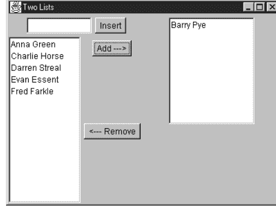

图 9.1 用于输入和选择名称的简单程序。

```java
//向左侧列表添加一个名称
private void addName() {
    if (txt.getText().length() > 0) {
        leftList.add(txt.getText());
        txt.setText("");
    }
}
```

```java
//将名称从左列表移动到右列表框
private void moveNameRight() {
    String sel[] = leftList.getSelectedItems();
    if (sel != null) {
        rightList.add(sel[0]);
        leftList.remove(sel[0]);
    }
}
```

```java
//将名称从右列表移动到左列表框
public void moveNameLeft() {
    String sel[] = rightList.getSelectedItems();
    if (sel != null) {
        leftList.add(sel[0]);
        rightList.remove(sel[0]);
    }
}
```

该程序名为 `TwoList.java`，包含在随书附带的光盘中。

### 使用 JFC JList 类

你会注意到上一个示例使用了 AWT `List` 类。这看起来非常直观，但假设你想使用 Java 基础类库（JFC 或“Swing”）来重写该程序。你用于创建和操作用户界面的大部分部分方法仍然保持不变。然而，`JList` 类与 AWT `List` 类有显著不同。事实上，`JList` 类的设计是为了表示更复杂类型的列表，这两个类之间几乎没有共同的方法。

| AWT List 类 | JFC JList 类 |
|---|---|
| `add(String)` | 无 |
| `remove(String)` | 无 |
| `String[] getSelectedItems()` | `Object[] getSelectedValues()` |

这两个类都拥有许多其他方法，而且几乎没有一个方法是紧密相关的。但是，由于我们已经写好了程序并且使用了一次两个不同的列表框，编写一个适配器让 `JList` 类看起来得像 `List` 类，将为我们的问题提供快速的解决方案。

`JList` 类是一个窗口，包含一个与其关联的数组、`Vector` 或 `ListModel`。正是这个 `ListModel` 实际上包含并操作了数据。此外，`JList` 类不包含滚动条，而是依赖插入到 `JScrollPane` 的视口（viewport）中。`JList` 类及其关联 `ListModel` 中的数据不仅限于字符串；只要你为它们提供单元绘制程序，它们可以是任何类型的对象。这使得带有图片说明列表中每个选项的列表框成为可能。

在这种情况下，我们将创建一个仅模拟 `List` 类的类，这里只需要上一个表所示的三个方法。

我们将我们需要的方法定义为接口，然后确保我们创建的类实现了这些方法。

```java
public interface awtList {
    public void add(String s);
    public void remove(String s);
    public String[] getSelectedItems();
}
```

接口在 Java 中非常重要，因为 Java 不像 C++ 那样允许多继承。因此，你不能创建一个同时继承自 `JList` 和 `List` 的类。然而，你可以创建一个继承自一个类层次结构并实现另一个类方法的类。在大多数情况下，这是一种非常强大的解决方案。因此，通过使用 `implements` 关键字，我们可以让类在方法类型和外观上像任意一种类型的类。

### 对象适配器

在对象适配器方法中（如图 9.2 所示），我们创建一个包含一个 `JList` 类的类，该类实现了之前的 `awtList` 接口的方法。由于 `JList` 的外部容器并不是包含它的 `JScrollPane` 元素，我们实际上是在 `JScrollPane` 的子类中添加方法，以模拟 `List` 类的方法。这些方法在 `awtList` 接口中。

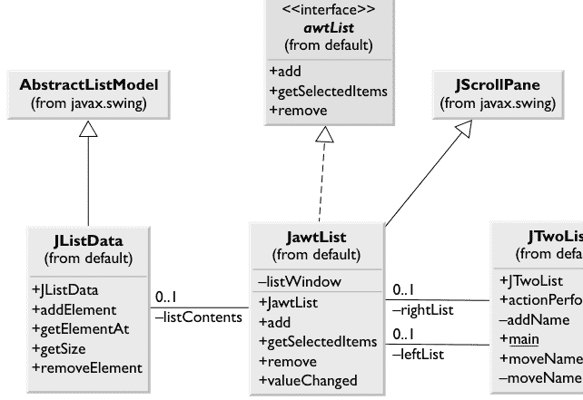

图 9.2 列表适配器的对象适配器方法。

因此，我们的基础 `JawtList` 类如下：

```java
public class JawtList extends JScrollPane
implements ListSelectionListener, awtList {
    private JList listWindow;
    private JListData listContents;

    public JawtList(int rows) {
        listContents = new JListData();
        listWindow = new JList(listContents);
        listWindow.setPrototypeCellValue("Abcdef Hijknop");
        getViewport().add(listWindow);
    }
}
```

### 使用 JFC JList 类

```java
public class JawtList extends JScrollPane
implements ListSelectionListener, awtList {
    private JList listWindow;
    private JListData listContents;

    public JawtList(int rows) {
        listContents = new JListData();
        listWindow = new JList(listContents);
        listWindow.setPrototypeCellValue("abcdefghijmnop");
        getViewport().add(listWindow);
    }

    //------------------------------------------------------
    public void add(String s) {
        listContents.addElement(s);
    }

    //------------------------------------------------------
    public void remove(String s) {
        listContents.removeElement(s);
    }

    //------------------------------------------------------
    public String[] getSelectedItems() {
        Object[] obj = listWindow.getSelectedValues();
        String[] s = new String[obj.length];
        for (int i = 0; i < obj.length; i++) {
            s[i] = obj[i].toString();
        }
        return s;
    }

    //------------------------------------------------------
    public void valueChanged(ListSelectionEvent e) {
    }
}
```

注意，然而实际的处理发生在 `JListData` 中。该类继承自 `AbstractListModel`，定义了如下方法：

| 方法 | 目的 |
|---|---|
| `addListDataListener` | 添加数据的监听器。 |
| `removeListDataListener` | 移除监听器。 |
| `fireContentsChanged` | 告诉 JList 窗口刷新。 |
| `fireIntervalAdded` | 通知 JList 窗口刷新。 |
| `fireIntervalRemoved` | 通知 JList 窗口刷新。 |

三个 `fire` 方法提供了存储在 `ListModel` 中的数据与列表之间的通信路径。在这种情况下，`addElement` 和 `removeElement` 方法是必要的，尽管你可以想象许多有用的方法。每当我们向 vector 添加数据时，调用 `fireIntervalAdded` 方法通知列表刷新。

# 第9章 适配器模式

```java
public class JListData extends AbstractListModel {
    private Vector data;

    public JListData() {
        data = new Vector();
    }

    public int getSize() {
        return data.size();
    }

    public Object getElementAt(int index) {
        return data.elementAt(index);
    }

    public void addElement(String s) {
        data.addElement(s);
        fireIntervalAdded(this, data.size()-1, data.size());
    }

    public void removeElement(String s) {
        data.removeElement(s);
        fireIntervalRemoved(this, 0, data.size());
    }
}
```

### 类适配器

在 Java 中，类适配器方法与对象适配器并没有完全不同。如果我们创建一个继承自 `JList` 的 `JClassAwtList` 类，那么我们需要在主程序的构造函数中创建一个 `JScrollPane`。

```java
leftList = new JClassAwtList(15);
JScrollPane jsp = new JScrollPane();
pleft.add("Center", jsp);
jsp.getViewport().add(leftList);
```

这种基于类的适配器与接下来相同，只是方法现在引用的是类而不是封装的类。

```java
public class JClassAwtList extends JList
implements ListSelectionListener, awtList {
    private JListData listContents;

    public JClassAwtList(int rows) {
        listContents = new JListData();
        setModel(listContents);
        setPrototypeCellValue("Abcijklmnop");
    }
}
```


`List` 类与适配的 `JList` 类之间的某些差异并不容易适配。`List` 构造函数允许你指定列表的长度。在 `JList` 类中没有直接指定此项。你可以根据 `JList` 的字体大小计算封装 `JScrollPane` 类的首选大小，但根据布局器的不同，这可能无法完全遵守。

示例类 `JawtClassList` 由 `JTwoClassList` 调用，位于附带的 CD-ROM 中。

类适配器方法和对象适配器方法之间也存在一些差异，尽管这些差异不像 C++ 中那么显著。

- 类适配器（The class adapter）
  - 当你想适配一个类及其所有子类时，它将无法工作，因为你会在创建适配器时定义它所派生的那个类。
  - 它允许适配器更改被适配类的一些某些方法，但仍然允许其他方法保持不变地使用。
- 对象适配器（The object adapter）
  - 可以通过简单地将子类作为构造函数的一部分传入来完成适配。
  - 要求你特意地将被适配对象的任何你希望提供的方法暴露出来。

### 双向适配器 (Two-Way Adapters)

双向适配器是一个巧妙的概念，它允许对象被类型为 `List` 或 `JList` 类型的不同类查看。这通过类适配器最容易实现，因为基类的所有方法都会自动适配到派生类。然而，只有在你不使用完全不同的方法来覆盖基类的任何方法时，这种方法才有效。事实证明，`JawtClassList` 类是一个理想的双向适配器，因为 `List` 和 `JList` 类没有共同的方法。

注意图 9.3 中的 UML，`JawtClassList` 继承自 `JList` 并实现了 `awList`。因此，你可以同样方便地引用 `awList` 方法或 `JList` 方法，并将该对象视为 `JList` 或 `awList` 的实例。

### 可插拔适配器 (Pluggable Adapters)

可插拔适配器是一种动态适配到几个类之一的适配器。当然，适配器只能适配它能够识别的类，通常适配器根据不同的构造函数或组合方法来决定它正在适配到哪个类。

Java 还有另一种方法让适配器识别它必须适配的几个类之一：反射（reflection）。你可以使用反射来发现任何类的公共方法名称及其参数。例如，对于任何任意对象，你可以使用 `getClass` 获取其类，并使用 `getMethods` 获取方法名数组。

### Java 中的适配器 (Adapters in Java)

```java
JList list = new JList();

Method[] methods = list.getClass().getMethods();

//打印方法

for (int i = 0; i < methods.length; i++) {

  System.out.println(methods[i].getName());

  // 打印参数类型

  Class[] cl = methods[i].getParameterTypes();

  for (int j = 0; j < cl.length; j++) {

    System.out.println(cl[j].toString());

  }

}
```

像此代码产生的“方法转储”可以生成一个非常大的方法列表。如果你知道正在查找的方法名称并只需找出它所需的参数，使用起来就会更容易。从该方法签名，你可以推导出你需要执行的适配。

然而，由于 Java 是一门强类型语言，你更有可能直接使用其中一个构造函数来调用适配器，每个构造函数都是为需要适配的特定类定制的。

### Java 中的适配器 (Adapters in Java)

从广义上说，许多适配器已经内置在 Java 语言中了。在这种情况下，Java 适配器用于简化不必要的复杂的事件接口。这些适配器中最常用之一是 `WindowAdapter` 类。

Java 的一个不便之处是，当你点击关闭按钮或窗口菜单项时，窗口不会自动关闭。解决此问题的通用方案是让主 `Frame` 窗口实现 `WindowListener` 接口，并将除了 `windowClosing` 之外的所有窗口方法留为空。

```java
public void mainFrame extends Frame

  implements WindowListener {

  // 框架监听窗口事件

  public void mainFrame() {

    addWindowListener(this);

  }

  public void windowClosing(WindowEvent wevt) {

    System.exit(0); // 在系统退出框上退出

  }

  public void windowClosed(WindowEvent wevt) {}

  public void windowOpened(WindowEvent wevt) {}

  public void windowIconified(WindowEvent wevt) {}

}
```

## 第 9 章 适配器模式 (CHAPTER 9 The Adapter Pattern)

```java
public void windowDeiconified(WindowEvent wEvt) {}

public void windowActivated(WindowEvent wEvt) {}

public void windowDeactivated(WindowEvent wEvt) {}
```

如你所见，这很尴尬且难以阅读。提供 `WindowAdapter` 类是为了简化这一过程。该类包含了之前所有七个 `WindowEvent` 的空实现。你只需要重写 `windowClosing` 事件并插入适当的退出代码。
接下来显示了一个简单的程序。

```java
// 说明使用 WindowAdapter 类

// 创建一个扩展的窗口适配器

// 该类在接收到关闭事件时

// 关闭帧框

class WinAp extends WindowAdapter {

    public void windowClosing(WindowEvent e) {

        System.exit(0);

    }

}

class Closer extends Frame {

    public Closer() {

        WinAp winap = new WinAp();

        addlistener(winap);

        setSize(new Dimension(100,100));

        setVisible(true);

    }

    public static void main(String argv[]) {

        new Closer();

    }

}
```

然而，你可以使用匿名类制作相同代码更紧凑但可读性较低的版本。

```java
// 为窗口关闭点击创建窗口监听器

addlistener(new WindowAdapter() {

    public void windowClosing(WindowEvent e) {

        System.exit(0);

    }

});
```

这类适配器在 Java 中很常见，当一个简单的类可以封装多个事件时。它们包括 `ComponentAdapter`、`ContainerAdapter`、`FocusAdapter`、`KeyAdapter`、`MouseAdapter` 和 `MouseMotionAdapter`。

## 思考

1. 如何编写一个类适配器让 `JTable` 看起来像双列列表？

## CD-ROM 中的程序 (Programs on the CD-ROM)

| 程序 | 描述 |
| --- | --- |
| \Adapter\TwoLists\Twolist.java | 双列表的 AWT 版本。 |
| \Adapter\JTLists\JTTwoList.java | 对象适配器版本。 |
| \Adapter\TwoClassList\JTTwoClassList.java | 类适配器版本。 |
| \Adapter\showMethods.java | 演示反射。 |

此外，窗口适配器在附带的 `JTList` 和 `JTTwoClassList` 程序中说明。

## 第 10 章 (CHAPTER 10)

## 桥接模式 (The Bridge Pattern)

乍一看，桥接模式与适配器模式非常相似，都是使用一个类将一种接口转换为另一种。然而，适配器模式旨在让一个或多个类看起来像某个特定类。相比之下，桥接模式的设计是将类的接口与其实现分离，以便在不更改客户端代码的情况下改变实现。桥接模式的参与者有

- 抽象（Abstraction），定义类的接口。
- 细化抽象（Refined Abstraction），扩展并实现该接口。
- 实现者（Implementor），定义实现类的接口。
- 具体实现者（ConcreteImplementors），即实现类。

假设你有一个程序在窗口中显示产品列表。该显示的最简单接口是 `JList` 框。但如果有大量产品出售，你可能希望以表格形式显示产品及其销售数据。由于我们刚刚讨论了适配器模式，会立即想到基于类的适配器，我们将 `JList` 复杂的接口适配到我们较简单的需求。在简单的程序中，这样运行良好，但正如我们所看到的，这种方法是有局限性的。进一步，假设我们需要从产品数据中产生两种显示：我们提到的产品列表客户视图，另一个显示出货数量的执行视图。我们在普通的 `JList` 框中显示产品列表，并在 `JTable` 显示中显示执行视图。这些显示是显示类的实现，如图 10.1 所示。

### 图 10.1 使用桥接模式显示相同信息的两种方式

| 客户视图 | 管理层视图 |
| --- | --- |
| 镀黄铜小部件 | 镀黄铜宽 1,000,076 |
| 收拢的 frammis | 75,000 |
| 详细的鼠刷 | 700 |
| 零基十六进制 | 80,000 |
| 前部羚羊领圈 | 278 |
| 可洗软软件 | 789,000 |
| 钢头尖头鞋 | 456,666 |

现在，我们想要定义一个单一简单的接口，无论实际实现类的类型和复杂性如何，该接口都保持不变。我们将从定义一个抽象的 Bridge 类开始。

```java
public abstract class Bridge extends JPanel {

    public void addData(Vector v);

}
```

这个设计非常简单，它只接收一个数据 `Vector`，并将其传递给显示类。
在桥的另一侧是实现类，它们通常具有更复杂且层次更低的接口。在这里，我们将让它们逐行将数据行添加到显示器。

```java
public interface visList {

    public void addLine(String s);

    public void removeLine(int num);

}
```

这些类的定义中隐含了某种机制，用于确定每个字符串的名称中哪部分是产品，哪部分是数量。在这个简单的示例中，我们用两个连字符将数量与名称分开，并在列表类内部对其进行解析。

左侧接口与右侧实现之间的桥接是列表类，它实例化列表显示类中的之一。请注意，它扩展了 Bridge 类以供应用程序使用。

```java
public class listBridge extends Bridge {

    protected visList list;

    public listBridge(visList jlist) {

        setLayout(new BorderLayout());

        list = jlist;

        add("Center", (Component)list);

    }

    public void addData(Vector v) {

        for (int i = 0; i < v.size(); i++) {

            String s = (String)v.elementAt(i);

            list.addLine(s);

        }

    }

}
```

然后，在顶层编程级，我们只需使用 `listBridge` 类创建表格和列表的实例。

```java
// 在客户视图中作为列表框添加

listBridge l1 = new listBridge(new productList());

l1.addData (prod);

left.add("North", new JLabel("Customer view"));

left.add("Center", l1);
```

```java
// 在管理层视图中作为表格添加

listBridge iTable = new listBridge(new productTable());

iTable.addData(prod);

right.add("North", new JLabel("Executive view"));

right.add("Center", iTable);
```

### 类图

图 10.2 中桥接模式的 UML 图显示了接口与实现分离。左侧的 Bridge 类是抽象抽象（Abstraction），而 `listBridge` 类是抽象的实现。`visList` 接口描述了列表类 `product` 和 `productTable` 的公共接口。`visList` 接口定义了实现者（Implementor）的接口，而具体实现者（Concrete Implementors）是 `productList` 和 `productTable` 类。

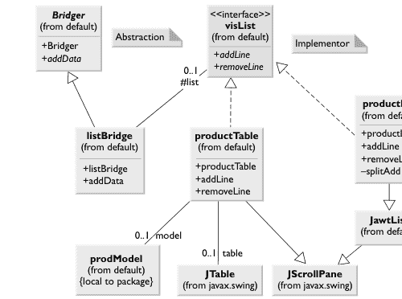

图 10.2 用于产品信息两种显示的桥接模式的 UML 图。

### 扩展桥接

请注意，这两个具体实现者在具体细节上非常不同，尽管它们都支持 `visList` 接口。

现在假设我们需要对这些列表显示数据的方式进行一些更改。例如，你可能希望产品按字母顺序显示。你可能认为需要修改或子类列表类和表格类。这可能会迅速变成维护的噩梦，特别是如果最终需要两个以上的此类显示。相反，我们只需在扩展的接口类中进行更改，从父类 `listClass` 创建一个新的 `sortBridge` 类。

```java
public class sortBridge extends listBridge {

    public sortBridge(visList jlist) {

    }

    public void addData(Vector v) {

        Vector sv = sortData(v);

        for(int i = 0; i < sv.size(); i++) {

            String s = (String)sv.elementAt(i);

            list.addline(s);

        }

    }

    private Vector sortData(Vector v) {

        String s[] = new String[v.size()];

        for(int i = 0; i < v.size(); i++) {

            s[i] = (String)v.elementAt(i);

        }

        for(int i = 0; i < v.size(); i++) {

            if(s[i].compareTo(s[j]) > 0) {

                String tmp = s[i];

                s[i] = s[j];

                s[j] = tmp;

            }

        }

        Vector v1 = new Vector();

        for (int i = 0; i < v.size(); i++) {

            v1.addElement(s[i]);

        }

        return v1;

    }

}
```


### Java Beans 作为桥接

代码显示，你可以在不更改接口的情况下用任何 Bean 替换另一个。换句话说，所有的 Java Bean 都具有构建器程序使用的接口，你可以用任何 Bean 替换另一个，并使用相同的方便接口操作其属性。在 10.3 的示例中，我们创建了另一种实现 `visList` 接口的列表。桥接模式允许你改变列表显示。

| 客户视图 | 管理层视图 |
| --- | --- |
| 镀黄铜小部件 | 镀黄铜宽 1,000,076 |
| 收拢的 frammis | 75,000 |
| 详细的鼠刷 | 700 |
| 零基十六进制 | 80,000 |
| 前部羚羊领圈 | 278 |
| 可洗软软件 | 789,000 |
| 钢头尖头鞋 | 456,666 |

**图 10.3** 使用桥接树形结构的另一种显示方式。

Java Beans 编程模型是桥接模式的理想示例。Java Bean 是一种可以通过可视化操作的可重用软件组件。图 10.4 显示了 Symantic Café 的屏幕，显示了一个包含文本字段和复选框的面板。

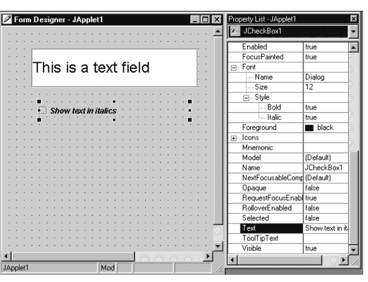

图 10.4 Symantic Café 的屏幕，显示 Java Bean 接口。属性列表使用桥接模式实现。

# 第二章

## 组合模式 (The Composite Pattern)

程序员在开发系统时，组件可能是一个单独的对象，也可能代表一组对象的集合。组合模式的设计是为了兼顾这两种情况。你可以用它来构建“部分-整体”的层级结构，或者构建树的数据表示。总而言之，一个组合对象是一个对象的集合，其中任何一个对象都可以是组合对象或原始对象（primitive object）。在树的命名法中，某些对象可能是带有额外分支和叶子的节点，而另一些可能是叶子。

随之产生的一个问题是：使用单一简单的接口来访问组合类中的所有对象，与区分节点和叶子的能力之间的对立。节点拥有子节点并且可以向它们添加子节点，而叶子目前没有子节点，在某些实现中，可能被禁止添加子节点。

一些作者建议为节点和叶子创建单独的接口，叶子可以拥有以下方法：

```java
public String getName();

public String getValue();
```

节点可以拥有以下方法：

```java
public Enumeration elements();

public Node getChild(String nodeName);

public void add(Object obj);

public void remove(Object obj);
```

这便让我们面临一个编程问题：在构建组合对象时，决定哪些元素将是什么类型。然而，《设计模式》（Design Patterns）建议每个元素无论是组合元素还是原始元素，都应该具有相同的接口。这更容易实现，但我们仍然面临一个问题：当对象实际上是叶子时，`getChild` 操作应该完成什么？

Java 使此变得非常简单，因为每个节点或叶子都可以返回存储子节点的 `Vector` 容器内容的 `Enumeration`。如果没有子节点，`hasMoreElements` 方法会返回一次 `false`。因此，如果我们从每个元素获取 `Enumeration`，就可以通过检查 `hasMoreElements` 方法来快速判断它是否具有任何子节点。

同样困难是从组合的元素中添加或删除叶子。非叶子节点可以添加子叶子节点，但叶子节点不能。然而，我们希望组合中的所有组件都具有相同的接口。必须允许向叶子节点添加子节点，我们可以设计叶子节点类，在程序尝试向此类节点添加内容时抛出异常。

### 组合的实现

让我们考虑一家小公司，它由一个人创立并开始经营。他当然是 CEO，尽管他可能忙得顾不上考虑这一点。然后他雇佣了几个人来处理营销和制造。很快，他们中的每个人都雇佣了一些助理来帮助广告、购物等，并成为了公司的前两个副总裁。随着公司的持续成功，企业不断扩大，直到有了图 11.1 所示的组织结构图。

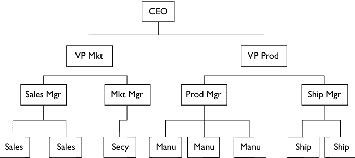

图 11.1 典型的组织结构图。

### 计算薪资

现在，如果公司成功了，这些公司成员都会获得工资，我们可以随时查询员工对公司的控制跨度（control span）成本。我们将这种控制跨度成本定义为该人员的工资以及他所有下属的工资总和。这是一个组合的理想示例：

- 个人员工的成本是该员工的工资（以及福利）。
- 部门主管的成本是该员工的工资加上该员工控制的所有员工的工资。

我们希望有一个单一的接口，无论员工是否有下属，都能正确产生薪资总额。

```java
public float getSalaries();
```

在此时，我们意识到所有组合对象在接口中具有相同标准方法名的主意可能是天真的。事实上，我们更希望让公共方法与我们实际开发的类类型相关。因此，我们不再使用像 `getValue` 这样的通用方法，而是使用 `getSalaries`。

### 员工类

我们可以想象将公司表示为由节点（经理和员工）组成的组合体。我们可以使用单个类来表示所有员工，但由于每个层可能有不同的属性，定义至少两个类可能更有用：员工（Employees）和老板（Bosses）。员工是叶子节点，其下面不能有员工；老板是下面拥有员工节点的节点。

我们将从 `AbstractEmployee` 类开始，并从它派生具体的员工类。

```java
public abstract class AbstractEmployee {

    protected String name;

    protected long salary;

    protected Employee parent = null;

    protected boolean leaf = true;

    public abstract long getSalary();

    public abstract String getName();

    public abstract boolean add(Employee e) throws NoSuchElementException;

    public abstract void remove(Employee e) throws NoSuchElementException;

    public abstract Enumeration subordinates();

    public abstract Employee getChild(String s);

    public abstract long getSalaries();

    public boolean isLeaf() {
        return leaf;
    }
}
```

我们的具体 `Employee` 类存储每个员工的名字和工资，并允许根据需要获取它们。

```java
public Employee(String _name, float _salary) {
    name = _name;
    salary = _salary;
    leaf = true;
}
```

```java
// public Employee(Employee _parent, String _name, float _salary) {
    name = _name;
    salary = _salary;
    parent = _parent;
    leaf = true;
}
```

```java
// public float getSalaries() {
    return salary;
}
```

```java
// public String getName() {
    return name;
}
```

`Employee` 类必须拥有 `add`、`remove`、`getChild` 和 `subordinates` 方法的具体实现。由于员工是叶子，所有这些方法将返回某种错误指示。例如，`subordinates` 可以返回 `null`，但如果返回一个空的 `Enumeration`，编程将更具一致。

```java
public Enumeration subordinates() {
    return v.elements();
}
```

`add` 和 `remove` 方法必须生成错误，因为基础 `Employee` 类成员不能拥有下属。

```java
public boolean add(Employee e) throws NoSuchElementException {
    throw new NoSuchElementException("No subordinates");
}
```

```java
public void remove(Employee e) throws NoSuchElementException {
    throw new NoSuchElementException("No subordinates");
}
```

### Boss 类

我们的 `Boss` 类是 `Employee` 的子类，允许我们存储下属员工。我们将它们存储在一个名为 `subordinates` 的 `Vector` 中，并通过 `Enumeration` 返回。因此，如果某个老板暂时没有员工了，该 `Enumeration` 将是空的。

```java
public class Boss extends Employee {

    Vector employees;

    public Boss(String _name, long _salary) {
        super(_name, _salary);
        leaf = false;
        employees = new Vector();
    }

    //

    public Boss(Employee _parent, String _name, long _salary) {
        super(_parent, _name, _salary);
        leaf = false;
        employees = new Vector();
    }

    //

    public Boss(Employee emp) {
        // 将员工职位提升为老板
        // 并允许它拥有员工
        super(emp.getName(), emp.getSalary());
        employees = new Vector();
        leaf = false;
    }

    //

    public boolean add(Employee e) throws NoSuchElementException {
        employees.add(e);
        return true;
    }

    //

    public void remove(Employee e) throws NoSuchElementException {
        employees.removeElement(e);
    }

    //

    public Enumeration subordinates() {
        return employees.elements();
    }
}
```

如果你想获取给定的主管的员工列表，可以直接从 `subordinates` `Vector` 获取它们的 `Enumeration`。同样，你可以使用相同的 `Vector` 来返回任何员工及其下属的工资总和。

```java
public long getSalaries() {
    long sum = salary;
    for (int i = 0; i < employees.size(); i++) {
        sum += ((Employee) employees.elementAt(i)).getSalaries();
    }
    return sum;
}
```

注意，该方法从当前 `Employee` 的薪资开始，然后对每个下属调用 `getSalaries` 方法。这显然是递归的，任何本身也拥有下属的员工都将被包含在内。这些类的类图如图 11.2 所示。

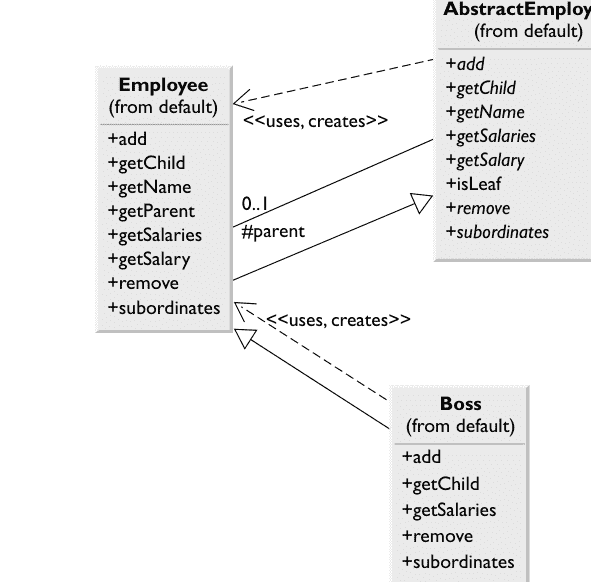

图 11.2 `AbstractEmployee` 类以及 `Employee` 和 `Boss` 如何从其派生。

### 构建员工树

我们首先创建一个 CEO `Employee`，然后按照如下方式添加员工的下属以及下属的下属：

```java
private void makeEmployees() {
    prez = new Boss("CEO", 200000);
    prez.add(marketVP = new Boss("Marketing VP", 100000));
    prez.add(prodVP = new Boss("Production VP", 100000));
    marketVP.add(salesMgr = new Boss("Sales Mgr", 50000));
    marketVP.add(advMgr = new Boss("Adv Mgr", 50000));

    // 添加向销售经理汇报的销售员
    for (int i = 0; i < 5; i++) {
        salesMgr.add(new Employee("Sales " + i, rand_sal(30000)));
    }

    advMgr.add(new Employee("Secy", 20000));
    prodVP.add(prodMgr = new Boss("Prod Mgr", 40000));
    prodVP.add(shipMgr = new Boss("Ship Mgr", 35000));

    // 添加制造人员
    for (int i = 0; i < 4; i++) {
        prodMgr.add(new Employee("Manuf " + i, rand_sal(25000)));
    }

    // 添加货运文员
    for (int i = 0; i < 3; i++) {
        shipMgr.add(new Employee("ShipClrk " + i, rand_sal(20000)));
    }
}
```

一旦我们构建了这个复合结构，就可以从顶节点开始，递归地调用 `addNode` 方法，直到访问每个节点中的所有叶子节点，从而加载视觉化的 `JTree` 列表。

```java
private void addNodes(DefaultMutableTreeNode pnode, Employee emp) {
    DefaultMutableTreeNode node;
    Enumeration e = emp.subordinates();
    if (e != null) {
        while (e.hasMoreElements()) {
            Employee newEmp = (Employee) e.nextElement();
            node = new DefaultMutableTreeNode(newEmp.getName());
            pnode.add(node);
            addNodes(node, newEmp);
        }
    }
}
```

最终的程序显示如图 11.3 所示。

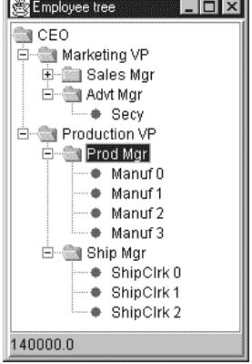

**图 11.3** 在 `TreeList` 中显示的公司组织架构。

在此实现中，当你点击任何员工时，成本（工资总和）都会显示在底栏。这个简单的计算递归地调用 `getChild` 方法来获取该员工的所有下属。

```java
public void valueChanged(TreeSelectionEvent evt) {
    TreePath path = evt.getPath();
    String selectedTerm = path.getLastPathComponent().toString();
    Employee emp = prez.getChild(selectedTerm);
    if (emp != null)
        cost.setText(new Float(emp.getSalaries()).toString());
}
```

### 自升

有时，一个 `Employee` 会留在当前职位但获得新的下属。例如，一名销售员可能会被要求监督培训生。在这种情况下，我们可以方便地提供一个 `Boss` 构造函数，从 `Employee` 创建一个 `Boss`。

```java
public Boss(Employee emp) {
    // 将员工职位提升为 Boss
    // 并允许它拥有员工
    super(emp.getName(), emp.getSalary());
    employees = new Vector();
    leaf = false;
}
```


### 双向链表

用 `Boss` 实例替换 `Employee` 实例意味着使用 `setElementAt` 方法用新元素替换 `Vector` 元素。

在之前的实现中，我们在每个 `Boss` 类的 `Vector` 中保留了对每个下属的引用。这意味着无法从 CEO 链链向下移动到任何员工，但没有方法回溯来识别员工的主管。这通过为每个 `Abstract` 子类提供一个包含对父节点引用的构造函数就可以很轻松地解决。

```java
public Employee(Employee _parent, String _name, float _salary) {
    name = _name;
    salary = _salary;
    parent = _parent; // 保存父节点
    leaf = true;
}
```

然后你就可以遍历树了：

```java
while (emp != null) {
    list.add(emp.getName());
    emp = emp.getParent();
}
```

这如图11.4所示。

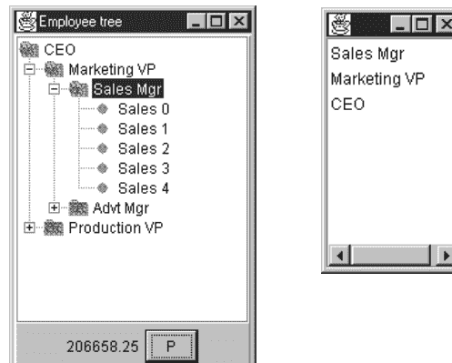

图 11.4 带有父引用的复合结构。

### 复合的影响

在此实现中，当你点击任何员工时，成本（工资总和）都会显示在底栏。这个简单的计算递归地调用 `getChild` 方法来获取该员工的所有下属。

复合模式允许统一地处理单个对象和对象组合。这使得客户端代码变得简单，因为它不需要知道处理的是单个对象还是对象集合。

### 简单复合

复合的意图是表示部分与整体的关系。它允许将对象组合成树结构。在这个示例中，我们使用了模式的简单版本。

### Java 中的复合

在 Java 中，你会注意到我们用于填充树的 `DefaultMutableTreeNode` 类实际上就是这样一个复合。它可以表示节点的层次结构。

### 其他实现问题

你可能考虑的其他复合实现问题：

- 组件顺序。在某些程序中，组件的顺序可能很重要。如果该顺序与它们添加到父节点的顺序有所不同，父节点必须执行额外工作以按顺序返回它们。例如，你可以对原始 `Vector` 进行排序并返回新排序 `Vector` 的枚举器。
- 结果缓存。如果你经常请求从一系列子组件计算的数据（如之前计算工资那样），在父节点中缓存这些结果可能是有利的。然而，除非计算相对密集，且你非常确定底层数据没有变化，否则这样做可能不划算。


- 一支棒球队可以认为是个人球员的聚合。你会如何使用复合来表示个人和团队的表现？
- 超市的生鲜部门需要跟踪按食品项目的销售业绩。建议复合模式如何有助于完成这一任务。

## 光盘中的程序

| 程序 | 描述 |
| --- | --- |
| `\Composite\StdComposite\empTree.java` | 使用 `Boss` 和 `Employee` 类的复合模式实现。 |
| `\Composite\parentComposite\parentTree.java` | 使用双向链表显示汇报链的复合模式实现。 |
| `\Composite\SimpleComposite\empTree.java` | 仅使用 `Employee` 类的简单复合实现。 |

## 第 12 章 装饰器模式 (Decorator Pattern)

装饰器模式为我们提供了一种修改单个对象的方法，而无需创建新的派生类。假设有一个程序使用了八个对象，但其中三个对象需要额外的功能。你可以为这些对象中的每一个创建一个派生类，在很多情况下，这是一个完全可以接受的解决方案。然而，如果这三个对象中的每一个都需要不同的功能，你将必须创建三个派生类。因为，如果其中一个类同时具有另外两个类的功能，你就会开始引入既令人困惑又必要的复杂性。

例如，假设我们想在工具栏的某些按钮周围绘制一个特殊的边框。如果我们为所有按钮创建一个新的派生类，那么这个新类中的所有按钮都将始终具有这种新边框，而这可能并不是我们的意图。

相反，我们创建一个装饰器（Decorator）来对按钮进行装饰。我们从主装饰器类派生出任意数量的特定装饰器，每个装饰器执行特定类型的装饰。为了装饰按钮，装饰器必须是一个派生自视觉环境的对象，这样它才能接收 `paint` 方法的调用，并将其他有用图形方法的调用转发给它正在装饰的对象。这是另一个“对象包含优于对象继承”的例子。装饰器是一个图形对象，但它包含了它正在装饰的对象。它可能会拦截某些图形方法的调用并执行一些额外的计算，然后将这些调用传递给它正在装饰的底层对象。

### 装饰 CoolButton

最近的 Windows 应用（如 Internet Explorer 和 Netscape Navigator）有一排扁平、无序的按钮，当鼠标悬停在上面时，它们通过轮廓边框突出显示。一些 Windows 程序员将这种工具栏称为 Toolbar，将按钮称为 CoolButtons。JFC 中没有类似的行为，但我们可以通过装饰 `JButton` 来实现它。在这种情况下，我们通过在按钮边框上绘制纯灰色线条并将其擦除来装饰它。

让我们考虑如何创建这个装饰器。《设计模式》建议装饰器应该派生自某些通用的视觉组件类，并且发送给实际按钮的消息都应该从装饰器进行转发。在 Java 中，这完全是不可行的，因为在这个基 `JComponent` 中实际上有几百个方法调用我们需要重新实现。相反，我们从 `JComponent` 类派生我们的装饰器。然后，由于 `JFrame` 本身表现为一个容器（Container），它会将所有方法调用转发到它包含的组件上。在这种情况下，我们只需将按钮添加到 `JComponent` 中，该按钮就会接收 `JComponent` 接收到的所有 GUI 方法调用。

《设计模式》建议像装饰器这样的类应该是抽象的，并且你应该从抽象类派生出所有实际工作的（或具体的）装饰器。在这个 Java 实现中，这是没有必要的，因为基类装饰器类除了构造函数外没有其他公共方法，因为所有方法都是 `JComponent` 自身的。

```java
public class Decorator extends JComponent {
    public Decorator (JComponent c) {
        setLayout(new BorderLayout());
        add("Center", c);
    }
}
```

现在，让我们看看如何实现一个 `CoolButton`。我们真的需要像通常一样从基类绘制按钮，然后在边框周围绘制灰色线条以移除按钮的高亮显示。

> **此类装饰了 CoolButton，使得当鼠标悬停在按钮上时，边框是不可见的**

```java
public class CoolDecorator extends Decorator {
    boolean mouse_over; //鼠标悬停在按钮上时为真
    JComponent thisComp;
    public CoolDecorator(JComponent c) {
        super(c);
        mouse_over = false;
        thisComp = this; //保存此组件
        //在内部类中捕获移动
```

### 使用装饰器

```java
c.addMouseListener(new MouseAdapter() {
    // 鼠标悬停时设置标志位
    public void mouseEntered(MouseEvent e) {
        mouse_over = true;
        thisComp.repaint();
    }
    // 鼠标离开时清除标志位
    public void mouseExited(MouseEvent e) {
        mouse_over = false;
        thisComp.repaint();
    }
    // 绘制按钮
    public void paint(Graphics g) {
        super.paint(g);
        // 如果鼠标没有悬停在按钮上
        // 擦除边框
        if (!mouse_over) {
            Dimension size = super.getSize();
            g.setColor(Color.lightGray);
            g.drawRect(0, 0, size.width-2, size.height-1);
            g.drawLine(size.width-2, 0, size.width-2, size.height-1);
            g.drawLine(0, size.height-2, size.width-2, size.height-2);
        }
    }
});
```

现在我们已经写了一个 `CoolDecorator` 类，如何使用它呢？我们只需要创建 `CoolDecorator` 的实例，并将其传递给它要装饰的按钮。我们可以在构造函数中完成所有这些。让我们考虑一个包含两个 `CoolButtons` 和一个普通 `JButton` 的简单图形。我们如下创建布局：

```java
super("Dec Button");
JPanel jp = new JPanel();
getContentPane().add(jp);
jp.add(new CoolDecorator(new JButton("Cbutton")));
jp.add(new CoolDecorator(new JButton("Dbutton")));
JButton Quit = new JButton("Quit");
Quit.addActionListener(this);
```

该程序如图12.1所示，带有 CoolButtons。

### Java 中的边框装饰

这种特定的装饰器实现的一个问题是很难扩展被装饰组件的大小，因为你将组件添加到了容器中。如果你尝试在组件区域之外绘制线条，它们会被图形程序裁剪而完全不会绘制。

JFC 提供了了自己的系列 `Border` 对象，它们是一种装饰器。与装饰器模式一样，你可以为任何组件添加一个新的 `Border`。也有添加多个边框的方法。然而，与装饰器模式不同，`Border` 不是 `JComponent`，你无法灵活拦截并更改特定事件。事实上，它更像是策略模式的例子。

JFC 定义了几个标准 `Border` 类，如下表所示：

| 类 | 描述 |
|---|---|
| `BevelBorder(n)` | 简单的双线边框；可以是 `LOWERED`（凹）或 `RAISED`（凸）。 |
| `CompoundBorder(inner, outer)` | 允许你添加两个边框。 |
| `EmptyBorder(top, left, bottom, right)` | 提供每个侧指定的空白边框宽度。 |
| `EtchedBorder` | 创建一个刻蚀边框。 |
| `LineBorder(width, color)` | 创建简单的线条边框。 |
| `MatteBorder` | 创建实色或平铺图标的哑光边框。 |
| `SoftBeveledBorder` | 创建圆角的斜角边框。 |
| `TitledBorder` | 创建带有标题的边框。用于环绕和标记 `JPanel`。 |

这些边框可以方便地与每个组件的 `setBorder` 方法结合使用。图12.4 显示了一个带有2 像素实线边框的普通 `JButton`，并结合了 4 像素的 `EmptyBorder` 和 `EtchedBorder`。

## 非视觉装饰器

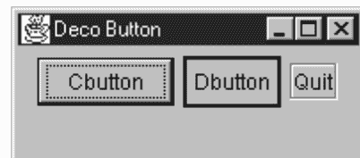

**图 12.4** Dbutton 有一个 2 像素的实线框，而 Quit 有一个 4 像素的 `EmptyBorder`（空边框）和一个 `EtchedBorder`（刻蚀边框）。

这是使用以下简单创建的：

```java
JPanel jp = new JPanel();
getContentPane().add(jp);
p.add(Cbutton = new JButton("Cbutton"));
p.add(Dbutton = new JButton("Dbutton"));
EmptyBorder ep = new EmptyBorder(4,4,4,4);
LineBorder lb = new LineBorder(Color.black, 2);
Dbutton.setBorder(new CompoundBorder(lb, ep));
p.add(Quit = new JButton("Quit"));
EtchedBorder eb = new EtchedBorder(this);
Quit.addActionListener(this);
Quit.setBorder(eb);
```

这些 `Border` 对象的一个缺点是它们替换了决定组件周围间距的默认 `Insets` 值。注意，我们必须为 `Dbutton` 添加一个 4 像素的 `Empty Border`，使其尺寸与 `CButton` 相似。但我们没有对 `Quit` 按钮这样做，它的尺寸明显比其他按钮小。

你还可以使用 `setBorderPainted(b)` 方法来影响 `JButton`（如 `CoolButton`）周围的边框。如果 `b` 为 `false`，则不绘制边框。你可以在按钮接收到鼠标悬停（mouseover）事件时将其关闭并重绘。

## 非视觉装饰器

当然，装饰器并不局限于增强视觉类别的对象。你可以以类似的方式添加或修改任何对象的方法。事实上，非视觉对象可能更容易装饰，因为需要拦截和转发的方法可能更少。

虽然想出一个简单的例子很困难，但在 `java.io` 类中自然地出现了一系列装饰器。请注意 Java 文档中的以下内容：

### 第 12 章 装饰器模式

`FilterInputStream` 类本身只是重写了 `InputStream` 的所有方法，其这些版本将所有请求传递给底层输入流。`FilterInputStream` 的子类可能还会进一步重写其中的一些方法，并提供额外的方法和字段。

因此，`FilterInputStream` 类是一个装饰器，可以包装任何输入流类。它本质上是一个抽象类，不执行任何处理，但提供了一个层，相关方法在该层上被复制。它通常将这些方法调用转发给封装的父流。

派自 `FilterInputStream` 的有趣类包括下表所示：

| 类 | 描述 |
|---|---|
| `BufferedInputStream` | 为流添加缓冲，这样每次调用都不会导致 I/O 操作的发生。 |
| `CheckedInputStream` | 在读取字节时维护字节的校验和。 |
| `DataInputStream` | 从输入流中读取原始类型（`Long`、`Boolean`、`Float` 等）。 |
| `DigestInputStream` | 计算任何输入流的 `MessageDigest`（消息摘要）。 |
| `InflateInputStream` | 实现用于解压缩数据的方法。 |
| `PushbackInputStream` | 提供一个缓冲区，如果你在解析时发现需要回退，可以从该缓冲区“取消读取”数据。 |

这些装饰器可以被嵌套，因此一个带回溯的缓冲输入流是完全可能的。

例如，考虑一个过滤电子邮件流的程序以使其更具读性。电子邮件程序的用户打字很快，而且可能全是大写。如果将每个句子的首字母大写，句子就可以变得更易读。我们通过引入一个派自 `FilterInputStream` 的 `Filter` 类来实现这一点，读取数据并将其转换为混合大小写。在图 12.5 中，我们展示了一个简单的显示，左侧显示原始文本，右侧显示过滤后的文本。

## 非视觉装饰器

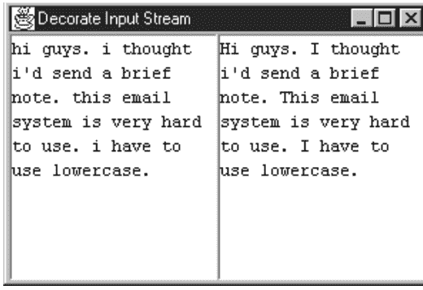

**图 12.5** 一个输入流和一个过滤后的输入流。

左侧流使用普通的 `InputStream` 类读取，如下所示：

```java
private String readNormal(File fl) {
    FileInputStream fread = null;
    String s = "";
    try {
        fread = new FileInputStream(fl);
        byte b[] = new byte[1000];
        int length = fread.read(b);
        fread.close();
        s = new String(b, 0, length);
    } catch (FileNotFoundException e) {
    } catch (IOException ie) {
    }
    return s;
}
```

右侧面板通过读取相同的 `FileInputStream` 但将其传递到 `FileFilter` 类的构造函数中读取的。该类派自 `Filter` 类，其中 `readLine` 方法简单地调用父 `read` 方法并遍历流，在句号后插入大写字母。

```java
try {
    fread = new FileInputStream(f1);
    FileFilter ff = new FileFilter(fread);
    s = ff.readLine();
    ff.close();
}
```


注意，我们创建了一个新的 `readLine` 方法，返回一个已经转换过的 `String`，而不是字节数组（正如父类所做的那样）。我们在图 12.6 中说明了类关系。

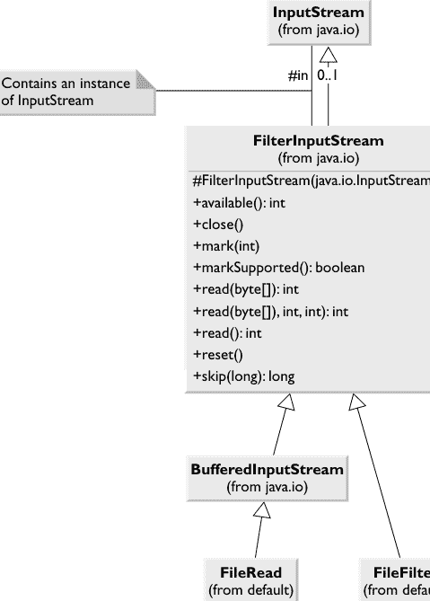

图 12.6 FileFilter 之间的关系

## 装饰器、适配器和组合

正如《设计模式》中所提到的，这些适配器似乎也在“装饰”一个类。然而，它们的意图是不同的。

## 装饰器的后果

装饰器模式提供了一种比继承更灵活的方法为类添加职责，因为它可以向选定的实例添加。这在某些情况下减少了底层类的灵活性，但通常它为除了最复杂的用户以外的所有用户提供了所需的功能。这些用户当然仍然可以访问底层类和方法。

## 思考题


- 1. 当人在 `JTable` 单元格中更改错误时，你可能想更改该行的颜色。建议如何使用装饰器来实现此目的。
- 2. 基金是股票的集合。每个基金由随时间的价格组成。建议如何使用装饰器生成每只股票以及整个基金的报告。

## 光盘中的程序

| 程序 | 描述 |
|---|---|
| `\Decorator\decorwindow.java` | 展示 `CoolButtonDecorator`。 |
| `\Decorator\slashWindow.java` | 展示 `SlashDecorator`。 |
| `\Decorator\borderwindow.java` | 展示如何使用 `JFC Border` 类。 |
| `\Decorator\FilterStreamDeco.java` | 展示将 `FilterInputStream` 类作为装饰器的用法。 |

# 第 13 章

## 外观模式

在本章中，我们将学习外观模式。该模式用于将一组复杂的类封装进更简单的内部接口中。

通常，随着你的程序的演变和发展，它们会变得复杂。事实上，尽管设计模式的好处广为人知，这些模式有时会产生许多类，导致难以理解程序的流程。此外，可能存在复杂的子系统，每个子系统都有其复杂的接口。

外观模式通过为子系统提供简化接口来简化这种复杂性。这在某些情况下减少了底层类的灵活性，但通常它为除了最复杂的用户以外的所有用户提供了所需的功能。这些用户仍然可以访问底层类和方法。

幸运的是，我们不需要编写一个复杂的系统来提供外观实用的示例。Java 提供了一组类，通过名为 JDBC 的接口连接到数据库。你可以连接到任何制造商提供了 JDBC 连接类的数据库——市场上几乎所有的数据库。某些数据库使用 JDBC 直接连接，少数允许通过 JDBC-ODBC 桥接类连接到 ODBC 驱动程序。

这些数据库类位于 `java.sql` 包中，为了一组以复杂方式交互的低级类提供了极佳示例，如图 13.1 所示。

## 构建 Facade 类

让我们考虑如何连接到数据库。我们首先必须加载数据库驱动程序。

```java
try {
    Class.forName(driver); //加载 Bridge 驱动
}
```

要连接数据库，你需要使用 `Connection` 类的实例。然后，为了查找数据库表和字段的名称，你需要从 `Connection` 获取 `DatabaseMetaData` 类的实例。接下来，为了执行查询，你需要组合 SQL（结构化查询语言）查询字符串，并使用 `Connection` 创建一个 `Statement` 类。通过执行 `Statement`，你可以获得一个 `ResultSet` 类，而要查找 `ResultSet` 中列行的行的名称，你需要获取一个 `ResultSetMetaData` 类的实例。因此，处理所有这些类可能非常困难，而且由于对它们方法的大多数调用都会抛出异常，代码至少会变得杂乱无章。

然而，通过设计由 `Database` 类和 `Results` 类组成的 Facade（图 13.2），我们可以构建一个更易于使用的系统。

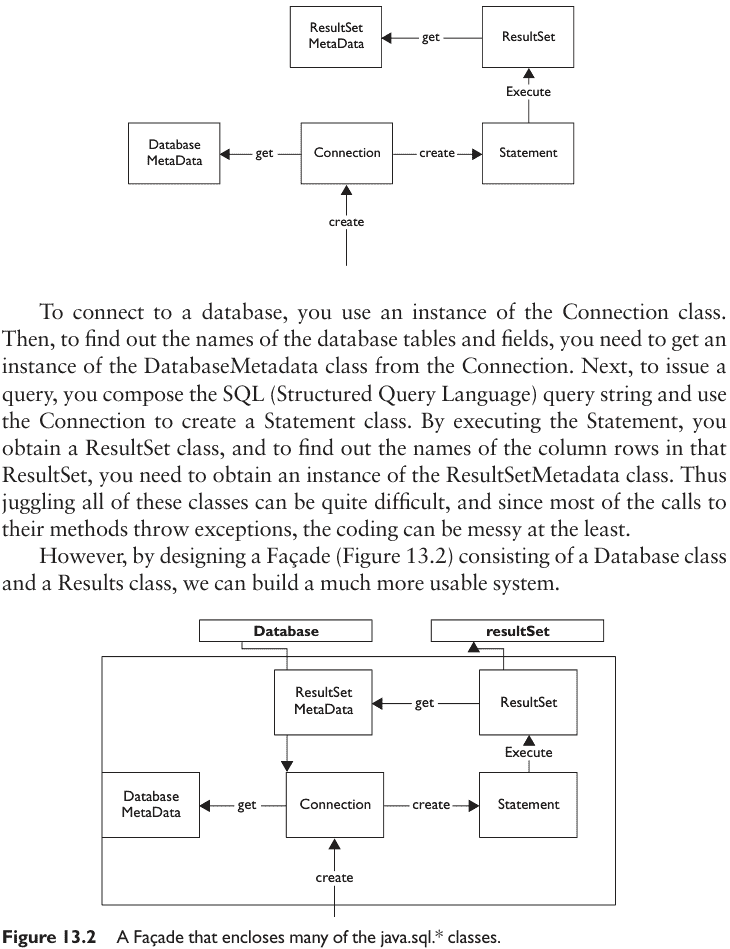

```java
catch (Exception e) {
    System.out.println(e.getMessage());
}
```

我们使用 `Connection` 类来连接数据库。我们还获取数据库元数据以了解更多数据库的信息。

```java
try {
    con = DriverManager.getConnection(url);
    dma = con.getMetaData(); //获取元数据
} catch (Exception e) {
    System.out.println(e.getMessage());
}
```

如果我们想列出数据库中表示的名称，那么我们需要在数据库元数据类上调用 `getTables` 方法，该方法返回一个 `ResultSet` 对象。最后，为了获取名称列表，我们必须遍历该对象，确保我们只获取用户名，并排除系统表。

```java
public String[] getTableNames() {
    String[] tbnames = null;
    Vector tname = new Vector();
    //将名称添加到 Vector 中
    //因为我们不知道有多少个
    try {
        results = new Results(dma.getTables(catalog, null, "%", types));
    } catch (Exception e) {
        System.out.println(e);
    }
    while (results.hasMoreElements()) {
        tname.addElement(results.getColumnValue("TABLE_NAME"));
    }
    //将表名拷贝到字符串数组中
    tbnames = new String[tname.size()];
    for (int i = 0; i < tname.size(); i++) {
        tbnames[i] = (String) tname.elementAt(i);
    }
    return tbnames;
}
```

这很快变得非常难以管理，而且我们甚至还没有执行任何查询。

我们可以做一个简单的假设：所有这些数据库类抛出的异常并不需要复杂的处理。在大多数情况下，除非到数据库的网络连接失败，否则这些方法将在无错误的情况下运行。我们可以将所有这些方法封装起来，在其中我们只需打印出稀少发生的错误而不采取任何进一步的操作。

## 外观模式

使得编写两个简单的封装类成为可能，包含 `Connection`、`ResultSet`、`Statement` 和 `MetaData` 类的所有重要方法。这些是 `Database` 类的方法：

```java
class Database {
    public Database(String driver); //构造函数
    public void Open(String url, String cat);
    public String[] getTableNames();
    public String[] getColumnNames(String table);
    public String getColumnValue(String table, String columnName);
    public String getNextValue(String columnName);
    public ResultSet Execute(String sql);
}
```

接下来是 `Results`：

```java
class Results {
    public Results(ResultSet rset); //构造函数
    public String[] getMetaData();
    public boolean hasMoreElements();
    public String[] nextElement();
    public String getColumnValue(String columnName);
    public String getColumnValue(int i);
}
```

这些简单的类允许我们编写一个程序来打开数据库；显示其表名、列名和内容；以及在数据库上运行简单的 SQL 查询。

我们使用这种外观模式的示例程序是 `db.java` 程序。该程序（如图 13.3 所示）访问一个包含本地市场食品价格的数据库。

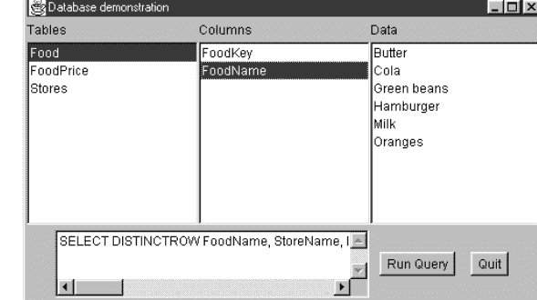

**图 13.3** db 程序显示了数据库中表的选择、列名以及该列的内容。

点击表名显示列名，点击列名显示该列的内容。点击“Run Query”（运行查询）显示按橙子排序的食品产品，如图 13.4 所示。

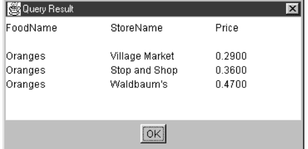

**图 13.4** 在 `dbFrame` 程序中执行查询的结果。

该程序从连接数据库并获取表名列表开始。

```java
db = new Database("sun.jdbc.odbc.OdbcDriver");
db.Open("jdbc:odbc:Grocery", null);
String names[] = db.getTableNames();
```

```java
public void itemChanged(e) {
    if (e) {
        showColumns();
    }
    if (e) {
        showData();
    }
}

private void showColumns() {
    String[] columns = db.getColumnNames();
    for (int i = 0; i < columns.length; i++) {
        System.out.println(columns[i]);
    }
}

private void showData() {
    // 显示数据
}
```

```java
colval = db.getNextValue();
while (colval.length > 0) {
    Data.add(colval);
}
```

图 13.5 显示了 Facade 类的完整表示。

| | Database (default) (local package) | <<interface>> (java.sql) |
| :--- | :--- | :--- |
| <<interface>> (java.sql) | Connection | +Database+close+getMetaData+getColumnNames+Open |
| 1 | Results (default) (local package) | +Result+finalize+getColumnValue+hasMoreElements+nextElement |
| 1 | ResultSetMetaData (java.sql) | DatabaseMetaData |

**图 13.5** 程序员实际使用的类。

注意 `Database` 类包含了 `Connection`、`DatabaseMetaData` 和 `Results`，而 `Results` 类包含了 `ResultSet` 和 `ResultSetMetaData`。

## 外观的后果

外观模式隐藏了复杂的子系统并为普通用户提供了更简单的编程接口。然而，它并没有阻止高级用户在需要时访问底层类。此外，外观允许我们在无需更改代码的情况下修改子系统并减少编译依赖。

## 安装和运行 dbFrame 注意事项

为了让 Java 与数据库通信，你必须安装 ODBC 和 JDBC-ODBC 驱动。此示例程序仅在 Windows 环境下工作，因为它需要 Microsoft Access 数据库 `groceries.mdb`。如果你安装了 Java 2 或更高版本，JDBC-ODBC驱动是内置的。然而，如果你使用的是较早版本，你需要从 Java 网站获取此驱动。

ODBC 数据访问驱动可以从 Microsoft 免费下载。这些驱动的第一版本称为 `Dataacc.exe`，并封装存储为 `wx1350.exe`。版本 2 处理许多数据库并提供更复杂的访问功能。它还需要安装 `DCOM98`。安装 ODBC 后，你应该能在控制面板中看到一个 ODBC 文件夹。

将随附光盘上 Facade 文件夹中的程序拷贝到硬盘上的方便位置。然后从控制面板中启动 ODBC 程序。要注册 `groceries.mdb` 文件，点击“Add”并填写面板，如图 13.6 所示。要指示 `groceries.mdb` 文件的位置，点击“Select”并在你刚刚拷贝的文件夹中找到该文件，如图 13.6 所示。

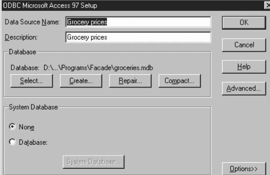

**图 13.6** 如何设置数据库的 ODBC/JDBC 访问。

如果你将数据源命名为“Grocery Prices”以外的名称，你需要更改 `dbFrame.java` 第 20 行中对应的名称。

## 思考题

+ 1. 假设你编写了一个程序，包含“文件/打开”菜单、一个文本字段以及一些控制字体（粗体和斜体）的按钮。现在假设你需要让这个程序带参数从命令行运行。请解释你将如何使用外观模式来实现这一目标。

## CD-ROM 上的程序

| 程序 | 描述 |
|---|---|
| `dbFrame.java` | 读取 `groceries.mdb` 数据库并如书中所示显示杂货表。 |

# 第 14 章

## 享元模式

在本章中，我们将学习享元模式，该模式用于避免大量非常相似类带来的开销。

有时，你需要生成大量的微小类实例来表示数据。如果你能够确定实例在本质上是相同的（除了少数几个参数外），你就可以大大减少需要实例化的不同类的数量。如果你能将这些变量移动到类实例之外，并作为方法调用的一部分传递它们，就可以通过共享实例来大幅减少独立实例的数量。

享元模式为处理此类类提供了一种方法。它指的是使实例唯一的*内部*数据以及作为参数传递的*外部*数据。享元适用于微小的、细粒度的类，例如屏幕上单个字符或图标的类。例如，你可以在窗口中绘制一系列图标，每个图标代表一个人或一个作为数据文件的文件夹，如图 14.1 所示。

在这种情况下，让每个文件夹都拥有一个实例来记住人的名字和图标的屏幕位置是没有意义的。通常，一个图标是几个相似图像之一，而它绘制的位置是根据窗口的大小动态计算的。

在《模式》的另一个示例中，文档中的每一章都由字符类的一个单一实例表示，但字符在屏幕上绘制的位置被保留为外部数据，因此每个字符只需要一个实例，而不是该字符的每种外观。

### 讨论

享元是类的一个共享实例。初看之下，每个类似乎都像单例模式。实际上，可能只存在少量实例，例如每个字符一个，或者每个图标类型一个。分配的实例数量必须在需要类实例时决定；通常由一个享元工厂类来完成。该工厂通常是单例，因为它需要跟踪某个特定实例是否已经生成。它返回一个新实例，或者返回一个它已经生成的实例的引用。

要判断程序的某部分是否是享元的候选对象，请考虑是否可以从类中移除某些数据并将其外部化。如果这使得程序需要维护的大量不同类实例得以减少，那么享元模式将会有帮助。

### 示例代码

假设我们为组织中的每一个人绘制一个较小的文件夹图标，并在下方带有一个名称。如果组织很大，可能会有很多这样的图标；然而，它们实际上都是相同的图形图像。即使我们有两个图标，一个用于“已选中”，一个用于“未选中”，不同图标的数量也极小。在这样的系统中，为每个人都创建一个图标对象（带有它自己的坐标、名称和选中状态）是资源的浪费。图 14.2 显示了两个这样的图标。


**图 14.2** 一组显示两个图像的文件夹；一个用于“已选中”，一个用于“未选中”。

相反，我们将创建一个文件夹工厂，返回选中的或未选中的绘制类，但一旦每种创建了一个，就不会创建额外的实例。由于这是一个非常简单的情况，我们只需在出口处同时创建它们并返回其中之一。

```java
public class FolderFactory {
    Folder Unselected, Selected;

    public FolderFactory() {
        Color brown = new Color(0x5f5f1c);
        Selected = new Folder(brown);
        unselected = new Folder(Color.yellow);
    }

    public Folder getFolder(boolean isSelected) {
        if (isSelected)
            return Selected;
        else
            return unselected;
    }
}
```


return unselected;

}

}

```

当可能存在更多实例时，工厂可以维护已创建实例的表格，并仅在它们不在表中时才创建新的。

然而，使用享元的独特之处在于，我们在绘制文件夹时，将要绘制的坐标和名称传递给文件夹。这些坐标是允许我们共享文件夹对象的外部数据，并且在这种情况下只创建两个实例。所示的完整文件夹类创建了一个具有另一种背景颜色的文件夹实例，并有一个公共的 `draw` 方法，可以在我们指定的点绘制文件夹。

```java
public class Folder extends JPanel {

    private Color color;

    final int W = 50, H = 30;

    public Folder(Color c) {

        color = c;

    }

    public void draw(Graphics g, int tx, int ty, String name) {

        g.setColor(color);

        g.fillRect(tx, ty, W, H);

        g.drawString(name, tx, ty + H + 5);

    }

}
```

要使用这样的享元类，我们的调用程序必须在它的绘制过程中计算每个文件夹的位置，这是很常见的，因为我们不需要保留每个实例将所在的位置。相反，我们在绘制过程中动态计算它。

### 示例代码

注意，我们可以在出口生成一个文件夹数组或向量（`Vector`），然后扫描数组来绘制每一个。这样的数组并不像一系列不同实例那样浪费，因为它实际上是两个文件夹实例的引用数组。然而，由于我们想要将一个文件夹显示为“已选中”，并且能够动态更改哪个文件夹被选中，我们只需使用文件夹工厂每次提供正确的即可。`top` 和 `left` 是在主程序中定义的常量。

```java
public void paint(Graphics g) {

    Folder f;

    String name;

    int j = 0; //计算当前行的数量

    int row = Top; //从左上角开始

    int x = Left;

    //遍历所有的名字和文件夹

    for (int i = 0; i < names.size(); i++) {

        name = (String)names.elementAt(i);

        if (name.equals(selectedName))

            f = fact.getFolder(true);

        else

            f = fact.getFolder(false);

        //让那个文件夹在该位置绘制自己

        f.draw(g, x, row, name);

        x = x + HSpace; //移动到下一个位置

        j++;

        if (j >= HCount) { //为下一行重置

            j = 0;

            row += VSpace;

            x = Left;

        }

    }

}
```

### 类图

图 14.3 显示了这些类是如何相互作用的。

| FolderFactory | 0..1 | Folder |
| :--- | :--- | :--- |
| (来自默认) | unSelected | (来自默认) |
| +FolderFactory | 0..1 | +Folder |
| +getFolder | Selected | +draw |

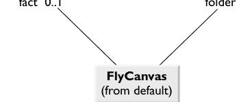

图 14.3 享元类的生成方式。

`FlyCanvas` 类是主要的 GUI 类，文件夹在这里进行排列和绘制。它包含一个 `FolderFactory` 类的实例和一个 `Folder` 类的实例。`FolderFactory` 类包含两个 `Folder` 实例：*selected*（选中的）和 *unselected*（未选中的）。`FolderFactory` 将其中一个实例返回给 `FlyCanvas`。

### 选择文件夹

我们有两个文件夹实例，选中的和未选中的，我们希望通过将鼠标悬停在文件夹上来选择文件夹。在之前的绘制程序中，我们简单地记录被选中的文件夹名称，并要求工厂返回一个对应的“已选中”文件夹。由于文件夹不是独立的实例，我们无法监听每个文件夹实例内部的鼠标移动。即使我们这样做了，我们需要一种方法来告诉其他实例取消选择。

相反，我们在窗口级别检查鼠标移动。如果发现鼠标在某个 `Rectangle`（矩形）内，我们将相应的名称设为选中的名称。我们可以在重绘时检查每个名称，并在需要的地方创建一个选中的文件夹。

```java
public void mouseMoved(MouseEvent e) {

    int j = 0; //统计行中的列数

    int row = Top; // 从左上角开始

    int x = Left;
```

```java
// 遍历所有的名称和文件夹

for (int i = 0; i < names.size(); i++) {

    // 检查此文件夹是否包含鼠标
```

### 享元在 Java 中的应用

```java
Rectangle r = new Rectangle(x, row, W, H);

if (r.contains(e.getX(), e.getY())) {

    selectedName = (String)names.elementAt(i);

    repaint();

}

x = x + HSpace; // 移动下一个位置

j++;

if (j >= HCount) { // 为下一行重置

    j = 0;

    row += VSpace;

    x = Left;

}
```

### 享元在 Java 中的应用

享元类在 Java 的应用层并不经常使用。它更多是一种系统资源管理技术，用于比 Java 更低的层级。然而，认识到这种技术的存在是有用的，这样当你需要时就可以使用它。

我们已经从用于表格和列表框的单元格渲染器代码中见过享元模式了。通常，单元格渲染器是一个 `JLabel`；对于不同的颜色或字体，可能会有两个或三个类型的标签或渲染器。但渲染器的数量远少于表格或列表中的单元格数量。Java 语言中的对象可以在底层通过作为享元对象来实现的。例如，如果存在两个字符完全相同的 `String` 常量实例，它们可以指向同一个存储位置。同样，两个包含相同值的 `Integer` 或 `Float` 对象可能被实现为享元对象，尽管它们可能并非如此。为了证明不存在享元对象，我们运行了以下代码：

```java
Integer five = new Integer(5);

Integer myfive = new Integer(5);

System.out.println(five == myfive);
```

```java
String fred = new String("fred");

String fred1 = new String("fred");

System.out.println(fred == fred1);
```

两种情况都打印出 "false"。但是，请注意你可以通过使用 `==` 运算符轻松地判断你处理的是否享元的相同实例。该运算符比较的是实际引用（内存地址），而不是 `equals` 运算符（后者如果实现了，速度可能会更慢）。

### 共享对象

《Smalltalk 伴侣》（Smalltalk Companion）指出，共享对象与享元非常相似，尽管它们的目的有所不同。当你有一个包含大量复杂数据（如表格或位图）的大型对象时，你希望尽可能减少该对象的实例数量。在这种情况下，你向每个请求该对象的程序每个部分返回一个实例，并避免创建其他的。

当程序的某部分想要更改共享对象中的某些数据时，就会出现此类共享对象的问题。你必须决定为所有用户更改对象、阻止任何更改，还是创建一个带有更改数据的新实例。如果你为每个实例都更改对象，你就必须通知用户对象已更改。

当你引用 Java 外部的大型数据系统（如数据库）时，共享对象也非常有用。我们之前在外观模式（Facade pattern）中开发的 `Database` 类可以作为共享对象的候选。我们可能不希望从不同的程序模块建立多个数据库连接，而是倾向于只实例化。然而，如果不同线程中的多个模块决定同时进行查询，`Database` 类可能对查询进行排序或创建额外的连接。

### 写时复制对象

享元模式仅使用少数对象实例来表示程序中的许多不同对象。所有对象通常都具有作为内部状态的基本属性，以及若干个代表随类实例每次表现而变化的外部状态的属性。这些实例最终会获得新的内部属性（例如形状或文件夹标签位置），并需要一个新的实例。这个过程被称为写时复制。

## 思考题

- 1. 考虑一个具有高亮某些单元格的渲染器的 `JTable`。为此编写一个享元模式。
- 2. 假设 `JTabbedPane` 可以出现在几个不同的标签页上。你如何在这里使用享元？

## CD-ROM 上的程序

| 程序 | 说明 |
|---|---|
| \Flyweight\Folders\FlyCanvas.java | 用于绘制通过鼠标悬停事件选择文件夹的完整代码。 |
| \Flyweight\Vectors\FlyCanvas.java | 预先生成文件夹的类似代码。 |
| \Flyweight\test.java | 对 `Integer` 和 `String` 进行享元测试。 |

# 第 15 章

## 代理模式

代理模式用于用一个简单的对象来表示一个创建复杂或耗时的对象。如果创建一个对象在时间或计算机资源上开销很大，代理允许你推迟这种创建，直到你需要它时。代理通常与完整对象具有相同的方法。一旦加载了该完整对象，代理会将方法调用传递给该完整对象。

代理在以下几种情况下是有用的：

- 1. 如果一个对象（如大图像）需要很长时间才能加载
- 2. 如果对象在远程机器上，通过网络加载它可能会很慢，特别是在网络负载峰值期间
- 3. 如果对象具有有限的访问权限。此时，代理可以验证该用户的访问权限

代理还可以用于区分请求对象实例和实际访问对象的需要。例如，程序初始化可能会设置许多对象，并不是所有对象都会立即被使用。在这种情况下，代理仅在需要时才加载真实对象。

考虑一个需要加载并显示大图像的程序。当程序启动时，显示某些指示表示将有一个图像，以便屏幕布局正确；实际图像显示可以推迟到图像完全加载。这对于文字处理器和 Web 浏览器等程序尤为重要，这些程序在图像可用之前就在文本周围进行布局。

图像代理可以记录图像并在后台开始加载，同时绘制一个简单的矩形或其他符号来表示图像。

### 示例代码

在显示之前占据屏幕的扩展范围。代理甚至可以延迟加载图像，直到它接收到绘制请求（paint request），然后开始加载过程。

在这个示例中，我们创建了一个简单的程序，在图像加载时在 `JPanel` 上显示它。我们没有直接加载图像，而是使用了一个名为 `ImageProxy` 的类来延迟加载，并在加载完成前图像周围画一个矩形。

```java
public class ProxyDisplay() extends JFrame {

    super("Display proxied image");

    JPanel p = new JPanel();

    getContentPane().add(p);

    p.setLayout(new BorderLayout());

    ImageProxy image = new ImageProxy("elli.jpg", 321, 271);

    p.add("Center", image);

    p.add("North", new Label(""));

    p.add("West", new Label(""));

    setSize(370, 350);

    setVisible(true);

}
```

注意，我们创建 `ImageProxy` 实例的方式与创建图像一样，并像添加实际图像一样将其添加到父 `JPanel` 中。

`ImageProxy` 类在构造函数中设置了图像加载，并创建了一个 `MediaTracker` 对象来跟踪过程。

```java
public class ImageProxy extends JPanel

implements Runnable {

    private int height, width;

    private MediaTracker tracker;

    private Image img;

    private JFrame frame;

    private Thread imageCheck; //to monitor loading

    //

    public ImageProxy(String filename, int w, int h) {

        height = h;

        width = w;

        tracker = new MediaTracker(this);

        img = 

            Toolkit.getDefaultToolkit()...
```

```java
getImage(filename);

tracker.addImage(img, 0); //watch for image loading

imageCheck = new Thread(this);

imageCheck.start(); //start 2nd thread monitor

//开始实际图像加载

try {

    tracker.waitForID(0, 1);

} catch (InterruptedException e) {

}

```

`MediaTracker` 的 `waitForID` 方法实际上启动了加载。在这种情况下，我们等待至少 1 毫秒，以便尽可能地减少感知上的延迟。

构造函数还创建了一个独立的线程 `imageCheck`，它每几毫秒检查一次状态，然后启动运行。

```java
public void run() {

    /* 线程监控图像加载

       并在完成后重绘

       1000 毫秒是人为设置的

       为了允许演示延迟显示 */

    try {

        Thread.sleep(1000);

        while (tracker.checkID(0)) {

            Thread.sleep(1000);

        }

    } catch (Exception e) {

    }

    repaint();

}
```

出于这个演示程序的目的，我们将轮询时间缩短到 1 秒，以便我们可以看到程序绘制矩形并刷新最终图像。

最后，代理派自 `JPanel` 组件，因此它有一个 `paint` 方法。在这个方法中，如果图像尚未加载，我们就会画一个矩形。如果图像已经加载，我们就擦除矩形并绘制图像。

```java
public void paint(Graphics g) {

    if (tracker.checkID(0)) {

        height = img.getHeight(frame); //获取高度

        width = img.getWidth(frame); //以及宽度

    }

    g.setColor(Color.lightGray); //擦除框

    g.fillRect(0, 0, width, height);

    g.drawImage(img, 0, 0, this); //绘制图像

} else {

    //如果尚未加载，则绘制图像的轮廓框

    g.setColor(Color.black);

    g.drawRect(1, 1, width - 2, height - 2);

}
```


程序的两个状态如图 15.1 所示。

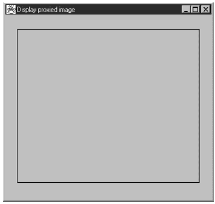

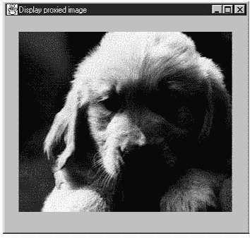

**图 15.1** 左侧的代理图像显示，直到右侧的图像加载。

### 写时复制

你也可以使用代理来保留可能改变或可能改变的大对象的副本。如果你创建一个昂贵对象的第二个实例，代理可以决定不需要副本，因此它直接使用原始对象。然后，如果程序在新的副本中进行了更改，代理可以复制原始对象并在新实例中进行更改。当对象在实例化后并不总是发生变化时，这可以节省时间和空间。

### 企业级 Java Beans

企业级 Java Beans (EJB) 是一组用于编写封装良好的服务器代码的类和接口。它们与你在客户端 GUI 程序中使用的 Java Beans 完全没有关系。但是，它们为访问数据库和其他遗留数据系统提供了一种方便的方法。
每当你从数据库请求一行数据时，你都在向一个 EJB 建立一个新连接。显然，这些连接的数量是有限的，因此剩余的请求被缓存在 Bean 中，指向连接的代理会在当一个连接可用并返回时最终成为该连接。

### 与相关模式的比较

适配器和代理模式都构成对象周围的一层薄薄层。而代理为对象提供了相同的接口，但在可以延迟对象处理或数据传输错误的地方插入自己。

### 总结

适配器和代理模式都构成对象周围的一层薄薄层。而代理为对象提供了相同的接口，但在可以延迟对象处理或数据传输错误的地方插入自己。

## 思考题

1. 你设计了一个连接数据库的 Java 服务器。如果多个客户端连接到它，代理可以起到什么帮助？

## CD-ROM 上的程序

| 程序 | 描述 |
| :--- | :--- |
| `ProxyDisplay.java` | 显示代理直到图像加载。 |

## 结构模式总结

以下是结构模式的总结：

* **适配器模式**：将一个类的接口转换为另一个接口。
* **桥接模式**：将类的接口与其实现分离，以便可以在不改变客户端的情况下切换实现。
* **组合模式**：对象的集合，其中任何一个可以是叶子节点。
* **装饰器模式**：包装一个类，为原始类添加功能。代理相反，它控制对包含类的访问。
* **外观模式**：一组对象并提供一个更简单的访问接口。
* **享元模式**：提供一种限制实例泛滥的方法。
* **代理模式**：提供某种耗时或昂贵的占位对象。

# 第 4 节
## 行为模式

行为模式是特别关注对象之间通信的模式。本章涵盖了以下模式：

* **责任链模式**：通过将请求从一个对象传递到下一个对象来实现对象之间的解耦。
* **命令模式**：利用简单对象表示执行，允许支持日志和撤销操作。
* **解释器模式**：提供在程序中包含语言元素的定义。
* **迭代器模式**：形式化我们遍历列表的方式。
* **中介者模式**：通过使用一个独立对象来简化对象之间的通信，使所有对象无需相互感知。
* **观察者模式**：定义如何通知多个对象更改。
* **状态模式**：允许对象在当内部状态改变时修改其行为。
* **策略模式**：在类内部封装算法。
* **模板方法模式**：提供算法的抽象定义。
* **访问者模式**：非侵入地为类添加多态函数。

# 第 16 章

## 责任链模式

责任链模式允许多个类尝试处理请求，而它们中的任何类都不知道其他类的能力。它在这些类之间提供了松散耦合；唯一的共同点是其中一个类可以处理它们。请求在它们之间传递，直到其中一个类可以处理它。

这种模式的一个例子是如图 16.1 所示的帮助系统。在这里，应用程序的每个屏幕区域都邀请帮助，但在某些窗口背景区域，更通用的帮助是唯一的结果。

当你选择一个区域获取帮助时，该视觉控件将其 ID 或名称转发给链。

该模块告诉你系统是如何工作的。如果它不存在，消息就会丢失，且不会显示任何信息。这如图 16.2 所示。

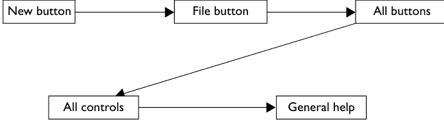

**图 16.2** 一个简单的责任链模式。

从这个示例中我们可以观察到两个关键点：

1. 链是按照从具体到一般的顺序组织的。
2. 无法保证请求在所有情况下都能产生响应。

我们稍后会看到，观察者模式定义了如何通知多个类发生了变化。

### 适用性

责任链模式是一个很好的模式示例，它帮助保持程序中每个对象可以做什么的知识。也就是说，它减少了对象之间的耦合，使其能够独立地工作。这同样适用于构成主程序并包含其他对象实例的类。在以下情况下，你会发现这种模式很有帮助：

* 多个对象具有相似的方法，这些方法可能适用于程序请求的操作。但是，让对象自己决定由哪一个来执行操作，比由你在代码中将此决策硬编码更为合适。
* 可能其中一个对象最合适，但你不想构建一系列 `if-else` 或 `switch` 语句来选择特定对象。
* 在程序执行期间，你可能想要向处理选项列表中添加新对象。
* 有时，多个对象必须对一个请求执行操作，而你不想在调用程序中构建这些相互作用的知识。

### 示例代码

之前描述的帮助系统对于第一个例子来说有点复杂。让我们从一个简单的视觉化命令解释器程序开始，如图 16.3 所示，它说明了链是如何运作的。该程序显示输入命令的结果。虽然第一个用例为了保持示例代码易于理解而受到了限制，但我们将看到这种责任链模式通常用于解析器甚至编译器。

在这个示例中，命令可以是以下任何一种：

* 图像文件名
* 通用文件名
* 颜色名称
* 任何其他命令

在前三种情况下，我们可以显示请求的具体结果，而在最后一种情况下，我们只显示请求文本本身。

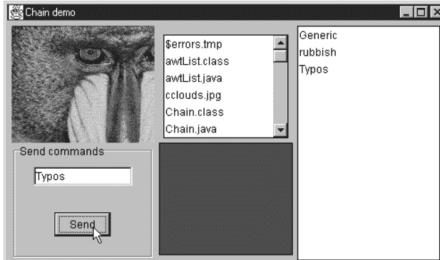

**图 16.3** 一个简单的视觉化命令解释器程序，根据你输入的命令对四个面板中的一个执行操作。

该系统对命令的响应如下：

1. 我们输入“Mandrill”，看到图像 `Mandrill.jpg` 的显示。
2. 我们输入“FileList”，该文件名在中间列表框中被高亮。
3. 我们输入“blue”，该颜色显示在下方的中间面板中。

如果我们输入任何既不是文件名也不是颜色的内容，该文本将显示在右侧列表框中。
这一系列步骤如图 16.4 所示。

| 命令 | 图像文件 | 颜色名称 | 文件名 | 通用 |
| :--- | :--- | :--- | :--- | :--- |
| | | | | |

**图 16.4** 图 16.3 中程序的命令链。

要编写这个简单的责任链程序，我们首先从一个抽象的 `Chain` 接口开始。

```java
public interface Chain {

    public abstract void addChain(Chain c);

    public abstract void sendToChain(String msg);

    public abstract Chain getChain();

}
```

`addChain` 方法向类链中添加另一个类。`getChain` 方法返回当前正在转发消息的类。这两个方法允许我们动态地修改链，并在现有链的中间添加额外的类。`sendToChain` 方法将消息转发给链中的下一个对象。
`Imager` 类继承自 `JPanel` 并实现了 `Chain` 接口。它接收消息并寻找具有该根命名的 `.jpg` 文件。如果找到了，它就会显示出来。

```java
public class Imager extends JPanel implements Chain {

    private Chain nextChain;

    private Image img;

    private boolean loaded;

    public Imager(){

        super();

        loaded = false;

        setBorder(new BevelBorder(BevelBorder.RAISED));

    }

    public void addChain(Chain c) {

        nextChain = c; //责任链中的下一个

    }

    public void sendToChain(String msg) {

        //如果存在一个以该根命名的 JPEG 文件
        //则加载它并显示它。
        if (findImage(msg))
            loadImage(msg+".jpg");
        else
            //否则，沿链传递请求
            nextChain.sendToChain(msg);
    }

    public Chain getChain() {
        return nextChain;
    }

    public void paint(Graphics g) {
        if (loaded) {
            g.drawImage(img, 0, 0, this);
        }
    }
}
```

同样，`ColorImage` 类简单地将消息解释为颜色名称，如果可以的话就显示它。这个示例只解释了三种颜色，但你可以实现任何数量的颜色。

```java
public void sendToChain(String msg) {

    Color c = getColor(msg);

    if (c != null) {

        setBackground(c);

        repaint();

    } else {

        if (nextChain != null) {

            nextChain.sendToChain(msg);

        }

    }

}
```

`XFile` 类继承自 `JPanel` 并实现了 `Chain` 接口。它接收消息并寻找具有该根命名的文件。如果找到了，它就会显示出来。


## 第 16 章 责任链模式

`Xfile` 类继承自 `JPanel` 并实现了 `Chain` 接口。它接收消息并寻找具有该根命名的 `.jpg` 文件。如果找到了，它就会显示出来。

`Sender` 类是实现 `Chain` 接口的初始类。它接收按钮点击，从文本字段获取文本，并将命令传递给 `Imager` 类、`FileList` 类、`ColorImage` 类，最后传递给 `RestList` 类。注意，`FileList` 是 `RestList` 的子类并实现了 `Chain` 接口，因为父类 `RestList` 已经实现了。

### 编写帮助系统

正如前面的讨论提到的，帮助系统为如何使用链式或责任链模式提供了很好的示例。既然我们已经概述了编写此类链的方法，让我们考虑一个具有多个控件的窗口帮助系统。如图 16.6 所示，程序在用户按下 F1（帮助）键时会弹出一个帮助对话框。显示的消息取决于按下 F1 键时选择了哪个控件。

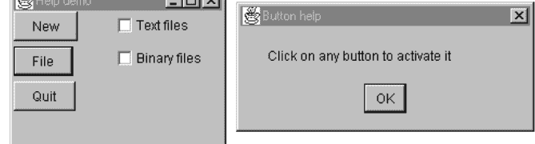

**图 16.6** 一个简单的帮助演示，根据按下 F1 键时选中的控件不同，弹出不同的消息。

在这个示例中，用户选择了“退出”（Quit）键，该键没有关联特定的帮助消息。因此，链将帮助请求转发给通用的按钮帮助对象，该对象在右侧显示消息。

要编写这个帮助链系统，我们从一个通用的具体 `HelpWindow` 类开始，它对 `Chain` 接口的三个方法有空实现。然而，该类在将消息转发给该项之前，会检查链中的下一项是否非空。

```java
public class HelpWindow implements Chain {

    protected Chain nextChain;

    protected String mesg;

    public HelpWindow() {
        mesg = "";
    }

    public void addChain(Chain c) {
        nextChain = c;
    }

    public Chain getChain() {
        return this;
    }

    public void setToChain(Component c) {
        sendChain(c);
    }

    protected void sendChain(Component c) {
        if (nextChain != null) {
            nextChain.sendChain(c);
        }
    }
}
```

我们为想要生成的每个帮助消息类别派生特定的子类。在这种情况下，我们想要为以下内容提供帮助消息：

- 新（New）按钮
- 文件（File）按钮
- 通用按钮
- 控件（覆盖复选框）
- 窗口本身

我们为这些内容编写类并按如下方式组合成链：

```java
Chain chain = new FileHelp(this);
FileHelp help = new FileHelp(this);
chain.addChain(help);

ButtonHelp bhelp = new ButtonHelp(this);
help.addChain(bhelp);

ControlHelp controlHelp = new ControlHelp(this);
bhelp.addChain(controlHelp);

WindowHelp windowHelp = new WindowHelp(this);
controlHelp.addChain(windowHelp);
```

### 接收帮助命令

接下来，我们需要分配键盘监听器来查找 F1 键按下。你可能认为我们需要六个监听器：三个按钮、两个复选框和一个背景窗口。然而，我们实际上只需要一个监听器——针对 Frame 本身。这是因为 Java Swing 事件调度器会将这些事件转发给所有周围的（父级）组件。换句话说，`keyPressed` 事件按以下顺序接收到：

1. 选中的组件，
2. 包含组件的 Panel，以及
3. Frame。

这实际上是责任链的一种 Java 隐式实现，其中请求是 `keyPressed` 事件。因此，在程序的接口中构造事件监听器时，我们只需要定义 `KeyAdapter` 的子类来捕获 F1 键：

```java
// 用于处理按键的内部类
class KeyAdapter extends KeyAdapter {

    public void keyPressed(KeyEvent e) {
        if (e.getKeyCode() == KeyEvent.VK_F1) {
            sendToChain((Component) getFocusOwner());
        }
    }
}
```

并为 Frame 添加按键监听器：

```java
helpKey = new KeyAdapter();
addKeyListener(helpKey);
```

注意，我们通过 `getFocusOwner()` 获取当前焦点的组件，然后将该组件沿链传递，以获取系统提供的最具体的帮助消息。每个帮助对象都有一个测试来检查该对象是否是该帮助消息所描述的。要么显示消息，要么转发给下一个元素。对于“文件”按钮，类看起来如下：

```java
public class FileHelp extends HelpWindow {

    String message, title;
    int icon;
    JFrame frame;

    public FileHelp(JFrame f) {
        message = "Select to button help";
        title = "File button help";
        icon = JOptionPane.DEFAULT_OPTION;
        frame = f;
    }

    public void sendToChain(Component c) {
        if (c instanceof JButton) {
            JButton b = (JButton) c;
            if (b.getText().equals("File")) {
                JOptionPane.showMessageDialog(frame, message, title, icon);
            } else {
                sendToChain(c);
            }
        }
    }
}
```

### 链还是树？

图 16.7 显示了该帮助系统的完整类图。

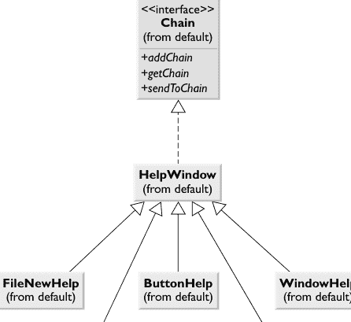

**图 16.7** 该帮助系统的类图。

责任链并不必须是线性的。它可以是一个具有多个入口点的树形结构，如图 16.8 所示。

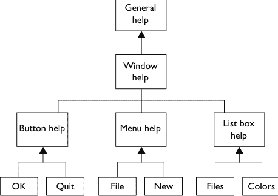

**图 16.8** 以树形结构实现的责任链。

然而，这种结构似乎意味着每个按钮、菜单或其他控件都知道如何进入。这种复杂性没有理由。相反，我们可以将类对齐成单链，从底部开始，逐个向右移动，直到遍历整个系统，如图 16.9 所示。

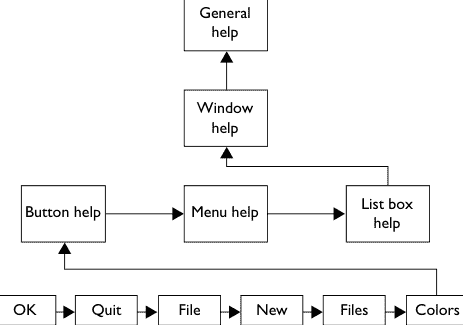

**图 16.9** 以线性方式实现的责任链。

### 请求的种类

沿链传递的请求或消息可能比示例中使用的字符串复杂得多。它可能包含各种数据类型或带有多个方法的完整对象。

### Java 示例

正如提到的，当我们在讨论帮助系统时，任何组合组件序列（如 `JComponent`/`Panel`/`Frame`）都会导致事件向上传递到周围组件。这是责任链的清晰实现。

## 责任链的后果

使用责任链模式具有以下后果：

- 该模式的主要目的与其他模式一样，是为了减少对象之间的耦合。对象需要知道如何向其他对象转发请求。
- 链中的每个对象都是自包含的。它不知道其他对象，只需要决定自己是否可以满足请求。这使得编写每个对象以及构建链变得非常容易。
- 你可以决定链中的最后一个对象是用某种方式处理接收到的所有请求，还是丢弃它们。然而，为了有效，你必须知道哪个对象将是链最后一个。
- 最后，由于 Java 不支持多重继承，基本的 `Chain` 需要是一个接口而不是抽象类，这样单个对象就可以继承自另一个有用的层次结构（正如我们在这里派生自 `JPanel` 一样）。这种方法的缺点是，你必须在每个模块中单独实现链接、发送和转发代码（或者正如我们所做的，通过子类实现 `Chain` 接口的具体类）。

## 思考题

- 如何使用责任链模式实现电子邮件过滤器？
- 编写一个使用责任链模式处理通用网关接口 (CGI) 表单的 Java Servlet。

## CD-ROM 中的程序

| 程序 | 描述 |
| :--- | :--- |
| `\ChainOfResponsibility\ImageChain\Chainer.java` | 允许输入命令以导致屏幕界面中的视觉对象发生变化。 |
| `\ChainOfResponsibility\HelpChain\Helpchain.java` | 展示了简单的帮助系统如何向日益通用的组件传递消息。 |

# 第 17 章 命令模式

责任链模式沿着类链转发请求，而命令模式仅将请求转发给特定的对象。它将对特定动作的请求封装在一个已知的公共接口内部。它让客户端能够发出请求的能力，而无需了解将要执行的实际动作的任何信息，并允许你在不以任何方式影响程序的情况下更改该动作。

### 动机

当你构建 Java 用户界面时，你提供各种控件——菜单项、按钮、复选框等——来允许用户告诉程序要做什么。当用户选择这些控件之一时，程序会接收到一个 `ActionEvent`，它必须通过实现 `ActionListener` 接口的 `actionPerformed` 方法来捕获该事件。

假设我们构建了一个非常简单的程序，允许我们选择菜单项 `File | Open` 和 `File | Exit`，并点击标记为 `Red` 的按钮，将窗口的颜色变为红色。该程序如图 17.1 所示。

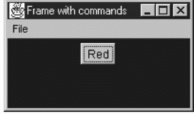

**图 17.1** 一个从按钮和菜单项接收 `actionPerformed` 事件的简单程序。

该程序由一个文件菜单对象组成，其中添加了 `mnuOpen` 和 `mnuExit` 菜单项。它还包含一个名为 `btnRed` 的按钮。点击这些任何一个情况都会触发 `ActionEvent`，生成对 `actionPerformed` 方法的调用，如下：

```java
public void actionPerformed(ActionEvent e) {
    Object obj = e.getSource();
    if (obj == mnuOpen) {
        // 打开文件
    }
    if (obj == mnuExit) {
        exitClicked();
    }
    if (obj == btnRed) {
        redClicked(); // 变为红色
    }
}
```

这里是我们在 `actionPerformed` 方法中调用的三个私有方法：

```java
private void exitClicked() {
    System.exit(0);
}

private void fileOpen() {
    FileDialog dlg = new FileDialog(this, "Open a file");
    dlg.show(); // FileDialog.LOAD
}

private void redClicked() {
    p.setBackground(Color.red);
}
```

现在，只要只有几个菜单项和按钮，这种方法运行良好，但当有几十个菜单项和几个按钮时，`actionPerformed` 代码可能会变得非常混乱。因为在使用像 Java 这样的面向对象的语言时，我们希望避免使用大量的语句来识别选中的对象。相反，我们希望找到一种方法让每个对象直接接收其命令。

### 命令对象

确保每个对象都直接接收自己的命令的一种方法是使用命令模式并创建单独的命令对象。命令对象始终有一个 `Execute()` 方法，当对象上发生动作时就会调用该方法。最简单的情况下，一个命令对象至少实现以下接口：

```java
public interface Command {
    public void Execute();
}
```

我们使用此接口将 `actionPerformed` 方法简化为如下：

```java
public void actionPerformed(ActionEvent e) {
    Command cmd = (Command) e.getSource();
    cmd.Execute();
}
```

然后我们就可以为每个执行所需动作的对象提供 `Execute()` 方法，将“要做什么”的知识保留在它所属的对象内部，而不是让程序的其他部分来做这些决策。

命令模式的一个重要目的是让程序和用户界面对象与它们启动的动作完全分离。换句话说，这些程序对象之间应该是完全分离的，并且不需要知道其他对象是如何工作的。用户界面接收到一个命令并告诉命令对象执行它被指示完成的每一项职责。GUI 不需要也不应该需要知道将执行哪些任务。这使得 UI 类与特定命令的执行解耦，从而使得在不改变使用用户界面的类的情况下修改或完全更改动作代码成为可能。

你还可以使用命令对象来告诉程序何时资源可用，而不是立即执行。在这些情况下，我们正在对命令进行队列处理以便稍后执行。最后，你可以使用命令对象来记录操作，以便支持撤销（Undo）请求。

### 构建命令对象

对于像这样的程序，构建命令对象有几种方法，每种都有一些优点。我们从简单的开始：从 `JMenuItem` 和 `Button` 类派生新类，并在每个类中实现 `Command` 接口。以下是针对我们简单程序的 `Button` 和菜单类的扩展示例。

```java
class BtnRedCommand extends Button implements Command {
    public BtnRedCommand(String caption) {
        super(caption); // 初始化按钮
    }

    public void Execute() {
        p.setBackground(Color.red);
    }
}

class FileExitCommand extends MenuItem implements Command {
    public FileExitCommand(String caption) {
        super(caption); // 初始化新的
    }

    public void Execute() {
        System.exit(0);
    }
}
```

这确实让我们简化了在 `actionPerformed` 方法中的调用，但它要求我们为想要执行的每个动作创建并实例化一个新类。

```java
mnuOpen.addActionListener(new FileOpenCommand());
mnuExit.addActionListener(new FileExitCommand());
btnRed.addActionListener(new BtnRedCommand());
```

通过让它们成为内部类，我们避免了向这些类传递必要参数的问题。这使得 Panel 和 Frame 对象直接可用。

然而，内部类并不是一个好主意，因为任何 GUI 组件必须留在主类内部。当然，如果我们愿意向这些类传递必要参数，它们可以是独立的。

```java
Panel p = new Panel();
add(p);
```

现在，虽然将动作封装在命令对象中有益处，但将该对象绑定到触发动作的元素（如菜单项或按钮）中并不是命令模式的核心。相反，命令对象应该与调用客户端分离，以便我们可以单独更改调用程序和动作细节。与其让命令成为菜单或按钮的一部分，我们让菜单和按钮类成为独立存在的命令对象的容器。我们因此实现了 `CommandHolder` 接口的 UI 元素。

```java
public interface CommandHolder {
    public void setCommand(Command cmd);
    public Command getCommand();
}
```

此接口表示有一个方法可以将命令对象放入调用对象中，并有一个方法获取该命令对象并调用其 `Execute()` 方法。

然后我们创建实现此接口的 `CmdMenu` 类。


```java
public class cmdMenu extends JMenuItem
    implements CommandHolder {
    protected Command menuCommand; // 内部拷贝
    protected JFrame frame;

    public cmdMenu(String name, JFrame frm) {
        super(name);
        frame = frm; // 包含框架
    }
    public void setCommand(Command cmd) {
        menuCommand = cmd; // 保存命令
    }
    public Command getCommand() {
        return menuCommand; // 返回命令
    }
}
```

这实际上简化了我们的程序——我们不需要为执行的每个动作创建一个单独的菜单类。我们只需要创建菜单的实例并向它们传递不同的命令对象。

```java
mnuOpen = new cmdMenu("Open...", this);
mnuFile.add(mnuOpen);
mnuOpen.setCommand(new fileCommand(this));

mnuExit = new cmdMenu("Exit", this);
mnuFile.add(mnuExit);
mnuExit.setCommand(new fileExitCommand());
```

## 第 17 章 命令模式

```java
mnuExit = new cmdMenu("Exit", this);
mnuExit.setCommand(new ExitCommand());
mnuFile.add(mnuExit);
```

我们创建一个类似的 `cmdButton` 类。

```java
btnRed = new cmdButton("Red", this);
btnRed.setCommand(new RedCommand(this, jp));
p.add(btnRed);
```

我们仍然必须创建单独的 `Command` 对象，但它们不再是用户界面类的一部分了。例如，`FileCommand` 类如下：

```java
public class FileCommand implements Command {
  JFrame frame;

  public FileCommand(JFrame fr) {
    frame = fr;
  }

  public void Execute() {
    FileDialog fDlg = new FileDialog(frame, "Open file");
    fdlg.show(); //显示文件对话框
  }
}
```

然后，我们的 `actionPerformed` 方法需要从触发动作的 UI 对象获取实际的 `Command` 对象，然后执行该命令。

```java
public void actionPerformed(ActionEvent e) {
  CommandHolder obj = (CommandHolder)e.getSource();
  obj.getCommand().Execute();
}
```

这只比我们原始的程序稍微复杂一点，而且再次避免了 `actionPerformed` 方法需要执行一系列 `if` 测试。

我们可以在图 17.2 的 UML 图中清晰地看到这些类和接口之间的关系。

# Java 语言中的命令模式

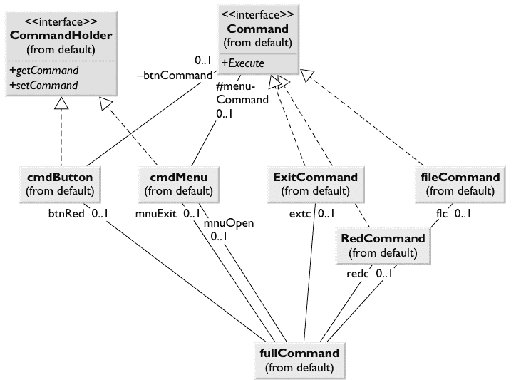

**图 17.2** 三个实现 `Command` 接口的不同对象以及两个实现 `CommandHolder` 接口对象的类结构。

在这里我们看到 `cmdButton` 和 `cmdMenu` 实现了 `Command` 接口，并且 UI 类 `fullCommand` 中有两个 `cmdMenu` 实例。图还显示了 `ExitCommand`、`RedCommand` 和 `fileCommand` 类，它们实现了 `Command` 接口，并在 `fullCommand` UI 类中实例化。这最终就是我们一直在暗示的命令模式的完整实现。

# Java 语言中的命令模式

但仍然有两种方法可以实现这一点。如果你给每个控件都分配它自己的 `ActionListener`，你就是在为每个控件都创建了单独的对象。事实上，这正是 Java 1.1 事件模型设计者的初衷。我们已经习惯于使用多个 `if` 测试例程，因为它们出现在大多数简单的示例文本中，即使它们不是捕捉这些事件的最佳方法。

### 命令模式的后果

命令模式的主要缺点是小类的激增，如果是内部类，它们会弄乱主类；如果是外部类，它们会弄乱程序的命名空间。

即使我们将所有的 `actionPerformed` 事件放在一个篮子里，我们通常也会调用私有方法来执行实际功能。事实证明，这些私有方法和我们的类一样长，因此内部类和外部类方法在复杂性上通常没有区别。

### 匿名内部类

我们可以通过创建未命名的内部类来减少命名空间的混乱。我们通过在需要的地方声明类的实例来实现这一点。例如，

我们可以一次性创建红色按钮以及用于操作背景的类。

```java
btnRed.addActionListener(new ActionListener() {
  public void actionPerformed(ActionEvent e) {
    p.setBackground(Color.red);
  }
});
```

然而，这并不非常易读，而且并没有真正减少未命名类的数量，因为编译器即使为这些未命名的类也会生成类文件。

### 提供撤销功能

使用命令模式的另一个主要原因是它提供了一种方便的方法来存储和执行撤销（Undo）功能。每个 `Command` 对象都可以记住它刚刚做了什么，并在要求时恢复该状态，前提是计算和内存需求不是过大。在顶层，我们只需定义 `Command` 接口具有两个方法。

```java
public interface Command {
  public void Execute();
  public void undo();
}
```

然后我们必须设计每个 `Command` 对象以保留最后执行的操作记录，以便它可以进行撤销。这比表面看起来要复杂一点，因为有许多交错的命令被执行，然后撤销可能会导致某些滞后（hysteresis）。此外，每个命令都需要存储足够关于该命令每次执行的信息，以便它知道具体哪些内容将被撤销。

撤销命令的问题实际上包含两个部分。首先，我们必须保留一个已执行命令的列表，其次，每个命令必须保留其执行列表。为了查看我们如何使用命令模式来执行撤销操作，让我们考虑图 17.3 中的程序，它在我们每次点击 Undo 按钮时画出连续的线条。我们可以撤销最后一条线。

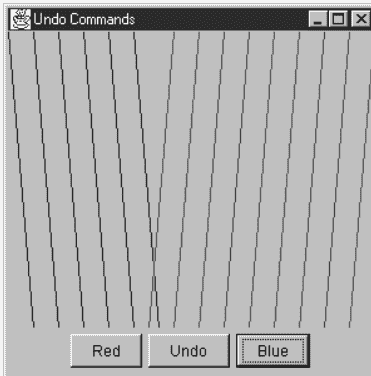

**图 17.3** 每次点击 Undo 按钮就会绘制连续线条的程序。

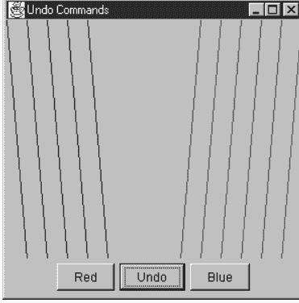

**图 17.4** 点击 Undo 按钮后与 17.3 相同的程序。

任何可撤销程序都需要一个已执行命令的顺序列表。每当我们点击任何按钮时，我们就将其相应的命令添加到列表中。

```java
public void actionPerformed(ActionEvent e) {
    CommandHolder cmdh = (CommandHolder)e.getSource();
    Command cmd = cmdh.getCommand();
    undoCommand.add(cmd); //添加到列表
    cmd.Execute(); //执行
}
```

此外，我们添加 `Command` 对象的列表维护在 `Undo` 对象内部，以便它可以方便地访问该列表。

```java
public class undoCommand implements Command {
    Vector undoList;

    public undoCommand() {
        undoList = new Vector(); // 用于撤销的命令列表
    }

    public void add(Command cmd) {
        if (!(cmd instanceof undoCommand)) {
            undoList.add(cmd); // 将命令添加到列表
        }
    }

    public void Execute() {
        int index = undoList.size() -1;
        if (index > 0) {
            // 获取最后执行的命令
            Command cmd = (Command)undoList.elementAt(index);
            cmd.undo(); // 撤销
            undoList.remove(index); // 从列表中删除
        }
    }

    public void undo() {} // 无任何操作
}
```

`Undo` 对象保留的是 `Command` 列表而不是实际数据的列表。每个 `Command` 对象都调用其 `undo` 方法来执行实际操作。注意由于 `undoCommand` 对象实现了 `Command` 接口，它也必须有一个 `undo` 方法。然而，撤销连续撤销操作的想法对于这个简单的程序来说有点复杂。因此，你应该注意 `add` 方法将除 `undoCommand` 本身以外的所有命令添加到列表中，因为我们刚刚决定撤销撤销命令是没有意义的。

绘制红色和蓝色线条的 `Command` 对象继承自父类 `drawCommand`。派生的 `redCommand` 和 `blueCommand` 类使用不同的颜色并从窗口的相对两侧开始。每个类

它在 `Vector` 中维护了一个待绘制的行列表，表现为一系列 `drawData` 对象，这些对象包含每条线的坐标。从红色或蓝色线条中撤销某条线意味着从 `drawList` `Vector` 中移除最后一个 `drawData` 对象。任一命令都会强制屏幕重绘。

```java
//redCommand 和 blueCommand 的父类
public class drawCommand implements Command {
    protected Vector drawlist;
    protected int
        x, y, dx, dy;
    protected Color
        color;
    protected JPanel p;
}
```

```java
public void drawCommand(JPanel pn) {
    drawList = new Vector();
    p = pn;                // 留我们要绘制的面板
}
```

```java
public void Execute() {
    drawList.add(new drawData(x, y, dx, dy));
    x += dx;                //移动到下一个位置
    y += dy;
    p.repaint();
}
```

```java
public void undo() {
    int index = drawList.size() -1;
    // 从列表中移除最后绘制的线条
    if(index <= 0) {
        drawData d = (drawData)drawList.elementAt(index);
        drawList.remove(index);
        x = d.getX();            //重置 x 和 y
        y = d.getY();            //到上一次使用的位置
    }
    p.repaint();
}
```

```java
public void draw(Graphics g) {
    // 绘制列表中剩余的所有线条
    // 由面板的 paint 方法调用
    Dimension sz = p.getSize();
    g.setColor(color);
    for (int i=0; i < drawList.size(); i++) {
        drawData d = (drawData)drawList.elementAt(i);
        g.drawLine(d.getX(), d.getY(),
            d.getX()+dx, d.getY()+sz.height);
    }
}
```

### 提供撤销功能

`drawCommand` 类中的 `draw` 方法会重新绘制 `Command` 对象存储的整条线条列表。这两个 `draw` 方法是从 `undoCmd` 主类中封装面板的 `paint` 方法调用的。

```java
public class paintPanel extends JPanel {
    // 内部类，通过调用两个对象的 draw 方法来// 绘制两组线条
    public void paint(Graphics g) {
        Dimension sz = getSize();
        // 擦除背景
        g.setColor(Color.lightGray);
        g.fillRect(0, 0, sz.width, sz.height);
        //red_command.draw(g);
        blue_command.draw(g);
    }
}
```

我们在此撤销程序中使用的类如图 17.5 所示。

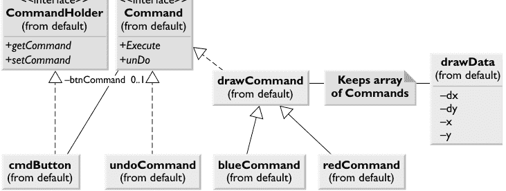

**图 17.5** 在命令模式实现中用于实现 Undo 的类。

## 思考题

- 1. 点击列表框中的项目和单选按钮构成了命令。对多选列表框的点击也可以表示为命令。设计一个包含这些功能的程序。

- 2. 一个彩票系统使用受限于 1 到 50 之间整数的随机数生成器。选择是在随机计时器选择的间隔内进行的。每次选择必须是唯一的。设计命令模式来每周选择中奖号码。

## CD-ROM 中的程序

| 程序 | 描述 |
|---|---|
| \Command\commandObject\testCommand.java | 扩展菜单和按钮类，作为简单的命令对象。 |
| \Command\actionCommand\actionCommand.java | 为每个按钮或多项选择使用独立的监听器。 |
| \Command\fullCommand\fullCommand.java | 从按钮和菜单创建独立的 `CommandHolder` 类，并创建独立的 `Command` 对象来执行命令。 |
| \Command\Undo\undoCmd.java | 使用两个按钮绘制一系列彩色斜线，并使用 `Undo` 按钮撤销它们。 |

# 第 18 章

## 解释器模式

有些程序受益于拥有一种语言，用来描述它们可以执行的操作。解释器模式通常处理的是为该语言定义一种语法，并使用该语法来解释该语言的语句。

# 适用动机

当一个程序呈现出它能够处理的许多不同但又相似的情况时，使用一种简单的语言来描述这些情况，然后让程序解释这种语言将是有益的。此类情况可以像各种办公套件提供的宏语言记录功能那样简单，也可以像 Visual Basic for Applications (VBA) 那样复杂。VBA 不包含在 Microsoft Office 产品中，但也可以嵌入任何第三方产品中。

一个问题是识别何时某种语言会有帮助。宏语言记录器记录菜单和按键操作以备以后回放，勉强算是一门语言；它可能实际上没有书面形式或语法。相比之下，VBA 等语言非常复杂，但远超单个应用程序开发者的能力。此外，嵌入 VBA、Java 或 SmallTalk 等商业语言通常需要昂贵的许可费用——这使得它们对于除了最大的开发者之外的所有人都失去了吸引力。

### 适用性

正如《Smalltalk 伴侣》提到的，识别解释器对解决大部分问题很有帮助的情况，而没有经过正式语言/编译器训练的程序员往往会忽视这种方法。这种情况并不多，但有三种情况适用了语言：

- 当你需要一个命令解释器来解析用户命令时：用户可以输入查询并获得答案。

- 当程序必须解析方程时：这种情况显而易见。考虑一个可以计算数学表达式的程序。


- 当程序必须产生不同类型的输出时：这种情况不明显但非常有用。考虑一个可以渲染界面的程序。

# 简单报告示例

让我们考虑一个可以处理五列数据的报告生成器。假设我们有游泳比赛的结果：

| 姓名 | 年龄 | 俱乐部 | 时间 |
|---|---|---|---|
| Amanda McCarthy | 12 | WCA | 29.28 |
| Jamie Falco | 12 | HHNS | 29.80 |
| Meaghan O'Donnell | 12 | EDST | 30.00 |
| Greer Gibbs | 12 | CDEV | 30.04 |
| Rhiannon Jeffrey | 11 | YYW | 30.04 |
| Sophie Connolly | 12 | WAC | 30.05 |
| Dana Helyer | 12 | ARAC | 30.18 |

五列名称分别是 `fname`、`name`、`age`、`club` 和 `time`。如果我们考虑 51 名运动员的完整结果，我们可能想按俱乐部、姓氏或年龄对这些结果进行排序。我们可以根据这些数据产生若干份报告，其中列的顺序和排序都会发生变化，因此语言是处理这些报告的一种有效方法。

我们将定义一个非常简单的非递归排序语法：

`Print lname club time Sortby Thenby time`

为了本示例，我们将语法中的三个动词定义为：

- `Print`
- `Sortby`
- `Thenby`

并将五列名称定义为：

```
fname
name
age
club
time
```

最后，语法只包含一个主词，虽然每个语句都是声明，但它没有赋值语句或计算能力，简之相当于：

> `Print var[var] [sortby [thenby var]]`

## 解释语言

语言的解释分为三个步骤：

1. 将语言符号解析为标记。
2. 将标记归约为动作。
3. 执行动作。

我们通过使用 `StringTokenizer` 扫描每个语句来解析语言为标记，然后为每个单词替换数字。通常解析器会将每个解析出的标记推入栈中——我们在这里也使用这种技术。我们使用 `Vector` 实现该 `Stack` 类，它包含 `push`、`pop`、`top` 和 `nextTop` 方法用于检查和操作栈的内容。

语言解析完成后，栈的结构如下表所示：

| 类型 | 标记 (Token) |
| --- | --- |
| Var | Time |
| Verb | Thenby |
| Var | Club |
| Verb | Sortby |
| Var | Time |
| Var | Club |
| Var | Frname |
| Var | Lname |
| Verb | Print |
| 栈顶 (Top of stack) | |

然而，我们很快意识到，动词 `Thenby` 除了起到澄清作用外，并没有实际的意义。我们更有可能解析这些标记并跳过 `Thenby-together`。此时，初始栈看起来如下所示：

```
Time
Club
Sortby
Time
Club
Frname
Lname
Print
```

### 解析中使用的对象

实际上，我们并没有向栈中推入数字标记，而是推入一个同时具有类型（`type`）和值（`value`）属性的 `ParseObject` 对象。

```java
public class ParseObject {
    public static final int VERB = 1000, VAR = 1010,
    MULTVAR = 1020;

    protected int value;
    protected int type;

    public int getValue() { return value; }
    public int getType() { return type; }
}
```

这些对象可以采取 `VERB` 或 `VAR` 类型。然后，我们将此对象扩展为 `ParseVerb` 和 `ParseVar` 对象，它们的 `value` 字段可以分别针对 `ParseVerb` 采取 `PRINT` 或 `SORT`，以及针对 `ParseVar` 采取 `FRNAME`、`LNAME` 等。为了后续用于约简解析列表，我们进一步从 `ParseVerb` 派生出 `Print` 和 `Sort` 对象。这形成了图 18.1 所示的层次结构。

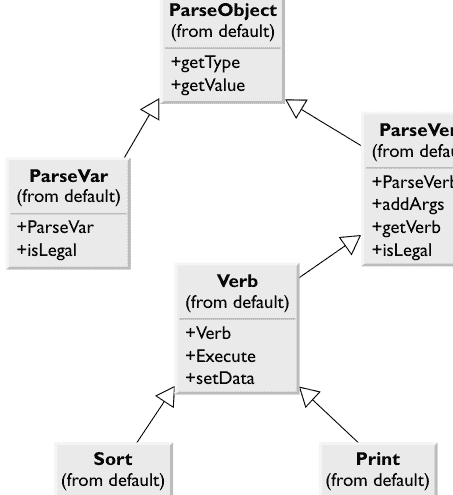

**图 18.1** 解释器程序的简单解析层次结构。

解析过程仅如下代码所示，它使用了 `StringTokenizer` 和 `ParseObjects`：

```java
public class Parser implements Command {
    private Stack stk;
    private Vector actionList;
    private KidData kdata;
    private Data data;
    private JawtList ptable;
    private Chain chain;

    public Parser(String line) {
        stk = new Stack();
        actionList = new Vector(); //actions 累积
        buildStack(line);
        buildChain(); //构建解释器链
    }

    public void setData(KidData k, JawtList pt) {
        data = new Data(k.getData());
        ptable = pt;
    }

    //执行解析和命令行的解释
    public void Execute() {
        while (stk.hasMoreElements()) {
            chain.slideTo(stk);
        }
        //执行执行
        for (int i = 0; i < actionList.size(); i++) {
            Verb v = (Verb)actionList.elementAt(i);
            v.setData(data, ptable);
            v.Execute();
        }
    }

    protected ParseObject tokenize(String s) {
        ParseObject obj = getVerb(s);
        if (obj == null) {
            obj = getVar(s);
        }
        return obj;
    }

    protected ParseVerb getVerb(String s) {
        Verb v;
        v = new ParseVerb(s);
        if (v.isLegal()) {
            return v.getVerb(s);
        }
        else
            return null;
    }

    protected ParseVar getVar(String s) {
        ParseVar v;
        v = new ParseVar(s);
        if (v.isLegal()) {
            return v;
        } else
            return null;
    }
}
```

如果 `ParseVerb` 和 `ParseVar` 类识别出该单词，它们会返回 `isLegal` 设置为 `true` 的对象。

```java
public class ParseVerb extends ParseObject {
    static final int PRINT = 100, SORTBY = 110, THENBY = 120;
    protected Vector args;

    public ParseVerb(String s) {
        args = new Vector();
        s = s.toLowerCase();
        value = -1;
        type = VERB;
        if (s.equals("print")) value = PRINT;
        if (s.equals("sortby")) value = SORTBY;
    }

    public ParseVerb getVerb(String s) {
        switch (value) {
            case PRINT:
                return new Print(s);
            case SORTBY:
                return Sort(s);
        }
        return null;
    }
}
```

## 栈约简

栈上的标记具有以下形式：

- Var
- Verb
- Var
- Var
- Verb

我们一次对栈进行约简，将连续的 `Var` 折叠为 `MultVar`，直到参数被折叠到动词对象中，如图 18.2 所示。

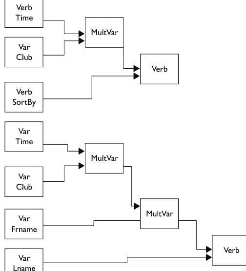

**图 18.2** 解析过程中栈如何进行约简。

当栈约简为一个动词时，该动词及其参数被放入操作列表（action list）中。当栈为空时，执行这些操作。创建一个作为 `Command` 对象的 `Parser` 类，并在用户界面上的按钮被点击时执行它，便完成了整个过程。

```java
public void actionPerformed(ActionEvent e) {
    Parser p = new Parser();
}

public Parser(String line) {
    stk = new Stack<>();
    actionList = new Vector(); //动作在此积累 (actions accumulate here)

    buildStack(line); // 构建栈 (construct a stack of tokens)
    buildChain(); // 构建解释器链 (construct an interpreter chain)
}

private void buildStack(String line) {
    // 解析输入令牌并构建堆栈
    StringTokenizer tok = new StringTokenizer(line);
    while(tok.hasMoreElements()) {
        ParseObject token = tokenizer(tok.nextToken());
        if(token != null) {
            stk.push(token);
        }
    }
}

private void buildChain() {
    chain = new VarVarParse(); // 链的开始
    MultivarVarParse mvmp = new MultivarVarParse();
    chain.addChain(mvmp);
    MultivarVarParse mvmp2 = new MultivarVarParse();
    mvmp.addChain(mvmp2);
    VerbMultVarParse vrvp = new VerbMultVarParse();
    mvmp2.addChain(vrvp);
    VerbVarParse vvp = new VerbVarParse();
    vrvp.addChain(vvp);
    VerbAction va = new VerbAction(actionList);
    vvp.addChain(va);
}
```

该类还会将栈通过链传递，直到栈为空，然后执行积累在 `actionList` 列表的动词。

```java
// 执行命令行的解析和解释
public void Execute() {
    while (stk.hasMoreElements()) {
        chain.sendToChain(stk);
    }
    // 现在执行动词
    for (int i = 0; i < actionList.size(); i++) {
        Verb v = (Verb)actionList.elementAt(i);
        v.setData(data, ptable);
        v.Execute();
    }
}
```

图 18.4 显示了最终的视觉化程序。

## CD-ROM 中的程序

181

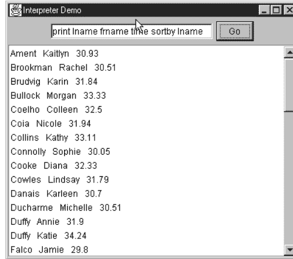

**图 18.4** 解释器模式作用于文本字段中的简单命令。

## 解释器模式的后果

使用解释器模式具有以下后果：

1. 每当你向程序中引入解释器时，你都需要为程序用户提供一种简单的方法来以该语言输入命令。这可以通过之前的宏录制按钮实现，也可以通过上一个程序中的可编辑文本字段来实现。

2. 引入一种语言及其随附的语法需要对拼写错误的术语或位置错误的语法元素进行大量的错误检查。除非有某些模板代码来实现这种检查，否则这很容易消耗大量的编程精力。此外，设计和实现通知用户这些错误的有效方法并不是容易完成的。

   在本章的解释器示例中，唯一的错误处理是：未识别的关键字不会转换为 `ParseObjects` 并推入栈中。因此，什么都不会发生，因为生成的序列可能无法被成功解析。如果可以解析，拼写错误的关键字所代表的项目将不会包含在内。

3. 你还可以考虑从接口、单选按钮、命令按钮和列表框自动生成语言。虽然拥有这样的界面似乎消除了对语言的需要，但序列和计算的相同要求仍然适用。当你必须有一种方法来指定顺序操作的顺序时，语言是一个很好的方法，即使该语言是从用户界面生成的。

4. 解释器模式的优势在于，一旦你构建了通用的解析和简化工具，就可以相当容易地扩展或修改语法。一旦基础建立，你也可以轻松地添加新的动词或变量。

5. 在之前的 `Parser` 类所示的简单解析方案中只有六种情况需要考虑，它们显示为一系列简单的 `if` 语句。如果你有比这多的情况，《设计模式》建议为每种情况创建一个类。这使得语言扩展变得更容易，但缺点是产生大量的小类。

6. 最后，随着语法的变得越来越复杂，你面临着创建一个难以维护的程序的风险。

虽然解释器并不常用于解决通用编程问题，但下一节讨论的迭代器模式将是你将使用的最常用的模式之一。

## 思考题

1. 设计一个系统来计算简单二次表达式 $4x^2 + 3x -4$ 的结果，用户可以输入 $x$ 或 $x$ 的范围，并可以输入方程。

## CD-ROM 中的程序

| 程序 | 描述 |
| --- | --- |
| `\Interpreter\ObjInterp\nInterpdemo.java` | 演示了基于对象的报告命令解释器。 |
| `\Interpreter\BaseInterp\nInterpDemo.java` | 为解析器使用了所有对象，但展示了非责任链版本的解析版本。 |

# 第 19 章

## 迭代器模式

迭代器模式是最简单且最常用的设计模式之一。它允许你使用标准接口遍历数据列表或数据集合，而无需知道数据内部表示的细节。你还可以定义特殊的迭代器来执行某些特殊处理并只返回数据集合中的指定元素。

### 动机

迭代器模式之所以有用，是因为它提供了一种定义的方法来遍历一组数据元素，而不会暴露类内部正在发生的情况。它是一个接口；因此，你可以以任何对你返回的数据的数据方便的方式实现它。《设计模式》建议迭代器的合适接口可能是如下的：

```java
public interface Iterator {
    public Object First();
    public Object Next();
    public boolean isDone();
    public Object CurrentItem();
}
```

使用此接口，你可以移动到列表顶部、遍历列表、发现是否有更多元素并找到当前的列表项。它很容易实现并具有某些优势。然而，Java 中首选的迭代器是下面的：

```java
public interface Enumeration {
    public boolean hasMoreElements();
    public Object nextElement();
}
```

### Java 中的 Enumeration

没有用于遍历列表的方法似乎具有局限性。然而，Java 中首选的迭代器是下面的。这很容易实现，因为 `elements` 方法只是给了我们那个访问权限。所以我们只需要写一个返回指定俱乐部孩子的 `Enumeration`。

### 代码

### 示例代码

为了获取集合中所有孩子的 `Enumeration`，我们只需返回 `Vector` 自身的 `Enumeration`。

```java
public Enumeration elements() {
    return kids.elements();
}
```

### 过滤迭代器

拥有清晰定义的遍历集合的方法是有用的。然而，你还可以定义过滤迭代器，在返回数据之前对其进行计算。例如，你可以按照某种特定方式返回数据，或者只返回符合特定标准的对象。那么，而不是为过滤 Enumeration 许多非常相似的接口，你可以提供一个返回每类型 Enumeration 的方法，每种类型的方法相同。

### 过滤 Enumeration


假设我们只想枚举属于某个俱乐部的孩子。我们需要一个能够访问 `KidData` 类数据的特殊 `Enumeration` 类。这很容易实现，因为 `elements` 方法只是给了我们那个访问权限。所以我们只需要写一个返回属于指定俱乐部孩子的 `Enumeration`。

```java
public class KidClub
    implements Enumeration {
        private String clubMask; // 俱乐部名称
        private Kid kid; // 下一个返回的孩子
        private Enumeration ke; // 获取所有孩子
        private KidData kdata; // 包含孩子的类

        public KidClub(KidData kd, String club) {
            clubMask = club; // 保存俱乐部
            kdata = kd; // 拷贝类
            kid = null; // 默认
            ke = kdata.elements(); // 获取枚举器
        }
}
```

```java
public boolean hasMoreElements() {
    // 如果还有其他属于
    // 指定俱乐部的孩子，则返回 true
    boolean found = false;
    while (ke.hasMoreElements() && !found) {
        kid = ke.nextElement();
        found = kid.getClub().equals(clubMask);
    }
    if (!found) {
        kid = null; // 如果没有剩余，则设为 null
    }
    return found;
}
```

```java
public Object nextElement() {
    if (kid != null) {
        return kid;
    } else {
        // 如果访问已超过末尾，则抛出异常
        throw new NoSuchElementException();
    }
}
```

所有的工作都在 `hasMoreElements()` 方法中完成。该方法扫描集合以寻找属于构造函数中指定的另一个孩子，并将该孩子保存在 `kid` 变量中，或者将其设置为 null 并返回 true 或 false。`nextElement()` 方法返回该 `kid` 变量，如果没有更多孩子则抛出异常。在正常情况下，此异常永远不会抛出，因为 `hasMoreElements` 布尔值应该已经告知你不要调用另一个元素。

最后，我们需要添加一个方法 `kidsInClub` 到 `KidData` 来返回这个新的过滤后的枚举器。

```java
public Enumeration kidsInClub(String club) {
    return new KidClub(this, club);
}
```

该方法将 `KidClub` 实例及其初始化值传递给枚举类 `KidClub`。图 19.1 显示了一个简单的程序。该程序在左侧显示所有孩子，用孩子列表填充组合框，然后允许用户选择俱乐部。最后，它在右侧的列表框中填充属于单个俱乐部的孩子的名字。


图 19.1 一个说明过滤枚举器的简单程序。

类图如图 19.2 所示。


图 19.2 用于过滤枚举器的类。

注意，`KidData` 中的 `elements` 方法提供了一个枚举器，而 `KidClub` 类本身实际上就是一个枚举类。

## 迭代器模式的后果

使用迭代器模式具有以下后果：

1. **数据修改：** 使用迭代器产生的最重要问题涉及在数据更改时进行迭代。如果你的代码范围很广且偶尔移动到下一个元素，那么在你遍历的过程中，底层集合可能会被添加或删除元素。此外，另一个线程可能会更改集合。这个问题没有简单的解决方案。你可以通过将循环声明为 `synchronized` 来使 `Enumeration` 线程安全，但如果你想使用迭代器遍历循环并删除项，必须小心其后果。取决于你正在使用的存储机制，删除或添加元素可能意味着特定的元素被跳过或被访问两次。

2. **特权访问：** 枚举类可能需要对原始容器类的底层数据结构具有某些特权访问，以便遍历数据。如果数据存储在 `Vector` 或 `Hashtable` 中，实现这一点相当容易。但如果它是类包含的其他集合，你可能需要让迭代器成为容器类的派生类，并直接访问数据。C++ 中提供的 `friend` 类解决方案在 Java 中并不适用。

3. **外部与内部迭代器：** *设计模式* 描述了两种迭代器：外部的和内部的。到目前为止，我们只描述了外部迭代器。内部迭代器是直接遍历集合的方法，不需要用户的任何特定请求。外部迭代器在 Java 中不常见，但可以将数据值集合归一化到 0 和 1 之间或将所有字符串转换为特定的大小。通常情况下，外部迭代器提供了更多的控制，因为调用程序直接访问每个元素并决定是否对其进行操作。

## 组合类与迭代器

迭代器（在本例中为枚举器）也是遍历组合结构的极佳方式。在第 18 章开发的员工层级组合结构中，每个员工都包含一个 `Vector`，其 `elements` 方法允许你继续遍历该链。如果该员工没有下属，`hasMoreElements` 方法会返回 false。

## Java 1.2 中的迭代器

Java 1.2 引入了以下 `Iterator` 接口，它与 `Enumeration` 接口非常相似：

```java
public interface Iterator {
    public boolean hasNext();
    public Object next();
    public void remove();
}
```

`Iterator` 和 `Enumeration` 的区别在于 `Iterator` 更简单的命名和 `remove` 方法。`remove` 方法删除上一次从 `next` 方法返回的对象，并且对每个 `next` 方法只能调用一次。

在 Java 1.2 中，`Vector` 有一个 `iterator` 方法。然而，`Enumeration` 接口已被 `Iterator` 类取代。要遍历 `HashMap`，可以通过以下方式获取迭代器：

```java
private HashMap clubs;
Iterator enum = clubs.iterator();
```

## 思考题

1. `Iterator` 接口允许沿两个方向遍历列表。重写 `J2Iterator` 以允许这些额外功能。

## 光盘上的程序

| 程序 | 描述 |
| --- | --- |
| Iterator\IterDemo.java | 展示过滤后的列表。 |
| Iterator\J2IterDemo.java | 使用 Iterator 和 HashMap 存储俱乐部的相同程序。 |

## 控件之间的交互

视觉控件之间的交互非常复杂，即使在这个简单的示例中也是如此。每个视觉对象都需要了解两个或多个其他对象。这可能导致非常混乱的关系图，如图 20.3 所示。


图 20.3 图 20.1 和 20.2 所示的简单视觉界面中类之间复杂的交互。

中介者模式简化了这个系统，它是唯一感知系统中其他类的类。中介者通信的每个控件都被称为同事。每个同事在接收到用户事件时会通知中介者，中介者决定应该通知哪些其他类该事件。这种更简单的交互方案如图 20.4 所示。


图 20.4 中介者类简化了类之间的交互。

中介者的优势是显而易见的：它是唯一知道其他类的类，因此当其他一个类发生变化或添加其他界面控件类时，只有它需要被修改。

### 示例代码

让我们详细考虑此程序并决定每个控件是如何构造的。使用中介者类编写程序的主要区别在于每个类都需要感知中介者的存在。你首先创建一个中介者的实例，然后将中介者的实例传递给每个类的构造函数。

```java
Mediator med = new Mediator();
kidList = new KidList(med);
tx = new KTextField(med);
Move = new MoveButton(this, med);
Clear = new ClearButton(this, med);
.init();
```

我们为每个控件都创建了新类，这些类派生自基类，这样我们就可以在每个类中处理中介者操作。这两个按钮使用命令模式，并在初始化期间向中介者注册自己。以下是复制按钮；清除按钮具有类似的结构：

```java
public class CopyButton extends JButton
    implements Command {
    private Mediator med; // 中介者的副本
    public CopyButton(ActionListener fr,
        Mediator md) { // 创建按钮
        addActionListener(fr); // 添加其监听器
        med = md; // 拷贝中介者实例
        med.registerMove(this); // 向中介者注册
    }
    public void Execute() { // 执行复制
        med.Move();
    }
}
```

孩子名字列表基于最后两个示例中的列表，但进行了扩展，使得列表的数据加载和列表对中介者的注册都在构造函数中完成。此外，我们让封装类实现了 `ListSelectionListener`，并将对任何列表项的点击直接从该类传递给中介者。

```java
public class KidList extends JList
    implements ListSelectionListener {
    private KidData kdata;
    private Mediator med;

    public KidList(Mediator md) {
        super(20);
        kdata = new KidData("5free.txt");
        fillKidList();
        med = md;
        med.registerKidList(this);
        addListSelectionListener(this);
    }

    public void valueChanged(ListSelectionEvent ls) {
        JList obj = (JList) ls.getSource();
        if (obj.getSelectedIndex() >= 0)
            med.select();
    }

    private void fillKidList() {
        Enumeration ekid = kdata.elements();
        while (ekid.hasMoreElements()) {
            Kid k = (Kid) ekid.nextElement();
            add(k.getFirstName() + " " + k.getLastName());
        }
    }
}
```

文本框更加简单，因为每个文本框都向中介者注册了自己。

```java
public class KTextField extends JTextField {
    private Mediator med;

    public KTextField(Mediator md) {
        super(10);
        med = md;
        med.registerText(this);
    }
}
```

所有这些类的共同点是，每个类都知道中介者，并告诉中介者它的存在，以便中介者可以在恰当的时候向它发送命令。

中介者本身非常简单。它支持 `move`、`clear` 和 `select` 方法，并为每个控件提供了注册方法。

```java
private class Mediator {
    private ClearButton clearButton;
    private MoveButton moveButton;
    private KTextField ktext;
    private KidList klist;
    private PickedKidsList picked;

    public void move() {
        picked.add(ktext.getText());
        clearButton.setEnabled(true);
    }

    //----------------------
    public void init() {
        clear();
    }
    //----------------------
    public void clear() {
        ktext.setText("");
        moveButton.setEnabled(false);
        clearButton.setEnabled(false);
        picked.clear();
        klist.clearSelection();
    }
    //----------------------
    public void select() {
        String s = (String) klist.getSelectedValue();
        ktext.setText(s);
        moveButton.setEnabled(true);
    }
    //----------------------
    public void registerClear(ClearButton cb) {
        clearButton = cb;
    }
    //----------------------
    public void registerMove(MoveButton mv) {
        moveButton = mv;
    }
    //----------------------
    public void registerText(KTextField tx) {
        ktext = tx;
    }
    //----------------------
    public void registerPicked(PickedKidsList pl) {
        picked = pl;
    }
    //----------------------
    public void registerKidList(KidList kl) {
        klist = kl;
    }
}
```

## 系统的初始化

另一个最好委托给中介者的操作是所有控件的初始化。在我们启动程序时，每个控件必须处于已知状态。由于这些状态可能会随着程序的演进而变化，我们在中介者创建一个设置它们的方法。

```java
public void init() {
    clear();
}
```

## 中介者与命令对象

程序中的两个按钮是命令对象。我们在初始化它们时将它们作为 `ActionListener`。如第 17 章所述，这使得处理事件变得简单。

```java
public void actionPerformed(ActionEvent e) {
    Command comd = (Command) e.getSource();
    comd.Execute();
}
```

或者，我们可以将每个派生类注册为自己的监听器，并将结果传递给中介者。无论哪种情况，这都是我们在讨论命令模式时提到的解决方案。在这里，每个按钮都不需要了解其他界面类。图 20.5 显示了此类的类图。


图 20.5 命令对象与中介对象之间的交互。

## 中介者模式的后果

使用中介者模式有以下后果：

1. 当一个类的操作反映在另一个类的状态中时，中介者模式防止了类之间的纠缠。
2. 使用中介者使得更改程序行为变得容易。对于许多更改，你只需更改中介者，而保持程序的其他部分不变。
3. 在不更改任何内容的情况下，可以添加新的控件或其他类。
4. 中介者解决了每个命令对象不需要过多了解界面其他部分的对象和方法的问题。
5. 然而，中介者有时变成一个“神类”，对程序的其他部分拥有过多知识。这会导致中介者难以更改和维护。你可以通过将更多功能放入各个类以及中介者中来改善这种局面。每个对象应该执行自己的任务，而中介者应该管理对象之间的交互。
6. 每个中介者都是自定义编写的类，具有每个同事调用的方法，并知道每个同事可用的方法。这使得在不同项目中复用中介者代码变得困难。然而，大多数中介者非常简单，编写这些代码比任何其他方式管理复杂的对象交互要容易得多。

## 单接口中介者

这里描述的中介者模式充当了观察者模式，观察每个同事元素，每个元素对中介者都有自定义接口。另一种方法是为中介者拥有单一接口，并向其传递各种对象，告诉中介者执行哪些操作。

在这种方法中，我们避免注册活动组件，并为每个动作元素创建一个具有不同多态参数的单一动作方法。

```java
public void action(MoveButton mv) {}
public void action(ClearButton clrButton) {}
public void action(KidList klst) {}
```


因此，我们需要注册动作对象，例如按钮和源列表框，因为我们可以将它们作为通用动作方法的一部分进行传递。

同样，我们可以拥有一个每个同事（`Colleague`）都实现的单一 `Colleague` 接口，然后每个同事决定要执行什么操作。

## 实现问题

中介者（`Mediators`）并不限于用于视觉界面程序，尽管这是它们最常见的应用。当你面临解决多个对象之间复杂的通信问题时，就可以使用它们。

## 光盘中的程序

| 程序 | 描述 |
|---|---|
| `\Mediator\MedDemo.java` | 展示了中介者如何在两个按钮、一个文本字段和两个列表框之间进行调解。 |
| `\Mediator\SIMediator\SIMedDemo.java` | 展示了相同的程序，但对中介者使用单一动作接口。 |

## 第 21 章

## 备忘录模式 (Memento Pattern)

在本章中，我们将讨论如何使用备忘录模式保存对象的数据，以便以后恢复它。例如，你可能想保存草图或绘画程序中对象的颜色、尺寸、图案或形状。理想情况下，你可以在不让每个对象负责这项任务且不违反封装的情况下，保存并恢复这种状态。这就是备忘录模式的目的。

### 动机

对象通常不应该通过公共方法暴露过多的内部状态，但你仍然希望能够保存对象的整个状态，因为你可能以后需要恢复它。在某些情况下，你可以从公共接口（例如图形对象的绘制位置）获取足够的信息来保存和恢复这些数据。在其他情况下，颜色、阴影、角度与其他图形对象的连接关系需要保存，但这些信息无法轻易获取。这种数据的保存和恢复在支持撤销（`Undo`）命令的系统中很常见。

如果描述对象的所有数据都在公共变量中，那么保存到某些外部存储器并不困难。然而，这些数据使得整个系统容易受到外部程序代码的影响，而你通常期望对象内部的数据是私有的且对外部世界封装的。

备忘录模式尝试通过对想要保存的对象状态具有特权访问权限来解决这个问题。其他对象对该对象的访问受到更多限制，从而保护了它们的封装。该模式为对象定义了以下三个角色：

### 实现

在不将所有变量公开的情况下保存对象的状态是复杂的，在不同的语言中可以实现不同程度的成功。《设计模式》建议使用 C++ 的友元构造（`friend construction`）来实现这种访问。《Smalltalk 伴侣》指出在 Smalltalk 中无法直接实现。在 Java 中，可以使用一种鲜为人知且很少使用的保护模式来实现这种特权访问。Java 类中的变量可以是：

- `private`
- `protected`
- `public`
- `package protected`（包保护，如果未声明则默认是此值）

Java 不允许你将变量声明为包保护，但没有保护声明的变量被视为具有该级别的可见性。其他类可以访问公共变量，派生类可以访问保护的变量。然而，同一个包中的另一个类可以访问保护或包保护的变量。正是 Java 的最后这一特性可以用来构建备忘录对象。

例如，假设我们在同一个方法中声明了类 `A` 和 `B`。

```java
public class A {
    int x, y;

    public A() {
        x = 5;
    }
}

//----------------
// initialize x
class B {
    public B() {
        A a = new A(); // 创建 A 的实例
        System.out.println(a.x); // 具有访问 A 中变量的权限
    }
}
```

类 `A` 包含一个包保护的 `x`。在同一个模块的类 `B` 中，我们创建 `A` 的实例，这会自动将 `x` 初始化为 5。类 `B` 直接访问类 `A` 中的变量 `x`，并且可以在不发生编译或执行错误的情况下打印它。正是这个特性被我们用来创建备忘录。

1. **源生成者 (`Originator`)**：你想要保存状态的对象。
2. **备忘录 (`Memento`)**：另一个保存源生成者状态的对象。
3. **照顾者 (`Caretaker`)**：管理状态保存的时机，保存备忘录，并在需要时使用备忘录恢复源生成者的状态。

### 示例代码

让我们考虑一个简单的图形绘制程序原型，它可以创建矩形，并允许你选择它们以及通过鼠标拖动它们来移动。该程序有一个包含三个按钮的工具栏——矩形 (`R`)、撤销 (`U`) 和清除 (`C`)—如图 21.1 所示。


**图 21.1** 一个简单的图形绘制程序，允许你绘制矩形、撤销它们并清除屏幕。

矩形按钮是一个 `JToggleButton`，在你点击鼠标绘制新矩形之前它一直保持选中状态。一旦画了矩形，你就可以点击任何矩形来选择它，如图 21.2 所示。


**图 21.2** 选择矩形会产生句柄，指示它已被选中并可以移动。


**图 21.3** 拖动后的同一个矩形。

```java
x = rect.x; y = rect.y;
w = rect.w; h = rect.h;

/////////////////////

public void restore () {
    //恢复指定矩形的
    // 内部状态
    rect.x = x; rect.y = y;
    rect.h = h; rect.w = w;
}
```

当我们创建一个 `Memento`（备忘录）类的实例时，我们将我们想要保存的 `Rectangle` 实例传递给它。它复制尺寸和位置参数，并在稍后保存 `Rectangle` 实例的副本。当我们想要恢复这些参数时，`Memento` 知道必须恢复哪个实例，并可以直接进行恢复，如 `restore()` 方法所示。

其余的操作在 `Mediator`（中介者）类中完成，其中我们将绘制列表的先前状态作为 `Memento` 保存到撤销列表（`undo list`）中。

```java
public void createRect(int x, int y) {
    unpick(); //确保没有矩形被选中
    if (startRect) { //如果 Rect 按钮被按下
        Integer count = new Integer(drawings.size()); //保存之前的尺寸
        caretaker.addElement(count);
        visRectangle v = new visRectangle(x, y);
        drawings.addElement(v); //添加一个新元素
        startRect = false; //矩形处理完成
        rect.setSelected(false); //取消按钮点击
        vasvas.repaint();
    } else
        pickRect(x, y); //如果未按下则寻找 Rect
}
```

我们会在移动矩形到 `Memento` 之前，还会将其之前的位置保存到 `Memento` 中。

```java
public void rememberPosition() {
    if (rectSelected) {
        Memento m = new Memento (selectedRectangle);
        caretaker.addElement(m);
        repaint();
    }
}
```

`undo()` 方法简单地决定是减少一个绘制列表，还是调用 `Memento` 的 `restore()` 方法。

```java
public void undo() {
    if (undoList.size() > 0) {
        //获取撤销列表中的最后一个元素
        Object obj = undoList.lastElement();
        undoList.removeElement(obj); // 移除它
        if (obj instanceof Integer) //移除整数或
            remove((Integer)obj);
        else //移除 Memento
        {
            remove((Memento)obj);
        }
    }
}
```

完整的类结构图如图 21.4 所示。


## 备忘录模式的后果

1. 在支持该特性的语言中，备忘录模式提供了一种在保持封装的同时保存对象状态的方法。因此，只有 `Originator`（源生成者）类可以访问的数据实际上保持了私有状态。该模式通过将信息的保存和恢复委托给 `Memento` 类，保持了 `Originator` 类的简单性。
2. 然而，`Memento` 必须保存的数据量可能很大，占用大量的存储空间。这也会影响 `Caretaker`（照顾者）类（在此处为 `Mediator`），它可能会有某些设计策略来限制其保存状态的对象数量。在本章的示例中，我们没有设置此类限制。当对象以可预测的方式变化时，每个 `Memento` 可能仅通过保存对象状态的增量变化来维持。

## 思考题

1. 备忘录模式可以用于过程失败时恢复对象的状态。如果数据库更新由于网络连接断开而失败，你应该能够将缓存中的数据恢复到先前的状态。请重写 Facade 模式（第 13 章）中的 `Database` 类以允许此类失败。

## 随光盘的程序

| 程序 | 描述 |
| --- | --- |
| `\Memento\MemDraw.java` | 允许你绘制和移动矩形，并撤销这些操作。 |

## 第 22 章

## 观察者模式

在本章中，我们将讨论如何使用观察者（`Observer`）模式同时以多种形式展示数据。

在更复杂的窗口世界中，我们通常希望同时以超过一种的形式显示数据，并让所有显示器反映数据的任何变化。例如，我们可以将股票价格的变化同时表示为图表和表格或列表框。每当价格变化时，我们期望这两种表示方法同时变化，而无需我们执行任何操作。

我们期望这种行为是因为许多 Windows 应用程序（如 Excel）都展示了这种行为。然而，Windows 本身并没有内在机制允许这种活动，而且正如你可能知道的，在 Windows 中使用 C 或 C++ 直接编程是非常复杂的。但在 Java 中，你可以轻松使用观察者模式让你的程序以这种方式运行。

观察者模式假设包含数据的对象与显示数据的对象分离，并且这些对象观察这些数据的变化。这种思想在图 22.1 中所示。


**图 22.1** 数据以列表和某些图形模式显示。

当我们实现观察者模式时，通常将数据称为 `Subject`（主题），将每个显示器称为 `Observer`（观察者）。每个 `Observer` 通过调用 `Subject` 中的公共方法来注册其对数据的兴趣，每个 `Observer` 都有一个已知的接口，`Subject` 在数据变化时会调用该接口。

```java
public interface Observer {
    //通知变化已发生
    void notify(String s);
}

public interface Subject {
    //告诉主题感兴趣
    void registerInterest(Observer obs);
}
```

定义这些接口的优势是，只要实现了这些接口，你就可以编写任何类，并且解耦了对象。让我们写一个程序来说明这一强大的概念。

### 给媒体的消息

在 `ColorFrame Observer` 案例中，`sendNotify()` 方法更改了面板中的背景颜色和文本字符串。在 `ListFrame Observer` 案例中，它只是将新颜色添加到列表框中。图 22.3 显示了程序的运行结果。


**图 22.3** 数据控制面板生成数据，数据同时以彩色面板和列表框的形式显示。这是观察者模式的一个候选。

### 给媒体的消息

现在，主体（`Subject`）应该向它的观察者（`Observers`）发送什么样的通知？在这个严格定义的示例中，通知消息是代表颜色本身的字符串。当我们点击其中一个单选按钮时，可以获取该按钮的标题并发送给观察者。当然，这假设所有的观察者都能处理这种字符串表示。在现实情况下，情况可能并非如此，特别是当观察者还可以被用于观察其他数据对象时。在这里，我们承担了两种数据转换：

1. 我们从单选按钮获取标签并将其发送给观察者。
2. 在 `ColorFrame Observer` 中将标签转换为实际颜色。

更复杂的系统可能会有需要特定但不同类型数据的观察者。与其让每个观察者都将消息转换为正确的数据类型，我们不如使用一个中间适配器（`Adapter`）类来执行这种转换。

观察者可能需要处理的另一个问题是中心主体的数据可能会以多种方式变化。我们可以从数据列表中删除点、编辑它们的值或更改我们正在查看的数据比例。在这些情况下，我们必须向观察者发送不同的更改消息，或者发送单消息并让观察者询问发生了哪种变化。

## 作为观察者的 JList

现在，我们颜色更改示例中的列表框呢？我们最后保存了它，是因为我们在适配器类讨论（第 9 章）中提到的，`JList` 在概念上与 AWT 中的 `List` 对象相当不同。你可以通过将数据放入 `Vector` 或字符串数组在 `JList` 中显示固定的数据列表。然而，要显示可能会增长或更改的数据列表，你必须将这些数据放入派自 `AbstractListModel` 类的特殊数据对象，然后在 `JList` 类的构造函数中使用它。`ListFrame` 类看起来如下：

```java
public class ListFrame extends JFrame
    implements Observer {
        private JList list;
        private JPanel p;
        private JScrollPane lsp;
        private JListData listData;

        public ListFrame(Subject s) {
            super("Color List");
            //将面板放入框架中
            p = new JPanel(true);
            getContentPane().add("Center", p);
            p.setLayout(new BorderLayout());
            //告诉主体我们感兴趣
            s.registerInterest(this);
            //创建列表
            listData = new JListData(); //列表模型
            list = new JList(listData); //视觉列表
            lsp = new JScrollPane(); //滚动条
            lsp.getViewport().add(list);
            p.add("Center", lsp);
            lsp.setPreferredSize(new Dimension(100,100));
            setBounds(250, 100, 100, 100);
            setVisible(true);
        }

        public void sendNotify(String s) {
            listData.addElement(s);
        }
    }
```

我们将 `ListModel` 类命名为 `JListData`。它持有包含增长颜色名称列表的 `Vector`。

```java
public class JListData extends AbstractListModel {
    private Vector data;

    public JListData() {
        data = new Vector();
    }

    public int getSize() {
        return data.size();
    }

    public Object getElementAt(int index) {
        return data.elementAt(index);
    }

    public void addElement(String s) {
        data.addElement(s);
        fireIntervalAdded(this, data.size()-1, data.size());
    }
}
```


每当 `ColorList` 被通知颜色变化时，它会调用 `JList` 类的 `addElement` 方法。该方法将字符串添加到 `Vector` 中然后调用 `fireIntervalAdded` 方法。这个 `AbstractList` 模型的基方法连接到 `JList` 类，告诉该类数据已更改。`JList` 类随后根据需要重放数据。对于其他两种类型的更改也有等效的方法：`fireIntervalRemoved` 和 `fireContentsChanged`。这些代表了列表框中可能发生的三种更改；在这里，每种方法将其消息发送到 `JList` 显示。
图 22.4 中的类图清晰地展示了观察者模式。它阐明了 `ColorList` 类与其 `JListData` 观察者之间的观察者关系。


图 22.4 观察者模式的 Observer 接口和 Subject 接口实现。

## 作为观察者的 MVC 架构

正如第 5 节所述，`JList`、`JTable` 和 `JTree` 对象作为数据模型的观察者运行。事实上，所有派自 `JComponent` 的视觉组件都可以有这种分工。在 JFC 术语中，这被称为 MVC 架构（模型-视图-控制器），其中数据由 Model 表示，视觉由 View。Controller 是 Model 和 View 对象之间的通信，可能存在于 Model 或 View 中。这是 JFC 组件观察者模式的例子。

### Observer 接口和 Observable 类

Java 在 `java.util` 包中内置了一个 Observer 接口，它有一个方法：

```java
public void update(Observable o, Object arg)
```

该方法旨在当观察对象更改时被调用。第二个参数可以描述更改的性质。
遗憾的是，`Observable` 实现为一个类而不是接口，因此你只有在基类尚未确定时才能使用它。然而，由于在 GUI 应用中很少这样做，`Observable` 类很少被使用。相反，你可以轻松地使用这个接口来代替它。

## 观察者模式的结果

观察者模式促进了主体的抽象耦合。主体不知道任何观察者的细节。这在数据发生一系列增量变化时存在连续或重复更新的缺点。如果这些更新的成本很高，可能需要引入某种更改管理，以至于不至于频繁通知观察者。

当一个客户端更改底层数据时，你需要决定由哪个对象发起对其他观察者的通知。如果主体在更改时通知所有观察者，则每个客户端都不需要负责启动通知。然而，这可能会触发许多小的连续更新。如果客户端告诉主体何时通知其他客户端，就可以避免这种级联通知；但客户端留下了告知主体何时发送通知的责任。如果一个客户端“忘记”了，程序将无法正常工作。

最后，你可以通过为观察者定义多个更新方法来指定要发送的通知类型，取决于更改的类型或范围。在某些情况下，客户端将能够忽略某些通知。

## 思考题

- 1. 使用 `java.util.Observer` 接口重写本章中的 `Watch2Windows` 程序。
- 2. 使用 `Observable` 类和 `Observable` 接口编写一个程序。

## 光中的程序

| 程序名 | 描述 |
| :--- | :--- |
| \Observer\Watch2Windows.java | 演示主窗口与两个观察窗口之间的观察者模式。 |
| \Observer\Ltest\Ltest.java | `JList` 观察 `JListData` 对象的简单示例。 |

## 第 23 章
## 状态模式

状态模式（State pattern）允许你用一个对象表示应用程序的状态，并通过切换对象来切换应用程序的状态。例如，你可以让一个包含类在多个相关的包含类之间进行切换，并将方法调用传递给当前的包含类。《设计模式》（Design Patterns）建议，状态模式通过在内部类之间进行切换，使得包含对象似乎改变了它的类。在 Java 中，这种说法至少有一点夸张的成分，但其实际用途可能会发生显著变化。

许多程序员都曾有过这样的经历：创建一个类，该类根据传入传入的参数执行略有不同的计算或显示不同的信息。这通常会导致类内部出现某种 `switch` 或 `if-else` 语句来决定执行何种行为。这正是状态模式试图取代的不优雅之处。

### 示例代码

让我们考虑一个绘图程序，与我们在第 21 章为备忘录（Memento）类开发的程序类似。该程序具有选择（Select）、矩形（Rectangle）、填充（Fill）、圆形（Circle）和清除（Clear）的工具栏按钮，如图 23.1 所示。


**图 23.1** 用于说明状态模式的简单绘图程序。

当每个工具栏按钮被选中并在屏幕上点击或拖动鼠标时，它们会执行不同的操作。因此，图形编辑器的状态影响了程序应该的行为。这暗示了使用状态模式进行某种设计。

最初，我们可能会这样设计程序，由一个中介者（Mediator）管理五个命令按钮的操作，如图 23.2 所示。


**图 23.2** 支持简单绘图所需的类之间的一种可能的交互。

然而，这种初始设计将程序状态的所有负担放在了中介者身上，而中介者的主要目的是为了协调各种控件（如按钮）之间的活动。将按钮的状态和所需的鼠标活动保持在中介者内部可能会使其变得异常复杂，并导致一组 `if` 或 `switch` 分支，使得程序难以阅读和维护。

此外，这组大型、单性的条件语句可能必须为中介者解释的每个操作（`mouseUp`、`mouseDrag`、`rightClick` 等）重复。这使得程序非常难以阅读和维护。相反，让我们分析每个按钮的预期行为。

- 1. 如果选择了选取（Pick）按钮，点击绘图元素应该导致其高亮或带有句柄出现。如果拖动鼠标且已经选择了一个绘图元素，该元素应该在屏幕上移动。
- 2. 如果选择了矩形（Rect）按钮，点击屏幕应该创建一个新的矩形元素。
- 3. 如果选择了填充（Fill）按钮并且已选择绘图元素，则该元素应该用当前颜色填充。如果没有选择绘图，点击绘图内部将导致其用当前颜色填充。
- 4. 如果选择了圆形（Circle）按钮，点击屏幕应该创建一个新的圆形绘图元素。
- 5. 如果选择了清除（Clear）按钮，所有的绘图元素将被移除。

这些操作中的几个具有一些共同点。四个使用鼠标点击事件来触发操作，一个使用鼠标拖拽事件来触发操作。因此，我们真的想要创建一个系统，能够根据当前选中的按钮来帮助我们重定向这些事件。让我们创建一个处理鼠标活动的 State 对象。

```java
public class State {

    public void mouseDown(int x, int y) { }

    public void mouseUp(int x, int y) { }

    public void mouseDrag(int x, int y) { }

}
```

我们包含了 `mouseUp` 事件以备不之需。由于上述情况，对于所有事件，我们为基类提供了空方法而不是创建一个抽象基类。然后我们为 Pick、Rect、Circle 和 Fill 创建四个派生的 `State` 类，并将它们的所有实例都放在一个 `StateManager` 类中，该类设置当前状态并在该 `State` 对象上执行方法。在《设计模式》中，这个 `StateManager` 类被称为上下文（Context）对象，如图 23.3 所示。


**图 23.3** 跟踪当前状态的 StateManager 类。

一个典型的 State 对象只需覆盖它必须特殊处理的那些事件方法。例如，下面是完整的 Rectangle 状态对象：

```java
public class RectState extends State {

    private Mediator med; //在此处保存介者

    public RectState(Mediator md) {

        med = md;

    }

    //在鼠标点击的地方创建一个新的矩形

    public void mouseDown(int x, int y) {

        med.addDrawing(new visRectangle(x, y));

    }

}
```

`RectState` 对象告诉中介者在绘图列表中添加一个矩形。同样，CircleState 状态对象告诉中介者在绘图列表中添加一个圆形。

```java
public class CircleState extends State {

    private Mediator med;

    public CircleState(Mediator md) {

        med = md;

    }

}
```

```java
public class FillState extends State {

    private Mediator med;

    private Color color;

    public FillState(Mediator md) {

        med = md;

    }

}
```

### 状态切换

现在我们已经定义了每个状态在向其发送鼠标事件时的行为，我们需要决定 `StateManager` 如何在状态之间切换。我们将 `currentState` 变量设置为按钮指示的状态。

```java
public class StateManager {

    private State currentState;

    private RectState rState;

    private ArrowState aState;

    private CircleState cState;

    private FillState fState;

    public StateManager(Mediator med) {

        rState = new RectState(med);

        cState = new CircleState(med);

        aState = new ArrowState(med);

        fState = new FillState(med);

        currentState = aState;

    }

    public void setRect(State currentState) {

        currentState = rState;

    }

    public void setCircle(State currentState) {

        currentState = cState;

    }

    public void setFill(State currentState) {

        currentState = fState;

    }

    public void setArrow(State currentState) {

        currentState = aState;

    }

    public void mouseDown(int x, int y) {

        currentState.mouseDown(x, y);

    }

    public void mouseUp(int x, int y) {

        currentState.mouseUp(x, y);

    }

    public void mouseDrag(int x, int y) {

        currentState.mouseDrag(x, y);

    }

    public void select(Drawing d, Color c) {

        currentState.select(d, c);

    }

}
```

## 中介者如何与 StateManager 交互

请记住，将状态管理与中介者的按钮及鼠标事件管理分开会更加清晰。然而，中介者是关键类，因为它会在当前程序状态发生变化时通知 StateManager。中介者的起始部分说明了这一阶段是如何发生的。注意，每次点击按钮都会调用这些方法之一，并更改应用程序的状态。每个方法中的剩余语句只是关闭其他按钮，以便一次时间只有一个按钮被按下。

```java
public class Mediator {

    private boolean dSelected;

    private Vector drawings;

    private Vector undoList;

    private JButton rectButton;

    private FillButton fillButton;

    private CircleButton circButton;

    private PickButton pickButton;

    private JPanel canvas;

    private Drawing drawing;

    private StateManager stMgr;

    void startRect() {

        dSelected;

        drawings;

        undoList;

        rectButton();

        fillButton();

        circButton();

        arrowButton();

        canvas;

        selectedDrawing();

        stMgr;

    }

}
```

```java
public Mediator() {

    startRect = false;

    dSelected = false;

    drawings = new Vector();

    undoList = new Vector();

    stMgr = new StateManager(this);

}

//

public void startRectangle() {

    stMgr.setRect();

    arrowButton.setSelected(false);

    circButton.setSelected(false);

    fillButton.setSelected(false);

}

//

public void startCircle() {

    stMgr.setCircle();

    rectButton.setSelected(false);

    arrowButton.setSelected(false);

    fillButton.setSelected(false);

}
```

startXxx 方法作为 Command 对象从每个按钮的 Execute 方法中被调用。
该程序演示状态模式（State pattern）的类图由两部分组成。状态部分如图 23.4 所示。


图 23.4 StateManager 和中介者。

中介者与按钮的交互如图 23.5 所示。


图 23.5 按钮与中介者之间的交互。

### 状态转换

状态之间的转换可以在内部或外部指定。在上一个示例中，中介者告诉 StateManager 何时切换状态。然而，也可能每个状态都可以自动决定后继状态是什么。例如，当创建一个矩形或圆形绘制对象时，程序可以自动切换回箭头状态。

### 中介者与上帝类（God Class）

具有此类大量对象交互的程序，一个真实问题是过多的系统知识被放在中介者中。这使得它变成了一个“上帝类”。在上一个示例中，中介者与六个按钮、绘制列表和 StateManager 通信。我们可以用另一种方式编写此程序，让按钮 Command 与 StateManager 通信，而中介者只处理按钮和绘制列表。每个按钮创建所需状态的实例并将其发送给 StateManager。例如，当我们选择圆形按钮时，执行以下代码：

```java
public void Execute() {

    stateMgr.setState(new CircleState(med)); //new State

    med.startCircle(); //toggle buttons

}
```


# 状态模式的后果

使用状态模式具有以下后果：

1. 状态模式为应用程序可能拥有的每个状态创建一个基本 `State` 对象的子类，并在状态更改时在它们之间切换。
2. 你不需要与各种状态相关的一组长的 `if` 或 `switch` 语句，因为每个状态都封装在一个类中。
3. 没有变量可以指定程序处于哪种状态，因此这种方法减少了由于程序员忘记测试此状态变量而导致的错误。
4. 你可以在应用程序的独立部分（例如不同的窗口）之间共享 `State` 对象，只要没有 `State` 对象具有特定的实例变量即可。在本例中，只有 `FillState` 类具有实例变量，这可以很容易地重写为每次传递进去的参数。
5. 这种方法生成了许多小的类对象，但在过程中，它简化并明确了程序。
6. 在 Java 中，所有 `State` 对象都必须继承自一个公共基类，并且都必须具有公共方法，尽管其中一些方法可能是空的。在其他语言中，状态可以通过函数指针实现，类型检查较少，而且当然出错概率更大。

## 思考题

1. 重写 `StateManager` 以使用工厂模式（Factory pattern）根据需要产生状态。
2. 虽然视觉图形程序提供了状态模式的明显例子，但 Java 服务器程序也可以从这种方法中获益。概述一个使用状态模式的简单服务器。

## CD-ROM 上的程序

| 程序 | 描述 |
|---|---|
| `State/StateDraw.java` | 一个简单的绘制程序，可以绘制和移动矩形，并允许你用纯色填充形状。 |
| `State/StateFactory/StateDraw.java` | 一种绘制程序，每当状态更改时都会创建每个状态的新实例。这些状态是在按钮 `Command` 对象中创建的，而不是在中调者中。 |

# 第 24 章

# 策略模式（Strategy Pattern）

策略模式与状态模式非常相似但略有不同。策略模式由封装在名为 `Context` 的驱动类中的算法组成。客户端程序可以选择这些算法之一，或者在某些情况下 `Context` 可能选择合适的一个。意图是使这些算法是可以相互替换的，并提供选择它们的方法。状态和策略的区别在于策略封装了算法，而状态封装了大同小异的类。最后，策略模式完全缺少状态之间转换的概念。

### 动机

需要特定服务或函数并有多种实现方法的程序是策略模式的候选者。程序根据计算效率或用户选择在这些算法之间进行选择。可以有任意数量的策略，可以随时更改。

通常，你想以不同的方式做某事，例如 Smalltalk 中提到的：

- 以不同的格式保存文件。
- 使用不同的算法压缩文件。
- 使用不同的方案捕获视频。

### 示例代码

- 使用不同的换行策略显示文本数据。
- 以不同的格式绘制数据：折线图、柱状图或饼图。

在每种情况下，客户端程序都可以告诉驱动模块（`Context`）使用哪些策略，然后让它执行。策略背后的思想是将各种策略封装在一个模块中，并提供一个简单的接口以便它们之间进行选择。每个策略必须具有相同的编程接口，但它们不需要同一个类层次。然而，它们必须实现相同的编程接口。

让我们考虑一个以折线图或柱状图呈现数据的简化绘图程序。我们从一个抽象的 `PlotStrategy` 类开始，并从中派生两个绘图类，如图 24.1 所示。


**图 24.1** `PlotStrategy` 类的两个实例。

每个图将出现在自己的框架中，因此基类 `PlotStrategy` 将派生自 `JFrame`。

```java
public abstract class PlotStrategy extends JFrame {

    protected float[] x, y;

    protected float minX, minY, maxX, maxY;

    protected int width, height;

    protected Color color;

    public PlotStrategy(String title) {

        width = 300;

        height = 200;

        color = Color.black;

        addWindowListener(new WindowApp(this));

    }

    //---------------------------------------

    public abstract void plot(float[] xp, float[] yp);

}
```

### 上下文类 (The Context Class)

```java
public void setSize(Dimension sz) {

    width = sz.width;

    height = sz.height;

}

public void setPenColor(Color c) {

    color = c;

}
```

重要的部分是所有的派生类必须实现一个名为 `plot` 的方法，并以两个 Float 数组作为参数。这些类可以执行任何合适的绘图操作。

注意，我们没有继承自特殊的 `JFrame` 类，因为我们不希望在关闭其中一个辅助窗口时程序退出。相反，我们添加了一个 `WindowAdapter` 类，在窗口关闭时隐藏它。

```java
public class WindowApp extends WindowAdapter {

    JFrame fr;

    public WindowApp(JFrame f) {

        fr = f; //拷贝 Jframe 实例

    }

    public void windowClosing(WindowEvent e) {

        fr.setVisible(false); //隐藏窗口

    }

}
```

### 上下文类 (The Context Class)

上下文类是决定调用何种策略的“交通警员”。该决策通常基于客户端程序的请求，而上下文类需要做的只是设置一个变量来引用某一个具体策略或另一个策略。

```java
public class Context {

    //此对象选择策略中的一种
    // 用于绘图
    private PlotStrategy plotStrategy;

    private float x[], y[];

    //////////////////

    public Context() {

        setLinePlot();

    }

    public void setBarPlot() {

        plotStrategy = new BarPlotStrategy();

    }

    public void setLinePlot() {

        plotStrategy = new LinePlotStrategy();

    }

    //---------- 
    public void plot() {

        plotStrategy.plot(x, y);

    }

    // public void setPenColor(Color c) {

    //     plotStrategy.setPenColor(c);

    // }

    //---------- 
    public void readData(String filename) {

    }

}
```

上下文类还负责处理数据。它要么从文件或数据库获取数据，要么在创建上下文类时传入数据。根据数据量，可以将它们传递给绘图策略，或者上下文类可以将自身的实例传递给绘图策略，并提供一个公有方法来获取数据。

# 程序命令 (The Program Commands)

图 24.2 所示程序是一个包含两个按钮的面板，这两个按钮分别调用两种绘图。


**图 24.2** 用于调用不同绘图的面板。

每个按钮都是一个 `Command` 对象，它设置正确的策略然后调用上下文类的 `plot` 例程。例如，以下是完整的折线图按钮类：

```java
public class JGraphButton extends JButton implements Command {

    Context context;

    public JGraphButton(ActionListener act, Context ctx) {

        super("Line graph");

        addActionListener(act);

        context = ctx;

    }

    //____
    public void Execute() {

        context.setPenColor(Color.red); //设置绘图颜色

        context.setLinePlot(); //设置绘图类型

        context.readData("data.txt"); //读取数据

        context.plot(); // 绘制图数据

    }

}
```

### 在 Java 中绘图 (Drawing Plots in Java)

Java GUI 是事件驱动的，因此我们并不会直接响应绘图命令事件来编写一个在屏幕上画线的例程。相反，我们提供一个面板，当其 `paint` 事件被调用时执行绘图。之前的 `repaint` 方法确保了它会被立即调用。

我们基于 `JPanel` 创建了一个 `Panel` 类，并从中派生出两个类用于实际的折线图和柱状图（图 24.3）。


**图 24.3** 派生自 `PlotPanel` 的两个 `PlotPanel` 类。

基类 `PlotPanel` 包含了将数据缩放到窗口的通用代码。

```java
public class PlotPanel extends JPanel {

    private float xfactor, yfactor;

    private int xmin, ymin, xmax, ymax;

    private float minX, maxX, minY, maxY;

    private float x[], y[];

    private Color color;

    public void setBounds(int minx, int miny, int maxx, int maxY) {

        minX = minx;

        maxX = maxx;

        minY = miny;

        maxY = maxY;

    }

    public void plot(float[] xp, float[] yp, Color c) {

        x = xp; y = yp; //拷贝数据

        findBounds(); //设置最大值和最小值

        setSize(width, height);

        setVisible(true);

        setBackground(Color.white);

        lp.setBounds(minX, minY, maxX, maxY);

        lp.plot(xp, yp, color); //设置绘图数据

        repaint(); //调用 paint 进行绘图

    }

    public void findBounds() {

        //计算边界
        int w = getWidth();
        int h = getHeight();

        //缩放因子
        xfactor = (float)w / (maxX - minX);
        yfactor = (float)h / (maxY - minY);

    }

    //____
    protected void paint(Graphics g) {

        super.paint(g);

    }

}
```

两个派生类实现了 `paint` 方法。以下是折线图的实现：

```java
public class LinePlotPanel extends PlotPanel {

    // ... (省略具体实现)

}
```

# 第 25 章

## 模板模式 (The Template Pattern)

在本章中，我们将介绍模板模式——这是一种非常简单的模式，你会发现自己一直在使用它。每当你编写一个父类并留下一个或多个方法由派生类实现时，你本质上就在使用模板模式。这种模式将一种思想形式化：即在类中定义一个算法，同时将某些细节留给子类去实现。换句话说，如果你的基类是一个抽象类（这在这些设计模式中很常见），那么你正在使用模板模式的简单形式。我们注意到，《设计模式》将此称为模板方法模式，但为了方便，我们在本章中缩短了名称。

### 动机

模板模式是如此基础，以至于你可能在甚至没有察觉的情况下使用过它们几十次了。模板模式背后的想法是：算法的某些部分是定义良好的，可以在基类中实现，而其他部分有多种实现方式，最好留给派生类。另一个核心思想是认识到类中的某些基本部分可以提取出来并放在基类中，这样它们就不需要在多个子类中重复出现。

例如，在开发策略模式示例中使用的 `PlotPanel` 时，我们发现在绘制折线图和柱状图时，我们需要相似的代码来缩放 x 和 y 像素位置。

```java
public class PlotPanel extends JPanel {

    private float xfactor, yfactor;

    private int xmin, ymin, xmax, ymax;

    private float minX, maxX, minY, maxY;

    private float x[], y[];

    private Color color;

    //

    public void setBounds(float minx, float miny, float maxx, float maxy) {

        minX = minx;

        maxX = maxx;

        minY = miny;

        maxY = maxy;

    }

    //

    public void plot(float[] xp, float[] yp, Color c) {

        x = xp; //copy in the arrays

        y = yp;

        color = c; //and color

        //compute the bounds and scaling factors

        int w = getWidth() - getInsets().left - getInsets().right;

        int h = getHeight() - getInsets().top - getInsets().bottom;

        xfactor = (0.9f * w) / (maxX - minX);

        yfactor = (0.9f * h) / (maxY - minY);

        int xpmin = (int)(0.05f * w);

        int ypmin = (int)(0.05f * h);

        int xpmax = w - xpmin;

        int ypmax = h - ypmin;

        repaint(); //this causes the actual plot

    }

    //

    protected int calx(float xp) {

        return (int)((xp - minX) * xfactor + xpmin);

    }

    //

    protected int calcy(float yp) {

        int ypint = (int)((yp - minY) * yfactor);

        return ymax - ypint;

    }

}
```


因此，这些方法属于一个没有任何实际绘图能力的基类 `PlotPanel`。请注意，`plot` 方法设置了所有的缩放常量，然后调用 `repaint`。实际的 `paint` 方法被推给了派生类。`JPanel` 类始终有一个 `paint` 方法，但我们不想在基类中将其声明为抽象方法，但我们确实需要在派生类中覆盖它。

## Java 中的模板方法模式

### 模板类中的方法种类

正如《设计模式》所述，模板模式有四种你可以在派生类中使用的方法：

- **完整方法**，它们执行所有子类都想要使用的某些基本功能，例如上一个例子中的 `calx` 和 `calcy`。这些被称为**具体方法**。
- **完全没有填充且必须在派生类中实现的方法**。在 Java 中，你将它们声明为**抽象方法**，这就是模式描述中所指代的。
- **包含某些操作的默认实现的方法**，这些操作可以在派生类中被重写。这些被称为**钩子方法**。当然，在 Java 中这具有某种任意性，你可以在派生类中重写任何公共或受保护的方法。但钩子方法的意图是允许被重写的，而具体方法不是。
- 最后，模板类可能包含调用任何抽象方法、钩子方法和具体方法组合的方法。这些方法并不打算被重写，而是描述了一个算法，而不实际实现其细节。《设计模式》将这些称为**模板方法**。

### AbstractTableModel

`TableModel` 接口定义了数据类处理 `JTable` 显示数据所需的所有方法。`AbstractTableModel` 为这三个方法提供了默认实现。当你创建数据类时，必须为 `getRowCount()`、`getColumnCount()` 和 `getValueAt(int row, int column)` 提供实现。

### AbstractBorder

`Border` 接口定义了围绕任何 `JComponent` 边界的方法。`AbstractBorder` 类为没有宽度的边界提供了所有方法的默认实现。然后你可以通过重新实现 `AbstractBorder` 方法来创建自己的边界子类以处理实际边界。

### AbstractListModel

与 `TableModel` 类似，`AbstractListModel` 提供了 `ListModel` 接口的默认实现。通过继承 `AbstractListModel` 创建自己的列表数据模型。你也可以使用 `DefaultList` 类作为简单的 Vector 数据存储库。

### 示例代码

让我们考虑一个在屏幕上绘制三角形的程序。我们从一个抽象的 `Triangle` 类开始，然后派生出某些三角形类型，如图 25.1 所示。

**Figure 25.1** 抽象 `Triangle` 类展示了模板模式。

```java
abstract class Triangle {

    //This routine draws a general triangle

    protected abstract void drawLine(Graphics g, Point a, Point b);

}
```

### 绘制标准三角形

为了绘制没有形状限制的通用三角形，我们在派生类中实现 `drawLine` 方法。

```java
public class stdTriangle extends Triangle {

    public stdTriangle(Point a, Point b, Point c) {

        super(a, b, c);

    }

    @Override
    protected void drawLine(Graphics g, Point a, Point b) {

        g.drawLine(a.x, a.y, b.x, b.y);

    }

}
```

### 绘制等边三角形

该类计算一个使两条边长度相等的新点并在类中保存该新点。

```java
public class IsoscelesTriangle extends Triangle {

    private Point new;

    private int nxcx, newcy;

    private int incr;

    public IsoscelesTriangle(Point a, Point b, Point c) {

        super(a, b, c);

        double dx1 = b.x - a.x;
        double dy1 = b.y - a.y;
        double dx2 = c.x - b.x;
        double dy2 = c.y - b.y;

        double side1 = calcSide(dx1, dy1);
        double side2 = calcSide(dx2, dy2);

        if (side2 < side1)
            incr = -1;
        else
            incr = 1;

        double slope = dy2 / dx2;
        double intercept = c.y - slope * c.x;

        // move到点 c 以便这是一个等边三角形
        nxcx = c.x; newcy = c.y;

        while (Math.abs(side1 - side2) > 1) {

            nxcx += incr; // iterate a像素像素
            newcy = (int)(slope * nxcx + intercept);

            dx2 = nxcx - b.x;
            dy2 = newcy - b.y;

            side2 = calcSide(dx2, dy2);

        }

        new = new Point(nxcx, newcy);

    }

    @Override
    protected void drawLine(Graphics g, Point a, Point b) {

        g.drawLine(a.x, a.y, b.x, b.y);

    }

    //calculate 边的长度
    private double calcSide(double dx, double dy) {

        return Math.sqrt(dx * dx + dy * dy);

    }

}
```

### 代码

当 `Triangle` 调用 `draw` 方法时，它会调用这个新版本的 `draw2ndLine` 并绘制一条指向第三点的线。此外，它会将该新点返回给 `draw` 方法，以便能够正确地绘制三角形的封闭边。

```java
// 使用保存的新点绘制第二条线
public Point draw2ndLine(Graphics g, Point b, Point c) {

    g.drawLine(b.x, b.y, newC.x, newC.y);

    return newC;

}
```

### 三角形绘制程序

主程序创建了我们想要绘制的三角形实例，并将它们添加到 `TPanel` 类的 `Vector` 中。

```java
public class TriangleDrawing extends JFrame {

    private stdTriangle t, t1;
    private IsoscelesTriangle it;

    public TriangleDrawing() {

        super("Draw triangles");
        TPanel tp = new TPanel();

        t = new stdTriangle(new Point(10,10), new Point(150,50), new Point(100, 75));
        it = new IsoscelesTriangle(new Point(150,100), new Point(240,40), new Point(175,150));
        t1 = new stdTriangle(new Point(150,100), new Point(240,40), new Point(175,150));

        tp.addTriangle(it);
        tp.addTriangle(t1);

        add(tp);
        setSize(300, 200);
        setBackground(Color.white);
        setVisible(true);

    }

}
```

该类中的 paint 例程实际上绘制了三角形。

```java
public class TPanel extends JPanel {

    private Vector triangles;

    public TPanel() {
        triangles = new Vector();
    }

    public void addTriangle(Triangle t) {
        triangles.addElement(t);
    }

    public void paint(Graphics g) {

        for (int i = 0; i < triangles.size(); i++) {

            Triangle tng1 = (Triangle) triangles.elementAt(i);
            tng1.draw(g);

        }

    }

}
```

图 25.2 展示了左侧窗口中两个标准三角形以及右侧窗口使用等腰三角形的相同代码。


图 25.2 两个标准三角形（左）以及标准三角形和一个等腰三角形（右）。

### 模板与回调

设计模式指出，模板可以说明“好莱坞原则”，或“不要来叫我们，我们会来叫你”。这里的思想是基类中的方法调用派生类中的方法。这里的关键词是“调用”。如果我们考虑基类 `Triangle` 类中的 `draw` 代码，将会看到有三次方法调用：

```java
drawLine(g, p1, p2);
Point current = draw2Line(g, p2, p3);
closeTriangle(g, current);
```

现在 `drawLine` 和 `closeTriangle` 在基类中实现。然而，正如我们所看到的，`draw2Line` 方法在基类中完全没有实现，不同的派生类可以以不同的方式实现它。由于被调用的实际方法是派生类，它们看起来像是从基类被调用的。

如果这个主意让你感到不安，你可能会宽慰于，所有的方法调用都源自基类，而这些调用会沿着继承链向上移动，直到找到第一个实现它们的类。如果这个类是基类，那没问题；如果不是，那么可能是中间的任何其他类。现在，当我们调用 `draw` 方法时，该类会沿着继承树向上移动，直到找到 `draw` 的实现。同样，对于从 `draw` 内部调用的每个方法，派生类都从当前类开始并向上移动树以寻找每个方法。当它到达 `draw2ndLine` 方法时，它立即在当前类中找到了它。所以它并不是真的从基类调用的，尽管看起来确实是那样的。

## 模板模式的影响

模板模式在面向对象的软件中随处可见，其意图并不复杂也不晦涩。它是面向对象编程的正常部分，你不应该让它们变得比实际情况更复杂。

1. 第一个重要点是，你的基类可以定义它将要使用的一些方法，将剩下的留到派生类中实现。
2. 第二点是，基类中可能存在调用一系列方法的方法，其中某些在基类中实现，另一些在派生类中实现。这个模板方法定义了一个通用算法，尽管细节在子类中尚未完全确定。
3. 模板类通常有一些抽象方法，你可以在派生类中重写它们。它们还可能有一些具有简单占位实现的类，你可以在适当的地方重写它们。如果这些占位类是从基类的另一个方法调用的，那么这些可重写的方法被称为钩子方法。

## 思考题

1. `java.util` 包中的 `AbstractCollection` 类是模板模式的一个示例。要使用它，你必须对其进行子类并提供实现。

# 访问者模式

访问者模式是在不修改类的情况下为一组类添加新操作的方法。这是通过向类中添加一个 `accept` 方法实现的，该方法接受一个访问者作为参数。

| 程序 | 描述 |
| --- | --- |
| Triangle.java | 使用访问者绘制三角形。 |
| Collection.java | 访问者模式的一个示例。 |

# 第26章 访问者模式

```java
public int getSickdays() {
    return sickDays;
}

public int getVacDays() {
    return vacDays;
}

public float getSalary() {
    return Salary;
}

public void accept(Visitor v) {
    v.visit(this);
}
```

注意，我们在这个类中包含了 `accept` 方法。现在，假设我们想要准备一份所有员工到今年为止已休假天数的报告。我们可以在客户端中编写一些代码来累加每个 `Employee` 的 `getVacDays` 函数调用的结果，也可以将其放入一个 `Visitor` 中。

由于 Java 是一种强类型语言，我们的基 `Visitor` 类需要为程序中的每种类提供一个合适的 `visit` 方法。在我们抽象访问者类的第一个示例中，我们只有 `Employees`。

```java
public abstract class Visitor {

    public abstract void visit(Employee emp);
    public abstract void visit(Boss emp);

}
```

注意，在客户端类或抽象 `Visitor` 类中，都没有指示 `Visitor` 对每个类做了什么。事实上，我们可以编写许多 `Visitor`，对程序中的类执行不同的操作。我们写的第一个 `Visitor` 累加了所有员工的休假数据。

```java
public class VacationVisitor extends Visitor {

    protected int total_days;

    public VacationVisitor() {
        total_days = 0;
    }

    public void visit(Employee emp) {
        total_days += emp.getVacDays();
    }

    public void visit(Boss boss) {
        total_days += boss.getVacDays();
    }

    public int getTotalDays() {
        return total_days;
    }

}
```

### 访问类

现在，计算总休假天数所需要做的就是遍历员工列表，访问每一个员工，然后向 `Visitor` 请求总数。

```java
VacationVisitor vac = new VacationVisitor();

for (int i = 0; i < employees.length; i++) {
    employees[i].accept(vac);
}

total.setText(new Integer(vac.getTotalDays()).toString());
```

对于每次访问，发生了以下情况：

1. 我们遍历所有 `Employees` 的循环。
2. `Visitor` 调用每个 `Employee` 的 `accept` 方法。
3. 该 `Employee` 实例调用 `Visitor` 的 `visit` 方法。
4. `Visitor` 获取休假天数并将数字加到总数中。
5. 循环完成后，主程序打印总天数。

### 访问多个类

当我们有多个具有不同接口的类，并且想要封装从这些类获取数据的方法时，`Visitor` 模式会变得更有用。让我们通过引入一种名为 `Boss` 的新员工类型来扩展我们的休假日数模型。我们进一步假设在这家公司，员工会获得额外的奖金假期（而不是钱）。因此，`Boss` 类有两个额外的方法来设置和获取休假日数信息。

```java
public class Boss extends Employee {

    private int bonusDays;

    public Boss(String name, float salary, int vacations, int sickdays) {
        super(name, salary, vacations, sickdays);
    }

    public void setBonusDays(int bonus) {
        bonusDays = bonus;
    }
```


public int getBonusDays() {
    return bonusDays;
}

public void accept(Visitor v) {
    v.visit(this);
}

}

```

当我们向程序中添加一个类时，我们也必须将其添加到我们的 `Visitor` 中。现在 `Visitor` 的抽象模板如下：

```java
public abstract class Visitor {
    public abstract void visit(Employee emp);
    public abstract void visit(Boss emp);
}
```

这表示我们编写的任何具体的 `Visitor` 类都为 `Employee` 和 `Boss` 类提供了多态方法。在休假天数计数器的情况下，我们需要向 `Boss` 请求已休常规天数和奖金天数，因此现在的访问方式是不同的。我们将编写一个新的的 `bVacationVisitor` 类来考虑这种差异。

```java
public class bVacationVisitor extends Visitor {
    int total_days;

    public bVacationVisitor() {
        total_days = 0;
    }

    public int getTotalDays() {
        return total_days;
    }

    public void visit(Boss boss) {
        total_days += boss.getVacDays();
        total_days += boss.getBonusDays();
    }

    public void visit(Employee emp) {
        total_days += emp.getVacDays();
    }
}
```

虽然在这种情况下 `Boss` 派自 `Employee`，但只要它有一个用于 `Visitor` 类的 `accept` 方法，它们就可以完全没有关系。然而，重要的是为我们将访问的每个类在 `Visitor` 中实现一个 `visit` 方法，而不是继承这种行为，因为父类的 `visit` 方法是一个 `Employee` 方法。同样，我们的每个派生类（`Boss`、`Employee` 等）都必须有自己的 `accept` 方法，而不是调用父类中的方法。这在图 26.4 的类图中得到了说明。

## 经理也是员工


**图 26.4** 两个类。

## 经理也是员工


**图 26.5** 正在运行的应用。

当我们有多个具有不同接口的类，并且想要封装从这些类获取数据的方法时，`Visitor` 模式会变得更有用。让我们通过引入一种名为 `Boss` 的新员工类型来扩展我们的休假日数模型。我们进一步假设在这家公司，员工会获得额外的奖金假期（而不是钱）。因此，`Boss` 类有两个额外的方法来设置和获取休假日数信息。

由于 Java 是一种强类型语言，我们的基 Visitor 类需要为程序中的每种类提供一个合适的 `visit` 方法。在我们抽象访问者类的第一个示例中，我们只有 `Employees`。

# 第 26 章 访问者模式 (Visitor Pattern)

访问者（Visitor）并不是魔法，无法从类中获取私有数据；它仅限于公共方法可用的数据。这可能迫使你提供原本不需要提供的公共方法。然而，访问者可以从一组互不相关的类中获取数据，并利用这些数据向用户程序展示全局计算的结果。

使用访问者很容易向程序中添加新操作，因为代码包含在访问者中，而不是包含在每个单独的类中。此外，访问者可以将关系收集到一个类中，而不是强迫你通过修改或派生类来添加这些操作。这可以使程序的编写和维护变得简单。

在程序的增长阶段，访问者的帮助较小。这是因为每当你添加一个新的要被访问的类时，都必须在访问者类中添加一个抽象访问方法，并为你写的每个具体访问者为该类添加一个实现。当程序达到需要添加许多新类的程度时，访问者可以成为强大的扩展。

它们在组合系统（Composite systems）中也可以非常有效地使用。例如，刚刚说明的老板-员工系统完全可以像第 11 章组合模式中使用的那样是一个组合结构。


## 思考题

1. 一家投资公司的客户记录由每个投资者拥有的每个股票或其他金融工具的对象组成。该对象包含了该工具的购买、出售和分红活动历史。设计一个访问者模式，以报告当年售出股票的年底净盈亏情况。

## CD-ROM 中的程序

| 程序 | 描述 |
|---|---|
| \Visitor\VacationDisplay.java | 显示访问一系列 Employee（员工）和 Boss（老板）对象的结果，并显示他们的假期天数。 |
| \Visitor\CatchAll\VacationDisplay.java | 使用 Employee 作为通用捕获类，显示 Employee、Manager（经理）和 Boss 类的假期天数。 |


# 第 5 节 设计模式与 Java 基础类库 (JFC)

在本节中，我们将讨论如何使用主要的 Swing 类，并在此过程中指出它们使用的许多设计模式。

本页特留空

# 第 27 章 JFC，或 Swing

Java 基础类库（JFC，或 Swing）是一套完整的轻量级用户界面组件，它们增强、扩展了并在很大程度上替换了 AWT 组件（如按钮、面板、列表框和复选框）。除了 JFC 中的按钮、列表、表格和树之外，你还会发现一种可插入的外观感知（pluggable look and feel），它允许组件呈现多种流行窗口系统的外观。JFC 实际上使用了我们在本书中大多数示例中用过的几种常用设计模式。因此，在本节中，我们将回顾如何使用 JFC，并指出它所包含的许多模式。如果你还没有使用这些强大的类，这是一个简单的介绍。如果你已经用过了，请通读本章，看看你能在其中发现多少种模式。

我们应该在开头注意，这个包在开发期间被称为“Swing”，并打算在发布时被称为“JFC”。然而，这个昵号流传开了，导致了 Java 程序员的解释：“它的拼写是 JFC，但读音是 Swing。”

### 安装和使用 Swing

所有使用 Swing 的程序必须导入

```java
import javax.swing.*;
```

并且根据所使用的组件，可能需要以下一个或多个包：

```java
import javax.swing.event.*;
import javax.swing.border.*;
import javax.swing.text.*;
```

### Swing 背后的原理

Swing 组件被称为轻量级，是因为它们不依赖于原生用户界面组件。事实上，它们是 100% 纯 Java。因此，`SwingJButton` 并不依赖于 Windows 按钮、Motif 按钮或 Macintosh 按钮来实现其功能。在实现界面方面，组件使用的比重量重的 AWT 类更少的类。此外，Swing 有比 AWT 多得多的界面组件，包括图像按钮、悬停按钮、工具提示、表格、树、分割面板和可自定义对话框。

由于 Swing 组件完全在 Swing 层结构内部创建它们的外观感知，你可以拥有可插入的外观感知来模拟 Windows、Motif、Macintosh 或原生 Swing。

Swing 组件还使用了源自第 1 章讨论的 MVC 设计模式的架构。记得 MVC 模式将数据保存在 Model 类中，在 view 类中显示数据，并使用 Controller 类更改数据和视图。我们将看到 `JList` 和 `JTable` 正是这样处理它们的数据的方式。

### Swing 类层级结构

所有的 Swing 组件都继承自 `JComponent` 类。`JComponent` 在层级结构中的位置非常像 AWT 的 `Component` 类；然而，它提供了可插入的外观感知。它提供了：

- 与嵌套组件协作的按键处理，
- 同时定义边框和组件插入区域（inserts）的边框属性，
- 鼠标悬停在组件上时弹出的工具提示，
- 任何组件在放入滚动容器中时的自动滚动。

由于与用户界面环境的这种交互，Swing 实际上更像 AWT 的 `Canvas` 类。

# 第 28 章 编写简单的 JFC

开始使用 Swing 类非常简单。应用程序窗口继承自 `JFrame`，Applet 继承自 `JApp`。`Frame` 和 `JFrame` 的区别在于你不能直接添加组件。相反，你必须使用 `getContentPane` 方法获取容器，并在其中添加：

```java
getContentPane().setLayout(new BorderLayout());
JButton b = new JButton("Hi");
getContentPane().add(b);
```

这每次写都有点繁琐，所以我们建议获取 `JPanel` 并将所有组件添加到：

```java
JPanel jp = getContentPane();
JButton b = new JButton("Hi");
jp.add(b);
```

`Panel` 容器类似于 AWT Panel，但它们是双缓冲且重绘更快更流畅。

### 设置外观感知

如果你不选择外观感知，Swing 程序将以默认外观感知启动，而不是 Windows、Motif 或 Mac 的。如果你想要默认外观感知，需要在程序中专门设置外观感知，使用如下方法：

```java
private void setLF() {
  // 强制 Swing 使用系统 L&F
  String laf = UIManager.getSystemLookAndFeelClassName();
  try {
    UIManager.setLookAndFeel(laf);
  } catch (UnsupportedLookAndFeelException exc) {
    System.err.println("UnsupportedLookAndFeel: " + laf);
  } catch (Exception exc) {
    System.err.println("Error " + laf + ": " + exc);
  }
}
```

为特定的外观感知生成一组一致的对象类，是第 5 章讨论的抽象工厂模式的示例。

### 设置窗口关闭框

对于 `Frame` 组件，当用户点击关闭框时不会调用系统退出程序。为了启用这种行为，你向框架添加一个 `WindowListener` 并捕获 `WindowClosing` 事件。通过子类 `WindowAdapter` 类可以有效地实现。

```java
private void setCloseClick() {
  // 创建一个 WindowListener 来响应窗口关闭
  addWindowListener(new WindowAdapter() {
    public void windowClosing(WindowEvent e) {
      System.exit(0);
    }
  });
}
```

### 创建 JxFrame 类

你可能总是需要设置外观感知，并且总是创建一个 Window Adapter 来关闭 `JFrame`，我们创建了一个 `JxFrame` 类，包含了这两个函数并在初始化时调用它们。

```java
public class JxFrame extends JFrame {
  public JxFrame(String title) {
    super(title);
    setCloseClick();
    setLF();
  }
}
```

程序还包含了 `setLF` 和 `setClose` 方法。我们在书中几乎所有的示例中都使用了这个 `JFrame` 类，以避免总是重复输入相同的代码。

### 简单的双按钮程序

处理好这些基础工作后，我们可以编写一个框架中带有两个按钮的简单程序，如图 28.1 所示。


**图 28.1** 一个简单的双按钮 Swing 程序。

其中一个按钮切换背景颜色，另一个按钮导致程序退出。我们首先初始化 GUI，并在 `actionPerformed` 方法中捕获两个按钮点击。

```java
public class SimpleJFC extends JFrame implements ActionListener {
    private JButton OK, Quit;
    private Color color;
    private JPanel jp;

    public SimpleJFC(){
        super("Simple JFC Program");
        color = Color.yellow;
        setGUI();
    }

    private void setGUI() {
        jp = new JPanel();
        getContentPane().add(jp);
        //create and add the buttons
        OK = new JButton("OK");
        Quit = new JButton("Quit");
        OK.addActionListener(this);
        Quit.addActionListener(this);
        jp.add(OK);
        jp.add(Quit);
        setSize(new Dimension(250,100));
        setVisible(true);
    }

    public void actionPerformed(ActionEvent e) {
        Object obj = e.getSource();
        if (obj == OK)
            switchColors();
        if (obj == Quit)
            System.exit(0);
    }
}
```

这里剩下的部分是切换背景颜色的代码。

```java
private void switchColors() {
    if (color == Color.green)
        color = Color.yellow;
    else
        color = Color.green;
    jp.setBackground(color);
    repaint();
}
```

编写一个基础 JFC 应用就是全部了。编写 JFC applet 与此相同，只是 applet 的 `init` 例程重构了构造函数。现在让我们来看看一些常用的 JFC 组件的功能。

### 关于 JButton

`JButton` 有几个构造函数可以指定文本、图标或两者兼有：

- `JButton(String text);`
- `JButton(Icon icon);`
- `JButton(String text, Icon icon);`

你还可以设置两个图像来配合按钮：

- `setSelectedIcon(Icon icon);`      //点击时显示
- `setRolloverIcon(Icon icon);`    //鼠标悬停时显示

最后，像所有其他 `JTextField` 一样，你可以使用 `setToolTip` 设置工具提示框的文本，该文本会在鼠标悬停在按钮上时显示。以下是实现这些改进的代码：

```java
OK = new JButton("OK", new ImageIcon("color.gif"));
OK.setRolloverIcon(new ImageIcon("overColor.gif"));
OK.setToolTip("Change background color");
Quit = new JButton("Quit", new ImageIcon("exit.gif"));
Quit.setToolTip("Exit from program");
```


生成的应用程序窗口如图 28.2 所示，其中包含了工具提示框。

## CD-ROM 中的程序


图 28.2 显示带有悬停工具提示的两个按钮。

## CD-ROM 中的程序

| 程序 | 描述 |
|---|---|
| `\Swing\Simple\SimpleJFC.java` | 使用 `JFrame` 的基础双按钮程序 |
| `\Swing\Simple\SimpleJFC2.java` | 带有按钮图像和工具提示的双按钮程序。 |

# 第 29 章

## 单选按钮和工具栏

Swing 提供了 `JRadioButton` 和 `JCheckBox` 的独立实现。复选框有两个状态，在一个组复选框中，任意数量的复选框都可以被选中或取消选择。单选按钮应该分组到 `ButtonGroup` 对象中，这样每组一次时间只能选中一个单选按钮。

### 单选按钮

单选按钮和复选框都可以使用图像以及标题进行实例化，并且两者都可以具有悬停图标。`JCheckBox` 组件派自更简单的 `JToggleButton` 对象。`JToggleButton` 是可以通过点击在两种状态之间切换的按钮，但它会像双状态复选框一样保持其新状态（按下或按下）。此外，`JToggleButton` 可以通过将其添加到 `ButtonGroup` 来获得单选按钮的排斥性。

```java
// 在右侧面板创建单选按钮

RadioButton Rep, Dem, Flat;

right.add(Rep) = new JRadioButton("Republican");

right.add(Dem) = new JRadioButton("Democratic");

right.add(Flat) = new JRadioButton("Flat Earth");

ButtonGroup bgroup = new ButtonGroup();

bgroup.add(Rep); // 添加到按钮组

bgroup.add(Dem);

bgroup.add(Flat);
```

如果你忽略将单选按钮添加到 `ButtonGroup`，可能会有多个按钮同时开启。是 `ButtonGroup` 确保了一次时间只能开启一个按钮。

### JToolBar

`JToolBar` 是你看到的这种类型按钮的容器。`JToolBar` 类有两个重要方法：`add` 和 `separator`。

```java
JToolBar toolbar = new JToolBar();

JButton Open = new JButton("open.gif");

toolbar.add(Open);

toolbar.addSeparator();
```

默认情况下，`JButton` 是矩形形状。要让普通按钮变成正方形，你需要使用图标。以下是一个处理内边距（insets）和大小的类：

```java
public class ToolButton extends JButton {

  public ToolButton(Icon img) {

    super(img);

    setMargin(new Insets(0,0,0,0));

    setSize(25,25);

  }

}
```

你可以将 `JToolBar` 从其程序顶部的锚定位置分离，并附加到另一侧，或者让它浮动。这允许用户对运行中的程序进行某些自定义，但除此之外非常有用。因此，我们建议使用 `floatable(false)` 方法关闭此功能。

### ToggleButton

`ToggleButton` 实际上是复选框和单选按钮的父类。它是一个双状态按钮，点击时将保持按下或开启状态，你可以像使用复选框一样使用它。当切换按钮在大多数屏幕上看起来很奇怪时，作为工具栏的一部分它们看起来非常合理。你可以使用单个切换按钮来指示用户可能选择的操作状态。单独来说，切换按钮的行为像复选框，因此你可以点击任意数量的按钮，并使用 `setSelected(false)` 方法取消勾选或抬起切换按钮。

你还可以将切换按钮添加到 `ButtonGroup` 中，使其行为像单选按钮；即一次时间只能有一个按钮被按下。然而，一旦 `ButtonGroup` 对它们进行调介，你就不能通过 `setSelected` 方法抬起按钮了。如果你希望能够抬起它们，但仍然允许一次时间只有一个按钮被按下，你需要编写自己的调介者类来替换 `ButtonGroup` 对象。

### 示例按钮程序

图 29.1 描述了一个包含复选框、单选按钮、工具栏按钮和切换按钮的程序。注意 `JToggleButton` 在另一个按钮被选中之前会保持按下状态，正如切换按钮应该做的那样。虽然用户可以使用 `JCheckBox` 选择他所属的任意数量的组织，但他只能从 `JRadioButtons` 中选择一个政党。

# 第 30 章

## 菜单与动作

`JMenuBar` 和 `JMenu` 类的作用与 AWT 中的几乎相同。然而，`JMenuItem` 类增加了构造函数，允许你在包含菜单文本的同时包含一张图像。要创建一个菜单，你需要先创建一个菜单栏、一些顶级菜单，然后向每个顶级菜单中添加菜单项。

`JMenuItem` 对象也会生成一个 `ActionEvent`，因此点击菜单会触发这些事件的生成。对于按钮，你只需为每个按钮添加 `ActionListener` 即可。

```java
Open.addActionListener(this); //例如

Exit.addActionListener(this);
```

### Action 对象

菜单和工具栏实际上是表示同一事物的两种方式：用于启动某些程序功能的单点击接口。Swing 还提供了一个 `Action` 接口，它涵盖了两者。

```java
public void putValue(String key, Object value);

public Object getValue(String key);

public void actionPerformed(ActionEvent e);
```

你可以将此接口添加到现有的类中，或者创建一个带有这些方法的 `JComponent`，并将其作为可以添加到 `JMenu` 或 `JToolbar` 中的对象。最有效的方法是扩展 `AbstractAction` 类。`JMenu` 和 `JToolBar` 将分别将其显示为菜单项或按钮。此外，由于 `Action` 内置了一个的 `ActionListener`，你可以确定选择其中一个将产生完全相同的效果。此外，禁用 `Action` 对象具有同时禁用屏幕上两个属性的优势。

让我们看看它是如何工作的。我们从一个基础的抽象 `ActionBar` 类开始，使用 `Hashtable` 来存储和检索属性。

```java
public abstract class ActionButton extends AbstractAction {

    Hashtable properties;
```

```java
public ActionBar(String caption, Icon img) {

    properties = new Hashtable();

    properties.put(DEFAULT, caption);

    properties.put(NAME, caption);

    properties.put(SHORT_DESCRIPTION, caption);

    properties.put(SMALL_ICON, img);

}

public void putValue(String key, Object value) {

    properties.put(key, value);

}

public Object getValue(String key) {

    return properties.get(key);

}

public abstract void actionPerformed(ActionEvent e) {
```

以下是 `Action` 对象通过键名识别的属性：

- `DEFAULT`
- `LONG_DESCRIPTION`
- `NAME`
- `SHORT_DESCRIPTION`
- `SMALL_ICON`

`NAME` 属性决定了菜单项和按钮的标签。`LONG_DESCRIPTION` 目前尚未使用。`SMALL_ICON` 属性可以正常工作。

现在我们可以这样从 `ActionBar` 派生出一个 `ExitButton`。

```java
public class ExitButton extends ActionBar {
```

```java
JFrame frame;

    public ExitButton(String caption, Icon img) {

```

```java
super(caption, img);

}

public void actionPerformed(ActionEvent e) {

    System.exit(0);

}

```

我们对 `FileButton` 执行同样的操作，并将如下所示的添加到工具栏和菜单中：

```java
//添加文件菜单

JMenu mFile = new JMenu("File");

mbar.add(mFile);

// 创建两个 Action 对象

Action Open = new JButton("Open",

    new ImageIcon("open.gif"), this);

mFile.add(Open);

nnAction Exit = new JButton("Exit",

    new ImageIcon("exit.gif"));

mFile.addSeparator();

mFile.add(Exit);
```

```java
// 创建一个在你添加按钮时修复按钮的工具栏

toolbar = new JToolBar();

getContentPane().add(jp = new JPanel());

jp.setLayout(new BorderLayout());

jp.add("North", toolbar);
```

```java
// 两个动作对象

toolbar.add(Open);

toolbar.addSeparator();

toolbar.add(Exit);
```

这段代码产生了图 30.1 所示的程序窗口。


**图 30.1** 使用与工具栏按钮相同动作对象的菜单。

这种方法的问题在于，我们通常不希望菜单中显示图像或工具栏显示文本。然而，工具栏和菜单的 `add` 方法在用于添加动作对象时有一个独特的功能：它们分别返回一个 `JButton` 或 `JMenuItem` 类型的对象。我们可以使用这些对象来按照我们的方式设置功能。对于菜单，我们想要移除图标。

```java
Action Open = new JButton("Open"

new ImageIcon("open.gif", this);

menuitem = mFile.add(Open);

menuitem.setText(null);
```

对于按钮，我们想要移除文本并添加一个工具提示。

```java
JButton button = toolbar.add(act);

button.setText("");

button.setToolTip(tip);

button.setMargin(new Insets(0,0,0,0));
```

这为我们提供了我们屏幕，如图 30.2 所示。


图 30.2 禁用了 Action 对象图像的菜单项。

# Action 对象中的设计模式

`Action` 接口是 Swing 中一个强大的工具。`Action` 接口允许将 GUI 组件的行为封装到单个对象中。这使得在多个组件（如菜单项和工具栏按钮）之间共享相同的行为变得简单。

`Action` 接口定义了几个方法：

```java
public void putValue(String key, Object value);

public Object getValue(String key);

public void actionPerformed(ActionEvent e);
```

这些方法允许你存储与 `Action` 相关的属性。例如，你可以存储 Action 的名称、图标和工具提示。`actionPerformed` 方法是 Action 被触发时应该发生的行为所在。

这是一个简单的 Action 示例：

```java
public class MyAction implements Action {

    private String name;

    public MyAction(String name) {

        this.name = name;

    }

    @Override

    public void actionPerformed(ActionEvent e) {

        System.out.println("Action performed: " + name);

    }

    @Override

    public void putValue(String key, Object value) {

        // 实现

    }

    @Override

    public Object getValue(String key) {

        // 实现

        return null;

    }

    @Override

    public boolean isEnabled() {

        return true;

    }

    @Override

    public String getName() {

        return name;

    }

    @Override

    public Icon getIcon() {

        return null;

    }

}
```

通过实现此接口，你可以创建高度可复用的组件。

`JList` 类是 AWT `List` 类更强大的替代品。`JList` 可以使用 `Vector` 或数组实例化以表示其内容。它不支持滚动，因此必须添加到 `JScrollPane` 中以允许滚动发生。

使用 `JList` 编写的最简单程序，你：

1. 向 Frame 添加一个 `JScrollPane`
2. 创建一个数据的 `Vector`
3. 使用 `Vector` 创建 `JList`
4. 将 `JList` 添加到 `JScrollPane` 的视口

接下来所示程序：

```java
JPanel jp = new JPanel(); // Frame 中的面板

getContentPane().add(jp);

// 创建滚动面板

JScrollPane sp = new JScrollPane();

jp.add(sp);                     // 将面板添加到布局

Vector list = new Vector(); // 创建一个 Vector

dlist.addElement("Anchovies");  并添加数据

dlist.addElement("Bananas");

dlist.addElement("Cantro");

dlist.addElement("Doughnuts");

dlist.addElement("Escarole");

JList list = new JList(list); // 使用数据创建列表

sp.getViewPort().add(list);    // 将列表添加到

ScrollPane
```

这产生了图 31.1 所示的显示。


图 31.1 一个简单的 JList。

### 列表选择与事件

你可以使用 `setSelectionMode` 方法允许用户选择单行、多个连续行或分离的多个行，其参数为：

- `SINGLE_SELECTION`
- `INTERVAL_SELECTION`
- `MULTIPLE_INTERVAL_SELECTION`

你可以使用 `addListSelectionListener` 方法接收这些事件。你的程序必须实现 `ListSelectionListener` 接口中的以下方法：

```java
public void actionPerformed(ListSelectionEvent e)
```

在下面的示例中，我们将选中的列表项显示在文本框中：

```java
public void actionPerformed(ListSelectionEvent e) {

    text.setText((String)list.getSelectedValue());

}
```


### 动态更改列表显示

这如图 31.2 所示。要让列表在程序运行时发生动态变化，问题会稍微复杂一些，因为 `JList` 显示的是初始加载的数据，除非你通知它，否则它不会更新。实现这一点的某种简单方法是使用 `JList` 的 `setListData` 方法，在修改更新后的 `Vector` 后，持续传递其新版本。在 `JListDemo.java` 程序中，每次点击“Add”按钮时，顶部文本框的内容都会被添加到列表中。这些操作都在该按钮的动作例程中完成。


**图 31.2** 在 `JTextField` 中显示已选定项的 `JList`。

```java
public void actionPerformed(ActionEvent e) {
    dlist.addElement(text.getText()); // 从字段中添加文本
    dlist.setListData(dlist); // 向列表发送一个新的 Vector
    dlist.repaint(); // 并通知它重绘
}
```

这种解决方案的缺点是，你每次都向列表传递整个 `Vector`，它每次都必须更新其内容，而不是只更新变化的部分。这引出了包含了 `JList` 显示的数据的底层 `ListModel`。当你使用数组或 `Vector` 创建 `JList` 时，`JList` 会自动创建一个包含这些数据的 `ListModel` 对象。每个 `ListModel` 对象都是 `AbstractListModel` 类的具体子类，该类定义了以下方法：

```java
void fireContentsChanged(Object source, int index0, int index1);
void fireIntervalAdded(Object source, int index0, int index1);
void fireIntervalRemoved(Object source, int index0, int index1);
```

`AbstractListModel` 类被声明为抽象类，因此你必须通过派生它来创建自己的类，但它没有你必须实现的抽象方法。它们都有默认实现。你只需要调用你的程序将要使用的那些 `fire` 方法，例如下面的 `fireIntervalAdded` 方法。`ListModel` 是一个包含数据（在 `Vector` 或其他合适的结构中）的对象，并在数据发生变化时通知 `JList`。在这里，`ListModel` 如下：

```java
class JListData extends AbstractListModel {
    private Vector list; // 颜色列表

    public JListData() {
        list = new Vector();
        makeData();
    }

    public int getSize() {
        return list.size();
    }

    private Vector makeData() {
        list = new Vector();
        list.addElement("Anchovies"); // 创建 Vector
        // 按照之前的做法添加其余名称
        return list;
    }

    public Object getElementAt(int index) {
        return list.elementAt(index);
    }

    // 向列表添加一个字符串并通知列表
    public void addElement(String s) {
        list.addElement(s);
        fireIntervalAdded(this, list.size() - 1, list.size());
    }
}
```

`ListModel` 方法实际上是第 15 章中观察者模式的实现。它们在一个类中，而渲染或显示方法在另一个类中，它们之间的通信会触发新的显示活动。

### 带有 ListModel 的排序 JList

为了显示一个始终排序的列表，你可以使用 `DefaultListModel` 类来包含数据。该类实现了与 `Vector` 类相同的方法，并在数据发生变化时通知 `JList`。一个排序列表显示的完整程序如下：

```java
// 基于未排序的 DefaultListModel 创建 JList
public class ShowList extends JFrame implements ActionListener {
    String names[] = {"Dave", "Charlie", "Adam", "Edward", "Barry"};
    JButton jButton = new JButton("Next");
    DefaultListModel ldata;
    int index;

    public void ShowList() {
        super("List of names");
        jp = new JPanel();
        getContentPane().add(jp);
        jp.setLayout(new BorderLayout());

        // 创建列表模型
        ldata = new DefaultListModel();

        // 创建列表
        JList nlist = new JList(ldata);

        // 将其添加到滚动面板
        JScrollPane sc = new JScrollPane(nlist);
        jp.add("Center", sc);

        JButton nextBtn = new JButton("Next");

        // 点击按钮时添加一个元素
        JPanel bot = new JPanel();
        jp.add("South", bot);
        bot.add(nextBtn);
        nextBtn.addActionListener(this);

        setSize(new Dimension(150, 150));
        setVisible(true);
        index = 0;
    }

    public void actionPerformed(ActionEvent evt) {
        if (index < names.length) {
            ldata.addElement(names[index++]);
        }
    }
}
```

在这个程序中，增加了一个“Next”按钮，每次点击它都会添加一个新名称。这里的数据在这里是经过排序的，但显然，如果我们派生 `DefaultListModel`，我们就可以拥有自己的排序列表，并且在添加新名称时元素始终保持排序状态。

所以，如果我们创建一个基于 `DefaultListModel` 的类，扩展 `addElement` 方法并在每次运行时重新排序数据，我们就能得到排序列表。

```java
// 此列表模型每次都重新排序数据
public class SortedModel extends DefaultListModel {
    private String[] dataList;

    public void addElement(Object obj) {
        // 添加到内部 Vector
        super.addElement(obj);

        // 复制到数组
        dataList = new String[size()];
        for (int i = 0; i < size(); i++) {
            dataList[i] = (String) elementAt(i);
        }

        // 排序数据并复制回
        Arrays.sort(dataList); // 排序数据
        clear(); // 清空 Vector

        // 重载排序后的数据
        for (int i = 0; i < dataList.length; i++) {
            super.addElement(dataList[i]);
        }

        // 通知 JList 重绘
        fireContentsChanged(this, 0, size());
    }
}
```

图 31.3 显示了此列表。每次点击“Next”按钮时，名称都会按非字母顺序逐个添加，但在显示之前已经经过了排序。


**图 31.3** 使用 `ListModel` 进行数据排序。

### 复杂对象的排序

现在假设我们按姓排序。我们如何这样做呢？我们可以通过暴力处理，或者在 Java 中可以创建如下类：

```java
public class Person implements Comparable {
    private String fname, lname;

    public Person(String name) {
        // 分割名称
        int i = name.indexOf(" ");
        fname = name.substring(0, i).trim();
        lname = name.substring(i).trim();
    }

    public int compareTo(Object obj) {
        Person to = (Person) obj;
        return lname.compareTo(to.getLname());
    }

    public String getLname() {
        return lname;
    }

    public String fname() {
        return fname;
    }

    public String getName() {
        return fname + lname;
    }
}
```

注意 `compareTo` 方法根据对象小于、等于或大于参数返回负值、零或正值。因此我们可以创建一个使用此接口的数据模型：

```java
// 使用 Comparable 接口的数据模型
public class SortedModel extends DefaultListModel {
    private Person[] dataList;

    public void addElement(Object obj) {
        Person per = new Person((String) obj);
        super.addElement(per);
        dataList = new Person[size()];
        // 将 Person 复制到数组
        for (int i = 0; i < size(); i++) {
            dataList[i] = (Person) getElementAt(i);
        }
        // 排序
        Arrays.sort(dataList);
        clear(); // 清空 Vector

        // 将它们放回去
        for (int i = 0; i < dataList.length; i++) {
            super.addElement(dataList[i]);
        }
        fireContentsChanged(this, 0, size());
    }

    public Object getElementAt(int index) {
        // 返回字符串形式的名称
        Person p = dataList[index];
        return p.getName();
    }

    public Object get(int index) {
        return getElementAt(index);
    }
}
```

### 获取数据库键

排序列表的一个缺点是，点击第 n 个元素并不对应选择第 n 个元素，因为排序后的元素顺序与它们添加到列表的顺序不同。因此，如果你想获取与特定列表元素（这里是人）对应的数据库键，以便显示关于该人的详细信息，你必须将数据库键保存在 `Person` 对象中。这类似于 Visual Basic 的方法，但比它要灵活得多，后者方法为每个列表元素只能保留一个键值。在这里，如果需要，你可以在 `Person` 对象中保留多个项目。在图 31.5 中，我们双击一个人的姓名，弹出一个包含其电话号码的窗口。


**图 31.4** 使用 `Comparable` 接口按姓排序的排序列表。

### 获取数据库键


**图 31.5** 双击名称时，会出现一个显示详情的弹出列表。

当双击 `JList` 时，必须为 `JList` 对象添加一个鼠标监听器以弹出窗口。在我们的代码中，我们创建了一个名为 `ListMouseListener` 的类，它负责监听并产生弹出框。首先我们通过以下代码添加 `ListMouseListener`：

```java
nlist.addMouseListener(new ListMouseListener(nlist, ldata, db));
```

其中 `db` 代表我们的数据库，`ldata` 代表列表数据模型。以下是完整的鼠标监听器类：

```java
public class ListMouseListener extends MouseAdapter {
    private JList nlist;
    private Database db;
    private SortedModel ldata;
    private JFrame jxf;

    public ListMouseListener(JList list, SortedModel ldata, Database db, JFrame jxf) {
        nlist = list;
        this.db = db;
        jxf = jxf;
        this.ldata = ldata;
    }

    public void mouseClicked(MouseEvent e) {
        if (e.getClickCount() == 2) {
            // 鼠标双击
            // 获取此人员的数据库键
            int index = nlist.locationToIndex(e.getPoint());
            int key = ldata.getKey(index);
            // 显示弹出对话框
            Details details = new Details(jxf, db.getName(key), db.getPhone(key));
            details.setVisible(true);
        }
    }
}
```

由于 `JList` 没有特定的方法来检测双击，我们通过检查 `mouseClicked` 事件来判断计数是否为 2。如果是，我们就获取该行的数据库键，并查询数据库中该键人员的姓名和电话号码。在 CD-ROM 上的示例代码中，我们使用一个简单的文件模拟数据库，这样代码就不会变得过于复杂。

### 在列表框中添加图片

`JList` 在另一个方面也非常灵活。你可以编写自己的单元格渲染器来在列表中显示任何内容。如果你需要，可以包含图像、图表或文本。你只需要创建一个实现了 `ListCellRenderer` 接口的单元格渲染器即可。该接口只有一个方法——`getListCellRendererComponent`，而且编写简单。通过扩展 `JLabel` 类（其本身就允许图像和文本），我们可以在每个名称旁边显示名称和图片。我们假设每个 `Person` 对象现在包含了要显示的图片。

```java
public class CellRenderer extends JLabel implements ListCellRenderer {
    public Component getListCellRendererComponent(JList list, Object value, int index, boolean isSelected, boolean hasFocus) {
        Person p = (Person) value;
        setText(p.getName()); // 显示名称
        setIcon(p.getIcon()); // 并显示图片
        if (isSelected) {
            setBackground(Color.lightGray);
        } else {
            setBackground(Color.white);
        }
        return this;
    }
}
```

我们还通过方法调用将单元格渲染器连接到 `JList`：

```java
nlist.setCellRenderer(new CellRenderer());
```


结果显示效果如图 31.6 所示。


**图 31.6** 通过自定义渲染器添加图片的排序列表。

## CD-ROM 上的程序

| 程序名称 | 说明 |
| :--- | --- |
| `\Swing\JList\JListDemo.java` | `JList` 的简单演示。 |
| `\Swing\JList\JListDemo.java` | `JList`，点击条目将其复制到文本字段中。 |
| `\Swing\JList\JListADemo.java` | `JList`，在文本字段中输入文本并点击“添加”按钮会将数据添加到 `Vector` 并触发重绘。 |
| `\Swing\JList\JListMDemo.java` | `JList`，在文本字段中输入文本并点击“添加”按钮会将数据添加到 `JListModel` 中。 |
| `\Swing\JList\BaseSorted\ShowList.java` | 一个简单的排序列表。 |
| `\Swing\JList\TwoNames\ShowList.java` | 根据姓氏按两个名称排序的列表。 |
| `\Swing\JList\Database\ShowList.java` | 按数据库键排序的列表。 |
| `\Swing\JList\ImageList\ShowList.java` | 带有图片的排序列表。 |

# 第 32 章：JTable 类

`JTable` 类类似于 `JList` 类，你可以轻松地为它编写程序以执行简单任务。同样，为了执行更复杂的操作，你可以创建一个派自 `AbstractTableModel` 的类来存储你的数据。

### 一个简单的 Table 程序

在最简单的程序中，你可以创建一个对象的矩形数组，并在 `JTable` 的构造函数中使用它。你还可以包含一个字符串数组作为表格的列标签。

```java
public class SimpleTable extends JFrame {

    public SimpleTable() {
        super("Simple table");
        JPanel jp = new JPanel();
        getContentPane().add(jp);

        Object[][] musicData = {
            {"Tchaikovsky", "1812 Overture", new Boolean(true)},
            {"Stravinsky", "Le Sacre", new Boolean(true)},
            {"Lennon", "Eleanor Rigby", new Boolean(false)},
            {"Wagner", "Gotterdamung", new Boolean(true)}
        };

        String[] columnNames = {"Composer", "Title", "Orchestral"};
        JTable table = new JTable(musicData, columnNames);
        JScrollPane sp = new JScrollPane(table);
        table.setPreferredScrollableViewportSize(new Dimension(250, 170));
        jp.add(sp);

        setSize(300, 200);
        setVisible(true);
    }

    public static void main(String[] args) {
        new SimpleTable();
    }
}
```


| Composer | Title | Orchestral |
| :--- | --- | --- |
| Tchaikovsky | 1812 Overture | true |
| Stravinsky | Le Sacre | true |
| Lennon | Eleanor Rigby | false |
| Wagner | Gotterdamung | true |

**图 32.1** 一个简单的表格显示。

### 使用 TableModel 的 JTable

正如 `JList` 对象的 `ListModel` 类一样，`TableModel` 类持有并操作数据，并在数据发生变化时通知 `JTable`。因此，`JTable` 是一个观察者模式，它在 `TableModel` 数据上运行。

```java
public class ModelTable extends JFrame {

    public ModelTable() {
        super("Simple table");
        JPanel jp = new JPanel();
        getContentPane().add(jp);

        JTable table = new JTable(new MusicModel());
        JScrollPane sp = new JScrollPane(table);
        table.setPreferredScrollableViewportSize(new Dimension(250, 170));
        jp.add(sp);

        setSize(300, 200);
        setVisible(true);
    }

    public static void main(String[] argv) {
        new ModelTable();
    }

    class MusicModel extends AbstractTableModel {
        Object[][] musicData = {
            {"Tchaikovsky", "1812 Overture", new Boolean(true)},
            {"Stravinsky", "Le Sacre", new Boolean(true)},
            {"Lennon", "Eleanor Rigby", new Boolean(false)},
            {"Wagner", "Gotterdamung", new Boolean(true)}
        };
        String[] columnNames = {"Composer", "Title", "Orchestral"};

        public int getRowCount() {
            return musicData.length;
        }

        public int getColumnCount() {
            return columnNames.length;
        }

        public String getColumnName(int col) {
            return columnNames[col];
        }

        public Class<?> getColumnClass(int col) {
            return getValueAt(0, col).getClass();
        }

        public boolean isCellEditable(int row, int col) {
            return col == 2;
        }

        public Object getValueAt(int row, int col) {
            return musicData[row][col];
        }

        public void setValueAt(Object value, int row, int col) {
            musicData[row][col] = value;
            fireTableCellUpdated(row, col);
        }
    }
}
```

如图 32.2 所示，布尔列现在会自动渲染为复选框。你还通过重写 `isCellEditable()` 方法禁用第 0 和 1 列的编辑，从而允许仅对右侧列进行编辑。


**图 32.2** 使用数据模型的 `JTable` 显示，模型返回每列的数据类型并相应地控制数据显示。

### 单元格渲染器

表格中的每个单元格都由一个单元格渲染器渲染。默认渲染器是 `JLabel`，用于若干列中的所有数据。因此，这些单元格渲染器可以被视为享元模式的实现。正如之前所述，`JTable` 根据对象的类型选择渲染器。但是，你可以轻松切换到不同的渲染器，例如使用另一种颜色的渲染器或另一个视觉界面。

单元格渲染器通过数据类型注册：
`table.setDefaultRenderer(String.class, new OurRenderer());`

每个渲染器都通过唯一的必需公共方法传递对象、选择模式、行和列。

```java
public Component getTableCellRendererComponent(JTable jt,
    Object value, boolean isSelected,
    boolean hasFocus, int row, int column)
```

扩展单元格渲染器的一种常用方法是扩展 `JLabel` 类型，在渲染器内部捕获每个渲染请求，并返回一个配置适当的 `JLabel` 对象（通常是渲染器本身）。渲染器以粗体显示单元格 (1, 1)，并以黑色普通字体显示其余单元格：

```java
public class OurRenderer extends JLabel implements TableCellRenderer {

    Font bold, plain;

    public OurRenderer() {
        super();
        setOpaque(true);
        setBackground(Color.white);
        bold = new Font("SansSerif", Font.BOLD, 12);
        plain = new Font("SansSerif", Font.PLAIN, 12);
        setFont(plain);
    }

    public Component getTableCellRendererComponent(JTable jt,
        Object value, boolean isSelected,
        boolean hasFocus, int row, int column) {

        setText((String) value);
        if (row == 1 && column == 1) {
            setFont(bold);
            setForeground(Color.red);
        } else {
            setFont(plain);
            setForeground(Color.black);
        }
        return this;
    }
}
```

这种渲染的结果如图 32.3 所示。

| 作曲家 | 标题 | 交响乐 |
| :--- | :--- | :--- |
| 柴可夫斯基 | 1812 序曲 | ✓ |
| 斯特拉文斯基 | 春之祭 | ✓ |
| 列侬 | Eleanor Rigby | |
| 瓦格纳 | 诸神的黄昏 | ✓ |

**图 32.3** 使用 `CellRenderer` 的音乐表格，它改变了第 1 行第 1 列的字体密度和颜色（行和列从 0 开始编号）。

在这个简单的渲染器中，渲染器本身是一个 `JLabel`，它根据行和列返回不同的字体但相同的对象。也可以实现更复杂的渲染器，即渲染器返回几个已实例化的对象中的其中一个，从而使渲染器成为一个组件工厂。

### 渲染其他类型的类

现在，假设我们有一些更复杂的类想要进行渲染。假设我们编写了一个文档邮件系统，并根据其类型显示每份文档。然而，文档并不容易找到标题，我们只能通过作者和系统显示它们。由于不是每份文档都可以邮件，我们通过创建一个接口 `Mail` 来描述各种文档类型所共有的属性。

```java
public interface Mail {
    public ImageIcon getIcon();
    public String getLabel();
    public String getText();
}
```

因此，每种类型的文档都将有一个简单的标签（作者）和一个获取正文的方法（我们在这里不会使用它）。最重要的是，每种文档类型都将有自己的图标，我们可以通过 `getIcon()` 方法获取它。

例如，`NewMail` 类如下：

```java
public class NewMail implements Mail {
    private String label;

    public NewMail(String mlabel) {
        label = mlabel;
    }

    public ImageIcon getIcon() {
        return new ImageIcon("mail.gif");
    }

    public String getLabel() {
        return label;
    }

    public String getText() {
        return "";
    }
}
```


public ImageIcon getIcon();

public String getLabel();

public String getText();

}

```

因此，每种类型的文档都将有一个简单的标签（作者）和一个获取正文本的方法（我们在这里不会使用它）。最重要的是，每种文档类型都将有自己的图标，我们可以通过 `getIcon` 方法获取它。

例如，`NewMail` 类如下：

```java
public class NewMail implements Mail {

    private String label;

    public NewMail (String mlabel) {

        label = mlabel;

    }

    public ImageIcon getIcon() {

        return new ImageIcon("mail.gif");

    }

    public String getLabel() {

        return label;

    }

    public String getText() {

        return "";

    }

}
```

```

因此每种类型的文档都将有一个简单的标签（作者）和一个获取正文本的方法（我们在这里不会使用它）。最重要的是，每种文档类型都将有自己的图标，我们可以通过 `getIcon` 方法获取它。

（此处省略原文中重复的段落，以符合文档工程规范）

在监听器中选择表格并将结果发送给中介类（`Mediator class`），我们正在实现中介者模式。最后，这三个产生不同图标的邮件类构成了工厂方法模式。这些模式在 Java 编程中随处可见，尤其是当你使用 Swing 时。你会发现，在日常编程中经常引用这些模式来简化你与同事之间的通信，对你非常有帮助。


**图 32.5** Image 表格中类的 UML 图。

## 光盘上的程序

| 程序 | 描述 |
| --- | --- |
| `\Swing\SimpleTable\SimpleTable.java` | 从二维 String 数组创建一个简单的表格。 |
| `\Swing\RenderTable\ModelTable.java` | 使用 TableModel 创建表格，允许将布尔列显示为复选框。 |
| `\Swing\RenderTable\Table.java` | 使用 TableModel 和一个单元格渲染器创建一个简单的表格，该渲染器将其中一个单元格渲染为红色粗体。 |
| `\Swing\ImageTable\MailTable.java` | 在 3 × 2 的表格中创建一组邮件图像。 |

# 第 33 章

## JTree 类

与 `JTable` 和 `JList` 类似，`JTree` 类包含一个数据模型和一个观察者。构建树显示的最简单方法之一是创建一个根节点，向其添加子节点，然后根据需要向每个子节点添加子节点。`DefaultMutableTreeNode` 类提供了 `TreeNode` 接口的实现。

我们使用一个根节点作为参数创建 `JTree`。

```java
root = new DefaultMutableTreeNode("Foods");

Tree tree = new JTree(root);
```

然后我们将每个节点添加到根节点中，并向这些节点添加任意深度的额外节点。以下程序按类别生成树列表。注意，我们在本节的开头使用了派生自 `JFrame` 的 `JFrame` 类。

```java
public class TreeDemo extends JFrame {

    private DefaultMutableTreeNode root;

    public TreeDemo() {

        super("Tree Demo");

        JPanel jp = new JPanel(); // 创建内部层

        jp.setLayout(new BorderLayout());

        getContentPane().add(jp);

        // 创建滚动面板

        JScrollPane sp = new JScrollPane();

        jp.add("Center", sp);

        // 创建一个根节点

        root = new DefaultMutableTreeNode("Foods");

        JTree tree = new JTree(root); // 创建树

        sp.getView().add(tree); // 添加到滚动器

        // 创建三个节点，每个节点有三个子节点

        addNodes("Meats", "Beef", "Chicken", "Pork");

        addNodes("Veggies", "Broccoli", "Carrots", "Peas");

        addNodes("Desserts", "Charlotte Russe",
        "Bananas Flambe", "Peach Melba");

        setSize(200, 300);

        setVisible(true);
    }

    private void addNodes(String b, String n1, String n2,
        String n3) {
        DefaultMutableTreeNode base =
        (new DefaultMutableTreeNode(b));
        base.add(new DefaultMutableTreeNode(n1));
        base.add(new DefaultMutableTreeNode(n2));
        base.add(new DefaultMutableTreeNode(n3));
    }
}
```

树在图 33.1 所示。


图 33.1 简单的 JTree 显示。

如果你想知道用户是否点击了树的某一行，可以添加一个 `TreeSelectionListener` 并捕获 `valueChanged` 事件。我们从 `TreeSelectionEvent` 的 `getPath` 方法获取的 `TreePath` 是返回树顶部的完整路径。然而，`getLastPathComponent` 方法将返回用户实际选择的行字符串。

### 总结

你会看到我们在组合模式示例中使用这种方法并显示了结果。

```java
public void valueChanged(TreeSelectionEvent evt) {
  TreePath path = evt.getPath();
  String selectedTerm =
    path.getLastPathComponent().toString();
}
```

### TreeModel 接口

之前的树是基于添加一组节点来构成树的。这是 `DefaultTreeModel` 类的实现，用于处理这种结构。然而，你可能想使用这棵树显示其他类型的数据结构。为了实现这一点，你可以创建一个自己的类来持有这些数据，并实现 `TreeModel` 接口。该接口相对简单，仅包含以下内容：

```
void addTreeModelListener(TreeModelListener l);
Object getChild(Object parent, int index);
getChildCount(Object parent);
getIndexOf(Object parent, Object child);
Object getRoot();
boolean isLeaf(Object o);
void removeTreeModelChanges(TreeModelListener l);
void valueForPathChanges(TreePath path, Object newValue);
```

> 注意，这个通用接口模型没有关于你的新节点或向节点添加节点的任何规定。你可以以任何方式实现它。

### Sandy 和中介者

1. 点击“搜索”按钮会生成术语和文档列表。
2. 点击列表中的文档会显示摘要。
3. 点击一个术语，然后点击“添加术语”，会将该术语添加到查询字段。
4. 点击文档然后点击“查看”按钮，会将该文档显示在查看器中。
5. 点击一个术语，然后点击“绘图”按钮会生成相关术语的图表。
6. 点击注释按钮允许您在显示的文档上编写注释。

“而且每个对象都与其他两三个对象相互作用！太成团了！”

“嗯，”亚瑟说，“也许我们应该考虑要隔离哪些重要对象的显示元素。这样我们就有了以下内容：

1. 工具栏按钮
2. 工具栏
3. 查询字段
4. 标签页面板
5. 文档显示面板

而它们都直接与数据服务器通信！这仍然是一团糟！”

“让我们想我想我读过的那些设计模式。很容易看出，工具栏按钮应该使用**命令模式**进行通信，这样我们就可以在 `actionPerformed` 方法中使用那条长语句。事实上，我们可以让两个 `JToolBars` 成为它们包含的按钮的监听器。”

“但是，”亚瑟说，“我不认为这能帮助我们保持这些对象不纠缠。每个按钮都需要调用不同对象的方法。光是‘搜索’按钮就要与文本字段以及 `JTabbedPane` 中的列表通信。‘清除’按钮必须清除一切！那么每个命令对象都要调用三个或五个其他对象的方法。这不妙。也许我们可以插入一些对象，可以更明智地管理这一点。”

“让我们看看，”桑迪说，“这听起来很熟悉。你知道，那个**中介者模式**正是这么做的。这里写着它

- 定义了一组对象如何相互作用，
- 保持对象之间的松散耦合，
- 允许我们在不改变其他所有内容的情况下更改对象接口。

这正是我们需要的。现在来看这些相互作用。”

他们一起在黑板上画出了它们。

“看，”桑迪说，“中介者从所有按钮获取命令。它决定哪些对象需要知道这些命令。那么，如果我们更改了类，我们只需要更改中介者。”

“但是服务器呢？”亚瑟问，“搜索引擎需要一些时间来返回所有信息。我们以后如何在不挂起系统的情况下刷新显示？”

“这对我来说听起来像是**观察者模式**，”桑迪说，“我们在不同的线程中启动搜索请求，并在结果返回时通知观察者。然后，观察者可以告诉中介者，是时候更改显示对象了。这很不错。我们已经把这个乱麻中的大部分纠缠解决了。”

“而且，你知道的，”亚瑟说，“我们可以使用**适配器模式**来简化加载显示列表框的代码。不仅如此，`ListModel` 已经实现了 `AbstractList`。这难道不是**模板方法模式**的例子吗？模式并不难。这将让这个项目变得容易得多。”

如需了解更多关于桑迪的项目，请查阅参考文献中 Cooper 和 Byrd [1997, 1998] 以及 Neff 和 Cooper [1999] 的论文。

## 第 35 章 Herb 的文本处理纠缠

Herb 一正试图合理化一系列处理文本的程序。几个程序中的每一个都对文本流进行操作，并以各种方式进行标记：名称、短语、地点、组织等等。这些程序假设其他程序已经处理过文本流。这使得以任何重要方式添加或更改任何一个程序都变得非常困难。

他去找了桑迪，她刚刚在与亚瑟合作的项目中使用过《设计模式》。“如果你现在是设计模式的专家了，”Herb 说，“那个列表里是否有一两个模式可以帮到我？”

“可能有的，”桑迪说，“但你应该意识到它们不是万灵妙药，你不会在任何地方都找到它们。它们是可重用的软方法论，但让我们看看；这里可能用得上。”

在 Herb 描述完他的问题后，桑迪翻了一会儿《设计模式》。“在我看来，这系列程序可以描述为**责任链模式**，”她说，“但你需要修改或对它们进行子类化，使它们具有相同的接口。你可以更轻松地将文本数据传递给链中的成员。”

“这倒很容易，”Herb 说，“但有些模块执行了某些处理而另一些没有，这个问题该怎么办呢？这个对象识别某些 HTML 标签以便它可以找到新段落，但其他的不能。如果这些不是杂乱地分散在类中，会不会更好？”

“会的，”桑迪同意道，“在链的早期，你为什么创建一个新对象来解析 HTML，并将重排后的文本发送给剩下的模块呢？你不需要更改后面的模块了，因为它们再也看不到任何 HTML。这仍然是责任链，但链中多了一个类。”

“噢，这是一个很棒的理论，”Herb 同意道，“但现在我得写自己的 HTML 解析器了。多谢。”

“实际上，”桑迪指出，“你只需要使用一个 HTML 解析器。多谢。”

# 参考文献

Alexander, Christopher, S. Ishikawa, et al. A Pattern Language. New York: Oxford University Press, 1977.

Alpert, Sherman, K. Brown, and B. Woolf. The Design Patterns Smalltalk Companion. Reading, Mass.: Addison-Wesley, 1998.

Arnold, Ken, and J. Gosling. The Java Programming Language. Reading, Mass.: Addison-Wesley, 1998.

Booch, Grady, J. Rumbaugh, and I. Jacobson. The Unified Modeling Language User Guide. Reading, Mass.: Addison-Wesley, 1999.

Buschman, Frank, R. Meunier, et al. Pattern Oriented Software Architecture: A System of Patterns. New York: John Wiley and Sons, 1996.

Cooper, James W. Principles of Object-Oriented Programming in Java 1.1. Research Triangle Park, N.C.: Ventana Press, 1997.

Cooper, James W. and Byrd, Roy J. "Lexical Navigation: Visually Prompted Query Refinement," presented at Digital Libraries 1997, Philadelphia, Pa.

Cooper, James W. and Neff, Mary R. "ASHRAM—Markup and Summarization," presented at the Hawaii International Conference of Systems Sciences, Maui, Hawaii, January, 1999.

Coplien, James O. Advanced C++ Programming Styles and Idioms. Reading, Mass.: Addison-Wesley, 1992.

Coplien, James O., and D. Schmidt. Pattern Languages of Program Design. Reading, Mass.: Addison-Wesley, 1995.

Fowler, Martin, and K. Scott. UML Distilled: Applying the Standard Object Modeling Language. Reading, Mass.: Addison-Wesley, 1997.

Gamma, Erich, R. Helm, R. Johnson, and J. Vlissides. Design Patterns: Abstraction and Reuse of Object Oriented-Design. Proceedings of ECOOP, Kaiserslautern, Germany, 1993: pp. 405–431.

Gamma, Erich, R. Helm, R. Johnson, and J. Vlissides. Design Patterns: Elements of Reusable Object-Oriented Software. Reading, Mass.: Addison-Wesley, 1995.

Grand, Mark. Patterns in Java. Vol. 1. New York: John Wiley and Sons, 1998.

Krasner, G. E., and S. T. Pope. “A Cookbook for Using the Model-View-Controller User Interface Paradigm in Smalltalk-80.” Journal of Object-Oriented Programming I(3), (1988).

Kurata, Deborah. “Programming with Objects.” Visual Basic Programmer’s Journal (June 1998) pp. 91–94.

Pree, Wolfgang. Design Patterns for Object-Oriented Software Development. Reading, Mass.: Addison-Wesley, 1994.

Riel, Arthur J. Object-Oriented Design Heuristics. Reading, Mass.: Addison-Wesley, 1996.

Vlissides, John. Pattern Hatching: Design Patterns Applied. Reading, Mass.: Addison-Wesley, 1998.

# 索引

## A

+ 抽象类, 8


# 索引

## A

- **抽象工厂模式** (`Abstract Factory pattern`)
  - 添加类, 37
  - 用于 CD-ROM 程序, 38
  - 与**构建器模式** (`Builder pattern`) 比较, 56
  - 后果, 37
  - 与创建模式和, 17
  - 园林布局示例, 34–35
  - 视图, 33
  - 总结, 67
  - 与用户界面和, 35–37

- **抽象方法** (`Abstract methods`), 241

- `AbstractBorder`, Java, 241–242

- **抽象表达式对象** (`AbstractExpression object`), 176

- **抽象** (`Abstraction`), **桥接模式** (`Bridge pattern`), 83

- `AbstractListModel`, Java, 242

- `AbstractTableModel`, Java, 241, 291

- `accept` 方法, **访问者模式** (`Visitor pattern`), 250

- **访问权限** (`Access rights`), **代理模式** (`Proxy pattern`), 133

- **动作对象** (`Action objects`), 273–276
  - 用于 CD-ROM 程序, 277
  - 其中的设计模式, 276–277

- `actionListener` 方法, 71, 276

- `actionPerformed` 方法
  - 与**抽象工厂模式**和, 37
  - 与**命令模式** (`Command pattern`)和, 156

- **适配器模式** (`Adapter pattern`)
  - 使用用历史, 312
  - 用于 CD-ROM 程序, 81
  - **类适配器**和, 76–78
  - 与**桥接模式** 比较, 83
  - 与**装饰器模式** (`Decorator pattern`) 比较, 112–113
  - 与**代理模式** 比较, 137
  - Java 和, 79–80
  - `JList` 类和, 73–74
  - 在列表之间移动数据, 71–72
  - **对象适配器**和, 74–76
  - 概述, 71
  - 与可插件式适配器和, 78–79
  - 与结构性模式和, 69
  - 总结, 137
  - **双向适配器**和, 78

- `add` 方法, `JToolBar`, 270

- `Chain` 方法, 144

- `addSeparator` 方法, `JToolBar`, 270

- **代数字符串** (`Algebraic strings`), 解析, 170

- **算法** (`Algorithms`)
  - 与**策略模式** (`Strategy pattern`) 和, 229
  - 与**模板模式** (`Template pattern`) 和, 239

- **注解** (`Annotation`), UML 图表, 15

- **应用状态** (`Application state`), 切换, 219

- **AWT**
  - 与 `JList` 比较, 73, 279
  - 与 Swing 组件和, 261

## B

- **柱状图** (`Bar charts`), 230, 233, 235

- **行为性模式** (`Behavioral patterns`)
  - 与设计模式和, 6
  - 类型, 139

- **边界对象** (`Border objects`), Java, 108–109

- **桥接模式** (`Bridge pattern`), 83–89
  - 用于 CD-ROM 程序, 89
  - 与**适配器模式** 比较, 83
  - 后果, 88
  - 扩展或比较, 86–87
  - 作为 Java Beans, 87–88
  - 视图, 83–85
  - 结构性模式和, 69
  - 总结, 137
  - UML 图表, 85–86

- **构建器类** (`Builder classes`), 51

- **构建器模式** (`Builder pattern`), 49–56
  - 用于 CD-ROM 程序, 56
  - **复选框构建器** (`Check box builder`), 54–55
  - 与**抽象工厂模式** 比较, 56
  - 后果, 55–56
  - 与创建模式和, 17
  - 示例, 50–51
  - **列表框构建器** (`List box builder`), 54
  - 命名类, 52–53
  - 视图, 49
  - 总结, 67

- **按钮类** (`Button classes`)
  - **命令对象**, 和, 157
  - **装饰器模式** (`Decorator pattern`) and 103

## C

- **组合模式** (`Composite pattern`), 101

- **护理者对象** (`Caretaker objects`), **备忘模式** (`Memento pattern`), 202, 204

- **用历史** (`Case histories`), 209–315
  - Herb 的文本处理, 313–314
  - Mary 的困境, 315
  - Sandy 和**中介者** (`Mediator`), 209–312

- **单元渲染器** (`Cell renderers`), `JTable`, 295–298

- 表格中的单元格, 298–299

- **责任链模式** (`Chain of Responsibility pattern`), 141–154
  - 能力, 142
  - **行为性模式** (`Behavioral patterns`) and, 139
  - 用用历史, 313
  - 用于 CD-ROM 程序, 154
  - 链或树和, 151–152
  - 后果, 153
  - 帮助系统示例, 148–151
  - Java 示例, 152–153
  - 请求类型和, 152
  - 列表框 (`list boxes of`), 145–148
  - 示例代码, 143–145
  - **语法树** (`syntax tree`) and, 177

- **字符类** (`Character classes`), 124

- **复选框构建器** (`Check box builder`), 54–55
  - 用于 CD-ROM 程序, 271
  - JFC 和, 269–270

- **类适配器** (`Class adapter`), 76–78

- **类模式** (`Class patterns`), 69

- **类** (`Classes`)
  - 抽象类和, 8
  - 匿名内部类和, 162–163
  - 用**命令模式** (`Command pattern`) 避免膨胀, 162–163
  - 克隆 (`cloning`), 66
  - 用**单例模式** (`Singleton pattern`) 全局访问, 57
  - 与**抽象工厂模式** 隔离, 37
  - 39, 47
  - 与**责任链** 松散耦合, 141
  - 用**装饰器模式** 修改行为, 103
  - 用**外观模式** (`Façade pattern`) 减少开销, 123
  - 在表格中渲染, 295–298
  - 用**工厂模式** (`Factory pattern`) 返回实例, 19
  - 用**抽象工厂模式** 返回相关类, 33
  - 序列化 (`serialization of`), 65
  - 用**享重量模式** (`Flyweight pattern`) 实例, 124
  - 与**中介者** (`Mediators`) 简化交互, 191
  - 实现问题, 101
  - Java 和, 100
  - 结构性模式和, 69
  - 用**访问者模式** (`Visitor pattern`) 访问, 253–255
  - `JTree` 类和, 305
  - 概述, 91–92
  - 将复杂类封装成更简单的接口, 115
  - 简单组合 (`simple composites`) and, 100
  - 结构性模式和, 69

- **客户端对象** (`Client object`), **解释器模式** (`Interpreter pattern`), 176

- **克隆方法** (`Clone method`), 58. 另见**原型模式** (`Prototype pattern`)
  - 总结, 137
  - 用**迭代器** (`Iterators`) 通过遍历组合, 189

- **同事** (`Colleagues`), **中介模式** (`Mediator pattern`), 193, 198

- **集合** (`Collections`), **迭代器模式** (`Iterator pattern`), 185
  - **访问者模式** (`Visitor pattern`) and, 258

- **组合** (`Composition`), UML 图表, 14

- **具体实现者** (`Concretimplementor`), **桥接模式** (`Bridge pattern`), 83

- **命令接口** (`Command interface`), 161, 163

- **命令对象** (`Command objects`), 156–158

- **条件语句** (`Conditional statements`), **状态模式** (`State pattern`), 227

- `ContainerAdapter`, 80

- **中介者模式** (`Mediator pattern`) and, 197

- **上下文** (`Context`)
  - 用...决定调用策略, 231–232
  - 与调用客户端 分离, 159

- **命令模式** (`Command pattern`), 155–168
  - **策略模式** (`Strategy pattern`) and, 229

- **上下文对象** (`Context object`), **解释器模式** (`Interpreter pattern`), 176

- 匿名内部类和, 162–163

- **行为性模式** (`Behavioral patterns`) and, 139

- 为...构建对象, 157–158

- **控制器** (`Controller`), MVC, 4

- **控件** (`Controls`)
  - 用**中介者** (`Mediator`) 添加或更改, 198
  - 用...初始化, 196–197
  - 之间的交互, 193
  - 用于 CD-ROM 程序, 168
  - **命令对象**和, 156–157
  - 后果, 162
  - 执行, 159–162
  - 创建 `CoolButtons`, 104–107

- **写时复制对象** (`Copy-on-write objects`)
  - **享重量模式** (`Flyweight pattern`) and, 130
  - **代理模式** (`Proxy pattern`) and, 136

## D

- **数据** (`Data`)
  - 用**访问者模式** (`Visitor pattern`) 于数据, 249
  - 在迭代过程中修改数据, 188

- **完整方法** (`Complete methods`), **模板模式** (`Template pattern`), 241

- **组件工厂模式** (`Component Factory pattern`), 296

- `ComponentAdapter`, 80

- **组件** (`Components`), 排序, 101

- **组合模式** (`Composite pattern`), 91–101
  - 在列表之间移动数据, 71–72
  - 用**观察者模式** (`Observer pattern`) 展示数据, 217
  - 用于 CD-ROM 程序, 101
  - 与**装饰器模式** (`Decorator pattern`) 比较, 112–113
  - 后果, 100
  - 示例, 92–99
  - 用**备忘模式** (`Memento`) 保存数据, 201
  - 用**迭代器模式** (`Iterator pattern`) 使用, 183

## E

- `Elements` 方法, **迭代器模式** (`Iterator pattern`), 184

- 封装，保持, 207

- **EJB** (企业级 Java Beans), 136

- **Enterprise Java Beans** (`EJB`), 136

- **枚举** (`Enumeration`)
  - **组合模式**和, 95–96
  - **过滤枚举**和, 185–188
  - 接口和, 183–184
  - Java 实现的, 184

- **事件类**, 27–28

- `Execute` 方法, **命令模式** (`Command pattern`), 156–157

## F

- **外观模式** (`Façade pattern`), 115–122
  - 构建类, 116–120
  - 相应的 CD-ROM 程序, 122
  - 后果, 120–121
  - 概述, 115–116
  - 与可共享对象和, 130
  - 结构性模式和, 69
  - 总结的, 138

- **工厂方法**, 25–31
  - 相应的 CD-ROM 程序, 31
  - 创建性模式和, 17
  - 事件类和, 27–28
  - `Table` 类和, 299
  - 总结的, 67
  - 游泳种子示例, 25–30
    - 变体, 31
    - 何时使用, 31
  - 工厂模式。参见工厂方法
  - tern；简单工厂模式

- **快速傅里叶变换** (`FFT`), 23–24

- **文件** (`Files`)
  - 使用不同算法压缩, 229
  - 以不同格式保存, 229

- **过滤枚举**, 185–188

- `FilterInputStream`, **装饰器模式** (`Decorator pattern`), 110–112

- **享量模式** (`Flyweight pattern`), 123–131
  - 相应的 CD-ROM 程序, 131
  - 与**写时复制对象**和, 130
  - 示例代码, 124–127
  - Java 和, 129
  - 概述, 123–129
  - 在中选择文件夹, 128–129
  - **可共享对象**, 130
  - 结构性模式, 69
  - 总结的, 138
  - UML 图表, 128
  - 何时使用, 124

- `If-else` 语句, 219

- `If` 语句, 20

- **图像代理**, 133–136

- **实现者** (`Implementor`), **桥接模式**, 83

- **继承** (`Inheritance`)
  - **适配器模式**和, 71
  - **装饰器模式**和, 103, 115
  - OO 编程和, 80
  - UML 图表和, 12–13
  - `it` 方法, 196

- **内部类**
  - **抽象工厂模式**和, 36
  - **适配器模式**和, 80
  - 匿名类, 162–163
  - 与**命令对象**和, 158

- **输入流**, **装饰器模式** (`Decorator pattern`), 111–112

- **接口** (`Interfaces`)
  - **适配器模式**和, 71
  - **桥接模式**和, 83
  - 类分离离和, 8
  - **命令接口** (`Command interface`), 161
  - **命令模式**和, 155
  - `CommandHolder` 接口, 161
  - **组合模式**和, 91–92
  - 编程接口的转换, 71
  - **外观模式**和, 115, 120
  - **迭代器接口** (`Iterator interface`), 183–184
  - 菜单和工具和, 273–274
  - **观察者模式** (`Observer pattern`) 和, 210
  - `TreeModel` 接口, 305
  - UML 图表和, 123

- **内部迭代器**, 188

- **Internet Explorer**, 103

- **解释器模式** (`Interpreter pattern`), 169–181
  - 优势, 176
  - 适用性, 170
  - **行为模式**和, 139
  - 使用案例历史, 131
  - 相应的 CD-ROM 程序, 181
  - 后果, 180–181
  - 实现, 176–180
  - 动作, 169

## G

- `GardenMaker` 工厂, 34–35

- `getClass` 方法, 78

- `getComponent` 方法, 100

- `getMethods` 方法, 78

- `getParent` 方法, 100

- **全局访问，单例**, 42–43

- “类类”问题, **状态模式** (`State pattern`), 227

- **语法**, **解释器模式** (`Interpreter pattern`), 169

- **图形对象**, **装饰器模式** (`Decorator pattern`), 103

## H

- `hasElements()` 方法, 186

- **帮助系统**, 141–151

- **层次结构** (`Hier.`)。参见层级结构

- **层次结构** (`Harchy`), **组合模式** (`Composite pattern`), 100

- **Hook 方法**, **模板模式** (`Template pattern`), 241, 247

- `FocusAdapter`, 80

- **文件夹** (`Folders`), **享量模式** (`Flyweight pattern`), 128–129

## I (续)

- **解释器模式** (续)
  - 概述, 169
  - 解析过程, 172–176
  - 报告生成器, 170–171
  - 在语言中的, 171–172
  - **语法树** (`syntax tree`), 176–177

- **内在数据**, **享量模式** (`Flyweight pattern`), 123

- **等腰三角形**, 绘制, 244–245

- **迭代器模式** (`Iterator pattern`) and, 139
  - **行为模式**和, 139
  - **组合结构**和, 189
  - 后果, 188
  - **过滤迭代器**和, 185–188
  - 在 Java 中实现枚举, 184
  - 内部和外部迭代器和, 188
  - 动机, 183–184
  - 示例代码, 184–185

- **迭代器模式** (继续)
  - 概述, 183
  - 实现, 65

- **Java Beans**
  - 作为**桥接模式** (`Bridge pattern`), 37–88
  - **企业级 Java Beans** (`EJB`), 和, 136

- **Java Foundation Classes** (`JFC`), 教程, vi

- **Java Foundation Classes** (`JFC`), 261–262
  - 类层次结构和, 262
  - 设计模式和, 8–9
  - 安装和使用, 261–262
  - Java 和, 287

- `JList` 类, 73–74, 279–289

- `JTable` 类, 291–301

- `JFrame` 类和, 264–265

- 菜单和动作, 273–277

- 单选按钮和工具栏和, 269–271

- 在中设置外观, 263–264

- **Swing 组件**和, 262

- 编写程序和, 265–266

- **Java 开发工具包** (`SDK`), 43–45

- `java.sql` 类, 115

- `javax.com` 包, 43–45

- **JButtons**
  - 创建, 104–107
  - 功能, 266–267

- `JCheckBox`, 269–270

- `JComponent` 类
  - **装饰器模式**和, 106–107
  - **Swing 层次结构**和, 262

- **JDBC 接口**, 115–121

- **JFC**。参见 **Java Foundation Classes** (`JFC`)


# 索引

## A

- **Abstract Factory pattern** (抽象工厂模式)
  - PLAF (可插拔外观) 和, 33
  - 用户界面和, 35–37

- **Adapter pattern** (适配器模式)
  - Java 和, 79–80
  - 对象适配器, 74–76
  - 对象组合和, 71
  - 可插拔适配器, 78–79
  - 双向适配器, 78
  - 编程接口和, 71
  - `KeyAdapter`, 80
  - `MouseAdapter`, 80
  - `MouseMotionAdapter`, 80
  - `WindowAdapter` 类, 79–80

## B

- **Bridge pattern** (桥接模式)
  - `JList` 和, 83
  - `JTable` 和, 83
  - 完善的抽象, 83
  - 相应的 CD-ROM 程序, 289, 301

- **Builder pattern** (建造者模式)
  - 用户界面和, 49–50

## C

- **Chain of Responsibility pattern** (责任链模式)
  - Java 和, 152–153
  - 线性链和, 145–148
  - `sendToChain` 方法, 144

- **Command pattern** (命令模式)
  - Java 和, 161–162
  - `Paint` 方法, 167
  - 公有接口, 155
  - 构建 Java 用户界面, 155

- **Composite pattern** (组合模式)
  - 叶子对象, 91–92
  - 节点对象, 91–92
  - 树列表控件, 98
  - 访问者模式和, 258

- **Decorator pattern** (装饰器模式)
  - Java 和, 108–109
  - 非视觉装饰器, 109–112
  - 代理模式对比, 137

## D

- **Design Patterns** (设计模式)
  - 模式挖掘, 6
  - 面向对象 (OO) 编程和, 3, 7–8
  - 结构性模式和, 6
  - 行为模式和, 139
  - 创建性模式和, 17
  - 在 Java 中实现枚举, 184
  - 教程, vi

## F

- **Facade pattern** (外观模式)
  - Java 和, 121–122
  - SQL 和, 116
  - ODBC/JDBC 访问, 122–128

- **Factory Method pattern** (工厂方法模式)
  - 局部化, 31
  - 数学计算, 31
  - 延迟决策, 25

- **Flyweight pattern** (享量模式)
  - `JFrame` 和, 129
  - `JList` 单元格渲染器实现, 295
  - 系统资源管理, 129
  - 可共享对象, 130
  - Java 和, 129

## I

- **Interpreter pattern** (解释器模式)
  - 语言和, 169
  - 自动生成, 181
  - 错误检查, 180
  - 解释步骤, 171–172
  - 何时使用, 169
  - 报告生成器, 170–171
  - 解析, 169, 173
  - 语法树, 176–177
  - `Terminal` 对象, 176
  - 非终止表达式对象, 176
  - 栈减少解析, 175–176
  - `ParseObject`, 172–175
  - `nextElement()` 方法, 186
  - 起源模式, 170
  - 嵌入 SmallTalk 语言, 169
  - 嵌入 VBA (Visual Basic for Applications), 169

- **Iterator pattern** (迭代器模式)
  - Java 和, 216
  - 特权访问和, 188

## J

- **Java**
  - 适配器模式和, 79–80
  - 责任链模式和, 152–153
  - 命令模式和, 161–162
  - 装饰器模式和, 108–109
  - 外观模式和, 121–122
  - 享量模式和, 129
  - 迭代器模式和, 216
  - 观察者模式和, 216
  - 状态模式和, 227
  - 策略模式和, 233–236
  - 模板模式和, 241–242
  - 在 Java 中实现枚举, 184
  - 在中变量声明, 222
  - 教程, vi
  - `JFrame`, 263
  - `JLabel`
    - 在列表框中添加图片, 288–289
  - `JList`, 279–289
    - 在列表框中添加图片, 288–289
    - 桥接模式和, 83
    - 相应的 CD-ROM 程序, 289
    - 动态更改列表显示, 281–282
    - 数据库键和, 286–288
    - 显示排序后的列表, 282–284
    - 列表选择和事件, 280–281
    - 作为观察者, 214–215, 216
    - 概述, 279–280
    - 使用复杂对象排序, 284–286
  - `JMenuBar`, 273–276
  - `JMenu` 类, 273
  - `JPanel`, 233
  - `JRadioButton`, 269–270
  - `JTable`, 291–301
    - 桥接模式和, 83
    - 相应的 CD-ROM 程序, 301
    - 单元格渲染器和, 295–298
    - 设计模式和, 299–300
    - 作为观察者, 216
    - 在表格中选择单元格, 298–299
    - 简单程序, 291–295
    - UML 图表, 300
  - `JToolBar`, 270
  - `JTree`, 303–305
    - 相应的 CD-ROM 程序, 305
    - 作为观察者, 216
    - 概述, 303–305
    - `TreeModel` 接口和, 305
  - `JFrame` 类, 264–265
  - `Applet`, 263
  - 切换按钮, 203, 269–271
  - VISION 程序, vi, 15
  - 窗口关闭框, 264
  - 轻量级组件, 262
  - Swing 组件和菜单, 262, 273

## K

- `KeyAdapter`, 80
- 局部化, 工厂模式, 31

## L

- 语言
  - 自动生成, 181
  - 错误检查, 180
  - 解释器模式和, 169
  - 解释步骤, 171–172
  - 何时使用, 169
- 叶子对象, 组合模式, 91–92
- 轻量级组件, JFC, 262
- 线形图, 策略模式和, 230
- 线性链, 责任链模式和, 145–148
- 列表框, 54
- 动态列表显示, 281–282
- 列表, 214–215
- 列表数据移动, 71–72
- 从中选择, 192

## M

- 数学计算, 工厂模式, 31
- “类”问题, 状态模式, 227
- **Mediator pattern** (中介者模式), 194
  - 概述, 197
  - 使用, 191–292
  - 状态类, 225–226
  - 备忘录模式和, 201–208
  - 相应的 CD-ROM 程序, 208
  - 后果, 207
  - 概述, 201–202
  - 示例代码, 203–207
  - 保存增量变化, 207
  - 菜单类, 157
  - 相应的 CD-ROM 程序, 277
  - JFC 和, 273
  - 观察者模式和, 216
  - Swing 组件和, 262
  - 用户界面和, 3–4
  - 单接口中介者, 198–199
  - 程序行为, 198
  - 与状态模式和, 225–226
  - 与模板模式和, 225–226

- **Memento pattern** (备忘录模式)
  - 备忘对象, 220, 207
  - 起源者对象, 220, 207
  - 中介者模式和, 201–208
  - 相应的 CD-ROM 程序, 208
  - 后果, 207
  - 概述, 201–202
  - 示例代码, 203–207
  - 保存增量变化, 207
  - 特权访问和, 201
  - `restore` 方法, 206

- 模块化, 55
- `MouseAdapter`, 80
- `MouseMotionAdapter`, 80

## N

- 命名器模式, 22–23
- Netscape Navigator, 103
- `nextElement()` 方法, 186
- 节点对象, 组合模式, 91–92
- 非终止表达式对象, 176
- 非视觉装饰器, 109–112

## O

- **Observer pattern** (观察者模式), 209–217
  - 行为模式和, 139
  - 使用案例历史, 312
  - 相应的 CD-ROM 程序, 217
  - 颜色变化示例, 210–213
  - Java 和, 216
  - `JList` 作为观察者, 214–215
  - `Table` 类和, 299
  - 中介者模式和, 198–199
  - 概述, 209–210
  - 向被观察媒体发送消息, 213
  - 主体和观察者, 210
  - 结果, 216

- **Observers** (观察者)
  - 观察者模式的结果, 216
  - 观察者模式和, 210
  - 主体通知消息和, 213

- ODBC 驱动程序, 115
- ODBC/JDBC 访问, 122–128
- OO (面向对象) 编程。参见 面向对象 (OO) 编程
- 对象适配器, 74–76
- 对象组合
  - 适配器模式和, 71
  - OO 编程和, 8
- 面向对象 (OO) 编程
  - 设计模式和, 3, 7–8
  - 继承和, 8
  - 对象组合和, 8
- 对象
  - 集合, 91
  - 从中构造, 49
  - 创建实例, 17
  - 保持之间的分离, 142
  - 直接管理, 155–156
  - 减少之间的耦合, 153
  - 保存关于数据, 201
  - 简化表示, 133
  - 结构性模式和, 69

## P

- `Paint` 方法, 命令模式, 167
- 父类, 模板模式, 239
- `ParseObject`, 172–175
- 解析, 解释器模式, 169, 173
- 模式挖掘, 6
- 图片，添加到列表框, 228–289
- 饼图，策略模式, 230
- PLAF (可插拔外观) 抽象工厂, 33
- `PlotPanel` 类, 233–234
- `PlotStrategy` 类, 230
- 可插拔适配器, 78–79
- 可插拔外观 (PLAF) 抽象, 33
- `PortManager`, 45–46
- 端口, 单例模式, 43–45
- 特权访问
  - 迭代器模式 and, 188
  - 备忘录模式 and, 201
- 程序行为，中介者模式, 198
- 编程接口，适配器模式, 71
- 原型管理器, 64–65
- **Prototype pattern** (原型模式), 57–67
  - 用于 CD-ROM 程序, 67
  - `clone` 方法, 58
  - 使用序列化进行克隆, 65
  - 原型序列, 66
  - 创建原型, 58–61
  - 与创建性模式, 17
  - 概述, 57
  - 原型管理器类和, 64–65
  - 总结, 67
  - 使用, 61–64
- **Proxy pattern** (代理模式), 133–138
  - 用于 CD-ROM 程序, 137
  - 与适配器模式和装饰器模式的对比, 137
  - 写时复制对象 and, 136
  - EJB and, 136–137
  - 概述, 133–134
  - 示例代码, 134–169
  - 与结构性模式, 69
  - 总结, 138
- 公有接口, 命令模式, 155
- 公有方法, 访问者模式, 250, 258

## R

- 单选按钮
  - 用于 CD-ROM 程序, 271
  - 与 JFC, 269–270
- 完善的抽象, 桥接模式, 83
- 远程方法调用 (RMI), 65
- 报告生成器，解释器模式, 170–171
- `restore` 方法，备忘录模式, 206
- RMI (远程方法调用), 65

## S

- SDK (Java 软件包), 43–45
- `sendToChain` 方法, 144
- 串口, 单例模式, 43
- 类序列化, 65
- 浅拷贝, `Clone` 方法, 61
- 可共享对象, 享量模式, 130
- **Simple Factory Pattern** (简单工厂模式), 19–24
  - 构建, 21–22
  - 用于 CD-ROM 程序, 24
  - 工厂如何工作, 19–20
  - 示例代码, 20
  - 用于子类, 20–21
- 单接口中介者, 198–199
- **Singleton pattern** (单例模式), 39–47
  - 构建 `CommPortManager`, 45–46
  - 用于 CD-ROM 程序, 47
  - 检查异常和实例, 40–41
  - 结果, 46–47
  - 使用静态方法创建, 39–40
  - 与创建性模式, 17
  - `javax.comm` 包, 43–45
  - 提供全局访问, 42–43
  - 总结, 67
  - 使用, 41–42
  - 编写骨架, 41
- SlickEdit, 15
- Smalltalk Companion。参见《设计模式》术语 Smalltalk Companion
- 使用工厂方法模式延迟决策, 25
- 嵌入 SmallTalk 语言, 169
- SQL (结构化查询语言)，外观模式, 116
- 模式单例模式, 46
- **Subjects** (主体)
- 栈, 减少解析, 175–176
- **State pattern** (状态模式), 219–228
  - 与行为性模式, 139
  - 用于 CD-ROM 程序, 228
  - 观察者模式的结果, 216
  - 与策略模式的对比, 229
  - 观察者模式, 210
  - 结果, 227
  - “上帝类” (god class) 问题, 227
  - `Switch` 语句, 227
  - 与中介者, 225–226
  - 概述, 219
  - 示例代码, 219–223
  - 状态转换, 224
  - 自动状态转换, 228
- `StateManager` 类
  - 使用 管理状态间的切换, 224
- **Strategy pattern** (策略模式), 239–247 (注：原文页码可能有误，此处保留原文结构)
  - 与行为性模式, 139
  - 用历史, 314, 312
  - 用于 CD-ROM 程序, 237, 247
  - 与状态模式的对比, 229
  - 结果, 236
  - 与 Java, 241
  - 上下文类, 231
  - 派生类中的方法调用, 246–247
  - 在 Java 中绘制, 233
  - 动机, 239
  - 示例代码, 242–246
  - 线形图, 230
  - 饼图, 230
  - 文本数据, 230
  - 程序的命令, 232
  - 切换按钮, 270–271
  - 示例代码, 230–231
  - UML 图, 236
  - 视频, 229
- **Template pattern** (模板模式), 239–247
  - 与行为性模式, 139
  - 用历史, 314, 312
  - 用于 CD-ROM 程序, 237, 247
  - 与策略模式的对比, 229
  - 结果, 236
  - 与 Java, 241
  - 上下文类, 231
  - 派生类中的方法调用, 246–247
  - 在 Java 中绘制, 233
  - 动机, 239
  - 示例代码, 242–246
  - UML 图, 236
- `Terminal` 对象, 176
- 文本数据，策略模式, 230
- 切换按钮, 270–271
- 工具栏
  - 用于 CD-ROM 的模式, 271
- 结构性模式
  - 与设计模式, 6
  - 代理模式和, 69
  - 对象和, 69

## T

- 表显示。参见 Table
- 树列表控件, 98
- `TreeModel` 接口, 305
- 树。参见 Tree
- 三角形
  - 绘制等腰三角形, 244–245
  - 绘制, 245–256
  - 绘制标准三角形, 243–244
- 双向适配器, 适配器模式, 78
- 构建 Java 用户界面, 155
- 与 MVC, 3–4
- 从列表中选择, 192

## V

- 变量, Java, 202
- 嵌入 VBA (Visual Basic for Applications), 169
- 视频, 策略模式, 229
- 视图, MVC, 4
- `visit` 方法, 250
- 访问, 250
- **Visitor pattern** (访问者模式), 249–258
  - 与行为性模式, 139
  - 用历史, 315
  - 所有操作的, 256–257
  - 用于 CD-ROM 程序, 258
  - 与组合模式, 258
  - 结果, 257–258
  - 双重分发, 257
  - 动机, 249–251
  - 概述, 249
  - 示例代码, 251–252
  - 遍历一系列类, 257
  - 访问类, 253
  - 访问多个类, 253–255
  - 何时使用, 251

## W

- 窗口关闭框, JFC, 264
- `WindowAdapter` 类, 79–80

## 用户界面

- 抽象工厂模式, 35–37
- 建造者模式, 49–50
