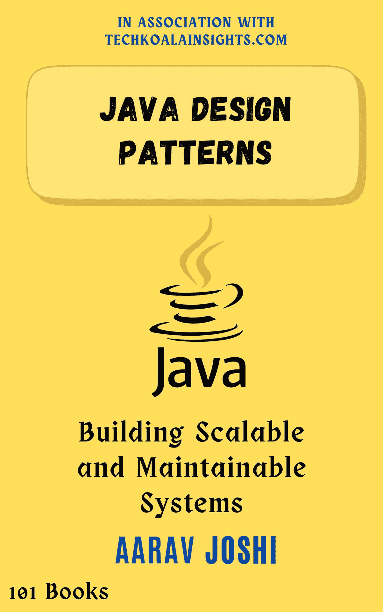

# Java 设计模式：构建可扩展且可维护的系统



# 目录

## 设计模式简介

### 什么是设计模式？

* 什么是设计模式？
* 软件设计的演变
* 使用设计模式的好处
* 理解面向对象原则
* 四人帮 (GoF) 设计模式
* 设计模式分类
* 如何识别合适的模式

## 搭建 Java 开发环境

## 创建模式概述

## 创建模式简介

* 对象创建的重要性
* 工厂模式基础
* 抽象工厂模式详解
* 单例模式：实现与最佳实践
* 用于复杂对象的构建模式
* 原型模式与克隆
* 真实场景下创建模式的比较

### 工厂模式

* 工厂方法：目的与用例
* 在 Java 中实现工厂方法
* 抽象工厂 vs 工厂方法
* 使用工厂模式进行依赖注入
* 为了扩展性扩展工厂模式
* 工厂模式实现中的常见陷阱
* 测试工厂模式
* 工厂模式的真实案例

## 单例模式深度解析

* 理解单例及其意图
* 在 Java 中实现单例的不同方式
* 单例的线程安全
* 懒加载 vs 饿初始化
* 分布式系统中的单例
* 带序列化的单例
* 单例用法中的常见反模式
* 单例的实际应用

## 结构模式概述

## 结构模式简介

* 对象组合的重要性
* 适配器模式：桥接不兼容性
* 扩展功能的装饰器模式
* 用于控制访问的代理模式
* 用于层次结构的组合模式
* 用于内存优化的享元模式
* 结构模式的真实应用

## 行为模式概述

### 行为模式简介

* 责任链模式
* 用于封装请求的命令模式
* 用于语言解析的解释器模式
* 用于集合的迭代器模式
* 用于对象协调的中介者模式
* 用于撤销功能的备忘录模式
* 行为模式的实际应用

内容源自 Aarav Joshi 编写的书籍，已开源供公众使用。

本书是在人工智能的帮助下，在 Aarav Joshi 的细致指导和专业知识下协作完成的。尽管我们已尽力确保内容的准确性和可靠性，但鼓励读者针对特定的应用或用例独立地验证相关信息。

***

请务必查看我们的作品：

* [Investor Central German](https://german.investorcentral.co.uk/)
* [Smart Living](https://smartliving.investorcentral.co.uk/)
* [Epochs & Echoes](https://epochsandechoes.com/)
* [Puzzling Mysteries](https://www.puzzlingmysteries.com/)
* [Hindutva](https://hindutva.epochsandechoes.com/)
* [Elite Dev](https://elitedev.in/)
* [JS Schools](https://jsschools.com/)

***

### 我们在 Medium 上

* [Tech Koala Insights](https://techkoalainsights.com/)
* [Epochs & Echoes World](https://world.epochsandechoes.com/)
* [Investor Central Medium](https://medium.investorcentral.co.uk/)
* [Puzzling Mysteries Medium](https://medium.com/puzzling-mysteries)
* [Science & Epochs Medium](https://science.epochsandechoes.com/)
* [Modern Hindutva](https://modernhindutva.substack.com/)

***

感谢支持开源知识共享。

顺颂商祺，

101 Books

如有任何问题，请通过 `2019ab0406@wilp.bits-pilani.ac.in` 与我们联系

## 什么是设计模式？

软件开发中的设计模式是对常见编程问题的成熟解决方案。它们为解决反复出现的设计问题提供了结构化的方法，增强了代码质量、可维护性和扩展性。本节将深入探讨设计模式的本质，追溯其起源，并研究它们在现代软件工程中的关键作用。我们将探索这些模式如何从面向对象编程的最佳实践演变而来，成为开发者不可或缺的工具。通过理解设计模式的基本概念和历史背景，读者将对它们在 `Java` 开发中的实际应用和长期收益产生见解。

设计模式是解决常见软件设计问题的复用模板。它们为开发者提供了一种共同的语言，使团队能够高效地交流复杂的思想。软件工程中的设计模式概念在 20 世纪 90 年代流行，尽管其根源可以追溯到早期的架构设计原则。

设计模式通过提供几个关键优势，在软件开发中起着至关重要的作用：

3. **可维护性**：通过遵循既有模式，代码变得更具可读性且更容易维护，特别是对于熟悉这些模式的开发者而言。

```java
public class Singleton {
    private static Singleton instance;

    private Singleton() {}

    public static Singleton getInstance() {
        if (instance == null) {
            instance = new Singleton();
        }
        return instance;
    }

    public void showMessage() {
        System.out.println("Hello from Singleton!");
    }
}
```

在这个示例中，`Singleton` 类具有一个私有构造函数以防止直接实例化。`getInstance()` 方法在实例不存在时创建一个单一实例，或者返回已有的实例。这确保了该类只会创建一个实例。

```java
public class Main {
    public static void main(String[] args) {
        Singleton singleton = Singleton.getInstance();
        singleton.showMessage();
    }
}
```

虽然设计模式提供了许多益处，但谨慎使用它们非常重要。过度使用或误用模式可能会导致不必要的复杂性。开发者应该始终考虑项目的具体需求，并在模式确实能产生价值的地方使用它们。

人们可能会问：“设计模式如何与其他软件开发方法产生联系？”设计模式补充了各种开发方法，包括敏捷开发方法。在敏捷环境中，模式可以帮助团队快速迭代设计、高效重构代码并保持代码库的灵活性。

在 `Java` 开发的背景下，设计模式具有特别的价值。`Java` 的面向对象特性和广泛的生态系统使其成为设计模式的理想语言。许多 `Java` 框架和库（如 `Spring`）广泛利用设计模式，这进一步强调了它们在 `Java` 世界中的重要性。

设计模式随着软件行业的发展不断演进。新的模式不断涌现，以应对云计算、大数据和人工智能等领域的挑战。对于现代 `Java` 开发者来说，关注这些动态至关重要。

软件设计的演变标志着开发者处理问题和体系架构方法的重大转变。本节探讨了从过程化编程到面向对象设计的历程，以及随后设计模式的出现。我们将研究软件开发范式的改变如何导致了结构化、可维护且可扩展的代码。通过理解这种演变，开发者可以更好地体会设计模式在现代 `Java` 开发中的背景和重要性。

这种认识导致了 20 世纪 80 年代和 90 年代面向对象编程 (`OOP`) 的兴起。`OOP` 引入了一种全新的软件设计思维，以封装数据和行为的对象为中心。这种范式转变允许更好地组织代码、提高复用性并对真实世界系统进行更直观的建模。

* **多态 (Polymorphism)**：不同类型的对象通过通用接口进行操作的能力。这使得代码更具灵活性和扩展性。

这些原则构成了面向对象设计的基础，为更复杂的软件架构铺平了道路。然而，当开发者开始使用 `OOP` 时，他们开始在不同的项目中观察到反复出现的问题。这种观察导致了设计模式的形式化。

然而，由 Erich Gamma、Richard Helm、Ralph Johnson 和 John Vlissides（合称为“四人帮”或 `GoF`）于 1994 年出版的《设计模式：可复用面向对象软件的基础》真正向软件开发中推广了这一概念。这本书编录了 23 种经典设计模式，将其分为创建型、结构型和行为型模式。

```java
interface Animal {
    void makeSound();
}

class Dog implements Animal {
    public void makeSound() {
        System.out.println("Woof");
    }
}

class Cat implements Animal {
    public void makeSound() {
        System.out.println("Meow");
    }
}

class AnimalFactory {
    public Animal createAnimal(String type) {
        if ("dog".equalsIgnoreCase(type)) {
            return new Dog();
        } else if ("cat".equalsIgnoreCase(type)) {
            return new Cat();
        }
        return null;
    }
}
```

随着软件系统规模和复杂性的持续增长，设计模式不断演变以应对新挑战。例如，分布式系统和 Web 应用程序的兴起导致了专门为这些环境设计的模式的发展，例如用于 Web 应用程序的模型-视图-控制器 (`MVC`) 模式。

从过程化编程向面向对象编程的转变是如何影响软件维护和可扩展性的？这种转变允许将代码更好地组织成模块化、可重用的组件。封装了数据和行为的对象可以更容易地进行维护和扩展，而不会影响系统的其他部分。这种模块化也提高了可扩展性，因为可以通过创建新对象或扩展现有对象来添加新功能，而无需修改单体式代码库。

## 使用设计模式的好处

```java
public class DatabaseConnection {
    private static DatabaseConnection instance;
    private DatabaseConnection() {}

    public static synchronized DatabaseConnection getInstance() {
        if (instance == null) {
            instance = new DatabaseConnection();
        }
        return instance;
    }
}
```

可读性是使用设计模式的另一个显著优势。它们提供了通用的词汇和结构，使得代码对其他开发者更容易理解。当团队成员遇到实现良好的设计模式时，他们可以快速理解代码的意图和功能，即使这些代码不是他们编写的。这种共同的理解促进了协作，并使代码维护更容易。

```java
interface Vehicle {
    void drive();
}

class Car implements Vehicle {
    public void drive() {
        System.out.println("Driving a car");
    }
}

class Motorcycle implements Vehicle {
    public void drive() {
        System.out.println("Riding a motorcycle");
    }
}

interface VehicleFactory {
    Vehicle createVehicle();
}

class CarFactory implements VehicleFactory {
    public Vehicle createVehicle() {
        return new Car();
    }
}

class MotorcycleFactory implements VehicleFactory {
    public Vehicle createVehicle() {
        return new Motorcycle();
    }
}
```

```java
import java.util.List;

interface SortStrategy {
    void sort(int[] array);
}

class QuickSort implements SortStrategy {
    public void sort(int[] array) {
        // Quick sort implementation
    }
}

class MergeSort implements SortStrategy {
    public void sort(int[] array) {
        // Merge sort implementation
    }
}

public class Sorter {
    private SortStrategy strategy;

    public void setStrategy(SortStrategy strategy) {
        this.strategy = strategy;
    }

    public void performSort(int[] array) {
        strategy.sort(array);
    }
}
```

```java
interface Document {
    void open();
}

class PdfDocument implements Document {
    public void open() {
        System.out.println("Opening PDF document");
    }
}

class WordDocument implements Document {
    public void open() {
        System.out.println("Opening Word document");
    }
}

interface DocumentFactory {
    Document createDocument();
}

class PdfDocumentFactory implements DocumentFactory {
    public Document createDocument() {
        return new PdfDocument();
    }
}

class WordDocumentFactory implements DocumentFactory {
    public Document createDocument() {
        return new WordDocument();
    }
}
```

这种实现允许在不修改现有代码的情况下轻松扩展以支持新的文档类型，遵循了**开闭原则**。

一旦明确识别了问题，下一步就是选择合适的模式。此过程涉及根据问题的需求和限制对不同的模式进行评估。开发者应该考虑以下因素：

1. 模式的意图和主要用例
2. 问题的复杂性和规模
3. 系统的性能需求
4. 可维护性和可扩展性需求
5. 团队对该模式的熟悉程度
6. 对现有代码的潜在影响

需要注意的是，设计模式并不是万能的解决方案。一个在一种语境下运行良好的模式在另一个语境下可能并不适用。例如，虽然 `Singleton` 模式对于管理全局资源有用，但如果过度使用，它也会引入紧耦合并增加测试的难度。

在选择模式时，要考虑它将如何与现有代码库和架构集成。它会引入不必要的复杂性吗？它能在解决当前问题的同时为未来的增强提供灵活性吗？这些是在选择过程中需要问的关键问题。

让我们来看一个场景：开发者正在开发一个报告系统，该系统需要根据用户偏好生成各种格式（PDF、Excel、HTML）的报告。这种情况需要 `Strategy` 模式，它允许动态选择算法。以下是一个基础实现：

```java
public interface ReportStrategy {
    void generateReport(ReportData data);
}

public class PDFReportStrategy implements ReportStrategy {
    public void generateReport(ReportData data) {
        System.out.println("Generating PDF report");
        // PDF generation logic
    }
}

public class ExcelReportStrategy implements ReportStrategy {
    public void generateReport(ReportData data) {
        System.out.println("Generating Excel report");
        // Excel generation logic
    }
}

public class HTMLReportStrategy implements ReportStrategy {
    public void generateReport(ReportData data) {
        System.out.println("Generating HTML report");
        // HTML generation logic
    }
}

public class ReportGenerator {
    private ReportStrategy strategy;

    public void setStrategy(ReportStrategy strategy) {
        this.strategy = strategy;
    }

    public void generateReport(ReportData data) {
        strategy.generateReport(data);
    }
}
```

这种实现允许轻松添加新的报告格式，并根据用户偏好在格式之间进行动态切换。

考虑应用特定模式的潜在缺点也至关重要。每种模式都伴随着权衡，开发者必须仔细权衡。例如，虽然 `Observer` 模式非常适合实现事件驱动系统，但如果过度使用（特别是当观察者数量很大），可能会导致性能问题。

在评估模式时，创建简单的原型或概念验证实现会有帮助。这种方法允许开发者在提交完整实现之前，评估模式与问题的契合程度，并识别任何潜在问题。

考虑这样一种情况：开发者正在开发一个系统，该系统需要对用户输入进行复杂的验证。系统要求这些验证应该能够跨应用程序的不同部分易于地组合和复用。这种场景提供了一个应用 `Chain of Responsibility` 模式的机会。以下是一个基础实现：

```java
public abstract class Validator {
    protected Validator nextValidator;

    public void setNext(Validator validator) {
        this.nextValidator = validator;
    }

    public abstract boolean validate(String input);
}

public class LengthValidator extends Validator {
    public boolean validate(String input) {
        if (input.length() > 5) {
            return nextValidator != null ? nextValidator.validate(input) : true;
        }
        System.out.println("Input is too short");
        return false;
    }
}

public class NumericValidator extends Validator {
    public boolean validate(String input) {
        if (input.matches("\\d+")) {
            return nextValidator != null ? nextValidator.validate(input) : true;
        }
        System.out.println("Input is not numeric");
        return false;
    }
}

public class ValidationChain {
    private Validator first;

    public ValidationChain() {
        first = new LengthValidator();
        Validator second = new NumericValidator();
        first.setNext(second);
    }

    public boolean validate(String input) {
        return first.validate(input);
    }
}
```

一旦安装并配置了 `JDK`，下一步是选择一个集成开发环境（IDE）。虽然可以使用简单的文本编辑器编写 `Java` 代码，但 IDE 提供了许多优势，例如代码补全、调试工具和项目管理功能。流行的 Java IDE 包括 `IntelliJ IDEA`、`Eclipse` 和 `NetBeans`。

`IntelliJ IDEA` 由 JetBrains 开发，以其智能代码辅助和符合人体工程学的设计而闻名。它提供免费的 `Community Edition`（社区版）和带有额外功能的付费 `Ultimate Edition`（旗舰版）。要设置 `IntelliJ IDEA`，请从 JetBrains 网站下载相应的版本并按照安装向导操作。安装完成后，可以通过设置偏好的快捷键绑定、代码样式和插件来配置 IDE。


`Eclipse` 是一个开源 IDE，是 Java 开发者中的另一个流行选择。它提供了丰富的插件和自定义选项。要设置 `Eclipse`，请从 Eclipse 网站下载相应的包并将其解压到你指定的位置。然后你可以启动 `Eclipse` 并配置你的工作区偏好，包括代码格式化程序和保存操作。

无论你选择哪种 IDE，熟悉其功能和快捷键对于提高生产力至关重要。大多数 IDE 都提供了内置教程或引导演示来帮助你快速上手。

除了 `JDK` 和 `IDE` 之外，其他几个工具也可以增强你的 Java 开发环境。像 `Git` 这样的版本控制系统对于管理代码更改和其他开发者协作至关重要。要设置 `Git`，请从官方网站下载或使用系统的包管理器。安装后，配置你的 `Git` 用户名和邮箱：

```bash
git config --global user.name "Your Name"
git config --global user.email "your.email@example.com"
```

构建自动化工具如 `Maven` 或 `Gradle` 对于管理依赖和构建项目至关重要。例如，`Maven` 使用项目对象模型 (`POM`) 文件来定义项目结构和依赖。要设置 `Maven`，请从 Apache Maven 网站下载并将其 `bin` 目录添加到你的 `PATH` 中。你可以使用以下命令创建一个新的 `Maven` 项目：

```bash
mvn archetype:generate -DgroupId=com.example -DartifactId=my-app -DarchetypeArtifactId=maven-archetype-quickstart -DinteractiveMode=false
```

此命令会创建一个具有基本结构和示例 `POM` 文件的新 `Maven` 项目。

出于测试目的，`JUnit` 是 Java 开发中广泛使用的框架。大多数 IDE 都内置了对 `JUnit` 的支持，但你也可以手动将其添加到项目中。如果你正在使用 `Maven`，可以将 `JUnit` 作为依赖添加到 `POM` 文件中：

```xml
<dependencies>
    <dependency>
        <groupId>junit</groupId>
        <artifactId>junit</artifactId>
        <version>4.13.2</version>
        <scope>test</scope>
    </dependency>
</dependencies>
```

持续集成（CI）工具如 `Jenkins` 或 `Travis CI` 可以自动化你的构建和测试过程。虽然这些工具通常设置在独立的服务器上，但你可以在本地安装 `Jenkins` 用于测试。从官方网站下载 `Jenkins` 并按照适用于你操作系统的安装说明操作。

在设置 Java 开发环境时，考虑代码质量工具很重要。像 `SonarQube` 或 `Checkstyle` 这样的工具可以帮助维护一致的代码风格，并在开发早期识别潜在问题。大多数 IDE 都提供这些工具的插件，允许你将它们直接集成到工作流中。

性能分析工具也是你开发环境的有益补充。像 `VisualVM`（包含在 `JDK` 中）或 `YourKit` 等工具可以帮助你识别 Java 程序的性能瓶颈。

在处理大型项目或在团队环境中工作时，考虑设置本地开发服务器。`Apache Tomcat` 或 `Jetty` 等工具可本地测试 Web 应用程序。要设置 `Tomcat`，请从 Apache 网站下载，解压到指定位置，并配置 IDE 使用其作为服务器运行时。

当你越来越熟悉 Java 开发环境时，你可能想要探索高级功能和自定义。许多 IDE 提供了丰富的插件生态系统，可以添加针对你开发需求的功能。例如，你可能会为你正在使用的特定框架安装插件，如 `Spring` 或 `Hibernate`。

同样值得考虑使用虚拟环境或容器化工具（如 `Docker`）。这些工具有助于确保不同开发机器之间的一致性，并更容易管理具有不同不同的多个项目。

记住，设置 Java 开发环境是一个持续的过程。随着新工具和版本的出现，保持环境更新至关重要。定期检查并更新你的工具、IDE 插件和依赖，以确保你利用了最新的功能和安全更新。

你认为当前的 Java 开发环境中哪些方面对你最有帮助？你认为在哪些方面可以改进你的设置以提高你的生产力？

通过用正确的工具和设置仔细配置你的 Java 开发环境，你可以创建一个强大且高效的工作空间来支持你的开发需求。无论你是在处理小型个人项目还是大型企业级应用，一个配置良好的环境都能显著提高你的编码体验和生产力。

## 创建模式概述

## 创建模式简介

创建模式在面向对象的设计中起着至关重要的作用，侧重于对象的创建过程。本节将探索创建模式的基本概念、它们在 Java 开发中的重要性，以及它们为软件设计带来的优势。我们将深入探讨这些模式如何解决对象创建中的常见挑战、提高灵活性并增强代码的可维护性。对于构建可扩展且适应良好的 Java 应用程序的开发者来说，理解创建模式是必要的。

对象创建是面向对象编程的基本方面，其重要性不言喻。对象的实例化方式会显著影响系统的整体设计、灵性和维护性。创建模式为常见的对象创建问题提供了优雅的解决方案，提供了使用 `new` 关键字直接实例化的替代方案。

创建模式的主要优势之一是可以对实例化过程进行抽象。这种抽象允许在创建什么、谁创建、如何创建以及何时创建具有更大的灵活性。通过将客户端代码与对象创建解耦，这些模式促进了松耦合并增强了系统的模块化。

考虑一个程序需要不同类型车辆的场景。如果没有创建模式，代码可能如下：

```java
public class VehicleFactory {
    public Vehicle createVehicle(String type) {
        if (type.equals("car")) {
            return new Car();
        } else if (type.equals("truck")) {
            return new Truck();
        } else if (type.equals("motorcycle")) {
            return new Motorcycle();
        }
        return null;
    }
}
```

这种方法可行，但它违反了开闭原则，因为添加新的车辆类型需要修改现有代码。创建模式为此类问题提供了更优雅、可扩展的解决方案。

创建型模式的另一个显著优势是能够隐藏对象创建的复杂性。它们封装了关于使用哪些具体类的知识，并隐藏了这些类实例是如何创建和组合的。这种封装在处理复杂的对象创建过程或当创建 `logic` 需要集中管理时尤为有用。

创建型模式还便于对对象创建过程进行更好的控制。它们允许对对象的创建方式和时机进行细粒度的控制，这对于高效管理资源至关重要，尤其是在资源受限的环境中。

让我们探索工厂方法模式的实现，它解决了上一个示例中的局限性：

```java
public interface VehicleFactory {
    Vehicle createVehicle();
}

public class CarFactory implements VehicleFactory {
    public Vehicle createVehicle() {
        return new Car();
    }
}

public class TruckFactory implements VehicleFactory {
    public Vehicle createVehicle() {
        return new Truck();
    }
}

public class MotorcycleFactory implements VehicleFactory {
    public Vehicle createVehicle() {
        return new Motorcycle();
    }
}
```

这种实现允许在不修改现有代码的情况下进行轻松扩展。可以通过创建新的工厂类来添加新的车辆类型，从而遵循“开闭原则”。

创建型模式在管理对象生命周期以及确保资源的正确分配和释放方面起着至关重要的作用。例如，单例模式保证了一个类只有一个实例，并提供了该实例的全局访问点。这对于管理共享资源或维护全局状态特别有用。

```java
public class DatabaseConnection {
    private static DatabaseConnection instance;
    private DatabaseConnection() {}

    public static synchronized DatabaseConnection getInstance() {
        if (instance == null) {
            instance = new DatabaseConnection();
        }
        return instance;
    }

    public void connect() {
        // Connection logic
    }
}
```

这种 `Singleton` 实现确保了只会创建一个数据库连接，防止了资源的过度使用和潜在的冲突。

创建型模式对代码的可重用性也有很大贡献。通过抽象对象创建过程，这些模式允许相同的构建代码用于不同类型的对象。这种重用性不仅节省了开发时间，还提高了整个代码库的一致性。

例如，建造者模式在处理复杂对象的构建时特别有用。它将复杂对象的构建与其表示分离来，允许相同的构建过程创建不同的表示。

```java
public class Computer {
    private String cpu;
    private String ram;
    private String storage;

    private Computer(Builder builder) {
        this.cpu = builder.cpu;
        this.ram = builder.ram;
        this.storage = builder.storage;
    }

    public static class Builder {
        private String cpu;
        private String ram;
        private String storage;

        public Builder cpu(String cpu) {
            this.cpu = cpu;
            return this;
        }

        public Builder ram(String ram) {
            this.ram = ram;
            return this;
        }

        public Builder storage(String storage) {
            this.storage = storage;
            return this;
        }

        public Computer build() {
            return new Computer(this);
        }
    }
}
```

这种 `Builder` 模式实现实现了灵活且可读的对象创建：

```java
Computer computer = new Computer.Builder()
    .cpu("Intel i7")
    .ram("16GB")
    .storage("512GB SSD")
    .build();
```

创建型模式通过允许轻松替换 mock 对象或测试替体，增强了可测试性。这种将对象创建与业务逻辑分离的方法使得在单元测试中隔离组件变得更加容易。

虽然创建型模式提供了许多优势，但审慎地使用它们非常重要。过度使用模式会导致不必要的复杂并降低可读性。关键在于在能够在灵活性、可维护性或扩展性方面提供明确优势的地方应用模式。

在接下来的章节中，我们将深入探讨特定的创建型模式，探索它们的独特特性、实现细节和适用场景。每个模式都解决了特定的对象创建挑战，理解它们的细差别将使你能够针对特定的设计问题选择正确的模式。

结论，创建型模式构成了工具箱中不可或缺的一部分。它们为对象创建提供了强大的机制，促进了松耦合并增强了灵活性。

此修订后的版本提供了更大的灵活性，因为可以在不修改 `OrderProcessor` 类的情况下注入不同的支付网关。这种方法对可维护性有什么影响？

当将对象创建与业务逻辑解耦时，可维护性会显著增强。通过分离这些关注，开发者可以在不影响现有代码的情况下修改或扩展功能。这种分离还提高了可测试性，因为在单元测试期间可以对依赖项进行模拟（mock）或存桩（stub）。

对象创建的另一个关键方面是对象生命周期的管理。对对象创建和销毁处理不当会导致资源泄漏和性能问题。创建模式（如 `Factory Method` 或 `Builder` 模式）提供了结构化的对象创建方法，可以帮助更有效地管理这些生命周期。

例如，`Factory Method` 模式允许在不指定确切类的情况下创建对象：

```java
public interface Logger {
    void log(String message);
}

public class FileLogger implements Logger {
    public void log(String message) {
        // 记录到文件
    }
}

public class DatabaseLogger implements Logger {
    public void log(String message) {
        // 记录到数据库
    }
}

public interface LoggerFactory {
    Logger createLogger();
}

public class FileLoggerFactory implements LoggerFactory {
    public Logger createLogger() {
        return new FileLogger();
    }
}

public class DatabaseLoggerFactory implements LoggerFactory {
    public Logger createLogger() {
        return new DatabaseLogger();
    }
}
```

该模式在创建不同类型的日志器方面提供了灵活性，而不会将客户端代码与特定的日志器实现紧耦合。与直接实例化相比，这种方法如何增强可维护性？

对象创建在管理复杂性方面也起着至关重要的作用。随着系统的增长，需要创建和管理的对象数量和种类可能会变得难以应对。创建模式通过提供标准化的对象创建方式帮助组织这种复杂性。例如，`Abstract Factory` 模式在处理相关对象族时特别有用：

```java
public interface GUIFactory {
    Button createButton();
    Checkbox createCheckbox();
}

public class WindowsFactory implements GUIFactory {
    public Button createButton() {
        return new WindowsButton();
    }
    public Checkbox createCheckbox() {
        return new WindowsCheckbox();
    }
}

public class MacFactory implements GUIFactory {
    public Button createButton() {
        return new MacButton();
    }
    public Checkbox createCheckbox() {
        return new MacCheckbox();
    }
}
```

该模式允许创建一致的一组对象（在此情况下为 GUI 元素），而不指定它们的具体类。这种方法如何贡献于具有多个平台特定实现的大型应用的可维护性？

对象创建对代码设计的影响还扩展到了性能考虑方面。低效的对象创建会导致性能瓶颈，特别是在资源密集型应用程序中。像 `Object Pool` 这样的模式可以帮助管理昂贵对象的创建和重用：


```java
public class DatabaseConnectionPool {
    private List<Connection> availableConnections = new ArrayList<>();
    private List<Connection> usedConnections = new ArrayList<>();
    private int maxConnections;

    public DatabaseConnectionPool(int maxConnections) {
        this.maxConnections = maxConnections;
    }

    public synchronized Connection getConnection() {
        if (availableConnections.isEmpty()) {
            if (usedConnections.size() < maxConnections) {
                availableConnections.add(createNewConnection());
            } else {
                throw new RuntimeException("Maximum connections reached");
            }
        }
        Connection connection = availableConnections.remove(availableConnections.size() - 1);
        usedConnections.add(connection);
        return connection;
    }

    public synchronized void releaseConnection(Connection connection) {
        usedConnections.remove(connection);
        availableConnections.add(connection);
    }

    private Connection createNewConnection() {
        // 创建并返回新连接
    }
}
```

该模式通过重用昂贵对象而不是在每次需要时创建新对象，来高效地管理资源。这种方法对数据库密集型应用程序的性能和可维护性有什么影响？

对象创建还影响系统的可扩展性。良好的对象创建机制允许在不修改现有代码的情况下轻松添加新类型或行为。例如，`Builder` 模式对于逐步创建复杂对象特别有用：

```java
public class Computer {
    private String cpu;
    private String ram;
    private String storage;

    private Computer(Builder builder) {
        this.cpu = builder.cpu;
        this.ram = builder.ram;
        this.storage = builder.storage;
    }

    public static class Builder {
        private String cpu;
        private String ram;
        private String storage;

        public Builder cpu(String cpu) {
            this.cpu = cpu;
            return this;
        }

        public Builder ram(String ram) {
            this.ram = ram;
            return this;
        }

        public Builder storage(String storage) {
            this.storage = storage;
            return this;
        }

        public Computer build() {
            return new Computer(this);
        }
    }
}
```

该模式允许创建具有许多可选组件或配置的复杂对象。与使用多个构造函数或 setter 方法相比，这种方法如何增强可维护性和可扩展性？

总之，对象创建在 Java 中的重要性远超简单的类实例化。它在决定系统的整体设计、灵活性和可维护性方面起着至关重要的作用。通过仔细考虑对象创建策略并采用适当的设计模式，开发者可以创建更健壮、可扩展且易于维护的 Java 应用程序。随着我们在接下来的章节中深入探讨特定的创建模式，我们将探索这些概念如何应用于解决现实世界的设计挑战并提高 Java 代码的质量。

## 工厂模式基础

`Factory Pattern` 是一种基本的创建设计模式，它为父类中的创建对象提供了接口，允许子类更改创建对象的类型。本节将探讨 `Factory Pattern` 的基础、在 Java 中的实现以及其证明特别有效的场景。通过抽象对象创建过程，`Factory Pattern` 促进了松耦合并增强了软件设计的灵活性。

`Factory Pattern` 的核心是在在不显式指定确切类的情况下创建对象。这种方法为对象创建提供了更大的灵活性，并使代码更易维护且易于扩展。该模式通常包含类中的一个工厂方法，该方法返回实现通用接口或扩展通用基类的类型实例。

考虑一个需要创建不同文档的文档处理系统的简单示例：

```java
public interface Document {
    void open();
    void save();
}

public class PDFDocument implements Document {
    public void open() {
        System.out.println("Opening PDF document");
    }
    public void save() {
        System.out.println("Saving PDF document");
    }
}

public class WordDocument implements Document {
    public void open() {
        System.out.println("Opening Word document");
    }
    public void save() {
        System.out.println("Saving Word document");
    }
}

public class DocumentFactory {
    public Document createDocument(String type) {
        if ("pdf".equalsIgnoreCase(type)) {
            return new PDFDocument();
        } else if ("word".equalsIgnoreCase(type)) {
            return new WordDocument();
        }
        throw new IllegalArgumentException("Unknown document type");
    }
}
```

在这个示例中，`DocumentFactory` 类封装了对象的创建逻辑。客户端可以请求文档，而无需知道不同文档类型如何实例的具体细节。这种抽象对整体系统设计有什么好处？

工厂模式在处理复杂的对象创建过程，或者在运行时可能无法确定所需的精确对象类型时特别有用。在类无法预知其需要创建的对象类型，或者类想要将对象创建的责任委托给其子类的场景中，它也具有价值。

工厂模式的另一种常见实现是使用静态工厂方法：

```java
public abstract class Vehicle {
    public abstract int getWheel();

    public static Vehicle createVehicle(String type) {
        if ("car".equalsIgnoreCase(type)) {
            return new Car();
        } else if ("motorcycle".equalsIgnoreCase(type)) {
            return new Motorcycle();
        }
        throw new IllegalArgumentException("Unknown vehicle type");
    }
}

public class Car extends Vehicle {
    @Override
    public int getWheel() {
        return 4;
    }
}

public class Motorcycle extends Vehicle {
    @Override
    public int getWheel() {
        return 2;
    }
}
```

这种方法允许在抽象基类中进行集中对象创建。这种实现与上一个示例有什么不同？它可能提供哪些优势？

工厂模式在系统必须独立于其产品的创建、组合和表示的场景中脱颖而出。它在框架和库中特别有用，因为代码需要在不知道特定类的情况下与各种产品类型协同工作。例如，数据库连接框架可能会使用工厂根据配置设置创建适当的数据库连接对象。

工厂模式的核心优势之一是它能够促进松耦合。通过集中对象创建，它减少了类与类之间的依赖：

```java
public class OrderProcessor {
    private final Document document;

    public OrderProcessor(DocumentFactory factory, String documentType) {
        this.document = factory.createDocument(documentType);
    }

    public void processOrder() {
        document.open();
        // Process order details
        document.save();
    }
}
```

在这个示例中，`OrderProcessor` 与特定的文档实现没有耦合。它依赖 `DocumentFactory` 来提供适当的 `Document` 对象。这种设计如何提高系统的灵活性和可维护性？

工厂模式还便于测试和模拟（mocking）。通过依赖接口而不是具体实现，单元测试可以轻松地替换模拟对象：

```java
public class MockDocument implements Document {
    public void open() {
        // Mock implementation
    }

    public void save() {
        // Mock implementation
    }
}

public class TestOrderProcessor {
    @Test
    public void testOrderProcessor() {
        DocumentFactory mockFactory = new MockFactory();
        OrderProcessor processor = new OrderProcessor(mockFactory, "pdf");
        processor.processOrder();
    }
}
```

## 抽象工厂模式

`Abstract Factory Pattern` 提供了一个接口，用于创建相关或依赖对象的家族，而无需指定它们的具体类。该模式在系统需要独立于其产品的创建、组合和表示方式时特别有用。

考虑一个需要支持多种操作系统 UI 组件的跨平台 GUI 库：

```java
// Abstract products
interface Button {
    void paint();
}

interface Checkbox {
    void paint();
}

// Abstract factory
interface GUIFactory {
    Button createButton();
    Checkbox createCheckbox();
}

// Concrete products for Windows
class WindowsButton implements Button {
    public void paint() {
        System.out.println("Render a button in Windows style");
    }
}

class WindowsCheckbox implements Checkbox {
    public void paint() {
        System.out.println("Render a checkbox in Windows style");
    }
}

// Concrete products for macOS
class MacButton implements Button {
    public void paint() {
        System.out.println("Render a button in macOS style");
    }
}

class MacCheckbox implements Checkbox {
    public void paint() {
        System.out.println("Render a checkbox in macOS style");
    }
}

// Concrete factories
class WindowsFactory implements GUIFactory {
    public Button createButton() {
        return new WindowsButton();
    }

    public Checkbox createCheckbox() {
        return new WindowsCheckbox();
    }
}

class MacFactory implements GUIFactory {
    public Button createButton() {
        return new MacButton();
    }

    public Checkbox createCheckbox() {
        return new MacCheckbox();
    }
}
```

在此实现中，我们为产品定义了抽象接口（`Button` 和 `Checkbox`）以及抽象工厂接口（`GUIFactory`）。然后，为每个产品变体和相应的工厂创建了具体实现。这种结构是如何确保我们始终为特定的操作系统创建兼容的 UI 组件的？

`Abstract Factory Pattern` 的威力在于它能够强制创建一致的对象族。使用这些工厂的客户端代码可以创建 UI 组件，而无需知道它正在创建对象的特定类：

```java
class Application {
    private Button button;
    private Checkbox checkbox;

    public Application(GUIFactory factory) {
        button = factory.createButton();
        checkbox = factory.createCheckbox();
    }

    public void paint() {
        button.paint();
        checkbox.paint();
    }
}
```

```java
// Usage
GUIFactory factory = new WindowsFactory();
Application app = new Application(factory);
app.paint();
```

这种方法允许我们通过简单更改使用的具体工厂来轻松切换不同的 UI 样式。与使用条件逻辑来创建不同的 UI 组件相比，这种设计如何提高系统的灵活性可维护性？

`Abstract Factory Pattern` 在大型系统中的一个关键优势是它能够在不修改现有代码的情况下支持添加新的产品族。例如，如果我们想添加对 Linux UI 样式的支持，可以通过创建新的具体产品和一个新的具体工厂来实现：

```java
class LinuxButton implements Button {
    public void paint() {
        System.out.println("Render a button in Linux style");
    }
}

class LinuxCheckbox implements Checkbox {
    public void paint() {
        System.out.println("Render a checkbox in Linux style");
    }
}

class LinuxFactory implements GUIFactory {
    public Button createButton() {
        return new LinuxButton();
    }

    public Checkbox createCheckbox() {
        return new LinuxCheckbox();
    }
}
```

这种扩展性对于随时间推移需要引入新变体或对象族的大型系统至关重要。这种模式是如何支持面向对象设计的“开闭原则”的？

`Abstract Factory Pattern` 在需要封装复杂的对象创建过程的场景下也表现出色。例如，在数据库连接框架中，抽象工厂可以处理各种特定于数据库的对象的创建：


```java
interface ConnectionFactory {
    Connection createConnection();
    Statement createStatement();
    ResultSet createResult();
}

class MySQLFactory implements ConnectionFactory {
    public Connection createConnection() {
        // MySQL-specific implementation
    }
    public Statement createStatement() {
        // MySQL-specific implementation
    }
    public ResultSet createResult() {
        // MySQL-specific implementation
    }
}

class PostgreSQLFactory implements ConnectionFactory {
    // PostgreSQL-specific implementations
}
```

这种方法允许我们在不暴露细节的情况下与不同的数据库进行工作。这对框架有什么好处？

虽然`抽象工厂模式`提供了许多优势，但考虑其潜在的缺点也是重要的。该模式可能会引入复杂性，特别是使添加新类型更具挑战性。开发者如何平衡这些权衡？

`抽象工厂模式`通常与其他模式结合良好工作。例如，它可以与`单例模式`结合以确保只存在一个实例：

```java
class WindowsFactory implements GUIFactory {
    private static WindowsFactory instance;

    private WindowsFactory() {}

    public static WindowsFactory getInstance() {
        if (instance == null) {
            instance = new WindowsFactory();
        }
        return instance;
    }
    // ... methods
}
```

使用`抽象工厂模式`的系统测试可以通过其固有的抽象性简化。可以轻松创建模拟工厂（Mock factories）：

```java
class MockGUIFactory implements GUIFactory {
    public Button createButton() {
        return new MockButton();
    }
    public Checkbox createCheckbox() {
        return new MockCheckbox();
    }
}

class TestApplication {
    @Test
    public void testApplicationRendering() {
        GUIFactory mockFactory = new MockGUIFactory();
        Application app = new Application(mockFactory);
        // 使用模拟组件测试应用程序行为
    }
}
```

这种方法允许对应用程序逻辑进行隔离测试，而不依赖于具体的实现。这种可测试性如何提高系统的整体质量和可维护性？

在大型系统中，`抽象工厂模式`在管理复杂性和确保不同子系统之间的一致性方面可以着至关重要的作用。例如，在多户应用程序中，不同的租户可能需要各种服务的不同实现：

```java
interface ServiceFactory {
    UserService createUserService();
    BillingService createBillingService();
    ReportingService createReportingService();
}

class EnterpriseServiceFactory implements ServiceFactory {
    // 企业级服务的实现
}

class SmallBusinessServiceFactory implements ServiceFactory {
    // 针对小企业定制的实现
}
```

这种结构允许应用程序根据租户的需求无缝切换不同的服务实现。这种灵活性如何贡献于系统的可扩展性和可维护性？

`抽象工厂模式`在涉及配置驱动的对象创建场景下也证明非常有价值。通过将配置设置映射到特定的工厂实现，系统可以在不更改代码的情况下动态调整行为：

```java
class FactoryProvider {
    public static GUIFactory getFactory(String config) {
        if ("windows".equalsIgnoreCase(config)) {
            return new WindowsFactory();
        } else if ("mac".equalsIgnoreCase(config)) {
            return new MacFactory();
        }
        throw new IllegalArgumentException("Unknown OS");
    }
}
```

### 使用方法

```java
String osConfig = getOSConfigFromSettings();
GUIFactory factory = FactoryProvider.getFactory(osConfig);
Application app = new Application(factory);
```

这种方法允许根据不同的环境或用户偏好进行运行时适配。这种模式可以如何扩展以支持更复杂的配置场景呢？

总之，抽象工厂模式为大型 Java 系统中管理相关对象族的创建提供了一个强大的工具。通过抽象实例化过程并强制执行产品族的一致性，它促进了松耦合，增强了灵活性并提升了代码的可维护性。在我们继续探索创建型模式时，我们将看到抽象工厂模式与其他方案的对比，以及它如何与其他设计模式结合以解决复杂的软件设计挑战。对于旨在创建可扩展、可维护且灵活适应不断变化的需求和环境的软件系统的 Java 开发者来说，理解何时以及如何应用抽象工厂模式至关重要。

## 单例模式：实现与最佳实践

单例模式是 Java 中一种基础的创建型设计模式，它确保一个类只有一个实例，并为该实例提供全局访问点。本节将深入探讨实现单例模式的复杂细节，重点关注确保单例以及解决线程安全问题。我们探索了各种实现技术、它们的优缺点，以及在 Java 应用中有效使用单例的最佳实践。通过研究单例实现的不同方法，我们对如何创建可以在并发环境中可靠使用的健壮且线程安全的单例有了深入的见解。本节还讨论了常见的陷阱以及如何避免它们，为掌握 Java 单例模式提供了一份全面的指南。

单例模式是面向对象编程中最简单但争议最大的设计模式之一。它的主要目的是将类的实例化限制为单个实例。这对于管理共享资源、协调系统跨操作或为服务提供全局访问点特别有用。然而，正确地实现单例（尤其是在多线程环境中）需要细致的考虑。

让我们从单例最基础的实现开始：

```java
public class BasicSingleton {
    private static BasicSingleton instance;
    private BasicSingleton() {}
    public static BasicSingleton getInstance() {
        if (instance == null) {
            instance = new BasicSingleton();
        }
        return instance;
    }
}
```

这种实现虽然简单，但不是线程安全的。在多线程环境中，多个线程可能同时评估条件`instance == null`为真，导致创建了多个实例。这将如何违反单例模式的核心原则？

为了解决线程安全，一种方法是使用同步（synchronization）：

```java
public class ThreadSafeSingleton {
    private static ThreadSafeSingleton instance;
    private ThreadSafeSingleton() {}
    public static synchronized ThreadSafeSingleton getInstance() {
        if (instance == null) {
            instance = new ThreadSafeSingleton();
        }
        return instance;
    }
}
```

虽然这种实现确保了线程安全，但由于对整个方法进行了同步，引入了性能开销。每次调用`getInstance()`产生同步成本，即使实例已经创建。在高并发场景下，这可能会成为瓶颈。我们该如何优化这种实现以减少不必要的同步？

优化线程安全单例的一种流行方法是双重检查锁定（double-checked locking）模式：

```java
public class DoubleCheckedSingleton {
    private static volatile DoubleCheckedSingleton instance;
    private DoubleCheckedSingleton() {}
    public static DoubleCheckedSingleton getInstance() {
        if (instance == null) {
            synchronized (DoubleCheckedSingleton.class) {
                if (instance == null) {
                    instance = new DoubleCheckedSingleton();
                }
            }
        }
        return instance;
    }
}
```

这种实现通过只在第一次创建实例时进行同步减少了同步开销。`volatile`关键字确保对`instance`变量的更改对其他线程立可见。然而，双重检查锁定的正确实现较为复杂，在某些 JVM 实现中可能存在细微问题。这种方法的潜在风险是什么？

另一种结合了简单性与线程安全的替代方法是按需加载内部类模式（initialization-on-demand idiom）：

```java
public class HolderSingleton {
    private HolderSingleton() {}
    private static class Holder {
        static final HolderSingleton INSTANCE = new HolderSingleton();
    }
    public static HolderSingleton getInstance() {
        return Holder.INSTANCE;
    }
}
```

这种实现利用了 JVM 的类加载机制来确保线程安全。`Holder`类在第一次调用`getInstance()`之前不会被加载，此时可以保证是线程安全的。这种方法在不需要显式同步的情况下提供了懒加载初始化（lazy initialization）。在简单性和性能方面，它与之前的实现相比如何？

另一种在 Java 5 中引入的方法是使用枚举（`enum`）来实现单例：

```java
public enum EnumSingleton {
    INSTANCE;
    public void doSomething() {
        // 单例行为
    }
}
```

这种实现非常简洁，免费提供了序列化支持，并由 JVM 保证了是线程安全的。它通常被认为是在 Java 中实现单例的最佳方式。然而，它在懒加载初始化和继承方面缺乏灵活性。在什么场景下`enum`方法适用？

在实现单例时，考虑序列化（serialization）至关重要。序列化的单例在反序列化时可能会创建一个新实例，从而违反单例原则。为了防止这一点，你需要实现`readResolve()`方法：

```java
public class SerializableSingleton implements Serializable {
    private static final SerializableSingleton INSTANCE = new SerializableSingleton();
    private SerializableSingleton() {}
    public static SerializableSingleton getInstance() {
        return INSTANCE;
    }
    protected Object readResolve() {
        return INSTANCE;
    }
}
```

这确保了在反序列化期间返回现有的单例实例而不是创建一个新的。序列化可能会如何影响单例的线程安全？

虽然单例很有用，但它们经常因违反单一职责原则和使代码难以测试而受到批评。缓解这些问题的方法之一是依赖注入（dependency injection）：

```java
public class SingletonService {
    private static SingletonService instance;
    private SingletonService() {}
    public static SingletonService getInstance() {
        if (instance == null) {
            instance = new SingletonService();
        }
        return instance;
    }
    // 服务方法
}

public class Client {
    private final SingletonService service;
    public Client(SingletonService service) {
        this.service = service;
    }
    // 使用服务的客户端方法
}
```

通过将单例注入到依赖类中，我们使代码更加模块化且测试。这种方法如何影响传统单例的全局访问属性？

在某些情况下，你可能需要创建一个`Singletons`（单例）注册表，特别是在需要多个相同类型但具有不同键的`Singleton`的场景下：

```java
public class SingletonRegistry {
    private static final Map<String, Object> REGISTRY = new ConcurrentHashMap<>();
    public static <T> T getSingleton(String key, Supplier<T> creator) {
        return (T) REGISTRY.computeIfAbsent(key, k -> creator.get());
    }
}
```

// Usage

```java
Singleton1 s1 = SingletonRegistry.getSingleton("key1", Singleton1::new);
Singleton2 s2 = SingletonRegistry.getSingleton("key2", Singleton2::new);
```

这种方法在保持每个键`Singleton`原则的同时提供了灵活性。这种模式在大型系统中管理资源时可能会有什么用？

在使用`Singletons`时，意识到潜在的内存泄漏至关重要，特别是在使用多个类加载器的应用程序中（例如在应用服务器中）。`Singletons`可能会防止类被垃圾回收，导致内存问题。开发者如何在长时间运行的应用程序中降低这种风险？

测试使用`Singletons`的代码可能是挑战性的，因为全局状态会影响测试隔离性。一种方法是使用依赖注入和接口：


```java
public interface SingletonService {
    void doSomething();
}

public class RealSingletonService implements SingletonService {
    private static RealSingletonService instance;
    private RealSingletonService() {}

    public static RealSingletonService getInstance() {
        if (instance == null) {
            instance = new RealSingletonService();
        }
        return instance;
    }

    public void doSomething() {
        // Real implementation
    }
}

public class TestSingletonService implements SingletonService {
    public void doSomething() {
        // Test implementation
    }
}

public class Client {
    private final SingletonService service;
    public Client(SingletonService service) {
        this.service = service;
    }
    // Client methods
}
```

// In tests

```java
Client client = new Client(new TestSingletonService());
```

这种方法允许对依赖 `Singletons` 的代码进行更好的 mock 和测试。这与其他 `Singleton` 依赖代码的测试策略相比如何？

在并发环境中，考虑 `Singletons` 对可扩展性的影响至关重要。虽然 `Singletons` 可以提供一个中心化的控制点，但它们也可能成为瓶颈。在这种情况下，考虑使用线程本地存储或分区的 `Singletons`：

```java
public class PartitionedSingleton {
    private static final int PARTITIONS = Runtime.getRuntime().availableProcessors();
    private static final PartitionedSingleton[] INSTANCES = new PartitionedSingleton[PARTITIONS];

    private PartitionedSingleton() {}

    public static PartitionedSingleton getInstance() {
        int index = (Thread.currentThread().hashCode() & 0x7FFFFFFF) % PARTITIONS;
        if (INSTANCES[index] == null) {
            synchronized (PartitionedSingleton.class) {
                if (INSTANCES[index] == null) {
                    INSTANCES[index] = new PartitionedSingleton();
                }
            }
        }
        return INSTANCES[index];
    }
}
```

这种方法创建了多个 `Singleton` 实例，每个实例为部分线程服务，可能会提高高并发场景下的性能。这种模式如何影响通常与 `Singletons` 关联的全局状态管理？

总之，虽然`单例模式`为确保类的单实例提供了一个强大的工具，但它的实现需要仔细的考虑，特别是在多线程环境中。通过理解各种实现技术、其权衡和最佳实践，开发者可以有效地使用 `Singletons` 来管理 Java 应用程序中的共享资源和全局状态。随着我们继续探索设计模式，我们将看到 `Singletons` 如何与其他模式结合以解决复杂的的设计挑战，以及现代 Java 实践和框架如何演进以解决一些与 `Singletons` 相关的传统问题。

## 用于复杂对象的构建器模式

`Builder Pattern`（构建器模式）是一种创建设计模式，允许逐步构建复杂对象。本节探讨了 Java 中构建器模式的实现和优点，重点关注其创建具有众多参数和配置的对象的能力。我们深入研究了模式的结构、它在提高代码可读性和可维护性方面的优势，以及它在创建不可变对象中的作用。构建器模式为阶接构造函数提供了灵活的替代方案，并为对象创建提供了清晰、流式的的接口。本节演示了如何有效地实现构建器模式，解决常见挑战并展示其在现实场景中的实际应用。

构建器模式解决了创建具有许多可选参数的复杂对象的挑战。考虑一种场景，你需要创建一个具有各种配料、尺寸和饼底种的 `Pizza` 对象。使用传统的构造函数方法会导致所谓的“阶接构造函数”反模式：

```java
public class Pizza {
    private String size;
    private boolean cheese;
    private boolean pepperoni;
    private boolean bacon;

    Pizza(String size) {
        this.size = size;
        this.cheese = true;
    }
    Pizza(String size, boolean cheese) {
        this.size = size;
        this.cheese = cheese;
    }
    Pizza(String size, boolean cheese, boolean pepperoni) {
        this.size = size;
        this.cheese = cheese;
        this.pepperoni = false;
    }
    Pizza(String size, boolean cheese, boolean pepperoni, boolean bacon) {
        this.size = size;
        this.cheese = cheese;
        this.pepperoni = pepperoni;
        this.bacon = bacon;
    }
}
```

这种方法随着参数数量的增加而变得臃肿。这会如何影响可读性和维护性？构建器模式提供了一个更优雅的解决方案：

```java
class Pizza {
    final String size;
    final boolean cheese;
    final boolean pepperoni;
    final boolean bacon;

    Pizza(Builder builder) {
        this.size = builder.size;
        this.cheese = builder.cheese;
        this.pepperoni = builder.pepperoni;
        this.bacon = builder.bacon;
    }

    static class Builder {
        private String size;
        private boolean cheese = false;
        private boolean pepperoni = false;
        private boolean bacon = false;

        Builder(String size) {
            this.size = size;
        }

        public Builder cheese(boolean value) {
            cheese = value;
            return this;
        }

        public Builder pepperoni(boolean value) {
            pepperoni = value;
            return this;
        }

        public Builder bacon(boolean value) {
            bacon = value;
            return this;
        }

        public Pizza build() {
            return new Pizza(this);
        }
    }
}
```

这种实现允许用更具可读性和灵活的方式创建 `Pizza` 对象：

```java
Pizza pizza = new Pizza.Builder("large")
    .cheese(true)
    .pepperoni(true)
    .bacon(false)
    .build();
```

这种方法如何改进阶接构造函数模式？

构建器模式在处理不可变对象时特别有用。通过使用单独的构建器对象，我们可以确保在所有必要参数设置后才创建对象：

```java
public class ImmutablePerson {
    final String firstName;
    final String lastName;
    final int age;
    final String address;

    ImmutablePerson(Builder builder) {
        this.firstName = builder.firstName;
        this.lastName = builder.lastName;
        this.age = builder.age;
        this.address = builder.address;
    }

    public static class Builder {
        private String firstName;
        private String lastName;
        private int age;
        private String address;

        public Builder firstName(String firstName) {
            this.firstName = firstName;
            return this;
        }

        public Builder lastName(String lastName) {
            this.lastName = lastName;
            return this;
        }

        public Builder age(int age) {
            this.age = age;
            return this;
        }

        public Builder address(String address) {
            this.address = address;
            return this;
        }

        public ImmutablePerson build() {
            return new ImmutablePerson(this);
        }
    }
}
```

这种方法确保了一旦创建了 `ImmutablePerson` 对象，其状态就无法被更改。这如何有助于线程安全和整个系统的稳定性？

构建模式也可以用于在对象构建过程中强制某些规则或验证：

```java
public class Account {
    private final String accountNumber;
    private final String ownerName;
    private final double balance;

    private Account(Builder builder) {
        this.accountNumber = builder.accountNumber;
        this.ownerName = builder.ownerName;
        this.balance = builder.balance;
    }

    public static class Builder {
        private String accountNumber;
        private String ownerName;
        private double balance;

        public Builder accountNumber(String accountNumber) {
            this.accountNumber = accountNumber;
            return this;
        }

        public Builder ownerName(String ownerName) {
            this.ownerName = ownerName;
            return this;
        }

        public Builder balance(double balance) {
            this.balance = balance;
            return this;
        }

        public Account build() {
            if (accountNumber == null || accountNumber.isEmpty()) {
                throw new IllegalStateException("Account is required");
            }
            if (ownerName == null || ownerName.isEmpty()) {
                throw new IllegalStateException("Owner name is required");
            }
            if (balance < 0) {
                throw new IllegalStateException("Initial balance cannot be negative");
            }
            return new Account(this);
        }
    }
}
```

这种实现确保了 `Account` 对象只能通过有效参数创建。这可能有助于防止无效状态的产生？

构建模式可以扩展以创建构建器层次结构，这在处理继承关系时特别有用：


```java
abstract class Computer {
    protected String cpu;
    protected int ram;
    protected int storage;

    abstract static class Builder<T extends Builder<T>> {
        protected String cpu;
        protected int ram;
        protected int storage;

        public T cpu(String cpu) {
            this.cpu = cpu;
            return self();
        }

        public T ram(int ram) {
            this.ram = ram;
            return self();
        }

        public T storage(int storage) {
            this.storage = storage;
            return self();
        }

        abstract T self();
        abstract Computer build();
    }
}

public class Desktop extends Computer {
    private final String graphicsCard;

    private Desktop(Builder builder) {
        this.cpu = builder.cpu;
        this.ram = builder.ram;
        this.storage = builder.storage;
        this.graphicsCard = builder.graphicsCard;
    }

    public static class Builder extends Computer.Builder<Builder> {
        private String graphicsCard;

        public Builder graphicsCard(String graphicsCard) {
            this.graphicsCard = graphicsCard;
            return this;
        }

        @Override
        protected Builder self() {
            return this;
        }

        @Override
        public Desktop build() {
            return new Desktop(this);
        }
    }
}
```

这种方法允许为不同类型的计算机创建专门的构建器，同时保持通用的接口。这如何增强代码的可重用性和扩展性？

在某些情况下，你可能想对可变对象使用构建模式，允许进行重新配置：

```java
public class Widget {
    int width;
    int height;
    String color;

    static class Builder {
        private Widget widget;

        Builder() {
            widget = new Widget();
        }

        public Builder width(int width) {
            widget.width = width;
            return this;
        }

        public Builder height(int height) {
            widget.height = height;
            return this;
        }

        public Builder color(String color) {
            widget.color = color;
            return this;
        }

        public Widget build() {
            return widget;
        }

        public Builder reset() {
            widget = new Widget();
            return this;
        }
    }
}
```

这种实现允许轻松地创建和重新配置小部件。在需要频繁配置配置的场景下，这种方法可能有什么用？

构建模式还可以与其他模式（如工厂模式）结合，以创建一个更灵活的对象系统：

```java
interface PizzaBuilder {
    PizzaBuilder size(String size);
    PizzaBuilder addTopping(String topping);
    Pizza build();
}

public class MargheritaBuilder implements PizzaBuilder {
    private pizza = new Pizza();

    @Override
    public PizzaBuilder size(String size) {
        pizza.setSize(size);
        return this;
    }

    @Override
    public PizzaBuilder addTopping(String topping) {
        pizza.addTopping(topping);
        return this;
    }

    @Override
    public Pizza build() {
        return pizza;
    }
}

public class PepperoniPizzaBuilder implements PizzaBuilder {
    private pizza = new Pizza();

    @Override
    public PizzaBuilder size(String size) {
        pizza.setSize(size);
        return this;
    }

    @Override
    public PizzaBuilder addTopping(String topping) {
        pizza.addTopping(topping);
        return this;
    }

    @Override
    public Pizza build() {
        pizza.addTopping("pepperoni");
        return pizza;
    }
}

public class PizzaDirector {
    public Pizza createMargherita(PizzaBuilder builder) {
        return builder.size("medium")
                .addTopping("tomato")
                .addTopping("mozzarella")
                .build();
    }

    public Pizza createPepperoni(PizzaBuilder builder) {
        return builder.size("large")
                .addTopping("tomato")
                .addTopping("mozzarella")
                .build();
    }
}
```

这种组合允许创建具有不同配置的各种类型的披萨。这种方法如何增强对象创建的灵活性？

在实现构建模式时，考虑它对性能和内存的影响很重要。虽然该模式提供了灵活性可读性，但可能会因为创建额外的对象而引入开销。在对性能敏感的应用程序中，可能需要权衡收益与潜在成本。你可能会如何优化高性能场景下的构建器实现？

测试使用构建模式的代码可以非常简单，因为它允许轻松创建具有特定配置的对象：

```java
@Test
public void testPizzaBuilder() {
    Pizza pizza = new Pizza.Builder("large");
}
```

```java
            .cheese(true)
            .pepperoni(true)
            .bacon(false)
            .build();

assertEquals("large", pizza.getSize());

assertTrue(pizza.hasCheese());

assertTrue(pizza.hasPepperoni());

assertFalse(pizza.hasBacon());
}
```

这种方法可以轻松创建具有特定状态的测试对象。这与使用传统的构造函数或设置（setter）方法创建对象相比如何？

结论，构建器模式为 Java 中创建复杂对象提供了一种强大且灵活的方法。通过将对象的构建与其表示分离，它为对象创建提供了一个清晰直观的 API，增强了代码的可读性，并允许创建不可变对象。随着我们继续探索设计模式，我们将看到构建器模式如何与其他模式结合以解决更复杂的设计挑战，以及它如何融入更宏大的架构设计中。

## 原型模式与克隆

原型模式和克隆章节侧重于 Java 中高效的对象复制，探讨了浅拷贝和深拷贝的概念。这一关键的创建模式允许通过复制现有对象来创建新对象，当创建对象的成本比复制它昂高时，这种方法尤为有用。该节深入探讨了原型模式的实现细节，讨论了浅拷贝和深拷贝的区别及其各自的使用场景。它还涉及到实现此模式面临的挑战和考虑因素，例如处理复杂的对象结构以及确保可变状态的正确克隆。

原型模式提供了一种通过复制现有对象（称为原型）来创建新对象的机制。当创建新对象的成本比复制现有对象时，这种方法特别有用。该模式涉及定义一个允许对象自我克隆的接口：

```java
public interface Prototype<T> {
    T clone();
}
```

原型模式的一个基本实现可能如下：

```java
public class ConcretePrototype implements Prototype<ConcretePrototype> {
    private String field;

    public ConcretePrototype(String field) {
        this.field = field;
    }

    @Override
    public ConcretePrototype clone() {
        return new ConcretePrototype(this.field);
    }

    public String getField() {
        return field;
    }
}
```

此实现允许通过克隆现有对象来创建新对象：

```java
ConcretePrototype original = new ConcretePrototype("Original");
ConcretePrototype copy = original.clone();
System.out.println(copy.getField()); // 输出: Original
```

这种方法与使用构造函数创建新对象有何不同？

在处理复杂对象结构时，原型模式变得特别有用。考虑一种场景，你拥有一个创建成本很复杂对象图：

```java
public class ComplexObject implements Prototype<ComplexObject> {
    private String data;
    private List<String> list;
    private NestedObject nestedObject;

    public ComplexObject(String data, List<String> list, NestedObject nestedObject) {
        this.data = data;
        this.list = list;
        this.nestedObject = nestedObject;
    }

    @Override
    public ComplexObject clone() {
        List<String> clonedList = new ArrayList<>(this.list);
        NestedObject clonedNested = this.nestedObject.clone();
        return new ComplexObject(this.data, clonedList, clonedNested);
    }
}

public class NestedObject implements Prototype<NestedObject> {
    private int value;

    public NestedObject(int value) {
        this.value = value;
    }

    @Override
    public NestedObject clone() {
        return new NestedObject(this.value);
    }
}
```

此实现演示了深拷贝，不仅克隆了顶层对象，还克隆了它的嵌套对象。在什么情况下深拷贝比浅拷贝更好？

另一方面，浅拷贝创建一个新对象，但复制的是嵌套对象的引用，而不是创建它们的新实例。Java 通过 `Cloneable` 接口提供了用于浅拷贝的内置方法：

```java
public class ShallowCopy implements Cloneable {
    private int[] data;

    public ShallowCopy(int[] values) {
        this.data = values;
    }

    @Override
    public ShallowCopy clone() throws CloneNotException {
        return (ShallowCopy) super.clone();
    }

    public int[] getData() {
        return data;
    }
}
```

使用此实现：

```java
int[] originalData = {1, 2, 3};
ShallowCopy original = new ShallowCopy(originalData);
ShallowCopy copy = original.clone();
originalData[0] = 100;
System.out.println(Arrays.toString(copy.getData())); // 输出: [100, 2, 3]
```

在复杂对象结构中使用浅拷贝的潜在风险是什么？深拷贝确保所有嵌套对象都被克隆，从而创建一个完全独立的副本。这可以通过序列化或实现深拷贝逻辑来实现：

```java
public class DeepCopy implements Serializable {
    private int[] data;

    public DeepCopy(int[] values) {
        this.data = values;
    }

    public DeepCopy deepCopy() {
        try {
            ByteArrayOutputStream bos = new ByteArrayOutputStream();
            ObjectOutputStream oos = new ObjectOutputStream(bos);
            oos.writeObject(this);
            oos.flush();
            ByteArrayInputStream bis = new ByteArrayInputStream(bos.toByteArray());
            ObjectInputStream ois = new ObjectInputStream(bis);
            return (DeepCopy) ois.readObject();
        } catch (Exception e) {
            return null;
        }
    }

    public int[] getData() {
        return data;
    }
}
```

这种方法确保了所有嵌套对象都被完全复制。然而，它比浅拷贝更慢且更消耗内存。在什么情况下你会选择深拷贝而不是浅拷贝？

原型模式在对象创建成本高昂或复杂的场景下可能特别有用。例如，考虑你正在处理数据库连接的场景：


```java
public class DatabaseConnection implements Prototype<DatabaseConnection> {
    private String url;
    private String username;
    private String password;
    private Map<String, String> properties;

    public DatabaseConnection(String url, String username, String password) {
        this.url = url;
        this.username = username;
        this.password = password;
        this.properties = new HashMap<>();
        // 模拟昂贵的初始化
        try {
            Thread.sleep(1000);
        } catch (InterruptedException e) {
            Thread.currentThread().interrupt();
        }
    }

    @Override
    public DatabaseConnection clone() {
        DatabaseConnection clone = new DatabaseConnection(this.url, this.username, this.password);
        clone.properties = new HashMap<>(this.properties);
        return clone;
    }

    public void addProperty(String key, String value) {
        properties.put(key, value);
    }
}
```

使用这种模式，你可以通过克隆现有连接快速创建新的数据库连接：

```java
DatabaseConnection original = new DatabaseConnection("jdbc:mysql://localhost/db", "user", "pass");
original.addProperty("autoReconnect", "true");
DatabaseConnection clone = original.clone();
```

在创建新数据库连接非常耗费时间的场景下，这种方法如何提高性能？

原型模式还可以与其他模式结合，以创建更灵活的系统。例如，你可以将其与工厂模式结合，创建一个原型注册表：

```java
public class PrototypeRegistry {

  private Map<String, Prototype<?>> prototypes = new HashMap<>();

  public void addPrototype(String key, Prototype<?> prototype) {
    prototypes.put(key, prototype);
  }

  public Prototype<?> getPrototype(String key) {
    return prototypes.get(key).clone();
  }
}
```

该注册表允许你动态存储和检索原型：

```java
PrototypeRegistry registry = new PrototypeRegistry();
registry.addPrototype("connection", new DatabaseConnection("jdbc:mysql://localhost/db", "user", "pass"));
DatabaseConnection newConnection = (DatabaseConnection) registry.getPrototype("connection");
```

这种模式的组合是如何增强系统对象创建的灵活性的？

在实现`Prototype Pattern`（原型模式）时，考虑克隆具有复杂状态对象的后果。例如，如果对象包含对其他对象或资源的引用，你需要决定这些引用应该是共享还是也被克隆。这一决定会影响系统的行为和性能。

考虑一种场景，你有一个管理外部资源的原型：

```java
public class ResourceManager implements Prototype<ResourceManager>, AutoCloseable {

  private List<Resource> resources;

  public ResourceManager() {
    this.resources = new ArrayList<>();
  }

  public void addResource(Resource resource) {
    resources.add(resource);
  }

  @Override
  public ResourceManager clone() {
    ResourceManager clone = new ResourceManager();
    for (Resource resource : this.resources) {
      clone.addResource(resource.clone());
    }
    return clone;
  }

  @Override
  public void close() throws Exception {
    for (Resource resource : resources) {
      resource.close();
    }
  }
}

public class Resource implements Prototype<Resource>, AutoCloseable {
  private String name;
  private boolean isOpen;

  public Resource(String name) {
    this.name = name;
    this.isOpen = true;
  }

  @Override
  public Resource clone() {
    return new Resource(this.name);
  }

  @Override
  public void close() throws Exception {
    this.isOpen = false;
  }
}
```

在此示例中，克隆`ResourceManager` 会创建新的 `Resource` 对象。如果资源是无法轻易克隆的共享系统资源，这种方法会有何不同？

测试使用`Prototype Pattern`的代码通常涉及验证克隆对象是否与其原始对象是独立的：

```java
@Test
public void testPrototypeIndependence() {
  ComplexObject original = new ComplexObject("data", Arrays.asList("item1", "item2"), new NestedObject(42));
  ComplexObject clone = original.clone();
  assertNotSame(original, clone);
  assertEquals(original.getData(), clone.getData());
  assertNotSame(original.getList(), clone.getList());
  assertEquals(original.getList(), clone.getList());
  assertNotSame(original.getNestedObject(), clone.getNestedObject());
  assertEquals(original.getNestedObject().getValue(), clone.getNestedObject().getValue());
}
```

此测试确保了克隆的对象是一个内容相同的新实例，但拥有其自己独立的嵌套对象。你将如何扩展此测试以涵盖更复杂的场景或边缘情况？

结论，`Prototype Pattern`为对象创建提供了一种强大的机制，特别是在对象实例化复杂或资源密集型的场景下非常有用。通过理解浅拷贝和深拷贝之间的区别，并考虑对复杂对象结构的影响，开发者可以利用这种模式创建更高效、更灵活的系统。随着我们，我们将探索`Prototype Pattern`如何与其他设计模式交互，以及它在大型架构设计中的作用。

## 真实世界中的创建模式比较

`Comparing Creational Patterns in Real-World`章节对创建模式进行了全面的分析。每种模式在现代软件中都有其优势、缺点和最佳用例。单例模式（`Singleton pattern`）确保一个类只有一个实例，并提供该实例全局访问点。它通常用于管理共享资源或配置。

```java
public class ConfigurationManager {
  private static ConfigurationManager instance;
  private Map<String, String> configuration;

  private ConfigurationManager() {
    configuration = new HashMap<>();
  }

  public static synchronized ConfigurationManager getInstance() {
    if (instance == null) {
      instance = new ConfigurationManager();
    }
    return instance;
  }

  public void setConfig(String key, String value) {
    configuration.put(key, value);
  }

  public String getConfig(String key) {
    return configuration.get(key);
  }
}
```

这种实现确保了应用程序的所有部分都访问相同的配置。然而，单例模式可能会使单元测试具有挑战，并引入隐藏的依赖。

在什么情况下，使用单例的好处大于其潜在的缺点？

工厂方法（`Factory Method`）定义了一个创建对象的接口，但让子类决定实例化哪个类。当一个类无法预测它需要创建的对象类型时，它特别有用。考虑一个支付处理系统：

```java
public interface PaymentProcessor {
  void processPayment(double amount);
}

public class CreditCardProcessor implements PaymentProcessor {
  public void processPayment(double amount) {
    System.out.println("Processing credit card payment of $" + amount);
  }
}

public class PayPalProcessor implements PaymentProcessor {
  public void processPayment(double amount) {
    System.out.println("Processing PayPal payment of $" + amount);
  }
}

public abstract class PaymentFactory {
  public abstract PaymentProcessor createProcessor();
}

public class CreditCardPaymentFactory extends PaymentFactory {
  public PaymentProcessor createProcessor() {
    return new CreditCardProcessor();
  }
}

public class PayPalPaymentFactory extends PaymentFactory {
  public PaymentProcessor createProcessor() {
    return new PayPalProcessor();
  }
}
```

这种模式允许在不修改现有代码的情况下轻松扩展支付方法。然而，如果不加仔细管理，它可能会导致子类的泛滥。

工厂方法模式是如何促进开闭原则的？

抽象工厂（`Abstract Factory`）模式提供了一个创建一组相关或依赖对象的接口，而不指定它们的具体类。它在系统必须独立于其产品的创建、组合和表示方式的场景中特别有用。考虑一个跨平台 UI 工具包：

```java
public interface Button {
  void render();
}
```

```java
public interface Checkbox {
    void render();
}

public interface GUIFactory {
    Button createButton();
    Checkbox createCheckbox();
}

public class WindowsButton implements Button {
    public void render() {
        System.out.println("Rendering a Windows button");
    }
}

public class MacButton implements Button {
    public void render() {
        System.out.println("Rendering a Mac button");
    }
}

public class WindowsCheckbox implements Checkbox {
    public void render() {
        System.out.println("Rendering a Windows checkbox");
    }
}

public class MacCheckbox implements Checkbox {
    public void render() {
        System.out.println("Rendering a Mac checkbox");
    }
}

public class WindowsGUIFactory implements GUIFactory {
    public Button createButton() {
        return new WindowsButton();
    }
    public Checkbox createCheckbox() {
        return new WindowsCheckbox();
    }
}

public class MacGUIFactory implements GUIFactory {
    public Button createButton() {
        return new MacButton();
    }
    public Checkbox createCheckbox() {
        return new MacCheckbox();
    }
}
```

这种模式确保了一系列相关产品能够协同工作，维持了跨平台的一致性。然而，对于简单场景来说，它可能过度设计，并导致大量的接口和类。

在什么情况下，抽象工厂模式比工厂方法更合适？

建造者模式将复杂对象的构建与它的表示分离，允许通过相同的构建过程创建不同的表示。当对象需要根据多种可能的配置创建时，它特别有用。考虑一个餐点订单系统：

```java
public class Meal {
    private String mainCourse;
    private String side;
    private String drink;
    private String dessert;

    public void setMainCourse(String mainCourse) {
        this.mainCourse = mainCourse;
    }
    public void setSide(String side) {
        this.side = side;
    }
    public void setDrink(String drink) {
        this.drink = drink;
    }
    public void setDessert(String dessert) {
        this.dessert = dessert;
    }

    @Override
    public String toString() {
        return "Meal{" +
            "mainCourse='" + mainCourse + '\'' +
            ", side='" + side + '\'' +
            ", drink='" + drink + '\'' +
            ", dessert='" + dessert + '\'' +
            '}';
    }
}
```


```java
public interface MealBuilder {
    void buildMainCourse();
    void buildSide();
    void buildDrink();
    void buildDessert();
    Meal getMeal();
}
```

```java
public class VegetarianMealBuilder implements MealBuilder {
    Meal meal = new Meal();
    public void buildMainCourse() {
        meal.setMainCourse("Vegetable Fry");
    }
    public void buildSide() {
        meal.setSide("Salad");
    }
    public void buildDrink() {
        meal.setDrink("Fruit Juice");
    }
    public void buildDessert() {
        meal.setDessert("Fruit Salad");
    }
    public Meal getMeal() {
        return meal;
    }
}
```

```java
public class MealDirector {
    private MealBuilder mealBuilder;
    public MealDirector(MealBuilder mealBuilder) {
        this.mealBuilder = mealBuilder;
    }
    public void constructMeal() {
        mealBuilder.buildMainCourse();
        mealBuilder.buildSide();
        mealBuilder.buildDrink();
        mealBuilder.buildDessert();
    }
    public Meal getMeal() {
        return mealBuilder.getMeal();
    }
}
```

这种模式非常适合逐步创建复杂对象，但如果多个建造器具有相似的实现，它可能会导致代码重复。

在对象创建方面，建造器模式与抽象工厂模式有什么区别？

### 原型模式

原型模式通过使用原型实例指定要创建的对象类型，通过复制来创建新对象。当创建一个对象的成本比复制一个更高时，它非常有用。考虑一个文档管理系统：

```java
public interface Prototype<T> {
    T clone();
}
```

```java
public class Document implements Prototype<Document> {
    private String content;
    private String format;

    public Document(String content, String format) {
        this.content = content;
        this.format = format;
    }

    @Override
    public Document clone() {
        return new Document(this.content, this.format);
    }

    public void setContent(String content) {
        this.content = content;
    }

    @Override
    public String toString() {
        return "Document{" +
            "content='" + content + '\'' +
            ", format='" + format + '\'' +
            '}';
    }
}
```

当你需要创建许多仅略有差异的类实例时，这种模式特别有用。然而，为复杂对象实现深拷贝可能具有挑战性。

你何时选择原型模式而不是其他创建模式？

### 创建型模式对比

每种创建模式都有其优势和理想的使用场景。`单例`确保了实例唯一，这对于协调整个系统的操作非常有用，但可能会引入全局状态。`工厂方法`允许在父类中进行灵活的对象创建，由子类来更改创建对象的类型。`抽象工厂`创建相关对象族，维持了整个系统的一致性。`建造者`将复杂对象的构建与其表示分离，允许分步创建。`原型`允许通过复制现有实例来实现高效的对象创建。

在实践中，这些模式通常会被结合或调整以满足特定需求。例如，你可能会使用`单例工厂`来管理跨系统的对象创建，或者结合`建造者`和`原型`模式来实现具有高效复制能力的复杂对象创建。

在设计软件时，考虑系统的特定需求至关重要。你正在处理资源密集型的对象创建吗？你需要确保相关对象族的一致性吗？对象创建的灵活性是优先任务吗？回答这些问题将引导你选择最合适的创建模式或模式组合。

记住，虽然设计模式为常见问题提供了证明过的解决方案，但不应盲目应用。始终要考虑权衡以及对系统架构的潜在影响。关键在于明智地使用模式，根据你的特定需求进行调整，同时保持代码的清晰和灵活性。

## 工厂方法模式

工厂方法模式解决了面向对象编程中的一个常见挑战：如何在不指定具体类的情况下创建对象。当一个类无法预见到它需要创建的对象类型，或者当一个类想要将对象创建的责任委托给它的子类时，这种模式变得特别有用。通过使用`Factory Method`，我们可以实现创建者与产品之间的松耦合，使代码更具灵活性且易于扩展。

工厂方法模式的主要目的之一是提供封装对象创建逻辑的方法。我们不再直接使用 `new` 关键字来实例化对象，而是定义一个接口或抽象类，其中包含一个充当工厂的角色的方法。该方法通常被称为 `createProduct()` 或类似的名称，负责创建并返回产品的实例。子类随后可以重写此方法以更改创建的产品类型。

### 问题描述

让我们考虑这样一个场景：我们正在开发一个文档处理应用程序，它需要处理不同类型的文档，例如 PDF、Word 文档和纯文本文件。如果不使用工厂方法模式，我们的代码可能会像这样：

```java
public class DocumentProcessor {
    public void processDocument(String type) {
        Document doc;
        if (type.equals("pdf")) {
            doc = new PDFDocument();
        } else if (type.equals("word")) {
            doc = new WordDocument();
        } else {
            doc = new TextDocument();
        }
        doc.open();
        doc.read();
        doc.close();
    }
}
```

这种方法有几个缺点。它违反了**开闭原则**，因为每当我们添加新的文档类型时，都需要修改 `DocumentProcessor` 类。它还让 `DocumentProcessor` 与特定的文档实现紧密耦合。

### 使用工厂方法的解决方案

现在，让我们看看如何使用工厂方法模式来改进它：

```java
public abstract class DocumentFactory {
    public abstract Document createDocument();

    public void processDocument() {
        Document doc = createDocument();
        doc.open();
        doc.read();
        doc.close();
    }
}

public class PDFDocumentFactory extends DocumentFactory {
    @Override
    public Document createDocument() {
        return new PDFDocument();
    }
}

public class WordDocumentFactory extends DocumentFactory {
    @Override
    public Document createDocument() {
        return new WordDocument();
    }
}
```

通过这种实现，我们将文档的创建逻辑与处理逻辑分离开了。`DocumentFactory` 类定义了创建文档的接口，并提供了一个处理它们的模板方法。具体的工厂（如 `PDFDocumentFactory` 和 `WordDocumentFactory`）重写 `createDocument()` 方法来返回特定的文档类型。

### 优点

这种设计具有几个优点。首先，现在很容易在不修改现有代码的情况下添加新的文档类型。我们只需要创建一个扩展 `DocumentFactory` 的新工厂类即可。其次，使用这些工厂的客户端代码不需要特定的文档类，促进了松耦合。

### 在框架开发中的应用

工厂方法模式的另一个关键用例是框架开发。框架通常需要提供默认实现，同时允许用户扩展和自定义行为。工厂方法模式通过定义子类可以重写的钩子方法实现了这种灵活性。

例如，考虑一个处理 HTTP 请求的简单 Web 框架：

```java
public abstract class RequestHandler {
    public void handleRequest(HttpRequest request) {
        Response response = createResponse(request);
        sendResponse(response);
    }

    protected abstract Response createResponse(HttpRequest request);

    private void sendResponse(Response response) {
        // 发送响应的代码
    }
}

public class JSONRequestHandler extends RequestHandler {
    @Override
    protected Response createResponse(HttpRequest request) {
        // 创建并返回 JSON 响应
        return new JSONResponse(request);
    }
}

public class XMLRequestHandler extends RequestHandler {
    @Override
    protected Response createResponse(HttpRequest request) {
        // 创建并返回 XML 响应
        return new XMLResponse(request);
    }
}
```

在这个例中，`RequestHandler` 类定义了结构，但通过 `createResponse()` 方法将创建工作委托给子类。

### 复杂对象的创建

当创建一个对象涉及不仅仅是构造函数时，工厂方法也很有价值。可能涉及初始化步骤、资源分配或复杂的逻辑。考虑不同数据库连接的设置：

```java
public abstract class DatabaseFactory {
    public Connection createConnection() {
        Connection conn = createSpecific();
        conn.setAutoCommit(false);
        conn.setTransactionIsolation(Connection.TRANSACTION_SERIALIZABLE);
        return conn;
    }

    protected abstract Connection createSpecific();
}

public class MySQLFactory extends DatabaseFactory {
    @Override
    protected Connection createSpecific() {
        return new MySQLConnection();
    }
}

public class OracleFactory extends DatabaseFactory {
    @Override
    protected Connection createSpecific() {
        return new OracleConnection();
    }
}
```

在这种情况下，`DatabaseFactory` 中的 `createConnection()` 方法处理所有连接的通用设置，而特定类型则留给子类处理。

### 运行时配置

工厂方法在运行时确定要创建对象的精确类型的场景下表现优异。这在依赖注入或处理配置文件时特别有用。例如，想象一个根据配置设置使用不同实现的日志系统：

```java
public abstract class LoggerFactory {
    public static Logger getLogger(String type) {
        if (type.equalsIgnoreCase("file")) {
            return new FileLoggerFactory().createLogger();
        } else if (type.equalsIgnoreCase("database")) {
            return new DatabaseLoggerFactory().createLogger();
        } else {
            return new ConsoleLoggerFactory().createLogger();
        }
    }

    protected abstract Logger createLogger();
}

public class FileLoggerFactory extends LoggerFactory {
    @Override
    protected Logger createLogger() {
        return new FileLogger();
    }
}

public class DatabaseLoggerFactory extends LoggerFactory {
    @Override
    protected Logger createLogger() {
        return new DatabaseLogger();
    }
}

public class ConsoleLoggerFactory extends LoggerFactory {
    @Override
    protected Logger createLogger() {
        return new ConsoleLogger();
    }
}
```

在这种设置下，`getLogger()` 方法使用工厂方法模式根据输入创建适当日志记录器。这允许轻松地更改日志实现，而不影响使用日志记录器的代码。

虽然工厂方法模式提供了许多优势，但审慎地使用它至关重要。过度使用会导致子类爆炸并增加复杂性。在以下情况下，该模式最为有效：

1. 一个类不知道创建对象时需要哪些子类。
2. 一个类希望其子类来指定它所创建的对象。
3. 需要将责任委托给几个辅助子类之一，并且你希望本地化关于哪个辅助子类是执行者的知识。

综之，工厂方法模式是 Java 开发者工具箱中一种强大的工具，用于创建灵活且可扩展的代码。通过将对象的创建与使用对象的代码分离开，它促进了松耦合，并遵循了“面向接口编程而非面向实现”的原则。无论你是在开发框架、处理复杂的对象创建过程，还是构建需要轻松扩展的系统，工厂方法模式都为清晰且可维护的方式管理对象创建提供了稳健的解决方案。

## 在 Java 中实现工厂方法

工厂方法模式是 Java 中一种基础的设计模式，为对象创建提供了一种结构化的方法。本节将探讨工厂方法模式的实际实现，重点关注代码示例、最佳实践和测试策略。我们将深入研究创建灵活且可维护工厂类的细微差别，讨论要避免的常见陷阱，并通过有效的测试确保工厂实现的健壮性。通过理解这些实际方面，开发者可以利用工厂方法模式在 Java 项目中创建更模块化、可扩展且可测试的代码。

在 Java 中实现工厂方法模式涉及创建一个定义工厂方法的接口或抽象类，然后实现具体的工厂类，通过重写该方法来产生特定对象。让我们从一个基础示例开始来说这一概念：


```java
public interface Product {
    void use();
}

public class ConcreteProductA implements Product {
    public void use() {
        System.out.println("Using ConcreteProductA");
    }
}

public class ConcreteProductB implements Product {
    public void use() {
        System.out.println("Using ConcreteProductB");
    }
}

public abstract class Creator {
    public abstract Product createProduct();

    public void someOperation() {
        Product product = createProduct();
        product.use();
    }
}

public class ConcreteCreatorA extends Creator {
    @Override
    public Product createProduct() {
        return new ConcreteProductA();
    }
}

public class ConcreteCreatorB extends Creator {
    @Override
    public Product createProduct() {
        return new ConcreteProductB();
    }
}
```

在这个示例中，我们定义了一个 `Product` 接口和两个具体实现。`Creator` 抽象类声明了工厂方法 `createProduct()`，并提供了一个使用所创建对象的模板方法 `someOperation()`。具体的创建类重写了 `createProduct()` 方法以返回特定的产品实例。

实现工厂方法模式的最佳实践之一是对你的类和方法使用有意义且描述性的名称。不要使用“Product”或“Creator”这样的通用名称，而是使用反映你应用程序领域的名称。例如，如果你正在构建一个文档处理系统，你可能会有：

```java
public interface Document {
    void open();
    void read();
    void close();
}

public abstract class DocumentFactory {
    public abstract Document createDocument();

    public void processDocument() {
        Document doc = createDocument();
        doc.open();
        doc.read();
        doc.close();
    }
}

public class PDFDocumentFactory extends DocumentFactory {
    @Override
    public Document createDocument() {
        return new PDFDocument();
    }
}
```

实现工厂方法模式的另一个重要考虑是处理参数化创建。有时，你需要向工厂方法传递参数以确定要创建什么种类型的对象或初始化创建的对象。这里有一个示例：

```java
public abstract class VehicleFactory {
    public abstract Vehicle createVehicle(String type);

    public void deliverVehicle(String type) {
        Vehicle vehicle = createVehicle(type);
        vehicle.assemble();
        vehicle.test();
        vehicle.deliver();
    }
}

public class CarFactory extends VehicleFactory {
    @Override
    public Vehicle createVehicle(String type) {
        switch (type) {
            case "sedan":
                return new SedanCar();
            case "suv":
                return new SUVCar();
            default:
                throw new IllegalArgumentException("Unknown car: " + type);
        }
    }
}
```

在这个示例中，`createVehicle` 方法接收一个参数来确定要创建什么类型的车辆。这种方法允许创建更灵活的工厂，可以根据运行时创建不同类型的对象。在实现工厂方法模式时，考虑错误处理和边界情况至关重要。始终验证输入参数并处理潜在的异常。例如：

```java
public class DatabaseFactory {
    public Connection createConnection(String dbType, String connectionString) {
        if (dbType == null || connectionString == null) {
            throw new IllegalArgumentException("Database type and connection string must not be null");
        }
        try {
            switch (dbType.toLowerCase()) {
                case "mysql":
                    return new MySQLConnection(connectionString);
                case "postgresql":
                    return new PostgreSQLConnection(connectionString);
                default:
                    throw new UnsupportedOperationException("Unsupported database type: " + dbType);
            }
        } catch (SQLException e) {
            throw new RuntimeException("Failed to create database connection", e);
        }
    }
}
```

此实现包含了空检查，处理了不支持的数据库类型，并将 `SQLException` 封装在 `RuntimeException` 中以便于错误处理。

测试是实现工厂方法模式的一个关键方面。单元测试应该验证是否创建了正确的对象以及工厂在各种情况下表现正常。以下是如何测试文档工厂的示例：

```java
import org.junit.jupiter.api.Test;
import static org.junit.jupiter.api.Assertions.*;

class DocumentFactoryTest {
    @Test
    void testPDFDocumentCreation() {
        DocumentFactory factory = new PDFDocumentFactory();
        Document document = factory.createDocument();
        assertTrue(document instanceof PDFDocument);
    }

    @Test
    void testWordDocumentCreation() {
        DocumentFactory factory = new WordDocumentFactory();
        Document document = factory.createDocument();
        assertTrue(document instanceof WordDocument);
    }

    @Test
    void testDocumentProcessing() {
        DocumentFactory factory = new PDFDocumentFactory();
        // 使用 mock 来验证方法调用
        Document mockDocument = mock(Document.class);
        factory = spy(factory);
        doReturn(mockDocument).when(factory).createDocument();

        factory.processDocument();

        verify(mockDocument).open();
        verify(mockDocument).read();
        verify(mockDocument).close();
    }
}
```

这些测试验证了创建了正确的文档类型，并且 `processDocument` 方法调用了创建的文档上预期的方法。

实现工厂方法模式时，考虑“面向接口而非面向实现”的原则是非常重要的。这意味着你的客户端代码应该依赖于抽象工厂和产品，而不是具体的实现。这种方法增强了灵活性，并使得在未来添加新的产品类型变得更容易。

另一个最佳实践是在适当的情况下将工厂方法与其他模式结合使用。例如，你可能会将其与策略模式结合以创建不同的算法：

```java
public interface SortStrategy {
    void sort(List<Integer> data);
}

public class BubbleSortStrategy implements SortStrategy {
    @Override
    public void sort(List<Integer> data) {
        // 冒泡排序实现
    }
}

public class QuickSortStrategy implements SortStrategy {
    @Override
    public void sort(List<Integer> data) {
        // 快速排序实现
    }
}

public abstract class SortStrategyFactory {
    public abstract SortStrategy createSortStrategy();
}

public class BubbleSortFactory extends SortStrategyFactory {
    @Override
    public SortStrategy createSortStrategy() {
        return new BubbleSortStrategy();
    }
}

public class QuickSortFactory extends SortStrategyFactory {
    @Override
    public SortStrategy createSortStrategy() {
        return new QuickSortStrategy();
    }
}
```

这种组合允许你动态地创建不同的排序策略，在保持关注点分离的同时，提供了算法选择的灵活性。

在实现工厂方法模式时，考虑性能影响也很重要，特别是在对象创建频繁的场景下。在这种情况下，你可能希望将工厂方法与对象池或缓存技术结合起来以优化资源使用：

```java
public class ConnectionFactory {
    private final Map<String, Connection> connectionPool = new HashMap<>();

    public Connection getConnection(String connectionString) {
        return connectionPool.computeIfAbsent(connectionString, this::createConnection);
    }

    private Connection createConnection(String connectionString) {
        // 创建并返回新连接
    }
}
```

此实现使用 map 来缓存连接，仅在需要时创建连接。

总之，在 Java 中实现工厂方法模式需要对命名规范、错误处理、测试策略和潜在优化进行仔细考虑。通过遵循这些最佳实践并理解该模式的细微差别，开发者可以创建灵活、可维护且高效的工厂实现，从而增强 Java 程序的整体设计。

## 抽象工厂 vs 工厂方法

### 抽象工厂 vs 工厂方法：区别、场景与实现

本节深入探讨了抽象工厂和工厂方法这两种 Java 中基本创建性设计模式之间的细微差异。我们探索了它们独特的特性、实现方法和理想的使用场景。通过检查代码示例和真实世界的应用，我们旨在全面理解何时以及如何有效地应用这些模式。这种比较将增强你在各种软件设计背景下就使用哪种模式决策的能力，最终导致更灵活、更易维护的代码结构。

工厂方法模式和抽象工厂模式都是创建性设计模式，它们为创建对象提供了接口，但不指定具体的类。然而，它们在范围和实现细节上有所不同。

工厂方法模式定义了一个创建对象的接口，但让子类决定实例化哪个类。它将对象的创建封装在单个方法中，允许创建的对象类型具有灵活性。以下是工厂方法模式的基本实现：

```java
public interface Product {
    void use();
}

public class ConcreteProductA implements Product {
    public void use() {
        System.out.println("正在使用产品 A");
    }
}

public class ConcreteProductB implements Product {
    public void use() {
        System.out.println("正在使用产品 B");
    }
}

public abstract class Creator {
    public abstract Product createProduct();

    public void someOperation() {
        Product product = createProduct();
        product.use();
    }
}

public class ConcreteCreatorA extends Creator {
    @Override
    public Product createProduct() {
        return new ConcreteProductA();
    }
}

public class CreatorB extends Creator {
    @Override
    public Product createProduct() {
        return new ConcreteProductB();
    }
}
```

相比之下，抽象工厂模式提供了一个创建一组相关对象的接口，而不指定它们的具体类。它本质上是“工厂的工厂”。以下是一个示例：


```java
public interface Button {
    void render();
}

public interface Checkbox {
    void check();
}

public interface GUIFactory {
    Button createButton();
    Checkbox createCheckbox();
}

public class WindowsButton implements Button {
    public void render() {
        System.out.println("Windows 按钮");
    }
}

public class WindowsCheckbox implements Checkbox {
    public void check() {
        System.out.println("Windows 复选框");
    }
}

public class WindowsFactory implements GUIFactory {
    public Button createButton() {
        return new WindowsButton();
    }
    public Checkbox createCheckbox() {
        return new WindowsCheckbox();
    }
}

public class MacButton implements Button {
    public void render() {
        System.out.println("Mac 按钮");
    }
}

public class MacCheckbox implements Checkbox {
    public void check() {
        System.out.println("Mac 复选框");
    }
}

public class MacFactory implements GUIFactory {
    public Button createButton() {
        return new MacButton();
    }
    public Checkbox createCheckbox() {
        return new MacCheckbox();
    }
}
```

关键区别在于它们的范围和灵活性。工厂方法侧重于创建单个产品，而抽象工厂创建相关产品族。这使得抽象工厂更适用于需要确保创建的产品相互兼容的场景，例如跨平台工具包。

## 应该何时使用每种模式？

当你有一个单一产品层次结构并希望将实例化逻辑委托给子类时，工厂方法是理想的。它在以下情况下特别有用：

1. 类无法预知它需要创建的对象类型。
2. 类希望由子类来指定它创建的对象。
3. 类将责任委托给几个辅助子类之一，并且你希望定位哪个辅助子类是委托者的知识。

相反，抽象工厂最适用于：

1. 系统与其产品的如何创建、组合和表示无关。
2. 系统需要根据多个产品族中的一个进行配置。
3. 一族相关的产品对象被设计为共同使用，并且你需要强制这种约束。
4. 你希望提供一个产品类库，并且只公开它们的接口而不是实现。

## 真实世界场景对比

让我们考虑一个真实世界的场景来说明这些区别。假设你正在开发一个需要处理不同文件格式的文档处理系统。

### 工厂方法模式

工厂方法的方法可能如下：

```java
public interface Document {
    void open();
    void read();
    void save();
}
```

```java
public abstract class DocumentFactory {

    public abstract Document createDocument();

    public void processDocument() {
        Document doc = createDocument();
        doc.open();
        doc.read();
        doc.save();
    }
}

public class PDFFactory extends DocumentFactory {
    @Override
    public Document createDocument() {
        return new PDFDocument();
    }
}

public class DocxFactory extends DocumentFactory {
    @Override
    public Document createDocument() {
        return new DocxDocument();
    }
}
```

如果你只处理文档创建，这种方法效果良好。

### 抽象工厂模式

但是，如果你的系统还需要处理每种文档类型的相关对象（如格式化器、转换器或读取器），抽象工厂方法会更加合适：

```java
public interface DocumentFactory {
    Document createDocument();
    Formatter createFormatter();
    Converter createConverter();
}

public class PDFFactory implements DocumentFactory {
    public Document createDocument() {
        return new PDFDocument();
    }

    public Formatter createFormatter() {
        return new PDFFormatter();
    }

    public Converter createConverter() {
        return new PDFConverter();
    }
}

public class DocxFactory implements DocumentFactory {
    public Document createDocument() {
        return new DocxDocument();
    }

    public Formatter createFormatter() {
        return new DocxFormatter();
    }

    public Converter createConverter() {
        return new DocxConverter();
    }
}
```

这种抽象工厂实现确保了所有创建的对象（文档、格式化器、转换器）在各自的家族（PDF 或 DOCX）中是兼容。

## 这些模式如何影响代码的可维护性和扩展性？

工厂方法通常会导致更多的子类，因为每种变体都需要一个新的子类。这可能导致小类的泛滥，在大型系统中可能更难维护。然而，它提供了清晰的关注点分离，并易于添加新的产品类型。

抽象工厂虽然初始实现较为复杂，但对产品族提供了更好的封装。切换整个产品族更容易，这在需要一致创建多个相互关联对象的场景下特别有用。然而，添加新类型的产品可能具有挑战性，因为这需要修改 `AbstractFactory` 接口及其所有的实现类。

在测试方面，两种模式都通过允许使用 mock 对象使得单元测试变得更容易。使用工厂方法时，你可以轻松地用 mock 工厂来于测试：

```java
class DocumentProcessorTest {
    @Test
    void testPDFProcessing() {
        DocumentFactory mockFactory = mock(PDFFactory.class);
        Document mockDocument = mock(PDFDocument.class);
        when(mockFactory.createDocument()).thenReturn(mockDocument);
        DocumentProcessor processor = new DocumentProcessor(mockFactory);
        processor.process();
        verify(mockDocument).open();
        verify(mockDocument).read();
        verify(mockDocument).save();
    }
}
```

同样，使用抽象工厂，你可以模拟整个产品族，以便对复杂系统进行全面测试。

## 结论

虽然工厂方法和抽象工厂模式都为管理对象创建提供了强大的工具，但选择取决于你系统的特定需求。工厂方法为单产品线提供了简单性和灵活性，而抽象工厂在管理相关产品族方面表现出色。通过理解这些细微差别，你可以做出明智决策，从而构建更健壮、可维护且可扩展的 Java 应用。

# 使用工厂模式的依赖注入

使用工厂模式的依赖注入 - 集成，减少紧耦合

本节探索了 Java 中依赖注入（DI）和工厂模式的强大组合，侧重于它们的集成。通过理解 DI 和工厂模式之间的协同作用，开发者可以显著改进他们的架构，使其更具适应性。

让我们从一个简单的示例来阐明这个概念：

```java
public interface MessageService {
    void sendMessage(String message);
}

public class EmailService implements MessageService {
    void sendMessage(String message) {
        System.out.println("Sending email: " + message);
    }
}

public class SMSService implements MessageService {
    void sendMessage(String message) {
        System.out.println("Sending SMS: " + message);
    }
}

public class MessageServiceFactory {
    static MessageService createMessageService(String type) {
        if ("email".equalsIgnoreCase(type)) {
            return new EmailService();
        } else if ("sms".equalsIgnoreCase(type)) {
            return new SMSService();
        }
        throw new IllegalArgumentException("Unknown service type");
    }
}

public class NotificationManager {
    private MessageService messageService;

    public NotificationManager(MessageService messageService) {
        this.messageService = messageService;
    }

    public void sendNotification(String message) {
        messageService.sendMessage(message);
    }
}
```

要使用这种设置：

```java
MessageService emailService = MessageServiceFactory.createMessageService("email");
NotificationManager emailNotifier = new NotificationManager(emailService);
emailNotifier.sendNotification("Hello, email!");

MessageService smsService = MessageServiceFactory.createMessageService("sms");
NotificationManager smsNotifier = new NotificationManager(smsService);
smsNotifier.sendNotification("Hello, SMS!");
```

这种方法有几个优势：

1. `NotificationManager` 与任何特定的 `MessageService` 实现都没有紧耦合。
2. 我们可以在不更改 `NotificationManager` 类的情况下轻松添加新类型的 `MessageService`。
3. 测试变得更容易了，因为我们可以在单元测试中注入 mock 服务。

## 这是如何减少紧耦合的？

在紧耦合的系统中，类对其他类有直接的了解和依赖。通过通过工厂使用依赖注入，我们正在遵循面向对象设计中的依赖倒置原则（这是 SOLID 原则之一）。该原则规定，高层模块不应依赖低层模块，两者都应该依赖于抽象。

让我们考虑一个具有多个依赖的复杂场景：

```java
public interface UserRepository {
    User findById(int id);
}
```

```java
public interface Logger {
    void log(String message);
}

public class UserService {
    private UserRepository userRepository;
    private Logger logger;

    public UserService(UserRepository userRepository, Logger logger) {
        this.userRepository = userRepository;
        this.logger = logger;
    }

    public User getUser(int id) {
        logger.log("Fetching user with id: " + id);
        return userRepository.findById(id);
    }
}

public class ServiceFactory {
    public static UserRepository createUserRepository() {
        // Implementation details...
    }

    public static Logger createLogger() {
        // Implementation details...
    }

    public static UserService createUserService() {
        return new UserService(createUserRepository(), createLogger());
    }
}
```

## 实现概述

在此项设置中，`ServiceFactory` 负责创建和组装所有的依赖项。`UserService` 不需要知道它的依赖项是如何创建的，也不需要知道它们的具体实现。

这种模式与像 `Spring` 这样的依赖注入框架结合时会变得更加强大。`Spring` 可以管理对象及其依赖项的生命周期，进一步减少了样板代码：

```java
@Configuration
public class AppConfig {
    @Bean
    public UserRepository userRepository() {
        return new JpaUserRepository();
    }

    @Bean
    public Logger logger() {
        return new FileLogger();
    }

    @Bean
    public UserService userService(UserRepository userRepository, Logger logger) {
        return new UserService(userRepository, logger);
    }
}
```

通过这种配置，`Spring` 在创建 `UserService` 时会自动创建并注入依赖项。

## 对测试的影响

这种方法对测试有什么影响？它通过允许轻松替换依赖项显著简化了单元测试：


```java
@Test
public void testUserService() {
    UserRepository mockRepository = mock(UserRepository.class);
    Logger mockLogger = mock(Logger.class);
    User mockUser = new User(1, "John Doe");
    when(mockRepository.findById(1)).thenReturn(mockUser);
    UserService userService = new UserService(mockRepository, mockLogger);
    User result = userService.getUser(1);
    assertEquals(mockUser, result);
    verify(mockLogger).log("Fetching user with id: 1");
}
```

此测试演示了我们如何轻松地为测试注入 mock 对象，使我们能够隔离 `UserService` 并独立于其依赖项来测试其行为。

### 挑战与考虑

实现这种模式有哪些挑战？一个潜在问题是它可能会给代码库增加复杂性，特别是在小型应用程序中，其益处可能无法抵消增加的复杂性。平衡并谨慎使用这些模式至关重要。

另一个考虑是学习曲线。对于新接触这些模式的开发者来说，起可能会对间接性和抽象层次感到困惑。然而，在维护性和灵活性方面的长期收益通常超过了这些初始挑战。

### 高级改进：抽象工厂

我们如何进一步改进这种模式？一种方法是在处理相关对象族时使用抽象工厂。例如，如果我们为不同的环境（开发环境、测试环境、生产环境）拥有不同的服务集，我们可以使用抽象工厂来创建恰当的服务集：

```java
public interface ServiceFactory {
    UserRepository createUserRepository();
    Logger createLogger();
    UserService createUserService();
}

public class DevelopmentServiceFactory implements ServiceFactory {
    // 开发环境的实现
}

public class ProductionServiceFactory implements ServiceFactory {
    // 生产环境的实现
}
```

这种方法允许我们轻松地切换整组服务，这在具有多个相互依赖组件的复杂系统中特别有用。

## 结论

将依赖注入与工厂模式相结合为减少 Java 应用中的紧耦合提供了一种强大的方法。通过将对象创建与业务逻辑分离，并允许轻松替换依赖项，它实现了更灵活、可维护且可测试的代码。虽然它可能会引入一些初始复杂性，但在代码质量和易修改性方面的长期收益使其成为现代软件开发中非常有价值的方法。

## 扩展工厂模式以实现可扩展性

扩展工厂模式 - 大规模系统的扩展的策略

本节深入探讨了扩展工厂模式以应对大型系统扩展挑战的高级策略。我们将探索如何调整和增强这些模式，以处理增加的复杂性、高量数据处理和分布式架构。通过关注可扩展性，我们将为能够随系统增长、保持性能并促进集成的工厂模式提供实用的见解。

### 动态工厂实现

扩展工厂模式的一个关键策略是实现动态工厂。这种方法允许在不修改现有代码的情况下运行时注册产品类型。以下是实现这种方式的示例：

```java
interface Product {
    void operation();
}

public class DynamicFactory {
    private Map<String, Supplier<Product>> registry = new ConcurrentHashMap<>();

    public void register(String productType, Supplier<Product> supplier) {
        registry.put(productType, supplier);
    }

    public Product createProduct(String productType) {
        Supplier<Product> supplier = registry.get(productType);
        if (supplier == null) {
            throw new IllegalArgumentException("Unknown product type: " + productType);
        }
        return supplier.get();
    }
}
```

在此实现中，可以注册新的产品类型：

```java
DynamicFactory factory = new DynamicFactory();
factory.register("typeA", () -> new ConcreteProductA());
factory.register("typeB", () -> new ConcreteProductB());

Product productA = factory.createProduct("typeA");
Product productB = factory.createProduct("typeB");
```

### 分布式工厂策略

扩展工厂模式的另一个策略是实现分布式工厂系统。这在微服务架构或大规模分布式系统中特别有用。其理念是在不同的节点上运行多个工厂实例，并由负载均衡器在它们之间分配请求。

以下是这种可能的一个简化示例：

```java
public interface DistributedFactory {
    Product createProduct(String productType);
}

public class DistributedFactoryImpl implements DistributedFactory {
    private LoadBalancer loadBalancer;
    private Map<String, DistributedFactory> factoryNodes;

    public DistributedFactoryImpl(LoadBalancer loadBalancer) {
        this.loadBalancer = loadBalancer;
        this.factoryNodes = new ConcurrentHashMap<>();
        // 初始化工厂节点...
    }

    @Override
    public Product createProduct(String productType) {
        String nodeId = loadBalancer.getNextNode();
        DistributedFactory node = factoryNodes.get(nodeId);
        return node.createProduct(productType);
    }
}
```

这种分布式方法允许通过在系统负载增加时添加更多工厂节点来实现水平扩展。

缓存是工厂模式扩展容的另一个关键策略，特别是在处理开销昂的对象创建过程时。通过缓存频繁创建的对象，我们可以显著减轻工厂的负载并提高整个系统的性能。

这是一个缓存工厂的示例：

```java
public class CachingFactory {
    private Map<String, Product> cache = new ConcurrentHashMap<>();
    private DynamicFactory factory;

    public CachingFactory(DynamicFactory factory) {
        this.factory = factory;
    }

    public Product createProduct(String productType) {
        return cache.computeIfAbsent(productType, factory::createProduct);
    }
}
```

该实现使用并发哈希映射（`ConcurrentHashMap`）在多线程环境中安全地缓存产品。`computeIfAbsent` 方法确保只有在缓存中不存在该产品时才会进行创建。

对于处理大量产品类型的系统，可以考虑实现分级工厂系统。这种方法将工厂组织成树形结构，允许进行更高效的产品类型查找和创建。

```java
public class HierarchicalFactory {
    private Map<String, HierarchicalFactory> subFactories = new HashMap<>();
    private DynamicFactory localFactory = new DynamicFactory();

    public void registerSubFactory(String prefix, HierarchicalFactory subFactory) {
        subFactories.put(prefix, subFactory);
    }

    public Product createProduct(String productType) {
        String[] parts = productType.split("\\.", 2);
        if (parts.length > 1 && subFactories.containsKey(parts[0])) {
            return subFactories.get(parts[0]).createProduct(parts[1]);
        }
        return localFactory.createProduct(productType);
    }
}
```

这种分级方法允许对产品类型进行更好的组织，并可以提高具有大量产品类型的系统的查找性能。

在扩展工厂模式时，考虑线程安全和并发访问也是重要的。使用线程安全的数据结构和同步机制对于确保高并发下工厂系统的完整性至关重要。

我们如何处理扩展后的工厂系统中的配置和依赖注入呢？一种方法是使用可以动态更新工厂配置的服务：

```java
public class ConfigurableFactory {
    private DynamicFactory factory;
    private ConfigurationService configService;

    public ConfigurableFactory(ConfigurationService configService) {
        this.configService = configService;
        this.factory = new DynamicFactory();
        initializeFactory();
    }

    private void initializeFactory() {
        Map<String, String> productConfigs = configService.getProductConfigurations();
        for (Map.Entry<String, String> entry : productConfigs.entrySet()) {
            String productType = entry.getKey();
            String className = entry.getValue();
            factory.register(productType, () -> createInstance(className));
        }
    }

    private Product createInstance(String className) {
        try {
            Class<?> clazz = Class.forName(className);
            return (Product) clazz.getDeclaredConstructor().newInstance();
        } catch (Exception e) {
            throw new RuntimeException("Failed to create product instance", e);
        }
    }

    public Product createProduct(String productType) {
        return factory.createProduct(productType);
    }
}
```

这种可配置工厂允许在不需要更改代码或重启系统的情况下进行动态更新。扩展工厂中的监控和指标又是怎样的？在工厂周围实现监控包装器可以提供关于性能和使用的宝贵见解：

```java
public class MonitoredFactory {
    private DynamicFactory factory;
    private MetricsService metricsService;

    public MonitoredFactory(DynamicFactory factory, MetricsService metricsService) {
        this.factory = factory;
        this.metricsService = metricsService;
    }

    public Product createProduct(String productType) {
        long startTime = System.nanoTime();
        try {
            Product product = factory.createProduct(productType);
            metricsService.recordSuccess(productType, System.nanoTime() - startTime);
            return product;
        } catch (Exception e) {
            metricsService.recordFailure(productType, System.nanoTime() - startTime);
            throw e;
        }
    }
}
```

这种监控方法允许你跟踪每个产品类型的创建时间、成功率和其他指标。

总之，为大型系统扩展工厂模式涉及多种策略策略，包括动态注册、分布式架构、缓存、分级组织以及对并发问题的仔细考虑。通过实施这些策略，开发者可以创建出不仅具有扩展性，而且易于维护且在高负载下性能良好的工厂系统。关键在于根据系统的特定需求和限制选择这些技术的正确组合。

## 工厂实现中的常见陷阱

工厂实现中的常见陷阱侧重于识别和解决开发者在 Java 中实现工厂模式时可能遇到的潜在问题。本节探讨了反模式、调试技术和最佳实践，以确保工厂实现的健壮和易于维护。通过理解这些常见陷阱，开发者可以避免设计缺陷，提高代码质量并创建更高效的工厂模式。我们将检查真实场景，提供实用的解决方案，并对调试复杂的工厂逻辑提供见解，帮助开发者克服在工厂模式实现中的挑战。

工厂模式虽然强大，但如果实现不当，可能会导致各种陷阱。一种常见的反模式是“全能工厂（God Factory）”，即单个工厂类负责创建许多不同类型的对象。这会导致类臃肿、难以维护，并违反了单职责原则。

请考虑以下“全能工厂”的示例：

```java
public class GodFactory {
    public Product createProduct(String type) {
        switch (type) {
            case "A": return new ProductA();
            case "B": return new ProductB();
            case "C": return new ProductC();
            // ... 更多情况
            default: throw new IllegalArgumentException("Unknown product type");
        }
    }

    public Service createService(String type) {
        // 服务的 switch 
    }

    public Component createComponent(String type) {
        // 组件的 switch 
    }
}
```

随着产品类型数量的增加，这种方法变得难以处理。更好的解决方案是为不同的产品类别使用单独工厂或实现动态工厂系统。

另一个陷阱是“静态工厂方法”反模式，即将工厂方法实现为静态方法。虽然这看起来很方便，但它让代码更难测试和扩展：


```java
public class StaticFactory {
    public static Product createProduct(String type) {
        // 实现
    }
}
```

相反，可以使用实例方法或接口来获得更好的灵活性和测试性：

```java
public interface ProductFactory {
    Product createProduct(String type);
}

public class ConcreteProductFactory implements ProductFactory {
    @Override
    public Product createProduct(String type) {
        // 实现
    }
}
```

```java
// Implementation

    }

}
```

“工厂重复”反模式发生在相似的工厂逻辑在多个类中被重复使用时。这违反了 DRY（不要重复编写自己）原则，并可能导致维护问题。为了避免这种情况，请考虑为相关的工厂使用公共基类或接口：

```java
public abstract class AbstractProductFactory {

    protected abstract Product createConcreteProduct(String type);

    public final Product createProduct(String type) {
        Product product = createConcreteProduct(type);
        // 公共后处理逻辑
        return product;
    }
}

public class ConcreteFactory extends AbstractProductFactory {

    @Override
    protected Product createConcreteProduct(String type) {
        // 具体实现
    }
}
```

对工厂逻辑进行调试可能具有挑战性，尤其是在复杂的系统中。一种有效的技术是在工厂方法中实现日志记录：

```java
public class LoggingFactory implements ProductFactory {

    private static final Logger logger = LoggerFactory.getLogger(LoggingFactory.class);

    @Override
    public Product createProduct(String type) {
        logger.info("正在创建类型为 {} 的产品", type);
        Product product =  // 创建逻辑
        logger.debug("已创建产品: {}", product);
        return product;
    }
}
```

这种日志方法有助于跟踪对象创建的流程，在调试生产环境中的问题时可能是无价的。

另一个常见的陷阱是工厂实现中的“过度使用反射”。虽然反射可以提供灵活性，但也可能导致性能问题，并使代码难以理解和维护：

```java
public class ReflectiveFactory {

    public Product createProduct(String className) {
        try {
            Class<?> clazz = Class.forName(className);
            return (Product) clazz.getDeclaredConstructor().newInstance();
        } catch (Exception e) {
            throw new RuntimeException("创建产品失败", e);
        }
    }
}
```

相反，考虑使用基于 Map 的方法或依赖注入来编写更具维护性和性能更高的代码。

“忽略异常处理”陷阱发生在工厂在对象创建过程中没有妥善处理异常。这会导致错误信息不明确且调试困难：

```java
public class PoorExceptionHandlingFactory {

    public Product createProduct(String type) {
        try {
            // 可能抛出异常的创建逻辑
        } catch (Exception e) {
            throw new RuntimeException("创建产品错误");
        }
    }
}
```

更好的方法是使用特定的异常类型并提供有意义的错误信息：

```java
public class BetterExceptionHandlingFactory {

    public Product createProduct(String type) throws ProductCreationException {
        try {
            // 创建逻辑
        } catch (InvalidProductTypeException e) {
            throw new ProductCreationException("无效的产品类型: " + type, e);
        } catch (ResourceNotFoundException e) {
            throw new ProductCreationException("未找到类型为 " + type + " 的资源", e);
        }
    }
}
```

我们如何确保工厂实现是线程安全的？在多线程环境中，线程安全是至关重要的。忽视这一点会导致竞态条件和对象创建不一致：

```java
public class ThreadUnsafeFactory {
    private int counter = 0;

    public Product createProduct(String type) {
        counter++;  // 这不是线程安全的
        return new ConcreteProduct(type, counter);
    }
}
```

为了解决这个问题，请考虑使用线程安全的数据结构或同步机制：

```java
public class ThreadSafeFactory {
    private final AtomicInteger counter = new AtomicInteger(0);

    public Product createProduct(String type) {
        int id = counter.incrementAndGet();
        return new ConcreteProduct(type, id);
    }
}
```

另一个常见的陷阱是工厂实现中的“与具体紧耦合”。这会导致系统灵活性降低且难以扩展：

```java
public class TightlyCoupledFactory {
    public Product createProduct(String type) {
        if ("A".equals(type)) {
            return new ProductA();
        } else if ("B".equals(type)) {
            return new ProductB();
        }
        throw new IllegalArgumentException("未知类型");
    }
}
```

相反，使用接口和依赖注入来减少耦合：

```java
public class LooseCoupledFactory {
    private final Map<String, Supplier<Product>> suppliers;

    LooseCoupledFactory(Map<String, Supplier<Product>> suppliers) {
        this.suppliers = suppliers;
    }

    public Product createProduct(String type) {
        Supplier<Product> supplier = suppliers.get(type);
        if (supplier == null) {
            throw new IllegalArgumentException("未知类型: " + type);
        }
        return supplier.get();
    }
}
```

“忽略性能考虑”陷阱发生在工厂在没有缓存的情况下重复创建昂贵的对象。这会导致高负载场景下的性能问题：

```java
public class NonCachingFactory {
    public Product createProduct() {
        // 这可能是一个昂贵的操作
        return new ExpensiveProduct();
    }
}
```

实现缓存以提高性能：

```java
public class CachingFactory {
    private final Map<String, Product> cache = new ConcurrentHashMap<>();

    public Product createProduct(String type) {
        return cache.computeIfAbsent(type, this::createNewProduct);
    }

    private Product createNewProduct(String type) {
        // 昂贵的逻辑
    }
}
```

在调试工厂逻辑时，实施适当的错误处理和日志记录至关重要。这有助于快速识别问题并提供价值信息：

```java
public class DebugFriendlyFactory {
    private static final Logger logger = LoggerFactory.getLogger(DebugFriendlyFactory.class);

    public Product createProduct(String type) {
        logger.debug("尝试创建类型为 {} 的产品", type);
        try {
            Product product =  // 创建逻辑
            logger.info("成功创建产品: {}", product);
            return product;
        } catch (Exception e) {
            logger.error("创建类型为 {} 的产品失败", type, e);
            throw new ProductCreationException("创建产品失败", e);
        }
    }
}
```

单元测试是验证工厂模式实现的基础。一个设计良好的工厂单元测试套件应该涵盖各种场景，包括不同类型产品的创建、无效输入的处理以及对象属性的验证。请考虑以下简单产品工厂的示例：

```java
public class ProductFactory {
    public Product createProduct(String type) {
        switch (type) {
            case "A": return new ProductA();
            case "B": return new ProductB();
            default: throw new IllegalArgumentException("Unknown product type: " + type);
        }
    }
}
```

为了测试这个工厂，我们可以使用 JUnit 这样的测试框架创建一组单元测试：

```java
import org.junit.jupiter.api.Test;
import static org.junit.jupiter.api.Assertions.*;

class ProductFactoryTest {
    private final ProductFactory factory = new ProductFactory();

    @Test
    void createProductA() {
        Product product = factory.createProduct("A");
        assertTrue(product instanceof ProductA);
    }

    @Test
    void createProductB() {
        Product product = factory.createProduct("B");
        assertTrue(product instanceof ProductB);
    }

    @Test
    void createInvalidProduct() {
        assertThrows(IllegalArgumentException.class, () -> factory.createProduct("C"));
    }
}
```

这些测试验证了工厂能够正确创建 `ProductA` 和 `ProductB` 的实例，并对无效的产品类型抛出异常。

在测试更复杂的工厂模式（如抽象工厂或工厂方法）时，我们通常需要对依赖或协作对象进行 mock（模拟）。Mock 对象允许我们隔离工厂的行为，并独立于其依赖进行测试。让我们考虑一个使用依赖注入框架和 Mockito 这样的 Mock 库的示例：

```java
public interface ResourceManager {
    boolean isResourceAvailable(String type);
}

public class ResourceAwareProductFactory {
    private final ResourceManager resourceManager;

    public ResourceAwareProductFactory(ResourceManager resourceManager) {
        this.resourceManager = resourceManager;
    }

    public Product createProduct(String type) {
        if (!resourceManager.isResourceAvailable(type)) {
            throw new ResourceNotAvailableException("Resource not available for type: " + type);
        }
        // Product creation logic
    }
}
```

我们可以使用 mock 对象来测试这个工厂：


# 工厂模式的测试与实际应用

## 测试工厂模式

### 单元测试与 Mock 对象

```java
import org.junit.jupiter.api.Test;
import org.mockito.Mockito;
import static org.junit.jupiter.api.Assertions.*;
import static org.mockito.Mockito.*;

class ResourceAwareProductFactoryTest {
    private final ResourceManager mockResourceManager = mock(ResourceManager.class);
    private final ResourceAwareProductFactory factory = new ResourceAwareProductFactory(mockResourceManager);

    @Test
    void createProductWithAvailableResource() {
        when(mockResourceManager.isResourceAvailable("A")).thenReturn(true);
        Product product = factory.createProduct("A");
        assertNotNull(product);
        verify(mockResourceManager).isResourceAvailable("A");
    }

    @Test
    void createProductWithUnavailableResource() {
        when(mockResourceManager.isResourceAvailable("B")).thenReturn(false);
        assertThrows(ResourceNotAvailableException.class, () -> factory.createProduct("B"));
        verify(mockResourceManager).isResourceAvailable("B");
    }
}
```

这些测试展示了我们如何使用 mock 对象来模拟不同的场景，并验证工厂在各种条件下的行为。

### 性能分析

性能分析是测试工厂模式的另一个关键方面，特别是在对象创建频繁或资源密集型的系统中。我们可以使用像 `JMH`（Java Microbenchmark Harness）这样的基准测试工具来衡量工厂的性能：

```java
import org.openjdk.jmh.annotations.*;
import java.util.concurrent.TimeUnit;

@BenchmarkMode(Mode.AverageTime)
@TimeUnit(TimeUnit.SECONDS)
@State(Scope.Thread)
public class FactoryBenchmark {
    private ProductFactory factory;
    
    @Setup
    public void setup() {
        factory = new ProductFactory();
    }

    @Benchmark
    public Product createA() {
        return factory.createProduct("A");
    }

    @Benchmark
    public Product createB() {
        return factory.createProduct("B");
    }
}
```

该基准测试衡量了创建不同类型产品的平均时间。通过运行此类基准测试，我们可以识别性能瓶颈并优化我们的工厂。

### 并发测试

我们如何如何确保工厂模式在多线程环境中是线程安全的？对于可能被并发访问的工厂来说，线程安全至关重要。我们可以使用 Java 并发工具等工具来创建压力测试：

```java
import java.util.concurrent.CountDownLatch;
import java.util.concurrent.ExecutorService;
import java.util.concurrent.Executors;
import java.util.concurrent.atomic.AtomicInteger;

class ConcurrentFactoryTest {
    static final int THREAD_COUNT = 100;
    static final int ITERATIONS_PER_THREAD = 1000;

    @Test
    void testConcurrentCreation() throws InterruptedException {
        ProductFactory factory = new ProductFactory();
        ExecutorService executor = Executors.newFixedThreadPool(THREAD_COUNT);
        CountDownLatch latch = new CountDownLatch(THREAD_COUNT);
        AtomicInteger successCount = new AtomicInteger(0);

        for (int i = 0; i < THREAD_COUNT; i++) {
            executor.submit(() -> {
                try {
                    for (int j = 0; j < ITERATIONS_PER_THREAD; j++) {
                        Product product = factory.createProduct("A");
                        if (product != null) {
                            successCount.incrementAndGet();
                        }
                    }
                } finally {
                    latch.countDown();
                }
            });
        }
        latch.await();
        executor.shutdown();
        assertEquals(THREAD_COUNT * ITERATIONS_PER_THREAD, successCount.get());
    }
}
```

此测试创建了多个同时访问工厂的线程，有助于识别并发问题。

### 边界情况与错误处理

在测试工厂模式时，考虑边界情况和错误处理同样重要。我们应该测试资源耗尽、无效配置和系统故障等场景：

```java
@Test
void testFactoryWithExhaustedResources() {
    ResourceManager mockManager = mock(ResourceManager.class);
    when(mockManager.isResourceAvailable(anyString())).thenReturn(false);
    ResourceAwareProductFactory factory = new ResourceAwareProductFactory(mockManager);
    assertThrows(ResourceExhaustedException.class, () -> factory.createProduct("A"));
}

@Test
void testFactoryWithInvalidConfiguration() {
    ConfigurationManager mockConfig = mock(ConfigurationManager.class);
    when(mockConfig.getProductConfig(anyString())).thenReturn(null);
    ConfigurableProductFactory factory = new ConfigurableProductFactory(mockConfig);
    assertThrows(InvalidConfigurationException.class, () -> factory.createProduct("A"));
}
```

这些测试有助于确保我们的工厂实现能够优雅地处理异常情况。

### 总结

总结来说，工厂模式的全面测试涉及单元测试、mock 对象、性能分析和并发测试的结合。通过彻底测试我们的工厂实现，我们可以确保它们在实际应用中的可靠性、效率和可扩展性。请记住随着工厂模式的演进不断完善和扩展你的测试套件，以保持其随时间推移的健壮性和维护性。

## 工厂模式的实际应用

本节探讨了工厂模式在各个行业中的实际应用，重点关注电子商务和银行业。我们将研究这些模式如何解决现实世界中的问题、增强系统灵活性并提高代码的可维护性。通过具体的示例，我们将展示如何将工厂模式应用于复杂的业务环境中创建稳健且可扩展的解决方案。通过理解这些真实世界的实现方式，开发者可以获得如何在自己的项目中有效利用工厂模式的见解。

### 电商系统

电子商务系统通常采用工厂模式来管理多样化的产品目录并处理复杂的订单处理工作流。考虑一个销售多种类型产品的在线市场，每种产品都有独特的属性和处理要求。工厂模式可以高效地管理不同类型产品的创建：

```java
public interface Product {
    String getName();
    double getPrice();
    void process();
}

public class Electronics implements Product {
    private String name;
    private double price;

    public Electronics(String name, double price) {
        this.name = name;
        this.price = price;
    }

    @Override
    public String getName() { return name; }

    @Override
    public double getPrice() { return price; }

    @Override
    public void process() {
        System.out.println("Processing electronic item: " + name);
        // Electronic-specific processing logic
    }
}

public class Clothing implements Product {
    // Similar implementation as Electronics
}

public class ProductFactory {
    public Product createProduct(String type, String name, double price) {
        switch (type.toLowerCase()) {
            case "electronics":
                return new Electronics(name, price);
            case "clothing":
                return new Clothing(name, price);
            default:
                throw new IllegalArgumentException("Unknown product type: " + type);
        }
    }
}
```

这种工厂允许电子商务系统在不修改现有代码的情况下轻松添加新的产品类型。它还集中了产品创建逻辑，使其更容易管理和更新。

在订单处理的背景下，可以使用工厂模式根据客户类型或收运需求创建不同类型的订单：

```java
public interface Order {
    void process();
    double calculateShipping();
}

public class DomesticOrder implements Order {
    // Implementation for domestic orders
}

public class InternationalOrder implements Order {
    // Implementation for international orders
}

public class OrderFactory {
    public Order createOrder(String customerLocation, double orderValue) {
        if (isInternational(customerLocation)) {
            return new InternationalOrder(customerLocation, orderValue);
        } else {
            return new DomesticOrder(orderValue);
        }
    }

    private boolean isInternational(String location) {
        // Logic to determine if the location is international
    }
}
```

该工厂封装了确定适当订单类型的逻辑，简化了整个应用程序中的订单创建过程。

### 银行系统

银行系统也从工厂模式中受益，特别是在管理各种账户类型和金融产品方面。考虑一家提供不同类型账户的银行，每个账户都有特定的特征和处理要求：

```java
public interface BankAccount {
    void deposit(double amount);
    void withdraw(double amount);
    double getBalance();
}

public class SavingsAccount implements BankAccount {
    private double balance;
    private double interestRate;

    public SavingsAccount(double initialDeposit, double interestRate) {
        this.balance = initialDeposit;
        this.interestRate = interestRate;
    }

    @Override
    public void deposit(double amount) {
        balance += amount;
    }

    @Override
    public void withdraw(double amount) {
        if (balance >= amount) {
            balance -= amount;
        } else {
            throw new InsufficientFunds();
        }
    }

    @Override
    public double getBalance() {
        return balance;
    }

    public void applyInterest() {
        balance += balance * interestRate;
    }
}

public class CheckingAccount implements BankAccount {
    // Similar implementation as SavingsAccount, but with features
}

public class AccountFactory {
    public BankAccount createAccount(String accountType, double initialDeposit) {
        switch (accountType.toLowerCase()) {
            case "savings":
                return new SavingsAccount(initialDeposit, 0.05); // 5% interest rate
            case "checking":
                return new CheckingAccount(initialDeposit);
            default:
                throw new IllegalArgumentException("Unknown account type: " + accountType);
        }
    }
}
```

这种工厂模式允许银行系统轻松地引入新的账户类型，并以集中的方式管理它们的创建。它还在账户接口及其各种实现之间提供了清晰的分离，使系统更具维护性和可扩展性。


# 工厂模式在不同行业的应用

## 银行系统中的交易处理

工厂模式可能如何应用于处理银行系统中的不同类型金融交易？考虑一个需要处理各种类型交易的交易处理系统，例如存款、取款和转账：

```java
public interface Transaction {
    void execute();
    void rollback();
}

public class DepositTransaction implements Transaction {
    private BankAccount account;
    private double amount;

    public DepositTransaction(BankAccount account, double amount) {
        this.account = account;
        this.amount = amount;
    }

    @Override
    public void execute() {
        account.deposit(amount);
    }

    @Override
    public void rollback() {
        account.withdraw(amount);
    }
}

public class WithdrawalTransaction implements Transaction {
    // Similar implementation as DepositTransaction
}

public class TransferTransaction implements Transaction {
    // Implementation for transfer between accounts
}

public class TransactionFactory {
    public Transaction createTransaction(String type, BankAccount account, double amount) {
        switch (type.toLowerCase()) {
            case "deposit":
                return new DepositTransaction(account, amount);
            case "withdrawal":
                return new WithdrawalTransaction(account, amount);
            case "transfer":
                // Assuming we have a second account for transfers
                return new TransferTransaction(account, secondAccount, amount);
            default:
                throw new IllegalArgumentException("Unknown transaction type: " + type);
        }
    }
}
```

这种工厂模式封装了不同类型的创建逻辑，使得未来更容易添加新的交易类型，并确保所有交易都遵循共同接口。

## 保险业中的保单创建

在保险业中，工厂模式可以创建不同类型的保险保单：

```java
public interface InsurancePolicy {
    double calculatePremium();
    void fileClaimWithHandler(ClaimsHandler handler);
}

public class AutoInsurance implements InsurancePolicy {
    // Implementation for auto insurance
}

public class HomeInsurance implements InsurancePolicy {
    // Implementation for home insurance
}

public class InsurancePolicyFactory {
    public InsurancePolicy createPolicy(String type, Map<String, Object> policyDetails) {
        switch (type.toLowerCase()) {
            case "auto":
                return new AutoInsurance(policyDetails);
            case "home":
                return new HomeInsurance(policyDetails);
            default:
                throw new IllegalArgumentException("Unknown policy type: " + type);
        }
    }
}
```

这种工厂允许保险公司轻松地管理不同的策略类型，并根据需要引入新的类型。

## 医疗保健领域的医疗记录管理

在医疗保健领域，工厂模式可以用于创建不同类型的医疗记录或患者管理系统：

```java
public interface MedicalRecord {
    void addDiagnosis(String diagnosis);
    void prescribeMedication(String medication);
    String getPatientSummary();
}

public class OutpatientRecord implements MedicalRecord {
    // 门诊记录的实现
}

public class InpatientRecord implements MedicalRecord {
    // 住院记录的实现
}

public class MedicalRecordFactory {
    public MedicalRecord createRecord(String patientType, String patientId) {
        switch (patientType.toLowerCase()) {
            case "outpatient":
                return new OutpatientRecord(patientId);
            case "inpatient":
                return new InpatientRecord(patientId);
            default:
                throw new IllegalArgumentException("Unknown patient type: " + patientType);
        }
    }
}
```

这种工厂模式允许医疗系统高效地管理不同类型的医疗记录，确保每种记录类型在遵循通用接口的同时，保持其特定特性。

## 总结

总之，工厂模式在各个行业中应用广泛，从电子商务、银行到保险和医疗保健。它们为复杂系统中的对象创建提供了一种灵活且易于维护的方法，允许产品线或服务范围的扩展和修改。通过集中化创建逻辑并为不同的对象类型提供通用接口，工厂模式为在现实场景中构建可扩展且健壮的软件系统做出了巨大贡献。

# 单例模式深度解析

## 理解单例及其意图

单例模式是 Java 中一种基础的创建性设计模式，它确保一个类只有一个实例，并提供一个全局访问点。本节将深入探讨单例模式的目的和意图，探索其实际应用和常见陷阱。我们将分析开发者选择实现单例的原因、它在某些场景下的优势，以及误用时可能带来的缺点。通过代码示例和现实用例，我们将全面理解在 Java 应用中何时以及如何有效地利用这种模式。

单例模式解决了在应用程序的整个生命周期内对类的单个共享实例的需求。其主要意图是确保一个类只有一个实例，并为该实例提供一个全局访问点。这种模式在存在多个类实例可能导致不一致、资源冲突或不必要的开销的场景中特别有用。

考虑一个需要管理共享资源的场景，例如配置管理器或连接池。在这些情况下，创建多个实例可能会导致冲突或资源利用率低下。单例模式通过保证无论请求多少次对象，只存在一个类实例提供了一个解决方案。

让我们来看 Java 中单例模式的一个基础实现：

```java
public class ConfigurationManager {
    private static ConfigurationManager instance;
    private Map<String, String> configMap;
    private ConfigurationManager() {
        configMap = new HashMap<>();
        // 初始化配置
    }

    public static ConfigurationManager getInstance() {
        if (instance == null) {
            instance = new ConfigurationManager();
        }
        return instance;
    }

    public String getConfig(String key) {
        return configMap.get(key);
    }

    public void setConfig(String key, String value) {
        configMap.put(key, value);
    }
}
```

在这个示例中，`ConfigurationManager` 类确保了只创建一个实例。私有构造函数防止了直接实例化，而静态的 `getInstance()` 方法提供了对单个实例的受控访问。

单例模式的主要优势之一是其提供全局访问点的能力。这对于需要从应用程序的不同部分访问的服务特别有用。例如，实现为单例的日志服务可以确保所有日志条目都写入同一个日志文件或数据库，从而维护整个应用程序的一致性。

然而，至关重要的是，单例模式并不是万能的解决方案。过度使用或误用单例可能会导致几个问题。一个常见问题是违反了单一职责原则。单例类往往承担了除管理自身实例化之外的多个职责，这可能使代码更难以维护和测试。

考虑这个问题：在什么情况下，单例可能比依赖注入更优？

虽然依赖注入通常因为其灵活性和可测试性而受青睐，但在某些场景下单例可能是合适的。例如，在处理无状态类或管理全局状态时，单例可能更简单更高效。

实现单例模式时的另一个重要考虑因素是线程安全。所示的基础实现不是线程安全的，可能会导致多个实例的创建。为了解决这个问题，我们可以使用同步或利用 Java 内置的懒加载机制：

```java
public class ThreadSafeSingleton {
    private volatile ThreadSafeSingleton instance;
    private ThreadSafeSingleton() {}
    public static ThreadSafeSingleton getInstance() {
        if (instance == null) {
            synchronized (ThreadSafeSingleton.class) {
                if (instance == null) {
                    instance = new ThreadSafeSingleton();
                }
            }
        }
        return instance;
    }
}
```

此实现使用了双重检查锁定来确保线程安全，同时最大限度地减少了同步对性能的影响。

单例模式的一种常见误用是将其作为全局变量。虽然单例提供了全局访问，但将其视为全局变量会导致紧耦合，并使代码更难以维护。明智地使用单例并在适当时考虑替代设计至关重要。

另一个潜在陷阱是对于严重依赖单例的代码进行单元测试的困难。由于单例在测试之间保持状态，一个测试可能会在无意中影响另一个测试的结果。这可以通过依赖注入或为测试目的实现重置方法来缓解。

让我们探索一个单例模式可能合适的现实场景。考虑 Web 应用程序中的数据库连接池。我们希望确保应用程序使用单个连接池来优化资源利用：

```java
public class DatabaseConnectionPool {
    private static DatabaseConnectionPool instance;
    private List<Connection> connectionPool;
    private DatabaseConnectionPool() {
        connectionPool = new ArrayList<>();
        // 初始化连接池
    }

    public static synchronized DatabaseConnectionPool getInstance() {
        if (instance == null) {
            instance = new DatabaseConnectionPool();
        }
        return instance;
    }

    public synchronized Connection getConnection() {
        if (connectionPool.isEmpty()) {
            // 如果连接池为空，则创建一个新连接
            return createNewConnection();
        } else {
            // 从池中返回一个现有连接
            return connectionPool.remove(0);
        }
    }

    public synchronized void releaseConnection(Connection connection) {
        connectionPool.add(connection);
    }

    private Connection createNewConnection() {
        // 创建新数据库连接的逻辑
        return null; // 占位返回
    }
}
```

在此示例中，`DatabaseConnectionPool` 单例管理着一个数据库连接池。通过确保池只存在一个实例，我们可以有效地控制打开数据库连接的数量并优化资源使用。

值得注意的是，虽然单例模式在这些场景下很有用，但现代框架和库通常提供更复杂的解决方案来管理数据库连接等资源。请务必考虑内置解决方案或更灵活的设计是否更适用于你的特定用例。

单例模式也应用于日志系统、缓存机制和配置管理。在这些情况下，拥有一个单一的控制点可以简化整个系统设计并提高一致性。

然而，权衡收益与潜在缺点是非常关键的。如果需求发生演变，单例可能会使后期修改设计变得更加困难。它们还会在应用程序中引入全局状态，这会导致代码更难以推理和维护。

在我们考虑使用单例时，重要的问题是：单例模式会如何影响我们应用程序的可扩展性？

在某些情况下，单例在高并发场景下可能会成为瓶颈。如果许多线程不断访问同一个单例对象，会导致竞争和性能问题。如果单例管理共享资源或执行耗时操作时，情况尤为如此。

为了缓解此类问题，可以考虑使用懒加载初始化或按需加载持有者模式等技术：

```java
public class OnDemandSingleton {
    private OnDemandSingleton() {}
    private static class SingletonHolder {
        private static final OnDemandSingleton INSTANCE = new OnDemandSingleton();
    }

    public static OnDemandSingleton getInstance() {
        return SingletonHolder.INSTANCE;
    }
}
```

这种方法利用 Java 的类加载机制提供了线程安全的懒初始化，而不需要显式的同步。

结论是，单例模式是 Java 开发者工具箱中强大的工具，但它需要仔细的考虑。它的主要意图是确保类只有一个实例，并为该实例提供全局访问。当使用适当时，它可以简化资源管理、提高一致性并优化性能。然而，意识到其局限性和潜在陷阱至关重要。

在实现单例之前，请考虑依赖注入等替代设计是否能提供更大的灵活性和可测试性。如果你选择使用单例，请确保它是以线程安全的方式实现的，并且没有违背单一职责原则或引入不必要的全局状态。

记住，设计模式是解决常见问题的工具，而不是强制规定。关键在于理解单例模式背后的意图，并在它为你的应用程序设计和功能提供清晰优势的地方审慎地使用。

## 在 Java 中实现单例的不同方法

本节探讨了在 Java 中实现单例模式的各种方法，重点关注饿汉初始化、懒加载初始化以及枚举的使用。这些方法在线程安全、性能和简单性方面提供了不同的权衡。

饿汉初始化是单例实现最简单的形式。在这种方法中，实例在类加载时被创建：


```java
public class EagerSingleton {
    private static final EagerSingleton INSTANCE = new EagerSingleton();
    private EagerSingleton() {}
    public static EagerSingleton getInstance() {
        return INSTANCE;
    }
}
```

这种方法确保了线程安全，因为 JVM 保证实例会在任何线程访问它之前被创建。然而，如果单例从未被使用，可能会导致不必要的资源消耗。

懒加载初始化将实例的创建推到第一次被请求为止：

```java
public class LazySingleton {
    private static LazySingleton instance;
    private LazySingleton() {}
    public static LazySingleton getInstance() {
        if (instance == null) {
            instance = new LazySingleton();
        }
    }
}
```

这种方法节省资源，但其原始形式不是线程安全的。为了使其线程安全，我们可以使用同步机制：

```java
public class ThreadSafeLazySingleton {
    private static ThreadSafeLazySingleton instance;
    private ThreadSafeLazySingleton() {}
    public static synchronized ThreadSafeLazySingleton getInstance() {
        if (instance == null) {
            instance = new ThreadSafeLazySingleton();
        }
        return instance;
    }
}
```

然而，同步可能会影响性能。一种更高效的方法是双检查锁定（double-checked locking）：

```java
public class DoubleCheckedingSingleton {
    private static volatile DoubleCheckedingSingleton instance;
    private DoubleCheckedingSingleton() {}
    public static DoubleCheckedingSingleton getInstance() {
        if (instance == null) {
            synchronized (DoubleCheckedingSingleton.class) {
                if (instance == null) {
                    instance = new DoubleCheckedingSingleton();
                }
            }
        }
        return instance;
    }
}
```

`volatile` 关键字确保了对实例变量的更改立即对其他线程可见。另一种高效且线程安全的方法是按需加载持有者模式：

```java
public class HolderSingleton {
    private HolderSingleton() {}
    private static class SingletonHolder {
        private static final HolderSingleton INSTANCE = new HolderSingleton();
    }

    public static HolderSingleton getInstance() {
        return SingletonHolder.INSTANCE;
    }
}
```

这种方法利用 JVM 的类加载机制来确保线程安全，而不需要显式的同步。

基于枚举的单例为实现该模式提供了一种简洁且有效的方式：

```java
public enum EnumSingleton {
    INSTANCE;
    public void doSomething() {
        // 单例行为
    }
}
```

枚举单例本质上是线程安全的，并免费地了序列化支持。当单例不需要懒加载初始化时，它们特别有用。

需要注意的是，虽然单例（Singletons）非常很有用，但应该谨慎使用。它们可能会引入全局状态并使测试变得更具挑战性。在适当的情况下，请考虑依赖注入等替代方案。

单例实现的选择如何影响应用程序的整体设计和性能？考虑这样一个场景：你正在为一个高流量 Web 应用程序开发一个日志系统。你会选择哪种实现方式？为什么？

在实现单例时，请注意序列化和反射等潜在问题。例如，如果你的 `Singleton` 需要可序列化，你必须实现 `readResolve()` 以维护单例实例属性：

```java
public class SerializableSingleton implements Serializable {

    private static final SerializableSingleton INSTANCE = new SerializableSingleton();

    private SerializableSingleton() {}

    public static SerializableSingleton getInstance() {
        return INSTANCE;
    }

    private Object readResolve() {
        return INSTANCE;
    }
}
```

这确保了反序列化不会创建新实例。

反射也通过允许创建多个实例来破坏单例模式。为了防止这一点，如果实例已经存在，你可以在构造函数中抛出异常：

```java
public class ReflectionSafeSingleton {

    private static ReflectionSafeSingleton instance;

    private ReflectionSafeSingleton() {
        if (instance != null) {
            throw new IllegalStateException("Singleton already initialized");
        }
    }

    public static ReflectionSafeSingleton getInstance() {
        if (instance == null) {
            instance = new ReflectionSafeSingleton();
        }
        return instance;
    }
}
```

这种方法为防止意外的实例创建增加了额外的一层保护。

在与框架或库工作时，请注意它们可能有有自己的单例实现或替代方案。例如，许多依赖注入框架提供了管理对象生命周期的机制，包括类似于单例的行为。

在多线程环境中，如果你需要基于线程的类单例行为，请考虑使用线程本地存储（thread-local storage）：

```java
public class ThreadLocalSingleton {

    private static final ThreadLocal<ThreadLocalSingleton> INSTANCE =
        ThreadLocal.withInitial(ThreadLocalSingleton::new);

    private ThreadLocalSingleton() {}

    public static ThreadLocalSingleton getInstance() {
        return INSTANCE.get();
    }
}
```

这种方法为每个线程提供了一个唯一的实例，这在某些并发场景下非常有用。

在你实现单例时，请考虑它们如何与系统的其他部分交互。例如，如果你的单例管理共享资源，请确保它能恰当处理并发访问。这可能涉及使用同步、并发数据结构或其他线程安全机制。

记住，单例会让单元测试变得更有挑战性。请考虑为了测试性设计你的单例。一种方法是使用依赖注入在测试期间允许使用模拟（mock）实现：

```java
public class TestableConfigurationManager {

    private static TestableConfigurationManager instance;

    private Map<String, String> configMap;

    protected TestableConfigurationManager() {
        configMap = new HashMap<>();
    }

    public static TestableConfigurationManager getInstance() {
        if (instance == null) {
            instance = new TestableConfigurationManager();
        }
        return instance;
    }

    public static void setInstance(TestableConfigurationManager newInstance) {
        instance = newInstance;
    }

    // Other methods...
}
```

这种设计允许你在测试期间用 mock 对象替换单例实例。

在处理单例时，请注意它们对系统设计的影响。虽然它们可以提供对共享资源的全局访问，但过度使用会导致紧耦合和模块化降低。始终考虑单例是否是你的特定用例的最优解决方案。

总之，理解 Java 中实现单例的各种方式可以让你根据特定需求选择最合适的方法。无论你选择预加载初始化、懒加载初始化还是基于枚举（enum）的单例，每种方法在不同场景都有其用之地。通过仔细考虑线程安全、资源使用和系统设计等因素，你可以有效利用单例模式创建健壮且高效的 Java 应用程序。

## 单例中的线程安全

本节深入探讨单例实现中线程安全的这一关键方面，重点关注同步技术和双重检查锁定模式。在多线程环境中，线程安全至关重要，它可以防止竞态条件并确保单例只被创建一个。我们将探索各种方法及其优缺点以及最佳实践。

确保线程安全的简单方法是在 `getInstance()` 方法上使用 `synchronized`：

```java
public class ThreadSafeSingleton {
    private static ThreadSafeSingleton instance;

    private ThreadSafeSingleton() {}

    public static synchronized ThreadSafeSingleton getInstance() {
        if (instance == null) {
            instance = new ThreadSafeSingleton();
        }
        return instance;
    }
}
```

这种方法保证一次只有一个线程可以执行 `getInstance()`。然而，同步会带来性能开销，尤其是在多线程环境中。为了减轻这种性能开销，我们可以使用双重检查锁定：

```java
public class DoubleCheckedSingleton {
    private static volatile DoubleCheckedSingleton instance;

    private DoubleCheckedSingleton() {}

    public static DoubleCheckedSingleton getInstance() {
        if (instance == null) {
            synchronized (DoubleCheckedSingleton.class) {
                if (instance == null) {
                    instance = new DoubleCheckedSingleton();
                }
            }
        }
        return instance;
    }
}
```

双重检查锁定模式通过在进入 `synchronized` 块之前检查实例是否为空，减少了同步开销。这种方法在单例被频繁访问的场景下特别有效，因为它避免了实例创建后不必要的同步。

重要的是对 `instance` 变量使用 `volatile` 关键字。这确保了实例的更改对所有线程立可见，防止了 Java 内存模型带来的潜在问题。

虽然双重检查锁定是一种流行的方法，但它并非没有挑战。该模式的正确实现可能非常复杂，特别是在 Java 1.5 之前的版本中。出于如此，一些开发者更倾向于使用其他的线程安全实现。

其中一种替代方案是静态内部类者例式（initialization-on-demand holder idiom）：

```java
public class HolderSingleton {

    private HolderSingleton() {}

    private static class SingletonHolder {
        private static final HolderSingleton INSTANCE = new HolderSingleton();
    }

    public static HolderSingleton getInstance() {
        return SingletonHolder.INSTANCE;
    }
}
```

这种方法利用 JVM 的类加载机制来确保线程安全。在调用 `getInstance()` 方法之前，`SingletonHolder` 类不会被加载，从而在没有显式同步的情况下实现了懒初始化。

另一种线程安全的方法是使用 `enum`：

```java
public enum EnumSingleton {
    INSTANCE;

    public void doSomething() {
        // Singleton behavior
    }
}
```

基于枚举的单例（Enum-based Singletons）本质上是线程安全的，并且免费提供序列化支持。当 `Singleton` 不需要懒性初始化时，这种方法特别有用。

在实现线程安全的单例时，考虑应用程序的特定需求至关重要。例如，在性能至关重要的高并发环境中，按需加载者模式（initialization-on-demand holder idiom）或基于枚举的方法可能比双重检查锁定（double-checked locking）更优。

此外，即使使用了线程安全的实现，也要意识到可能出现的问题也同样重要。例如，仍然可以使用反射来创建多个 `Singleton` 实例。为了防止这一点，如果如果实例已经存在，可以在构造函数中抛出异常：

```java
public class ReflectionSafeSingleton {
    private static ReflectionSafeSingleton instance;

    private ReflectionSafeSingleton() {
        if (instance != null) {
            throw new IllegalStateException("Singleton already initialized");
        }
    }

    public static synchronized ReflectionSafeSingleton getInstance() {
        if (instance == null) {
            instance = new ReflectionSafeSingleton();
        }
        return instance;
    }
}
```

除了线程安全之外，在实现单例时还需要考虑并发编程的其他方面。例如，如果你的 `Singleton` 管理共享资源，你可能需要实现额外的同步机制，以确保对这些资源的线程安全访问。

在多线程环境中使用单例时，在各种并发场景下彻底测试你的实现至关重要。这可能涉及使用 Java 内置的并发工具或为并发代码设计的第三方测试框架。

在实现线程安全的单例时，考虑以下问题：

1. 应用程序的性能要求是什么？

2. `Singleton` 被访问的频率是多少？

3. 是否需要懒初始化，还是可以急早创建实例？

4. 是否有 `Singleton` 需要线程安全地管理的共享资源？

回答这些问题将有助于引导你的实现选择，并确保你的 `Singleton` 既线程安全又高效。

值得注意的是，虽然单例在某些场景下有用，但应该谨慎使用。它们可能会引入全局状态并使测试更具挑战性。在许多情况下，依赖注入（dependency injection）或其他设计模式可能是更合适的替代方案。


实现线程安全的单例时，考虑应用程序并发模型的广泛背景也很重要。例如，如果你正在使用一个管理对象生命周期的框架（如 `Spring`），你可能利用框架内置的创建和管理 `Singleton` 实例的机制。

总之，在 Java 中实现单例时，安全性是一个关键问题。虽然有多种方法可以实现安全性，但每种方法在性能、复杂性和易用性都有都有权衡。通过理解这些不同的技术及其影响，你可以为特定的用例选择最合适的实现，确保你的 `Singleton` 在多线程环境中保持健壮和高效。

## 懒初始化 vs 急早初始化

单例模式中的懒初始化（Lazy Initialization）与急早初始化（Eager Initialization）是一个关键的设计决策，会显著影响性能和资源利用率。本节将探索这两种初始化方法之间的权衡、性能影响以及各自可能更优场景。我们将研究这些策略如何影响内存使用、启动时间和整个应用程序的行为，为开发者在 Java 应用程序中实现单例模式提供明智决策的知识。

懒初始化和急早初始化代表了创建单例实例的两种不同方法。急早初始化在类加载时创建实例，而懒初始化将创建推迟到第一次请求实例时。每种方法都有其优缺点，我们将详细探讨。

让我们从急早初始化开始：

```java
public class EagerSingleton {
    private static final EagerSingleton INSTANCE = new EagerSingleton();

    private EagerSingleton() {}

    public static EagerSingleton getInstance() {
        return INSTANCE;
    }
}
```

在这种方法中，`Singleton` 实例在 `JVM` 加载类时被创建。这保证了线程安全，且在 `getInstance()` 方法中不需要同步。急早初始化的主要优势是其简单性和固有的线程安全性。当 `Singleton` 是轻量级且在应用程序中肯定会被使用时，这种方法特别有用。

然而，急早初始化也有缺点。如果 `Singleton` 很大且并不总是被使用，可能会导致不必要的资源消耗。此外，如果 `Singleton` 的构造函数抛出异常，很难捕获，因为它发生在类加载期间。

现在，让我们考虑懒初始化：

```java
public class LazySingleton {
    private static LazySingleton instance;

    private LazySingleton() {}

    public static LazySingleton getInstance() {
        if (instance == null) {
            instance = new LazySingleton();
        }
        return instance;
    }
}
```

懒初始化只在第一次请求时才创建实例。这种方法可以节省资源并提高应用程序启动速度，特别是当 `Singleton` 是资源密集型或很少被使用时。然而，这种基础实现不是线程安全的，在多线程环境中需要额外的同步机制。

为了使懒初始化变为线程安全，我们可以使用双重检查锁定模式：

```java
public class ThreadSafeLazySingleton {
    private static volatile ThreadSafeLazySingleton instance;

    private ThreadSafeLazySingleton() {}

    public static ThreadSafeLazySingleton getInstance() {
        if (instance == null) {
            synchronized (ThreadSafeLazySingleton.class) {
                if (instance == null) {
                    instance = new ThreadSafeLazySingleton();
                }
            }
        }
        return instance;
    }
}
```

这种模式最小化了同步的使用，提高了多线程场景下的性能。然而，它更复杂，并且需要仔细的实现以避免微妙的并发问题。

懒初始化可以提高启动性能和资源利用率，特别是对于很少使用的 `Singletons`。然而，懒初始化为了确保线程安全而所需的同步机制可能会在线程环境中引入轻微的性能开销。

为了说明性能差异，考虑一个简单的基准测试：

```java
public class SingletonBenchmark {
    public static void main(String[] args) {
        long start, end;
        // Eager initialization benchmark-
        start = System.nanoTime();
        for (int i = 0; i < 1000000; i++) {
            EagerSingleton.getInstance();
        }
        end = System.nanoTime();
        System.out.println("Eager initialization: " + (end - start) + " ns");

        // Lazy initialization benchmark--
        start = System.nanoTime();
        for (int i = 0; i < 1000000; i++) {
            ThreadSafeLazySingleton.getInstance();
        }
        end = System.nanoTime();
        System.out.println("Lazy initialization: " + (end - start) + " ns");
    }
}
```

该基准测试通常显示，饿初始化在重复访问时速度更快，因为它避免了每次都检查初始化的开销。

在实践中，懒初始化和饿初始化之间的选择通常取决于应用程序的特定需求。例如，在资源受限且启动时间至关重要的环境中，对于非必要的 `Singletons`，可能优于懒初始化。相反，在 `Singleton` 被频繁访问的高吞吐系统中，饿初始化可以提供更好的整体性能。

考虑结合两种方法优势的替代方案也是值得的。例如，按需加载加载者模式（initialization-on-demand holder idiom）提供了线程安全的懒初始化：

```java
public class HolderSingleton {
    private HolderSingleton() {}
    private static class SingletonHolder {
        private static final HolderSingleton INSTANCE = new HolderSingleton();
    }
    public static HolderSingleton getInstance() {
        return SingletonHolder.INSTANCE;
    }
}
```

这种方法利用 `JVM` 类加载机制，在不使用显式同步的情况下提供了懒初始化，在简单性、线程安全和性能之间实现了良好的平衡。

在实现 `Singletons` 时，对应用程序进行性能分析（profile）至关重要，以理解所选初始化策略的实际影响。`JVM` 优化、垃圾回收和特定的使用模式等因素都可能以可能并不显而易见的方式影响性能。

在决定使用懒初始化还是饿初始化时，请考虑以下问题：

1. `Singleton` 对你应用程序的核心功能有多重要？

2. `Singleton` 的资源需求是什么？

3. `Singleton` 被访问的频率是多少？

4. 你的应用程序的并发要求是什么？

5. 启动时间对你的应用程序有多重要？

回答这些问题将有助于指导你的决策过程，并确保你为特定的用例例选择了最合适的初始化策略。

结论，在 Singleton 模式中，懒初始化和饿初始化之间的权衡涉及平衡多种因素，包括资源使用、性能、线程安全和应用程序需求。虽然饿初始化提供了简单性和固有的线程安全性，但懒初始化提供了灵活性和潜在的资源节省。通过理解每种方法的权衡和性能影响，开发者可以做出明智的决策，以针对特定的应用程序需求优化其 `Singleton` 实现。

## 分布式系统中的 Singleton

分布式系统中的 `Singleton` 模式带来了独特的挑战，并需要仔细考虑，以确保多个实例之间的功能正常和一致性。本节探讨了在分布式环境中实现 `Singleton` 的复杂性，解决了数据一致性、可扩展性和容错等问题。我们将检查各种策略和解决方案，在适应现代软件架构分布式性的同时，维护 `Singleton` 的核心原则。

分布式系统与传统的 `Singleton` 模式存在根本冲突。`Singleton` 的核心原则——确保整个应用程序只有一个实例——当应用程序运行在多个服务器或节点上时变得变得具有挑战性。每个节点都可能创建自己的实例，导致系统中存在多个 `Singletons`。

让我们考虑一个基础的 `Singleton` 实现：

```java
public class SimpleSingleton {
    private static SimpleSingleton instance;
    private SimpleSingleton() {}
    public static synchronized SimpleSingleton getInstance() {
        if (instance == null) {
            instance = new SimpleSingleton();
        }
        return instance;
    }
}
```

在分布式环境中，这种实现无法跨所有节点维持单一实例。每个节点都有自己的 `JVM`。为了解决这个问题，我们需要考虑替代方法。一种策略是使用中心化存储来确保所有节点上的单一实例。这可以使用缓存或数据库来实现：

```java
public class DistributedSingleton {
    private static DistributedSingleton instance;
    private static final String INSTANCE = "SINGLETON_INSTANCE";
    DistributedSingleton() {}
    public static DistributedSingleton getInstance() {
        if (instance == null) {
            synchronized (DistributedSingleton.class) {
                if (instance == null) {
                    instance = getFromCache();
                    saveToCache(instance);
                }
            }
        }
        return instance;
    }
    private static DistributedSingleton getFromCache() {
        // 从分布式缓存检索的实现
    }
    private static void saveToCache(DistributedSingleton instance) {
        // 保存到分布式缓存的实现
    }
}
```

这种方法确保了节点通过存储机制访问同一个实例。然而，由于网络调用，引入了额外的复杂性和潜在的开销。

另一种策略是接受系统的分布式特性，并在保持逻辑唯一性的同时为多个实例进行设计。这可以通过共识算法或领导选举来实现：

```java
public class ConsensusBasedSingleton {
    private static ConsensusBasedSingleton instance;
    private static final String LEADER_KEY = "SINGLETON_LEADER";
    ConsensusBasedSingleton() {}
    public static ConsensusBasedSingleton getInstance() {
        if (instance == null) {
            synchronized (ConsensusBasedSingleton.class) {
                if (instance == null) {
                    if (isLeader()) {
                        instance = new ConsensusBasedSingleton();
                    } else {
                        instance = getFromLeader();
                    }
                }
            }
        }
        return instance;
    }
    private static boolean isLeader() {
        // 领导选举或共识算法的实现
    }
    private static ConsensusBasedSingleton getFromLeader() {
        // 从领导节点获取实例的实现
    }
}
```

这种方法允许更具韧性的系统，当当前领导者故障时，可以选出新的领导者。

在分布式系统中实现单例模式还需要考虑数据一致性和同步问题。`CAP 定理` 指出，分布式系统无法同时提供一致性（Consistency）、可用性（Availability）和分区容性（Partition tolerance）。根据你系统的需求，你可能需要优先考虑某些方面。

### 强一致性

对于需要强一致性的系统，你可能使用分布式锁或事务：

```java
public class ConsistentDistributedSingleton {
    private static ConsistentDistributedSingleton instance;
    private static final String LOCK_KEY = "SINGLETON_LOCK";

    private ConsistentDistributedSingleton() {}

    public static ConsistentDistributedSingleton getInstance() {
        if (instance == null) {
            try {
                acquireDistributedLock(LOCK_KEY);
                if (instance == null) {
                    instance = new ConsistentDistributedSingleton();
                    saveToDistributedStorage(instance);
                }
            } finally {
                releaseDistributedLock(LOCK_KEY);
            }
        }
        return instance;
    }

    private static void acquireDistributedLock(String key) {
        // 获取分布式锁的实现
    }

    private static void releaseDistributedLock(String key) {
        // 释放分布式锁的实现
    }

    private static void saveToDistributedStorage(ConsistentDistributedSingleton instance) {
        // 保存到分布式存储的实现
    }
}
```

这种方法确保了强一致性，但在网络分区期间可能会影响可用性。

### 最终一致性

对于优先考虑可用性的系统，你可能选择最终一致性：


```java
public class EventuallyConsistentSingleton {
    private static EventuallyConsistentSingleton instance;
    private EventuallyConsistentSingleton() {}

    public static EventuallyConsistentSingleton getInstance() {
        if (instance == null) {
            instance = new EventuallyConsistentSingleton();
            publishInstanceCreation(instance);
        }
        return instance;
    }

    private static void publishInstanceCreation(EventuallyConsistentSingleton instance) {
        // 向其他节点发布实例创建事件
    }

    public static void onInstanceCreatedEvent(EventuallyConsistentSingleton remoteInstance) {
        // 处理来自其他节点的实例创建事件
        if (instance == null) {
            instance = remoteInstance;
        }
    }
}
```

这种方法允许高可用性，但可能导致节点之间出现临时的不一致。

### 设计考虑

在分布式系统中实现单例模式时，请考虑以下问题：

1. 绝对唯一性对你的系统功能有多重要？
2. 你的应用程序需要什么程度的一致性？
3. 你如何处理故障和网络分区？
4. 对性能和可扩展性的影响是什么？
5. 你将如何管理跨实例的状态同步？

解决这些问题将帮助你设计出一种平衡单例模式原则与分布式系统现实情况的解决方案。

## 结论

总之，虽然传统的单例模式在分布式环境中面临挑战，但可以采用各种策略来维护其核心原则。无论通过中心化存储、共识算法还是最终一致性模型，关键在于调整模式以适应你分布式系统的特定需求和限制。通过仔细考虑一致性、可用性和容错性等因素，你可以创建出在多实例环境中保留单例模式本质的健壮且可扩展的解决方案。

## 带序列化的单例

带序列化的单例 - 在序列化过程中保持单实例是 Java 中实现单例模式的关键方面。本节深入探讨了在对象被序列化和反序列化时维护单例完整性的挑战和解决方案。我们将探索单例类中序列化的潜在陷阱，讨论其对维护单实例模式核心原则的影响，并提供实际解决方案以确保单例在整个序列化过程中保持完整。对于处理分布式系统、持久化存储或任何需要对象序列化的场景的开发者来说，这些知识至关重要。

Java 中的序列化允许对象转换为字节流，字节流可以保存到文件或通过网络传输。然而，这一过程可能会在反序列化时创建该类的多个实例，从而破坏单例模式。让我们检查此问题并探索维护单例完整性的解决方案。

考虑一个基础的单例实现：

```java
public class SimpleSingleton implements Serializable {
    private static final long serialVersionUID = 1L;
    private static SimpleSingleton instance;

    private SimpleSingleton() {}

    public static synchronized SimpleSingleton getInstance() {
        if (instance == null) {
            instance = new SimpleSingleton();
        }
        return instance;
    }
}
```

虽然这种实现在普通情况下有效，但在序列化和反序列化时无法维持单例属性。每次反序列化都会创建一个新实例。为了解决这个问题，我们可以实现 `readResolve()` 方法：

```java
public class SerializableSingleton implements Serializable {
    private static final long serialVersionUID = 1L;
    private static SerializableSingleton instance;

    private SerializableSingleton() {}

    public static synchronized SerializableSingleton getInstance() {
        if (instance == null) {
            instance = new SerializableSingleton();
        }
        return instance;
    }

    protected Object readResolve() {
        return getInstance();
    }
}
```

`readResolve()` 方法确保了即使在反序列化期间创建了对象，也会被替换。为了更严格的控制，我们可以使用基于枚举的单例：

```java
public enum EnumSingleton {
    INSTANCE;
    // 添加任何方法或字段
}
```

基于枚举的单例天然支持序列化。

在处理包含可变状态的单例时，序列化过程中必须特别小心。考虑一个带有可变字段的单例：

```java
public class StatefulSingleton implements Serializable {
    private static final long serialVersionUID = 1L;
    private static StatefulSingleton instance;
    private int state;

    private StatefulSingleton() {}

    public static synchronized StatefulSingleton getInstance() {
        if (instance == null) {
            instance = new StatefulSingleton();
        }
        return instance;
    }

    public void setState(int state) {
        this.state = state;
    }

    public int getState() {
        return state;
    }

    protected Object readResolve() {
        return getInstance();
    }
}
```

在这种情况下，单例的状态在反序列化期间可能会丢失。为了保留状态，我们需要实现自定义序列化方法：

```java
public class StatefulSingleton implements Serializable {
    // ... 之前的代码 ...

    private void writeObject(ObjectOutputStream out) throws IOException {
        out.defaultWriteObject();
    }

    private void readObject(ObjectInputStream in) throws IOException, ClassNotFoundException {
        in.defaultReadObject();
        instance = this;
    }

    protected Object readResolve() {
        return instance;
    }
}
```

这种实现确保了状态被正确序列化，并且在反序列化期间更新了单例实例。

在分布式系统中处理单例模式时，还需要考虑额外的因素。例如，在集群环境中，你可能需要确保单例的状态在所有节点上都是保持一致的：

```java
public class DistributedStatefulSingleton implements Serializable {
    private static final long serialVersionUID = 1L;
    private static DistributedStatefulSingleton instance;
    private int state;

    private DistributedStatefulSingleton() {}

    public static synchronized DistributedStatefulSingleton getInstance() {
        if (instance == null) {
            instance = new DistributedStatefulSingleton();
        }
        return instance;
    }

    public void setState(int state) {
        this.state = state;
        updateStateInCluster(state);
    }

    public int getState() {
        return state;
    }

    private void updateStateInCluster(int state) {
        // 实现跨集群所有节点更新状态
    }

    protected Object readResolve() {
        instance = this;
        syncStateFromCluster();
        return instance;
    }

    private void syncStateFromCluster() {
        // 实现从集群同步状态
    }
}
```

这种实现确保了单例的状态在分布式系统中保持一致，即使在不同的节点上对实例进行序列化和反序列化。

在处理单例和序列化工作时，请考虑以下问题：

1. 你的单例是真正的无状态的，还是包含可变状态？
2. 在反序列化过程中，防止即使是瞬间创建多个实例有多重要？
3. 你是否在一个状态一致性至关重要的分布式环境中工作？
4. 你是否需要为了长期存储或传输对单例支持版本控制？

解决这些问题将帮助你为单例实现选择最合适的序列化策略。

总之，虽然序列化给单例模式带来了挑战，但可以采用各种技术来维护其完整性。无论是通过实现 `readResolve()`、使用基于枚举的单例，还是自定义序列化方法，都能确保你的单例在序列化和反序列化时仍然符合其初衷。

## 单例使用中的常见反模式

### 单例使用的常见反模式 - 过度使用、非预期副作用

本节探讨了与单例模式相关的陷阱和挑战，重点关注其在 Java 应用中的过度使用和非预期副作用。我们将探索常见的误解、实现错误以及单例使用导致设计问题的场景。单例模式虽然可以使用得当，但如果实现或应用不当，就会成为问题的来源。最常见的反模式之一是过度使用单例。开发者经常将单例作为全局状态或资源的快速解决方案，而不考虑其对系统设计和可测试性的长期影响。考虑一个开发者为数据库访问创建了单例的情景：

```java
class DatabaseManager {
    private static DatabaseManager instance;
    private Connection connection;

    private DatabaseManager() {}

    public static DatabaseManager getInstance() {
        if (instance == null) {
            instance = new DatabaseManager();
        }
        return instance;
    }

    public void executeQuery(String sql) {
        // 执行查询
    }
}
```

虽然这看起来很方便，但它引入了几个问题：

1. **紧耦合**：任何使用 `DatabaseManager` 的类现在都与此特定的实现耦合在一起。
2. **难以测试**：单元测试变得具有挑战，因为你无法轻易 mock `DatabaseManager`。
3. **隐藏依赖**：使用 `DatabaseManager` 的类没有显式地声明它们的依赖关系，导致代码的可读性和维护性降低。

更好的方法是使用依赖注入：

```java
class DatabaseManager {
    private Connection connection;

    public DatabaseManager(Connection connection) {
        this.connection = connection;
    }

    public void executeQuery(String sql) {
        // 执行查询
    }
}

class SomeService {
    private DatabaseManager dbManager;

    public SomeService(DatabaseManager dbManager) {
        this.dbManager = dbManager;
    }
    // 使用 dbManager 的方法
}
```

这种设计允许更好的可测试性和灵活性，因为你可以轻松地提供 `DatabaseManager` 的不同实现或 mock 对象。

另一个常见的反模式是使用单例来存储可变的全局状态。这可能导致意外之外的行为，并难以推理程序的状态。考虑一个实现为单例的配置管理器：

```java
class ConfigManager {
    private static ConfigManager instance;
    private Map<String, String> config = new HashMap<>();

    private ConfigManager() {}

    public static ConfigManager getInstance() {
        if (instance == null) {
            instance = new ConfigManager();
        }
        return instance;
    }

    public void setConfig(String key, String value) {
        config.put(key, value);
    }

    public String getConfig(String key) {
        return config.get(key);
    }
}
```

这种实现允许应用程序的任何部分随时修改配置，可能导致不一致的状态和难以追踪的错误。更好的方法是使用不可变配置或中心化的配置管理系统。

如果实现不当，单例在多线程环境中也会引起问题。考虑一个日志单例的朴素实现：

```java
class Logger {
    private static Logger instance;
    private PrintWriter writer;

    private Logger() {
        try {
            writer = new PrintWriter(new FileWriter("log.txt", true));
        } catch (IOException e) {
            e.printStackTrace();
        }
    }

    public static Logger getInstance() {
        if (instance == null) {
            instance = new Logger();
        }
        return instance;
    }

    public void log(String message) {
        writer.println(message);
        writer.flush();
    }
}
```

这种实现不是线程安全的，可能会导致竞态条件或资源泄漏。线程安全的版本需要适当的同步：


```java
class Logger {
    private static volatile Logger instance;
    private PrintWriter writer;

    private Logger() {
        try {
            writer = new PrintWriter(new FileWriter("log.txt", true));
        } catch (IOException e) {
            e.printStackTrace();
        }
    }

    public static Logger getInstance() {
        if (instance == null) {
            synchronized (Logger.class) {
                if (instance == null) {
                    instance = new Logger();
                }
            }
        }
        return instance;
    }

    public synchronized void log(String message) {
        writer.println(message);
        writer.flush();
    }
}
```

虽然这解决了线程安全问题，但由于同步机制引入了性能开销。在许多情况下，更好的解决方案是使用专门的日志框架，它可以更高效地处理这些问题。

单例模式在模块化或基于插件的架构中也可能导致问题。如果在多个模块之间使用 `Singleton`，可能会在它们之间创建紧密耦合，并使得难以演进或替换单个组件。相反，可以考虑使用服务定位器模式或依赖注入框架来管理跨模块的共享资源。

单例的另一个微妙问题是它们对内存管理的潜在影响。由于单例通常在整个应用程序生命期间存在，它们会阻止其引用的对象被垃圾回收，从而可能导致内存泄漏。如果 `Singleton` 持有短生命对象的引用或随时间推移积累数据，这个问题将尤为严重。

考虑一个不管理内存使用的缓存 `Singleton`：

```java
public class CacheManager {
    private static CacheManager instance;
    private Map<String, Object> cache = new HashMap<>();
    private CacheManager() {}

    public static CacheManager getInstance() {
        if (instance == null) {
            instance = new CacheManager();
        }
        return instance;
    }

    public void put(String key, Object value) {
        cache.put(key, value);
    }

    public Object get(String key) {
        return cache.get(key);
    }
}
```

这种实现随着缓存中添加项的增加，内存占用将持续增长，可能导致 `OutOfMemoryErrors`。更好的方法是使用具有驱逐策略和大小限制的更复杂的缓存解决方案。

单例还会由于难以隔离组件而使单元测试变得复杂。如果一个类直接使用 `Singleton`，那么在不测试 `Singleton` 的情况下，要孤立测试该类将变得具有挑战性。这通常导致测试变得脆弱并产生意外的副作用。

为了解决这些问题，请考虑以下单例的替代方案：

1. **依赖注入**：将所需的依赖项显式地传递给需要它的对象。

2. **工厂方法**：使用工厂方法创建实例，允许对象创建更具灵活性。

3. **服务定位器**：使用服务的中央注册表，在消费者和实现之间提供一种层间接性。

4. **静态工具类**：对于真正的无状态全局行为，可以考虑使用静态工具类而不是单例。

使用单例时，请问自己这些问题：

1. 全局状态真的是必要的吗，或者功能是否可以封装在特定对象内部？

2. `Singleton` 是否可以替换为需要的地方注入的依赖？

3. `Singleton` 将如何影响系统的可测试性和模块化？

4. 是否有需要解决的线程安全问题？

5. `Singleton` 是否可能导致内存管理问题？

通过仔细考虑这些问题和替代方案，你可以避免许多与单例使用相关的常见陷阱。

结论，虽然单例模式在某些场景下很有用，但过度使用和误用可能会导致严重的设计问题。通过理解这些反模式并考虑替代方案，开发者可以创建出更灵活、可测试且易维护的代码。记住，设计模式是解决特定问题的工具，而不是不加区分就应用的通用解决方案。始终要评估在软件设计中使用单例的权衡和长期影响。

## 单例的实际应用

“单例的实际应用”章节探讨了单例模式在 Java 应用中的实际用途，重点关注日志、配置管理和缓存处理。这些场景展示了当审慎使用时，单例如何有效地管理共享资源和全局状态。我们将检查每种语境下的实现策略、最佳实践和潜在陷阱，为开发者提供在真实项目中有效利用单例模式的见解。

日志记录是 Java 应用中单例模式的常见用例。单一的全局可访问日志器实例确保了整个应用程序中一致的日志行为。这是一个线程安全的单例日志器示例：

```java
public class Logger {
    private static volatile Logger instance;
    private final PrintWriter writer;
    private Logger() {
        try {
            writer = new PrintWriter(new FileWriter("application.log", true));
        } catch (IOException e) {
            throw new RuntimeException("Failed to initialize logger", e);
        }
    }

    public static Logger getInstance() {
        if (instance == null) {
            synchronized (Logger.class) {
                if (instance == null) {
                    instance = new Logger();
                }
            }
        }
        return instance;
    }

    public synchronized void log(String message) {
        writer.println(System.currentTimeMillis() + ": " + message);
        writer.flush();
    }
}
```

这种实现使用了双重检查锁来实现线程安全和懒加载。同步的 `log` 方法确保了写入日志文件的线程安全。使用此日志器非常简单：

```java
Logger.getInstance().log("Application started");
```

虽然这个单例日志器可以工作，但值得注意的是，像 `Log4j` 或 `SLF4J` 等专业的日志框架提供了更健壮、灵活的解决方案。它们通常使用类似于单例的模式，但提供了额外的功能。

配置管理是单例另一个的领域。单一实例确保了跨应用程序的一致设置。这是一个单例管理器示例：

```java
public class ConfigManager {
    private static volatile ConfigManager instance;
    private Properties properties;

    private ConfigManager() {
        properties = new Properties();
        try (InputStream input = getClass().getClassLoader().getResourceAsStream("config.properties")) {
            properties.load(input);
        } catch (IOException e) {
            throw new RuntimeException("Failed to load configuration", e);
        }
    }

    public static ConfigManager getInstance() {
        if (instance == null) {
            synchronized (ConfigManager.class) {
                if (instance == null) {
                    instance = new ConfigManager();
                }
            }
        }
        return instance;
    }

    public String getProperty(String key) {
        return properties.getProperty(key);
    }
}
```

此 `ConfigManager` 从文件加载属性并提供对配置值的线程安全访问。用法简单：

```java
String dbUrl = ConfigManager.getInstance().getProperty("database.url");
```

虽然这种方法适用于简单的配置，但可能不适用于复杂的场景。对于较大的应用程序，考虑使用 Apache Commons Configuration 等专用配置框架，它提供了分级配置和动态重加载等高级功能。

缓存处理是单例可以有效应用的另一个领域。单一缓存实例可以为频繁访问的信息提供共享的内存数据存储。这是一个基础的单例缓存示例：

```java
public class CacheManager {
    private static volatile CacheManager instance;
    private final Map<String, Object> cache;

    private CacheManager() {
        cache = new ConcurrentHashMap<>();
    }

    public static CacheManager getInstance() {
        if (instance == null) {
            synchronized (CacheManager.class) {
                if (instance == null) {
                    instance = new CacheManager();
                }
            }
        }
        return instance;
    }

    public void put(String key, Object value) {
        cache.put(key, value);
    }

    public Object get(String key) {
        return cache.get(key);
    }

    public void remove(String key) {
        cache.remove(key);
    }
}
```

此 `CacheManager` 使用 `ConcurrentHashMap` 实现线程安全的操作。它的用法方法如下：

`CacheManager.getInstance().put("user_123", userObject);`

`User user = (User) CacheManager.getInstance().get("user_123");`

虽然这个简单的缓存适用于基础场景，但它缺乏如淘汰策略和大小限制等重要功能。对于生产环境的使用，请考虑使用 `Ehcache` 或 `Caffeine` 等成熟的缓存解决方案，它们提供了更复杂的缓存能力。

在这些真实世界应用中实现 `Singletons`（单例）时，请考虑以下最佳实践：

1. 使用延迟初始化，将资源分配推迟到需要为止。

2. 确保线程安全，特别是对于并发访问的资源。

3. 在初始化期间优雅地处理异常。

4. 对于不需要延迟初始化的简单 `Singletons`，考虑使用 `enums`（枚举）。

5. 谨慎在 `Singletons` 中存储可变状态，以避免意外之外的副作用。

需要注意的是，虽然 `Singletons` 在这些场景中可能有用，但它们并不总是最佳解决方案。随着应用程序的增长，请考虑过渡到更灵活且易于维护的方法：

1. 对于日志记录，使用提供更多功能和可配置性的成熟日志框架。

2. 对于配置管理，考虑使用依赖注入在需要的地方传递配置对象，以提高测试性和灵活性。

3. 对于缓存，评估分布式缓存解决方案以实现大型应用程序的可扩展性。

在这些场景中中使用 `Singletons` 可能会如何影响应用程序的可扩展性？请考虑在 `Singletons` 的简单性与替代方案的灵活性之间的权衡。

通过理解这些真实世界的应用及其局限性，开发者可以做出明智的决策，决定何时以及如何在 Java 应用程序中有效使用单例模式。

## 结构模式概述

### 结构模式简介

Java 中的结构模式是本质上的设计原则，专注于如何组合对象和类以形成更大的结构。这些模式提供了一种组织和管理对象之间关系的方法，增强了软件设计中的活性和效率。它们解决了对象组合、接口适配和系统组织中的常见挑战。通过利用结构模式，开发者可以创建更具维护性、可扩展性和适应性的软件系统。本节将探索结构模式的核心概念、其目的，并介绍 Java 开发中最常用的结构模式。

结构模式充当了高层设计与底层实现之间的桥梁，为常见的架构问题提供了解决方案。通过定义组合对象以获取新功能的方法，有助于创建内聚且松耦合的系统。在处理复杂系统或需要集成不同组件或子系统时，这些模式特别有用。

结构模式的一个主要目标是通过提供经过测试的、开发范式来简化设计过程。它们允许开发者在不重复发明的情况下创建复杂的结构，从而节省时间并减少设计错误的可能性。结构模式还促进了代码重用和模块化，这对于维护大型软件项目至关重要。

对象组合的概念在结构模式中起着核心作用。与在类之间创建紧耦合的继承不同，组合允许更灵活的设计。它允许在运行时以各种方式组合对象，提供更大的适应性和更易维护性。这种方法非常符合“偏组合优于继承”的原则，这是现代面向对象设计的核心准则。

结构模式处理系统架构的各个方面。某些模式侧重于创建包装器以匹配不兼容的接口，而另一些则将对象组织成树形结构以表示部分与整体的关系。有些模式为另一个对象提供代理或占位符以控制对其的访问，另一些通过共享对象实例来优化内存使用。

最常用的结构模式包括 `Adapter`（适配器）、`Decorator`（装饰器）、`Proxy`（代理）、`Composite`（组合）和 `Flyweight`（权重）模式。这些模式中的每一种都有特定的用途，并可以应用于不同的场景以解决特定的设计问题。

`Adapter` 模式用于将类的接口转换为客户端期望的另一个接口。它允许原本由于接口不兼容而无法一起工作的类协同工作。在将新组件集成到现有系统或处理遗留代码时，这种模式特别有用。

这里是 Java 中 `Adapter` 模式的一个简单示例：

```java
// 现有接口
interface OldPrinter {
    void print(String text);
}

// 新接口
interface NewPrinter {
    void printDocument(String document);
}

// 适配器类
class PrinterAdapter implements NewPrinter {
    private OldPrinter oldPrinter;

    public PrinterAdapter(OldPrinter oldPrinter) {
        this.oldPrinter = oldPrinter;
    }

    @Override
    public void printDocument(String document) {
        oldPrinter.print(document);
    }
}
```

在这个示例中，`PrinterAdapter` 允许期望 `NewPrinter` 的客户端与 `OldPrinter` 对象工作。适配器将 `printDocument` 调用转换为 `print` 调用，弥补了两个接口之间的差距。

`Decorator` 模式允许静态或动态地为单个对象添加行为，而不影响来自同一类别的其他对象的行为。这种模式用于在运行时扩展或更改对象的功能。

考虑这个 `Decorator` 模式的示例：


```java
interface Coffee {
    double getCost();
    String getDescription();
}

class SimpleCoffee implements Coffee {
    @Override
    public double getCost() {
        return 1.0;
    }

    @Override
    public String getDescription() {
        return "Simple coffee";
    }
}

abstract class CoffeeDecorator implements Coffee {
    protected Coffee decoratedCoffee;

    public CoffeeDecorator(Coffee coffee) {
        this.decoratedCoffee = coffee;
    }

    public double getCost() {
        return decoratedCoffee.getCost();
    }

    public String getDescription() {
        return decoratedCoffee.getDescription();
    }
}

class Milk extends CoffeeDecorator {
    public Milk(Coffee coffee) {
        super(coffee);
    }

    @Override
    public double getCost() {
        return super.getCost() + 0.5;
    }

    @Override
    public String getDescription() {
        return super.getDescription() + ", milk";
    }
}
```

在这个示例中，`Milk` 装饰器在不改变 `SimpleCoffee` 对象结构的情况下为其添加了功能。这允许为咖啡对象灵活地添加功能。

`Proxy` 模式为另一个对象提供代理或占位符以控制对其的访问。这种模式对于实现懒加载、访问控制、日志记录或其他与主对象逻辑分离的功能非常有用。

这里是 `Proxy` 模式的一个基础实现：

```java
interface Image {
    void display();
}

class RealImage implements Image {
    private String fileName;

    public RealImage(String fileName) {
        this.fileName = fileName;
        loadFromDisk();
    }

    private void loadFromDisk() {
        System.out.println("Loading " + fileName);
    }

    @Override
    public void display() {
        System.out.println("Displaying " + fileName);
    }
}

class ProxyImage implements Image {
    private RealImage realImage;
    private String fileName;

    public ProxyImage(String fileName) {
        this.fileName = fileName;
    }

    @Override
    public void display() {
        if (realImage == null) {
            realImage = new RealImage(fileName);
        }
        realImage.display();
    }
}
```

在这个示例中，`ProxyImage` 充当 `RealImage` 的代理，控制实际图像何时加载和显示。这对于优化图像密集型应用程序中的资源使用特别有用。

`Composite`（组合）模式允许你将对象组合成树形结构，以表示部分与整体的层次结构。它让客户端能够统一地处理单个对象和对象的组合。这种模式在处理文件系统、组织结构或图形用户界面等层次结构时特别有用。

这里是组合模式的简单实现：

```java
import java.util.ArrayList;
import java.util.List;

interface Component {
    void operation();
}

class Leaf implements Component {
    private String name;

    public Leaf(String name) {
        this.name = name;
    }

    @Override
    public void operation() {
        System.out.println("Leaf " + name + " operation");
    }
}

class Composite implements Component {
    private List<Component> children = new ArrayList<>();

    public void add(Component component) {
        children.add(component);
    }

    public void remove(Component component) {
        children.remove(component);
    }

    @Override
    public void operation() {
        for (Component child : children) {
            child.operation();
        }
    }
}
```

这种模式允许你构建复杂的树形结构，并与结构中的所有对象统一交互，无论它们是叶子节点还是组合节点。

`Flyweight`（享元）模式用于通过与相似对象尽可能地共享来最小化内存占用或计算开销。在处理可以以某种统一方式控制大量相似对象时，它特别有用。

这里是享元模式的一个基础示例：

```java
import java.util.HashMap;
import java.util.Map;

interface Shape {
    void draw();
}

class Circle implements Shape {
    private String color;
    private int x;
    private int y;
    private int radius;

    public Circle(String color) {
        this.color = color;
    }

    public void setX(int x) {
        this.x = x;
    }

    public void setY(int y) {
        this.y = y;
    }

    public void setRadius(int radius) {
        this.radius = radius;
    }

    @Override
    public void draw() {
        System.out.println("Circle: Draw() [Color : " + color + ", x : " + x + ", y :" + y + ", radius :" + radius);
    }
}

class ShapeFactory {
    private static final Map<String, Shape> circleMap = new HashMap<>();

    public static Shape getCircle(String color) {
        Circle circle = (Circle) circleMap.get(color);
        if (circle == null) {
            circle = new Circle(color);
            circleMap.put(color, circle);
            System.out.println("Creating circle of color : " + color);
        }
        return circle;
    }
}
```

在这个示例中，`ShapeFactory` 创建并管理 `Circle` 对象，确保相同颜色的圆被重用而不是重新创建。

理解并应用这些结构模式可以显著提高 Java 应用的设计和可维护性。它们为常见问题提供了解决方案，并促进了代码的复用、灵活性和可扩展性。然而，谨慎使用这些模式很重要，因为过度使用或误用会导致不必要的复杂性。在决定使用哪种结构模式时，请考虑你试图解决的特定问题。你是在尝试适配不兼容接口吗？使用 `Adapter`（适配器）模式。需要动态地为对象添加职责？`Decorator`（装饰器）模式可能合适。处理复杂的层次结构？考虑 `Composite`（组合）模式。你如何在当前项目中应用这些结构模式呢？你能识别出这些模式可以简化你的代码或改进其设计的场景吗？

## 对象组合的重要性

对象组合是面向对象设计中的基本原则，它比继承具有显著优势。这种构建软件系统的方法强调通过组合简单的对象来创建复杂对象，而不是过度依赖类层次结构。通过关注对象组合，开发者可以创建更灵活、可扩展且易于维护的系统。

对象组合的主要优点之一是它能够在设计中提供更大的灵活性。与在编译时建立类之间僵化关系的继承不同，组合允许对象在运行时建立动态关系。这种灵活性允许开发者通过更换组件或添加新组件更轻松地改变系统行为，而不影响其他部分。

考虑一个需要实现支持各种形状的绘图应用程序。使用继承，我们可能会创建一个基类 `Shape` 并从中派生特定的形状类。然而，随着形状数量增加或我们需要添加新属性时，这种方法可能会出现问题。通过组合，我们可以创建一个更灵活的设计：

```java
interface Shape {
    void draw();
}

class Circle implements Shape {
    private int radius;

    public Circle(int radius) {
        this.radius = radius;
    }

    @Override
    public void draw() {
        System.out.println("Drawing a circle with radius " + radius);
    }
}

class Rectangle implements Shape {
    private int width;
    private int height;

    public Rectangle(int width, int height) {
        this.width = width;
        this.height = height;
    }

    @Override
    public void draw() {
        System.out.println("Drawing a rectangle with width " + width + " and height " + height);
    }
}

class DrawingTool {
    private Shape shape;

    public void setShape(Shape shape) {
        this.shape = shape;
    }

    public void drawShape() {
        shape.draw();
    }
}
```

在这个示例中，`DrawingTool` 类使用组合来处理不同的形状。我们可以轻松地添加新形状或修改现有形状，而无需更改 `DrawingTool` 类。这种设计比纯基于继承的解决方案更灵活且易于扩展。

组合的另一个优势是它允许更好的代码复用。在继承中，子类通常会继承它们不需要的方法和属性，导致接口臃肿且混乱。组合允许开发者创建只包含其所需功能的对象，从而促进更整洁、更专注的设计。

让我们考虑一个想要创建不同类型车辆的场景：

```java
interface Engine {
    void start();
}

class ElectricEngine implements Engine {
    @Override
    public void start() {
        System.out.println("Electric engine starting...");
    }
}

class GasolineEngine implements Engine {
    @Override
    public void start() {
        System.out.println("Gasoline engine starting...");
    }
}

class Vehicle {
    private Engine engine;

    public Vehicle(Engine engine) {
        this.engine = engine;
    }

    public void startVehicle() {
        engine.start();
        System.out.println("Vehicle is ready to go!");
    }
}

class Car extends Vehicle {
    public Car(Engine engine) {
        super(engine);
    }
}

class Motorcycle extends Vehicle {
    public Motorcycle(Engine engine) {
        super(engine);
    }
}
```

在这种设计中，我们使用组合将不同类型的引擎注入到车辆中。这种方法允许我们创建车辆和引擎的各种组合，而无需创建复杂的继承体系。我们可以轻松地添加新的引擎类型或车辆类型，而不会影响现有类。

组合也有助于遵循 SOLID 设计原则中的单一职责原则（`SRP`）和开闭原则（`OCP`）。通过将复杂对象拆解为更小、更关注特定功能的组件，每个类或接口都可以拥有单一的、定义良好的职责。这使得代码更易理解、测试和维护。

此外，组合有助于更好的封装。在继承中，子类通常可以访问父类的内部细节，这可能导致紧耦合和脆弱的代码。组合允许对象通过定义良好的接口进行交互，隐藏它们的内部实现细节，并减少组件之间的依赖。

考虑一个需要支持多种输出格式的日志系统：

```java
interface LogFormatter {
    String format(String message);
}

class SimpleFormatter implements LogFormatter {
    @Override
    public String format(String message) {
        return "[LOG] " + message;
    }
}

class JSONFormatter implements LogFormatter {
    @Override
    public String format(String message) {
        return "{\"message\": \"" + message + "\"}";
    }
}

class Logger {
    private LogFormatter formatter;

    public Logger(LogFormatter formatter) {
        this.formatter = formatter;
    }

    public void log(String message) {
        String formattedMessage = formatter.format(message);
        System.out.println(formattedMessage);
    }
}
```

这种设计允许我们轻松地添加新的格式选项，而无需修改 `Logger` 类。它还将格式化逻辑封装在独立的类中，遵循了 `SRP`。

虽然组合提供了许多优势，但重要的是，它并不总是继承的替代品。在某些情况下，继承是更合适的，特别是在处理“是一个...”（is-a）关系或当你想利用多态性时。关键是在符合你特定设计需求最合理的地方使用每种方法。

你可能会如何在你当前的项目中应用对象组合来提高灵活性和可维护性？你是否能识别出哪些领域将继承替换为组合可以导致更健壮的设计？

在实践中，许多设计模式利用对象组合来实现其目标。例如，策略模式使用组合来定义一组算法，封装每种算法并使它们可以互换。装饰器模式依赖组合动态地向对象添加新行为，而不会影响同一类的其他对象。

当你使用对象组合设计和实现系统时，请考虑以下最佳实践：

1. 在设计对象之间的关系时，优先使用组合而非继承。
2. 使用接口定义组件之间的约定，促进松耦合。
3. 通过依赖于抽象而非具体实现来应用依赖倒置原则。
4. 使用工厂方法或依赖注入来管理对象的创建和组合。
5. 定期审查你的设计，以寻找将复杂对象分解为更简单、更关注的组件的机会。

通过采用对象组合，你可以创建更灵活、易于维护且可扩展的 Java 系统，能够更好地应对变化的需求和不断演变的业务需求。

## 适配器模式：桥接不兼容性


# 适配器模式

适配器模式（Adapter Pattern）是一种结构性设计模式，允许接口不兼容的对象协作。它充当两个不兼容接口之间的桥梁，将一个类的接口转换为客户端期望的另一个接口。这种模式在将新组件集成到现有系统中，或与无法修改的第三方库工作时特别有用。适配器模式通过允许因接口不兼容而无法工作的类进行协作，促进了代码的重用和活性。在本节中，我们将探索 Java 中适配器模式的概念、实现和现实场景，演示如何使用它创建更具可维护性和可扩展性的系统。

适配器模式通过引入一个将一个接口转换为另一个接口的包装类解决了接口不兼容的问题。这个包装类被称为适配器，实现了客户端期望的接口。通过这样做，它允许客户端使用通常情况下无法使用的对象。

## 基础示例：媒体播放器

```java
// 客户端期望的现有接口
interface MediaPlayer {
    void play(String audioType, String fileName);
}

// 我们想要使用的新接口
interface AdvancedMediaPlayer {
    void playVlc(String fileName);
    void playMp4(String fileName);
}

// 新接口的具体实现
class VlcPlayer implements AdvancedMediaPlayer {
    @Override
    public void playVlc(String fileName) {
        System.out.println("Playing vlc file: " + fileName);
    }

    @Override
    public void playMp4(String fileName) {
        // 什么都不做
    }
}

// 适配器类
class MediaAdapter implements MediaPlayer {
    AdvancedMediaPlayer advancedMusicPlayer;

    MediaAdapter(String audioType) {
        if (audioType.equalsIgnoreCase("vlc")) {
            advancedMusicPlayer = new VlcPlayer();
        }
    }

    @Override
    public void play(String audioType, String fileName) {
        if (audioType.equalsIgnoreCase("vlc")) {
            advancedMusicPlayer.playVlc(fileName);
        }
    }
}

// 客户端类
class AudioPlayer implements MediaPlayer {
    MediaAdapter mediaAdapter;

    @Override
    public void play(String audioType, String fileName) {
        if (audioType.equalsIgnoreCase("mp3")) {
            System.out.println("Playing mp3 file: " + fileName);
        } else if (audioType.equalsIgnoreCase("vlc")) {
            mediaAdapter = new MediaAdapter(audioType);
            mediaAdapter.play(audioType, fileName);
        } else {
            System.out.println("Invalid media type: " + audioType);
        }
    }
}
```

在这个示例中，我们有一个客户端代码使用的现有 `MediaPlayer` 接口。我们想要集成一个支持额外音频格式的新 `AdvancedMediaPlayer` 接口。我们没有修改现有代码，而是创建了一个实现 `MediaPlayer` 接口的 `MediaAdapter`，它在内部使用 `AdvancedMediaPlayer` 来播放新的音频格式。

你可能会如何在自己的项目中应用 `Adapter Pattern`（适配器模式）来集成不兼容的组件或库？

`Adapter Pattern` 在处理遗留系统或第三方库的场景下特别有用。它允许你在应用程序代码和外部组件之间创建一个抽象层，使得在未来切换或升级这些组件变得更加容易。

## 现实场景：支付网关集成

考虑一个真实世界的场景：你正在构建一个电子商务应用程序，它需要集成多个支付网关。每个支付网关可能都有自己独特的 API 和方法签名。使用 `Adapter Pattern`，你可以创建一个统一的接口来处理支付，同时适配每个网关的特定需求：

```java
// 所有支付方式的通用接口
interface PaymentProcessor {
    boolean processPayment(double amount);
}

// PayPal API (第三方库)
class PayPalAPI {
    public boolean makePayment(String accountId, double paymentAmount) {
        System.out.println("Processing PayPal payment of $" + paymentAmount);
        return true;
    }
}

// Stripe API (第三方库)
class StripeAPI {
    public String createCharge(double amount, String currency) {
        System.out.println("Creating Stripe charge of $" + amount + " " + currency);
        return "ch_123456";
    }
}

// PayPal 适配器
class PayPalAdapter implements PaymentProcessor {
    private PayPalAPI paypal;
    private String accountId;

    public PayPalAdapter(String accountId) {
        this.paypal = new PayPalAPI();
        this.accountId = accountId;
    }

    @Override
    public boolean processPayment(double amount) {
        return paypal.makePayment(accountId, amount);
    }
}

// Stripe 适配器
class StripeAdapter implements PaymentProcessor {
    private StripeAPI stripe;

    public StripeAdapter() {
        this.stripe = new StripeAPI();
    }

    @Override
    public boolean processPayment(double amount) {
        String chargeId = stripe.createCharge(amount, "USD");
        return chargeId != null && !chargeId.isEmpty();
    }
}

// 客户端代码
class PaymentService {
    private PaymentProcessor paymentProcessor;

    public PaymentService(PaymentProcessor paymentProcessor) {
        this.paymentProcessor = paymentProcessor;
    }

    public boolean makePayment(double amount) {
        return paymentProcessor.processPayment(amount);
    }
}
```

在这个示例中，我们有一个通用的 `PaymentProcessor` 接口，它定义了处理支付的标准方法。然后我们为 `PayPal` 和 `Stripe` 创建了适配器，它们各自实现了该接口并在内部使用相应的 API。客户端代码（`PaymentService`）可以与任何支付处理器配合，而无需知道底层实现的细节。

这种方法有几个优点：

1. **灵活性**：你可以通过创建新的适配器轻松添加新的支付网关，而无需更改现有代码。
2. **可测试性**：适配器模式使得为了测试目的而模拟支付网关变得更加容易。
3. **可维护性**：如果支付网关更新了其 API，你只需要更新相应的适配器。

## 现实场景：数据格式适配

`Adapter Pattern` 在处理不兼容的数据格式的场景下同样有用。例如，考虑一个需要与不同文件格式工作的系统：

```java
interface DataReader {
    String readData();
}

class CsvReader {
    public String readCsvFile() {
        return "Data from CSV file";
    }
}

class XmlReader {
    public String parseXmlFile() {
        return "Data from XML file";
    }
}

class CsvAdapter implements DataReader {
    private CsvReader csvReader;

    public CsvAdapter(CsvReader csvReader) {
        this.csvReader = csvReader;
    }

    @Override
    public String readData() {
        return csvReader.readCsvFile();
    }
}

class XmlAdapter implements DataReader {
    private XmlReader xmlReader;

    public XmlAdapter(XmlReader xmlReader) {
        this.xmlReader = xmlReader;
    }

    @Override
    public String readData() {
        return xmlReader.parseXmlFile();
    }
}

class DataProcessor {
    private DataReader dataReader;

    public DataProcessor(DataReader dataReader) {
        this.dataReader = dataReader;
    }

    public void processData() {
        String data = dataReader.readData();
        System.out.println("Processing: " + data);
    }
}
```

（注：原文的最后几个类包含碎片化的逻辑；上述代码根据所提供的片段表示了预期的结构逻辑。）

---

# 装饰器模式

```java
public SugarDecorator(Coffee coffee) {
    super(coffee);
}

@Override
public double getCost() {
    return super.getCost() + 0.2;
}

@Override
public String getDescription() {
    return super.getDescription() + ", sugar";
}
}
```

在这个示例中，我们有一个 `Coffee` 接口，它定义了基本操作。`SimpleCoffee` 类实现了该接口，提供了基础实现。`CoffeeDecorator` 抽象类也实现了 `Coffee` 接口，并持有一个对 `Coffee` 对象的引用。如 `MilkDecorator` 和 `SugarDecorator` 等具体装饰器扩展了 `CoffeeDecorator` 并添加了它们特定的行为。

你会如何使用这种模式来创建具有不同成本和描述的咖啡组合？

装饰器模式的力量在于它能够以任何顺序组合装饰器来创建自定义对象。例如：

```java
Coffee myCoffee = new SimpleCoffee();
myCoffee = new MilkDecorator(myCoffee);
myCoffee = new SugarDecorator(myCoffee);
System.out.println(myCoffee.getDescription() + " costs $" + myCoffee.getCost());
// 输出: Simple coffee, milk, sugar costs $1.7
```

这种灵活性允许对象的动态组合，使得在不更改现有代码的情况下轻松添加或删除功能。

装饰器模式在需要动态且透明地为对象添加责任，同时不影响其他对象的场景下特别有用。它通常用于图形用户界面（GUI）工具包，在其中你可能想为窗口或面板添加滚动条或边框。另一个常见用例是 I/O 流，可以使用各种装饰器来添加缓冲、压缩或加密功能。

让我们考虑一个涉及文档处理系统的更复杂的示例：


# 装饰器模式

```java
interface Document {
    void display();
    String getContent();
}

class SimpleDocument implements Document {
    private String content;
    public SimpleDocument(String content) {
        this.content = content;
    }

    @Override
    public void display() {
        System.out.println("Displaying: " + content);
    }

    @Override
    public String getContent() {
        return content;
    }
}

abstract class DocumentDecorator implements Document {
    protected Document decoratedDocument;
    public DocumentDecorator(Document document) {
        this.decoratedDocument = document;
    }

    @Override
    public void display() {
        decoratedDocument.display();
    }

    @Override
    public String getContent() {
        return decoratedDocument.getContent();
    }
}

class EncryptionDecorator extends DocumentDecorator {
    public EncryptionDecorator(Document document) {
        super(document);
    }

    @Override
    public void display() {
        System.out.println("Decrypting...");
        super.display();
        System.out.println("Encryption removed.");
    }

    @Override
    public String getContent() {
        return "ENCRYPTED: " + super.getContent();
    }
}

class CompressionDecorator extends DocumentDecorator {
    public CompressionDecorator(Document document) {
        super(document);
    }

    @Override
    public void display() {
        System.out.println("Decompressing...");
        super.display();
        System.out.println("Decompression complete.");
    }

    @Override
    public String getContent() {
        return "COMPRESSED: " + super.getContent();
    }
}

class TimestampDecorator extends DocumentDecorator {
    public TimestampDecorator(Document document) {
        super(document);
    }

    @Override
    public void display() {
        System.out.println("Timestamped at: " + java.time.LocalDateTime.now());
        super.display();
    }

    @Override
    public String getContent() {
        return super.getContent() + " [" + java.time.LocalDateTime.now() + "]";
    }
}
```

装饰器模式是扩展行为的强大工具。它促进了开闭原则，允许你在不修改现有代码的情况下添加新功能。虽然装饰器模式具有许多优势，但请注意潜在的缺点：

1. **复杂性**：拥有许多装饰器类的系统可能会变得更难理解。
2. **对象身份**：被装饰的组件与原始对象没有相同的身份。
3. **顺序**：装饰器的顺序有时会影响结果。

为了缓解这些问题，请考虑：

- 为装饰器使用有意义的名字。
- 对层数保持谨慎。
- 考虑使用工厂或构建器模式。
- 记录预期的顺序。

# 用于控制访问的代理模式

代理模式是一种结构性模式，它为另一个对象提供代理或占位符，以控制对其的访问。当你需要在对象上添加一个层时（无论是为了性能、访问控制还是简化接口），这种模式就特别有用。在本节中，我们将探索 Java 中代理模式的概念、实现和实际应用，重点关注远程代理、虚拟代理和保护代理。

代理模式通过引入与真实对象实现相同接口的代理类来工作。该代理控制对真实对象的访问，允许你在请求到达真实对象之前或之后执行额外的操作。有几种类型的代理，每种都有特定的用途：

1. **远程代理**：作为不同地址空间中对象的本地代表。
2. **虚拟代理**：按需创建昂贵的对象。
3. **保护代理**：控制对原始对象的访问。

让我们从一个简单的保护代理示例开始：

```java
interface Image {
    void display();
}

class RealImage implements Image {
    private String filename;
    public RealImage(String filename) {
        this.filename = filename;
        loadFromDisk();
    }

    private void loadFromDisk() {
        System.out.println("Loading " + filename);
    }

    @Override
    public void display() {
        System.out.println("Displaying " + filename);
    }
}

class ImageProxy implements Image {
    private RealImage realImage;
    private String filename;
    public ImageProxy(String filename) {
        this.filename = filename;
    }

    @Override
    public void display() {
        if (realImage == null) {
            realImage = new RealImage(filename);
        }
        realImage.display();
    }
}
```

```java
realImage.display();
```

在这个示例中，`ImageProxy` 充当虚拟代理，只有在需要时才创建 `RealImage`。这在处理资源密集型对象时，对于性能优化特别有用。

你将如何使用这个代理来加载和显示图像呢？

```java
Image image = new ImageProxy("highres_photo.jpg");

image.display();  // RealImage 被加载并显示

image.display();  // RealImage 被显示，无需重新加载
```

代理模式在需要为了各种目的添加一层间接层的场景下表现尤为出色。让我们更详细地探索每类型的代理：

## 远程代理

远程代理为不同地址空间中的对象提供一个本地表示。这在对象需要跨网络进行通信的分布式系统中特别有用。这里是一个简化的示例：

```java
interface RemoteService {
    String getData();
}

class RealRemoteService implements RemoteService {
    @Override
    public String getData() {
        return "Real data from remote service";
    }
}

class RemoteServiceProxy implements RemoteService {
    private RealRemoteService service;

    public RemoteServiceProxy() {
        // 在真实场景中，这可能涉及网络设置
        service = new RealRemoteService();
    }

    @Override
    public String getData() {
        // 在这里可能会添加网络通信逻辑
        return service.getData();
    }
}
```

在现实场景中，代理将处理网络通信、序列化和错误处理，向客户端提供简单的接口，同时抽象掉远程通信的复杂性。

## 虚拟代理

虚拟代理按需创建昂贵的对象。这通过推迟资源密集型对象的创建（直到真正需要时），有助于提高应用程序性能。我们已经通过 `ImageProxy` 见过这个例子，但让我们来看另一个场景：

```java
interface ExpensiveObject {
    void process();
}

class RealExpensiveObject implements ExpensiveObject {
    public RealExpensiveObject() {
        heavyInitialConfiguration();
    }

    private void heavyInitialConfiguration() {
        System.out.println("Loading initial configuration...");
    }

    @Override
    public void process() {
        System.out.println("Processing complete.");
    }
}

class VirtualExpensiveObjectProxy implements ExpensiveObject {
    private RealExpensiveObject realObject;

    @Override
    public void process() {
        if (realObject == null) {
            realObject = new RealExpensiveObject();
        }
        realObject.process();
    }
}
```

这种虚拟代理推迟了 `RealExpensiveObject` 的创建，直到其 `process` 方法被实际调用，如果对象从未被使用，则可以节省资源。

## 保护代理

保护代理控制对原始对象的访问。这对于在不同用户或组件具有不同权限的系统中实现访问控制特别有用。这是一个示例：

```java
interface SensitiveOperation {
    void performOperation();
}

class RealSensitiveOperation implements SensitiveOperation {
    @Override
    public void performOperation() {
        System.out.println("Performing sensitive operation");
    }
}

class ProtectionProxy implements SensitiveOperation {
    private RealSensitiveOperation realOperation;
    private String userRole;

    public ProtectionProxy(String userRole) {
        this.realOperation = new RealSensitiveOperation();
        this.userRole = userRole;
    }

    @Override
    public void performOperation() {
        if (userRole.equals("ADMIN")) {
            realOperation.performOperation();
        } else {
            System.out.println("Access denied. Admin rights required.");
        }
    }
}
```

这种保护代理在允许访问敏感操作之前检查用户角色，为系统增加了一层安全性。

代理模式提供了若干优点：

1. 通过懒性加载提高性能。
2. 增强安全性。
3. 简化客户端代码。

然而，注意其缺点也是重要的：

1. 新类的引入增加了复杂性。
2. 如果代理执行重操作，可能会产生影响。

要有效使用代理，请考虑这些最佳实践：

1. 明确定义接口。
2. 仅在必要时使用代理。

# 用于层级结构的组合模式

组合模式是一种结构性模式，允许将对象组合成树形结构。它由三个主要部分组成：`Component` 接口、`Leaf`（叶子）类和 `Composite`（组合）类。`Component` 接口为简单和复杂元素定义了共同操作。`Leaf` 类代表没有子节点的单个对象，而 `Composite` 类代表有子节点的对象。

让我们从组合模式的基础实现开始：

```java
interface Component {
    void operation();
}

class Leaf implements Component {
    private String name;

    public Leaf(String name) {
        this.name = name;
    }

    @Override
    public void operation() {
        System.out.println("Leaf " + name + " operation");
    }
}

class Composite implements Component {
    private List<Component> children = new ArrayList<>();
    private String name;

    public Composite(String name) {
        this.name = name;
    }

    public void add(Component component) {
        children.add(component);
    }

    public void remove(Component component) {
        children.remove(component);
    }

    @Override
    public void operation() {
        System.out.println("Composite " + name + " operation");
        for (Component child : children) {
            child.operation();
        }
    }
}
```

在这个示例中，`Leaf` 和 `Composite` 都实现了 `Component` 接口，允许以统一的方式对待它们。`Composite` 类可以包含其他组件，包括其他组合对象，形成树形结构。

你将如何使用这种模式来创建一个简单的文件系统结构？

```java
Composite root = new Composite("root");
Composite documents = new Composite("Documents");

Leaf file1 = new Leaf("file1.txt");
Leaf file2 = new Leaf("file2.txt");

documents.add(file1);
documents.add(file2);
```

```java
root.add(documents);
root.operation();
```

这段代码创建了一个简单的文件系统结构，其中根目录包含一个“Documents”（文档）文件夹，该文件夹又包含两个文件。`operation()` 方法对所有组件递归调用，展示了该模式轻松遍历复杂结构的能力。


# 组合模式（Composite Pattern）

组合模式的递归性质是其核心优势之一。它允许创建深层嵌套结构，并可以相对容易地进行遍历和操作。让我们扩展示例，包含一个更复杂的文件系统结构：

```java
class FileSystemComponent implements Component {
    protected String name;
    protected int size;

    public FileSystemComponent(String name, int size) {
        this.name = name;
        this.size = size;
    }

    @Override
    public void operation() {
        System.out.println(name + " (" + size + " bytes)");
    }

    public int getSize() {
        return size;
    }
}

class File extends FileSystemComponent {
    public File(String name, int size) {
        super(name, size);
    }
}

class Directory extends FileSystemComponent {
    private List<FileSystemComponent> children = new ArrayList<>();

    public Directory(String name) {
        super(name, 0);
    }

    public void add(FileSystemComponent component) {
        children.add(component);
        size += component.getSize();
    }

    @Override
    public void operation() {
        System.out.println(name + " (Directory, " + size + " bytes)");
        for (FileSystemComponent child : children) {
            child.operation();
        }
    }
}
```

这种实现允许对文件系统进行更真实的表示，包括根据内容计算目录大小的能力。让我们创建一个更复杂的结构：

```java
Directory root = new Directory("root");
Directory home = new Directory("home");
Directory documents = new Directory("documents");
File file1 = new File("file1.txt", 100);
File file2 = new File("file2.txt", 200);
File file3 = new File("file3.txt", 300);

documents.add(file1);
documents.add(file2);
home.add(documents);
home.add(file3);
root.add(home);
root.operation();
```

这段代码创建了一个镜像简单文件系统的分级结构。当在根目录上调用 `operation()` 方法时，它将递归打印整个结构，包括文件和目录的大小。

组合模式的递归性质为涉及树形结构的问题提供了优雅的解决方案。例如，考虑实现一个简单的表达式评估器：

```java
interface Expression {
    int evaluate();
}

class NumberExpression implements Expression {
    private int value;

    public NumberExpression(int value) {
        this.value = value;
    }

    @Override
    public int evaluate() {
        return value;
    }
}

class AdditionExpression implements Expression {
    private Expression left;
    private Expression right;

    public AdditionExpression(Expression left, Expression right) {
        this.left = left;
        this.right = right;
    }

    @Override
    public int evaluate() {
        return left.evaluate() + right.evaluate();
    }
}
```

这个简单的表达式评估器展示了如何使用组合模式来构建和评估复杂结构。我们可以像这样创建和评估表达式：

```java
Expression expression = new AdditionExpression(
    new NumberExpression(5),
    new AdditionExpression(
        new NumberExpression(3),
        new NumberExpression(2)
    )
);
System.out.println("Result: " + expression.evaluate()); // 输出: 10
```

组合模式具有多个益处：

1. 通过对单个对象进行统一处理，简化了客户端代码。
2. 使得更容易添加新类型的组件而无需更改代码。
3. 为表示部分-整体（part-whole）层次结构提供了一种自然方式。

然而，意识到潜在的缺点也很重要：

1. 可能会使设计过于通用，导致限制组件变得困难。
2. 对于简单的层级结构或当部分-整体结构不是主要方面时，可能大材小用。

在实现组合模式时，请考虑这些最佳实践：

1. 为所有组件明确定义通用接口。
2. 决定是在 `Component` 接口中实现子管理，还是仅在 `Composite` 类中实现。
3. 对于遍历整个结构的昂贵操作，考虑使用缓存机制。
4. 注意深层层次结构带来的性能问题。

组合模式是处理 Java 中树形结构的强大工具。通过理解其实现和递归性质，你可以为分级结构创建灵活且可维护的解决方案。无论你是在构建文件系统、GUI 组件还是复杂的表达式，组合模式为表示部分-整体层次结构提供了坚实的基础。

# 用于内存优化的享元模式

享元模式（Flyweight Pattern）是一种结构性设计模式，专注于通过与相似对象共享尽可能多的数据来最小化内存占用并提高性能。该模式在处理具有某些共享状态的大量对象时特别有用。在本节，我们将探索 Java 中享元模式的实现、它对内存优化的优势，以及在应用程序中共享实例的策略。

享元模式将对象的内部状态（共享）与外部状态（唯一）分离。通过这种方式，它允许在多个对象之间高效复用公共数据，显著减少内存消耗。这种模式在应用程序需要创建大量相似对象的场景中特别有用，例如图形界面、游戏开发或大规模数据处理系统。

让我们从检查享元模式的基本实现开始：

```java
interface Shape {
    void draw(int x, int y);
}

class Circle implements Shape {
    private String color;
    private int radius;

    public Circle(String color) {
        this.color = color;
    }

    public void setRadius(int radius) {
        this.radius = radius;
    }

    @Override
    public void draw(int x, int y) {
        System.out.println("Drawing a " + color + " circle at (" + x + "," + y + ") with radius " + radius);
    }
}

class ShapeFactory {
    private static final Map<String, Shape> circleMap = new HashMap<>();

    public static Shape getCircle(String color) {
        Circle circle = (Circle) circleMap.get(color);
        if (circle == null) {
            circle = new Circle(color);
            circleMap.put(color, circle);
            System.out.println("Creating " + color + " circle");
        }
        return circle;
    }
}
```

在这个示例中，`Circle` 类代表一个享元对象。`color` 是内部状态，被多个实例共享，而坐标 `(x, y)` 和 `radius` 是传递给 `draw()` 方法的外部状态。`ShapeFactory` 管理享元对象，确保每个颜色只创建一个实例。

你将如何使用此模式来高效地绘制多个圆形？

```java
class FlyweightDemo {
    private static final String[] colors = {"Red", "Green", "Blue", "Yellow", "White"};

    public static void main(String[] args) {
        for (int i = 0; i < 20; ++i) {
            Circle circle = (Circle) ShapeFactory.getCircle(getRandomColor());
            circle.setRadius(100);
            circle.draw(getRandomX(), getRandomY());
        }
    }

    private static String getRandomColor() {
        return colors[(int) (Math.random() * colors.length)];
    }

    private static int getRandomX() {
        return (int) (Math.random() * 100);
    }

    private static int getRandomY() {
        return (int) (Math.random() * 100);
    }
}
```

此演示创建了 20 个具有随机颜色、位置和固定半径的圆形。尽管创建了多个圆形对象，但享元模式确保了实际上创建并共享了五个 `Circle` 实例（每个颜色一个）。

在处理更复杂的对象或更大数量的实例时，享元模式的有效性会变得更加明显。让我们考虑一个涉及文本渲染的更复杂的示例：

```java
class Character {
    private char symbol;
    private String font;
    private int size;

    public Character(char symbol, String font, int size) {
        this.symbol = symbol;
        this.font = font;
        this.size = size;
    }

    public void display(int x, int y) {
        System.out.println("Displaying " + symbol + " in " + font + " at size " + size + " at (" + x + "," + y + ")");
    }
}

class CharacterFactory {
    private static final Map<String, Character> characterMap = new HashMap<>();

    public static Character getCharacter(char symbol, String font, int size) {
        String key = symbol + font + size;
        return characterMap.computeIfAbsent(key, k -> {
            System.out.println("Creating new character: " + symbol);
            return new Character(symbol, font, size);
        });
    }
}
```

在这个文本渲染示例中，每个符号、字体和大小的唯一组合都被视为一个享元对象。`CharacterFactory` 确保了每个唯一组合只会被创建一个实例。

让我们用它来渲染一个句子：

```java
public class TextEditor {
    public static void main(String[] args) {
        String text = "Hello, Flyweight Pattern!";
        String font = "Arial";
        int size = 12;
        for (int i = 0; i < text.length(); i++) {
            Character ch = CharacterFactory.getCharacter(text.charAt(i), font, size);
            ch.display(i * 10, 20);
        }
    }
}
```

这段代码使用享元模式渲染文本的每个字符。尽管文本包含 25 个字符，但只有唯一的字符会被创建为单独的对象，从而显著减少了内存占用。

享元模式提供了若干优点：

1. 通过在多个对象之间共享公共数据来减少内存占用。
2. 改进了涉及大量相似对象的场景下的性能。
3. 将内部状态和外部状态分离，导致了更整洁的对象设计。

然而，考虑潜在的缺点也是重要的：

1. 管理共享对象的复杂性增加。
2. 在对象较少或对象创建不频繁的场景下，可能会存在性能开销。
3. 当外部状态难以从内部状态分离时，实现难度较大。

在实现享元模式时，请考虑这些最佳实践：

1. 明确识别对象的内部状态和外部状态。
2. 使用工厂方法来管理享元对象并确保适当的共享。
3. 使享元对象变为不可变对象，以防止副作用。

享元模式在以下场景中特别有用：

1. 文本编辑器，其中字符是共享的。
2. 游戏开发，用于纹理和声音。
3. GUI 应用，其中元素是共享的。

# 结构模式的应用

结构模式处理如何组合类和对象以形成更大的结构，同时保持这些结构的灵活和高效。例如，适配器（Adapter）、装饰器（Decorator）和组合（Composite）等模式被广泛使用。

组合模式允许开发者统一处理单个元素和容器，简化了整体设计。考虑一个典型的 UI 框架：

```java
interface UIComponent {
    void render();
}

class Button implements UIComponent {
    public void render() {
        System.out.println("Rendering button");
    }
}

class Panel implements UIComponent {
    private List<UIComponent> children = new ArrayList<>();

    void addComponent(UIComponent component) {
        children.add(component);
    }

    public void render() {
        System.out.println("Rendering panel");
        for (UIComponent child : children) {
            child.render();
        }
    }
}
```

可以按照如下方式构建主窗口：

```java
Panel mainWindow = new Panel();
Panel header = new Panel();
header.addComponent(new Button());
header.addComponent(new Button());
mainWindow.addComponent(header);
mainWindow.addComponent(new Button());
mainWindow.render();
```

在缓存系统中，经常使用代理（Proxy）模式为另一个对象提供代理或占位符，以控制对其访问。这对于实现昂贵资源的懒加载或添加访问控制层特别有用。这里是一个基于代理的系统示例：


# 设计模式详解：结构型与行为型模式

## 代理模式

```java
interface Image {
    void display();
}

class RealImage implements Image {
    private String filename;

    RealImage(String filename) {
        this.filename = filename;
        loadFromDisk();
    }

    private void loadFromDisk() {
        System.out.println("Loading " + filename);
    }

    public void display() {
        System.out.println("Displaying " + filename);
    }
}

class ProxyImage implements Image {
    private RealImage realImage;
    private String filename;

    ProxyImage(String filename) {
        this.filename = filename;
    }

    public void display() {
        if (realImage == null) {
            realImage = new RealImage(filename);
        }
        realImage.display();
    }
}
```

在这个示例中，`ProxyImage` 充当 `RealImage` 的代理，直到真正需要时才延迟昂贵的图像加载操作。

## 适配器模式

适配器模式是另一种在现实世界应用中广泛使用的结构型模式，特别是在集成第三方库或遗留系统时。它允许不兼容的接口协同工作。考虑这样一个场景：现代应用程序需要与旧的支付网关交互：

```java
interface ModernPaymentGateway {
    void processPayment(double amount);
}

class LegacyPaymentSystem {
    public void makePayment(int cents) {
        System.out.println("Processing payment of " + cents + " cents");
    }
}

class PaymentAdapter implements ModernPaymentGateway {
    private LegacyPaymentSystem legacySystem;

    public PaymentAdapter(LegacyPaymentSystem legacySystem) {
        this.legacySystem = legacySystem;
    }

    public void processPayment(double amount) {
        int cents = (int)(amount * 100);
        legacySystem.makePayment(cents);
    }
}
```

这种适配器允许现代系统在不修改新代码或遗留系统的情况下使用旧的支付网关。它将现代接口的方法调用转换为遗留系统可以理解的格式。

## 装饰器模式

装饰器模式在需要动态为对象添加职责的场景下特别有用。在 Web 开发中，它经常用于为 Web 组件或服务添加功能。这里是一个使用装饰器模式为 Web 服务添加日志记录和计时的示例：

```java
interface WebService {
    String fetch(String url);
}

class BasicWebService implements WebService {
    public String fetch(String url) {
        return "Content from " + url;
    }
}

class LoggingWebService implements WebService {
    private WebService service;

    public LoggingWebService(WebService service) {
        this.service = service;
    }

    public String fetch(String url) {
        System.out.println("Fetching: " + url);
        String result = service.fetch(url);
        System.out.println("Fetched: " + result.length() + " bytes");
        return result;
    }
}

class TimingWebService implements WebService {
    private WebService service;

    public TimingWebService(WebService service) {
        this.service = service;
    }

    public String fetch(String url) {
        long start = System.currentTimeMillis();
        String result = service.fetch(url);
        long end = System.currentTimeMillis();
        System.out.println("Time taken: " + (end - start) + "ms");
        return result;
    }
}
```

这些装饰器可以组合起来添加多个行为：

```java
WebService service = new TimingWebService(new LoggingWebService(new BasicWebService()));
service.fetch("http://example.com");
```

这种方法允许灵活地组合行为，而无需修改核心 `WebService` 的实现。

## 享元模式

享元模式（如上一节所述）被应用在需要高效管理大量相似对象的场景。在游戏开发中，它经常用于粒子系统或地形渲染。这里是一个使用享元模式实现粒子系统的简化示例：

```java
class ParticleType {
    private String texture;
    private int[] animationFrames;

    public ParticleType(String texture, int[] animationFrames) {
        this.texture = texture;
        this.animationFrames = animationFrames;
    }

    public void render(float x, float y, float scale, float rotation) {
        System.out.println("Rendering " + texture + " at (" + x + "," + y + ")");
    }
}

class ParticleSystem {
    private Map<String, ParticleType> particleTypes = new HashMap<>();
    // ... implementation details
}
```

## 行为模式概述

行为模式的核心优势之一是它们能够促进对象之间的松耦合。这是通过为通信定义清晰的接口来实现的，通常使用抽象来允许对象在不了解协作者具体实现细节的情况下进行交互。因此，行为模式使得修改或替换系统组件而不影响其他部分变得更加容易，从而使代码更具可维护性和活性。

考虑这样一个场景：你需要在一个社交媒体应用中实现一个通知系统。你会如何设计它以适应各种类型的通知和多种投送方法？这就是行为模式大显身场。它们提供了解决此类问题的结构化方法，允许在不修改现有代码的情况下轻松添加新的通知类型或投送通道。

行为模式在封装算法和行为方面也非常出色，使它们可以相互替换。这种能力在处理需要根据运行时条件应用不同策略或行为的复杂系统时特别有用。通过将这些行为隔离到单独的对象中，行为模式使得系统随着时间的推移更容易测试、维护和演进。

### 案例研究：观察者模式

让我们来看一个在 Java 中实现观察者模式的简单示例。`Observer` 模式是一种常用的行为模式，定义了对象之间的一对多的依赖关系。当一个对象（主题）的状态发生变化时，所有的依赖者（观察者）都会收到通知并自动更新。这是一个基础实现：

```java
import java.util.ArrayList;
import java.util.List;

// Subject interface
interface Subject {
    void registerObserver(Observer observer);
    void removeObserver(Observer observer);
    void notifyObservers();
}

// Observer interface
interface Observer {
    void update(String message);
}

// Concrete Subject
class NewsAgency implements Subject {
    private List<Observer> observers = new ArrayList<>();
    private String news;

    public void setNews(String news) {
        this.news = news;
        notifyObservers();
    }

    @Override
    public void registerObserver(Observer observer) {
        observers.add(observer);
    }

    @Override
    public void removeObserver(Observer observer) {
        observers.remove(observer);
    }

    @Override
    public void notifyObservers() {
        for (Observer observer : observers) {
            observer.update(news);
        }
    }
}

// Concrete Observer
class NewsChannel implements Observer {
    private String name;

    public NewsChannel(String name) {
        this.name = name;
    }

    @Override
    public void update(String news) {
        System.out.println(name + " received news: " + news);
    }
}
```

在这个示例中，`NewsAgency` 作为主题，而 `NewsChannel` 实例是观察者。当新闻机构接收到新信息时，它会通知所有注册的新闻频道。这种模式允许系统保持灵活，可以在不修改主题代码的情况下添加或删除新的观察者。

### 组合行为模式

行为模式通常与其他设计模式结合使用，以创建更复杂、更强大的系统。例如，`Strategy` 模式可以与 `Factory` 模式结合，创建一个可以在运行时动态选择和应用不同算法的系统。这种组合允许根据变化的条件或需求调整系统行为，具有极大的灵活性。

你会如何使用行为模式来改进复杂系统的设计？考虑你正在开发一个工作流管理系统的场景。你需要处理各种类型的工作流，每种工作流都有自己的步骤和规则。行为模式如何帮助设计一个灵活且可扩展的解决方案？

一种方法是使用 `Chain of Responsibility`（责任链）模式来处理工作流步骤，使用 `Command`（命令）模式封装步骤中的每个动作，并使用 `State`（状态）模式管理整个工作流状态。这些模式的组合允许轻松地添加新的工作流类型和步骤，同时保持核心系统的灵活和可维护性。

让我们看看这些模式如何协同工作的简化版示例：

```java
// Command interface for workflow actions
interface WorkflowAction {
    void execute();
}

// Concrete command
class SendEmailAction implements WorkflowAction {
    @Override
    public void execute() {
        System.out.println("Sending email...");
    }
}

// Handler in Chain of Responsibility
abstract class WorkflowStep {
    protected WorkflowStep nextStep;
    public void setNextStep(WorkflowStep nextStep) {
        this.nextStep = nextStep;
    }

    public abstract void process(WorkflowContext context);
}

// Concrete handler
class ApprovalStep extends WorkflowStep {
    @Override
    public void process(WorkflowContext context) {
        if (context.isApproved()) {
            System.out.println("Approval step passed");
            if (nextStep != null) {
                nextStep.process(context);
            }
        } else {
            System.out.println("Workflow stopped at approval");
        }
    }
}

// State interface
interface WorkflowState {
    void next(WorkflowContext context);
    void prev(WorkflowContext context);
}

// Concrete state
class InProgressState implements WorkflowState {
    @Override
    public void next(WorkflowContext context) {
        context.setState(new CompletedState());
    }

    @Override
    public void prev(WorkflowContext context) {
        context.setState(new InitiatedState());
    }
}

// Context class
class WorkflowContext {
    private WorkflowState state;
    private boolean approved;

    // other methods
    public void setState(WorkflowState state) {
        this.state = state;
    }

    public boolean isApproved() {
        return approved;
    }
}
```

这个示例演示了多个行为模式如何共同工作以创建一个灵活的工作流系统。`Chain of Responsibility` 模式（由 `WorkflowStep` 表示）允许在工作流中轻松添加或删除步骤。`Command` 模式（`WorkflowAction`）封装了单个动作，使其易于添加新类型的动作。`State` 模式（`WorkflowState`）管理工作流的整体状态，允许复杂的状态转换。

当你探索行为模式时，会发现它们通常以不同的方式解决相似的问题。例如，`Strategy`（策略模式）和 `State`（状态模式）都处理行为的变化，但它们的应用语境不同。`Strategy` 模式通常用于你有多个可以相互替换的算法时，而 `State` 模式则更适用于管理对象内部复杂的状态转换。

理解这些细微差别对于有效应用行为模式至关重要。这不仅在于了解模式本身，更在于识别它们最适用的场景。这种技能通过在设计和实现真实系统的实践和经验获得。

行为模式对代码的可重用性也有很大贡献。通过将行为封装在独立的对象中，这些模式允许相同的行为在不同的上下文中甚至在完全不同的应用程序中使用。这种重用性不仅节省了开发时间，还促进了系统的一致性。

随着软件系统复杂性的增加，行为模式的重要性变得更加凸显。它们为管理复杂的对象交互和行为提供了一套词汇和工具。在大规模系统中，行为模式可以帮助维护秩序和结构，使整个系统更易管理并随着时间的推移更容易演进。


总之，行为模式是 Java 开发者工具箱中强大的工具。它们为对象通信和交互中的常见问题提供了经过验证的解决方案，提高了松耦合、灵活性可维护性。通过理解并有效应用这些模式，开发者可以创建更健壮、可扩展且适应性强的 Java 应用程序。当你继续探索行为模式时，你会发现它们如何被组合和调整以解决各种软件设计挑战，最终带来架构更好、更高效的系统。

## 责任链模式

`Chain of Responsibility`（责任链模式）是一种强大的行为设计模式，它允许请求通过对象链进行传递，直到请求被处理或到达链的末端。该模式将请求的发送者与接收者解耦，为多个对象提供了处理请求的机会。在对象需要按照特定顺序由多个处理器进行处理，或者在运行时不知道具体的处理程序的场景下，这种模式尤为有用。

在这种模式中，链中的每个处理程序都决定是处理请求还是将其传递给链中的下一个处理程序。这种方法促进了对象之间的松耦合，因为发送者不需要知道哪个对象将最终处理其请求。`Chain of Responsibility` 模式经常用于事件处理系统、日志框架以及 Web 应用程序中的中间件组件。

让我们探索 `Chain of Responsibility` 模式在 Java 中如何工作，并检查其关键组件和实现细节。我们将从一个基础示例开始来说明核心概念：

```java
abstract class Handler {
    protected Handler successor;

    public void setSuccessor(Handler successor) {
        this.successor = successor;
    }

    public abstract void handleRequest(Request request);
}

class ConcreteHandler1 extends Handler {
    public void handleRequest(Request request) {
        if (request.getValue() < 0) {
            System.out.println("Negative values handled by ConcreteHandler1");
        } else if (successor != null) {
            successor.handleRequest(request);
        }
    }
}

class ConcreteHandler2 extends Handler {
    public void handleRequest(Request request) {
        if (request.getValue() >= 0 && request.getValue() < 100) {
            System.out.println("Values between 0 and 100 handled by ConcreteHandler2");
        } else if (successor != null) {
            successor.handleRequest(request);
        }
    }
}

class Request {
    private int value;

    public Request(int value) {
        this.value = value;
    }

    public int getValue() {
        return value;
    }
}
```

在这个示例中，我们有一个抽象的 `Handler` 类，它定义了处理请求的接口并维护对链中下一个处理器的引用。具体处理器类（`ConcreteHandler1` 和 `ConcreteHandler2`）实现了 `handleRequest` 方法来处理特定类型的请求。如果一个处理程序无法处理请求，它就会将其传递给链中的下一个处理程序。

要使用这个链，我们需要设置好处理程序并将请求通过它们传递。

1. 无法保证请求一定会被处理。它可能会到达链的末端而未经过任何处理。

2. 很难调试和观察请求在链中的流转。

3. 如果实现得不当，长链可能会导致性能下降。

在实现责任链模式（`Chain of Responsibility pattern`）时，请考虑以下最佳实践：

1. 为处理器（`handlers`）定义一个清晰且一致的接口。

2. 实现一种结束链的机制，可以在链的末尾设置一个默认处理器，或者在每个处理器中检查链是否已到结束。

3. 注意链中处理器的顺序，因为这可能会影响系统的行为。

4. 考虑使用构建器模式（`builder`）或工厂模式（`factory pattern`）来构建复杂的链。

你如何在自己的项目中应用责任链模式？考虑那些你有多个可以处理请求的对象，或者你希望分阶段处理请求的场景。这种模式提供的灵活性和解耦可以在这些情况下产生更具可维护性和扩展性的代码。

## 用于封装请求的命令模式

命令模式是一种行为设计模式，它将请求封装成对象，允许客户端对不同的请求进行参数化、对请求进行队列以及对操作进行记录。这种模式对于实现如撤销功能和操作日志等特性特别有用。在本节中，我们将探索如何在 Java 中实现命令模式，重点关注其在创建撤销功能和记录操作的应用。我们将检查该模式的核心组件，讨论最佳实践，并提供实际示例来说明其在真实场景中的用法。

命令模式将调用操作的对象与执行操作的对象分离来。这种分离为在不知道操作具体细节或接收者对象的情况下执行不同操作提供了灵活性。在需要队列操作、调度其执行或支持可撤销操作的场景中，它特别有用。

让我们先检查命令模式的基本结构：

```java
interface Command {
    void execute();
    void undo();
}

class ConcreteCommand implements Command {
    private Receiver receiver;

    public ConcreteCommand(Receiver receiver) {
        this.receiver = receiver;
    }

    public void execute() {
        receiver.action();
    }

    public void undo() {
        receiver.undoAction();
    }
}

class Receiver {
    public void action() {
        System.out.println("Receiver: Performing action");
    }

    public void undoAction() {
        System.out.println("Receiver: Undoing action");
    }
}

class Invoker {
    private Command command;

    public void setCommand(Command command) {
        this.command = command;
    }

    public void executeCommand() {
        command.execute();
    }

    public void undoCommand() {
        command.undo();
    }
}
```

在这个基础实现中，我们有一个定义了 `execute()` 和 `undo()` 方法的 `Command` 接口。`ConcreteCommand` 类实现了该接口并持有 `Receiver` 对象的引用，该对象执行实际工作。`Invoker` 类负责执行命令。

现在，让我们增强这一实现以支持撤销功能和操作日志：

```java
import java.util.Stack;
import java.util.ArrayList;
import java.util.List;

interface Command {
    void execute();
    void undo();
    String getDescription();
}

class TextEditor {
    private StringBuilder content = new StringBuilder();

    public void append(String text) {
        content.append(text);
    }

    public void delete(int start, int end) {
        content.delete(start, end);
    }

    public String getContent() {
        return content.toString();
    }
}

class AppendCommand implements Command {
    private TextEditor editor;
    private String textToAppend;

    public AppendCommand(TextEditor editor, String text) {
        this.editor = editor;
        this.textToAppend = text;
    }

    public void execute() {
        editor.append(textToAppend);
    }

    public void undo() {
        editor.delete(editor.getContent().length() - textToAppend.length(), editor.getContent().length());
    }

    public String getDescription() {
        return "Append: " + textToAppend;
    }
}

class CommandManager {
    private Stack<Command> undoStack = new Stack<>();
    private List<String> log = new ArrayList<>();

    public void executeCommand(Command command) {
        command.execute();
        undoStack.push(command);
        log.add("Executed: " + command.getDescription());
    }

    public void undo() {
        if (!undoStack.isEmpty()) {
            Command command = undoStack.pop();
            command.undo();
            log.add("Undone: " + command.getDescription());
        }
    }

    public void printLog() {
        System.out.println("Operation Log:");
        for (String entry : log) {
            System.out.println(entry);
        }
    }
}
```

在这个增强的实现中，我们创建了 `TextEditor` 类作为接收者，它管理内容。`AppendCommand` 类代表追加文本的命令。`CommandManager` 类充当我们的调用者。

让我们看看如何使用它：

```java
public class Main {
    public static void main(String[] args) {
        TextEditor editor = new TextEditor();
        CommandManager manager = new CommandManager();

        manager.executeCommand(new AppendCommand(editor, "Hello "));
        System.out.println("Current content: " + editor.getContent());

        manager.executeCommand(new AppendCommand(editor, "World!"));
        System.out.println("Current content: " + editor.getContent());

        manager.undo();
        System.out.println("After undo: " + editor.getContent());

        manager.executeCommand(new AppendCommand(editor, "Java!"));
        System.out.println("Final content: " + editor.getContent());

        manager.printLog();
    }
}
```

这个示例演示了命令模式如何促进撤销功能和操作日志。每个命令都通过 `CommandManager` 执行，该执行器跟踪用于撤销的命令并记录每个操作。

### 为由多个子命令的操作实现一个复合命令

命令模式将请求封装为对象的能力，为应用程序中的复杂功能提供了可能。通过将请求者与动作的执行者分离，你可以在执行这些动作的方式和时间上获得灵活性。这种分离在需要对操作进行队列、记录或撤销的系统中特别有价值。

## 用于语言解析的解释器模式

解释器模式是一种行为设计模式，它定义了一种语言语法并提供了一个解释器来评估该语言中的句子。该模式对于解析和评估自定义脚本语言或复杂表达式特别有用。在本节中，我们将探索如何在 Java 中实现解释器模式，重点关注其在自定义脚本和表达式评估中的应用。我们将检查模式的核心组件，讨论最佳实践，并提供实际示例来说明其在真实场景中的用法。

解释器模式用于定义语言的语法表示，并提供一个解释器来处理这种语法。当你需要评估复杂表达式或为你的应用程序创建领域特定语言（DSL）时，这种模式特别有用。该模式允许你将复杂问题分解为更小、更容易管理的部分，每个部分由一个简单的语法规则表示。

让我们先检查解释器模式的基本结构：

```java
interface Expression {
    int interpret(Context context);
}

class NumberExpression implements Expression {
    private int number;
    public NumberExpression(int number) {
        this.number = number;
    }
    public int interpret(Context context) {
        return number;
    }
}

class AddExpression implements Expression {
    private Expression left;
    private Expression right;
    public AddExpression(Expression left, Expression right) {
        this.left = left;
        this.right = right;
    }
    public int interpret(Context context) {
        return left.interpret(context) + right.interpret(context);
    }
}

class Context {
    // Context 可以持有变量或其他相关信息
}
```

在这个基础实现中，我们有一个定义了 `interpret()` 方法的 `Expression` 接口。`NumberExpression` 类表示简单的数字，而 `AddExpression` 类表示两个表达式的相加。`Context` 类可以用于存储解释期间所需的变量或其他信息。

现在，让我们增强这个实现，以支持更复杂的表达式评估系统：


```java
import java.util.Map;
import java.util.HashMap;
import java.util.Stack;

interface Expression {
    int interpret(Context context);
}

class NumberExpression implements Expression {
    private int number;
    public NumberExpression(int number) {
        this.number = number;
    }
    public int interpret(Context context) {
        return number;
    }
}

class VariableExpression implements Expression {
    private String name;
    public VariableExpression(String name) {
        this.name = name;
    }
    public int interpret(Context context) {
        return context.getVariable(name);
    }
}

class AddExpression implements Expression {
    private Expression left;
    private Expression right;
    public AddExpression(Expression left, Expression right) {
        this.left = left;
        this.right = right;
    }
    public int interpret(Context context) {
        return left.interpret(context) + right.interpret(context);
    }
}

class SubtractExpression implements Expression {
    private Expression left;
    private Expression right;
    public SubtractExpression(Expression left, Expression right) {
        this.left = left;
        this.right = right;
    }
    public int interpret(Context context) {
        return left.interpret(context) - right.interpret(context);
    }
}

class Context {
    private Map<String, Integer> variables;
    public Context() {
        this.variables = new HashMap<>();
    }
    public void setVariable(String name, int value) {
        variables.put(name, value);
    }
    public int getVariable(String name) {
        return variables.getOrDefault(name, 0);
    }
}

class ExpressionParser {
    static Expression parse(String expression) {
        Stack<Expression> stack = new Stack<>();
        String[] tokens = expression.split(" ");
        for (String token : tokens) {
            if (token.matches("\\d+")) {
                stack.push(new NumberExpression(Integer.parseInt(token)));
            } else if (token.matches("[a-zA-Z]+")) {
                stack.push(new VariableExpression(token));
            } else if (token.equals("+")) {
                Expression right = stack.pop();
                Expression left = stack.pop();
                stack.push(new AddExpression(left, right));
            } else if (token.equals("-")) {
                Expression right = stack.pop();
                Expression left = stack.pop();
                stack.push(new SubtractExpression(left, right));
            }
        }
        return stack.pop();
    }
}
```

在这个增强的实现中，我们增加了对变量和减法操作的支持。`ExpressionParser` 类提供了一个将字符串表达式解析为 `Expression` 对象的方法。

让我们看看如何使用这个实现：

```java
class Main {
    public static void main(String[] args) {
        Context context = new Context();
        context.setVariable("x", 10);
        context.setVariable("y", 5);
        String expression = "x y + 2 -";
        Expression parsedExpression = ExpressionParser.parse(expression);
        int result = parsedExpression.interpret(context);
        System.out.println("Result: " + result);
        // 让我们尝试另一个表达式
        expression = "y 3 x +";
        parsedExpression = ExpressionParser.parse(expression);
        result = parsedExpression.interpret(context);
        System.out.println("Result: " + result);
    }
}
```

这个示例演示了如何使用解释器模式评估涉及变量和基本操作的算术表达式。`ExpressionParser` 将中缀表示法转换为 `Expression` 对象的树，然后可以对其进行解释。

解释器模式在本文背景下提供了几处优势：

1. **可扩展性**：通过实现 `Expression` 接口可以轻松地添加新表达式。
2. **关注点分离**：语法规则与解释逻辑分离。
3. **灵活性**：可以从简单的表达式构建出复杂的表达式。
4. **易于理解**：每个表达式类型都由自己的类表示，使代码更具可读性。

为了进一步增强此实现，请考虑以下添加：

1. 实现更多操作，如乘法除法。
2. 添加对括号的支持以改变操作顺序。
3. 为无效表达式实现错误处理。
4. 扩展解析器以处理更复杂的语法规则。

### 4. 如果你需要对抽象语法树执行不自然地适合 `interpret` 方法的操作，请使用 `Visitor` 模式。

`Interpreter`（解释器）模式表示和评估复杂表达式的能力使其成为创建领域特定语言（DSL）和表达式评估器的强大工具。通过将复杂问题分解为更简单的语法规则，你可以为语言处理任务创建灵活且可扩展的系统。

在你当前的项目中，`Interpreter` 模式有哪些潜在的用例？你将如何扩展提供的示例以支持更复杂的操作或语言特性？

## 集合的迭代器模式

迭代器模式（Iterator pattern）是一种行为设计模式，它提供了一种按顺序访问集合元素的方法，而不暴露其底层表示。本节将探索 `Java` 中 `Iterator` 模式的实现和优势，重点关注其在创建灵活且可维护的集合系统中的作用。我们将研究该模式如何允许对不同类型的集合进行统一访问，增强代码重用性，并促进集合与使用它们的代码之间的松耦合。通过实际示例和最佳实践，我们将展示迭代器模式如何显著提高处理集合的 Java 应用的设计和可扩展性。

迭代器模式对于处理集合至关重要。它允许在不需要知道内部结构的情况下对不同类型的集合进行遍历。在面向对象编程中，它提供了一种访问集合的标准化方式。

让我们通过查看 `Iterator` 模式的基础实现开始：

```java
import java.util.ArrayList;
import java.util.List;

interface Iterator<T> {
    boolean hasNext();
    T next();
}

interface Container<T> {
    Iterator<T> getIterator();
}

class NameRepository implements Container<String> {
    private List<String> names = new ArrayList<>();

    public NameRepository() {
        names.add("John");
        names.add("Jane");
        names.add("Jack");
    }

    @Override
    public Iterator<String> getIterator() {
        return new NameIterator();
    }

    private class NameIterator implements Iterator<String> {
        private int index;

        @Override
        public boolean hasNext() {
            return index < names.size();
        }

        @Override
        public String next() {
            return names.get(index++);
        }
    }
}
```

在这个示例中，我们定义了具有 `hasNext()` 和 `next()` 方法的 `Iterator` 接口，以及具有 `getIterator()` 方法的 `Container` 接口。`NameRepository` 类实现了 `Container` 并提供了自己的迭代器实现。

现在让我们看看如何使用这个迭代器：

```java
public class Main {
    public static void main(String[] args) {
        NameRepository namesRepository = new NameRepository();
        for (Iterator<String> iter = namesRepository.getIterator(); iter.hasNext(); ) {
            String name = iter.next();
            System.out.println("Name: " + name);
        }
    }
}
```

这段代码展示了由于在处理复杂或自定义数据结构时，迭代器模式变得更加强大。让我们考虑一个关于二叉树的高级示例：

```java
import java.util.Stack;

class TreeNode<T> {
    T data;
    TreeNode<T> left;
    TreeNode<T> right;

    TreeNode(T data) {
        this.data = data;
    }
}

class BinaryTree<T> implements Container<T> {
    private TreeNode<T> root;

    public void insert(T data) {
        root = insert(root, data);
    }

    private TreeNode<T> insert(TreeNode<T> node, T data) {
        if (node == null) {
            return new TreeNode<>(data);
        }
        if (data.hashCode() < node.data.hashCode()) {
            node.left = insert(node.left, data);
        } else {
            node.right = insert(node.right, data);
        }
        return node;
    }

    @Override
    public Iterator<T> getIterator() {
        return new InOrderIterator();
    }

    private class InOrderIterator implements Iterator<T> {
        private Stack<TreeNode<T>> stack = new Stack<>();

        InOrderIterator() {
            pushLeft(root);
        }

        private void pushLeft(TreeNode<T> node) {
            while (node != null) {
                stack.push(node);
                node = node.left;
            }
        }

        @Override
        public boolean hasNext() {
            return !stack.isEmpty();
        }

        @Override
        public T next() {
            if (!hasNext()) {
                return null;
            }
            TreeNode<T> node = stack.pop();
            pushLeft(node.right);
            return node.data;
        }
    }
}
```

### 3. 你如何将迭代器模式与组合模式（Composite）或访问器（Visitor）等模式结合以解决更复杂的问题？

迭代器模式为各种集合提供标准接口的能力使其成为面向对象设计中极具价值的工具。通过抽象遍历逻辑，它允许代码更具活性和可维护性，特别是在处理复杂或自定义数据结构的系统中。

## 用于对象协调的中者模式

中者模式是一种行为设计模式，它通过集中对象之间的通信来促进对象之间的松散耦合。本节将探讨中者模式在 Java 中的实现和优点，重点关注其在降低复杂性和集中对象间通信方面的作用。我们将研究该模式如何通过消除组件之间的直接依赖，帮助构建更具维护性和扩展性的系统。通过实际示例和最佳实践，我们将演示中者模式如何显著改进涉及多个对象复杂交互的 Java 应用的设计。

中者模式在多个对象需要相互作用，但它们之间的直接连接会导致复杂且紧耦合的设计的系统中特别有用。通过引入一个协调组件间通信的中者对象，我们可以实现更模块化、更灵活的架构。

让我们从检查中者模式的基本实现开始：


```java
import java.util.ArrayList;
import java.util.List;

interface Mediator {
    void sendMessage(String message, Colleague colleague);
}

abstract class Colleague {
    protected Mediator mediator;

    public Colleague(Mediator mediator) {
        this.mediator = mediator;
    }

    public abstract void send(String message);
    public abstract void receive(String message);
}

class ConcreteMediator implements Mediator {
    private List<Colleague> colleagues;

    public ConcreteMediator() {
        this.colleagues = new ArrayList<>();
    }

    public void addColleague(Colleague colleague) {
        colleagues.add(colleague);
    }

    @Override
    public void sendMessage(String message, Colleague originator) {
        for (Colleague colleague : colleagues) {
            if (colleague != originator) {
                colleague.receive(message);
            }
        }
    }
}

class ConcreteColleague extends Colleague {
    public ConcreteColleague(Mediator mediator) {
        super(mediator);
    }

    @Override
    public void send(String message) {
        System.out.println("Colleague sends: " + message);
        mediator.sendMessage(message, this);
    }

    @Override
    public void receive(String message) {
        System.out.println("Colleague receives: " + message);
    }
}
```

在这个示例中，我们定义了一个带有 `sendMessage` 方法的 `Mediator` 接口以及抽象的 `Colleague` 类。`ConcreteMediator` 类实现了 `Mediator` 接口并管理着同事的列表。`ConcreteColleague` 类继承了 `Colleague` 类并实现了 `send` 和 `receive` 方法。

现在，让我们看看如何使用这个中者：

```java
public class Main {
    public static void main(String[] args) {
        ConcreteMediator mediator = new ConcreteMediator();
        ConcreteColleague colleague1 = new ConcreteColleague(mediator);
        ConcreteColleague colleague2 = new ConcreteColleague(mediator);
        ConcreteColleague colleague3 = new ConcreteColleague(mediator);

        mediator.addColleague(colleague1);
        mediator.addColleague(colleague2);
        mediator.addColleague(colleague3);

        colleague1.send("Hello, everyone!");
    }
}
```

这段代码演示了中者模式允许对象在没有互相直接引用的情况下进行通信，减少了它们之间的依赖。

在处理复杂系统时，中者模式变得更加强大。让我们考虑一个更高级的聊天系统示例：

```java
import java.util.HashMap;
import java.util.Map;

interface ChatMediator {
    void sendMessage(String message, String userId);
    void addUser(User user);
}

abstract class User {
    protected ChatMediator mediator;
    protected String name;

    public User(ChatMediator mediator, String name) {
        this.mediator = mediator;
        this.name = name;
    }

    public abstract void send(String message);
    public abstract void receive(String message);
}

class ChatRoom implements ChatMediator {
    private Map<String, User> users;

    public ChatRoom() {
        this.users = new HashMap<>();
    }

    @Override
    public void addUser(User user) {
        users.put(user.name, user);
    }

    @Override
    public void sendMessage(String message, String userId) {
        for (Map.Entry<String, User> entry : users.entrySet()) {
            if (!entry.getKey().equals(userId)) {
                entry.getValue().receive(message);
            }
        }
    }
}

class ChatUser extends User {
    public ChatUser(ChatMediator mediator, String name) {
        super(mediator, name);
    }

    @Override
    public void send(String message) {
        System.out.println(name + " sends: " + message);
        mediator.sendMessage(message, name);
    }

    @Override
    public void receive(String message) {
        System.out.println(name + " receives: " + message);
    }
}
```

这个聊天系统的实现展示了中者模式如何应用于管理多个用户之间的交互。`ChatRoom` 类充当中者，协调用户之间的消息，而用户无需了解对方。

让我们使用这个聊天中者：

```java
public class Main {
    public static void main(String[] args) {
        ChatMediator chatRoom = new ChatRoom();
        User john = new ChatUser(chatRoom, "John");
        User jane = new ChatUser(chatRoom, "Jane");
        User bob = new ChatUser(chatRoom, "Bob");

        chatRoom.addUser(john);
        chatRoom.addUser(jane);
        chatRoom.addUser(bob);

        john.send("Hello, everyone!");
        jane.send("Hi John, how are you?");
    }
}
```

这个示例演示了中者模式允许聊天室中的多个用户在没有互相直接引用的情况下进行通信，促进了松耦合和易于维护。

中者模式提供了多种优点：

1. 降低了组件间的耦合：对象通过中者通信，而不是直接相互通信。
2. 简化了维护：通信逻辑的变化集中在中者中。
3. 提高了可重用性：组件可以在不同的上下文中配合不同的中者重用。
4. 增强了扩展性：可以在不修改现有组件的情况下添加新组件。

在实现中者模式时，请考虑以下最佳实践：

1. 保持中者专注于协调：避免将业务逻辑添加到中者中。
2. 为中者和同事都使用接口以便于替换。
3. 考虑结合中者模式使用事件驱动编程或观察者模式来处理动态系统。
4. 警惕创建一个“上帝对象”中者，使其变得过于复杂且难以维护。

中者模式可以扩展以支持更高级的功能：

1. 实现类型消息，以实现组件之间更具结构化的通信。
2. 为系统内部不同类型的交互创建专门的中者。
3. 将中者模式与命令（Command）或观察者（Observer）模式结合，以构建更灵活的架构。

你可能会如何在自己的项目中应用中者模式（Mediator pattern）？考虑以下场景：你有多个对象需要相互相互作用，但直接连接会导致复杂且紧密耦合的设计。在处理复杂系统时，该模式提供的灵活性可以带来更具可维护性和扩展性的代码。

在使用中者模式设计系统时，请思考以下问题：

1. 你如何使用中者模式来简化应用程序中复杂的交互？
2. 中介者以何种方式增强系统的模块化和灵活性？
3. 你可能会如何将中者模式与其他模式结合，以解决更复杂的架构问题？

中者模式集中管理对象之间复杂通信的能力，使其成为面向对象设计中不可比价值的工具。通过减少组件之间的直接依赖，它允许代码更加灵活且更易于维护，特别是在涉及多个对象之间复杂交互的系统中。

# 用于撤销功能的备忘模式（Memento Pattern）

备忘模式是一种行为设计模式，允许在不违反封装原则的情况下捕获并外部存储对象的内部状态。本节将探索备忘模式在 Java 中的实现和优势，重点关注它在实现撤销功能和状态管理中的作用。我们将研究该模式如何实现对象状态的快照，从而轻松回滚到之前的状态。通过实际示例和最佳实践，我们将演示备忘模式如何显著提高需要状态捕获和恢复能力的 Java 应用的设计。

备忘模式在我们需要在应用程序中实现撤销机制、维护历史记录或创建保存点的场景下特别有用。它允许我们在特定时间点捕获对象的内部状态，并在稍后恢复它，而不暴露对象的内部结构。

让我们从检查备忘模式的一个基本实现开始：

```java
class Originator {
    private String state;

    public void setState(String state) {
        this.state = state;
    }

    public String getState() {
        return state;
    }

    public Memento saveStateToMemento() {
        return new Memento(state);
    }

    public void restoreStateFromMemento(Memento memento) {
        this.state = memento.getState();
    }
}

class Memento {
    private final String state;

    public Memento(String state) {
        this.state = state;
    }

    public String getState() {
        return state;
    }
}

class Caretaker {
    private List<Memento> mementoList = new ArrayList<>();

    public void add(Memento state) {
        mementoList.add(state);
    }

    public Memento get(int index) {
        return mementoList.get(index);
    }
}
```

在这个示例中，我们有三个主要组件：

1. `Originator`（源源）：这是我们保存和恢复状态的对象。
2. `Memento`（备忘录）：这个对象存储 `Originator` 的状态。
3. `Caretaker`（关 Care 者）：这个对象负责跟踪多个 `Memento` 对象。

现在，让我们看看如何使用这个模式来实现一个简单的撤销机制：

```java
public class MementoDemo {
    public static void main(String[] args) {
        Originator originator = new Originator();
        Caretaker caretaker = new Caretaker();
        originator.setState("State 1");
        caretaker.add(originator.saveStateToMemento());
        originator.setState("State 2");
        caretaker.add(originator.saveStateToMemento());
        originator.setState("State 3");
        caretaker.add(originator.saveStateToMemento());
        System.out.println("Current State: " + originator.getState());
        originator.restoreStateFromMemento(caretaker.get(1));
        System.out.println("First undo: " + originator.getState());
        originator.restoreStateFromMemento(caretaker.get(0));
        System.out.println("Second undo: " + originator.getState());
    }
}
```

这段代码演示了我们如何保存对象的多个状态并在稍后恢复它们，从而有效地实现了撤销功能。

在处理复杂对象时，备忘模式会变得更加强大。让我们考虑一个具有撤销功能的文本编辑器的高级示例：


```java
class TextEditor {
    private StringBuilder content;
    private int cursorPosition;

    public TextEditor() {
        this.content = new StringBuilder();
        this.cursorPosition = 0;
    }

    public void type(String text) {
        content.insert(cursorPosition, text);
        cursorPosition += text.length();
    }

    public void moveCursor(int position) {
        if (position >= 0 && position <= content.length()) {
            cursorPosition = position;
        }
    }

    public String getContent() {
        return content.toString();
    }

    public EditorState save() {
        return new EditorState(content.toString(), cursorPosition);
    }

    public void restore(EditorState state) {
        content = new StringBuilder(state.getContent());
        cursorPosition = state.getCursorPosition();
    }

    static class EditorState {
        private final String content;
        private final int cursorPosition;

        EditorState(String content, int cursorPosition) {
            this.content = content;
            this.cursorPosition = cursorPosition;
        }

        String getContent() {
            return content;
        }

        int getCursorPosition() {
            return cursorPosition;
        }
    }
}

class EditorHistory {
    private final Stack<TextEditor.EditorState> history = new Stack<>();

    public void push(TextEditor.EditorState state) {
        history.push(state);
    }

    public TextEditor.EditorState pop() {
        if (!history.isEmpty()) {
            return history.pop();
        }
        return null;
    }
}
```

这个文本编辑器的实现展示了备忘模式如何应用于需要状态捕获和恢复能力的 Java 应用设计中（注：原文代码中 `EditorHistory` 类定义不完整，此处根据逻辑补全了 Stack 结构）。

让我们使用这个带有撤销功能的文本编辑器：

```java
public class TextEditorDemo {
    public static void main(String[] args) {
        TextEditor editor = new TextEditor();
        EditorHistory history = new EditorHistory();
        editor.type("Hello ");
        history.push(editor.save());
        editor.type("world!");
        history.push(editor.save());
        editor.moveCursor(5);
        history.push(editor.save());
        System.out.println("Current content: " + editor.getContent());
        editor.restore(history.pop());
        System.out.println("After first undo: " + editor.getContent());
        editor.restore(history.pop());
        System.out.println("After second undo: " + editor.getContent());
    }
}
```

这个示例演示了备忘模式如何允许对文本编辑器进行复杂的状态管理，为文本内容和光标位置提供撤销功能。

### 4. 结合 `Memento` 模式和 `Command` 模式以实现更全面的撤销/重做功能

`Memento` 模式可以被扩展以支持更高级的功能：

1. 实现压缩或差异化的 `Mementos` 以减少存储状态时的内存占用。
2. 创建分支历史系统，允许多条撤销/重做路径。
3. 在定期间隔或特定触发点处实现自动状态保存。

你可能会如何在自己的项目中应用 `Memento` 模式？考虑你需要实现撤销功能、维护状态历史或在应用程序中创建保存点的场景。该模式提供的灵活性可以带来更健壮、更用户友好的应用程序。

在使用 `Memento` 模式设计系统时，请思考以下问题：

1. 如何优化大型或复杂对象的 `Mementos` 存储？
2. 你可以通过何种方式将 `Memento` 模式与其他模式结合，创建更强大的状态管理系统？
3. 你如何使用 `Memento` 模式实现基于时间或基于事件的自动状态保存机制？

`Memento` 模式捕获和恢复对象状态的能力使其成为软件设计中不可或缺的工具，特别是对于需要撤销功能或状态历史的应用。通过允许对象在不违反封装的情况下将其状态外部化，它能够创建更具活性和可维护性的系统。

## 行为模式的现实应用

行为模式的现实应用 - 工作流引擎与游戏 AI 中的示例

本节探讨了行为设计模式在两个关键领域的实际应用：工作流引擎和游戏人工智能（AI）。行为模式在管理这些系统的复杂交互和决策过程中起着至关重要的作用。我们将研究如何实现 `State`、`Strategy`、`Observer` 和 `Command` 等模式，为工作流管理和游戏 AI 创建灵活、可维护且可扩展的解决方案。通过具体的示例和代码段，我们将演示这些模式如何解决现实挑战并改进这些领域软件系统的整体设计。

### 工作流引擎

工作流引擎是管理各行业复杂业务流程的重要工具。它们需要能够处理多样化任务、状态转换和决策点的灵活系统。行为模式特别适用于解决这些需求。

让我们先查看 `State` 模式如何应用到工作流引擎中：

```java
interface WorkflowState {
    void process(WorkflowContext context);
    String getStateName();
}

class InitialState implements WorkflowState {
    public void process(WorkflowContext context) {
        System.out.println("Processing initial state");
        context.setState(new InProgressState());
    }
    public String getStateName() {
        return "Initial";
    }
}

class InProgressState implements WorkflowState {
    public void process(WorkflowContext context) {
        System.out.println("Processing in-progress state");
        // Simulating work completion
        if (Math.random() > 0.5) {
            context.setState(new CompletedState());
        }
    }
    public String getStateName() {
        return "In Progress";
    }
}

class CompletedState implements WorkflowState {
    public void process(WorkflowContext context) {
        System.out.println("Workflow completed");
    }
    public String getStateName() {
        return "Completed";
    }
}

class WorkflowContext {
    private WorkflowState currentState;
    public WorkflowContext() {
        this.currentState = new InitialState();
    }
    public void setState(WorkflowState state) {
        this.currentState = state;
    }
    public void process() {
        currentState.process(this);
    }
    public String getCurrentStateName() {
        return currentState.getStateName();
    }
}
```

此实现演示了 `State` 模式如何管理工作流的不同阶段。每个状态都封装了自身的行为，使得在不影响整体结构的情况下添加新状态或修改现有状态变得容易。

`Strategy` 模式是工作流引擎中的另一个强大工具，特别是实现不同的决策算法：

```java
interface ApprovalStrategy {
    boolean approve(WorkItem item);
}

class AutomaticApproval implements ApprovalStrategy {
    public boolean approve(WorkItem item) {
        return item.getValue() < 1000;
    }
}

class ManagerApproval implements ApprovalStrategy {
    public boolean approve(WorkItem item) {
        // Simulate manager approval process
        return Math.random() > 0.3;
    }
}

class WorkItem {
    private double value;
    public WorkItem(double value) {
        this.value = value;
    }
    public double getValue() {
        return value;
    }
}

class ApprovalWorkflow {
    private ApprovalStrategy strategy;
    public void setStrategy(ApprovalStrategy strategy) {
        this.strategy = strategy;
    }
    public boolean process(WorkItem item) {
        return strategy.approve(item);
    }
}
```

这个示例展示了策略如何轻松地切换。

### 游戏 AI

转向 AI 部分，行为模式对于创建动态角色至关重要。`State` 模式通常用于管理不同的行为：

```java
interface EnemyState {
    void update(Enemy enemy);
}

class PatrolState implements EnemyState {
    void update(Enemy enemy) {
        System.out.println("Enemy patrolling");
        if (enemy.detectPlayer()) {
            enemy.setState(new ChaseState());
        }
    }
}

class ChaseState implements EnemyState {
    void update(Enemy enemy) {
        System.out.println("Enemy is chasing");
        if (enemy.isCloseToPlayer()) {
            enemy.setState(new AttackState());
        } else if (!enemy.canSeePlayer()) {
            enemy.setState(new SearchState());
        }
    }
}

class AttackState implements EnemyState {
    void update(Enemy enemy) {
        System.out.println("Enemy is attacking");
        if (!enemy.isCloseToPlayer()) {
            enemy.setState(new ChaseState());
        }
    }
}

class SearchState implements EnemyState {
    int searchTime = 0;
    void update(Enemy enemy) {
        System.out.println("Enemy is searching for player");
        searchTime++;
        if (enemy.detectPlayer()) {
            enemy.setState(new ChaseState());
        } else if (searchTime > 30) {
            enemy.setState(new PatrolState());
        }
    }
}

class Enemy {
    private EnemyState currentState;
    Enemy() {
        this.currentState = new PatrolState();
    }
    void update() {
        currentState.update(this);
    }
    void setState(EnemyState state) {
        this.currentState = state;
    }
    boolean detectPlayer() {
        // Simulated player detection
        return Math.random() < 0.1;
    }
    boolean isCloseToPlayer() {
        // Simulated proximity check
        return Math.random() < 0.3;
    }
    boolean canSeePlayer() {
        // Simulated line of sight check
        return Math.random() < 0.7;
    }
}
```

此实现展示了敌人 AI 如何根据游戏条件在不同状态之间切换，从而创建更真实且更具趣味的行为。

`Observer` 模式也广泛用于游戏开发中的事件驱动的系统：

```java
interface GameEventListener {
    void onEvent(GameEvent event);
}

class GameEvent {
    private String type;
}
```


```java
public GameEvent(String type) {
    this.type = type;
}

public String getType() {
    return type;
}
}

class GameEventManager {
    private List<GameEventListener> listeners = new ArrayList<>();

    public void addListener(GameEventListener listener) {
        listeners.add(listener);
    }

    public void removeListener(GameEventListener listener) {
        listeners.remove(listener);
    }

    public void notifyListeners(GameEvent event) {
        for (GameEventListener listener : listeners) {
            listener.onEvent(event);
        }
    }
}

class AIController implements GameEventListener {
    public void onEvent(GameEvent event) {
        if (event.getType().equals("PLAYER_SPOTTED")) {
            System.out.println("AI alerted: Player spotted!");
        }
    }
}

class SoundManager implements GameEventListener {
    public void onEvent(GameEvent event) {
        if (event.getType().equals("EXPLOSION")) {
            System.out.println("Playing explosion sound");
        }
    }
}
```

此示例演示了不同的游戏系统如何在无松耦合的情况下对事件做出反应，从而实现更模块化和可扩展的游戏架构。

命令模式对于实现游戏中的撤销/重做功能非常有用：

```java
interface Command {
    void execute();
    void undo();
}

class MoveCommand implements Command {
    private GameObject gameObject;
    private int deltaX, deltaY;

    public MoveCommand(GameObject gameObject, int deltaX, int deltaY) {
        this.gameObject = gameObject;
        this.deltaX = deltaX;
        this.deltaY = deltaY;
    }

    public void execute() {
        gameObject.move(deltaX, deltaY);
    }

    public void undo() {
        gameObject.move(-deltaX, -deltaY);
    }
}

class GameObject {
    private int x, y;
    public void move(int deltaX, int deltaY) {
        x += deltaX;
        y += deltaY;
        System.out.println("Object moved to (" + x + ", " + y + ")");
    }
}

class GameCommandManager {
    private Stack<Command> undoStack = new Stack<>();
    private Stack<Command> redoStack = new Stack<>();

    public void executeCommand(Command command) {
        command.execute();
        undoStack.push(command);
        redoStack.clear();
    }

    public void undo() {
        if (!undoStack.isEmpty()) {
            Command command = undoStack.pop();
            command.undo();
            redoStack.push(command);
        }
    }

    public void redo() {
        if (!redoStack.isEmpty()) {
            Command command = redoStack.pop();
            command.execute();
            undoStack.push(command);
        }
    }
}
```

这种实现允许在游戏中轻松地实现撤销/重做功能，这对于某些类型的用途至关重要。这些示例演示了行为模式如何有效地应用于引擎和 AI 中。它们为复杂问题提供了灵活且可维护的解决方案。通过使用这些模式，开发者可以创建出更健壮、更适应变化的系统。你可能会如何将这些模式应用到你的项目中？考虑你在管理复杂工作流或动态行为时面临的挑战。哪些模式可以简化你的设计并改进系统的整体架构？

## 高级行为模式

## 观察者模式：发布-订阅模型

`观察者模式`是事件驱动系统中的一种基础设计模式，它能够实现对象之间的动态更新和高效通信。本节将深入探讨发布-订阅模型，探索它如何促进松耦合并提高软件设计的灵活性。我们将检查`观察者模式`的核心概念、其在 Java 中的实现以及在现实场景中的实际应用。通过理解这种模式，开发者可以创建出响应更迅速且易于维护的系统，无缝地适应状态或行为的变化。

`观察者模式`是一种行为设计模式，定义了对象之间的一多依赖关系。在这种模式中，当一个对象（`subject`主题）改变其状态时，所有依赖项（`observers`观察者）都会收到通知并自动更新。这种方法在事件驱动系统中特别有用，在这些系统中，多个组件需要对中心对象或数据源的变化做出反应。`观察者模式`的核心包含两个主要部分：`subject`和`observer`。`subject`维护一个依赖项列表（称为`observers`），并自动通知它们任何状态变化，通常是通过调用它们的一个方法。而其他`Observers`则通过向`subject`注册自身来接收更新。

让我们在 Java 中探索`观察者模式`的简单实现：

```java
import java.util.ArrayList;
import java.util.List;

interface Observer {
    void update(String message);
}

class Subject {
    private List<Observer> observers = new ArrayList<>();
    private String state;

    public void attach(Observer observer) {
        observers.add(observer);
    }

    public void detach(Observer observer) {
        observers.remove(observer);
    }

    public void setState(String state) {
        this.state = state;
        notifyAllObservers();
    }

    private void notifyAllObservers() {
        for (Observer observer : observers) {
            observer.update(state);
        }
    }
}

class ConcreteObserver implements Observer {
    private String name;

    public ConcreteObserver(String name) {
        this.name = name;
    }

    @Override
    public void update(String message) {
        System.out.println(name + " received update: " + message);
    }
}
```

在这个示例中，我们定义了一个带有`update`方法的`Observer`接口，该方法在`subject`状态发生变化时被调用。`Subject`类维护一个`observers`列表，并提供`attach`和`detach`方法。当`subject`的状态改变时，它调用`notifyAllObservers`方法，进而调用每个观察者的`update`方法。`ConcreteObserver`类实现了`Observer`接口并定义了它如何响应来自`subject`的更新。

这种模式如何促进软件设计的松耦合？通过使用`观察者模式`，我们将`subject`（被观察对象）与其`observers`（对其感兴趣的对象）分离。这种分离允许我们在不修改`subject`的情况下添加或删除观察者，反之亦然。它还允许独立地重用主题或观察者。

让我们考虑一个可以有效应用`观察者模式`的现实场景：股票监控系统。在这个系统中，我们有多个股票价格（`subjects`）以及在价格变化时需要更新的各种显示元素（`observers`）。

```java
class StockPrice extends Subject {
    private String symbol;
    private double price;

    public StockPrice(String symbol, double price) {
        this.symbol = symbol;
        this.price = price;
    }

    public void setPrice(double price) {
        this.price = price;
        notifyAllObservers();
    }

    @Override
    protected void notifyAllObservers() {
        for (Observer observer : observers) {
            observer.update(symbol + ": $" + price);
        }
    }
}

class StockDisplay implements Observer {
    private String name;

    public StockDisplay(String name) {
        this.name = name;
    }

    @Override
    public void update(String message) {
        System.out.println(name + " display updated: " + message);
    }
}
```

在本示例中，`StockPrice` 扩展了 `Subject` 类，代表一个可以被观察的股票价格。`StockDisplay` 类实现了 `Observer` 接口，代表一个显示股票价格显示元素。

我们可以如下使用这些类：

```java
StockPrice appleStock = new StockPrice("AAPL", 150.0);
StockDisplay display1 = new StockDisplay("Main Screen");
StockDisplay display2 = new StockDisplay("Mobile App");
appleStock.attach(display1);
appleStock.attach(display2);
appleStock.setPrice(155.5);
```

这段代码为苹果 (`AAPL`) 创建了一个股票价格对象以及两个显示对象。这些显示器被作为观察者附加到股票价格上。当股票价格更新时，两个显示器都会自动收到通知并更新。

观察者模式在事件驱动编程中特别有用，在这种编程中，程序的流由用户操作、传感器输出或来自或其他程序的消息等事件决定。在这些情况下，观察者模式允许事件源（主题）与事件处理（观察者）之间实现清晰的解。

观察者模式的一个常见应用是图形用户界面 (GUI)。例如，在 Java Swing 应用中，按钮等组件可以作为主题，而事件监听器则作为观察者。当按钮被点击时，它会通知所有的监听器，然后由这些监听器执行各自的操作。

```java
import javax.swing.*;
import java.awt.event.*;

public class GUIExample {
    public static void main(String[] args) {
        JFrame frame = new JFrame("Observer Pattern Example");
        JButton button = new JButton("Click me");
        button.addActionListener(new ActionListener() {
            @Override
            public void actionPerformed(ActionEvent e) {
                System.out.println("Button clicked!");
            }
        });
        frame.add(button);
        frame.setSize(300, 200);
        frame.setDefaultCloseOperation(JFrame.EXIT_ON_CLOSE);
        frame.setVisible(true);
    }
}
```

在这个示例中，`JButton`充当主题，`ActionListener` 是观察者。当按钮被点击时，它会通知监听器，然后监听器执行其 `actionPerformed()` 方法。

虽然观察者模式非常强大，但意识到潜在的陷阱也很重要。一个常见问题是，如果观察者在不再需要时没有被正确移除，可能会内存泄漏的风险。这在长时间运行的应用程序或观察者频繁变化的应用程序尤为重要。

另一个考虑是，如果有很多观察者或者更新过程很复杂，可能会出现性能问题。在这种情况下，可能会

```java
private int itemCount;

public VendingMachine(int itemCount) {
    this.itemCount = itemCount;
    if (itemCount > 0) {
        currentState = new NoCoinState();
    } else {
        currentState = new OutOfStockState();
    }
}

public void setState(VendingMachineState state) {
    this.currentState = state;
}

public void insertCoin() {
    currentState.insertCoin(this);
}

public void ejectCoin() {
    currentState.ejectCoin(this);
}

public void dispenseItem() {
    currentState.dispenseItem(this);
    if (--itemCount == 0) {
        setState(new OutOfStockState());
    }
}
```


```java
class NoCoinState implements VendingMachineState {
    public void insertCoin(VendingMachine machine) {
        System.out.println("Coin inserted");
        machine.setState(new HasCoinState());
    }

    public void ejectCoin(VendingMachine machine) {
        System.out.println("No coin to eject");
    }

    public void dispenseItem(VendingMachine machine) {
        System.out.println("Please insert a coin first");
    }
}
```

```java
class HasCoinState implements VendingMachineState {
    public void insertCoin(VendingMachine machine) {
        System.out.println("Coin already inserted");
    }

    public void ejectCoin(VendingMachine machine) {
        System.out.println("Coin ejected");
        machine.setState(new NoCoinState());
    }

    public void dispenseItem(VendingMachine machine) {
        System.out.println("Item dispensed");
        machine.dispenseItem();
        machine.setState(new NoCoinState());
    }
}
```

```java
class OutOfStockState implements VendingMachineState {
    public void insertCoin(VendingMachine machine) {
        System.out.println("Machine is out of stock. Coin rejected.");
    }

    public void ejectCoin(VendingMachine machine) {
        System.out.println("No coin to eject");
    }

    public void dispenseItem(VendingMachine machine) {
        System.out.println("Machine is out of stock");
    }
}
```

在这个售货机的示例中，每个状态（`NoCoinState`、`HasCoinState`、`OutOfStockState`）都实现了 `VendingMachineState` 接口。`VendingMachine` 类作为上下文维护当前状态并将操作委托给该状态。这种设计允许在不改变 `VendingMachine` 类的情况下轻松添加新状态或修改现有状态。

状态模式特别适用于需要根据内部状态动态改变行为的场景。它常用于工作流管理系统，文档或任务在各种状态之间流转，每个状态都有自己允许的操作和转换。

状态模式的另一个实际应用是游戏开发。考虑一个视频游戏中的角色，它可以处于不同的状态，如站立、行走、跑步或跳跃。每个状态将有自己的动画和允许的操作。

```java
interface CharacterState {
    void update(Character character);
    void handleInput(Character character, String input);
}
```

```java
class Character {
    private CharacterState currentState;

    public Character() {
        currentState = new StandingState();
    }

    public void setState(CharacterState state) {
        this.currentState = state;
    }

    public void update() {
        currentState.update(this);
    }

    public void handleInput(String input) {
        currentState.handleInput(this, input);
    }
}
```

```java
class StandingState implements CharacterState {
    public void update(Character character) {
        // Play animation
    }

    public void handleInput(Character character, String input) {
        if (input.equals("WALK")) {
            character.setState(new WalkingState());
        } else if (input.equals("JUMP")) {
            character.setState(new JumpingState());
        }
    }
}
```

```java
class WalkingState implements CharacterState {
    public void update(Character character) {
        // Play animation
    }

    public void handleInput(Character character, String input) {
        if (input.equals("STOP")) {
            character.setState(new StandingState());
        } else if (input.equals("RUN")) {
            character.setState(new RunningState());
        }
    }
}
```

### 策略模式

策略模式是一种行为设计模式，允许在运行时选择算法。本节将深入探讨策略模式在 Java 中的实现和优势，重点关注其提供可切换算法以及减少条件逻辑的能力。我们将探索该模式如何通过封装不同的算法并使它们相互互换，来提高软件系统的灵活性和可维护性。通过实际示例和真实世界的应用，我们将演示策略模式如何增强代码结构、简化复杂的决策过程，并在不影响客户端代码的情况下，方便地添加或修改算法。

策略模式解决了管理多个用于解决特定问题的算法或行为的常见挑战。策略模式没有将这些算法硬编码在单个类中，而是将每个算法封装在单独的类中，允许它们互换使用。这种方法不仅改进了代码结构，还使其更容易添加新算法或修改现有算法，而不会影响系统的其他部分。

策略模式的核心由三个部分组成：`Context`（上下文）、`Strategy`（策略）接口和 `Concrete Strategy`（具体策略）类。`Context` 维护当前策略对象的引用并使用它来执行操作。`Strategy` 接口为所有具体策略定义了通用接口，确保它们可以互换使用。`Concrete Strategy` 类实现 `Strategy` 接口，提供算法的具体实现。

让我们在 Java 中实现一个简单的策略模式示例：

```java
interface PaymentStrategy {
    void pay(int amount);
}

class CreditCardPayment implements PaymentStrategy {
    private String cardNumber;

    public CreditCardPayment(String cardNumber) {
        this.cardNumber = cardNumber;
    }

    public void pay(int amount) {
        System.out.println("Paid " + amount + " using credit card " + cardNumber);
    }
}

class PayPalPayment implements PaymentStrategy {
    private String email;

    public PayPalPayment(String email) {
        this.email = email;
    }

    public void pay(int amount) {
        System.out.println("Paid " + amount + " using PayPal account " + email);
    }
}

class ShoppingCart {
    private PaymentStrategy paymentStrategy;

    public void setPaymentStrategy(PaymentStrategy paymentStrategy) {
        this.paymentStrategy = paymentStrategy;
    }

    public void checkout(int amount) {
        paymentStrategy.pay(amount);
    }
}
```

在这个示例中，`PaymentStrategy` 接口定义了所有具体策略必须实现的 `pay` 方法。`ShoppingCart` 类充当上下文，维护对当前策略的引用并使用它处理支付。`CreditCardPayment` 和 `PayPalPayment` 是 `PaymentStrategy` 的实现。

这种模式如何提高代码的可维护性和灵活性？通过将不同的支付方法封装在单独类中，策略模式允许在不影响 `ShoppingCart` 类或其他策略的情况下轻松添加或修改支付选项。这种关注点的分离使得代码更具模块化和扩展性。

让我们考虑一个可以有效使用策略模式的真实场景：导航应用的路线规划系统。用户可能会根据偏好选择不同的路由策略（例如：最快路线、最短距离、避开收费）。

```java
interface RoutingStrategy {
    List<String> calculateRoute(String start, String end);
}

class FastestRouteStrategy implements RoutingStrategy {
    public List<String> calculateRoute(String start, String end) {
        // 计算最快路线的算法
        return Arrays.asList("Fast Route 1", "Fast Route 2");
    }
}

class ShortestRouteStrategy implements RoutingStrategy {
    public List<String> calculateRoute(String start, String end) {
        // 计算最短路线的算法
        return Arrays.asList("Short Route 1", "Short Route 2");
    }
}

class AvoidTollsStrategy implements RoutingStrategy {
    public List<String> calculateRoute(String start, String end) {
        // 避开收费路线的算法
        return Arrays.asList("Toll-free Route 1", "Toll-free Route 2");
    }
}

class NavigationSystem {
    private RoutingStrategy routingStrategy;

    public void setRoutingStrategy(RoutingStrategy routingStrategy) {
        this.routingStrategy = routingStrategy;
    }

    public List<String> navigate(String start, String end) {
        return routingStrategy.calculateRoute(start, end);
    }
}
```

在这个导航系统中，每个路由策略（`FastestRouteStrategy`、`ShortestRouteStrategy`、`AvoidTollsStrategy`）都实现了 `RoutingStrategy`。`NavigationSystem` 类充当上下文，维护当前策略并将路线计算委托给它。

```java
case BUBBLE_SORT:
    return new BubbleSortStrategy();
case QUICK_SORT:
    return new QuickSortStrategy();
case MERGE_SORT:
    return new MergeSortStrategy();
default:
    throw new IllegalArgumentException("Unknown strategy type");
}
```

此 `SortingStrategyFactory` 类提供了一种创建策略对象的集中方式，使得添加新策略和管理它们的创建变得更加容易。

策略模式也可以与其他设计模式结合以解决更复杂的问题。例如，它可以与工厂方法模式结合以动态创建合适的策略对象，或者与观察者模式结合以通知感兴趣的对象策略的变化。

总之，策略模式为在面向对象的系统中管理可交换的算法提供了一种强大的方法。通过将不同的算法封装在独立的类中，它促进了代码的整洁和更高的可维护性，并允许轻松扩展。

## 模板方法框架

模板方法是一种强大的设计模式，它在基类中定义算法的骨架，允许子类重写算法的某些步骤而不改变算法的结构。通过这种方式，开发者可以实现特定的行为，同时保持代码的复用。

在 Java 中，模板方法通常通过 `final` 方法实现，以防止算法结构被子类意外修改。

```java
abstract class Beverage {
    // 模板方法：定义算法骨架
    final void prepareBeverage() {
        boilWater();
        brew();
        pourInCup();
        if (hasCondiments()) {
            addCondiments();
        }
    }

    private void boilWater() {
        System.out.println("Boiling water");
    }

    protected abstract void brew();

    private void pourInCup() {
        System.out.println("Pouring into cup");
    }

    // 钩子方法：默认实现为 false
    protected boolean hasCondiments() {
        return false;
    }

    protected abstract void addCondiments();
}

class Coffee extends Beverage {
    @Override
    protected void brew() {
        System.out.println("Brewing coffee");
    }

    @Override
    protected void addCondiments() {
        System.out.println("Adding sugar and cream");
    }
}

class Tea extends Beverage {
    @Override
    protected void brew() {
        System.out.println("Steeping tea");
    }

    @Override
    protected void addCondiments() {
        System.out.println("Adding honey");
    }

    @Override
    protected boolean hasCondiments() {
        return true;
    }
}
```

模板方法通过在基类中定义算法流程，为子类提供了扩展的灵活性。它关注于算法的一致性，同时允许子类根据运行时需求调整特定步骤。这种方法减少了代码重复，并增强了系统的可维护性。


在这个数据处理示例中，`DataProcessor` 类定义了模板方法 `processData()`，它概述了处理数据文件的步骤。抽象方法（`readData()`、`parseData()`、`formatData()` 和 `saveData()`）代表了可变步骤，这些步骤针对不同的文件格式有不同的实现。`shouldNotify()` 方法是一个钩子（hook），可以被子类重写以控制是否发生用户通知。

模板方法在算法结构固定但允许某些步骤变化的场景下特别有用。它广泛用于许多领域，包括：

1. 框架开发：定义操作的整体结构，同时允许对特定步骤进行自定义。
2. UI 组件框架：为 UI 组件提供一致的结构，并支持自定义的渲染和事件处理。
3. 构建过程：定义标准的构建过程，并为不同的项目类型提供自定义的步骤。

让我们使用模板方法实现一个简单的构建过程示例：

```java
abstract class BuildProcess {
    public final void build() {
        clean();
        compile();
        test();
        package();
        if (shouldDeploy()) {
            deploy();
        }
    }
    protected abstract void clean();
    protected abstract void compile();
    protected abstract void test();
    protected abstract void package();
    protected boolean shouldDeploy() {
        return true;
    }
    private void deploy() {
        System.out.println("Deploying the application");
    }
}

class JavaBuildProcess extends BuildProcess {
    protected void clean() {
        System.out.println("Cleaning Java project");
    }
    protected void compile() {
        System.out.println("Compiling Java source files");
    }
    protected void test() {
        System.out.println("Running Java unit tests");
    }
    protected void package() {
        System.out.println("Packaging Java application into JAR");
    }
}

class CppBuildProcess extends BuildProcess {
    protected void clean() {
        System.out.println("Cleaning C++ project");
    }
    protected void compile() {
        System.out.println("Compiling C++ source files");
    }
    protected void test() {
        System.out.println("Running C++ unit tests");
    }
    protected void package() {
        System.out.println("Packaging C++ application into executable");
    }
    protected boolean shouldDeploy() {
        return false;
    }
}
```

这个构建过程示例演示了不同的构建过程如何共享公共结构，同时允许对每个步骤进行特定语言的实现。

虽然模板方法提供了许多优点，但考虑潜在的缺点也是重要的。一个考虑是基类与其子类之间可能存在紧耦合，因为子类必须遵守基类中定义的结构。此外，随着抽象方法数量的增加，该模式可能会变得难以管理。

我们如何确保模板方法保持灵活性和可维护性呢？一种方法是谨慎使用钩子方法（hook methods），提供可以在需要时重写的默认实现。这允许进行可选的自定义，而无需强制子类实现每一个步骤。

模板方法还可以与其他设计模式结合以解决更复杂的问题。例如，它可以与策略模式结合使用，允许动态选择算法步骤；或者与工厂方法结合使用，在模板方法内部创建适当的对象。

结论，模板方法提供了一种定义算法骨架强大方法，同时允许对特定步骤进行自定义。通过将公共结构封装在基类中并将变量步骤委托给子类，它促进了代码复用并确保了不同实现之间的一性。无论是应用于简单流程还是复杂工作流，该模式都提供了一种可扩展的方法。

## 对象访问者模式

访问者模式是一种行为模式，允许算法与对象结构分离。本节探索访问者模式在 Java 中的实现，重点关注在不改变现有类的情况下添加新操作。

让我们实现一个简单的示例：

```java
// 元素接口
interface Shape {
    accept(ShapeVisitor visitor);
}

// 具体元素类
class Circle implements Shape {
    private double radius;

    Circle(double radius) {
        this.radius = radius;
    }

    public double getRadius() {
        return radius;
    }

    @Override
    public void accept(ShapeVisitor visitor) {
        visitor.visit(this);
    }
}

class Rectangle implements Shape {
    private double width;
    private double height;

    Rectangle(double width, double height) {
        this.width = width;
        this.height = height;
    }

    public double getWidth() {
        return width;
    }

    public double getHeight() {
        return height;
    }

    @Override
    public void accept(ShapeVisitor visitor) {
        visitor.visit(this);
    }
}

// 访问者接口
interface ShapeVisitor {
    void visit(Circle circle);
    void visit(Rectangle rectangle);
}

// 计算面积的具体访问者
class AreaCalculator implements ShapeVisitor {
    private double totalArea = 0;

    @Override
    public void visit(Circle circle) {
        totalArea += Math.PI * circle.getRadius() * circle.getRadius();
    }

    @Override
    public void visit(Rectangle rectangle) {
        totalArea += rectangle.getWidth() * rectangle.getHeight();
    }

    public double getTotalArea() {
        return totalArea;
    }
}

// 绘制形状的具体访问者
class ShapeDrawer implements ShapeVisitor {
    @Override
    public void visit(Circle circle) {
        System.out.println("Drawing a circle with radius " + circle.getRadius());
    }

    @Override
    public void visit(Rectangle rectangle) {
        System.out.println("Drawing a rectangle with width " + rectangle.getWidth() + " and height " + rectangle.getHeight());
    }
}
```

在这个示例中，我们有两个具体的元素类（`Circle` 和 `Rectangle`），它们实现了 `Shape` 接口。`ShapeVisitor` 接口为每种形状类型声明了访问方法。我们随后有两个具体的访问者类：用于计算形状总面积的 `AreaCalculator` 以及用于模拟绘制形状的 `ShapeDrawer`。

这种模式是如何提高代码的可维护性和灵活性的？通过将算法（访问者）与对象结构（元素）分离，访问者模式允许在不修改元素类的情况下轻松地添加新操作。这种关注点分离使得代码更具模块化和可扩展性。

让我们考虑一个可以有效应用访问者模式真实场景：一个处理不同类型文档元素的文档处理系统。

```java
// Element interface
interface DocumentElement {
  void accept(DocumentVisitor visitor);
}

// Concrete elements
class Paragraph implements DocumentElement {
  private String text;
  public Paragraph(String text) {
    this.text = text;
  }
  public String getText() {
    return text;
  }
  @Override
  public void accept(DocumentVisitor visitor) {
    visitor.visit(this);
  }
}

class Image implements DocumentElement {
  private String url;
  private String altText;
  public Image(String url, String altText) {
    this.url = url;
    this.altText = altText;
  }
  public String getUrl() {
    return url;
  }
  public String getAltText() {
    return altText;
  }
  @Override
  public void accept(DocumentVisitor visitor) {
    visitor.visit(this);
  }
}

// Visitor interface
interface DocumentVisitor {
  void visit(Paragraph paragraph);
  void visit(Image image);
}

// Concrete visitor for HTML conversion
class HtmlConverter implements DocumentVisitor {
  private StringBuilder html = new StringBuilder();
  @Override
  public void visit(Paragraph paragraph) {
    html.append("<p>").append(paragraph.getText()).append("</p>\n");
  }
  @Override
  public void visit(Image image) {
    html.append("\n");
  }
  public String getHtml() {
    return html.toString();
  }
}

// Concrete visitor for plain text conversion
class PlainTextConverter implements DocumentVisitor {
  private StringBuilder text = new StringBuilder();
  @Override
  public void visit(Paragraph paragraph) {
    text.append(paragraph.getText()).append("\n\n");
  }
  @Override
  public void visit(Image image) {
    text.append("[Image: ").append(image.getAltText()).append("]\n\n");
  }
  public String getText() {
    return text.toString();
  }
}
```

在这个文档处理示例中，我们有两种类型的文档元素：`Paragraph` 和 `Image`。`DocumentVisitor` 接口为每种元素类型声明了访问方法。我们随后有两个具体的访问者类：用于将文档转换为 HTML 的 `HtmlConverter` 以及用于将文档转换为纯文本的 `PlainTextConverter`。

访问者模式在需要对一组不同类型的对象执行各种操作，并且你希望在不修改对象类的情况下频繁添加新操作的场景下特别有用。它被广泛用于各个领域，包括：

1. 编译器和解释器：解析和处理抽象语法树。
2. 文档处理：将文档转换为不同的格式。
3. GUI 框架：为不同的 UI 组件实现渲染和事件处理。

让我们使用访问者模式实现一个简单的文件系统示例：


```java
// Element interface
interface FileSystemElement {
  void accept(FileSystemVisitor visitor);
}

// Concrete elements
class File implements FileSystemElement {
  private String name;
  private long size;
  public File(String name, long size) {
    this.name = name;
    this.size = size;
  }
  public String getName() {
    return name;
  }
  public long getSize() {
    return size;
  }
  @Override
  public void accept(FileSystemVisitor visitor) {
    visitor.visit(this);
  }
}

class Directory implements FileSystemElement {
  private String name;
  private List<FileSystemElement> children = new ArrayList<>();
  public Directory(String name) {
    this.name = name;
  }
  public String getName() {
    return name;
  }
  public void addChild(FileSystemElement child) {
    children.add(child);
  }
  public List<FileSystemElement> getChildren() {
    return children;
  }
  @Override
  public void accept(FileSystemVisitor visitor) {
    visitor.visit(this);
    for (FileSystemElement child : children) {
      child.accept(visitor);
    }
  }
}

// Visitor interface
interface FileSystemVisitor {
  void visit(File file);
  void visit(Directory directory);
}

// Concrete visitor for calculating total size
class SizeCalculator implements FileSystemVisitor {
  private long totalSize = 0;
  @Override
  public void visit(File file) {
    totalSize += file.getSize();
  }
  @Override
  public void visit(Directory directory) {
    // 对目录什么都不做
  }
  public long getTotalSize() {
    return totalSize;
  }
}

// Concrete visitor for generating file system structure
class StructurePrinter implements FileSystemVisitor {
  private StringBuilder structure = new StringBuilder();
  private int indentLevel = 0;
  @Override
  public void visit(File file) {
    addIndent();
    structure.append(file.getName()).append(" (").append(file.getSize()).append(" bytes)\n");
  }
  @Override
  public void visit(Directory directory) {
    addIndent();
    structure.append(directory.getName()).append("/\n");
    indentLevel++;
  }
  private void addIndent() {
    for (int i = 0; i < indentLevel; i++) {
      structure.append("  ");
    }
  }
  public String getStructure() {
    return structure.toString();
  }
}
```

这个文件系统遍历示例展示了如何在不修改 `File` 和 `Directory` 类的情况下，对文件系统层次结构执行不同的操作（计算总大小和打印结构）。

虽然访问者模式提供了许多好处，但考虑潜在的缺点也是重要的。一个考虑因素是访问者与元素类之间存在紧密耦合的风险，因为访问者需要了解所有的具体的元素类型。此外，如果频繁添加新的元素类型，则所有现有的访问者都需要更新。

我们如何确保访问者模式保持灵活且可维护呢？一种方法是使用双重派发（Double Dispatch）技术，它允许根据访问者和元素类型进行运行时方法选择。这可以通过让元素调用访问者上相应的访问方法并将自身作为参数传递来实现。

综上所述，`Visitor` 模式提供了一种将算法与对象结构分离的强大方式，允许在不修改现有类的情况下轻松添加新操作。通过在访问者类中封装相关操作并使用双重分发（double dispatch），它提升了代码的组织结构和扩展性。无论是应用于简单的对象层次结构还是复杂的数据结构，`Visitor` 模式都为在面向对象的系统中对多种对象集执行操作提供了一种灵活且可扩展的方法。

## 使用 Java Streams 实现行为模式

“使用 Java Streams 实现行为模式”章节侧重于介绍使用 `Stream` API 应用行为设计模式的现代 Java 技术。这种方法将函数式编程的力量与传统的面向对象设计模式相结合，产生了更简洁、高效且可读性更高的代码。我们将探索如何使用 `Java Streams` 以更流线的方式实现各种行为模式，如 `Observer`、`Strategy` 和 `Iterator`。通过利用流的表达能力，开发者可以为常见的软件设计挑战创建更灵活、更易维护的解决方案。

`Java Streams` 为处理集合提供了一种声明式的方法，是传统命令式编程的强大替代方案。当与行为设计模式结合时，流可以简化复杂操作并提高代码的可读性。本节将演示如何使用流来实现各种行为模式，并强调这种现代方法的优点和潜在缺点。

让我们首先开始研究如何使用 `Java Streams` 实现 `Observer` 模式。传统上，`Observer` 模式涉及维护一个观察者列表，并在状态发生变化时通知它们。使用 `Java Streams`，我们可以简化这个过程：

```java
import java.util.ArrayList;
import java.util.List;
import java.util.function.Consumer;

class Subject {
    private List<Consumer<String>> observers = new ArrayList<>();
    private String state;

    public void addObserver(Consumer<String> observer) {
        observers.add(observer);
    }

    public void setState(String newState) {
        this.state = newState;
        notifyObservers();
    }

    private void notifyObservers() {
        observers.stream().forEach(observer -> observer.accept(state));
    }
}

// Usage
Subject subject = new Subject();
subject.addObserver(state -> System.out.println("Observer 1: " + state));
subject.addObserver(state -> System.out.println("Observer 2: " + state));
subject.setState("New State");
```

在此实现中，我们使用 `Consumer` 的 `List` 来表示观察者。`addObserver` 方法现在接收一个 `Consumer` 而不是传统的 `Observer` 接口。`notifyObservers` 方法使用流来遍历观察者，并使用当前状态调用它们的 `accept` 方法。

这种方法具有几个优势：

1. 简洁性：代码更紧凑，更易阅读。
2. 灵活性：可以作为 lambda 表达式或方法引用的添加观察者。
3. 函数式方法：对 `Consumer` 接口的使用符合函数式编程原则。

这种基于流的实现在性能和维护性方面与传统的 `Observer` 模式相比如何？

接下来，让我们考虑 `Strategy` 模式。`Strategy` 模式用于定义一个算法族，封装每个算法并使它们可以相互替。通过 `Java Streams`，我们可以更灵活地实现这种模式：

```java
import java.util.List;
import java.util.function.Predicate;
import java.util.stream.Collectors;

class DataProcessor {
    public List<Integer> processData(List<Integer> data, Predicate<Integer> strategy) {
        return data.stream()
                   .filter(strategy)
                   .collect(Collectors.toList());
    }
}

// Usage
DataProcessor processor = new DataProcessor();
List<Integer> numbers = List.of(1, 2, 3, 4, 5, 6, 7, 8, 9, 10);
List<Integer> evenNumbers = processor.processData(numbers, n -> n % 2 == 0);
List<Integer> oddNumbers = processor.processData(numbers, n -> n % 2 != 0);
List<Integer> greaterThanFive = processor.processData(numbers, n -> n > 5);
```

在这个示例中，`Strategy` 模式是通过使用 `Predicate` 作为策略来实现的。`processData` 方法使用流根据所提供的策略来过滤数据。这种方法允许轻松地切换策略，而不需要创建单独的策略类。

`Iterator` 模式也可以使用 `Java Streams` 优雅地实现。`Streams` 提供了一个内置的迭代器，可以高效地遍历集合：

```java
import java.util.List;
import java.util.stream.Stream;

class CustomCollection<T> {
    private List<T> items;

    CustomCollection(List<T> items) {
        this.items = items;
    }

    public Stream<T> stream() {
        return items.stream();
    }
}

// Usage
CustomCollection<String> collection = new CustomCollection<>(List.of("A", "B", "C"));
collection.stream().forEach(System.out.println);
```

此实现提供了一个 `stream()` 方法，允许客户端使用强大的操作。`Chain of Responsibility`（责任链）模式可以使用流来实现创建一个更灵活、更动态的链：

```java
import java.util.ArrayList;
import java.util.List;
import java.util.Optional;
import java.util.function.Function;

class Request {
    private String type;
    private String content;

    Request(String type, String content) {
        this.type = type;
        this.content = content;
    }

    public String getType() { return type; }
    public String getContent() { return content; }
}

class ChainOfResponsibility {
    private List<Function<Request, Optional<String>>> handlers = new ArrayList<>();

    public void addHandler(Function<Request, Optional<String>> handler) {
        handlers.add(handler);
    }

    public Optional<String> process(Request request) {
        return handlers.stream()
                   .map(handler -> handler.apply(request))
                   .filter(Optional::isPresent)
                   .findFirst()
                   .orElse(Optional.empty());
    }
}

// Usage
ChainOfResponsibility chain = new ChainOfResponsibility();
chain.addHandler(request -> request.getType().equals("Type1") ? Optional.of("Handled by Type1") : Optional.empty());
chain.addHandler(request -> request.getType().equals("Type2") ? Optional.of("Handled by Type2") : Optional.empty());
chain.addHandler(request -> Optional.of("Handled by default"));

Request request = new Request("Type1", "Some content");
Optional<String> result = chain.process(request);
result.ifPresent(System.out::println);
```

在此实现中，处理器被表示为 `Function<Request, Optional<String>>`。`process` 方法使用流顺序应用每个处理器，直到返回非空的 `Optional`。

虽然使用 `Java Streams` 实现行为模式有很多优点，但必须考虑潜在的缺点：

1. 学习曲线：不熟悉函数式编程概念的开发者可能认为基于流的实现不够直观。
2. 调试：流操作比传统的命令式代码更难调试。
3. 性能：对于简单的操作，基于流的实现可能比其命令式对应物开销销。

这些潜在缺点与使用流实现行为模式的优点相比如何？

`Visitor` 模式允许在不修改现有对象结构的情况下添加新操作，也可以使用流来实现：

```java
import java.util.List;
import java.util.function.Function;
import java.util.stream.Stream;

interface Element {
    <R> R accept(Function<? super Element, ? extends R> visitor);
}
```


```java
class ConcreteElementA implements Element {
    public <R> R accept(Function<? super Element, ? extends R> visitor) {
        return visitor.apply(this);
    }
}

class ConcreteElementB implements Element {
    public <R> R accept(Function<? super Element, ? extends R> visitor) {
        return visitor.apply(this);
    }
}

class ObjectStructure {
    private List<Element> elements;

    public ObjectStructure(List<Element> elements) {
        this.elements = elements;
    }

    public <R> Stream<R> accept(Function<? super Element, ? extends R> visitor) {
        return elements.stream().map(element -> element.accept(visitor));
    }
}
```

### 使用

```java
ObjectStructure structure = new ObjectStructure(List.of(new ConcreteElementA(), new ConcreteElementB()));
structure.accept(element -> {
    if (element instanceof ConcreteElementA) {
        return "Visited ConcreteElementA";
    } else if (element instanceof ConcreteElementB) {
        return "Visited ConcreteElementB";
    }
    return "Unknown Element";
}).forEach(System.out::println);
```

在这种基于流（stream）的访问模式实现中，我们使用 `Function<? super Element, ? extends R>` 作为访问者。`ObjectStructure` 类使用流将访问者应用于每个元素，从而能够方便地处理结果。

备忘模式（Memento pattern）用于捕获和恢复对象的内部状态，可以通过流来实现高效管理多个状态：

```java
import java.util.ArrayDeque;
import java.util.Deque;
import java.util.stream.Collectors;

class Memento {
    private final String state;

    public Memento(String state) {
        this.state = state;
    }

    public String getState() {
        return state;
    }
}

class Originator {
    private String state;

    public void setState(String state) {
        this.state = state;
    }

    public Memento saveState() {
        return new Memento(state);
    }

    public void restoreState(Memento memento) {
        state = memento.getState();
    }
}

class Caretaker {
    private Deque<Memento> history = new ArrayDeque<>();

    public void addMemento(Memento memento) {
        history.push(memento);
    }

    public Memento getMemento() {
        return history.pop();
    }

    public String getHistory() {
        return history.stream()
                      .map(Memento::getState)
                      .collect(Collectors.joining(", "));
    }
}
```

### 使用

```java
Originator originator = new Originator();
Caretaker caretaker = new Caretaker();
originator.setState("State 1");
caretaker.addMemento(originator.saveState());
originator.setState("State 2");
caretaker.addMemento(originator.saveState());
originator.setState("State 3");
caretaker.addMemento(originator.saveState());
System.out.println("Current history: " + caretaker.getHistory());
originator.restoreState(caretaker.getMemento());
System.out.println("Restored to state: " + originator.saveState().getState());
System.out.println("Updated history: " + caretaker.getHistory());
```

## 在复杂场景中组合模式

本节探讨了如何组合不同的模式来解决复杂问题。例如，合并观察者模式（Observer pattern）和策略模式（Strategy pattern）可以实现动态的行为改变，并立即通知相关方。

```java
import java.util.ArrayList;
import java.util.List;

interface Observer {
    void update(String event);
}

interface Strategy {
    void execute();
}

class Subject {
    private List<Observer> observers = new ArrayList<>();
    private Strategy currentStrategy;

    public void attach(Observer observer) {
        observers.add(observer);
    }

    public void setStrategy(Strategy strategy) {
        this.currentStrategy = strategy;
        notifyObservers("Strategy changed");
    }

    public void executeStrategy() {
        if (currentStrategy != null) {
            currentStrategy.execute();
            notifyObservers("Strategy executed");
        }
    }

    private void notifyObservers(String event) {
        for (Observer observer : observers) {
            observer.update(event);
        }
    }
}

class ConcreteObserver implements Observer {
    private String name;

    public ConcreteObserver(String name) {
        this.name = name;
    }

    @Override
    public void update(String event) {
        System.out.println(name + " received update: " + event);
    }
}

class ConcreteStrategy implements Strategy {
    private String name;

    public ConcreteStrategy(String name) {
        this.name = name;
    }

    @Override
    public void execute() {
        System.out.println("Executing strategy: " + name);
    }
}
```

### 使用

```java
Subject subject = new Subject();
subject.attach(new ConcreteObserver("Observer 1"));
subject.attach(new ConcreteObserver("Observer 2"));

subject.setStrategy(new ConcreteStrategy("Strategy A"));
subject.executeStrategy();

subject.setStrategy(new ConcreteStrategy("Strategy B"));
subject.executeStrategy();
```

在这个示例中，`Subject` 类结合了观察者模式和策略模式的元素。它维护了一个观察者列表和一个当前策略。当策略改变或执行时，所有的观察者都会收到通知。这种组合允许立即通信动态的行为改变。

另一个强大的组合是责任链模式（Chain of Responsibility pattern）与命令模式（Command pattern）。这种混合方法允许对请求进行灵活处理，链中的每个处理器都可以根据请求类型执行不同的命令。以下是实现代码：

```java
import java.util.HashMap;
import java.util.Map;

interface Command {
    void execute();
}

class ConcreteCommand implements Command {
    private String action;

    public ConcreteCommand(String action) {
        this.action = action;
    }

    @Override
    public void execute() {
        System.out.println("Executing command: " + action);
    }
}

abstract class Handler {
    protected Handler nextHandler;

    public void setNext(Handler handler) {
        this.nextHandler = handler;
    }

    public abstract void handleRequest(String request);
}

class ConcreteHandler extends Handler {
    private Map<String, Command> commands = new HashMap<>();

    public void addCommand(String key, Command command) {
        commands.put(key, command);
    }

    @Override
    public void handleRequest(String request) {
        if (commands.containsKey(request)) {
            commands.get(request).execute();
        } else if (nextHandler != null) {
            nextHandler.handleRequest(request);
        } else {
            System.out.println("No handler found for: " + request);
        }
    }
}
```

### 使用

```java
ConcreteHandler handler1 = new ConcreteHandler();
ConcreteHandler handler2 = new ConcreteHandler();
handler1.addCommand("print", new ConcreteCommand("Printing"));
handler1.addCommand("save", new ConcreteCommand("Saving"));
handler2.addCommand("delete", new ConcreteCommand("Deleting"));
handler1.setNext(handler2);
handler1.handleRequest("print"); // Handled by handler1
handler1.handleRequest("delete");  // Passed to handler2
handler1.handleRequest("update");  // Not handled
```

这种组合允许了一个灵活且可扩展的系统，新命令可以轻松地添加到链中的不同处理器中。每个处理器都可以决定是处理请求还是将其传递给链，而处理过程本身被封装在 `Command` 对象中。

中介者模式可以与 `Observer` 模式有效结合，以创建一个强大的事件驱动架构。这种组合在多个组件需要在没有直接耦合的情况下进行交互的复杂系统中特别有用。以下是一个示例：


```java
import java.util.*;

interface Mediator {
    void notify(String event, String component);
    void register(String event, Observer observer);
}

interface Observer {
    void update(String event);
}

class ConcreteMediator implements Mediator {
    private Map<String, List<Observer>> observers = new HashMap<>();

    @Override
    public void notify(String event, String component) {
        System.out.println("Event '" + event + "' triggered by " + component);
        if (observers.containsKey(event)) {
            for (Observer observer : observers.get(event)) {
                observer.update(event);
            }
        }
    }

    @Override
    public void register(String event, Observer observer) {
        observers.computeIfAbsent(event, k -> new ArrayList<>()).add(observer);
    }
}

class Component {
    protected Mediator mediator;
    protected String name;

    public Component(Mediator mediator, String name) {
        this.mediator = mediator;
        this.name = name;
    }

    public void triggerEvent(String event) {
        mediator.notify(event, name);
    }
}

class ConcreteComponent extends Component implements Observer {
    public ConcreteComponent(Mediator mediator, String name) {
        super(mediator, name);
    }

    @Override
    public void update(String event) {
        System.out.println(name + " update for event: " + event);
    }
}
```

### 使用

```java
ConcreteMediator mediator = new ConcreteMediator();
ConcreteComponent component1 = new ConcreteComponent(mediator, "Component 1");
ConcreteComponent component2 = new ConcreteComponent(mediator, "Component 2");
ConcreteComponent component3 = new ConcreteComponent(mediator, "Component 3");
mediator.register("event1", component2);
mediator.register("event1", component3);
mediator.register("event2", component1);
component1.triggerEvent("event1");
component2.triggerEvent("event2");
```

在这个示例中，`Mediator` 模式促进了组件之间的通信，而 `Observer` 模式允许组件订阅特定的事件。这种组合创建了一个灵活的系统，组件可以在没有直接依赖的情况下进行交互，并且事件订阅可以被动态管理。这些混合模式展示了结合行为模式如何能够产生更强大、更灵活的解决方案。通过理解每个模式的优势以及它们如何互补，开发者可以创建出既健壮又能适应不断变化的系统。在处理混合模式时，考虑它们引入的潜在复杂性非常重要。虽然它们可以优雅地解决复杂问题，但如果实现得不当，可能会让代码库更难以理解和维护。务要在解决当前问题与维护代码的简单性及可读性之间寻求平衡。当我们继续探索高级设计模式时，我们如何应用这些方法来解决企业开发中的现实世界问题呢？考虑可以组合多种行为模式来处理复杂业务需求或系统交互的情况。

## 行为模式的测试与调试

模式的测试与调试是实现健壮且可靠系统的关键方面。本节深入探讨了确保行为模式正确实现并按预期运行的最佳实践、工具和技术。我们将探索单元测试、集成测试和复杂实现调试的策略。通过掌握这些技术，开发者可以创建出充分利用行为模式能力的更稳定且易于维护的系统。

测试行为模式需要对模式的意图和预期行为有深入理解。一种有效的方法是从模式各个组件的单元测试开始，然后进展到验证模式不同部分之间交互的集成测试。例如，在测试 `Observer` 模式时，你可能首先分别测试 `Subject` 和 `Observer` 类。以下是 `Observer` 模式的单元测试示例：

```java
import org.junit.jupiter.api.Test;
import static org.junit.jupiter.api.Assertions.*;

class ObserverTest {
    @Test
    void testObserverNotification() {
        Subject subject = new ConcreteSubject();
        Observer observer = new ConcreteObserver();
        subject.attach(observer);
        subject.setState("New State");
        assertEquals("New State", ((ConcreteObserver) observer).getLastUpdateState());
    }

    @Test
    void testMultipleObservers() {
        Subject subject = new ConcreteSubject();
        Observer observer1 = new ConcreteObserver();
        Observer observer2 = new ConcreteObserver();
        subject.attach(observer1);
        subject.attach(observer2);
        subject.setState("Updated State");
        assertEquals("Updated State", ((ConcreteObserver) observer1).getLastUpdateState());
        assertEquals("Updated State", ((ConcreteObserver) observer2).getLastUpdateState());
    }
}
```

在这个示例中，我们测试了基础通知机制以及处理多个观察者的能力。这些单元测试确保了 `Observer` 模式的核心功能运行正常。

对于像 `Chain of Responsibility` 或 `Command` 这样复杂的模式，测试各种场景（包括边界情况）至关重要。考虑以下针对 `Chain of Responsibility` 实现的测试：

```java
import org.junit.jupiter.api.Test;
import static org.junit.jupiter.api.Assertions.*;

class ChainOfResponsibilityTest {
    @Test
    void testChainHandling() {
        Handler handler1 = new ConcreteHandler1();
        Handler handler2 = new ConcreteHandler2();
        Handler handler3 = new ConcreteHandler3();
        handler1.setNext(handler2);
        handler2.setNext(handler3);

        assertEquals("Handler1", handler1.handleRequest("Type1"));
        assertEquals("Handler2", handler1.handleRequest("Type2"));
        assertEquals("Handler3", handler1.handleRequest("Type3"));
        assertNull(handler1.handleRequest("Unknown"));
    }
}
```

此测试验证了请求是否正确地沿着链传递并由相应的处理器处理。

在调试行为模式时，日志记录（`logging`）是一个非常有价值的工具。通过添加策略性的日志语句，你可以追踪控制流通过模式的过程，并识别可能出现问题的地方。例如，在 `State` 模式的实现中：

```java
class ConcreteState implements State {
    private static final Logger logger = Logger.getLogger(ConcreteState.class.getName());

    @Override
    public void handle() {
        logger.info("Entering ConcreteState.handle()");
        // State-specific logic here
        logger.info("Exiting ConcreteState.handle()");
    }
}
```

这些日志语句可以帮助确定状态转换过程中可能发生意外行为的位置。

对于涉及复杂对象交互的模式（如 `Mediator` 或 `Visitor`），可视化调试工具会非常有帮助。许多 IDE 提供了序列图生成工具，可以使方法调用的流可视化，从而更容易理解和调试复杂的交互。

在测试行为模式时，考虑可能在并发环境下使用的模式的线程安全同样重要。例如，在测试 `Singleton` 模式时，你可能想验证它在并发访问下的行为：

```java
import org.junit.jupiter.api.Test;
import java.util.concurrent.ExecutorService;
import java.util.concurrent.Executors;
import java.util.concurrent.TimeUnit;
import static org.junit.jupiter.api.Assertions.*;

class SingletonTest {
    @Test
    void testConcurrentSingletonAccess() throws InterruptedException {
        ExecutorService executorService = Executors.newFixedThreadPool(10);
        for (int i = 0; i < 100; i++) {
            executorService.submit(() -> {
                Singleton instance = Singleton.getInstance();
                assertNotNull(instance);
                assertEquals(Singleton.getInstance(), instance);
            });
        }
        executorService.shutdown();
        assertTrue(executorService.awaitTermination(5, TimeUnit.SECONDS));
    }
}
```

此测试创建了多个线程并发访问 `Singleton` 实例，确保只创建并返回一个实例。

在调试行为模式时，使用 mock 对象（模拟对象）将模式的行为从外部依赖中隔离出来通常很有帮助。像 `Mockito` 这样的 mock 框架对于此目的特别有用。这里有一个使用 `Mockito` 测试 `Strategy` 模式实现的示例：

```java
import org.junit.jupiter.api.Test;
import org.mockito.Mockito;
import static org.mockito.Mockito.*;

class StrategyTest {
    @Test
    void testStrategyExecution() {
        Context context = new Context();
        Strategy mockStrategy = mock(Strategy.class);
        context.setStrategy(mockStrategy);
        context.executeStrategy();
        verify(mockStrategy, times(1)).execute();
    }
}
```

此测试使用一个 mock `Strategy` 对象来验证 `Context` 类是否正确地委托给了策略的 `execute` 方法。

性能测试是测试行为模式的另一个重要方面，特别是对于可能用在性能敏感代码段的模式。可以使用如 `JMH` (Java Microbenchmark Harness) 等工具来衡量不同模式实现的性能影响。例如，你可以比较不同 `Flyweight` 模式实现的性能：

```java
import org.openjdk.jmh.annotations.*;

@State(Scope.Thread)
public class FlyweightBenchmark {
    private FlyweightFactory factory;

    @Setup
    public void setup() {
        factory = new FlyweightFactory();
    }

    @Benchmark
    public void testFlyweight() {
        Flyweight flyweight = factory.getFlyweight("key");
        flyweight.operation();
    }
}
```

在测试行为模式时，考虑正向路径（`happy path`）和错误情况非常重要。例如，在测试 `Command` 模式时，你可能想验证它在发生异常时的行为：

```java
@Test
void testCommandException() {
    Command errorCommand = new ErrorCommand();
    Invoker invoker = new Invoker();
    invoker.setCommand(errorCommand);
    assertThrows(Exception.class, invoker::execute);
}
```

由于行为模式通常涉及复杂的交互，集成测试变得至关重要。诸如 `Arquillian` 的工具在更真实的环境中测试模式会非常有用。

在调试行为模式时，使用契约设计（`design by contract`）原则通常很有帮助。通过在代码中添加前置条件、后置条件和不变式，你可以尽早发现违反模式的行为。例如，在 `State` 模式的实现中：

```java
class Context {
    private State state;

    public void setState(State state) {
        assert state != null : "State cannot be null";
        this.state = state;
    }

    public void request() {
        assert state != null : "State must be set before making a request";
        state.handle();
    }
}
```

这些断言有助于确保 `Context` 始终处于有效状态，从而更容易识别和调试问题。


# 将设计模式集成到软件架构中

将设计模式集成到软件架构中带来了许多益处。它增强了代码的模块化，使得在不影响其他部分的情况下更容易更新和维护系统的特定部分。这种模块化还提高了代码重用性，允许开发者在不同的项目或同一项目的不同部分应用经过验证的解决方案。设计模式通过提供灵活的结构来适应需求的增长和变化，从而有助于系统的可扩展性。

## 策略模式

考虑这样一个场景：大型电子商务平台需要实现一个支付处理系统。该架构可能会采用 `Strategy` 模式来处理不同的支付方法：

```java
public interface PaymentStrategy {
    void processPayment(double amount);
}

public class CreditCardPayment implements PaymentStrategy {
    public void processPayment(double amount) {
        // 信用卡支付逻辑
    }
}

public class PayPalPayment implements PaymentStrategy {
    public void processPayment(double amount) {
        // PayPal 支付逻辑
    }
}

public class PaymentProcessor {
    private PaymentStrategy strategy;
    public void setPaymentStrategy(PaymentStrategy strategy) {
        this.strategy = strategy;
    }
    public void processPayment(double amount) {
        strategy.processPayment(amount);
    }
}
```

在这个示例中，`Strategy` 模式允许系统在不修改现有代码的情况下轻松添加新的支付方法，提升了扩展性和维护性。

## 依赖注入模式

设计模式在管理系统架构内部依赖关系也起着至关重要的作用。例如，`Dependency Injection` 模式有助于创建松耦合的组件：

```java
public class OrderService {
    private PaymentProcessor paymentProcessor;
    public OrderService(PaymentProcessor paymentProcessor) {
        this.paymentProcessor = paymentProcessor;
    }
    public void placeOrder(Order order) {
        // 订单处理逻辑
        paymentProcessor.processPayment(order.getTotalAmount());
    }
}
```

这种方法允许更容易测试，因为依赖可以被轻松 mock 或替换，并且增强了系统的整体灵活性。

## 观察者模式

在大系统中，设计模式对性能和可扩展性有显著影响。例如，`Observer` 模式可以用于实现事件驱动架构：

```java
public interface OrderObserver {
    void update(Order order);
}

public class OrderManager {
    private List<OrderObserver> observers = new ArrayList<>();
    public void addObserver(OrderObserver observer) {
        observers.add(observer);
    }
    public void placeOrder(Order order) {
        // 订单处理逻辑
        notifyObservers(order);
    }
    private void notifyObservers(Order order) {
        for (OrderObserver observer : observers) {
            observer.update(order);
        }
    }
}
```

这种模式允许构建解耦、可扩展的系统，不同的组件可以在无紧耦合的情况下对变化做出响应。

## 装饰器模式

设计模式有助于创建更具维护性和可读性的代码。它们为开发者提供了通用的语言和解决方案，开发者可以使用它们来交流和实现复杂的想法。例如，`Decorator` 模式可以用于为对象添加功能：

```java
public interface Coffee {
    double getCost();
    String getDescription();
}

public class SimpleCoffee implements Coffee {
    public double getCost() {
        return 1.0;
    }
    public String getDescription() {
        return "Simple";
    }
}

abstract class CoffeeDecorator implements Coffee {
    protected Coffee decoratedCoffee;
    public CoffeeDecorator(Coffee coffee) {
        this.decoratedCoffee = coffee;
    }
    public double getCost() {
        return decoratedCoffee.getCost();
    }
    public String getDescription() {
        return decoratedCoffee.getDescription();
    }
}

class Milk extends CoffeeDecorator {
    public Milk(Coffee coffee) {
        super(coffee);
    }
    public double getCost() {
        return super.getCost() + 0.5;
    }
    public String getDescription() {
        return super.getDescription() + ", Milk";
    }
}
```

这种模式允许对象进行灵活组合，使得在不更改现有代码的情况下更容易添加或删除功能。

## 微服务中的熔断器模式

在将设计模式集成到软件架构时，考虑系统的特定需求和限制很重要。过度使用模式会导致不必要的复杂性，因此审慎地应用它们至关重要。关键在于能够在灵活性、维护性或性能方面提供明确收益的地方使用模式。

在微服务架构中，设计模式起着特别重要的作用。它们有助于管理分布式系统的复杂性。例如，`Circuit Breaker` 模式可以用于处理服务间通信的故障：

```java
class CircuitBreaker {
    private int failureThreshold;
    private int resetTimeout;
    private int failureCount;
    private long lastFailureTime;
    private State state;
    enum State {
        CLOSED, OPEN, HALF_OPEN
    }
    public CircuitBreaker(int failureThreshold, int resetTimeout) {
        this.failureThreshold = failureThreshold;
        this.resetTimeout = resetTimeout;
        this.state = State.CLOSED;
    }
    public boolean allowRequest() {
        if (state == State.OPEN) {
            if (System.currentTimeMillis() - lastFailureTime > resetTimeout) {
                state = State.HALF_OPEN;
                return true;
            }
            return false;
        }
        return true;
    }
    public void recordSuccess() {
        failureCount = 0;
        state = State.CLOSED;
    }
    public void recordFailure() {
        failureCount++;
        if (failureCount >= failureThreshold || state == State.HALF_OPEN) {
            state = State.OPEN;
            lastFailureTime = System.currentTimeMillis();
        }
    }
}
```

这种模式有助于防止微服务环境中的级联故障，增强系统的整体韧性。

## 仓库模式

设计模式还有助于创建更具测试性的架构。通过促进松耦合和关注点分离，它们更容易编写单元测试和进行集成测试。例如，`Repository` 模式可以用于抽象数据访问逻辑：

```java
interface UserRepository {
    User findById(long id);
    void save(User user);
    void delete(User user);
}

class DatabaseUserRepository implements UserRepository {
    public User findById(long id) {
        // 数据库访问逻辑
    }
    public void save(User user) {
        // 保存用户到数据库
    }
    public void delete(User user) {
        // 从数据库删除用户
    }
}
```

这种模式允许在测试中更容易地 mock 数据访问，并在业务逻辑与数据存储机制之间提供清晰的隔离。

总之，设计模式通过为常见的设计问题提供重用的解决方案，在软件架构中起着至关重要的作用。它们增强了模块化，提高了代码重用性，并有助于构建可扩展和可维护的系统。通过将设计模式集成到框架中，开发者可以创建更加健壮、灵活且高效的软件系统。随着软件开发领域的不断演进，设计模式在构建有效软件架构方面的重要性可能会增加，使其成为现代开发者工具箱中不可或缺的工具。

# 使用设计模式的 MVC（模型-视图-控制器）

MVC（模型-视图-控制器）模式是软件设计中的一种架构方法，对于创建可扩展和可维护的系统特别有用。该模式将应用程序逻辑分为三个相互关联的组件，每个组件都有独特的职责。通过将 MVC 与其他模式相结合，开发者可以创建高度模块化且灵活的应用程序，从而更容易开发、测试和维护。

模型（Model）代表应用程序的数据和业务逻辑。它管理数据、对其执行操作，并定义数据处理的规则。视图（View）负责向用户展示数据，通常以用户界面的形式存在。控制器（Controller）作为模型和视图之间的中介者，处理用户输入、更新模型并相应地刷新视图。

让我们看看如何在 Java 中实现 MVC，并结合各种设计模式来增强其功能和可维护性：

```java
// Model
public class UserModel {
    private String username;
    private String email;
    public UserModel(String username, String email) {
        this.username = username;
        this.email = email;
    }
    // Getters and setters
}

// View
public class UserView {
    public void displayUserDetails(String username, String email) {
        System.out.println("User: " + username);
        System.out.println("Email: " + email);
    }
}

// Controller
public class UserController {
    private UserModel model;
    private UserView view;
    public UserController(UserModel model, UserView view) {
        this.model = model;
        this.view = view;
    }
    public void updateView() {
        view.displayUserDetails(model.getUsername(), model.getEmail());
    }
    public void setUserName(String username) {
        model.setUsername(username);
    }
    public void setUserEmail(String email) {
        model.setEmail(email);
    }
}
```

这种基础实现演示了 MVC 中的关注点分离。模型（`UserModel`）管理数据，视图（`UserView`）处理展示，而控制器（`UserController`）在它们之间协调。

为了增强这种 MVC 结构，我们可以引入额外的设计模式。例如，可以使用观察者模式在模型和视图之间建立更动态的关系：

```java
import java.util.ArrayList;
import java.util.List;

// Observable Model
public class ObservableUserModel {
    private String username;
    private String email;
    private List<UserObserver> observers = new ArrayList<>();
    public void addObserver(UserObserver observer) {
        observers.add(observer);
    }
    public void setUsername(String username) {
        this.username = username;
        notifyObservers();
    }
    public void setEmail(String email) {
        this.email = email;
        notifyObservers();
    }
    private void notifyObservers() {
        for (UserObserver observer : observers) {
            observer.update(this);
        }
    }
    // Getters
}

// Observer interface
public interface UserObserver {
    void update(ObservableUserModel model);
}

// Updated View implementing Observer
public class ObserverUserView implements UserObserver {
    @Override
    public void update(ObservableUserModel model) {
        displayUserDetails(model.getUsername(), model.getEmail());
    }
    public void displayUserDetails(String username, String email) {
        System.out.println("Updated User: " + username);
        System.out.println("Updated Email: " + email);
    }
}
```

在这个增强版本中，模型变成了一个可观测实体，而视图充当观察者。这允许在模型发生变化时自动更新视图，减少组件之间的耦合。

可以使用工厂方法模式来创建不同类型的视图或模型，为 MVC 结构提供灵活性：


```java
// Factory
public interface ViewFactory {
    UserView createView();
}
public class ConsoleFactory implements ViewFactory {
    @Override
    public UserView createView() {
        return new ConsoleView();
    }
}
public class WebViewFactory implements ViewFactory {
    @Override
    public UserView createView() {
        return new WebView();
    }
}

// Updated Controller
public class FactoryUserController {
    private UserModel model;
    private UserView view;
    private ViewFactory viewFactory;
    public FactoryUserController(UserModel model, ViewFactory viewFactory) {
        this.model = model;
        this.viewFactory = viewFactory;
        this.view = viewFactory.createView();
    }
    // Controller methods
}
```

这种工厂方法允许在不修改控制器逻辑的情况下在不同视图实现之间轻松切换。

可以集成命令模式（Command pattern）以更灵活的方式处理用户操作：

```java
// Command interface
public interface UserCommand {
    void execute();
}

// Concrete commands
public class UpdateUsernameCommand implements UserCommand {
    private UserModel model;
    private String newUsername;
    public UpdateUsernameCommand(UserModel model, String newUsername) {
        this.model = model;
        this.newUsername = newUsername;
    }
    @Override
    public void execute() {
        model.setUsername(newUsername);
    }
}

public class UpdateEmailCommand implements UserCommand {
    private UserModel model;
    private String newEmail;
    public UpdateEmailCommand(UserModel model, String newEmail) {
        this.model = model;
        this.newEmail = newEmail;
    }
    @Override
    public void execute() {
        model.setEmail(newEmail);
    }
}

// Updated Controller
public class CommandUserController {
    private UserModel model;
    private UserView view;
    public CommandUserController(UserModel model, UserView view) {
        this.model = model;
        this.view = view;
    }
    public void executeCommand(UserCommand command) {
        command.execute();
        updateView();
    }
    private void updateView() {
        view.displayUserDetails(model.getUsername(), model.getEmail());
    }
}
```

这种基于命令的方法允许更灵活地处理用户操作，并更容易实现撤销/重做等功能。

可以使用策略模式（Strategy pattern）为模型实现不同的验证策略：

```java
// Validation Strategy
public interface ValidationStrategy {
    boolean validate(String input);
}
public class EmailValidationStrategy implements ValidationStrategy {
    @Override
    public boolean validate(String email) {
        // Email validation logic
        return email.matches("^[A-Za-z0-9+_.-]+@(.+)$");
    }
}

public class UsernameValidationStrategy implements ValidationStrategy {
    @Override
    public boolean validate(String username) {
        // Username validation logic
        return username.length() >= 3 && username.matches("^[a-zA-Z0-9]+$");
    }
}

// Updated Model
public class ValidatedUserModel {
    private String username;
    private String email;
    private ValidationStrategy usernameValidator;
    private ValidationStrategy emailValidator;

    public ValidatedUserModel(ValidationStrategy usernameValidator, ValidationStrategy emailValidator) {
        this.usernameValidator = usernameValidator;
        this.emailValidator = emailValidator;
    }

    public void setUsername(String username) {
        if (usernameValidator.validate(username)) {
            this.username = username;
        } else {
            throw new IllegalArgumentException("Invalid username");
        }
    }

    public void setEmail(String email) {
        if (emailValidator.validate(email)) {
            this.email = email;
        } else {
            throw new IllegalArgumentException("Invalid email");
        }
    }
    // Getters
}
```

这种基于策略的验证允许在不修改模型核心逻辑的情况下，轻松切换验证规则。

通过将这些设计模式与 MVC 架构相结合，我们创建了一个更灵活且易于维护的系统。`Observer` 模式确保了 `Model` 和 `View` 之间的自动更新。`Factory Method` 模式允许轻松创建不同类型的视图。`Command` 模式提供了一种处理用户操作的灵活方式。`Strategy` 模式实现了可切换的验证规则。

这些增强展示了将 MVC 与其他设计模式相结合如何带来更健壮、适应性强的架构。这种方法使得测试变得更容易，因为组件可以被隔离和模拟。它还便于更易于维护和更新，因为一个组件的变化不太可能影响其他组件。

你可能会如何在现实应用中应用这些模式？考虑一个你正在构建一个用户管理系统的场景。你会如何构建 MVC 组件？你会整合哪些额外的模式来处理用户身份验证、角色管理或数据持久化等复杂操作？

## 带有模式的分层架构

带有模式的分层架构代表了构建软件系统的一种基本方法，特别是对于企业级应用。本节将深入探讨使用各种设计模式实现分层架构的细节，重点关注表示层、业务层和持久化层。我们将探索这些层如何相互作用、每层中常用的模式，以及在确保层间高效通信的同时保持关注点分离策略。通过理解和应用这些概念，开发者可以创建更模块化、易于维护且可扩展的 Java 应用。

在分层架构中，应用程序被分为不同的层，每层负责特定的功能。表示层处理用户界面和用户交互，业务层包含核心业务逻辑和规则，持久化层管理数据存储和检索。这种分离允许更好的组织、更易的维护以及提高应用程序的可扩展性。

让我们从检查表示层开始。该层负责向用户显示信息并处理用户输入。在 Java 应用中，这通常涉及 GUI 框架或基于 Web 的界面。我们在上一节中讨论过的 `Model-View-Controller` (MVC) 模式在这里被常用。然而，我们可以通过引入额外的模式进一步增强它。

例如，`Composite` 模式可以用于从简单的组件创建复杂的用户界面元素：

```java
public interface UIComponent {
    void render();
}

public class Button implements UIComponent {
    private String label;

    public Button(String label) {
        this.label = label;
    }

    @Override
    public void render() {
        System.out.println("Rendering Button: " + label);
    }
}

public class Panel implements UIComponent {
    private List<UIComponent> components = new ArrayList<>();

    public void addComponent(UIComponent component) {
        components.add(component);
    }

    @Override
    public void render() {
        System.out.println("Rendering Panel");
        for (UIComponent component : components) {
            component.render();
        }
    }
}
```

这种模式允许在为所有元素保持一致接口的同时，创建复杂的 UI 结构。`Decorator` 模式可以动态地为 UI 组件添加额外功能：

```java
public class BorderDecorator implements UIComponent {
    private UIComponent component;

    public BorderDecorator(UIComponent component) {
        this.component = component;
    }

    @Override
    public void render() {
        System.out.println("Adding border");
        component.render();
    }
}
```

移动到业务层，我们遇到了应用程序的核心逻辑。该层通常受益于有助于管理复杂规则和工作流的模式。`Strategy` 模式在这里特别有用：

```java
public interface PricingStrategy {
    double calculatePrice(Order order);
}

public class RegularPricingStrategy implements PricingStrategy {
    @Override
    public double calculatePrice(Order order) {
        // Regular logic
        return order.getBasePrice();
    }
}

public class DiscountPricingStrategy implements PricingStrategy {
    @Override
    public double calculatePrice(Order order) {
        // Apply discount
        return order.getBasePrice() * 0.9;
    }
}

public class OrderService {
    private PricingStrategy pricingStrategy;

    public OrderService(PricingStrategy pricingStrategy) {
        this.pricingStrategy = pricingStrategy;
    }

    public double processOrder(Order order) {
        return pricingStrategy.calculatePrice(order);
    }
}
```

这种方法允许灵活的定价策略，可以被轻松地切换或扩展。`Chain of Responsibility` 模式是业务层中的另一个有价值的工具，特别是用于处理复杂的审批流程或验证：

```java
abstract class ApprovalHandler {
    protected ApprovalHandler nextHandler;

    void setNextHandler(ApprovalHandler handler) {
        this.nextHandler = handler;
    }

    abstract void processRequest(PurchaseRequest request);
}

public class ManagerApproval extends ApprovalHandler {
    @Override
    public void processRequest(PurchaseRequest request) {
        if (request.getAmount() <= 1000) {
            System.out.println("Manager approved purchase of $" + request.getAmount());
        } else if (nextHandler != null) {
            nextHandler.processRequest(request);
        }
    }
}

public class DirectorApproval extends ApprovalHandler {
    @Override
    public void processRequest(PurchaseRequest request) {
        if (request.getAmount() <= 5000) {
            System.out.println("Director approved purchase of $" + request.getAmount());
        } else if (nextHandler != null) {
            nextHandler.processRequest(request);
        }
    }
}
```

持久化层负责数据存储和检索。在这里，`Data Access Object` (DAO) 和 `Repository` 模式被广泛用于抽象数据持久化的细节：


```java
public interface UserDAO {
    User findById(int id);
    void save(User user);
    void delete(User user);
}

public class UserDAOImpl implements UserDAO {
    @Override
    public User findById(int id) {
        // Database operation to find user
    }

    @Override
    public void save(User user) {
        // Database operation to save user
    }

    @Override
    public void delete(User user) {
        // Database operation to delete user
    }
}
```

`Unit of Work` 模式可以被用于管理事务并确保数据一致性：

```java
public class UnitOfWork {
    private List<User> newUsers = new ArrayList<>();
}
```

```java
private List<User> dirtyUsers = new ArrayList<>();

private List<User> removedUsers = new ArrayList<>();

public void registerNew(User user) {
    newUsers.add(user);
}

public void registerDirty(User user) {
    dirtyUsers.add(user);
}

public void registerRemoved(User user) {
    removedUsers.add(user);
}

public void commit() {
    // 对新用户、脏用户和删除的用户执行数据库操作
}
```

为了方便层层之间的通信，可以使用 `Facade`（外观）模式为复杂的子系统提供简化的接口：

```java
public class OrderFacade {
    private OrderService orderService;
    private InventoryService inventoryService;
    private PaymentService paymentService;

    public OrderFacade() {
        this.orderService = new OrderService();
        this.inventoryService = new InventoryService();
        this.paymentService = new PaymentService();
    }

    public boolean processOrder(Order order) {
        if (inventoryService.checkStock(order)) {
            if (paymentService.processPayment(order)) {
                return orderService.placeOrder(order);
            }
        }
        return false;
    }
}
```

该外观模式封装了订单处理的复杂性，涉及来自不同层的多个服务。

当数据变化时，可以使用 `Observer`（观察者）模式来维护层之间的一致性：

```java
public interface OrderObserver {
    void update(Order order);
}

public class InventoryObserver implements OrderObserver {
    @Override
    public void update(Order order) {
        // 根据订单更新库存
    }
}

public class NotificationObserver implements OrderObserver {
    @Override
    public void update(Order order) {
        // 发送订单状态的通知
    }
}

public class Order extends Observable {
    private String status;

    public void setStatus(String status) {
        this.status = status;
        notifyObservers();
    }
    // 其他订单相关方法
}
```

这种模式确保了`订单状态`的变化能够传播到系统中跨层的相关部分。

通过在分层架构中应用这些模式，我们创建一个模块化、灵活且易于维护的系统。每一层都有清晰的职责，每层内部使用的模式在解决特定问题的同时，促进了组件之间的松耦合。

你可能会如何在现实场景中应用这些模式？考虑一个电子商务平台。你将如何构建这些层，又将采用哪些模式来处理跨这些层的订单处理、库存管理和用户身份验证等复杂操作？

请记住，虽然模式提供了强大的解决方案，但审慎地应用它们至关重要。过度工程会导致不必要的复杂性。始终考虑系统的特定需求，并选择在维护性、可扩展性或性能方面提供清晰益处的的模式。

随着我们的深入，我们将探索这些分层架构和模式如何应用于更具体的语文中，例如微服务和云系统。你认为我们在这里讨论的原则在这些环境中会如何演变或适应？

## 微服务架构与模式

### 微服务架构与模式：扩展性、独立性以及有效使用模式

本节探讨了设计模式在微服务架构中的集成，重点关注如何在有效利用各种模式的同时实现可扩展性和独立性。微服务架构之所以流行，是因为它能够创建高度模块化、独立部署的服务，这些服务可以被单独进行开发、扩展和维护。我们将研究如何应用设计模式来解决微服务开发中的常见挑战，增强系统韧性并促进服务之间的松耦合。通过理解这些概念，开发者可以创建健壮、可扩展且易于维护的微服务系统。

微服务架构将复杂的应用程序拆分为更小的、独立部署的服务。每个服务负责特定的功能，并通过定义良好的 `APIs` 与其他服务通信。这种方法具有许多优点，包括提高可扩展性、灵活性且于维护。然而，它也引入了与服务发现、通信数据一致性相关的挑战。

让我们先研究如何实现 `API Gateway`（API 网关）模式以为客户端提供一个统一的入口：

```java
class APIGateway {
    Map<String, Service> services = new HashMap<>();

    void registerService(String path, Service service) {
        services.put(path, service);
    }

    public Response handleRequest(String path, Request request) {
        Service service = services.get(path);
        if (service != null) {
            return service.processRequest(request);
        }
        return new Response("Service not found", 404);
    }
}

interface Service {
    Response processRequest(Request request);
}

class UserService implements Service {
    @Override
    public Response processRequest(Request request) {
        // 处理用户相关的请求
        return new Response("User data processed", 200);
    }
}

class OrderService implements Service {
    @Override
    public Response processRequest(Request request) {
        // 处理订单相关的请求
        return new Response("Order processed", 200);
    }
}
```

`API Gateway` 当所有客户端请求的单一入口，将它们路由到相应的微服务。这种模式有助于集中处理认证、日志记录和限流等交叉关注点。

服务发现在微服务架构中至关重要。可以实现 `Service Registry`（服务注册中心）模式来维护可用服务的目录：

```java
class ServiceRegistry {
    Map<String, List<ServiceInstance>> services = new HashMap<>();

    void register(String serviceName, String host, int port) {
        services.computeIfAbsent(serviceName, k -> new ArrayList<>())
            .add(new ServiceInstance(host, port));
    }

    ServiceInstance discover(String serviceName) {
        List<ServiceInstance> instances = services.get(serviceName);
        if (instances != null && !instances.isEmpty()) {
            // 简单的轮询负载均衡
            return instances.get(ThreadLocalRandom.current().nextInt(instances.size()));
        }
        return null;
    }
}

class ServiceInstance {
    private String host;
    private int port;
    // 构造函数、getter 和 setter
}
```

这种模式允许服务动态注册自身并发现其他服务，无需硬编码网络位置。

`Circuit Breaker`（断路器）模式对于构建具有韧性的微服务至关重要：

```java
class CircuitBreaker {
    private int failureThreshold;
    private int resetTimeout;
    private int failureCount;
    private long lastFailureTime;
    private State state;

    public CircuitBreaker(int failureThreshold, int resetTimeout) {
        this.failureThreshold = failureThreshold;
        this.resetTimeout = resetTimeout;
        this.state = State.CLOSED;
    }

    public boolean allowRequest() {
        if (state == State.OPEN) {
            if (System.currentTimeMillis() - lastFailureTime > resetTimeout) {
                state = State.HALF_OPEN;
                return true;
            }
            return false;
        }
        return true;
    }

    public void recordSuccess() {
        failureCount = 0;
        state = State.CLOSED;
    }

    public void recordFailure() {
        failureCount++;

        if (failureCount >= failureThreshold) {
            state = State.OPEN;
            lastFailureTime = System.currentTimeMillis();
        }
    }

    private enum State {
        CLOSED, OPEN, HALF_OPEN
    }
}
```

该模式通过临时禁用对故障服务的调用来防止级联故障，为其留出恢复时间。

Saga 模式用于管理多个服务之间的分布式事务：

```java
public interface SagaStep<T> {
    void execute(T context);
    void compensate(T context);
}

public class OrderSaga {
    private List<SagaStep<OrderContext>> steps = new ArrayList<>();

    public void addStep(SagaStep<OrderContext> step) {
        steps.add(step);
    }

    public void execute(OrderContext context) {
        for (int i = 0; i < steps.size(); i++) {
            try {
                steps.get(i).execute(context);
            } catch (Exception e) {
                // Compensation: rollback previous steps
                for (int j = i - 1; j >= 0; j--) {
                    steps.get(j).compensate(context);
                }
                throw new RuntimeException("Saga execution failed", e);
            }
        }
    }
}

class OrderContext {
    // Order details
}

class CreateOrderStep implements SagaStep<OrderContext> {
    @Override
    public void execute(OrderContext context) {
        // Create order logic
    }

    @Override
    public void compensate(OrderContext context) {
        // Cancel order logic
    }
}

class ReserveInventoryStep implements SagaStep<OrderContext> {
    @Override
    public void execute(OrderContext context) {
        // Reserve inventory logic
    }

    @Override
    public void compensate(OrderContext context) {
        // Release inventory logic
    }
}
```

该模式有助于在不依赖分布式事务的情况下，维护跨服务的数据的数据一致性。

事件溯源（Event Sourcing）模式可以用于将应用程序状态的所有更改捕获为事件序列：


```java
public interface Event {
    String getType();
    String getData();
}

public class EventStore {
    private List<Event> events = new ArrayList<>();

    public void store(Event event) {
        events.add(event);
    }

    public List<Event> getEvents() {
        return new ArrayList<>(events);
    }
}

public class OrderAggregate {
    private String orderId;
    private String status;

    public void apply(Event event) {
        if ("OrderCreated".equals(event.getType())) {
            this.orderId = event.getData();
            this.status = "Created";
        } else if ("OrderShipped".equals(event.getType())) {
            this.status = "Shipped";
        }
    }
}
```

### 命令查询职责分离

`CQRS`（命令查询分离）模式将读操作和写操作分离：

```java
public interface Command {
    void execute();
}

public interface Query<T> {
    T execute();
}

class CreateOrderCommand implements Command {
    private OrderDTO order;

    public CreateOrderCommand(OrderDTO order) {
        this.order = order;
    }

    @Override
    public void execute() {
        // Logic to create an order
    }
}

class GetOrderQuery implements Query<OrderDTO> {
    private String orderId;

    public GetOrderQuery(String orderId) {
        this.orderId = orderId;
    }

    @Override
    public OrderDTO execute() {
        // Logic to retrieve an order
        return new OrderDTO();
    }
}
```

该模式可以通过优化读写操作来提高性能和可扩展性。在微服务架构中实现这些模式，需要对系统的特定需求和约束条件进行仔细考虑。你可能会如何结合这些模式来解决真实世界微服务应用中的复杂场景？例如，你将如何设计一个既能处理高量订单处理，又能确保跨服务数据一致性的系统？

请记住，虽然这些模式提供了强大的解决方案，但也引入了复杂性。权衡利弊并根据需求谨慎地应用模式至关重要。你将如何平衡这些模式的优点与它们为你的微服务架构带来的额外复杂性？

随着我们的进展，我们将探索这些微服务模式如何与事件驱动架构和云端系统集成。你认为我们在这里讨论的原则在这些环境中可能会如何演变或适应？考虑像 `Event Sourcing` 和 `CQRS` 这样的模式可能特别适用于事件驱动系统，以及云平台如何影响 `Service Registry` 和 `Circuit Breaker` 等模式的实现。

## 事件驱动架构与观察者模式

### 事件驱动架构与观察者模式：响应式系统、异步事件

本节探讨了在构建具有异步事件处理能力的响应式系统时，事件驱动架构与 `Observer` 模式的整合。事件驱动架构是一种软件设计方法，程序的流由用户操作、传感器输出或来自其他程序的消息等事件决定。`Observer` 模式在这种架构中起着至关重要的作用，它提供了一种机制，使对象能够自动通知任何状态变化，而无需将对象与其观察者耦合。我们将这些这些如何共同工作，以创建灵活、可扩展且响应的系统，这些系统能够高效地处理复杂交互和实时数据处理。

事件驱动架构特别适用于需要并发响应多个输入或状态变化的系统。它允许组件之间保持松耦合，因为它们主要通过事件而非直接方法调用进行交互。这种方法增强了可扩展性和维护性，因为可以添加新组件或修改现有组件而不对系统的其他部分产生显著影响。

`Observer` 模式（称为发布-订阅模式）是实现事件驱动系统的关键组件。它定义了对象之间的一多依赖关系，当一个对象发生变化时，所有的依赖者都会收到通知并更新。这种模式是创建能够动态响应环境变化的响应式系统的基础。

让我们从用 Java 实现一个基础的 `Observer` 模式开始：

```java
import java.util.ArrayList;
import java.util.List;

interface Observer {
    void update(String event);
}

class Subject {
    private List<Observer> observers = new ArrayList<>();

    public void addObserver(Observer observer) {
        observers.add(observer);
    }

    public void removeObserver(Observer observer) {
        observers.remove(observer);
    }

    public void notifyObservers(String event) {
        for (Observer observer : observers) {
            observer.update(event);
        }
    }
}

class ConcreteObserver implements Observer {
    private String name;

    public ConcreteObserver(String name) {
        this.name = name;
    }

    @Override
    public void update(String event) {
        System.out.println(name + " received event: " + event);
    }
}
```

在这个示例中，`Subject` 类维护了一个观察者列表，并提供了添加、删除和通知观察者的方法。`Observer` 接口定义了具体观察者必须实现的更新方法，以便接收通知。

现在，让我们扩展这个概念，使用 `Observer` 模式创建一个更健壮的事件驱动系统：

```java
import java.util.concurrent.ConcurrentHashMap;
import java.util.concurrent.CopyOnWriteArrayList;

interface EventListener {
    void onEvent(Event event);
}

class Event {
    private String type;
    private Object data;

    public Event(String type, Object data) {
        this.type = type;
        this.data = data;
    }
    // Getters for type and data
}

class EventBus {
    private ConcurrentHashMap<String, CopyOnWriteArrayList<EventListener>> listeners = new ConcurrentHashMap<>();

    public void subscribe(String eventType, EventListener listener) {
        listeners.computeIfAbsent(eventType, k -> new CopyOnWriteArrayList<>()).add(listener);
    }

    public void unsubscribe(String eventType, EventListener listener) {
        CopyOnWriteArrayList<EventListener> eventListeners = listeners.get(eventType);
        if (eventListeners != null) {
            eventListeners.remove(listener);
        }
    }

    public void publish(Event event) {
        CopyOnWriteArrayList<EventListener> eventListeners = listeners.get(event.getType());
        if (eventListeners != null) {
            for (EventListener listener : eventListeners) {
                listener.onEvent(event);
            }
        }
    }
}
```

这种 `EventBus` 实现提供了一种更灵活且可扩展的事件处理方法。它使用并发集合来确保线程安全，允许多个线程同时发布和订阅事件而不会冲突。

为了演示这种事件驱动的系统如何在真实场景中使用，让我们考虑一个简单的股票交易应用：

```java
class StockExchange {
    private EventBus eventBus = new EventBus();

    public void addTrader(Trader trader) {
        eventBus.subscribe("PRICE_CHANGE", trader);
    }

    public void removeTrader(Trader trader) {
        eventBus.unsubscribe("PRICE_CHANGE", trader);
    }

    public void updateStockPrice(String symbol, double price) {
        eventBus.publish(new Event("PRICE_CHANGE", new StockPrice(symbol, price)));
    }
}
```

```java
class StockPrice {
    private String symbol;
    private double price;
    // Constructor, getters, and setters
}
```

```java
class Trader implements EventListener {
    private String name;

    public Trader(String name) {
        this.name = name;
    }

    @Override
    public void onEvent(Event event) {
        if (event.getType().equals("PRICE_CHANGE")) {
            StockPrice stockPrice = (StockPrice) event.getData();
            System.out.println(name + " received price update: " + stockPrice.getSymbol() + " - $" + stockPrice.getPrice());
        }
    }
}
```

在这个示例中，`StockExchange` 类使用 `EventBus` 来通知交易者价格变化。交易者订阅价格变化事件并在收到通知时做出相应反应。

事件驱动架构可以通过引入异步处理来进一步增强。这种方法允许系统在非阻塞的情况下处理事件，提高整体响应能力和扩展性。Java 提供了多种异步编程机制，包括 `CompletableFuture` 和响应式流（reactive streams）。

让我们修改我们的 `EventBus` 以支持异步事件处理：

```java
import java.util.concurrent.CompletableFuture;
import java.util.concurrent.ExecutorService;
import java.util.concurrent.Executors;

class AsyncEventBus {
    private ConcurrentHashMap<String, CopyOnWriteArrayList<EventListener>> listeners = new ConcurrentHashMap<>();
    private ExecutorService executorService = Executors.newFixedThreadPool(Runtime.getRuntime().availableProcessors());

    public void subscribe(String eventType, EventListener listener) {
        listeners.computeIfAbsent(eventType, k -> new CopyOnWriteArrayList<>()).add(listener);
    }

    public void unsubscribe(String eventType, EventListener listener) {
        CopyOnWriteArrayList<EventListener> eventListeners = listeners.get(eventType);
        if (eventListeners != null) {
            eventListeners.remove(listener);
        }
    }

    public CompletableFuture<Void> publish(Event event) {
        CopyOnWriteArrayList<EventListener> eventListeners = listeners.get(event.getType());
        if (eventListeners != null) {
            return CompletableFuture.runAsync(() -> {
                for (EventListener listener : eventListeners) {
                    listener.onEvent(event);
                }
            }, executorService);
        }
        return CompletableFuture.completedFuture(null);
    }

    public void shutdown() {
        executorService.shutdown();
    }
}
```

这个 `AsyncEventBus` 使用 `ExecutorService` 来异步处理事件。`publish` 方法现在返回一个 `CompletableFuture`，允许调用者根据需要处理完成情况或错误。

```java
return new User(id, "John Doe", "john@example.com");
}

public static void main(String[] args) {
    SpringApplication.run(UserService.class, args);
}
}
```

这个简单的微服务处理与用户相关的操作。在微服务架构中，你可能为用户、订单、库存等独立的服务。每个服务都可以根据其特定的负载需求进行扩展。

可扩展性的另一个关键模式是使用缓存。缓存通过在内存中存储频繁访问的数据，显著减少数据库和后端服务的负载。`Cache-Aside` 模式在这种场景下非常常用：


```java
public class UserService {
    private final Cache<Long, User> cache;
    private final UserRepository userRepository;

    public UserService(Cache<Long, User> cache, UserRepository userRepository) {
        this.cache = cache;
        this.userRepository = userRepository;
    }

    public User getUser(Long id) {
        User user = cache.get(id);
        if (user == null) {
            user = userRepository.findById(id);
            if (user != null) {
                cache.put(id, user);
            }
        }
        return user;
    }
}
```

在这个示例中，我们首先检查缓存中是否存在 `user`。如果未找到，则查询数据库并更新缓存。这种方法可以显著降低频繁访问的用户的数据库负载。

负载均衡是可扩展系统的另一个关键方面。`Load Balancer` 模式将传入的请求分到应用程序的多个实例上，以确保没有单个实例被过载。虽然通常在基础设施层实现，但也可以实现应用级别的负载均衡：

```java
public class ServiceLoadBalancer {
    private List<String> serviceInstances;
    private AtomicInteger currentIndex = new AtomicInteger(0);

    public ServiceLoadBalancer(List<String> serviceInstances) {
        this.serviceInstances = serviceInstances;
    }

    public String getNextInstance() {
        int index = currentIndex.getAndIncrement() % serviceInstances.size();
        return serviceInstances.get(index);
    }
}
```

这个简单的轮询负载均衡器将请求分到到多个服务实例。

对于处理大型数据集的系统，通常采用 `Sharding`（分片）模式。分片涉及根据 `shard key` 将数据分区到多个数据库或表上。这允许数据存储的水平扩展，并可以提高查询性能：

```java
public class UserShardingService {
    private List<UserRepository> shards;

    public UserShardingService(List<UserRepository> shards) {
        this.shards = shards;
    }

    public User getUser(Long userId) {
        int shardIndex = (int) (userId % shards.size());
        return shards.get(shardIndex).findById(userId);
    }

    public void saveUser(User user) {
        int shardIndex = (int) (user.getId() % shards.size());
        shards.get(shardIndex).save(user);
    }
}
```

这个示例演示了基于 `user ID` 的简单分片策略。在实践中，可能会根据系统的特定需求使用更复杂的分片策略。

并发是高性能系统中的关键因素。`Thread Pool`（线程池）模式常用于高效地管理和复用线程：

```java
import java.util.concurrent.ExecutorService;
import java.util.concurrent.Executors;

public class TaskProcessor {
    private final ExecutorService executorService;

    public TaskProcessor(int threadPoolSize) {
        this.executorService = Executors.newFixedThreadPool(threadPoolSize);
    }

    public void processTask(Runnable task) {
        executorService.submit(task);
    }

    public void shutdown() {
        executorService.shutdown();
    }
}
```

该模式允许高效执行多个任务，提高整体吞吐量。`Circuit Breaker`（断路器）模式对于构建弹性的、高负载系统至关重要。它通过临时禁用可能失败的操作来防止级联故障：

```java
public class CircuitBreaker {
    private int failureThreshold;
    private int failureCount;
    private long resetTimeout;
    private long lastFailureTime;
    private State state;

    publicBreaker(int failureThreshold, long resetTimeout) {
        this.failureThreshold = failureThreshold;
        this.resetTimeout = resetTimeout;
        this.state = State.CLOSED;
    }

    public boolean allowRequest() {
        if (state == State.OPEN) {
            if (System.currentTimeMillis() - lastFailureTime > resetTimeout) {
                state = State.HALF_OPEN;
                return true;
            }
            return false;
        }
        return true;
    }

    public void recordSuccess() {
        failureCount = 0;
        state = State.CLOSED;
    }

    public void recordFailure() {
        failureCount++;
        if (failureCount >= failureThreshold) {
            state = State.OPEN;
            lastFailureTime = System.currentTimeMillis();
        }
    }

    private enum State {
        CLOSED, OPEN, HALF_OPEN
    }
}
```

此 `Circuit Breaker` 实现允许在关闭时允许请求，在开启时阻塞请求，并在半开启时允许单个请求来测试系统。

在进行可扩展性设计时，考虑数据一致性至关重要。`CQRS (命令查询职责分离)` 模式将读、写操作分离，允许对它们分别进行优化：

```java
public interface UserCommandService {
    void createUser(User user);
    void updateUser(User user);
    void deleteUser(Long userId);
}

public interface UserQueryService {
    User getUserById(Long userId);
    List<User> getAllUsers();
}
```

通过分离命令（写）和查询（读），我们可以独立地扩展它们并针对不同的使用模式进行优化。

随着系统的增长，监控和观测性变得越来越重要。`Metrics Collector` 模式有助于收集和分析系统性能数据：

```java
public class MetricsCollector {
    private Map<String, AtomicLong> metrics = new ConcurrentHashMap<>();

    public void incrementMetric(String metricName) {
        metrics.computeIfAbsent(metricName, k -> new AtomicLong()).incrementAndGet();
    }

    public long getMetricValue(String metricName) {
        return metrics.getOrDefault(metricName, new AtomicLong()).get();
    }

    public Map<String, Long> getAllMetrics() {
        return metrics.entrySet().stream()
                .collect(Collectors.toMap(Map.Entry::getKey, e -> e.getValue().get()));
    }
}
```

这个简单的指标收集器允许跟踪系统的各种性能指标。

# 云系统中的设计模式

云系统中的设计模式聚焦于设计模式在分布式和云原生应用中的应用。本节探索了传统设计模式如何演变并适应以应对云环境的独特挑战。我们研究了解决分布式系统中可扩展性、韧性和弹性的模式。讨论涵盖了管理微服务、处理数据一致性以及确保云架构中高可用性的策略。我们将探索这些模式如何帮助构建健壮、可扩展且易于维护的云应用程序，以及它们如何与云特定的技术和服务进行相互作用。

在云系统中，传统设计模式通常需要调整或扩展，以应对分布式计算的独特挑战。云环境引入了新的考虑因素，例如最终一致性、网络延迟以及水平扩展的性。让我们来探索一些关键模式及其在云原生架构中的应用。

## 微服务

我们之前提到过的微服务模式在云环境中变得更加关键。在云原生应用中，每个微服务都可以独立地进行部署、扩展和管理。这与提供 `Kubernetes` 等容器编排服务的云平台非常契合。这里是一个使用 `Spring Boot` 设计用于云端部署的简单微服务示例：

```java
@SpringBootApplication
@RestController
public class ProductService {
    @Autowired
    private ProductRepository productRepository;

    @GetMapping("/products/{id}")
    public ResponseEntity<Product> getProduct(@PathVariable Long id) {
        return productRepository.findById(id)
                .map(ResponseEntity::ok)
                .orElse(ResponseEntity.notFound().build());
    }

    @PostMapping("/products")
    public ResponseEntity<Product> createProduct(@RequestBody Product product) {
        Product savedProduct = productRepository.save(product);
        return ResponseEntity.created(URI.create("/products/" + savedProduct.getId()))
                .body(savedProduct);
    }
}
```

该微服务可以被容器化并部署到云平台，在那里它可以根据需求轻松进行扩展。

## 事件驱动架构

事件驱动架构模式特别适用于云环境。它允许服务之间松耦合，并能够处理高容量的实时数据处理。云平台通常提供如 `Apache Kafka` 或 `AWS Kinesis` 等托管事件流服务。这里是一个使用 `Spring Cloud Stream` 的简单事件生产者示例：

```java
@EnableBinding(Source.class)
public class OrderEventProducer {
    @Autowired
    private Source source;

    public void publishOrderCreatedEvent(Order order) {
        MessageBuilder<Order> messageBuilder = MessageBuilder.withPayload(order)
                .setHeader("eventType", "OrderCreated");
        source.output().send(messageBuilder.build());
    }
}
```

此代码将事件发布到消息代理，允许其他服务异步对订单创建事件做出反应。

## 断路器

断路器模式在服务可能跨越不同数据中心的云环境中变得更加关键。可以使用 `Netflix Hystrix` 或 `Resilience4j` 等库来实现此此模式：

```java
@Service
public class ProductService {
    private final RestTemplate restTemplate;

    public ProductService(RestTemplate restTemplate) {
        this.restTemplate = restTemplate;
    }

    @CircuitBreaker(name = "productService", fallbackMethod = "getProductFallback")
    public Product getProduct(Long id) {
        return restTemplate.getForObject("/products/" + id, Product.class);
    }

    public Product getProductFallback(Long id, Exception e) {
        return new Product(id, "Fallback Product", 0.0);
    }
}
```

此实现使用了断路器模式来处理调用产品服务时潜在的失败，提供了一个回退方法以确保系统的韧性。

## API 网关

在云环境中，经常采用 API 网关模式来管理和路由到微服务的请求。该模式可以使用 `AWS API Gateway` 等云原生服务或通过 `Spring Cloud Gateway` 等库来实现：

```java
@Configuration
public class GatewayConfig {
    @Bean
    public RouteLocator customRouteLocator(RouteLocatorBuilder builder) {
        return builder.routes()
                .route("product_route", r -> r.path("/products/**")
                .uri("lb://product-service"))
                .route("order_route", r -> r.path("/orders/**")
                .uri("lb://order-service"))
                .build();
    }
}
```

此配置为 API 网关设置了路由规则，根据路径将请求引导至微服务。

## Saga

Saga 模式对于管理微服务中的分布式事务至关重要。它帮助在不产生紧耦合的情况下维护跨服务的数据一致性。这里是一个简化的协调器示例：


```java
@Service
public class OrderSaga {
    @Autowired
    private OrderService orderService;
    @Autowired
    private PaymentService paymentService;
    @Autowired
    private InventoryService inventoryService;

    @Transactional
    public void processOrder(Order order) {
        try {
            orderService.createOrder(order);
            paymentService.processPayment(order);
            inventoryService.updateInventory(order);
            orderService.completeOrder(order);
        } catch (Exception e) {
            compensateTransaction(order);
            throw e;
        }
    }

    private void compensateTransaction(Order order) {
        inventoryService.revertInventory(order);
        paymentService.refundPayment(order);
        orderService.cancelOrder(order);
    }
}
```

该 Saga 协调器管理跨多个服务的分布式事务，并带有处理失败的补偿逻辑。

## CQRS

CQRS（命令查询职责分离）模式在应用于云环境时，通常涉及独立的读写数据库以优化不同的访问模式。这是一个基础实现：

```java
@Service
public class ProductCommandService {
    @Autowired
    private ProductWriteRepository writeRepository;
    @Autowired
    private EventPublisher eventPublisher;

    public void createProduct(Product product) {
        Product savedProduct = writeRepository.save(product);
        eventPublisher.publish(new ProductCreatedEvent(savedProduct));
    }
}

@Service
public class ProductQueryService {
    @Autowired
    private ProductReadRepository readRepository;

    public Product getProduct(Long id) {
        return readRepository.findById(id)
                .orElseThrow(() -> new ProductNotFoundException(id));
    }
}
```

在此示例中，写操作在一个数据库上执行，而读操作则使用另一个针对查询优化的反规范化数据库。

## 舱壁

舱壁模式在云环境中用于隔离应用程序的组件以防止级联故障。这可以使用线程池或独立的进程来实现：

```java
@Configuration
public class BulkheadConfig {
    @Bean
    public Bulkhead orderBulkhead() {
        return Bulkhead.of("orderService", BulkheadConfig.custom()
                .maxConcurrentCalls(20)
                .maxWaitDuration(Duration.ofSeconds(1))
                .build());
    }

    @Bean
    public Bulkhead inventoryBulkhead() {
        return Bulkhead.of("inventoryService", BulkheadConfig.custom()
                .maxConcurrentCalls(15)
                .maxWaitDuration(Duration.ofMillis(500))
                .build());
    }
}
```

此配置为不同的服务创建了独立的舱壁，限制了并发调用数并设置了等待时间。

当我们考虑云系统中的这些模式时，思考它们如何与云特定的服务和功能进行交互至关重要。你可能会如何利用云平台提供的托管服务来更高效地实现这些模式？在多云或混合云环境中应用这些模式时，会产生哪些额外的考虑因素？

此外，由于云原生应用通常需要处理大规模数据，你可能会如何将这些模式与 `Apache Spark` 等大数据处理框架或云端数据仓库结合起来？在全局分布的云应用中实现 `CQRS` 或 `Event Sourcing`（事件溯源）等模式时，在一致性和延迟方面可能会遇到哪些挑战？

这里讨论的模式为构建健壮、可扩展且易维护的云原生应用程序奠定了基础。随着云技术的不断进化，有效利用这些技术的模式和最佳实践也将不断演进。关键在于理解这些模式背后的原理，并根据你云系统的特定需求和限制对其进行调整。

## 面向模式的案例研究

《面向模式的案例研究》探索了设计模式在复杂软件系统中的实际应用。本节深入探讨了实际实现、遇到的挑战以及在不同领域使用面向模式的方法所获得的教训。我们研究了如何结合并调整不同的模式来解决特定的架构问题，并为模式选择和实现背后的决策过程提供见解。这些案例研究涵盖了多个行业和应用类型，展示了设计模式在创建可扩展、可维护且高效的软件架构方面的多功能性和强大。

在电子商务领域，大型在线零售商其订单处理系统面临挑战。现有的单体架构难以处理促销活动期间的峰值负载，且缺乏添加新功能的灵活性。开发团队决定使用微服务架构重新设计系统，利用多种设计模式来解决特定问题。

开发团队使用了 `Saga` 模式来管理分布式事务，并利用了多种设计模式来解决特定的关注点。该模式对于维护订单、支付和库存之间的一致性至关重要。以下是他们如何实现 `Saga` 模式的简化示例：

```java
public class OrderSaga {
    private final OrderService orderService;
    private final PaymentService paymentService;
    private final InventoryService inventoryService;
    private final ShippingService shippingService;

    public OrderSaga(OrderService orderService, PaymentService paymentService,
                    InventoryService inventoryService, ShippingService shippingService) {
        this.orderService = orderService;
        this.paymentService = paymentService;
        this.inventoryService = inventoryService;
        this.shippingService = shippingService;
    }

    public void execute(Order order) {
        try {
            orderService.create(order);
            paymentService.process(order);
            inventoryService.reserve(order);
            shippingService.ship(order);
        } catch (Exception e) {
            compensate(order);
        }
    }

    private void compensate(Order order) {
        inventoryService.cancel(order);
        paymentService.refund(order);
        orderService.cancel(order);
    }
}
```

为了确保在服务出现故障时的系统可用性，团队引入了 `Circuit Breaker`（断路器）模式来防止级联故障。以下是他们使用 `Resilience4j` 库实现的：

```java
public class InventoryService {
    private final RestTemplate restTemplate;
    private final CircuitBreaker circuitBreaker;

    public InventoryService(RestTemplate restTemplate) {
        this.restTemplate = restTemplate;
        this.circuitBreaker = CircuitBreaker.of("inventoryService");
    }

    public boolean checkAvailability(String productId, int quantity) {
        return Try.ofSupplier(CircuitBreaker.decorateSupplier(circuitBreaker,
            () -> restTemplate.getForObject("/inventory/" + productId + "?quantity=" + quantity, Boolean.class))
            .recover(throwable -> false)
            .get();
    }
}
```

为了处理订单流程，团队使用了 `Command` 模式来实现灵活的订单处理工作流，允许轻松添加订单类型和处理步骤：

```java
public interface OrderCommand {
    void execute(Order order);
}

public class ValidateOrderCommand implements OrderCommand {
    public void execute(Order order) {
        // 验证逻辑
    }
}

public class CalculateTaxCommand implements OrderCommand {
    public void execute(Order order) {
        // 税费计算逻辑
    }
}

public class OrderProcessor {
    private final List<OrderCommand> commands = new ArrayList<>();

    public void addCommand(OrderCommand command) {
        commands.add(command);
    }

    public void processOrder(Order order) {
        for (OrderCommand command : commands) {
            command.execute(order);
        }
    }
}
```

这种方法允许团队在不更改现有代码的情况下扩展和修改订单处理工作流。在另一个案例研究中，一家金融机构使用设计模式将其遗留银行系统进行了现代化。`Observer` 模式对于实现账户余额和交易通知的实时更新至关重要：

```java
public interface AccountObserver {
    void update(Account account);
}

public class Account {
    private List<AccountObserver> observers = new ArrayList<>();
    private double balance;

    public void addObserver(AccountObserver observer) {
        observers.add(observer);
    }

    public void setBalance(double balance) {
        this.balance = balance;
        notifyObservers();
    }

    private void notifyObservers() {
        for (AccountObserver observer : observers) {
            observer.update(this);
        }
    }
}

public class TransactionNotifier implements AccountObserver {
    public void update(Account account) {
        // 发送通知逻辑
    }
}
```

这种实现允许系统有效地向应用程序的不同部分通知账户变化，确保多个接口的实时更新。该银行还实施了 `Strategy` 模式来处理不同类型的账户及其多变的利率计算方法：

```java
public interface InterestCalculationStrategy {
    double calculateInterest(double balance);
}

public class SavingsAccountInterest implements InterestCalculationStrategy {
    public double calculateInterest(double balance) {
        return balance * 0.05;  // 5% 利率
    }
}

public class CheckingAccountInterest implements InterestCalculationStrategy {
    public double calculateInterest(double balance) {
        return balance * 0.01;  // 1% interest
    }
}

public class Account {
    private InterestCalculationStrategy interestStrategy;

    public void setInterestStrategy(InterestCalculationStrategy strategy) {
        this.interestStrategy = strategy;
    }

    public double calculateInterest(double balance) {
        return interestStrategy.calculateInterest(balance);
    }
}
```

这种方法允许轻松添加新的账户类型和利息计算方法，而无需修改现有代码。

在医疗领域的一个案例中，一个医院管理系统使用了中者模式（Mediator pattern）来协调涉及患者入院、医生分配和资源配置的复杂工作流：


```java
public interface HospitalMediator {
    void admit(Patient patient);
    void assignDoctor(Doctor doctor, Patient patient);
    void scheduleRoom(Room room, Patient patient);
}

public class HospitalCoordinator implements HospitalMediator {
    private AdmissionDepartment admissionDept;
    private DoctorDepartment doctorDept;
    private RoomManagement roomMgmt;

    public void admit(Patient patient) {
        admissionDept.admitPatient(patient);
        Doctor availableDoctor = doctorDept.getAvailableDoctor();
        assignDoctor(availableDoctor, patient);
        Room availableRoom = roomMgmt.getAvailableRoom();
        scheduleRoom(availableRoom, patient);
    }

    public void assignDoctor(Doctor doctor, Patient patient) {
        doctorDept.assignDoctor(doctor, patient);
    }

    public void scheduleRoom(Room room, Patient patient) {
        roomMgmt.scheduleRoom(room, patient);
    }
}
```

这种实现简化了不同医院部门之间复杂的交互，使系统更易于管理和修改。

这些案例研究展示了设计模式如何被有效地应用于解决现实世界的架构挑战。它们表明，模式不仅仅是理论概念，更是可以显著提高系统设计、可扩展性和可维护性的实用工具。

在大规模系统中实现这些模式时可能会出现哪些挑战？你将如何处理在复杂项目中选择和组合模式的过程？考虑一下这些模式可能需要针对不同的领域或技术限制进行调整。

正如我们所看到的，设计模式的成功应用通常涉及多种模式的结合并使其适应特定的语境。关键在于理解每个模式的核心原理以及如何利用它们来解决特定的架构挑战。通过研究这些现实世界的应用，开发者可以对面向模式架构的实际实现以及这种方法的潜在收益和风险获得宝贵的见解。

## 反模式与代码味道

## 什么是反模式？

反模式是软件设计问题中反复出现的解决方案，它们乍看是有益的，但最终会导致负面后果。本节将探讨反模式的概念、其特征以及它们与设计模式的区别。我们将分析反模式产生的原因、它们对软件开发的影响，以及识别和避免它们的重要性。对于旨在创建健壮、可维护且高效的 Java 程序的开发者来说，理解反模式至关重要。

反模式代表了软件开发中常见的错误或不良做法，这些会阻碍系统的质量、可维护性和可扩展性。虽然设计模式为反复出现提供了经过证明的解决方案，但反模式相反——它们是看似吸引人但最终产生的问题比解决的问题更多的解决方案。

“反模式”一词是由 Andrew Koenig 在 1995 年提出的，灵感源于“四人帮”对设计模式的研究。反模式通常是开发者试图快速解决问题而没有考虑长期后果或错误应用设计原则的结果。

与促进最佳实践和提高代码质量的设计模式不同，反模式引入了技术债，降低了代码维护性，并可能导致性能问题。它们通常源于经验缺乏、时间限制或对软件设计原则的误解。

模式与反模式之间的一个关键区别是它们随时间产生的影响。设计模式倾向于改进系统结构，使其更易维护和扩展。另一方面，反模式可能提供短期利益，但随着系统的增长或需求的变化，会导致日益困难。

反模式可以以各种形式出现，从架构决策到编码实践都有。例如，“上帝对象”（God Object）反模式发生在单个类承担了过多责任时，这违反了单一职责原则。这可能导致一个单式的、难以维护的代码库。

另一个常见的反模式是“面条代码”（Spaghetti Code），即程序结构纠缠在一起且缺乏清晰的组织。这使得代码难以理解、调试和修改。相比之下，`MVC`（模型-视图-控制器）等设计模式促进了清晰的分离。

需要注意的是，什么构成了反模式取决于上下文。在一种场景下运行良好的解决方案，在另一种场景中可能是反模式。识别反模式需要对软件设计的深层理解以及批判性评估解决方案的能力。

让我们考虑一个 Java 中的反模式示例：

```java
class UserManager {
    private static UserManager instance;
    private List<User> users;

    private UserManager() {
        users = new ArrayList<>();
    }

    public static UserManager getInstance() {
        if (instance == null) {
            instance = new UserManager();
        }
        return instance;
    }

    public void addUser(User user) {
        users.add(user);
    }

    public void removeUser(User user) {
        users.remove(user);
    }

    public void sendEmail(String message) {
        for (User user : users) {
            // Code to send email to user
        }
    }

    public void generateReport() {
        // Code to generate report
    }
    // Many more methods...
}
```

这段代码显示了几反模式：

1. 单例反模式：虽然 `Singleton` 是一种设计模式，但在这里使用是不恰的。它使类难以测试并创建了全局状态。

2. 上帝对象反模式：`UserManager` 类负责了太多事情——管理用户、发送电子邮件和生成报告。这违反了单一职责原则。

3. 特性嫉妒反模式：`sendEmail` 方法可能放在单独的 `EmailService` 类中更合适。

更合适的设计会将这些关注点分离：

```java
class UserManager {
    private List<User> users;

    public UserManager() {
        users = new ArrayList<>();
    }

    public void addUser(User user) {
        users.add(user);
    }

    public void removeUser(User user) {
        users.remove(user);
    }

    public List<User> getUsers() {
        return new ArrayList<>(users);
    }
}

class EmailService {
    public void sendEmail(List<User> users, String message) {
        for (User user : users) {
            // Code to send email
        }
    }
}
```

```java
            // Code to send email to user
        }
    }
}

public class ReportGenerator {

    public void generateReport(List<User> users) {
        // Code to generate report
    }
}
```

这个重构后的版本分离了关注，使每个类负责系统的单一方面。它更具可维护性、可测试性，并遵循 `Single Responsibility Principle`（单一职责原则）。

识别和重构反模式对于维护代码质量至关重要。静态代码分析器等工具可以帮助自动检测某些反模式。定期的代码审查和结对编程也能在开发过程的早期发现并解决反模式。

值得注意的是，有时看起来像反模式的内容，可能是由于项目限制或遗留系统需求而采取的必要妥协。在这种情况下，记录决策的原因并为未来的重构做计划是重要的。

反模式通常源于对设计原则的误解或误用。例如，`DRY`（不要重复自己）原则在推向极端时，会导致过度复杂的抽象。同样，过早优化会导致代码变得不必要的复杂且难以维护。

理解反模式的根源有助于防止它们的发生。常见原因包括：

1. 缺乏经验或知识

2. 时间压力和仓促开发

3. 对设计原则的误解

4. 过度工程或过早优化

5. 规划或架构设计不当

为了避免陷入反模式陷阱，开发者应该：

1. 持续学习软件设计原则和模式

2. 练习批判性思维并定期审查自己的代码

3. 鼓励开发团队内部的开放沟通和代码审查

4. 优先考虑代码的可读性和可维护性，而非巧妙或过度复杂的解决方案

5. 愿意随着时间的推移重构和改进代码

同样，理解模式与反模式之间的界限有时是模糊的。在一种语境下运行良好的模式在另一种语境下可能会出现问题。这强调了上下文感知设计决策的重要性。

考虑以下问题：你如何识别自己代码中的潜在反模式？一种方法是寻找代码异味（code smells）的迹象——代码中可能指示更深层次问题的症状。这些包括：

1. 重复代码

2. 长方法或长类

3. 类之间过度耦合

4. 类内部缺乏内聚性

5. 过度使用注释来解释复杂逻辑

解决这些代码异味通常会导致发现并解决底层的反模式。

总之，理解反模式与了解设计模式一样关重要。虽然设计模式为常见问题提供了解决方案，但反模式则是对应避免内容的警告。通过识别和处理反模式，开发者可以创建更健壮、可维护且高效的 Java 应用程序。

## Java 中的常见反模式

Java 中的常见反模式是反复出现的问题解决方案，这些方案最初看起来很有益，但最终会在软件开发中导致负面后果。本节探讨了 Java 编程中流行的各种反模式、它们对代码质量和可维护性的潜在影响，以及将它们重构为更有效解决方案的策略。通过理解这些反模式，开发者可以避免常见的陷阱，并创建更健壮、可扩展且可维护的 Java 应用程序。

Java 与任何编程语言一样，容易受到损害代码质量和可维护性的反模式的影响。一种常见的反模式是“上帝对象”（God Object），即单个类承担了过多的职责。这违反了 `Single Responsibility Principle`，并且通常导致一个臃肿且难以维护的类。例如：

```java
public class OrderProcessor {
    private List<Order> orders;
    private Connection dbConnection;

    public void processOrder(Order order) {
        // Process order logic
    }

    public void saveOrder(Order order) {
        // Database operations
    }

    public void sendConfirmationEmail(Order order) {
        // Email sending logic
    }

    public void generateInvoice(Order order) {
        // Invoice generation logic
    }
    // Many more methods...
}
```

该类处理订单处理、数据库操作、电子邮件发送和发票生成。更好的方法是将这些关注点分离到不同的类中，每个类负责系统的特定方面。

另一个常见的反模式是“滥用单例”（Singleton Abuse）。虽然 `Singleton` 模式在某些场景下很有用，但过度使用会导致紧耦合并增加测试困难。考虑这个例子：

```java
public class DatabaseConnector {
    private static DatabaseConnector instance;
    private Connection connection;

    private DatabaseConnector() {
        // Initialize connection
    }

    public static DatabaseConnector getInstance() {
        if (instance == null) {
            instance = new DatabaseConnector();
        }
        return instance;
    }

    public void executeQuery(String query) {
        // Execute query
    }
}
```

这种 `Singleton` 实现使得切换数据库或为了测试进行 mock 变得困难。更灵活的方法是使用依赖注入：

```java
public class DatabaseConnector {
    private Connection connection;

    public DatabaseConnector(Connection connection) {
        this.connection = connection;
    }

    public void executeQuery(String query) {
        // Execute query
    }
}
```

“复制粘贴编程”（Copy-Paste Programming）反模式是 Java 开发中的另一个常见问题。它发生在开发者复制代码而不是创建可重用组件时。这导致了维护的噩梦并增加了 Bug。例如：

```java
public void processCustomerOrder(Customer customer, Order order) {
    double total = 0;
    for (Item item : order.getItems()) {
        total += item.getPrice() * item.getQuantity();
    }
    total *= (1 + TAX_RATE);
    customer.charge(total);
}

public void processBusinessOrder(Business business, Order order) {
    double total = 0;
    for (Item item : order.getItems()) {
        total += item.getPrice() * item.getQuantity();
    }
    total *= (1 + TAX_RATE);
    business.charge(total);
}
```

与其重复计算逻辑，不如将其提取到单独的方法中：

```java
private double calculateTotal(Order order) {
    double total = 0;
    for (Item item : order.getItems()) {
        total += item.getPrice() * item.getQuantity();
    }
    return total * (1 + TAX_RATE);
}

public void processCustomerOrder(Customer customer, Order order) {
    double total = calculateTotal(order);
    customer.charge(total);
}

public void processBusinessOrder(Business business, Order order) {
    double total = calculateTotal(order);
    business.charge(total);
}
```

“过早优化”（Premature Optimization）反模式发生在开发者在识别实际性能瓶颈之前优化代码。这会导致不必要的复杂性和难以维护的代码。例如：

```java
public List<Integer> getPrimes(int n) {
    List<Integer> primes = new ArrayList<>();
    boolean[] isPrime = new boolean[n + 1];
    Arrays.fill(isPrime, true);
    for (int i = 2; i * i <= n; i++) {
        if (isPrime[i]) {
            for (int j = i * i; j <= n; j += i) {
                // (logic continues in original)
            }
        }
    }
}
```


```java
isPrime[j] = false;
        }
    }
}
for (int i = 2; i <= n; i++) {
    if (isPrime[i]) {
        primes.add(i);
    }
}
return primes;
}
```

虽然这种`埃拉斯特尼筛法`(Sieve of Eratosthenes)的实现非常高效，但对于较小的 `n` 值来说，可能过度设计了。除非性能分析显示有优化需求，否则更简单的方法可能更好：

```java
public List<Integer> getPrimes(int n) {
    List<Integer> primes = new ArrayList<Integer>();
    for (int i = 2; i <= n; i++) {
        if (isPrime(i)) {
            primes.add(i);
        }
    }
    return primes;
}

private boolean isPrime(int num) {
    if (num < 2) return false;
    for (int i = 2; i <= Math.sqrt(num); i++) {
        if (num % i == 0) return false;
    }
    return true;
}
```

### “魔术数字”反模式

“魔术数字”反模式涉及在整个代码中使用硬编码的数值字面量，这使得代码难以理解和维护。考虑这个例子：

```java
public double calculateSalary(Employee employee) {
    double salary = employee.getBaseSalary();
    if (employee.getYearsOfService() > 5) {
        salary *= 1.1;
    }
    if (employee.getPerformanceRating() > 8) {
        salary += 5000;
    }
    return salary;
}
```

更好的方法是使用命名的常量或枚举：

```java
public class SalaryCalculator {
    private static final int YEARS_FOR_BONUS = 5;
    private static final double LONG_SERVICE_BONUS = 1.1;
    private static final int PERFORMANCE_THRESHOLD = 8;
    private static final double HIGH_PERFORMANCE_BONUS = 5000;

    public double calculateSalary(Employee employee) {
        double salary = employee.getBaseSalary();
        if (employee.getYearsOfService() > YEARS_FOR_BONUS) {
            salary *= LONG_SERVICE_BONUS;
        }
        if (employee.getPerformanceRating() > PERFORMANCE_THRESHOLD) {
            salary += HIGH_PERFORMANCE_BONUS;
        }
        return salary;
    }
}
```

### “重造轮子”反模式

“重造轮子”反模式发生在开发者为标准库或框架中已经存在的功能创建自定义实现时。例如：

```java
public class CustomStringUtils {
    public static boolean isEmpty(String str) {
        return str == null || str.trim().length() == 0;
    }
    public static String reverse(String str) {
        if (str == null) return null;
        StringBuilder sb = new StringBuilder(str);
        return sb.reverse().toString();
    }
}
```

与其创建这些自定义工具类，不如使用现有的库，如 `Apache Commons Lang`：

```java
import org.apache.commons.lang3.StringUtils;

public class StringProcessor {
    public void processString(String input) {
        if (StringUtils.isEmpty(input)) {
            // 处理空输入
        }
        String reversed = StringUtils.reverse(input);
        // 处理反转字符串
    }
}
```

### “循环依赖”反模式

“循环依赖”反模式发生在两个或多个类相互依赖，创建了一个复杂且紧耦合的系统。例如：

```java
public class ClassA {
    private ClassB b;
    public ClassA() {
        b = new ClassB(this);
    }
    public void doSomething() {
        b.doSomethingElse();
    }
}

public class ClassB {
    private ClassA a;
    public ClassB(ClassA a) {
        this.a = a;
    }
    public void doSomethingElse() {
        a.doSomething();
    }
}
```

为了解决这个问题，考虑引入一个接口或中介类来打破循环依赖：

```java
public interface Doer {
    void doSomething();
}
public class ClassA implements Doer {
    private ClassB b;
    public ClassA(ClassB b) {
        this.b = b;
    }
    @Override
    public void doSomething() {
        b.doSomethingElse(this);
    }
}

public class ClassB {
    public void doSomethingElse(Doer doer) {
        // 使用 doer 代替 ClassA
    }
}
```

### “过多的 Getter 和 Setter”反模式

“过多的 Getter 和 Setter”反模式，也称为“贫血模型”，发生在类仅仅是数据持有者而没有任何行为时。这通常会导致在面向对象的语言中出现程序化的编程风格。例如：

```java
public class Order {
    private List<Item> items;
    private double totalPrice;
    public List<Item> getItems() { return items; }
    public void setItems(List<Item> items) { this.items = items; }
    public double getTotalPrice() { return totalPrice; }
    public void setTotalPrice(double totalPrice) { this.totalPrice = totalPrice; }
}
```

更面向对象的方法是将行为封装在类中：

```java
public class Order {
    private List<Item> items;
    private double totalPrice;
    public void addItem(Item item) {
        items.add(item);
    }
    public double calculateTotalPrice() {
        return items.stream()
            .mapToDouble(Item::getPrice)
            .sum();
    }
}
```

重构反模式通常涉及应用 `SOLID` 原则（`单一职责`、`开闭`、`里氏替换`、`接口隔离`和`依赖反转`）。此外，以标准方式解决常见问题也很重要。

在重构时，要在更改之前编写全面的测试，以确保重构不会引入新的 Bug。静态分析工具（例如 `SonarQube`、`PMD`）可以帮助自动识别潜在的模式模式。定期的代码审查和结对编程对于在开发早期发现并解决反模式也非常有效。

值得注意的是，什么是反模式有时取决于项目的具体上下文。在某些情况下，看似反模式的做法可能是项目限制或遗留系统要求的必要妥协。在这种情况下，记录决策的原因并尽可能规划未来的重构是重要的。

通过理解和解决这些常见的反模式，Java 开发者可以创建更健壮、可维护且高效的应用程序。这是一个持续学习和改进的过程，需要时刻保持警惕并对软件工艺进行追求。

## 识别和避免代码异味

代码异味是软件设计和实现中潜在问题的指标。本节探讨了在 Java 应用中识别和防止代码异味的技术。通过理解这些问题，开发者可以提高代码质量、维护性和整体系统设计。

代码异味通常是深层设计问题的症状。它们可能是微妙的，需要仔细分析才能检测和解决。常见的代码异味包括代码重复、长方法、大类以及组件之间的过度耦合。在开发早期识别这些问题从长远来看可以节省大量精力。

检测代码异味的一种有效技术是静态代码分析。`SonarQube`、`PMD` 和 `FindBugs` 等工具可以扫描 Java 代码并突出潜在问题。例如，`SonarQube` 可以检测重复代码块：

```java
public class OrderProcessor {
    public void processOrder(Order order) {
        double total = 0;
        for (Item item : order.getItems()) {
            total += item.getPrice() * item.getQuantity();
        }
        order.setTotal(total);
    }
    public void calculateInvoice(Invoice invoice) {
        double total = 0;
        for (Item item : invoice.getItems()) {
            total += item.getPrice() * item.getQuantity();
        }
        invoice.setTotal(total);
    }
}
```

在这种情况下，工具将标记出重复的计算逻辑，并建议重构以消除冗余。

另一种技术是人工代码审查。经验丰富的开发者通常可以在同行评审期间发现代码异味。他们可能会注意到如长参数列表等问题，这可能意味着需要进行重构：

```java
public void createUser(String username, String password, String email,
                      String firstName, String lastName, int age,
                      String address, String phoneNumber) {
    // User creation logic
}
```

此方法签名表明 `User` 类可能承担了过多的职责，违反了单一职责原则。一种可能的重构方案是为用户信息的不同方面创建单独的对象。

指标分析是另一种有价值的方法。工具可以计算诸如 `圈复杂度`（cyclomatic complexity）之类的指标，它衡量了通过程序源代码的线性独立路径数量。高复杂度通常意味着代码难以理解和维护。考虑这个示例：

```java
public String getDiscountType(Customer customer) {
    if (customer.getLoyaltyPoints() > 1000) {
        if (customer.getTotalPurchases() > 5000) {
            if (customer.getLastPurchaseDate().isAfter(LocalDate.now().minusMonths(1))) {
                return "PREMIUM_DISCOUNT";
            } else {
                return "GOLD_DISCOUNT";
            }
        } else {
            return "SILVER_DISCOUNT";
        }
    } else if (customer.getTotalPurchases() > 1000) {
        return "BRONZE_DISCOUNT";
    } else {
        return "NO_DISCOUNT";
    }
}
```

由于嵌套条件，该方法具有很高的 `圈复杂度`。使用 `Strategy` 模式或规则引擎进行重构可以简化这种逻辑。

防止代码异味涉及采用良好的编码实践和设计原则。`SOLID` 原则（单一职责、开闭、里氏替换、接口隔离和依赖倒转）为创建可维护的代码提供了坚实的基础。例如，应用单一职责原则可以帮助防止“上帝对象”异味：

```java
public class OrderProcessor {
    private PaymentGateway paymentGateway;
    private InventoryManager inventoryManager;
    private EmailService emailService;

    public void processOrder(Order order) {
        paymentGateway.processPayment(order);
        inventoryManager.updateInventory(order);
        emailService.sendOrderConfirmation(order);
    }
}
```

在这里，`OrderProcessor` 将特定职责委托给专门的类，遵循了单一职责原则。

定期重构对于防止代码异味的积累至关重要。随着需求的变化和系统的演进，曾经整洁的代码可能会产生异味。持续重构有助于随时间维护代码质量。例如，可以通过提取方法来解决“长方法”异味问题：

```java
public void processOrder(Order order) {
    validateOrder(order);
    calculateTotal(order);
    applyDiscounts(order);
    updateInventory(order);
}
```

## 将反模式重构为模式

将不良实践转换为可重用的解决方案是软件开发人员的一项关键技能。本节将探索在 Java 代码中识别反模式并应用设计模式以提高代码质量、可维护性和扩展性的过程。我们将检查常见的反模式、它们的负面影响，并提供将其重构为结构良好、基于模式的解决方案的逐步指导。通过实际示例和真实场景，开发者将学习如何将有问题的代码转换为遵循最佳实践和设计原则的健壮、可重用的设计。

反模式是看似有用但最终产生的问题多于其解决问题的重复解决方案。它们通常源于缺乏理解、时间限制，或者在没有适当设计考虑的情况下尝试解决问题。识别并重构这些反模式对于维护健康的代码库和确保项目的长期成功至关重要。

### 上帝对象（God Object）反模式

一种常见的反模式是“上帝对象”，即单个类承担了过多的职责，违反了单一职责原则。考虑以下示例：


```java
public class OrderManager {
    private List<Order> orders;
    private PaymentGateway paymentGateway;
    private InventorySystem inventorySystem;
    private EmailService emailService;

    public void createOrder(Order order) {
        orders.add(order);
        updateInventory(order);
        processPayment(order);
        sendConfirmationEmail(order);
    }

    private void updateInventory(Order order) {
        // Inventory update logic
    }

    private void processPayment(Order order) {
        // Payment processing logic
    }

    private void sendConfirmationEmail(Order order) {
        // Email sending logic
    }
    // 其他许多与订单管理、报告等相关的方法
}
```

这个 `OrderManager` 类处理了订单创建、库存管理、支付处理和电子邮件通知。这是对单一职责原则的明显违反，随着系统的增长，可能会导致维护上的噩梦。

### 重构上帝对象

为了重构这种反模式，我们可以应用策略模式和依赖注入来分离关注点：

```java
public class OrderManager {
    private List<Order> orders;
    private InventoryManager inventoryManager;
    private PaymentProcessor paymentProcessor;
    private NotificationService notificationService;

    public OrderManager(InventoryManager inventoryManager,
                        PaymentProcessor paymentProcessor,
                        NotificationService notificationService) {
        this.inventoryManager = inventoryManager;
        this.paymentProcessor = paymentProcessor;
        this.notificationService = notificationService;
    }

    public void createOrder(Order order) {
        orders.add(order);
        inventoryManager.updateInventory(order);
        paymentProcessor.processPayment(order);
        notificationService.sendConfirmationEmail(order);
    }
}

public interface InventoryManager {
    void updateInventory(Order order);
}

public interface PaymentProcessor {
    void processPayment(Order order);
}

public interface NotificationService {
    void sendConfirmationEmail(Order order);
}
```

这个重构后的版本将关注点分离到不同的接口中，使得维护、测试和未来的扩展更加容易。`OrderManager` 现在仅专注于管理订单，将特定职责委托给专门的组件。

## 意大利条代码（Spaghetti Code）反模式

另一种常见的反模式是“意大利条代码”，其特点是控制流错综复杂且缺乏结构。考虑下面这个计算折扣的方法示例：

```java
public double calculateDiscount(Customer customer, Order order) {
    double discount = 0;
    if (customer.isLoyaltyMember()) {
        if (order.getTotalAmount() > 100) {
            discount = 0.1;
        } else if (order.getTotalAmount() > 50) {
            discount = 0.05;
        }
        if (customer.getLoyaltyPoints() > 1000) {
            discount += 0.05;
        }
    } else {
        if (order.getTotalAmount() > 200) {
            discount = 0.05;
        }
    }
    if (order.getItems().size() > 5) {
        discount += 0.03;
    }
    return discount;
}
```

该方法由于其条件判断和混合的关注点，难以理解和维护。为了重构它，我们可以应用策略模式和责任链模式：

```java
public interface DiscountStrategy {
    double calculateDiscount(Customer customer, Order order);
}

public class LoyaltyDiscount implements DiscountStrategy {
    @Override
    public double calculateDiscount(Customer customer, Order order) {
        if (!customer.isLoyaltyMember()) return 0;
        double discount = 0;
        if (order.getTotalAmount() > 100) {
            discount = 0.1;
        } else if (order.getTotalAmount() > 50) {
            discount = 0.05;
        }
        if (customer.getLoyaltyPoints() > 1000) {
            discount += 0.05;
        }
        return discount;
    }
}

public class StandardDiscount implements DiscountStrategy {
    @Override
    public double calculateDiscount(Customer customer, Order order) {
        return order.getTotalAmount() > 200 ? 0.05 : 0;
    }
}

public class BulkOrderDiscount implements DiscountStrategy {
    @Override
    public double calculateDiscount(Customer customer, Order order) {
        return order.getItems().size() > 5 ? 0.03 : 0;
    }
}

public class DiscountCalculator {
    private List<DiscountStrategy> strategies;

    public DiscountCalculator() {
        strategies = Arrays.asList(
            new LoyaltyDiscount(),
            new StandardDiscount(),
            new BulkOrderDiscount()
        );
    }

    public double calculateTotalDiscount(Customer customer, Order order) {
        return strategies.stream()
                .mapToDouble(s -> s.calculateDiscount(customer, order))
                .sum();
    }
}
```

这个重构后的版本将每个折扣规则分离到自己的策略中，使其更容易理解、维护和扩展。`DiscountCalculator` 类使用策略应用所有相关的折扣。

## 代码重复（Duplicate Code）反模式

“重复代码”反模式是另一个导致维护问题的问题。考虑以下示例：

```java
public class ReportGenerator {
    public void generatePDFReport(Data data) {
        // Common setup code
        PDFDocument doc = new PDFDocument();
        doc.setTitle("Report");
        doc.setAuthor("System");
        // PDF 特有的生成
        // ...
        // 公共清理
        doc.save();
        doc.close();
    }

    public void generateWordReport(Data data) {
        // Common setup code
        WordDocument doc = new WordDocument();
        doc.setTitle("Report");
        doc.setAuthor("System");
        // Word 特有的生成
        // ...
        // 公共清理
        doc.save();
        doc.close();
    }
}
```

这段代码在不同类型之间重复了设置和清理逻辑。我们可以使用模板方法模式对其进行重构：

```java
public abstract class ReportGenerator {
    public final void generateReport(Data data) {
        Document doc = createDocument();
        setupDocument(doc);
        generateContent(doc, data);
        finalizeDocument(doc);
    }

    protected abstract Document createDocument();
    protected abstract void generateContent(Document doc, Data data);

    private void setupDocument(Document doc) {
        doc.setTitle("Report");
        doc.setAuthor("System");
    }

    private void finalizeDocument(Document doc) {
        doc.save();
        doc.close();
    }
}

public class PDFReportGenerator extends ReportGenerator {
    @Override
    protected Document createDocument() {
        return new PDFDocument();
    }

    @Override
    protected void generateContent(Document doc, Data data) {
        // PDF 特有的生成逻辑
    }
}

public class WordReportGenerator extends ReportGenerator {
    @Override
    protected Document createDocument() {
        return new WordDocument();
    }

    @Override
    protected void generateContent(Document doc, Data data) {
        // Word 特有的生成逻辑
    }
}
```

这个重构后的版本使用了 `Template Method` 模式在基类中定义报告生成算法的骨架，允许子类实现特定步骤，而无需重复公共代码。

## “散弹式手术”（Shotgun Surgery）反模式

“散弹式手术”（Shotgun Surgery）反模式发生在当单一更改需要对许多不同的类进行修改时。这通常意味着关注点分离做得不好。考虑一个客户信息分散在多个类中的系统：

```java
public class Order {
    private Customer customer;
    // Order details
    public void updateCustomerEmail(String newEmail) {
        customer.setEmail(newEmail);
        // Update email in order records
    }
}

public class Invoice {
    private Customer customer;
    // Invoice details
    public void updateCustomerEmail(String newEmail) {
        customer.setEmail(newEmail);
        // Update email in invoice records
    }
}

public class ShippingLabel {
    private Customer customer;
    // Shipping details
    public void updateCustomerEmail(String newEmail) {
        customer.setEmail(newEmail);
        // Update email on shipping label
    }
}
```

为了重构这些代码，我们可以应用 `Observer` 模式：


```java
public class Customer implements Subject {
    private String email;
    private List<Observer> observers = new ArrayList<>();

    public void setEmail(String email) {
        this.email = email;
        notifyObservers();
    }

    @Override
    public void addObserver(Observer observer) {
        observers.add(observer);
    }

    @Override
    public void removeObserver(Observer observer) {
        observers.remove(observer);
    }

    @Override
    public void notifyObservers() {
        for (Observer observer : observers) {
            observer.update(this);
        }
    }
}

public interface Observer {
    void update(Customer customer);
}

public class Order implements Observer {
    private Customer customer;
    public Order(Customer customer) {
        this.customer = customer;
        customer.addObserver(this);
    }

    @Override
    public void update(Customer customer) {
        // Update order records with new customer email
    }
}

public class Invoice implements Observer {
    private Customer customer;
    public Invoice(Customer customer) {
        this.customer = customer;
        customer.addObserver(this);
    }

    @Override
    public void update(Customer customer) {
        // Update invoice records with new customer email
    }
}

public class ShippingLabel implements Observer {
    private Customer customer;
    public ShippingLabel(Customer customer) {
        this.customer = customer;
        customer.addObserver(this);
    }

    @Override
    public void update(Customer customer) {
        // Update label with new customer email
    }
}
```

这个重构后的版本将客户的责任集中在 `Customer` 类中，并使用 `Observer` 模式通知依赖对象变化。这消除了客户信息发生变化时进行“手术”修改的需求。

## “切换语句”（Switch Statement）反模式

“切换语句”（Switch Statement）反模式发生在使用复杂的条件逻辑根据类型来确定行为时。这会导致代码难以维护和扩展。考虑这个例子：

```java
public class PaymentProcessor {
    public void processPayment(Payment payment) {
        switch (payment.getType()) {
            case CREDIT_CARD:
                processCreditCardPayment((CreditCardPayment) payment);
                break;
            case PAYPAL:
                processPayPalPayment((PayPalPayment) payment);
                break;
            case BANK_TRANSFER:
                processBankTransferPayment((BankTransferPayment) payment);
                break;
            // More payment types...
        }
    }

    private void processCreditCardPayment(CreditCardPayment payment) {
        // Credit card specific logic
    }

    private void processPayPalPayment(PayPalPayment payment) {
        // PayPal specific logic
    }

    private void processBankTransferPayment(BankTransferPayment payment) {
        // Bank transfer specific logic
    }
}
```

为了重构这些代码，我们可以应用 `Strategy` 模式：

```java
public interface PaymentStrategy {
    void processPayment(Payment payment);
}

public class CreditCardPaymentStrategy implements PaymentStrategy {
    @Override
    public void processPayment(Payment payment) {
        CreditCardPayment ccPayment = (CreditCardPayment) payment;
        // Credit card specific logic
    }
}

public class PayPalPaymentStrategy implements PaymentStrategy {
    @Override
    public void processPayment(Payment payment) {
        PayPalPayment ppPayment = (PayPalPayment) payment;
        // PayPal specific logic
    }
}

public class BankTransferPaymentStrategy implements PaymentStrategy {
    @Override
    public void processPayment(Payment payment) {
        BankTransferPayment btPayment = (BankTransferPayment) payment;
        // Bank transfer specific logic
    }
}

public class PaymentProcessor {
    Map<PaymentType, PaymentStrategy> strategies;

    public PaymentProcessor() {
        strategies = new HashMap<>();
        strategies.put(PaymentType.CREDIT_CARD, new CreditCardPaymentStrategy());
        strategies.put(PaymentType.PAYPAL, new PayPalPaymentStrategy());
        strategies.put(PaymentType.BANK_TRANSFER, new BankTransferPaymentStrategy());
    }

    public void processPayment(Payment payment) {
        PaymentStrategy strategy = strategies.get(payment.getType());
        if (strategy == null) {
            throw new IllegalArgumentException("Unsupported payment type");
        }
        strategy.processPayment(payment);
    }
}
```

这个重构后的版本消除了切换语句，并使用 `Strategy` 模式封装了每个支付处理方法。这使得添加支付类型变得更加容易，无需修改现有代码。

将反模式重构为良好的设计模式不仅可以提高代码质量，还能增强系统的活性和维护性。然而，审慎地对待重构是非常重要的。并不是每个像反模式的代码都必须重构，也不是每次重构都需要引入设计模式。关键在于平衡重构带来的收益与成本及风险。

在重构时，请考虑以下指南：

1. 识别问题的根源，而不仅仅是症状。
2. 从小的、渐进式的更改开始，而不是大规模的重写。
3. 保持完整的测试套件，确保重构不会引入新的 Bug。
4. 记录重构的原因和所应用的模式，以帮助未来的维护者理解设计决策。
5. 考虑对整个系统架构和性能的影响。

通过系统地识别反模式并将其重构为良好的设计模式，开发者可以显著提高代码质量，减少技术债，并创建更易维护和扩展的系统。

开发者如何才能有效平衡重构需求与交付新功能的压力？可以采取哪些策略将重构集成到常规开发流程中，而不影响项目进度？

## 过度使用设计模式：一种真实的风险

设计模式是开发者工具箱中强大的工具，但过度使用或误用它们会导致不必要的复杂性和维护挑战。本节将探究与过度使用设计模式相关的风险，并就何时应避免应用这些模式提供指导。理解这些细微差别对于构建高效、可维护且可扩展的 Java 系统至关重要。

设计模式为软件设计中反复出现的问题提供了优雅的解决方案。然而，它们的应用应该是审慎且有目的的。过度使用模式会导致代码过于复杂、可读性降低以及维护开销增加。必须承认，并不是每一个编码问题都需要设计模式的解决方案。

一个常见的陷阱是倾向于将模式强加到简单解决方案就足够的情况中。考虑这个不必要的抽象的示例：

```java
public interface Adder {
    int add(int a, int b);
}

public class SimpleAdder implements Adder {
    @Override
    public int add(int a, int b) {
        return a + b;
    }
}

public class Calculator {
    private Adder adder;
    public Calculator(Adder adder) {
        this.adder = adder;
    }
    public int performAddition(int a, int b) {
        return adder.add(a, b);
    }
}
```

虽然这段代码遵循了策略模式（Strategy pattern），但对于简单的加法操作来说是不必要的复杂。更直接的方法是：

```java
public class Calculator {
    public int add(int a, int b) {
        return a + b;
    }
}
```

这个简化后的版本在不牺牲功能的情况下更具可读性和可维护性。它证明了有时，最好的模式就是根本没有模式。

过度使用模式的另一个风险是创建过于僵化的架构。当开发者过度关注实现模式时，他们可能会忽略正在试图解决的实际问题。这可能导致设计缺乏活性，难以适应变化的需求。

考虑一种场景，开发者决定对应用程序中的每个服务使用单例模式（Singleton pattern）：

```java
public class UserService {
    private static UserService instance;
    private UserService() {}
    public static UserService getInstance() {
        if (instance == null) {
            instance = new UserService();
        }
        return instance;
    }
    // User-related methods
}

public class OrderService {
    private static OrderService instance;
    private OrderService() {}
    public static OrderService getInstance() {
        if (instance == null) {
            instance = new OrderService();
        }
        return instance;
    }
    // Order-related methods
}

// More services following the same pattern...
```

虽然单例模式在某些场景下非常有用，但普遍应用它会导致紧耦合，并使系统难以测试和维护。更灵活的方法可能涉及依赖注入（dependency injection）：

```java
public class UserService {
    // User-related methods
}

public class OrderService {
    // Order-related methods
}

public class Application {
    private UserService userService;
    private OrderService orderService;
    public Application(UserService userService, OrderService orderService) {
        this.userService = userService;
        this.orderService = orderService;
    }
    // Application logic
}
```

这种方法允许更容易的测试、更好的关注点分离，以及在管理依赖方面更具活性。

过度使用设计模式还会导致性能问题。虽然模式通常会改进代码组织和可维护性，但它们可能会引入影响性能的额外抽象层。权衡模式的收益与其潜在的性能成本至关重要。

例如，装饰器模式（Decorator pattern）在动态为对象添加功能方面非常强大。然而，过度使用会创建深层的装饰器链，可能会影响性能：


# 代码质量工具与技术

```java
public interface Coffee {
    double getCost();
    String getDescription();
}

public class SimpleCoffee implements Coffee {
    @Override
    public double getCost() {
        return 1.0;
    }
    @Override
    public String getDescription() {
        return "Simple Coffee";
    }
}

public abstract class CoffeeDecorator implements Coffee {
    protected Coffee decoratedCoffee;
    public CoffeeDecorator(Coffee coffee) {
        this.decoratedCoffee = coffee;
    }
}

public class Milk extends CoffeeDecorator {
    public Milk(Coffee coffee) {
        super(coffee);
    }
    @Override
    public double getCost() {
        return decoratedCoffee.getCost() + 0.5;
    }
    @Override
    public String getDescription() {
        return decoratedCoffee.getDescription() + ", Milk";
    }
}

public class Sugar extends CoffeeDecorator {
    public Sugar(Coffee coffee) {
        super(coffee);
    }
    @Override
    public double getCost() {
        return decoratedCoffee.getCost() + 0.2;
    }
    @Override
    public String getDescription() {
        return decoratedCoffee.getDescription() + ", Sugar";
    }
}

// Usage
Coffee coffee = new Sugar(new Milk(new SimpleCoffee()));
System.out.println(coffee.getDescription() + " costs $" + coffee.getCost());
```

本节深入探讨了在 Java 开发中确保代码质量的关键工具和技术。它探索了静态分析工具、代码审查的重要性，以及使用指标来衡量和改进代码质量。这些实践对于维持软件开发的高标准、减少技术债以及构建健壮且可维护的系统至关重要。通过实施这些工具和技术，开发者可以尽早识别潜在问题，提高代码一致性并提升整体软件质量。

## 静态分析工具

静态分析工具是追求高质量代码的强有力助手。这些工具在不执行源代码的情况下对其进行分析，识别潜在的 bug、安全漏洞以及违反编码规范的行为。Java 中一种流行的静态分析工具是 `SonarQube`。以下是将 `SonarQube` 集成到 `Maven` 项目的示例：

```xml
<project>
  <build>
    <plugins>
      <plugin>
        <groupId>org.sonarsource.scanner.maven</groupId>
        <artifactId>sonar-maven-plugin</artifactId>
        <version>3.9.1.2184</version>
      </plugin>
    </plugins>
  </build>
</project>
```

添加此插件后，开发者可以使用命令运行 SonarQube 分析：

```
mvn sonar:sonar
```

该命令分析代码库并生成详细报告，突出显示诸如代码异味（code smells）、bug 和安全漏洞等问题。

另一个强大的静态分析工具是 `SpotBugs`，它专注于发现 Java 代码中的 bug。`SpotBugs` 可以集成到构建过程和 IDE 中。以下是如何将 `SpotBugs` 作为 `Maven` 插件使用的示例：

```xml
<project>
  <build>
    <plugins>
      <plugin>
        <groupId>com.github.spotbugs</groupId>
        <artifactId>spotbugs-maven-plugin</artifactId>
        <version>4.5.0.0</version>
        <executions>
          <execution>
            <goals>
              <goal>check</goal>
            </goals>
          </execution>
        </executions>
      </plugin>
    </plugins>
  </build>
</project>
```

通过此配置，`SpotBugs` 将在 `Maven` 构建过程中自动运行，向开发者警示潜在的 bug。

## 代码审查

代码审查是维护代码质量的另一个关键方面。它涉及同行对代码更改进行系统性的检查，旨在识别 bug、提高代码质量并在团队内部共享知识。许多组织使用 `GitHub` 或 `GitLab` 等平台进行代码审查。这些平台允许开发者创建拉请求（pull requests），然后由团队成员进行审查。

以下是使用 `GitHub` CLI 创建拉请求的示例：

```
gh pr create --title "Implement user authentication" --body "This PR adds user authentication functionality using JWT tokens."
```

该命令创建一个带有指定标题和描述的新拉请求，允许团队成员审查这些更改。

有效的代码审查通常遵循检查清单以确保一致性。一份典型的代码审查清单可能包括：

1. 代码是否遵循项目的风格指南？
2. 是否存在任何潜在的性能问题？
3. 代码是否经过了充分测试？
4. 是否存在安全漏洞？
5. 代码是否有良好的文档？
6. 代码是否符合 `SOLID` 原则？

## 代码指标

代码指标提供了对代码质量各个方面的定量衡量。它们帮助团队跟踪随时间变化的改进情况，并识别需要关注的领域。常见的代码指标包括：

1. **圈复杂度 (Cyclomatic Complexity)**：衡量程序源代码中线性独立路径的数量。
2. **代码行数 (LOC)**：统计源代码的行数。
3. **代码覆盖率**：衡量测试执行的代码百分比。
4. **继承深度**：衡量类类自的父类数量。
5. **对象间耦合性**：衡量类之间相互依赖的程度。

可以使用 `JaCoCo` 等工具来衡量代码覆盖率。以下是将 `JaCoCo` 集成到 `Maven` 项目的示例：

```xml
<project>
  <build>
    <plugins>
      <plugin>
        <groupId>org.jacoco</groupId>
        <artifactId>jacoco-maven-plugin</artifactId>
        <version>0.8.7</version>
        <executions>
          <execution>
            <goals>
              <goal>prepare-agent</goal>
            </goals>
          </execution>
          <execution>
            <id>report</id>
            <phase>test</phase>
            <goals>
              <goal>report</goal>
            </goals>
          </execution>
        </executions>
      </plugin>
    </plugins>
  </build>
</project>
```

此配置将在运行测试后生成代码覆盖率报告。

## 持续集成 (CI)

持续集成（CI）系统通过自动化构建、测试和分析过程，在维护代码质量方面起着至关重要的作用。可以配置 `Jenkins`、`GitLab CI` 或 `GitHub Actions` 来为每次提交或拉请求运行静态分析、执行测试并生成代码质量报告。

以下是一个运行测试和静态分析的 `GitHub Actions` 工作流示例：

```yaml
name: Java CI
on: [push, pull_request]
jobs:
  build:
    runs-on: ubuntu-latest
    steps:
      - uses: actions/checkout@v2
      - name: Set up JDK 11
        uses: actions/setup-java@v2
        with:
          java-version: '11'
          distribution: 'adopt'
      - name: Build with Maven
        run: mvn verify
      - name: Run SonarQube
        env:
          GITHUB_TOKEN: ${{ secrets.GITHUB_TOKEN }}
          SONAR_TOKEN: ${{ secrets.SONAR_TOKEN }}
        run: mvn sonar:sonar
```

该工作流在每次推送和拉请求时运行测试并执行 Sonar 分析，确保代码质量得到持续监控。

## 结论

实施这些工具和技术需要开发团队的文化转变。营造一个重视代码质量并鼓励持续改进的环境至关重要。定期的团队讨论、最佳实践的分享以及对改进的庆祝有助于强化这些实践的重要性。

团队如何平衡彻底代码检查的需求与快速交付功能的压力？可以采取哪些策略使代码质量成为开发过程的一部分，而不是事后才想？

另一个考虑是代码质量实践对开发者生产力的影响。虽然这些工具和技术最终会带来更具维护性和健壮的代码，但最初可能会减慢开发。团队如何管理这种权衡，并向利益相关者证明投资代码质量的长期价值？

将代码质量工具集成到开发工作流中需要仔细考虑。例如，静态分析应该在开发过程的哪个阶段执行？是在开发者提交代码前在本地运行，还是作为 CI 流水线的一部分，或者两者兼顾？

随着代码库变得越来越庞大复杂，这些工具和技术变得愈发突出。特别是大规模重构工作可以从自动化分析和指标中大大获益。团队如何利用这些工具来引导和验证重大重构计划？

最后，值得考虑这些代码质量实践如何与其他软件开发方法论和实践相互作用。例如，它们如何融入到敏捷开发流程中？它们又如何与 DevOps 实践对齐，以确保整个软件生命周期的质量？

通过解决这些问题和挑战，开发团队可以创建一个用于维护和改进代码质量的稳健框架。这不仅能带来更可靠、更易维护的软件，还能带来更令人满意且更高效的开发体验。

# 反模式重构的测试

## 反模式重构测试 - 验证改进的最佳实践

本节重点关注 Java 开发中反模式重构的测试这一关键过程。它探索了验证重构过程中所做改进的最佳实践，确保更改能够提高代码质量和可维护性。本节涵盖了开发者可以用来有效验证其重构成果的各种测试策略、工具和技术。通过遵循这些最佳实践，团队可以信地将问题代码转换为更健壮、高效的解决方案，减少技术债务并提高整体系统性能。

测试重构后的代码是软件开发过程中的至关重要的一步。它确保重构期间进行的更改没有引入新的 Bug 或改变现有功能。测试重构代码的一种有效方法是结合使用单元测试、集成测试和回归测试。

### 单元测试

在重构反模式时，单元测试格为重要。它们允许开发者验证单个组件或方法在重构后行为是否正确。以下是一个使用 `JUnit 5` 验证重构方法的单元测试示例：

```java
import org.junit.jupiter.api.Test;
import static org.junit.jupiter.api.Assertions.*;

class RefactoredClassTest {
    @Test
    void testRefactoredMethod() {
        RefactoredClass instance = new RefactoredClass();
        int result = instance.refactoredMethod(5, 3);
        assertEquals(8, result, "The refactored method should correctly add two numbers");
    }
}
```

该测试确保重构后的方法仍然正确执行其预期功能。在重构之前建立一套全面的单元测试集至关重要，因为这些测试在过程中充当了安全网。

### 集成测试

在重构反模式时，集成测试也至关重要，特别是当更改影响多个组件或类时。这些测试验证了系统的不同部分在重构后是否仍能正确工作。以下是一个使用 Spring Boot 的 `TestRestTemplate` 的集成测试示例：

```java
import org.junit.jupiter.api.Test;
import org.springframework.beans.factory.annotation.Autowired;
import org.springframework.boot.test.context.SpringBootTest;
import org.springframework.boot.test.web.client.TestRestTemplate;
import org.springframework.http.ResponseEntity;
import static org.junit.jupiter.api.Assertions.*;

@SpringBootTest(webEnvironment = SpringBootTest.WebEnvironment.RANDOM_PORT)
class IntegrationTest {
    @Autowired
    private TestRestTemplate restTemplate;

    @Test
    void testRefactoredEndpoint() {
        ResponseEntity<String> response = restTemplate.getForEntity("/api/refactored", String.class);
        assertEquals(200, response.getStatusCodeValue());
        assertEquals("Refactored endpoint working", response.getBody());
    }
}
```

该测试验证了重构后的 API 端点在整个应用程序上下文中仍然运行正常。

### 回归测试

回归测试是验证重构改进的另一个关键方面。它确保在更改后现有功能保持完好无损。可以在每次重构迭代后运行自动化回归测试套件，以捕捉任何意外的副作用。可以使用 `Selenium WebDriver` 等工具对 Web 应用程序进行自动化回归测试：

```java
import org.junit.jupiter.api.AfterEach;
import org.junit.jupiter.api.BeforeEach;
import org.junit.jupiter.api.Test;
import org.openqa.selenium.By;
import org.openqa.selenium.WebDriver;
import org.openqa.selenium.WebElement;
import org.openqa.selenium.chrome.ChromeDriver;
import static org.junit.jupiter.api.Assertions.*;

class RegressionTest {
    private WebDriver driver;

    @BeforeEach
    void setUp() {
        driver = new ChromeDriver();
    }

    @Test
    void testRefactoredFeature() {
        driver.get("http://localhost:8080/refactored-feature");
        WebElement element = driver.findElement(By.id("result"));
        assertEquals("Expected Result", element.getText());
    }

    @AfterEach
    void tearDown() {
        driver.quit();
    }
}
```


该测试验证了重构后的功能仍然产生预期结果。在重构时，必须关注功能性和非功能方面（如性能和资源使用）。性能测试可以确保重构没有引入回归。`JMH`（Java Microbenchmark Harness）是一个用于性能测试的有用工具：

```java
import org.openjdk.jmh.annotations.*;
import java.util.concurrent.TimeUnit;

@Benchmark(Mode.AverageTime)
@Output(TimeUnit.SECONDS)
@State(Scope.Thread)
class PerformanceTest {
    private RefactoredClass instance;

    @Setup
    void setup() {
        instance = new RefactoredClass();
    }

    @Benchmark
    void testRefactoredMethod() {
        instance.refactoredMethod(100, 200);
    }
}
```

该基准测试测量了重构方法的平均时间。代码覆盖率工具在确保测试充分覆盖重构代码方面具有不可比拟的价值。`JaCoCo` 是可以集成到构建中的流行覆盖工具：

```xml
<plugin>
    <groupId>org.jacoco</groupId>
    <artifactId>jacoco-maven-plugin</artifactId>
    <version>0.8.7</version>
    <executions>
        <execution>
            <goals>
                <goal>prepare-agent</goal>
            </goals>
        </execution>
        <execution>
            <id>report</id>
            <phase>test</phase>
            <goals>
                <goal>report</goal>
            </goals>
        </execution>
    </executions>
</plugin>
```

此 Maven 配置在测试阶段运行 JaCoCo。

变异测试是另一种验证重构改进的强大技术。它在代码中引入微小更改（变异），并检查测试是否能检测这些更改。`PITest` 是一个 Java 的变异测试系统：

```xml
<plugin>
    <groupId>org.pitest</groupId>
    <artifactId>pitest-maven</artifactId>
    <version>1.7.3</version>
    <configuration>
        <targetClasses>
            <param>com.example.RefactoredClass</param>
        </targetClasses>
        <targetTests>
            <param>com.example.*Test</param>
        </targetTests>
    </configuration>
</plugin>
```

此配置设置了 PITest 对重构类类运行变异测试。

在重构反模式时，同样重要的是验证新代码是否符合编码规范和最佳实践。可以使用像 `SonarQube` 这样的静态分析工具来检查代码质量：

```xml
<plugin>
    <groupId>org.sonarsource.scanner.maven</groupId>
    <artifactId>sonar-maven-plugin</artifactId>
    <version>3.9.1.2184</version>
</plugin>
```

该插件允许你对重构后的代码运行 SonarQube 分析。

## 团队如何平衡重构代码的彻底测试需求与快速交付特性的压力？可以采用哪些策略来使重构和测试成为开发过程中不可或缺的一部分？

当团队为重构后的代码实施这些测试实践时，他们可能会在解释和采取测试结果方面面临挑战。例如，团队应该如何对测试过程中发现的问题进行优先级排序？为了整体代码的改进，何时接受微小的回归是合适的？

另一个考虑因素是广泛测试对开发者生产力的影响。虽然彻底测试最终会导致更健壮、更可维护的代码，但在最初可能会减慢重构过程。团队应如何管理这种权衡，并向利益相关者证明投资全面测试的长期价值？

将这些测试实践集成到开发工作流中需要仔细考虑。在重构过程的哪个阶段应该执行不同类型的测试？是否应该让开发者在提交重构代码之前在本地运行某些测试，还是说它们应该是 CI 流水线的一部分，或者两者兼顾？

随着代码库变得越来越庞大和复杂，重构代码的有效测试策略的重要性变得更加突出。团队如何扩展其测试实践，以高效地处理大规模重构工作？

软件测试领域不断演进，新工具和技术定期涌现。跟上这些进展并将其集成到现有工作流中具有挑战性。团队如何保持对测试方法新进展的关注，并评估哪些新工具或技术值得用于验证重构改进？

最后，值得考虑这些针对重构代码的测试实践如何与其他软件开发方法和实践相互作用。它们如何融入敏捷开发流程中？它们又如何与 DevOps 实践对齐，以确保整个软件生命周期的质量？

通过解决这些问题和挑战，开发团队可以创建一个健壮的框架，用于验证反模式重构期间的改进。这不仅带来了更可靠、更易维护的软件，还有助于带来更加自信高效的开发体验。

## 反模式修复的真实案例

本节深入探讨了 Java 项目中反模式修复的实际示例，从真实世界的经验中提供了宝贵的见解。它探索了开发团队如何成功地识别、处理和重构问题代码模式，从而提升了系统性能、可维护性和扩展性。通过研究这些案例研究，读者将更深入地理解在修复反模式期间面临的挑战以及克服这些挑战所采用的策略。本节提供了重构前后的代码片段示例，突显了应用设计模式原则解决常见反模式的转型性影响。

在软件开发领域，遇到反模式是处理遗留系统或快速演进代码库时不可避免的一部分。困扰许多 Java 项目的常见反模式是“上帝对象”（God Object）或“大肿”（Blob）反模式。当一个类承担了过多的责任时，就会违反单一职责原则。

考虑一个电子商务应用程序的真实示例，其中 `Customer` 类随着时间的推移变得臃肿不堪：

```java
public class Customer {
    private String name;
    private String email;
    private List<Order> orders;
    private PaymentInfo paymentInfo;

    public void placeOrder(Order order) {
        // 复杂的下单逻辑
    }

    public void processPayment(double amount) {
        // 支付处理逻辑
    }

    public void generateInvoice(Order order) {
        // 发票生成逻辑
    }

    public void updateInventory(Order order) {
        // 库存更新逻辑
    }

    // 更多方法...
}
```

这个 `Customer` 类处理了下单、支付处理、发票生成和库存管理。为了修复这一反模式，开发团队应用了单一职责原则，并将类拆分为更小、更关注职责的类：

```java
public class Customer {
    private String name;
    private String email;
    private List<Order> orders;

    public void addOrder(Order order) {
        orders.add(order);
    }
    // 其他客户特定的方法...
}

public class OrderService {
    public void placeOrder(Customer customer, Order order) {
        // 下单逻辑
        customer.addOrder(order);
    }
}

public class PaymentService {
    public void processPayment(PaymentInfo paymentInfo, double amount) {
        // 支付处理逻辑
    }
}

public class InvoiceService {
    public void generateInvoice(Order order) {
        // 发票生成逻辑
    }
}

public class InventoryService {
    public void updateInventory(Order order) {
        // 库存更新逻辑
    }
}
```

这种重构使得代码库更具模块化且易于维护，每个类都有一个单一且定义良好的职责。

Java 项目中另一个常见的反模式是“意大利面代码”（Spaghetti Code）反模式，其特征是纠缠且无结构的代码流。一个真实示例出现在遗留银行应用程序的交易处理模块中：

```java
public class TransactionProcessor {
    public void processTransaction(Transaction transaction) {
        if (transaction.getType() == TransactionType.DEPOSIT) {
            // 存款逻辑
            if (transaction.getAmount() > 1000) {
                // 大额存款
                if (transaction.getCurrency() == Currency.USD) {
                    // USD 逻辑
                } else if (transaction.getCurrency() == Currency.EUR) {
                    // EUR 逻辑
                }
                // 更多嵌套条件...
            }
        } else if (transaction.getType() == TransactionType.WITHDRAWAL) {
            // 取款逻辑
            // 更多嵌套条件...
        }
        // 更多交易类型...
    }
}
```

这段代码难以维护和扩展。开发团队使用策略模式（Strategy pattern）和命令模式（Command pattern）对其进行了重构：

```java
public interface TransactionStrategy {
    void process(Transaction transaction);
}

public class DepositStrategy implements TransactionStrategy {
    public void process(Transaction transaction) {
        // 存款逻辑
    }
}

public class WithdrawalStrategy implements TransactionStrategy {
    public void process(Transaction transaction) {
        // 取款逻辑
    }
}

public class TransactionProcessor {
    private Map<TransactionType, TransactionStrategy> strategies;

    public TransactionProcessor() {
        strategies = new HashMap<>();
        strategies.put(TransactionType.DEPOSIT, new DepositStrategy());
        strategies.put(TransactionType.WITHDRAWAL, new WithdrawalStrategy());
        // 添加更多策略...
    }

    public void processTransaction(Transaction transaction) {
        TransactionStrategy strategy = strategies.get(transaction.getType());
        if (strategy != null) {
            strategy.process(transaction);
        } else {
            throw new UnsupportedOperationException("不支持的交易类型");
        }
    }
}
```

这种重构消除了复杂的嵌套条件，使代码更具扩展性和可维护性。

“散弹式手术”（Shotgun Surgery）反模式是 Java 项目中另一个常见问题，即单处更改需要对多个类进行修改。一个现实世界的示例出现在一个内容管理系统中，该系统中用户权限分散在各个不同的类中：

```java
public class ArticleService {
    public void createArticle(User user, Article article) {
        if (user.hasPermission("CREATE_ARTICLE")) {
            // Article creation logic
        }
    }
}

public class CommentService {
    public void addComment(User user, Comment comment) {
        if (user.hasPermission("ADD_COMMENT")) {
            // Comment addition logic
        }
    }
}

public class UserProfileService {
    public void updateProfile(User user, UserProfile profile) {
        if (user.hasPermission("UPDATE_PROFILE")) {
            // Profile update logic
        }
    }
}
```

为了解决这个问题，团队使用观察者模式实现了一个中心化的权限管理系统：

```java
public interface PermissionObserver {
    void checkPermission(User user, String action) throws UnauthorizedException;
}

public class PermissionManager {
    private List<PermissionObserver> observers = new ArrayList<>();
    public void addObserver(PermissionObserver observer) {
        observers.add(observer);
    }
    public void checkPermission(User user, String action) throws UnauthorizedException {
        for (PermissionObserver observer : observers) {
            observer.checkPermission(user, action);
        }
    }
}

public class ArticleService implements PermissionObserver {
    public void checkPermission(User user, String action) throws UnauthorizedException {
        if (action.equals("CREATE_ARTICLE") && !user.hasPermission(action)) {
            throw new UnauthorizedException("User not authorized to create articles");
        }
    }
    public void createArticle(User user, Article article) {
        permissionManager.checkPermission(user, "CREATE_ARTICLE");
        // Article creation logic
    }
}
```

这次重构将权限检查集中化，使得跨系统管理和修改权限变得更容易。


# 开发团队如何有效识别并优先处理代码库中的反模式？

可以采用哪些策略来确保反模式的修复不会引入新问题，或对现有功能产生负面影响？

## “复制粘贴编程”反模式

“复制粘贴编程”（Copy-Paste Programming）反模式是许多 Java 项目中的常见陷阱。它发生在开发者重复代码而不是创建可重用组件时。一个现实世界的示例出现在一个财务报告系统中，其中类似的计算逻辑被复制到多个报告生成器中：

```java
public class RevenueReportGenerator {
    public double calculateTotalRevenue(List<Transaction> transactions) {
        double total = 0;
        for (Transaction t : transactions) {
            if (t.getType() == TransactionType.REVENUE) {
                total += t.getAmount();
            }
        }
        return total;
    }
}

public class ExpenseReportGenerator {
    public double calculateTotalExpenses(List<Transaction> transactions) {
        double total = 0;
        for (Transaction t : transactions) {
            if (t.getType() == TransactionType.EXPENSE) {
                total += t.getAmount();
            }
        }
        return total;
    }
}
```

为了修复这个问题，团队应用了模板方法模式并创建了一个通用方法：

```java
abstract class ReportGenerator {
    public double calculateTotal(List<Transaction> transactions) {
        double total = 0;
        for (Transaction t : transactions) {
            if (shouldIncludeTransaction(t)) {
                total += t.getAmount();
            }
        }
        return total;
    }
    abstract boolean shouldIncludeTransaction(Transaction t);
}

public class RevenueReportGenerator extends ReportGenerator {
    protected boolean shouldIncludeTransaction(Transaction t) {
        return t.getType() == TransactionType.REVENUE;
    }
}

public class ExpenseReportGenerator extends ReportGenerator {
    protected boolean shouldIncludeTransaction(Transaction t) {
        return t.getType() == TransactionType.EXPENSE;
    }
}
```

这次重构消除了代码重复，并使得添加新类型的报告变得更容易。

## “过早优化”反模式

“过早优化”（Premature Optimization）反模式是许多 Java 开发者掉入的另一个陷阱。在一个项目中，团队为数据库查询实现了一种复杂的缓存机制，认为它会提高性能：

```java
public class OverlyOptimizedQueryExecutor {
    private Map<String, List<Object>> queryCache = new HashMap<>();
    public List<Object> executeQuery(String query) {
        if (queryCache.containsKey(query)) {
            return queryCache.get(query);
        }
        List<Object> results = actuallyExecuteQuery(query);
        queryCache.put(query, results);
        return results;
    }
    private List<Object> actuallyExecuteQuery(String query) {
        // Complex query execution logic
    }
}
```

然而，性能分析显示缓存机制带来的开销比它节省的更多。团队简化了代码：

```java
public class SimplifiedQueryExecutor {
    public List<Object> executeQuery(String query) {
        return actuallyExecuteQuery(query);
    }
    private List<Object> actuallyExecuteQuery(String query) {
        // Optimized query execution logic
    }
}
```

他们随后专注于优化实际查询执行和数据库设计，这带来了更好的性能提升。

## 总结与思考

这些现实世界的示例说明了在 Java 项目中识别和解决反模式的重要性。通过应用适当的设计模式和原则，开发团队可以显著提高代码质量、可维护性和性能。然而，在重构时保持谨慎态度并进行彻底测试至关重要的，以确保修复不会引入新问题或回归。

当开发团队应对反模式时，还必须考虑对系统架构和团队工作流的广泛影响。组织如何培养一种从源头上防止反模式产生的文化？代码审查、结对编程和持续教育在维护代码质量和防止反模式再次发生方面起什么作用？

测试设计模式面临的主要挑战之一是需要验证涉及多个对象或抽象类的复杂交互和行为。为了解决这个问题，开发者通常会使用专门的测试框架和技术，以便对测试环境进行精确控制，并为模拟（mocking）和断言提供强大的工具。

# 创建型模式

在测试 `Factory Method`（工厂方法）或 `Abstract Factory`（抽象工厂）等创建模式时，重点通常在于验证是否根据给定参数创建了正确类型的对象。例如，考虑一个简单的工厂方法实现：

```java
public interface Product {
    void operation();
}

public class ConcreteProductA implements Product {
    public void operation() {
        System.out.println("ConcreteProductA operation");
    }
}

public class ConcreteProductB implements Product {
    public void operation() {
        System.out.println("ConcreteProductB operation");
    }
}

public abstract class Creator {
    public abstract Product createProduct();
}

public class ConcreteCreatorA extends Creator {
    public Product createProduct() {
        return new ConcreteProductA();
    }
}

public class ConcreteCreatorB extends Creator {
    public Product createProduct() {
        return new ConcreteProductB();
    }
}
```

为了测试此实现，我们可能会使用 `JUnit` 和 `Mockito` 编写测试用例：

```java
import org.junit.Test;
import static org.junit.Assert.*;
import static org.mockito.Mockito.*;

public class FactoryMethodTest {
    @Test
    public void testConcreteCreatorA() {
        Creator creator = new ConcreteCreatorA();
        Product product = creator.createProduct();
        assertTrue(product instanceof ConcreteProductA);
    }

    @Test
    public void testConcreteCreatorB() {
        Creator creator = new ConcreteCreatorB();
        Product product = creator.createProduct();
        assertTrue(product instanceof ConcreteProductB);
    }

    @Test
    public void testProductOperation() {
        Product mockProduct = mock(Product.class);
        Creator mockCreator = mock(Creator.class);
        when(mockCreator.createProduct()).thenReturn(mockProduct);
        Product product = mockCreator.createProduct();
        product.operation();
        verify(mockProduct, times(1)).operation();
    }
}
```

在这个测试用例中，我们验证了每个具体创建器是否创建了正确类型的产品。我们还使用 `Mockito` 创建模拟对象，并验证了产品的 `operation()` 方法是否被调用。

# 结构模式

对于 `Decorator`（装饰器）或 `Adapter`（适配器）等结构模式，测试通常涉及验证被包装或适配的对象的行为是否正确，以及附加功能是否按预期应用。考虑一个简单的 `Decorator` 模式实现：

```java
public interface Component {
    String operation();
}

public class ConcreteComponent implements Component {
    public String operation() {
        return "ConcreteComponent";
    }
}

public abstract class Decorator implements Component {
    protected Component component;
    public Decorator(Component component) {
        this.component = component;
    }
    public String operation() {
        return component.operation();
    }
}

public class ConcreteDecoratorA extends Decorator {
    public ConcreteDecoratorA(Component component) {
        super(component);
    }
    public String operation() {
        return "ConcreteDecoratorA(" + super.operation() + ")";
    }
}

public class ConcreteDecoratorB extends Decorator {
    public ConcreteDecoratorB(Component component) {
        super(component);
    }
    public String operation() {
        return "ConcreteDecoratorB(" + super.operation() + ")";
    }
}
```

为了测试此实现，我们可能会编写以下用例：

```java
import org.junit.Test;
import static org.junit.Assert.*;
import static org.mockito.Mockito.*;

public class DecoratorTest {
    @Test
    public void testComponent() {
        Component component = new ConcreteComponent();
        assertEquals("ConcreteComponent", component.operation());
    }

    @Test
    public void testDecoratorA() {
        Component component = new ConcreteComponent();
        Component decoratedA = new ConcreteDecoratorA(component);
        assertEquals("ConcreteDecoratorA(ConcreteComponent)", decoratedA.operation());
    }

    @Test
    public void testDecoratorB() {
        Component component = new ConcreteComponent();
        Component decoratedB = new ConcreteDecoratorB(component);
        assertEquals("ConcreteDecoratorB(ConcreteComponent)", decoratedB.operation());
    }

    @Test
    public void testDecorators() {
        Component component = new ConcreteComponent();
        Component decoratedA = new ConcreteDecoratorA(component);
        Component decoratedB = new ConcreteDecoratorB(decoratedA);
        assertEquals("ConcreteDecoratorB(ConcreteDecoratorA(ConcreteComponent))", decoratedB.operation());
    }

    @Test
    public void testDecoratorWithMock() {
        Component mockComponent = mock(Component.class);
        when(mockComponent.operation()).thenReturn("MockComponent");
        Component decoratedA = new ConcreteDecoratorA(mockComponent);
        assertEquals("ConcreteDecoratorA(MockComponent)", decoratedA.operation());
        verify(mockComponent, times(1)).operation();
    }
}
```

在这些测试用例中，我们验证了每个装饰器都正确地包装了组件并添加了功能。我们还测试了嵌套装饰器，并使用模拟对象验证了装饰器与其包装组件之间的交互。

# 行为模式

在测试 `Observer`（观察者）或 `Strategy`（策略）等行为模式时，重点通常在于验证是否调用了正确的方法，以及模式在不同场景下的行为是否一致。例如，考虑一个简单的 `Observer` 模式实现：


```java
import java.util.ArrayList;
import java.util.List;

public interface Observer {
    void update(String message);
}

public class Subject {
    private List<Observer> observers = new ArrayList<>();
    private String state;
    public void attach(Observer observer) {
        observers.add(observer);
    }
    public void detach(Observer observer) {
        observers.remove(observer);
    }
    public void setState(String state) {
        this.state = state;
        notifyObservers();
    }
    private void notifyObservers() {
        for (Observer observer : observers) {
            observer.update(state);
        }
    }
}

public class ConcreteObserver implements Observer {
    private String name;
    private String observerState;
    public ConcreteObserver(String name) {
        this.name = name;
    }
    public void update(String message) {
        this.observerState = message;
        System.out.println(name + " update: " + message);
    }
    public String getObserverState() {
        return observerState;
    }
}
```

为了测试此实现，我们可能会编写以下用例：

```java
import org.junit.Test;
import static org.junit.Assert.*;
import static org.mockito.Mockito.*;

public class ObserverTest {
    @Test
    public void testAttachDetach() {
        Subject subject = new Subject();
        Observer observer1 = mock(Observer.class);
        Observer observer2 = mock(Observer.class);
        subject.attach(observer1);
        subject.attach(observer2);
        subject.setState("New State");
        verify(observer1, times(1)).update("New State");
        verify(observer2, times(1)).update("New State");
        subject.detach(observer2);
        subject.setState("Another State");
        verify(observer1, times(1)).update("Another State");
        verifyNoMoreInteractions(observer2);
    }

    @Test
    public void testConcreteObserver() {
        Subject subject = new Subject();
        ConcreteObserver observer = new ConcreteObserver("Observer1");
        subject.attach(observer);
        subject.setState("Test State");
        assertEquals("Test State", observer.getObserverState());
    }

    @Test
    public void testMultipleObservers() {
        Subject subject = new Subject();
        ConcreteObserver observer1 = new ConcreteObserver("Observer1");
        ConcreteObserver observer2 = new ConcreteObserver("Observer2");
        subject.attach(observer1);
        subject.attach(observer2);
        subject.setState("Shared State");
        assertEquals("Shared State", observer1.getObserverState());
        assertEquals("Shared State", observer2.getObserverState());
    }
}
```

在这些测试用例中，我们验证了观察者是否被正确附加和解绑，它们在主体状态改变时是否能够接收更新，以及能否同时通知多个观察者。

在测试设计模式时，不仅要考虑正常路径（`happy path`），还要考虑边界情况和潜在的错误条件。例如，当输入空或无效输入时，模式的表现如何？如果依赖项不可用或抛出异常会发生什么？这些场景应该涵盖在你的测试用例中，以确保实现的健壮性。

此外，在测试更复杂的模式或模式组合时，可能需要使用高级模拟技术，如部分模拟（`partial mocks`）或 Spy 对象（`spy objects`），在允许系统其他部分正常运行的同时验证特定行为。

性能测试是另一个需要考虑的重要方面，特别是对于可能影响系统性能的模式，如 `Singleton`（单例）或 `Flyweight`（享元）。在这些情况下，你可能希望编写基准测试或压力测试，以确保模式实现在负载下的良好扩展。

通过彻底测试设计模式的实现，开发者对代码的正确性和可靠性更有信心。这不仅有助于在开发早期发现 Bug，还能使代码库更易重构和维护。由于设计模式通常构成大型软件系统的骨干，在全面测试上投入时间可以在代码质量和长期维护性方面获得巨大回报。

如何确保你对设计模式的单元测试是全面的并涵盖了所有重要场景？哪些策略可以用于涉及多个组件之间复杂交互的模式？

## 设计中的模拟与打桩

模拟（`Mocking`）和打桩（`Stubbing`）是设计模式单元测试中的基本技术，允许开发者隔离组件并独立对其进行测试。本节探索了模拟框架的使用以及在测试设计模式实现时有效隔离组件的策略。通过利用这些技术，开发者可以创建更健壮、更可靠的测试，确保他们的设计模式实现在隔离环境中和作为系统部分时都能正常运行。

模拟框架提供了强大的工具来创建模拟对象，以控制的方式模拟真实对象的行为。这些框架允许开发者对方法调用、返回值以及对象之间的交互定义特定的预期。在设计模式的背景下，模拟对于测试可能涉及多个对象或抽象类的复杂交互和行为特别有用。

Java 中一个流行的模拟框架是 `Mockito`，它提供了简单直观的 API 来创建模拟对象并定义它们的行为。为了说明在测试设计模式中使用 `Mockito`，让我们考虑一个使用 `Strategy` 模式的示例：

```java
public interface PaymentStrategy {
    void pay(int amount);
}

public class CreditCardPayment implements PaymentStrategy {
    private String cardNumber;
    private String name;

    public CreditCardPayment(String cardNumber, String name) {
        this.cardNumber = cardNumber;
        this.name = name;
    }

    public void pay(int amount) {
        System.out.println("Paid $" + amount + " using credit card " + cardNumber);
    }
}

public class PayPalPayment implements PaymentStrategy {
    private String email;

    public PayPalPayment(String email) {
        this.email = email;
    }

    public void pay(int amount) {
        System.out.println("Paid $" + amount + " using PayPal account " + email);
    }
}

public class ShoppingCart {
    private PaymentStrategy paymentStrategy;

    public void setPaymentStrategy(PaymentStrategy paymentStrategy) {
        this.paymentStrategy = paymentStrategy;
    }

    public void checkout(int amount) {
        paymentStrategy.pay(amount);
    }
}
```

为了使用 `Mockito` 测试此实现，我们可以创建如下这样的测试类：

```java
import org.junit.Test;
import static org.mockito.Mockito.*;

public class ShoppingCartTest {
    @Test
    public void testCheckoutWithCreditCard() {
        CreditCardPayment mockCard = mock(CreditCardPayment.class);
        ShoppingCart cart = new ShoppingCart();
        cart.setPaymentStrategy(mockCard);
        cart.checkout(100);
        verify(mockCard, times(1)).pay(100);
    }

    @Test
    public void testCheckoutWithPayPal() {
        PayPalPayment mockPayPal = mock(PayPalPayment.class);
        ShoppingCart cart = new ShoppingCart();
        cart.setPaymentStrategy(mockPayPal);
        cart.checkout(50);
        verify(mockPayPal, times(1)).pay(50);
    }
}
```

在这些测试中，我们使用 `Mockito` 创建模拟对象。打桩（`Stubbing`）是与模拟配合另一种重要技术。它涉及为方法调用定义返回值。这在测试依赖项时特别有用。例如，让我们考虑这样一个场景：我们有一个 `Factory` 模式，它依赖于配置服务来决定创建哪个对象：

```java
public interface Product {
    String getName();
}

public class ConcreteProductA implements Product {
    public String getName() {
        return "Product A";
    }
}

public class ConcreteProductB implements Product {
    public String getName() {
        return "Product B";
    }
}

public interface ConfigurationService {
    String getProductType();
}

public class ProductFactory {
    private ConfigurationService configService;

    public ProductFactory(ConfigurationService configService) {
        this.configService = configService;
    }

    public Product createProduct() {
        String type = configService.getProductType();
        if ("A".equals(type)) {
            return new ConcreteProductA();
        } else if ("B".equals(type)) {
            return new ConcreteProductB();
        }
        throw new IllegalArgumentException("Unknown product type: " + type);
    }
}
```

为了测试此工厂实现，我们可以使用打桩来控制配置服务的行为：

```java
import org.junit.Test;
import static org.junit.Assert.*;
import static org.mockito.Mockito.*;

public class ProductFactoryTest {
    @Test
    public void testCreateProductA() {
        ConfigurationService mockConfig = mock(ConfigurationService.class);
        when(mockConfig.getProductType()).thenReturn("A");
        ProductFactory factory = new ProductFactory(mockConfig);
        Product product = factory.createProduct();
        assertTrue(product instanceof ConcreteProductA);
        assertEquals("Product A", product.getName());
    }

    @Test
    public void testCreateProductB() {
        ConfigurationService mockConfig = mock(ConfigurationService.class);
        when(mockConfig.getProductType()).thenReturn("B");
        ProductFactory factory = new ProductFactory(mockConfig);
        Product product = factory.createProduct();
        assertTrue(product instanceof ConcreteProductB);
        assertEquals("Product B", product.getName());
    }

    @Test(expected = IllegalArgumentException.class)
    public void testCreateProductUnknownType() {
        ConfigurationService mockConfig = mock(ConfigurationService.class);
        when(mockConfig.getProductType()).thenReturn("C");
        ProductFactory factory = new ProductFactory(mockConfig);
        factory.createProduct();
    }
}
```

在这些测试中，我们使用存桩（`stubbing`）来控制模拟配置服务上 `getProductType()` 方法的返回值。这允许我们能够在不需要配置服务的实际实现的情况下，测试不同的场景。

在测试涉及多个组件之间复杂交互的设计模式时，通常需要结合使用模拟（`mocking`）和存桩（`stubbing`）技术。例如，在测试 `Observer`（观察者）模式时，可能会创建模拟观察者并对其 `update` 方法进行存桩，以验证在主体状态改变时这些方法是否被正确调用。

在测试设计模式时，隔离组件至关重要，因为它能让你专注于模式实现的特定行为，而不受依赖组件复杂性的影响。这种隔离可以通过模拟、存桩以及测试用例的精心设计来实现。


# 隔离组件的有效策略

隔离组件的一种有效策略是使用依赖注入，允许你在测试中轻松地将真实依赖替换为模拟对象。这种方法在测试如 `Factory`、`Builder` 或 `Decorator` 模式等模式时特别有用，因为这些模式的实现通常依赖于其他对象或服务。

隔离组件的另一个重要方面是设计测试，以关注模式中每个组件的特定职责。例如，在测试 `Composite`（组合）模式实现时，你可能会为叶子节点、组合节点和整体结构编写单独的测试用例，确保每个组件在测试交互之前在孤立状态下表现正常。

在处理涉及复杂状态管理的模式（如 `State` 或 `Memento`）时，使用允许设置特定测试状态的双胞会有帮助。这可能涉及使用 `CountDownLatch` 或 `CompletableFuture` 等工具来同步测试执行，并验证事件是否被正确触发和处理。

开发者如何在单元测试中对彻底隔离的需求与测试设计模式实现中组件间真实交互的重要性之间取得平衡？可以采用哪些策略来确保随着模式实现复杂性的增加，测试仍然保持可维护性和意义？

# 测试状态转换与生命周期

在测试涉及复杂生命周期或状态转换的设计模式（如 `State` 模式或 `Builder` 模式）时，不仅要考虑单个状态或步骤，还要考虑它们之间的转换。测试这些场景的一种方法是使用状态机测试技术，在其中你定义一组有效状态和转换，然后编写测试来验证系统是否正确在这些状态之间移动。

例如，考虑自动售货机 `State` 模式的简化实现：

```java
public interface State {
    void insertCoin();
    void selectProduct();
    void dispenseProduct();
}

public class VendingMachine {
    private State currentState;

    public VendingMachine() {
        currentState = new NoCoinState(this);
    }

    public void setState(State state) {
        this.currentState = state;
    }

    public void insertCoin() {
        currentState.insertCoin();
    }

    public void selectProduct() {
        currentState.selectProduct();
    }

    public void dispenseProduct() {
        currentState.dispenseProduct();
    }
}

public class NoCoinState implements State {
    private VendingMachine vendingMachine;

    public NoCoinState(VendingMachine vendingMachine) {
        this.vendingMachine = vendingMachine;
    }

    public void insertCoin() {
        System.out.println("Coin inserted");
        vendingMachine.setState(new HasCoinState(vendingMachine));
    }

    public void selectProduct() {
        System.out.println("Please insert a coin first");
    }

    public void dispenseProduct() {
        System.out.println("Please insert a coin first");
    }
}

public class HasCoinState implements State {
    private VendingMachine vendingMachine;

    public HasCoinState(VendingMachine vendingMachine) {
        this.vendingMachine = vendingMachine;
    }

    public void insertCoin() {
        System.out.println("Coin already inserted");
    }

    public void selectProduct() {
        System.out.println("Product selected");
        vendingMachine.setState(new DispensingState(vendingMachine));
    }

    public void dispenseProduct() {
        System.out.println("Please select a product first");
    }
}

public class DispensingState implements State {
    private VendingMachine vendingMachine;

    public DispensingState(VendingMachine vendingMachine) {
        this.vendingMachine = vendingMachine;
    }

    public void insertCoin() {
        System.out.println("Please wait, dispensing product");
    }

    public void selectProduct() {
        System.out.println("Please wait, dispensing product");
    }

    public void dispenseProduct() {
        System.out.println("Product dispensed");
    }
}
```

为了测试此实现，我们可以创建一个验证状态转换的测试类：

```java
import org.junit.Test;
import static org.junit.Assert.*;
import static org.mockito.Mockito.*;

public class VendingMachineTest {
    @Test
    public void testVendingMachineCycle() {
        VendingMachine vendingMachine = new VendingMachine();
        assertTrue(vendingMachine.currentState() instanceof NoCoinState);
        vendingMachine.insertCoin();
        assertTrue(vendingMachine.currentState() instanceof HasCoinState);
        vendingMachine.selectProduct();
        assertTrue(vendingMachine.currentState() instanceof DispensingState);
        vendingMachine.dispenseProduct();
    }

    @Test
    public void testInvalidOperations() {
        VendingMachine vendingMachine = new VendingMachine();
        // Test invalid operations in NoCoinState
        vendingMachine.selectProduct(); // Should print "Please insert a coin first"
        vendingMachine.dispenseProduct(); // Should print "Please insert a coin first"
        vendingMachine.insertCoin();
        // Test invalid operations in HasCoinState
        vendingMachine.insertCoin(); // Should print "Coin already inserted"
        vendingMachine.dispenseProduct(); // Should print "Please select a product first"
        vendingMachine.selectProduct();
        // Test invalid operations in DispensingState
        vendingMachine.insertCoin(); // Should print "Please wait, dispensing product"
        vendingMachine.selectProduct(); // Should print "Please wait, dispensing product"
    }
}
```

在这些测试中，我们不仅验证了正确的状态转换，还验证了自动售货机在每个状态下对无效操作的响应。这种方法使我们能够彻底测试 `State` 模式的实现，同时保持测试专注于模式的行为。

# 测试复杂交互：使用测试间谍

在测试涉及多个对象之间复杂交互的设计模式（例如 `Mediator` 中介者模式或 `Observer` 观察者模式）时，除了 mock（mocks）之外，使用测试间谍（test spies）也会帮助。测试间谍允许你记录方法调用并验证对象之间的交互，同时仍然允许调用真实方法。

例如，考虑一个用于聊天室的 `Mediator` 模式的简化实现：

```java
import java.util.ArrayList;
import java.util.List;

public interface ChatMediator {
    void sendMessage(String message, User user);
    void addUser(User user);
}

public class ChatRoom implements ChatMediator {
    private List<User> users;

    public ChatRoom() {
        this.users = new ArrayList<>();
    }

    public void addUser(User user) {
        this.users.add(user);
    }

    public void sendMessage(String message, User user) {
        for (User u : users) {
            if (u != user) {
                u.receive(message);
            }
        }
    }
}

public abstract class User {
    protected ChatMediator mediator;
    protected String name;

    public User(ChatMediator mediator, String name) {
        this.mediator = mediator;
        this.name = name;
    }

    public abstract void send(String message);
    public abstract void receive(String message);
}

public class ChatUser extends User {
    public ChatUser(ChatMediator mediator, String name) {
        super(mediator, name);
    }

    @Override
    public void send(String message) {
        System.out.println(this.name + " sends: " + message);
        mediator.sendMessage(message, this);
    }

    @Override
    public void receive(String message) {
        System.out.println(this.name + " receives: " + message);
    }
}
```

为了使用测试间谍测试此实现，我们可以创建一个如下的测试类：

```java
import org.junit.Test;
import static org.mockito.Mockito.*;

public class ChatRoomTest {
    @Test
    public void testChatRoomMediator() {
        ChatRoom chatRoom = new ChatRoom();
        User user1 = spy(new ChatUser(chatRoom, "User1"));
        User user2 = spy(new ChatUser(chatRoom, "User2"));
        User user3 = spy(new ChatUser(chatRoom, "User3"));
        chatRoom.addUser(user1);
        chatRoom.addUser(user2);
        chatRoom.addUser(user3);
        user1.send("Hello, everyone!");
        verify(user2, times(1)).receive("Hello, everyone!");
        verify(user3, times(1)).receive("Hello, everyone!");
        verify(user1, never()).receive(anyString());
    }
}
```

在此测试中，我们使用 Mockito 的 `spy()` 方法为我们的 `ChatUser` 对象创建测试间谍。这允许我们验证在发送消息时是否在正确的用户上调用了 `receive()` 方法，同时允许执行真实的方法实现。

# 保持测试可维护性的策略

随着设计模式实现的复杂性增加，将测试结构化为可维护且有意义的方式变得越来越重要。实现这一目标的某些策略包括：

1. 使用描述性的测试名称，清晰地指示正在测试的场景。
2. 将相关的测试分组到单独的测试类或嵌套类中。
3. 使用设置方法（setup methods）减少测试代码中的重复。
4. 为常用操作创建辅助方法。
5. 使用仅输入上不同的参数化测试。
6. 审慎地使用测试双胞（test doubles），侧重于隔离被测试的组件。

通过采用这些技术并不断完善你的测试方法，你可以创建一个健壮的测试套件，它能够有效验证设计模式实现的行为，同时随着系统的演进保持可维护性。

# 复杂实现的调试

本节重点关注复杂模式实现的调试，为识别设计模式实现中问题的工具和技术提供见解。由于设计模式的抽象性质以及组件之间复杂的交互，调试设计模式带来了独特的挑战。本节探索了解决基于模式的代码中问题的有效策略、工具和最佳实践，使开发者能够维护和优化他们的模式实现。

调试设计模式实现通常需要结合传统的调试技术和特定于模式的方法。调试复杂模式最有效的工具之一是健壮的日志系统。通过在实现中策略性地放置日志语句，开发者可以获得有关执行流和对象在不同时间点状态的宝贵见解。

考虑以下带有添加日志的 `Singleton` 实现示例：


```java
import java.util.logging.Logger;
import java.util.logging.Level;

public class Singleton {
    private static final Logger LOGGER = Logger.getLogger(Singleton.class.getName());
    private static volatile instance;
    private String data;

    private Singleton() {
        LOGGER.log(Level.INFO, "Singleton created");
    }

    public static Singleton getInstance() {
        if (instance == null) {
            synchronized (Singleton.class) {
                if (instance == null) {
                    LOGGER.log(Level.INFO, "Creating new instance");
                    instance = new Singleton();
                }
            }
        }
        LOGGER.log(Level.INFO, "Returning Singleton instance");
        return instance;
    }

    public void setData(String data) {
        LOGGER.log(Level.INFO, "Setting data: {0}", data);
        this.data = data;
    }

    public String getData() {
        LOGGER.log(Level.INFO, "Getting data: {0}", data);
        return data;
    }
}
```

在此示例中，日志语句被添加到 `Singleton` 实现的关键点。这允许开发者跟踪实例的创建、对实例的访问以及状态的修改。在调试与 `Singleton` 模式相关的问题（例如意外的实例创建或线程安全问题）时，这些日志消息可以提供有关事件序列和系统状态的宝贵信息。

调试设计模式的另一种强大技术是在集成开发环境（IDE）中使用断点（breakpoints）和单步调试。这种方法对于理解复杂模式实现的控制流（例如 `Chain of Responsibility` 责任链模式或 `Visitor` 访问者模式）特别有用。

例如，在调试 `Chain of Responsibility` 实现时，在每个处理器的 `handle` 方法开头设置断点，可以帮助开发者追踪请求通过链的路径：

```java
public abstract class Handler {
    protected Handler successor;

    public void setSuccessor(Handler successor) {
        this.successor = successor;
    }
    public abstract void handleRequest(Request request);
}

public class ConcreteHandler1 extends Handler {
    public void handleRequest(Request request) {
        if (request.getType() == RequestType.TYPE1) {
            System.out.println("ConcreteHandler1 handling request");
        } else if (successor != null) {
            successor.handleRequest(request);
        }
    }
}

public class ConcreteHandler2 extends Handler {
    public void handleRequest(Request request) {
        if (request.getType() == RequestType.TYPE2) {
            System.out.println("ConcreteHandler2 handling request");
        } else if (successor != null) {
            successor.handleRequest(request);
        }
    }
}
```

通过在每个 `handleRequest` 方法中设置断点，开发者可以单步执行并观察请求是如何在链中传递的直到被处理或到达链的末尾。

在调试 `Observer` 或 `Strategy` 等行为模式时，使用条件断点或监视点来监控特定变量或对象状态的变化通常非常有帮助。这对于识别意外的状态更改或确保观察者被正确通知特别有用。

对于 `Decorator` 或 `Composite` 等结构型模式，将对象结构可视化对于调试来说是无与伦比的。许多 IDE 提供了对象检查工具，允许开发者在运行时探索对象之间的关系。这有助于识别对象组合中的问题或组合对象结构中的意外变化。

在调试与模式实现相关的性能问题时，性能分析工具（Profiling tools）极其有用。例如，在处理 `Flyweight` 模式时，性能分析可以帮助识别内存使用模式，并确保对象共享按预期运行。

在调试涉及复杂对象创建过程的模式（如 `Abstract Factory` 或 `Builder`）时，实现返回中间结果的工厂方法或构建器步骤会有帮助。这允许更容易地检查对象的构建过程，并有助于识别问题发生的位置。

例如，考虑用于创建复杂 `Document` 对象的 `Builder` 模式实现：

```java
public class Document {
    private String title;
    private String content;
    private List<String> authors;
    private LocalDate creationDate;
    // Getters and setters omitted for brevity
}

public class DocumentBuilder {
    private Document document;

    public DocumentBuilder() {
        this.document = new Document();
    }

    public DocumentBuilder withTitle(String title) {
        document.setTitle(title);
        return this;
    }

    public DocumentBuilder withContent(String content) {
        document.setContent(content);
        return this;
    }

    public DocumentBuilder withAuthor(String author) {
        if (document.getAuthors() == null) {
            document.setAuthors(new ArrayList<>());
        }
        document.getAuthors().add(author);
        return this;
    }

    public DocumentBuilder withCreationDate(LocalDate date) {
        document.setCreationDate(date);
        return this;
    }

    public Document build() {
        return document;
    }

    // Debug method to inspect the current state of the document
    public Document getCurrentState() {
        return new Document(document); // Assuming a copy constructor exists
    }
}
```

通过添加 `getCurrentState` 方法，开发者可以在构建过程的任何点检查 `Document` 对象的部分状态，从而更容易识别问题可能发生的地方。

在调试模式实现中与线程安全相关的问题时，Java 内置的线程转储（thread dump）或更高级的线程分析工具非常有价值。这些工具可以帮助识别死锁、竞态条件或其他在 `Double-Checked Locking Singleton` 或 `Thread-Safe Observer` 实现中可能出现的并发问题。

对于涉及复杂对象交互的模式（如 `Mediator` 或 `Visitor`），实现额外的调试方法以提供对对象内部状态的洞察会有帮助。这些方法可以进行条件编译或仅在调试版本中启用，以避免对生产性能的影响。

开发者如何有效平衡全面的调试信息需求与模式实现中大量日志和调试代码对性能的影响？可以采用哪些策略来确保随着模式实现复杂性和规模的增长，调试工具和技术仍然能够保持其实用性？

在处理涉及动态行为或运行时组合的模式（如 `Strategy` 或 `Decorator`）时，实现提供对象当前配置详细信息的 `toString()` 方法会有帮助。这使得在调试复杂交互时更容易理解系统的状态。

例如，考虑一个为基础 `Coffee` 对象添加特性的 `Decorator` 模式实现：

```java
public interface Coffee {
    double getCost();
    String getDescription();
}

public class SimpleCoffee implements Coffee {
    public double getCost() {
        return 1.0;
    }
    public String getDescription() {
        return "Simple Coffee";
    }
    @Override
    public String toString() {
        return String.format("SimpleCoffee(cost=%.2f, description='%s')", getCost(), getDescription());
    }
}

public abstract class CoffeeDecorator implements Coffee {
    protected Coffee decoratedCoffee;

    public CoffeeDecorator(Coffee coffee) {
        this.decoratedCoffee = coffee;
    }

    public double getCost() {
        return decoratedCoffee.getCost();
    }

    public String getDescription() {
        return decoratedCoffee.getDescription();
    }

    @Override
    public String toString() {
        return String.format("%s(%s)", this.getSimpleName(), decoratedCoffee.toString());
    }
}

public class Milk extends CoffeeDecorator {
    public Milk(Coffee coffee) {
        super(coffee);
    }

    public double getCost() {
        return super.getCost() + 0.5;
    }

    public String getDescription() {
        return super.getDescription() + ", Milk";
    }
}

public class Sugar extends CoffeeDecorator {
    public Sugar(Coffee coffee) {
        super(coffee);
    }

    public double getCost() {
        return super.getCost() + 0.2;
    }

    public String getDescription() {
        return super.getDescription() + ", Sugar";
    }
}
```

有了这些 `toString()` 实现，调试复杂的配置变得简单得多：

```java
Coffee coffee = new Sugar(new Milk(new SimpleCoffee()));
System.out.println(coffee);
// Output: Sugar(Milk(SimpleCoffee(cost=1.00, description='Simple Coffee')))
```

此输出清晰地显示了装饰对象的结构，使得更容易识别装饰过程中的问题或意外的配置。

在调试 `Factory` 或 `Abstract Factory` 模式中与对象创建的问题时，实现一个跟踪对象创建的注册表或日志系统会有帮助。这有助于识别对象缓存、意外的对象类型或错误的工厂方法调用等问题。

对于涉及复杂状态转换的模式（如 `State` 或 `Memento`），实现状态历史或转换日志对于调试非常有价值。这允许开发者追溯状态变化的序列，并识别意外的转换或无效状态。

在处理涉及事件处理或异步操作的模式（如 `Observer` 或 `Publish-Subscribe`）时，使用支持异步调试的工具非常有帮助。许多现代 IDE 提供了如异步堆栈跟踪或步进异步代码的功能，这可以极大地简化这些模式的调试过程。

随着模式实现复杂性和规模的增长，采用系统化的调试方法变得日益重要。这可能涉及为你的模式实现开发专门的调试工具或框架、实施全面的日志和跟踪系统，或者采用先进的调试技术，如时光调试（time-travel debugging）或全知调试（omniscient debugging）。

最终而言，有效调试复杂模式实现的关键在于对模式本身的深入理解、对调试工具和技术的策略性使用，以及针对你的特定用例和需求开发特定的模式调试策略。

## 使用结构模式进行性能测试

使用结构模式进行性能测试重点在于评估和优化使用结构设计模式设计的系统效率。本节将探索对模式实现进行基准测试、识别性能瓶颈以及改进速度和内存使用的技术。我们将研究如 `Adapter`、`Decorator` 和 `Composite` 等结构模式如何影响系统性能，并提供衡量和增强其效率的策略。通过实际示例和最佳实践，开发者将学习创建不仅结构良好而且高性能且可扩展的基于模式的系统。

对于实现结构设计模式的系统，性能测试至关重要，因为这些模式通常会引入额外的抽象层，可能会影响效率。在对结构模式进行性能测试时，必须同时关注执行速度和内存占用，因为这些模式经常涉及对象的组合和委托。

## 适配器模式 (Adapter Pattern)

让我们从 `Adapter` 模式开始，它通常用于让不兼容的接口工作。虽然 `Adapter` 模式提供了很大的灵活性，但由于额外的间接层，它可能会引入性能开销。考虑以下示例：

```java
public interface Target {
    void request();
}

public class Adaptee {
    public void specificRequest() {
        // Specific implementation
    }
}

public class Adapter implements Target {
    private Adaptee adaptee;

    public Adapter(Adaptee adaptee) {
        this.adaptee = adaptee;
    }

    public void request() {
        adaptee.specificRequest();
    }
}
```

为了对此 `Adapter` 实现进行性能基准测试，我们可以使用简单的微基准测试方法：


```java
public class AdapterBenchmark {
    private static final int ITERATIONS = 1_000_000;

    public static void main(String[] args) {
        Adaptee adaptee = new Adaptee();
        Target adapter = new Adapter(adaptee);
        long startTime = System.nanoTime();
        for (int i = 0; i < ITERATIONS; i++) {
            adapter.request();
        }
        long endTime = System.nanoTime();
        System.out.printf("Execution time: %.3f ms%n", (endTime - startTime) / 1_000_000.0);
    }
}
```

该基准测试测量了执行适配方法一百万次所需的时间。虽然这种方法提供了基本的性能衡量，但重要的是，为了获得更准确的结果，你应该使用专用的基准测试工具，如 `JMH` (Java Microbenchmark Harness)。

在优化 `Adapter` 模式的性能时，请考虑以下策略：

1. 减少适配器内部方法调用的次数。
2. 如果适配方法频繁用相同参数调用，请使用缓存机制。
3. 考虑使用组合而不是继承来实现适配器，因为组合通常能提供更好的性能。

## 装饰器模式 (Decorator Pattern)

`Decorator` 模式是另一种由于其分层特性可能影响性能的结构模式。每个装饰器增加了一层间接，这在复杂系统中可能会积累。以下是一个简单的 `Decorator` 实现示例：

```java
public interface Component {
    void operation();
}

public class ConcreteComponent implements Component {
    public void operation() {
        // Base operation
    }
}

public abstract class Decorator implements Component {
    protected Component component;

    public Decorator(Component component) {
        this.component = component;
    }

    public void operation() {
        component.operation();
    }
}

public class ConcreteDecoratorA extends Decorator {
    public ConcreteDecoratorA(Component component) {
        super(component);
    }

    public void operation() {
        super.operation();
        addedBehavior();
    }

    private void addedBehavior() {
        // Additional behavior
    }
}
```

优化 `Decorator` 模式实现：

1. 尽量减少链中装饰器的数量。
2. 如果多个装饰器总是一起使用，考虑将多个装饰器合并为单个装饰器。
3. 对资源密集型装饰器使用懒性初始化。

## 组合模式 (Composite Pattern)

在处理通常用于表示部分-整体层级结构的 `Composite` 模式时，对于大型结构来说，性能考虑变得非常重要。这是一个基础实现：

```java
abstract class Component {
    String name;
    Component(String name) {
        this.name = name;
    }
    abstract void operation();
}

class Leaf extends Component {
    Leaf(String name) {
        super(name);
    }
    void operation() {
        System.out.println("Leaf " + name + " operation");
    }
}

class Composite extends Component {
    List<Component> children = new ArrayList<>();
    Composite(String name) {
        super(name);
    }
    void add(Component component) {
        children.add(component);
    }
    void operation() {
        System.out.println("Composite " + name + " operation");
        for (Component child : children) {
            child.operation();
        }
    }
}
```

优化 `Composite` 实现时：

1. 使用适当的数据结构来存储子节点（例如，频繁添加使用 `ArrayList`，频繁删除使用 `LinkedList`）。
2. 为组合结构实现懒性加载。
3. 考虑为频繁访问的操作使用缓存机制。

## 享量模式 (Flyweight Pattern)

在优化内存使用时，要特别注意对象的创建和保留。例如，`Flyweight` 模式专门设计通过共享对象的公共部分来最小化减少内存占用：

```java
public class Flyweight {
    final String intrinsicState;
    Flyweight(String intrinsicState) {
        this.intrinsicState = intrinsicState;
    }
    void operation(String extrinsicState) {
        System.out.println("Intrinsic State: " + intrinsicState + ", Extrinsic State: " + extrinsicState);
    }
}

public class FlyweightFactory {
    private Map<String, Flyweight> flyweights = new HashMap<>();
    Flyweight getFlyweight(String key) {
        if (!flyweights.containsKey(key)) {
            flyweights.put(key, new Flyweight(key));
        }
        return flyweights.get(key);
    }
}
```

为了衡量内存使用，可以使用 Java 的 `Runtime` 类：

```java
Runtime runtime = Runtime.getRuntime();
long usedMemoryBefore = runtime.totalMemory() - runtime.freeMemory();
// 创建并使用 Flyweight 对象
long usedMemoryAfter = runtime.totalMemory() - runtime.freeMemory();
System.out.println("Memory used: " + (usedMemoryAfter - usedMemoryBefore) + " bytes");
```

在针对速度和内存优化结构模式时，考虑以下通用策略：

1. 尽可能使用懒性初始化，以将对象创建推迟到需要时。
2. 为频繁访问的数据或计算结果实现缓存机制。
3. 使用弱引用或软引用，以允许垃圾回收器在必要时回收内存。
4. 对于小型不可变数据，考虑使用值对象以减少内存开销。

重要的是，优化始终应该基于实际的性能测量和剖析结果。过早优化会导致代码变得不必要的复杂而没有显著的性能提升。

在进行性能测试时，确保你正在测试反映实际使用模式的真实场景。这可能涉及创建在规模和复杂性上模拟生产数据的测试数据。

### 开发者如何平衡使用结构模式的优势与其对性能的潜在影响？采用哪些策略可以在保持这些模式优势的同时，最大限度地减少它们在性能关键系统中的开销？

在某些情况下，你可能需要在结构模式提供的灵活性和原始性能之间进行权衡。例如，你可能会选择在代码的性能关键部分使用更简单、更直接的实现，而在其他灵活性和可维护性更高的区域继续使用模式。

在优化模式实现时，保持原始模式的意图和收益至关重要。过度优化会导致代码更难以理解和维护，从而可能抵消最初使用该模式所带来的优势。

考虑将设计模式与其他性能优化技术结合使用，例如：

1. 针对计算密集型任务的多线程和并行处理。
2. 针对 I/O 密集型操作的异步编程。
3. 针对数据密集型应用的数据库查询优化和缓存。
4. JVM 层面的即时编译和字节码优化。

记住，性能测试应该是整个开发生命周期中的持续过程。随着系统的演进和增长，定期重新审查你的模式实现，以确保它们继续满足性能要求。

通过在实现结构模式时仔细考虑性能因素，开发者可以创建出不仅设计良好且可维护，而且高效且可扩展的系统。关键在于架构优雅性与原始性能之间找到正确的平衡，并始终以实际测量和性能分析结果为指导。

## 行为模式测试框架

行为模式测试框架侧重于验证实现行为设计模式的软件系统内部交互和流。本节探索有效测试 `Observer`、`Strategy` 和 `Command` 等模式的技术和工具。我们将研究如何创建健壮的测试用例来验证特定模式行为，确保对象之间的正确通信，并验证复杂工作流的正确执行。通过实际示例和最佳实践，开发者将学会构建全面的测试套件，以确保 Java 应用中行为模式实现的可靠性和正确性。

测试行为模式需要与测试更直观的代码结构不同的方法。这些模式通常涉及多个对象之间复杂的交互、状态变化和动态行为。因此，传统的单元测试技术可能不足以充分验证它们的实现。

### 观察者模式 (Observer Pattern)

让我们从检查 `Observer` 模式开始，它通常用于实现事件处理系统。以下是 `Observer` 模式的基本实现：

```java
public interface Subject {
    void registerObserver(Observer observer);
    void removeObserver(Observer observer);
    void notifyObservers();
}

public interface Observer {
    void update(String message);
}

public class ConcreteSubject implements Subject {
    private List<Observer> observers = new ArrayList<>();
    private String state;

    public void setState(String state) {
        this.state = state;
        notifyObservers();
    }

    public void registerObserver(Observer observer) {
        observers.add(observer);
    }

    public void removeObserver(Observer observer) {
        observers.remove(observer);
    }

    public void notifyObservers() {
        for (Observer observer : observers) {
            observer.update(state);
        }
    }
}

public class ConcreteObserver implements Observer {
    private String name;

    public ConcreteObserver(String name) {
        this.name = name;
    }

    public void update(String message) {
        System.out.println(name + " received update: " + message);
    }
}
```

为了测试这个 `Observer` 模式实现，我们需要验证以下几个方面：

1. `Observers` 被正确注册和移除。
2. 当主体状态更改时，所有注册的观察者都会收到通知。
3. `Observers` 接收到了正确的更新状态。

以下是我们使用 `JUnit` 测试此内容的示例：

```java
import org.junit.jupiter.api.Test;
import static org.junit.jupiter.api.Assertions.*;
import static org.mockito.Mockito.*;

public class ObserverPatternTest {
    @Test
    public void testObserverRegistrationAndNotification() {
        ConcreteSubject subject = new ConcreteSubject();
        Observer observer1 = mock(Observer.class);
        Observer observer2 = mock(Observer.class);
        subject.registerObserver(observer1);
        subject.registerObserver(observer2);
        subject.setState("New State");
        verify(observer1).update("New State");
        verify(observer2).update("New State");
    }

    @Test
    public void testRemoval() {
        ConcreteSubject subject = new ConcreteSubject();
        Observer observer = mock(Observer.class);
        subject.registerObserver(observer);
        subject.removeObserver(observer);
        verify(observer, never()).update(anyString());
    }
}
```

在这些测试中，我们使用 `Mockito` 创建模拟的 `Observer` 对象。这允许我们验证 `update` 方法是否被调用。

在测试允许算法选择的 Strategy 模式时，我们需要确保选择了正确的策略。以下是一个简单的 `Strategy` 模式：

```java
public interface SortStrategy {
    void sort(int[] array);
}

public class BubbleSort implements SortStrategy {
    public void sort(int[] array) {
        // 泡泡排序实现
    }
}

public class QuickSort implements SortStrategy {
    public void sort(int[] array) {
        // 快速排序实现
    }
}

public class SortContext {
    private SortStrategy strategy;

    public void setStrategy(SortStrategy strategy) {
        this.strategy = strategy;
    }

    public void performSort(int[] array) {
        strategy.sort(array);
    }
}
```

为了测试此 Strategy 模式实现，可以使用以下代码：


```java
public class StrategyPatternTest {
    @Test
    public void testStrategySelection() {
        SortContext context = new SortContext();
        int[] array = {5, 2, 8, 1, 9};

        SortStrategy bubbleSort = mock(BubbleSort.class);
        context.setStrategy(bubbleSort);
        context.performSort(array);
        verify(bubbleSort).sort(array);

        SortStrategy quickSort = mock(QuickSort.class);
        context.setStrategy(quickSort);
        context.performSort(array);
        verify(quickSort).sort(array);
    }
}
```

该测试验证了根据 `context` 的配置调用了正确的 `strategy`。

### 命令模式 (Command Pattern)

`Command` 模式将请求封装为对象，允许对客户端进行参数化、请求队列以及操作日志。测试 `Command` 模式涉及验证命令是否正确执行以及撤销功能是否按预期工作。

```java
public interface Command {
    void execute();
    void undo();
}

public class LightOnCommand implements Command {
    private Light light;

    public LightOnCommand(Light light) {
        this.light = light;
    }

    public void execute() {
        light.turnOn();
    }

    public void undo() {
        light.turnOff();
    }
}

public class Light {
    private boolean isOn = false;

    public void turnOn() {
        isOn = true;
    }

    public void turnOff() {
        isOn = false;
    }

    public boolean isOn() {
        return isOn;
    }
}

public class RemoteControl {
    private Command command;

    public void setCommand(Command command) {
        this.command = command;
    }

    public void pressButton() {
        command.execute();
    }

    public void pressUndo() {
        command.undo();
    }
}
```

要测试这个命令模式的实现：

```java
public class CommandPatternTest {
    @Test
    public void testCommandExecution() {
        Light light = new Light();
        Command lightOn = new LightOnCommand(light);
        RemoteControl remote = new RemoteControl();
        remote.setCommand(lightOn);
        remote.pressButton();
        assertTrue(light.isOn());
        remote.pressUndo();
        assertFalse(light.isOn());
    }
}
```

此测试验证了命令是否执行正确，以及撤销功能是否按预期。

在测试行为模式时，考虑边界情况和潜在的竞态条件是非常重要的，特别是在涉及异步操作或多线程的模式中。例如，在多线程环境下测试观察者模式时，你可能需要使用 `CountDownLatch` 等工具来同步你的测试线程：

```java
public class ConcurrentObserverTest {
    @Test
    public void testConcurrentNotification() throws InterruptedException {
        ConcreteSubject subject = new ConcreteSubject();
        int observerCount = 100;
        CountDownLatch latch = new CountDownLatch(observerCount);
        for (int i = 0; i < observerCount; i++) {
            subject.registerObserver(new Observer() {
                public void update(String message) {
                    latch.countDown();
                }
            });
        }
        subject.setState("New State");
        assertTrue(latch.await(5, TimeUnit.SECONDS), "Not all observers were notified");
    }
}
```

此测试创建了多个观察者，并验证了它们是否在合理的时间范围内收到了通知。

在测试行为模式时，使用测试双胞（mock、stub 或伪造）将模式实现与其依赖项隔离开来通常非常有用。这允许你专注于测试模式的行为，而无需担心其协作类的的复杂性。

例如，在测试责任链模式时，你可能想为链中的每个处理器使用 mock 对象，以验证请求是否被正确地传递：

```java
public class ChainOfResponsibilityTest {
    @Test
    public void testRequestHandling() {
        Handler handler1 = mock(Handler.class);
        Handler handler2 = mock(Handler.class);
        Handler handler3 = mock(Handler.class);
        when(handler1.handleRequest(anyString())).thenReturn(false);
        when(handler2.handleRequest(anyString())).thenReturn(true);
        handler1.setNext(handler2);
        handler2.setNext(handler3);
        handler1.handleRequest("Test Request");
        verify(handler1).handleRequest("Test Request");
        verify(handler2).handleRequest("Test Request");
        verify(handler3, never()).handleRequest(anyString());
    }
}
```

让我们考虑这样一个场景：我们有一个系统使用了多种模式：用于创建产品的 `Factory Method`（工厂方法）、用于通知产品变化的 `Observer`（观察者）、以及用于应用不同折扣计算的 `Strategy`（策略模式）。以下是一个简化的实现：

```java
// Product interface and concrete implementations

interface Product {
    String getName();
    double getPrice();
}

class ConcreteProduct implements Product {
    private String name;
    private double price;
    ConcreteProduct(String name, double price) {
        this.name = name;
        this.price = price;
    }
    public String getName() { return name; }
    public double getPrice() { return price; }
}

// Factory Method pattern
interface ProductFactory {
    Product createProduct(String name, double price);
}

class ConcreteProductFactory implements ProductFactory {
    public Product createProduct(String name, double price) {
        return new ConcreteProduct(name, price);
    }
}

// Observer pattern
interface ProductObserver {
    void update(Product product);
}

class ProductManager {
    private List<ProductObserver> observers = new ArrayList<>();
    private Product product;
    void addObserver(ProductObserver observer) {
        observers.add(observer);
    }
    void setProduct(Product product) {
        this.product = product;
        notifyObservers();
    }
    private void notifyObservers() {
        for (ProductObserver observer : observers) {
            observer.update(product);
        }
    }
}

// Strategy pattern
interface DiscountStrategy {
    double applyDiscount(double price);
}

class PercentageDiscountStrategy implements DiscountStrategy {
    private double percentage;
    PercentageDiscountStrategy(double percentage) {
        this.percentage = percentage;
    }
    public double applyDiscount(double price) {
        return price * (1 - percentage / 100);
    }
}

class FixedDiscountStrategy implements DiscountStrategy {
    private double amount;
    FixedDiscountStrategy(double amount) {
        this.amount = amount;
    }
    public double applyDiscount(double price) {
        return Math.max(0, price - amount);
    }
}

// Main class that uses all patterns
class ProductService {
    private ProductFactory factory;
    private ProductManager manager;
    private DiscountStrategy discountStrategy;
    ProductService(ProductFactory factory, ProductManager manager, DiscountStrategy discountStrategy) {
        this.factory = factory;
        this.manager = manager;
        this.discountStrategy = discountStrategy;
    }
    void createAndNotifyProduct(String name, double price) {
        Product product = factory.createProduct(name, price);
        double discountedPrice = discountStrategy.applyDiscount(product.getPrice());
        Product discountedProduct = factory.createProduct(product.getName(), discountedPrice);
        manager.setProduct(discountedProduct);
    }
}
```

为了对该系统进行集成测试，我们需要验证所有模式是否正确协同工作。这是一个集成测试的示例：

```java
import org.junit.jupiter.api.Test;
import static org.junit.jupiter.api.Assertions.*;
import static org.mockito.Mockito.*;

class ProductServiceIntegrationTest {
    @Test
    void testProductCreationNotificationAndDiscount() {
        // Set up the components
        ProductFactory factory = new ConcreteProductFactory();
        ProductManager manager = new ProductManager();
        DiscountStrategy discountStrategy = new PercentageDiscountStrategy(10);
        // Create a mock observer
        ProductObserver mockObserver = mock(ProductObserver.class);
        manager.addObserver(mockObserver);
        // Create the service
        ProductService service = new ProductService(factory, manager, discountStrategy);
        // Perform the operation
        service.createAndNotifyProduct("Test Product", 100.0);
        // Verify the results
        verify(mockObserver).update(argThat(product ->
            "Test Product".equals(product.getName()) &&
            Math.abs(90.0 - product.getPrice()) < 0.001
        ));
    }
}
```

该集成测试验证了：

1. `Factory Method` 正确地创建了产品。
2. `Strategy` 预期应用了折扣。
3. `Observer` 收到了正确的产品信息通知。

在共同测试多个模式时，考虑各种场景和边缘情况非常重要。例如：


# 集成测试与模式

## 多模式集成测试示例

```java
@Test
void testMultipleObserversWithDiscounts() {
    ProductFactory factory = new ConcreteProductFactory();
    ProductManager manager = new ProductManager();
    // Create mock observers
    ProductObserver observer1 = mock(ProductObserver.class);
    ProductObserver observer2 = mock(ProductObserver.class);
    manager.addObserver(observer1);
    manager.addObserver(observer2);
    // Test with percentage discount
    DiscountStrategy percentageDiscount = new PercentageDiscountStrategy(20);
    ProductService service1 = new ProductService(factory, manager, percentageDiscount);
    service1.createAndNotifyProduct("Product A", 100.0);
    // Test with fixed discount
    DiscountStrategy fixedDiscount = new FixedDiscountStrategy(15);
    ProductService service2 = new ProductService(factory, manager, fixedDiscount);
    service2.createAndNotifyProduct("Product B", 50.0);
    // Verify notifications
    verify(observer1).update(argThat(product ->
        "Product A".equals(product.getName()) &&
        Math.abs(80.0 - product.getPrice()) < 0.001
    ));
}
```

该测试验证了多个观察者被正确通知，并且不同的折扣策略按预期应用。

在集成多个模式时，测试潜在的冲突或意外的交互至关重要。例如，让我们考虑一种场景，我们引入了 `Singleton`（单例）模式来管理全局折扣率：

```java
class GlobalDiscountManager {
    private static GlobalDiscountManager instance;
    private double globalDiscountRate = 0;
    private GlobalDiscountManager() {}
    public static GlobalDiscountManager getInstance() {
        if (instance == null) {
            instance = new GlobalDiscountManager();
        }
        return instance;
    }
    public void setGlobalDiscountRate(double rate) {
        this.globalDiscountRate = rate;
    }
    public double getGlobalDiscountRate() {
        return globalDiscountRate;
    }
}

class GlobalDiscountStrategy implements DiscountStrategy {
    public double applyDiscount(double price) {
        double globalRate = GlobalDiscountManager.getInstance().getGlobalDiscountRate();
        return price * (1 - globalRate / 100);
    }
}
```

现在，我们需要测试这个全局折扣如何与我们的现有系统交互：

```java
@Test
void testGlobalDiscountIntegration() {
    ProductFactory factory = new ConcreteProductFactory();
    ProductManager manager = new ProductManager();
    GlobalDiscountManager.getInstance().setGlobalDiscountRate(5);
    DiscountStrategy globalDiscount = new GlobalDiscountStrategy();
    ProductObserver mockObserver = mock(ProductObserver.class);
    manager.addObserver(mockObserver);
    ProductService service = new ProductService(factory, manager, globalDiscount);
    service.createAndNotifyProduct("Global Discounted Product", 100.0);
    verify(mockObserver).update(argThat(product ->
        "Global Discounted Product".equals(product.getName()) &&
        Math.abs(95.0 - product.getPrice()) < 0.001
    ));
    // 修改全局折扣并验证
    GlobalDiscountManager.getInstance().setGlobalDiscountRate(10);
    service.createAndNotifyProduct("New Global Discounted Product", 100.0);
    verify(mockObserver).update(argThat(product ->
        "New Global Discounted Product".equals(product.getName()) &&
        Math.abs(90.0 - product.getPrice()) < 0.001
    ));
}
```

此测试确保了由 `Singleton` 管理的全局折扣与我们现有的模式正确集成，并确保全局折扣的更改能够反映在后续操作中。

在对多个模式进行集成测试时，考虑以下几个方面至关重要：

1. **模式交互**：验证模式之间是否按预期协同工作，且不会相互干扰对方的功能。
2. **状态管理**：确保对象的状态在不同的模式交互中能够被正确维护。
3. **错误处理**：测试系统在涉及多个模式时如何处理错误或意外输入。
4. **性能**：评估共同使用多个模式对性能的影响，特别是在高负载或交互频繁的场景下。
5. **可扩展性**：验证多个模式的集成不会阻碍系统的扩展能力。

开发者如何能确保其集成测试覆盖了模式之间所有的关键交互？在系统演进和引入新模式时，可以采用哪些策略来维护这些测试？

为了应对这些挑战，请考虑以下方法：

1. **使用依赖注入**：这允许在测试期间更方便地切换组件，并有助于隔离模式交互。
2. **实现完善的日志记录**：这可以帮助跟踪跨模式的操作流，使得在集成测试期间更容易识别问题。
3. **采用行为驱动开发 (BDD)**：这种方法可以以更具读性且易于维护的格式描述模式之间复杂的交互。
4. **利用持续集成**：作为 `CI/CD` 流水线的一部分，定期进行集成测试可以帮助在引入新模式或修改现有模式时尽早发现问题。
5. **实施混沌工程原则**：故意引入故障或意外状况，以测试集成模式的韧性。

通过遵循这些实践并不断完善你的集成测试方法，你可以确保万无一失。

## 集成测试与模式核心价值

集成测试与模式关注于模式的实现，确保其正确性。集成测试（CI）在开发周期中起着至关重要的作用，它确保不同模块之间能够协同工作。通过集成测试，可以发现单元测试无法覆盖的边界，确保系统的稳定性和一致性。

将这些测试集成到 `CI` 流水线中可以确保模式的实现得到持续验证和维护。这种方法有助于尽早发现问题、防止回归，并维护系统架构的完整性。

团队如何才能有效平衡全面的模式测试需求与维护快速高效的 `CI` 流水线的目标？可以采用哪些策略来划分测试优先级，并确保关键模式行为始终得到验证？

为了应对这些挑战，请考虑以下方法：

1. **测试分类**：根据重要性和运行时间对测试进行分类。验证核心模式行为的关键测试应始终运行，而更广泛的测试可以降低运行频率。
2. **并行执行**：利用并行测试执行来缩短整个流水线的时间。许多 `CI` 工具支持在多个节点上同时运行测试。
3. **增量测试**：实施智能测试选择策略，仅运行受近期更改影响的测试，减少不必要的测试执行。
4. **性能分析**：定期对测试性能进行分析，识别并优化运行缓慢的测试，特别是与模式实现相关的测试。
5. **自动化代码审查**：实施自动化代码审查工具，在进入测试阶段之前识别潜在的模式相关问题。

通过不断完善和优化 `CI` 过程，团队可以确保设计模式实现在整个开发生命周期内保持健壮和有效。这种方法不仅提高了代码质量，还通过对模式相关更改提供快速反馈，增强了开发者的效率。

# 模式测试案例研究

模式测试案例研究为设计模式在企业级系统中的实际应用提供了宝贵的见解。本节研究了大型项目如何有效地实现和测试设计模式的真实示例。我们将探索各种测试策略、遇到的挑战以及经验丰富的开发者设计的解决方案。通过分析这些案例研究，我们将对复杂生产环境中模式测试的最佳实践有更深入的理解。这些知识将帮助读者将类似的技术应用于自己的项目中，确保模式实现的健壮性和可维护性。

让我们首先研究一个大型电子商务平台的案例研究，该平台广泛使用设计模式来管理其复杂的订单处理系统。该平台每天处理数百万次交易，并依赖 `Factory`、`Observer` 和 `Strategy` 等模式来保持灵活性和扩展性。

开发团队为他们的模式实现实施了全面的测试策略。他们关注三个关键领域：单个模式组件的单元测试、模式间交互的集成测试，以及高负载条件下的性能测试。

对于单元测试，团队为每个模式实现开发了一套测试。考虑这个用于创建不同类型支付处理器的 `Factory` 模式的单元测试示例：

```java
@Test
public void testPaymentProcessorFactory() {
    PaymentProcessorFactory factory = new PaymentProcessorFactory();
    PaymentProcessor creditCardProcessor = factory.createProcessor(PaymentType.CREDIT_CARD);
    assertTrue(creditCardProcessor instanceof CreditCardProcessor);
    PaymentProcessor paypalProcessor = factory.createProcessor(PaymentType.PAYPAL);
    assertTrue(paypalProcessor instanceof PayPalProcessor);
    PaymentProcessor bitcoinProcessor = factory.createProcessor(PaymentType.BITCOIN);
    assertTrue(bitcoinProcessor instanceof BitcoinProcessor);
}
```

此测试确保了 `factory` 根据提供的支付类型正确地创建了不同类型的支付处理器。团队为他们所有的模式实现创建了类似的测试，涵盖了各种场景和边缘情况。

由于不同模式之间复杂的交互，集成测试面临更大的挑战。团队开发了一系列模拟真实场景的测试，例如从开始到结束处理订单。这些测试验证了模式之间是如何无缝协同工作的。这里有一个结合了 `Factory` 模式与 `Observer` 模式的集成测试示例：

```java
@Test
public void testOrderProcessingWithNotifications() {
    OrderProcessor processor = new OrderProcessor();
    NotificationService notificationService = mock(NotificationService.class);
    processor.addObserver(notificationService);
    Order order = new Order(/* order details */);
    PaymentProcessor paymentProcessor = PaymentProcessorFactory.createProcessor(order.getPaymentType());
    processor.processOrder(order, paymentProcessor);
    verify(notificationService).notify(eq(NotificationType.ORDER_RECEIVED));
    verify(notificationService).notify(eq(NotificationType.PAYMENT_PROCESSED));
    verify(notificationService).notify(eq(NotificationType.ORDER_SHIPPED));
}
```

此测试验证了订单处理系统正确地使用 `Factory` 模式创建适当的支付处理器，并在订单处理的每一步都通知了通过 `NotificationService` 实现的 `Observer` 模式。

性能测试对于确保模式实现能够处理平台的高交易量至关重要。团队使用 `JMH`（Java Microbenchmark Harness）为关键模式实现创建了基准测试。以下是他们缓存系统中使用的 `Singleton` 模式的性能测试示例：

```java
@State(Scope.Thread)
@BenchmarkMode(Mode.AverageTime)
@OutputTimeUnit(TimeUnit.NANOSECONDS)
public class CacheSingletonBenchmark {
    @Benchmark
    public void testCacheInstance() {
        Cache cache = Cache.getInstance();
    }
    @Benchmark
    public void testCacheOperation() {
        Cache cache = Cache.getInstance();
        cache.put("key", "value");
        String value = cache.get("key");
    }
}
```

这些基准测试帮助团队识别性能瓶颈，并针对高吞吐量场景优化了他们的模式实现。团队面临的挑战之一是在不同环境中保持一致的行为。为了解决这个问题，他们使用 `Cucumber` 实施了一套行为驱动开发（BDD）测试。这些测试用自然语言描述预期的模式行为，并作为系统设计的活文档。以下是他们定价引擎中测试 `Strategy` 模式的 Cucumber 功能文件示例：

```gherkin
Feature: 动态定价策略

Scenario: 根据客户类型应用不同的定价策略
    Given a regular customer
    When they purchase a product worth $100
    Then the final price should be $100

    Given a premium customer
    When they purchase a product worth $100
    Then the final price should be $90

    Given a VIP customer
    When they purchase a product worth $100
    Then the final price should be $80
```

这种方法帮助弥合了技术实现与业务需求之间的鸿沟，确保模式实现符合公司的目标。


# 团队还实施了持续集成（CI）流水线

团队还实施了持续集成（CI）流水线，在每次代码提交时自动运行所有这些测试。他们使用 `Jenkins` 进行 CI，并集成了如 `SonarQube` 等静态代码分析工具，以便在开发早期识别模式实现中的潜在问题。

## 该电子商务平台所采用的测试策略可能会如何适配于其他类型的企业级系统？

对于具有不同扩展性需求或领域特定限制的系统，还需要哪些考虑因素？

为了解决这些问题，让我们考虑另一个金融服务公司的案例研究，该公司使用设计模式开发了一个交易平台。该系统对实时性能和数据一致性有严格的要求。

## 交易平台的开发团队侧重于在极端市场条件下对他们的模式实现进行压力测试

他们模拟了高频交易场景，以确保如 `Observer`（用于市场数据更新）和 `Command`（用于订单执行）等模式能够处理快速的状态变化，而不会损害系统的完整性。

他们开发了一个自定义测试框架，该框架可以在每秒注入数千次市场数据更新的同时，处理交易订单。这个框架帮助他们识别了模式实现中的竞态条件和并发问题。以下是他们如何在高负载下测试 `Observer` 模式的简化示例：

```java
@Test
public void testMarketDataObserverUnderHighLoad() throws InterruptedException {
    MarketDataPublisher publisher = new MarketDataPublisher();
    CountDownLatch latch = new CountDownLatch(NUM_UPDATES);
    AtomicInteger updateCount = new AtomicInteger(0);
    for (int i = 0; i < NUM_SUBSCRIBERS; i++) {
        publisher.addObserver((data) -> {
            //模拟处理时间
            Thread.sleep(PROCESSING_TIME);
            updateCount.incrementAndGet();
            latch.countDown();
        });
    }
    ExecutorService executorService = Executors.newFixedThreadPool(NUM_THREADS);
    for (int i = 0; i < NUM_UPDATES; i++) {
        executorService.submit(() -> publisher.publishUpdate(new MarketData()));
    }
    assertTrue(latch.await(TIMEOUT, TimeUnit.SECONDS));
    assertEquals(NUM_UPDATES * NUM_SUBSCRIBERS, updateCount.get());
}
```

此测试验证了 `Observer` 模式可以处理大量的更新，而不会丢失任何通知或导致死锁。

该团队还在生产环境中对他们的模式实现实现了全面的日志记录和监控。他们使用面向切面的编程（AOP）在模式实现的关键方法中添加了日志切面，允许他们在不弄乱核心逻辑的情况下实时跟踪模式的使用情况和性能。

这两个案例研究都强调了在企业系统中对设计模式实现实施详尽测试策略的重要性。虽然具体的技术可能会根据领域和需求而异，但出现了一些共同主题：

1. 对单个模式组件进行全面的单元测试
2. 验证模式间交互的集成测试
3. 在真实负载条件下的性能测试
4. 行为驱动的测试，以确保模式实现与业务需求一致
5. 持续集成和自动化测试流水线
6. 静态代码分析以尽早发现问题
7. 生产监控和日志记录，用于持续的模式性能分析

通过将这些策略适应到他们的特定需求，开发团队可以确保随着系统的演进和扩展，他们的设计模式实现能够保持健壮、高性能和可维护性。

# 设计模式最佳实践

## 何时使用设计模式

本节深入探讨了在 Java 开发中识别使用设计模式的合适场景的关键方面。它探索了在特定问题中选择正确模式背后的决策过程，强调了理解问题领域和模式意图的重要性。内容涵盖了选择设计模式时需要考虑的各种因素，包括可扩展性、可维护性和性能影响。它还讨论了需要避免的常见陷阱，并提供了实际示例，以说明在现实软件开发场景中何时以及如何有效地应用不同的模式。

设计模式是开发者工具箱中强大的工具，但知道何时使用它们与理解如何实现它们同样关键。关键在于识别模式设计用于解决的问题，并将它们与你在软件开发项目中所面临的挑战相匹配。在考虑使用设计模式时，务要首先明确定义你试图解决的问题。问问自己：你的系统的具体要求和限制是什么？你可能需要适应的未来潜在更改或扩展有哪些？

判断设计模式可能合适的首要指标之一是当你在代码库中遇到反复出现的问题时。如果你发现自己在应用程序的不同部分反复编写相似的代码结构，那么可能是时候考虑一种可以抽象和标准化这种常见行为的模式了。例如，如果你频繁创建具有复杂初始化过程的对象，`Builder` 模式可以提供一个更优雅、更灵活的解决方案。

另一个设计模式证明有价值的场景是你需要为灵活性可扩展性进行设计时。如果你预见到系统的某些部分在未来需要更改或扩展，像 `Strategy` 或 `Observer` 这样的模式可以帮助创建更具适应性的架构。这些模式允许你封装不同的行为或在组件之间实现松耦合，使得在不进行广泛更改的情况下更容易修改或扩展你的系统。

性能考量也可以指导你使用设计模式的决策。例如，如果你正在处理资源密集型对象，这些对象创建成本很高但可以重用，那么 `Flyweight` 模式可能是一个合适的选择。同样，如果你需要在多线程环境中管理共享资源的访问，`Singleton` 模式（带有适当的同步）可能会很有处。

需要注意的是，虽然设计模式提供了许多益处，但不应不加区分地应用。过度使用模式会导致不必要的复杂性和可读性降低。在实现模式之前，考虑更简单的解决方案是否足够。有时，简单直接的方法更合适，特别是对于规模较小、复杂性较低的问题。

在决定模式时，要考虑应用程序的特定上下文。不同的领域可能偏于某些模式而非其他模式。例如，在一个业务规则频繁变化的系统中，`Strategy` 模式可能特别有用。相比之下，数据密集型应用可能更从 `Composite` 或 `Decorator` 等结构性模式中获益。

让我们来看一个实际示例，说明何时以及如何应用设计模式。考虑你正在为大型应用程序开发一个日志系统的场景。最初，你可能会从一个简单的日志类开始：

```java
class Logger {
    public void log(String message) {
        System.out.println(message);
    }
}
```

随着应用程序的增长，你意识到你需要支持输出目标（控制台、文件、数据库）和日志级别（信息、警告、错误）。这就是 `Singleton` 模式结合 `Strategy` 模式可以有效作用的地方：

```java
class Logger {
    private static Logger instance;
    private LogStrategy strategy;

    private Logger() {}

    public static Logger getInstance() {
        if (instance == null) {
            instance = new Logger();
        }
        return instance;
    }

    public void setStrategy(LogStrategy strategy) {
        this.strategy = strategy;
    }

    public void log(String message, LogLevel level) {
        if (strategy != null) {
            strategy.log(message, level);
        }
    }
}

interface LogStrategy {
    void log(String message, LogLevel level);
}

class ConsoleLogStrategy implements LogStrategy {
    public void log(String message, LogLevel level) {
        System.out.println(level + ": " + message);
    }
}

class FileLogStrategy implements LogStrategy {
    public void log(String message, LogLevel level) {
        // Implementation for file logging
    }
}

enum LogLevel {
    INFO, WARNING, ERROR
}
```

在这个示例中，`Singleton` 模式确保了 `Logger` 类只有一个实例，而 `Strategy` 模式则允许了灵活的日志行为。这种设计解决了对集中式日志系统（`Singleton`）的需求，并且可以在不修改核心 `Logger` 类的情况下，轻松地在不同的日志方法（`Strategy`）之间切换。

在考虑使用设计模式时，思考代码的长期维护性也是至关重要的。当使用得当时，模式可以显著提高代码的可读性和维护性。它们为开发人员提供了一种通用的词汇，使团队成员更容易理解和处理代码库。然而，只有当模式具有良好的文档并被一致应用时，这种优势才能得以实现。

使用设计模式的决策还应该考虑到你团队的专业水平。如果你正在与可能熟悉设计模式的初级开发人员工作，引入复杂的模式可能会导致困惑和误用。在这种情况下，平衡模式带来的益处与团队所需的学习曲线之间的关系是非常重要的。

另一个需要考虑的因素是模式对系统整体架构的影响。某些模式（特别是像 `Facade` 或 `Adapter` 这样的结构模式）会影响系统不同部分之间交互的方式。在实现此类模式之前，请考虑它们如何与现有架构对齐，以及它们是否可能会引入影响未来开发的依赖关系或复杂度。

性能影响是选择设计模式时另一个需要考虑的关键方面。虽然模式可以改进代码结构和灵活性，但某些模式可能会引入性能开销。例如，`Decorator` 模式虽然非常适合动态向对象添加职责，但可能会创建多个小对象，从而影响资源受限环境中的内存占用和性能。始终对你的应用程序进行性能分析并衡量引入模式的影响，特别是在代码的性能敏感区域。

考虑应用程序的可扩展性也是重要的。如果你正在构建一个需要处理日益增长的负载或数据的系统，某些模式可能会特别有益。例如，`Proxy` 模式可以用于实现资源密集对象的延迟加载，提高系统的扩展能力。同样，`Observer` 模式在需要处理日益增长的互联组件的事件驱动系统中非常有价值。

在评估是否使用设计模式时，也要考虑替代方案。有时，一个简单的自定义实现可能比完整的设计模式更合适。务要权衡模式引入的复杂度与它所提供的益处。如果一个更简单的解决方案可以在不牺牲维护性或灵活性的情况下充分地解决问题，那么它可能是更好的选择。

认识到设计模式并不是互斥的也是重要的。在许多现实场景中，你可能会发现结合多种模式可以提供最佳解决方案。例如，你可能使用 `Factory` 模式来创建对象，使用 `Decorator` 模式为这些对象添加职责，并使用 `Observer` 模式通知系统的其他部分关于这些对象的变化。

随着你对设计模式经验的增加，你将对何时以及如何应用它们建立起更好的直觉。然而，与团队讨论模式选择并寻求反馈总是有益的。代码审查是评估模式使用情况的绝佳机会，可以确保所选模式与团队目标和项目需求一致。

记住，使用设计模式的目标不是为了展示你对软件设计的知识，而是为了有效地解决实际问题。始终从对当前问题有清晰的理解开始，然后考虑设计模式是否能提供一个健壮、可维护的解决方案。通过仔细评估每个模式的上下文、需求和影响，你可以做出明智的决策，构建更具扩展性、活性且可维护的 Java 应用程序。

## 用于复杂问题的模式组合

设计模式的组合是解决复杂软件开发挑战的一种强大方法。本节将探索如何有效地组合模式以创建混合解决方案，同时规避潜在的冲突。通过理解不同模式之间的协同作用及其潜在的交互，开发人员可以构建出更复杂、灵活的架构，以解决 Java 中的多方面问题。

面对复杂的软件需求时，单一的设计模式往往无法提供全面的解决方案。在这种情况下，结合多种模式可以产生更健壮、适应性强的设计。这种方法允许开发人员利用各种模式的优点，同时减轻它们各自的弱点。然而，以谨慎和仔细考虑的方法来处理模式组合，以避免引入不必要的复杂度或冲突行为。

模式组合的一种常见场景是将创建性模式与结构性或行为模式结合使用。例如，可以使用 `Factory Method` 模式创建对象，然后使用 `Composite` 模式对它们进行组织。这种组合允许灵活的对象创建，同时提供了一种统一处理单个对象和组合的一致方式。

考虑一个文档管理系统，其中需要创建不同类型的文档（文本、表格、图像）并将其组织成层次级结构。以下是 `Factory Method` 和 `Composite` 模式结合的示例：

```java
interface Document {
    void display();
}

class TextDocument implements Document {
    public void display() {
        System.out.println("Displaying Text Document");
    }
}

class SpreadsheetDocument implements Document {
    public void display() {
        System.out.println("Displaying Spreadsheet Document");
    }
}

abstract class DocumentFactory {
    abstract Document createDocument();
}

class TextDocumentFactory extends DocumentFactory {
    Document createDocument() {
        return new TextDocument();
    }
}

class SpreadsheetDocumentFactory extends DocumentFactory {
    Document createDocument() {
        return new SpreadsheetDocument();
    }
}

class Folder implements Document {
    List<Document> documents = new ArrayList<>();

    public void add(Document document) {
        documents.add(document);
    }

    public void display() {
        for (Document document : documents) {
            document.display();
        }
    }
}

// 使用
DocumentFactory textFactory = new TextDocumentFactory();
DocumentFactory spreadsheetFactory = new SpreadsheetDocumentFactory();

Folder root = new Folder();
root.add(textFactory.createDocument());
root.add(spreadsheetFactory.createDocument());

Folder subFolder = new Folder();
subFolder.add(textFactory.createDocument());

root.add(subFolder);

root.display();
```

在这个示例中，`Factory Method` 模式（`DocumentFactory`）用于创建不同类型的文档，而 `Composite` 模式（`Folder`）允许将这些文档组织成树形结构。这种组合在对象创建和组织方面提供了灵活性。

另一个强大的组合是将 `Observer` 模式与 `Strategy` 模式结合使用。这种配对在需要通知多个对象关于主体状态的变化，且这些对象需要根据其特定策略做出不同反应场景中特别有用。

让我们考虑一个股票监控系统，其中不同类型的投资者（保守型、激进型）需要被通知股票价格的变化，并做出相应的反应：


## 代码示例：Observer 与 Strategy 模式的组合

```java
interface StockObserver {
  void update(String stock, double price);
}

interface InvestmentStrategy {
  void execute(String stock, double price);
}

class ConservativeStrategy implements InvestmentStrategy {
    public void execute(String stock, double price) {
        System.out.println("Conservative: Hold position on " + stock);
    }
}

class AggressiveStrategy implements InvestmentStrategy {
    public void execute(String stock, double price) {
        System.out.println("Aggressive: Buy more of " + stock);
    }
}

class Investor implements StockObserver {
    private String name;
    private InvestmentStrategy strategy;

    public Investor(String name, InvestmentStrategy strategy) {
        this.name = name;
        this.strategy = strategy;
    }

    public void update(String stock, double price) {
        System.out.println(name + " notified of " + stock + " price change");
        strategy.execute(stock, price);
    }
}

class StockMarket {
    private Map<String, Double> stocks = new HashMap<>();
    private List<StockObserver> observers = new ArrayList<>();

    public void addObserver(StockObserver observer) {
        observers.add(observer);
    }

    public void setStockPrice(String stock, double price) {
        stocks.put(stock, price);
        notifyObservers(stock, price);
    }

    private void notifyObservers(String stock, double price) {
        for (StockObserver observer : observers) {
            observer.update(stock, price);
        }
    }
}

// Usage
StockMarket market = new StockMarket();
market.addObserver(new Investor("John", new ConservativeStrategy()));
market.addObserver(new Investor("Alice", new AggressiveStrategy()));
market.setStockPrice("AAPL", 150.0);
```

在这个示例中，`Observer` 模式被用于通知投资者股票价格的变化，而 `Strategy` 模式允许每位投资者都有不同的投资策略。这种组合提供了一个灵活的系统，可以轻松地添加新类型的投资者或策略，而无需修改现有代码。

虽然组合模式可以带来更强大的解决方案，但意识到潜在的冲突和挑战是非常重要的。一个常见问题是模式组合带来的复杂性增加。随着更多模式的引入，整个系统设计可能会变得更难以理解和维护。为了缓解这一点，记录每种模式组合背后的原理至关重要，并确保其带来的收益大于增加的复杂性。

另一个挑战是确保组合的模式不会引入意想不到的行为或性能问题。例如，将 `Singleton` 模式与 `Observer` 模式结合，如果观察者没有被正确注销，可能会导致内存泄漏。同样，与其他结构性模式结合大量使用 `Decorator` 模式可能会产生大量小对象，从而影响性能。

为了在组合模式时避免冲突，请考虑以下指南：

1. 理解每个模式的意图，并确保它们是互补的而不是重叠或矛盾。
2. 从解决问题的最简单组合开始，仅在必要时增加复杂度。
3. 注意不同模式创建的对象的生命周期，特别是在多线程环境中。
4. 使用依赖注入来管理不同模式创建的对象之间的关系。
5. 定期审查和重构模式组合，以确保它们在系统演进过程中保持适用。
6. 进行彻底的测试，包括集成测试和性能测试，以验证模式组合按预期工作。
7. 在引入复杂的模式组合时，考虑其对团队理解和维护性的影响。

在组合模式时，寻找已被证明能解决特定类型问题的成熟复合模式或模式语言也是有益的。例如，`Model-View-Controller (MVC)` 架构模式可以被视为 `Observer`、`Strategy` 和 `Composite` 模式的组合。

随着你积累模式组合的经验，你将对哪些模式可以协作以及哪些组合应该避免产生更好的直觉。

## 管理模式之间的依赖关系

### 模式之间的依赖 - 依赖注入、解耦技术

本节探讨了管理模式之间依赖的关键方面。它深入探讨了依赖注入和各种技术，为开发者提供了创建更模块化、灵活且易维护系统的实用策略。

有效管理模式之间的依赖关系对于创建健壮且可扩展的 Java 至关重要。随着系统复杂性的增加，不同模式之间的关系可能会变得错综，可能导致紧耦合。为了应对这些挑战，开发者采用了各种技术，其中依赖注入是一项核心方法。

依赖注入 (`DI`) 是一种设计模式，允许对象的创建和使用分离。它通过从使用依赖对象的类中移除创建依赖对象的职责，来促进松耦合。相反，这些依赖关系是从外部“注入”的，通常通过框架或容器进行。这种方法非常符合控制反转 (`IoC`) 和关注点分离的原则。

在设计模式的上下文中，当组合多个模式或模式之间存在依赖关系时，依赖注入可能变得特别有用。例如，考虑一种场景：使用 `Factory` 模式创建对象，而这些对象需要使用 `Observer` 模式进行观察。我们不需要在工厂内部硬编码观察者的创建，而是可以使用依赖注入来提供合适的观察者。

以下是一个如何使用依赖注入来管理 `Factory` 模式与 `Observer` 模式之间依赖关系的示例：

```java
interface Product {
  void operation();
}

interface ProductObserver {
  void onProductCreated(Product product);
}

class ConcreteProduct implements Product {
    public void operation() {
        System.out.println("ConcreteProduct operation");
    }
}

class ProductFactory {
    private List<ProductObserver> observers;

    public ProductFactory(List<ProductObserver> observers) {
        this.observers = observers;
    }

    public Product createProduct() {
        Product product = new ConcreteProduct();
        notifyObservers(product);
        return product;
    }

    private void notifyObservers(Product product) {
        for (ProductObserver observer : observers) {
            observer.onProductCreated(product);
        }
    }
}

class LoggingObserver implements ProductObserver {
    public void onProductCreated(Product product) {
        System.out.println("Product created: " + product);
    }
}
```

### 使用

```java
List<ProductObserver> observers = Arrays.asList(new LoggingObserver());
ProductFactory factory = new ProductFactory(observers);
Product product = factory.createProduct();
```

在这个示例中，`ProductFactory` 与观察者的具体实现解耦了。观察者列表被注入到工厂构造函数中，允许灵活的配置和易于测试。

管理模式之间依赖关系的另一个重要技术是使用接口和抽象类。通过面向接口而非具体实现进行编程，我们可以创建更具活性和扩展性的设计。这种方法允许轻松地替换模式的实现，并减少一个模式的变化对其他模式的影响。

考虑一种场景，我们想要将 `Strategy`（策略模式）与 `Template Method`（模板方法模式）结合。我们可以使用接口来定义策略，使用抽象类来定义模板方法：

```java
interface PaymentStrategy {
    void processPayment(double amount);
}

abstract class OrderProcessor {
    protected PaymentStrategy paymentStrategy;

    public OrderProcessor(PaymentStrategy paymentStrategy) {
        this.paymentStrategy = paymentStrategy;
    }

    public final void processOrder(double amount) {
        validateOrder();
        paymentStrategy.processPayment(amount);
        shipOrder();
    }

    protected abstract void validateOrder();
    protected abstract void shipOrder();
}

class CreditCardPayment implements PaymentStrategy {
    public void processPayment(double amount) {
        System.out.println("Processing credit card payment of $" + amount);
    }
}

class OnlineOrderProcessor extends OrderProcessor {
    public OnlineOrderProcessor(PaymentStrategy paymentStrategy) {
        super(paymentStrategy);
    }

    protected void validateOrder() {
        System.out.println("Validating online order");
    }

    protected void shipOrder() {
        System.out.println("Shipping online order");
    }
}
```

### 使用

```java
PaymentStrategy creditCardPayment = new CreditCardPayment();
OrderProcessor processor = new OnlineOrderProcessor(creditCardPayment);
processor.processOrder(100.0);
```

在这个示例中，`OrderProcessor` 使用 `Template Method` 模式来定义订单处理的整体结构，而支付策略被注入并可以在不修改 `OrderProcessor` 类的情况下轻松地更改。

解耦技术也扩展到了事件驱动架构和消息传递的使用。通过使用事件或消息在系统的不同部分之间通信，我们可以进一步减少模式之间的直接依赖。这种方法在处理涉及多个模式异步交互的复杂系统时特别有用。

例如，我们可以结合 `Observer` 模式和事件总线（event bus）来解耦模式的实现：

```java
interface EventListener {
    void onEvent(String eventType, Object data);
}

class EventBus {
    private Map<String, List<EventListener>> listeners = new HashMap<>();

    public void subscribe(String eventType, EventListener listener) {
        listeners.computeIfAbsent(eventType, k -> new ArrayList<>()).add(listener);
    }

    public void publish(String eventType, Object data) {
        List<EventListener> eventListeners = listeners.get(eventType);
        if (eventListeners != null) {
            for (EventListener listener : eventListeners) {
                listener.onEvent(eventType, data);
            }
        }
    }
}

class OrderCreatedEvent {
    private String orderId;

    public OrderCreatedEvent(String orderId) {
        this.orderId = orderId;
    }

    public String getOrderId() {
        return orderId;
    }
}

class OrderProcessor implements EventListener {
    public void onEvent(String eventType, Object data) {
        if (eventType.equals("OrderCreated")) {
            OrderCreatedEvent event = (OrderCreatedEvent) data;
            System.out.println("Processing order: " + event.getOrderId());
        }
    }
}
```

### 使用

```java
EventBus eventBus = new EventBus();
eventBus.subscribe("OrderCreated", new OrderProcessor());
eventBus.publish("OrderCreated", new OrderCreatedEvent("ORDER-123"));
```

设计模式的有效文档对于维护开发团队内部的一性以及促进最佳实践至关重要。文档良好的模式对于经验丰富的开发者和新成员来说都是宝贵的资源，它们为讨论软件设计解决方案提供了通用的语言和框架。标准化的文档确保所有团队成员都能获取相同的信息，从而减少模式实现过程中的误解和不一致。

在编写设计模式文档时，在提供全面信息与保持清晰简洁之间取得平衡是非常重要的。良好的模式文档应包含以下元素：

1. **模式名称和分类**：清楚地说明模式的名称及其分类（例如：创建型、结构型或行为型）。
2. **意图（Intent）**：描述该模式旨在解决的主要目的和问题。
3. **动机（Motivation）**：解释模式适用的场景或上下文。
4. **结构（Structure）**：提供模式结构的高级概述，通常使用 UML 图。
5. **参与者（Participants）**：列出并描述参与模式的类和对象。
6. **协作（Collaborations）**：解释参与者之间如何交互以实现模式的意图。
7. **结果（Consequences）**：讨论使用该模式的优点和潜在缺点。
8. **实现（Implementation）**：提供实现模式的指南和考虑因素。
9. **示例代码（Sample Code）**：包含一个简洁、注释良好的代码示例，演示模式的实现。
10. **已知用途（Known Uses）**：提到该模式已成功应用的真实世界示例或场景。
11. **相关模式（Related Patterns）**：突出其他经常与当前模式配合使用的模式。

以下是你如何记录观察者模式（Observer pattern）的示例：


```java
/**
 * Observer 模式
 * 分类: 行为型
 *
 * 意图:
 * 定义对象之间一对多的依赖关系，当一个对象的状态发生变化时，
 * 所有的依赖者都会收到通知并自动更新。
 *
 * 动机:
 * 当你需要在不使相关对象紧耦合的情况下维护它们之间的一致性时。
 *
 * 结构:
 *  - Subject (Observable): 知道其观察者并提供添加/移除观察者的接口。
 *  - Observer: 为通知变化的对象定义更新接口。
 *  - ConcreteSubject: 存储 ConcreteObserver 对象感兴趣的状态并发送通知。
 *  - ConcreteObserver: 维护对 ConcreteSubject 对象的引用并实现 Observer 接口。
 *
 * 参与者:
 *  - Subject (Observable)
 *  - Observer
 *  - ConcreteSubject
 *  - ConcreteObserver
 *
 * 协作:
 *  - ConcreteSubject 在发生变化时通知其观察者。
 *  - Observers 在收到通知后向 Subject 请求更新信息。
 *
 * 结果:
 *  + 支持 Subject 和 Observer 之间的松散耦合。
 *  + 允许广播通信。
 *  - 意外更新：当发生无关变化时，观察者可能会收到通知。
 *
 * 实现:
 *  1. 定义带有 update 方法的 Observer 接口。
 *  2. 实现 Subject 类，包含注册和注销观察者方法。
 *  3. 实现 ConcreteSubject，确保其在状态变化时通知观察者。
 *  4. 实现 ConcreteObserver 类，对 Subject 的更新做出反应。
 *
 * 示例代码:
 */

// Observer interface
interface Observer {
    void update(String message);
}

// Subject (Observable)
class Subject {
    private List<Observer> observers = new ArrayList<>();
    private String state;

    public void attach(Observer observer) {
        observers.add(observer);
    }

    public void detach(Observer observer) {
        observers.remove(observer);
    }

    public void setState(String state) {
        this.state = state;
        notifyObservers();
    }

    private void notifyObservers() {
        for (Observer observer : observers) {
            observer.update(state);
        }
    }
}

// ConcreteObserver
class ConcreteObserver implements Observer {
    private String name;

    public ConcreteObserver(String name) {
        this.name = name;
    }

    @Override
    public void update(String message) {
        System.out.println(name + " received update: " + message);
    }
}

// Usage
Subject subject = new Subject();
Observer observer1 = new ConcreteObserver("Observer 1");
Observer observer2 = new ConcreteObserver("Observer 2");
subject.attach(observer1);
subject.attach(observer2);
subject.setState("New State");

/**
 * 已知用途:
 * - 用户界面中的事件处理系统
 * - 发布-订阅模式中的订阅机制
 *
 * 相关模式:
 * - Mediator: 可用于协调更新
 * - Singleton: 常用于 Subject
 */
```

## 设计模式在敏捷开发中的集成

本节探讨了设计模式在敏捷开发方法论中的集成，重点关注如何在迭代和增量软件开发过程中有效地适配和应用这些模式。敏捷方法论强调灵活性、协作和快速交付，这有时似乎与设计模式的结构化性质相抵触。然而，在用得当的情况下，设计模式可以显著增强敏捷开发实践，在遵循敏捷原则的同时提高代码质量、可维护性和扩展性。

敏捷开发方法论（如 `Scrum` 和 `极限编程 (XP)`）优先考虑在短迭代中交付可运行的软件。在引入设计模式时，这种方法可能会带来挑战，因为模式通常需要前期的规划和对长期架构决策的考虑。然而，设计模式的益处（包括改进代码组织、重用性和可维护性）与生产高质量、适应性软件的敏捷目标高度一致。

要将设计模式有效地集成到敏捷开发中，团队必须在敏捷性和结构化之间取得平衡。这涉及采用灵活的模式实现方法，专注于提供即时价值的模式，同时对随着项目进展的重构和演进保持开放态度。以下是将设计模式适配敏捷方法论的一些策略：

1. **增量式模式应用**：不要在初期就实现复杂模式，而是随着需求的出现逐渐引入。这种方法符合敏捷的响应变化的原则，并避免了在开发过程早期进行过度工程。

2. **模式重构**：准备好随着系统的增长而重构和演进模式实现。敏捷方法论鼓励持续改进，这也延伸到了设计模式的应用。

3. **即时模式选择**：根据当前的迭代目标和即时需求选择模式，而不是试图预测所有的未来需求。这种方法有助于在保持敏捷性的同时，从基于模式的设计中获益。

4. **协作式模式决策**：让整个开发团队参与模式选择和实现的讨论。这符合敏捷的团队协作和集体所有权原则。

5. **模式驱动的用户故事**：在适当的情况下，将模式相关的任务整合到用户故事或待办事项中。这确保了模式的实现与为最终用户交付价值紧密相关。

6. **轻量级文档**：在项目内部维护简洁、及时的模式使用文档。这有助于知识共享，并帮助新团队成员快速理解系统设计。

7. **带模式的持续集成**：频繁集成模式实现，并确保它们被自动化测试覆盖。这支持了敏捷的持续集成和交付实践。

让我们来看一个在敏捷项目中如何增量地引入 `Strategy` 模式的示例：

```java
// Initial implementation without pattern

public class PaymentProcessor {
    public void processPayment(String paymentMethod, double amount) {
        if (paymentMethod.equals("CreditCard")) {
            // Process credit card payment
            System.out.println("Processing credit card payment of $" + amount);
        } else if (paymentMethod.equals("PayPal")) {
            // Process PayPal payment
            System.out.println("Processing PayPal payment of $" + amount);
        }
        // More payment methods...
    }
}

// Usage
PaymentProcessor processor = new PaymentProcessor();
processor.processPayment("CreditCard", 100.00);
```

随着项目的进展和新支付方式的增加，团队可能会意识到需要更灵活的设计。随后，他们可以通过重构来引入 `Strategy` 模式：

```java
// Refactored implementation using Strategy pattern
interface PaymentStrategy {
    void processPayment(double amount);
}

class CreditCardPayment implements PaymentStrategy {
    public void processPayment(double amount) {
        System.out.println("Processing credit card payment of $" + amount);
    }
}

class PayPalPayment implements PaymentStrategy {
    public void processPayment(double amount) {
        System.out.println("Processing PayPal payment of $" + amount);
    }
}

class PaymentProcessor {
    private PaymentStrategy paymentStrategy;

    public void setPaymentStrategy(PaymentStrategy strategy) {
        this.paymentStrategy = strategy;
    }

    public void processPayment(double amount) {
        if (paymentStrategy == null) {
            throw new IllegalStateException("Payment strategy not set");
        }
        paymentStrategy.processPayment(amount);
    }
}

// Usage
PaymentProcessor processor = new PaymentProcessor();
processor.setPaymentStrategy(new CreditCardPayment());
processor.processPayment(100.00);
```

## 敏捷开发中模式应用的最佳实践

1. **模式库**：开发并维护一个针对团队特定领域和技术栈的常用模式库。

2. **迭代的模式精炼**：随着项目进展和需求变化，对模式实现的演进保持开放态度。

3. **指标与反馈**：监控模式使用对代码质量、开发速度和可维护性的影响。利用这些反馈来指导未来的模式采用决策。

4. **模式感知规划**：在冲刺计划（`sprint planning`）和待办列表梳理（`backlog grooming`）会议期间考虑潜在的模式应用。

通过采用这些策略，敏捷团队可以利用设计模式的力量创建更健壮、更易于维护的软件，同时保持敏捷开发标志性的灵活性和响应能力。关键是将模式视为支持敏捷原则的工具，而不是限制开发的僵性结构。

随着敏捷方法论不断演进，设计模式在这些框架中的应用也会不断发展。能够有效平衡模式使用与敏捷实践的团队将处于有利位置，能够交付能够适应不断变化的需求并随时间有效扩展的高质量软件。

## 利用 Java 框架实现模式

本节探讨了设计模式在流行的 Java 框架中的集成，重点关注这些框架如何利用模式提供健壮、可扩展且可维护的解决方案。我们将检查 `Spring`、`Hibernate` 以及其他广泛使用的框架如何将设计模式纳入其架构，以及开发者如何利用这些实现来构建更高效、更灵活的应用。通过理解这些框架中的模式用法，开发者可以对框架选择做出明智决策，有效地扩展功能，并在自己的自定义解决方案应用类似的原理。

Java 框架通常包含多个设计模式来解决复杂问题，并为开发者提供强大的抽象。这些框架是模式如何在现实场景中应用的极佳实例，为模式实现和组合的最佳实践提供了见解。让我们探索一些关键框架及其模式用法：

### Spring Framework

`Spring Framework` 是最常用的 Java 框架之一，以其全面的生态系统和灵活的架构闻名。它高度依赖各种设计模式来实现依赖注入、面向切面编程和模块化设计的目标。Spring 中一些著名的模式实现包括：

#### 1. 依赖注入（DI）模式

`Spring` 的核心功能围绕 `DI` 模式构建，它是控制反转 (`IoC`) 原则的实现。这种模式允许组件之间松耦合，使系统更具模块化且易于测试。这里是 `Spring` 使用 DI 的简单示例：

```java
@Component
public class UserService {
    private final UserRepository userRepository;

    @Autowired
    public UserService(UserRepository userRepository) {
        this.userRepository = userRepository;
    }

    public User findUser(Long id) {
        return userRepository.findById(id);
    }
}

@Component
public class UserRepository {
    public User findById(Long id) {
        // Implementation details
        return new User(id, "John Doe");
    }
}

// 在 Spring 配置类中
@Configuration
public class AppConfig {
    @Bean
    public UserService userService(UserRepository userRepository) {
        return new UserService(userRepository);
    }
}
```

在这个示例中，`Spring` 自动将 `UserRepository` 注入到 `UserService` 中，管理对象的创建和生命周期。

#### 2. 代理模式

`Spring AOP`（面向切面编程）使用动态代理来实现日志、安全和事务管理等交叉关注点。这允许开发者将这些关注点与核心业务逻辑分离。这里是一个简单的切面示例：

```java
@Aspect
@Component
public class LoggingAspect {
    @Around("execution(* com.example.service.*.*(..))")
    public Object logMethodExecution(ProceedingJoinPoint joinPoint) throws Throwable {
        String methodName = joinPoint.getSignature().getName();
        System.out.println("Executing: " + methodName);
        Object result = joinPoint.proceed();
        System.out.println("Finished executing: " + methodName);
        return result;
    }
}
```

该切面记录了 `com.example.service` 包下所有方法的执行情况。

#### 3. 模板方法模式

`Spring` 的 `JdbcTemplate` 和 `RestTemplate` 使用此模式定义算法的骨架，同时允许子类重写特定步骤。例如：

```java
@Repository
public class UserJdbcRepository {
    private final JdbcTemplate jdbcTemplate;

    @Autowired
    public UserJdbcRepository(JdbcTemplate jdbcTemplate) {
        this.jdbcTemplate = jdbcTemplate;
    }

    public User findById(Long id) {
        return jdbcTemplate.queryForObject(
            "SELECT id, name FROM users WHERE id = ?",
            (rs, rowNum) -> new User(rs.getLong("id"), rs.getString("name")),
            id
        );
    }
}
```

在这里，`JdbcTemplate` 处理了样板代码，允许开发者专注于映射。

### Hibernate

`Hibernate` 作为一个流行的 ORM（对象-关系映射）框架，也大量使用了模式：

#### 1. 工厂模式

`Hibernate` 使用 `SessionFactory` 来创建 `Session` 对象，这些对象用于数据库操作。这种模式集中了复杂对象的创建：


```java
SessionFactory sessionFactory = new Configuration().configure().buildSessionFactory();
Session session = sessionFactory.openSession();
try {
    User user = session.get(User.class, 1L);
    // Perform operations with user
} finally {
    session.close();
}
```

## 2. 代理模式

`Hibernate` 使用代理来提高性能。当检索到一个带有懒加载关联的实体时，`Hibernate` 返回一个代理对象，该对象在被访问时加载实际数据：

```java
@Entity
public class User {
    @Id
    private Long id;
    private String name;

    @OneToMany(fetch = Fetch.LAZY)
    private List<Order> orders;

    // Getters and setters
}

User user = session.get(User.class, 1L);
// Orders 尚未加载
List<Order> orders = user.getOrders(); // 这触发了懒加载
```

## 3. 观察者模式

`Hibernate` 的事件系统使用这种模式允许在实体生命周期的各个点执行自定义逻辑：

```java
@Entity
@EntityListeners(UserListener.class)
public class User {
    // Entity fields and methods
}

public class UserListener {
    @PrePersist
    public void prePersist(User user) {
        System.out.println("About to persist user: " + user.getName());
    }

    @PostLoad
    public void postLoad(User user) {
        System.out.println("User loaded: " + user.getName());
    }
}
```

其他框架如 `Apache Struts` 和 `Java EE` 也包含了各种设计模式。例如，`Struts` 使用前端控制器模式处理 Web 请求，而 `Java EE` 的 `EJB`（企业豆）使用会话外观模式来简化客户端对业务逻辑的访问。

理解这些框架如何实现设计模式可以为开发者提供宝贵的见解。它允许他们：

- 通过遵循现有的模式结构有效地扩展框架。
- 创建与框架无缝集成的自定义组件。
- 在自己的应用程序设计中应用类似的模式方法。
- 根据框架的模式实现以及它们与项目需求的匹配程度，对使用哪个框架做出明智决策。

了解这些框架中模式的使用，将如何影响你在为新项目选择框架的决策过程？你会优先考虑哪些因素？

在利用这些框架时，以下几点至关重要：

1. 理解底层模式，以便有效地使用框架并在必要时对其进行扩展。
2. 避免通过尝试实现矛盾的模式来与框架的设计“对着干”。
3. 将框架的模式实现作为你自己的自定义解决方案的学习范例。
4. 注意某些模式实现对性能的潜在影响，特别是在高负载场景下。

通过利用这些框架及其模式实现，开发者可以构建更健壮、可维护且可扩展的应用程序，同时缩短开发时间并减少潜在错误。关键在于不仅要理解如何使用框架，还要理解它为什么要这样设计，以及它的模式使用如何解决常见的开发挑战。

# 使用设计模式优化代码

设计模式为优化代码性能和增强可维护性提供了强大的工具。本节将探索开发者如何利用这些模式来创建更高效、更可持续的 Java 应用程序。我们将检查有助于性能提升的特定模式，讨论使用模式增强代码可维护性的策略，并提供实现这些优化的实际示例。通过理解和应用这些技术，开发者可以创建健壮的系统，这些系统不仅运行良好，还能适应未来的变化和需求。

设计模式在使用得当时，可以显著提高 Java 应用程序的性能和可维护性。让我们探索各种模式如何贡献于这些方面：

## 性能优化

`Flyweight` 模式是优化内存使用的极佳选择，特别是对于涉及大量相似对象的场景。通过在多个对象之间共享状态的公共部分，减少了内存占用并提高了系统的整体性能。考虑一个需要表示数千个字符的文本编辑器应用程序：

```java
public class CharacterFlyweight {
    private final char character;
    private final String font;
    private final int size;

    public CharacterFlyweight(char character, String font, int size) {
        this.character = character;
        this.font = font;
        this.size = size;
    }
    // 为了简洁省略了 getters
}

public class CharacterFlyweightFactory {
    private Map<String, CharacterFlyweight> flyweights = new HashMap<>();

    public CharacterFlyweight getCharacter(char character, String font, int size) {
        String key = character + font + size;
        if (!flyweights.containsKey(key)) {
            flyweights.put(key, new CharacterFlyweight(character, font, size));
        }
        return flyweights.get(key);
    }
}
```

在这个示例中，我们没有为每个字符创建一个新对象，而是复用具有相同属性的现有对象，显著减少了内存消耗。

`Proxy` 模式可以通过延迟加载和缓存机制来增强性能。这在处理资源密集型操作或远程服务调用时特别有用。这是一个延迟加载大图像的虚拟代理示例：

```java
public interface Image {
    void display();
}

public class RealImage implements Image {
    private String filename;

    public RealImage(String filename) {
        this.filename = filename;
        loadImageFromDisk();
    }

    private void loadImageFromDisk() {
        System.out.println("Loading " + filename);
    }

    public void display() {
        System.out.println("Displaying " + filename);
    }
}

public class ProxyImage implements Image {
    private RealImage realImage;
    private String filename;

    public ProxyImage(String filename) {
        this.filename = filename;
    }

    public void display() {
        if (realImage == null) {
            realImage = new RealImage(filename);
        }
        realImage.display();
    }
}
```

该代理推迟了 `RealImage` 对象的创建，直到需要，如果图像从未被显示，就可以节省资源。

`Strategy` 模式可以用于为同一任务实现不同的算法，允许根据当前上下文或输入大小在运行时选择效率最高的算法。这可以带来性能提升：

```java
public interface SortStrategy {
    void sort(int[] array);
}

public class QuickSort implements SortStrategy {
    public void sort(int[] array) {
        // QuickSort 实现
    }
}

public class MergeSort implements SortStrategy {
    public void sort(int[] array) {
        // MergeSort 实现
    }
}

public class Sorter {
    private SortStrategy strategy;

    public void setStrategy(SortStrategy strategy) {
        this.strategy = strategy;
    }

    public void performSort(int[] array) {
        strategy.sort(array);
    }
}

// 使用
Sorter sorter = new Sorter();
if (array.length > 1000) {
    sorter.setStrategy(new QuickSort());
} else {
    sorter.setStrategy(new MergeSort());
}
sorter.performSort(array);
```

这种方法允许应用程序根据输入大小选择最有效的排序算法，从而优化性能。

## 可维护性改进

`Observer` 模式通过解耦需要通知状态的对象来增强可维护性。这减少了依赖，并可以在不修改现有代码的情况下添加新的订阅者：

```java
import java.util.ArrayList;
import java.util.List;

public interface Observer {
    void update(String message);
}

public class Subject {
    private List<Observer> observers = new ArrayList<>();
    private String state;

    public void attach(Observer observer) {
        observers.add(observer);
    }

    public void setState(String state) {
        this.state = state;
        notifyAllObservers();
    }

    private void notifyAllObservers() {
        for (Observer observer : observers) {
            observer.update(state);
        }
    }
}

public class ConcreteObserver implements Observer {
    private String name;

    public ConcreteObserver(String name) {
        this.name = name;
    }

    @Override
    public void update(String message) {
        System.out.println(name + " received update: " + message);
    }
}
```

这种模式允许在不修改主体的情况下轻松添加新的观察者，提高了扩展性。

`Template Method` 模式通过在基类中定义算法骨架同时允许子类覆盖特定步骤来提高可维护性。这促进了代码复用并确保了相关算法的一致性：

```java
public abstract class DataProcessor {
    public final void processData() {
        readData();
        validateData();
        processSpecificData();
        saveData();
    }

    protected abstract void readData();
    protected abstract void validateData();
    protected abstract void processSpecificData();

    private void saveData() {
        System.out.println("Saving processed data");
    }
}

public class XMLDataProcessor extends DataProcessor {
    @Override
    protected void readData() {
        System.out.println("Reading XML data");
    }

    @Override
    protected void validateData() {
        System.out.println("Validating XML structure");
    }

    @Override
    protected void processSpecificData() {
        System.out.println("Processing XML-specific data");
    }
}
```

这种模式允许在保持一致结构的同时，轻松扩展数据处理算法。

`Decorator`（装饰器）模式通过动态向单个对象添加行为来增强可维护性，而不会影响同一类的其他对象。这对于在不使用子类的情况下为对象添加新的职责特别有用：

```java
public interface Coffee {
    double getCost();
    String getDescription();
}

public class SimpleCoffee implements Coffee {
    @Override
    public double getCost() {
        return 1;
    }

    @Override
    public String getDescription() {
        return "Simple coffee";
    }
}

public abstract class CoffeeDecorator implements Coffee {
    protected Coffee decoratedCoffee;

    public CoffeeDecorator(Coffee coffee) {
        this.decoratedCoffee = coffee;
    }

    public double getCost() {
        return decoratedCoffee.getCost();
    }

    public String getDescription() {
        return decoratedCoffee.getDescription();
    }
}

public class Milk extends CoffeeDecorator {
    public Milk(Coffee coffee) {
        super(coffee);
    }

    @Override
    public double getCost() {
        return super.getCost() + 0.5;
    }

    @Override
    public String getDescription() {
        return super.getDescription() + ", milk";
    }
}
```

这种模式允许向现有对象灵活地添加新功能，提高了代码的模块化和重用性。

在使用设计模式优化代码时，考虑应用程序的特定需求和限制至关重要。并不是每种模式都适用于所有情况，有时，简单、直接的方法可能比复杂的基于模式的解决方案更合适。

你将如何判断何时使用设计模式进行优化，而在何时又使用更简单、更直接的方法？在做出这一决定时，你会考虑哪些因素？

请记住，虽然设计模式可以显著提高代码质量和性能，但应该审慎使用。过度使用模式会导致不必要的复杂性和潜在的性能开销。务必衡量优化的影响，并确保其收益大于任何潜在的缺点。

通过深思熟虑地应用这些模式和原则，开发者可以创建高效、高性能，又易于维护且能适应未来变化的 Java 应用程序。关键在于理解每个模式的优缺点，并将它们应用在对整体系统架构和代码质量提供清晰收益的场景中。

# 设计模式的未来趋势


# Java 开发中设计模式的未来

Java 开发中设计模式的未来正在快速演变，受到新兴技术和不断变化的软件架构范式的影响。本节将探索设计模式的最新趋势及其对 Java 开发实践的潜在影响。

## 新兴技术驱动的模式

随着技术的进步，新的模式不断出现以应对软件开发的现代挑战。

### 微服务架构模式

微服务架构催生了如 `Circuit Breaker`（熔断器）之类的模式，它通过防止分布式系统的级联故障来增强系统的韧性。这是一个简单的实现：

```java
public class CircuitBreaker {
    private int failureThreshold;
    private long resetTimeout;
    private int failureCount;
    private long lastFailureTime;

    public CircuitBreaker(int failureThreshold, long resetTimeout) {
        this.failureThreshold = failureThreshold;
        this.resetTimeout = resetTimeout;
    }

    public boolean allowRequest() {
        if (failureCount >= failureThreshold) {
            long timeSinceLastFailure = System.currentTimeMillis() - lastFailureTime;
            if (timeSinceLastFailure > resetTimeout) {
                failureCount = 0;
                return true;
            }
            return false;
        }
        return true;
    }

    public void recordSuccess() {
        failureCount = 0;
    }

    public void recordFailure() {
        failureCount++;
        lastFailureTime = System.currentTimeMillis();
    }
}
```

这种模式防止对故障服务的重复调用，允许其恢复并提高整体稳定性。

### 响应式编程模式

响应式编程的兴起导致了 `Reactive Observer`（响应式观察者）等模式，它是 `Observer` 模式的演变。这种模式在处理数据流时特别有用：

```java
import io.reactivex.java3.core.Observable;
import io.reactivex.java3.schedulers.Schedulers;

public class ReactiveObserver {
    static void main(String[] args) {
        Observable<String> dataStream = Observable.create(emitter -> {
            emitter.onNext("Data 1");
            emitter.onNext("Data 2");
            emitter.onNext("Data 3");
            emitter.onComplete();
        });
        dataStream
            .subscribeOn(Schedulers.io())
            .observeOn(Schedulers.computation())
            .subscribe(
                data -> System.out.println("Received: " + data),
                error -> System.err.println("Error: " + error),
                () -> System.out.println("Stream completed")
            );
    }
}
```

这种模式允许高效地处理异步事件，这是现代响应式应用中至关重要的特性。

### 云计算模式

云计算的日益普及导致了云特定模式的发展。例如，`Bulkhead`（隔离）模式通过隔离应用程序的组件来防止级联故障：

```java
import java.util.concurrent.Executors;
import java.util.concurrent.ThreadPoolExecutor;

public class BulkheadExample {
    private ThreadPoolExecutor paymentPool;
    private ThreadPoolExecutor orderPool;

    public BulkheadExample() {
        paymentPool = (ThreadPoolExecutor) Executors.newFixedThreadPool(10);
        orderPool = (ThreadPoolExecutor) Executors.newFixedThreadPool(20);
    }

    public void processPayment(Runnable paymentTask) {
        paymentPool.execute(paymentTask);
    }

    public void processOrder(Runnable orderTask) {
        orderPool.execute(orderTask);
    }
}
```

这种模式确保了系统的某部分过载时不会影响整个应用程序。

### 机器学习与 AI 模式

机器学习和人工智能对设计模式的影响也变得显而易见。例如，`Strategy`（策略）模式正被用于切换不同的机器学习模型：

```java
public interface PredictionModel {
    double predict(double[] features);
}

public class LinearRegressionModel implements PredictionModel {
    public double predict(double[] features) {
        // 线性回归逻辑
        return 0.0;
    }
}

public class NeuralNetworkModel implements PredictionModel {
    public double predict(double[] features) {
        // 神经网络逻辑
        return 0.0;
    }
}

public class ModelSelector {
    private PredictionModel model;

    public void setModel(PredictionModel model) {
        this.model = model;
    }

    public double makePrediction(double[] features) {
        return model.predict(features);
    }
}
```

这种方法允许根据特定的需求或性能特征轻松切换不同的机器学习模型。

### 无服务器计算模式

无服务器计算的出现也影响着设计模式。`Event-Driven`（事件驱动）模式正被用于无服务器架构：

```java
public class ServerlessEventHandler {
    public void handleEvent(Map<String, Object> event) {
        String eventType = (String) event.get("type");
        switch (eventType) {
            case "user_created":
                handleUserCreated(event);
                break;
            case "order_placed":
                handleOrderPlaced(event);
                break;
            default:
                System.out.println("Unknown event type: " + eventType);
        }
    }

    private void handleUserCreated(Map<String, Object> event) {
        // 处理用户创建的逻辑
    }

    private void handleOrderPlaced(Map<String, Object> event) {
        // 处理订单提交的逻辑
    }
}
```

这种模式允许在无服务器环境中高效地处理各种事件，促进了松耦合和可扩展性。

### 安全模式

对安全性的日益关注导致了特定安全模式的出现。例如，`Credential Provider`（凭据提供者）模式提供了一种安全管理和分发凭据的方式：

```java
public interface CredentialProvider {
    String getCredential(String resourceName);
}

public class EnvironmentCredentialProvider implements CredentialProvider {
    public String getCredential(String resourceName) {
        return System.getenv(resourceName + "_CREDENTIAL");
    }
}

public class SecureService {
    private CredentialProvider credentialProvider;

    public SecureService(CredentialProvider credentialProvider) {
        this.credentialProvider = credentialProvider;
    }

    public void performSecureOperation() {
        String credential = credentialProvider.getCredential("DATABASE");
        // 安全地使用凭据
    }
}
```

这种模式通过集中凭据管理并允许轻松轮换凭据来增强安全性。

## 语言特性驱动的模式

随着 Java 的不断演进，我们正看到利用新语言特征的模式。

### 密封类模式

Java 17 引入的 `Sealed Classes`（密封类）模式提供了一种限制类层次结构的方法：

```java
public sealed interface Shape
    permits Circle, Rectangle, Triangle {
    double area();
}

public final class Circle implements Shape {
    private double radius;

    public Circle(double radius) {
        this.radius = radius;
    }

    @Override
    public double area() {
        return Math.PI * radius * radius;
    }
}

// Rectangle 和 Triangle 的类似实现
```

这种模式允许更受控的扩展性，并可以带来更健壮且易于维护的代码。

### 分布式事务模式

软件系统日益增长的复杂度导致了管理这种复杂性的模式的发展。例如，`Saga` 模式被用于管理分布式系统中的长事务：

```java
public interface SagaStep<T> {
    void execute(T context);
    void compensate(T context);
}

public class OrderSaga {
    private List<SagaStep<OrderContext>> steps;

    public OrderSaga() {
        steps = new ArrayList<>();
        steps.add(new ValidateInventoryStep());
        steps.add(new ReserveInventoryStep());
        steps.add(new ProcessPaymentStep());
        steps.add(new UpdateOrderStep());
    }

    public void execute(OrderContext context) {
        for (SagaStep<OrderContext> step : steps) {
            try {
                step.execute(context);
            } catch (Exception e) {
                compensate(context, step);
                throw e;
            }
        }
    }

    private void compensate(OrderContext context, SagaStep<OrderContext> failedStep) {
        for (int i = steps.indexOf(failedStep) - 1; i >= 0; i--) {
            steps.get(i).compensate(context);
        }
    }
}
```

这种模式通过将复杂的分布式事务分解为一系列更小的步骤，来帮助管理这些事务。

## 未来展望

展望未来，你认为这些新兴模式将如何影响我们设计和实现 Java 的方式？新模式可能会带来哪些挑战，开发者应该如何做准备？设计模式的演进反映了软件开发格局的不断变化。随着新技术的出现和软件架构变得复杂，设计模式将继续适应。紧跟这些趋势并理解如何有效应用它们的开发者将能够构建健壮、可扩展且易于维护的 Java 应用。

# 真实世界案例研究：使用设计模式的电子商务应用程序

本节深入探讨了设计模式在电子商务系统中的应用，重点关注订单处理、库存管理和结账功能。我们探索了如何结合各种模式来创建一个健壮、可扩展且易于维护的架构以处理电子商务业务。在开发电子商务应用程序时，主要挑战之一是创建一个能够处理复杂订单处理，同时保持库存水平准确并提供流畅体验的系统。设计模式通过为常见问题提供经过测试的解决方案，在解决这些挑战中起着关键的作用。

## 订单处理：工厂方法模式

让我们从订单处理开始。`Factory Method`（工厂方法模式）在这里特别有用，因为它允许创建不同订单，而不会将订单过程与特定类紧耦合。这是一个示例：

```java
public interface Order {
    void processOrder();
}

public class StandardOrder implements Order {
    public void processOrder() {
        System.out.println("Processing standard order");
    }
}

public class ExpressOrder implements Order {
    public void processOrder() {
        System.out.println("Processing express order");
    }
}

public abstract class OrderFactory {
    abstract Order createOrder();
}

public class StandardOrderFactory extends OrderFactory {
    public Order createOrder() {
        return new StandardOrder();
    }
}

public class ExpressOrderFactory extends OrderFactory {
    public Order createOrder() {
        return new ExpressOrder();
    }
}
```

这种方法允许在不修改现有代码的情况下轻松扩展订单类型。例如，如果我们需要添加一种新类型的订单，只需创建一个实现 `Order` 接口的新类以及相应的工厂即可。

## 库存管理：观察者模式

库存管理是电子商务系统的另一个关键方面。在这里，`Observer pattern`（观察者模式）在维护实时库存水平方面特别有效。考虑以下实现：


```java
import java.util.ArrayList;
import java.util.List;

public class InventorySubject {
    private List<InventoryObserver> observers = new ArrayList<>();
    private int stockLevel;
    public void addObserver(InventoryObserver observer) {
        observers.add(observer);
    }
    public void removeObserver(InventoryObserver observer) {
        observers.remove(observer);
    }
    public void setStockLevel(int newStockLevel) {
        if (newStockLevel != stockLevel) {
            stockLevel = newStockLevel;
            notifyObservers();
        }
    }
    private void notifyObservers() {
        for (InventoryObserver observer : observers) {
            observer.update(stockLevel);
        }
    }
}

public interface InventoryObserver {
    void update(int newStockLevel);
}

public class InventoryDisplay implements InventoryObserver {
    public void update(int newStockLevel) {
        System.out.println("Stock level updated to: " + newStockLevel);
    }
}
```

这种模式允许在库存水平发生变化时自动通知系统的各个组件，确保应用程序的所有部分都有最新信息。

对于结账过程，可以使用`Strategy`模式来灵活地处理不同的支付方法。以下是实现方式：

```java
public interface PaymentStrategy {
    void pay(int amount);
}

public class CreditCardPayment implements PaymentStrategy {
    private String name;
    private String cardNumber;

    public CreditCardPayment(String name, String cardNumber) {
        this.name = name;
        this.cardNumber = cardNumber;
    }

    public void pay(int amount) {
        System.out.println(amount + " paid with credit card");
    }
}

public class PayPalPayment implements PaymentStrategy {
    private String email;

    public PayPalPayment(String email) {
        this.email = email;
    }

    public void pay(int amount) {
        System.out.println(amount + " paid using PayPal");
    }
}

public class ShoppingCart {
    private PaymentStrategy paymentStrategy;

    public void setPaymentStrategy(PaymentStrategy strategy) {
        this.paymentStrategy = strategy;
    }

    public void checkout(int amount) {
        paymentStrategy.pay(amount);
    }
}
```

这种模式允许系统在不修改现有代码的情况下轻松地适应新的支付方法。

这些模式在真实的电子商务场景中是如何协同工作的呢？让我们考虑用户在电子商务网站上的典型旅程。

当用户将商品添加到购物车时，系统会使用相应的`OrderFactory`创建一个`Order`对象。随着商品的添加或移除，`InventorySubject`会更新其观察者，确保库存水平在整个系统中得到准确反映。

在结账期间，用户选择一种支付方法，该方法通过`Strategy`模式实现。`ShoppingCart`对象被配置为选定的`PaymentStrategy`，并启动结账流程。

为了将这些组件整合在一起，我们可能会使用`Facade`模式为这个复杂的子系统提供一个简化接口：

```java
public class ECommerceFacade {
    private OrderFactory orderFactory;
    private InventorySubject inventory;
    private ShoppingCart cart;

    public ECommerceFacade() {
        this.orderFactory = new StandardOrderFactory();
        this.inventory = new InventorySubject();
        this.cart = new ShoppingCart();
        // Add observers to inventory
        inventory.addObserver(new InventoryDisplay());
    }

    public void addToCart(String item, int quantity) {
        // Logic to add item to cart
        inventory.setStockLevel(inventory.getStockLevel() - quantity);
    }

    public void removeFromCart(String item, int quantity) {
        // Logic to remove item from cart
        inventory.setStockLevel(inventory.getStockLevel() + quantity);
    }

    public void checkout(PaymentStrategy paymentStrategy) {
        cart.setPaymentStrategy(paymentStrategy);
        Order order = orderFactory.createOrder();
        order.processOrder();
        cart.checkout(calculateTotal());
    }

    private int calculateTotal() {
        // Logic to calculate total
        return 0;
    }
}
```

这个`Facade`为主要的电子商务操作提供了一个简单的接口，向客户端代码隐藏了底层系统的复杂性。

除了这些模式，我们可能可能考虑使用`Decorator`模式为订单添加额外功能（如礼品包装或快递运输），而无需修改核心的`Order`类。`Singleton`模式可以用于整个应用程序中应只有一个实例的组件，例如日志系统或配置管理器。

为了处理订单状态的复杂性（例如：待处理、处理中、已发送），可以使用`State`模式：

```java
public interface OrderState {
    void next(Order order);
    void prev(Order order);
    void printStatus();
}

public class PendingState implements OrderState {
    public void next(Order order) {
        order.setState(new ProcessingState());
    }

    public void prev(Order order) {
        System.out.println("The order is in its root state.");
    }

    public void printStatus() {
        System.out.println("Order is pending payment.");
    }
}

public class ProcessingState implements OrderState {
    public void next(Order order) {
        order.setState(new ShippedState());
    }

    public void prev(Order order) {
        order.setState(new PendingState());
    }

    public void printStatus() {
        System.out.println("Order is being processed.");
    }
}

public class ShippedState implements OrderState {
    public void next(Order order) {
        order.setState(new DeliveredState());
    }

    public void prev(Order order) {
        order.setState(new ProcessingState());
    }

    public void printStatus() {
        System.out.println("Order is shipped.");
    }
}
```

# 账户管理

让我们从账户管理开始。`Abstract Factory`模式在这里特别有用，因为它允许创建不同类型的账户，而不会将账户创建过程与特定的账户类紧密耦合。以下是一个实现示例：

```java
public interface Account {
    void deposit(double amount);
    void withdraw(double amount);
    double getBalance();
}

public class SavingsAccount implements Account {
    private double balance;

    public void deposit(double amount) {
        balance += amount;
    }

    public void withdraw(double amount) {
        if (balance >= amount) {
            balance -= amount;
        } else {
            throw new IllegalArgumentException("Insufficient funds");
        }
    }

    public double getBalance() {
        return balance;
    }
}

public class CheckingAccount implements Account {
    private double balance;
    private double overdraftLimit;

    public CheckingAccount(double overdraftLimit) {
        this.overdraftLimit = overdraftLimit;
    }

    public void deposit(double amount) {
        balance += amount;
    }

    public void withdraw(double amount) {
        if (balance + overdraftLimit >= amount) {
            balance -= amount;
        } else {
            throw new IllegalArgumentException("Exceeds overdraft limit");
        }
    }

    public double getBalance() {
        return balance;
    }
}

public interface AccountFactory {
    Account createAccount();
}

public class SavingsAccountFactory implements AccountFactory {
    public Account createAccount() {
        return new SavingsAccount();
    }
}

public class CheckingAccountFactory implements AccountFactory {
    private double overdraftLimit;

    public CheckingAccountFactory(double overdraftLimit) {
        this.overdraftLimit = overdraftLimit;
    }

    public Account createAccount() {
        return new CheckingAccount(overdraftLimit);
    }
}
```

这种方法允许在不修改现有代码的情况下轻松扩展账户类型。例如，如果我们我们需要添加一种新类型的账户，只需创建一个实现 `Account` 接口的新类以及相应的工厂即可。

# 交易处理

交易处理是银行系统的另一个关键方面。在这里，`Builder`模式在构建复杂的交易对象时特别有效。考虑以下实现：

```java
public class Transaction {
    private String id;
    private String fromAccount;
    private String toAccount;
    private double amount;
    private String type;
    private String status;

    private Transaction() {}

    public static class Builder {
        private Transaction transaction = new Transaction();

        public Builder id(String id) {
            transaction.id = id;
            return this;
        }

        public Builder fromAccount(String fromAccount) {
            transaction.fromAccount = fromAccount;
            return this;
        }

        public Builder toAccount(String toAccount) {
            transaction.toAccount = toAccount;
            return this;
        }

        public Builder amount(double amount) {
            transaction.amount = amount;
            return this;
        }

        public Builder type(String type) {
            transaction.type = type;
            return this;
        }

        public Builder status(String status) {
            transaction.status = status;
            return this;
        }

        public Transaction build() {
            return transaction;
        }
    }
}
```


该模式允许灵活创建具有不同属性的交易对象。对于处理不同类型的交易，我们考虑使用 `Factory Method` 模式：

```java
public interface TransactionProcessor {
    void processTransaction(Transaction transaction);
}

public class DepositProcessor implements TransactionProcessor {
    public void processTransaction(Transaction transaction) {
        // 存款逻辑
    }
}

public class WithdrawalProcessor implements TransactionProcessor {
    public void processTransaction(Transaction transaction) {
        // 提款逻辑
    }
}

public class TransferProcessor implements TransactionProcessor {
    public void processTransaction(Transaction transaction) {
        // 转账逻辑
    }
}

public abstract class TransactionFactory {
    abstract TransactionProcessor createProcessor();
}

public class DepositFactory extends TransactionFactory {
    public TransactionProcessor createProcessor() {
        return new DepositProcessor();
    }
}

public class WithdrawalFactory extends TransactionFactory {
    public TransactionProcessor createProcessor() {
        return new WithdrawalProcessor();
    }
}

public class TransferFactory extends TransactionFactory {
    public TransactionProcessor createProcessor() {
        return new TransferProcessor();
    }
}
```

## 系统集成

为了将这些组件整合在一起，我们使用 `Facade` 模式为这个复杂的子系统提供一个简化的接口：

```java
public class BankingSystem {
    private Map<String, AccountFactory> accountFactories;
    private Map<String, TransactionFactory> transactionProcessorFactories;

    public BankingSystem() {
        accountFactories = new HashMap<>();
        accountFactories.put("savings", new SavingsAccountFactory());
        accountFactories.put("checking", new CheckingAccountFactory(1000)); // $1000 透支额度

        transactionProcessorFactories = new HashMap<>();
        transactionProcessorFactories.put("deposit", new DepositFactory());
        transactionProcessorFactories.put("withdrawal", new WithdrawalFactory());
        transactionProcessorFactories.put("transfer", new TransferFactory());
    }

    public Account createAccount(String accountType) {
        AccountFactory factory = accountFactories.get(accountType);
        if (factory == null) {
            throw new IllegalArgumentException("Invalid account type");
        }
        return factory.createAccount();
    }

    public void processTransaction(Transaction transaction) {
        TransactionFactory factory = transactionProcessorFactories.get(transaction.getType());
        if (factory == null) {
            throw new IllegalArgumentException("Invalid transaction type");
        }
        TransactionProcessor processor = factory.createProcessor();
        processor.processTransaction(transaction);
    }
}
```

该外观模式（Facade）为主要的银行操作提供了一个简单的接口，从客户端代码中隐藏了底层系统的复杂性。

除了这些模式之外，我们还可能考虑将单例模式（Singleton）用于整个应用程序中应只有一个实例的组件，例如事务日志器或安全管理器：

```java
public class TransactionLogger {

  private static TransactionLogger instance;

  private TransactionLogger() {}

  public static synchronized TransactionLogger getInstance() {
        if (instance == null) {
            instance = new TransactionLogger();
        }
        return instance;
    }

  public void logTransaction(Transaction transaction) {
        // Logic for logging the transaction
        System.out.println("Logging transaction: " + transaction.getId());
    }
}
```

这确保了系统的所有部分都使用同一个实例记录事务日志，从而保持一致性并避免重复。

安全是银行系统中至关重要的问题。可以使用策略模式（Strategy）来实现不同的身份验证方法：

```java
public interface AuthenticationStrategy {
    boolean authenticate(String credentials);
}

public class PasswordAuthentication implements AuthenticationStrategy {
    public boolean authenticate(String password) {
        // Logic for password authentication
        return password.equals("securePassword");
    }
}

public class TwoFactorAuthentication implements AuthenticationStrategy {
    public boolean authenticate(String token) {
        // Logic for two-factor authentication
        return token.length() == 6 && token.matches("\\d+");
    }
}

public class AuthenticationManager {
    private AuthenticationStrategy strategy;

    public void setAuthenticationStrategy(AuthenticationStrategy strategy) {
        this.strategy = strategy;
    }

    public boolean login(String credentials) {
        return strategy.authenticate(credentials);
    }
}
```

该模式允许系统在不同的身份验证方法之间轻松切换，或随着安全要求的演变添加新方法。

在可扩展性方面，这些模式的使用可以显著提高系统处理增长的能力。例如，抽象工厂模式（Abstract Factory）允许方便地添加新的账户类型，而工厂方法模式（Factory Method）则确保了可以在不破坏现有代码的情况下添加新的事务类型。

我们如何才能确保银行系统在演进过程中仍然保持可维护性呢？一个关键策略是在使用设计模式的同时，遵循 SOLID 原则。例如，通过将关注点分离到不同的类和接口（如 `Account`、`TransactionProcessor`）来尊重单一职责原则。通过允许扩展而不进行修改，维护了开闭原则，正如我们所看到的，我们能够添加新的账户类型或事务处理器，而无需更改现有代码。

总之，创建型设计模式在银行系统中的应用为处理复杂操作提供了一个健壮的框架，同时保持了灵活性、可扩展性和安全性。通过利用抽象工厂、`Builder`、`Factory Method` 和 `Singleton` 等模式，开发者可以创建出不仅功能完备而且能够适应变化的业务需求和技术进步的系统。随着银行技术的不断演进，这些模式的审慎应用对于构建能够应对这一关键且高度监管行业挑战的系统将至关重要。

在银行系统的环境下，还有哪些设计模式可能是相关的？原型模式（`Prototype`）或对象池模式（`Object Pool`）如何在高事务环境中增强性能或管理资源？

## 社交媒体平台与行为模式

社交媒体平台章节探讨了行为设计模式在开发动态交互功能中的应用。我们关注三个核心组件：通知、信息流生成和用户交互。本章的这部分展示了如何利用行为模式来创建灵活、高效且引人入胜的社交媒体功能。通过实际的代码示例和详细说明，我们阐述这些模式如何协同工作，构建一个能够处理复杂用户交互和实时更新的响应式可扩展社交媒体系统。

在社交媒体平台中，行为设计模式在管理复杂用户交互、实时更新和高效数据处理方面起着关键作用。让我们探索如何应用这些模式来创建健壮的通知系统、动态信息流生成和交互式用户体验。

通知系统是社交媒体平台的基础组件，能够让用户参与并关注相关活动。观察者模式（Observer）特别适用于实现通知功能。这是一个实现示例：

```java
import java.util.*;

interface Observer {
    void update(String message);
}

class User implements Observer {
  private String username;

  public User(String username) {
        this.username = username;
    }

  public void update(String message) {
        System.out.println(username + " received: " + message);
    }
}

class NotificationCenter {
  private Map<String, List<Observer>> observers = new HashMap<>();

  public void addObserver(String event, Observer observer) {
        observers.computeIfAbsent(event, k -> new ArrayList<>()).add(observer);
  }

  public void removeObserver(String event, Observer observer) {
    if (observers.containsKey(event)) {
        observers.get(event).remove(observer);
    }
  }

  public void notify(String event, String message) {
    if (observers.containsKey(event)) {
        for (Observer observer : observers.get(event)) {
            observer.update(message);
        }
    }
  }
}
```

在此实现中，用户可以订阅不同类型的事件（如新帖子、评论或点赞），并在这些事件发生时接收通知。`NotificationCenter` 作为主体，管理每个事件的观察者（`observers`）列表。

信息流生成是社交媒体平台的另一个关键方面，需要高效的数据检索和展示。可以使用策略模式来实现不同的生成算法：

```java
interface FeedStrategy {
    List<Post> generateFeed(User user);
}

class ChronologicalFeedStrategy implements FeedStrategy {
    public List<Post> generateFeed(User user) {
        // Logic to retrieve and sort posts chronologically
        return new ArrayList<>(); // Placeholder
    }
}

class PersonalizedFeedStrategy implements FeedStrategy {
    public List<Post> generateFeed(User user) {
        // Logic to retrieve and sort posts based on user preferences
        return new ArrayList<>(); // Placeholder
    }
}

class FeedGenerator {
    private FeedStrategy strategy;

    public void setStrategy(FeedStrategy strategy) {
        this.strategy = strategy;
    }

    public List<Post> getFeed(User user) {
        return strategy.generateFeed(user);
    }
}
```

这种方法允许平台在不同的信息流生成算法之间轻松切换，或在不修改现有代码的情况下引入新算法。例如，平台可以根据偏好或参与度，为某些用户使用时间流流，为另一些用户使用个性化信息流。

用户交互（如点赞、评论或分享帖子）可以使用命令模式（Command）进行建模。该模式允许轻松实现撤销功能和操作日志记录：

```java
interface UserAction {
    void execute();
}
```


```java
void undo();

}

class LikeAction implements UserAction {

    private Post post;
    private User user;

    public LikeAction(Post post, User user) {
        this.post = post;
        this.user = user;
    }

    public void execute() {
        post.addLike(user);
    }

    public void undo() {
        post.removeLike(user);
    }
}

class CommentAction implements UserAction {

    private Post post;
    private User user;
    private String comment;

    public CommentAction(Post post, User user, String comment) {
        this.post = post;
        this.user = user;
        this.comment = comment;
    }

    public void execute() {
        post.addComment(user, comment);
    }

    public void undo() {
        post.removeLastComment(user);
    }
}

class UserActionInvoker {
    private Stack<UserAction> actionHistory = new Stack<>();

    public void executeAction(UserAction action) {
        action.execute();
        actionHistory.push(action);
    }

    public void undoLastAction() {
        if (!actionHistory.isEmpty()) {
            UserAction action = actionHistory.pop();
            action.undo();
        }
    }
}
```

这种实现允许轻松地跟踪和撤销用户操作，这对于临时点赞或评论编辑等功能至关重要。

这些模式在真实的社交媒体场景中将是如何协作的呢？让我们考虑用户在社交媒体应用中的典型旅程。

当用户登录时，`FeedGenerator` 使用适当的 `FeedStrategy` 来生成其个性化动态。当用户与帖子进行交互（点赞、评论、分享）时，这些操作将通过 `UserActionInvoker` 执行，它会维护操作历史以备后续可能的撤销操作。同时，`NotificationCenter` 会跟踪这些交互，并通知相关用户（例如帖子所有者或其他评论者）新活动。

为了将这些组件整合在一起，我们可能会使用 `Facade` 模式为这个复杂的子系统提供简化的接口：

```java
class SocialMediaFacade {

    private NotificationCenter notificationCenter;
    private FeedGenerator feedGenerator;
    private UserActionInvoker actionInvoker;

    public SocialMediaFacade() {
        this.notificationCenter = new NotificationCenter();
        this.feedGenerator = new FeedGenerator();
        this.actionInvoker = new UserActionInvoker();
    }

    public void registerUser(User user) {
        // 逻辑：注册用户并设置初始订阅
    }

    public List<Post> getUserFeed(User user) {
        return feedGenerator.getFeed(user);
    }

    public void performUserAction(UserAction action) {
        actionInvoker.executeAction(action);
    }

    public void undoLastAction() {
        actionInvoker.undoLastAction();
    }

    public void subscribeToNotifications(String event, User user) {
        notificationCenter.addObserver(event, user);
    }

    public void sendNotification(String event, String message) {
        notificationCenter.notify(event, message);
    }
}
```

`Facade` 为底层系统提供了简化的接口。除了这些模式之外，我们还可能使用 `State` 来管理用户状态。

资源管理是游戏开发的一个关键方面，`Flyweight` 模式对于优化内存占用极其有用，特别是对于重复的游戏元素，例如 2D 游戏中的瓷砖块或粒子系统中的粒子：

```java
class Texture {
    private String filename;

    public Texture(String filename) {
        this.filename = filename;
        // Simulate loading texture from file
        System.out.println("Loading texture: " + filename);
    }

    public void render(int x, int y) {
        System.out.println("Rendering texture " + filename + " at (" + x + ", " + y + ")");
    }
}

class TextureFactory {
    private Map<String, Texture> textures = new HashMap<>();

    public Texture getTexture(String filename) {
        return textures.computeIfAbsent(filename, Texture::new);
    }
}

class Tile {
    private Texture texture;
    private int x, y;

    public Tile(TextureFactory factory, String textureFile, int x, int y) {
        this.texture = factory.getTexture(textureFile);
        this.x = x;
        this.y = y;
    }

    public void render() {
        texture.render(x, y);
    }
}
```

在这个示例中，`TextureFactory` 确保了每个唯一的 `texture` 只被加载一次，无论有多少个 `tiles` 使用它。这可以显著减少具有大型重复环境的游戏的内存占用。

`Decorator` 模式可以用于为游戏对象添加动态行为或效果，而无需修改其核心实现：

```java
interface Renderable {
    void render();
}

class BasicSprite implements Renderable {
    private String name;

    public BasicSprite(String name) {
        this.name = name;
    }

    public void render() {
        System.out.println("Rendering " + name);
    }
}

abstract class SpriteDecorator implements Renderable {
    protected Renderable decoratedSprite;

    public SpriteDecorator(Renderable sprite) {
        this.decoratedSprite = sprite;
    }

    public void render() {
        decoratedSprite.render();
    }
}

class GlowingDecorator extends SpriteDecorator {
    public GlowingDecorator(Renderable sprite) {
        super(sprite);
    }

    public void render() {
        super.render();
        addGlowEffect();
    }

    private void addGlowEffect() {
        System.out.println("Adding glow effect");
    }
}

class ScalingDecorator extends SpriteDecorator {
    private float scale;

    public ScalingDecorator(Renderable sprite, float scale) {
        super(sprite);
        this.scale = scale;
    }

    public void render() {
        System.out.println("Scaling by factor " + scale);
        super.render();
    }
}
```

这种模式允许灵活地组合视觉效果或行为。例如，一个游戏对象可以同时装饰发光效果和缩放效果，而无需改变基础实现。

这些模式在真实的游戏场景中如何协同工作？考虑一个 2D 平台游戏。游戏世界可以使用 `Composite` 模式进行构建，关卡由多个层（背景、中景、前景）组成，每层包含各种游戏对象。`Flyweight` 模式可以高效地管理 `tiles` 和环境中重复元素的纹理。`Decorator` 模式可以应用于玩家角色或游戏对象。

为了将这些整合起来，我们可能会使用 `Facade` 来提供一个简化的接口：

```java
class GameEngine {
    private TextureFactory textureFactory;
    private Composite rootObject;

    GameEngine() {
        this.textureFactory = new TextureFactory();
        this.rootObject = new Composite();
    }

    void loadLevel(String levelData) {
        // Implementation for loading level
    }

    void addChild(GameObject object) {
        // Implementation for adding game object
    }

    Texture getTexture(String filename) {
        return textureFactory.getTexture(filename);
    }

    void update() {
        // Implementation for updating game logic
    }

    void render() {
        // Implementation for rendering game world
    }
}
```

标签似乎不完整（在结尾处中断了）。根据您提供的代码逻辑和上下文，我为您翻译了已给出的完整部分：

```java
    void removeObserver(Observer o);

    void notifyObservers();
}

interface Observer {
    void update(float temperature, float humidity, float pressure);
}

class WeatherStation implements Subject {
    private List<Observer> observers;
    private float temperature;
    private float humidity;
    private float pressure;

    public WeatherStation() {
        observers = new ArrayList<>();
    }

    public void registerObserver(Observer o) {
        observers.add(o);
    }

    public void removeObserver(Observer o) {
        observers.remove(o);
    }

    public void notifyObservers() {
        for (Observer observer : observers) {
            observer.update(temperature, humidity, pressure);
        }
    }

    public void setMeasurements(float temperature, float humidity, float pressure) {
        this.temperature = temperature;
        this.humidity = humidity;
        this.pressure = pressure;
        notifyObservers();
    }
}

class DataLogger implements Observer {
    public void update(float temperature, float humidity, float pressure) {
        System.out.println("Logging: Temp " + temperature + ", Humidity " + humidity + ", Pressure " + pressure);
    }
}

class AlertSystem implements Observer {
    public void update(float temperature, float humidity, float pressure) {
        if (temperature > 35 || temperature < 0) {
            System.out.println("ALERT: Critical temperature " + temperature);
        }
    }
}
```

在这个示例中，`WeatherStation` 充当主体（subject），而 `DataLogger` 和 `AlertSystem` 是观察者（observers）。当气象站的测量数据变化时，它会通知所有注册的观察者，这些观察者会根据特定的职责做出响应。

我们如何扩展这种模式以处理更复杂的 IoT 场景？考虑一个具有多种类型传感器和各种数据消费者的系统。我们可以使用接口和泛型创建一个更灵活的架构：


```java
interface IoTSensor<T> {
    void registerObserver(IoTObserver<T> o);
    void removeObserver(IoTObserver<T> o);
    void notifyObservers();
    T getState();
}

interface IoTObserver<T> {
    void update(IoTSensor<T> sensor);
}

class TemperatureSensor implements IoTSensor<Float> {
    private List<IoTObserver<Float>> observers = new ArrayList<>();
    private float temperature;

    public void registerObserver(IoTObserver<Float> o) {
        observers.add(o);
    }

    public void removeObserver(IoTObserver<Float> o) {
        observers.remove(o);
    }

    public void notifyObservers() {
        for (IoTObserver<Float> observer : observers) {
            observer.update(this);
        }
    }

    public Float getState() {
        return temperature;
    }

    public void setTemperature(float temperature) {
        this.temperature = temperature;
        notifyObservers();
    }
}

class HumiditySensor implements IoTSensor<Float> {
    // 与 TemperatureSensor 类似的实现
}

class DataProcessor implements IoTObserver<Float> {
    public void update(IoTSensor<Float> sensor) {
        float value = sensor.getState();
        System.out.println("Processing data: " + value);
        // 执行处理
    }
}

class AlertSystem implements IoTObserver<Float> {
    public void update(IoTSensor<Float> sensor) {
        float value = sensor.getState();
        if (value > 100 || value < 0) {
            System.out.println("ALERT: Abnormal reading " + value);
        }
    }
}
```

这种更灵活的设计允许轻松添加传感器类型和观察者。它还提供了类型安全，确保观察者与传感器产生的数据兼容。在现实世界的 IoT 系统中，我们经常需要处理事件处理。`Observer` 模式可以与其他模式（如 `Strategy` 模式）结合，创建一个强大的事件系统：

```java
interface EventProcessor {
    void processEvent(IoTEvent event);
}

class IoTEvent {
    private String sensorId;
    private float value;
    private long timestamp;
    // 构造函数， getter 方法
}

class ThresholdEventProcessor implements EventProcessor {
    private float threshold;

    public ThresholdEventProcessor(float threshold) {
        this.threshold = threshold;
    }

    public void processEvent(IoTEvent event) {
        if (event.getValue() > threshold) {
            System.out.println("Threshold exceeded for sensor " + event.getSensorId());
        }
    }
}

class AnomalyDetectionProcessor implements EventProcessor {
    public void processEvent(IoTEvent event) {
        // 实现异常检测
    }
}

class EventProcessingSystem implements IoTObserver<Float> {
    private List<EventProcessor> processors = new ArrayList<>();

    public void addProcessor(EventProcessor processor) {
        processors.add(processor);
    }

    public void update(IoTSensor<Float> sensor) {
        IoTEvent event = new IoTEvent(sensor.getId(), sensor.getState(), System.currentTimeMillis());
        for (EventProcessor processor : processors) {
            processor.processEvent(event);
        }
    }
}
```

这种设计允许灵活的事件处理策略，可以轻松地从系统中添加或移除。可以实现不同类型的事件处理器来处理 IoT 数据的各个方面，例如阈值监控、异常检测或数据聚合。在大规模 IoT 系统中，可扩展性是一个关键的问题。我们如何确保我们的 `Observer` 模式实现能够高效处理大量的传感器和观察者？一种方法是使用带有消息队列的发布/订阅系统：

```java
import java.util.concurrent.BlockingQueue;
import java.util.concurrent.LinkedBlockingQueue;

class IoTEventBus {
    private static IoTEventBus instance = new IoTEventBus();
    private BlockingQueue<IoTEvent> eventQueue = new LinkedBlockingQueue<>();
    private IoTEventBus() {}

    public static IoTEventBus getInstance() {
        return instance;
    }

    public void publish(IoTEvent event) {
        eventQueue.offer(event);
    }

    public IoTEvent consume() throws InterruptedException {
        return eventQueue.take();
    }
}

class SensorPublisher implements Runnable {
    private IoTSensor<Float> sensor;
    private IoTEventBus eventBus;

    public SensorPublisher(IoTSensor<Float> sensor) {
        this.sensor = sensor;
        this.eventBus = IoTEventBus.getInstance();
    }

    public void run() {
        while (true) {
            // 模拟传感器
            float value = (float) Math.random() * 100;
            IoTEvent event = new IoTEvent(sensor.getId(), value, System.currentTimeMillis());
            eventBus.publish(event);
            try {
                Thread.sleep(1000); // 每秒发布
            } catch (InterruptedException e) {
                Thread.currentThread().interrupt();
                break;
            }
        }
    }
}

class EventConsumer implements Runnable {
    private IoTEventBus eventBus;
    private EventProcessor processor;

    public EventConsumer(EventProcessor processor) {
        this.eventBus = IoTEventBus.getInstance();
        this.processor = processor;
    }

    public void run() {
        while (true) {
            try {
                IoTEvent event = eventBus.consume();
                processor.processEvent(event);
            } catch (InterruptedException e) {
                Thread.currentThread().interrupt();
                break;
            }
        }
    }
}
```

这种模式如何应用到真实的物联网（IoT）场景中？考虑一个智能家居系统，各种传感器（温度、湿度、运动等）需要与不同的子系统（气候控制、安全、能源管理）进行通信。`Observer` 模式结合事件总线（event bus）方法可以提供一种灵活且可扩展的架构，在不修改现有组件的情况下即可轻松添加新的传感器和子系统。

总之，`Observer` 模式为构建灵活且可扩展的物联网系统提供了强大的基础。通过将传感器与数据消费者解耦，它允许系统易于扩展和修改。当与事件处理和消息队列等其他模式和技术相结合时，它可以处理物联网应用中常见的复杂、实时和大量数据场景。

还有哪些设计模式可以补充物联网系统中的 `Observer` 模式？像 `Command` 或 `责任链`（Chain of Responsibility）这样的模式如何被集成以处理更复杂的事件处理场景？

# 使用模式重构遗留系统

## 使用模式重构遗留系统 - 代码库现代化与可读性增强

本节探讨了使用设计模式重构遗留系统的关键过程，重点关注代码库的现代化和可读性的增强。我们深入研究了识别需要改进区域、选择适当模式以及实施提高系统可维护性和可扩展性更改的实用策略。通过真实世界的示例和代码演示，我们说明了设计模式如何将过时的单体结构转换为更灵活、模块化的架构。讨论强调了增量重构、测试策略以及管理更新遗留代码相关风险的重要性。

遗留系统在软件开发中经常面临重大挑战，特点是技术过时、依赖关系复杂以及维护性差。这些系统虽然对许多组织至关重要，但可能成为创新和敏捷性的瓶颈。使用设计模式重构此类系统提供了一种结构化的现代化方法。

遗留系统的重构始于对现有代码库的彻底分析。这包括识别高复杂度、频繁更改或性能瓶颈的区域。代码指标（如圈复杂度、耦合和内聚）可以为潜在的重构目标提供宝贵的见解。

考虑一个用于零售管理应用的遗留系统。原始实现可能具有具有紧耦合组件的单体结构：

```java
public class RetailSystem {
    private Inventory inventory;
    private SalesProcessor salesProcessor;
    private ReportGenerator reportGenerator;

    public void processOrder(Order order) {
        // 库存、销售和报告之间交织的复杂逻辑
        if (inventory.checkStock(order)) {
            salesProcessor.processSale(order);
            inventory.updateStock(order);
            reportGenerator.generateSalesReport();
        } else {
            System.out.println("Insufficient stock");
        }
    }
    // 其他具有相似复杂度的方法...
}
```

这段代码显示了遗留系统中常见的几个问题：紧耦合、缺乏关注点分离以及功能扩展困难。我们如何使用设计模式来重构它以改进其结构和可维护性？

一种方法是应用 `Facade` 模式为复杂的子系统提供简化的接口：

```java
public class RetailFacade {
    private InventoryService inventoryService;
    private SalesService salesService;
    private ReportingService reportingService;

    public RetailFacade() {
        this.inventoryService = new InventoryService();
        this.salesService = new SalesService();
        this.reportingService = new ReportingService();
    }

    public void processOrder(Order order) {
        if (inventoryService.checkStock(order)) {
            salesService.processSale(order);
            inventoryService.updateStock(order);
            reportingService.generateSalesReport();
        } else {
            System.out.println("Insufficient stock");
        }
    }
}
```

这种重构引入了更清晰的关注点分离，每个服务负责系统的某个方面。为了进一步提高系统的灵活性和可扩展性，我们可以在 `Facade` 模式的基础上引入 `Strategy` 模式来处理订单：


# 遗留系统重构设计模式

## 门面模式简化复杂子系统

遗留系统通常包含难以使用和维护的复杂子系统。`Facade`（门面）模式为这些子系统提供了一个简化的接口。

```java
public interface OrderProcessing {
    void processOrder(Order order);
}

public class StandardProcessing implements OrderProcessing {
    private InventoryService inventoryService;
    private SalesService salesService;
    private ReportingService reportingService;

    public void processOrder(Order order) {
        if (inventoryService.checkStock(order)) {
            salesService.processSale(order);
            inventoryService.updateStock(order);
            reportingService.generateSalesReport();
        } else {
            System.out.println("Insufficient stock");
        }
    }
}

public class RetailFacade {
    private OrderProcessing orderProcessor;

    public RetailFacade(OrderProcessing orderProcessor) {
        this.orderProcessor = orderProcessor;
    }

    public void processOrder(Order order) {
        orderProcessor.processOrder(order);
    }
}
```

## 装饰器模式增强日志功能

遗留系统经常存在日志记录差的问题。可以使用 `Decorator` 模式来添加日志功能而不修改现有代码：

```java
public interface OrderProcessor {
    void processOrder(Order order);
}

public class StandardOrder implements OrderProcessor {
    // 实现同上
}

public class LoggingOrder implements OrderProcessor {
    private OrderProcessor wrappedProcessor;
    private Logger logger;

    public LoggingOrder(OrderProcessor processor) {
        this.wrappedProcessor = processor;
        this.logger = Logger.getLogger(LoggingOrder.class.getName());
    }

    public void processOrder(Order order) {
        logger.info("Processing order: " + order.getId());
        try {
            wrappedProcessor.processOrder(order);
            logger.info("Order processed successfully: " + order.getId());
        } catch (Exception e) {
            logger.severe("Error processing order " + order.getId() + ": " + e.getMessage());
            throw e;
        }
    }
}
```

这种装饰器在不更改现有 `OrderProcessor` 实现的情况下添加了日志功能，遵循了开闭原则。

## 规则引擎模式管理业务规则

随着遗留系统随时间积累了复杂的业务规则，可以使用 `Rules Engine` 模式来更有效地管理和执行这些规则：

```java
public interface BusinessRule {
    boolean evaluate(Order order);
}

public class MinimumOrderAmountRule implements BusinessRule {
    private double minimumAmount;

    public MinimumOrderAmountRule(double minimumAmount) {
        this.minimumAmount = minimumAmount;
    }

    public boolean evaluate(Order order) {
        return order.getTotalAmount() >= minimumAmount;
    }
}

public class RulesEngine {
    private List<BusinessRule> rules = new ArrayList<>();

    public void addRule(BusinessRule rule) {
        rules.add(rule);
    }

    public boolean evaluateRules(Order order) {
        return rules.stream().allMatch(rule -> rule.evaluate(order));
    }
}
```

这种模式允许在不改变核心订单处理逻辑的情况下，轻松添加、删除或修改业务规则。

## 适配器模式保持向后兼容性

在重构遗留系统时，保持向后兼容性至关重要。`Adapter`（适配器）模式可以将新组件与现有接口集成：

```java
public interface LegacyInventorySystem {
    boolean checkInventory(String productId, int quantity);
}

public class ModernInventoryService {
    public InventoryStatus checkProductAvailability(String productId, int quantity) {
        // 现代实现
    }
}

public class InventoryAdapter implements LegacyInventorySystem {
    private ModernInventoryService modernService;

    public InventoryAdapter(ModernInventoryService modernService) {
        this.modernService = modernService;
    }

    public boolean checkInventory(String productId, int quantity) {
        InventoryStatus status = modernService.checkProductAvailability(productId, quantity);
        return status == InventoryStatus.AVAILABLE;
    }
}
```

该适配器允许在期望旧接口的地方使用新的库存系统，从而促进系统的逐步升级。

## 组合模式重构层次结构

重构遗留系统通常涉及拆分大型单体类。`Composite`（组合）模式在重构复杂的层次结构时非常有用：

```java
public abstract class ReportComponent {
    protected String name;

    public ReportComponent(String name) {
        this.name = name;
    }

    public abstract void generateReport();
}

public class LeafReport extends ReportComponent {
    public LeafReport(String name) {
        super(name);
    }

    public void generateReport() {
        System.out.println("Generating report: " + name);
    }
}

public class CompositeReport extends ReportComponent {
    private List<ReportComponent> children = new ArrayList<>();

    public CompositeReport(String name) {
        super(name);
    }

    public void add(ReportComponent component) {
        children.add(component);
    }

    public void generateReport() {
        System.out.println("Generating composite report: " + name);
        for (ReportComponent child : children) {
            child.generateReport();
        }
    }
}
```

这种模式允许在创建复杂报告结构的同时，保持简单的报告生成接口。

## 渐进式重构与测试结合

在重构遗留系统时，采用渐进式的方法非常重要。我们如何确保每一步重构都能改进系统而不引入新问题呢？一种有效的方法是将重构与全面测试相结合：

```java
public class OrderProcessorTest {
    @Test
    public void testOrderProcessing() {
        OrderProcessor processor = new LoggingOrderProcessor(new StandardOrderProcessor());
        Order testOrder = new Order("TEST001", 100.0);
        processor.processOrder(testOrder);
        // 断言预期结果
        assertTrue(inventoryUpdated(testOrder));
        assertTrue(saleRecorded(testOrder));
        assertTrue(reportGenerated(testOrder));
    }
    // 用于断言的辅助方法
}
```

通过维护健壮的测试套件，我们可以放心地进行重构，确保每次更改都保留或改进了系统的功能。

## 总结与思考

结论，使用设计模式重构遗留系统是代码库现代化和增强可读性的强大方法。通过应用 `Facade`（门面）、`Strategy`（策略）、`Decorator`（装饰器）和 `Adapter`（适配器）等模式，我们可以将复杂的单体系统转换为更模块化、更易维护的架构。成功重构的关键在于渐进式的更改、全面的测试以及对现有系统和所应用模式的深度理解。

还有哪些设计模式对于重构遗留系统可能特别有用？`SOLID` 等原则如何指导重构过程和模式选择？

# 移动应用开发中的模式

移动应用开发中的模式在创建高效、可扩展且用户友好的应用程序中起着至关重要的作用。本节重点关注两个方面：离线优先设计和数据同步。这些概念对于现代移动应用是必要的，它们需要在各种条件下无缝运行，同时保持设备和服务器之间的数据一致性。我们将探索将这些模式纳入 Java 应用的实践实现、挑战和最佳实践。

## 离线优先设计

离线优先设计是移动应用开发中的基本方法，它无论连接情况如何都优先考虑无缝的用户体验。这种模式确保应用在离线时仍然保持可用且响应迅速，并在重新连接时进行数据同步。我们如何在基于 Java 应用中实现这一点？

让我们以笔记应用为例。该应用应允许用户在没有互联网连接的情况下创建、编辑和删除笔记。以下是 `Note` 类的基本实现：

```java
public class Note {
    private String id;
    private String content;
    private long lastModified;
    private boolean isSynced;

    public Note(String id, String content) {
        this.id = id;
        this.content = content;
        this.lastModified = System.currentTimeMillis();
        this.isSynced = false;
    }
    // Getters and setters
}
```

为了支持离线优先功能，我们需要本地数据库来存储笔记。Android 的 `Room` 库是此目的的极佳选择：

```java
@Dao
public interface NoteDao {
    @Insert(onConflict = OnConflictStrategy.REPLACE)
    void insert(Note note);

    @Query("SELECT * FROM notes")
    List<Note> getAllNotes();

    @Query("SELECT * FROM notes WHERE isSynced = 0")
    List<Note> getUnsyncedNotes();

    @Update
    void update(Note note);

    @Delete
    void delete(Note note);
}

@Database(entities = {Note.class}, version = 1)
public abstract class AppDatabase extends RoomDatabase {
    abstract NoteDao noteDao();
}
```

通过这种设置，应用可以在本地存储和检索笔记，确保即使离线也能运行。但在网络可用时我们如何处理同步呢？

## 数据同步机制

实现同步机制对于维护本地设备和服务器之间的数据一致性至关重要。这是一个基础同步服务：

```java
public class SyncService {
    private NoteDao noteDao;
    private ApiService apiService;

    public SyncService(NoteDao noteDao, ApiService apiService) {
        this.noteDao = noteDao;
        this.apiService = apiService;
    }

    public void syncNotes() {
        List<Note> unsyncedNotes = noteDao.getUnsyncedNotes();
        for (Note note : unsyncedNotes) {
            try {
                apiService.syncNote(note);
                note.setSynced(true);
                noteDao.update(note);
            } catch (IOException e) {
                // 处理网络错误
            }
        }
    }
}
```

该服务从本地数据库检索未同步的笔记并尝试与服务器同步。为了确保应用保持稳定，优雅地处理潜在的网络错误很重要。

## 后台同步调度

我们如何高效地触发此同步过程？一种方法是使用 Android 的 `WorkManager` 进行定期后台同步：

```java
public class SyncWorker extends Worker {
    private SyncService syncService;

    public SyncWorker(@NonNull Context context, @NonNull WorkerParameters params) {
        super(context, params);
        AppDatabase db = AppDatabase.getInstance(context);
        ApiService apiService = ApiService.getInstance();
        syncService = new SyncService(db.noteDao(), apiService);
    }

    @NonNull
    @Override
    public Result doWork() {
        syncService.syncNotes();
        return Result.success();
    }
}
```


```java
public static void scheduleSyncWork() {
    PeriodicWorkRequest syncWork = new PeriodicWorkRequest.Builder(
                SyncWorker.class, 15, TimeUnit.MINUTES)
            .setConstraints(new Constraints.Builder()
                .setRequiredNetworkType(NetworkType.CONNECTED)
                .build())
            .build();
    WorkManager.getInstance().enqueueUniquePeriodicWork(
            "noteSyncWork",
            ExistingPeriodicWorkPolicy.KEEP,
            syncWork);
}
```

该工作器在网络连接可用时每 15 分钟运行一次，确保定期同步且不会消耗电池电量。

移动应用程序中的数据同步通常涉及处理冲突。当本地设备和服务器对同一条笔记进行了修改时，会发生什么？一种策略是使用最后修改时间戳：

```java
public class ConflictResolver {
    public Note resolveConflict(Note localNote, Note serverNote) {
        if (localNote.getLastModified() > serverNote.getLastModified()) {
            return localNote;
        } else {
            return serverNote;
        }
    }
}
```

这种简单的方法优先考虑最近的更改。然而，更复杂的冲突解决策略可能涉及合并更改或提示用户进行选择。

实现离线优先（offline-first）设计和数据同步需要仔细考虑数据模型。`Repository` 模式可以帮助将数据源从应用的其他部分抽象出来：

```java
public class NoteRepository {
    private NoteDao noteDao;
    private ApiService apiService;
    private ConflictResolver conflictResolver;

    public NoteRepository(NoteDao noteDao, ApiService apiService, ConflictResolver conflictResolver) {
        this.noteDao = noteDao;
        this.apiService = apiService;
        this.conflictResolver = conflictResolver;
    }

    public LiveData<List<Note>> getAllNotes() {
        return noteDao.getAllNotes();
    }

    public void addNote(Note note) {
        noteDao.insert(note);
        if (NetworkUtils.isNetworkAvailable()) {
            syncNote(note);
        }
    }

    private void syncNote(Note note) {
        try {
            Note serverNote = apiService.syncNote(note);
            Note resolvedNote = conflictResolver.resolveConflict(note, serverNote);
            noteDao.update(resolvedNote);
        } catch (IOException e) {
            // Handle network errors
        }
    }
}
```

该存储库处理本地存储和服务器同步，为应用的其他部分处理笔记提供了一个整洁的接口。

离线优先设计通常需要高效的数据存储和检索。我们如何针对大型数据集优化这一点？一种方法是使用分页：

```java
@Dao
public interface NoteDao {
    @Query("SELECT * FROM notes ORDER BY lastModified DESC LIMIT :limit OFFSET :offset")
    List<Note> getNotesPaged(int limit, int offset);
}
```

```java
public class NoteRepository {
    static final int PAGE_SIZE = 20;

    public LiveData<List<Note>> getNotesPaged(int page) {
        int offset = page * PAGE_SIZE;
        return noteDao.getNotesPaged(PAGE_SIZE, offset);
    }
}
```

这种方法允许应用以较小的块加载笔记，提高性能并减少内存占用。安全性是离线优先设计中的关键考虑因素，特别是在处理敏感数据时。可以使用加密来保护本地数据：

```java
public class EncryptionHelper {
    static final String ALGORITHM = "AES";
    private SecretKey secretKey;

    public EncryptionHelper(String key) throws Exception {
        secretKey = new SecretKeySpec(key.getBytes(), ALGORITHM);
    }

    public String encrypt(String data) throws Exception {
        Cipher cipher = Cipher.getInstance(ALGORITHM);
        cipher.init(Cipher.ENCRYPT_MODE, secretKey);
        byte[] encryptedBytes = cipher.doFinal(data.getBytes());
        return Base64.encodeToString(encryptedBytes, Base64.DEFAULT);
    }

    public String decrypt(String encryptedData) throws Exception {
        Cipher cipher = Cipher.getInstance(ALGORITHM);
        cipher.init(Cipher.DECRYPT_MODE, secretKey);
        byte[] decryptedBytes = cipher.doFinal(Base64.decode(encryptedData, Base64.DEFAULT));
        return new String(decryptedBytes);
    }
}
```

该辅助类可以在本地存储敏感数据之前对其加密，并在需要时进行解密。

总之，实现离线优先设计和有效的数据同步对于创建健壮的移动应用程序至关重要。通过利用本地存储、高效的同步机制和仔细的冲突解决，开发者可以创建无论网络连接如何都能提供无缝用户体验的程序。这里讨论的模式和技术为使用 Java 构建弹性且对用户友好的移动应用程序奠定了坚实的基础。

在移动应用中实现离线优先设计可能还会遇到哪些挑战？这些模式如何如何适用于不同类型的数据或用户交互？

## 开源 Java 项目中的设计模式

### 开源 Java 项目中的设计模式 - 分析热门仓库，汲取教训

本节深入探讨了设计模式在真实开源 Java 项目中的实际应用。通过检查热门仓库，我们获得了关于经验丰富的开发者如何使用这些模式创建健壮、可扩展且易于维护的系统的宝贵见解。此分析提供了模式实现的具体示例，突出了最佳实践，并从成功的开源项目中汲取了教训。对于寻求提高技能并创建高标准软件的开发者来说，理解设计模式如何应用于生产级代码是至关重要的。

`GitHub` 作为一个领先的开源协作平台，托管了大量的 Java 项目，这些项目都是设计模式实施的绝佳案例研究。让我们探索一些显著的示例以及它们采用的模式。

`Spring Framework` 是一个广泛使用的 Java 应用开发框架，它大量使用了设计模式。它的核心特性之一——依赖注入构建在`控制反转 (IoC)` 原则之上，该原则与`工厂 (Factory)` 模式密切相关。以下是 `Spring` 实现此模式的简化示例：

```java
@Configuration
public class AppConfig {
    @Bean
    public UserService userService() {
        return new UserServiceImpl();
    }

    @Bean
    public DataSource dataSource() {
        BasicDataSource dataSource = new BasicDataSource();
        dataSource.setDriverClassName("com.mysql.jdbc.Driver");
        dataSource.setUrl("jdbc:mysql://localhost:3306/mydb");
        dataSource.setUsername("user");
        dataSource.setPassword("password");
        return dataSource;
    }
}
```

在这个配置类中，`@Bean` 注解充当工厂方法，创建并配置由 `Spring` 管理的对象。这种方法将对象的创建与使用解耦，使得测试和配置更改变得容易。

这种模式如何改进使用 `Spring` 构建的应用程序的整体设计？通过集中对象的创建和配置，它促进了松耦合并增强了可维护性。开发者可以轻松切换实现或修改配置，而不影响应用程序的其他部分。

另一个流行的开源项目 `Apache Kafka` 是一个分布式流平台，它大量使用了 `Builder` 模式。`Kafka` 的 `ProducerConfig` 类演示了：

```java
Properties props = new Properties();
props.put(ProducerConfig.BOOTSTRAP_SERVERS_CONFIG, "localhost:9092");
props.put(ProducerConfig.KEY_SERIALIZER_CLASS_CONFIG, StringSerializer.class.getName());
props.put(ProducerConfig.VALUE_SERIALIZER_CLASS_CONFIG, StringSerializer.class.getName());
```

```java
Producer<String, String> producer = new KafkaProducer<>(props);
```

这种模式允许对复杂对象进行清晰且灵活的配置。为什么这在像 Kafka 这样的系统中特别有用呢？构建器模式简化了具有许多可选参数对象的创建过程，使代码更具可读性且更不容易出错。

由 Google 开发的 Guava 库为 Java 提供了丰富的工具类和方法。它在集合框架中使用了装饰器模式。例如，`Collections2.filter()` 方法为集合装饰了额外的功能：

```java
List<String> names = Arrays.asList("Alice", "Bob", "Charlie", "David");

Collection<String> filteredNames = Collections2.filter(names, name -> name.startsWith("A"));
```

在 `Collections2.filter(names, name -> name.startsWith("A"))` 中，`Collections2` 类提供了静态工厂方法来装饰集合。

这种模式允许在不改变对象结构的情况下，向对象动态添加行为。这如何增强使用 Guava 代码的灵活性呢？它允许开发者在不修改现有类的情况下扩展功能，从而遵循了开闭原则。

RxJava 是一个用于组合异步和事件驱动程序的库，它严重依赖观察者模式。这里有一个基础示例：

```java
Observable<String> observable = Observable.just("Hello", "World");

observable.subscribe(s -> System.out.println(s));
```

这种模式促进了事件驱动系统中组件之间的松耦合。为什么这在异步编程中特别有益呢？它允许高效地处理数据流和事件，从而实现响应式且可扩展的应用程序。

Hibernate ORM 是一个流行的对象关系映射工具，它使用代理模式来实现实体关系的懒性加载：

```java
@Entity
public class User {
    @Id
    private Long id;
    private String name;

    @OneToMany(fetch = FetchType.LAZY)
    private List<Order> orders;
    // getters and setters
}
```

在这个示例中，`orders` 关系是懒性加载的。Hibernate 为 `orders` 列表创建一个代理对象，只有在访问它时才会加载实际数据。这种模式如何提高数据库操作的性能？通过推迟相关实体的加载直到真正需要它们，它减少了不必要的数据库查询和内存占用。

Netty 框架用于构建高性能网络应用程序，它在流水线架构中采用了责任链模式：

```java
ChannelPipeline pipeline = ch.pipeline();

pipeline.addLast("decoder", new StringDecoder());
pipeline.addLast("encoder", new StringEncoder());
pipeline.addLast("handler", new EchoServerHandler());
```

这种模式允许通过处理器链对请求或事件进行灵活处理。为什么这在网络编程中特别有用呢？它为处理网络事件提供了模块化和可重用的组件，增强了可维护性和扩展性。

### 开源项目的关键启示

研究这些开源项目揭示了几个关键教训：

1. **模式适配**：成功的项目通常会调整设计模式以适应其特定需求，而不是僵板地遵循教科书式的实现。

2. **模式组合**：许多项目协作使用多种模式来解决复杂问题。例如，Spring 在其核心容器中结合了工厂、单例和代理模式。

3. **性能考虑**：虽然模式可以改进代码结构，但它们对性能的影响经过了仔细考虑。Hibernate 使用代理模式进行懒性加载是平衡设计优雅性与性能优化的典型范例。

4. **可测试性**：像 Spring 这样的项目展示设计模式如何通过促进松耦合和依赖注入来增强可测试性。

5. **扩展性**：RxJava 中的观察者模式和 Netty 中的责任链模式展示了设计模式如何有助于构建能够处理高并发和复杂事件流的可扩展系统。

6. **文档**：这些项目中对设计模式的良好记录为社区提供了学习资源，并有助于代码库的维护。

7. **模式的演变**：开源项目展示了传统模式如何演变以满足现代开发需求，例如观察者模式在响应式编程框架中的适配。

我们还能从这些开源实现中得出哪些其他教训？这些模式在未来的 Java 项目中可能会如何被适配或改进？

通过学习这些设计模式的实际应用，开发者可以获得关于有效软件设计的实践见解。从这些开源项目中学到的教训为以增强代码质量、可维护性和性能的方式实现模式提供了宝贵的指导。
