# Java 设计模式：问题解决方法

## 关于教程

设计模式代表了丰富的面向对象软件开发者所使用的最佳实践。设计模式是软件开发者在软件开发过程中面临的通用问题的解决方案。这些解决方案是许多软件开发者在相当长的时间内通过反复尝试获得的。

本教程将引导你通过使用 Java 的逐步方法和示例来学习设计模式概念。

## 目标读者

本参考资料是为经验开发者准备的，旨在为开发过程中遇到的某些问题提供最佳解决方案，并让无经验的开发者以简单、快速的方式学习软件设计。

## 先决条件

在开始学习本教程之前，我们假设你已经熟悉 Java 编程的基本概念。

## 1. 设计模式概述

设计模式代表了丰富的面向对象软件开发人员所使用的最佳实践。设计模式是软件开发人员在软件开发过程中面临的通用问题的解决方案。这些解决方案是许多软件开发人员在相当长的时间内通过试错获得的。

### 什么是四人帮 (GOF)？

1994年，四位作者 Erich Gamma、Richard Helm、Ralph Johnson 和 John Vlissides 出版了一本名为**《设计模式：可用面向对象软件的要素》**的书，这本书开启了软件开发中设计模式的概念。

这些作者被统称为**四人帮（GOF）**。根据这些作者的观点，设计模式主要基于以下面向对象的设计原则：

- 面向接口编程而非面向实现
- 优先使用对象组合优于继承

### 设计模式的使用

设计模式在软件开发中有两个主要用途。

#### 开发人员的通用平台

设计模式提供了标准的术语，并针对特定的场景。例如，单例设计模式表示使用单个对象，因此所有熟悉单例设计的开发人员都会使用单对象，并可以相互告诉对方程序遵循了单例模式。

#### 最佳实践

设计模式经过了长时间的演变，它们为软件开发过程中遇到的某些问题提供了最佳解决方案。学习这些模式可以帮助缺乏经验的开发人员以简单、快速的方式学习软件设计。

### 设计模式的类型

根据设计模式参考书**《设计模式：可用面向对象软件的要素》**，有23种设计模式，它们可以被分为三类：创建型、结构型和行为型模式。

我们还将讨论设计模式的类别：J2EE 设计模式。

| 序号 | 模式与描述 |
| :--- | :--- |
| 1 | **创建模式**：这些设计模式提供了一种创建对象的方法，同时隐藏了创建逻辑，而不是直接使用 `new` 运算符实例化对象。这为程序决定为特定用例需要创建哪些对象提供了更大的灵活性。 |
| 2 | **结构模式**：这些设计模式涉及类和对象的组合。继承的概念被用于组合接口并定义了组合对象的方式以获取新的功能。 |
| 3 | **行为模式**：这些设计模式专门关注对象之间的通信。 |
| 4 | **J2EE 模式**：这些设计模式专门关注表示层。这些模式由 Sun Java Center 识别。 |

## 2. 工厂模式

工厂模式是 Java 中最常用的设计模式之一。这种设计模式属于创建模式，因为这种模式提供了创建对象的最佳方式之一。

在工厂模式中，我们创建对象而不向客户端暴露创建逻辑，并使用公共接口引用新创建的对象。

### 实现

我们将创建一个 `Shape` 接口和实现 `Shape` 接口的具体类。下一步是定义一个工厂类 `ShapeFactory`。

我们的演示类 `FactoryPatternDemo` 将使用 `ShapeFactory` 来获取 `Shape` 对象。它将把信息（CIRCLE / RECTANGLE / SQUARE）传递给 `ShapeFactory` 以获取它所需的对象类型。

#### 第 1 步：创建一个接口

**Shape.java**

```java
public interface Shape {
    void draw();
}
```

#### 第 2 步：创建相同接口的具体类

**Rectangle.java**

```java
public class Rectangle implements Shape {

    @Override
    public void draw() {
        System.out.println("Inside Rectangle::draw() method.");
    }
}
```

**Square.java**

```java
public class Square implements Shape {

    @Override
    public void draw() {
        System.out.println("Inside Square::draw() method.");
    }
}
```

**Circle.java**

```java
public class Circle implements Shape {

    @Override
    public void draw() {
        System.out.println("Inside Circle::draw() method.");
    }
}
```

#### 第 3 步：创建一个工厂，根据给定信息生成具体类对象

**ShapeFactory.java**

```java
public class ShapeFactory {

    // 使用 getShape 方法获取类型为 shape 的对象
    public Shape getShape(String shapeType) {
        if (shapeType == null) {
            return null;
        }
        if (shapeType.equalsIgnoreCase("CIRCLE")) {
            return new Circle();
        } else if (shapeType.equalsIgnoreCase("RECTANGLE")) {
            return new Rectangle();
        } else if (shapeType.equalsIgnoreCase("SQUARE")) {
            return new Square();
        }
        return null;
    }
}
```

#### 第 4 步：通过传递类型信息使用工厂获取具体类对象

**FactoryPatternDemo.java**

```java
public class FactoryPatternDemo {

    public static void main(String[] args) {
        ShapeFactory shapeFactory = new ShapeFactory();

        Shape shape1 = shapeFactory.getShape("CIRCLE");
        shape1.draw();

        Shape shape2 = shapeFactory.getShape("RECTANGLE");
        shape2.draw();

        Shape shape3 = shapeFactory.getShape("SQUARE");
        shape3.draw();
    }
}
```

#### 第 5 步：验证输出

```
Inside Circle::draw() method
Inside Rectangle::draw() method
Inside Square::draw() method
```

## 3. 抽象工厂模式

### 实现

#### 第 1 步：创建 Color 接口

**Color.java**

```java
public interface Color {
    void fill();
}
```

#### 第 2 步：创建实现 Color 接口的具体类

**Red.java**

```java
public class Red implements Color {

    @Override
    public void fill() {
        System.out.println("Inside Red::fill() method.");
    }
}
```

**Green.java**

```java
public class Green implements Color {

    @Override
    public void fill() {
        System.out.println("Inside Green::fill() method.");
    }
}
```

**Blue.java**

```java
public class Blue implements Color {

    @Override
    public void fill() {
        System.out.println("Inside Blue::fill() method.");
    }
}
```

#### 第 3 步：创建 Shape 接口（同工厂模式）

**Shape.java**

```java
public interface Shape {
    void draw();
}
```

#### 第 4 步：创建实现 Shape 接口的具体类（同工厂模式）

**Rectangle.java**

```java
public class Rectangle implements Shape {

    @Override
    public void draw() {
        System.out.println("Inside Rectangle::draw() method.");
    }
}
```

**Square.java**

```java
public class Square implements Shape {

    @Override
    public void draw() {
        System.out.println("Inside Square::draw() method.");
    }
}
```

**Circle.java**

```java
public class Circle implements Shape {

    @Override
    public void draw() {
        System.out.println("Inside Circle::draw() method.");
    }
}
```

#### 第 5 步：创建一个抽象类来获取 Color 和 Shape 对象的工厂

**AbstractFactory.java**

```java
public abstract class AbstractFactory {
    abstract Color getColor(String color);
    abstract Shape getShape(String shape);
}
```

#### 第 6 步：创建扩展 AbstractFactory 的工厂类，根据给定信息生成具体类的对象

**ShapeFactory.java**

```java
public class ShapeFactory extends AbstractFactory {

    @Override
    public Shape getShape(String shapeType) {
        if (shapeType == null) {
            return null;
        }
        if (shapeType.equalsIgnoreCase("CIRCLE")) {
            return new Circle();
        } else if (shapeType.equalsIgnoreCase("RECTANGLE")) {
            return new Rectangle();
        } else if (shapeType.equalsIgnoreCase("SQUARE")) {
            return new Square();
        }
        return null;
    }

    @Override
    Color getColor(String color) {
        return null;
    }
}
```

**ColorFactory.java**

```java
public class ColorFactory extends AbstractFactory {

    @Override
    public Shape getShape(String shapeType) {
        return null;
    }

    @Override
    Color getColor(String color) {
        if (color == null) {
            return null;
        }
        if (color.equalsIgnoreCase("RED")) {
            return new Red();
        } else if (color.equalsIgnoreCase("GREEN")) {
            return new Green();
        } else if (color.equalsIgnoreCase("BLUE")) {
            return new Blue();
        }
        return null;
    }
}
```

#### 第 7 步：创建一个工厂生成器/生产者类，通过传递 Shape 或 Color 等信息来获取工厂

**FactoryProducer.java**

```java
public class FactoryProducer {

    public static AbstractFactory getFactory(String choice) {
        if (choice.equalsIgnoreCase("SHAPE")) {
            return new ShapeFactory();
        } else if (choice.equalsIgnoreCase("COLOR")) {
            return new ColorFactory();
        }
        return null;
    }
}
```

#### 第 8 步：使用 FactoryProducer 获取 AbstractFactory，以便通过传递类型等信息获取具体类的工厂

**AbstractFactoryPatternDemo.java**

```java
public class AbstractFactoryPatternDemo {

    public static void main(String[] args) {
        // 获取形状工厂
        AbstractFactory shapeFactory = FactoryProducer.getFactory("SHAPE");

        // 获取一个 Shape Circle 对象
        Shape shape1 = shapeFactory.getShape("CIRCLE");
        // 调用 Shape Circle 的 draw 方法
        shape1.draw();

        // 获取一个 Shape Rectangle 对象
        Shape shape2 = shapeFactory.getShape("RECTANGLE");
        // 调用 Shape Rectangle 的 draw 方法
        shape2.draw();

        // 获取一个 Shape Square 对象
        Shape shape3 = shapeFactory.getShape("SQUARE");
        // 调用 Shape Square 的 draw 方法
        shape3.draw();

        // 获取颜色工厂
        AbstractFactory colorFactory = FactoryProducer.getFactory("COLOR");

        // 获取一个 Red 对象
        Color color1 = colorFactory.getColor("RED");
        // 调用 Red 的 fill 方法
        color1.fill();

        // 获取一个 Green 对象
        Color color2 = colorFactory.getColor("GREEN");
        // 调用 Green 的 fill 方法
        color2.fill();

        // 获取一个 Blue 对象
        Color color3 = colorFactory.getColor("BLUE");
        // 调用 Blue 的 fill 方法
        color3.fill();
    }
}
```


### 第 9 步

验证输出。

- Circle draw()
- Rectangle draw()
- Square draw()
- Red fill()
- Green fill()
- Blue fill()


## 5. 构建器模式

构建模式使用简单对象构建复杂对象。这种设计模式属于创建模式，因为它提供了创建对象的最佳方式之一。

我们考虑了一个快餐店的业务案例，典型的餐可以是汉堡和冷饮料。汉堡可以是素汉堡或鸡肉汉堡，并用纸包装。冷饮料可以是可乐或百事，并装在瓶子里。

我们将创建一个 `Item` 接口来表示汉堡和冷饮料等食品项目，并实现 `Item` 接口的具体类，以及一个 `Packing` 接口来表示食品包装，因为汉堡包装在纸里，冷饮料装在瓶子里。

然后我们创建一个拥有 `Item` 列表的 `Meal` 类，以及一个 `MealBuilder`，通过组合 `Item` 来构建不同类型的 `Meal` 对象。`BuilderPatternDemo` 我们的演示类将使用 `MealBuilder` 来构建 `Meal`。

### 第 1 步

创建一个表示食品项目和包装的 `Item` 接口。

#### Item.java

```java
public interface Item {

    public String name();

    public Packing packing();

    public float price();

}
```

#### Packing.java

```java
public interface Packing {

    public String pack();

}
```

### 第 2 步

创建实现 `Packing` 接口的具体类。

#### Wrapper.java

```java
public class Wrapper implements Packing {

    @Override
    public String pack() {
        return "Wrapper";
    }

}
```

#### Bottle.java

```java
public class Bottle implements Packing {

    @Override
    public String pack() {
        return "Bottle";
    }

}
```

### 第 3 步

创建实现 `Item` 接口的抽象类，提供默认功能。

#### Burger.java

```java
public abstract class Burger implements Item {

    @Override
    public Packing packing() {
        return new Wrapper();
    }

    @Override
    public abstract float price();

}
```

#### ColdDrink.java

```java
public abstract class ColdDrink implements Item {

    @Override
    public Packing packing() {
        return new Bottle();
    }

    @Override
    public abstract float price();

}
```

### 第 4 步

创建继承 `Burger` 和 `ColdDrink` 类的具体类。

#### VegBurger.java

```java
public class VegBurger extends Burger {

    @Override
    public float price() {
        return 25.0f;
    }

    @Override
    public String name() {
        return "Veg Burger";
    }

}
```


#### ChickenBurger.java

```java
public class ChickenBurger extends Burger {

    @Override
    public float price() {
        return 50.5f;
    }

    @Override
    public String name() {
        return "Chicken Burger";
    }

}
```

#### Coke.java

```java
public class Coke extends ColdDrink {

    @Override
    public float price() {
        return 30.0f;
    }

    @Override
    public String name() {
        return "Coke";
    }

}
```

#### Pepsi.java

```java
public class Pepsi extends ColdDrink {

    @Override
    public float price() {
        return 35.0f;
    }

    @Override
    public String name() {
        return "Pepsi";
    }

}
```


### 第 5 步

创建一个包含上述定义的 `Item` 对象的 `Meal` 类。

#### Meal.java

```java
import java.util.ArrayList;
import java.util.List;

public class Meal {

    private List<Item> items = new ArrayList<Item>();

    public void addItem(Item item) {
        items.add(item);
    }

    public float getCost() {
        float cost = 0.0f;
        for (Item item : items) {
            cost += item.price();
        }
        return cost;
    }

    public void showItems() {
        for (Item item : items) {
            System.out.print("Item : " + item.name());
            System.out.print(", Packing : " + item.packing().pack());
            System.out.println(", Price : " + item.price());
        }
    }

}
```


### 第 6 步

创建一个 `MealBuilder` 类，该实际的构建器类负责创建 `Meal` 对象。

#### MealBuilder.java

```java
public class MealBuilder {

    public Meal prepareVegMeal() {
        Meal meal = new Meal();
        meal.addItem(new VegBurger());
        meal.addItem(new Coke());
        return meal;
    }

    public Meal prepareNonVegMeal() {
        Meal meal = new Meal();
        meal.addItem(new ChickenBurger());
        meal.addItem(new Pepsi());
        return meal;
    }

}
```

### 第 7 步

`BuilderPatternDemo` 使用 `MealBuilder` 来演示构建器模式。

#### BuilderPatternDemo.java

```java
public class BuilderPatternDemo {

    public static void main(String[] args) {
        MealBuilder mealBuilder = new MealBuilder();

        Meal vegMeal = mealBuilder.prepareVegMeal();
        System.out.println("Veg Meal");
        vegMeal.showItems();
        System.out.println("Total Cost: " + vegMeal.getCost());

        Meal nonVegMeal = mealBuilder.prepareNonVegMeal();
        System.out.println("\nNon-Veg Meal");
        nonVegMeal.showItems();
        System.out.println("Total Cost: " + nonVegMeal.getCost());
    }

}
```

### 第 8 步

验证输出。

| Veg Meal | |
| :--- | :--- |
| Item : Veg Burger, Packing : Wrapper, Price : 25.0 | Total Cost: 55.0 |
| Item : Coke, Packing : Bottle, Price : 30.0 | |
| Non-Veg Meal | |
| :--- | :--- |
| Item : Chicken Burger, Packing : Wrapper, Price : 50.5 | Total Cost: 85.5 |
| Item : Pepsi, Packing : Bottle, Price : 35.0 | |

## 6. 原型模式 (PROTOTYPE PATTERN)

原型模式指的是考虑到性能的情况下复制对象。这种设计模式属于创建模式，因为它提供了创建对象的最佳方式。该模式涉及实现一个原型接口，告诉如何克隆当前对象。例如，直接创建一个对象是昂贵的。我们可以缓存对象，并在需要时返回其克隆。`ShapeCache` 类被定义为在 `Hashtable` 中存储对象并在请求时返回。`PrototypeDemo` 将使用 `ShapeCache` 类来创建 `Shape` 对象。

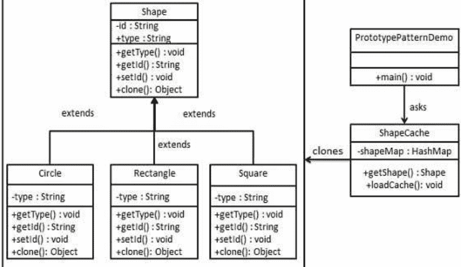

### 第 1 步

创建一个实现 `Cloneable` 的抽象类。

#### Shape.java

```java
public abstract class Shape implements Cloneable {

    private String id;
    protected String type;

    abstract void draw();

    public String getType() {
        return type;
    }

    public String getId() {
        return id;
    }

    public void setId(String id) {
        this.id = id;
    }

    public Object clone() {
        Object clone = null;
        try {
            clone = super.clone();
        } catch (CloneNotSupportedException e) {
            e.printStackTrace();
        }
        return clone;
    }

}
```

### 第 2 步

创建上述类的具体类。

#### Rectangle.java

```java
public class Rectangle extends Shape {

    public Rectangle() {
        type = "Rectangle";
    }

    @Override
    public void draw() {
        System.out.println("Inside Rectangle::draw.");
    }

}
```

#### Square.java

```java
public class Square extends Shape {

    public Square() {
        type = "Square";
    }

    @Override
    public void draw() {
        System.out.println("Inside Square::draw.");
    }

}
```

#### Circle.java

```java
public class Circle extends Shape {

    public Circle() {
        type = "Circle";
    }

    @Override
    public void draw() {
        System.out.println("Inside Circle::draw.");
    }

}
```


### 第 3 步

创建一个类从数据库获取具体类并将它们存储在 `Hashtable` 中。

#### ShapeCache.java

```java
import java.util.Hashtable;

public class ShapeCache {

    private static Hashtable<String, Shape> shapeMap = new Hashtable<String, Shape>();

    public static Shape getShape(String shapeId) {
        Shape cachedShape = shapeMap.get(shapeId);
        return (Shape) cachedShape.clone();
    }

    // 为每个形状运行数据库查询并创建形状
    // shapeMap.put(shapeKey, shape);
    // 例如，我们正在添加三个形状

    public static void loadCache() {
        Circle circle = new Circle();
        circle.setId("1");
        shapeMap.put(circle.getId(), circle);

        Square square = new Square();
        square.setId("2");
        shapeMap.put(square.getId(), square);

        Rectangle rectangle = new Rectangle();
        rectangle.setId("3");
        shapeMap.put(rectangle.getId(), rectangle);
    }

}
```

### 第 4 步

`PrototypePatternDemo` 使用 `ShapeCache` 类获取存储在 `Hashtable` 中的形状克隆。

#### PrototypePatternDemo.java

```java
public class PrototypePatternDemo {

    public static void main(String[] args) {
        ShapeCache.loadCache();

        Shape clonedShape = (Shape) ShapeCache.getShape("1");
        System.out.println("Shape : " + clonedShape.getType());

        Shape clonedShape2 = (Shape) ShapeCache.getShape("2");
        System.out.println("Shape : " + clonedShape2.getType());

        Shape clonedShape3 = (Shape) ShapeCache.getShape("3");
        System.out.println("Shape : " + clonedShape3.getType());
    }

}
```


## 7. 适配器模式 (ADAPTER PATTERN)

适配器模式作为不兼容接口之间的桥梁。这种设计模式属于结构模式，因为它结合了两个独立接口的能力。该模式涉及一个类，负责连接独立或不兼容接口的功能。现实生活中的例子可以是读卡器，它作为内存卡和笔记本电脑之间的适配器。你将内存卡插入读卡器，然后将读卡器插入笔记本电脑，就可以通过笔记本读取内存卡。

我们通过以下示例演示适配器模式的使用，其中音频播放器可以播放 mp3 文件，并且只想使用能够播放 vlc 和 mp4 文件的高级音频播放器。

### 实现

我们有一个 `MediaPlayer` 接口和一个实现 `MediaPlayer` 接口的具体类 `AudioPlayer`。`AudioPlayer` 默认播放 mp3 格式的音频文件。

我们还有另一个接口 `AdvancedMediaPlayer` 和实现 `AdvancedMediaPlayer` 接口的具体类。这些类可以播放 vlc 和 mp4 格式的文件。

我们想让 `AudioPlayer` 也能播放其他格式。为了实现这一点，我们创建了一个实现 `MediaPlayer` 接口的适配器类 `MediaAdapter`，它使用 `AdvancedMediaPlayer` 对象播放所需的格式。

### 第 1 步：为 MediaPlayer 和 Advanced Media Player 创建接口

#### MediaPlayer.java

```java
public interface MediaPlayer {
    public void play(String audioType, String fileName);
}
```

#### AdvancedMediaPlayer.java

```java
public interface AdvancedMediaPlayer {
    public void playVlc(String fileName);
    public void playMp4(String fileName);
}
```

### 第 2 步：创建实现 AdvancedMediaPlayer 接口的具体类

#### VlcPlayer.java

```java
public class VlcPlayer implements AdvancedMediaPlayer {
    @Override
    public void playVlc(String fileName) {
        System.out.println("Playing vlc file. Name: " + fileName);
    }

    @Override
    public void playMp4(String fileName) {
        // do nothing
    }
}
```

#### Mp4Player.java

```java
public class Mp4Player implements AdvancedMediaPlayer {
    @Override
    public void playVlc(String fileName) {
        // do nothing
    }

    @Override
    public void playMp4(String fileName) {
        System.out.println("Playing mp4 file. Name: " + fileName);
    }
}
```

### 第 3 步：创建实现 MediaPlayer 接口的适配器类

#### MediaAdapter.java

```java
public class MediaAdapter implements MediaPlayer {
    AdvancedMediaPlayer advancedMusicPlayer;

    public MediaAdapter(String audioType) {
        if (audioType.equalsIgnoreCase("vlc")) {
            advancedMusicPlayer = new VlcPlayer();
        } else if (audioType.equalsIgnoreCase("mp4")) {
            advancedMusicPlayer = new Mp4Player();
        }
    }

    @Override
    public void play(String audioType, String fileName) {
        if (audioType.equalsIgnoreCase("vlc")) {
            advancedMusicPlayer.playVlc(fileName);
        } else if (audioType.equalsIgnoreCase("mp4")) {
            advancedMusicPlayer.playMp4(fileName);
        }
    }
}
```

### 第 4 步：创建实现 MediaPlayer 接口的具体类

#### AudioPlayer.java

```java
public class AudioPlayer implements MediaPlayer {
    MediaAdapter mediaAdapter;

    @Override
    public void play(String audioType, String fileName) {
        // 内置播放 mp3 音乐文件的支持
        if (audioType.equalsIgnoreCase("mp3")) {
            System.out.println("Playing mp3 file. Name: " + fileName);
        }
        // mediaAdapter 提供了对其他文件格式的支持
        else if (audioType.equalsIgnoreCase("vlc") || audioType.equalsIgnoreCase("mp4")) {
            mediaAdapter = new MediaAdapter(audioType);
            mediaAdapter.play(audioType, fileName);
        } else {
            System.out.println("Invalid media. " + audioType + " format not supported");
        }
    }
}
```

### 第 5 步：使用 AudioPlayer 播放不同类型的音频格式

#### AdapterPatternDemo.java

```java
public class AdapterPatternDemo {
    public static void main(String[] args) {
        AudioPlayer audioPlayer = new AudioPlayer();

        audioPlayer.play("mp3", "beyond the horizon.mp3");
        audioPlayer.play("mp4", "alone.mp4");
        audioPlayer.play("vlc", "far far away.vlc");
        audioPlayer.play("avi", "mind me.avi");
    }
}
```

### 第 6 步：验证输出

| 输出 |
| :--- |
| Playing mp3 file. Name: beyond the horizon.mp3 |
| Playing mp4 file. Name: alone.mp4 |
| Playing vlc file. Name: far far away.vlc |
| Invalid media. avi format not supported |

---

## 8. 桥接模式 (BRIDGE PATTERN)

当我们需要将抽象与其实现解耦，以便两者独立变化时，可以使用桥接模式。这种设计模式属于结构模式，因为它通过在它们之间提供桥接来解耦实现类和抽象类。该模式涉及一个充当桥接的接口，使得具体类的功能与实现类独立。两类类都可以在结构上进行更改而不影响彼此。我们通过以下示例来演示桥接模式，在该示例中，可以使用相同的抽象类但不同的实现类绘制不同颜色的圆。

### 实现

我们有一个作为实现者的 `DrawAPI` 接口，以及实现 `DrawAPI` 的具体类 `RedCircle` 和 `GreenCircle`。`Shape` 是一个抽象类，它将使用 `DrawAPI` 的对象。我们的演示类 `BridgePatternDemo` 将使用 `Shape` 来绘制出不同颜色的圆。

### 第 1 步：创建实现者接口

#### DrawAPI.java

```java
public interface DrawAPI {
    public void drawCircle(int radius);
}
```

### 第 2 步：创建实现 DrawAPI 接口的具体实现类

#### RedCircle.java

```java
public class RedCircle implements DrawAPI {
    @Override
    public void drawCircle(int radius) {
        System.out.println("Drawing red circle with radius: " + radius);
    }
}
```

#### GreenCircle.java

```java
public class GreenCircle implements DrawAPI {
    @Override
    public void drawCircle(int radius) {
        System.out.println("Drawing green circle with radius: " + radius);
    }
}
```

### 第 3 步：使用 DrawAPI 接口创建一个抽象类

#### Shape.java

```java
public abstract class Shape {
    protected DrawAPI drawAPI;

    protected Shape(DrawAPI drawAPI) {
        this.drawAPI = drawAPI;
    }

    public abstract void draw();
}
```

### 第 4 步：创建实现 Shape 接口的具体类

#### Circle.java

```java
public class Circle extends Shape {
    private int radius;

    public Circle(int radius, DrawAPI drawAPI) {
        super(drawAPI);
        this.radius = radius;
    }

    @Override
    public void draw() {
        drawAPI.drawCircle(radius);
    }
}
```

### 第 5 步：使用 Shape 和 DrawAPI 类绘制不同颜色的圆

#### BridgePatternDemo.java

```java
public class BridgePatternDemo {
    public static void main(String[] args) {
        Shape redCircle = new Circle(10, new RedCircle());
        redCircle.draw();

        Shape greenCircle = new Circle(15, new GreenCircle());
        greenCircle.draw();
    }
}
```

### 第 6 步：验证输出

| 输出 |
| :--- |
| Drawing red circle with radius: 10 |
| Drawing green circle with radius: 15 |

---

## 9. 过滤模式 (FILTER PATTERN)

过滤模式或条件模式是一种设计模式，允许开发者使用不同的条件并通过逻辑操作解耦的方式对对象进行过滤。这种设计模式属于结构模式，因为它通过组合多个条件来获取单一条件。

### 实现

我们将创建一个 `Person` 对象、`Criteria` 接口以及实现该接口的具体类来过滤 `Person` 对象列表。我们的演示类 `CriteriaPatternDemo` 根据各种条件及其组合来过滤 `Person` 对象列表。

### 第 1 步：创建一个应用规则的类

#### Person.java

```java
public class Person {
    private String name;
    private String gender;
    private String maritalStatus;

    public Person(String name, String gender, String maritalStatus) {
        this.name = name;
        this.gender = gender;
        this.maritalStatus = maritalStatus;
    }

    public String getName() {
        return name;
    }

    public String getGender() {
        return gender;
    }

    public String getMaritalStatus() {
        return maritalStatus;
    }
}
```

### 第 2 步：为 Criteria 创建接口

#### Criteria.java

```java
import java.util.List;

public interface Criteria {
    public List<Person> meetCriteria(List<Person> persons);
}
```

### 第 3 步：实现 Criteria 接口的具体类

#### CriteriaMale.java

```java
import java.util.ArrayList;
import java.util.List;

public class CriteriaMale implements Criteria {
    @Override
    public List<Person> meetCriteria(List<Person> persons) {
        List<Person> malePersons = new ArrayList<>();
        for (Person person : persons) {
            if (person.getGender().equalsIgnoreCase("MALE")) {
                malePersons.add(person);
            }
        }
        return malePersons;
    }
}
```

#### CriteriaFemale.java

```java
import java.util.ArrayList;
import java.util.List;

public class CriteriaFemale implements Criteria {
    @Override
    public List<Person> meetCriteria(List<Person> persons) {
        List<Person> femalePersons = new ArrayList<>();
        for (Person person : persons) {
            if (person.getGender().equalsIgnoreCase("FEMALE")) {
                femalePersons.add(person);
            }
        }
        return femalePersons;
    }
}
```

#### CriteriaSingle.java

```java
import java.util.ArrayList;
import java.util.List;

public class CriteriaSingle implements Criteria {
    @Override
    public List<Person> meetCriteria(List<Person> persons) {
        List<Person> singlePersons = new ArrayList<>();
        for (Person person : persons) {
            if (person.getMaritalStatus().equalsIgnoreCase("SINGLE")) {
                singlePersons.add(person);
            }
        }
        return singlePersons;
    }
}
```

#### AndCriteria.java

```java
import java.util.List;

public class AndCriteria implements Criteria {
    private Criteria criteria;
    private Criteria otherCriteria;

    public AndCriteria(Criteria criteria, Criteria otherCriteria) {
        this.criteria = criteria;
        this.otherCriteria = otherCriteria;
    }

    @Override
    public List<Person> meetCriteria(List<Person> persons) {
        List<Person> firstCriteriaPersons = criteria.meetCriteria(persons);
        return otherCriteria.meetCriteria(firstCriteriaPersons);
    }
}
```

#### OrCriteria.java

```java
import java.util.List;

public class OrCriteria implements Criteria {
    private Criteria criteria;
    private Criteria otherCriteria;

    public OrCriteria(Criteria criteria, Criteria otherCriteria) {
        this.criteria = criteria;
        this.otherCriteria = otherCriteria;
    }

    @Override
    public List<Person> meetCriteria(List<Person> persons) {
        List<Person> firstCriteriaItems = criteria.meetCriteria(persons);
        List<Person> otherCriteriaItems = otherCriteria.meetCriteria(persons);

        for (Person person : otherCriteriaItems) {
            if (!firstCriteriaItems.contains(person)) {
                firstCriteriaItems.add(person);
            }
        }
        return firstCriteriaItems;
    }
}
```

### 第 4 步：使用 Criteria 模式过滤 Person 对象列表

#### CriteriaPatternDemo.java

```java
import java.util.ArrayList;
import java.util.List;

public class CriteriaPatternDemo {
    public static void main(String[] args) {
        List<Person> persons = new ArrayList<>();

        persons.add(new Person("Robert", "Male", "Single"));
        persons.add(new Person("John", "Male", "Married"));
        persons.add(new Person("Laura", "Female", "Married"));
        persons.add(new Person("Diana", "Female", "Single"));
        persons.add(new Person("Mike", "Male", "Single"));
        persons.add(new Person("Bobby", "Male", "Single"));

        Criteria male = new CriteriaMale();
        Criteria female = new CriteriaFemale();
        Criteria single = new CriteriaSingle();
        Criteria singleMale = new AndCriteria(single, male);
        Criteria singleOrFemale = new OrCriteria(single, female);

        System.out.println("Males: ");
        printPersons(male.meetCriteria(persons));

        System.out.println("\nFemales: ");
        printPersons(female.meetCriteria(persons));

        System.out.println("\nSingle Males: ");
        printPersons(singleMale.meetCriteria(persons));

        System.out.println("\nSingle Or Females: ");
        printPersons(singleOrFemale.meetCriteria(persons));
    }

    public static void printPersons(List<Person> persons) {
        for (Person person : persons) {
            System.out.println("Person : [ Name : " + person.getName()
                    + ", Gender : " + person.getGender()
                    + ", Marital Status : " + person.getMaritalStatus() + " ]");
        }
    }
}
```

### 第 5 步：验证输出

| 输出 |
| :--- |
| Males: |
| Person : [ Name : Robert, Gender : Male, Marital Status : Single ] |
| Person : [ Name : John, Gender : Male, Marital Status : Married ] |
| Person : [ Name : Mike, Gender : Male, Marital Status : Single ] |
| Person : [ Name : Bobby, Gender : Male, Marital Status : Single ] |
| Females: |
| Person : [ Name : Laura, Gender : Female, Marital Status : Married ] |
| Person : [ Name : Diana, Gender : Female, Marital Status : Single ] |
| Single Males: |
| Person : [ Name : Robert, Gender : Male, Marital Status : Single ] |
| Person : [ Name : Mike, Gender : Male, Marital Status : Single ] |
| Person : [ Name : Bobby, Gender : Male, Marital Status : Single ] |
| Single Or Females: |
| Person : [ Name : Robert, Gender : Male, Marital Status : Single ] |
| Person : [ Name : Diana, Gender : Female, Marital Status : Single ] |
| Person : [ Name : Mike, Gender : Male, Marital Status : Single ] |
| Person : [ Name : Bobby, Gender : Male, Marital Status : Single ] |
| Person : [ Name : Laura, Gender : Female, Marital Status : Married ] |


## OrCriteria.java

```java
import java.util.List;

public class OrCriteria implements Criteria {

    private Criteria criteria;
    private Criteria otherCriteria;

    public OrCriteria(Criteria criteria, Criteria otherCriteria) {
        this.criteria = criteria;
        this.otherCriteria = otherCriteria;
    }

    @Override
    public List<Person> meetCriteria(List<Person> persons) {
        List<Person> firstCriteriaItems = criteria.meetCriteria(persons);
        List<Person> otherCriteriaItems = otherCriteria.meetCriteria(persons);

        for (Person person : otherCriteriaItems) {
            if (!firstCriteriaItems.contains(person)) {
                firstCriteriaItems.add(person);
            }
        }
        return firstCriteriaItems;
    }
}
```

### 第 4 步：使用不同的 `Criteria` 及其组合来过滤人员

### CriteriaPatternDemo.java

```java
public class CriteriaPatternDemo {

    public static void main(String[] args) {
        List<Person> persons = new ArrayList<Person>();
        persons.add(new Person("Robert", "Male", "Single"));
        // ... 其他人员添加代码省略
    }

    public static void printPersons(List<Person> persons) {
        for (Person person : persons) {
            System.out.println("Person : [ Name : " + person.getName()
                    + ", Gender : " + person.getGender()
                    + ", Marital Status : " + person.getMaritalStatus() + " ]");
        }
    }
}
```

### 第 5 步：验证输出

**男性：**
- Person : [ Name : Robert, Gender : Male, Marital Status : Single ]
- Person : [ Name : John, Gender : Male, Marital Status : Married ]
- Person : [ Name : Mike, Gender : Male, Marital Status : Single ]
- Person : [ Name : Bobby, Gender : Male, Marital Status : Single ]

**女性：**
- Person : [ Name : Laura, Gender : Female, Marital Status : Married ]
- Person : [ Name : Diana, Gender : Female, Marital Status : Single ]

**单身男性：**
- Person : [ Name : Robert, Gender : Male, Marital Status : Single ]
- Person : [ Name : Mike, Gender : Male, Marital Status : Single ]
- Person : [ Name : Bobby, Gender : Male, Marital Status : Single ]

**单身或女性：**
- Person : [ Name : Robert, Gender : Male, Marital Status : Single ]
- Person : [ Name : Diana, Gender : Female, Marital Status : Single ]
- Person : [ Name : Mike, Gender : Male, Marital Status : Single ]


## 10. 组合模式 (COMPOSITE PATTERN)

当我们需要以类似于对象的方式处理一组对象时，就会使用组合模式。组合模式以树结构组合对象，以表示部分与整体的层次结构。这种设计模式属于结构型模式，因为它创建了一个对象组树形结构。

这种模式创建一个包含一组其自身对象的类。该类提供了修改其同类对象组的方法。

我们正在演示组合模式的使用，在示例中，我们将展示组织中的员工层级结构。

### 实现

我们有一个 `Employee` 类，它作为组合模式的参与者类。我们的演示类 `CompositePatternDemo` 将使用 `Employee` 类来添加层级结构并打印所有员工。

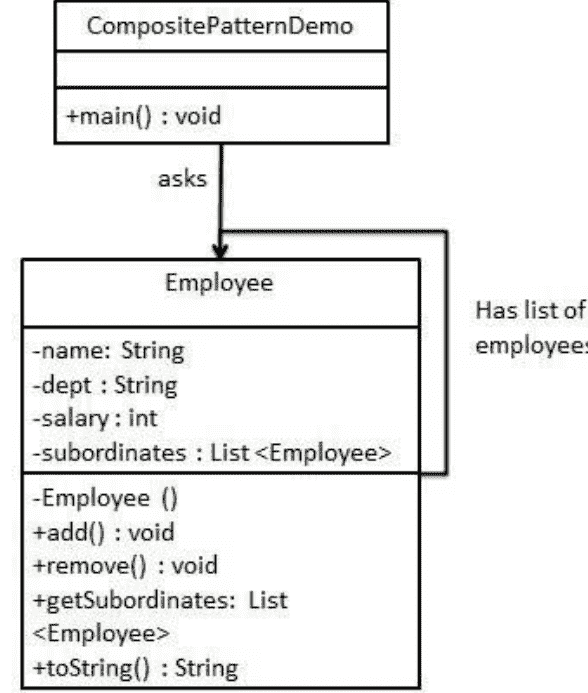

### 第 1 步：创建一个包含 `Employee` 对象列表的 `Employee` 类

### Employee.java

```java
import java.util.ArrayList;
import java.util.List;

public class Employee {

    private String name;
    private String dept;
    private int salary;
    private List<Employee> subordinates;

    public Employee(String name, String dept, int salary) {
        this.name = name;
        this.dept = dept;
        this.salary = salary;
        this.subordinates = new ArrayList<>();
    }

    public void add(Employee e) {
        subordinates.add(e);
    }

    public void remove(Employee e) {
        subordinates.remove(e);
    }

    public List<Employee> getSubordinates() {
        return subordinates;
    }

    @Override
    public String toString() {
        return "Employee : [ Name : " + name + ", Dept : " + dept + ", Salary : " + salary + " ]";
    }
}
```

### 第 2 步：使用 `Employee` 类创建并打印层级

### CompositePatternDemo.java

```java
public class CompositePatternDemo {

    public static void main(String[] args) {
        Employee CEO = new Employee("John", "CEO", 30000);
        Employee headSales = new Employee("Robert", "Sales", 20000);
        Employee headMarketing = new Employee("Michel", "Marketing", 20000);
        Employee sales1 = new Employee("Richard", "Sales", 10000);
        Employee sales2 = new Employee("Rob", "Sales", 10000);
        Employee clerk1 = new Employee("Laura", "Marketing", 10000);
        Employee clerk2 = new Employee("Bob", "Marketing", 10000);

        CEO.add(headSales);
        CEO.add(headMarketing);
        headSales.add(sales1);
        headSales.add(sales2);
        headMarketing.add(clerk1);
        headMarketing.add(clerk2);

        printEmployee(CEO);
    }

    public static void printEmployee(Employee employee) {
        System.out.println(employee.toString());
        for (Employee sub : employee.getSubordinates()) {
            printEmployee(sub);
        }
    }
}
```

### 第 3 步：验证输出

| Name | Dept | Salary |
| :--- | :--- | :--- |
| John | CEO | 30000 |
| Robert | Sales | 20000 |
| Michel | Marketing | 20000 |
| Richard | Sales | 10000 |
| Rob | Sales | 10000 |
| Laura | Marketing | 10000 |
| Bob | Marketing | 10000 |

## 11. 装饰器模式 (DECORATOR PATTERN)

装饰器模式允许用户在不改变现有结构的情况下为对象添加新功能。这种设计模式属于结构型模式，因为它作为既有类的包装器。

我们将创建一个 `Shape` 接口和实现 `Shape` 接口的具体类。我们将创建一个实现 `Shape` 接口的抽象装饰器类，并将 `Shape` 对象作为其实例变量。

### 第 1 步：创建一个接口

### Shape.java

```java
public interface Shape {
    void draw();
}
```

### 第 2 步：创建实现相同接口的具体类

### Rectangle.java

```java
public class Rectangle implements Shape {
    @Override
    public void draw() {
        System.out.println("Shape: Rectangle");
    }
}
```

### Circle.java

```java
public class Circle implements Shape {
    @Override
    public void draw() {
        System.out.println("Shape: Circle");
    }
}
```

### 第 3 步：创建一个实现 `Shape` 接口的抽象装饰器类

### ShapeDecorator.java

```java
public abstract class ShapeDecorator implements Shape {
    protected Shape decoratedShape;

    public ShapeDecorator(Shape decoratedShape) {
        this.decoratedShape = decoratedShape;
    }

    @Override
    public void draw() {
        decoratedShape.draw();
    }
}
```

### 第 4 步：创建一个继承 `ShapeDecorator` 类的具体装饰器类

### RedShapeDecorator.java

```java
public class RedShapeDecorator extends ShapeDecorator {

    public RedShapeDecorator(Shape decoratedShape) {
        super(decoratedShape);
    }

    @Override
    public void draw() {
        decoratedShape.draw();
        setRedBorder(decoratedShape);
    }

    private void setRedBorder(Shape decoratedShape) {
        System.out.println("Border Color: Red");
    }
}
```

### 第 5 步：使用 `RedShapeDecorator` 来装饰 `Shape` 对象

### DecoratorPatternDemo.java

```java
public class DecoratorPatternDemo {

    public static void main(String[] args) {
        Shape circle = new Circle();
        Shape redCircle = new RedShapeDecorator(new Circle());
        Shape redRectangle = new RedShapeDecorator(new Rectangle());

        System.out.println("Circle with normal border");
        circle.draw();

        System.out.println("\nCircle of red border");
        redCircle.draw();

        System.out.println("\nRectangle of red border");
        redRectangle.draw();
    }
}
```

### 第 6 步：验证输出

```
Circle with normal border
Shape: Circle
Circle of red border
Shape: Circle
Border Color: Red
Rectangle of red border
Shape: Rectangle
Border Color: Red
```


## 12. 外观模式 (FACADE PATTERN)

外观模式隐藏了系统的复杂性，并为客户端提供了一个接口，客户端可以通过接口访问系统。这种设计模式属于结构模式，因为它为现有系统添加了一个接口来隐藏其复杂性。

该模式调用一个单一类，该类提供客户端所需的简易方法，并将调用委托给现有系统类的方法。

### 实现

我们将创建一个 `Shape` 接口以及实现该接口的具体类。下一步将定义一个外观类 `ShapeMaker`。

`ShapeMaker` 使用具体类来将调用委托给这些类。我们的演示类 `FacadePatternDemo` 将使用 `ShapeMaker` 类来显示结果。

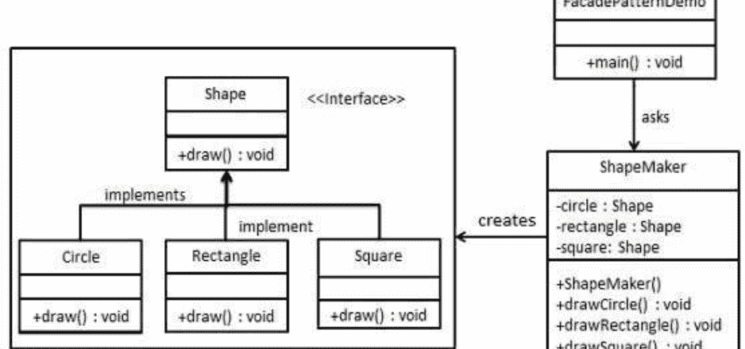

### 第 1 步：创建一个接口

### Shape.java

```java
public interface Shape {
    void draw();
}
```

### 第 2 步：创建实现相同接口的具体类

### Rectangle.java

```java
public class Rectangle implements Shape {
    @Override
    public void draw() {
        System.out.println("Rectangle::draw()");
    }
}
```

### Square.java

```java
public class Square implements Shape {
    @Override
    public void draw() {
        System.out.println("Square::draw()");
    }
}
```


## 外观模式

### Square.java

```java
public class Square implements Shape {

  @Override
  public void draw() {
    System.out.println("Square::draw()");
  }
}
```

### Circle.java

```java
public class Circle implements Shape {

  @Override
  public void draw() {
    System.out.println("Circle::draw()");
  }
}
```


### 第 3 步：创建一个外观类

### ShapeMaker.java

```java
public class ShapeMaker {

    private Shape circle;
    private Shape rectangle;
    private Shape square;

    public ShapeMaker() {
        circle = new Circle();
        rectangle = new Rectangle();
        square = new Square();
    }

    public void drawCircle() {
        circle.draw();
    }

    public void drawRectangle() {
        rectangle.draw();
    }

    public void drawSquare() {
        square.draw();
    }
}
```

### 第 4 步：使用外观绘制各种类型的形状

### FacadePatternDemo.java

```java
public class FacadePatternDemo {

    public static void main(String[] args) {
        ShapeMaker shapeMaker = new ShapeMaker();
        shapeMaker.drawCircle();
        shapeMaker.drawRectangle();
        shapeMaker.drawSquare();
    }
}
```


### 第 5 步：验证输出

| Circle::draw() |
| Rectangle::draw() |
| Square::draw() |

## 13. 享元模式

享元模式主要用于通过减少创建的对象数量来降低内存占用并提高性能。这种设计属于结构模式，因为它提供了减少对象数量的方法从而改进应用程序的对象结构。

享元模式尝试通过存储已有的类型对象来重用它们，并在未找到匹配对象时创建新对象。我们将通过绘制 20 个不同位置的圆来演示这种模式，但只会创建 5 个对象。由于只有 5 种颜色可用，因此使用了属性。

### 实现

我们将创建一个 `Shape` 接口以及实现该接口的具体类 `Circle`。下一步将定义一个工厂类 `ShapeFactory`。

`ShapeFactory` 拥有一个以颜色为键的 `HashMap`。当请求 `ShapeFactory` 创建特定颜色的圆时，它会检查 `HashMap` 中的对象。如果找到，则返回该对象；否则创建一个新对象存储在 map 中供以后使用并返回给客户端。我们的演示类 `FlyweightDemo` 将使用 `ShapeFactory` 传递信息（红/绿/蓝）来获取所需的颜色圆。


### 第 1 步：创建一个接口

### Shape.java

```java
public interface Shape {
    void draw();
}
```

### 第 2 步：实现相同接口的具体类

### Circle.java

```java
public class Circle implements Shape {

    private String color;
    private int x;
    private int y;
    private int radius;

    public Circle(String color) {
        this.color = color;
    }

    public void setX(int x) {
        this.x = x;
    }

    public void setY(int y) {
        this.y = y;
    }

    public void setRadius(int radius) {
        this.radius = radius;
    }

    @Override
    public void draw() {
    }
}
```

### 第 3 步：创建一个根据给定信息生成具体类的工厂

### ShapeFactory.java

```java
import java.util.HashMap;

public class ShapeFactory {

    private static final HashMap<String, Shape> circleMap = new HashMap<>();

    public static Shape getCircle(String color) {
        Circle circle = (Circle) circleMap.get(color);
        if (circle == null) {
            circle = new Circle(color);
            circleMap.put(color, circle);
            System.out.println("Creating circle of color : " + color);
        }
        return circle;
    }
}
```


### 第 4 步：通过传递颜色信息使用工厂获取具体类对象

### FlyweightDemo.java

```java
public class FlyweightDemo {

    private static final String colors[] = { "Red", "Green", "Blue", "Black" };

    public static void main(String[] args) {
        for (int i = 0; i < 20; i++) {
            Circle circle = (Circle) ShapeFactory.getCircle(getRandomColor());
            circle.setX(getRandomX());
            circle.setY(getRandomY());
            circle.setRadius(100);
            circle.draw();
        }
    }

    private static String getRandomColor() {
        return colors[(int) (Math.random() * colors.length)];
    }

    private static int getRandomX() {
        return (int) (Math.random() * 100);
    }

    private static int getRandomY() {
        return (int) (Math.random() * 100);
    }
}
```

### 第 5 步：验证输出

```
Creating circle of color : Black
Circle: Draw() [Color : Black, x : 36, y : 71, radius : 100]
Creating circle of color : Green
Circle: Draw() [Color : Green, x : 27, y : 27, radius : 100]
Creating circle of color : White
Circle: Draw() [Color : White, x : 64, y : 10, radius : 100]
Creating circle of color : Red
Circle: Draw() [Color : Red, x : 15, y : 44, radius : 100]
Creating circle of color : Green
Circle: Draw() [Color : Green, x : 19, y : 10, radius : 100]
Creating circle of color : White
Circle: Draw() [Color : White, x : 94, y : 32, radius : 100]
Creating circle of color : White
Circle: Draw() [Color : White, x : 69, y : 98, radius : 100]
Creating circle of color : Blue
Circle: Draw() [Color : Blue, x : 13, y : 4, radius : 100]
Creating circle of color : Green
Circle: Draw() [Color : Green, x : 21, y : 21, radius : 100]
Creating circle of color : Blue
Circle: Draw() [Color : Blue, x : 55, y : 56, radius : 100]
Creating circle of color : White
Circle: Draw() [Color : White, x : 90, y : 70, radius : 100]
Creating circle of color : Green
Circle: Draw() [Color : Green, x : 78, y : 3, radius : 100]
Creating circle of color : Green
Circle: Draw() [Color : Green, x : 64, y : 89, radius : 100]
Creating circle of color : Blue
Circle: Draw() [Color : Blue, x : 3, y : 91, radius : 100]
```


```
Circle: Draw() [Color : Red, x : 76, y :82, radius :100]
Circle: Draw() [Color : Blue, x : 95, y :82, radius :100]
```

## 14. 代理模式

在代理模式中，一个类代表另一个类的功能。这种设计模式属于结构型模式。

在代理模式中，我们创建一个包含原始对象的对象，以向外部世界提供其功能。

### 实现

我们将创建一个 `Image` 接口和实现该 `Image` 接口的具体类。`ProxyImage` 是一个代理类，用于减少 `Image` 对象加载时的内存占用。

我们的演示类 `ProxyPatternDemo` 将使用 `ProxyImage` 来获取 `Image` 对象，并根据需要加载和显示。

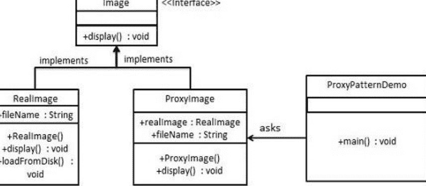

### 步骤 1：创建一个接口

### Image.java

```java
public interface Image {
    void display();
}
```

### 步骤 2：创建实现相同接口的具体类

### RealImage.java

```java
public class RealImage implements Image {

    private String fileName;

    public RealImage(String fileName) {
        this.fileName = fileName;
        loadFromDisk(fileName);
    }

    @Override
    public void display() {
        System.out.println("Displaying " + fileName);
    }

    private void loadFromDisk(String fileName) {
        System.out.println("Loading " + fileName);
    }
}
```

### ProxyImage.java

```java
public class ProxyImage implements Image {

    private RealImage realImage;
    private String fileName;

    public ProxyImage(String fileName) {
        this.fileName = fileName;
    }

    @Override
    public void display() {
        if (realImage == null) {
            realImage = new RealImage(fileName);
        }
        realImage.display();
    }
}
```

### 步骤 3：在需要时使用 `ProxyImage` 获取 `RealImage` 类的对象

### ProxyPatternDemo.java

### 步骤 4：验证输出

| Loading test_10mb.jpg |
| :--- |
| Displaying test_10mb.jpg |
| Displaying test_10mb.jpg |


## 15. 责任链模式

顾名思义，责任链模式为请求创建接收者对象的链。该模式根据请求类型将请求的发送者和接收者解耦。这种模式属于行为模式。

在这种模式中，通常每个接收者都包含对另一个接收者的引用。如果一个对象无法处理请求，它会将相同的请求传递给下一个接收者，依此类推。

### 实现

我们创建了一个带有日志级别的抽象类 `AbstractLogger`。然后，我们创建了三种继承 `AbstractLogger` 的日志器。每个日志器都会检查消息级别是否与其级别匹配，如果是则进行相应的打印，否则不打印并将消息传递给下一个日志器。

| ChainPatternDemo | AbstractLogger | <<abstract class>> |
| :--- | :--- | :--- |
| uses | +INFO : int | |
| +main() : void | +DEBUG : int | |
| | +ERROR : int | |
| | +level : int | |
| | +nextLogger : AbstractLogger | |
| | +setNextLogger() : void | |
| | +logMessage() : void | |
| | -write() : void | |

| ConsoleLogger | ErrorLogger | FileLogger |
| :--- | :--- | :--- |
| +ConsoleLogger() | +ErrorLogger() | +FileLogger() |
| +setNextLogger() : void | +setNextLogger() : void | +setNextLogger() : void |
| +logMessage() : void | +logMessage() : void | +logMessage() : void |
| -write() : void | -write() : void | -write() : void |

### 步骤 1：创建一个抽象日志类

### AbstractLogger.java

```java
public abstract class AbstractLogger {

    public static int INFO = 1;
    public static int DEBUG = 2;
    public static int ERROR = 3;

    protected int level;
    protected AbstractLogger nextLogger;
}
```


## 16. 责任链模式 (CHAIN OF RESPONSIBILITY PATTERN)

### 实现

我们将创建一个抽象类 `AbstractLogger`，它包含日志记录级别和下一个日志记录器的引用。然后创建三个继承自 `AbstractLogger` 的具体类，分别用于控制台、错误和文件日志记录。

### AbstractLogger.java

```java
public abstract class AbstractLogger {
    public static int INFO = 1;
    public static int DEBUG = 2;
    public static int ERROR = 3;

    protected int level;

    // next element in chain or responsibility
    protected AbstractLogger nextLogger;

    public void setNextLogger(AbstractLogger nextLogger) {
        this.nextLogger = nextLogger;
    }

    public void logMessage(int level, String message) {
        if (level <= this.level) {
            write(message);
        } else if (nextLogger != null) {
            nextLogger.logMessage(level, message);
        }
    }

    protected abstract void write(String message);
}
```

### Step 2

创建继承日志器的具体类。

### ConsoleLogger.java

```java
public class ConsoleLogger extends AbstractLogger {
    public ConsoleLogger(int level) {
        this.level = level;
    }

    @Override
    protected void write(String message) {
        System.out.println("Standard Console::Logger: " + message);
    }
}
```

### ErrorLogger.java

```java
public class ErrorLogger extends AbstractLogger {
    public ErrorLogger(int level) {
        this.level = level;
    }

    @Override
    protected void write(String message) {
        System.out.println("Error ::Logger: " + message);
    }
}
```

### FileLogger.java

```java
public class FileLogger extends AbstractLogger {
    public FileLogger(int level) {
        this.level = level;
    }

    @Override
    protected void write(String message) {
        System.out.println("File ::Logger: " + message);
    }
}
```

### Step 3

创建不同类型的日志器。分配它们的下一个日志器。

### ChainPatternDemo.java

```java
public class ChainPatternDemo {
    private static AbstractLogger getChainOfNeighbors() {
        AbstractLogger errorLogger = new ErrorLogger(AbstractLogger.ERROR);
        AbstractLogger fileLogger = new FileLogger(AbstractLogger.DEBUG);
        AbstractLogger consoleLogger = new ConsoleLogger(AbstractLogger.INFO);

        errorLogger.setNextLogger(fileLogger);
        fileLogger.setNextLogger(consoleLogger);

        return errorLogger;
    }

    public static void main(String[] args) {
        AbstractLogger loggerChain = getChainOfNeighbors();

        loggerChain.logMessage(AbstractLogger.INFO, "This is an information.");
        loggerChain.logMessage(AbstractLogger.DEBUG, "This is a debug level.");
        loggerChain.logMessage(AbstractLogger.ERROR, "This is an error.");
    }
}
```

## 17. 命令模式 (COMMAND PATTERN)

### 实现

我们将创建一个 `Order` 接口，然后创建实现了 `Order` 接口的实体类 `BuyStock` 和 `SellStock`。`Broker` 类作为命令调用者，接收并执行命令。

### Order.java

```java
public interface Order {
    void execute();
}
```

### Stock.java

```java
public class Stock {
    private String name = "ABC";
    private int quantity = 10;

    public void buy() {
        System.out.println("Stock [ Name: " + name + ", Quantity: " + quantity + " ] bought");
    }

    public void sell() {
        System.out.println("Stock [ Name: " + name + ", Quantity: " + quantity + " ] sold");
    }
}
```

### BuyStock.java

```java
public class BuyStock implements Order {
    private Stock abcStock;

    public BuyStock(Stock abcStock) {
        this.abcStock = abcStock;
    }

    public void execute() {
        abcStock.buy();
    }
}
```

### SellStock.java

```java
public class SellStock implements Order {
    private Stock abcStock;

    public SellStock(Stock abcStock) {
        this.abcStock = abcStock;
    }

    public void execute() {
        abcStock.sell();
    }
}
```

### Step 4

创建命令调用者类。

### Broker.java

```java
import java.util.ArrayList;
import java.util.List;

public class Broker {
    private List<Order> orderList = new ArrayList<Order>();

    public void takeOrder(Order order) {
        orderList.add(order);
    }

    public void placeOrders() {
        for (Order order : orderList) {
            order.execute();
        }
        orderList.clear();
    }
}
```

### Step 5

使用 `Broker` 类来接收并执行命令。

### CommandPatternDemo.java

```java
public class CommandPatternDemo {
    public static void main(String[] args) {
        Stock abcStock = new Stock();

        BuyStock buyStockOrder = new BuyStock(abcStock);
        SellStock sellStockOrder = new SellStock(abcStock);

        Broker broker = new Broker();
        broker.takeOrder(buyStockOrder);
        broker.takeOrder(sellStockOrder);

        broker.placeOrders();
    }
}
```

### Step 6

验证输出。

| 已购买股票 [ 名称: ABC, 数量: 10 ] |
| :--- |
| 已卖出股票 [ 名称: ABC, 数量: 10 ] |

## 18. 解释器模式 (INTERPRETER PATTERN)

解释器模式提供了一种评估语言语法或表达式的方法。这种模式属于行为模式。该模式涉及实现一个表达式接口，用于解释特定的上下文。该模式用于 SQL 解析、符号处理引擎等领域。

### 实现

我们将创建一个 `Expression` 接口以及实现该接口的具体类。定义了一个 `TerminalExpression` 类，它作为问题上下文的主解释器运行。其他类是 `OrExpression` 和 `AndExpression`，它们被用于创建组合表达式。

`InterpreterPatternDemo` 是我们的演示类，它将通过使用 `Expression` 类来创建规则并演示表达式的解析。

### Step 1

创建一个表达式接口。

### Expression.java

```java
public interface Expression {
    public boolean interpret(String context);
}
```

### Step 2

创建实现上述接口的具体类。

### TerminalExpression.java

```java
public class TerminalExpression implements Expression {
    private String data;

    public TerminalExpression(String data) {
        this.data = data;
    }

    @Override
    public boolean interpret(String context) {
        if (context.contains(data)) {
            return true;
        }
        return false;
    }
}
```

### OrExpression.java

```java
public class OrExpression implements Expression {
    private Expression expr1 = null;
    private Expression expr2 = null;

    public OrExpression(Expression expr1, Expression expr2) {
        this.expr1 = expr1;
        this.expr2 = expr2;
    }

    @Override
    public boolean interpret(String context) {
        return expr1.interpret(context) || expr2.interpret(context);
    }
}
```

### AndExpression.java

```java
public class AndExpression implements Expression {
    private Expression expr1 = null;
    private Expression expr2 = null;

    public AndExpression(Expression expr1, Expression expr2) {
        this.expr1 = expr1;
        this.expr2 = expr2;
    }

    @Override
    public boolean interpret(String context) {
        return expr1.interpret(context) && expr2.interpret(context);
    }
}
```

### Step 3

`InterpreterPatternDemo` 使用 `Expression` 类创建规则并对其进行解析。

### InterpreterPatternDemo.java

```java
public class InterpreterPatternDemo {
    // 规则：Robert 和 John 是男性
    public static Expression getMaleExpression() {
        Expression robert = new TerminalExpression("Robert");
        Expression john = new TerminalExpression("John");
        return new OrExpression(robert, john);
    }

    // 规则：Julie 是已婚女性
    public static Expression getMarriedWomanExpression() {
        Expression julie = new TerminalExpression("Julie");
        Expression married = new TerminalExpression("Married");
        return new AndExpression(julie, married);
    }

    public static void main(String[] args) {
        Expression isMale = getMaleExpression();
        Expression isMarriedWoman = getMarriedWomanExpression();

        System.out.println("is male? " + isMale.interpret("Robert John"));
        System.out.println("is married woman? " + isMarriedWoman.interpret("Julie Married"));
    }
}
```

### Step 4

验证输出。

```
is male? true
is married woman? true
```

## 19. 迭代器模式 (ITERATOR PATTERN)

迭代器模式是一种用于访问集合元素而不暴露其内部表示的设计模式。它属于行为模式。

### 实现

我们将创建一个 `Iterator` 接口以及实现该接口的具体类来访问集合。`IteratorPatternDemo` 是我们的演示类，将使用 `NameRepository` 来打印名称。

### Step 1

创建接口。

### Iterator.java

```java
public interface Iterator {
    public boolean hasNext();
    public Object next();
}
```

### Container.java

```java
public interface Container {
    public Iterator getIterator();
}
```

### Step 2

创建实现上述接口的具体类。该类有一个内部类 `NameIterator`。

### NameRepository.java

```java
public class NameRepository implements Container {
    public String names[] = {"Robert", "John", "Julie", "Lora"};

    @Override
    public Iterator getIterator() {
        return new NameIterator();
    }

    private class NameIterator implements Iterator {
        int index;

        @Override
        public boolean hasNext() {
            if (index < names.length) {
                return true;
            }
            return false;
        }

        @Override
        public Object next() {
            if (hasNext()) {
                return names[index++];
            }
            return null;
        }
    }
}
```

### Step 3

使用 `NameRepository` 获取迭代器并打印名称。

### IteratorPatternDemo.java

```java
public class IteratorPatternDemo {
    public static void main(String[] args) {
        NameRepository namesRepository = new NameRepository();
    }
}
```


## 19. 中介者模式 (MEDIATOR PATTERN)

中介模式用于减少多个对象或类之间的通信复杂度。该模式提供了一个中介类，通常处理不同类之间的所有通信，通过松耦合支持代码的维护。中介模式属于行为模式。

### 实现

我们通过聊天室示例来演示中介模式，多个用户可以向聊天室发送消息，由聊天室负责向所有用户显示消息。我们创建了两个类 `ChatRoom` 和 `User`。`User` 对象将使用 `ChatRoom` 方法共享消息。

`MediatorPatternDemo` 是我们的演示类，将使用 `User` 对象来展示它们之间的通信。

| MediatorPatternDemo | User | ChatRoom |
| :--- | :--- | :--- |
| +main() : void | -name : String<br>+User() : void<br>+getName() : void<br>+setName() : void<br>+sendMessage() : void | +showMessage() : void |

### Step 1: 创建中介类

#### ChatRoom.java

```java
import java.util.Date;

public class ChatRoom {

    public static void showMessage(User user, String message) {
        System.out.println(new Date().toString() + " [" + user.getName() + "] : " + message);
    }
}
```

### Step 2: 创建用户类

#### User.java

```java
public class User {

    private String name;

    public String getName() {
        return name;
    }

    public void setName(String name) {
        this.name = name;
    }

    public User(String name) {
        this.name = name;
    }

    public void sendMessage(String message) {
        ChatRoom.showMessage(this, message);
    }
}
```

### Step 3: 使用中介者对象显示它们之间的通信

#### MediatorPatternDemo.java

```java
public class MediatorPatternDemo {

    public static void main(String[] args) {
        User robert = new User("Robert");
        User john = new User("John");

        robert.sendMessage("Hi John!");
        john.sendMessage("Hello! Robert!");
    }
}
```

### Step 4: 验证输出

| Thu Jan 31 16:05:46 IST 2013 [Robert] : Hi! John! |
| Thu Jan 31 16:05:46 IST 2013 [John] : Hello! Robert! |

---

## 20. 备忘模式 (MEMENTO PATTERN)

备忘模式用于将对象的状态恢复到之前的状态。备忘模式属于行为模式分类。

### 实现

备忘模式使用了三个参与者类。`Memento`（备忘）包含要恢复的对象的状态。`Originator`（发起人）创建并将状态存储在 `Memento` 对象中，而 `Caretaker`（管理者）负责从 `Memento` 恢复对象状态。我们需要创建 `Memento`、`Originator` 和 `CareTaker` 类。

我们的演示类 `MementoPatternDemo` 将使用 `CareTaker` 和 `Originator` 对象来展示对象状态的恢复。

### Step 1: 创建 Memento 类

#### Memento.java

```java
public class Memento {

    private String state;

    public Memento(String state) {
        this.state = state;
    }

    public String getState() {
        return state;
    }
}
```

### Step 2: 创建 Originator 类

#### Originator.java

```java
public class Originator {

    private String state;

    public void setState(String state) {
        this.state = state;
    }

    public String getState() {
        return state;
    }

    public Memento saveStateToMemento() {
        return new Memento(state);
    }

    public void getStateFromMemento(Memento memento) {
        state = memento.getState();
    }
}
```

### Step 3: 创建 CareTaker 类

#### CareTaker.java

```java
import java.util.ArrayList;
import java.util.List;

public class CareTaker {

    private List<Memento> mementoList = new ArrayList<>();

    public void add(Memento state) {
        mementoList.add(state);
    }

    public Memento get(int index) {
        return mementoList.get(index);
    }
}
```

### Step 4: 使用 CareTaker 和 Originator 对象

#### MementoPatternDemo.java

```java
public class MementoPatternDemo {

    public static void main(String[] args) {
        Originator originator = new Originator();
        CareTaker careTaker = new CareTaker();

        originator.setState("State #1");
        originator.setState("State #2");
        careTaker.add(originator.saveStateToMemento());

        originator.setState("State #3");
        careTaker.add(originator.saveStateToMemento());

        originator.setState("State #4");

        System.out.println("Current State: " + originator.getState());
        originator.getStateFromMemento(careTaker.get(0));
        System.out.println("First saved State: " + originator.getState());
        originator.getStateFromMemento(careTaker.get(1));
        System.out.println("Second saved State: " + originator.getState());
    }
}
```

### Step 5: 验证输出

| Current State: State #4 |
| First saved State: State #2 |
| Second saved State: State #3 |

---

## 21. 观察者模式 (OBSERVER PATTERN)

观察者模式用于对象之间存在一对多的关系时，例如当一个对象被修改时，其依赖对象将自动收到通知。观察者模式属于行为模式分类。

### 实现

观察者模式使用了三个参与者类：`Subject`（主体）、`Observer`（观察者）和 `Client`（客户端）。`Subject` 是具有方法可以向客户端对象添加或移除观察者的对象。我们创建了一个抽象类 `Observer` 和一个具体类 `Subject`。

我们的演示类 `ObserverPatternDemo` 将使用 `Subject` 和具体观察者对象来展示观察者模式的作用。

### Step 1: 创建 Subject 类

#### Subject.java

```java
import java.util.ArrayList;
import java.util.List;

public class Subject {

    private List<Observer> observers = new ArrayList<>();
    private int state;

    public void attach(Observer observer) {
        observers.add(observer);
    }

    public void detach(Observer observer) {
        observers.remove(observer);
    }

    public void setState(int state) {
        this.state = state;
    }

    public int getState() {
        return state;
    }

    public void notifyObservers() {
        for (Observer observer : observers) {
            observer.update(state);
        }
    }
}
```

### Step 2: 创建 Observer 类

#### Observer.java

```java
public abstract class Observer {

    public abstract void update(int state);
}
```

### Step 3: 创建具体的观察者类

#### BinaryObserver.java

```java
public class BinaryObserver extends Observer {

    @Override
    public void update(int state) {
        System.out.println("Binary state: " + Integer.toBinaryString(state));
    }
}
```

#### OctalObserver.java

```java
public class OctalObserver extends Observer {

    @Override
    public void update(int state) {
        System.out.println("Octal state: " + Integer.toOctalString(state));
    }
}
```

#### HexaObserver.java

```java
public class HexaObserver extends Observer {

    @Override
    public void update(int state) {
        System.out.println("Hex state: " + Integer.toHexString(state));
    }
}
```

### Step 4: 使用 Subject 和观察者对象

#### ObserverPatternDemo.java

```java
public class ObserverPatternDemo {

    public static void main(String[] args) {
        Subject subject = new Subject();

        Observer binaryObserver = new BinaryObserver();
        Observer octalObserver = new OctalObserver();
        Observer hexaObserver = new HexaObserver();

        subject.attach(binaryObserver);
        subject.attach(octalObserver);
        subject.attach(hexaObserver);

        subject.setState(5);
        subject.notifyObservers();

        subject.setState(10);
        subject.notifyObservers();
    }
}
```

---

## 22. 状态模式 (STATE PATTERN)

### Step 3: 创建上下文类（Context）

#### Context.java

```java
public class Context {

    private State state;

    public Context() {
        state = null;
    }

    public void setState(State state) {
        this.state = state;
    }

    public State getState() {
        return state;
    }
}
```

### Step 4: 使用 Context 观察 State 改变时行为的变化

#### StatePatternDemo.java

```java
public class StatePatternDemo {

    public static void main(String[] args) {
        Context context = new Context();

        StartState startState = new StartState();
        startState.doAction(context);

        System.out.println(context.getState().toString());

        StopState stopState = new StopState();
        stopState.doAction(context);

        System.out.println(context.getState().toString());
    }
}
```


### 第 5 步：验证输出

| 玩家处于开始状态 |
| :--- |
| 开始状态 (Start State) |
| 玩家处于停止状态 |
| 停止状态 (Stop State) |

## 23. 空对象模式 (NULL OBJECT PATTERN)

空对象模式用一个空对象替换对 `NULL` 对象的检查。与其对空值进行 `if` 判断，空对象反映了一种“什么都不做”的关系。这种空对象也可以在数据不可用时提供默认行为。

在对象模式中，我们创建一个抽象类，并指定要执行的各种操作；具体类继承该类，而空对象类则提供该类的无实现，并将用于检查空值。

### 实现

我们将创建一个定义操作的 `AbstractCustomer` 类。在这里，具体类将继承 `AbstractCustomer` 类。创建一个工厂类 `CustomerFactory`，根据传入的客户名称返回 `RealCustomer` 或 `NullCustomer` 对象。

我们的演示类 `NullPatternDemo` 将使用 `CustomerFactory` 来演示空对象模式的使用。

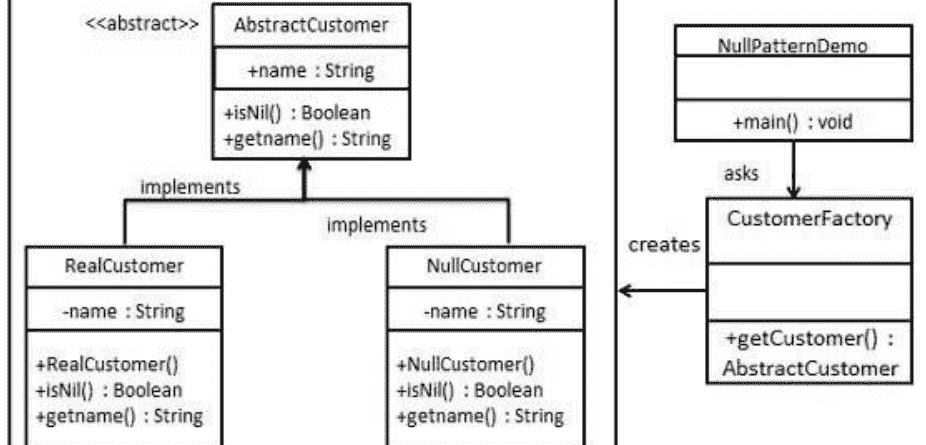

### 第 1 步：创建一个抽象类

#### AbstractCustomer.java

```java
public abstract class AbstractCustomer {

    protected String name;

    public abstract boolean isNil();

    public abstract String getName();

}
```

### 第 2 步：创建继承上述类的具体类

#### RealCustomer.java

```java
public class RealCustomer extends AbstractCustomer {

    public RealCustomer(String name) {
        this.name = name;
    }

    @Override
    public String getName() {
        return name;
    }

    @Override
    public boolean isNil() {
        return false;
    }
}
```

#### NullCustomer.java

```java
public class NullCustomer extends AbstractCustomer {

    @Override
    public String getName() {
        return "Not Available in Customer Database"; // 客户数据库中不可用
    }

    @Override
    public boolean isNil() {
        return true;
    }
}
```

### 第 3 步：创建 CustomerFactory 类

#### CustomerFactory.java

```java
public class CustomerFactory {

    public static final String[] names = {"Rob", "Joe", "Julie"};

    public static AbstractCustomer getCustomer(String name) {
        for (int i = 0; i < names.length; i++) {
            if (names[i].equalsIgnoreCase(name)) {
                return new RealCustomer(name);
            }
        }
        return new NullCustomer();
    }
}
```

### 第 4 步：使用 `CustomerFactory` 根据传入的客户名称获取 `RealCustomer` 或 `NullCustomer` 对象

#### NullPatternDemo.java


```java
public class NullPatternDemo {

    public static void main(String[] args) {
        AbstractCustomer customer1 = CustomerFactory.getCustomer("Rob");
        AbstractCustomer customer2 = CustomerFactory.getCustomer("Bob");
        AbstractCustomer customer3 = CustomerFactory.getCustomer("Julie");
        AbstractCustomer customer4 = CustomerFactory.getCustomer("Laura");

        System.out.println("Customers");
        System.out.println(customer1.getName());
        System.out.println(customer2.getName());
        System.out.println(customer3.getName());
        System.out.println(customer4.getName());
    }
}
```

### 第 5 步：验证输出

| 客户 |
| :--- |
| Rob |
| Not Available in Customer Database |
| Julie |
| Not Available in Customer Database |

## 24. 策略模式 (STRATEGY PATTERN)

在策略模式中，类的行为或其算法可以在运行时被更改。这种设计模式属于行为模式。

在策略模式中，我们创建表示各种策略的对象，以及一个上下文对象，其行为会根据其策略对象而改变。策略对象改变了上下文对象的执行算法。

### 实现

我们将创建一个定义操作的 `Strategy` 接口，以及实现该接口的具体策略类。`Context` 是一个使用 `Strategy` 的类。

我们的演示类 `StrategyPatternDemo` 将使用 `Context` 和策略对象来演示根据其部署或使用的策略，`Context` 行为的变化。

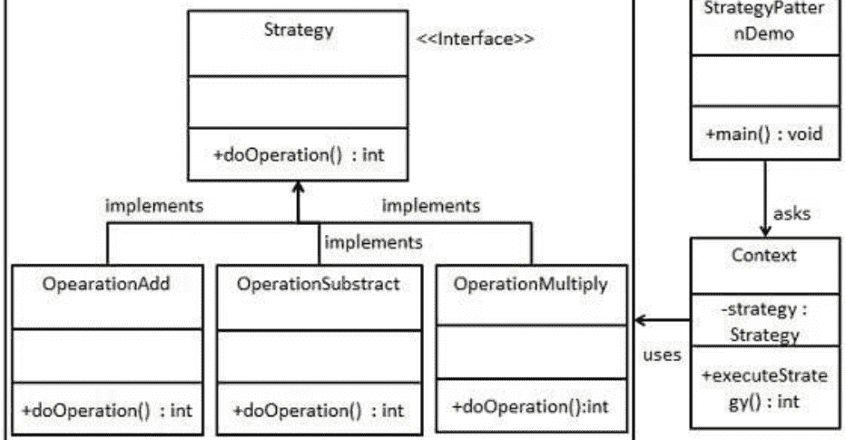

### 第 1 步：创建一个接口

#### Strategy.java

```java
public interface Strategy {
    public int doOperation(int num1, int num2);
}
```

### 第 2 步：创建实现相同接口的具体类

#### OperationAdd.java

```java
public class OperationAdd implements Strategy {

    @Override
    public int doOperation(int num1, int num2) {
        return num1 + num2;
    }
}
```

#### OperationSubtract.java

```java
public class OperationSubtract implements Strategy {

    @Override
    public int doOperation(int num1, int num2) {
        return num1 - num2;
    }
}
```

#### OperationMultiply.java

```java
public class OperationMultiply implements Strategy {

    @Override
    public int doOperation(int num1, int num2) {
        return num1 * num2;
    }
}
```

### 第 3 步：创建 Context 类


#### Context.java

```java
public class Context {

    private Strategy strategy;

    public Context(Strategy strategy) {
        this.strategy = strategy;
    }

    public int executeStrategy(int num1, int num2) {
        return strategy.doOperation(num1, num2);
    }
}
```

### 第 4 步：使用 Context 观察策略改变时行为的变化

#### StrategyPatternDemo.java

```java
public class StrategyPatternDemo {

    public static void main(String[] args) {
        Context context = new Context(new OperationAdd());
        System.out.println("10 + 5 = " + context.executeStrategy(10, 5));

        context = new Context(new OperationSubtract());
        System.out.println("10 - 5 = " + context.executeStrategy(10, 5));

        context = new Context(new OperationMultiply());
        System.out.println("10 * 5 = " + context.executeStrategy(10, 5));
    }
}
```

### 第 5 步：验证输出


```
10 + 5 = 15
10 - 5 = 5
10 * 5 = 50
```

## 25. 模板方法模式 (TEMPLATE PATTERN)

在模板模式中，抽象类定义了执行其方法的方式。子类可以根据需要重写方法实现，但调用方式由抽象类定义的保持一致。该模式属于行为分类。

### 实现

我们将创建一个定义操作的 `Game` 抽象类，并将模板方法设置为 `final` 以防被重写。`Cricket` 和 `Football` 是继承 `Game` 并重写其方法的具体类。

我们的演示类 `TemplatePatternDemo` 将使用 `Game` 来演示模板模式的使用。

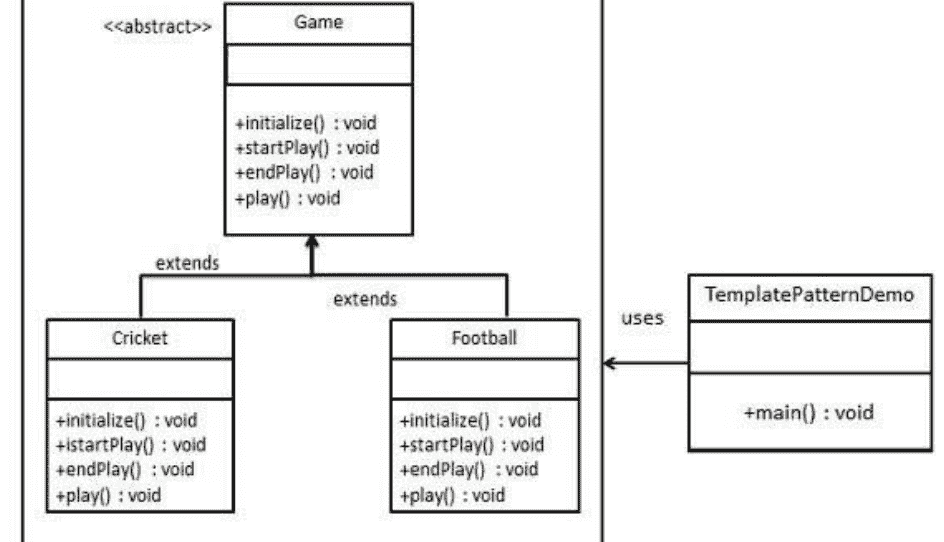

### 第 1 步：创建一个模板方法为 final 的抽象类

#### Game.java

```java
public abstract class Game {

    abstract void initialize();

    abstract void startPlay();

    abstract void endPlay();

    // 模板方法
    public final void play() {
        // 初始化游戏
        initialize();
        // 开始游戏
        startPlay();
        // 结束游戏
        endPlay();
    }
}
```

### 第 2 步：创建继承上述类的具体类

#### Cricket.java

```java
public class Cricket extends Game {

    @Override
    void initialize() {
        System.out.println("Cricket Game Initialized! Start playing.");
    }

    @Override
    void startPlay() {
        System.out.println("Cricket Game Started. Enjoy the game!");
    }

    @Override
    void endPlay() {
        System.out.println("Cricket Game Finished!");
    }
}
```

#### Football.java

```java
public class Football extends Game {

    @Override
    void initialize() {
        System.out.println("Football Game Initialized! Start playing.");
    }

    @Override
    void startPlay() {
        System.out.println("Football Game Started. Enjoy the game!");
    }

    @Override
    void endPlay() {
        System.out.println("Football Game Finished!");
    }
}
```

### 第 3 步：使用 Game 的模板方法 `play()` 来演示一种定义的游戏方式

#### TemplatePatternDemo.java


```java
public class TemplatePatternDemo {

    public static void main(String[] args) {
        Game game = new Cricket();
        game.play();

        System.out.println();

        game = new Football();
        game.play();
    }
}
```

### 第 4 步：验证输出

```
Cricket Game Initialized! Start playing.
Cricket Game Started. Enjoy the game!
Cricket Game Finished!

Football Game Initialized! Start playing.
Football Game Started. Enjoy the game!
Football Game Finished!
```

## 26. 访问者模式 (VISITOR PATTERN)

在访问者模式中，我们使用一个访问者类来改变元素类的执行算法。通过这种方式，元素的执行算法可以随着访问者的改变而变化。该模式属于行为模式分类。根据该模式，元素对象需要接受访问者对象，以便访问者对象处理在元素对象上的操作。

### 实现

我们将创建一个定义 `accept` 操作的 `ComputerPart` 接口。`Keyboard`、`Mouse`、`Monitor` 和 `Computer` 是实现 `ComputerPart` 接口的具体类。我们将定义另一个接口 `ComputerPartVisitor`，它定义访问者类的操作。`Computer` 使用具体的访问者来执行相应的动作。

我们的演示类 `VisitorPatternDemo` 将使用 `Computer` 和 `ComputerPartVisitor` 类来演示访问者模式的使用。

```text
<<interface>>
ComputerPartVisitor
+visit(Computer) : void
+visit(Mouse) : void
+visit(Keyboard) : void
+visit(Monitor) : void
```

```text
ComputerPartDisplayVisitor
+visit(Computer) : void
+visit(Mouse) : void
+visit(Keyboard) : void
+visit(Monitor) : void
```

```text
VisitorPatternDemo
+main() : void
```


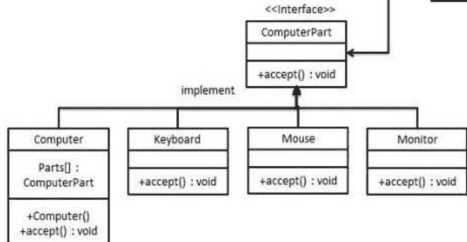


### Step 1

定义一个表示元素的接口。

### ComputerPart.java

```java
public interface ComputerPart {
    public void accept(ComputerPartVisitor computerPartVisitor);
}
```

### Step 2

创建扩展上述类的具体类。

### Keyboard.java

```java
public class Keyboard implements ComputerPart {
    @Override
    public void accept(ComputerPartVisitor computerPartVisitor) {
        computerPartVisitor.visit(this);
    }
}
```

### Monitor.java

```java
public class Monitor implements ComputerPart {
    @Override
    public void accept(ComputerPartVisitor computerPartVisitor) {
        computerPartVisitor.visit(this);
    }
}
```

### Mouse.java

```java
public class Mouse implements ComputerPart {
    @Override
    public void accept(ComputerPartVisitor computerPartVisitor) {
        computerPartVisitor.visit(this);
    }
}
```


### Computer.java

```java
public class Computer implements ComputerPart {
    ComputerPart[] parts;

    public Computer() {
        parts = new ComputerPart[]{new Mouse(), new Keyboard(), new Monitor()};
    }

    @Override
    public void accept(ComputerPartVisitor computerPartVisitor) {
        for (int i = 0; i < parts.length; i++) {
            parts[i].accept(computerPartVisitor);
        }
        computerPartVisitor.visit(this);
    }
}
```

### Step 3

定义一个表示访问者的接口。

### ComputerPartVisitor.java

```java
public interface ComputerPartVisitor {
    public void visit(Computer computer);
    public void visit(Mouse mouse);
    public void visit(Keyboard keyboard);
    public void visit(Monitor monitor);
}
```

### Step 4

创建实现上述类的具体访问者。

### ComputerPartDisplayVisitor.java

```java
public class ComputerPartDisplayVisitor implements ComputerPartVisitor {
    @Override
    public void visit(Computer computer) {
        System.out.println("Displaying Computer.");
    }

    @Override
    public void visit(Mouse mouse) {
        System.out.println("Displaying Mouse.");
    }

    @Override
    public void visit(Keyboard keyboard) {
        System.out.println("Displaying Keyboard.");
    }

    @Override
    public void visit(Monitor monitor) {
        System.out.println("Displaying Monitor.");
    }
}
```

### Step 5

使用 `Computer` 和 `ComputerPartVisitor` 类来演示访问者模式的使用。

### VisitorPatternDemo.java

```java
public class VisitorPatternDemo {
    public static void main(String[] args) {
        Computer computer = new Computer();
        computer.accept(new ComputerPartDisplayVisitor());

        Mouse mouse = new Mouse();
        mouse.accept(new ComputerPartDisplayVisitor());

        Keyboard keyboard = new Keyboard();
        keyboard.accept(new ComputerPartDisplayVisitor());

        Monitor monitor = new Monitor();
        monitor.accept(new ComputerPartDisplayVisitor());
    }
}
```


### Step 6

验证输出。

```
Display Computer.
Displaying Mouse.
Displaying Keyboard.
Displaying Monitor.
```

### 第 5 

验证输出。

| 学生 |
| :--- |
| 姓名: Robert |
| 学号: 10 |
| 学生 |
| 姓名: John |
| 学号: 10 |

## 28. 业务委托模式 (BUSINESS DELEGATE PATTERN)

业务委托模式用于解耦表现层和业务层。它基本上用于减少表现层中到业务层代码的通信或远程查找功能。在表现层中，我们有以下实体：

- **客户端 (Client)** - 表现层可能是 JSP、servlet 或 UI Java 代码。
- **业务委托 (Business Delegate)** - 客户端实体的单一入口类，用于提供对业务服务的方法。
- **查找服务 (Lookup Service)** - 查找服务对象负责获取相关的业务实现，并为业务委托对象提供业务对象的访问。
- **业务服务 (Business Service)** - 具体类实现此业务服务以提供实际的业务实现逻辑。

### 实现

我们将创建一个 `Client`、`BusinessDelegate`、`BusinessService`、`LookupService`、`JMSService` 和 `EJBService`，代表业务委托模式的各种实体。

我们的演示类 `BusinessDelegatePatternDemo` 将使用 `BusinessDelegate` 和 `Client` 来演示业务委托模式的使用。

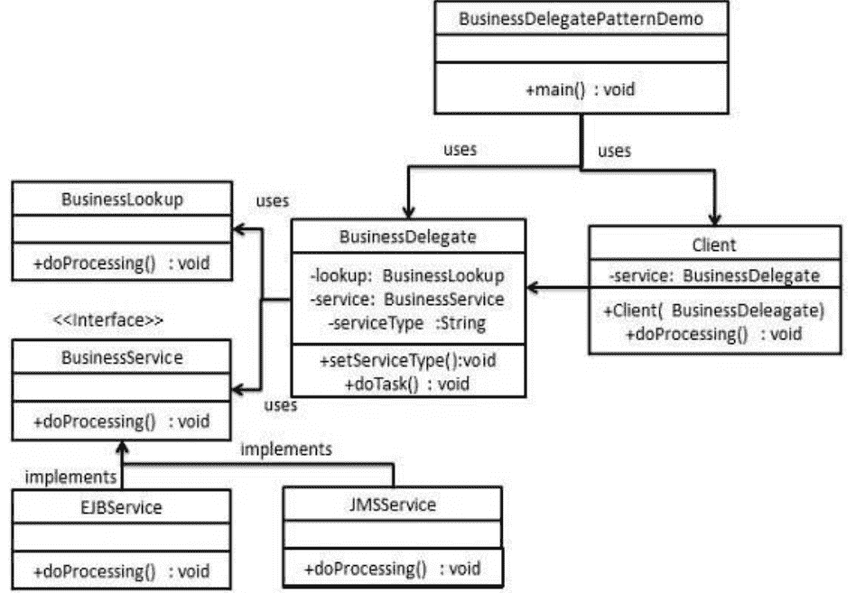

### Step 1

创建 BusinessService 接口。

### BusinessService.java

```java
public interface BusinessService {
    public void doProcessing();
}
```

### Step 2

创建具体的的服务类。

### EJBService.java

```java
public class EJBService implements BusinessService {
    @Override
    public void doProcessing() {
        System.out.println("Processing task by invoking EJB Service");
    }
}
```

### JMSService.java

```java
public class JMSService implements BusinessService {
    @Override
    public void doProcessing() {
        System.out.println("Processing task by invoking JMS Service");
    }
}
```

### Step 3

创建业务查找服务。

### BusinessLookup.java

```java
public class BusinessLookup {
    public BusinessService getBusinessService(String serviceType) {
        if (serviceType.equalsIgnoreCase("EJB")) {
            return new EJBService();
        } else {
            return new JMSService();
        }
    }
}
```

### Step 4

创建业务委托。

### BusinessDelegate.java

```java
public class BusinessDelegate {
    private BusinessLookup lookupService = new BusinessLookup();
    private BusinessService businessService;
    private String serviceType;

    public void setServiceType(String serviceType) {
        this.serviceType = serviceType;
    }

    public void doTask() {
        businessService = lookupService.getBusinessService(serviceType);
        businessService.doProcessing();
    }
}
```


### Step 5

创建客户端。

### Client.java

```java
public class Client {
    BusinessDelegate businessService;

    public Client(BusinessDelegate businessService) {
        this.businessService = businessService;
    }

    public void doTask() {
        businessService.doTask();
    }
}
```

### Step 6

使用 BusinessDelegate 和 Client 类演示业务委托模式。

### BusinessDelegatePatternDemo.java


```java
public static void main(String[] args) {
    BusinessDelegate businessDelegate = new BusinessDelegate();
    businessDelegate.setServiceType("EJB");

    Client client = new Client(businessDelegate);
    client.doTask();

    businessDelegate.setServiceType("JMS");
    client.doTask();
}
```

### Step 7

验证输出。

| 通过调用 EJB Service 处理任务 |
| :--- |
| 通过调用 JMS Service 处理任务 |

## 29. 组合实体模式 (COMPOSITE ENTITY PATTERN)

组合实体模式用于 EJB 持久化机制。组合实体是一个表示对象图的 EJB bean。当组合实体被更新时，内部依赖对象将像由 EJB 实体 bean 管理一样自动更新。以下是组合实体 bean 的参与者。

- **组合实体 (Composite Entity)** - 它是主实体 bean。它可以是粗粒度的，也可以包含一个用于持久化目的的粗粒度对象。
- **粗粒度对象 (Coarse-Grained Object)** - 该对象包含依赖对象。它有自己的生命周期并管理依赖对象的生命周期。
- **依赖对象 (Dependent Object)** - 依赖于粗粒度对象的持久化生命周期的对象。
- **策略 (Strategies)** - 策略代表了如何实现组合实体。

### 实现

我们将创建一个作为 CompositeEntity 的 CompositeEntity 对象。CoarseGrainedObject 将是一个包含依赖对象的类。我们的演示类 `CompositeEntityPatternDemo` 将使用 `Client` 来演示组合模式的使用。

| Client | CompositeEntity |
| :--- | :--- |
| -entity: CompositeEntity | -cgo: CoarseGrainedObject |
| | -object1: DependentObject |
| | -object2: DependentObject |
| | -strategy: Strategy |
| -main() | |
| uses | |


### Step 1

创建依赖对象。

### Dependent1.java

```java
public class Dependent1 {
    private String data;

    public void setData(String data) {
        this.data = data;
    }

    public String getData() {
        return data;
    }
}
```

### Dependent2.java

```java
public class Dependent2 {
    private String data;

    public void setData(String data) {
        this.data = data;
    }

    public String getData() {
        return data;
    }
}
```

### Step 2

创建粗粒度对象。

### CoarseGrainedObject.java

```java
public class CoarseGrainedObject {
    Dependent1 do1 = new Dependent1();
    Dependent2 do2 = new Dependent2();

    public void setData(String data1, String data2) {
        do1.setData(data1);
        do2.setData(data2);
    }

    public String[] getData() {
        return new String[] {do1.getData(), do2.getData()};
    }
}
```

### Step 3

创建组合实体。

### CompositeEntity.java


```java
public class CompositeEntity {
    CoarseGrainedObject cgo = new CoarseGrainedObject();

    public void setData(String data1, String data2) {
        cgo.setData(data1, data2);
    }

    public String[] getData() {
        return cgo.getData();
    }
}
```

### Step 4

创建客户端类。

### Client.java

```java
public class Client {
    CompositeEntity compositeEntity = new CompositeEntity();

    public void printData() {
        for (int i = 0; i < compositeEntity.getData().length; i++) {
            System.out.println("Data: " + compositeEntity.getData()[i]);
        }
    }

    public void setData(String data1, String data2) {
        compositeEntity.setData(data1, data2);
    }
}
```

### Step 5

使用 Client 演示组合实体模式。

### CompositeEntityPatternDemo.java

```java
public class CompositeEntityPatternDemo {
    public static void main(String[] args) {
        Client client = new Client();
        client.setData("Test", "Data");
        client.printData();
        client.setData("Second Test", "Data");
        client.printData();
    }
}
```

## 30. 数据访问对象模式 (DATA ACCESS PATTERN)

数据访问对象模式或 DAO 模式用于将底层数据访问 API 或操作与高层业务服务分离。以下是数据访问模式的参与者。

- **数据访问对象接口 (Data Access Object Interface)** - 定义对模型对象的标准操作。
- **数据访问对象具体类 (Data Access Object concrete class)** - 该类实现接口，负责从数据库/xml 或其他存储机制获取数据。
- **模型对象或值对象 (Model Object or Value Object)** - 该对象是包含 get/set 方法的简单 POJO，用于存储通过 DAO 类检索的数据。

### 实现

我们将创建一个作为模型对象或值对象的 `Student`。`StudentDao` 是数据访问对象接口，`StudentDaoImpl` 是实现该接口的具体类。我们的演示类 `DaoPatternDemo` 将使用 `StudentDao` 来演示数据访问对象模式的使用。

### Student.java

```java
public class Student {
    private String name;
    private int rollNo;

    public Student(String name, int rollNo) {
        this.name = name;
        this.rollNo = rollNo;
    }

    public String getName() {
        return name;
    }

    public void setName(String name) {
        this.name = name;
    }

    public int getRollNo() {
        return rollNo;
    }

    public void setRollNo(int rollNo) {
        this.rollNo = rollNo;
    }
}
```

### StudentDao.java

```java
public interface StudentDao {
    public void save(Student student);
    public Student get(int rollNo);
}
```

### StudentDaoImpl.java

```java
import java.util.HashMap;
import java.util.Map;

public class StudentDaoImpl implements StudentDao {
    private Map<Integer, Student> database = new HashMap<>();

    @Override
    public void save(Student student) {
        database.put(student.getRollNo(), student);
    }

    @Override
    public Student get(int rollNo) {
        return database.get(rollNo);
    }
}
```

### Client.java

```java
public class Client {
    private StudentDao studentDao;

    public Client(StudentDao studentDao) {
        this.studentDao = studentDao;
    }

    public void saveStudent(Student student) {
        studentDao.save(student);
    }

    public Student getStudent(int rollNo) {
        return studentDao.get(rollNo);
    }
}
```

### DaoPatternDemo.java

```java
public class DaoPatternDemo {
    public static void main(String[] args) {
        StudentDao studentDao = new StudentDaoImpl();
        Client client = new Client(studentDao);

        Student s1 = new Student("Robert", 10);
        client.saveStudent(s1);

        Student s2 = client.getStudent(10);
        System.out.println("Student Name: " + s2.getName() + ", Roll No: " + s2.getRollNo());
    }
}
```

### 第1步

创建值对象 (Value Object)。

### Student.java

```java
public class Student {
    private String name;
    private int rollNo;

    Student(String name, int rollNo){
        this.name = name;
        this.rollNo = rollNo;
    }

    public String getName() {
        return name;
    }

    public void setName(String name) {
        this.name = name;
    }

    public int getRollNo() {
        return rollNo;
    }

    public void setRollNo(int rollNo) {
        this.rollNo = rollNo;
    }
}
```

### 第2步

创建数据访问对象对象接口 (Data Access Object Interface)。


### StudentDao.java

```java
import java.util.List;

public interface StudentDao {
    public List<Student> getAllStudents();
    public Student getStudent(int rollNo);
    public void updateStudent(Student student);
    public void deleteStudent(Student student);
}
```

### 第3步

创建实现上述接口的具体类。

### StudentDaoImpl.java

```java
import java.util.ArrayList;
import java.util.List;

public class StudentDaoImpl implements StudentDao {

    // list 充当数据库
    List<Student> students;

    public StudentDaoImpl(){
        students = new ArrayList<Student>();
        Student student1 = new Student("Robert",0);
        Student student2 = new Student("John",1);
        students.add(student1);
        students.add(student2);
    }

    @Override
    public void deleteStudent(Student student) {
        students.remove(student.getRollNo());
        System.out.println("Student: Roll No " + student.getRollNo() + ", deleted from database");
    }

    // 从数据库检索学生列表
    @Override
    public List<Student> getAllStudents() {
        return students;
    }

    @Override
    public Student getStudent(int rollNo) {
        return students.get(rollNo);
    }

    @Override
    public void updateStudent(Student student) {
        students.get(student.getRollNo()).setName(student.getName());
        System.out.println("Student: Roll No " + student.getRollNo() + ", updated in the database");
    }
}
```

### 第4步

使用 StudentDao 演示数据访问对象模式的使用。

### DaoPatternDemo.java

```java
public class DaoPatternDemo {
    public static void main(String[] args) {
        StudentDao studentDao = new StudentDaoImpl();

        // 打印所有学生
        for (Student student : studentDao.getAllStudents()) {
            System.out.println("Student: [RollNo : " + student.getRollNo() + ", Name : " + student.getName() + "]");
        }

        // 更新学生
        Student student = studentDao.getAllStudents().get(0);
        student.setName("Michael");
        studentDao.updateStudent(student);

        // 获取学生
        studentDao.getStudent(0);
        System.out.println("Student: [RollNo : " + student.getRollNo() + ", Name : " + student.getName() + "]");
    }
}
```

### 第5步

验证输出。

| Student: [RollNo : 0, Name : Robert ] |
| Student: [RollNo : 1, Name : John ] |
| Student: Roll No 0, updated in the database |
| Student: [RollNo : 0, Name : Michael ] |

---

## 31. 前端控制器模式 (FRONT CONTROLLER PATTERN)

前端控制器设计模式用于提供一个集中的请求处理机制，使得所有请求都由单个处理器处理。该处理器可以对请求进行认证/授权/日志或跟踪，然后将请求传递给相应的处理器。以下是此类设计模式的实体。

- **前端控制器 (Front Controller)**：对于进入应用程序各种请求（无论是 Web 端还是桌面端）的单一处理器。
- **分发器 (Dispatcher)**：前端控制器可以使用分发对象，将请求分发给相应的特定处理器。
- **视图 (View)**：视图是请求产生的对象。

### 实现

我们将创建一个 `FrontController` 和 `Dispatcher` 分别充当前端和分发器。`HomeView` 和 `StudentView` 代表请求到达前端控制器的各种视图。

`FrontControllerPatternDemo` 是我们的演示类，将使用 `FrontController` 来演示前端控制器设计模式。

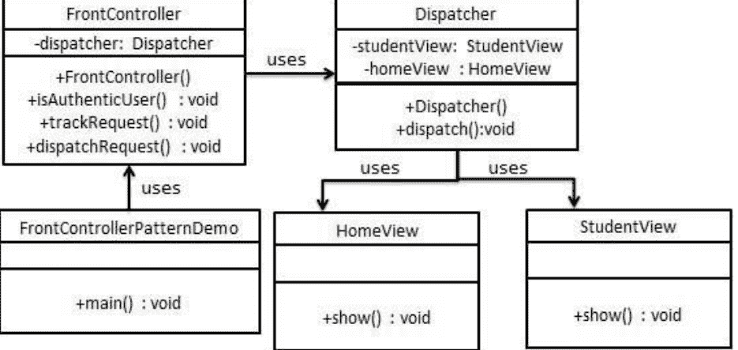

### 第1步

创建视图。

### HomeView.java

```java
public class HomeView {
    public void show(){
        System.out.println("Displaying Home Page");
    }
}
```

### StudentView.java

```java
public class StudentView {
    public void show(){
        System.out.println("Displaying Student Page");
    }
}
```

### 第2步

创建分发器。

### Dispatcher.java

```java
public class Dispatcher {
    private StudentView studentView;
    private HomeView homeView;
    public Dispatcher(){
        studentView = new StudentView();
        homeView = new HomeView();
    }

    public void dispatch(String request){
        if(request.equalsIgnoreCase("STUDENT")){
            studentView.show();
        }else{
            homeView.show();
        }
    }
}
```


### 第3步

创建 FrontController.java


```java
public class FrontController {

    private Dispatcher dispatcher;

    public FrontController(){
        dispatcher = new Dispatcher();
    }

    private boolean isAuthenticUser(){
        System.out.println("User is authenticated successfully.");
        return true;
    }

    private void trackRequest(String request) {
        System.out.println("Page requested: " + request);
    }

    public void dispatchRequest(String request) {
        // 记录每个请求
        trackRequest(request);
        // 验证用户
        if(isAuthenticUser()){
            dispatcher.dispatch(request);
        }
    }
}
```


### 第4步

使用 `FrontController` 演示前端控制器模式。

CameraControllerDemo.java

```java
public class ControllerPatternDemo {
    public static void main(String[] args) {
        FrontController frontController = new FrontController();
        frontController.dispatchRequest("HOME");
        frontController.dispatchRequest("STUDENT");
    }
}
```

### 第5步

验证输出。

| Page requested: HOME |
| User is authenticated successfully. |
| Displaying Home Page |
| Page requested: STUDENT |
| User is authenticated successfully. |
| Displaying Student Page |

---

## 32. 拦截过滤器模式 (INTERCEPTING FILTER PATTERN)

当我们想要对请求或响应进行某些处理，并在将请求传递给目标之前使用拦截过滤器模式。

- **过滤器 (Filter)**：在请求处理器执行之前或之后执行某些任务。
- **过滤器链 (Filter Chain)**：携带过滤器并按照定义的顺序在目标上执行它们。
- **目标 (Target)**：目标对象是请求处理器。
- **过滤器管理器 (Filter Manager)**：管理过滤器和过滤器链。
- **客户端 (Client)**：向目标发送请求的对象。

### 实现

我们将创建一个 `FilterChain`、`FilterManager`、`Target` 和 `Client` 作为各种实体。`AuthenticationFilter` 和 `DebugFilter` 代表具体的过滤器。

`InterceptingFilterDemo` 是我们的演示类，将使用 `Client` 来演示拦截过滤器模式。

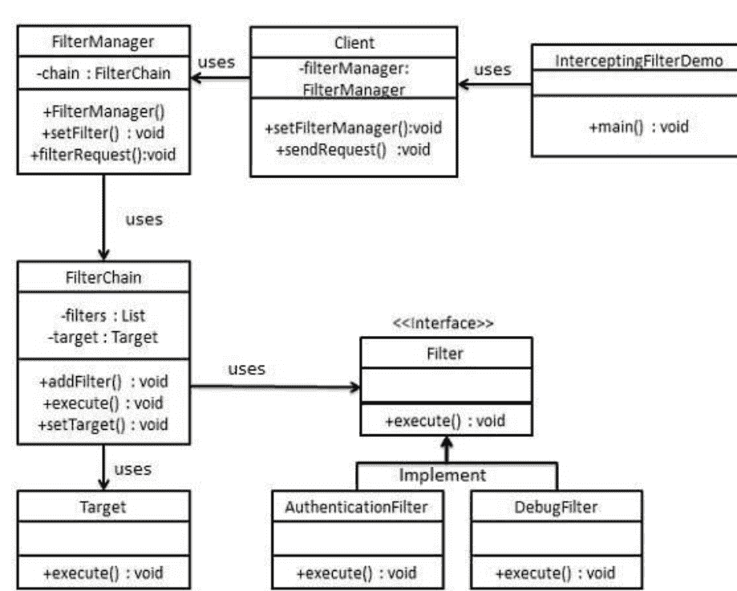

### 第1步

创建过滤器接口。

Filter.java

```java
public interface Filter {
    public void execute(String request);
}
```

### 第2步

创建具体的过滤器。

AuthenticationFilter.java

```java
public class AuthenticationFilter implements Filter {
    public void execute(String request){
        System.out.println("Authenticating request: " + request);
    }
}
```

DebugFilter.java

```java
public class DebugFilter implements Filter {
    public void execute(String request){
        System.out.println("request log: " + request);
    }
}
```

### 第3步

创建目标。

Target.java

```java
public class Target {
    public void execute(String request){
        System.out.println("Executing request: " + request);
    }
}
```

### 第4步

创建过滤器链。

FilterChain.java

```java
import java.util.ArrayList;
import java.util.List;

public class FilterChain {
    private List<Filter> filters = new ArrayList<Filter>();
    private Target target;

    public void addFilter(Filter filter){
        filters.add(filter);
    }

    public void executeChain(String request) {
        for (Filter filter : filters) {
            filter.execute(request);
        }
        target.execute(request);
    }
}
```

### 第5步

使用 `Client` 演示过滤器模式。

InterceptingFilterDemo.java

```java
public class InterceptingFilterDemo {
    public static void main(String[] args) {
        FilterChain filterChain = new FilterChain();
        filterChain.target = new Target();

        filterChain.addFilter(new AuthenticationFilter());
        filterChain.addFilter(new DebugFilter());

        filterChain.executeChain("HOME");
        filterChain.executeChain("STUDENT");
    }
}
```

### 第6步

验证输出。

| Authenticating request: HOME |
| request log: HOME |
| Executing request: HOME |
| Authenticating request: STUDENT |
| request log: STUDENT |
| Executing request: STUDENT |

```java
public void execute(String request){
    for (Filter filter : filters) {
        filter.execute(request);
    }
    target.execute(request);
}

public void setTarget(Target target){
    this.target = target;
}
```

### 第 5 步

创建过滤器管理器。

FilterManager.java

```java
public class FilterManager {
    FilterChain filterChain;

    public FilterManager(Target target) {
        filterChain = new FilterChain();
        filterChain.setTarget(target);
    }

    public void setFilter(Filter filter) {
        filterChain.addFilter(filter);
    }

    public void filterRequest(String request) {
        filterChain.execute(request);
    }
}
```

### 第 6 步

创建客户端。

Client.java

```java
public class Client {
    FilterManager filterManager;

    public void setFilterManager(FilterManager filterManager){
        this.filterManager = filterManager;
    }

    public void sendRequest(String request){
        filterManager.filterRequest(request);
    }
}
```

### 第 7 步

使用客户端来演示拦截器设计模式。

InterceptingFilterDemo.java

```java
public class InterceptingFilterDemo {
    public static void main(String[] args) {
        FilterManager filterManager = new FilterManager(new Target());
        filterManager.setFilter(new AuthenticationFilter());
        filterManager.setFilter(new DebugFilter());

        Client client = new Client();
        client.setFilterManager(filterManager);
        client.sendRequest("HOME");
    }
}
```


### 第 8 步

验证输出。

```
Authenticating request: HOME
request log: HOME
Executing request: HOME
```

## 33. 服务定位器模式 (SERVICE LOCATOR PATTERN)

当我们想要通过 JNDI 查找来定位各种服务时，使用了服务定位设计模式。考虑到查找 JNDI 服务的成本较高，服务定位器模式提供了一种缓存技术。服务定位器在 JNDI 中查找并缓存服务对象。通过服务定位器进行相同服务的查找极大地提高了应用程序的性能。以下是该设计模式的实体：

- **Service (服务)**：处理请求的实际服务。此类服务在 JNDI 服务器中进行查找。
- **Context / Initial Context (上下文)**：用于查找的 JNDI 上下文。
- **Service Locator (服务定位器)**：通过 JNDI 获取服务的单一接触点。
- **Cache (缓存)**：用于存储服务以供复用。
- **Client (客户端)**：通过 `ServiceLocator` 调用服务的对象。

### 实现

我们将创建 `ServiceLocator`、`InitialContext`、`Cache` 和 `Service` 来表示实体。`Service1` 和 `Service2` 代表具体的服务。`ServiceLocatorPatternDemo` 类在这里作为客户端，并将使用 `ServiceLocator` 来演示服务定位器设计模式。

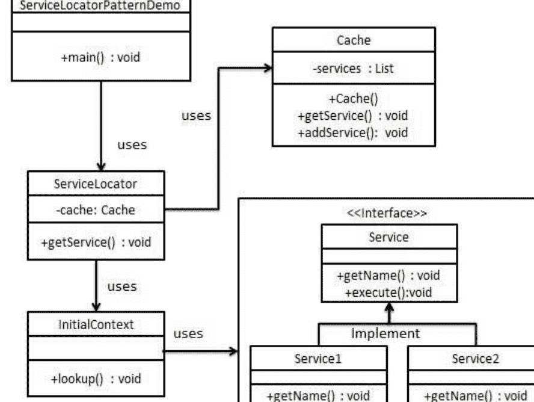

### 第 1 步

创建服务接口。

Service.java

```java
public interface Service {
    public String getName();
    public void execute();
}
```

### 第 2 步

创建具体服务。

Service1.java

```java
public class Service1 implements Service {
    public void execute(){
        System.out.println("Executing Service1");
    }

    @Override
    public String getName() {
        return "Service1";
    }
}
```

Service2.java

```java
public class Service2 implements Service {
    public void execute() {
        System.out.println("Executing Service2");
    }

    @Override
    public String getName() {
        return "Service2";
    }
}
```

### 第 3 步

为 JNDI 查找创建 `InitialContext`。

```java
public class InitialContext {
    public Object lookup(String jndiName) {
        if(jndiName.equalsIgnoreCase("SERVICE1")) {
            System.out.println("Looking up and creating Service1");
            return new Service1();
        } else if (jndiName.equalsIgnoreCase("SERVICE2")) {
            System.out.println("Looking up and creating Service2");
            return new Service2();
        }
        return null;
    }
}
```


### 第 4 步

创建缓存。

```java
public class Cache {
}
```


### 第 5 步

创建服务定位器。

```java
public class ServiceLocator {
    private Cache cache;

    static {
        cache = new Cache();
    }

    public static Object getService(String jndiName) {
        InitialContext context = new InitialContext();
        return context.lookup(jndiName);
    }
}
```

### 第 6 步

使用客户端演示服务定位器设计模式。

```java
public class Client {
    FilterManager filterManager;

    public void setFilterManager(FilterManager filterManager){
        this.filterManager = filterManager;
    }

    public void sendRequest(String request){
        filterManager.filterRequest(request);
    }
}
```

### 第 7 步

验证输出。

```
Authenticating request: HOME
request log: HOME
Executing request: HOME
```

## 34. 传输对象模式 (TRANSFER OBJECT PATTERN)

当我们想要在网络上传递多个属性时，使用了传输对象模式。传输对象也被称为值对象（Value Object）。对于客户端而言，传输对象是只读的。它没有任何行为。它是序列化的。以下是该设计模式的实体：

- **Business Object (业务对象)**：填充传输对象。
- **Transfer Object (传输对象)**：具有 getter/setter 方法简单 POJO。


- **Client (客户端)**：向业务对象请求或发送传输对象。

`TransferObjectPatternDemo` 类在这里作为客户端，并将使用 `StudentBO` 和 `StudentVO` 来演示传输对象设计模式。

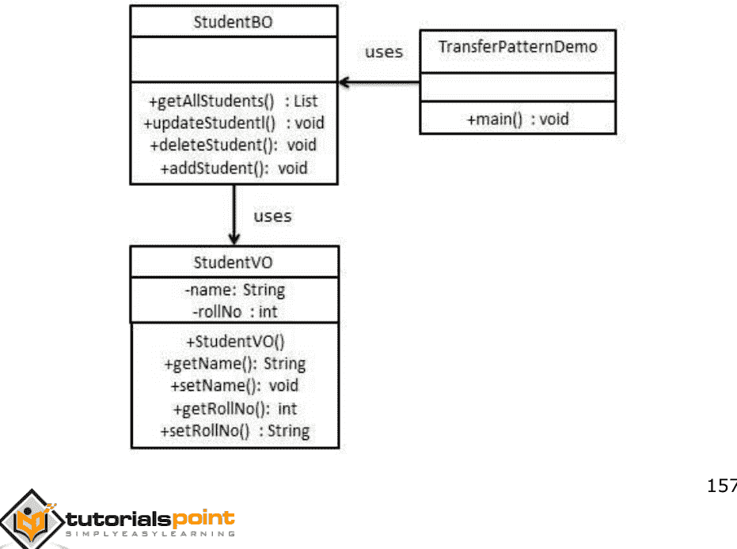

### 第 1 步：创建传输对象

`StudentVO.java`

```java
public class StudentVO {
    private String name;
    private int rollNo;

    StudentVO(String name, int rollNo) {
        this.name = name;
        this.rollNo = rollNo;
    }

    public String getName() {
        return name;
    }

    public void setName(String name) {
        this.name = name;
    }

    public int getRollNo() {
        return rollNo;
    }

    public void setRollNo(int rollNo) {
        this.rollNo = rollNo;
    }
}
```

### 第 2 步：创建业务对象

`StudentBO.java`

```java
import java.util.ArrayList;
import java.util.List;

public class StudentBO {

    //list充当数据库工作
    List<StudentVO> students;

    public StudentBO(){
        students = new ArrayList<StudentVO>();
        StudentVO student1 = new StudentVO("Robert",0);
        StudentVO student2 = new StudentVO("John",1);
        students.add(student1);
        students.add(student2);
    }

    public void deleteStudent(StudentVO student) {
        students.remove(student.getRollNo());
        System.out.println("Student: Roll No " + student.getRollNo() + ", deleted from database");
    }

    //从数据库检索学生列表
    public List<StudentVO> getAllStudents() {
        return students;
    }

    public StudentVO getStudent(int rollNo) {
        return students.get(rollNo);
    }

    public void updateStudent(StudentVO student) {
        students.get(student.getRollNo()).setName(student.getName());
        System.out.println("Student: Roll No " \
        + student.getRollNo() + ", updated in the database");
    }
}
```

### 第 3 步：使用 StudentBO 来演示传输对象模式

`TransferObjectPatternDemo.java`

```java
public class TransferObjectPatternDemo {
    public static void main(String[] args) {
        StudentBO studentBusinessObject = new StudentBO();

        // 打印所有学生
        for (StudentVO student : studentBusinessObject.getAllStudents()) {
            System.out.println("Student: [Roll No : " \
            +student.getRollNo()+", Name : ""+student.getName()+"]");
        }

        // 更新学生
        StudentVO student = studentBusinessObject.getAllStudents().get(0);
        student.setName("Michael");
        studentBusinessObject.updateStudent(student);

        // 获取学生
        student = studentBusinessObject.getStudent(0);
        System.out.println("Student: [Roll No : " \
            +student.getRollNo()+", Name : ""+student.getName()+"]");
    }
}
```

### 第 4 步：验证输出结果

| Student: [RollNo : 0, Name : Robert ] |
| Student: [RollNo : 1, Name : John ] |
| Student: [Roll No 0, updated in the database |
| Student: [RollNo : 0, Name : Michael ] |
