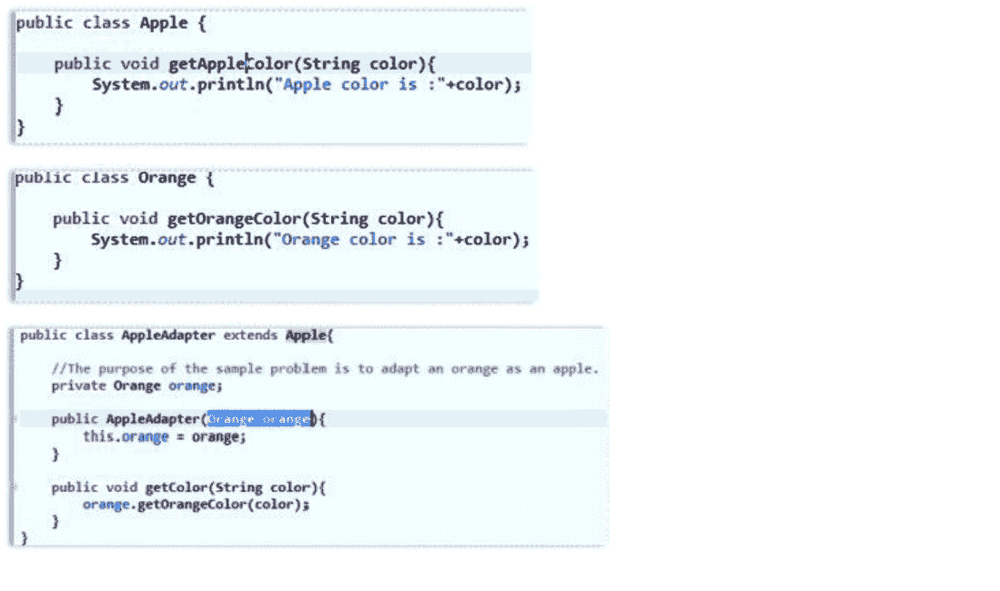
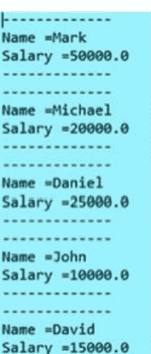
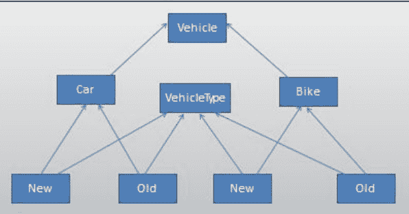
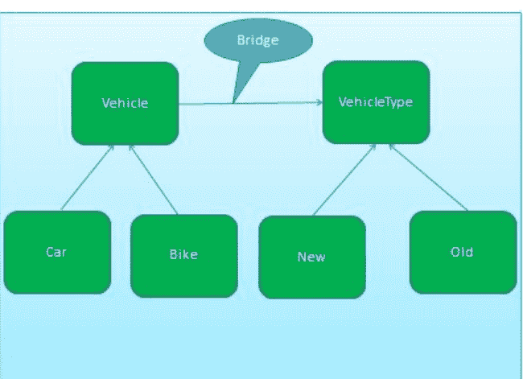
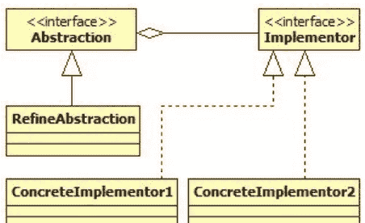
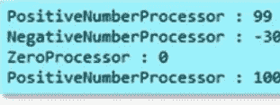
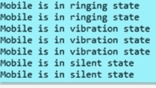

# Java 设计模式

## 前言

本技术电子书旨在以最易于理解的方式提供 Java 中设计模式的信息。它包含了对每个 Java 设计模式的详细描述，并配有最简单的真实世界示例。书中给出的所有示例都已由我在自己的开发环境中编译并运行过。我已尽力在书中提供最简单的示例。

本书面向初级或有经验的 Java 开发者。只要他/她通读了完整的内容和提供的示例，任何 Java 开发者都能从中获益。我在编写本书时，考虑到了每个水平的开发者都能从中获益。

编写本电子书的动力源于我学习 Java 设计模式的时期。在一次或两次阅读中理解每一种模式并不是容易的。我查阅了大量的书籍和材料，并尝试提取关于不同模式的相关事实，以便更容易、更快速地理解它们。我将所有这些相关且关键的点都包含了书中。

在开始之前，我想介绍一下自己。我是一名 Java 开发者，在 Java/J2EE 技术领域拥有超过 10 年的经验。目前，我在一家跨国软件公司工作。我的爱好之一是编写技术内容。我花了一些时间写这本书，并非常高兴能与其他开发者分享我的经验和知识。如果你在阅读本电子书期间有任何建议、修正或疑问，请随时通过 `erdsingh24@gmail.com` 与我联系。

## 关于设计模式

如果一个问题反复出现，那么该问题的解决方案已经被有效地使用了。这种解决方案就被描述为“模式”。设计模式是解决常见面向对象设计问题的语言无关的策略。当你进行设计时，你应该知道一些常用解决方案的名称。学习设计模式有助于人们有效地相互交流。事实上，你可能已经熟悉某些设计模式，但你可能没有使用为人知的名称来描述它们。Sun 推荐 GOF（四人之组——四位写过《设计模式：可复用面向对象软件的基础》书的四位先驱），因此我们以那本书作为指南来描述解决方案。请确保你熟悉这些模式，并学习他人如何解决编码问题。

如果你想成为一名专业的 Java 开发者，你应该至少知道一些解决问题的流行解决方案。这些解决方案已被经验丰富的开发者证明是高效且有效的。学习设计模式可以加速你在面向对象分析（OAA）/面向对象设计（OOD）方面的经验积累。一旦你掌握了它们，你将终身受益，并让你飞跃，成为设计和开发的大师。此外，你将能够使用这些术语与同事或评估者进行更有效的交流。

许多多年经验的程序员并不知道设计模式，但作为一名面向对象的程序员，你必须了解它们，特别是对于新的 Java 开发者来说。你可能没有使用流行的名称来描述它，或者可能没有选择一种有效的方法来更好地控制你所构建的内容。学习经验丰富的开发者如何解决编码问题并尝试将它们应用到你的项目中，是获得经验和认证的最佳方法。

记住，学习设计模式将真正改变你设计代码的方式；你不仅会变得更聪明，听起来也会明智得多。GOF 的 23 种设计模式是众所周知的，在途中还会发现更多。

有三种著名的设计模式类型。

**创建型设计模式（Creational Design Patterns）：** 创建型设计模式为特定情况提供了以最可能的方式实例化对象的解决方案。遵循的设计模式都属于这一类。

**结构型设计模式（Structural Design Patterns）：** 结构型模式提供了组合类和对象以形成更大结构，同时保持这些结构灵活且高效地处理变化。

**行为型设计模式（Behavioral Design Patterns）：** 行为模式是涉及对象之间通信的模式，允许对象灵活地交互和分配责任。

## 单例模式

有时，类恰好只有一个实例并为其提供一个全局访问点是非常重要的。有很多需要单例模式的例子，例如数据库连接池、线程池、配置设置以及应用程序中的日志对象。

### 反射：使用反射，我们可以设置私有构造函数变为可访问，如下例所示。

```java
package com.dev.dp.creational.singleton;

import java.lang.reflect.Constructor;

public class SingletonR {
    private static SingletonR instance = new SingletonR();

    private SingletonR() {
        System.out.println("Creating...");
    }

    public static SingletonR getInstance() {
        return instance;
    }

    public static void main(String[] args) throws Exception {
        SingletonR s1 = SingletonR.getInstance();
        SingletonR s2 = SingletonR.getInstance();

        print("s1", s1);
        print("s2", s2);

        Class<?> cls = Class.forName("com.dev.dp.creational.singleton.SingletonR");
        Constructor<?> ctor = cls.getDeclaredConstructor();
        ctor.setAccessible(true);
        SingletonR s3 = ctor.newInstance();

        print("s3", s3);
    }

    static void print(String name, SingletonR obj) {
        System.out.println(String.format("Object : %s, Hashcode: %d", name, obj.hashCode()));
    }
}
```

### 输出：

```text
Creating...
Object : s1, Hashcode: 123456789
Object : s2, Hashcode: 123456789
Creating...
Object : s3, Hashcode: 987654321
```

在上面的输出中，`s1` 和 `s2` 的哈希值相同，这意味着它们是同一个实例。然而，`s3` 有不同的哈希值，这意味着单例模式被违反了。

修复方法：如果在实例已存在的情况下尝试实例化，则抛出运行时异常。这段代码将放入单例类的私有构造函数中。

```java
private SingletonR() {
    System.out.println("Creating...");
    if(instance != null) {
        throw new RuntimeException("can't create instance. Please use getInstance()");
    }
}
```

### 克隆：如果我们通过克隆来创建实例，生成的克隆副本的哈希值与实际对象不匹配，因此它违反了单例原则。

```java
public class Singleton Cloneable {
    private static Singleton instance = new Singleton();

    private Singleton() {
        System.out.println("Creating...");
    }

    public static Singleton getInstance() {
        return instance;
    }

    @Override
    protected Object clone() throws CloneNotSupportedException {
        if (instance == null) throw new CloneNotSupportedException();
        return super.clone();
    }

    public static void main(String[] args) throws Exception {
        Singleton s1 = Singleton.getInstance();
        Singleton s2 = s1.clone();
        System.out.println("s1: " + s1.hashCode());
        System.out.println("s2: " + s2.hashCode());
        Singleton s3 = s2.clone();
        System.out.println("s3: " + s3.hashCode());
    }

    private static void print(String name, Object obj) {
        System.out.printf("%s: %s, Hashcode: %d\n", name, obj, obj.hashCode());
    }
}
```

输出：

```
Creating...
Object : s1, Hashcode: 31168322
Object : s2, Hashcode: 31168322
Object : s3, Hashcode: 17225372
```

**如何修复：** 如果有人尝试创建另一个实例，则从 `clone()` 方法抛出 `CloneNotSupportedException`。取消 `clone()` 方法中注释行的行。

修复后的输出：

```
Creating...
Object : s1, Hashcode: 31168322
Object : s2, Hashcode: 31168322
Exception in java.lang.CloneNotSupportedException
    at com.dev.dp.creational.singleton.SingletonC.clone(SingletonC.java:18)
    at com.dev.dp.creational.singleton.SingletonC.main(SingletonC.java:29)
```

### 序列化/反序列化：当我们对对象进行序列化并再次反序列化时，会如下示例所示生成不同的哈希值。因此，在对象序列化/反序列化的情况下，我们的单例原则被破坏了。

```java
public class Singleton implements Serializable{
    private static Singleton instance = new Singleton();

    private Singleton() {
        System.out.println("Creating...");
    }

    public static Singleton getInstance() {
        return instance;
    }

    public static void main(String[] args) throws Exception {
        Singleton s1 = Singleton.getInstance();
        Singleton s2 = Singleton.getInstance();

        System.out.println("s1: " + s1);
        System.out.println("s2: " + s2);

        ObjectOutputStream out = new ObjectOutputStream(new FileOutputStream("/tmp/s2.ser"));
        out.writeObject(s1);

        ObjectInputStream ois = new ObjectInputStream(new FileInputStream("/tmp/s2.ser"));
        Singleton s3 = (Singleton) ois.readObject();
        System.out.println("s3: " + s3);
    }

    private Object readResolve() {
        System.out.println("applying resolve...");
        return instance;
    }
}
```

### 输出：

```
Creating...
Object: s1, Hashcode: 31168322
Object: s2, Hashcode: 31168322
Object: s3, Hashcode: 6585861
```

### 如何修复：如文所示，在单例类中实现 `readResolve()` 方法。

```java
private Object readResolve(){
    System.out.println("applying resolve...");
    return instance;
}
```

### 修复后的输出：

```
Creating...
Object: s1, Hashcode: 31168322
Object: s2, Hashcode: 31168322
applying resolve...
Object: s3, Hashcode: 31168322
```

### 多线程：除非执行了饿实例化，否则单例在多线程环境下将正常工作，因为在这种情况下实例创建只会在类加载时发生。但对于懒实例化，我们需要考虑许多事情。如果因为成本原因我们想延迟实例化，我们会选择懒加载。

以下代码通过比较两个线程执行时的哈希值，演示了单例实例在两个线程 get 的行为。运行以下代码时要小心，因为它只在 Java 8 及更高版本中有效。

```java
public class SingletonT {
    private static SingletonT instance=null; //lazy initialization

    private SingletonT(){
        System.out.println("Creating...");
    }

    public static SingletonT getInstance(){
        if (instance == null) {
            instance = new SingletonT();
        }
        return instance;
    }

    public static void useSingleton(){
        SingletonT singleton = SingletonT.getInstance();
        print("singleton", singleton);
    }

    public static void main(String[] args) throws Exception {
        ExecutorService service = Executors.newFixedThreadPool(2);
        service.submit(SingletonT::useSingleton);
        service.shutdown();
    }

    public static void print(String name, SingletonT obj) {
        System.out.println(String.format("Object : %s, Hashcode: %d", name, obj));
    }
}
```

输出：

```
Creating...
Object : singleton, Hashcode: 31168322
Object : singleton, Hashcode: 31168322
```

双重检查锁也会破坏单例原则。假设两个线程进入代码，它会看到未初始化的状态。为了解决这个问题，在声明实例时使用 `volatile` 关键字。

```java
private static volatile Singleton instance=null; //lazy initialization
```

### Holder 类（Bill Pugh 方法）：Bill Pugh 提出使用内部静态辅助类创建单例的另一种方法。


```java
package com.dev.op.singleton;

public class Singleton {
    private Singleton() {
        System.out.println("Creating...");
    }
    static class Holder {
        static final Singleton INSTANCE = new Singleton();//lazy
    }

    public static Singleton getInstance() {
        return Holder.INSTANCE;
    }

    public static void main(String[] args) throws Exception {
        Singleton s1 = Singleton.getInstance();
        Singleton s2 = Singleton.getInstance();
        Singleton s3 = Singleton.getInstance();

        print("s1:%s\n", s1);
        print("s2:%s\n", s2);
        print("s3:%s\n", s3);
    }

    public static void print(String name, Singleton obj) {
        System.out.println(String.format("Object : %s, Hashcode: %d", name, obj.hashCode()));
    }
}
```

Creating...

Object : s1, Hashcode: 31168322

Object : s2, Hashcode: 31168322

Object : s3, Hashcode: 31168322

## 枚举单例

Joshua Bloch 建议使用枚举来实现单例设计模式，因为 Java 确保任何枚举值在 Java 程序中只被实例化一次。由于 Java 枚举是全局可访问的，单例也是如此。缺点是枚举类型相当缺乏活性；例如，它不允许懒加载实例化。

```java
package com.dev.dp.creational.singleton;

public enum EnumSingleton {
    INSTANCE;

    public static void doSomething() {
        // do something
    }
}
```

## 工厂模式

当我们有一个带有多个子类的父类，并且根据输入返回其中一个子类时，就会使用工厂模式。该模式将类的实例化责任从客户端程序转移到工厂类中。我们可以在工厂类上应用单例模式，或者将工厂方法设为静态。

工厂模式中的父类可以是一个接口，也可以是一个普通的 Java 类。

优点：

- 工厂模式提供了面向接口而非实现的编码方法。
- 工厂模式从客户端代码中移除了实际实现类的实例化，使其更健壮、耦合更低且易于扩展。例如，我们可以轻松更改 `PC` 的实现，因为客户端程序感知不到。
- 工厂模式通过继承在实现类和客户端类之间提供了抽象。

在 JDK 中的用法：

- `java.util.Calendar`、`ResourceBundle` 和 `NumberFormat` 的 `getInstance()` 方法使用了工厂模式。
- 包装类（如 `Boolean`、`Integer` 等）中的 `valueOf()` 方法。

```java
package com.dev.dp.creational.factory;

public interface IMobile {
    public void cost();
    public void pictureCapacity();
    public void batteryPower();
}
```

```java
public class Lenovo implements IMobile {
    @Override
    public void cost() {
        System.out.println("Lenovo Cost starts from 10000");
    }
    @Override
    public void pictureCapacity() {
        System.out.println("Lenovo camera capacity starts from 10 MP");
    }
    @Override
    public void batteryPower() {
        System.out.println("Lenovo battery power starts from 2500 Mah");
    }
    @Override
    public String toString() {
        return "Lenovo " + toString() + "=" + super.toString() + " ";
    }
}
```

```java
public class Samsung implements IMobile {
    @Override
    public void cost() {
        System.out.println("Samsung Cost starts from 6000");
    }
    @Override
    public void pictureCapacity() {
        System.out.println("Samsung camera capacity starts from 4 MP");
    }
    @Override
    public void batteryPower() {
        System.out.println("Samsung battery power starts from 1200 Mah");
    }
}
```

```java
package com.dev.dp.creational.factory;

public class MobileFactory {
    public MobileFactory() {
    }

    public IMobile createMobile(String type) {
        IMobile mob = null;
        if ("len".equalsIgnoreCase(type)) {
            mob = new Lenovo();
            System.out.println("Lenovo created");
        } else if ("samsung".equalsIgnoreCase(type)) {
            mob = new Samsung();
            System.out.println("Samsung created");
        }
        return mob;
    }
}
```

```java
public class FactoryTest {
    public static void main(String[] args) {
        MobileFactory factory = new MobileFactory();
        Lenovo len = (Lenovo) factory.createMobile("len");
        len.batteryPower();

        Samsung sam = (Samsung) factory.createMobile("sam");
        sam.cost();
    }
}
```

### 输出

```
Lenovo created
Lenovo battery power starts from 2500 MAH
Samsung created
Samsung Cost starts from 6000
```

其他示例：动物：狗、猫、狐狸等。

## 抽象工厂模式

与工厂模式几乎相似，不同在于它更像是“工厂的工厂”。如果你熟悉 Java 中的工厂设计模式，你会注意到我们有一个单一的工厂类，根据提供的输入返回子类，工厂类使用 `if-else` 或 `switch` 语句来实现。在抽象工厂模式中，我们消除了 `if-else` 块，为每个子类准备一个工厂类，然后有一个抽象工厂，它将根据输入的工厂类返回相应的子类。

抽象工厂是一个返回工厂的工厂。为什么这种抽象层很有用？普通工厂可以用于创建一组相关对象。而抽象工厂返回工厂。因此，抽象工厂用于返回可以创建一组相关对象的工厂。

例如，你可以有一个本田工厂（`HondaFactory`），它返回与本田工厂关联的汽车对象（`Brio`、`Civic` 等）。你也可以有一个现代工厂（`HyundaiFactory`），它返回与现代工厂关联的汽车对象（`Santro`、`EON`）。我们可以创建一个抽象工厂，根据我们感兴趣的汽车返回这些不同类型的汽车工厂。然后我们可以从这些汽车工厂中获取汽车对象。通过多态，我们可以使用共同接口来获取不同的工厂，然后再次使用共同接口来获取不同的汽车。

优点：

- 抽象工厂模式提供了面向接口而非实现的编码方法。
- 抽象工厂模式是“工厂的工厂”，可以很容易扩展以容纳更多产品，例如，我们可以添加另一个子类 `Celerio` 和一个工厂 `MarutiFactory`。
- 抽象工厂模式是健壮的，并且避免了工厂模式的条件逻辑。

在 JDK 中的用法：

- `javax.xml.parsers.DocumentBuilderFactory#newInstance()`
- `javax.xml.transform.TransformerFactory#newInstance()`
- `javax.xml.xpath.XPathFactory#newInstance()`

何时使用：当一组相关的产品对象被设计为一起使用，且我们需要强制执行这一约束时。

```java
package com.dev.dp.creational.abstractFactory;

public interface IMobileFactory {
    IMobileFactory createMobile(String type);
}

public class MobileFactory implements IMobileFactory {
    @Override
    public IMobileFactory createMobile(String type) {
        IMobileFactory mob = null;
        if ("len".equalsIgnoreCase(type)) {
            mob = new LenovoFactory();
        } else if ("sam".equalsIgnoreCase(type)) {
            mob = new SamsungFactory();
        }
        return mob;
    }
}

public class LenovoFactory implements IMobileFactory {
    @Override
    public IMobile createMobile(String type) {
        return new Lenovo();
    }
}

public class SamsungFactory implements IMobileFactory {
    @Override
    public IMobile createMobile(String type) {
        return new Samsung();
    }
}

public class AbstractFactoryTest {
    public static void main(String[] args) {
        MobileFactory factory = new MobileFactory();
        IMobileFactory info = factory.createMobile("len");
        Lenovo len = (Lenovo) info.createMobile("len");
        len.pictureCapacity();
    }
}
```

### 输出

Lenovo camera capacity starts from 10 MP

其他示例：本田工厂：`Brio`、`Civic`；现代工厂：`Santro`、`EON` 等。

## 构建者模式

通常，对象的构建细节（如实例化初始化组成对象的组件）被保留在对象内部，通常作为构造函数的一部分。这种设计将对象构建过程与组成组件紧密结合。只要对象构建是简单的且构建过程始终产生相同的表示，这种方法就是合适的。

然而，当创建的对象复杂，且构成创建对象的系列步骤可以以不同的方式实现以产生不同的表示时，这种设计可能不再有效。因为构建过程的不同实现都保留在对象内部，对象可能会变得臃肿（构建膨胀）且模块化降低。随后，添加新的实现或修改现有实现需要修改代码。

使用构建者模式，可以更有效地设计此类对象的构建。构建者模式建议将构建逻辑从对象类移动到独立的构建器类中。可以有多个构建器类，每个类对构建对象的步骤有不同的实现。每个构建器的实现都会产生不同的表示。

> 构建者模式的意图是将对象的构建与其表示分离，以便通过相同的构建过程创建不同的表示。这种分离减少了对象的大小。由于每个实现包含在构建器对象中，设计变得更加模块化。添加新的实现（即添加新的构建者）变得更容易。对象的构建过程独立于组成对象的组件。


```java
package com.dev.dp.creational.builder;

public class Computer {
    private String cpu;
    private String ram;
    private String storage;

    public void setCPU(String cpu) { this.cpu = cpu; }
    public void setRAM(String ram) { this.ram = ram; }
    public void setStorage(String storage) { this.storage = storage; }

    @Override
    public String toString() {
        return "Computer [CPU=" + cpu + ", RAM=" + ram + ", Storage=" + storage + "]";
    }
}

public interface ComputerBuilder {
    void buildCPU();
    void buildRAM();
    void buildStorage();
    Computer getResult();
}

public class GamingComputerBuilder implements ComputerBuilder {
    private Computer computer = new Computer();

    @Override
    public void buildCPU() {
        computer.setCPU("Intel i9");
    }

    @Override
    public void buildRAM() {
        computer.setRAM("32GB");
    }

    @Override
    public void buildStorage() {
        computer.setStorage("2TB SSD");
    }

    @Override
    public Computer getResult() {
        return computer;
    }
}

public class OfficeComputerBuilder implements ComputerBuilder {
    private Computer computer = new Computer();

    @Override
    public void buildCPU() {
        computer.setCPU("Intel i5");
    }

    @Override
    public void buildRAM() {
        computer.setRAM("8GB");
    }

    @Override
    public void buildStorage() {
        computer.setStorage("512GB SSD");
    }

    @Override
    public Computer getResult() {
        return computer;
    }
}

public class Director {
    private ComputerBuilder builder;

    public void setBuilder(ComputerBuilder builder) {
        this.builder = builder;
    }

    public void constructComputer() {
        builder.buildCPU();
        builder.buildRAM();
        builder.buildStorage();
    }
}

public class BuilderTest {
    public static void main(String[] args) {
        Director director = new Director();
        ComputerBuilder gamingBuilder = new GamingComputerBuilder();
        director.setBuilder(gamingBuilder);
        director.constructComputer();
        System.out.println(gamingBuilder.getResult());

        ComputerBuilder officeBuilder = new OfficeComputerBuilder();
        director.setBuilder(officeBuilder);
        director.constructComputer();
        System.out.println(officeBuilder.getResult());
    }
}
```

### 输出

```
Computer [CPU=Intel i9, RAM=32GB, Storage=2TB SSD]
Computer [CPU=Intel i5, RAM=8GB, Storage=512GB SSD]
```

## Builder 模式角色

### Builder（抽象构建器）

- 指定创建产品对象组件的抽象接口。

### ConcreteBuilder（具体构建器）

- 通过实现 `Builder` 接口来构造组装产品的部分。
- 定义并跟踪它所创建的表示形式。
- 提供一个获取产品的接口。

### Director（指挥者/总监）

- 使用 `Builder` 接口构造对象。

### Product（产品）

- 表示正在构造的复杂对象。`ConcreteBuilder` 负责构建产品的内部表示，并定义了其组装过程。
- 包含定义组成部分的类，包括将这些部分组装成最终结果的接口。

### 示例项目结构

```
com.dev.dp.creational.builder2
  BuilderTest.java
  IndianMealBuilder.java
  JapaneseMealBuilder.java
  Meal.java
  MealBuilder.java
  MealDirector.java
```

## 构建器模式的另一种形式（流式 Builder / 静态内部类 Builder）

有时存在一个包含属性列表的对象，而其中大多数属性都是可选的。考虑一个为了成为网站成员而需要的在线表单。你需要填写所有必填字段，可以跳过可选字段，或者有时填写某些可选字段看起来很有价值。

问题是，对于此类类我们应该写一个什么样的构造函数？编写一个带有长参数列表的构造函数不是一个好的选择，这会让客户端感到沮丧，特别是当重要字段只有几个时。这可能会错误的范围；客户端可能会无意中为错误的字段提供值。相同类型参数的长序列会导致细微的错误。如果客户端不小心反了两个参数，编译器不会报错，但程序会在运行时表现异常。

客户端不是直接创建所需的对象，而是调用一个带有所有必需参数的构造函数并获取一个构建器对象。然后客户端调用构建器上的类似 setter 的方法来设置每个感兴趣的可选参数。最后，客户端调用一个无参数的方法来生成对象。

- 首先，你需要创建一个静态嵌套类，并将所有参数从外部类拷贝到 Builder 类中。我们应该遵循命名规范，如果类名为 `Cake`，那么构建器类应该命名为 `CakeBuilder`。
- `Builder` 类应该有一个公共构造函数，并将所有必需属性作为参数传入。
- `Builder` 应该拥有方法来设置可选参数，并且在设置可选属性后应该返回同一个 `Builder` 对象（支持链式调用）。
- 最后一步是在构建器类中提供一个 `build()` 方法，它将返回客户端程序所需的对象。为了实现这一点，我们需要在类中有一个私有构造函数，并将 `Builder` 类作为参数。

```java
class Cake {
    private double sugar; // cup
    private double butter; // cup
    private double milk; // cup
    private int cherry; // cup

    public static class CakeBuilder {
        private double sugar;
        private double butter;
        private int cherry;

        public CakeBuilder settingSugar(double sugar) {
            this.sugar = sugar;
            return this;
        }
        public CakeBuilder settingButter(double butter) {
            this.butter = butter;
            return this;
        }
        public CakeBuilder settingCherry(int cherry) {
            this.cherry = cherry;
            return this;
        }

        public Cake build() {
            return new Cake(sugar, butter, cherry);
        }
    }

    private Cake(double sugar, double butter, int cherry) {
        this.sugar = sugar;
        this.butter = butter;
        this.cherry = cherry;
    }
}
```

```java
// 通过 builder 强制创建对象的构造函数
private Cake(CakeBuilder builder) {
    this.sugar = builder.sugar;
    this.butter = builder.butter;
    this.cherry = builder.cherry;
}
```

```java
@Override
public String toString() {
    return "Cake[" + sugar + "]";
}
```

```java
public class BuilderPattern {
    public static void main(String[] args) {
        // 使用 CakeBuilder 创建对象
        Cake cake = new Cake.CakeBuilder().settingSugar(0).build();

        // Cake 准备好了：
        System.out.println(cake);
    }
}
```

**输出：**

```
Cake[sugar=0.0]
```

在静态设置中，我们可以使用 setter 方法来设置可选字段。清楚地看到，现在通过链式调用来创建对象。

### 优点

- 客户端只需要提供必填字段。
- 构造过程可以与表示形式解耦。
- 构造过程可以分多个步骤。
- 构造期间的数据仅在构造期间是可见的。

## Builder 模式适用场景

- 构造复杂对象的成本很高。
- 构造过程可以与表示形式解耦。
- 构造过程可以分多个步骤。
- 构造期间的数据仅在构造期间是可见的。

## Java 中的 Prototype 模式适用场景

- 实例化类是在运行时指定的，例如通过动态加载。
- 避免构建与类层次结构平行的工厂层次结构。
- 类的实例只有几种组合。可以安装相应数量的原型并克隆它们。

## 原型模式

原型模式是一种创建模式，它允许在不指定类的情况下复制对象。当创建非常昂贵或复杂时，这种模式非常有用，例如从数据库或网络读取数据。在 Java 中，如果你想使用克隆（即原型模式），可以使用 `clone()` 方法。默认情况下，`clone()` 执行浅拷贝。然而，我们需要时实现自己的深拷贝。

下面的示例描述了如何通过克隆基础对象来设计一辆高级自行车。

```java
public class Bike implements Cloneable {

    private int gears;
    private String bikeType;
    private String model;

    public Bike() {
        bikeType = "Standard";
        model = "leopard";
        gears = 4;
    }

    public Bike clone() {
        try {
            return (Bike) super.clone();
        } catch (CloneNotSupportedException e) {
            return null;
        }
    }

    public void makeAdvanced() {
        bikeType = "Advanced";
        model = "Jaguar";
        gears = 6;
    }

    public String getModel() {
        return model;
    }

    @Override
    public String toString() {
        return "Bike[gears=" + gears + ", bikeType=" + bikeType + ", model=" + model + "]";
    }
}
```

```java
public class PrototypeTest {

    public Bike makeJaguar(Bike basicBike) {
        basicBike.makeAdvanced();
        return basicBike;
    }

    public static void main(String[] args) {
        Bike bike = new Bike();
        Bike bikeClone = bike.clone();
        PrototypeTest prototypeTest = new PrototypeTest();
        Bike advancedBike = prototypeTest.makeJaguar(bikeClone);
        System.out.println("Prototype Design Pattern: " + advancedBike.getModel());
        System.out.println("Prototype Design Pattern: " + advancedBike.toString());
    }
}
```

而不是每次都通过适当的状态来手动实例化该类。

**在 JDK 中的用法：** `java.lang.Object#clone()`

## 适配器模式

有时，可能会出现一种场景：两个对象无法按照工作所需的方式相互匹配。这种情况通常出现在我们尝试将遗留代码与新代码集成时，或者在更改代码中的第三方 API 时。这是由于这两个对象的接口不兼容导致它们无法匹配。

换句话说，适配器模式是结构型设计模式之一，用于让两个不相关的接口可以协同工作。连接这些无关接口的对象被称为“适配器”。举一个真实例子，我们可以把手机充电器看作适配器，因为手机电池需要 3 伏特来充电，而普通插座产生的是 120V（美国）或 240V（印度）。因此，手机充电器充当了手机充电接口与墙插座之间的适配器。

在适配器模式中，使用一个包装类（即适配器）将请求从该类翻译到另一个类（即被适配者 `Adaptee`）。实际上，适配器为被适配者提供了其未提供的特定交互。

适配器模式有两种形式。在第一种形式中，“类适配器”利用继承。类适配器扩展被适配者类，并在适配器中添加所需的方法。这些方法可以声明在一个接口中（即“目标”接口）。在第二种形式中，“对象适配器”利用组合。对象适配器包含一个被适配者，并实现目标接口以与被适配者进行交互。

```java
public class Apple {
    public void getAppleColor(String color) {
        System.out.println("Apple color is :" + color);
    }
}

public class Orange {
    public void getOrangeColor(String color) {
        System.out.println("Orange color is :" + color);
    }
}

public class AppleAdapter extends Apple {
    // 示例的目的是将橘子适配为苹果。
    private Orange orange;

    public AppleAdapter(Orange orange) {
        this.orange = orange;
    }

    public void getColor(String color) {
        orange.getOrangeColor(color);
    }
}
```




```java
public class AdapterPatternTest {
    public static void main(String[] args) {
        Apple apple1 = new Apple();
        apple1.getAppleColor("green");

        Orange orange = new Orange();
        AppleAdapter adapter = new AppleAdapter(orange);
        adapter.getAppleColor("red");
    }
}
```

输出：

```
Apple color is :green
Apple color is :red
```

`Orange` 是被适配者，`apple` 是目标，`AppleAdapter` 是适配器。这里的思想是在适配器的构造函数中传递被适配者以实现该目标。

## 何时使用适配器模式

在以下情况下应该使用适配器模式：

- 存在一个现有类，其接口与你需要的接口不匹配。
- 你想创建一个可用的类，使其与无关或不可预知的类协作，即这些类不一定具有兼容的接口。
- 有多个现有的子类可以使用，但通过为每个子类创建类来适配其接口是不现实的。对象适配器可以适配其父类的接口。

## JDK 中的适配器模式示例

- `java.util.Arrays#asList()`
- `java.io.InputStreamReader(InputStream)` (返回一个 `Reader`)
- `java.io.OutputStreamWriter(OutputStream)` (返回一个 `Writer`)

## 组合模式

有时你会觉得在代码中需要一种树形数据结构。树形数据结构有很多变体，但有时需要一种树，其中树的分支和叶子都应该被统一对待。

组合模式允许你将对象组合成树形结构来表示部分-整体层次。组合模式允许客户端统一处理单个对象和对象的组合。

组合模式基于三个主要角色：

- **组件**：声明简单对象和复杂对象共同的操作。
- **叶子**：表示组合中没有子节点的叶子节点。
- **组合**：表示可能有子节点的节点。它通过委托给子节点来实现操作。

```java
public interface Component {
    void operation();
}

public class Leaf implements Component {
    @Override
    public void operation() {
        System.out.println("Leaf operation");
    }
}

public class Composite implements Component {
    private List<Component> children = new ArrayList<>();

    public void add(Component c) {
        children.add(c);
    }

    public void remove(Component c) {
        children.remove(c);
    }

    @Override
    public void operation() {
        for (Component child : children) {
            child.operation();
        }
    }
}
```

```java
package com.dev.dp.structural.composite;

public class CompositePatternTest {

    public static void main(String[] args) {

        Employee emp1 = new Developer("John", 10000);

        Employee emp2 = new Developer("David", 15000);

        Employee manager1 = new Manager("Daniel", 25000);

        manager1.add(emp1);
        manager1.add(emp2);

        Employee emp3 = new Developer("Michael", 20000);

        Manager generalManager = new Manager("Mark", 50000);

        generalManager.add(emp3);
        generalManager.add(manager1);

        generalManager.print();

    }

}
```

### 输出



### 什么时候使用组合模式

- 当你想要表示对象的**部分-整体层次结构**时。
- 当你希望客户端能够忽略对象组合与单个对象之间的差异时。客户端将统一地处理组合结构中的所有对象。

### 在 JDK 中的用法

`java.awt.Container#add(Component)` 是 Java 中组合模式的一个极佳示例，并在 Swing 中被广泛使用。

## 代理模式

代理模式为另一个对象提供代理或占位符，以控制对它的访问。

代理模式用于创建一个代表对象，以控制对另一个对象的访问，该对象可能是远程的、创建开销巨大的或需要安全的。

控制对象访问的原因之一是延迟其创建和初始化的完整成本，直到我们实际上需要使用它。另一个原因可能是作为位于不同 JVM 中的对象的本地代表。代理在控制原始对象的访问时非常有用，特别是当对象具有不同的访问权限时。

在代理模式中，客户端不直接与原始对象通信，而是委托给代理对象，由代理对象调用原始对象的方法。关键点是客户端不知道代理的存在，代理对客户端充当原始对象。但这种方法有许多变体，我们很快就会看到。

代理模式有三种主要的变体：

- **远程代理**为不同地址空间中的对象提供本地代表。
- **虚拟代理**根据需要创建昂贵的对象。
- **保护代理**控制对原始对象的访问。当对象应该具有不同的访问权限时，保护代理非常有用。

```java
public interface IFolder {
    public void performOperations();
}
```

```java
public class Folder implements IFolder {
    @Override
    public void performOperations() {
        // 访问文件夹并执行复制或剪切文件等操作
        System.out.println("Performing operation on folder");
    }
}
```

```java
public class User {
    String username;
    String password;

    public User(String username, String password) {
        super();
        this.username = username;
        this.password = password;
    }

    public String getUsername() {
        return username;
    }

    public void setUsername(String username) {
        this.username = username;
    }

    public String getPassword() {
        return password;
    }

    public void setPassword(String password) {
        this.password = password;
    }
}
```

```java
public class FolderProxy implements IFolder {
    Folder folder;
    User user;

    public FolderProxy(User user) {
        this.user = user;
    }

    @Override
    public void performOperations() {
        if (user.getUsername().equalsIgnoreCase("dev") ||
            user.getPassword().equalsIgnoreCase("dev")) {
            folder = new Folder();
            folder.performOperations();
        } else {
            System.out.println("You't have access to this folder");
        }
    }
}
```

```java
package com.dev.dp.structural.proxy;

public class ProxyPatternTest {
    public static void main(String[] args) {
        User user = new User("dev", "dev");
        FolderProxy folderProxy = new FolderProxy(user);
        System.out.println("username and password are correct:");
        folderProxy.performOperations();
        System.out.println("********************");
        User userWrong = new User("abc", "abc");
        FolderProxy folderProxyWrong = new FolderProxy(userWrong);
        System.out.println("username and password are incorrect:");
        folderProxyWrong.performOperations();
    }
}
```

Output:

```
username and password are correct:
Performing operation on folder
********************
username and password are incorrect:
You't have access to this folder
```

## 什么时候使用代理模式

当需要比简单指针更灵活或复杂的对象引用时，可以使用代理模式。以下是几种常见的情况：

- 远程代理为不同地址空间中的对象提供本地代表。
- 虚拟代理根据需要创建昂贵的对象。
- 保护代理控制对原始对象的访问。当对象应该具有不同的访问权限时，保护代理非常有用。

### JDK 中的代理模式

以下是代理的用法示例：

- `java.lang.reflect.Proxy`
- `java.rmi.*`

## 外观模式

外观模式为库、框架或任何复杂的类集合提供一个简化的接口。外观模式为子系统的接口定义了一个统一接口，使其更易使用。

```java
package com.dev.dp.structural.facade;

public class Facade {
    private CardReader card;
    private DVDPlayer player;
    private MusicPlayer music;

    public Facade() {
        card = new CardReader();
        player = new DVDPlayer();
        music = new MusicPlayer();
    }

    public void startMovie(String movie) {
        if (card.readCard()) {
            player.play(movie);
            music.start();
        }
    }

    public void stopMovie() {
        player.stop();
        music.stop();
    }
}
```

```java
class CardReader {
    public boolean readCard() {
        System.out.println("Card read...");
        return true;
    }
}
```

```java
class DVDPlayer {
    public void play(String movie) {
        System.out.println("Playing movie: " + movie);
    }

    public void stop() {
        System.out.println("Stopping movie player...");
    }
}
```

```java
class MusicPlayer {
    public void start() {
        System.out.println("Starting music...");
    }

    public void stop() {
        System.out.println("Stopping music...");
    }
}
```

```java
package com.dev.dp.structural.facade;

public class FacadeTest {
    public static void main(String[] args) {
        Facade facade = new Facade();
        facade.startMovie("Inception");
        facade.stopMovie();
    }
}
```

Output:

```
Card read...
Playing movie: Inception
Starting music...
Stopping movie player...
Stopping music...
```

## 适配器模式

适配器模式允许接口不兼容的对象共同工作。它充当包装器，将一个接口转换为所需的接口。

```java
public interface Target {
    void request();
}
```

```java
class Adaptee {
    public void specificRequest() {
        System.out.println("Specific request handled by Adaptee.");
    }
}
```

```java
class Adapter implements Target {
    private Adaptee adaptee;

    public Adapter(Adaptee adaptee) {
        this.adaptee = adaptee;
    }

    @Override
    public void request() {
        adaptee.specificRequest();
    }
}
```

```java
package com.dev.dp.structural.adapter;

public class AdapterTest {
    public static void main(String[] args) {
        Adaptee adaptee = new Adaptee();
        Target adapter = new Adapter(adaptee);
        adapter.request();
    }
}
```

Output:

```
Specific request handled by Adaptee.
```

# 桥接模式

桥接模式允许将抽象和实现分离并独立变化。

```java
public interface Implementation {
    void draw();
}
```

```java
class CircleImpl implements Implementation {
    @Override
    public void draw() {
        System.out.println("Drawing a circle.");
    }
}
```

```java
class SquareImpl implements Implementation {
```


@Override

public void draw() {

    System.out.println("Drawing a square.");

}

}

```java

public abstract class Shape {

    protected Implementation implementation;

    protected Shape(Implementation implementation) {

        this.implementation = implementation;

    }

    public abstract void draw();

}

```

```java

class Circle extends Shape {

    public Circle(Implementation implementation) {

        super(implementation);

    }

    @Override

    public void draw() {

        implementation.draw();

    }

}

```

```java

package com.dev.dp.structural.bridge;

public class BridgeTest {

    public static void main(String[] args) {

        Shape circle = new Circle(new CircleImpl());

        circle.draw();

        Shape square = new Square(new SquareImpl());

        square.draw();

    }

}

class Square extends Shape {

    public Square(Implementation implementation) {

        super(implementation);

    }

    @Override

    public void draw() {

        implementation.draw();

    }

}

```

来自客户端的接口。是否使用 Facade（外观模式）完全取决于客户端代码。

- 边界模式可以应用于开发过程的任何阶段，通常在接口数量增加且系统变得复杂时使用。
- 子系统接口感知不到外观的存在，并且不应该包含任何对外观接口的引用。
- 边界模式应该适用于相似类型的接口；其目的是提供一个单一接口，而不是多个执行相似任务的接口。
- 子系统之间可能相互依赖。在这种情况下，外观可以作为协调者，解耦子系统之间的依赖关系。
- 我们可以将工厂模式与外观模式结合，为客户端系统提供更好的接口。

### 在 Java 中的用法：

在 `javax.faces.context` 中，`ExternalContext` 内部使用了 `ServletContext`、`HttpSession`、`HttpServletRequest`、`HttpServletResponse` 等。它允许 Faces API 无需感知其所处应用环境的性质。

## 桥接模式 (BRIDGE PATTERN)

当接口和实现都存在接口层次结构时，使用桥接设计模式将接口与实现解耦，并向客户端程序隐藏实现细节。

根据 GoF 桥接设计模式：将抽象与其实现解耦，以便两者可以独立地变化。

在桥接模式中，我们将抽象和实现分离，并为抽象类和实现者分别开发独立的继承结构。抽象类包含一个指向实现者的引用。抽象类的子类同样是具体的实现者。抽象的子类被称为扩展抽象，实现者的子类被称为具体实现。由于我们可以更改抽象中对实现者的引用，因此可以在运行时更改抽象的实现。对实现者的更改不会影响客户端代码。

桥接模式的意图是将抽象与其实现解耦，以便两者可以独立变化。它将抽象和实现放在两个不同的类层次结构中，以便两者都能独立扩展。

### 桥接模式之前



### 桥接模式之后




适配器设计模式帮助两个不兼容的类协同工作。但桥接模式通过创建不同的层次结构来解耦抽象和实现。

```java

package com.dev.dp.structural.bridge;

/**

 * 桥接模式中的抽象

 */

public abstract class Vehicle {

    protected VehicleType type1;

    protected VehicleType type2;

    public Vehicle(VehicleType type1, VehicleType type2) {

        this.type1 = type1;

        this.type2 = type2;

    }

    abstract public void purchase();

}

```

```java

package com.dev.dp.structural.bridge;

/**

 * 桥接模式的实现者

 */

public interface VehicleType {

    abstract public void book();

}

```

```java

package com.dev.dp.structural.bridge;

/**

 * 桥接模式中的扩展抽象 1

 */

public class Car extends Vehicle {

    public Car(VehicleType type1, VehicleType type2) {

        super(type1,type2);

    }

    @Override

    public void purchase() {

        System.out.print("Car\n");

        type1.book();

        type2.book();

    }

}

```

```java

package com.dev.dp.structural.bridge;

/**

 * 桥接模式中的扩展抽象 2

 */

public class Bike extends Vehicle {

    public Bike(VehicleType type1, VehicleType type2) {

        super(type1, type2);

    }

    @Override

    public void purchase() {

        System.out.print("Bike\n");

        type1.book();

        type2.book();

    }

}

```

```java

package com.dev.dp.structural.bridge;

/**

 * 桥接模式中的具体实现 1

 */

public class NewVehicle implements VehicleType {

    @Override

    public void book() {

        System.out.print(" New Vehicle");

    }

}

```

```java

package com.dev.dp.structural.bridge;

/**

 * 桥接模式中的具体实现 2

 */

public class OldVehicle implements VehicleType {

    @Override

    public void book() {

        System.out.println(" Old Vehicle");

    }

}

```

```java

package com.dev.dp.structural.bridge;

public class BridgePatternTest {

    public static void main(String[] args) {

        Vehicle vehicle1 = new Car(new NewVehicle(),new OldVehicle());

        vehicle1.purchase();

        Vehicle vehicle2 = new Bike(new NewVehicle(),new OldVehicle());

        vehicle2.purchase();

    }

}

```

Car New Vehicle Old Vehicle
Bike New Vehicle Old Vehicle

### 桥接模式总结：

- 创建两个不同的层次结构：一个用于抽象，另一个用于实现。
- 通过移除抽象与实现之间的依赖关系，避免了永久绑定。
- 我们创建了一个桥接，在抽象和实现之间进行协调。
- 抽象和实现可以分别扩展。
- 当我们需要运行时切换实现时，应该使用此模式。
- 如果抽象的实现发生修改，客户端不应受到影响。

### 在 JDK 中的用法：

- AWT（它提供了一个窗口的抽象层）
- JDBC

## 装饰器模式 (DECORATOR PATTERN)

装饰器模式的意图是动态地给对象附加责任。装饰器提供了比子类化更灵活的扩展功能的方法。

装饰器模式用于在不修改原有结构的情况下动态扩展对象的功能。装饰器模式通过创建包装类来替代子类化。装饰器对象通过包装实际对象来实现扩展功能。

装饰器对象与实际对象具有相同的接口，这允许客户端以完全相同的方式与装饰器对象交互。装饰器对象包含实际对象的引用。装饰器对象接收客户端的所有请求，并在将请求转发给实际对象之前或之后添加某些功能。这确保了可以在不修改原有类的情况下添加新功能。

组件接口 - 定义要实现的方法的接口或抽象类。在本例中，`Icecream` 是组件接口。

```java

package com.dp.structural.decorators;

public interface Icecream {

    public String makecream();

}

```

组件实现 - 组件接口的基本实现。在本例中，`SimpleIcecream` 是我们的组件实现。

```java

package com.dp.structural.decorator;

public class SimpleIcecream implements Icecream {

    @Override

    public String makecream() {

        return "Base-Icecream";

    }

}

```

装饰器 - 装饰器类实现组件接口，并与组件接口建立 HAS-A 关系。为了让子装饰器类访问组件变量，我们将该变量设为 `protected`。

```java

package com.dev.dp.structural.decorator;

public class IcecreamDecorator implements IceCream {

    protected IceCream specialIceCream;

    public IcecreamDecorator(IceCream specialIceCream) {

        this.specialIceCream = specialIceCream;

    }

    @Override

    public String makeCream() {

        return specialIceCream.makeCream();

    }

}

```

具体装饰器 - 扩展基础装饰功能并相应地修改组件行为。我们可以拥有具体的装饰器类，如 `NuttyIcecreamDecorator` 和 `HoneyIcecreamDecorator`。

```java

package com.dev.dp.structural.decorator;

public class NuttyDecorator extends IcecreamDecorator {

    public NuttyDecorator(IceCream specialIceCream) {

        super(specialIceCream);

    }

    public String makeCream() {

        return specialIceCream.makeCream() + addNuts();

    }

    private String addNuts() {

        return "Crunchy Nuts";

    }

}

```

```java

package com.dev.dp.structural.decorator;

public class HoneyDecorator extends IcecreamDecorator {

    public HoneyDecorator(IceCream specialIceCream) {

        super(specialIceCream);

    }

    public String makeCream() {

        return specialIceCream.makeCream() + addHoney();

    }

    private String addHoney() {

        return "Sweet Honey";

    }

}

```

```java

package com.dev.dp.structural.decorator;

public class DecoratorPatternTest {

    public static void main(String[] args) {

        Icecream icecream = new HoneyDecorator(new NuttyDecorator(new SimpleIcecream()));

        System.out.println(icecream.makeIcecream());

    }

}


### 输出

基础冰淇淋 + 脆坚果 + 甜蜂蜜

### 何时使用装饰器设计模式

在以下情况下使用装饰器模式：

- 为了动态且透明地为单个对象添加责任，即在不影响其他对象的情况下。
- 对于可以撤回的责任。
- 当通过子类化进行扩展是不切实际的时。有时可能存在大量的独立扩展，这会导致子类爆炸。或者，某个类的定义可能被隐藏，或者无法通过其他方式进行子类化扩展。
- 当选择较多时，易于维护和扩展。

### 在 Java 中的用法

- 装饰器模式广泛用于 Java 的 IO 类中，例如 `FileReader`、`BufferedReader` 等。
- 装饰器模式的缺点是它使用了许多相似的对象（装饰器）。

# 享量模式 (FLYWEIGHT PATTERN)

在享量模式中，我们不是创建大量相似的对象，而是复用对象。这可以减少内存需求、实例化时间以及相关成本。

当我们需要创建一个类的大量对象时，可以使用享量设计模式。由于每个对象都会消耗内存空间，这对于低内存设备（如移动设备或嵌入式系统）可能是至关重要的，因此可以使用享量模式通过共享对象来减轻内存负载。

在应用享量模式之前，我们需要考虑以下因素：

- 需要创建的对象数量应该是巨大的。
- 对象的创建非常消耗内存，而且非常耗时。

有时过多的对象会减慢速度。过多的对象可能会消耗大量内存，并减慢应用程序甚至导致内存溢出问题。作为一个优秀的程序员，应该跟踪已实例化的对象并控制应用程序中的对象创建。当我们有许多相似的对象，且池中的两个对象之间没有太大差异时，这一点尤为重要。

有时，应用程序中的对象可能具有很高的相似性并且属于相似类型（这里的相似类型意味着它们的大部分属性具有相似的值，只有少数属性的值不同）。如果它们也是难以创建的大型对象，则应该由应用程序开发者进行控制。否则，它们可能会消耗大量内存并最终降低整个应用程序的速度。

享量模式旨在控制这类对象的创建，并为你提供了一种基本的缓存机制。它允许你为每个类型创建一个对象（类型由该对象的属性区分），如果你请求一个具有相同属性（已创建）的对象，它将为你返回同一个对象，而不是创建一个新对象。

# JDK 中的享量模式示例

所有包装类的 `valueOf` 方法都使用了缓存对象，展示了享量设计模式的使用。最好的例子是 Java `String` 类的字符串常量池实现。

## 模板方法模式 (TEMPLATE METHOD PATTERN)

模板模式在操作中定义了算法的骨架，并将某些步骤延迟给子类。模板方法允许子类重新定义算法的某些步骤，而不改变算法的结构。

当存在某个算法且算法的某些步骤可以通过多种方式实现时，可以使用模板方法模式。在这种情况下，模板方法模式建议将算法的轮廓保留在类内部的一个独立方法中（称为模板方法），该类可以称为模板类，将算法中变体部分（可以通过多种方式实现的步骤）的具体实现留给该类的不同子类。

模板类并不一定需要将实现完全留给子类。相反，作为提供算法轮廓的一部分，模板类还可以提供一些被认为在不同实现之间是不变的实现。它甚至可以提供默认实现。

## 中介者模式

中介者通过防止对象之间显式的相互引用来实现松耦合，并允许你独立地改变它们的交互方式。

中介者模式用于在系统的不同对象之间提供一个集中的通信媒介。

对象不再直接相互交互，而是请求中介者代表它们进行交互，这确保了可重用性和松耦合。它封装了对象之间的交互，使它们相互独立。这允许它们通过实现不同的中介者，以完全不同的方式改变与其他对象的交互。中介者有助于降低类的复杂性。每个对象都不再需要详细了解如何与其他对象进行交互。对象之间的耦合从脆弱变为松散且敏捷。

中介者模式在多个对象相互交互的企业级应用中非常有帮助。如果对象之间相互交互，系统组件之间就是紧密耦合的，这导致维护成本更高，且不利于扩展。中介者模式关注于对象之间用于通信的中介者，并有助于实现松耦合的对象。

空中管制员是中介者模式的一个极佳例子，机场控制室充当不同航班之间通信的中介者。中介者充当对象之间的路由器，它可以有自己的逻辑来提供通信方式。

中介者模式的主要参与者有：

- `Mediator`（中介者）：定义与 `Colleague`（同事）对象通信的接口。
- `ConcreteMediator`（具体中介者）：通过协调同事对象来实现协作行为。它还知道并维护它的同事。
- `Colleague Classes`（同事类）：每个同事类都知道它的中介者对象。每当同事本该与另一个同事通信时，都会与其中介者通信。

```java
/**
 * Colleague A 想说话，而 Colleague B 想和 mediator 吵架。
 * 当他们执行某些动作（i.e., something）时，
 * 他们调用 mediator 执行该操作。
 */
public interface Mediator {
    public void talk();
    public void fight();
    public void registerA(Colleague a);
    public void registerB(Colleague b);
}
```

```java
public class ConcreteMediator implements IMediator {
    ColleagueA talk;
    ColleagueB fight;

    @Override
    public void talk() {
        System.out.println("Mediator is talking");
        // let the talk colleague do some stuff
    }

    @Override
    public void fight() {
        System.out.println("Mediator is fighting");
        // let the fight colleague do some stuff
    }

    @Override
    public void registerA(ColleagueA a) {
        this.talk = a;
    }

    @Override
    public void registerB(ColleagueB b) {
        this.fight = b;
    }
}
```

```java
package com.dev.dp.behavioral.mediator;

public abstract class Colleague {
    IMediator mediator;
    public abstract void doSomething();
}
```

```java
package com.dev.dp.behavioral.mediator;

public class ColleagueA extends Colleague {
    public ColleagueA(IMediator mediator) {
        this.mediator = mediator;
        this.mediator.registerA(this);
    }

    @Override
    public void doSomething() {
        this.mediator.talk();
    }
}
```

```java
package com.dev.behavioral.mediator;

public class ColleagueB extends Colleague {
    public ColleagueB(Mediator mediator) {
        this.mediator = mediator;
        this.mediator.registerB(this);
    }

    @Override
    public void doSomething() {
        this.mediator.fight();
    }
}
```

```java
package com.dev.dp.behavioralPatternTest;

public class MediatorTest {
    public static void main(String[] args) {
        Mediator mediator = new ConcreteMediator();
        ColleagueA talkColleague = new ColleagueA(mediator);
        talkColleague.doSomething();
        ColleagueB fightColleague = new ColleagueB(mediator);
        fightColleague.doSomething();
    }
}
```

输出：
```
Mediator is talking
Mediator is fighting
```

## 责任链模式

责任链模式用于在软件设计中实现松耦合，客户端的请求被传递给对象链进行处理。然后链中的对象将自己决定由谁来处理请求，以及是否需要将请求发送到链中的下一个对象。

```java
package com.dev.dp.behavioral.chainOfResponsibility;

public class CORPatternTest {
    public static void main(String[] args) {
        // 配置责任链
        Chain c1 = new NegativeNumberProcessor();
        Chain c2 = new ZeroProcessor();
        Chain c3 = new PositiveNumberProcessor();
        c1.setNext(c2);
        c2.setNext(c3);

        // 责任链处理
        c1.process(new Number(99));
        c1.process(new Number(-30));
        c1.process(new Number(0));
        c1.process(new Number(100));
    }
}
```

### 输出



### 何时使用责任链模式

当满足以下情况时使用责任链模式

### JDK 中的责任链模式示例

- `java.util.logging.Logger#log()`
- `javax.servlet.Filter#doFilter()`

## 观察者模式

在观察者设计模式中，多个观察者对象注册到一个主体（Subject）以接收变更通知。当主体的状态发生变化时，它会通知观察者。监听或观察变化的对象被称为观察者，而被观察的对象被称为主体。

该模式也称为发布-订阅模式。

- 主体提供了一个接口，供观察者通过该主体进行自注册和注销。
- 主体知道它的订阅者是谁。
- 多个观察者可以订阅通知。
- 主体发布通知。
- 主体仅发送关于状态已更改的通知。它不传递任何状态信息。

一旦从主体接收到通知，观察者就会调用主体并获取变化的数据。上述最后一点在观察者设计模式的实现中并没有严格遵守。在某些实现中，通知的同时也会传递状态，这样观察者就不需要回查询状态。最好不要这样做。

观察者模式有四个参与者：

- `Subject`（主体）：用于注册观察者。对象使用此接口注册为观察者，并将其自己从观察者列表中移除。
- `Observer`（观察者）：为应该被通知主体变化的对象定义了一个更新接口。所有观察者都需要实现 `Observer` 接口。该接口有一个 `update()` 方法，该方法在主体状态变化时被调用。
- `ConcreteSubject`（具体主体）：存储实现给具体观察者（`ConcreteObserver`）的状态。当它的状态发生变化时，它会向其观察者发送通知。具体主体总是实现 `Subject` 接口。`notifyObservers()` 方法用于在每次状态变化时更新所有当前观察者。
- `ConcreteObserver`（具体观察者）：维护对具体主体对象的引用，并实现 `Observer` 接口。每个观察者都向一个具体主体注册以接收更新。

Java 提供了实现观察者模式的内置平台：`java.util.Observable` 类和 `java.util.Observer` 接口。然而，它并没有被广泛使用，因为其实现非常简单，而且大多数时候我们不希望通过扩展类来实现观察者模式，因为 Java 类不支持多重继承。

让我们以一个博客和订阅者的例子来考虑观察者设计模式的实现。假设有一个博客，用户注册该博客以获取更新。当博客中发布新文章时，它将向已注册的用户发送更新，说发布了新文章。然后用户将访问博客并阅读发布的新文章。在这个例子中，博客是主体，用户是观察者。

```java
package com.dev.dp.behavioral.observer;

public interface Subject {
    public void registerObserver(Observer observer);
    public void notifyObserver();
    public void unregisterObserver(Observer observer);
    public Object getUpdate();
}
```

```java
package com.dev.dp.behavioral.observer;

public interface Observer {
    public void update();
    public void setSubject(Subject sub);
}
```

```java
package com.dev.dp.behavioral.observer;

public class ConcreteSubject implements Subject {
    private List<Observer> observersList;
    private String article;

    public Blog() {
        observersList = new ArrayList<>();
    }

    public void registerObserver(Observer observer) {
        observersList.add(observer);
    }

    public void notifyObserver() {
        for (Observer observer : observersList) {
            observer.update();
        }
    }

    public void unregisterObserver(Observer observer) {
        observersList.remove(observer);
    }

    public Object getUpdate() {
        return article;
    }

    public void postArticle(String article) {
        this.article = article;
        notifyObserver();
    }
}
```

```java
public class ConcreteObserver implements Observer {
    private Subject subject;

    public void setSubject(Subject sub) {
        this.subject = sub;
    }

    public void update() {
        String article = (String) subject.getUpdate();
        System.out.println("New article: " + article);
    }
}
```

```java
public class ObserverTest {
    public static void main(String[] args) {
        Subject blog = new Blog();
        Observer user1 = new ConcreteObserver();
        Observer user2 = new ConcreteObserver();
        user1.setSubject(blog);
        user2.setSubject(blog);
        blog.registerObserver(user1);
        blog.registerObserver(user2);
        blog.postArticle("Observer Design Pattern");
        blog.unregisterObserver(user1);
        blog.postArticle("Strategy Pattern");
    }
}
```

```java
public class BubbleSort implements Strategy {
    @Override
```


```java
public class BubbleSort implements Strategy {

    @Override
    public void sort(int[] numbers) {
        System.out.println("sorting array using bubble sort strategy");
    }
}
```

```java
public class InsertionSort implements Strategy {

    @Override
    public void sort(int[] numbers) {
        System.out.println("sorting array using insertion sort strategy");
    }
}
```

```java
public class MergeSort implements Strategy {

    @Override
    public void sort(int[] numbers) {
        System.out.println("sorting array using merge sort strategy");
    }
}
```

```java
public class QuickSort implements Strategy {

    @Override
    public void sort(int[] numbers) {
        System.out.println("sorting array using quick sort strategy");
    }
}
```

```java
package com.dev.dp.behavioral.strategy;

public class StrategyPatternTest {

    public static void main(String[] args) {
        int[] var = {1, 2, 3, 4, 5};

        // We can provide any strategy to do the sorting
        Context ctx = new Context(new BubbleSort());
        ctx.arrange(var);

        // we can change the strategy without changing Context class
        ctx = new Context(new QuickSort());
        ctx.arrange(var);
    }
}
```

使用泡排序策略排序数组
使用快速排序策略排序数组

# 何时使用策略设计模式

在以下情况下使用策略模式：

- 许多相关的类仅在行为上有所不同。策略提供了一种使用多种行为中的一种来配置类的方法。
- 你需要算法的不同变体。例如，你可能定义了反映不同空间/时间权衡的算法。当这些变体实现为算法的类层次结构时，可以使用策略。
- 算法使用了客户端不应该知晓的数据。使用策略模式可以避免暴露复杂的、特定算法的数据结构。
- 一个类定义了许多行为，并且这些行为在它的操作中表现为多个条件语句。与其使用许多条件语句，不如将相关的条件分支移动到它自己的策略类中。

## JDK 中的策略模式

- `java.util.Comparator#compare()`
- `javax.servlet.http.HttpServlet`
- `javax.servlet.Filter#doFilter()`

# 命令模式 (COMMAND PATTERN)

命令模式是一种行为设计模式。在命令模式中，`Command` 接口声明了一个执行特定操作的方法。具体类实现 `Command` 接口的 `execute()` 方法，而此 `execute()` 方法会调用具体命令类包含的接收者类的适当操作方法。接收者执行特定的操作。客户端类负责创建具体命令并设置该命令的接收者。调用者（`Invoker`）包含一个对命令的引用，并有一个执行命令的方法。

在命令模式中，调用者与接收者执行的操作是解耦的。调用者并不知道接收者的信息。调用者调用命令，而由命令执行接收者的适当操作。因此，调用者可以在不知道要执行的操作细节的情况下调用命令。此外，这种解耦意味着对接收者执行操作的更改不会直接影响操作的调用。

命令模式可以用于执行“撤销”（undo）功能。在这种情况下，`Command` 接口应该包含一个 `undo()` 方法。

换句话说，它用于在请求-响应模型中实现松耦合。在命令模式中，请求被发送给调用者，调用者将其传递给封装的命令对象。命令对象将请求传递给接收者的适当方法以执行特定操作。客户端程序创建接收者对象并将其附加到命令对象以执行操作。现在当客户端执行操作时，它将根据命令和接收者对象进行处理。

为了理解命令设计模式，我们应该理解相关的关键术语，如客户端、命令、命令实现、调用者和接收者。

- `Command` 是一个带有 `execute` 方法的接口。它是约的核心。
- 客户端创建命令实现的实例，并将其与接收者关联。
- 调用者指示命令执行操作。
- 命令实现类的实例在接收者和操作之间创建了绑定。
- 接收者是知道执行操作的实际步骤的对象。任何类都可以作为接收者。

```java
/**
 * 带有 execute() 方法的 Command 接口。
 */
public interface Command {
    void execute();
}
```

```java
/**
 * Lunch 是一个接收者。
 */
public class Lunch {
    public void makeLunch() {
        System.out.println("Lunch is made");
    }
}
```

```java
/**
 * Lunch 实现了 Command。它包含对午餐接收者 lunch 的引用。
 * 它的 execute() 方法调用接收者上的适当操作。
 */
public class LunchCommand implements Command {
    private Lunch lunch;

    public LunchCommand(Lunch lunch) {
        this.lunch = lunch;
    }

    @Override
    public void execute() {
        lunch.makeLunch();
    }
}
```

```java
/**
 * Dinner 也是一个接收者。
 */
public class Dinner {
    public void makeDinner() {
        System.out.println("Dinner is made.");
    }
}
```

```java
/**
 * DinnerCommand 与 LunchCommand 类似。
 * 它包含对晚餐接收者 Dinner 的引用。
 * 它的 execute() 方法调用对象的 makeDinner() 操作。
 */
public class DinnerCommand implements Command {
    private Dinner dinner;

    public DinnerCommand(Dinner dinner) {
        this.dinner = dinner;
    }

    @Override
    public void execute() {
        dinner.makeDinner();
    }
}
```

```java
/**
 * Invoker 是调用者。
 * 它包含一个对 Command 的引用，并有一个执行命令的方法。
 * 它调用命令的 execute() 方法。
 */
public class Invoker {
    private Command command;

    public Invoker(Command command) {
        this.command = command;
    }

    public void executeCommand() {
        command.execute();
    }
}
```

```java
package com.dev.dp.behavioral.strategy;

public class StrategyPatternTest {

    public static void main(String[] args) {
        int[] var = {1, 2, 3, 4, 5};

        // 我们可以提供任何策略来执行排序
        Context ctx = new Context(new BubbleSort());
        ctx.arrange(var);

        // 可以在不改变 Context 类的情况下更改策略
        ctx = new Context(new QuickSort());
        ctx.arrange(var);
    }
}
```

```java
package com.dev.dp.behavioral.command;

public class CommandPatternDemo {

    public static void main(String[] args) {
        Lunch lunch = new Lunch();
        Command lunchCommand = new LunchCommand(lunch);
        Invoker invoker = new Invoker(lunchCommand);
        invoker.executeCommand();

        Dinner dinner = new Dinner();
        Command dinnerCommand = new DinnerCommand(dinner);
        invoker = new Invoker(dinnerCommand);
        invoker.executeCommand();
    }
}
```


# 何时使用命令设计模式

在以下情况下使用命令模式：

- 需要对对象执行操作。
- 支持撤销操作。`Command` 接口必须有一个 `undo()` 操作。撤销和重做可以通过反向或正向遍历列表来实现 `undo()` 和 `redo`。
- 能够将请求队列化。命令可以存储在列表中，以便以后执行。
- 允许将发送请求的对象与执行请求的对象解耦。调用者不需要知道操作的具体细节。
- 允许对不同的操作进行组合。命令具有相同的接口，可以用相同的调用。
- 允许将多个操作组合回滚。命令模式使得系统易于扩展以新的操作。

### 命令模式 JDK 示例

- `Runnable` 接口 (`java.lang.Runnable`) 和 Swing `Action` (`javax.swing.Action`) 使用命令模式。

## 访问者模式 (VISITOR PATTERN)

访问者模式用于我们需要对一组相似的对象执行操作时。通过访问者模式，我们可以将操作逻辑从对象移动到另一个类。例如，考虑一个购物车，可以在其中添加不同类型的元素，当我们点击结账按钮时，它会计算支付的总金额。现在我们可以计算逻辑放在元素类中，可以使用访问者模式将其移动到另一个类。因此使用访问者模式可以将逻辑移动到另一个类。

访问者模式允许在不更改现有对象类的情况下定义操作。为了实现这一点，访问者模式建议将操作定义在独立的类中。对于每一个要定义的操作，都会创建一个新的访问者类。由于操作是跨对象执行的，访问者需要一种访问这些对象公共成员的方法。

访问者模式涉及：

**Visitor**：为对象结构中的每个 `ConcreteElement` 类声明一个 `Visit` 操作。操作名称和签名标识了向访问者发送请求的类。这让访问者确定被访问元素的具体类。然后，访问者可以通过特定的接口直接访问元素。

**ConcreteVisitor**：实现 `Visitor` 声明的每个操作。每个操作实现为结构中对应类定义的算法片段。`ConcreteVisitor` 为算法提供上下文并存储其局部状态。该状态通常在遍历结构期间累积结果。

**Element**：定义一个接受访问者作为参数的 `Accept` 方法。

**ConcreteElement**：实现一个接受访问者作为参数的 `Accept` 方法。

**ObjectStructure（对象结构）**：

- 可以枚举它的元素。
- 可以提供一个高级接口允许访问者访问它的元素。
- 既可以是复合结构，也可以是列表或集合等集合。

为了实现访问者模式，首先我们将创建用于购物车的不同类型的元素。

```java
public interface ShoppingCartElement {

    // 注意：accept 方法接收一个 Visitor 参数，
    // 我们也可以有其他针对特定物品的方法，但为了简单起见，
    // 比如 detail() 只专注于访问者模式。
    public int accept(ShoppingCartVisitor visitor);
}
```

让我们为不同类型的物品创建一些具体类。

```java
package com.dev.dp.behavioral.visitor;

public class Book implements ShoppingCartElement {

    private int price;
    private String isbnNumber;

    public Book(int cost, String isbn) {
        this.price = cost;
        this.isbnNumber = isbn;
    }

    public int getPrice() {
        return price;
    }

    public String getIsbnNumber() {
        return isbnNumber;
    }

    @Override
    // 注意具体类中 accept() 方法的实现，
    // 它调用了 Visitor 的 visit() 方法并将自身作为参数传递。
    public int accept(ShoppingCartVisitor visitor) {
        // TODO 自动生成的方法存根
        return visitor.visit(this);
    }
}
```

```java
package com.dp.behavioral.visitor;

public class Fruit implements ShoppingCartElement {

    private int pricePerKg;
    private int weight;
    private String name;

    public Fruit(int pricePerKg, int wt, String nm) {
        this.pricePerKg = pricePerKg;
        this.weight = wt;
        this.name = nm;
    }

    public int getPricePerKg() {
        return pricePerKg;
    }

    public int getWeight() {
        return weight;
    }

    public String getName() {
        return this.name;
    }

    @Override
    public int accept(ShoppingCartVisitor visitor) {
        // TODO 0000 自动生成的方法存根
        return visitor.visit(this);
    }
}
```

我们在 `Visitor` 接口中为不同类型的物品提供了 `visit()` 方法，这些方法将由具体的访问者类来实现。

```java
public interface ShoppingCartVisitor {

    // 在 Visitor 接口中，为不同类型的物品提供了 visit() 方法
    // 这些方法将由具体的访问者类来实现。
    int visit(Book book);
    int visit(Fruit fruit);
}
```

现在我们将实现访问者接口，每个物品都将有自己的逻辑来计算成本。

```java
public class ShoppingCartVisitorImpl implements ShoppingCartVisitor {

    @Override
    public int visit(Book book) {
        // 如果书籍价格大于 50，则给予 50 的折扣
        int cost;
        if (book.getPrice() > 50) {
            cost = book.getPrice() - 50;
        } else {
            cost = book.getPrice();
        }
        System.out.println("ISBN:" + book.getIsbnNumber() + " - cost=" + cost);
        return cost;
    }

    @Override
    public int visit(Fruit fruit) {
        int cost = fruit.getPricePerKg() * fruit.getWeight();
        System.out.println(fruit.getName() + " - cost=" + cost);
        return cost;
    }
}
```

### 让我们看看如何在客户端应用程序中使用它

```java
public class VisitorTest {

    public static void main(String[] args) {
        ShoppingCartElement[] items = new ShoppingCartElement[]{
            new Book(20, "1234"),
            new Book(60, "5678"),
            new Fruit(10, 2, "Banana"),
            new Fruit(5, 5, "Apple")
        };
        int total = calculatePrice(items);
        System.out.println("Total Cost = " + total);
    }

    private static int calculatePrice(ShoppingCartElement[] items) {
        ShoppingCartVisitor visitor = new ShoppingCartVisitorImpl();
        int sum = 0;
        for (ShoppingCartElement item : items) {
            sum = sum + item.accept(visitor);
        }
        return sum;
    }
}
```

输出：

```
Book ISBN:1234 cost =20
Book ISBN:5678 cost =95
Banana cost = 20
Apple cost = 25
Total Cost = 160
```

这种模式的用处是，如果操作逻辑发生变化，我们只需要在访问者实现中进行修改，而不是在所有物品类中进行修改。

### 何时使用访问者设计模式

在以下情况下使用访问者模式：

- 当对象结构包含许多具有不同接口的类对象，并且你想对这些对象执行依赖于其具体类的操作时。
- 需要对对象结构中的对象执行许多不同且不相关的操作，并且你希望避免这些操作“污染”它们的类时。访问者允许你通过在一个类中定义这些操作，从而将相关操作保持在一起。当对象结构被许多应用程序共享时，访问者可以将操作仅放在需要它们的应用程序中。
- 当定义对象结构的类很少变化，但你经常想在这些结构上定义新操作时。更改对象结构类需要对所有访问者重新定义接口，这可能是代价高昂的。如果对象结构类频繁变化，那么在这些类中定义操作可能更好。

### JDK 中的访问者设计模式

- `javax.lang.model.element.Element` 和 `javax.lang.model.element.ElementVisitor`

## 状态模式 (STATE PATTERN)

当对象的行为随着其内部状态的变化而发生变化时，就会使用状态模式。该对象似乎改变了它的类。在状态模式中，我们有一个指向状态的上下文引用。状态接口声明了表示行为的方法。具体状态实现了这些行为。上下文将工作委托给当前的状态实例。当创建对象时，它用初始状态进行初始化。通过改变状态，上下文表现得像不同的类。

```java
public interface MobileState {
    void getState();
}
```

```java
public class Ringing implements MobileState {
    @Override
    public void getState() {
        System.out.println("Mobile in ringing state");
    }
}
```

```java
public class Silent implements MobileState {
    @Override
    public void getState() {
        System.out.println("Mobile in silent state");
    }
}
```

```java
public class Vibration implements MobileState {
    @Override
    public void getState() {
        System.out.println("Mobile is in vibration state");
    }
}
```

```java
public class MobileContext implements MobileState {
    private MobileState mobileState;

    public void setMobileState(MobileState state) {
        mobileState = state;
    }

    public MobileContext(MobileState mobileState) {
        this.mobileState = mobileState;
    }

    public void getState() {
        mobileState.getState();
    }
}
```

```java
public class StatePatternTest {
    public static void main(String[] args) {
        MobileContext ctx = new MobileContext(new Ringing());
        ctx.getState();
        ctx.getState();
        ctx.setMobileState(new Vibration());
        ctx.getState();
        ctx.getState();
        ctx.getState();
        ctx.setMobileState(new Silent());
        ctx.getState();
        ctx.getState();
    }
}
```




### 何时使用状态模式

在以下两种情况下使用状态模式：

- 对象的行为取决于它的状态，并且它必须在运行时根据该状态改变其行为。
- 操作具有大型、多部分的条件语句，这些语句依赖于对象的状态。这种状态通常由一个或多个枚举常量表示。通常，多个操作会包含相同的条件结构。状态模式将条件中的每个分支放在单独的类中。这让你能够将对象的状态视为一个独立的对象，它可以与其他对象独立地变化。

### Java 中的状态模式

- `javax.faces.lifecycle.LifeCycle.execute()`

## 迭代器模式 (ITERATOR PATTERN)

迭代器模式是行为模式之一，用于提供一种遍历一组对象的标准方法。迭代器模式广泛应用于 Java 集合框架，其中 `Iterator` 接口提供了遍历集合的方法。

迭代逻辑嵌入在集合本身中，并帮助客户端程序轻松地遍历它们。

迭代器模式不仅关于遍历集合；我们还可以根据需求提供不同类型的迭代器。迭代器模式隐藏了遍历集合的实际实现，客户端程序只需使用迭代器方法。迭代器对象包含公共方法，允许客户端对象导航容器内的对象列表。

### 迭代器 (Iterator)

- 定义了一个访问和遍历元素的接口。

### 具体迭代器 (ConcreteIterator)

- 实现了 `Iterator` 接口。
- 跟踪聚合对象遍历过程中的当前位置。

### 聚合 (Aggregate)

- 定义了一个创建迭代器对象的接口。

### 具体聚合 (ConcreteAggregate)

- 实现了迭代器创建接口，以返回适当的具体迭代器的实例。

### 何时使用迭代器设计模式

使用迭代器模式：

- 在不暴露聚合对象内部表示的情况下，访问其内容。
- 为了支持对聚合对象的多次遍历。
- 为遍历不同的聚合结构提供统一的接口（即支持多态迭代）。
- 当你想要提供一种遍历集合的标准方法并向客户端程序隐藏实现时，迭代器模式非常有用。

### JDK 中的迭代器模式

- `java.util.Iterator`
- `java.util.Enumeration`

## 解释器模式 (INTERPRETER PATTERN)

解释器模式是行为设计模式之一，用于为语言定义语法表示法，并提供一个解释器来处理这种语法。该模式的最佳例子是 Java 编译器，它将源代码解释为 JVM 可以理解的字节码。Google 翻译也是解释器模式的一个例子，其中输入可以是任何语言，我们可以得到解释为另一种语言的输出。

要实现解释器模式，我们需要创建一个解释器上下文引擎来执行解释工作，然后我们需要创建不同的表达式实现，这些实现将消耗解释器上下文提供的功能。最后，我们需要创建一个客户端，它接收用户的输入并决定使用哪种表达式，然后为用户生成输出。

### 何时使用解释器设计模式

当有语言需要解释，并且你可以将语言中的语句表示为抽象语法树时，使用解释器模式。在以下情况下解释器模式效果最好：

- 语法简单。对于复杂的语法，语法的类层次会变得巨大且难以管理。在这种情况下，解析器生成器工具是更好的替代方案。它们可以在不构建抽象语法树的情况下解释表达式，从而节省空间可能节省时间。
- 效率不是关键考虑因素。有效的解释器通常不是通过直接解释解析树实现的，而是通过将其转换为另一种形式。例如，正则表达式通常被转换为状态机。但即使如此，翻译器也可以通过解释器模式实现，因此该模式仍然适用。

### JDK 中的解释器设计模式

- `java.util.Pattern`
- `java.text.Normalizer`
- `java.text.Format`

## 备忘模式 (MEMENTO PATTERN)

备忘模式是行为设计模式之一。当我们想要保存对象的状态以便以后恢复它时，就会使用备忘模式。备忘模式的实现方式是，使得对象保存的状态数据在对象外部不可访问；这保护了保存状态数据的完整性。

备忘模式通过两个对象实现——源者 (Originator) 和照顾者 (Caretaker)。源者是需要保存和恢复状态的对象，它使用内部类来保存对象的状态。该内部类被称为备忘 (Memento)，它是私有的，因此不能从其他对象访问。

照顾者是辅助类，负责通过备忘对象存储和恢复源者的状态。由于备忘对源者来说是私有的，照顾者无法访问它，它以 `Object` 的形式存储在照顾者内部。

现实生活中最好的例子之一是文本编辑器，我们可以随时保存数据并使用撤销功能将其恢复到之前的保存状态。我们将实现相同的功能并提供一个实用程序，我们可以随时向文件写入并保存内容，并将其恢复到上次保存的状态。为了简单起见，我将不使用任何向文件写入数据的 IO。

### 何时使用备忘模式

在以下情况下使用备忘模式：

- 必须保存对象状态的（部分）快照，以便以后恢复到该状态，并且
- 获取状态的直接接口会暴露实现细节并破坏对象的封装。

### JDK 中的备忘模式

- `java.util.Date`
- `java.io.Serializable`
