# Java：初学者简单渐进式 Java HTML 编程指南

本文档旨在就其涵盖的主题和问题提供准确且可靠的信息。本出版物的销售理念是，即出版者不需要提供会计、官方许可或其他经过认证的专业服务。如果需要法律或专业建议，应聘请该专业领域的资深人士。

- 摘自一份由美国律师协会委员会和出版商与协会委员会共同接受并批准的《原则宣言》。

以任何形式（无论是电子手段还是打印格式）复制、复制或传输本文档的任何部分都是违法的。严禁录制本出版物，除非获得出版者的书面许可，否则不允许本文档的任何存储。保留所有权利。

此处提供的信息据称是真实且一致的，这意味着对于因使用或滥用本文包含的任何政策、流程或指示而导致的任何疏忽或其他形式的责任，均完全由接收的读者自行承担。在任何情况下，对于因本文信息而直接或间接导致的任何赔偿、损害或金钱损失，出版者均不承担任何法律责任或责任。

相应作者拥有出版者未持有的所有版权。

此处信息仅供参考之用，且具有通用性。信息的呈现不带有任何合同或任何类型的保证说明。

所使用的商标均未经任何许可，且该商标的发布未获得商标所有者的许可或支持。书中的所有商标和品牌仅用于说明目的，归其所有者所有，与本文档无关。

# 引言

计算机编程是一项复杂的工作，对完全初学者来说尤其是。但有一点：只要有一点热情和大量的学习欲望，你可以学习任何计算机编程语言。Java 是最流行的编程语言，甚至比 `C++` 或其他语言还要流行。这使其成为任何初出程序员的必修课。

作为一种语言，Java 最近引起了大量的媒体报道。这些广泛报道的一部分是，媒体宣称 Java 是对常规或传统编程方式的彻底改变。这是如何呢？媒体认为这种语言的初衷是成为 `OOP`（面向对象编程）的媒介，媒体也宣称这是对编程标准的重大变革。虽然这一说法可能有些道理，但 `OOP` 中的代码和数据结构有不同的安排，而且 `OOP` 环境确实具有产生安全、清晰和模块化程序的潜力。你不应该如此快地接受媒体的炒作；毕竟，编程就是编程，无论使用哪种语言，创建程序所需的心态都是相似的。事实上，任何进入过代码世界的人都会告诉你，每隔一段时间就会出现某些程序将“产生范式转移效应”的幻想幻象，但它们往往无法达到设计它们的计算机的预期。尽管如此，这并不意味着 Java 并不出众。

虽然学习任何新语言可能是一项挑战，但如果你有正确的方法，一切皆可能的。我们将在本书的一个章节中讨论这一点。我不会花整一章来介绍 Java 的重要性（我确定你已经知道了，否则你不会来这里），我将简单说明 Java 的一些特性，这些特性使其成为强大的语言。

- 它可能不完全是 `OOP`，但它是你最接近它的。这使其成为一种比 `C++` 或任何其他计算机编程语言更“干净”的语言。它还让创建模块化程序和可重复代码变得容易。
- Java 这种语言不依赖平台。这意味着无论你运行的是 `OSX`、`UNIX` 还是 `Windows`，都可以以相同的方式编写程序。
- 该语言是分布式的，得益于集成在语言中的网络功能，易于分布式计算。
- Java 非常安全，其解释器、编译器、语言和运行时环境在开发时考虑了安全性。
- Java 的早期错误检测非常容易，因为 `java` 编译器可以在问题到达执行时间很之前检测到问题。
- Java 还是多线程的，这意味着你可以同时执行多个任务，而其他程序需要特定的多线程程序。

# 面向完全初学者或新手的 Java

虽然 Java 是一种令人兴奋的语言，但在迷宫中很容易迷失。这是因为要使用该语言创建程序，你需要安装一些计算机外设和程序。这是在编写代码之前。我们编写代码所需的工具（软件）集成开发环境（IDE）是 `NetBeans`，它是编写 Java 程序最流行的 `IDE`。关键在于；虽然导航到 `NetBeans` URL 并下载程序很容易，但事情并非如此简单。为了让 `NetBeans` 在你的系统上运行（加载），你需要安装一些必要的 Java 文件和组件。首先，你需要 Java 虚拟机。

## Java 虚拟机

我们已经说过 Java 是独立于任何平台的，可以在任何现代操作系统上运行；这个组件正是 Java 不在乎你运行什么操作系统的原因。`Java 虚拟机` 是解释/处理你代码的程序。

安装完 JRE 后，我们还没有准备好编写第一段代码。此时，我们所做的仅仅是安装了在你的计算机上运行 Java 程序所需的支持软件。你需要一个工具来编写和测试代码，即软件开发包（SDK），你也可以从 [Sun Microsystems 官方](http://www.oracle.com/technetwork/indexes/downloads/index.html?ssSourceSiteId=ocomen)网站下载。我建议你下载 Java SE（标准版），此外还有你在 Java SE 页面找到的 `JDK 6`。当你导航到 `JDK 6` 页面时，你可能会感到困惑，因为有很多选项。根据你正在使用的 IDE，可以选择相关的选项。在我们的情况下，我们正在使用 NETBEANS，所以你应该找到与 `NetBeans 6.x` 匹配的以下 `JDK 6 Update X`。

点击下载并进入下一个页面，选择与你的操作系统相关的下载文件。下载并安装该文件。需要注意的是，该文件是一个超过 130 字节的压缩文件，因此在执行下载时应确保你的网络连接正常，否则文件可能会在下载过程中损坏。到目前为止，我们所做的一切都是正确的。我们已经下载并安装了编写第一段代码所需的各种和软件。然而，在我们启动已安装的应用之前，我们需要理解 Java 世界的内部原理。

## Java 的内部原理

在 Java 中，你在文本编辑器上编写代码。然而，在 NetBeans 中，有一个专门的区域用于编写你的代码。你此时编写的代码是“源代码”，你用 `.java` 扩展名保存它。创建源代码后，你必须通过运行 `JaVac` 程序来将其转换为 Java 字节码；我们称这个过程为“编译”。如果计算过程中没有错误，`JaVac` 程序会创建一个 `.class` 扩展名的文件。这个（`.class`）文件就是你在 Java 虚拟机中运行的文件。以下是上述说明的步骤：

1. 创建一个带有 `.java` 扩展名的源代码。
2. 使用 `JaVac` 程序编译成带有 `.class` 扩展名的文件。
3. 在虚拟机上运行编译后的 `.class` 文件。

NetBeans 为你提供了在后台自动完成创建和编译的优势。它获取你的源代码并创建一个 Java 文件，然后运行 `JaVac` 来编译成 `.class` 文件。此外，NetBeans 还可以其自身的软件中运行程序，这省去了你使用终端窗口输入长字符串命令的麻烦。

这就是 Java 环境/世界的内部原理。由于你现在有了更清晰的理解，现在可以启动 NetBeans 软件并进入我们学习过程的下一步。

## 理解 NetBeans 软件

既然我们已经了解了 Java 的工作原理并安装了所有需要的软件，是时候从上一章留下的地方继续了，即启动 NetBeans 软件。

像所有其他程序一样，如果你了解了 NetBeans 启动时会发生什么，你就不会对着屏幕发呆，不知道下一步该做什么。以下是预期的内容。

第一次加载 NetBeans 时，系统可能会有点慢，因为它正在启动运行它所需的所有资源。请耐心等待。当程序启动后，你需要导航到 NetBeans 顶部菜单的 `File > New Project`（文件 > 新建项目）开始新项目。这应该与下面的图片相似。

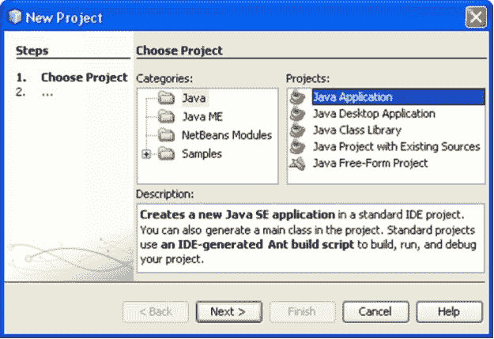

图 1

如果你看上面的图片，你会发现右侧的对话框提供了想要创建的项目类型选项。你可以在那里可以使用的所有形式创建项目。在我们的案例中，我们正在创建一个 Java 应用程序。因此，我们需要在项目标签页中选择 Java 类别和 Java Application，并点击 next（下一步）进入第二步。

当你点击 next 按钮时，程序将给你选择项目名称的选项。当你输入项目名称时，你会发现底部的名称将更改以匹配你的项目名称，即在“Create Main Class（创建主类）”中。我们将恰当地地将项目命名为“FirstProject”。

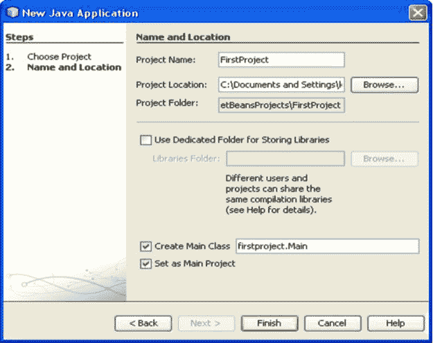

图 2

在上面的图中，“Create Main Class”的名称是 `firstproject.Main`。我们不能让它保持那样，否则该类将包含“Main”名称。我们需要像下图所示将其更改为 `FirstProject`。

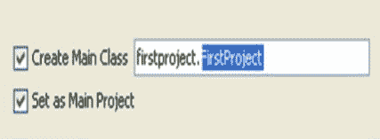

图 3

重命名后，创建的类将带有“FirstProject”的名字。注意项目类名开头有一个大写的“F”，后面也有一个大写的“P”。此外，包名为 `firstproject`，字母是小写的“f”和“p”。

Project Location（项目位置）文本框将会出现，并为你提供更改默认保存位置的选项。如果你希望将文件保存到默认区域以外的任何位置，可以在这里进行。此外，NetBeans 程序还会在你选择的相同默认位置创建一个包含你项目名的默认文件夹。点击 finish（完成）按钮将提示 NetBeans 在后台工作并创建所需的文件。完成后，系统将带你回到 IDE，你可以在那里看到并定位你所有的项目。如果万一左上角的项目区域不可见，你应该导航到菜单栏上的 `Window > Project Tab`（窗口 > 项目标签页）。

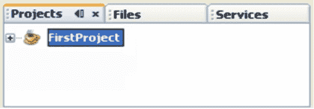

图 4

你可以通过 `+` 展开项目，项目如下所示。


图 5

你应该点击 `+` 展开项目并查看项目名称。我们这样做是为了看到源代码。


图 6

源代码应该出现在右侧，并带有 `FirstProject.java` 的名称。有时，代码窗口不会显示。这并不是需要过度担心的事情，只需点击项目窗口中的 `FirstProject.java` 即可调用代码窗口；之后你就可以开始编写代码了。这里是代码的示例图像。@author 部分是你作为作者的名字出现的地方。

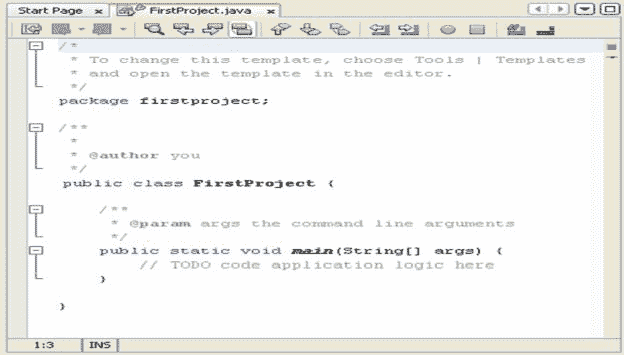

图 7

你应该注意类名为 `FirstProject`。

```java
public class FirstProject {
```

你可能会问为什么这样？毕竟，这实际上与你项目窗口中的 Java 源代码文件 `FirstProject.java` 的名称相同。这里有一个简单的解释。这是编译器的要求。一旦你运行程序，类名和源代码文件必须匹配编译器才能工作。这意味着什么？这意味着如果你的 `.java` 文件名为 `firstproject` 而类名为 `FirstProject`，你将收到编译错误，仅仅是因为字母大小写不匹配，即第一个是小写而第二个是大写。

记住，我们的整个项目作为一个实验命名为 `first project`；你可以为包命名为任何名称，例如 `anyprogram`，包名并不一定与 Java 源代码文件或源代码中的类名相同。只有后两个必须匹配。

我们在 NetBeans 程序中创建一个新项目后，你可能会注意到代码中的部分是灰色的，并且包含许多星号和斜杠，如下所示。

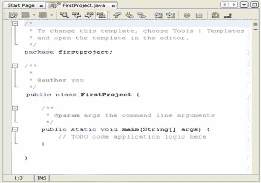

图 8

## Java 注释

当这种情况发生时，我们将其称为灰色注释。在程序的运行阶段，这些灰色的（注释）是无关紧要的。这意味着你可以使用注释功能来说明或解释你正在创建的代码想要实现的目标。你可以通过输入两个斜杠后跟注释内容来实现这一点。这里有一个示例。

```java
// 在此处放置你的单行注释
```

你可以通过以下任一方式拥有多行注释：

```java
// 我们正准备
// 将注释拆分为两行
```

或者

```java
/*
此注释跨越了两个行
*/
```

如果你查看上面的注释，你会发现它以 `/*` 开头，以 `*/` 结尾。

此外，如果你查看上一张图片（图 8），你会发现有些注释以单个正斜杠和两个星号 (`/**`) 开头，以一个星号和一个正斜杠结束；这被称为 Javadoc 注释。例如：

```java
/**
 * 这是一个 Javadoc 注释的示例
 */
```

这种代码用于代码文档。如果你认为这对他们有帮助，可以将文档化的代码转换为 HTML 页面并与他们共享。你可以通过点击 NetBeans 菜单中的运行来访问 Javadoc 注释；在运行菜单中，你应该选择 `Generate Javadoc`。随着你编程能力的提高，这将非常有用。然而，现在没什么可看的，因为我们目前还做得不多。你也可以选择删除 Javadoc 注释。以下是我们的代码没有注释的样子：

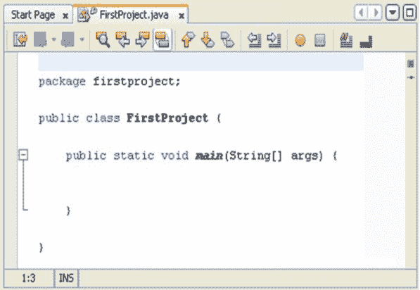

图 9

接下来，我们学习如何运行程序以及代码的结构。

## Java 代码的结构以及如何运行程序

在我们结束上一章节时，我们清理了代码（参见图 9）。在图中，你应该注意到包名排在最前面。此外，你应该注意分号是行的结束标记。分号是非常重要的，如果由于遗漏了它，程序将无法编译。

```java
package firstproject;
```

接下来是类名

```java
public class FirstProject {

}
```

理想情况下，你应该将类看作一个代码段。然而， Java 规定你必须告诉它代码段的开始和结束。你可以通过使用大括号来实现这一点。你可以在代码的开头使用左大括号，并使用右大括号结束代码 `{这是一个大括号代码段的示例}`，但你应该注意，左右大括号内部的任何内容都是该代码段的一部分。此外，类左右大括号内部的任何内容实际上都是一个代码段。这就是我的意思是：

```java
public static void main(String[] args) {

}
```

比其他任何事情都重要的是 `main` 这个词。为什么？因为每当任何 Java 程序启动时，它都会首先寻找名为 `main` 的方法。简单来说，方法是一段代码。程序随后执行大括号内的代码作为 main 的部分。如果你的代码中没有 `main` 方法，你可能会在 Java 程序中收到错误消息。然而，由于这是程序的程序的入口点，你不太可能遗漏它。

代码的公共部分（蓝色部分）仅意味着该方法在类外部是可见的。另一方面，`static` 意味着不需要创建新对象，而 `void` 意味着没有返回值，命令将继续执行。

命令行参数是 `main` 圆括号之间的部分。除了技术细节外，你不应该担心这些。你只需要努力记住我们的类是 `FirstProject`，它包含了方法 `main`，并且类和 main 都使用它们自己的一组大括号。你还应该记住，代码的很大一部分是类 `FirstProject` 的一部分。

## 如何运行 Java 程序

你在 NetBeans 上运行的任何程序都会直接在输出窗口中运行，你可以在屏幕底部代码正下方找到输出窗口。这种设计是有逻辑的，因为输出窗口可用，你不需要调用控制台窗口或终端，因为在 NetBeans 中，输出窗口充当了控制台。

在 NetBeans 中，你可以通过多种方式运行程序，最简单的是在键盘上按下 `F6` 键。你也可以使用 NetBeans 顶部的菜单来运行程序。在菜单中，找到 `Run` 菜单并执行 `Run Main Project` 。

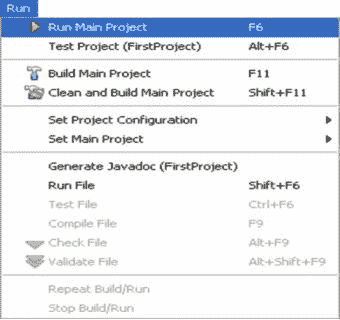

图 10

在 NetBeans 工具栏上，你会看到一个“绿色播放”箭头；你可以用它来运行程序。

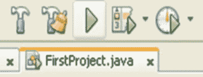

图 11

你也可以通过导航到项目窗口来运行程序。这对于确保运行的是正确的源代码特别为有效。要做到这一点，你需要点击项目窗口中的 java 源文件，然后右键点击查看选项。执行 `Run` 命令。见下方所示。

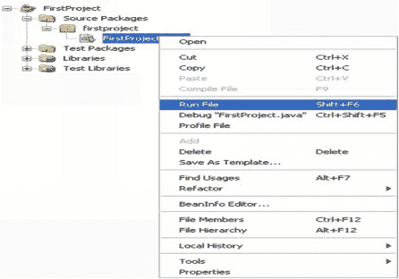

图 12

如果你对我们目前的代码使用上述任何程序执行方法，你应该应该在输出窗口中得到类似于图 13 的内容

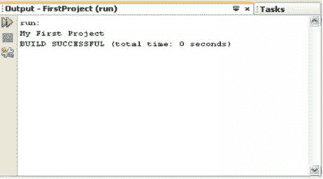

图 13

在上面的图 13 中，你可以看到第一行是 `Run` 命令。第二行是我们的代码“My Code”。如果你对某些内容不确定并想再次运行，你可以查看图 13 上方的绿色箭头。

## 关于输出窗口的所有信息

到目前，我们可以创建一个代码并将其转换为程序。如果我们使用我们目前代码的示例，我们就可以成功将其转换为程序，尽管它目前没做什么。在接下来的学习步骤中，我们将开始输出文本到控制台，我们在 main 方法中添加以下代码：

```java
public static void main(String[] args) {

    System.out.println("My Project");
}
```

提示：在 `System` 之后输入句号后，NetBeans 将显示一组供选项，类似于图 14。


图 14

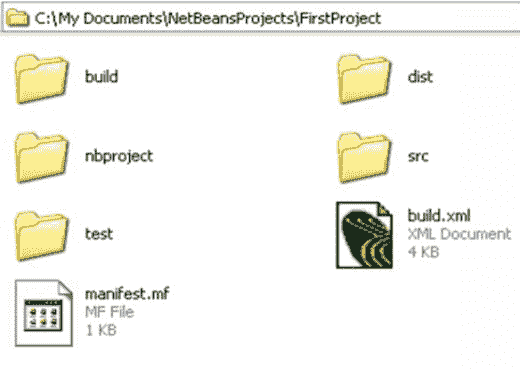

图 18

如果你双击 `dist` 文件夹，你会得到以下内容

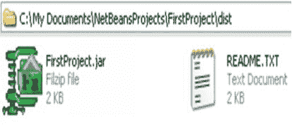

图 19

在上面的图 19 中，`dist`文件夹中的文件就是你要发送给你的“程序员朋友们”的内容。在文件中，有关于如何在控制台或终端窗口运行程序的指令。将文件发送给你的朋友，等待他们对你的编程造诣感到惊叹。

## 理解 Java 变量

作为一名刚出炉的程序员，你将想要通过练习来提高你的编程技能。Java 程序通过操作内存中存储的数据来工作。就像数据库会有可变的数据一样，这些内存中的数据也是可变的，这意味着数据可以是对象、文本、数字或指向其他内存区域的指针等形式。每条数据都有一个分配的名称，以便在需要时更容易地调用这些数据。分配给这些数据的名称和值被称为“变量”。让我们从查看数值开始。

在 Java 中存储数字有许多选择。对于存储整数（例如 8-10-12），你使用整数（`int`）变量。要存储 8-4-10-5-12-8 等，你使用 `double` 变量。使用等号 (`=`) 进行存储。通过我们的第一个源代码，让我们来看一些示例。

要设置一个整数（整数字），你需要将下面的代码添加到你的“my first project”项目的 `main` 方法中。


```java
public static void main(String[] args) {
    int first_number;
    System.out.println("My First Project");
}
```

为了让 Java 识别出你正在存储一个整数，你首先需要输入单词 `int` 并在后面跟一个空格。接下来，你需要为你的整数变量取一个名称。虽然你可以给整数变量起任何你名称，但在命名时，你必须考虑一些规则。

- 变量名不能以数字开头。这意味着使用 `first_number` 作为你的变量是可以的，但使用 `1st_number` 则是不行的。这并不意味着你不能在变量名的其他地方使用数字；它不能位于开头。
- 变量名不能与 Java 关键字相同。这些关键字有很多，而且 NetBeans 会将它们变成蓝色，就像上面 `int` 的示例一样。
- 你的变量名不能包含空格。如果我们在变量声明中使用 `int first number`，我们将得到错误，因此使用了下划线。此外，第一个单词以小写字母开头而随后的单词大写字母的情况并不罕见，例如 `firstNumber` 或 `myFirstNumber`。
- 变量名对大小写敏感。这意味着 `firstNumber` 和 `FirstNumber` 之间是有区别的。

当你需要在名为 `first_number` 的变量中存储内容时，你需要输入一个等号，后面跟着你想要存储的值。遵循下面的代码。

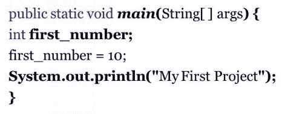

在上面的代码中，我们正在告诉 Java 我们想在我们恰好命名为 `first_number` 的整数变量中存储一个 10 的值。如果你愿意，也可以用一行完成上述操作。

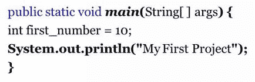

为了看到它是如何工作的，你需要将 `println` 方法修改为如下：

```java
System.out.println("First number = " + first_number);
```

现在我们在 `println` 的圆括号之间有了用双引号包围的直接文本。

`"First number = "`

此外，我们在 `+` 符号后面跟着我们的变量名 `+ first_number );`

`+` 符号简单意味着连接。这意味着我们正在将变量名与直接文本连接。这种连接过程就是我们说的拼接（concatenation）。

下图（图 20）说明了你的代码窗口将如何显示。你应该注意每行以分号结尾的次数。

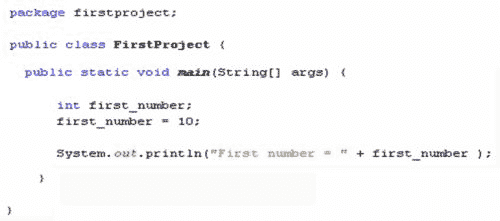

图 20

如果你运行程序，这里是输出窗口底部应该显示的内容

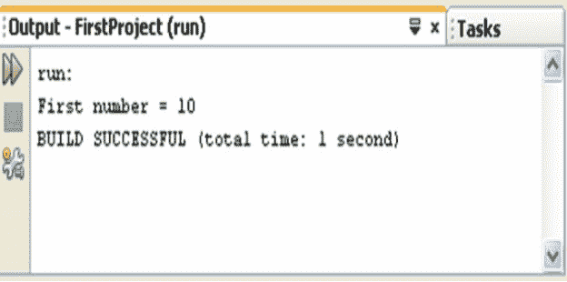

图 21

我们存储在名为 `first_number` 的变量中的变量 `number` 位于 `=` 符号后的第一个输出中。

如果我们做一些加法会怎样？让我们再添加两个 `int` 变量。一个将存储第二个数字，另一个将存储答案。


在 Java 中，我们可以像上面那样在同一行中写三个变量名，但只有当变量类型相同时才可以，在我们的例子中是 `int`。此外，你会注意到每个变量名之间通过逗号隔开。

我们的新变量看起来是这样的：

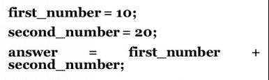

对于 `answer` 变量，我们需要加上第一个和第二个数字（`first+second`）。在大多数编程中，我们使用 `(+)` 符号进行加法。这提示 Java 相加 `first_number` 和 `second_number` 中的值。此外，当它相加值时，它会将总和存储在等号左边的变量中。这意味着与其给变量名赋值 10 或 20，它会自动将它们相加并赋值。下图（图 22）描述了我们刚刚看到的内容。

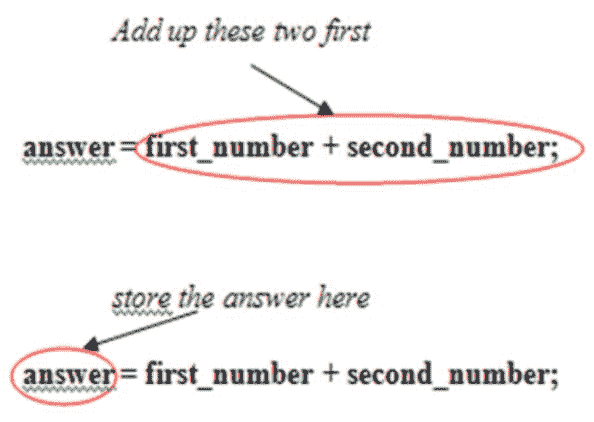

图 22

上面的图也可以等同于：

```java
answer = 10 + 20;
```

然而，Java 已经知道两个变量 `first_number` 和 `second_number` 内部的值，这意味着你可以直接使用名称。

为了获得输出，我们需要再次修改我们的 `println` 方法为：

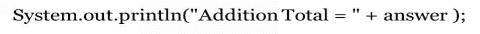

你应该注意到我们正在组合被双引号包围的直接文本。这里是你的代码窗口现在应该显示的图。

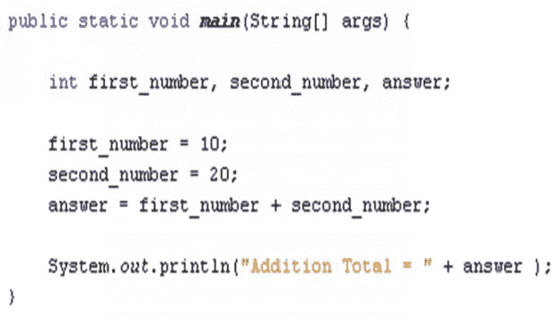

图 23

再次，当你运行程序时，下图是在你的输出窗口上应该显示的内容

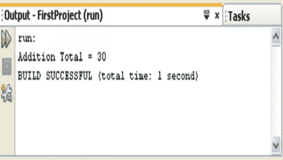

图 24

这是我们的程序完成的任务列表：

1. 存储了一个数字
2. 存储了第二个数字
3. 将两个数字相加
4. 将加法结果存储在第三个变量中
5. 打印出这些结果

此外，我们可以直接使用数字。要这样做，你需要将 `answer` 那行改为如下：

```java
answer = first_number + second_number + 12;
```

现在运行你的程序并注意打印了什么。注意代码中的微小变化是如何影响整体输出的。

`int` 值的最大值为 2147483647，这意味着你可以存储的数字很大。如果你需要一个负数，最低值是 -2147483648。比这更大的值需要双精度类型。

# 最后建议

情况是这样的：在学习的初始阶段使用 Java 编程需要大量的耐心。记住，当事情进展不如顺利时，很容易失去希望。坚持下去，你将获得使用 Java 编程的奇妙且甜美的果实。编程就是关于犯错、从中学习，并随着进步编写更好的代码。

作为一名程序员，你不能忽视 Java 在我们所生活的计算机解放世界中的重要性。如果你想取得成功，就必须理解这门非常重要的语言。此外，今天开发的大多数系统越来越多地使用 Java，并在创建数据库和应用程序时放弃其他语言。使用 Java 所需的操作环境是免费的，这一事实也有助于它推向最佳编程语言列表的顶端。

学习意味着你必须投入时间来学习。它意味着你必须准备好投入大量的时间去尝试、失败，然后再次尝试。我留给你一句听起来非常浅显、但完全属实的话：熟能生巧。
