# JAVA：初学者 Java 编程指南，你的 Java 编程学习进阶指南 (Java 系列)

## 致谢

首先，我要感谢上帝赋予我知识和灵感，让我汇编了这本充满信息的书。我也想感谢我的父母、兄弟以及我的伴侣 Silvia 的支持。

## 引言

你好！感谢你下载本电子书。通过这一行动，你已经在投资自己作为计算机程序员的技能方面迈出了大的一步！本电子书提供了适用于初学者的 Java 语言实用信息。我是 Felix，我也从一名业余软件程序员起家，经历过理解基础 Java 术语和编程规范的挑战。本电子书将作为理解 Java 语言的入门，并引导你朝着成为专业计算机程序员的目标努力。我将一步一步教你如何安装所需的 Java 工具并创建简单的程序。

初看之下，Java 似乎是一门难以理解的语言。在我们开始之后，你将开始熟悉 Java 语言环境，并很快发现它学起来其实非常简单！无论你的编程语言经验如何如何，本指南都将以易于遵循和学习的方式引导你。随着你知识的扩展，你将越来越欣赏成为 Java 程序员的优势。

Java 一直被认为是世界上最需求最大的顶级编程语言之一。如果你决定专注于学习 Java 环境，那么你正面对着一个快速成长的职业。这种技术已广泛集成并应用于蓬勃发展的万维网。由于其简单性、可读性和活性，Java 备受青睐。在美国，一名 Java 开发者的年薪估计为 85,000 美元。

本电子书将为你介绍 Java 语言，并帮助你实现成为专业计算机程序员的目标。我将教你如何安装所需的 Java 工具并创建简单的程序。P.S 不要忘记在书末下载免费视频课程。让我们开始吧！

## 第一章：Java 历史

本章将为你简述 Java 产生的历史，并介绍计算机编程语言的演变。

### 计算机的诞生


在很久以前，也许是二十年前，人们仍然使用打字机来创建家庭文档、学校作业或工作简历。然后，计算机系统的出现让这一切变得简单多了！现在，只需点击鼠标或按下键盘，你就可以打印出装饰家居、学校论文或工作演示的视觉冲击力作品。


计算机系统由计算机的所有基本组件组成，以及它们如何集成以运行设备。这些组件可以分为硬件或软件。计算机硬件指的是物理部分，如中央处理器 (`CPU`)、鼠标、键盘和显示器等。软件指的是告诉计算机如何做什么的不同程序。

由于本电子书旨在提供 Java 编程的分步教程，因此我们将关注计算机系统的软件方面。此外，万维网（或简称互联网）的出现为计算机编程带来了更多创新。由于这条超级公路在信息共享和通信方面的日益增长的需求，迫使程序员们探索 Java 编程语言的潜力。

### Java 时间线

- **1995**
  - Java 在 SunWorld 大会上首次发布。
  - Netscape 宣布将 Java 整合到其浏览器开发中。
- **1996**
  - JDK 1.0 发布。
- **1997**
  - 全球 Java 开发者数量达到 250 万。
- **2000**
  - 大学理事会宣布计算机科学高级课程（AP）考试将在 2003 年基于 Java 进行。
- **2002**
  - 微软引入了 `C#`，一种继承了 Java 大部分编程特性的新语言。
  - Sys-Con Media 报告对 Java 程序员的需求日益增长（比 `C++` 程序员的需求增加了 50% 以上）。
- **2007**
  - Google 开始使用 Java 语言在 Android 移动设备上开发应用。
- **2010**
  - 甲骨文公司收购了太阳科技公司，将 Java 技术整合进了 Oracle 家族。
  - eWeek 将 Java 评为“保持就业的前 10 编程语言”第一。
- **2013**
  - 已有超过 11 亿台台式电脑和 2.5 亿手机在使用 Java 平台。Java 已被各种编程小组和社区（如 TIOBE 社区指数和 PYPL 编程语言流行指数）认为是最流行的语言。

### Java 技术的出现

当 IT 专家在 20 世纪 90 年代初意识到通过为日常家电引入智能化使人们的生活变得更简单存在巨大需求时，太阳科技公司与一个研究小组合作启动了“绿色项目”。这是一项秘密任务，旨在开发一种运行在嵌入式处理器芯片上的便携式家电软件。该程序应该足够灵活，以适应不断变化的家电处理器芯片，这些芯片正变得越来越小、越来越廉价且功能越来越强大。团队最初计划使用 `C++`，但其可移植性问题阻碍了他们的成功之路。因此，他们决定开发一种全新的计算机编程语言。

1991 年，太阳科技公司通过 James Gosling、Chris Warth、Patrick Naughton、Mike Sheridan 和 Ed Frank 的合作，最初构思了 Java 语言。`Oak` 是这种新编程语言的初始名称，灵感源自 James Gosling（团队项目负责人）窗外的一棵树。

然而，`Oak` 已经被用作另一种编程语言的名称。因此在 1995 年，它被正式重命名为 `Java`，这代表了软件开发人员休息时经常享用的咖啡。然而，由于对这类家电的需求并没有像太阳科技团队预期的那样，他们必须寻找另一个渠道来扩展 Java。最终，在 1995 年 5 月，Java 在 SunWorld 大会上首次发布，随后 Netscape（当时世界上第一大浏览器）立即宣布他们将这种编程语言整合到他们的开发中。通过 Java 嵌入网页，网站从单调乏燥转变为交互式。不仅 Web 能够向受众发送信息，它们还能接受用户输入。

在本章中，你已经学习了计算机编程语言的历史，重点是 Java 技术的开发。在接下来的章节中，将描述 Java 如何在各种编程环境中使用，并提供如何在你的计算机上正确安装它的清晰指令。

## 第二章：Java 环境

为了更深入地了解 Java 编程，本章将开始讨论如何在各种环境中使用和部署软件。它还将提供有关如何安装 Java 程序本身以及计算机上其他所需工具的逐步说明。

随着万维网不可阻挡的增长，开发者已经找到了将 Java 程序整合到每个网页的方法。以下是该语言在不同环境中的用途总结：

- **Applet** - 一种嵌入网页的网络 Java 程序，通过互联网传输时自动执行。通常这是一个小型程序，可以显示来自服务器的数据、管理用户输入，甚至执行诸如计算器之类的简单功能。这些功能在客户端计算机上本地完成，而不是连接到服务器，这意味着当你点击 applet 链接时，它会自动下载并在浏览器中运行。
- **Servlet** - 一种小型 Java 程序，支持浏览器但运行在不同的计算机或 Web 服务器上以扩展其功能。Servlet 的引入升级了客户端/服务器连接。
- **JavaServer Page (JSP)** - 一个由 Java 程序片段组成的网页（与具有完整程序的 applet 相反）。
- **Micro Edition (ME) Java Application** - 运行在内存有限资源设备上的 Java 程序，如手机或电视机顶盒。
- **Standard Edition (SE) Java Application** - 运行在标准计算机（如台式电脑或笔记本电脑）上的 Java 程序。
- **JavaFX** - 与多媒体平台（如 Flash 播放器）集成的 Java 程序。

### 初始 Java 设置

在坐在电脑前开始编写代码之前，你需要确保你和你的机器已准备好编写 Java 代码。强烈建议你查看以下网站并按照说明下载通常免费的软件：

#### Java 软件下载和安装

1. 在浏览器的地址栏输入 `http://java.com`。它将带你进入以下界面：
   
2. 点击 **FREE JAVA DOWNLOAD** 按钮。它将带你进入此屏幕：
   
3. 点击 **AGREE AND START FREE DOWNLOAD** 按钮。当 Java 下载完成后，你需要关闭所有浏览器并重新加载以启用 Java 安装。
4. 运行下载的文件，你将看到此界面
   

#### Java SE 文档下载

- 访问 `www.oracle.com/technetwork/java/javase/downloads` 下载并安装 Java SE 文档（作为 Javadoc 页面）
1. 访问网站 `www.oracle.com/technetwork/java/javase/downloads`，它将带你进入以下界面：
   
2. 点击此选项
   
3. 下一页将要求你选择想要下载的 Java SE 开发包版本。在开始下载之前，请确保你确切计算机使用的是什么操作系统。
   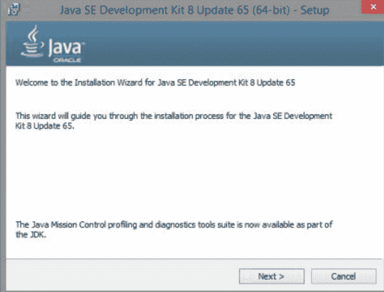

#### Eclipse IDE 安装

1. 在浏览器的地址栏中输入网站 `http://eclipse.org/downloads`。它将带你进入下面的屏幕：
   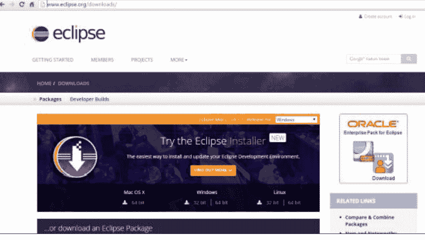
2. 根据你电脑的操作系统选择合适的 Eclipse 版本。对于 64 位 Windows 操作系统 (`OS`)，你会看到下面的屏幕：
   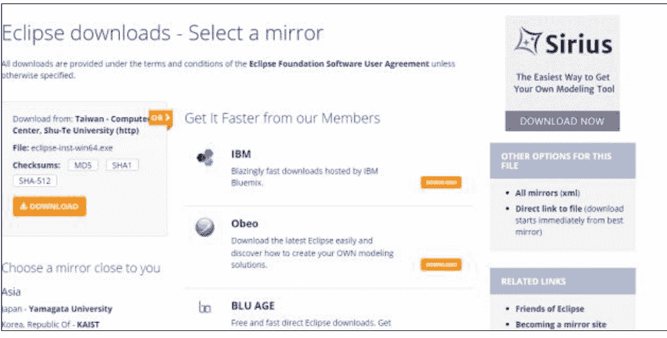
3. 下载完成后，打开程序，你将看到下面的屏幕：
   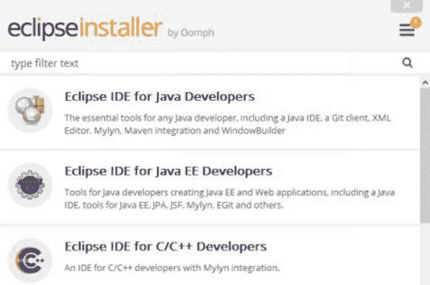
4. 仅选择 **ECLIPSE IDE FOR JAVA DEVELOPERS** 选项，然后点击 **INSTALL** 按钮。确保你接受了 **ECLIPSE FOUNDATION SOFTWARE USER AGREEMENT**。
   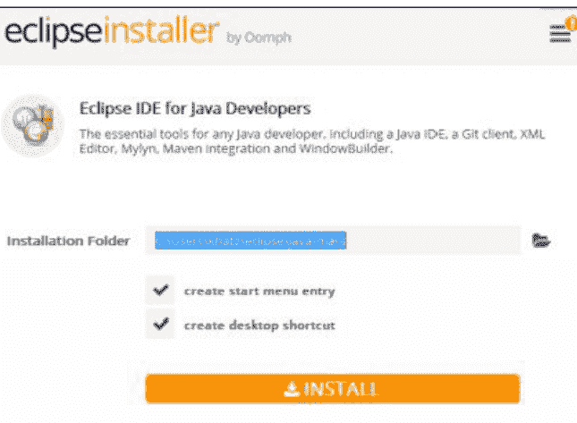

下载程序后，确保测试已安装的软件。你可以按照以下步骤测试 Eclipse：

- 启动 Eclipse。你应该能在桌面上看到 **ECLIPSE JAVA MARS** 图标。它会提示你 **SELECT WORKSPACE**。保持框内内容不变并点击 **OK** 按钮。
  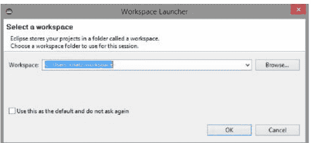
- 通过顶部菜单创建新的 Java 项目：`FILE > NEW > JAVA PROJECT`
  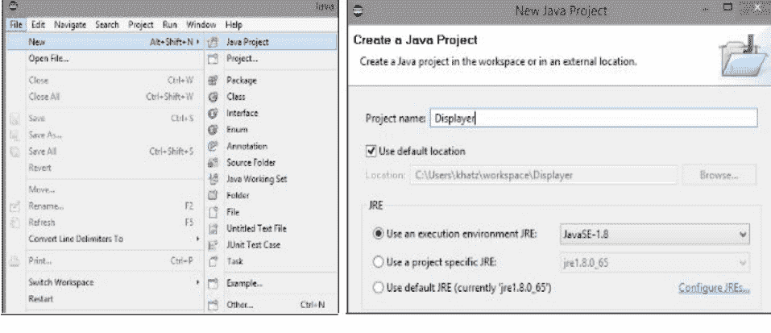
- 在 Java 项目中创建一个名为 `Displayer` 的新类。

通过在编辑器面板中输入以下代码行来修改新的 `Displayer.java` 文件。

```java
public class Displayer {
    public static void main(String[] args) {
        System.out.println("Hello Java!");
    }
}
```

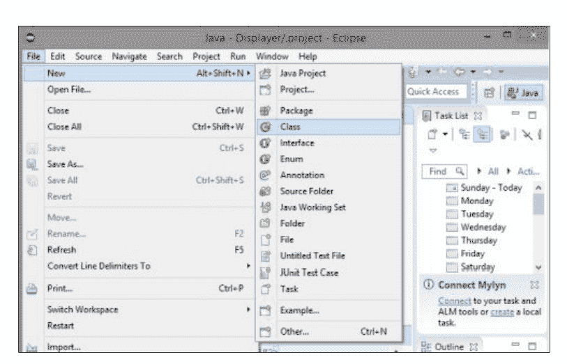

点击顶部的此按钮执行 `Displayer.java`，并点击下图确认输出显示为 Hello Java!

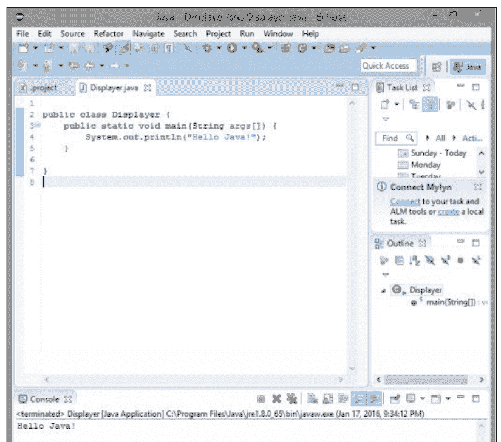

在计算机编程领域，软件开发人员需要现有程序来创建新程序。例如，他们想开发一个处理公司员工记录的 Java 程序。为了实现这一点，你可能会使用现有程序作为 Java 代码的错误检查工具。

### 必要的 Java 工具

以下是 Java 编程中需要的不同工具，可以在网上免费下载：

#### 编译器

编译器将你编写的 Java 代码转换为计算机可以理解并运行的内容。计算机并不像人类那样理解指令。例如，检查下面的程序代码：

寻找可用的租汽车：

```java
// This is part of a Java program
// (not a complete Java program)
rentalcarNum = 1;
while (rentalcarNum < 100) {
    if (client[rentalcarNum] == 0) {
        out.println("Car " + rentalcarNum + " is available.");
        exit(0);
    } else {
        rentalcarNum++;
    }
    out.println("All cars or vehicles are rented out");
}
```

这段基础 Java 代码为特定客户寻找任何可租汽车或车辆，假设公司总共有 99 辆车。你不能直接输入并运行这段代码。然而，忽略奇怪的符号和输入格式，人类能够理解它让计算机做什么：

- 将租汽车编号设置为 1。
- 只要租汽车编号小于 100，
- 检查租车的人数。
- 如果租车人数为 0，
- 则报告该车可用并停止。
- 否则，
- 通过将租汽车编号加 1 来准备检查下一辆车。
- 如果达到不存在的租汽车编号 100，
- 报告所有汽车或车辆已租出。

至于计算机，它们并不按照翻译成英文指令来执行特定任务。相反，它们理解的是晦涩的 Java 字节码命令。这就是编译器发挥作用的地方。编写 Java 源码后，编译器会将其翻译并写入计算机可以执行的 Java 字节码。查看下方相同 Java 代码的字节码对应项：

```
aload_0
icost_1
putfield Company/rentalcarNum I
goto 32
aload_0
getfield Company/client []
aload_0
getfield Company/rentalcarNum I
iaload
ifne 26
getstatic java/lang/System/out Ljava/io/PrintStream;
new java/lang/StringBuilder
dup
ldc " Car"
invokespecial java/lang/StringBuilder/<init> (Ljava/lang/String;)V
aload_0
getfield Company/rentalcarNum I
invokevirtual java/lang/StringBuilder/append(Ljava/lang/StringBuilder);
ldc " is available."
invokevirtual java/lang/StringBuilder/append(Ljava/lang/String;)Ljava/lang/StringBuilder;
invokevirtual java/lang/StringBuilder/toString()Ljava/lang/String;
invokevirtual java/io/PrintStream/println(Ljava/lang/String;)V
iconst_0
investatic java/lang/System/exit(I)V
```

#### 推荐 IDE

- **Eclipse** - 与之前的程序一样，这个开源 IDE 是初学者最推荐的 Java 编程环境之一。它既快速又强大，可以支持从标准版 (`SE`) 到 `FX` 的所有 Java 平台。
- **BlueJ** - 被描述为具有简单的 IDE 界面，专门设计用于帮助初学者理解 Java 编程的基本概念。详见 `http://bluej.org/`。
- **DrJava** - 也是为想要简单界面的业余程序员设计的。尽管它非常简单，但对于精通 Java 的程序员来说，它仍然足够强大。详见 `www.drjava.org`。

#### Java 开发包 (JDK)

`Java 开发包 (JDK)` 是一种既充当编译器又当解释器的工具。可以从 Oracle 网站 `www.oracle.com/technetwork/java/javase/downloads/index.html` 下载最新的 JDK 版本。请确保您下载了适用于您电脑的版本。如果您使用的是 32 位操作系统，请下载文件名后带有 `x86` 后缀的文件；否则，如果是 64 位操作系统，则请下载带有 `x64` 后缀的文件。

现在，我们已经了解到 Java 可以通过多种方式进行部署。本章还为您提供了一套关于如何安装软件以及程序正常运行所需的所有工具的清晰说明。在下一章中，您将体验如何在 Java 环境中开始编写代码。

## 第三章：Java 代码基础

在开始编写 Java 代码行之前，本章将首先描述什么是面向对象编程（这是 Java 编程的主要特征之一）。你也将编写你的第一个简单的 Java 程序，并理解每个部分的重要性。此外，你将学习类、对象和实例。


# Java 语言核心方法论：面向对象编程 (OOP)

多年来，软件开发人员不断尝试寻找降低程序编码复杂度的方法。第一代编程语言涉及对二进制机器码的切换，这些代码只有几百条指令长，并且需要通过拨码输入到计算机的前面板上。随着程序的演进，需要 IT 专家通过符号表示处理更复杂的指令，汇编语言应运而生。随着编程方法论的增强，引入了更多高级语言。例如 FORTRAN，但由于当时的代码还并不易于理解。

结构化编程于 20 世纪 60 年代出现，用于 C 和 Pascal 语言。这些程序的特点是局部变量、丰富的控制结构和独立的子程序等。即使它们被认为是强大的工具，在处理非常大的项目时仍然存在局限性。

突破极大型项目编码障碍的需求为面向对象编程的出现铺平了道路。它是结构化编程的最佳方法论与新组织概念的结合。这种编程风格具有以下特征：

## 封装 (Encapsulation)

从名称本身来看，封装是一种将编程代码与其操作的数据绑定，并防止它们受到外部干扰的策略。当代码和数据链接在一起时，就创建了一个对象。该对象包含私有或公共的代码和数据。私有代码或数据不能被该对象之外的任何程序访问。当它是公共的，程序的其他部分即使不在对象内部也可以进行访问。

## 多态 (Polymorphism)

这个概念通常被描述为为多个方法创建一个单一的接口。这意味着你为一组相关的活动设计了一个通用的接口。它通过让同一个接口被用于指定一类通用的动作，从而进一步降低了程序的复杂度。一个清晰的类比是方向盘。无论什么类型的方向盘，无论是手动转向还是动力转向，只要你知道它是如何工作的，就可以驾驶任何类型的汽车。

## 继承 (Inheritance)

这个过程涉及一个对象获取另一个对象的属性，这支持了层次分类的概念。为了解释这一点，请想象一个红心西瓜，它属于西瓜这一分类。西瓜又是水果类的一部分，而水果类属于一个名为“食物”的更大的类。食物类具有某些属性，如可食用和有营养，这些属性被进一步应用于其子类水果。水果也有某些属性，如多汁和甜。现在，对于西瓜来说，它也有它特定的属性，例如一种热带藤蔓类植物。现在，将所有这些属性结合在一起就构成了一个红心西瓜。

## 类、对象与实例

面向对象编程的特征是类、对象和实例的应用与组织。这些实际上是构成 Java 程序的组件，并且它们之间相互连接。

- **类 (Class)** - 被视为最高层级，类涵盖了面向对象编程中的一切内容。
- **对象 (Object)** - 类定义的规范被应用于尚未加载到计算机内存中的对象。它们也是类的实例，充当蓝图，在需要时可以使用。因此，一个类可以关联任意数量的对象（甚至可以有零个对象）。
- **实例 (Instance)** - 可以与对象相同，因为它们描述的是个体的实例化。

为了理解它们之间的关系，想象你正在开发一个用于跟踪学校入学学生的计算机程序。每个学生都有独特的特征——发型、眼睛颜色、肤色、身高、体重等许多特征。在你的 OOP 程序中，每个学生都是一个对象。现在，即使学生们之间相互不同，他们也共享同一份物理特征列表。这些属性或特征需要汇成一个主列表，我们称之为类。

# 第一个简单的 Java 程序

让我们再次尝试按照指令编码一个简短的示例程序：

1. 启动 Eclipse。点击 `FILE > NEW > JAVA PROJECT`。将你的新项目命名为 `EXAMPLE`。
2. 创建一个新的 `EXAMPLE` 类。点击 `FILE > NEW > CLASS` > 为类名输入 `EXAMPLE`。
3. 输入、编译并运行以下程序：


# 编写 Java 程序

在 Java 中，源代码被称为编译单元，你给源文件命名的名称非常重要。按照惯例，类的名称应与文件的名称匹配。请注意 Java 编程是区分大小写的，这意味着编译器区分大写和小写字母。此外，编译器要求的文件名扩展名是 `.java`。遵循这种编程惯例有助于组织和跟踪你的代码行。此外，如果你更改了大小写或命名规范，整个程序将失去意义并停止工作。因此，对于这次活动，我们将其命名为 `Example.java`（因为程序定义的公共类也是 `Example`）。

# 编译 Java 程序

在此阶段，执行编译器 `javac` 并创建一个名为 `Example.class` 的文件，该文件包含程序的字节码版本。在之前的讨论中，字节码由 Java 虚拟机执行。要实际运行程序，使用名为 `java` 的 Java 解释器并将类名 `Example` 作为命令行参数传递如下：

```
java Example
```

程序运行时将显示以下输出：

# Java 对 Web 至关重要

在编译期间，每个单独的类都被放在一个以类命名的带有 `.class` 扩展名的输出文件中。惯例是将你的 Java 源文件与类文件重名，这样当你执行 Java 解释器时，你实际上是在指定你想要执行的类名。

# Java 程序的部分

## 注释 (Comments)

注释是程序中的描述性部分，用于解释代码的含义。它们是特殊的文本区域，可以提高程序的可读性——帮助人们理解程序的运行。基本上，这些是人类阅读但编译器完全忽略的单词。根据编写方式的不同，注释分为两种：

### 1. 单行注释或行尾注释

这种注释以两个斜杠开头，其注释内容足够短，可以放在的一行内。它也可以写在代码行的末尾。在之前的简单 Java 程序示例中，我们的单行注释是：

```
// A Java program begins with a call to main ().
```

编译器从第一个斜杠开始到该行结束的所有内容都会被忽略。

### 2. 块注释或多行注释

这种类型的特点是包含多个单行注释（这意味着你的注释文本太长，无法放在一行内）。然而，两个斜杠被替换为注释开始时的符号 `/*`，并以结束符号 `*/` 结尾（为了节省每行都写 `/` 的时间）。同样，编译器会忽略两个斜杠之间的所有内容。在之前的简单 Java 程序示例中，我们有：

```
/*
* This is a simple Java program
*
* Call this file Example.java
*/
```

序言（Prologue）是块注释的一种版本，放置在程序的顶部或最开始。它包含了关于代码的重要信息，以便每位程序员都能一眼看出程序的大致内容。通常，序言被包含在一个星号框中，并包含以下信息：文件名、程序员姓名和程序描述。如果我们要修改上面的块注释，它看起来像这样：

```
/****************************************************************
* Example.java
* Felix & Schatz
*
* This is a simple program that displays "Java is essential to the Web" on your PC screen
*****************************************************************/
```

## 类头

我们现在移动到第一个 Java 程序的下一行：

```
public class Example {
```

这行程序代码被称为类头或类声明，它由 4 部分组成—— 3 个单词和左大括号（实际上，整个程序被视为一个类）。让我们讨论一下每一个。

这两个单词 `public` 和 `class` 是我们所说的保留字或关键字。这些单词用于 Java 语言定义的特定用途。你不能重新定义它们，也无法为了用它们来表示其他含义，例如将它们作为程序的名称。以下是 Java 语言中常见的关键字列表：

| abstract | assert | boolean | break | byte |
|---|---|---|---|---|
| case | catch | char | class | const |
| continue | default | do | double | else |
| enum | extends | final | finally | float |
| for | goto | if | implements | import |
| instanceof | int | interface | long | native |
| new | package | private | protected | public |
| return | short | static | strictfp | super |
| switch | synchronized | this | throw | throws |
| transient | try | void | volatile | while |

分析每个单词，**class** 是一个标记类开始或程序开始的标记。它还表示正在定义一个新类。在我们第一个简单程序中，**Example** 是类的名称。另一方面，**public** 是一个访问修饰符，用于控制类的访问方式（在这种情况下，信息可以被所有其他类访问）。如果它被设置为 **private** 而不是 public，那么只有当前类有权访问它。最后，唯一的左大括号 `{` 表明了类的开始，并在整个程序的结束处有一个对应的右大括号 `}`。括号总是成对出现，它们为程序员和计算机识别代码分组。

## Main 方法头

在类之后，接下来是 main 方法头。方法是 Java 语言中的一个子程序，是程序开始执行的代码行。它简单来说是一份待事项列表。在我们的示例中，main 方法的形式如下：

```
public static void main(String args[]) {
```

同样，**public** 是一个访问修饰符关键字，表示每个人都可以访问定义或声明该方法的类外部。**Static** 是另一个保留字，表示该方法可以被立即访问。第三个保留字是 **void**，表示 main 方法不返回任何内容（在某些程序中它可以返回一个值）。

任何需要传递给方法的信息通过方法名后括号内指定的变量来接收。这些变量也称为参数，在我们的示例中，只有一个 (`String args[]`)。声明的名为 `args` 的参数代表 main 方法接收的参数。**String** 是参数的类型，用于存储字符序列。方括号 `[]` 符号表示这是一个字符串类型对象的数组。即使不需要参数，你仍然需要指定空括号。

## System.out.println

根据我们的第一个简单 Java 程序示例，我们的 main 方法包含以下行代码：

```
System.out.println("Java is essential to the Web");
```

**System.out.println** 是一段程序代码，向计算机给出打印指令。让我们讨论它的每一个部分。**System** 指代计算机，当它变成 **System.out** 时，指的是显示器，即计算机系统的输出设备。**println** 是一个在控制台打印文本的内置方法。

# 第四章：用户输入

在本章中，我们将引入用户输入的概念并将其整合到 Java 编程语言中。

基于我们之前讨论的第一个简单 Java 程序，你并没有被为代码执行提供任何形式的输入。代码行只是在计算机屏幕上显示消息。在现实世界中，编程需要用户与机器之间建立稳定的通信。在 Java 语言中，我们称之为输入/输出或 I/O 流。在这种情况下，创建了一种双向通信，用户为计算机提供输入供其处理，然后产生输出作为反馈。

## 获取用户输入

Java 语言中内置了一个名为 `Scanner` 的类，可以方便地获取用户输入。它的作用是从输入流（无论是键盘还是文件）中获取信息并将其存储在变量中。然而，`Scanner` 类不是 Java 语言的核心组成部分，因此你需要告诉编译器去哪里找到它。为了使用它，你需要在程序的顶部、紧接序言部分之后包含这行代码：

```
import java.util.Scanner;
```

由于这条额外的语句，`Scanner` 类正从 `java.util` 包中导入。要在程序中调用或执行此类，你需要使用以下语句：

```
Scanner InputVariableName = new Scanner(System.in);
```

现在，导入的 `Scanner` 类被用来初始化一个名为 `InputVariableName` 的变量（你可以将其更改为任何你想要的名称，但要确保它不是 Java 关键字）。随后是赋值运算符 `=`，紧接着是编程代码 `new Scanner(System.in)`。这个表达式创建了一个对象，并命令程序将用户输入的值存储在 `InputVariableName` 中。请注意变量命名的命名规范：单词的首字母始终大写。

为了让我们能够利用输出流向你显示在程序中输入的内容，我们需要包含以下打印语句：

```
System.out.println(InputVariableName.next());
```

这里包含了 `nextLine()` 方法，它将指示程序返回插入到当前行的字符串值。它还会告诉程序等待直到完成对输入的搜索，因此在你输入某些内容并按下键盘上的 Enter 键之前，程序不会继续运行。让我们通过包含一个加运算符来进一步修改 `println` 方法：

```
System.out.println("You entered " + InputVariableName.next());
```

此时，输出语句包含文本信息，该信息将与 `Scanner` 变量一起打印出来。消息是通过括号内的加运算符 `"+"` 组合的。现在，当用户提供输入时（例如输入 "Johnny"），程序将在计算机屏幕上显示 "You entered Johnny"。

我们修改后的程序实际上看起来如下：

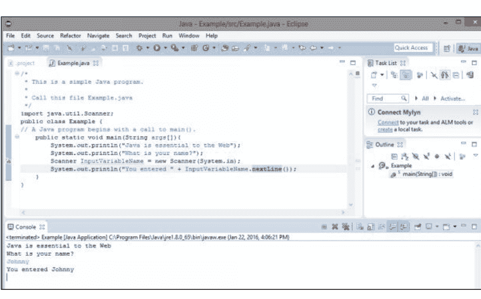

从上面的程序中，显示了消息“What is your name?”来提示你输入名字。当你输入名字并按下回车后（参见控制台部分中的绿色文本），程序将在屏幕上的“You entered ” 之后显示你的名字。

本章所描述的用户输入的引入，将 Java 环境呈现为一种双向通信的形式——在软件程序员和计算机之间。你作为用户，将通过执行 Java 代码行提供信息供计算机处理。接下来的章节现在将介绍变量声明的概念。

# 第五章：变量声明

之前，我们声明了一个变量来包含文本用户输入。如果你想创建更复杂的程序，就必须将值存储在变量中。本章将重点关注将变量声明作为你编程风格的一部分。

指定使用什么类型的变量是在声明语句中完成的，其语法如下：

```
<type> <用逗号分隔的变量列表>
```

示例：

```
int rows, cols;
String companyName;
```

再次，变量是一个占位符，存储在里面的是值，而存储在变量中的值的类型就是它的类型。查看上面的声明语句，左侧的单词（`int`, `String`）指定了右侧变量或多个变量（`rows`, `cols`, `companyName`）的类型。顺便说一下，Java 变量只能持有一种类型的值，且其值可以在程序执行期间更改。因此在上面的示例中，`rows` 和 `cols` 变量只能持有整数，而第二个声明语句 `companyName` 变量只能持有字符串。以下是 Java 语言中的基本变量类型：

| 类型名称 | 描述 | 值范围 |
|---|---|---|
| **整数类型** | | |
| `int` (Integer) | - 处理数字的最简单数据类型<br>- 无小数点<br>- 不适合高精度数据<br>- 默认值为 0 | -2147483648 到 2147483647 |
| `byte` | - 数字数据类型中范围最小<br>- 包含一个 8 位符号二进制补码整数<br>- 默认值为 0 | -128 到 127 |
| `short` | - 包含 16 位符号二进制补码整数<br>- 默认值为 0 | -32768 到 32767 |
| `long` | - 包含 64 位符号二进制补码整数<br>- 默认值为 0 | -9223372036854775808 到 9223372036854775807 |
| **小数类型** | | |
| `float` | - 包含 32 位 IEEE 754 数字<br>- 包含小数点<br>- 默认值为 0.0f | -3.4 x 10^38 到 3.4 x 10^38 |
| `double` | - 包含 64 位 IEEE 754 数字<br>- 包含小数点<br>- 比 float 更精确<br>- 默认值为 0.0d | -1.8 x 10^308 到 1.8 x 10^308 |
| **字符类型** | | |
| `String` | - 包含字母数字字符序列<br>- 默认值为 null | |
| `char` | 接受单个字符作为数据和符号 | 数千个字符 |
| **逻辑类型** | | |
| `boolean` | - 默认值为 False | True, False |

请参考每个类型的以下声明语句：

- `int AnyVariable;` or `int AnyVariable = 0;`
- `byte AnyVariable;` or `byte AnyVariable = 0;`
- `short AnyVariable;` or `short AnyVariable = 0;`
- `long AnyVariable;` or `long AnyVariable = 0L;`
- `float AnyVariable;` or `float AnyVariable = 0.0f;`
- `double AnyVariable;` or `double AnyVariable = 0.0d;`
- `String AnyVariable;` or `String AnyVariable = null;`
- `char AnyVariable;`
- `boolean AnyVariable;` or `boolean AnyVariable = false;`

# 第六章：运算符

本章将描述当你在编写更复杂的场景时，可以添加到代码行中的可用运算符。运算符主要用于在 Java 语言环境中控制、修改和比较数据。


从本书的开始开始，我们已经一直在使用等号（`=`）或称为赋值运算符，它的工作原理是将兼容的值分配给变量。此外，算术运算符用于控制将赋值给变量的值。如果你能记住在学校学过的数学运算符，那么它们与你在 Java 编程中执行数学计算时所需的运算符将是相同的。掌握如何使用运算符的知识是一项重要要求。你只需要理解每个运算符的符号及其功能即可。

## 算术运算符

除了赋值运算符外，这些是最基础形式的运算符。

- 加法运算符（`+`）– 返回两个值的之和
- 减法运算符（`-`）– 返回两个值的之差
- 乘法运算符（`*`）– 返回两个值的乘积
- 除法运算符（`/`）– 返回两个值的商
- 取模运算符（`%`）– 返回被除法数值的余数

## 递增/递减运算符

这些运算符将变量的值增加或减小 1。

- 递增（`++`）– 将值增加 1
- 递减（`--`）– 将值减小 1

它们也可以作为前缀或前递增运算符使用，即将 `++` 放在变量之前。这意味着在程序的任何其他部分使用之前，1 会先加到变量上（值在使用时会立即进行调整）。当 `++` 放在变量之后时，它就变成了后置或后递增运算符。此时，在变量用于程序的任何其他部分之后，1 才会加到变量上（先返回值再进行调整）。

示例：

```
MyVariableName = 23; - 返回值仍为 23
```

```
MyVariableName++; - 返回值调整为 24
```

```
++MyVariableName;
```

## 逻辑运算符

这些运算符也称为比较运算符，通过比较两个值或设置特定条件来实现某种程度的流程控制。根据所比较的两个值可以返回一个布尔值，这将决定某个代码块是否会被执行。这是计算机程序中最基础的逻辑形式。

- 等于（`==`）检查两个值是否相等
- 不等于（`!=`）检查两个值是否不等
- 大于（`>`）检查运算符左侧的值是否大于右侧的值
- 小于（`<`）检查运算符左侧的值是否小于右侧的值
- 大于或等于（`>=`）检查运算符左侧的值是否大于等于右侧的值
- 小于或等于（`<=`）检查运算符左侧的值是否小于等于右侧的值
- 逻辑与（`&&`）检查两个值是否为真
- 逻辑或（`||`）检查是否至少有一个值为真

## 位运算符

这些运算符以一种原始但快速的方式在比特位层级上操作变量。由于它们分析的是二进制数字（可寻址内存的最小单位），因此它们以最快的方式处理执行。

- 与（`&`）– 一种等长度的二进制运算符，执行逻辑运算符“与 (AND)”，并对两个元素的位进行乘法运算
- 非（`~`）– 一种一元运算符，执行目标是逻辑取反，并补码二进制值中的1
- 或（`|`）– 一种接收两个长度相等的位模式的运算符，执行逻辑运算符“或 (OR)”（结果为 0 或 1）
- 异或（`^`）– 一种接收两个长度相等的位模式的运算符（预期结果由相似的数字定义）

现在你已经学会了如何操作运算符，你将更擅长理解和自动化更复杂的 Java 程序。下一章将引入的另一个编程特性是流程控制，它展示了非顺序的代码。

## 第七章：流程控制

本章将强调 Java 编程的非顺序方法。你将熟悉 `if-then-else` 以及不同的循环语句。

通过之前的简单程序示例，你将熟悉 `if-then-else` 和不同的循环语句。

## If-Then-Else

这是最基础的流程控制。`if-then-else` 允许程序根据条件执行不同的代码块。如果条件为真，则执行 `if` 块中的代码。如果为假，则执行 `else` 块中的代码（如果存在）。

## 循环

这种流程控制允许方法在满足条件的情况下重复执行。在 Java 中有几种类型的循环：

- While 循环：被认为是最简单的循环，只要条件为真，`while` 块中的方法就会执行。
- Do-while 循环：它与 `while` 循环的主要区别是 `do-while` 循环在检查条件之前至少运行一次。
- For 循环：该语句通过特定的参数来控制执行方法的时间或次数。用于控制循环的变量可以在循环内部同时声明。

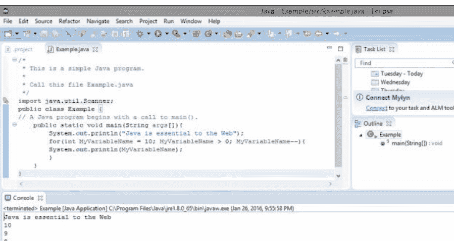

在最后一个示例中，你会注意到所有参数都是在声明 `for` 循环语句时就已经设置好了。因此，在 `for` 循环声明中，`MyVariableName` 被设置为值 10，检查它是否大于 0，然后将其值减 1。在执行或运行完这些代码行之后，屏幕上会显示 `MyVariableName` 的每个值，每个值单独占一行显示。

在现实中，通常有多种方法可以完成特定的编程任务。然而，作为一名程序员，良好的做法始终以一种优雅的方式编写程序，这需要选择最合适的循环。你可以选择创造力和灵活性，但有时这会导致困惑。

通过本章的学习，你已经意识到 Java 编程通过各种循环语句整合了流控制，不仅仅是单向的。在接下来的章节中，你将对什么是访问修饰符有更清晰的认识。

## 第八章：访问修饰符

我们已经讨论了 Java 变量、类、字段和方法。每当它们被声明时，你都必须指示它们在整个程序是如何被控制以及如何被访问的。无论它们是否受限，它们的可访问性将由本章将介绍的访问修饰符决定。

决定使用哪种修饰符取决于程序的目标以及你真正想要实现的内容。以下是不同类型的修饰符：

### 默认 (Default)

这是在没有指定访问修饰符时分配的类型。由于它的缺失，任何命令或函数都可以访问程序的某个部分。然而，它的可用性仅限于访问属于相似包的字段。一个没有修饰符的程序可能看起来有效，但并不整洁。访问级别通常对公众开放，但并不包含在接口中。

示例：

```
String version = " 1.00.1"
```

```
Boolean process_order () {
    return true
}
```

在这个示例中，程序在开始声明了一个字符串订单版本。由于没有定义特定类型的访问修饰符，任何命令或函数都可以用来访问程序组件。因此，`process_order` 可以被轻松修改。

### 私有 (Private)

这种修饰符类型适用于程序中最限制性的字段。它无法被访问，因此也不能被任何命令或函数使用。假设某个特定指令来自未列出的源，它将无法获得识别。

示例：

```java
public class arcadia extends bay {
    private int name_of_residents;
    private boolean in_city;

    public arcadia () {
        name_of_residents = joy;
        in_city = false;
    }

    private void shrill () {
        system.out.println(quiet);
    }

    public void action () {
        system.out.println (talk);
    }
}
```

对于这个示例，程序定义了一个公共类 `arcadia`，它允许广泛的功能 `bay`。虽然 `arcadia bay` 被设置为公有的，但它的一些内部属性被设置为私有的。此外，由于它的其中一个内部组件（`action`）被设置为公有的，它可以被不同的字段识别。

### 公共 (Public)

这种修饰符类型允许从任何其他字段访问。具有公有访问级别，程序员访问其工作的其他部分将不那么麻烦。属于公共类的所有命令、函数和不同组件都可以通过 Java 编程语言中识别的指令集来访问。然而，声明为公有也有缺点或局限性。即使所有命令和函数都设置为公有，它们无法被属于不同包的类访问。

示例：

```java
public static void main(String arguments) {
}
```

### 保护 (Protected)

这种访问修饰符属于我们所说的超类，其特点与默认类型相比，隐藏性和安全性更低一些。它还意味着两点：

- 它只能由在特定超类中声明的字段访问
- 它只能由相似包的子类访问

实施这种分类是为了在限制无关元素访问的同时改进程序结构。保护访问修饰符还施加了严格的协议，且应用范围有限（不能应用于类和接口）。如果一个字段没有连接到任何类或接口，可以将其声明为保护的。

示例：

```java
class seven_fields {
    protected boolean open_fields(field1 sp) {
        // implementation
    }
    Class opening_seven_fields(field1 sp) {
        // implementation
    }
}
```

在这个示例中，声明了类 `seven_fields`，由于它处于保护访问修饰符下，其布尔逻辑 `open_fields` 无法通过任何函数或命令访问。除非声明了新的访问修饰符，否则程序的这个特定部分无法被修改。

你从本章中学到，你在开发 Java 程序时想要实现什么将决定使用哪种合适的访问修饰符类型。四种访问修饰符的每种都有其自身的特性和功能，这将影响在给定的 Java 程序中访问对象的方式。我们现在将在下一章更详细查看可能的类变量和对象。

## 第九章：类和对象

在这部电子书之前的几个章节中，你已经接触了 Java 类和对象。在此时，你将获得更多关于可用的类变量和对象的知识，你可以利用这些内容来实现你在这 Java 环境中编程的预期结果。

### 类 (Classes)

类作为 Java 程序的蓝图，是描述元素或方法特征的模板。基本上，它们是 Java 编程中的通用元素。它们还帮助程序员理解另一个程序员的编码系统，使其结构清晰。类在程序中一直存在，意味着它们没有寿命。

以下是可能的类变量列表：

- 类（`Class`）– 类是一个在进入类之前就需要声明的变量，可以在任何类内部但在任何方法之外。
- 实例（`Instance`）– 实例是位于特定类内部但在方法之外的。然而，一旦声明，就可以从任何方法访问。
- 局部（`Local`）– 局部是定义在程序任何方法内部的变量，需要初始化和识别。它在执行命令或函数后会被移除。

### 对象 (Objects)

Java 对象是拥有行为和状态的元素。当元素定义时，它们带有独特的特征，可以在不包含广泛功能的情况下为程序组件增加价值。这些被称为类的实例。由于对象的行为和状态，方法可以成功执行。此外，特定的对象与特定的函数或命令关联，它将遵循某些指令。与类相反，对象在程序执行后将不再存在。

在使用 Java 语言进行编程时，了解如何处理类和对象至关重要，因为它们被视为软件的通用元素。你已经学习了它们是如何组织的，以及它们之间存在的关系。在最后一但同样重要的一章中，你将了解到什么是构造函数。

## 第十章：构造函数

本章介绍的许多 Java 概念之一是构造函数的重要性。构造函数是许多类似于方法的东西之一，允许声明元素或创建新对象。

构造函数的作用就像命令，每当它们被调用时都需要与函数中的其他元素匹配。它们在 Java 编程语言中要么被定义，要么默认提供。默认构造函数可以设置参数，但并非旨在执行特定任务或执行独特的操作。它们甚至不能接受任何参数。为了允许执行特定的命令和函数，需要显式的构造函数。

构造函数的主要目标是通过声明**特殊的 `()`** 来初始化对另一个构造函数的调用。在确认了新的构造函数后，鼓励程序员创建并设置一个参数来引入对象。

### This

此构造函数用于关联特定的程序组件，大多数情况下它被用作相似类中其他构造引用，但具有不同的参数列表。

示例：

```java
public class dolphin {
  string name;
  dolphin (string input) {

  dolphin () {
    this ("kevin / kim");
  }

  public static void main (string arguments []) [] {
    dolphin p1 = new dolphin("abigail");
    dolphin p2 = new dolphin();
  }
}
```

在上面的示例中，`this` 构造函数的使用指向公共类 `dolphin` 下名为 `kevin` 和 `kim` 的其他构造函数。字符串声明了参数并设置了两组参数——用于 `p1` 的 `abigail` 和用于 `p2` 的默认构造函数。

### Super

此构造函数通常出现在编程代码的第一行，因为最初没有声明 `super`，Java 编译器将不会返回值。此关键字调用父类的构造函数。

示例：

```java
public class superclass_penta {
  super superclass_penta [] {}
}
class tonics extends superclass_penta {
    tonics () {
        super [];
    }
}
```

在这个示例中，`super` 被用作定义 `superclass_penta` 的构造函数。它属于类 `tonics`。虽然该类已知之前已经定义，但执行特殊构造函数的能力是可能的。

本章向你解释了在 Java 编程中使用的两种构造函数——`this` 和 `super`。了解在何时使用这些构造函数以确保你的程序正常运行至关重要。

## 以下是对我们所涵盖内容的快速回顾，以防你需要复习某个步骤：

1. 你现在理解了 Java 技术是如何开发的
2. 你学习了如何安装和设置 Java 软件以及所需的其他程序工具
3. 你学习了如何创建一个简单的 Java 程序
4. 你学习了如何在你的 Java 程序中包含用户输入功能
5. 你学习了如何正确地声明和操作变量
6. 你学习了如何通过操作符修改 Java 程序的复杂性
7. 你学习了如何使用流程控制语句进行非顺序编程
8. 你学习了如何区分并恰当地使用 Java 访问修饰符
9. 你学习了如何处理类和对象
10. 你还学习了如何在 Java 程序中正确地使用构造函数

## 练习题

## 练习题 #1

编写一个程序，显示每一个命令行参数以及参数的总数。

提示：使用一个名为 `length` 的数组变量来确定数组的长度。

## 练习题 #2

编写一个程序，对一组 0 到 100 的十个随机数进行四入。对每一个进行四入，然后将结果显示在屏幕上。请注意以下几点：

- 为计算创建一个 `class` 和 `main()` 方法。
- 使用 `for loop` 语句。
- 使用 `Math.random()` 生成十个随机数。要获取 0 到 100 之间的数字，只需将随机数乘以 100 即可。
- 使用 `Math.round()` 方法对数字进行四入。四入是必要的，因为 `random()` 方法始终返回小于 1.0 的值。
- 将四入后的数字显示在屏幕上。

## 练习题 #3

编写一个程序，在主 `Family` 类下创建一个 `Parent` 类。目标是在屏幕上显示文本“What a wonderful day!”

## 练习题答案

## 练习题 #1 的答案

```java
public class MainPractice {
    public static void main(String [] args) {
        for (int i = 0; i < args.length; i++) {
            System.out.println(args[i]);
        }
        System.out.print("Total Words: " + args.length);
    }
}
```

## 练习题 #2 的答案

```java
public class MathRandomRound {
    public static void main(String [] argh) {
        for (int i = 0; i < 10; i++) {
            double num = Math.random();
            System.out.print("The number " + num);
            System.out.println(" rounds to " + Math.round(num));
        }
    }
}
```

## 练习题 #3 的答案

```java
class Parent {
}
public class Family {
    public static void main(String[] args) {
        System.out.println("What a wonderful day!");
        Parent parent = new Parent();
    }
}
```

# 在结束之前！

我希望你通过这本电子书喜欢 Java 编程的基础知识，并从阅读中受益匪浅。我确保了在编写此书时实现了我的目标——为你的金钱提供巨大的价值，同时在教育你什么是 Java 时不打折扣。我相信，通过遵循我在本电子书中提供的指南，你现在有足够的信心创建自己的 Java 程序了。

我还强烈建议你学习其他编程语言，以便你将知识提升到下一个水平并成为一名顶尖程序员，由于你学习了这门课程，你会惊讶地发现学习其他语言比预期的要容易，因为 JavaScript 已经为你铺平了道路。

- Python 编程历史及其用途
- 入门需要准备的内容
- 它在不同计算机系统中的工作原理
- 编写你的第一个程序
- 数字
- 变量
- 字符串值
- 字符串方法与列表
- 控制流工具- If、If Else 和 Elif 语句
- 循环
- 定义函数- 参数与语句
- 以及更多内容！

[点击此处](http://amzn.to/1WQOBiy2) 立即下载或访问：

# 通过本指南学习 Linux 命令行和操作系统！

# “LINUX：初学者易学 Linux：你学习 Linux 操作系统和命令行的分步指南”

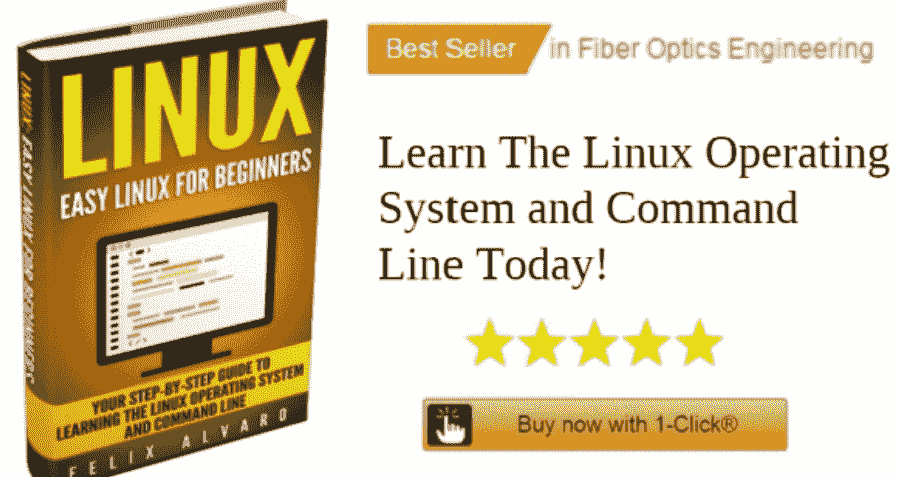

## 你将学习到以下内容：

- 什么是 Linux？


# Linux 与其它操作系统相比如何

# Linux 架构与发行版

# 在你的 PC 上安装 Linux

# 了解 Shell、你的桌面以及文件系统导航

# Linux 应用-办公、多媒体和图像

# 硬件管理与安装额外软件

# 使用 Linux 命令行

# 关重要的管理与安全

# 脚本入门

# 以及更多内容！

点击此处立即下载！或访问：`http://amzn.to/1QzQPKy`

## 功能分析与非营利组织类别销量第一畅书！

通过这本畅销的分步课程，学习如何将流量、潜在客户和客户引向你的网站：

> “SEO：易学搜索引擎优化：你通往高排名和源源不断流量的分步指南”


## 功能分析领域销量第一畅书

## 你今天就能为你的网站带来海量流量所需的所有知识！


以下是你将学习的内容预览：

- 什么是 SEO？它究竟是如何运作的？
- 搜索引擎是如何运行的
- 学习排名的第一步
- 关键词的重要性，以及如何使用免费工具进行适当的关键词研究和竞争分析
- 页面优化
- Header、Meta 和 Title 标签的使用
- 免费跟踪你的网站性能！
- 页面外优化和强大反链的使用
- 生成高质量反链并提升网站流量的 8 策略
- 为什么索引和站点地图至关重要
- 如何生成并提交站点地图
- 高质量内容的重要性
- 如何创建高质量、引入胜且独特的内容
- 以及更多！

[点击此处]()或访问：`http://amzn.to/21HFWWb` 立即下载

## 网页设计与计算机与技术类别销量第一畅书！

通过这本销量第一的书，学习如何使用非常流行的网页设计平台 WordPress 创建网站。

> “WORDPRESS：简易 WordPress 指南，从零开始分步创建极具吸引力的网站或博客”


你将获得以下技能：

- 为什么选择 WordPress 是正确的决定，以及它能提供什么
- 如何选择正确的域名，以及如何通过托管服务器让你的网站上线
- 如何轻松地将你选择的网址和托管服务器与 WordPress 同步
- 如何通过精美且免费的主题增添个性色彩！
- 如何为你的观众添加页面和令人惊叹的内容
- 如何通过插件（Plugins）为你的网站添加高级级功能
- 以及更多，更多更多！！

[点击此处立即购买！](http://amzn.to/1VHtxZi) 或访问此页面

## 商业保险类别销量第一畅书

学习如何建立一个盈利的在线业务——这是全球最流行的在线零售商之一。遵循这门分步课程，学习如何建立兼业甚至全职的收入。

> “eBay：发现你在 eBay 上销售所需的一切，并从零开始分步建立一个盈利的业务”


你将获得以下技能：

- 为什么现在是开始在线业务的最佳时机，以及为什么需要在 eBay 上销售
- 整个流程是如何运作的，以及你需要哪些步骤来正确地开设商店
- 如何知道哪些商品最有利可，以及在哪里找到你产品的最佳来源
- 如何有效地为你的业务品牌化和推广，以获得更多曝光和更高收入
- 如何创建一个高排名、吸睛且有利的商品列表？
- 以及更多！

[点击此处](http://amzn.to/1R1vnCP) 或访问 `http://amzn.to/1R1vnCP` 立即购买书籍！

## 现在进入赠送环节！！

正如承诺的那样，我将为你免费提供我热门课程“25 种网站流量方法”中的 5 段视频！


拥有一个漂亮且专业的网站很棒，但如果没有人访问又有意义何呢？

这就是创建这门课程的原因！

本课程将教你如何为你的网站引入大量的精准流量。

有些课程你可能已经熟悉了，但我确定你将从中获得一些金性的，带给你额外的动力。

要访问这门课程，请点击下方按钮或访问此链接！ >>`http://bit.ly/1PtpgK7`


最后，如果你有任何问题、反馈或只是想打个招呼，也可以给我发送电子邮件！（我会回复的！）我的邮箱地址是；(`Felix_Alvaro@mail.com`)

再次感谢你，愿上帝保佑你！

Felix Alvaro
