# JAVA 电子书

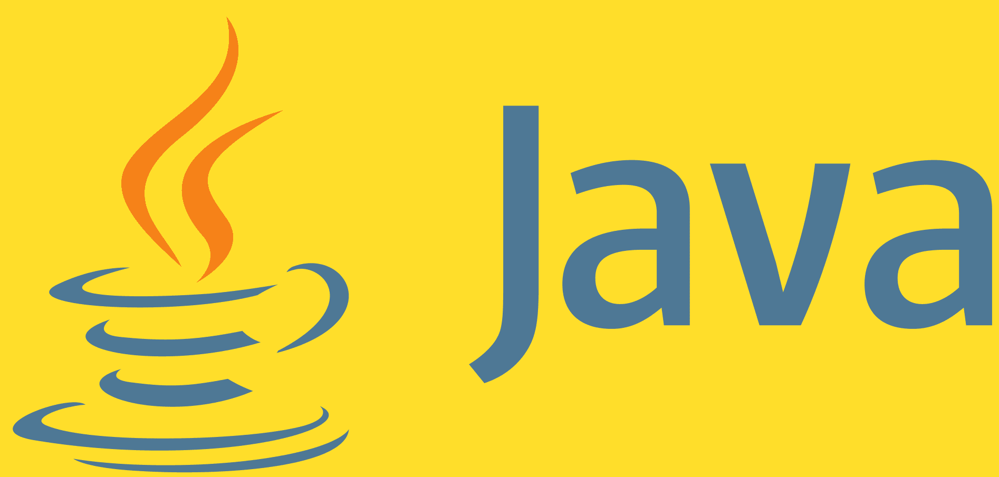

作者 @curious_.programmer


@curious_.programmer

## 关于此 PDF

《整洁代码》（Clean Code）是 Java 程序员的另一本经典。任何人都可以学习编程，但编写整洁的代码需要实践。当代码编写糟糕时，你会浪费无数的时间和大量的资源。这本 PDF 教你如何阅读代码，并挑战你去思考代码的正确之处。它分为三个部分——基础、类型和控制流。以及 AWT、Swing。

这本 PDF 包含了我们涵盖的“Java 初学者”全部内容。

- 如果你是 Java 完全初学者，这是 curious_programmer 编写的第一个值得投资的 PDF。
- 它涵盖了 Java 的所有基础。

## AWT 和 Swing 的区别

### 基础

Java 是一种强大的通用编程语言。它被用于开发桌面和移动应用程序、大数据处理、嵌入式系统等。根据 Java 的所有者 Oracle 公司的数据，Java 运行在全球 30 亿台设备上，这使得 Java 成为最流行的编程语言之一。

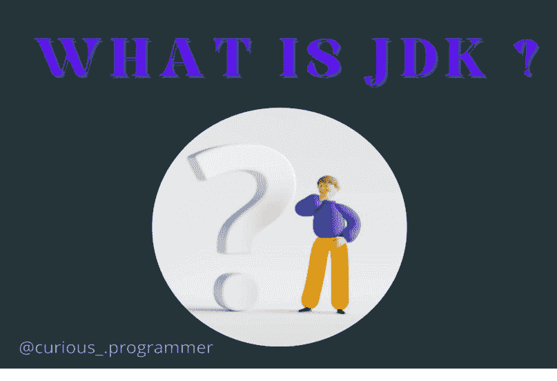

我们使用 `Java` 开发工具包 (`JDK`) 来构建 Java 应用程序。`JDK` 包含编译器、`Java` 运行环境 (`JRE`) 以及我们用于构建应用程序的类库。

我们有四个版本的 Java，分别用于构建不同类型的应用程序：

- **Java 标准版 (`SE`)**：`Java` 核心平台。它包含了每个 `Java` 开发者必须学习的所有库。
- **Java 企业级版 (`EE`)**：用于构建非常庞大的分布式系统。它在 `Java SE` 之上构建，并为构建容错的、分布式多层软件提供了额外的库。
- **Java 微型版 (`ME`)**：`Java SE` 的子集，为移动设备设计。
- **Java Card**：用于智能卡。

`Java` 编译器获取 `Java` 代码并将其编译为 `Java` 字节码格式。当我们运行 `Java` 应用程序时，`Java` 虚拟机 (`JVM`) 被加载到内存中。它将我们的字节码作为输入，并翻译成底层操作系统的原生代码。几乎所有的操作系统都有各种虚拟机的实现。

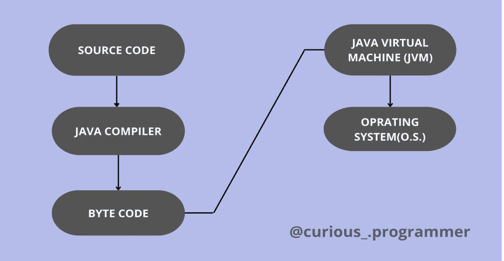

`Java` 程序中最小的构建单元是方法（其他编程语言中称为函数）。我们在类中组合相关的方法，在包中组合相关的类。`Java` 的这种模块化允许我们将大型程序拆分为更易理解和重用的较小构建单元。

1. `Java` 由 `James Gosling` 在 1995 年在 `Sun Microsystems` 公司（后被 `Oracle` 收购）开发。
2. 它最初被称为 `Oak`。后来被更名为 `Green`，最后受 `Java` 咖啡启发更名为 `Java`。
3. 全球有近 900 万 `Java` 开发者。
4. 大约有 30 亿部手机运行 `Java`，还有 1.25 亿电视和每台蓝光播放器。
5. 根据 `indeed.com` 的数据，美国 `Java` 开发者的平均薪资略高于 100,000 美元。

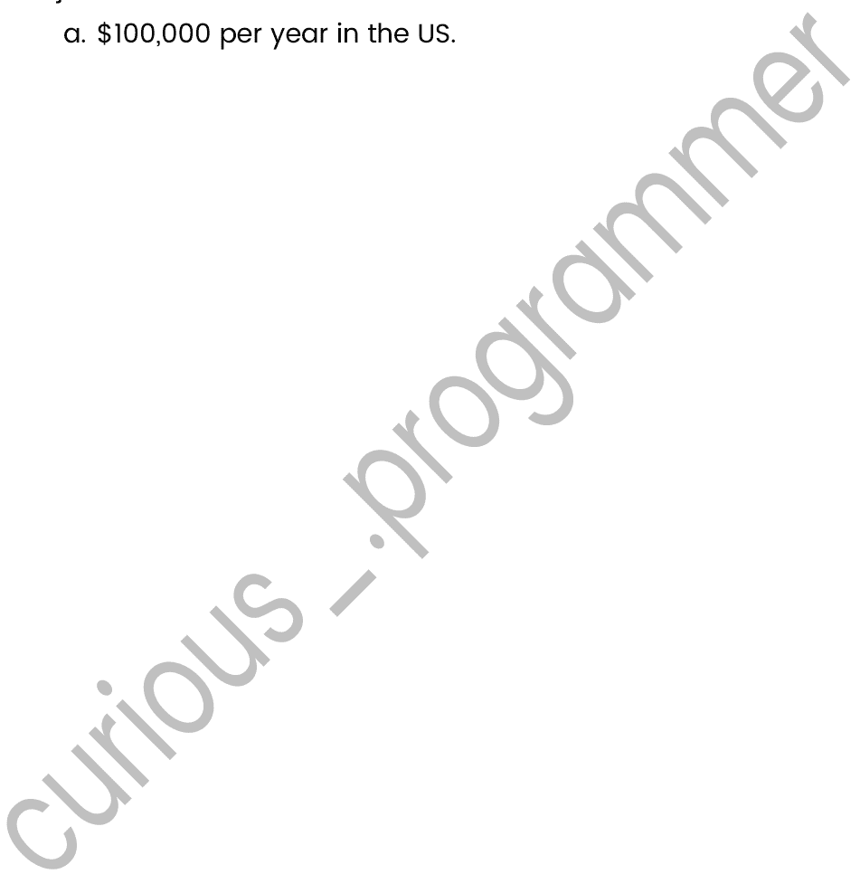

顾名思义，数据类型指定了 `Java` 中变量内部可以存储的数据类型。`Java` 是一种静态类型语言。这意味着所有变量在使用之前都必须声明。

变量是内存中的一个位置（存储区域），用于存放数据。为了指示该存储区域，每个变量都应该赋予一个唯一的名称（标识符）。

我们使用变量在计算机内存中临时存储数据。在 `Java` 中，变量的类型应该在声明时指定。

在 `Java` 中，我们有两种类型：

- **基本类型 (`Primitives`)**：用于存储数字、字符串和布尔值等简单值。
- **引用类型 (`Reference Types`)**：用于存储电子邮件消息等复杂对象。

### 基本类型

基本数据类型指定了变量值的大小和类型，并且没有额外的方法。`Java` 中有 8 种基本类型。

| 类型 | 字节 | 范围 |
|---|---|---|
| `byte` | 1 | [-128, 127] |
| `short` | 2 | [-32K, 32K] |
| `int` | 4 | [-2B, 2B] |
| `long` | 8 | |
| `float` | 4 | |
| `double` | 8 | |
| `char` | 2 | A, B, C, ... |
| `boolean` | 1 | true / false |

```java
//@curious_.programmer
byte age = 30;
long viewsCount = 3_123_456L;
float price = 10.99F;
char letter = 'A';
boolean isEligible = true;
```

- 在 `Java` 中，我们用分号结束语句。
- 我们用单引号包裹字符，用双引号包裹字符串（一系列字符）。
- `Java` 默认的整数类型是 `int`。为了表示一个 `long` 值，我们应该在末尾添加 `L` 作为后缀。
- `Java` 默认的浮点类型是 `double`。为了表示一个 `float`，我们应该在末尾添加 `F` 作为后缀。

我们使用注释来给代码添加备注。`Java` 中常用有两种类型的注释。

- 单行注释：
- 多行注释：

```java
// 单行注释 - 这是一个注释，它不会执行。

/* 多行注释 - 这是一个注释，它不会执行。
   @curious_,programmer
   这是一个注释，它不会执行。
*/
```

在 `Java` 中我们有 8 种原始类型。所有其他类型都是引用类型。这些类型并不在内存中存储实际的对象。它们存储的是内存中对象的引用（或地址）。

要使用引用类型，我们需要使用 `new` 运算符分配内存。当内存不再被使用时，它会自动释放。

```java
Date now = new Date();
```

在 `Java` 中，字符串是字符序列。例如，“hello”是一个包含字符 'h'、'e'、'l' 和 'o' 序列的字符串。我们在 `Java` 中使用双引号来表示字符串。

字符串是引用类型，但我们不需要为它们分配内存。由于我们频繁使用，可以像声明原始类型一样声明字符串变量。

```java
//Curious_programmer
class Main {
    public static void main(String[] args) {

        // 创建字符串
        String first = "Java";
        String second = "Python";
        String third = "JavaScript";

        // 打印字符串
        System.out.println(first); // 打印 Java
        System.out.println(second); // 打印 Python
        System.out.println(third); // 打印 JavaScript
    }
}
```

```bash
java -cp /tmp/zpNjEpowW Main
Java
Python
JavaScript
```

`Java` 中的 `String` 类提供了许多实用方法：

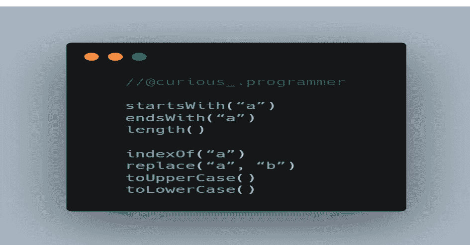

字符串是不可变的，这意味着一旦初始化了它们，它们值就无法改变。所有修改字符串的方法（如转为大写）都会返回一个新的字符串对象。原始字符串不受影响。

如果你需要在字符串中使用反斜杠或双引号，需要在它们前面加一个反斜杠。这被称为转义。

常见的转义序列：

- `\'`
- `\n` (换行)
- `\t` (制表符)

数组是相同类型类型数据的集合。

例如，如果我们想存储 100 个人的名字，那么我们可以创建一个 `String` 类型的数组，它可以存储 100 个名字。

```java
String [] array = new String[100];
```

在这里，上面的数组不能存储超过 100 个名字。`Java` 数组中的值数量始终是固定的。

我们使用数组来存储对象列表。我们可以在数组中存储任何类型的对象（原始类型或引用类型）。数组中的所有项（也称为元素）具有相同的类型。

`Java` 数组具有固定长度（大小）。一旦实例化了数组，你就无法添加或删除新项。如果你需要添加新项或删除现有项，则需要使用集合类之一。

```java
//@curious_.programmer
int[] numbers = new int[5];
numbers[0] = 10;
numbers[1] = 20;
numbers[2] = 30;
numbers[3] = 40;
numbers[4] = 50;

// 快捷方式
int[] numbers = { 10, 20, 30, 40, 50 };
```

```java
//Curious.Programmer
class Testarray{
    public static void main(String[] args){
        int a[]=new int[5];//声明和实例化
        a[0]=10;//初始化
        a[1]=20;
        a[2]=30;
        a[3]=40;
        a[4]=50;

        for(int i=0; i<a.length; i++){
            System.out.println(a[i]);
        }
    }
}
```

```java
// 隐式类型转换是因为我们尝试将一个 short
// 值（2 字节）存储在 int（4 字节）中。
```

```java
short x = 1;
int y = x;
```

// 强制类型转换

```java
int x = 1;
short y = (short) x;
```

在 `Java` 中，我们可以使用 `Integer.parseInt()` 方法将 `String` 转换为 `int`。要将 `String` 转换为 `Integer`，可以使用 `Integer.valueOf()` 方法，它返回 `Integer` 类的实例。

要将字符串转换为数字，我们使用以下方法之一。

```java
//@curious_programmer
Byte.parseByte("1")
Short.parseShort("1")
Integer.parseInt("1")
Long.parseLong("1")
Float.parseFloat("1.1")
Double.parseDouble("1.1")
```

```java
//Curious.Programmer
class Main {
    public static void main(String[] args) {
        // 创建 int 类型变量
        int num = 10;
        System.out.println("The integer value: " + num);

        // 转换为 double 类型
        double data = num;
        System.out.println("The double value: " + data);
    }
}
```

```bash
java -cp /tmp/N6a2EZhlb5 Main
The integer value: 10
The double value: 10.0
```

```java
// @curious._programmer
NumberFormat currency = NumberFormat.getCurrencyInstance();
String result = currency.format("123456"); // $123,456

NumberFormat percent = NumberFormat.getPercentInstance();
String result = percent.format(0.04); // 4%
```

`Scanner` 类允许用户从控制台获取输入。它属于 `java.util` 包。它被用于读取原始类型的输入，如 `int`, `double`, `long`, `short`, `float` 和 `byte`。它是 `Java` 程序中读取输入简单的方法。

```java
// @curious._programmer
Scanner scanner = new Scanner(System.in);
double number = scanner.nextDouble();
byte number = scanner.nextByte();
String name = scanner.next();
String line = scanner.nextLine();
```

在编程中，我们使用 `if..else` 语句在多个备选项中运行一个代码块。

例如，根据学生获得的百分比分配等级（A, B, C）。

- 如果百分比高于 90，分配等级 A
- 如果百分比高于 75，分配等级 B
- 如果百分比高于 65，分配等级 C

这里是 `if` 语句的基础结构。如果你想执行多个语句，需要将它们封装在大括号中。

```java
//@curious._programmer
if (condition1)
    statement1;
else if (condition2)
    statement2;
else if (condition3)
    statement3;
else
    statement4;
```

```java
//Curious.Programmer
class Main {
    public static void main(String[] args) {
        int number = 0;
        // 检查 number 是否大于 0
        if (number > 0) {
            System.out.println("The number is positive.");
        }
        // 检查 number 是否小于 0
        else if (number < 0) {
            System.out.println("The number is negative.");
        }
        // 如果两个条件都为假
        else {
            System.out.println("The number is 0.");
        }
    }
}
```

```bash
java -cp /tmp/Ve0tGnR48a Main
The number is 0.
```

我们使用 `switch` 语句根据变量的值来执行代码的不同部分。

在每个 `case` 子句之后，我们使用 `break` 语句跳出 `switch` 块。

`switch` 语句允许我们在许多备选项中执行一个代码块。

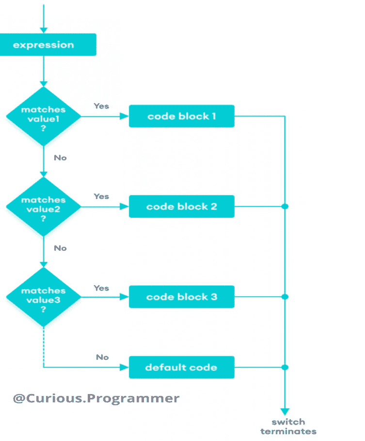

```java
// @curious._programmer
switch (x) { 
    case 1:
      break;
    case 2:
      break;
    default:
}
```

表达式被求值一次并与每个 `case` 的值进行比较。

- 如果表达式匹配 `value1`，则执行 `case value1` 的代码。同样，如果表达式匹配 `value2`，则执行 `case value2` 的代码。
- 如果没有，则执行 `default` 情况的代码。

```bash
java -cp /tmp/iU6AUtxgna Main
Size: Large
```

当我们提前知道想要重复某些内容的次数时，`for` 循环非常有用。我们声明一个循环变量（或循环计数器），并在每次迭代中对其进行增加，直到达到想要执行某些代码的次数。

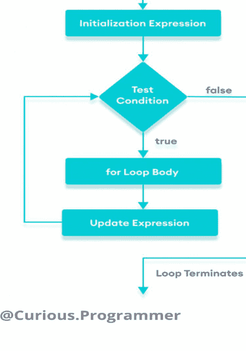

```java
//@curious._programmer
for (int i = 0; i < 5; i++) {
    statement;
}
```

在这里，初始表达式（`Expression`）初始化变量并只执行一次。计算条件。如果条件为真，则执行 `for` 循环的主体。更新表达式（`Expression`）更新初始表达式的值。再次计算条件，直到条件为假。

```java
//Curious.Programmer
class Main {
    public static void main(String[] args) {
        int n = 5;
        // for 循环
        for (int i = 1; i <= n; i++) {
            System.out.println("Java is fun");
        }
    }
}
```

```bash
java -cp /tmp/YkAx Main
Java is fun
Java is fun
Java is fun
```

当我们提前不知道想要重复某些内容的次数时，`while` 循环非常有用。这可能取决于运行时的值（例如用户输入的内容）。我们使用 `break` 语句跳出循环。

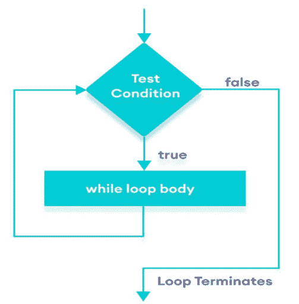


```java
// @curious._programmer
while (someCondition) {
    ...
} (someCondition)
```

```java
// @curious._programmer
while (someCondition) {
    ...
}
```

```java
// @curious._programmer
while (someCondition) {
    ...
}
```

```java
// @curious._programmer
while (someCondition) {
    ...
}
```

```java
// @curious._programmer
while (someCondition) {
    ...
}
```

```java
// @curious._programmer
while (someCondition) {
    ...
}
```

```java
// @curious._programmer
while (someCondition) {
    ...
}
```

```java
// @curious._programmer
while (someCondition) {
    ...
}
```

```java
// @curious._programmer
while (someCondition) {
    ...
}
```

```java
// @curious._programmer
while (someCondition) {
    ...
}
```

```java
// @curious._programmer
while (someCondition) {
    ...
}
```

```java
// @curious._programmer
while (someCondition) {
    ...
}
```

```java
// @curious._programmer
while (someCondition) {
    ...
}
```

```java
// @curious._programmer
while (someCondition) {
    ...
}
```

```java
// @curious._programmer
while (someCondition) {
    ...
}
```

```java
// @curious._programmer
while (someCondition) {
    ...
}
```

```java
// @curious._programmer
while (someCondition) {
    ...
}
```

```java
// @curious._programmer
while (someCondition) {
    ...
}
```

```java
// @curious._programmer
while (someCondition) {
    ...
}
```

```java
// @curious._programmer
while (someCondition) {
    ...
}
```

```java
// @curious._programmer
while (someCondition) {
    ...
}
```

```java
// @curious._programmer
while (someCondition) {
    ...
}
```

```java
// @curious._programmer
while (someCondition) {
    ...
}
```

```java
// @curious._programmer
while (someCondition) {
    ...
}
```

```java
// @curious._programmer
while (someCondition) {
    ...
}
```

```java
// @curious._programmer
while (someCondition) {
    ...
}
```

```java
// @curious._programmer
while (someCondition) {
    ...
}
```

```java
// @curious._programmer
while (someCondition) {
    ...
}
```

```java
// @curious._programmer
while (someCondition) {
    ...
}
```

```java
// @curious._programmer
while (someCondition) {
    ...
}
```

```java
// @curious._programmer
while (someCondition) {
    ...
}
```

```java
// @curious._programmer
while (someCondition) {
    ...
}
```

```java
// @curious._programmer
while (someCondition) {
    ...
}
```

```java
i = 1, n = 5;

do {

    System.out.println(i);

    i++;

} while (i <= n);

}
```

```bash
java -cp /tmp/Bn
1
2
3
4
5
```

在 Java 中，`for-each` 循环用于遍历数组和集合（如 `ArrayList`），它也被称为增强循环。

For-each 循环对于遍历数组或集合非常有用。

```java
//@curious._programmer
int[] numbers = {1, 2, 3, 4};
for (int number : numbers) {
    ...
}
```

```java
//Curious.Programmer
class Main {
    public static void main(String[] args) {
        char[] vowels = {'a', 'e', 'i', 'o', 'u'};
        // 使用 for-each 循环遍历数组
        for (char item: vowels) {
            System.out.println(item);
        }
    }
}
```

```bash
java -cp /tmp/c6 Main
a
e
i
o
u
```

Java AWT（抽象窗口工具）是一种用于开发图形用户界面（GUI）或窗口应用程序的 API。

Java AWT 组件是取决于平台的，即组件根据操作系统的视图进行显示。AWT 是重量级的，即其组件使用底层操作系统的资源。

`java.awt` 包提供了 AWT API 的类，如 `TextField`、`Label`、`TextArea`、`RadioButton`、`CheckBox`、`Choice` 和 `List` 等。

所有的元素都称为组件。在 Java AWT 中，每个组件都有对应的类。

为了在屏幕的特定位置放置每个组件，我们需要将其添加到容器中。

容器是 AWT 中的一种组件，它可以包含其他组件，如按钮、文本框、标签等。扩展 `Container` 类的类被称为容器，如 `Frame`、`Dialog` 和 `Panel`。

它基本上是一个放置组件在特定位置的屏幕。因此，它包含并控制组件的布局。

- Window（窗口）
- Panel（面板）
- Frame（帧）
- Dialog（对话框）

考虑以下简单的 Java AWT 示例，其中我们通过设置其位置和窗口大小，展示了一个 AWT 组件按钮。

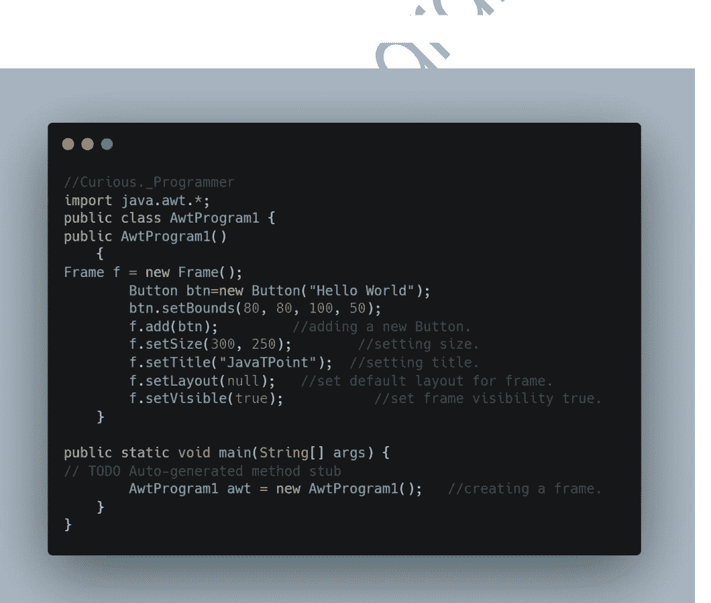

```java
//Curious_Programmer
import java.awt.*;

public class AwtProgram1 {
    public AwtProgram1() {
        Frame f = new Frame();
        Button btn = new Button("Hello World");
        btn.setBounds(80, 80, 100, 50);
        f.add(btn); //adding a New Button.
        f.setSize(300, 250); //setting size.
        f.setTitle("JavaPoint"); //setting title.
        f.setLayout(null); //set default layout for frame.
        f.setVisible(true); //set frame visibility.
    }

    public static void main(String[] args) {
        //TODO Auto-generated method stub
        AwtProgram1 awt = new AwtProgram1(); //creating a frame.
    }
}
```

输出：

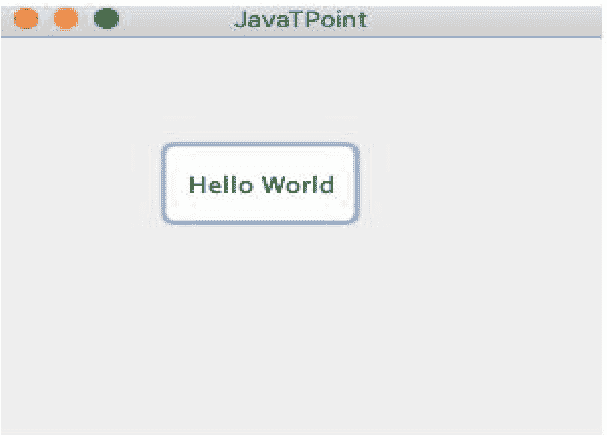

### AWT 和 Swing 的区别

| AWT | SWING |
| --- | --- |
| 依赖平台 | 平台无关 |
| 不遵循 MVC 模式 | 遵循 MVC 模式 |
| 组件较少 | 组件更强大 |
| 不支持可插拔的外观（pluggable look and feel） | 支持可插拔的外观 |
| 重量级 | 轻量级组件 |

### Java Swing

Java Swing 是 Java 基础类（JFC）的一部分，用于创建基于窗口应用程序。它构建在 AWT（抽象窗口工具包）API 之上并完全用 Java 编写。

`javax.swing` 包提供了 Java Swing API 的类，如 `JButton`、`JTextField`、`JTextArea`、`JRadioButton`、`JCheckbox`、`JMenu`、`JColorChooser` 等。

一个简单的 Swing 示例，我们在 `main()` 方法中创建了一个按钮并将其添加到 `JFrame` 对象中。

```java
//Curious_.Programmer
import javax.swing.*;

public class FirstSwingExample {
    public static void main(String[] args) {
        JFrame f = new JFrame(); //creating instance of JFrame
        JButton b = new JButton("click"); //creating Instance of JButton
        f.add(b); //adding button in JFrame
        f.setSize(400, 500); //width and 500 height
        f.setLayout(null); //using no layout managers
        f.setVisible(true); //making the frame visible
    }
}
```

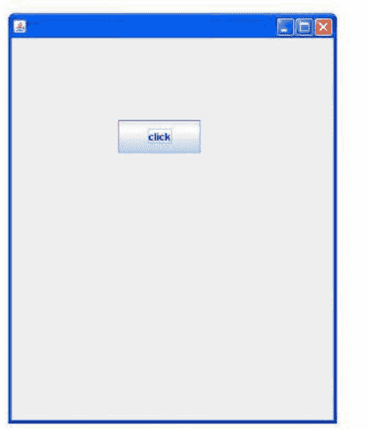
