# Java EE 7：全景指南


# 关于作者

Danny Coward 博士是 Oracle 公司的首席架构师。Coward 曾参与过从 Java ME 到 Java EE 的所有版本 Java 平台的贡献工作，并且他创立了 JavaFX 项目。作为太阳微系统公司（Sun Microsystems）首个 Java EE 平台团队的成员，他领导了多个版本 Java Servlet API 的定义，最近领导了用于 Java EE 7 的 Java WebSocket API 的定义。他曾担任 Java 社区进程（JCP）的执行成员多年，指导专家小组的演进，这些专家小组与大量公司和行业组织的开发者合作为 Java 平台创建新的 API。Coward 博士拥有牛津大学的数论博士学位。

# 关于技术编辑

John Year 是 Infor Global Solutions Epiphany CRM 营销部门首席软件工程师。John 是一位 Java 传道者，自1995年以来一直致力于 Java。他是一位专注于 Java 企业版技术、NetBeans 和 GlassFish 的技术博客作者。John 目前是 Greenville 用户组（GreenUJ）的创始人兼主席。他还是一位讲师、导师以及丰富的开源资源贡献者。

John 毕业于缅因海事学院，获得海洋工程学士学位，主修方向为数学。他是一名海商船员，拥有多种执照和认证。在不从事 Java 和 F/OSS 项目时，他喜欢徒步、航海、旅行以及与家人共度。John 还是美国童子军（BSA）833 队的童军团长（Cubmaster）、地区委员以及 BSA 蓝岭理事会（Blue Ridge Council）活动与公民服务南部区主席。


本书献给 David, Olive, Matthew, Bill, Jared 和 Alex。

本页留白。

## 引言

## Java EE 架构

## Hello Java EE

### 运行 Hello Java EE

### 深入 Hello Java EE 内部

## 认识 Java EE 主要元素

### Java EE 应用的多种变

### Web 界面的多种风格

### 应用程序逻辑的多种类型

### 存储应用程序数据的不同方式

### 与其他系统的交互

### 模块化

### 保护 Java EE 应用的方法

### 打包与部署 Hello Java EE 应用

## Java EE 平台与实现

## 本书后续指南

# 第一部分：Java EE 的传声筒：Web 层

## 2 Java Servlets 与 Web 应用：Web 层的基础

### HTTP 协议

### 深入 HTTP 协议内部

### 介绍 Java Servlets

#### Java Servlet 的作用

#### 如何创建 Java Servlet

#### 将 Java Servlet 发布到 Web 容器

### 示例 Java Servlet 应用：照片应用程序

## Java EE 7: 概览

### 理解 Java Servlet API

#### `javax.servlet.http.HttpServlet` 类

#### Java Servlet 的实例数量

#### `ServletContext`

#### `HttpSession`

#### `RequestDispatcher`

### Web 应用

### Java Servlets 的部署信息

#### Servlet 路径映射

### Java Servlets：优与劣

### 总结

## 3 动态网页：JSP

### JSP 运行时架构

### 一个 JSP 时钟

### JSP 语法

#### JSP 指令

### 在 JSP 中使用 Java Beans

### JSP 的 Java 环境

### JSP 标准标签

### 自定义标签库

### 标签库对比 JavaBeans

### 表达式语言

### JSP 相册

### 总结

## 4 组装动态网页：JavaServer Faces

### JSP 应用的架构

### 模型-视图-控制器 (MVC)

### Hello JavaServer Faces

### JavaServer Faces：模型-视图-控制器

### JavaServer Faces

#### UI 组件标签

### 派对策划师 (PartyPlanner)

### Java EE 管理 Beans

#### `RequestScoped`

#### `SessionScoped`


# Java EE 7: 概览

## 目录

- ApplicationScoped
- ConversationScoped
- FlowScoped
- ViewScoped
- Dependent
- 5 核心标签
  - 数据验证
  - 事件处理
  - 转换器
- JSTL 核心标签
- 扩展性与模块化
- 照片应用程序
- 总结
- 非浏览器的网站站点：JAX-RS
  - 什么是 RESTful 服务
  - 使用 URI 空间定位服务资源
  - 使用 HTTP 方法进行操作
  - RESTful 服务是无状态的
  - 使用常见格式处理结构化数据
  - RESTful 服务的 Java API
  - HelloResource 示例：服务端
  - 部署 JAX-RS 资源
  - HelloResource 示例与丰富的客户端
  - 内容产生
  - 扩展响应产生
  - @Produces
  - 内容消费
  - @Consumes
  - 访问服务上下文
  - 异常映射
  - 资源类的实例数量
  - 路径映射
  - 相对 URI
  - URI 模板
  - 库服务
  - 总结
- 增添色彩：Java WebSockets
  - WebSocket 协议简介
  - WebSocket 生命周期
  - Java WebSocket API 概览
  - WebSocket 注解
  - Java WebSocket API 类
  - WebSocket 时钟
  - 有多少个 WebSocket 实例？
  - Java WebSocket 编码器与解码器
  - 消息处理模式
  - 接收大型消息
  - 发送消息的模式
  - 异步发送消息
  - 路径映射
  - 运行时访问路径信息
  - 查询字符串与请求参数
  - 服务器端点的部署
  - 聊天应用
  - 总结

## 7 Web 应用程序的安全

- 安全概念
- Java EE 容器安全
- 声明式安全模型
- 程序化安全
- 照片应用程序示例
- 总结

## 8 自包含式网站：Java EE Web 应用程序

- WAR 文件
- Web 应用程序的 URI 空间
- 静态内容
- JavaFaces
- Java Servlets
- JavaScript
- JAX-RS 资源与 Java WebSockets
- 总结：Web 组件及其 URI 路径
- 全局 Web 组件：Web 过滤器与 Web 监听器
  - Web 过滤器
  - Web 监听器
- Web 应用程序中的异步模式
  - 异步 Java Servlets
  - 异步 Web 资源

# 第二部分：Java EE 的大脑：中间层

## 9 企业级 Bean (Enterprise Beans) 基础

- 企业级 Bean 简介
- RMI/IIOP
- HTTP
- JMS 协议
- 本地 Java 方法调用
- 企业级 Bean 的类型


# 企业级 Bean 的高级思考

- 多线程与企业级 Bean
- 多线程与单例 Bean
- 线程限制
- 异步企业级 Bean
- 异步示例
- 企业级 Bean 上下文
- 定时器服务
- 定时器语言
- 运行时的定时器
- 事务与企业级 Bean
- 程序化事务
- 注解器
- 拦截器
- 拦截器示例
- 总结

# 第三部分

# 数据层：JDBC

## 11 经典 JDBC

- JDBC 简介
- JDBC 示例
- SQL 语言
- 结构化查询
- 从表中存储或检索数据
- JDBC API
- 数据源对象
- 连接对象
- 语句对象
- 结果集
- 使用 JDBC 的应用程序
- 总结

## 12 现代持久化：Java 持久化 (JPA)

- JPA 简介
- 持久化服务
- 持久化实体
- 可嵌入类
- 实体关系
- 持久化状态
- 级联实体关系
- 实体管理器
- 持久化语言
- 配置持久化应用程序
- 持久化服务库
- 总结

# 第四部分

# Java EE 工具箱：Java EE 环境

## 13 再次概览：Java EE 应用程序

- Java EE 应用程序
- Web 应用程序 WARs
- 企业级 Bean JARs
- 应用程序客户端 JARs
- 资源适配器存档
- Java EE 模块
- 应用程序客户端
- 企业级存档：EAR 文件
- Java EE 的可注入与命名对象
- JNDI 命名空间
- 简单环境项
- 企业级 Bean 引用
- 数据源
- Java 持久化对象：`EntityManager`, `EntityManagerFactory`
- 其他命名与可注入对象


# 目录

- 注入在哪里生效？ .................................................................................... 394
- 总结 ................................................................................................................ 395

## 14 解构组件：Java EE 上下文与依赖注入 .................... 397

- CDI 简介 ................................................................................................ 398
- 金发姑娘与三只熊 ................................................................................ 399
- CDI Bean ........................................................................................................ 404
- 示例 ............................................................................................................ 404
- 限定符 ...................................................................................................... 405
- `@Default` ................................................................................................................. 405
- `@Named` ............................................................................................................ 406
- 注入点 ..................................................................................... 406
- CDI Bean 的生命周期 ................................................................................ 407
  - `@PostConstruct` ................................................................................................... 407
  - `@PreDestroy` 和 `@Disposes` ................................................................ 407
- Java EE 范围 ....................................................................................................... 409
  - 范围示例 ........................................................................................ 410
  - 事件 ................................................................................................................ 413
  - 金发女孩法则观察 ................................................................................ 414
  - 拦截器 ............................................................................................... 419
  - 打包 CDI Beans ................................................................................ 421
  - CDI Chat ............................................................................................................ 421
  - 总结 ............................................................................................................ 428

## 15 Java EE 安全 ............................................................ 429

- 企业级 Bean 安全 ................................................................... 430
- 声明式安全 ............................................................................ 431
- 声明式安全示例 ............................................................................ 433
- 程序化安全 ........................................................................ 436
- 应用程序客户端认证 ................................................... 437
- 安全身份传递 ........................................................ 440
- 带端到端安全的库示例 ................................ 441
- 总结 ............................................................................................................ 449

## 16 众人拾山舟：Java EE 并发 ........................ 451

- 任务与执行器 ................................................................................... 453
- 并发质数计算器 ................................................................ 455
- 运行并发质数计算器 ........................................ 455
- 并发质数计算器示例的架构 ........... 456
- 代码分析 ........................................................................................... 457
- Java EE 并发 API ................................................................... 460
- `ManagedExecutorService` 和 `ManagedScheduledExecutorService` ... 460
- 获取 `ManagedExecutorService` 实例 ................... 461
- 识别并监控并发任务 ................................ 462
- `ManagedThreadFactory` ................................................................ 463
- 监控的质数计算器示例 ............................................... 464
- 运行监控的质数计算器 ........................................ 464
- 监控的质数计算器的架构 ........................ 465
- 总结 ............................................................................................................ 471

# 引言

1998年，作为 Sun Microsystems 的名新员工，我发现自己成了一个名为“企业 Java 组”的初创团队的成员。那是 Java 技术受到关注的黄金时代：API 正以惊人的速度为 Java 创建。即使是为 Java 创建新 API 的消息在计算新闻媒体中也是头条新闻，仿佛在计算世界里，每一个想法、结构和程序被转化为 Java 技术只是早晚的问题。理想情况下，每项技术的名称前面都有一个“J”，仿佛它们都是一群紧跟在吞噬编程世界的浪潮之上的冲浪者中的。无论这在业务上是否有意义，开发者们都声称他们将把用枯燥、企业化、不可发布的语言编写的程序转换为 Java，仿佛只要通过这样做，他们就会自动变得更好。

带着我的 Java Ring（这是一种拥有 6KB RAM 和一个带有至关重要的咖啡杯标志的 JVM 的早期可穿戴计算机），我很快发现我将要开发一个运行企业级 JavaBeans (EJB) 的软件。当时，这被认为是对 JavaBeans 组件模型的某种服务端解决方案，旨在作为 IDE 中的嵌入式 GUI 组件。

# Java EE：全景

当提议将那些技术（即企业 JavaBeans 和 Java Servlet）整合到一个平台时，足以说明，考虑到当时企业开发者和 Web 开发者的观点，在位于库比的 SunSoft 到硅谷心脏的会议室和走廊里，充满了许多词汇（其中许多非常激烈）。但事实是，我们的小组在了一年半的努力后，于 1999 年 12 月在纽约发布了 EE 平台的 1.0 版本。

自那时发布以来，该平台已成为企业世界服务端开发的基石，被 IBM 和 Oracle 等行业巨头采用和推广。我个人对平台的贡献一直持续到发布之后，通过领导各个 Java 规范的版本，直到最近定义了最新版本平台的新的 WebSocket API。在过去的 15 年里，EE 平台增加了大量功能，并适应了不断变化的标准和技术，有些我参与了，有些我没有。

这意味着，如今 EE 平台作为一个计算平台比 15 年前更有价值、更有用。它也承载了一个随着开发者使用而演变的平台重量。这意味着在平台中解决问题通常有多种方法，而且平台中的某些功能区域受到了超级框架的监管，允许开发者工作得更好、更轻松。

部分是因为这种遗产，部分是因为其包含的海量功能，首次接触 EE 平台可能是一个令人敬畏的前景。我写这本书的原因是，我想创建一个能够穿透平台复杂性（及其所有无数的功能和控制）的内容，通过对我提供的每个功能进行直接的详尽调查。在阅读本书时，你将理解平台的关键组件模型和 API，并获得足够的背景知识和鼓励去探索更专业、不常用的功能。

使用了每个组件和 API 的各个方面。我在章节中选择了简单明了的示例代码，既说明了如何使用该平台的特定功能，也指出了这些功能旨在用于真实应用类型。我还选择了一些示例应用程序，书中将一一章地回到这些示例，以通过已知的应用说明 API 或组件模型技术如何自然地适应以改进或添加应用程序的功能。

## 第 1 章：概览

本引言章节直接介绍了一个简单的端到端 EE 应用，它从 Web 层通过企业豆（Enterprise Bean）和数据层运行，从而以概览的形式介绍了 Java EE 平台。

之后，本书分为四个部分。

# 第一部分：Java EE 的传声筒：Web 层

这一部分涵盖了 Java EE 平台中的 Web 技术。

## 第 2 章：Java Servlets 与 Web 应用：Web 层的基础

在这里，我们介绍了 Java Servlet 组件模型和 API。这一章既探索了如何创建 Java Servlet 应用，也介绍了 Java EE 平台中其他技术使用的 Web 容器的基本思想和对象。

## 第 3 章：动态网页：JSP

第 3 章探索了 JavaServer Pages (JSPs)，从将 JSP 视为“内向外” servlet 的想法开始，检查了标签库和 JSP 表达式语言，并将第 2 章中遇到的应用程序转换为 JSP 应用。

## 第 4 章：组装动态网页：JavaFaces

在这一章中，我们查看 JavaFaces，它构建在 servlet 和 JSP 模型的许多思想和机制之上，提供了一种快速创建模块化 Web 应用的语法，并在应用逻辑与表现代码之间实现了高度分离。

## 第 5 章：面向非浏览器的网站：JAX-RS

JAX-RS 章专注于 RESTful Web 服务 API，探索了 Java EE 平台中用于将 Web 应用数据和逻辑暴露给非浏览器客户端（如富客户端和其他 Web 应用程序）的首要技术。

## 第 6 章：增添光彩：Java WebSockets

Java EE Web 层最近添加的特性之一是 Java WebSocket API，它在 Java EE 7 版本中引入。第 6 章详细介绍了如何创建 Java WebSocket 端点，允许 Web 应用根据意愿随时将应用数据推送给感兴趣的浏览器和非浏览器客户端。

## 第 7 章：Web 应用的安全

本章详细介绍了 Java EE 用于保护 Web 应用的机制，使用内置的声明式模型以及 Web 容器中的编程 API 来控制对 Web 组件和资源的访问。

## 第 8 章：自包含网站：Java EE Web 应用

在这里，我们查看 Web 应用是如何打包的，并介绍 Web 应用的一些高级特性，如 servlet 过滤器（filters）、Web 监听器和异步 servlet 执行。

# 第二部分：Java EE 的大脑：中间层

本书的第二部分涵盖了企业豆（Enterprise Beans），它是 Java EE 平台中间层的核心组件和容器模型。

## 第 9 章：企业豆的基础

在第 9 章中，我们查看了企业豆模型最重要的特性；不同类型的企业豆；它们的生命周期以及它们是如何被打包、发布和加载的。

## 第 10 章：企业豆的高级思考

在企业豆的基础上，在第 10 章中，我们探索了该模型的更多特性，如并发、事务和定时服务（Timer Service）。

# 第三部分：集体记忆：信息层

在第三部分中，本书转向 Java EE 平台的数据层，该层存储了 Java 应用使用和存储的所有重要数据。

## 第 11 章：经典记忆：JDBC

从 Java 数据库连接（JDBC）API 开始，第 11 章查看了如何在关系型数据库中存储和检索 Java 应用数据，以及如何最好管理此类操作所需的 SQL 代码。

## 第 12 章：现代记忆：Java Persistence API

第 12 章查看了 Java Persistence API（JPA）提供的更精简的方法。我提供了两种 Java EE 平台与关系数据交互的模式，因为 JDBC 已经成熟且 SQL 是一种相对已知且易懂的语言，而 Java Persistence API 是更现代、简单的方法。

# 第四部分：Java EE 工具箱：Java EE 环境

在本书的最后一部分，我们查看了 Java EE 平台的某些可以跨越一个甚至所有层面的方面。

## 第 13 章：重温概览：Java EE 应用

第 13 章查看了 Java EE 应用的整体架构：其打包格式。在简要介绍 Java EE 应用客户端后，本章还查看了 Java EE 应用组件可用的已知对象和服务。

## 第 14 章：解构组件：Java EE 上下文与依赖注入

在第 14 章中，我们查看了强大的上下文和依赖注入（CDI）框架，它提供了各种技术，将 Java 应用模块化为更具重用性的组件，称为 CDI bean。

## 第 15 章：Java EE 安全

我们在第 15 章中回到安全主题，查看如何保护 Java EE 应用的企业豆层，以及第 7 章介绍的豆层和 Web 层安全模型之间是如何相互关联的。

## 第 16 章：人多力量：Java EE 并发

最后，在第 16 章中，我们查看了 Java EE 平台另一个非常最近的添加：Java 并发 API。专注于该 API 如何支持大型的并行执行，

# 第 1 章：全览

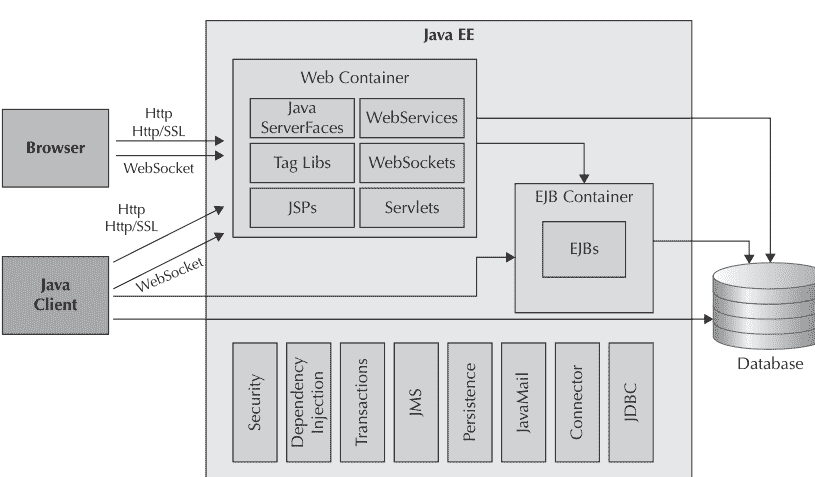

图 1-1. Java EE 平台架构


# Java EE 平台概览

Java EE 平台支持许多协议，客户端可以使用它们与运行中的 Java EE 应用程序进行交互。主要的客户端类型是浏览器客户端，它使用 HTTP 和 WebSockets 等标准网络协议连接到 Java EE 应用程序。许多 Java EE 应用程序拥有非 Java 客户端，例如 Java 桌面应用程序，或者运行在不同应用程序服务器上的另一个 Java EE 应用程序。这种类型的客户端既可以使用标准网络协议连接到位于 Java EE 服务器上的 Java EE 应用程序，也可以使用基于 TCP 的协议，如远程方法调用（RMI）。

图的最后部分是包含在 Java EE 容器框内的组件。这些组件代表了 Java EE 应用程序可以选择使用的各种服务。

- **安全服务** 允许 Java 应用程序将其功能限制为特定的用户组。
- **依赖注入服务** 允许 Java EE 应用程序委托其核心组件的生命周期管理和发现。
- **事务服务** 允许 Java EE 应用程序定义一组方法，这些方法以某种方式修改应用程序数据，使得所有方法必须一起完成，否则整个执行过程将回滚，仿佛什么都没有发生过一样。
- **Java 消息服务 (JMS)** 让 Java EE 应用程序能够可靠地向 Java EE 应用程序服务器部署环境中的其他服务器发送消息。
- **持久化服务** 允许以 Java 对象形式存在的应用程序数据与其关系型数据库表中的等效形式进行同步。
- **JavaMail 服务** 允许 Java 应用程序发送电子邮件，这对于那些由用户发起并代表用户执行某些操作、且需要在稍后的某个时间通知用户操作结果的应用程序来说特别有用。
- **Java 连接器架构 (JCA)** 是 Java EE 平台的主要扩展点，它提供了一个框架，可以向其中添加不是 Java EE 平台标准部分的服务，而这些服务反过来可以被运行在平台中的 Java 应用程序利用。
- **Java 数据库连接 (JDBC) API** 支持使用 SQL 查询语言在数据库中存储和检索 Java EE 应用程序数据。

其中一些服务和 API 可能已经熟悉了。如果不熟悉，那么从图中得到的关键要点是 Java EE 连接器、Web 容器以及 EJB 连接器为 Java EE 应用程序提供这些服务的架构概念。有时，它要求 Java EE 开发者使用 API 来利用服务，但很多时候，通过元数据手段（例如配置 XML 文件或嵌入代码中的 Java 注解），可以在对应用程序基本逻辑进行极小更改的情况下使用并调整这些服务。

在我们深入调查这一关于 Java EE 平台特定能力的概述之前，让我们转向本章将要学习的 Java 应用程序，它也是 Java EE 应用程序的模板：HelloWorld（你好世界）。

# Hello Java EE

许多介绍技术的演示、教程和书籍都从 HelloWorld 应用程序示例开始。原因之一是该应用程序总是简单的。另一个原因是，你可以复制此应用程序代码并将其作为构建自己的应用程序的起点，因为它已经包含了任何应用程序所需的基础设置任务。但更重要的是，HelloWorld 应用程序如果设计得当，它连接了技术应用中需要工作的所有关键点。

# 运行 Java EE

Java HelloWorld 应用程序是一个简单的 Java EE 应用程序。让我们检查一下它的功能。当你第一次从浏览器访问该应用程序时，你通过浏览器访问了作为应用程序一部分的 Java Servlet（位于程序）。当你输入消息时，你将看到图 1-3 所示的内容，当你按下 Enter 键时，你将看到页面变为图 1-4 所示的图像。

该应用程序是用 Web 层中的两个 Servlet 构建的。Servlet 是 Java EE 平台中所有 Web 组件技术的基础。坚实理解 Web Servlet 模型对于理解平台中的所有其他组件至关重要。`HelloWorld` Servlet 负责渲染你从浏览器看到的网页，创建组成页面的 HTML 元素，并显示 Java EE 应用程序为你持有的消息。第二个 Servlet `WriteServlet` 负责在接收到网页消息时处理你输入到应用程序的消息。`WriteServlet` 将消息传递给一个名为 `ModelEJB` 的企业级 Bean（Enterprise Bean）组件。它处理消息并从消息中构建 Java 对象，以便将此消息对象存储在数据库中供日后检索。当 Servlet 需要创建并在浏览器中显示网页时，`ModelEJB` 代表 `DisplayServlet` 执行此类检索。通过这种方式，整个循环就完成了。

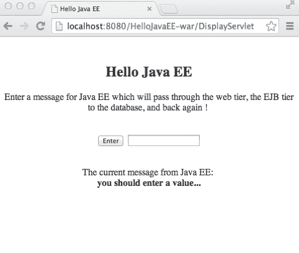

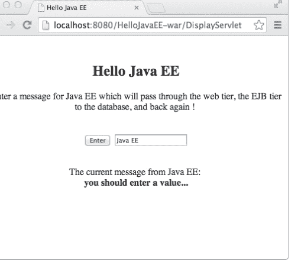

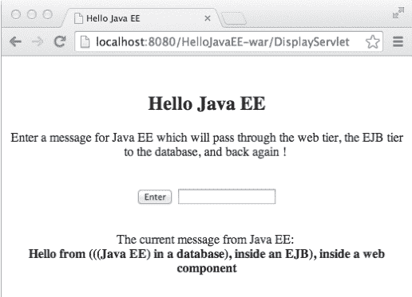

# Hello Java EE 内部

在我们查看应用程序代码之前（别担心，它并不复杂），让我们来看看 Java EE 应用程序的不同部分是如何安排的以及它们的主要功能是什么，如图 1-5 所示。

浏览器客户端在该应用程序的作用是渲染 Java EE 应用程序为其创建的 HTML 内容，并将用户输入的消息发送到网页文本框。Web 组件（`DisplayServlet` 和 `WriteServlet` Servlet）的作用是为浏览器创建 HTML 内容，并将传入的用户消息引导到处理消息逻辑的应用程序正确部分。在此应用程序中，消息处理逻辑由 `ModelEJB` 处理，它反过来管理消息在数据库中的存储和检索。

让我们看看在网页上按下 Enter 键时执行的代码。浏览器执行 HTTP POST 请求并将其发送到 Java EE 服务器，URL 类似于：`http://localhost:8080/HelloJavaEE-war/WriteServlet`（取决于你的 Java EE 服务器使用的主机名；此处 Java EE 服务器部署在本地机器上并使用主机名 `localhost`）。

我们将看到 `WriteServlet` 映射到 URI `/WriteServlet`，正因如此，Java EE 服务器将 HTTP POST 请求路由到 `WriteServlet`。

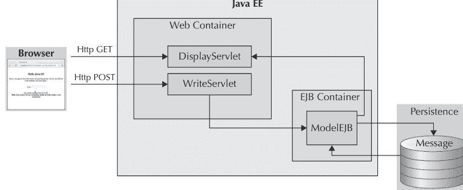

## WriteServlet 代码分析

```java
String message = request.getParameter(PUT_MESSAGE);
if ("".equals(message)) {
    ModelEJB.deleteMessage();
} else {
    try {
        ModelEJB.putMessage(message);
    } catch (ServletException nme) {
        throw new ServletException(nme);
    }
    response.sendRedirect("/DisplayServlet");
}
```

如果你是 Java EE 的新手，你会注意到的第一件事就是这里没有构造函数。随着示例的进行，你会发现没有应用程序代码来实例化 `DisplayServlet`。事实上，你将编写的所有 Java EE 组件都是如此：Java EE 执行的功能之一就是管理组件的生命周期。特别是 Web 容器（`web container`）会为你管理 servlet 组件的生命周期，这样你就可以专注于应用程序逻辑。在书的这个阶段，你不需要理解这段代码的每一个细节，但你应该注意这个 servlet 的关键元素。首先，以下注解定义了它在 Java EE 服务器 URI 空间中的位置：

```java
@WebServlet(name = "WriteServlet", urlPatterns = {"/WriteServlet"})
```

这就是该 Web 组件接收所有以 `/WriteServlet` 结尾的 HTTP 请求的方式。其次，此 Web 组件拦截了 HTTP POST 请求，我们知道这一点是因为它有一个 `doPost()` 方法，它重写了该方法，因为它是 Java EE API 中 `HttpServlet` 类的一个 servlet。在处理这些请求时，我们可以从 `HttpRequest` 对象中提取网页发送的参数，然后提取出用户消息。完成后，`doPost()` 会要求 `ModelEJB` 在消息为空时删除当前消息，或者如果用户消息不为空，则接受用户消息进行处理。一旦完成这些任务，`WriteServlet` 的工作就完成了。我们将注意力转向 `ModelEJB`。

# ModelEJB 企业 Bean

`ModelEJB` 是一个企业 Bean（Enterprise Bean）。不要被这个定义吓到，它只是你创建过很多次的那种普通 Java 对象（POJO）。

## ModelEJB 类定义与依赖注入

```java
import java.io.UnsupportedEncodingException;
import java.net.URLDecoder;
import java.util.List;
import javax.ejb.*;
import javax.persistence.EntityManager;
import javax.persistence.EntityManagerFactory;
import javax.persistence.PersistenceUnit;

@Stateful
public class ModelEJB {
    @PersistenceUnit
    private EntityManagerFactory emf;
```

让这个 Java 类成为企业 Bean 的注解是 `@Stateful`。它紧接在类声明之前。你将很快熟悉在 Java EE 编程中使用这种注解；Java EE 定义了标准注解，使得创建 EE 组件的任务比始终对其编码或配置它们变得更容易。`@Stateful` 注解将此类声明为一种特殊类型的企业 Bean：有状态 bean（Stateful bean）意味着运行你的企业 Bean 的企业 Bean 容器将为每个与其通信的客户端创建一个 bean 实例。你将更详细地学习企业 Bean 的生命周期和范围；目前，知道这个企业 Bean 的实例存在于 `DisplayServlet` 或 `WriteServlet` 需要调用它时即可。

## 消息处理方法

```java
public void putUserMessage(String messageString) throws MessageException {
    this.deleteMessage();
    try {
        String decodedMessage = URLDecoder.decode(messageString, "UTF-8");
        Message message = new Message("1", messageString + ") + in a database");
        EntityManager em = emf.createEntityManager();
        em.persist(message);
    } catch (UnsupportedEncodingException uee) {
        throw new MessageException("something odd " + messageString);
    }
}
```

```java
public String getStoredMessage() throws MessageException {
    EntityManager em = emf.createEntityManager();
    List messages = em.createNamedQuery("findMessages").getResultList();
    if (messages.size() > 0) {
        Message message = (Message) messages.get(0);
        return "(" + message.getMessageString() + "), inside an EJB";
    } else {
        throw new MessageException("There was nothing in the database.");
    }
}
```

```java
public void deleteMessage() {
    EntityManager em = emf.createEntityManager();
    em.createNamedQuery("deleteMessages").executeUpdate();
}
```

在这方面，你可以看到这个企业 Bean 可以管理用户提供的消息：通过 `putUserMessage()` 方法将其存储到数据库，通过 `deleteMessage()` 方法清除存储的消息，以及通过 `getStoredMessage()` 方法从数据库中检索消息。

你还会在 `putUserMessage()` 的实现中注意到，`WriteServlet` 传递给企业 Bean 的字符串被转换成了 `Message` 类的实例。尽管它看起来像一个普通类，但它实际上是一个非常特殊的类，它通过 Java 注解进行了标记，使其能够轻松地在数据库中持久化和管理，这正是此应用程序对网页用户提供的消息所需要的操作。你会发现，如果你关闭应用程序的浏览器窗口并刷新页面，应用程序中存储的最后消息仍然在那里。你还会发现，如果你停止并重启 Java EE 服务器并返回应用程序，相同的消息仍然在那里。这是因为用户消息是使用 Java 持久化 API 存储在数据库中的。让我们查看 `Message` 类代码。

# Message 实体类

## Message 类定义

```java
import java.io.Serializable;
import javax.persistence.Column;
import javax.persistence.Entity;
import javax.persistence.Id;
import javax.persistence.NamedQueries;
import javax.persistence.NamedQuery;
import javax.persistence.Table;

@Entity
@Table(name = "MESSAGE")
@NamedQueries({
    @NamedQuery(
        name = "findMessages",
        query = "select m from Message"
    ),
    @NamedQuery(
        name = "deleteMessages",
        query = "delete from Message"
    )
})
public class Message implements Serializable {
    @Id
    @Column(name = "ID")
    private String id;

    @Column(name = "MESSAGE")
    private String messageString;

    public Message() {
    }

    public Message(String id, String messageString) {
        this.id = id;
        this.messageString = messageString;
    }

    public String getId() {
        return this.id;
    }

    public String getMessageString() {
        return messageString;
    }
}
```

关于这个类，首先要注意到的是它核心代表一个具有 ID 和消息的数据对象。这个类不太熟悉的部分可能是类级别注解的使用，从 `@Entity` 开始向 Java EE 标识该类为应用程序需要存储在数据库中的类，以及注解 `@Table(name = "MESSAGE")` 标识了 Java EE 存储 `Message` 类实例的数据库表名称为 MESSAGE，以及注解 `@NamedQueries` 定义了命名查询。

现在回到 `ModelEJB` 的代码，我们可以从实现中看到，在数据库中存储、检索和删除 `Message` 对象的方法只需执行 `Message` 类在 `@NamedQuery` 注解中所携带的查询。


# Java EE 7：概览

在我们完成消息从用户到浏览器、Web 组件、Enterprise Bean 到数据库再返回的旅程之前，有一点说明：请注意 `ModelEJB` 如何引用 `EntityManagerFactory` 的实例，它使用该实例获取 `EntityManager` 实例，以便执行存储和检索消息的命令：

```java
public class ModelEJB {
    @PersistenceUnit
    private EntityManagerFactory emf;
}
```

你将在此应用程序中找不到任何初始化此实例变量的代码，但 `ModelEJB` 却调用了它。类似于 Java EE 容器管理其运行的 Java Servlet 和 Enterprise Bean 等组件的生命周期，Java EE 可以在组件启动时初始化某些变量，前提是这些变量被特殊标记了 Java 注解，在本例中即为 `@PersistenceUnit` 注解。初始化变量的过程被称为注入（injection），这是一种你将在 Java EE 平台许多地方看到的模式和技术。现在回到 `WriteServlet`，你可能会推断出，同样的注入过程被用于初始化持有 `ModelEJB` 引用的实例变量，`WriteServlet` 需要该引用来存储来自用户的消息：

```java
public class WriteServlet extends HttpServlet {
    @EJB
    private ModelEJB modelEJB;
}
```

这一次，实例变量被标记了 `@EJB` 注解，这告诉 Java EE Web 容器，该 servlet 希望将其实例变量的值初始化为指向 `ModelEJB` 的合适实例。

此应用程序的最后一段代码是 `DisplayServlet`，它查询 `ModelEJB` 获取存储的消息，并创建形成显示给用户的网页的 HTML。它使用了相同的注入技术来请求初始化其对 `ModelEJB` 的引用，正如你在类声明后立即看到的：

- 列表：Hello Java EE 应用程序中的 `DisplayServlet`

```java
import java.io.IOException;
import java.io.PrintWriter;
import com.we.chapter1.model.MessageException;
import com.we.chapter1.model.ModelEJB;
import javax.ejb.EJB;
import javax.servlet.ServletException;
import javax.servlet.annotation.WebServlet;
import javax.servlet.http.HttpServlet;
import javax.servlet.http.HttpServletRequest;
import javax.servlet.http.HttpServletResponse;

@WebServlet(name = "DisplayServlet", urlPatterns = {"/DisplayServlet"})
public class DisplayServlet extends HttpServlet {
    @EJB
    private ModelEJB modelEJB;

    @Override
    protected void doGet(HttpServletRequest request, HttpServletResponse response)
            throws ServletException, IOException {
        // 方法体省略
    }
}
```

回想本文介绍 Java EE 应用程序开始时的 `WriteServlet` 代码，`DisplayServlet` 继承了 Java EE API `javax.servlet.http.HttpServlet`，并使用 `@WebServlet` 注解声明其在应用程序 URI 命名空间中的值为 `/DisplayServlet`。它也包含一个方法，即 `doGet()`，而不是处理任何 HTTP POST 请求的 `doPost()` 方法；它有一个 `doGet()` 方法来拦截任何 HTTP GET 请求。对于 `doGet()` 方法的实现，你会发现它主要是在逐行写出网页的 HTML 代码；例如：

```java
out.println("<html>");
...
out.println("</html>");
```

中间只有一个插曲，它使用对 `ModelEJB` 的引用来获取 Enterprise Bean 存储在数据库中的当前消息值，并将其插入到正在生成的 HTML 页面中。

- 列表：Hello Java EE 应用程序中 `DisplayServlet` 的节选

```java
String displayMessage;
try {
    String storedMessage = modelEJB.getStoredMessage();
    displayMessage = "Hello from " + storedMessage + ", inside a web component";
} catch (ServletException n) {
    displayMessage = "you should enter a value...";
}
out.println("current message from Java EE: <br><b>"
    + displayMessage + "</b>");
```

当 `DisplayServlet` 的 `doGet()` 方法完成时，用户消息的往返就完成了：用户消息显示在网页中，并带有一些辅助说明，解释了它在旅程中的状态。

## Java EE 的主要元素

在检查此应用程序时，我们还简要浏览了 Java EE 平台的主要元素。该应用程序是一个经典的三层应用程序，其 Web 层提供用户界面入口，用于显示信息并接收用户输入；Enterprise Bean 层处理应用程序的逻辑；数据层用于存储应用程序数据。该应用程序由两个 servlet 组成，Java servlet 是 Java EE 平台中 Web 组件的基础类型，所有其他组件都基于此构建。其中一个 Java servlet（`WriteServlet`）负责处理入站的消息并将其传递给 Enterprise Bean 层进行进一步处理。另一个 servlet `DisplayServlet` 负责生成你访问应用程序时看到的 HTML 页面，其中包含发送用户消息到 Java EE 应用程序的按钮以及最后一条发送的用户消息。你看到了 `Message` 类使用的 `ModelEJB`，`Message` 类是一种特殊的类，它是一个 Java Persistence 实体，这意味着它可以轻松地在数据库中存储和检索。你不需要编写任何实例化代码来实例化任何 Java EE 组件，也不需要连接任何 Java EE 组件。

## Java EE 的多种变体

基础 servlet 主题的第一种变体是引入组件的第一种替代方案：JavaServer Pages (JSP)。JSP 可以被认为是“内向外”的 servlet。JSP 的编程不再是在 Java 中嵌入 HTML，而是 JSP 代码看起来像 HTML，但其内部嵌入了 Java 代码。这使得创建连接 Java EE 环境中所有相关数据的网页任务变得更接近开发者的工作。

JSP 可以进一步增强，通过将其嵌入其中的任何 Java 代码段（这些代码可以在其他 JSP 中使用）转换为一种名为 JSP 标签（JSP tag）的可复用 Java 组件。JSP 标签库是一种强大的组织技术，它们增强了 JSP 页面内用户界面逻辑的可用性。

使用 JSP 标签库是 Java servlet 模型非常方便的替代方案。从根本上说，Java Pages 就是 servlet：Java EE 服务器动态编译 JSP 为运行时代码。因此，Java servlet 构成了这种第二类 Web 组件的基础。

Java servlet，因此深入理解 Java servlet 对于学习 Java Faces 框架也至关重要。

只需观察手机上泛滥的客户端应用程序（它们为了与我们喜爱的在线购物、电视和社交网络网站进行高效交互），就会发现并非所有应用程序都有浏览器客户端。这些网站除了暴露为 HTML Web 页的公开功能外，还使用 Web 服务向非浏览器客户端暴露其功能。Java EE 平台包含了多种 Web 组件，可以处理并响应传入的 Web 服务。这些组件被称为 Java Web Service 组件，它们的作用之于简单对象访问协议（SOAP）和表述状态转移（REST）Web 服务，就像 Java servlet、JSP 和 JavaFaces 之于 HTML 内容一样。与 JSP、JSF 和 Java servlet 类似，这些组件是另一种类型的 Java 组件，它们可以使用 HTTP 响应来响应 HTTP 请求。

底层的 HTTP 客户端/服务器模型最适用于服务器仅在客户端请求时才提供信息的交互风格。但许多应用程序包含有趣的信息，这些信息变化的频率往往比请求频率高得多。而且许多此类 Web 应用不希望不断询问更新，因为它们不知道是否有可用信息。此类应用的范围从广播朋友状态（包括位置或最新的午餐照片）的社交网络应用，到跟踪当前市场趋势的金融应用，以及维护共享游戏状态的小组。这些应用程序需要被用于模拟这种服务器推送信息，这是基于间歇性轮询这一核心主题的变体，而轮询是发送数据给感兴趣客户端的最后一种 Web 组件，被称为 Java WebSocket。

具有一定复杂性的 Java EE 应用层可能是取决于应用程序性质的这些组件中任一或全部的混合。

## 多种应用程序逻辑

转到 EJB 层，我们的 Hello Java EE 应用包含一个简单的企业 Bean：一个有状态的 bean（stateful bean）。此类 Enterprise Bean 在每次创建新 bean 供使用时，都会由 EJB 容器实例化。这对于那些需要为每个连接的客户端保持其状态的应用程序特别有用，例如，如果应用程序需要为购物车建模，或者在用户在线购买保险输入信息的过程中保留当前输入的数据。Java EE 平台还可以创建其他类型的 Enterprise Bean，如无状态 bean（stateless bean），它们的瞬态性意味着它们在每次被调用时都会被创建。这使得这种 Enterprise Bean 在大型系统中表现良好，因为这些 bean 在需要时才实例化，并且可以轻松在具有空闲容量的集群中实例化，而无需担心在调用之间同步任何状态。单例 bean（singleton bean）是表示所有连接客户端共有的应用程序状态的理想选择，因为单例 bean 在包含它们的 Java 应用中只实例化一次。建模所有已登录用户可见的视图或高分表，都是 HelloJava 原型应用中使用的单例 bean 模型所构建的模型的变体。最后，对于实现许多长时间运行应用程序（例如备份大量数据、处理复杂的订单或分析大型数据集上的人口统计信息），消息驱动 bean（message-driven bean）提供了一种编程模型，在该模型下，不是进行方法调用，而是通过发送消息启动任务，且任务的完成与发送另一条消息异步进行。

当然，此时值得注意的是，由于各种原因，很大类 Java 应用完全不使用 Enterprise Bean。Web 应用模型完全能够直接与数据层交互，并可以管理它们自己的数据模型。在此过程中，此类 Java 应用必须在设计中包含一些线程安全、对象生命周期管理以及 Enterprise Bean 无需极少开发工作即可享受的服务。尽管存在这些挑战，仅使用平台 Web 层和数据层的 Java EE 应用变体也是一种完全有效且非常流行的形式。

## 存储应用程序数据的不同方式

Java EE 应用的数据层是使用 Java Persistence API（JPA）创建和管理的。该 API 提供了一个高级框架，应用程序可以通过它执行对象关系映射（ORM）。换句话说，你想要在应用程序中建模的数据可以轻松转换为关系型数据库中的等效数据，这可以作为设计关系模式以及存储和检索数据所需的各种查询的捷径。但对于那些非常熟悉 SQL 和关系型数据库表设计的开发者来说，Java EE 提供了替代的、更传统的 Java 数据库连接 API（JDBC）。JDBC API 并不是通过建模反映数据库中关系型表的对象来工作的，而是连接到关系型数据库并执行 SQL 语句来存储、管理和检索这些数据。

在存储数据的数据库中，大多数 Java EE 应用需要执行管理任务，这些任务比你在 Java EE 应用中看到的简单、原子读、写、删操作要复杂得多。即使是两个账户之间的资金转账也涉及两个事务：从一个账户扣除转账金额，同时向另一个账户增加转账。在发生错误的情况下，整个事务要么完成要么完全不完成（尽管我们希望钱能神奇地凭空出现在我们的账户里）。对于这类大类应用，Java Transaction API（JTA）允许将活动分组到一个单个成功的原子操作中，这意味着原子操作中的每个成员要么成功要么失败；如果失败，则在失败之前完成的单个活动将撤回，其最终效果是什么都没有发生过。

## 与其他系统接口

许多 Java EE 应用需要扩展以与网络中部署的其他系统建立接口，平台中的三种技术满足了 Java EE 应用的增长。第一种已经提到过：许多 Java EE 应用使用 Java Web Services APIs 与分析服务器、采购系统、订单管理系统等系统建立接口。虽然它没有提供一种可靠的消息框架（这种框架允许松耦合，使系统从同伴那里演进并添加功能，而不破坏运行中的系统）。

其他 Java 应用变体需要一种可靠的异步交换机制，例如 Java Message Service（JMS）提供的机制，它需要启动活动，如执行金融购买交易、订单零件号或请求交付方案以完成工作。最后，对于向使用应用程序提供更复杂接口的自定义企业系统，Java EE Connector Architecture (JCA) 这种通用扩展机制使得一类 Java EE 应用能够依赖于任意的外部信息系统。

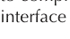

## 模块化

Java EE 平台的基础三层方法本质上将 Java EE 应用划分为三个相应的区域：Web 层的表示层、Enterprise Bean 层的应用程序逻辑以及数据层的持久化应用程序数据。然而，依赖注入框架允许将各种应用程序功能分离到单独的 Java bean 中。这种设计模式可以显著增加 Java EE 应用的模块化。通过依赖注入，从 Web 组件中引用 Enterprise Bean。这样我们就有了一种简单的方法来执行这种核心引导，同时可以在不更改核心代码的情况下向 Java EE 应用注入其他服务，如审计、安全检查和任意组件。

## 安全 Java EE 应用的方法

但同样重要的是，Java EE 安全模型关注的是将 Java EE 应用的访问限制为已知用户和一系列协议。通过 Java 注解、静态配置和运行时 API 组合，Java EE 应用可以适应广泛的安全策略。这些策略从要求通过加密连接访问，到对单个或组 Web 组件进行细粒度访问控制，再到跨越 Java EE 平台层的运行时安全检查和身份传递。安全服务是服务器的核心构建块。

## 打包和部署 Hello Java EE 应用

在考虑到从核心 Java EE 应用构建的这些变体后，让我们回到如何开发、打包和部署该应用程序。

正如我们看到的，Hello Java EE 应用由 Web 组件以及 Enterprise Bean 和数据代码组成。部署 Java EE 应用 Web 组件的载体是一个称为 WAR 归档的文件。WAR 格式是一种 ZIP 文件，具有预定义的结构，由一个包含所有 HTML、JSP 或 JSP 文件的根目录组成。此外，这种文件类型有一个特殊的 `/WEB-INF` 目录，其中包含了所需的任何类文件（如 Java servlet）以及其他配置信息，我们将在后面的章节中进一步探讨。例如，对于我们的 Hello Java EE 应用，WAR 文件的存档项如下：

```
/META-INF/
/MANIFEST.MF
/WEB-INF/
/classes
  /javaeems
    /chapter1
      /web
        /DisplayServlet.class
        /WriteServlet.class
```

你可以为 WAR 文件选择自己的命名方式。在示例中，该文件被称为 `HelloJavaEE-war.war`。移动到下一个层级，存在于 Enterprise Bean（企业 Bean）中的应用程序代码被封装在一种类似但不同的归档文件中，称为 Enterprise JAR。Enterprise JAR 使用 `/META-INF` 目录来存储其包含的 Enterprise Bean 的配置信息，而类文件则位于归档的根级别。由于 Java EE 应用中的 `ModelEJB` 使用了 Java 持久化 API（Persistence API），因此 `/META-INF` 目录下有一个名为 `persistence.xml` 的特殊文件。我们目前不需要过多担心这个文件的内容，只需注意到它是为了确保 `ModelEJB` 能够通过 Java 持久层访问数据库所必需。因此，我们看到 Enterprise Bean JAR 文件的结构如下：

```
/META-INF
/MANIFEST.mf
/persistence.xml
/javaeems
/chapter1/
/model
/ModelEJB.class
/Message.class
/MessageException.class
```


# 再次，Enterprise Bean 的名称仅对那些需要知道它是什么的人重要

Enterprise Bean 的名称仅对那些需要知道它是什么的人重要；它对应用程序的运行方式没有意义。在这个应用程序中，文件名是 `HelloJavaEE-jar.war`。这些相对简单的 WAR 和 Bean 文件结构存在变体：某些 Java EE 应用程序需要更多的配置。信息包含在称为“部署描述符”（deployment descriptor）的特殊配置文件中，它们与 WAR 文件的 `/WEB-INF` 目录以及 Enterprise Bean JAR 文件的 `/META-INF` 目录共同打包。某些 Java EE 应用程序还会共同打包包含类类和资源的 JAR 文件，正如我们在稍后章节中看到的。Java EE WAR 文件和 JAR 文件的结构就像应用程序本身一样，是构建这些变体的基础归档。最后一步允许 Java EE 应用程序被打包成一个单一的、自包含的文件，是将这两者封装成第三种 ZIP 文件，称为 Enterprise Archive（企业归档）或 EAR 文件。这也可以为更复杂的应用程序携带额外信息，在这种情况下，这些配置信息将存在 WAR 文件的 `/META-INF` 目录中。否则，EAR 文件仅包含 web WAR 和 Enterprise Bean JAR 文件，产生如下归档结构：

```
/META-INF
/MANIFEST.mf
/HelloJavaEE-jar.jar
/HelloJavaEE-war.war
```

被称为 `HelloJavaEE.ear`。图 1-6 显示了该文件的逻辑结构图。


# Java EE 7：整体概念

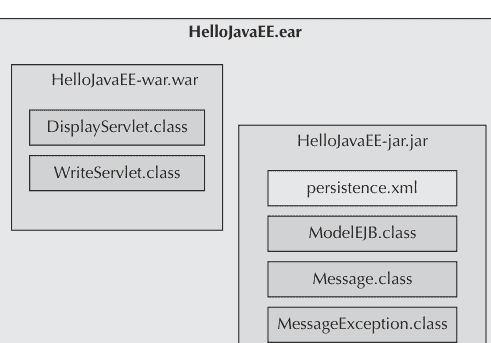

图 1-6. Hello Java EE EAR 文件

一旦 Java EE 应用程序被封装成这种形式，就可以部署到任何 Java EE 服务器。这种形式的 Hello Java EE 应用程序包含了部署它所需的所有配置信息。

# Java EE 平台与实现

除了 Java EE 平台提供的功能和服务的广度和深度外，该平台的强大之处在于它有许多不同的实现。这意味着有许多随处可见的应用程序服务器支持平台定义中的所有应用程序 API 调用、组件模型、配置管理、安全模型、数据库模型等。

这并不意味着所有的 Java EE 应用程序服务器都是相同的：存在紧凑型应用程序服务器，它们以极小的资源占用运行 Java EE 应用程序，具有快速的启动时间，并能够在性能受限的计算机上运行。存在在多 Java 虚拟机（JVM）环境中运行 Java EE 应用程序的服务器，它们能够处理来自成千上万客户端的请求，能够在运行环境底层软件和硬件故障中恢复而不产生任何中断。某些 Java EE 应用程序服务器提供简单基础的工具，用于部署和管理应用程序以及维护服务器。其他 Java EE 应用程序提供复杂的工具套件，用于应用程序管理和分析，并对运行服务器的多个维度进行监控。但它们都可以以相同的方式运行同一个 Java EE 应用程序。

# 本书其他部分的指南

在本章中，你已经检查了 Java EE 平台最基本的方面。用音乐术语来说，你详细探索了“主题”，它是你编写的所有 Java EE 应用程序的基础，并将是它们所有变体的来源。想象 Java EE 平台像一个工厂，你已经对工厂的所有重要区域进行了快速参观，了解了平台的主要元素是如何布局的，以及它们在简单应用程序的语文中是如何相互关联的。你透过玻璃窥了工厂的一些次要区域，在通往其他区域的开放门前停顿（例如针对不同客户端的其他类型 Web 组件，以及针对其他应用程序生命周期需求的其他 Enterprise Bean 模型），但还没有进去。

本书的其余部分将一个一个变体、一扇一扇地探索本章概述的 Java EE 平台的其他维度。随着章节的进行，你将学习到你可以想象并自己编写的广泛且多样化的 Java EE 应用程序。

我们将从进入 Java EE Web 容器领域开始。


# 第一部分

## Java EE 的话筒：Web 层

此页特意留空


# 第2章

## Java Servlets 与 Web 应用程序：Web 层的基础

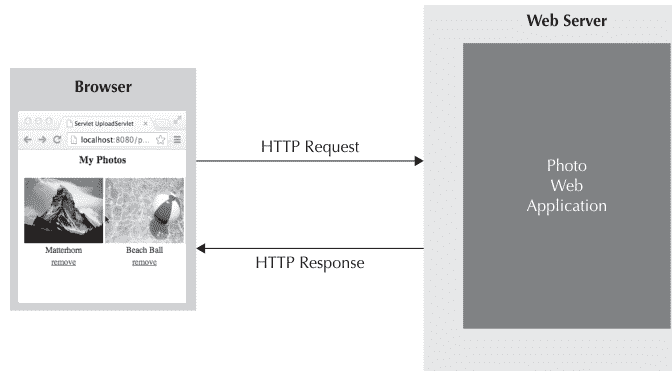

图 2-1 浏览器通过 HTTP 与 Web 交互

统一资源标识符 (URI)，相对于 Web 服务器的主机名。如果 Web 服务器的主机名为 `photoserver.com`，并且服务器上的 Web 组件地址为 `/myphotos.html`，那么 HTTP 客户端就可以使用以下 URL 访问该 Web 组件：`http://photoserver.com/myphotos.html`。

让我们来看 HTTP 请求和 HTTP 响应消息的结构，它们具有共同的结构：每个消息都包含一个描述消息所携带数据类型的区域。这些信息以称为 HTTP 头部（headers）的键值对形式出现。此外，消息包含一个包含消息所携带数据的区域。例如，我们在日常生活中体验的许多 HTTP 响应都包含网页信息。在这种情况下，携带网页内容传输到我们浏览器的 HTTP 响应对象具有一个特殊的头部，其值为 `content-type` 且 `text/html`，表示它们携带 HTML 文本，而响应对象的数据是由构成传输网页的 HTML 代码组成的成的字符串。让我们在图 2-2 中查看这种常见的示例。

## Java EE 7：概览

| HTTP 请求 | HTTP 响应 |
| :--- | :--- |
| Headers | Headers |
| GET /myphotos.html HTTP/1.1 | HTTP/1.1 200 OK |
| host : photoserver.com | server : GlassFish Server Open Source |
| accept : text/html, application/xml | Edition 4.0 |
| user-agent : Mozilla/5.0 | content-type : text/html; charset=UTF-8 |
| accept-encoding : gzip | Body |
| accept-language : en-US | <empty> |
| Body | |
| `<html><head><title>My Photos</title></head><body><h3 align='center'>My Photos</h3><table align='center'><td>...</table></body></html>` | |

**图 2-2.** HTTP 请求和 HTTP 响应示例

在这个示例中，我们可以看到浏览器可能向照片应用程序发送的 HTTP 请求和响应的图示形式。HTTP 请求始终包含一个称为 HTTP 方法的标识符和一个请求 URI，它们用于标识请求的类型以及其想要访问的服务器上 Web 组件的地址。HTTP 方法有 `GET`、`HEAD`、`POST`、`PUT`、`DELETE`、`TRACE`、`OPTIONS`、`CONNECT` 和 `PATCH`。在 Web 编程中，通常只看到其中两种方法被使用：

- `GET`：当请求从服务器获取信息时使用，通常不会在请求体中发送任何后续信息，例如当请求图中的网页 `/myphotos.html` 内容时。
- `POST`：当请求在体中携带某些伴随请求的信息时使用。一个非常常见的例子是向网站上传文件时；在这种情况下，由浏览器构建 HTTP 请求。我们很快就会看到相关的示例。

在示例中，`host` 头部携带客户端发送请求的 Web 服务器的主机名，而 `accept` 头部包含 MIME 类型列表，描述了客户端能够处理以及响应服务器将返回的响应体信息类型。`user-agent` 头部识别 HTTP 客户端（在本例中为 Mozilla 浏览器），最后 `accept-encoding` 和 `accept-language` 头部用于告知服务器客户端在响应中能够接受的语言。

当服务器构建 HTTP 响应时，它始终包含一个 HTTP 状态码和一个三位数字，用于表示它正在做出什么类型的响应，并带有一个消息标识符。大多数情况下，状态码如示例所示：`200 OK` 状态码用于表示服务器已正常处理请求并以其预期的方式做出响应。许多其他状态码表示各种情况。我们都见过的某些包括 `404 Not Found`（表示服务器在客户端地址处没有 Web 组件）、`401 Unauthorized`（表示 Web 组件仅对已身份验证的客户端开放，而请求客户端不是）以及 `500 Internal Error`（表示服务器在处理传入请求时内部遇到了错误）。`server` 头部的作用类似于 `user-agent` 头部，用于指明 Web 软件，在本例中为 GlassFish。`content-type` 头部用于描述 HTTP 响应体中包含什么种类型的数据；在示例中，数据是 HTML。

由于 HTTP 被广泛使用，在这一基础交互模型之上构建了许多机制。可以使用头部将客户端重定向到其他 Web 响应，以便在接收 HTTP 响应后保持 HTTP 连接开启，并模拟异步消息传递，使 Web 服务器能够主动发送信息和更新（例如更改报价信息或聊天消息），而无需感兴趣的客户端通过 HTTP 请求触发。检查所有此类机制超出了本书的范围，但我们会经常遇到它们，并在需要以理解 Java EE 平台的能力时对其进行简要描述。

# 介绍 Java Servlets

现在我们已经熟悉了 HTTP 协议，可以将注意力转移到 servlet 上。Servlet 是一个处理交互的 Java 对象。

## Servlet 的作用

让我们假设一下该 Web 组件是一个 Java servlet。servlet 的核心是实现我们一直在观察的请求/响应交互。为了在 servlet 中实现这一点，你只需重写 `HttpServlet` 超类中以下方法之一，具体取决于你希望用你的方法处理什么类型的 HTTP 请求，或者更具体地说，你想要处理哪种 HTTP 方法的 HTTP 请求。

图中显示了 servlet 执行的主要任务：

- **检查请求**：servlet 确定客户端正在请求什么种类型的信息。
- **读取请求体**：这一步对请求进行分类，例如，对于携带信息的 `POST` 请求。
- **收集要返回的数据**：Java servlet 的强大之处在于它整合了 HTTP 响应。
- **设置响应头部**：Java servlet 填充响应，以便向客户端描述负载中包含什么种类型的信息。
- **写入响应体**：最后，由 servlet 写入响应体并在 HTTP 头部之后将其传回调用客户端，Java servlet 的工作到此结束，直到下一个请求到来。

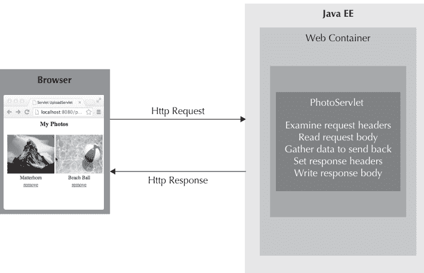

图 2-3. servlet 执行的主要任务

## 如何创建 Java Servlet

创建 Java servlet 非常简单：首先你子类 Servlet API 类 `javax.servlet.http.HttpServlet`。

Java Servlet API 包含另外两个重要的类：`javax.servlet.http.HttpServletRequest` 和 `javax.servlet.http.HttpServletResponse`。它们分别模拟 HTTP 请求和输出 HTTP 响应，servlet 的核心是实现我们一直在观察的请求/响应交互。

| HttpServlet 方法 | 目的 |
| :--- | :--- |
| `public void service(HttpServletRequest, HttpServletResponse) throws SQLException, IOException` | 处理所有 HTTP 请求 |
| `protected void doGet(HttpServletRequest, HttpServletResponse) throws SQLException, IOException` | 处理仅 GET 请求 |
| `protected void doHead(HttpServletRequest, HttpServletResponse) throws SQLException, IOException` | 处理仅 HEAD 请求 |
| `protected void doOptions(HttpServletRequest, HttpServletResponse) throws SQLException, IOException` | 处理仅 OPTIONS 请求 |
| `protected void doPost(HttpServletRequest, HttpServletResponse) throws SQLException, IOException` | 处理仅 POST 请求 |
| `protected void doPut(HttpServletRequest, HttpServletResponse) throws SQLException, IOException` | 处理仅 PUT 请求 |
| `protected void doTrace(HttpServletRequest, HttpServletResponse) throws SQLException, IOException` | 处理仅 TRACE 请求 |

如果你只学习了 `HttpServlet` 类中的一个方法，那就是 `service()` 方法：它将处理所有的 HTTP 请求！在现实中，大多数时候你将实现 `doGet()` 或 `doPost()` 方法，因为它们是 Web 应用中最常见的 HTTP 请求形式。

`HttpServletRequest` 对象包含了多种方法，用于读取 HTTP 请求头以及读取 HTTP 请求体内容（如果有的话）。关键方法有：

```
public Enumeration getHeaderNames()
public String getHeader(String name)
```

以及

```
public InputStream getInputStream()
public Reader getReader()
```

同样，`HttpServletResponse` 对象也包含了多种方法，用于设置 HTTP 响应头和写入 HTTP 响应体内容。关键方法为：

```
public void setHeader(String name, String value)
```

以及

```
public OutputStream getOutputStream()
public Writer getWriter()
```

现在，我们可以将这些 Java Servlet API 的部分组合在一起，形成一张图，展示它们是如何相互配合形成一个 Java Servlet 的，如图 2-4 所示。

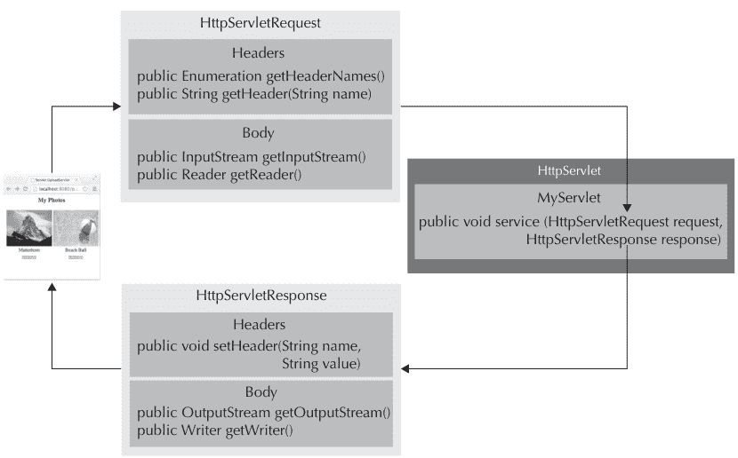

图 2-4. 运行中的 Java servlet API 类

最后，我们现在可以展示骨架代码，展示你将编写的每一个 Java servlet 将如何使用关键 API 和所有 Java servlet 通用的五步任务列表来实现工作：


# Java EE 7: 概览

## 将 Java Servlet 发布到 Web 容器

在我们处理真正的 Java servlet 之前，需要注意的一个注解是：

```java
@WebServlet(name = "TemplateServlet",
           urlPatterns = {"/TemplateServletURI"})
```

此注解定义了 Java servlet 将如何被部署。特别是在这个伪 servlet 的案例中，它的逻辑名称是 `TemplateServlet`（这个名字只是巧合），它对于使用 `/TemplateServletURI` 作为部分 URI 的客户端是有效的。运行在 Java EE 服务器上的每个 Web 应用都有一个称为 Web 应用上下文路径的部分 URI。客户端访问声明了部分 URI 的 servlet 的路径为：

```
http://<hostname>/<context-path>/<url-pattern>
```

其中 `hostname` 是 Java EE 服务器的主机，`context-path` 是连接 servlet 的 Web 应用的部分 URI，`url-pattern` 是 servlet 的部分 URI。

## 示例 Java Servlet 应用：照片应用程序

现在我们已经检查了 Java servlet 的基本结构和功能，有了足够的知识来编写照片应用程序。这个 Web 应用允许用户将照片上传到网页，网页提供了用户所有上传照片的简单缩略图显示、查看任何照片全尺寸的能力以及从专辑中删除照片的能力。

在图 2-5 中，我们可以看到此 Web 应用的浏览器视图，用户已向专辑上传了两张照片。通过点击“选择文件”按钮、选择照片文件并点击“上传”，用户可以向专辑上传更多照片。通过点击照片，用户可以查看照片的全尺寸，通过点击“删除”链接，用户可以从专辑中删除相关部分。

这个 Web 应用由三个 servlet 组成：`DisplayAlbumServlet`、`DisplayPhotoServlet` 和 `RemovePhotoServlet`，如图 2-6 所示。此外，`ThePhotoAlbum` 类持有这三个 Java servlet 访问的所有照片信息。在我们浏览完应用程序后，我们将看到这三个 Java servlet 就像童话中的“三只圣猴”。

让我们先处理三个 servlet 中简单的一个：`DisplayPhotoServlet`。图 2-7 显示了它的输出，显示了欧洲最高的山。

### DisplayPhotoServlet 代码示例

```java
import java.io.*;
import java.util.*;
import javax.servlet.ServletException;
import javax.servlet.annotation.WebServlet;
import javax.servlet.http.HttpServlet;
import javax.servlet.http.HttpServletRequest;
import javax.servlet.http.HttpServletResponse;

@WebServlet(name = "DisplayPhotoServlet",
           urlPatterns = {"/PhotoServlet"})
public class DisplayPhotoServlet extends HttpServlet {

    @Override
    protected void doGet(HttpServletRequest request,
                         HttpServletResponse response)
                         throws ServletException, IOException {

        String indexString = request.getParameter("photo");
        int index = new Integer(indexString.trim()).intValue();
        response.setContentType("image/jpeg");
        OutputStream out = response.getOutputStream();
        try {
            ServletContext myServletContext = request.getServletContext();
            PhotoAlbum pa = PhotoAlbum.getPhotoAlbum(myServletContext);
            byte[] bytes = pa.getPhotoData(index);
            for (int i = 0; i < bytes.length; i++) {
                out.write(bytes[i]);
            }
        } finally {
            out.close();
        }
    }
}
```

首先要注意的是，该 servlet 被映射到 URI `/DisplayPhotoServlet`，这意味着客户端通过以下 URI 访问它：

```
http://<hostname:port>/photos/DisplayPhotoServlet
```

因为 `photos` 是包含它的 Web 应用的上下文路径。接下来，我们可以看到该 servlet 重写了它继承的 `HttpServlet` 类的 `doGet()` 方法。这意味着该 servlet 只处理 GET 请求；来自任何其他 HTTP 方法（例如 POST 或 DELETE）的针对该 servlet 的任何其他 HTTP 请求都不会由 Java EE Web 容器传递给此 servlet。在 `doGet()` 方法内部，我们注意到 servlet 执行的第一件事是解析请求 URI 中查询字符串的参数。正如我们之后观察到的，servlet 总是期望一个查询字符串，其中 `photo` 为参数名，整数值为如下：

```
http://<hostname:port>/photos/DisplayPhotoServlet?photo=3
```

## DisplayAlbumServlet

接下来我们来看 `DisplayAlbumServlet`。这个 Servlet 既负责显示应用程序的页面（相册），又处理新照片的上传。让我们先从它的基本结构开始：

```java
import java.io.*;
import javax.servlet.ServletException;
import javax.servlet.ServletContext;
import javax.servlet.annotation.MultipartConfig;
import javax.servlet.annotation.WebServlet;
import javax.servlet.http.HttpServlet;
import javax.servlet.http.HttpServletRequest;
import javax.servlet.http.HttpServletResponse;
import javax.servlet.http.Part;

@WebServlet(name = "DisplayAlbumServlet",
           urlPatterns = {"/DisplayAlbumServlet"})
@MultipartConfig
public class DisplayAlbumServlet extends HttpServlet {

    @Override
    protected void doGet(HttpServletRequest request,
                         HttpServletResponse response)
                         throws ServletException, IOException {
        handleRequest(request, response);
    }

    @Override
    protected void doPost(HttpServletRequest request,
                          HttpServletResponse response)
                          throws ServletException, IOException {
        handleRequest(request, response);
    }

    protected void handleRequest(HttpServletRequest request,
                                 HttpServletResponse response)
                                 throws ServletException, IOException {
        ServletContext servletContext = request.getServletContext();
        PhotoAlbum pa = PhotoAlbum.getPhotoAlbum(servletContext);
        if (request.getContentType() != null &&
            request.getContentType().startsWith("multipart/form-data")) {
            this.uploadPhoto(request, pa);
        }
        response.setContentType("text/html;charset=UTF-8");
        PrintWriter writer = response.getWriter();
        try {
            writer.write("<html>");
            writer.write("<head>");
            writer.write("<title>Photo Viewer</title>");
            writer.write("</head>");
            writer.write("<body>");
            writer.write("<h3 align='center'>Photos</h3>");
            this.displayAlbum(pa, "", writer);
            writer.println("</body>");
            writer.println("</html>");
        } finally {
            writer.close();
        }
    }

    private void uploadPhoto(HttpServletRequest request, PhotoAlbum pa) throws IOException, ServletException {
        ByteArrayOutputStream baos = new ByteArrayOutputStream();
        String filename = null;
        for (Part p : request.getParts()) {
            this.copyBytes(p.getInputStream(), baos);
            filename = p.getSubmittedFileName();
        }
        if (!("".equals(filename))) {
            String photoName = filename.substring(0, filename.lastIndexOf("."));
            pa.addPhoto(photoName, baos.toByteArray());
        }
    }
}
```


```java
private void displayAlbum(PhotoAlbum pa, String label, PrintWriter writer) {
    writer.write("<h3 align='center'>" + label + "</h3>");
    writer.write("<tr><td align='center'>");
    for (int j = 0; j < pa.getPhotoCount(); j++) {
        writer.write("<a href='DisplayPhotoServlet?photo=" + j + "'>");
        writer.write("");
        writer.write("</a>");
    }
    writer.write("</td></tr>");
}
```

```java
    writer.write("<td bgcolor='#cccccc' width='120' height='120'>");
    writer.write("<form align='left' action='DisplayServlet' method='post' enctype='multipart/form-data'>");
    writer.write("<input value='Choose' name='file' type='file' accept='image/jpeg'><br>");
    writer.write("<input value='Upload' type='submit'><br>");
    writer.write("</form>");
    writer.write("</td>");
    writer.write("</tr>");
```

```java
    for (int j = 0; j < pa.getPhotoCount(); j++) {
        writer.write("<td align='center'>" + pa.getPhotoName(j) + "</td>");
    }
    writer.write("</tr>");
```

# Java EE 7：概览

```java
    writer.write("<td>");
    }
    writer.write("</tr>");

    writer.write("<tr>");
    for (int j = 0; j < pa.getPhotoCount(); j++) {
        writer.write("<td align='center'>photo " + j + "</td>");
        writer.write("<a href='RemovePhotoServlet?photo=" + j + "'>remove</a>");
    }

    writer.write("<td>");
    }
    writer.write("</tr>");
    writer.write("</table>");
}
```

```java
private void copyBytes(InputStream is, OutputStream os) throws IOException {
    int i;
    while ((i = is.read()) != -1) {
        os.write(i);
    }
    is.close();
    os.close();
}
```

我们可以从 `@WebServlet` 声明中立即看出，该 Servlet 在以下地址可用：

`http://<hostname>:<port>/photos/DisplayAlbumServlet`

此外，它重写了 `doGet()` 和 `doPost()` 方法，因此它将响应 HTTP GET 和 HTTP POST 请求。GET 请求是仅显示相册的请求，而 POST 请求是客户端上传文件并显示更新后相册的请求。这两个拦截方法都委托给了 `handleRequest()` 方法，所以让我们来看看这个实现。该方法执行的第一件事是检查请求的内容类型是否为 `multipart/form-data`。如果是的话，该方法将断定有待上传的信息。这被委托给了 `uploadPhoto()` 方法。由于此方法始终返回一个包含显示相册 HTML 代码的响应。

## 第 2 章：Java Servlets 与 Web 应用：Web 层基础

```java
@Override
protected void doGet(HttpServletRequest request,
    HttpServletResponse response)
    throws ServletException, IOException {
    String index = request.getParameter("photo");
    int index = new Integer(index.trim()).intValue();
    PhotoAlbum pa = PhotoAlbum.getPhotoAlbum(request.getServletContext());
    pa.removePhoto(index);
    RequestDispatcher rd =
        request.getRequestDispatcher("DisplayAlbumServlet");
    rd.forward(request, response);
}
```

这是它的 `@WebServlet` 注解，该 servlet 可以通过以下地址供客户端使用：

```
http://hostname:port/photos/RemovePhotoServlet
```

由于它只重写了 `HttpServlet` 类的 `doGet()` 方法，因此它响应于 HTTP GET 调用。这正是用户点击超链接时生成的 HTTP 请求，例如点击专辑中任意照片下方的“Remove”链接。与 `DisplayPhotoServlet` 类似，该 servlet 期望从以下查询字符串：

```
?photo={某个数字}
```

从中它提取要从 `PhotoAlbum` 中删除的照片的索引。一旦删除了相关照片，servlet 会使用 `DisplayAlbumServlet` 的相对 URI 获取一个名为 `RequestDispatcher` 的 Java Servlet 引用。返回的 `RequestDispatcher` 充当同一 Web 应用中其他 Web 组件的包装器，在本例中即 `DisplayAlbumServlet`。通过调用 `forward()` 方法，`RemovePhotoServlet` 将 HTTP 响应的创建委托给了 `DisplayAlbumServlet`，后者通过显示新缩减专辑中的剩余照片继续执行。最后，`PhotoAlbum` 本身是一个相对简单的字节数据存储器，每个照片都有一个代表它的名称：

```java
import java.util.*;
import javax.servlet.ServletContext;
```

```java
public class PhotoAlbum {
    public static String ATTRIBUTE_NAME = "Photo-Album";
    private List<byte[]> photoDataList = new ArrayList<byte[]>();
    private List<String> names = new ArrayList<String>();
}
```

```java
public static PhotoAlbum getPhotoAlbum(ServletContext servletContext) {
    if (servletContext.getAttribute(ATTRIBUTE_NAME) == null) {
        PhotoAlbum pa = new PhotoAlbum();
        servletContext.setAttribute(ATTRIBUTE_NAME, pa);
    }
    return (PhotoAlbum) servletContext.getAttribute(ATTRIBUTE_NAME);
}
public synchronized void addPhoto(String name, byte[] bytes) {
    this.photoDataList.add(bytes);
    this.names.add(name);
}
public synchronized byte[] getData(int i) {
    return (byte[]) photoDataList.get(i);
}
public synchronized String getPhotoName(int i) {
    return (String) names.get(i);
}
public synchronized int getPhotoCount() {
    return photoDataList.size();
}
public synchronized void removePhoto(int i) {
    photoDataList.remove(i);
    names.remove(i);
}
```

这是 `getPhotoAlbum()` 方法的实现，它接受 `ServletContext` 实例作为参数。你可能记得 `ServletContext` 对象对于托管 Web 容器的 Web 应用是全局对象。它的众多特性之一是持有一个键值对的映射，Web 应用可以使用方法调用在该映射中存储和检索属性对象：

```java
public void setAttribute(String name, Object value)
public Object getAttribute(String name);
public Enumeration<String> getAttributeNames()
```

三个 servlet 引用的 `PhotoAlbum` 实例就存在于此处：作为与照片应用程序关联的 `ServletContext` 实例上的属性。通过这种方式，三个 servlet 始终使用同一个照片专辑。注意，所有读取或写入 `PhotoAlbum` 照片的方法都是同步的（`synchronized`）；我们将在本章稍后的部分回来讨论其原因。

现在我们可以解开“三只猴”寓言如何应用于此示例的谜团了：由于 `RemovePhotoServlet` 从不产生输出，因此它“不言恶”；由于 `DisplayPhotoServlet` 不期望任何请求，它“无恶”；而此书的读者只会看到图片，`DisplayAlbumServlet` “不看恶”。

## 理解 Java Servlet API

现在我们已经看了一个由不同类型的 Java servlets 组成的 Web 应用示例，我们现在可以更正式地检查 Java Servlet API 了。

## javax.servlet.http.HttpServlet 类

`HttpServlet` 类是 Java Servlet API 的核心类，也是 Java EE 平台上大多数 Web 组件的核心类（无论它们是否直接感知到它）。我们已经看到，创建任何 servlet 的方法都是继承 `HttpServlet` 并重写一个或多个 `doXXX()` 方法，其中 `XXX` 对应于你希望 servlet 拦截的 HTTP 方法类型。让我们先退一步，看看 Java servlet 的生命周期。

在 Java servlet 部署到 Java EE 服务器后的某个时间点，在第一个 HTTP 请求到达之前，Java Web 容器会创建一个 servlet 类的实例，为处理第一个 HTTP 请求做准备。当 Java servlet 实例创建完成后，Web 容器会对其调用：

```java
public void init(ServletConfig config) throws ServletException
```

`init()` 方法可以在 servlet 中被重写，以执行在 servlet 响应请求之前需要完成的任何类型的操作，例如打开数据库连接。容器将 `ServletConfig` 对象传递给 servlet。一旦 Java servlet 实例创建完成，Web 容器会对其调用：

```java
protected void doGet(HttpServletRequest request,
    HttpServletResponse response)
    throws ServletException, IOException
```

`service()` 方法在每次匹配的 HTTP 请求到达时被调用，用于创建需要响应请求的输出。当 Web 容器决定不再需要该实例时，它会调用：

```java
public void destroy()
```

该方法在 servlet 实例移除服务之前调用一次。`destroy()` 提供了清理在其生命周期内打开的任何资源的机会。

## Servlet 的实例数量

有一个问题无法从 Java servlet 的生命周期中完全确定：容器会创建多少个实例？具体数量可能会异。某些容器在 servlet 部署期间可能使用单个实例；其他容器可能会实例化 servlet 实例来处理大量客户端，有时在不同的虚拟机上运行实例以分担负载或是否存在请求。然而，无论采用何种方案，servlet 开发者都需要知道以下两点：

- 每个 servlet 实例可能处理来自多个客户端的并发请求。
- 每个 servlet 都可能被 Web 容器实例化多次。

特别是这意味着当你实现 servlet 的 `doXXX()` 方法时，需要考虑并发请求。这就是为什么我们示例中的 `PhotoAlbum` 对数据访问进行同步的原因：可能一个客户端正在添加照片，而另一个客户端正在删除。在 Java servlet 中使用实例变量时也需要小心：例如，如果你使用实例变量来统计它在一段时间内被调用的次数，它将统计该 Java servlet 被调用的次数。然而，如果 Web 容器包含多个 Java servlet 实例，则任何特定实例上的计数可能不是你预期的。因此，servlet 开发者转向 Java Servlet API 的其他地方来存储状态。在我们的照片应用程序中，你会记得 `PhotoAlbum` 的全局实例并不是存储在任何 servlet 的实例变量中的，而是作为 `ServletContext` 上的属性存在的。

## ServletContext

每个应用都可以访问 `javax.servlet.ServletContext` 类的单个实例。该实例为 Web 应用提供了对 Web 容器的私有视图。`ServletContext` 持有的方法允许 Java servlet 查询有关容器的信息。

## 第 2 章：Java Servlets 与 Web 应用程序：Web 层基础

环境，取决于它支持的 Java Servlet API 版本。它拥有在运行时查询与其关联的 Web 应用程序属性、Web 应用程序的上下文路径（context path），以及在容器 Web 应用程序启动期间动态注册其他 Web 组件的能力。它最常用的特性之一是它代表应用程序持有的属性简单映射（simple map）。对于 Web 应用程序中任何你希望对所有 Web 组件和所有访问它的客户端都是全局可见的数据来说，它是一个非常实用的存储位置。以下是在 Servlet 上操作应用程序数据的 API：

```java
public Object getAttribute(String name)
public Enumeration<String> getAttributeNames()
public void removeAttribute(String name)
public void setAttribute(String name, Object value)
```

如果你从不同的浏览器中运行该照片应用程序，当你在一个浏览器中上传照片并在另一个浏览器中刷新照片应用程序的显示时，你会发现两个浏览器都显示相同的照片册。

如果你希望每个客户端都将照片上传到自己的照片册中呢？例如，如果第二个客户端查看 Web 应用程序，看到的不是 Web 应用程序任何客户端上传的所有照片，而是只看到他们自己上传的照片？

这带我们进入 Java servlet 环境中的下一个对象：`HttpSession`。

## HttpSession

`javax.servlet.http.HttpSession` 是单个客户端与单个 Web 应用程序之间交互的表示。如果 Web 应用程序想要根据对该用户的先前知识，或根据用户与 Web 应用程序之前的交互来调整对特定用户的行为，那么 `HttpSession` 就是要使用的对象。与特定客户端关联每个 `HttpSession` 对象对所有 Servlet 实例都是可见的，客户端每次向 servlet 发起新的 HTTP 请求时，可以通过以下两种方式之一获取：

```java
public HttpSession getSession()
```

每个 `HttpSession` 对象通过 `getId()` 调用具有一个在 Web 容器中所有会话中唯一的标识符。会话最终会过期，可以通过显式调用：

```java
public void invalidate()
```

方法，或者因为代表会话的客户端没有对 Web 应用程序进行任何调用导致会话超时，由以下控制的超时数量定义：


## HttpSession 管理

```java
public int getMaxInactiveInterval()
public void setMaxInactiveInterval(int interval)
```

这些方法允许 Web 容器在达到最大空闲时间后失效会话。这并不意味着客户端没有访问部署在 Web 容器中的其他 Web 应用程序：就像 `ServletContext` 实例一样，`HttpSession` 实例不能跨越 Web 应用程序的边界。


## 48 Java EE 7：全景

回到如何存储与 Web 应用程序特定客户端关联的应用程序状态的问题，`HttpSession` 最常用的特性是它代表 Web 组件存储任意对象的能力。为此提供的 API 类似于 `ServletContext` 的 API：

```java
public Object getAttribute(String name)
public Enumeration<String> getAttributeNames()
public void removeAttribute(String name)
public void setAttribute(String name, Object value)
```

让我们在这里停一下，看看我们如何在照片应用程序中实现这一点，以便为应用程序的每个客户端在不同的相册中存储照片。幸运的是，这很简单。首先，我们需要将每个 `PhotoAlbum` 的存储位置从 `ServletContext` 更改为 `HttpSession`：


```java
public class PhotoAlbum {
    public static String ATTRIBUTE_NAME = "Photo_Album"
    private List<byte[]> photoList = new ArrayList<byte[]>();
    private List<String> names = new ArrayList<String>();

    private PhotoAlbum() {
    }

    public static PhotoAlbum getPhotoAlbum(HttpSession session) {
        if (session.getAttribute(ATTRIBUTE_NAME) == null) {
            PhotoAlbum pa = new PhotoAlbum();
            session.setAttribute(ATTRIBUTE_NAME, pa);
        }
        return (PhotoAlbum) session.getAttribute(ATTRIBUTE_NAME);
    }
}
```

然后，在访问 `PhotoAlbum` 的 Java servlets 中，传入 `HttpSession` 而不是 `ServletContext`：

```java
HttpSession session = request.getSession();
PhotoAlbum pa = PhotoAlbum.getPhotoAlbum(session);
```

现在，当你从两个不同的浏览器使用此方法应用程序时，你会发现在不同的浏览器中上传照片会将照片上传到不同的照片册中。

这使得 `HttpSession` 对象在具有任何类型用户个性化的网站中成为一个无价的工具，例如记住你的名字、记住你最后看过的页面、在浏览网站时维护购物车，或者需要显示你之前提供的任何关于你的信息时的网站。

## HttpSession 如何被维护

为了维护 `HttpSession` 实例，Web 容器必须知道一系列请求都来自同一个用户。如果你花了一个小时在在线商店进行假日购物，结果在结账时发现购物车里是他人的选择，那将毫无意义。Web 容器是如何做到的呢？

容器有各种机制可供使用。主要，Web 容器依赖 HTTP cookies 来维护 `HttpSession`：当客户端发出请求时，容器会在 cookies 中检查会话 ID。如果找到，容器会将请求与现有的会话关联。如果没有找到，则创建一个新会话并创建会话 ID。这种过程是跨请求维护会话的基础。

## Servlet 架构

现在我们可以绘制 Servlet 的架构。在图 2-9 中，我们看到了 `ServletContext`、`HttpSession` 和 `HttpServlet` 实例。

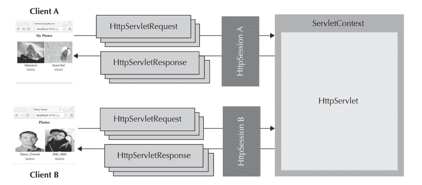

## RequestDispatcher

Servlet API 的最后一个类是 `RequestDispatcher`。`RequestDispatcher` 对象提供了 Web 应用程序中 Web 资源的表示（无论是 Web 页面、Java servlet 还是其他 HTTP 组件），并允许调用者调用它。从 servlet 调用 `RequestDispatcher` 时，你可以选择将请求转发给它或从它包含响应。

如果你将请求转发给它，你是在请求 `RequestDispatcher` 代表的 Web 资源为你编写响应。这意味着你不能已经写入任何响应，并且在调用它后不能尝试写入响应。这种模式适用于你希望另一个 Web 资源接管响应的编写。

如果你使用 `RequestDispatcher` 包含响应，那么你是在请求 `RequestDispatcher` 对象向你正在编写但尚未完成的响应写入它的响应。这种模式适用于你希望另一个资源填补响应中的空白。与转发模式类似，你必须小心不要出错：在这种情况下，你必须确保你使用 `RequestDispatcher` 调用的 Web 资源不会关闭底层响应。以下是 `RequestDispatcher` 的两个方法：

```java
public void forward(ServletRequest request,
    ServletResponse response)
    throws ServletException, IOException
```

```java
public void include(ServletRequest request,
    ServletResponse response)
    throws ServletException, IOException
```

你可以通过两种方式从 `ServletContext` 获取 `RequestDispatcher` 实例：通过你需要使用的 Web 应用程序中资源的 URI（正如我们在照片应用程序中所做的那样）或者通过装饰 Java 类的 `@WebServlet` 注解。

`RequestDispatcher` 可以是模块化 Web 应用程序的一个非常有用的类，它是许多 Web 应用程序模型-视图-控制器（MVC）框架的基石，其中一个门面“控制器”servlet 使用 `RequestDispatcher` 将传入的请求引导到相应的“视图”组件。但请谨慎使用 `RequestDispatcher`：由于 `RequestDispatcher` 允许多个 Web 组件作用于同一个 `HttpServletResponse`，正如之前描述的，存在一些基础的陷阱，你很容易掉进去的。

## Web 应用程序

到为止，我们是以非正式的方式讨论 Web 应用程序：具有共同目的的相关 Web 资源和组件的集合。Java Servlet API 将 Web 应用程序定义为 Web 资源和组件的集合，它们被收集在部署的单个单元中：WAR 文件。

WAR 代表 Web Archive（Web 归档）。它是一种基于 zip 的文件格式，定义了一个特定的结构，你可以在其中将 Web 资源、Java 类、Java Web 组件的库，以及 Web 组件所需的任何部署信息放在一起。这里的 Web 组件包括 Java servlets，但除此之外，它还包括作为应用程序部分的 JSPs、标签库、JSP 组件、服务或 WebSocket 组件。

基于文件的资源（如网页、样式表、图像文件、JSPs 和 JS 文件）位于 WAR 文件的根目录下。Web 容器使用目录结构将这些条目映射到 Web 容器的 URI 空间。例如，如果一个 HTML 页面作为 `/cars/catalog.xhtml` 包含在 WAR 文件中，且应用程序部署到根路径为 `/car-app` 的 Java EE 容器中，那么浏览器就可以访问


```text
http://mycars.com/car-app/catalog.xhtml
```

WAR 文件包含一个保留的顶层目录名称 `WEB-INF/`。它不会暴露在 Web 容器的 URI 空间中。换句话说，Web 容器的任何客户端都无法作为 Web 资源访问此目录，或其中包含的任何内容。Java servlets、服务资源和 WebSockets 等 Web 组件的类都封装在 WAR 文件的 `/WEB-INF/classes` 目录下。如果应用程序的 Java 组件使用了任何库文件，那么 `/WEB-INF/` 下还有第二个子目录 `/WEB-INF/lib`，它将包含任何此类 JAR 文件。

最后，WAR 可能包含随任何或所有 Web 组件的部署信息。这些部署信息存储在 WAR 文件中 `/WEB-INF/web.xml` 名为部署描述符（deployment descriptor）的 XML 文件中，它是 Web 容器用于设置 Web 应用程序运行的配置类型。我们很快就会探讨这些部署信息，但实际上，除了每个 servlet 类级别上的 `@WebServlet` 注解包含的内容外，我们不需要提供任何关于部署 Java servlets 或其他应用程序的额外信息。对于你编写的 Java servlets，情况通常如此，但你需要理解所有的可能性，特别是当你扩展所创建的 Web 组件种类时。

我们用图 2-10 中的图总结了 WAR 文件的结构，显示了逻辑结构以及一个虚拟网站的示例布局。

## Java Servlets 的部署信息

Java servlets 的部署信息可以在两个地方找到！你已经看到的第一个地方是最方便的：类级别的 `@WebServlet` 注解。它包含了关键信息：Web 容器用于部署 servlet 并向客户端提供的 URL 映射。另一个可能包含控制 servlet 如何在 Java EE Web 容器上服务的部署信息的地方是 Web 应用程序的部署描述符，换句话说是包含 servlet 的 WAR 中的 `web.xml` 文件。对于大多数 servlet，使用 `@WebServlet` 注解足够了，因此我们将推迟到第 8 章详细检查 `web.xml` 文件。让我们看看表 2-1 中 `@WebServlet` 注解所有可能的配置选项。

## Servlet 路径映射

在我们的应用程序中，我们能够为其包含的每个 Java servlet 分配一个相对于 Web 应用程序上下文根的 URI，并依靠 Web 容器将任何客户端对 URI 的请求重定向到我们的 servlet。这对于许多简单的 Java 应用程序来说可能足够，但 Java servlet API 允许将 servlet 映射到 Web 容器 URI 空间的其他模式。

Servlet API 使用 URL 模式（URL pattern）来确定你可以分配给 servlet 的标识符类型，Web 容器将其用于处理传入的请求。正如我们看到的，URL 模式可以是相对 URI，也可以以其他形式出现。URL 模式可以是：

- 相对 URI，例如 `/catalog/albums`、`/images/display/photo`
- 带有通配符的相对 URI，形式为 `<relative-uri>/*`，例如 `/catalog/*`、`/*/*`
- 形式为 `*.<name>` 的文件扩展名，例如 `*.jsp`、`*.images`

| Web 应用程序和 Web Archive (WAR) | 逻辑视图 | 示例归档视图 |
| :--- | :--- | :--- |
| 位于根目录 / 的 Web 资源 | index.html login.jsp cars-logo.jpg cars/ catalog.xml | |
| 位于 /WEB-INF/classes 下的 Web 组件的 Java 类 | | WEB-INF/classes/ CarSelectorServlet.class CarRepository.class |
| 位于 /WEB-INF/lib 下的代码库 | | lib/ car-utils.jar |
| 位于 /WEB-INF/web.xml 下的部署信息 | | WEB-INF/web.xml |

**图 2-10.** WAR 文件内容和示例

| @WebServlet | 目的 | 示例 |
| :--- | :--- | :--- |
| boolean asyncSupported | 标记，用于指示容器此 servlet 是否支持高级异步操作（第 8 章） | asyncSupported=true |
| String description | servlet 的描述 | |

**表 2-1.** @WebServlet 注解

每个 servlet 可能可以有一个或多个 URL 模式。当请求进入 Web 容器时，它必须找到哪个 servlet 匹配了请求。

首先，Web 容器会查找请求的精确匹配。如果没有找到匹配项，Web 容器将使用带有通配符的相对 URI 进行查找。如果存在多个此类 servlet，Web 容器将选择匹配模式最长的那个。

最后，如果没有找到 servlet，Web 容器将检查请求的结尾以查找文件名扩展名。如果找到了，它将调用它。

让我们看看这种操作的一些示例。Apple、Tree 和 Orange：

- Apple 使用模式 `/orch/apple`
- Tree 使用模式 `/orch/*`
- Orange 使用模式 `*.peel`

假设这些 servlet 包含在托管于 `www.fruits.com/` 的上下文根为 `/fruits-app` 的 Web 应用程序中。

访问 `http://www.fruits.com/orch/fruits-app/apple` 将调用 Apple servlet。

访问 `http://www.fruits.com/orch/fruits-app/slippery.peel` 将调用 Tree servlet。

访问 `http://www.fruits.com/orch/fruits-app/orange.peel` 将调用 Orange servlet。

## Java Servlets：优点与缺点

Java servlet 是一个非常开放的模型：它非常灵活，并提供了对处理 HTTP 基础请求响应交互模型的底层访问。这对于开发者来说既是福音也是痛苦。作为开发者，你可以在最简单的层级访问来自客户端的 HTTP 请求对象和响应对象，在处理 Java servlet 内部，也可以在其他组件中。我们将在第 8 章看到更多这些内容，以及 `RequestDispatcher`，我们已经见过它。此外，你被允许同时访问某一时刻所有客户端的请求和响应。甚至，你对这些交互的访问了数据到达和传输生命周期中的所有阶段。例如，你可以在数据到达之前请求数据，并可以在请求到达之前写入响应。

这种对模型开放访问的反面是，API 设计并没有排除滥用 API 的可能性。在请求转发到另一个 Web 组件之后，尝试向 `HttpServletResponse` 对象写入数据是非常容易的，会导致运行时错误。

可以尝试同时获取 `InputStream` 和 `Reader` 来从 `HttpServletRequest` 对象中读取数据。同样，要确定 `HttpServletResponse` 对象中的数据何时实际发送并不容易，因为 API 允许 Web 容器在缓冲响应数据方面有一定的裁量权。如果 Servlet 在向响应写入数据后遇到错误，这可能会成为一个特别问题：在错误发生时，到底有多少数据已经传输到了客户端？

让 Java Servlet 支持多线程编程给 Java 开发者带来了额外的负担：Servlet API 原本可以设计成每个 Java Servlet 实例一次只被一个线程调用，这意味着开发者就不需要担心对 Servlet 中引用的数据的并发访问问题了。

关于 Java Servlet 作为构建大型动态网站的组件模型，常见的抱怨是：为网页编写 HTML 代码语句是一种重量级的开发模型，特别是对于那些习惯了所见即所得（WYSIWYG）HTML 编辑器的 Web 开发者来说。如此，通过一个生成大型 HTML 页面的 Java Servlet 在脑海中想象它的外观是一项技能，而要调整该网页的代码则更具挑战。

关于 Java Servlet 模型的另一个抱怨是：它几乎不支持将表现代码（例如构成网页的 HTML 标签）与定义网站交互模型的代码（例如用户使用应用程序时遍历的路径）分离开。

该模型中的这两个缺陷导致了 EE 平台中另外两种 Web 组件技术的开发：第一个缺陷导致了 JavaServer Pages（JSP）的开发，它试图解决将标记代码深埋在已编译的 Java 语句中的问题；而第二个缺陷则导致了用于 Web 容器的多种模型-视图-控制器（MVC）框架的演进，最终导致了 JavaServer Faces（JSF）的开发。


# Java Servlet API 总结

如今，Java Servlet API 是 Java Web 技术的基础，这主要归功于它在服务器端对 HTTP 交互建模采用了相对低级且开放的方法。虽然该 API 允许开发者陷入一些陷阱，但通过仔细使用，它被用于构建当今最流行的 Java Web 框架。

## 总结

在本章中，你了解了 Java EE Web 容器的基本构建模块：Java Servlet API。你从 HTTP 协议的概述开始。然后，你查看了 Java Servlet 处理 HTTP 交互服务器端的基本功能，检查了 `HttpServletRequest` 和 `HttpServletResponse` 的形式。通过分析一个示例应用程序（一个照片应用），我们看到了如何使用三个具有不同特征的 Servlet 编写允许用户将照片上传到在线相册的应用程序。这导致了 Java Servlet API、Java Servlet 生命周期及其线程特性、`ServletContext`、`HttpSession` 以及 `RequestDispatcher` 的更详细阐述。你看到了 Java servlets 如何被封装成一个名为 WAR 文件的可部署文件，并查看了通过 `@WebServlet` 表达的 Java Servlet 部署属性。你通过对 Java Servlet API 优缺点的探索结束了本章。

## Java EE 7：大局观

如果你花费大量时间为 Java 平台编写动态 Web 应用，你很可能会使用 Java EE 中除 Java Servlet 之外的其他一种或多种 Web 组件技术来编写大部分应用程序。但当你学习这些其他组件技术时，你会看到支撑这一切的 Java Servlet API 的影子。在 Java Servlet API 上的坚实基础将让你走得远。


# 第 3 章：动态网页：JSP

JavaServer Page (JSP) 是一个被翻转了的 servlet。换句话说，从某种意义上说，JSP 等于 servlet，因为你在 Java servlet 中可以做的几乎所有事情在 JSP 中也可以做；不同的是你实现它们的方式。

在 Servlet API 的上一节中，你学习了 Java servlet 是一种 Java 组件，它分析 HTTP 请求并将输出内容写入 `OutputStream` 或 `Writer`。当你编写更多 Java servlet 时，你会观察到你写入输出的内容中有很大一部分是静态的，只有很小部分内容是动态生成要写入输出的数据。这对于编写 HTML 内容的 Java servlet 来说尤为如此：许多 Java servlet 代码的形式如下：

```java
out.println(...代表一行 HTML 代码的 Java 字符串字面量...);
```

JSP 的灵感源于观察：在 `out.println()` 中嵌入 HTML 代码不仅让 HTML 代码难以维护，而且对于那些在 HTML 友好编辑器中直接编辑 HTML 代码（而不是在 Java 编辑器或集成开发环境 IDE 中）的 Web 开发者来说是不符合直觉的。

因此，在 JSP 编程中，不再将网页的静态内容嵌入 Java 代码中，而是将 JSP 的动态片段作为 Java 代码嵌入到静态内容内部，如图 3-1 所示。

这一特性使得 JSP 特别适合创建 Web 组件，这些组件包含大量在发布工具中频繁微调和调整的静态内容，并带有少量的嵌入动态内容。换句话说，JSP 非常适合创建典型的动态 HTML 网站。在这些网站中，许多页面是静态的：静态布局；嵌入了更多动态生成内容的静态内容部分（如新闻头条）；个性化信息（如账户名）；以及动态检索的数据（如近期购买）。

理解 JSP 技术的关键在于理解当你使用 Java 代码将内容嵌入 JSP 时，你拥有什么样的 Java 环境，以及你所使用的内容语言（通常比 HTML 多，但并非总是）与你希望呈现的动态数据之间的关系。

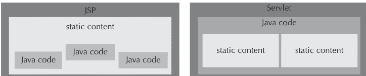

## JSP 运行时架构

当你理解 Java Page 在部署到 EE 容器时发生了什么，关于 JSP 可用的 JSP 环境很多都会变得清晰。在 JSP 作为 WAR 文件的一部分部署到 Java 容器之后，在容器尝试处理第一个 JSP 请求之前，Web 容器会读取你部署的 JSP。根据这些信息，它生成用于实现 JSP 目标的 Java servlet 代码。它编译生成的 Java servlet 并用客户端面向 JSP 的请求调用它。在这种情况下，JSP 并不真正处理 HTTP 请求或响应。面向 JSP 的 HTTP 请求是由 EE 容器为其生成的 Java servlet 处理的。这一过程如图 3-2 所示。

这为 JSP 可用的 Java EE Web 容器部分提供了线索；它是我们在 Java Servlet API 中已经过的环境。JSP 技术本质上使用语法允许 Java 代码嵌入静态内容中。这种语法的第一种最基础的形式是 `<% %>`。你可以在 `<% %>` 大括号内编写常规 Java 代码并访问 Java servlet 和 JSP API。Java EE Web 容器创建实现 JSP 的生成的 Java servlet，它将 JSP 中的任何静态内容行封装在 `out.println()` 语句中。Web 容器还将 JSP 中嵌入在 `<% %>` 内部任何 Java 代码按顺序直接写入生成的 Java servlet 中，如图 3-3 所示。

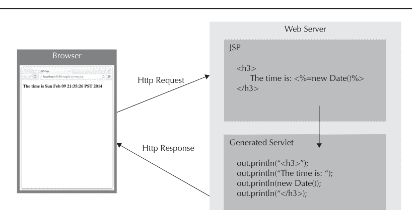

在 JSP 的这个视图中，嵌入代码片段的基本语法及其生成形式仅仅是一个开始。JSP 提供了一个丰富的环境和一套机制，用于简化构建在 servlet 模型之上的静态内容与动态内容之间的边界。尽管如此，理解 JSP 本质上与 servlet 相同，只是编程模型不同（由包含各种伪装的 Java 代码的静态内容组成），是理解 JSP 技术许多方面的关键。

### 一个 JSP 时钟

让我们来看一个非常简单的示例，它展示了 JSP 的一些基础。这里有一个非常简单的 JSP 时钟，显示一个包含时间的 HTML 页面。在图 3-4 中，你可以看到 JSP 位于页面时钟中。无论你何时在浏览器中加载页面，它每次可能都会显示“Hello there!”

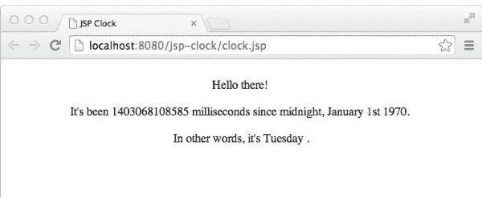

你也可以看到时间必须在当时动态生成。让我们来看代码：

```jsp
<%@ page contentType="text/html" pageEncoding="UTF-8"%>
<%@ page import="java.util.Date" %>
<%@ page import="java.text.SimpleDateFormat" %>
<!DOCTYPE html>
<html>
<head>
  <title>JSP Clock</title>
</head>
<body>
  <div align='center'>
    Hello there!
    <br/>
    It's been <%=currentTimeMillis()%> milliseconds since midnight, January 1st, 1970.
    <br/>
    In other words, it's
    <%
      Date now = new Date();
      SimpleDateFormat sdf = new SimpleDateFormat("EEEE");
      String today = sdf.format(now);
      out.println(today.trim());
    %>
  </div>
</body>
</html>
```

首先，我们注意到 JSP 页面顶部的 `@page` 行。这些语句被称为 JSP 指令。`@page` 指令用于设置整个 JSP 页面的属性。在这个示例中，我们有三个 `@page` 指令：第一个定义了此 HTML 页面的 MIME 类型和编码，第二个定义了 JSP 将使用两个 Java 类：`java.util.Date` 和 `java.text.SimpleDateFormat`。

读取页面指令以及我们预计该页面的 HTML 代码，直到看到这一行：

It's been `<%=currentTimeMillis()%>` milliseconds

文本 `<%=currentTimeMillis()%>` 被称为脚本段。当你输入它时，你就离开了静态 HTML 代码的世界，重新回了动态 Java 代码的世界。JSP 脚本段有两种：

1. `<%= expression %>`，其中表达式求出一个值。这在页面被调用时使用，该值成为页面输出的一部分。
2. `<% expression %>`，其中表达式是 Java 语句集合，用于执行某些计算并采取操作。

当我们计算并显示当前星期几时，我们在页面使用了第二种形式：

```jsp
<%
  Date now = new Date();
  SimpleDateFormat sdf = new SimpleDateFormat("EEEE");
  String today = sdf.format(now);
  out.println(today.trim());
%>
```

注意，在这个语句块中，JSP 页面依赖顶部声明的 `@page` 导入来解析 Java 类 `Date` 和 `SimpleDateFormat`。

其次，输出的结果是什么？在这一行中，底层 HTTP 请求的输出将内容带回给调用内容，并且它是 JSP API 中的一种 `java.io.Writer` 类型，具体为 `servlet.PrintWriter`。注意，该变量在 JSP 的其他地方都没有声明过：因为 JSP 中的 Java 环境预先配置了许多称为隐式对象的对象。其他示例包括 `session` 变量（当前的 `HttpSession`）和 `response` 变量（当前的 `HttpServletResponse`）。

所以这一行

```jsp
out.println(today.trim());
```

它将日期写入响应变量，这就是它在浏览器加载时出现在页面上的方式。

更复杂的 JSP 可能会进一步使用脚本段形式的嵌入 Java 代码，正如我们在这个简单示例中看到的，它们倾向于遭受 Java servlet 可能具有的一些 Java 可维护性问题，只不过方向相反。理想情况下，静态标记内容和动态 Java 内容应该分离到不同的文件中。用于实现此点的 JSP 技术将引导我们进入 JSP Bean、标签库和表达式语言的主题。但在之前，我们需要更全面地理解此示例引入的核心 JSP 语法。

## JSP 语法

按照习惯，JSP 文件应该以 `.jsp` 结尾。这让 Java EE Web 容器识别出应该尝试将文件解释为 JSP。JSP 的 URL 与 Web 应用中普通静态文件的 URL 一样。也就是说，对于位于 WAR 文件中的

```
/mysite/hello.jsp
```

的 JSP 文件，运行时 JSP 的完整 URL 为

```
http://hostname:port/web-app-context-root/mysite/hello.jsp
```

可以使用相同的指令名称使用多个属性，或者列出多个每个带有一个属性的指令。这种设计选择实际上是一个审美问题，但开发者通常会将相关的属性分组在同一个指令中。

## JSP 指令

JSP 指令是告诉 JSP 如何处理它的一系列指令集合。它们分为几类：

- **page**：此指令控制 JSP 的通用属性。
- **include**：此指令允许 JSP 包含来自另一个文件的内容。
- **taglib**：此指令允许 JSP 声明它将使用特殊标签。我们将在本章稍后看到标签库。

### Page 指令：适用于 JSP 的全局属性

两个 page 指令声明了关于 JSP 输出的信息：`contentType` 和 `pageEncoding`。`contentType` 属性允许 JSP 声明其产生的内容的 MIME 类型，`pageEncoding` 允许 JSP 声明它使用的字符编码。这些可以列为单独属性，或者为了简便，`pageEncoding` 可以合并到 `contentType` 属性中。例如：

```jsp
<%@ page contentType="text/html" %>
<%@ page pageEncoding="utf-8" %>
```

等同于

```jsp
<%@ page contentType="text/html; charset=UTF-8" %>
```

这里是 `contentType` 的其他示例：

```jsp
<%@ page contentType="image/jpeg" %>
<%@ page contentType="text/plain" %>
```

### JSP 中使用的语言

JSP 使用 Java 语言处理脚本段和 JSP 表达式语言（JEL）。如果底层实现支持，可以使用其他语言编写脚本段。四个 page 指令控制这些语言在 JSP 中的使用：`language`、`isELIgnored`、`isScriptingEnabled` 和 `import`。JSP 可以声明：

```jsp
<%@ page language="java" %>
```

指令指示其在脚本段中使用 Java，尽管这个特定的值通常是不需要声明的，因为 Java 在 JSP 中始终被支持。如果 JSP 不使用 JEL，它可以声明为：

```jsp
<%@ page isELIgnored="true" %>
```

默认情况下，JSP 实现总是查找 JSP EL 的使用。最后，完全不使用脚本段的 JSP 可以通过页面指令 `isScriptingEnabled` 来声明：

```jsp
<%@ page isScriptingEnabled="false" %>
```

JSP 实现假设除非使用此指令另有说明，否则每个 JSP 脚本段都是启用的。

当使用 JSP 脚本段时，它们通常需要从其他 Java 平台包导入类，在这种情况下 JSP 必须使用 `import` 属性声明页面指令。该值是 JSP 中脚本代码将使用的包的逗号分隔列表。例如：

```jsp
<%@ page import="java.util.*, java.text.*" %>
```

这等同于

```jsp
<%@ page import="java.util.*" %>
<%@ page import="java.text.*" %>
```

许多开发者更喜欢第二种风格，即使用 `import` 语句将导入拆分为多个 page 指令，因为它紧密地模拟了 Java 语言中每个导入语句对应一个包的模式。

JSP 脚本段可以使用 `java.lang` 中的任何类、servlet API 以及 JSP Java API 中的类，这些类位于 `javax.servlet` 及其子包中，以及 `javax.servlet.jsp` 及其子包中。

### 控制 JSP 在运行时的行为

JSP 页面输出被收集是为了写入输出流以缓冲调用的客户端，关于内容如何写入有许多选择。实现可能会对内容进行缓冲，并可能希望将缓冲区写入输出中。在不使用任何特殊指令的情况下，JSP 实现会缓冲页面输出，并在缓冲区满时自动刷新内容，因此这些开关无疑是为更高级开发者提供的。它们可以为开发者为特定页面和特定客户端优化 JSP 性能提供有用的控制。JSP 页面指令的最后两个属性尊重 JSP 实现以控制输出如何缓冲的方面：`autoFlush` 和 `buffer`。`buffer` 定义了是否使用缓冲，以及如果使用，缓冲区应该有多大。第二个属性 `autoFlush` 是一个开关，它指示 JSP 实现在缓冲区填满时是自动刷新缓冲区，还是手动刷新缓冲区。例如：

```jsp
<%@ page autoFlush="false" buffer="8kb" %>
```

指示 JSP 实现使用不小于 8 KB 的缓冲区，并且不自动刷新它。或者：

```jsp
<%@ page buffer="none" %>
```

指示 JSP 实现不使用缓冲区；以及：

```jsp
<%@ page buffer="6kb" %>
```

指示 JSP 实现使用大小至少为 6 KB 的缓冲区，并在缓冲区填满时自动刷新内容。

作为 Java servlet，JSP 的默认线程模型是它们期望并发处理多个传入的 HTTP 请求。这在 Web 应用程序中经常发生，但创建一个你已知只有一个客户端访问的 JSP 可能是很有用的！一次一个线程。在这种情况下，JSP 实现可能会选择让任何并发请求排队并一次只调用 JSP 线程，或者它可能会选择实例化同一个 JSP 的多个实例，每个实例一次处理一个请求。无论采用哪种方法，JSP 实现都能保证每个 JSP 实例一次只处理一个 HTTP 请求。你可以使用 `isThreadSafe` 属性：

```jsp
<%@ page isThreadSafe="false" %>
```

让 JSP 知道此 JSP 需要被谨慎处理，并且一次只被一个线程调用。

### JSP 错误页面

JSP 可以作为其他组件的错误页面。如果 JSP 生成了未处理的运行时错误，那么自定义客户端看到的页面将是很有用的。在这种情况下，希望作为格式良好的错误页面的 JSP 使用 page 指令中的 `isErrorPage` 属性：

```jsp
<%@ page isErrorPage="true" %>
```


如果 JSP 在运行时发生未处理的异常并希望客户端被重定向到此页面，可以使用 `errorPage` 属性指定其希望使用的 JSP 名称；例如：

```jsp
<%@ page errorPage="myerror.jsp" %>
```

### 关闭 HttpSession 跟踪

正如我们稍后查看 JSP 隐式对象时看到的，JSP 开发者可以很容易通过脚本从 JSP 环境获取 `HttpSession`。然而，会话跟踪会带来一些开销，作为优化，某些不使用 `HttpSession` 的 JSP 可以使用 `page` 指令的 `session` 属性关闭会话跟踪机制，例如：

```jsp
<%@ page session="false" %>
```

通过这种方式，如果没有此类指令，`HttpSession` 将始终由 JSP 实现维护。我们将看到这是共享特定客户端应用程序状态的有效方法。现在我们已经涵盖了 `page` 指令的所有属性，让我们在下表中总结我们学到的内容：

| 页面指令 | 目的 | 默认 |
|---|---|---|
| autoFlush | 如果使用缓冲写入输出流，则决定是否刷新 | true |
| buffer | 定义是否使用缓冲以及缓冲区应该有多大 | None |
| contentType | 定义 JSP 的 MIME 类型 | text/html |
| errorPage | 定义错误时重定向到的 JSP 名称 | false |
| extends | 定义此 JSP 继承的子类 | HttpServlet |
| import | 定义用于脚本的包的逗号分隔列表 | java.servlet |
| info | JSP 的描述 | 空字符串 |
| isELIgnored | 声明是否忽略表达式语言 | true |
| isThreadSafe | 声明 JSP 是否可以处理并发请求 | true |
| isScriptingEnabled | 声明是否启用脚本 | true |
| language | JSP 的语言 | Java |
| pageEncoding | 定义页面的字符集 | TBD |
| session | 声明是否使用会话跟踪 | true |

### include 指令

`include` 指令允许你将静态内容拉取到你的 JSP 中。这可以被用于为页面添加标准的页眉或页脚。其语法为：

```jsp
<%@ include file="header.html" %>
```

![591154af76ab0a3e5ff2458dd8e_89_0.png]

### taglib 指令

`taglib` 指令允许你导入在一个或多个 Java 类中实现的自定义标签。我们稍后将检查库，但现在你使用此指令指定描述符文件（以 .tld 结尾）以及 JSP 将使用的前缀：

```jsp
<%@ taglib uri="shoppingTags.tld" prefix="shopping" %>
```

现在我们已经有了所有的 JSP 指令，我们的下一步是学习 JSP 动作。

## 在 JSP 中使用 Beans

如前所述，在 JSP 中使用 Java 脚本会导致代码文件包含两种语言的混合：一个用于静态内容，一个用于动态内容。一方面，JSP 的核心特性是能够将这些世界混合在一起。另一方面，使用产生网页的 Java servlet，这导致了职责分离的不彻底。JSP 的所有方面，无论是用于代码展示的、从数据源检索数据的代码、输入值的代码，还是控制用户交互流的代码，都在同一个地方。坦率地说，JSP 包含了两种机制，可以比脚本更清晰地将动态从静态代码中提取。这些机制是来自 JSP 中使用 JavaBean 和 JSP 标签库。

JavaBean 是一种遵循一系列惯例的普通类，这使其可以在各种设置中作为可重用组件。为了让一个 Java 类成为 JavaBean，它必须：

- 有一个零参数构造函数
- 使用 JavaBean 属性模式暴露类客户端使用的任何数据

例如，一个要检索的数据类 `Foo` JavaBean 必须有一个方法：

```java
public Foo getFoo()
```

其中 `fooPropertyName` 是类型为 `Foo` 的属性名，而 JavaBean 希望存储的任何 `Bar` 类数据必须是形式：

```java
public void setBarPropertyName(Bar bar)
```

其中 `barPropertyName` 是类型为 `Bar` 的属性名。

为了能够在 JSP 内部使用 JavaBean，所有操作都需要三个语法部分：

```jsp
<jsp:useBean id="name for bean" class="full qualified className of bean" />
```

`id` 为 JavaBean 提供了一个你可以在 JSP 其他地方使用的名称，`class` 告诉 JSP 实现该 `className`。现在你准备好在 JSP 中使用 JavaBean 了。方法有：你可以从 JavaBean 中检索属性并使用

## 第3章：动态网页：JSP

```jsp
<jsp:getProperty name="name for bean" property="property name" />
```

action，或者您可以使用以下标签为 JavaBean 设置一个值：

```jsp
<jsp:setProperty name="name for bean" property="property name" value="property value string" />
```

让我们来看一个例子。JavaBeans JSPs 的目标之一是将 JSP 中的动态 Java 代码与静态 Web 内容分离离开。让我们以我们的时钟示例为例，看看使用这种技术如何实现这一目标。

首先，我们记得 `clock.jsp` 中有两个脚本段（scriptlets）：

```jsp
<%= System.currentTimeMillis() %>
```

以及

```jsp
<%
Date now = new Date();
SimpleDateFormat sdf = new SimpleDateFormat("EEEEEEEE");
String today = sdf.format(now);
out.println(today.trim());
%>
```

首先，让我们将这些代码放入一个 JavaBean 中，而不是让它们悬浮在脚本段中：

```java
import java.text.SimpleDateFormat;
import java.util.Date;

public class ClockBean {
    public long getCurrentTimeEpoch() {
        return System.currentTimeMillis();
    }

    public String getReadableDate() {
        Date now = new Date();
        SimpleDateFormat sdf = new SimpleDateFormat("EEEEEEEE");
        String today = sdf.format(now);
        return today;
    }
}
```

接下来，我们将替换 JSP 中的脚本段，结果如下：

```jsp
<%@ page contentType="text/html" pageEncoding="UTF-8" %>
<!DOCTYPE html>
<html>
<head>
    <title>JSP 时钟</title>
</head>
<body>
    <jsp:useBean id="myBean" class="example.chapter3.clockbean.ClockBean" />
    <div align="center">
        <br />
        Hello there!
        <br /><br />
        自 1970 年 1 月 1 日午夜以来已经
        <jsp:getProperty name="myBean" property="currentTimeEpoch" />
        毫秒。
        <br /><br />
        换句话说，它是 <jsp:getProperty name="myBean" property="readableDate" />.
    </div>
</body>
</html>
```

请注意，我们不再需要 JSP 顶部的 `@page import` 指令，并且通过获取我们声明为 ID 的 Bean 的 `currentTimeEpoch` 和 `readableDate` 属性的值，替换了脚本段。

我们可以更进一步，允许 JavaBean 在格式化可读日期方面是可配置的。让我们为 bean 添加一个新属性 `dateFormat`，使用它来显示可读日期，并将其命名为 `ConfigurableClockBean`：

```java
import java.text.SimpleDateFormat;
import java.util.Date;

public class ConfigurableClockBean {
    String dateFormat = "EEEEEEEE";

    public long getCurrentTimeSinceEpoch() {
        return System.currentTimeMillis();
    }

    public void setDateFormat(String dateFormat) {
        this.dateFormat = dateFormat;
    }

    public String getReadableDate() {
        Date now = new Date();
        SimpleDateFormat sdf = new SimpleDateFormat(this.dateFormat);
        String today = sdf.format(now);
        return today;
    }
}
```

现在在 JSP 中，我们选择希望在页面上显示日期的方式，但使用 `<jsp:setProperty>` 标签来设置 bean 的属性：

```jsp
<%@ page contentType="text/html" pageEncoding="UTF-8" %>
<!DOCTYPE html>
<html>
<head>
    <title>JSP 时钟</title>
</head>
<body>
    <jsp:useBean id="myBean" class="example.chapter3.clockbean.ConfigurableClockBean" />
    <div align="center">
        <br />
        Hello there!
        <br /><br />
        自 1970 年 1 月 1 日午夜以来已经
        <jsp:getProperty name="myBean" property="currentTimeEpoch" />
        毫秒。
        <br /><br />
        换句话说，它是 <jsp:getProperty name="myBean" property="readableDate" />.
        <br />
        <jsp:setProperty name="myBean" property="dateFormat" value="MMdd:ss" />
        换句话说，它是 <jsp:getProperty name="myBean" property="readableDate" />.
    </div>
</body>
</html>
```

这产生了图 3-5 所示的结果。

我们实现了目标吗？是的，动态代码已经与显示代码分离了。这意味着动态代码可以由不同技能的开发者分别维护。你可以想象随着 JSP 复杂性的增加，这种技术将变得多么有用。

在 `<jsp:useBean>`、`<jsp:setProperty>` 等三个 JavaBean 相关标签上，可以使用多个属性。在声明 JSP 将使用某个 JavaBean 时，`id` 属性是强制性的：bean 必须有一个名称，以便在 JSP 的其他地方调用（例如，从 `<jsp:getProperty>` 调用）。JavaBean 实例可以通过两种机制实例化：通过 `class` 属性使用类名（正如我们在示例中所示），或者通过传递 bean 名称（该名称被解释为对 `java.beans.Beans.instantiate()` 的调用）。通常，JSP 通过完全限定类名（即 `class`）引用 JavaBean，这是第一种机制。

![591154af76ab0a3ae5cff2458dd81_93.png]

图 3-5. 使用 JavaBean 的 JSP 时钟

对对象的管理是 Java 平台许多方面的贯穿特征。Java EE 开发者经常问的问题是：对象的作用范围是什么？它是什么时候创建的，在什么期间可以使用，以及什么时候被销毁？对于 JSP 使用的 JavaBean 实例来说，这些都是很好的问题。在没有开发者干预的情况下，为 JSP 创建的 JavaBean 由容器管理。

JSP 可四种作用范围：

- 页面范围（Page scope）：在 JSP 内部有效。
- 请求范围（Request scope）：在 HTTP 请求内有效。
- 会话范围（Session scope）：在同一个会话内有效。
- 应用范围（Application scope）：在整个应用程序内有效。

因此，`<jsp:useBean>` 声明的最后一个可选属性是 `scope` 属性，可以取 `page`、`request`、`session` 或 `application`。如果省略，默认值为 `page`。

现在我们已经学习了声明 JavaBean 的所有方法，让我们来看看获取和设置 JavaBean 属性的变体。

[注意：文本在此中断]

`<jsp:setProperty>` 是为 JavaBean 设置值最典型的 JSP 标签类型。JSP 实现尝试调用 JavaBean 的 `setMyBeanProperty()` 方法，并传递一个参数

## 第 3 章：动态网页：JSP 73

基于声明中的值字符串和方法的参数类型。如果参数方法是 `String`（这是最简单且最直接的情况），JSP 将直接传递该值字符串。如果参数类型不是 `String`，JSP 实现将尝试将值字符串转换为参数类型的对象，并寻找带有单个参数的 `String` 构造函数。

或者，你可以通过 HTTP 请求在 JavaBean 上设置属性，也就是说通过 HTTP 请求中查询字符串传递的键值对。在这种情况下，不需要指定 `value` 属性，而是可以使用 `param` 属性，将请求属性的名称作为值；在这种情况下，JSP 实现会将给定的请求值解析为字符串，并将其传递给 JavaBean 的 setter 方法。例如，动作：

```jsp
<jsp:setProperty name="MyColorBean" property="color" param="brush-color" />
```

在 JSP 页面 `painting.jsp` 中通过以下 URL 调用的画刷：

```
painting.jsp?brush-color=red
```

将调用名为 `MyColorBean` 的 JavaBean 的 `setColor(String colorName)` 方法，并传入值 "red"。

## jsp:forward 和 jsp:include

这些动作允许 JSP 将 HTTP 请求转发到另一个 Web 组件（servlet、JSP、静态文件），并将另一个 Web 组件的输出包含到其中。

转发动作的语法如下：

```jsp
<jsp:forward page="web组件的相对 URL" />
```

并且没有变体。与 Java 服务（servlets）一样，一旦 JSP 将其请求转发到另一个 Web 组件，它就会尝试在处理转发后简单地包含其内容。

包含的语法如下：

```jsp
<jsp:include page="web组件的相对 URL" flush="true" />
```

其中 `flush` 是一个可选属性，用于控制是否使用该 JSP 包含内容。

包含的缓冲区会在另一个组件输出之前被刷新（即将其所有内容发送给客户端）。通常情况下，JSP 希望在以这种方式包含另一个组件的输出之前，其所有内容已发送；如果 `flush` 属性缺失，此默认值为 `true`。当包含的组件输出被发送时，调用端 JSP 的剩余内容将被发送。

使用 `<jsp:include>` 动作，你可以将请求参数从调用的 JSP 传递到 Web 组件。这可以通过以下方式实现：

```jsp
<jsp:param name="paramName" value="paramValue" />
```

例如，代码：

```jsp
<jsp:include page="brush.jsp">
    <jsp:param name="softness" value="very soft" />
</jsp:include>
```

将请求参数 `softness=very soft` 传递给 `brush.jsp`。这是在 JSP 和其包含的 Web 组件之间传递应用状态的技巧。

最后，不要将 `<jsp:include>` 动作与我们之前的 `@include` 指令混淆。`<jsp:include>` 动作用于包含任何 Web 组件的输出，作为静态 Web 资源（如网页或图像），或作为另一个 JSP 或 Java servlet 的 Web 组件。`@include` 指令仅用于包含静态文本。

## jsp:plugin

`jsp:plugin` 允许你在 JSP 中使用 Java applet，而无需担心如何生成相应的依赖客户端浏览器的标签（`<object>` 或 `<embed>`）。语法如下：


```jsp
<jsp:plugin
  type="bean applet"
  code="objectCode"
  codebase="objectCodebase"
  align="alignment"
  archive="archiveList"
  height="height"
  hspace="hspace"
  jreversion="reversion"
  name="componentName"
  vspace="space"
  width="width"
  nspluginurl="url"
  iepluginurl="url" >
  <jsp:params>
    { <jsp:param name="paramName" value="paramValue" /> }
  </jsp:params>
  { <jsp:fallback> arbitrary_text </jsp:fallback> }
</jsp:plugin>
```

这里是 `jsp:plugin` 动作用于 Banner 类 applet 的示例，它使用了两个参数和文本错误消息：

```jsp
<jsp:plugin
  type="applet"
  codebase="/myapplet"
  code="Banner.class"
  width="100"
  height="25">
  <jsp:param name="highlight" value="true" />
  <jsp:param name="repeat" value="error" />
</jsp:plugin>
```

## 第 3 章：动态网页：JSP

我们已经在以下内容中遇到了隐式对象：

```jsp
<%
  Date now = new Date();
  SimpleDateFormat sdf = new SimpleDateFormat("EEEE");
  String today = sdf.format(now);
  out.println(today);
%>
```

下表显示了 JSP 中最常用的隐式对象。

| 隐式对象 | 用途 |
| :--- | :--- |
| `javax.servlet.ServletContext` | 访问 Web 容器，存储自定义属性 |
| `javax.servlet.ServletConfig` | 访问关于 servlet 的配置信息 |
| `java.lang.Throwable` | 用于作为错误页面的 JSP；开发者访问导致当前错误页面异常 |
| `javax.servlet.jsp.JspWriter` | 访问写入器向响应体向客户端写入文本输出 |
| `HttpServlet` | 访问 "this"，即此 JSP 的 Java servlet 实例 |
| `javax.servlet.jsp.PageContext` | 访问代表 JSP 及其属性的 JSP API 对象 |
| `javax.servlet.http.HttpServletRequest` | 访问来自客户端的 HTTP 请求 |
| `javax.servlet.http.HttpResponse` | 访问向客户端写入内容的 HTTP 响应 |
| `javax.servlet.http.HttpSession` | 访问此 JSP 的当前 HTTP 会话 |

还有几个隐式对象（都可以从表中推导出），可访问 cookie、标头和请求参数。作为 Java servlet 开发者，所有的 JSP 隐式对象都会感到非常熟悉：它们与你在 Java servlet 的 `service` 方法中使用的对象大部分相同。

## JSP 标准标签

JSP 是 Java EE 平台的标准部分，JSP 定义了一组非常有用的标签，可以在任何 JSP 中自由使用。它们分为几类；JSP 标准标签用于通用的 JSP 编程，我们即将探索其中的一些。此外，还有用于访问 SQL 数据、XML 和文本处理与格式化，以及一组用于字符串操作的函数。对所有这些标签（即 JSP 标准标签库，JSTL）进行示例说明已超出本书的范围。我们来仔细查看该库中的一些核心标签，因为它们是最常用且使用最广泛的。

在寻找减少 JSP 文件中嵌入代码量的方法时，我们经常会在嵌入代码中遇到 Java 控制语句，例如 `for` 循环和 `if-else-if` 语句。JSP 标准标签库包含了允许用标签替换这些控制语句的标签：`<c:forEach>` 和 `<c:if>`。

`<c:forEach>` 有两种变体：一种用于迭代带有步进值的数字序列，另一种用于迭代数组或 Java 集合（Collection）。这在迭代 JavaBean 的属性时特别有用。对于第一种变体，其形式为：

```
<c:forEach var="index name" begin="start index" end="end index" step="step increment">
```

其中 `var` 可以在 `<c:forEach>` 元素内的任何地方通过 `${index name}` 使用，而对于第二种：

```
<c:forEach var="variable name" items="collection name">
```

其中变量可以在 `<c:forEach>` 循环的任何地方通过 `${variable name}` 被引用。让我们来看一个示例。

在这个示例中，我们使用了一个名为 `MyWallet` 的 JavaBean；其代码如下：

```java
import java.util.*;

public class MyWallet {
    String[] coins = {"1c", "1c", "5c", "25c", "25c"};
    String[] currency = {"$1", "$1", "$5", "$10", "$20"};
    String[] receipts = {"gas -42.50", "groceries", "bookstore -12.99"};

    public List getCoins() {
        return Arrays.asList(coins);
    }

    public List getNotes() {
        return Arrays.asList(notes);
    }

    public Set getReceipts() {
        return new HashSet(Arrays.asList(receipts));
    }
}
```

你会注意到这个示例探索了只读的 JavaBean 属性：类型为 Java 数组、`java.util.List` 和 `java.util.Set` 的 `coins`、`notes` 和 `receipts`：它们的 `<c:forEach>` 语法相同。在我们查看使用此迭代标签的 JSP 之前，为了使用标准标签库中的任何标签，JSP 必须声明：

```
<%@taglib uri="http://java.sun.com/jsp/jstl/core" prefix="c" %>
```

该 uri 是标准标签库的已知 URI，且始终相同。前缀可以根据喜好选择，但标准标签库标签的约定前缀是 `c`。现在让我们来看代码：

```html
<!DOCTYPE html>
<html>
<jsp:useBean id="myWallet" class="javaeams.chapter3.beans.MyWallet"/>
<head>
    <meta http-equiv="Content-Type" content="text/html; charset=UTF-8">
    <title>For each</title>
</head>
<body>
    20 以内的奇数：
    <c:forEach var="i" begin="1" end="20" step="2">
        ${i}&nbsp;
    </c:forEach>
    
    我有的硬币：
    <c:forEach var="coin" items="${myWallet.coins}">
        ${coin}&nbsp;
    </c:forEach>

    我有的钞票：
    <c:forEach var="note" items="${myWallet.notes}">
        ${note}&nbsp;
    </c:forEach>
    
    收据：
    <c:forEach var="receipt" items="${myWallet.receipts}">
        ${receipt}&nbsp;
    </c:forEach>
</body>
</html>
```

注意，JSP 使用 `<c:forEach>` 标签的两种变体：对数字序列的迭代以及对集合或数组的迭代。很有用的是，在前一种情况下，如果省略了 `step` 属性，默认值为 1。当你执行该 JSP 页面时，你将在图 3-6 中看到输出。

图 3-6. 使用迭代标签的 JSP 示例

`<c:if>` 标签非常有用，其通用形式为：

```
<c:if test="condition">
```

只有当条件求值为真时，标签的主体才会写入 JSP。通过使用如伪代码中的条件之类的动态分配值，我们关注了 Java 属性，如 `${myBean.property}`。这种类型的表达式是表达式语言（Expression Language）的示例，我们稍后会介绍。在 JSP 中我们有许多方法测试条件，`==` 运算符现在非常常用。我们在这个示例中检查了它，该示例使用 `<c:if>` 标签来测试一天的时间：

```jsp
<%@page contentType="text/html" pageEncoding="UTF-8" %>
<%@taglib uri="http://java.sun.com/jsp/jstl/core" prefix="c" %>
<!DOCTYPE html>
<html>
<head>
<meta http-equiv="Content-Type" content="text/html; charset=UTF-8">
<title>Page</title>
</head>
<body>
<jsp:useBean id="myWallet" class="javaeams.chapter3.beans.MyWallet"/>
<c:set var="time" value="14" />
<c:if test="${time < 12}">
    上午
</c:if>
<c:if test="${time >= 12}">
    下午
</c:if>
</body>
</html>
```

*(注：由于原文提供的待翻译文本在后半部分存在代码块乱码和重复，译文已根据逻辑修复了该结构以确保 JSP 逻辑的连贯性)*

我们现在已经完成了第一步。接下来，我们需要使用 TLD 在 Web 中声明这些标签实现：

```xml
<?xml version="1.0" encoding="UTF-8"?>
<taglib version="2.1" xmlns="http://java.sun.com/xml/ns/javaee"
     xmlns:xsi="http://www.w3.org/2001/XMLSchema-instance"
     xsi:schemaLocation="http://java.sun.com/xml/ns/javaee http://java.sun.com/xml/ns/javaee/javaeeTLD_2_1.xsd">
<tlibversion>1.0</tlibversion>
<short-name>Chapter 3 的自定义标签</short-name>
<tag>
  <name>time-since-epoch</name>
  <tag-class>javae.clockbean.MyTimeSinceEpochTag</tag-class>
  <body-content>scriptlet</body-content>
</tag>
<tag>
  <name>date</name>
  <tag-class>javae.clockbean.MyDateTag</tag-class>
  <body-content>scriptlet</body-content>
  <attribute>
    <name>dateFormat</name>
    <required>true</required>
  </attribute>
</tag>
</taglib>
```

一旦确定了 JSP 和标签扩展 API 的版本，我们就可以为工具中使用的标签集合指定一个 `<short-name>`。然后，`<tag>` 元素（`<taglib>` 的子元素，可以根据需要声明的标签数量出现多次）包含了标签在 JSP 中显示的名称以及实现它们的标签类，并包含了一组 `<attribute>` 子元素，这些子元素定义了标签上可以设置的哪些 bean 属性。在我们的案例中，由 `MyDateTag` 实现的 `<date>` 标签有一个名为 `dateFormat` 的 bean 属性。对于该标签函数，在使用标签时必须设置一个值，如我们所见，这解释了为什么该属性被标记为 `<required>true</required>`（必填的）。

第三，我们将在一个版本的 JSP 中使用标签，但将所有的 Java 代码替换为我们新的自定义标签：

```xml
<custom:date date="h:mm a, zzzzz"/>
</div
</body>
</html>
```

请特别注意，标签是使用 `@taglib` 指令中声明的前缀使用的。当运行此 JSP 时，它的看起来类似于图 3-9 所示。你应该能够看到 JSP 代码是如何与章节开头嵌入 Java 代码的版本以及使用 JavaBean 的版本进行对比的。

## 标签库 (Tag Libraries) 与 JavaBeans

我们应该讨论一下 JSP 中自定义标签库与 JavaBean 相比的相对优缺点，因为它们都实现了 Web 应用程序中将 Java 代码与表示代码分离的目标。关于哪种更好，没有明确的答案，也没有像 JSP/JavaBean 模型那样有明确的对比来说明何时该使用某一种技术而非另一种。然而，有几个因素可能帮助你决定在特定设置下采用哪种方法。

- 在 JSP 中调用的 JavaBean 的设置和配置比标签库的设置和配置更简单。
- 自定义标签在选择 JSP 代码中出现的名称时允许更大的自由度。在 JSP 中，你受限于 `<jsp:useBean>` 和 `<jsp:setProperty>` 标签。对于后者，你也可以使用 JSP 表达式语言（EL），而使用自定义标签时，你可以选择自己的描述性且更具个性化的命名法。
- 在自定义标签中使用 JSP 隐式对象更容易。得益于访问 `tagContext` 的方便，可以很容易获取 `request`、`application` 和 `session` 等隐式对象。为了让 JavaBean 能够使用这些对象，必须显式地将这些对象设置为属性。
- 自定义标签可能只有页面范围（page scope），而 JavaBean 可以在四种范围中的一种使用：page、request、session 和 application。换句话说，自定义标签的实例只在 JSP 页的一次调用中存在。相反，JavaBeans 有其他生命周期。

图 3-9. 使用自定义标签的 JSP 时钟

## 表达式语言 (Expression Language)

在我们查看 JSPs 运行的更具体的示例之前，我们需要考虑 JSP 表达式语言。JSP 表达式语言是一种短小而强大的语法，起源作为一种读取和处理来自 JavaBean 值的手段，但现在已是 JSP 中处理数据的通用方法。

JSP EL 在 JSP 中被求值以产生以下值：

- 在元素体内的任何地方以产生文本内容
- 在标签属性中

当我们访问 `MyWallet` 时已经看到过它的运行情况了，例如：

```jsp
<c:forEach var="coin" items="${myWallet.coins}">
  ${coin}&nbsp;
</c:forEach>
```

当你在测试用于 `<c:if>` 标准标签的条件时，也看到了一个 EL 语法的示例：

```jsp
<c:if test="${myBean.readableDate='AM'}">
该是喝茶的时间了！
</c:if>
```

我们将在第 4 章回到 JSP EL 的话题。现在，我们将使用 JSP 表达式并通过一个示例来快速了解。JSP 表达式的形式如下：

```jsp
${expression}
```

在 JSP 中被求值以产生值：

- 在元素体内的任何地方以产生文本内容
- 在标签属性中

当我们访问 `MyWallet` 时已经看到过它的运行情况了，例如：

```jsp
<c:forEach var="coin" items="${myWallet.coins}">
  ${coin}&nbsp;
</c:forEach>
```

当你在测试用于 `<c:if>` 标准标签的条件时，也看到了一个 EL 语法的示例：

```jsp
<c:if test="${myBean.readableDate='AM'}">
该是喝茶的时间了！
</c:if>
```


# JSP 表达式语言 (EL) 快速了解

我们将在第 4 章回到 JSP EL 的话题。现在，我们将使用 JSP 表达式并通过一个示例来快速了解。JSP 表达式的形式如下：

```jsp
${expression}
```

在 JSP 中被求值以产生值：

- 在元素体内的任何地方以产生文本内容
- 在标签属性中

当我们访问 `MyWallet` 时已经看到过它的运行情况了，例如：

```jsp
<c:forEach var="${myWallet.coins}">
  ${coin}&nbsp;
</c:forEach>
```

当你在测试用于 `<c:if>` 标准标签的条件时，也看到了一个 EL 语法的示例：

```jsp
<c:if test="${myBean.readableDate='AM'}">
该是喝茶的时间了！
</c:if>
```

## 85 JSP

### JSP 的字面量

| 字面量类型 | 字面量值 |
| :--- | :--- |
| 布尔 | true 或 false |
| 数字 | Integer 或浮点数 |
| 字符串 | 使用双引号的字符串 |
| 空 | null |

### JSP 中的运算符

| 运算符类型 | 运算符 |
| :--- | :--- |
| 算术 | `+`, `*`, `/`, `%` (二元), `-` (一元) |
| 比较 | `eq`, `!=`, `lt`, `gt`, `<=`, `>=` (二元) |
| 逻辑 | `&&`, `\|\|`, `!` (二元或一元) |
| 条件 | `? :` (三元) |
| 空 | `empty` (一元) |

JSP 表达式可以操作属性。为了理解它们，让我们看看 JSP 声明的：

- A) JavaBean
- B) 对象的字面量
- C) 隐式对象

JSP 表达式在 JSP 中被求值以产生值：

- 在元素体内的任何地方以产生文本内容
- 在标签属性中

当我们访问 `MyWallet` 时已经看到过它的运行情况了，例如：

```jsp
<c:forEach var="${myWallet.coins}">
  ${coin}&nbsp;
</c:forEach>
```

当你在测试用于 `<c:if>` 标准标签的条件时，也看到了一个 EL 语法的示例：

```jsp
<c:if test="${myBean.readableDate='AM'}">
该是喝茶的时间了！
</c:if>
```

## 86 Java EE 7: 概览

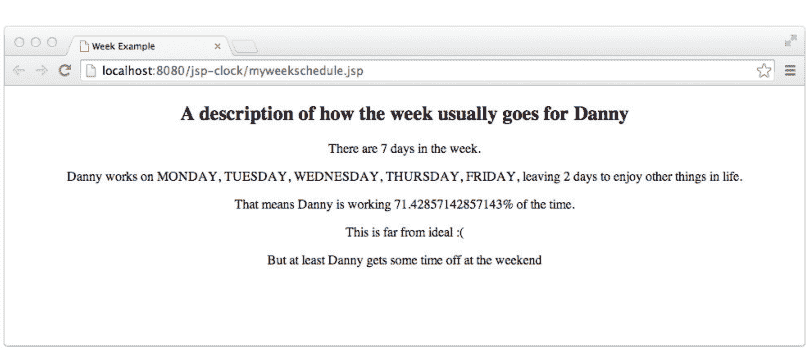

图 3-10. JSP 周

让我们看看代码。它使用了 JSP 来：

```java
import java.util.Arrays;
import java.util.List;

public class MyWeek {
    private String name;

    public enum Day {
        SUNDAY, MONDAY, TUESDAY,
        WEDNESDAY, THURSDAY, FRIDAY, SATURDAY
    }

    public MyWeek() {}

    public void setName(String name) {
        this.name = name;
    }

    public String getName() {
        return this.name;
    }

    public String getDescription() {
        return "A description of the week for " + name;
    }

    public int getNumberDays() {
        return 7;
    }

    public List<Day> getWorkingDays() {
        return Arrays.asList(Day.MONDAY, Day.TUESDAY, Day.WEDNESDAY, Day.THURSDAY, Day.FRIDAY);
    }

    public int getNumberWorkingDays() {
        return this.getWorkingDays().size();
    }

    public boolean isWeekendOff() {
        return true;
    }
}
```

现在是生成页面的 JSP。

```jsp
<%@ taglib uri="http://java.sun.com/jsp/jstl/core" prefix="c" %>
<%@ contentType="text/html" pageEncoding="UTF-8"%>

<!DOCTYPE html>
<html>
<jsp:useBean id="weekBean" class="javaems.chapter3.beans.MyWeek"/>
<jsp:setProperty name="weekBean" property="name" value="Danny"/>
<head>
<meta http-equiv="Content-Type" content="text/html; charset=UTF-8">
<title>Week Example</title>
</head>
<body><div align="center">
<h2>${weekBean.name}</h2>
There are <jsp:getProperty name="weekBean" property="numberDays" /> works on in the week:
<jsp:getProperty name="weekBean" property="name" /> works on
<c:forEach var="day" items="${weekBean.workingDays}">
${day}
</c:forEach>
leaving ${weekBean.numberDays - weekBean.numberWorkingDays} days to enjoy other things in life.
<c:set name="numberDaysOff" scope="session" value="${weekBean.numberDays-weekBean.numberWorkingDays}"/>
That means ${weekBean.name} is working ${100 * weekBean.numberWorkingDays / weekBean.numberDays}% of the time.
</div></body>
</html>
```

## 88 Java EE 7: 概览

```xml
<if test="${weekBean.numberWorkingDays > (weekBean.numberDays - weekBean.numberWorkingDays)}">
    这远非理想状态 :(
    <p>
</if>
<if test="${weekBean.weekendOff && ((weekBean.numberDays - weekBean.numberWorkingDays) == 0)}">
    但在 ${weekBean.name} 在周末获得了一些休息时间。
</if>
</div>
```

注意，此页面使用了标准的标签库，使用了 `<c:forEach>` 和 `<c:if>` 标签。代表该周的 JavaBean 输出了工作了多少天，以及它代表的是谁的周。它使用 `${}` 语法来访问属性；例如：

```jsp
${weekBean.description}
```

它也使用了 `<jsp:getProperty>` 语法来实现这一点，如下：

```jsp
<jsp:getProperty name="weekBean" property="name"/>
```

你更倾向于哪种？

它使用数字字面量和算术运算来计算工作占周的百分比：

```jsp
${100 * weekBean.numberWorkingDays / weekBean.numberDays}
```

并使用逻辑运算符来评估 `<c:if>` 运算符的条件；例如：

```jsp
${weekBean.weekendOff && !((weekBean.numberDays - weekBean.numberWorkingDays) == 0)}
```

即使是这个简单的示例也展示了 JSP 表达式语言（EL）的威力。

# JSP 照片相册

JSP 最初的目标是将 servlet 内部反转过来，目的是为了提取静态内容行，避免它们被埋没在 `println` 表达式中。我们所看到的 JSP 语法中许多方面的目标是进一步将 JSP 中的显示逻辑与动态内容生成分离，以便每种代码都更易管理和演进。

让我们在这次 JSP 之旅中将学到的知识整合起来，并应用到我们已经熟悉的示例中：我们在第 2 节中检查过的照片应用程序。我们将把其中使用的两个关键 Java servlet 转换为 JSP，旨在实现处理照片和管理相册的应用逻辑，与在屏幕上渲染相册及其照片的显示代码之间的整洁分离。

图 3-11 显示了包含三张照片的相册的应用程序。


# 第 3 章：动态 Web 页：JSP

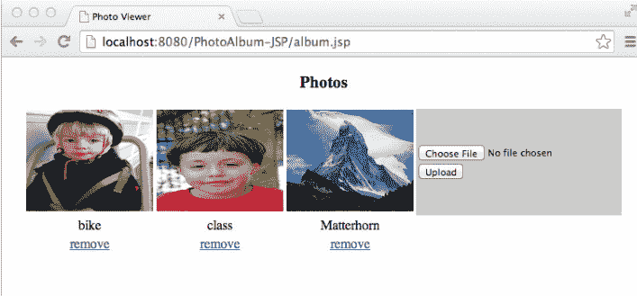

**图 3-11。** 使用 JSP 的照片相册

你已经看到这个页面是一个 JSP，即 `album.jsp`，而不是你在第 2 节看到的 `DisplayAlbumServlet`。为了处理这个示例应用程序，让我们来看一下持有所有数据的 `PhotoAlbum` 类：

```java
import java.util.*;
import javax.servlet.http.HttpSession;

public class PhotoAlbum {
    public static String ATTRIBUTE_NAME = "PhotoAlbum";
    private List<byte[]> photoListData = new ArrayList<byte[]>();
    private List<String> names = new ArrayList<String>();

    public PhotoAlbum() {
    }

    public void setSession(HttpSession session) {
        session.setAttribute(ATTRIBUTE_NAME, this);
    }

    public List getPhotoNames() {
        return names;
    }

    public void addPhoto(String name, byte[] bytes) {
        this.photoListData.add(bytes);
        this.names.add(name);
    }

    public byte[] getPhotoData(int i) {
        return (byte[]) photoListData.get(i);
    }

    public String getPhotoName(int i) {
        return (String) names.get(i);
    }

    public int getPhotoCount() {
        return photoListData.size();
    }

    public void removePhoto(int i) {
        photoListData.remove(i);
        names.remove(i);
    }

    public static PhotoAlbum getPhotoAlbum(HttpSession session) {
        return (PhotoAlbum) session.getAttribute(ATTRIBUTE_NAME);
    }
}
```

这个类与第 2 节中的大部分相同，由于它有一个公共的无参构造函数，允许作为应用程序中 JSP 的 JavaBean 使用，并且有一个新的 JavaBean 属性用于设置与此相册关联的 `HttpSession` 值。

现在我们来看第一个替换了 servlet 的 JSP：这是不是显示照片的 JSP，`photo.jsp`：

```jsp
<%@ page import="javaee.chapter3.beans.PhotoAlbum" %>
<%@ page contentType="image/jpeg" %>
<%
    java.io.OutputStream binaryOut = response.getOutputStream();
    String indexStr = request.getParameter("photo");
    int index = new Integer(indexStr.trim()).intValue();
    PhotoAlbum photo = PhotoAlbum.getPhotoAlbum(session);
    byte[] bytes = photo.getPhotoData(index);
    for (int i = 0; i < bytes.length; i++) {
        binaryOut.write(bytes[i]);
    }
%>
```

你立即注意到这个 JSP 看起来与你之前看到的任何 JSP 都不同：那是因为我们目前为止看到所有的 JSP 都产生 HTML 内容。而这一个只产生二进制内容，并在 Java 脚本中通过在 `@page` 指令设置输出的 MIME 类型来实现。该 JSP 使用了 `request`、`response` 和 `session` 对象。它使用 `request` 对象从 `PhotoAlbum` 类中查找照片索引，并使用 `response` 对象写入二进制数据。

到目前为止，我们看到了脚本段（scriptlets）、隐式对象、`@page` 指令和二进制类型的应用；我们还没有使用表达式语言、标准标签或自定义标签。首先，此应用程序使用自定义标签在主页面中显示每张照片。该标签产生包含指向大视图链接的 HTML。通过将其制为自定义标签，你将它的实现与其他部分分离开，并使其具有高度的可用性。让我们来看看这段代码：


```java
import java.io.*;
import javax.servlet.*;
import javax.servlet.jsp.tagext.SimpleTag;

public class PhotoTag extends SimpleTag {
    private int index;
    private int width;
    private int height;

    public void setIndex(int index) {
        this.index = index;
    }

    public void setWidth(int width) {
        this.width = width;
    }

    public void setHeight(int height) {
        this.height = height;
    }

    @Override
    public void doTag() throws JspException, IOException {
        JspWriter out = pageContext.getWriter();
        out.println("<a href=\"photo.jsp?=" + index + "\">");
        out.println("");
        out.println("</a>");
    }
}
```

## 第 3 章：动态页面：JSP

```jsp
<c:forEach>
<td bgcolor='#cccccc' width='120' height='120'>
<form align='left' action='UploadServlet'
  method='post' enctype='multipart/form-data'>
  <input value='Choose' name='myfile'
  type='file' accept='image/jpeg'><br>
  <input value='Upload' type='submit'><br>
</form>
</td>
</tr>
<tr
  <c:forEach var="item" items="${photoAlbum.photoNames}">
  <td align='center'>${item}</td>
  </c:forEach>
</tr>
<tr
  <c:forEach var="i" begin="1" end="${photoAlbum.photoCount}">
  <td align='center'>
    <a href='RemovePhotoServlet?photo=${i-1}'>remove</a>
  </td>
  </c:forEach>
</tr>
</table>
</body>
</html>
```

从 `@page` 指令中，你可以看到此 JSP 生成了 HTML 内容，使用了我们刚刚加载的自定义标签，并使用了标准标签库，分别使用了前缀 `c` 和 `photo-tag`：

```jsp
@page contentType="text/html" pageEncoding="UTF-8">
@taglib uri="http://java.sun.com/jsp/jstl/core" prefix="c">
@taglib prefix="photo-tags" uri="WEB-INF/mytaglib.tld">
```

进入 HTML 代码，你可以看到 `PhotoAlbum` 被声明在会话范围（session scope）中使用，使用的 `PhotoAlbum` 实例与请求该页面的客户端相关的 `HttpSession` 具有相同的寿命。你还会注意到，这个会话范围的 Bean 具有会话属性，以便与此 `HttpSession` 关联的 `PhotoAlbum` 实例可以从其他 Web 对象中随时检索，例如管理照片上传的 Servlet 以及从专辑中删除照片的 Servlet：

```jsp
<jsp:Bean id="photoAlbum" scope="session"
  class="javaelems.chapter.3.beans.PhotoAlbum"/>
<jsp:setProperty name="photoAlbum" property="session"
  value="${session}">
```

为了显示照片专辑的内容，页面使用了 `<c:forEach>` 自定义标签和 `<photo-tags:photo>`。它使用：

```jsp
<c:forEach var="i" begin="1" end="${photoAlbum.photoCount}">
```

来遍历专辑中的照片，并在 JSP EL 表达式中使用 `""` 语法来访问 `PhotoAlbum` Bean 的属性。它使用自定义标签：

```jsp
<photo-tags:photo width='150' height='120' index='${i-1}'></photo-tags:photo>
```

来渲染在显示专辑的表格单元格内显示照片的 HTML 代码，并在该自定义标签被调用的上下文中传递它希望标签使用的属性。

此示例展示了使用 JSPs、JavaBeans 和标签库在 Web 页面代码的模块化方面可以达到何种程度。随着你的 JSP 应用变得越来越庞大，你将会看到这种**关注点分离**（separation of concerns）的用处。

# 总结

在本章中，我们从将 JSP 视为一个反转的 Servlet 开始，通过使用脚本片段（scriptlets）和 JSP 语法，将 Java 代码直接嵌入页面，通过将不同的职责到不同的 JavaBeans 和标签库中进行了概述（如图 3-12 所示）。这种范式导致开发者可以并排构建易于管理和组织良好的结构，使用 表达式语言（Expression Language）作为润滑剂，将数据世界与应用程序代码连接起来。这为下一章奠定了基础：JavaServer Faces 构建了更复杂的界面。

## 第 4 章：组装动态页面：JavaServer Faces

## Java EE 7：概览

JavaServer Faces 页面是 JSP 的高级版本。

这当然是描述什么是 JavaServer Faces 页面的一种简单方法。如果你担心在只使用 JavaServer Faces 进行 Web 应用开发时，从 JSP 中中学的所有知识将不再适用，请放心！JavaServer Faces 应用了 JSP 采用的许多概念和技术，使用各种标准和自定义标签来显示内容，并大量使用 JavaBeans 将页面集成到应用的 Java 环境中。但 JavaServer Faces 取了开发者构建 Web 应用的许多常见任务，并提供了特定的机制、标签和 API 来帮助这些任务更轻松地构建到 应用程序中。特别是，JSF 提供了一种跨越多个请求管理 UI 状态的方法。这通常是 Web 开发中的一个困难部分。

（注：原文中的 OCR 列表文本是重复且混乱的，此处已根据第 118 页的可视片段提供了一个清晰的版本。）

## Java EE 7: 概览

简单来说，所有用户界面应用程序的任务都是如何让用户能够与应用程序的数据模型进行交互，包括向其中添加信息、更新信息以及从中删除数据。通常有一个复杂的层允许用户执行这些操作，并提供视觉手段来实现这些更改，同时向用户展示最新的数据视图。这一层被分为视图（View）和控制器（Controller）功能，如图 4-2 所示。

用户对 UI 做出更改，更改会传递给控制器。在这种设计模式中，控制器的工作是解释用户请求的数据模型，并将该请求（或系列请求）转换为用于编辑数据模型的格式。当模型发生变化时，控制器的工作是确保视图获知该变化。相反，视图的任务是更改其状态，使其呈现给应用程序用户的信息与数据模型新编辑后的状态保持一致。通过这种关注点分离（Separation of Concerns），数据模型永远不需要解释用户可能请求更改数据模型的所有不同方式，因为控制器处理了这些工作。数据模型永远不需要关注数据如何显示给用户，因为视图处理了这些工作。

换句话说，应用程序的核心与用户交互方式的任何变化隔离开来，而不会干扰数据模型。可以添加具有新交互方法的新用户，而不会干扰数据模型。通过添加新的视图和控制器，可以添加新的用户界面、新的控制手段以及新的过滤、排序方式。

作为 Web 应用程序，很少有几种类型的应用程序会倾向于多用户和不断演变的用户界面；这就是为什么 JavaServer Faces 采用了它们的原因。让我们通过查看一个非常简单的 JSF 应用程序来了解。

## Hello JavaServer Faces

让我们看看这个应用程序是做什么的。当你第一次运行应用程序时，浏览器会加载 `index.html` 页面，如图 4-3 所示。

如果你在文本框中输入不同的名称并按回车键，你应该能看到类似于图 4-4 的内容。

在查看代码之前，让我们先看看这个应用程序包含了什么。这个应用程序和所有的 JSF 应用程序一样被封装在一个 WAR 文件中，如图 4-5 所示。

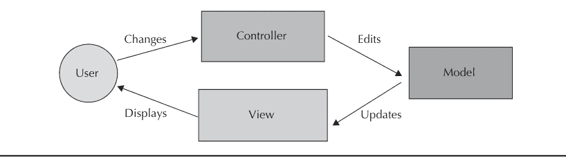

图 4-2. 模型-视图-控制器模式

## 第 4 章：组装动态 Web 页面：JavaServer Faces

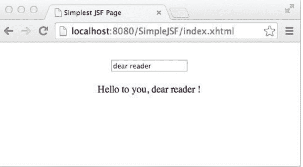

图 4-3. Hello JavaServer Faces

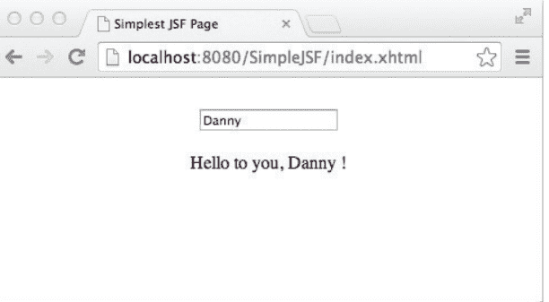

图 4-4. Hello Danny

## Java EE 7: 概览

| 简单的 JSF WAR |
| :--- |
| /index.xhtml |
| WEB-INF/ |
| web.xml |
| beans.xml |
| classes/ |
| HelloBean.class |

**图 4-5.** 一个包含 JavaServer Faces 的简单 WAR

应用程序的代码位于 `index.xhtml` 和 `HelloBean` 类中，后者包含配置信息。让我们先看看 `HelloBean` 类。

### 代码列表：HelloBean 类

```java
import javax.inject.Named;
import javax.enterprise.context.*;

@Named(value = "myHelloBean")
@RequestScoped
public class HelloBean {
    private String name = "dear reader";

    public void setName(String name) {
        this.name = name;
    }

    public String getName() {
        return this.name;
    }
}
```

如你所见，`HelloBean` 类大部分是一个 JavaBean，具有一个可读和可写的属性名，并假设默认值为 "dear reader"。在普通 JavaBean 类中通常找不到的唯一东西就是它在类级别上使用的 Java 注解。

```java
@Named(value = "myHelloBean")
@RequestScoped
```

`@Named` 注解为这个 JavaBean 提供了一个名为 `myHelloBean` 的名称，可以从各种上下文中引用它，特别是从 `index.xhtml` 文件中。`@RequestScoped` 注解是一个使此 JavaBean 成为所谓的“托管豆”（managed bean）的注解，这个概念贯穿整个 Java EE 平台。托管豆意味着类实例的生命周期由平台控制。`@RequestScoped` 注解是定义类为托管豆的有用注解之一，而这个这一个注解将让 Java EE 平台在单个 `HttpRequest/HttpResponse` 交互的上下文中需要时，精确创建一个 bean 实例。

那么，我们的 `HelloBean` 是否在 `HttpRequest/HttpResponse` 交互上下文中需要呢？让我们看看 `index.xml` 代码。

### 代码列表：index.xml

```xml
<?xml version="1.0" encoding="UTF-8" ?>
<!DOCTYPE html>
<html>
<head>
  <title>Simplest JSF Page</title>
</head>
<body>
  <div align="center">
    <form>
      <h:inputText value="#{HelloBean.name}"/>
    </form>
  </div>
</body>
</html>
```

*(注：此处原文中存在部分文本乱码重复，已根据上下文修正 `index.xml` 的逻辑结构)*

`FacesServlet` 是 JavaFaces API 的一个类，是解析应用程序中 Faces 页面的运行时入口。尝试如果你注释掉应用程序中的 servlet 映射，`.xhtml` 文件将直接被返回，没有任何 JSP 表达式被求值。你会得到类似于图 4-6 所示的内容。

这种 servlet 和 servlet 映射语法可以用于告诉 Java EE 容器你在应用程序中创建的任何 servlet。然而，它们通常是不必要的，因为你在类类声明中使用 `@WebServlet` 注解，正如我们在第 2 章的所有示例中所做的那样。

## JavaServer Faces: 模型-视图-控制器

但是这个简单基础的 JSF 应用程序示例与我们认为所有 JSF 应用程序的核心的模型-视图-控制器模式有什么关系？

模型是 `HelloBean`；它包含数据。它不知道其他代码正在访问和修改它的数据，也不知道数据是如何呈现给用户的。

## 第 4 章：组装动态网页：JavaServer Faces

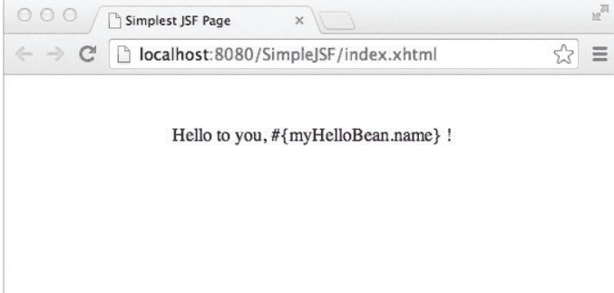

图 4-6. 为什么使用 Face？

视图是 `index.xml` 文件，它从数据模型读取数据并决定如何展示它。

那么 `index.xml` 也是控制器吗？因为当用户编辑文本字段时，它似乎能帮助发送修改数据模型的请求？实际上，在这个模型中 `index.xml` 并不是控制器，因为来自浏览器的请求（最终是一个包含更新内容的 HTTP POST 请求）是由容器的 JavaServer Faces Servlet 部分处理的，并通过 `web.xml` 和 servlet 映射（servlet-mapping）声明在 Web 应用程序中使用。它负责解释从浏览器网页更改数据的请求，确保使用正确的 `HelloBean` 实例来处理请求并进行修改。

这产生了 JavaServer Faces 版本的模型-视图-控制器（MVC）模式，如图 4-7 所示。

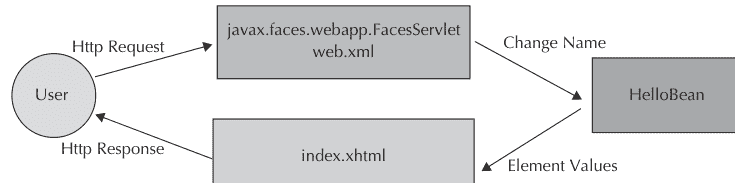

图 4-7. JavaServer Faces 模型-视图-控制器

## Java EE 7：全景

此应用程序是所有 JavaServer 应用程序的模板。我们将详细阐述该应用程序的关键方面，以探索 JavaServer Faces 的所有可能性。我们将从详细地查看 JavaServer Faces 可用的不同标签开始，扩展我们对基础 `h:textField` 标签的知识。

## JavaServer Faces 标签

JavaServer servlet 对 JavaServer Faces 页面执行的操作与 JSP 运行时解释 JSP 上的 HTTP 请求类似；它获取 JavaServer 页面并将其编译为 servlet，该 servlet 最终成为处理 HTTP 请求的 Java 组件。所有 JSF 标签都会转换为它们所代表的实体的 Java 对象表示：它们的文本字段、按钮等。为了在 Java servlet/响应交互的上下文中赋予它们生命力，结合 JavaBeans，让它们的输入和输出通过验证，触发事件，并遵循 JavaServer Faces 源代码中关于它们应该如何的说明。JavaServer Faces 运行时对这个组件树进行排序，将其渲染为代表这种动态执行的 JavaServer Faces 最终执行状态的标记。一种理解 JavaServer Faces 页面的简单方法是将其视为一组指令，说明如何从一组标签和各种 JavaBeans（在 HTTP 请求/响应交互的上下文中解释）产生一个“类脸化”的静态标记页面。当然，你可以在 XHTML 页面中使用普通的 HTML 标签，并穿插你记得的任何 JSF 标签。HTML 标签没有感知能力：它们无法与 JSF 环境交互，最重要的是，JSF 运行时为了渲染最终标记，这些元素“穿过”JavaServer Faces 运行时，就像幽灵一样但从未触碰任何东西。

所有 JavaServer Faces 标签都声明在 XHTML 文件的顶部，作为 `<html>` 标签的命名空间声明，通常如下：

`<html xmlns:prefix="uri"`

其中 `uri` 是 JSF 分配的 URI，`prefix` 是你在所有页面中使用的。JavaServer Faces 标签集合分为几类：用于 UI 组件的、用于控制流和字符串处理的、创建 UI 组件的、允许在 JSP 页面中使用非标准标记的属性，以及将一切连接在一起的核心 JSF 标签集。让我们从最可见的标签开始：UI 组件

## UI 组件标签

JSF 中的 UI 标签按照约定以 `h` 开头，因此 UI 标签的命名空间声明如下：


<html xmlns:h="http://xmlns.jcp.org/jsf/html">

核心 JSF 组件对你应该是熟悉的，因为你已经写过 HTML：它们的命名反映了它们渲染的 HTML 标签。我们将看到这些标签的用法，但目前这里是 JavaServer Faces 中常用的界面组件列表。

## 第 4 章：组装动态网页：JavaServer Faces 105

| 组件 | 标签 | 示例 |
| --- | --- | --- |
| 按钮 | `<h:commandButton>` | `<h:commandButton value="Submit" action="#{bookingBean.submit}" />` |
| 超链接 | `<h:commandLink>` | `<h:commandLink value="Learn more..." action="learn.xhtml" />` |
| 表格 | `<h:dataTable><br><h:column>` | `<h:dataTable value="#{widgetBean.items}" var="item"><h:column>#{item.name}</h:column><h:column>#{item.age}</h:column></h:dataTable>` |
| 表单 | `<h:form>` | `<h:form><h:commandButton value="Submit" action="#{bookingBean.submit}" /></h:form>` |
| 图片 | `<h:graphicImage>` | `<h:graphicImage value="#{widget.imageId}" />` |
| 输入 | `<h:inputText><br><h:inputArea>` | `<h:inputText value="#{widget.name}" />` |
| 组件消息 | `<h:messages>` | `<h:messages>` |
| 复选框 | `<h:selectCheckbox>` | `<h:selectCheckbox value="#{widget.parents}" />` |
| 列表，单选 | `<h:selectOneMenu>` | `<h:selectOneMenu value="#{widget.color}"><f:selectItem value="red" itemLabel="Red"/><f:selectItem value="blue" itemLabel="Blue"/><f:selectItem value="green" itemLabel="Green"/></h:selectOneMenu>` |

## 106 Java EE 7：全景

此应用程序是所有 JavaServer 应用程序的模板。我们将详细阐述该应用程序的关键方面，以探索 JavaServer Faces 的所有可能性。我们将从详细地查看 JavaServer Faces 可用的不同标签开始，扩展我们对基础 `h:textField` 标签的知识。

JSF 中的 UI 标签按照约定以 `h` 开头，因此 UI 标签的命名空间声明如下：

```html
<html xmlns:h="http://xmlns.jcp.org/jsf/html">
```

核心 JSF 组件对你应该是熟悉的，因为你已经写过 HTML：它们的命名反映了它们渲染的 HTML 标签。我们将看到这些标签的用法，但目前这里是 JavaServer Faces 中常用的界面组件列表。

让我们看到这些标签的用法，如图 4-8 所示。

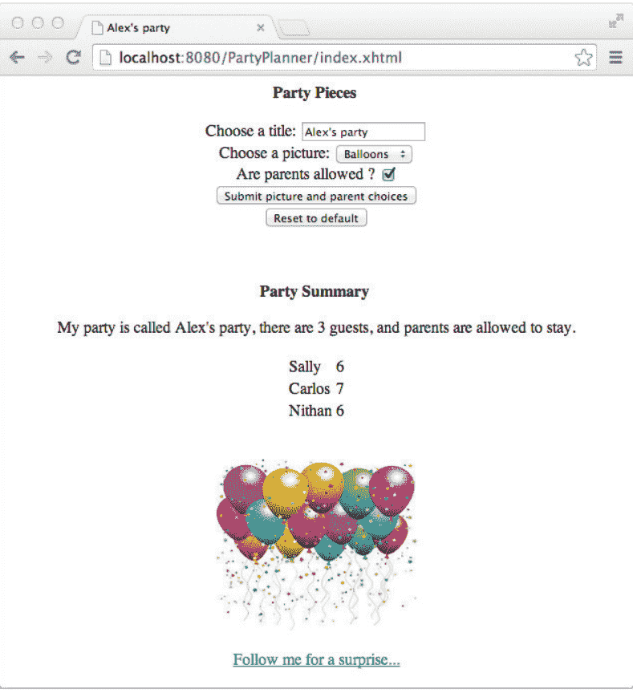

图 4-8. PartyPlanner 主

正确的 `HelloBean` 实例被用于处理请求并进行修改。这产生了 JavaServer Faces 版本的模型-视图-控制器（MVC）模式，如图 4-7 所示。


图 4-7. JavaServer Faces 模型-视图-控制器

## JavaServer Faces 标签

JavaServer servlet 对 JavaServer Faces 页面执行的操作与 JSP 运行时解释 JSP 上的 HTTP 请求类似；它获取 JavaServer 页面并将其编译为 servlet，该 servlet 最终成为处理 HTTP 请求的 Java 组件。所有 JSF 标签都会转换为它们所代表的实体的 Java 对象表示：它们的文本字段、按钮等。为了在 Java servlet/响应交互的上下文中赋予它们生命力，结合 JavaBeans，让它们的输入和输出通过验证，触发事件，并遵循 JavaServer Faces 源代码中关于它们应该如何的说明。JavaServer Faces 运行时对这个组件树进行排序，将其渲染为代表这种动态执行的 JavaServer Faces 最终执行状态的标记。一种理解 JavaServer Faces 页面的简单方法是将其视为一组指令，说明如何从一组标签和各种 JavaBeans（在 HTTP 请求/响应交互的上下文中解释）产生一个“类脸化”的静态标记页面。当然，你可以在 XHTML 页面中使用普通的 HTML 标签，并穿插你记得的任何 JSF 标签。HTML 标签没有感知能力：它们无法与 JSF 环境交互，最重要的是，JSF 运行时为了渲染最终标记，这些元素“穿过”JavaServer Faces 运行时，就像幽灵一样但从未触碰任何东西。

所有 JavaServer Faces 标签都声明在 XHTML 文件的顶部，作为 `<html>` 标签的命名空间声明，通常如下：

`<html xmlns:prefix="uri">`

其中 `uri` 是 JSF 分配的 URI，`prefix` 是你在所有页面中使用的。JavaServer Faces 标签集合分为几类：用于 UI 组件的、用于控制流和字符串处理的、创建 UI 组件的、允许在 JSP 页面中使用非标准标记的属性，以及将一切连接在一起的核心 JSF 标签集。让我们从最可见的标签开始：UI 组件。

## UI 组件标签

JSF 中的 UI 标签按照约定以 `h` 开头，因此 UI 标签的命名空间声明如下：

```html
<html xmlns:h="http://xmlns.jcp.org/jsf/html">
```

核心 JSF 组件对你应该是熟悉的，因为你已经写过 HTML：它们的命名反映了它们渲染的 HTML 标签。我们将看到这些标签的用法，但目前这里是 JavaServer Faces 中常用的界面组件列表。

| 组件 | 标签 | 示例 |
| --- | --- | --- |
| 按钮 | `<h:commandButton>` | `<h:commandButton value="Submit" action="#{bookingBean.submit}" />` |
| 超链接 | `<h:commandLink>` | `<h:commandLink value="Learn more..." action="learn.xhtml" />` |
| 表格 | `<h:dataTable><br><h:column>` | `<h:dataTable value="#{widgetBean.items}" var="item"><h:column>#{item.name}</h:column><h:column>#{item.age}</h:column></h:dataTable>` |
| 表单 | `<h:form>` | `<h:form><h:commandButton value="Submit" action="#{bookingBean.submit}" /></h:form>` |
| 图片 | `<h:graphicImage>` | `<h:graphicImage value="#{widget.imageId}" />` |
| 输入 | `<h:inputText><br><h:inputArea>` | `<h:inputText value="#{widget.name}" />` |
| 组件消息 | `<h:messages>` | `<h:messages>` |
| 复选框 | `<h:selectCheckbox>` | `<h:selectCheckbox value="#{widget.parents}" />` |
| 列表，单选 | `<h:selectOneMenu>` | `<h:selectOneMenu value="#{widget.color}"><f:selectItem value="red" itemLabel="Red"/><f:selectItem value="blue" itemLabel="Blue"/><f:selectItem value="green" itemLabel="Green"/></h:selectOneMenu>` |

## 106 Java EE 7：全景

此应用程序是所有 JavaServer 应用程序的模板。

核心 JSF 组件对你应该是熟悉的，因为你已经写过 HTML：它们的命名反映了它们渲染的 HTML 标签。我们将看到这些标签的用法，但目前这里是 JavaServer Faces 中常用的界面组件列表。

让我们看到这些标签的用法，如图 4-8 所示。


图 4-8. PartyPlanner 主

正确的 `HelloBean` 实例被用于处理请求并进行修改。这产生了 JavaServer Faces 版本的模型-视图-控制器（MVC）模式，如图 4-7 所示。


图 4-7. JavaServer Faces 模型-视图-控制器

## 108 Java EE 7：全景

此应用程序是所有 JavaServer 应用程序的模板。我们将详细阐述该应用程序的关键方面，以探索 JavaServer Faces 的所有可能性。我们将从详细地查看 JavaServer Faces 可用的不同标签开始，扩展我们对基础 `h:textField` 标签的知识。

该页的数据存储在一个简单的 JavaBean `PartyBean` 中，具有派对名称、父母出席的布尔值、邀请者列表以及使用的图像文件名称属性。在查看使用这些数据的 JavaServer Pages 之前，我们将先查看数据的代码。

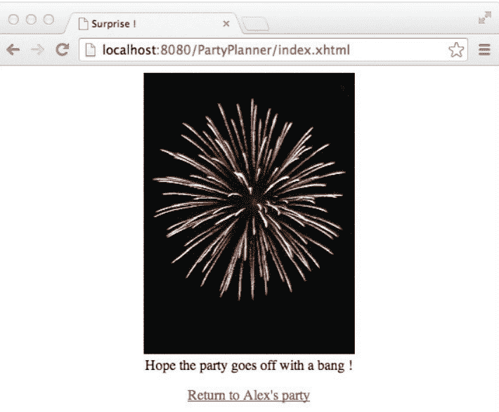

图 4-9. 惊喜，你被邀请了！

```java
items.add(new Guest("Carlos", 7));
items.add(new Guest("Nithan", 6));
this.imageUri = "party1.jpg";
```

```java
public String getSummary() {
    StringBuilder sb = new StringBuilder();
    sb.append("My party is called " + this.name);
    sb.append(", ");
    sb.append(" there are " + items.size() + " guests");
    sb.append(", ");
    sb.append("and parents are " + (parentsAllowed ? "" : "not") + " allowed to stay.");

    return sb.toString();
}
```

以及随的宾客信息

```java
public class Guest {
    private String name;
    private int age;

    public Guest(String name, int age) {
        this.name = name;
        this.age = age;
    }

    public void setAge(int age) {
        this.age = age;
    }

    public int getAge() {
        return this.age;
    }

    public void setName(String name) {
        this.name = name;
    }

    public String getName() {
        return this.name;
    }

    public String toString() {
        return "Item: " + name;
    }
}
```


# Java EE 7: 概览

这两个类反映了应用程序中显示的数据结构。主要需要注意的是 `PartyBean` 类顶部使用的注解。`@SessionScoped` 注解声明此 JavaBean 是一个受托管 Bean（managed bean），其 Java EE 范围为 "session"。这意味着对于每个对应于 Web 应用程序活动客户端的活动 `HttpSession`，都会实例化一次该 JavaBean 类。特别是，两个不同的 `HttpSession` 拥有不同的 `PartyBean` 实例，每个会话内的 HTTP 交互将使用相应的实例。这确保了除了你之外，没有人可以更改你派对的邀请，这可能是你派对的宾客会很高兴的事。`@Named` 属性声明该托管 Bean 可以通过提供的名称（即 `partyBean`）从 JavaServer 访问。

现在我们可以转向用于此托管 Bean 以及 UI 组件来表示和编辑其值的 Java 页面。

首先最重要的是页面索引，`index.xhtml`。

列表：index.xhtml 页面

```xml
<?xml version="1.0" encoding="UTF-8" ?>
<!DOCTYPE html PUBLIC "//W3C//DTD XHTML 1.0 Transitional//EN"
  "http://www.w3.org/TR/xhtml1/DTD/xhtml1-transitional.dtd">
<html xmlns="http://www.w3.org/1999/xhtml"
  xmlns:f="http://xmlns.jcp.org/js/core"
  xmlns:h="http://xmlns.jcp.org/js/html">
<head>
  <title>#{partyBean.name}</title>
</head>
<body>
  <div align="center">
  <form>
    <label style="font-weight:bold"> 派对元素</label> <br/><br>
    <label>选择一个标题: </label>
    <h:inputText value="#{partyBean.name}" /><h:inputText><br/><br>
    <label>选择一张图片: </label>
    <h:selectOneMenu itemValue="#{partyBean.imageUri}" itemLabel="帽子" />
    <h:selectOneMenu itemValue="#{partyBean.party2}" itemLabel="气球" />
    </h:selectOneMenu><br>
    <label>允许家长进入吗？ </label>
    <h:booleanCheckbox value="#{partyBean.parentsAllowed}" />
    </h:booleanCheckbox><br/><br>
    <h:commandButton value="提交图片和家长选择"
      action="index" /><br/>
    <h:commandButton value="重置默认"
      action="#{partyBean.reset}" /><br/><br/>
  </form><br/>
  <label style="font-weight:bold"> 派对总结</label> <br/><br>
  <h:outputText value="#{partyBean.summary}" /><br/><br>
  <h:dataTable value="#{partyBean.items}" var="item">
    <h:column name="#{item.name}" />
  </h:dataTable>
```


# 第 4 章：组装动态 Web 页面：JavaFaces 111


```xml
<h:column>#{item.age}</h:column>
<h:dataTable>
<h:graphicImage value="#{partyBean.imageUri}" width="200" height="171" />
<p>
<h:form>
<h:commandLink value="关注我获取惊喜..." 
action="surprise.xhtml" />
</h:form>
</p>
</div>
</body>
</html>
```

注意，此页面使用了 JavaFaces 的标准组件库以及命名空间 `xmlns:f="http://xmlns.jcp.org/js/core"` 中的核心 JavaFaces 标签。页面标题来自 `partyBean` 的 `name` 属性。文本字段是一个 JSF 组件 `h:inputText`。你会发现，当你按下回车键时，绑定到派对的属性会自动更新。选择一个项目是通过 JSF 组件 `h:selectOneMenu`，而允许家长留下还是离开的选择位于 `h:booleanCheckbox` 中。这些组件绑定到 `partyBean.imageUri` 和两个按钮。第一个动作是导致浏览器加载页面的 JSF 简写，在此刷新相同的页面，导致 JSF 页面呈现新的属性。第二个动作使用 JSF 语言调用 bean 上的方法，这些 JavaFaces 标签只需通过 JavaFaces 运行时显示到输出页面。接下来让我们查看由 JavaFaces 表格插入的常规 HTML 标签 `h:dataTable`，它接收一个集合并自动迭代，在这种情况下，两个 `h:column` 子元素构成了表格的行。

# 第 4 章：构建动态页面：JavaFaces

## @RequestScoped

最简单的范围是请求范围（request scope）。请求范围内的托管 bean 会在每个新的 HTTP 请求/响应交互中实例化一次，在 HTTP 请求到达时创建，并在 HTTP 响应离开时销毁。JavaBeans 适用于在 JSF 页面渲染期间处理和处理信息，例如在单个请求的单个页面生成过程中跨存储状态的 bean。一个示例是支持 JavaFaces 页面的 JavaBean，它负责收集用户的联系信息，并在用户点击提交按钮后将信息写入数据库。

## @SessionScoped

会话范围（session scope）内托管 bean 的生命周期与 `HttpSession` 相同。这意味着如果在一个 JavaFaces 页面中使用会话 bean，则该 bean 会为该应用程序创建的每个新 `HttpSession` 实例化一次，并在 Java EE 容器对应的 `HttpSession` 超时或失效时销毁。这意味着如果你在 JavaFaces 页面中使用会话 bean，应用程序的每个用户都拥有一个唯一的 bean 实例来支撑他们所看到的 JavaFaces 页面，且该实例在与 Web 应用程序的多次交互中持续存在。这适用于例如，无论他们是刷新页面、导航到其他地方，还是稍后返回。这种范围当你希望将应用程序状态与特定用户关联，并且只要用户在应用程序中处于激活状态就持续时非常有用。

## @ApplicationScoped

应用范围（application scope）内托管 bean 的生命周期是所有范围中最简单的。Java EE 容器在任何用户访问应用程序之前实例化一次 bean，并在关闭应用程序时销毁它。这意味着应用范围内的托管 bean 是一种全局对象，在 Web 应用程序的整个生命周期内供所有用户共享。当你有全局且跨用户共享的应用程序数据时，这种范围非常有用，例如聊天记录、一段时间内应用程序所有活动用户的日志，或者拍卖物品的竞价历史。

## @ConversationScoped

会话范围（conversation scope）是一个包含在会话范围内的范围，开发者可以控制它的何时结束，这种结束时间可能在会话结束之前。因此，会话范围内的托管 bean 会为每个新的 `HttpSession` 实例化一次。它在从 JavaFaces 页面使用的 Web 应用程序的多次 HTTP 交互中保持激活，或者只有当开发者显式结束会话范围，或者与之相关的 HTTP 会话超时或失效时才会销毁。如果你希望 JavaBean 根据 Web 应用程序的一组预定义交互进行操作（例如社交网络网站上的聊天交互序列，或者在线商店中的特定购买序列），则此会话范围可以使用这种生命周期。为了实现这一点，我们使用一种称为依赖注入（dependency injection）的技术（这是我们在书中将多次回到的话题），将会话实例作为实例变量注入到我们的 JavaBean 中。

### 列表：ConversationalBean 类

```
import javax.enterprise.context.RequestScoped;
import javax.enterprise.context.Conversation;
import javax.inject.Named;
import javax.inject.Inject;

@Named(value = "myHelloBean")
@RequestScoped
public class ConversationalBean {
    @Inject
    Conversation conversation;

    public void finishInteractions() {
        conversation.end();
    }
...
```

在此段代码中，通过使用 `@Inject` 注解，Java EE 容器确保了在 `ConversationalBean` 实例化时，会话实例变量被填充了正确的值。当需要结束会话时，可能会调用其 `end()` 方法，正如代码示例中的 `finishInteractions()` 方法所示。当该托管 bean 尝试调用的下一个 JavaServer Faces 页面时，它将不再使用 `end()` 方法调用之前使用的原始实例，而是实例化一个新的实例。

### @FlowScoped

流范围（flow scope）是另一种包含在会话范围内的托管 bean 范围，类似于会话范围。流范围的目标是让普通用户在 Web 应用程序的一段预设交互期间保持一个新的实例激活状态。从这个意义上说，它与会话范围相似。流范围的边界不像会话范围那样由开发者通过 API 调用显式管理，而是由 JavaServer Faces 中一种称为“流”（flows）的机制管理的，这在创建 Web 向导（wizards）时特别有用。

## @ViewScoped

视图范围（view scope）是一种扩展请求范围的托管 bean 范围，它在特定的 JavaServer Faces 页面执行时开始，并在客户端继续与该页面交互期间保持激活。一旦客户端导航到不同的页面，该页面就会变为非活动。这对于编写预期会回传（post back）自身的页面非常有用。

## @Dependent

最后，依赖范围（dependent scope）是一种表示“我的范围取决于我被使用的地方”的范围。换句话之，如果你将托管 bean 标记为 `@Dependent`，它的生命周期和基数由它使用的组件控制。这使得它对于从多个范围的组件使用的 JavaBean 来说是有用的范围。例如，如果你有一个进行货币转换的组件，你可能希望在一个请求范围的 JavaBean 中使用它（在单个网页上进行货币转换），或者你可能希望在一个代表国际购物者购物车的会话范围 bean 中使用它。

在 JavaFaces 应用程序大部分时间内，使用请求、会话或应用范围就足够了，这些范围为应用程序提供了在页面生成期间请求-响应交互期间插入应用程序状态，或者根据用户会话按用户关联状态，或者为所有用户全局关联状态的机会。使用向导程序、特定预定义交互组的应用程序可以使用会话范围中更细粒度的范围：会话范围或流范围。

## f: 核心标签

JavaFaces 核心标签库包含了大多数 JavaFaces 页面使用的基础标签。这些标签包含在命名空间中

```
xmlns:f="http://xmlns.jcp/jsf/core"
```

大多数标签属于三个重要的类别：验证数据的标签（换言是在特定条件下检查标签的值）、管理 JavaFaces 页面生成的事件的标签，以及在页面级别将数据转换为 JavaBean 可用格式的标签。

## 数据验证

在 Web 页面中，确保通过页面传递给你的数据符合你预期的格式是非常重要的（例如，当你期望一个电子邮件地址时得到的不是电话号码），并且如果不符合，则能够尽快通知用户错误。JavaFaces 提供了各种级别的验证供你用于此目的。通常情况下，使用内置验证标签就足够了，这是最简单的方法并涵盖了最常见的验证类型。验证器应用于接收输入的标签，使标签值的子集需要检查，我们稍后会提到。让我们来看看这些基础标签。

| 标签 | 功能 |
| :--- | :--- |
| `<f:validateLength>` | 检查输入字符串的最小或最大长度 |
| `<f:validateDoubleRange>` | 检查输入 double 的最小值或最大值 |
| `<f:validateLongRange>` | 检查输入 long 的最小值或最大值 |
| `<f:validateRequired>` | 要求输入非空 |

当验证失败时，JavaFaces 会生成一个显示在页面上的默认错误消息。这个消息对用户并不友好，更多是开发期间的辅助，因此使用标签的 `validatorMessage` 属性来自定义消息是一个好主意。

### 列表：字符串长度验证示例

```
<h:form>
  <h:inputText id="username_component"
    validatorMessage="Username must be between 4 and 10 characters">
    <f:validateLength minimum="4" maximum="10"/>
  </h:inputText>
</h:form>
```

输入值可以通过 Bean Validation API 或正则表达式进行验证。

### 标签与函数

| 标签 | 函数 |
| :--- | :--- |
| `<f:validateBean>` | 检查一个值是否符合 Beans Binding API `javax.faces.validator.BeanValidator` 的实现。 |
| `<f:validateRegex>` | 检查一个值是否符合某个正则表达式。可以是正则表达式字符串的形式所示：`<f:validateRegex pattern="[0-9a-zA-Z]"/>` 或者作为 `javax.faces.validator.RegexValidator` 类的实现：`<f:validateRegex binding="myRegexValidator">` |

你可以实现自己的验证器。

### 列表：自定义验证器示例

```
@FacesValidator("MyValidator")
public class MyValidator implements Validator {
  public void validate(FacesContext context,
    UIComponent component,
    Object value) throws ValidatorException {

    // 检查值
    // 如果未通过检查则抛出 ValidatorException
  }
}
```

这让你能够完整查看验证器挂载的输入组件、调用上下文以及输入的对象值。要使验证失败，你只需在 `validate` 方法中抛出一个 `ValidatorException` 即可。这种自定义验证器通过以下标签连接到输入组件中：

```
<f:validator validatorId="MyValidator">
```

JSF 的验证机制始终需要与服务器进行一次往返（round trip），在页面重新生成期间会运行验证器代码。在选择使用它们时请记住这一点。在某些情况下，这是不可避免的，特别是当使用自定义验证器时，它需要检查应用程序其他地方其他数据以确定某个值的有效性。例如，如果用户输入了信用卡号，必须通过外部服务检查其有效性。对于仅需要进行格式检查的验证（例如电话号码格式），为 JSF 验证进行服务器往返可能是没有必要的：有时，使用 JavaScript 在本地检查此类值可能更好，而无需将信息发送到服务器进行检查。

## 事件处理

在本章过的示例中，我们避开了 Java 页面上显示的数据何时设置到 Java EE 容器，并根据更新后的信息刷新为新生成的页的问题。注意在 `PartyPlanner` 应用中，有两种方式可以将页面上的信息提交到 Java EE 容器、写入底层的 JavaBean 并重新生成页面。首先，通过按回车键更改文本中的派对名称来提交信息。其次，点击提交按钮显式地更改新数据并更新 Bean。你会发现，在不提交的情况下，更改选择并在浏览器中点击刷新会导致图片恢复到 JavaBean 中持有的旧图片。即使在这个微小的示例中，你也可以看到，必须进行显式的工作才能保持页面上的数据与页面后台 JavaBeans 中的模型数据同步。我们通过设置一个显式按钮，并依靠浏览器将文本字段中的回车键解释为将数据提交到服务器的请求（如 HTML 规范建议所示）来避开这个问题。有时，你可能希望与模型保持紧密同步：更改列表中的选择或点击复选框应立即更新模型数据。在这些情况下，JavaFaces 提供了事件处理机制，它可以拦截页面小部件状态变化时生成的事件，并导致更新相应的模型数据。总体思想是，使用事件处理标签来注册实现监听器的实例或类。

### 标签与函数

| 标签 | 函数 |
| :--- | :--- |
| `<f:actionListener>` | 用于按钮和链接，该标签注册 `javax.faces.event.ActionListener` 的实现，当组件状态发生变化时会通知该实现。<br>`<f:actionListener type="actionListener impl">`<br>`<f:actionListener binding="expression evaluating to listener instance">` |
| `<f:valueChangeListener>` | 用于所有输入组件和列表，该标签注册给定的 `javax.faces.event.ValueChangeListener` 实现，但当组件状态发生变化时不会通知该实现。<br>`<f:valueChangeListener type="valueChangeListener impl class">`<br>`<f:valueChangeListener binding="expression evaluating to listener instance">` |
| `<f:setPropertyListener>` | 用于命令按钮和链接，该标签允许你检测受托管 Bean（managed bean）上属性的值。<br>`<f:setPropertyListener target="#{myBean.currentName}"/>` |

我们将在本章末后的后续示例中看到监听器的实际作用。

## 数据转换器

数据转换是将位于 Java Faces 页面中的数据（例如输入表单的数值）与页面数据层数据之间进行转换的过程。这种转换之所以必要，有多种原因：主要是因为 JavaBean 数据层使其数据对于许多不同的 Java Faces 页面来说最易处理（例如用于货币的 `BigDecimal`），而每个页面又试图使其页面上的数据格式最符合用户需求（或根据页面查看的语言进行格式化字符串）。Java Faces 允许不同类型的转换，以满足各种需求。这些转换的起始点是 `core` 命名空间下的标签：

```
xmlns:f="http://java.sun.com/jsf/core"
```

这些标签可以满足不同类型的需求，取决于 Java Faces 运行时。

### 标签与函数

| 标签 | 函数 |
| :--- | :--- |
| `<f:convertNumber>` | 将 `Double` 或 `Long` 转换为各种数字格式，包括货币格式和数字格式。 |
| `<f:convertDateTime>` | 将 `Date` 对象转换为各种人类日期格式，以及时区等。 |

这两个标签是转换机制的主力。与验证器类似，它们注册一个由 JavaFaces 运行时提供的适当转换对象。通过浏览 `javax.faces.convert` 包，你会看到其他用于数据数据类型的类，例如 `BigDecimalConverter`、`BooleanConverter` 和 `FloatConverter`。你还需要 `javax.faces.convert.Converter` 接口。它定义了提供转换的通用约定，要求实现两个方法：

```
public String getAsString(FacesContext context, UIComponent component, Object value)
```

```
public Object getAsObject(FacesContext context, UIComponent component, String value)
```

分别将数据字符串转换为对应的数据对象实例。你可以使用 `@FacesConverter("converter-name")` 注解来命名你的转换器类。然后你可以通过在 UI 组件中嵌套 `<f:converter>` 标签让 UI 组件获取该转换器：

```
<f:converter converterId="converter-name">
```

## JSTL 核心标签

我们已经了解了标准标签库。控制流标签在 JavaFaces 中也可用。以下是这些标签及其功能的总结。

| 标签 | 目的 |
| :--- | :--- |
| `<c:catch>` | 捕获在此标签内抛出的任何异常，使用 `var` 属性来持有异常。 |


| 标签 | 描述 |
| :--- | :--- |
| `<c:choose>` | 与 `<c:when>` 和 `<c:otherwise>` 标签配合使用定义一组互斥的选择，类似于 Java switch 语句。 |
| `<c:if>` | 简单条件标签，基于 `test` 属性评估为真的的条件。 |
| `<c:forEach>` | 用于遍历集合的标签。 |
| `<c:otherwise>` | `<c:choose>` 标签中的默认情况标签。 |
| `<c:set>` | 按名称设置页面变量的标签。 |
| `<c:when>` | 简单条件标签，用于 `<c:choose>` 标签，例如。 |

## 扩展性与模块化

Java Faces 包含了许多扩展其基础功能的方法以及将 JavaFaces 代码片段模块化的方法，以便在应用程序内部以及应用程序之间进行复用。在本基础章节中，充分探索所有机制超出了本文的范畴，让我们快速概览一下扩展和模块化的各种机会。

开发者可以通过多种方式创建 UI 组件。为了在页面上渲染一个新的用户界面组件，他们可以提供 `UIComponent` 的新子类，并将其与新标签和一组控件关联起来。通过这种方式，许多开发者创建了新的 HTML 组件库和自定义文本组件库，例如包含映射功能的图像组件。其次，Java Faces 标记片段可以封装成 XHTML 文件，作为复合组件（composite component），并使用库描述符（library descriptor）将其与标签关联。通过这种方式，Java Faces 页面中常见的标签分组（例如确定/取消按钮面板和图像显示面板）可以被封装成单个标签，从而在应用程序中复用这些重复元素变得更加容易。

Java Faces 提供了几种技术来帮助具有预定义用户交互路径的应用程序。一个收集注册数据的向导（wizard）或一个帮助你完成并支付在线购买的一系列 Web 表单，都是此类交互路径的良好示例。

作为导航的通用辅助，Java Faces 定义了 Faces Flows。它由一个之前描述过的托管 bean 作用域（managed bean scope）以及轻松共享上下文（如购物篮或自定义注册）、页面以及在转换中注入逻辑的能力组成。

## 照片应用程序

我们将通过深入探索一个更复杂的 Web 应用程序来结束本章节。我们已经见过这程序了，它测试了本章节开头提出的原始主张：Java Faces 页面仅仅是 JSP。让我们回到 Java Faces 风格的照片应用程序。

该应用程序的 Java Faces 版本与之前的版本相比增加了一些功能。让我们如图 4-10 所示的主页。

专辑中的照片已经布局，每张照片都有三个按钮，用于查看、编辑和从专辑中删除。图 4-11 显示了查看和编辑屏幕。

新照片从专辑页面像向导一样添加，引导至图 4-12 所示的序列。

## 第 4 章：组装动态 Web 页面：JavaServer Faces 121

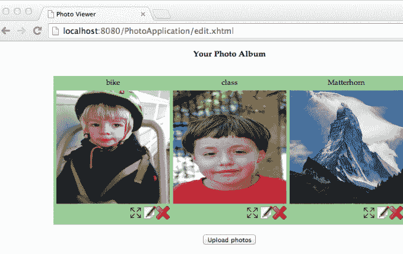

**FIGURE 4-10.** 照片专辑的面面

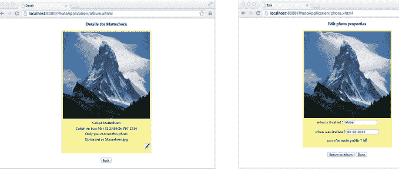

**FIGURE 4-11.** 查看和编辑照片

## 122 Java EE 7：全景

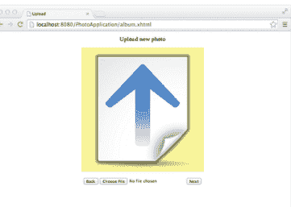
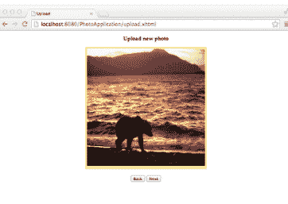
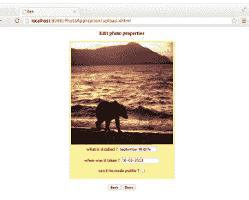


**FIGURE 4-12.** 上传照片

该照片应用程序由四个 XHTML 文件、两个托管 bean、一个简单的 Java 对象（POJO）类和一个 servlet 组成。该 servlet 被称为 `DisplayPhotoServlet`，它本质上我们在第 2 章中看到的 servlet 相同；它按需显示照片的二进制图像数据。其他应用程序文件如图 4-13 所示。

该图显示了 XHTML 文件与应用程序不同屏幕之间的对应关系。让我们通过查看 `PhotoAlbum` bean 开始检查代码。

## 第 4 章：组装动态 Web 页面：JavaServer Faces 123

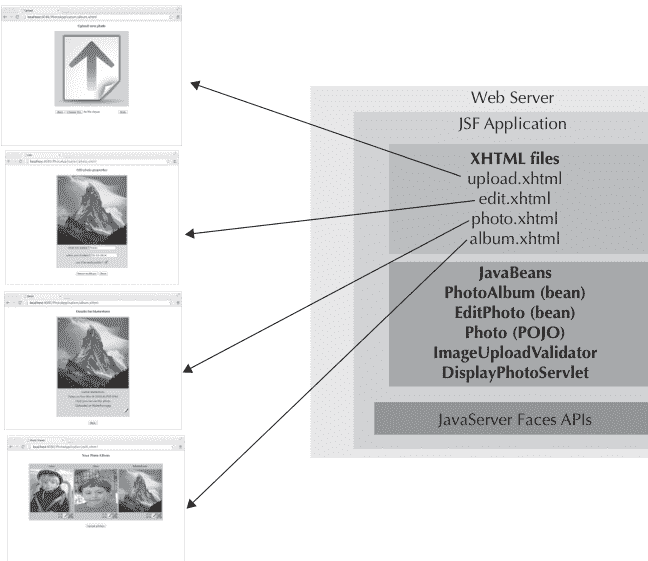

**FIGURE 4-13.** 照片应用程序的内容

**Listing：** PhotoAlbum 类

```java
import java.util.*;
import java.io.*;
import javax.inject.*;
import javax.enterprise.context.*;

@Named(value = "photoAlbum")
@SessionScoped
public class PhotoAlbum implements Serializable {
    private List<Photo> photos = new ArrayList<>();
    private Photo currentPhoto = null;

    public PhotoAlbum() {
    }

    public void setCurrentPhoto(Photo p) {
        this.currentPhoto = p;
    }

    public Photo getCurrentPhoto() {
        return this.currentPhoto;
    }

    public void addPhoto(Photo p) {
        if (this.contains(p.getId())) {
            this.removePhoto(this.getById(p.getId()));
        }
        this.photos.add(p);
    }

    private Photo getById(long id) {
        for (Photo photo : this.photos) {
            if (photo.getId() == id) {
                return photo;
            }
        }
        return null;
    }

    public boolean containsId(long id) {
        return this.getById(id) != null;
    }

    public List<Photo> getPhotos() {
        return this.photos;
    }

    public void removePhoto(Photo photo) {
        this.photos.remove(photo);
    }

    public Photo getPhoto(long id) {
        for (Photo photo : this.photos) {
            if (photo.getId() == id) {
                return photo;
            }
        }
        return null;
    }

    public List<String> getNames() {
        List<String> names = new ArrayList<>();
        for (Photo photo : this.photos) {
            names.add(photo.getName());
        }
        return names;
    }

    public List<String> getFilenames() {
        List<String> filenames = new ArrayList<>();
        for (Photo photo : this.photos) {
            filenames.add(photo.getFilename());
        }
        return filenames;
    }

    public int getIndexOf(String photoName) {
        for (int i = 0; i < this.photos.size(); i++) {
            if (this.photos.get(i).getFilename().equals(photoName)) {
                return i;
            }
        }
        return -1;
    }

    public byte[] getData(int i) {
        return this.photos.get(i).getData();
    }

    public int getCount() {
        return this.photos.size();
    }
}
```

## 第 4 章：组装动态页面：125

我们可以立即看到这是一个托管 bean，因为 PhotoAlbum 会在应用程序激活时被实例化。当然，为了让应用程序进入下一个阶段，我们需要将照片信息持久化到数据库。注意 PhotoAlbum 是可序列化的。这是它处于会话作用域的要求，确保当会话在集群环境中移动时，会话作用域的 bean 能够迁移。PhotoAlbum 被 album 页面频繁使用。由于它是页面中最复杂的，我们将完整地查看它。

**Listing：** album.xhtml 文件

```xml
<?xml version='1.0' encoding='UTF-8' ?>
<!DOCTYPE html PUBLIC "//W3C//DTD HTML 1.0 Transitional//EN"
"http://www.w3.org/TR/DTD/xhtml-transitional.dtd">
<html xmlns="http://www.w3.org/1999/xhtml"
xmlns:h="http://www.sun.com/jsf/html"
xmlns:c="http://www.sun.com/jsp/core">
<h:head>
  <h:title>照片查看器</title>
</h:head>
<h:body style="font-family:Palatino;font-size:small">
  <div align='center'>
    <h3>您的照片专辑</h3>
    <br/><br/>
    <table bgcolor="99CC99" cellspacing="4">
    <tbody>
      <tr>
        <c:forEach items="#{photoAlbum.photos}" var="photo">
        <td>
          <div align='center'>
            #{photo.name}
          </div>
        </td>
        </c:forEach>
      </tr>
      <tr>
        <c:forEach items="#{photoAlbum.photos}" var="photo">
        <td>
          <h:form>
            <h:graphicImage
            height="200"
            width="200"
            value="#{photo.viewUri}"/>
          </h:form>
          <h:form>
            <div align='right'>
              <h:commandButton
              title="view"
              image="view.png"
              actionListener="#{photoAlbum.setCurrentPhoto(photo)}" />
            </div>
          </h:form>
        </td>
        </c:forEach>
      </tr>
    </tbody>
    </table>
  </div>
</h:body>
</html>
```

## 第4 章：组装动态网页页面：Java Faces 127

```xml
action="photo"/>
<h:commandButton
title="edit"
image="edit.png"
actionListener="#{editPhotoBean.setPhoto(photo)}"
action="edit"/>
<h:commandButton
title="delete"
image="delete.png"
action="#{photoAlbum.removePhoto(photo)}"/>
</div>
</h:form>
<td>
</c:forEach>
<tr>
</body>
</table>
<br><br>
<h:form>
<h:commandButton
id="upload_button"
value="Upload photos"
action="upload"/>
</h:form>
</div>
</body>
</html>
```

这是一个使用了 JavaFaces 标签、标准标签库和 JavaServer UI 组件的 JavaFaces 页面，正如你从页面顶部的 `c` 和 `h` 命名空间所示。它使用 `PhotoAlbum` bean 配合 `<c:forEach>` 标签遍历相集中的照片，写入照片名称，并使用 JavaFaces 图像从每个照片实例的 `viewtri` 属性显示数据。命令按钮控制附加到每张照片的查看、编辑和删除行为，通过 `actionListener` 属性在点击时根据在表达式语言（EL）中定义的表达式来执行某些操作，并使用 `action` 属性在 `actionListener` 调用后定义导航目标。例如，当按下按钮时，你可以从命令按钮标签的定义中看到

```xml
<h:commandButton
title="view"
image="view.png"
actionListener="#{photoAlbum.setCurrentPhoto(photo)}"
action="photo"/>
```


看到 PhotoAlbum 的当前照片属性被设置为页面上按钮上方的照片，然后在执行操作后加载 `photo.xhtml` 页面。

在上传向导序列中，上传并为上传的照片添加属性的过程由 `EditPhoto` bean 提供支持。

## 128 Java EE 7：概览

**Listing：** EditBean 类

```java
import java.io.ByteArrayOutputStream;
import java.io.InputStream;
import javax.inject.Named;
import javax.inject.Inject;
import javax.servlet.http.Part;
import java.io.*;
import java.util.Date;

@Named(value = "editPhotoBean")
@enterprise.context.SessionScoped
public class EditPhotoBean implements Serializable {
    @Inject
    PhotoAlbum photoAlbum;
    private long id = -1;
    private boolean isPublic = false;
    private String filename;
    private String photoName;
    private Date dateTaken = new Date();
    private byte[] photoData = null;

    public EditPhoto() { }

    public boolean isNew() {
        return this.id == -1;
    }

    public boolean isPublic() {
        return isPublic;
    }

    public void setPublic(boolean isPublic) {
        this.isPublic = isPublic;
    }

    public Date getDateTaken() {
        return dateTaken;
    }

    public void setDateTaken(Date dateTaken) {
        this.dateTaken = dateTaken;
    }

    public String getPhotoName() {
        return this.photoName;
    }

    public void setPhotoName(String photoName) {
        this.photoName = photoName;
    }
}
```

```java
public void reset() {
    this.id = -1;
    this.dateTaken = new Date();
    this.filename = null;
    this.photoData = null;
    this.photoName = null;
}
```

```java
public void commit() {
    this.photoAlbum.addPhoto(this.getPhoto());
    this.reset();
}
```


```java
private void collectData(Part uploadedPart) {
    if (uploadedPart.getSize() == 0) return; // dannnyc
    try {
        ByteArrayOutputStream baos;
        try (InputStream is = uploadedPart.getInputStream()) {
            baos = new ByteArrayOutputStream();
            int i = 0;
            while ((i = is.read()) != -1) {
                baos.write(i);
            }
        }
        photoData = baos.toByteArray();
    }
    baos.close();
    } catch (Exception e) {
        photoData = null;
        throw new RuntimeException(e.getMessage());
    }
    this.filename = uploadedPart.getSubmittedFileName();
    this.photoName = this.filename.substring(0, this.filename.indexOf("."));
}
```

```java
public byte[] getPhotoData() {
    return this.photoData;
}
```

```java
public void setUploadedPart(Part p) {
    this.collectData(p);
}
```

```java
public Part getUploadedPart() {
    return null;
}
```

# Java EE 7: 概览

```java
public String getPreviewUrl() {
    if (this.hasPhoto()) {
        return "DisplayPhotoServlet";
    } else {
        return "preview.png";
    }
}

public void setPhoto(Photo p) {
    this.id = p.getId();
    this.isPublic = p.isPublic();
    this.filename = p.getFilename();
    this.photoName = p.getName();
    this.dateTaken = p.getDateTaken();
    this.photoData = p.getData();
}

public boolean hasPhoto() {
    return (this.photoData != null);
}

public Photo getPhoto() {
    if (this.hasPhoto()) {
        Photo p = new Photo(this.id, this.photoData,
            this.getFilename(), this.photoName, this.dateTaken, this.isPublic);
        return p;
    } else {
        return null;
    }
}
```

这也是一个 session 范围的 bean：我们需要这个 bean 对于每个用户是唯一的，并且在上传文件和填写名称及其他属性的过程中它需要一直存在。这个 bean 的功能是能够依赖注入在同一个会话（即 session）中的实例收集数据，从而允许 `EditPhoto` bean 将照片添加到相集中。我们将查看 `photo.xhtml` 页面。

## 第4 章：组装动态网页页面：Java Faces 131

列表：`upload.xhtml`

```xml
<?xml version="1.0" encoding="UTF-8"?>
<!DOCTYPE html PUBLIC "-//W3C//DTD XHTML 1.0//EN" "http://www.w3.org/TR/xhtml1/DTD/xhtml1-transitional.dtd">
<html xmlns="http://www.w3.org/1999/xhtml" 
      xmlns:f="http://java.sun.com/jsf/core" 
      xmlns:c="http://java.sun.com/jsf/core" 
      xmlns:h="http://java.sun.com/jsf/html">
  <head>
    <title>Upload photo</title>
  </head>
  <body style="font-family:Palatino;">
    <div align="center">
      <h3>Upload photo</h3>
      <table cellspacing="4">
        <tbody>
          <tr>
            <td>Photo Name:</td>
            <td><h:inputText id="name" value="#{editPhotoBean.photoName}"/></td>
          </tr>
          <tr>
            <td>Date Taken:</td>
            <td><h:outputText id="date" value="#{editPhotoBean.dateTaken}"/></td>
          </tr>
          <tr>
            <td>File:</td>
            <td><h:inputFile id="file" value="#{editPhotoBean.uploadedPart}" validator="imageValidator"/></</td>
          </tr>
        </tbody>
      </table>
      <br><br>
      <c:if test="#{editPhotoBean.hasPhoto()}">
        <h:form id="form" enctype="multipart/form-data">
          <h:commandButton id="cancel" value="Back" action="#{editPhotoBean.reset()}"/>
          <h:commandButton id="continue" value="Next" action="upload"/>
        </h:form>
      </c:if>
      <h:messages id="messages" style="color:red" />
    </div>
  </body>
</html>
```

## 132 Java EE 7：概览

注意在该页面中，`EditPhoto` bean 通过其注解被使用，特别是 `uploadedPart` 是从 `<h:inputFile>` 标签设置的。这意味着当文件上传时，会被设置为 `EditPhoto` bean 的 `setUploadedPart()` 方法。`<h:inputFile>` 标签有一个嵌套的验证器：`imageValidator`。通过查看代码：

```java
import java.io.ByteArrayOutputStream;
import java.io.InputStream;
import javax.inject.Named;
import javax.inject.Inject;
import javax.servlet.http.Part;
...
```

...

```java
public void collectData(Part uploadedPart) {
    if (uploadedPart.getSize() == 0) return; // dannnyc
    try {
        ByteArrayOutputStream baos;
        try (InputStream is = uploadedPart.getInputStream()) {
            baos = new ByteArrayOutputStream();
            int i = 0;
            while ((i = is.read()) != -1) {
                baos.write(i);
            }
        }
        photoData = baos.toByteArray();
    }
    baos.close();
    } catch (Exception e) {
        photoData = null;
        throw new RuntimeException(e.getMessage());
    }
    this.filename = uploadedPart.getSubmittedFileName();
    this.photoName = this.filename.substring(0, this.filename.indexOf("."));
}
```

```java
public byte[] getPhotoData() {
    return this.photoData;
}
```

```java
public void setUploadedPart(Part p) {
    this.collectData(p);
}
```

```java
public Part getUploadedPart() {
    return null;
}
```

```java
public String getPreviewUrl() {
    if (this.hasPhoto()) {
        return "DisplayPhotoServlet";
    } else {
        return "preview.png";
    }
}

public void setPhoto(Photo p) {
    this.id = p.getId();
    this.isPublic = p.isPublic();
    this.filename = p.getFilename();
    this.photoName = p.getName();
    this.dateTaken = p.getDateTaken();
    this.photoData = p.getData();
}

public boolean hasPhoto() {
    return (this.photoData != null);
}

public Photo getPhoto() {
    if (this.hasPhoto()) {
        Photo p = new Photo(this.id, this.photoData,
            this.getFilename(), this.photoName, this.dateTaken, this.isPublic);
        return p;
    } else {
        return null;
    }
}
```

```java
import javax.faces.application.FacesMessage;
import javax.faces.component.UIComponent;
import javax.faces.context.FacesContext;
import javax.faces.validator.FacesValidator;
import javax.faces.validator.Validator;
import javax.faces.validator.ValidatorException;
import javax.servlet.http.HttpServletRequest;
import javax.servlet.http.Part;

@FacesValidator("imageValidator")
public class ImageValidator implements Validator {

    @Override
    public void validate(FacesContext context, UIComponent component, Object value) throws ValidatorException {
        Part file = (Part) value;
        if (file.getContentType().equals("application/octet-stream")
            && file.getContentType().equals("image/jpeg")) {
            throw new ValidatorException("你尝试上传的文件不是图片。请重试。");
        }
    }
}
```


虽然这个应用程序在颜色、视觉样式和布局方面采用了简单的方法，但人们应该看到，通过使用 JavaFaces UI 组件、表达式语言、托管 bean 以及各种组件（如数据验证器和日期/时间转换器），在一个直观的示例中，可以将表现关注点与应用程序数据和逻辑清晰地分离。托管 bean 的生命周期由 Java EE Web 容器处理，使我们专注于照片和相集的逻辑。在应用程序之前的版本中，我们通过单个 `<h:inputFile>` 标签弃用了 `UploadServlet`。

# 总结

在本章中，我们学习了 JavaServer Faces 应用的基本架构。我们学习了托管豆（managed beans）的概念，以及它们如何用于存储具有不同生命周期和基数的各种不同类型的应用程序数据。我们学习了最常用的 UI 组件以及事件处理、数据验证和转换的机制。我们通过三个复杂程度递增的示例，阐明了所学的内容。

我们可以对照片应用程序进行更深入的扩展，例如应用样式表来分离纯粹的展示选择，并使用 Faces Flows 和导航文件来分离应用程序中的照片信息收集流。我们可以将一些常用的用户界面元素重构为可重用的 Facelets，例如照片查看视图表格以及“查看、编辑、删除”按钮三元组。然而，仅仅是应用托管豆、UI 组件和表达式语言的机制，已经带我们掌握了 JavaServer Faces 技术的基础知识。


# 第 5 章

# 非浏览器的网站：JAX-RS

## 136 Java 7：概览

在最后几章中，我们关注了使用标记语言描述的动态内容生成组件。具体来说，JavaServer Faces 主要关注动态 HTML 页面的生成。到目前为止，我们花费了大量时间研究 Java EE Web 容器特性，这些特性使得为浏览器客户端编写动态网站变得简单。

为浏览器客户端构建网站不仅涉及产生生成动态标记内容的 Web 组件，还需要设计和创建支持该网站的数据模型及相关逻辑。如果你想将该应用程序的功能暴露给非浏览器客户端，会发生什么？如果你想通过一组新的逻辑将该数据模型的其他方面暴露给非浏览器客户端，又如何？假设你必须构建一个在线商店，允许客户购买商品、填充购物车并在桌面电脑或智能手机上完成购买。现在你希望构建一个富客户端应用程序（rich client application），它具有比客户限于使用浏览器时更具交互性的用户体验，例如专用的智能手机 App。假设你希望自动更新仓库使用的另一个 Web 应用程序中的商品。

这种需求导致了大约 10 到 15 年前 Web 服务的发展。最初，它源于现有 CORBA/RPC 技术的集合，交互模型使用各种 XML 格式和 RPC 执行模型，前者用于 SOAP/HTTP。这种模型为我们现在熟悉的模式铺了道路，并在 Java EE 平台中得到了良好支持，即使用 `java.xml.rpc` 包中的 Java-RPC API，这是一种与非 Java SOAP 节点协作的 Java RI 编程模型。这种模型的复杂性很快被一种名为表述性状态转移（REST 或 RESTful）的新型 Web 服务风格所取代。这种 Web 服务技术比其前身要简单得多且更容易使用。当今主要的互联网公司（Google、Amazon、Twitter、Facebook 和 Yahoo!）都采用了这种风格作为它们在互联网上暴露自身功能的 API。由于这两个原因，这种风格已成为 Web 服务领域绝对占主的技术。

# 什么是 RESTful Web 服务？

RESTful Web 服务使用一种模型，将应用程序和数据通过 HTTP 作为资源暴露出来。每个 Web 服务都暴露一个客户端可以与之交互的 URI。Web 服务可以允许客户端对其进行读取、更新和删除，并允许创建新资源。所有 Web 服务资源都允许所有操作。


在图 5-1 中，有一个 Web 服务客户端，它可能是智能手机上的富客户端应用程序或运行在另一个应用程序上的 Web 应用程序。它与右侧的 Web 服务交互，该服务是一个借阅图书馆服务。该服务由两种 Web 资源组成。其一是图书馆资源（`Library`），它是唯一的，允许通过 `Read` 和 `Update` 操作浏览目录并更新目录信息。第二种资源是书籍资源（`Book`），图书馆包含许多此类资源。可以通过 `Create` 操作向图书馆添加书籍，可以通过 `Read` 操作查看集合中的书籍，也可以通过对相应的书籍资源执行 `Delete` 操作从图书馆中移除书籍。

## 第 5 章：非浏览器的网站：JAX-RS

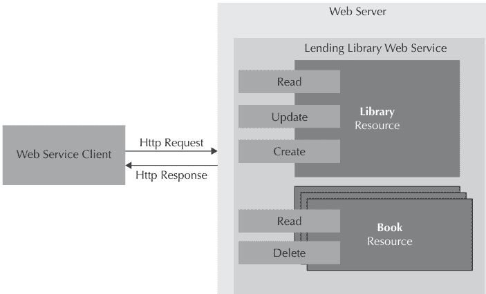

图 5-1 图书服务

如何使用 RESTful Web 服务执行这些创建、读取、更新和删除操作（统称为 CRUD 操作）？RESTful 服务的魅力之一在于它紧密依赖于成熟且经过测试传统 Web 编程机制。

RESTful Web 服务可以使用以下属性进行描述。

### 使用 URI 空间寻址 Web 服务资源

就像 Web 应用程序将其静态页面、JSP 和 JavaFaces 映射到应用内部的 URI 一样，Web 资源被分配 Web 服务上的一个或多个 URL，为 Web 服务客户端提供了访问它们以调用操作的手段。URI 空间的结构没有硬性规定，通常做法是将 URI 空间按层次排列，以反映 Web 资源所代表的逻辑实体层次结构。例如，你可以预期图 5-1 中的图书馆资源被映射到

```
/library
```

那么书籍将映射到共享 `/library` 为根路径的 URI；可能你在图书馆中的三本最喜欢的书籍对应于映射到以下相对 URI 的书籍资源：

```
/library/books/23
/library/books/87
/library/books/1156
```

### 使用 HTTP 方法执行操作

RESTful 服务使用 HTTP 方法对资源执行操作。RESTful 服务的模型是使用

- HTTP `GET` 对资源进行读取操作，以获取有关其身份的所有信息。
- HTTP `PUT` 对资源进行更新操作，允许客户端向资源传递信息，以便资源在操作后被修改。
- HTTP `POST` 创建新的 Web 服务资源，允许客户端向 Web 服务传递信息，由其用来创建新的 Web 资源。
- HTTP `DELETE` 执行删除操作，允许客户端向 Web 服务发送 HTTP `DELETE` 请求，结果是资源被移除。

### 使用熟悉的格式处理结构化数据

RESTful Web 服务使用 MIME 类型来识别它们将要处理的请求信息，以及它们对请求产生的响应信息。在请求端，客户端使用 HTTP `Accept` 头部来指示其发送给网络资源的数据格式。在响应端，Web 服务资源使用 `Content-Type` 头部来指示其提供的响应的 MIME 类型。

RESTful Web 服务可以消费和产生它们所需的任何 MIME 类型；然而，大多数 Web 服务消费和产生 XML 或 JavaScript 对象表示 (JSON) 或其他格式的结构化数据。

例如，你可以轻松地预期

```
HTTP GET /library/book/87, mime-type="application/xml"
```

返回类似以下的内容：

```
<book>
  <title>Passage to India</title>
  <author>E M Forster</author>
</book>
```

我们可以在一个简单的图表中展示 RESTful Web 服务的四个属性，如图 5-2 所示。

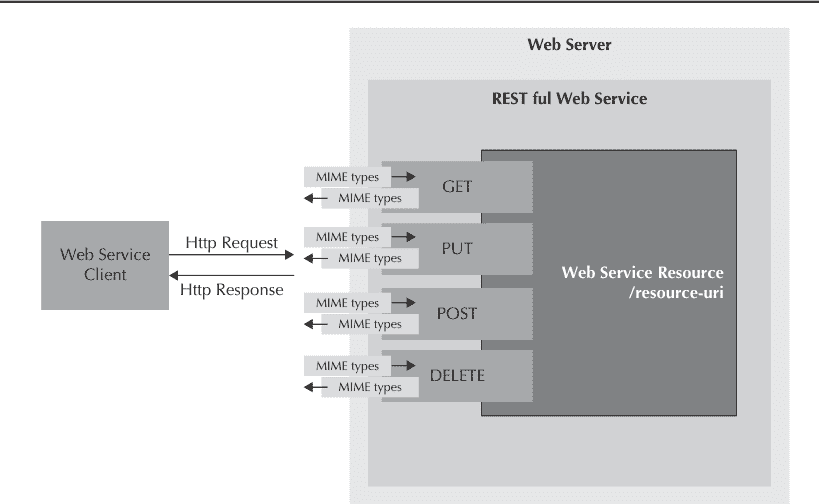

图 5-2。Web 服务的通用视图

### 用于 RESTful Web服务的 Java API

现在我们已经对 RESTful Web 服务的基本原理有了良好的理解，让我们看看如何在 Java EE 中通过 Java API for RESTful Web Services（简称 JAX-RS）来支持它们。

表示服务资源的起点是取一个 JavaBean 类，并使用 `@javax.ws.rs.Path` 注解对其进行标记。

```java
import javax.ws.rs.Path;

@Path("hello")
public class HelloWorld {
}
```

这指示 Java EE Web 容器创建一个地址为 `http://<hostname>:<port>/web-app-context-root/hello` 的 Web 服务资源。

这是一个良好的开始，但该 Web 服务资源还没有执行任何操作。为了让它拥有一个操作（例如读取操作），我们需要在类上创建一个 Java 方法作为该操作，并使用来自 `javax.ws.rs` 包的 `@GET` HTTP 方法注解对其进行标记。该包也是所有其他 HTTP 注解的存放地。

#### 代码列表：HelloWorld

```java
import javax.ws.rs.GET;
import javax.ws.rs.Path;

@Path("hello")
public class HelloWorld {

    @GET
    public String sayHello() {
        return "Hello you!";
    }
}
```

现在我们有了一个 Web 服务资源的代码，它在接收到 HTTP `GET` 请求时会返回字符串 `Hello you!`。

在 JAX-RS 术语中，`HelloWorld` 类是一个根资源类（root resource class）。如果你愿意，可以一直作为根资源类创建 Web 服务资源，但一旦你有了代表 Web 服务资源的根资源类，就可以使用该根资源类创建 URI 为根资源类子 URI 的 Web 服务资源。例如，通过向 `HelloWorld` 类添加一个新方法 `giveGreeting()`，你可以创建 `HelloWorld` 的子资源。

#### 代码列表：带有 greeting 子资源的 HelloWorld 资源

```java
import javax.ws.rs.GET;
import javax.ws.rs.Path;

@Path("hello")
public class HelloResource {

    @GET
    public String sayHello() {
        return "Hello you!";
    }

    @Path("greeting")
    public GreetingResource giveGreeting() {
        return new GreetingResource();
    }
}
```

通过使用 `@Path` 注解标记该方法并将其设置为 `greeting`，你是在指示 `GreetingResource` 类是 `HelloResource` 的子资源，可以在 URI `/hello/greeting` 访问。现在所有类都需要一个被其中一个 HTTP 方法注解标记的方法：

```java
import javax.ws.rs.GET;
```

#### 代码列表：Greeting 资源

```java
public class GreetingResource {

    @GET
    public String getGreeting() {
        return "Hail fellow well met!";
    }
}
```

创建 Web 服务资源有两种方式：

- 创建一个带有 `@Path` 注解的根类，该类包含资源 URI，并使用一个或多个带有 HTTP 方法注解的 Java 方法声明其自己的操作。
- 从一个根类开始，声明一个返回第二个类的 Java 方法，其中该 Java 方法被带有 `@Path` 注解标记，且该注解的值包含一个相对于根类的 URI。第二个类通过带有 HTTP 方法注解标记的 Java 方法来实现子资源的操作。

以下是创建 JAX-RS 资源时使用的注解总结。

| 注解 | 属性 | 用途 |
| --- | --- | --- |
| `@Path` | Value 属性；表示部署的相对路径资源 | 在类级别创建根资源；在方法级别创建子资源 |
| `@GET` | 无 | 表示一个 Java 方法将处理 Web 资源的 `GET` 请求 |
| `@HEAD` | 无 | 表示一个 Java 方法将处理 Web 资源的 `HEAD` 请求 |
| `@PUT` | 无 | 表示一个 Java 方法将处理 Web 资源的 `PUT` 请求 |
| `@POST` | 无 | 表示一个 Java 方法将处理 Web 资源的 `POST` 请求 |
| `@DELETE` | 无 | 表示一个 Java 方法将处理 Web 资源的 `DELETE` 请求 |
| `@OPTIONS` | 无 | 表示一个 Java 方法将处理 Web 资源的 `OPTIONS` 请求 |

## 第 5 章：非浏览器的网站：JAX-RS

在这个示例中，我们有如图 5-3 所示的 `HelloResource`。

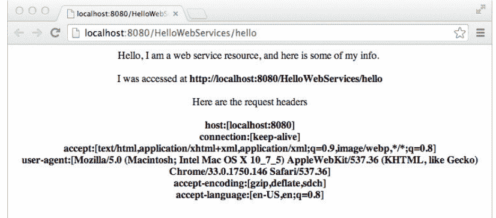

图 5-3。HelloResource

在这个示例中，我们有如图 5-3 所示的 `HelloResource`。

```java
import javax.ws.rs.GET;
import javax.ws.rs.PUT;
import javax.ws.rs.Path;
import javax.ws.rs.Produces;
import javax.ws.rs.core.Context;
import javax.ws.rs.core.UriInfo;
import javax.ws.rs.core.HttpHeaders;

@Path("hello")
public class HelloResource {

    @GET
    @Produces("text/html")
    public String sayHello(@Context UriInfo uri, @Context HttpHeaders headers) {
        // ...
    }

    @PUT
    @Produces("text/plain")
    public String sayHelloPlain(String requestEntity) {
        return "Hello " + requestEntity + "!";
    }
}
```

### 部署 JAX-RS 资源

为了部署所有的服务类以及任何其他需要的类，你需要实现 `javax.ws.rs.core.Application` 接口。该接口的作用让你在应用程序中声明哪些类是资源类，哪些是支持类类（例如实体提供者或异常映射器）。该类的主要合约是实现以下方法：

```java
public Set<Class<?>> getClasses()
```

该方法提出了一个直接的问题：你想从这个 Web 应用程序部署哪些 JAX-RS 类？当你部署一个包含此类类实现的 Web 应用程序时，JAX-RS 运行时会在此类 WAR 文件中运行，实例化它们，并获取它需要部署的 JAX-RS 类列表。

## 第 5 章：面向非浏览器的网站：JAX-RS

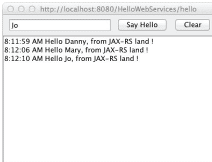

接收传入的数据。我们可以从它的 `@Produces` 注解中看到它产生纯文本。它还有一个 `String` 类型的方法参数，它使用它来构建响应。现在，`HelloClient` 应用是第二个 Web 服务应用程序，这第二个是一个 Java 客户端应用程序，它使用 Swing 窗口和 JAX-RS 来调用 `HelloResource` 资源上的此第二个方法，如图 5-4 所示。

我们不会花时间看 Swing 代码；相反，让我们来看看 `HelloClient` 类，它使用窗口来调用运行在服务器上的 `HelloResource` Web 服务资源。

#### 代码列表：HelloClient 类

```java
import javax.ws.rs.client.*;

public class HelloClient {
    WebTarget wt;

    public HelloClient() {
        Client client = ClientBuilder.newClient();
        this.wt = client.target("http://localhost:8080/HelloWebServices/hello/");
    }

    public String getUriAsString() {
        return this.wt.getUri().toString();
    }

    public String sayHello(String message) {
        Invocation webServiceCall = wt.request()
            .accept("text/plain")
            .build("PUT", Entity.text(message));
        String s = webServiceCall.invoke(String.class);
        return s;
    }
}
```

当你在 UI 界面点击“Say Hello”按钮时，它会调用 `sayHello()` 方法，并将窗口顶部文本的值传递进去。窗口会将该方法的返回值附加到窗口中间的文本。

`javax.ws.rs.client.WebTarget` 是客户端想要调用的远程资源的客户端表示。该实例是从从 `ClientBuilder` 类启动的 `javax.ws.rs.client.Client` 实例获取的，如代码所示。一旦使用相关 Web 资源的 URL 创建了 `WebTarget` 实例，就可以创建一个 `javax.ws.rs.Invocation` 客户端实例，该实例代表了调用将产生的所有数据。最后，当调用该实例的 `invoke()` 方法时，实际上会发生调用，并传入调用将返回的数据类型的类，在本例中为 `String` 类。

由于客户端对 `sayHello()` 方法的请求是用 `text/plain` MIME 类型创建的，当服务器接收到该 URI 的请求时，它会在 Web 资源上查找可以处理该 MIME 类型数据的方法。因此，传入的消息被路由到 `HelloResource` 服务器端资源的 `sayHello()` 方法。

```java
@PUT
@Produces("text/plain")
public String sayHello(String requestEntity) {
    return "Hello " + requestEntity + ", from JAX-RS land!";
}
```

这正是之前 `HelloResource` 类的谜团。

由于许多 Web 服务都锚位于服务器，因此这不是对 JAX-RS API 的简单介绍。事实上，你完全可以预期在像这样的 Swing 窗口等富客户端之外，还在其他 Java EE 组件中使用它。示例还非正式地向你介绍了 JAX-RS 的两个基础机制：Web 资源的内容消费和 Web 资源生产。

### 内容生产

到目前为止的所有示例都有返回字符串的 Web 资源方法。有些是包含 HTML 的字符串，有些是包含普通文本的字符串，但它们的共同点是它们都是返回 `java.lang.String` 的 Java 方法。

JAX-RS 提供了使用适用于应用程序需求的其他类对 Web 服务资源方法产生的内容进行建模，并提供了向 Web 资源调用客户端描述内容的手段。

Web 服务方法产生的内容被称为响应实体（response entity）。实现 Web 服务资源方法的 Java 方法通过两种方式之一创建响应实体：


- 它们可以返回 `javax.ws.rs.core.Response` 类的实例，它们可以使用 `ResponseBuilder` 类来构建，在这种情况下，响应实体是 `Response` 实例的属性。
- 它们可以返回一个表示响应实体本身的 Java 对象。第二种对于不需要设置响应其他方面（例如在响应中设置 HTTP 头部）的 Web 服务方法是一种快捷方式。

你可能好奇可以使用什么样的 Java 对象来表示响应实体：你已经看到 `java.lang.String` 是其中之一。JAX-RS 支持将其他 Java 类型编码为响应实体。

| Java 类型 | 内容类型 |
| --- | --- |
| `byte[]` | Any |
| `java.lang.String` | Any |
| `java.io.InputStream` | Any |
| `java.io.Reader` | Any |
| `java.io.File` | Any |
| `javax.activation.DataSource` | Any |
| `javax.xml.transform.Source` | Text/xml, application/xml application/*+xml |
| `javax.xml.bind.JAXBElement` and application-supported JAXB classes | Text/xml, application/xml application/*+xml |
| `javax.ws.rs.core.MultivaluedMap<String,String>` | Application/x-www-form-urlencoded |


# 第 5 章：面向非浏览器的网站：JAX-RS

## Java 类型与内容类型映射

| Java 类型 | 内容类型 |
| --- | --- |
| `javax.ws.rs.core.StreamingOutput` | `*/*` |
| `java.lang.Boolean` 和 `boolean` | `Text/plain` |
| `java.lang.Character` 和 `char` | `Text/plain` |
| `java.lang.Number` 及其基本类型 | `Text/plain` |
| `MultivaluedMap<String,String>` | `Application/x-www-form-urlencoded` |

## 扩展响应实体

如果内置类型不足以建模应用程序的响应实体，应用程序可能会处理自定义类。在这种情况下，JAX-RS 有一套扩展方案，其中任意 Java 类型都可以用于响应实体，只要存在相应的 Java 类知道如何转换该 Java 类型。此类转换被称为实体提供者，你创建实体提供者需要遵循的约定定义在 `javax.ws.rs.MessageBodyWriter<T>` 接口中。

换句话说，如果你希望你的 Web 服务方法直接返回 `Foo` 类型的 Java 对象，或者作为它返回的实体，你需要提供 `MessageBodyWriter<Foo>` 接口的实现，它要求你实现以下方法：

```java
void writeTo(Foo entity,
             Class<?> type,
             Type genericType,
             Annotation[] annotations,
             MediaType mediaType,
             MultivaluedMap<String, Object> httpHeaders,
             OutputStream entityStream)
    throws IOException, WebApplicationException
```

`Foo` 实体包含了你的 Web 服务方法返回的响应实体，必须将其写入实体流。我们将在章节末尾看到这样一个实体提供者的示例。

## @Produces

正如章节开头所述，当客户端从 RESTful Web 资源请求响应时，它可以使用 `Accept` 头部来告知它希望接收的 MIME 类型。为了让 JAX-RS Web 服务方法能够声明它们产生什么种类的内容，JAX-RS API 包含了用于 Web 服务方法的 `@Produces` 注解。`@Produces` 注解的作用是简单的，强制要求 `value()` 属性，它包含方法响应实体的 MIME 类型数组。这允许同一个 Web 资源方法由多个 Java 方法实现，每个方法产生不同 MIME 类型的响应，如注解每个 Java 方法的 `@Produces` 注解所声明的那样。

## 请求实体提供者

同样，如果应用程序试图以不在此支持标准类型列表的 Java 类型形式消耗其请求实体，则存在一种类似的机制，将请求实体解码为给定的 Java 类型。应用程序提供的实现此类解码任务的对象被称为“请求实体提供者”。请求实体提供者的 API 契约由 `MessageBodyReader<T>` 接口定义。

换句话说，如果你希望消费 Web 请求实体并使其以 `Foo` 类的实例形式进入你的 Java Web 方法，你必须创建一个实现 `MessageBodyReader<Foo>` 的 Java 类。这要求你实现以下方法：

```java
Foo readFrom(Class<Foo> type,
             Type genericType,
             Annotation[] annotations,
             MediaType mediaType,
             MultivaluedMap<String, String> httpHeaders,
             InputStream entityStream)
    throws IOException, WebApplicationException
```

当你必须从 `entityStream` 参数中读取传入的数据并实例化 `Foo` 实例时。该实例将传递给请求实体所属的 Java Web 服务方法。我们将在本章稍后部分看到 `MessageBodyReader` 的示例。

## @Consumes

当一个资源消耗数据时，它期望数据以特定格式传入的 Java 方法。该资源可能希望使用多个 Java 方法来实现一个资源方法：为它支持的每种 MIME 类型提供一个方法实现。`@Consumes` 注解允许 Java 方法声明它对传入的请求实体可以支持的 MIME 类型。

## 访问 Web 服务上下文

到目前为止，我们已经看到从 Web 服务方法可以访问资源实体。在 `HelloResource` 示例中，我们能够访问有关 `HelloResource` Web 服务上下文的更多信息，即客户端访问该 Web 服务资源时使用的 URL，以及 Web 服务请求的 HTTP 头。

任何 JAX-RS 资源都可以通过使用 `@Context` 注解请求 Web 容器将此类上下文信息传递给它。Web 服务资源可以获取关于 Web 服务请求的底层 HTTP 请求信息、资源的安全信息、请求和响应实体提供者，以及资源可用的其他配置信息。以下是可能与 `@Context` 注解配合使用的 JAX-RS API 类型列表。

| API 类 | 用途 |
| --- | --- |
| `javax.ws.rs.core.UriInfo` | 访问用于访问资源的 URI；资源的 URI 映射。 |
| `javax.ws.rs.core.HttpHeaders` | 访问请求的 HTTP 头。 |
| `javax.ws.rs.core.Request` | 根据客户端请求进行内容协商的能力。 |
| `javax.ws.rs.core.Application` | 访问同一应用程序中的所有 Web 服务类和属性。 |
| `javax.ws.rs.core.SecurityContext` | 访问关于 Web 资源的安全信息，如用户主体。 |
| `javax.ws.rs.ext.Providers` | 访问应用程序中所有的实体提供者。 |
| `javax.ws.rs.container.ResourceContext` | 向 Web 服务应用程序中注入资源的能力。 |
| `javax.ws.rs.core.Configuration` | 访问应用程序中所有的组件实例。 |

`@Context` 可用于注解方法参数、构造函数或资源类上的实例变量。

## 异常映射

很多时候，Web 服务方法会正常运行并在不抛出任何异常的情况下完成工作。情况并非总是如此。也许 Web 服务方法传递了它无法理解的内容，或者应用程序在执行过程中发生了某些内部错误。标记为 Web 服务的 JAX-RS 方法在发生意外情况时可能会抛出两种异常。该方法可以抛出一个受检异常，在这种情况下，它需要在方法声明的 `throws` 子句中声明该异常。或者，它可以抛出一个未检查的/运行时的异常。如何处理这些异常，以及如何向客户端通信错误状态？

在开发者无需进行任何工作的情况下，JAX-RS 将把 Web 服务方法抛出的异常转换为合适的 HTTP 响应。这可能因实现而异，但通常是通用的 HTTP 500 - Internal Server Error（内部服务器错误）。无论出现什么异常，这都是客户端收到的全部信息。

因此，能够自定义 Web 服务资源方法发送给客户端的响应通常是有用的，这取决于调用该方法时抛出了什么种类的 Java 异常，以及该异常携带了其他哪些诊断信息。你可能希望在响应中提供更多描述性信息，说明问题所在。

为了自定义异常映射到 HTTP 响应的方式，`javax.ws.rs.ExceptionMapper` 接口允许你为异常类型 `E` 定义自定义映射，指定你希望 JAX-RS 在运行时生成的任何 HTTP 响应。该接口上只有一个方法：

```java
public Response toResponse(E exception)
```

当一个类为特定异常类型实现此接口（当然，人们可以实现具有许多不同异常类型的 `ExceptionMapper`）并用于应用程序时，并且当异常抛出了与 `ExceptionMapper` 类型中指定的类型相同的异常时，JAX-RS 运行时会要求 `ExceptionMapper` 创建发送给客户端的响应。如果没有找到该类型的 `ExceptionMapper`，则容器将返回通用响应，通常是 HTTP 500。`ExceptionMapper` 有助于使你的 Web 服务更有用。

## 资源类的实例数量

到目前为止，我们还没有讨论过 JAX-RS 资源类的实例化问题。为了部署资源类、任何实体提供者或异常映射，可以使用 `javax.ws.rs.core.Application`。接口的功能是让你在应用程序中声明哪些类，该方法：

```java
public Set<Class<?>> getClasses()
```

JAX-RS 运行时会查找此类实现并实例化它们。这引出了问题：有多少个实例？除非使用其他注解，Web 服务类将为每个客户端请求实例化。这意味着 RESTful Web 服务是无状态且可扩展的。对于资源类开发者来说，这意味着资源类只持续请求生存期。提供者类（如 reader 和 writer）具有不同的生命周期。这意味着多个线程可能会并发访问提供者类，因此在类中保持状态需要小心。根据我们在第 4 章看到的托管 Bean 的术语，JAX-RS 资源类是请求范围，而提供者类是应用范围。可以更改资源类的默认范围和数量，尽管对于许多服务开发者来说，默认范围就是他们需要的。为了更改资源类的范围，你可以使用 `javax.enterprise.context.RequestScoped` 和 `javax.enterprise.context.ApplicationScoped` 注解分别声明这些资源类。当我们详细研究依赖注入时，将查看管理 JAX-RS 类范围的示例。

## URI 模板与图书服务示例

```
http://<hostname:port>/library/books/24
http://<hostname:port>/library/books/98
http://<hostname:port>/library/books/9654
```

其中路径段变量 `book-id` 的值将分别为 24、98 和 9654。

换句话说，任何作为 URI 模板有效扩展的客户端 URI 都将匹配到端点。如果存在任何冲突，精确 URI 的匹配将始终优于 URI 模板的匹配。

这个 URI 模板的示例引导我们查看一个更复杂的应用程序，它使用了并整合了我们所学的许多 JAX-RS API 特性：图书馆服务。

### 图书服务

图书馆服务是一个客户端-服务器应用程序。服务端是一个在线图书馆，负责管理其包含的书籍集合。客户端是一个 GUI 应用程序，用于访问图书馆并浏览书籍、向图书馆添加新书以及移除旧书。在开始查阅代码之前，让我们快速浏览一下主要功能，以便理解应用程序是如何运行的。

图 5-5 显示了主窗口。在左下角，你可以看到图书馆的书籍标题列表。当你点击标题时，屏幕右侧的面板会更新，提供所选书籍的完整信息。点击“删除”将从图书馆删除当前选中的书籍。

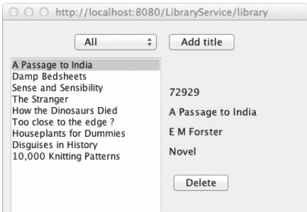

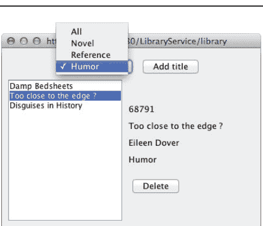

窗口顶部有一个 UI 组件，允许你根据类型过滤看到的书籍列表，如图 5-6 所示。

如果你点击“添加”标题按钮，系统会要求填写要添加到图书馆的新书信息，如图 5-7 所示。

如果你忘记正确地填写完书籍的完整信息（如图 5-8 所示）并尝试添加该书籍，则该书籍将无法添加。图书馆服务会通知你，如图 5-9 所示。

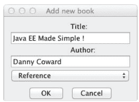

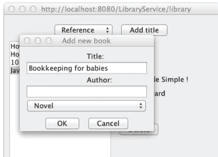

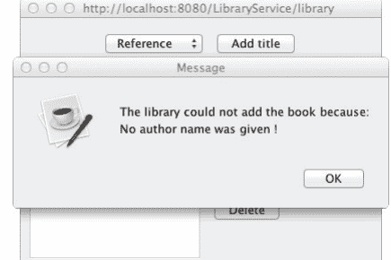

希望你已经开始思考此应用程序中 Web 服务资源长什么结构，以及其 Web 服务方法消耗和产生的信息结构。

首先，让我们梳理应用程序中不同的类。

在客户端，核心工作类是 `LibraryClient` 类，如图 5-10 所示。我们不会讨论用于实现用户界面的 Swing 类。`LibraryClient` 负责构建用户界面收集显示信息所需的所有请求，并对来自服务器图书馆服务的这些请求的响应进行反序列化。在服务端，图书馆服务被建模为单个 `Library` 类的一个实例，它引用了包含的 `Book` 对象列表。这种安排提供了包含书籍集合的单一图书馆的结构。正如我们将看到的，`Library` 是一个根资源类，它通过子资源定义自己；此外，`Book` 类也是一个资源类。从客户端到服务器的 Web 服务调用携带了作为 JSON 文档且 MIME 类型为 `application/json` 的实体。客户端和服务器都使用 JSON 实体来读取和写入 JSON 对象以处理请求和响应实体。服务端应用程序使用 `LibraryExceptions` 异常映射应用程序异常，并使用 `LibraryConfig` 类（即部署类）来实现 `javax.ws.rs.core` 功能。

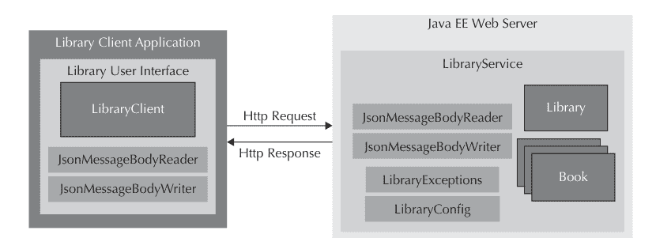

在编写代码之前，让我们看看图 5-11 中应用程序中所有 Web 服务调用的拆解，因为在查看代码时，这些交互将证明是必要的。

此图显示了客户端向服务器发起五个 Web 服务调用，详细列出了每个请求和响应的负载。其中有三个 GET 请求，分别获取图书馆拥有的类型列表、获取特定类型的书籍列表以及获取某特定书籍的完整描述。有一个 DELETE 请求，用于从图书馆中删除书籍；还有一个 POST 请求，其中包含要添加到图书馆的新书描述。

- **GET `/library/genres`**
  ```
  {"genres":["Novel","Reference","Humor"]}
  ```

- **GET `/library/books?genre=Humor`**
  ```
  {"books":[{"id":1,"title":"Damp"},{"id":2,"title":"Damp Booksheets to the edge"},{"id":3,"title":"Damp Booksheets in History"}]}
  ```

- **GET `/library/books/{id}`**
  ```
  {"id":2,"title":"Damp Booksheets to the edge History to the edge"}
  ```

- **DELETE `/library/books/{id}`**
  ```
  200 OK
  ```

- **POST `/library`**
  ```
  200 OK
  ```


## 列表：Library 类


```java
import javax.ws.rs.GET;
import javax.ws.rs.POST;
import javax.ws.rs.Path;
import javax.ws.rs.PathParam;
import javax.ws.rs.QueryParam;
import javax.ws.rs.core.MediaType;
import javax.ws.rs.core.Response;
import javax.ws.rs.core.Context;
import javax.ws.rs.core.ResourceContext;
import javax.ws.rs.json.JsonBuilder;
import javax.inject.annotation.PostConstruct;
import javax.json.JsonObject;
import javax.json.JsonArray;
import java.util.ArrayList;
import java.util.List;
import java.util.Random;

@Path("/library")
@Produces(MediaType.APPLICATION_JSON)
@Consumes(MediaType.APPLICATION_JSON)
public class Library {

    private List<Book> books = new ArrayList<>();

    @Context
    private ResourceContext resourceContext;

    @PostConstruct
    private void initLibrary() {
        books.add(new Book(this, generateId(), "A Passage to India", "E M Forster", "Novel"));
        books.add(new Book(this, generateId(), "Damp Bedsheets", "I P Nightly", "Humor"));
        books.add(new Book(this, generateId(), "Sense and Sensibility", "Jane Austen", "Novel"));
        books.add(new Book(this, generateId(), "The Stranger", "Albert Camus", "Novel"));
        books.add(new Book(this, generateId(), "How the Dinosaurs Died", "P T Dactyl", "Reference"));
        books.add(new Book(this, generateId(), "Too close to the edge ?", "Eileen Dover", "Humor"));
    }

    @GET
    @Path("/genres")
    public JsonObject getGenres() {
        JsonBuilder ab = JsonBuilder.createArrayBuilder();
        for (Book book : books) {
            ab.add(book.getGenre());
        }
        return JsonBuilder.createObjectBuilder()
                .add("genres", ab)
                .build();
    }

    @GET
    @Path("/books")
    public JsonObject getBooksByGenre(@QueryParam("genre") String genre) {
        JsonBuilder ab = JsonBuilder.createArrayBuilder();
        for (Book book : books) {
            if (book.getGenre().equals(genre)) {
                ab.add(book);
            }
        }
        return JsonBuilder.createObjectBuilder()
                .add("books", ab)
                .build();
    }

    @GET
    @Path("/books/{id}")
    public Book getBook(@PathParam("id") int id) {
        for (Book book : books) {
            if (book.getId() == id) {
                return book;
            }
        }
        return null;
    }

    @DELETE
    @Path("/books/{id}")
    public Response removeBook(@PathParam("id") int id) {
        books.removeIf(book -> book.getId() == id);
        return Response.ok().build();
    }

    @POST
    public Response addBook(JsonObject booko) throws InvalidException {
        String genre = booko.getString("genre");
        String title = booko.getString("title");
        String author = booko.getString("author");
        if (author == null || author.isEmpty()) {
            throw new InvalidException("No author name was given!");
        }
        int id = (int)generateId();
        Book b = new Book(this, id, title, author, genre);
        books.add(b);
        return Response.ok().build();
    }

    private int generateId() {
        long l = System.currentTimeMillis() * (new Random()).nextInt();
        String asString = "" + l;
        String as5String = asString.substring(asString.length()-5, asString.length());
        return (new Integer(as5String)).intValue();
    }
}
```

## 160 Java 7: 概览

```java
this.books.add(b);
b = new Book(this, this.generateId(),
  "Houseplants for Dummies", "G Fingers", REFERENCE);
this.books.add(b);
b = new Book(this, this.generateId(),
  "Disguises in History", "Ivor Beard", HUMOR);
this.books.add(b);
b = new Book(this, this.generateId(),
  "10,000 Knitting Patterns", "M N E Sweaters", REFERENCE);
this.books.add(b);
}
```

首先，凭借类级别的 `@Path("library")` 注解，这是一个资源类，它被映射到 Web 应用程序 URI 空间中的 `/library`。其次，它使用 `@PostConstruct` 注解将其声明为应用作用范围（application scope）的托管豆（managed bean）。这意味着对于每个请求它的库类，将有且仅有一个实例：如果我们没有这个注解，每个客户端进行 Web 服务调用都会创建一个该类的新实例。在这一实现中，书籍是在类底部的 `initLibrary()` 方法中被添加到库中的。我们没有使用数据库来存储这些内容，本质上是将书籍信息存储在单个库类中。当我们进一步探索 Java EE 平台时，将发现几种存储此类信息的更好方法，但目前，我们需要的是一个单例。请注意，`Library` 使用了 `@PostConstruct` 注解，要求容器在创建新实例后立即调用 `initLibrary()` 方法。这种便利性暗示了我们在书中将涵盖的托管豆的生命周期。

现在来验证 `Library` 类上的服务方法：由 `@GET` 注解的 `getGenres()`、`getBooks()`，以及由 `@POST` 注解的 `addBook()`。请注意，所有这些方法都使用 Java EE 平台中的 JSON-Processing API 将传入和出的实体处理为 JSON 对象。例如，`getGenres()` 的返回值是一个 `JSONObject`，它包含一个存储库中所有类型的 `JSONArray`；例如，该方法在向库中添加新书籍时返回一个 `Book` 对象，该对象预期是一个包含作者和类型键值对的 `JSONObject`。JSON 文档与 Java 方法处理的 JSON 对象之间的序列化和反序列化是由 `Library` 服务应用中的两个提供者类处理的：`MessageReader` 和 `MessageWriter`。由于两者几乎是互为镜像，让我们通过查看 `JsonResponseBody` 类来限制对这些实体提供者的检查。

### 列表：JsonResponseBody 实体提供者

```java
import javax.ws.rs.WebApplicationException;
import javax.ws.rs.ext.Provider;
import javax.ws.rs.ext.MessageBodyReader;
import javax.ws.rs.core.MediaType;
import javax.ws.rs.core.MultivaluedMap;
```

```java
import javax.ws.rs.Consumes;
import javax.json.Json;
import javax.json.JSONObject;
import java.lang.reflect.Type;
import java.lang.annotation.Annotation;
```

```java
@Provider
@Consumes(MediaType.APPLICATION_JSON)
public class JsonMessageReader implements MessageBodyReader<JSONObject> {

    @Override
    public boolean isReadable(java.Class<?> type,
        Type genericType,
        Annotation[] annotations,
        MediaType mediaType) {
        return true;
    }

    @Override
    public JSONObject readFrom(java.Class<JSONObject> type,
        Type genericType,
        Annotation[] annotations,
        MediaType mediaType,
        MultivaluedMap<java.lang.String, java.lang.String> httpHeaders,
        java.io.InputStream entityStream)
    throws java.io.IOException, WebApplicationException {

        JSONObject o = Json.createReader(entityStream).readObject();
        return o;
    }
}
```

我们可以看到，该类的核心方法是 `readFrom()`，它使用 JSON Processing API 从 `InputStream` 中读取请求实体到预期的 `JSONObject` 中。`JsonMessageWriter` 具有类似的代码用于将 `JSONObject` 写入 `OutputStream` 的反向过程，并在 `writeTo()` 方法中表示实体。

```java
public void writeTo(Object t,
    Class<?> type,
    Type genericType,
    Annotation[] annotations,
    MediaType mediaType,
    MultivaluedMap<String, Object> httpHeaders,
    OutputStream entityStream)
    throws IOException, WebApplicationException {

    String s = t.toString();
    byte[] bytes = s.getBytes();
    for (int i = 0; i < bytes.length; i++) {
        entityStream.write(bytes[i]);
    }
}
```

再次回到 `Library` 类，注意它有两种方式接收来自客户端的入站数据。当客户端请求特定类型的书籍列表时，该类型将通过对 `/library/books` 的 GET 调用中的查询字符串传递；例如 `GET /library/books?genre=Humor`。这是通过以下方法实现的：

```java
public JSONObject getBooks(@Context UriInfo uriInfo
```

该方法通过使用 `@Context` 注解，要求将调用它的 URI 相关信息作为方法参数传递。

## 162 Java EE 7: 概览

### 164 Java EE 7：概览

```java
public int getId() {
    return this.id;
}

public String getTitle() {
    return this.title;
}

public String getAuthor() {
    return this.author;
}

public String getGenre() {
    return this.genre;
}

@Override
public String toString() {
    return "a book by " + this.author;
}
```

注意其它的两个 Web 服务：GET 和 DELETE，分别用于查询书籍信息和将其从库中移除，分别由 `充分Description()` 和 `removeFromLibrary()` 实现。

注意在整个 `Library` 和 `Book` 类中，都使用了 `@Produces` 和 `@Consumes` 注解来将输入和输出实体的格式限定为 JSON 数据。

最后，在服务器应用程序中，有一个名为 `LibraryExceptions` 的 `ExceptionMapper` 实现，它会抛出 `InvalidBookException` 并将其映射到 HTTP 404 响应，响应体中包含 Java 异常中的错误消息。这用于 `Library.addBook()` 方法中，如果客户端请求的属性发送错误的书籍。此时 `addBook()` 方法会抛出 `InvalidBookException`，JAX-RS 实现将其映射到 `LibraryExceptions` 类，该类随后创建上述的 HTTP 404 响应。如果你仔细查看服务器和客户端代码，你应该能够追踪到当你尝试从源码向库中添加没有作者的书籍时，警告对话框弹出的错误消息，异常是在源码中生成的传递给显示消息的客户端代码。

现在我们理解了服务器端，客户端将相对简单。

- 列出：`LibraryClient` 类

```java
import javax.ws.rs.client.Client;
import javax.ws.rs.client.ClientBuilder;
import javax.ws.rs.client.WebTarget;
import javax.ws.rs.client.Invocation;
import javax.ws.rs.client.Entity;
import javax.json.json.JsonObject;
import javax.json.json.JsonArray;
import java.util.List;
```


# 第 5 章：非浏览器的网站：JAX-RS

```java
import java.util.ArrayList;
import javax.ws.rs.core.MediaType;
import javax.ws.rs.core.Response;
```

```java
public class LibraryClient {
    Client wsClient;
    private static String WEBSERVICE_ROOT = "http://localhost:8080/LibraryService";
    private static String LIBRARY_URI = WEBSERVICE_ROOT + "/library";
    private static String BOOKS_URI = LIBRARY_URI + "/books";
    private static String GENRES_URI = LIBRARY_URI + "/genres";
}
```

```java
public LibraryClient() {
    this.wsClient = ClientBuilder.newBuilder()
        .register(JsonMessageRequestBody.class)
        .register(JsonMessageBodyWriter.class)
        .build();
}
```

```java
public String getUriAsString(String genre) {
    WebTarget wt = this.wsClient.target(BOOKS_URI + "?genre=" + genre);
    Invocation webServiceCall = wt.request()
        .accept(MediaType.APPLICATION_JSON)
        .build("GET");
    JsonObject genreso = webServiceCall.invoke(JsonObject.class);
    List<JsonObject> booksSummary = new ArrayList<>();
    booksSummary.add(genreso);
    return booksSummary;
}
```

```java
public JsonObject getById(int id) {
    WebTarget genresTarget = this.wsClient.target(BOOKS_URI + "/" + id);
    Invocation webServiceCall = genresTarget.request()
        .accept(MediaType.APPLICATION_JSON)
        .build("GET");
    return Object.
}
```

```java
public void deleteBook(int id) {
    WebTarget genresTarget = this.wsClient.target(BOOKS_URI + "/" + id);
    Invocation webServiceCall = genresTarget.request()
        .accept(MediaType.APPLICATION_JSON)
        .build("DELETE");
}
```

```java
public List<String> get() {
    WebTarget genresTarget = this.wsClient.target(GENRES_URI);
    Invocation webService = genresTarget.request()
        .accept(MediaType.APPLICATION_JSON)
        .build("GET");
    JsonObject genreso = webService.invoke(JsonObject.class);
    JsonArray array = genreso.getArray("genres");
    List<String> genres = new ArrayList<>();
    for (int i = 0; i < array.size(); i++) {
        genres.add(array.getString(i));
    }
    return genres;
}
```

```java
public AddStatus addBook(JsonObject bookando) {
    WebTarget genresTarget = this.wsClient.target(LIBRARY_URI);
    Invocation webServiceClient = genresTarget.request()
        .header("Content-Type", MediaType.APPLICATION_JSON)
        .build("POST", Entity.json(bookando));
    Response response = webServiceClient.invoke();
    if (response.getStatus() == Response.Status.BAD_REQUEST) {
        return new AddStatus(false, response.readEntity(String.class));
    } else {
        return new AddStatus(true, "");
    }
}
```

```java
class AddStatus {
    boolean added = false;
    String errorMessage = "";

    AddStatus(boolean added, String errorMessage) {
        this.added = added;
        this.errorMessage = errorMessage;
    }
}
```

# 第 6 章：增添光彩：Java WebSockets


## Java EE 7：概览

Java WebSockets 与其他的 Java EE 组件不同，因为它们可以向 Web 客户端推送数据，而无需等待客户端请求。

Java WebSockets 背离了基于 HTTP 的交互模型，它为 Java EE 应用程序提供了一种异步更新浏览器和非浏览器客户端的方法。网站的交互模型是 HTTP 请求/响应交互模型，这种模型非常丰富，并允许许多复杂的基于 Web 的应用程序。然而，每次交互总是从浏览器开始，由用户执行某些操作触发：加载页面、刷新页面、点击按钮、点击链接等。

对于许多类型的 Web 应用程序来说，让用户一直守在驾驶位并不是理想的。从带有实时市场数据的金融应用，到世界各地人们竞价的拍卖应用，Web 开发者一直在寻找让应用程序服务器端向客户端推送数据的方法。这种需求产生了一些混合机制，要么基于维持长 HTTP 连接，要么基于某种形式的客户端轮询（polling）；但没有一种证明是该问题的完美解决方案。我们需要一种新方法，这导致了 WebSocket 协议的产生。

## WebSocket 协议简介

WebSocket 是一种基于 TCP 的协议，在单条连接上提供全双工通道。简单来说，这意味着它使用底层的网络协议作为 HTTP，并且在单个 WebSocket 连接上，双方可以同时向对方发送消息。WebSocket 协议定义了一个简单的生命周期（正如我们所看到的那样），并提供了一种支持二进制和文本消息的数据帧机制。与 HTTP 不同，这些连接是长连接的。这意味着连接不需要为每次消息传输都不断重新建立（像非对称的 HTTP 协议那样），WebSocket 协议中的每条数据也不需要像 HTTP 那样携带所有关于连接的元数据。换句话说，这种连接比 HTTP 协议轻得多。

然而，这并不是 WebSocket 适用于服务器推送信息任务优于构建在 HTTP 协议之上的轮询框架的主要原因。与其客户端建立专用 TCP 连接使得 WebSockets 成为一种本质更高效的更新客户端的方式，因为数据只在需要时才发送。

为了理解这一点，想象一个在线拍卖，10 个人在 12 小时内对某件物品进行竞价。假设每位竞价者对该物品平均出价 10 次。物品价格在拍卖期间不断变化。假设客户端需要轮询来查看最新的竞价信息。由于你无法知道竞价者何时会出价，也不知道当前出价的时效性如何，支持拍卖的 Web 应用程序需要确保每个客户端至少每分钟刷新一次，甚至可能更多！这意味着每个客户端每小时需要轮询 60 次，总共产生 60 x 10 x 12 = 7,200 次更新消息。换句话说，仅仅生成了 7,200 条更新消息。

然而，如果服务器可以在数据变化时将数据推送给客户端（例如使用 WebSocket 的情况），那么每个客户端只需要接收 20 条消息，总共只有 20 x 10 = 200 条消息。

## WebSocket 的生命周期

在 WebSocket 协议中，客户端和服务器大部分情况下是相同的。协议中唯一的非对称性是建立连接的初始阶段，在该阶段谁发起连接至关重要。这有点像电话通话。为了接通电话，必须有人拨号，必须有人接听。一旦电话接通，是谁发起的就不再重要了。

对于 Java EE 平台中的 WebSocket，WebSocket 客户端几乎总是浏览器或运行在笔记本电脑、智能手机或桌面级计算机上的富客户端，而 WebSocket 服务器是运行在 Java 应用服务器上的 Java EE Web 程序。

现在让我们来看 WebSocket 连接的典型生命周期。首先，客户端发起连接请求。这发生在客户端向服务器发送一个特殊格式的 HTTP 请求时。识别这是一个相对于任何常见或普通 HTTP 请求的 WebSocket 开启握手请求的标志是使用了 `Connection: Upgrade` 和 `Upgrade: websocket` 头部，而最重要的信息是请求 URI，如图 6-1 中的 `/uri`。

服务器决定是否支持 WebSocket（所有的 Java EE Web 容器都支持），如果支持，则在握手的请求 URI 处有一个符合请求要求的端点（endpoint）。如果一切正常，启用 WebSocket 的服务器将响应一个同样格式特殊的 HTTP 响应，称为 WebSocket 握手响应，如图 6-2 所示。

```
Handshake Request

GET /mychat http/1.1
Host: server.example.com
Upgrade: websocket
Connection: Upgrade
Sec-WebSocket-Key: X3JHM5dB1Zkh9GBXDW==
Sec-WebSocket-Protocol: megachat, chat
Sec-WebSocket-Extensions: compress, mux
Sec-WebSocket-Version: 13
Origin: http://example.com
```
图 6-1. WebSocket 请求

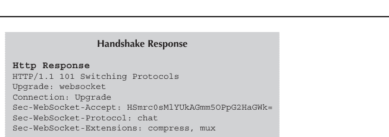
图 6-2. WebSocket 响应

该响应确认服务器将接受连接请求，并对连接的使用进行限制。一旦客户端处理了响应并感到满意，TCP 连接就会建立，如图 6-3 所示，连接的每一端就可以继续。

一旦连接建立，可能会发生许多情况：

- 连接的任何端都可以向对方发送消息。这可以在连接开启的任何时间发生。WebSocket 中的消息有两种类型：文本和二进制。
- 连接可能会产生错误。在这种情况下，假设错误没有导致连接中断，连接的双方都会收到通知。如果对话一方发送了格式错误的消息，可能会发生终止错误。
- 连接主动关闭。这意味着连接的一端认为对话结束并关闭连接。在关闭连接之前，连接的另一端会收到通知。

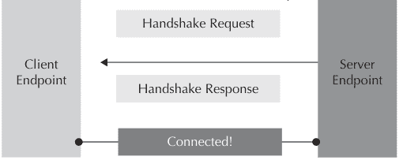
图 6-3. 建立连接

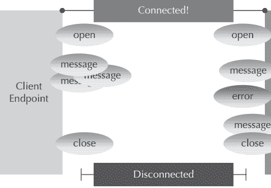
图 6-4. WebSocket 生命周期

在图 6-4 中，我们看到了任何 WebSocket 连接生命周期可能发生的事件示例。

## Java WebSocket API 概述

Java WebSocket API 提供了一系列 Java 类和 Java 注解，使得在 Java EE Web 容器中创建 WebSocket 端点变得相对简单。通用思路是获取你想要实现服务器端点逻辑的 Java 类，并在类级别上使用特殊的 WebSocket API 注解 `@ServerEndpoint` 进行标记。接下来，使用 `@OnMessage` 等注解对方法进行标记，从而赋予该方法每当 WebSocket 客户端向端点发送消息时被调用的特殊能力。然后将其打包到 WAR 文件的 `WEB-INF/classes` 目录中。让我们来看这样一个示例：

### 列表：EchoServer 示例

```java
import javax.websocket.OnMessage;
import javax.websocket.server.ServerEndpoint;

@ServerEndpoint("/echo")
public class EchoServer {

    @OnMessage
    public String echo(String incomingMessage) {
        return "I got this (" + incomingMessage + ")"
               + " so I am sending it back !";
    }
}
```


# Java 7: 概览

此 WebSocket 端点被映射到 Web 应用程序 URI 空间中的 `/echo`。每当 WebSocket 客户端发送消息时，它会立即返回一个根据其接收的消息派生的消息。

WebSocket API 包含了拦截所有 WebSocket 生命周期事件的手段，并提供了以同步和异步模式发送消息的方法。它允许你使用解码器（`decoder`）和编码器（`encoder`）类将 WebSocket 消息转换为任意 Java 类以及反之。

WebSocket API 还提供了创建 WebSocket 端点的方法。该协议在连接发起者方面是非对称的。Java 中的支持允许客户端连接到服务器，因此适用于 Java 客户端连接到在 Java EE Web 容器运行的 WebSocket 端点，实际上也可以连接到任何 WebSocket 服务器端点。

在查看 Java WebSocket 的真实示例之前，让我们先了解一下 Java WebSocket API 中的注解和主类。不用担心在进入代码工作之前花费太长时间：WebSocket API 是 Java EE 平台中较小的 API 之一。

## WebSocket 注解

WebSocket 注解有两个主要目的。首先，它们允许你声明让一个普通的 Java 类变为 WebSocket 端点；其次，它们允许你对该类中的方法进行注解，以便它们拦截 WebSocket 端点的生命周期事件。首先，我们将查看类级别的注解。

### @ServerEndpoint

这是 API 中的核心工作注解，如果你创建任何 WebSocket 端点，将会看到很多它。该类级别注解的主要（也是唯一的）强制性属性是 `value` 属性，它指定了你想让此端点在 Web 应用程序 URI 空间中注册的 URI 路径。

| 属性 | 功能 | 强制 |
| --- | --- | --- |
| value | 定义端点注册的 URI 路径 | 是 |

### @ClientEndpoint

`@ClientEndpoint` 注解用于 Java 类的类级别，将该类转换为一个启动到服务器端点连接的客户端端点。这通常用于连接到 Java EE Web 容器的富客户端应用程序。它没有强制性属性。

### @ServerEndpoint 和 @ClientEndpoint 可选属性

这些类级别注解有几个共同的其他属性，定义了适用于它们装饰的 WebSocket 端点的其他配置选项。

| 属性 | 功能 | 强制 |
| --- | --- | --- |
| configurator | 开发者可以提供的特殊类名，用于动态配置端点 | 否 |
| decoders | 用于将传入的 WebSocket 转换为表示它们的 Java 类的列表 | 否 |
| encoders | 用于将 Java 类转换为传出的 WebSocket 消息的类列表 | 否 |
| subprotocols | 表示端点支持的特殊子协议（如 "chat"）的字符串名称列表 | 否 |

现在让我们转向生命周期注解。

#### @OnOpen

此方法级注解声明，每当有新方连接到其标记的 WebSocket 端点时，Java EE Web 容器必须调用其在相应 WebSocket 端点上被注解的方法。该方法可以没有参数，也可以有一个可选的 `Session` 参数（其中 `javax.websocket.Session` 类是表示已打开 WebSocket 连接的 API 对象），和/或一个可选的 `Endpoint` 配置参数（其中 `javax.websocket.EndpointConfig` 是表示此端点配置信息的 API 对象），以及一个将讨论的可选 WebSocket 路径参数。

#### @OnMessage

此方法级注解声明，每当连接上有新消息到达时，Java EE Web 容器必须调用其装饰的方法。该方法必须具有特定类型的参数列表，但幸运的是，有很多选项。参数列表必须包含一个可以持有传入消息的变量，可以包含 `Session`，并包含路径参数。对于什么种变量可以持有传入的消息有一系列选项，最常用的是用于文本消息的 `String` 和用于二进制消息的 `ByteBuffer`。
该方法可以有指定的返回类型或为 `void` 类型。如果有返回类型，Java EE Web 容器将返回结果解释为发送回给客户端的消息。

#### @OnError

此方法级注解声明，每当连接上发生错误时，Java EE Web 容器必须调用其装饰的方法。该方法的参数列表中必须包含一个 `Throwable` 参数，并可以有一个可选的 `Session` 参数和路径参数。

#### @OnClose

对于任何 WebSocket 生命周期中的终点事件，此方法级注解声明，每当通往此端点的 WebSocket 连接即将关闭时，Java EE Web 容器必须调用其装饰的方法。如果允许传递，该方法的参数列表中允许有一个 `Session` 参数和路径参数，以及一个 `javax.websocket.CloseReason` 参数，该参数包含了关于连接关闭的原因解释。

## Java WebSocket API 类

Java WebSocket 开发者将遇到的最重要 API 类是 `Session`、`RemoteEndpoint` 和 `WebSocketContainer` 接口。

### Session

`Session` 对象是通往端点的活动 WebSocket 连接的高级表示。它对任何 WebSocket 生命周期方法都可用。它包含了关于连接如何建立的信息，例如连接中另一方用于建立连接的请求 URI，以及如果处于空闲状态，连接将超时的时间。它包含了程序化关闭连接的方法。它持有一个 map，应用程序可以使用它来存储希望与连接关联的应用程序数据，以及端点从给定对端接收的完整消息记录。与 `HttpSession` 不同，它的相似之处在于它代表了来自端点实际对端的一系列交互。它持有指向端点的 `RemoteEndpoint` 接口。

### RemoteEndpoint

`RemoteEndpoint` 接口从 `Session` 对象可用，代表连接的另一端。在实践中，它是你想向连接的另一端发送消息时调用的对象。`RemoteEndpoint` 有两个子类型：`Basic` 和 `Async`。`Basic` 包含了同步发送 WebSocket 消息的方法，而 `Async` 包含了异步发送 WebSocket 消息的方法。因为同步和异步发送的区别很小，许多应用程序只发送文本和二进制消息，知道 `RemoteEndpoint.Basic` 接口具有以下方法：

```java
public void sendText(String text) throws IOException;

public void sendBinary(ByteBuffer bb) throws IOException;
```

这就能让你走得很远。

### WebSocketContainer

正如 `HttpServlet` 之于 Java Servlet，`WebSocketContainer` 也之于 Java WebSocket。它代表了 Java EE 容器到 WebSocket 端点。它包含了 WebSocket 功能的许多配置属性，例如消息缓冲区和异步超时。

## WebSocket Clock

我们完成了对 Java WebSocket API 的之旅，完成之后，我们已经有了足够的知识来看我们的第一个 WebSocket 应用程序。Clock 应用是一个简单的 Web 应用程序。当你运行应用程序时，你会看到如图 6-5 所示的 index.html 页面。

当你点击 Start 按钮时，时钟开始运行，当前时间如图 6-6 所示。时间每秒更新一次。
当你点击 Stop 按钮时，时钟停止运行，直到你重新启动，如图 6-7 所示。
应用程序由单个 Web 页面 index.html 和单个 Java WebSocket 端点（称为 ClockServer）组成。当按下 Start 时，index.html 使用 JavaScript 代码与 ClockServer 端点建立 WebSocket 连接。ClockServer 端点每秒向浏览器客户端发送时间更新消息。JavaScript 代码处理传入的消息并将其渲染在页面上。点击 Stop 会导致 index.html 页面中的 JavaScript 代码向 ClockServer 发送停止消息，从而使其停止发送时间更新。该架构如图 6-8 所示。

| 浏览器 | 服务端 |
|---|---|
| /index.html JavaScript 代码 | 连接 时间更新消息 停止消息 ClockServer Java 端点 |

让我们来看看客户端的代码。

### 列表：Clock 客户端页面

```html
<!DOCTYPE html>
<html>
<head>
  <meta http-equiv="Content-Type" content="text/html; charset=UTF-8">
  <title>Web Socket Clock</title>
  <script language="javascript" type="text/javascript">
    var websocket;
    var last_time;

    function init() {
      output = document.getElementById("output");
    }

    function start_clock() {
      var wsUri = "ws://localhost:8080/clock-app/clock";
      websocket = new WebSocket(wsUri);
      websocket.onmessage = function (evt) {
        last_time = evt.data;
        writeToScreen('<span style="color: blue;">' + last_time + '</span>');
      };
      websocket.onerror = function (evt) {
        writeToScreen('<span style="color: red;">ERROR:</span> ' + evt.data);
        websocket.close();
      };
    }

    function stop_clock(message) {
      websocket.send("stop");
    }

    function writeToScreen(message) {
      var pre = document.createElement("p");
      pre.style.wordWrap = "break-word";
      pre.innerHTML = message;
      var oldChild = output.firstChild;
      if (oldChild == null) {
        output.appendChild(pre);
      } else {
        output.removeChild(oldChild);
        output.appendChild(pre);
      }
    }

    window.addEventListener("load", init, false);
  </script>
</head>
<body>
<div style="text-align: center;font-family: Arial; font-size: large">
WebSocket Clock
<br/><br>
<form action="">
<input
onclick="start_clock()"
title="Press to start the clock on the server"
value="Start"
type="button">
<input
onclick="stop_clock()"
title="Press to stop the clock on the server"
value="Stop"
type="button">
</form>
<div id="output"></div>
</div>
</body>
</html>
```

此页面的 HTML 相对直观。注意 WebSockets 的 JavaScript API 使用了指向 WebSocket 端点的完整 URI：

`ws://localhost:8080/clock-app/clock`

其中 `/clock` 是 Web 应用程序的上下文路径。`start_clock()` 方法完成了创建 WebSocket 连接和添加事件处理程序的所有工作（采用 JavaScript 风格），特别是处理从服务器接收的消息。`stop_clock()` 方法将字符串发送到服务器。

现在让我们转向 ClockServer 端点。

### 列表：ClockServer 端点

```java
import javax.websocket.OnOpen;
import javax.websocket.OnClose;
import javax.websocket.OnMessage;
import javax.websocket.OnError;
import javax.websocket.Session;
import javax.websocket.server.ServerEndpoint;
import java.util.Date;
import java.text.SimpleDateFormat;
import java.io.IOException;

@ServerEndpoint("clock")
public class ClockServer {

    Thread updateThread;
    boolean running = false;

    @OnOpen
    public void startClock(Session session) {
        final Session mySession = session;
        this.running = true;
        final SimpleDateFormat sdf = new SimpleDateFormat("h:mm:ss a");
        this.updateThread = new Thread(new Runnable() {
            public void run() {
                while (running) {
                    String dateString = sdf.format(new Date());
                    try {
                        mySession.getBasicRemote().sendText(dateString);
                        Thread.sleep(1000);
                    } catch (IOException | InterruptedException ie) {
                        running = false;
                    }
                }
            }
        });
        this.updateThread.start();
    }

    @OnMessage
    public String handleMessage(String incomingMessage) {
        if ("stop".equals(incomingMessage)) {
            this.stopClock();
            return "clock stopped";
        } else {
            return "unknown message: " + incomingMessage;
        }
    }

    @OnError
    public void clockError(Throwable t) {
        this.stopClock();
    }

    @OnClose
    public void stopClock() {
        this.running = false;
        this.updateThread = null;
    }
}
```


# 182 Java EE 7: 概览

标记了 `@OnMessage`。该方法的 `String` 参数告知端点正在以最简单的形式接收消息。此方法返回一个字符串，它被转换为消息。

# 有多少 WebSocket 实例？

此示例中出现的问题是：WebSocket 端点会有多少个实例？答案是，为每个连接创建一个端点类的实例。每个客户端都有一个唯一的端点实例。此外，Java EE 容器保证不会有两个 WebSocket 发送到同一个端点。因此，与 Java Servlet 模型相比，你编写 WebSocket 端点时可以知道只有一个线程。

# Java WebSocket 编码器和解码器

基础 WebSocket 协议提供了两种原生格式供处理：文本和二进制。这对于在客户端和服务器之间交换简单信息的应用程序非常好。在我们的 Clock 中，WebSocket 交互期间交换唯一的数据是从端点广播的格式化时间字符串和停止字符串。但当应用程序需要在 WebSocket 连接上发送或接收更复杂的内容时，它将寻找放置这些信息的结构。作为 Java 开发者，我们习惯于处理对象形式的数据：无论是来自标准 Java API，还是我们自己的类。这意味着如果你坚持使用 Java WebSocket API 的底层消息功能，并希望为消息编写不是字符串或字节的对象，你需要编写代码将对象转换为字符串或数组，反之亦然。

Java WebSocket API 经常为我们提供将对象编码为 WebSocket 消息以及将 WebSocket 消息解码为对象的任务支持。

首先，Java WebSocket API 尝试将传入的消息转换为你请求的任何 Java 原始类型（或其类）。这意味着你可以声明此类类型的消息处理方法：

```java
@OnMessage
public void handleCounter(int newValue) { }
```

或

```java
@OnMessage
public void handleBoolean(Boolean b) { }
```

Java WebSocket 实现尝试将任何传入的消息转换为你声明的 Java 原始参数类型。等效地，在发送消息时，`RemoteEndpoint.Basic` 的发送方法包含一个通用的

```java
public void sendObject(Object message) throws IOException, EncodeException
```

# 第 6 章：增添色彩：Java WebSockets 183

方法，你可以向其传递任何 Java 原始类型或其等效类，Java WebSocket 实现会将该值转换为等效的字符串。

这只能让你进行到这一步。通常情况下，你希望使用更高级、高度结构化的对象来表示应用程序中的消息。为了在消息处理方法中处理自定义对象，你必须在提供端点的同时提供一个 WebSocket Decoder 实现，运行时将使用它将传入的消息转换为自定义对象的实例。若要在你的发送方法中处理自定义对象，你必须提供一个 WebSocket Encoder 实现，运行时将使用它将自定义对象的实例转换为原生 WebSocket 消息。我们可以在图 6-9 中总结这种方案。

图 6-9 显示了与客户端交换字符串的端点，以及其他端点使用编码器和解码器将 `Foo` 对象转换为 WebSocket 文本消息反之亦然。

Java WebSocket API 中有一系列 `java.websocket.Decoder` 和 `Encoder` 接口可供选择，取决于你想要进行种种转换。例如，为了实现一个将文本转换为自定义开发者类 `Foo` 实例的解码器，你需要使用泛型类型 `String` 来实现 `Decoder.Text<T>`，这将要求你实现方法：

```java
public Foo decoder(String s) throws DecodeException
```

这是解码器的核心方法，每当新消息到达时都会被调用，以产生一个 `Foo` 类的实例。运行时随后可以将此类传递给你端点的消息处理方法。

还有同类的 Decoder 类，用于解码二进制 WebSocket 消息以及以阻塞 I/O 流形式到达的 WebSocket 消息，你也可以使用。

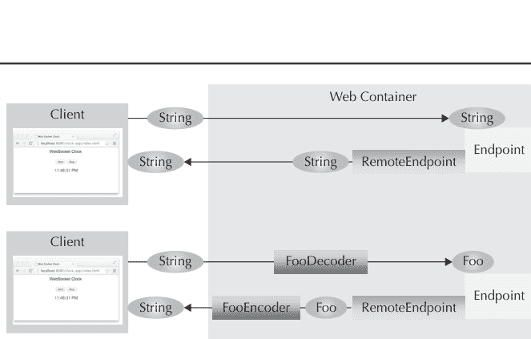

图 6-9 编码器和解码器

# 184 Java EE 7：概览

若要实现一个将自定义开发者类 `Foo` 的实例转换为 WebSocket 文本消息的编码器，你需要使用 `Foo` 作为泛型类型来实现 `Encoder.Text<T>` 接口。这将要求你实现方法：

```java
public String encode(Foo foo) throws EncodeException
```

它负责将 `Foo` 转换为字符串。如果你调用了 `RemoteEndpoint.sendMessage`（见前文）并传入了 `Foo` 类的实例，Java WebSocket 运行时就需要此操作。与解码器类似，还有同类的 Encoder，用于将自定义对象转换为二进制消息，以及将自定义对象写入阻塞 I/O 流以发送消息。

如果你想使用某个端点，这种简单的方案是：正如我们在 `@ClientEndpoint` 和 `@ServerEndpoint` 定义中所所示，你只需分别在 `decoders()` 和 `encoders()` 属性中列出想要使用的 Decoder 和 Encoder 实现。

如果你为 Java 原始类型配置了自定义编码器或解码器，它们将如预期般覆盖运行时对这些类型的默认编码器。

# 消息处理模式

到为止，我们只讨论了一次性发送和接收 WebSocket 消息。许多应用程序保留了这种简单的处理模型，因为它们在应用程序协议中只定义了小型消息；但某些应用程序会处理大型 WebSocket 消息，可能会传输照片或大型文档。Java WebSocket API 提供了许多适用于优雅且高效处理大消息的模式。

# 接收大消息

WebSocket API 有两种额外的接收消息模式，适用于已知消息将很大的情况。第一种模式将端点暴露给阻塞 I/O API，端点可以使用它来消费消息，用于文本消息的 `java.io.Reader` 或用于二进制消息的 `java.io.InputStream`。要使用此方法，不要在消息处理方法中使用 `String` 或 `ByteBuffer` 参数，而是使用 `Reader` 或 `InputStream`。例如：

```java
@OnMessage
public void handleMessageAsStream(InputStream messageStream, Session session) {
    // 从 messageStream 读取直到消费完整个二进制消息
}
```

第二种模式允许使用基础的分块 API，WebSocket 消息以小片段的形式传递给消息处理程序，并带有一个布尔标志告知你还有更多片段来完成消息。当然，消息片段按顺序到达，且没有其他消息的交织。要使用此方法，消息处理程序添加一个布尔参数，例如：

```java
@OnMessage
public void handleMessageInChunks(String chunk, boolean isLast) {
    // 随着片段的到达重组消息
}
```


# 第 6 章：增添色彩：Java WebSockets 185

在这种模式下，分块的大小取决于与发送消息的对端以及 Java WebSocket 运行时配置相关的多个因素。你只知道你通过若干片段接收了整个消息。

# 发送消息模式

正如你预期的那样，考虑到 WebSocket 协议的对称性，Java WebSocket API 提供了等效的消息发送模式。除了一次性发送整个消息外（正如我们在本章为止所看到的），你还可以将消息发送到阻塞 I/O，取决于消息是文本还是二进制，选择 `java.io.Writer` 或 `java.io.OutputStream`。这些当然是你从 `Session` 对象获取的 `RemoteEndpoint.Basic` 接口上的额外方法：

```java
public Writer getSendWriter() throws IOException
```

以及

```java
public OutputStream getSendStream() throws IOException
```

第二种模式是分块模式，你可以通过调用 `RemoteEndpoint` 以下方法来使用它：

```java
public void sendText(String text, boolean isLast) throws IOException
public void sendBinary(ByteBuffer binary, boolean isLast) throws IOException
```

# 消息的异步发送

在这种模式下，方法立即返回，你可以通过返回的 `Future` 对象查询消息状态，甚至在改变主意时取消传输。有以下异步方法：

```java
public Future<Void> sendText(String text)
public Future<Void> sendBinary(ByteBuffer binary)
```

在离开 Java WebSocket 发送话题之前，值得注意的是 WebSocket 协议本身并不保证送达。换句话说，当你发送消息时，你无法确定它是否被客户端接收。如果在你的处理程序中收到错误，通常意味着消息没有正确送达。但如果没有错误，消息可能仍未送达。可以使用 Java WebSockets 构建交互，但与 JMS 等消息协议不同，它并不保证送达。

## 路径映射

在 Clock 示例中，有一个端点，它映射到应用程序 URI 空间中的单个相对 URI。连接此端点的客户端是通过选择应用程序 URI 加上端点 URI 的精确 URL 的。这是 Java WebSocket API 中路径映射的示例。通常，端点可以通过以下地址访问：

```
<ws or wss://<hostname>:<port>/
<web-app-context-path>/<websocket-path>?<query-string>
```

其中 `<websocket-path>` 是 `@ServerEndpoint` 注解的 `value` 属性，`<query-string>` 是可选的查询字符串。当 `<websocket-path>` 是一个 URI 时（如 ClockServer 端点所示），只有精确匹配的请求 URI 会连接到端点。WebSocket API 还允许将服务器端点映射到一级 URI 模板。URI 模板是一种高级说法，表示 URI 的一个或多个段可以替换为变量。例如：

```
/airlines/{service-class}
```

这是一个带有 `service-class` 单变量的模板。Java WebSocket API 允许传入的请求 URI 匹配使用 URI 模板路径映射的端点，只要请求 URI 是该 URI 模板的有效扩展。例如：

```
/airlines/coach
/airlines/first
/airlines/business
```

都是该 URI 模板的有效扩展。

变量 `service-class` 分别等于 `coach`、`first` 和 `business`。URI 在 WebSocket 应用中非常有用，因为模板变量的值在请求 URI 的端点内部可用。在服务器端点的任何生命周期方法中，你都可以添加任意数量带有 `@PathParam` 注解的 `String` 参数，以获取匹配中变量路径段的值。继续这个示例，假设我们有以下服务器端点：

- 列表：一个预订通知端点

```java
@ServerEndpoint("/airlines/{service-class}")
public class MyBookingNotifier {

    @OnOpen
    public void initializeUpdates(Session session,
        @PathParam("service-class") String sClass) {

        if ("first".equals(sClass)) {
            // 打开香槟
        } else if ("business".equals(sClass)) {
            // 加热坚果
        } else {
            // 不要对着我们的飞机撞头
        }
    }
}
```

这根据客户端连接到哪种请求 URI 来产生不同等级的服务。

## 在运行时访问路径信息

端点在运行时对它的所有路径信息具有完全访问权限。首先，它始终可以获取 WebSocket 实现发布它时的路径。通过

```java
ServerEndpointConfig.getPath()
```

该端点的调用持有此信息，你可以在任何可以获取 `ServerEndpointConfig` 实例的地方轻松访问它，正如我们在示例中看到的那样。

- 列表：访问自身路径映射的端点

```java
@ServerEndpoint("/travel/hotels/{stars}")
public class HotelBookingService {

    public void handleConnection(Session s, EndpointConfig config) {
        String myPath = ((ServerEndpointConfig) config).getPath();
        // myPath = "/travel/hotels/{stars}"
    }
}
```

这对于精确的 URI 映射端点同样有效。

## 188 Java EE 7: 整体概览

你可能希望在端点内部从运行时访问的第二个信息是与连接的客户端所使用的 URI。这些信息以多种形式存在（正如我们稍后看到的），但包含所有信息的骨干方法是

```java
Session.getRequestURI()
```

方法。这为你提供了指向 WebSocket 实现 Web 服务器根的 URI 路径。注意，这包含了 WebSocket 所属 Web 应用程序的根。因此，在我们的酒店预订示例中，如果它部署在一个上下文根为 `/customer/services` 的 Web 应用程序中，并且客户端连接到 `HotelBookingService` 端点使用的是

```
//fun.org/customer/services/travel/hotels/3
```

那么通过 `getRequestURI()` 接收到的 URI 端点是

```
/customer/services/travel/hotels/3
```

当 URI 包含查询字符串时，`Session` 对象上的两个方法可以从该请求中解析出进一步的信息。因此，让我们来看查询字符串。

## 查询字符串和请求参数

正如我们之前看到的，在 WebSocket 端点的请求路径之后跟随的是可选的查询字符串

```
<ws or wss://<hostname>:<port>/<web-app-context-path>/<websocket-path>?<query-string>
```

URI 中的查询字符串最初在通用网关接口 (CGI) 应用中流行起来。URI 的路径部分定位 CGI 程序（通常为 `/cgi-bin`），附加在 URI 之后的查询字符串将参数列表传递给 CGI 程序以限定查询。在使用 HTML 表单 提交数据时，也会使用查询字符串。例如，在 Web 应用程序中，HTML 代码

```html
<form name="input" action="form-processor" method="get">
您的用户名: <input type="text" name="user">
  <input type="submit" value="Submit">
</form>
```

点击按钮会产生一个相对于解码 HTML 代码的页面的 URI 的 HTTP 请求

```
/form-processor?user=Jared
```

其中输入字段包含文本 `Jared`。根据位于 URI 路径 `/form-processor` 处的 Web 资源的性质，可以使用查询字符串 `user=Jared` 来确定应该做出什么种响应。例如，如果 `form-processor` 处的资源是一个 Java Servlet，该 Servlet 可以使用 `getQueryString()` API 调用从 `HttpServletRequest` 获取查询字符串。

本着类似的初衷，查询字符串可以用于使用 Java API 连接到 WebSocket 端点的 URI 中。WebSocket API **不会**将查询字符串作为开启握手请求的 URI 的部分来确定它可能匹配的端点。换句话说，请求 URI 是否包含查询字符串对于它是否匹配到服务器端点的发布路径没有区别。此外，用于发布端点的路径中的查询字符串是被忽略的。

就像 CGI 程序和其他类型的 Web 组件一样，WebSocket 端点可以使用查询字符串来进一步配置客户端正在建立的连接。因为 WebSocket 实现本质上忽略了传入请求中查询字符串的值，因此任何使用查询字符串值的逻辑都完全在 WebSocket 组件内部。你可以使用的检索查询字符串值的主要方法是 `Session` 对象

```java
public String getQueryString()
```

返回整个查询字符串（`?` 字符之后的所有内容）以及

```java
public Map<String, List<String>> getRequestParameterMap()
```


给你一个从查询字符串解析出的所有请求参数的数据结构。你会注意到 map 的值是字符串；这是因为查询字符串可能有两个同名的参数。例如，你可能使用以下 URI 连接到 `HotelBookingService`：

```
ws://fun.org/customer/services/travel/hotels/3?showpics=thumbnails&description=short
```

其中 `pictureType` 的值将是 `thumbnails`。

## 端点的部署

WebSocket 端点在 Java EE 容器中的部署遵循简单即复杂的原则。当你将一个带有 `@Endpoint` 注解的 Java 类打包到 WAR 文件中时，WebSocket 实现会扫描 WAR 文件并部署它们。这意味着除了将它们放在 WAR 文件中，你不需要做任何特殊操作来部署你的端点。然而，你可能希望更精确地控制部署文件中的端点。在这种情况下，你可以提供 Java WebSocket 接口 `ServerApplicationConfig` 的实现，允许你过滤哪些端点。

### 列表：访问请求参数

```
@ServerSocket("/travel/hotels/{stars}")
public class HotelBookingService {
    public void handleConnection(Session s, EndpointConfig config) {
        String pictureType = s.getRequestParameterMap()
            .get("showpics").get(0);
        String textMode = s.getRequestParameterMap()
            .get("description").get(0);
    }
}
```

> **NOTE** 你也可以从请求 URI 获取查询字符串。在 Java API 中，`Session.getRequestURI()` 调用始终包含 URI 路径和查询字符串。

## 聊天应用程序

测试推送技术的好方法是构建一个向许多感兴趣的客户端提供频繁异步更新的应用。聊天应用程序就是如此。让我们详细查看如何应用从 Java WebSocket API 学到的知识来构建一个简单的聊天应用程序。

图 6-10 显示了聊天应用程序的主窗口，它在登录时会提示用户名。

多个人可以同时聊天，在底部的文本字段中输入消息并点击发送按钮。你可以在右侧看到活跃的聊天者，并在中间和左侧看到每个人消息的共享记录。在图 6-11 中，有一次尴尬的聊天尝试。

在图 6-12 中，我们可以看到其中一个聊天者突然离开，而另一个离开得稍微优雅一点，房间里只剩了一个聊天者。


**FIGURE 6-10. 登录聊天**

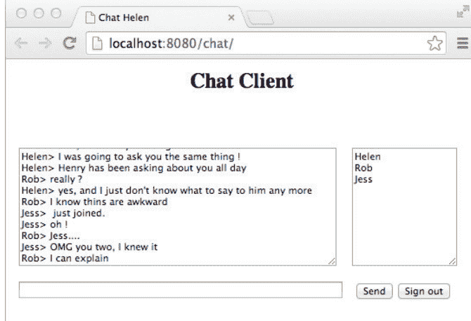

**图 6-11. 完整的聊天流程**

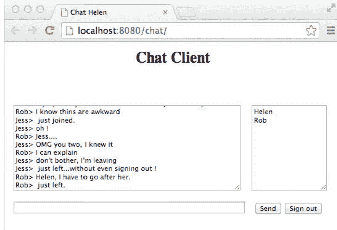

**图 6-12. 离开聊天**

## 第 6 章：增添光彩：Java WebSockets 191

在详细查看代码之前，让我们先了解该应用程序是如何构建的整体架构。

网页端使用 JavaScript WebSocket 客户端来发送和接收所有聊天消息。Web 服务器上有一个 Chat Java WebSocket 端点，它负责处理来自多个客户端的所有聊天消息，跟踪活跃聊天的用户，维护聊天记录，并在每当有人进入或离开聊天，或者有人向群组发送消息时，向所有连接的客户端广播更新。

应用程序使用带有 WebSocket 编码器（Encoders）和解码器（Decoders）的自定义对象为所有聊天消息建模。

让我们来看 ChatServer 端点。

### ChatServer 端点

```java
import java.io.IOException;
import java.util.*;
import javax.websocket.*;
import javax.websocket.server.*;
import jsp.chapter4.data.*;

@Endpoint(value = "/chat-server",
    subprotocols = {"chat"},
    decoders = {ChatDecoder.class},
    encoders = {ChatEncoder.class})
public class ChatServer {
    private static String USERNAME_KEY = "username";
    private static String USERNAMES_KEY = "usernames";
    private Session session;
    private Transcript transcript;
    private EndpointConfig endpointConfig;

    @OnOpen
    public void startChatChannel(EndpointConfig endpointConfig, Session session) {
        this.endpointConfig = endpointConfig;
        this.transcript = Transcript.getTranscript(endpointConfig);
        this.session = session;
    }

    @OnMessage
    public void handleChatMessage(ChatMessage message) {
        switch (message.getType()) {
            case NewUser.USERNAME_MESSAGE:
                this.processNewUser((NewMessage) message);
                break;
            case ChatMessage.CHAT_DATA_MESSAGE:
                this.processChatUpdate((UpdateMessage) message);
                break;
            case ChatMessage.SIGNOFF_REQUEST:
                this.processSignoffRequest((UserSignoffMessage) message);
        }
    }

    @OnError
    public void onError(Throwable t) {
        System.out.println("Error: " + t.getMessage());
    }

    @OnClose
    public void endChatChannel() {
        if (this.getCurrentUsername() != null) {
            this.addMessage(" just left...without signing out!");
            this.removeUser();
        }
    }

    void processNewUser(NewTextMessage message) {
        String username = this.validateUsername(message.getUsername());
        NewUserMessage umessage = new NewUserMessage(username);
        try {
            session.getBasicRemote().sendObject(umessage);
        } catch (IOException ioe) {
            System.out.println("Error signing " + message.getUsername() + " into chat : " + ioe.getMessage());
        }
        this.registerUser(username);
        this.broadcastUserList();
        this.addMessage(" just joined.");
    }

    void processChatUpdate(ChatUpdate message) {
        this.addMessage(message.getMessage());
    }

    void processSignoffRequest(UserSignoffMessage drmm) {
        this.addMessage(" just left.");
        this.removeUser();
    }

    private String getCurrentUsername() {
        return (String) session.getUserProperties().get(USERNAME_KEY);
    }

    void registerUser(String username) {
        // 实现注册逻辑
    }

    void broadcastUserList() {
        // 实现广播用户列表逻辑
    }

    void addMessage(String message) {
        // 实现添加消息逻辑
    }

    void removeUser() {
        // 实现移除用户逻辑
    }

    private String validateUsername(String username) {
        // 实现验证用户名逻辑
        return username;
    }
}
```

查看 Java WebSocket 端点的最佳方法是观察其生命周期方法，即通过 `@OnOpen`、`@OnMessage`、`@OnError` 和 `@OnClose` 注解的方法。通过观察 `ChatServer` 类，我们可以发现新客户端连接时引用的 `transcript`、`session` 和 `endpointConfig` 实例变量。记住，每个客户端都有唯一的端点实例，代表与该实例关联的客户端。由于只有一个端点，因此每个实例的 `endpointConfig` 都指向共享的 `EndpointConfig` 实例。这是一个单例，你可以在它中存储任何属性，因此它是存储应用程序全局状态的好地方。

聊天记录都关联到 `Transcript` 类。

### Transcript 类

```java
import java.util.ArrayList;
import java.util.List;
import javax.websocket.*;

public class Transcript {
    private List<String> messages = new ArrayList<>();
    private List<String> usernames = new ArrayList<>();
    private int maxLines;
    private static String TRANSCRIPT_ATTRIBUTE_NAME = "CHAT_TRANSCRIPT";

    public static Transcript getTranscript(EndpointConfig ec) {
        if (!ec.getUserProperties().containsKey(TRANSCRIPT_ATTRIBUTE_NAME)) {
            ec.getUserProperties().put(TRANSCRIPT_ATTRIBUTE_NAME, new Transcript(20));
        }
        return (Transcript) ec.getUserProperties().get(TRANSCRIPT_ATTRIBUTE_NAME);
    }

    Transcript(int maxLines) {
        this.maxLines = maxLines;
    }

    public String getLastUsername() {
        return usernames.get(usernames.size() - 1);
    }

    public String getLastMessage() {
        return messages.get(messages.size() - 1);
    }

    public void addEntry(String username, String message) {
        if (usernames.size() >= maxLines) {
            usernames.remove(0);
            messages.remove(0);
        }
        usernames.add(username);
        messages.add(message);
    }
}
```

```java
usernames.add(username);
messages.add(message);
```

我们可以看到，每个 `EndpointConfig` 都有一个 `transcript` 实例。换句话说，只有一个 `Transcript` 实例并在所有 `ChatServer` 实例之间共享。这是好事，因为我们需要记录向所有客户端显示聊天消息。

`ChatServer` 上最重要的方法是消息处理方法，它带有 `@OnMessage` 注解。从图中可以看出，得益于它使用的 `ChatDecoder`，它处理的是 `ChatMessage` 对象，而不是文本或二进制 WebSocket 消息。`ChatDecoder` 已经将消息解码为 `ChatMessage` 的一个子类之一。为了简洁起见，这里不再列出所有的 `ChatMessage` 子类，而是对不同的 `ChatMessage` 子类及其功能进行总结。

| ChatMessage 子类 | 目的 |
| --- | --- |
| ChatUpdateMessage | 处理用户名和该用户发送的聊天消息的消息 |
| NewUserMessage | 处理新登录用户名称的消息 |
| UserListMessage | 处理当前活跃聊天者名称列表的消息 |
| UserSignoffMessage | 处理已下线用户名称的消息 |

现在我们可以很容易看到，`ChatServer` 的消息处理方法 `handleChatMessage()`（每当发生聊天相关操作时由客户端调用）被设计用于处理新用户登录、用户在看板板上发布新消息以及用户退出的情况。

让我们跟踪 `ChatServer` 通知用户已发布新聊天消息时的代码路径。这引导我们从 `handleChatMessage()` 方法进入 `processChatUpdate()` 方法，该方法调用 `addMessage()`，将新聊天消息添加到共享的 `transcript` 中。然后它调用 `broadcastTranscriptUpdate()`。

### 列表：广播新的聊天消息

```java
private void broadcastTranscriptUpdate() {
    for (Session nextSession : session.getSessions()) {
        ChatUpdateMessage cdm = new ChatUpdateMessage(
            this.transcript.getLastUsername(),
            this.transcript.getMessage());

        try {
            nextSession.getBasicRemote().sendObject(cdm);
        } catch (IOException ex) {
            System.out.println("Error updating a: " + ex.getMessage());
        }
    }
}
```

# 第 6 章：添加 Java WebSockets 197

此方法使用了非常有用的 API 调用 `Session.getSession()`，允许一个端点获取所有打开连接的句。在这种情况下，该方法使用所有打开连接的列表将新聊天消息广播给所有客户端，以便可以使用最新消息更新其用户界面。注意发送的消息是 `ChatUpdateMessage` 格式。`Encoder`（编码器）负责将 `ChatMessage` 实例转换为文本消息，而该消息实际上是包含新消息并返回给客户端的。

由于我们在查看传入消息时没有看 `ChatDecoder`，现在让我们使用 `Encoder` 类。

### 列表：Encoder 类


```java
import java.util.Iterator;
import java.websocket.EncoderException;
import java.websocket.Encoder;
import java.websocket.EndpointConfig;

public class ChatEncoder implements Encoder<ChatMessage> {
    public static final String SEPARATOR = ":";

    @Override
    public void init(EndpointConfig config) {}

    @Override
    public void destroy() {}

    @Override
    public String encode(ChatMessage cm) throws EncoderException {
        if (cm instanceof StructuredMessage) {
            String dataString = "";
            for (Iterator itr = ((StructuredMessage) cm).iterator(); itr.hasNext(); ) {
                dataString = dataString + SEPARATOR + itr.next();
            }
            return cm.getType() + dataString;
        } else if (cm instanceof BasicMessage) {
            return cm.getType() + ((BasicMessage) cm).getData();
        } else {
            throw new EncoderException(cm, "cannot encode messages of type: " + cm.getClass());
        }
    }
}
```

你可以看到 `ChatEncoder` 类需要实现生命周期方法 `init()` 和 `destroy()`。尽管 `Encoder` 对容器的这些回调不做任何操作，但其他编码器可能会在其生命周期方法中初始化和销毁资源。`encode()` 方法是类的方法，它接收消息实例并将其转换为字符串传回客户端。

现在回到 `ChatServer` 类，我们从 `handleChatMessage()` 方法看到该端点有一种优雅的方式来处理客户端下线：在关闭连接之前发送 `UserSignoffMessage`。它还有一种优雅的方式来处理直接关闭连接的客户端（例如通过关闭浏览器或离开页面）。`@OnClose` 方法向所有已连接的客户端广播，通知他们有人在没告别的情况下离开了聊天室。回看截图，我们现在可以看到 Jess 和 Rob 离开房间方式的区别。

# 总结

在本章中，我们学习了如何创建一个 Java WebSocket 端点。我们探索了 WebSocket 协议的基本概念，以及哪些情况需要其服务器推送的特性。我们查看了 Java WebSocket 端点的生命周期，检查了 Java WebSocket API 的主要类，并查看了编码和解码技术，包括 Java WebSocket API 支持的多种消息模式。我们查看了服务器端点如何映射到 Web 应用程序的 URI 空间，以及客户端请求如何匹配其中的端点。最后，我们通过观察一个练习 Java WebSocket API 许多功能的聊天应用程序来结束学习。

# 第 7 章 Web 应用程序的安全

# 200 Java 7: 概览

中世纪城堡通常有高墙和大门，由士兵守卫。身份验证、授权和保护的概念在互联网时代并不新鲜！如果你的 Java EE 应用有任何有趣的数据，它可能需要安全保护。保护 Web 应用有许多方面：你可能希望知道谁在与应用程序交互，或者你可能只允许某些用户访问应用程序。你可能希望确保应用程序的某些或所有交互都是加密的。你可能希望在应用程序中使用任何或所有方法。

在本章中，我们将查看 Java EE 容器中保护 Web 应用机制。当我们探索这些机制时，可以看到它们如何适用于我们到为止学习的所有组件：Servlet、JSP、JavaServer Faces、JAX-RS 资源和 WebSocket 端点。主要的安全机制是声明式安全模型。它通过元数据描述应用于你的 Web 应用程序的保护模型，也可以位于代码中的注解中。第二种安全机制是编程模型：Java EE API 共同提供了许多 Web 组件可以使用以构建自己的安全模型。在进入 Java EE 容器的声明式和编程安全机制之前，让我们回顾核心安全概念。

# 安全概念

让我们从基本的部署场景开始，使用 Web 浏览器或客户端应用程序访问托管在服务器上的 Web 组件。Java EE 容器中所有 Web 交互的起点都是 HTTP 请求；如图 7-1 所示，用户从浏览器对一个受安全模型保护的 Web 组件发起 HTTP 请求。在处理该请求之前，服务器的安全模型必须考虑以下问题：

- 谁在请求资源？如果用户之前没有登录 Web 服务器，且 HTTP 请求没有携带任何状态指示，则该请求是匿名的。安全模型可能允许匿名访问 Web 组件，或者 Web 服务器必须知道请求资源的用户的身份以便回答下一个问题。
- 此人可以拥有它吗？
- 数据如何？服务器可能决定将数据组件响应请求的数据以某种方式交付给客户端，以确保信息在传输过程中未被篡改。服务器可能希望以某种程度的确定性，确保任何拦截从 Web 组件发送到客户端的数据的人都无法读取。

确定这些问题答案的过程通常被称为：

- **身份验证（Authentication）**：建立请求用户的身份。
- **授权（Authorization）**：允许或拒绝用户对 Web 组件的访问。
- **建立数据私密性（Establishing data privacy）**：确定用于在 Web 组件和客户端之间传输数据的通信的隐私级别。

# Java EE Web 容器安全

Java EE Web 容器支持声明式安全模型，其中容器充当所有选择由其保护的 Web 组件的门卫，拦截指向应用程序的所有 HTTP 请求，并决定它们是否允许继续，以及通过何种通道进行交互。选择使用 Java EE 容器声明式安全模型的应用程序通过向其部署描述符中添加安全声明（通过代码中的注释注解）来实现。这种静态配置通常允许安全模型与应用程序逻辑分离，对应用程序进行配置和定义。Web 应用可能选择使用的第二种安全模型是程序化模型。在这种模型中，应用程序负责判断用户或其多个 Web 组件发布的 HTTP 请求是否允许执行 Web 组件的应用程序逻辑。在这种情况下，应用程序开发者本质上负责在应用程序内部编写 Web 应用安全。在本章中，我们的重点将是声明式安全模型。然而，有许多与 Web 应用不同安全方面相关的运行时 API 对开发者非常有用，无论他们选择使用内置的编码模型还是程序化模型。我们也将涵盖这些 API。

# 202 Java 7：概览

当然，每个良好的安全模型除了我们刚刚描述的三个核心功能外，还有许多其他功能，包括审计、不可否认性和互操作性。Java EE 平台的每个实现都将对这些功能提供某种程度的支持，但支持程度可能随实现而异。我们将关注身份验证、授权和建立数据私密性这三个核心功能，因为它们被 Java EE Web 容器以标准方式支持，并且涵盖了大多数 Java EE 应用的安全需求。

# 声明式安全模型

声明式安全模型在 Web 应用的 `web.xml` 部署描述符中。我们将看到许多相关语法的示例，但让我们从那些允许您确保只有已知的经过验证的用户才能访问 Java EE Web 应用中 Web 组件的模型开始。

## 身份验证

本节将查看 Java EE Web 应用的三种标准身份验证类型，从最简单的开始。

### 基础身份验证（Basic Authentication）

这是最简单的基于 HTTP 的身份验证方案。当客户端以 HTTP 请求头中编码的用户名和密码的形式发送凭据时，就会启动基础身份验证。客户端可以预先发送这些凭据，也可以在发送未身份验证的请求时响应服务器的挑战。由于 HTTP Basic 方案中的凭据仅使用 Base64 编码，因此它们容易被拦截和解码。对于需要登录并知道是谁在访问应用程序的 Web 应用来说，这是一个很好的方案，但您可能并不一定担心其中数据的私密性。换句话说，对于您希望为您已经了解的一些用户定制内容的应用程序，身份验证是很有用的，但您并不一定需要强大的安全方案来保护接收到的数据。其他 Web 应用希望保护凭据和应用程序数据，可能会选择基础身份验证，但仅在通信通过加密或私有连接进行时使用。

浏览器利用基础模型 `username password` 来检索凭据，因此从浏览器的用户体验更简单，但不易自定义。

### 表单身份验证（Form-Based Authentication）

表单身份验证是一种机制，允许通过开发者生成的登录页面中可自定义的 HTML 表单来收集用户凭据。该机制定义了一对 HTTP 请求参数，代表用户名和密码，这些参数被编码在网页的 `<span>` 元素中。与基础身份验证一样，凭据容易被拦截，因此属于同一类应用程序。主要的区别在于，登录表单的外观和位置是可自定义的，因此适用于更注重用户体验的应用程序。再次，那些根据用户身份进行比偶然性个性化更多的处理，并担心维护用户所提供的凭据完整性的应用程序，将选择仅在加密或私有连接上使用表单身份验证。

### 客户端证书身份验证（Client Certificate Authentication）

客户端证书身份验证服务器和（可选的）客户端使用数字证书进行相互身份验证的过程，数字证书充当一种加密护照，用于验证代理的身份。该过程比基础或表单的身份验证都更安全，因为凭据始终通过 HTTP over SSL 传输，并且客户端能够验证服务器身份。

### 配置身份验证机制（Configuring Authentication Mechanisms）

一旦你决定了想要使用的哪种方案，配置它就相对容易：你可以在封装了 Web 组件的 WAR 文件的 `web.xml` 部署描述符中指定它。部署描述符中要包含的关键元素是 `<login-config>` 元素。它具有以下子元素。

| 元素名称 | 值 | 含义 |
| --- | --- | --- |
| auth-method | BASIC, FORM 或 CLIENT-CERT | 定义身份验证方案 |
| realm-name | 用于基础身份验证的用户域名称 | 定义使用哪个服务器域来验证基础身份验证凭据 |
| form-login-config | 子元素 login-page 和 error-page | 仅用于登录，定义 Web 应用内包含登录表单的页面以及登录失败时重定向到的页面 |

### 身份验证示例（Authentication Examples）

这里是指定用于 Web 应用的三种身份验证类型的 `web.xml` 文件片段。对于基础身份验证，在 `web.xml` 的顶级 `web-app` 元素下包含此代码段可配置应用程序在尝试访问保护的 Web 组件时接收 HTTP 身份挑战。服务器将客户端发送的凭据与服务器域中匹配的用户凭据进行验证。

#### 列表：基础身份验证

```xml
<login-config>
  <auth-method>BASIC</auth-method>
  <realm-name>file</realm-name>
</login-config>
```

要指定应用程序，如果你在 `web.xml` 的顶级 `web-app` 元素下包含以下 XML，则使用表单身份验证：

#### 列表：表单登录身份验证

```xml
<login-config>
  <auth-method>FORM</auth-method>
  <form-login-config>
    <form-login-page>/login.html</form-login-page>
    <form-error-page>/error.html</form-error-page>
  </form-login-config>
</login-config>
```

然后，服务器将应用程序中任何未经认证的受保护资源请求重定向到位于 Web 应用 URI 命名空间根下的 login.html 页面。login.html 页面需要包含所示形状的表单。

#### 列表：一个登录 <form>

```xml
<form method="POST" action="j_security_check">
User ID
<input type="text" size="10" name="j_username"> <br>
Password
<input type="password" size="10" name="j_password">
<input type="submit" name="login" value="Login">
</form>
```

因此，表单提交会将名称为 `j_username` 和 `j_password` 的请求参数（包含用户输入的用户名和密码值）发送到服务器上专门预留的名称 `j_security_check`，由其处理认证请求。如果认证成功，用户将被重定向到其最初请求的受保护资源。如果认证失败，用户将向重定向到 `form-login-config` 元素中指定的 error.html 页面，该页面位于 Web 应用 URI 空间的根目录下。

最后，如果你希望服务器在 Web 应用的未认证用户尝试访问受保护资源时发起客户端证书挑战，则需要在 Web 应用中包含以下 `login-config` 代码段。

#### 列表：客户端证书认证

```xml
<login-config>
  <auth-method>CLIENT-CERT</auth-method>
</login-config>
```

为 Web 组件指定认证方案并不容易，除非你预先知道如何保护这些服务器端点。因此，我们转向 Java EE 应用中的认证语言。

## 授权 (Authorization)

授权是 Java EE Web 容器决定特定用户是否允许访问特定端点的过程。Java EE 平台使用“用户角色”（或简单的“角色”）的概念在定义用户时使用了一层间接层。角色是用户的一种抽象，允许在应用程序中设置授权规则，而无需实际上在应用程序配置中放入真实的用户名。

当针对 Web 组件的已认证 HTTP 请求到达 Web 容器时，Web 容器必须决定三件事以确定是否授予对该 Web 组件的访问。

首先，Web 容器必须确定认证用户属于哪一个或多个角色。用户与角色之间的关联不是 Java EE 平台的标准部分，因此它们会根据 Java EE 实现的不同而异。在 GlassFish 4.0 应用服务器中，你需要在名为 `glassfish.xml` 的 GlassFish 特有部署描述符中建立用户与其所属角色之间的关联，该文件与 WAR 文件一起包在一起。其他应用程序服务器则使用不同的方案。

接下来，Web 容器查看 Web 应用程序的部署描述符（`web.xml` 文件）。允许哪些角色访问 Web 应用 URI 中的哪些 URI 的定义是在若干称为“安全约束”（security constraints）的 XML 元素中的，这些元素是由开发者编写的。稍后我们将来看一些具体示例。一旦 Web 容器检查了部署描述符，它就知道哪些角色允许访问原始 HTTP 请求所属的 URI。

最后，Web 容器知道请求的 URI 与 Web 组件之间的关联（无论它是静态文件、Java servlet、JSP、JavaFaces 页面、JAX-RS 资源还是 Java），现在它可以确定用户是否有权访问该组件。图 7-2 显示了此授权过程。

有了这三部分信息，服务器可以为给定的用户和 HTTP 请求决定该用户是否允许访问 Web 组件。

现在，URI 到 Web 组件的映射由各个组件技术处理，所以我们已经知道了三之一。关于用户发送 HTTP 请求时所属的角色，

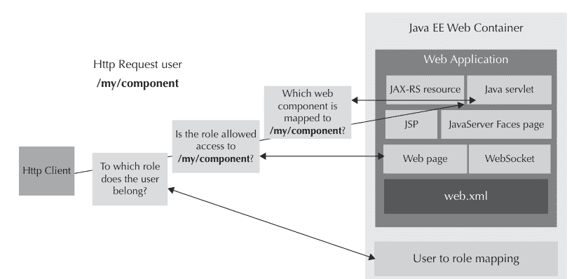

图 7-2. 授权过程

# 206 Java 7: 概览

正如我们之前提到的，发送 HTTP 请求的用户所属的角色是在 Java EE 实现中定义的。要考虑“此角色中的用户是否有权访问此 URI?” 这一问题，我们需要查看 `web.xml` 中的 `<security-constraint>` 元素，因为这是为 Web 应用回答该问题的地方。

### 安全约束 (Security Constraints)

`security-constraint` 元素包含两部分信息：

- `web-resource-collection` 子元素中的 Web 资源集合：它由 URL 模式列表组成，这些模式定义了 Web 应用内适用于安全约束的 URI 空间部分。第二个组件是 HTTP 方法列表，定义了适用于该安全约束的 URL 模式所覆盖 URL 的 HTTP 操作。
- `auth-constraint` 子元素中的授权约束：它由将应用于安全约束的角色名称列表组成。

`security-constraint` 元素还包含第三个子元素 `user-data-constraint`，它定义了在包含它的安全约束中定义的 Web 组件中，数据在客户端和服务器之间是如何传输的。我们很快就会检查这一点。

让我们详细查看 `web-resource-collection` 和 `auth-constraint` 的语义。下表包含了对每个元素的描述。


| web-resource-collection 元素 | 数量 | 值 |
| :--- | :--- | :--- |
| description | 单 | 可选的描述 |
| url-pattern | 多 | URL 模式 |
| http-method | 多 | HTTP 方法 |

`url-pattern` 元素包含一个匹配 URI 的字符串。你有三种方式可以定义它：

- `exact`（精确）：匹配单个路径，例如 `/login`
- `wildcard`（通配符）：匹配所有路径，例如 `/*`
- `ending`（结尾）：匹配后缀路径，例如 `.html`

## 第 7 章：Web 应用安全

`auth-constraint` 元素简单得多：它仅包含允许角色的名称列表。

| auth-constraint 元素 | 数量 | 值 |
| :--- | :--- | :--- |
| role-name | 多 | 角色的名称 |

注意，有一个特殊名称 `"*"` 表示任意。使用安全约束允许任何人（无论是否认证）访问资源。这回答了我们的问题：哪些角色允许 HTTP 请求？

在查看安全约束的运行示例之前，我们将通过查看最后一个问题来完成探索：如何确保数据隐私。

安全约束的约束定义了 Web 应用访问它时所需的隐私级别。这在 `user-data-constraint` 元素中定义，该元素取值为 `NONE`、`INTEGRAL` 或 `CONFIDENTIAL`。`NONE` 值允许 Java 服务器解释为允许通过 HTTP 访问，这是未包含 `user-data-constraint` 时的默认值。应用程序数据的风险是第三方可以截获 HTTP 交互并读取潜在敏感数据（例如 HTTP 请求和响应头中的身份认证信息和凭据）。`INTEGRAL` 或 `CONFIDENTIAL` 值在实践中被 Java EE 成员解释为 Web 组件需要加密连接。

可以在图 7-3 中总结安全约束语法的结构，其中 `web-app` 是 `web.xml` 的根。

### 示例

让我们来看一个安全约束的示例。在这个例子中，我们有一个在线书店 Web 应用。任何人都可以浏览在线书籍目录，目录由名为 `store-front.xml` 的 Java 页面显示。它允许客户通过名为 `create-account.xml` 的 Java 页面创建帐户。一旦用户创建了客户帐户，就允许从商店购买书籍，可以通过浏览器查看 `/purchase/purchase.xml` 页面，或者通过访问映射到 `/purchase/PathResource` 的 JAX-RS 端点在自定义智能手机应用程序上进行。

关于库存中的书籍。此页面使用映射到 URI `/inventory/TrackingMonitor` 的 Java WebSocket，以便在不需要仓库经理刷新页面的情况下保持活动状态。让我们在图 7-4 中查看 Web 应用程序及其所占用的 URI 空间。

就像任何互联网用户一样，用户能够浏览书籍目录，但只有注册客户才能购买书籍，而只有跨仓库的团队才能访问库存信息并在新书到达时更新目录。最后，它还希望其自己的管理员团队拥有访问网站所有功能的权限。

让我们看看我们如何在 `web.xml` 部署描述符中表达这些约束。首先，我们将为每个访问 Web 应用程序部分的不同类型用户创建三个不同的角色：`customer`（客户）、`backoffice`（后台）和 `administrator`（管理员）。因此，我们在 `web.xml` 中添加了代码列表描述的以下 `security-role` 元素。

#### 代码列表：安全角色

```
<web-app>
  ...
  <security-role>
    <role-name>backoffice</role-name>
  </security-role>
  <security-role>
    <role-name>client</role-name>
  </security-role>
  <security-role>
    <role-name>administrator</role-name>
  </security-role>
  ...
</web-app>
```

现在，让我们查看应用的 URI 空间。为了限制对购买 Web 组件（JAX-RS 资源、JavaServer Faces 页面）的访问，我们需要做的只是确保任何尝试访问以下路径的用户必须属于 `customer` 或 `administrator` 角色之一：

- `/purchase/PurchaseResource`
- `/purchase/purchase.xhtml`
- `/purchase/confirm.xhtml`

为了限制对库存相关的 Web 组件（TrackingMonitor WebSocket 和 `inventory.xhtml` 页面）的访问，我们需要确保任何尝试访问以下路径的用户必须属于 `backoffice` 或 `administrator` 角色之一：

- `/inventory/TrackingMonitor`
- `/inventory/inventory.xhtml`

这些约束可以通过向 `web.xml` 中添加以下安全约束来实现：

#### 代码列表：安全约束

```
<web-app>
  ...
  <security-constraint>
    <display-name>Customer Constraint</display-name>
    <web-resource-collection>
      <web-resource-name>inventory</web-resource-name>
      <url-pattern>/inventory/*</url-pattern>
    </web-resource-collection>
    <auth-constraint>
      <role-name>backoffice</role-name>
      <role-name>administrator</role-name>
    </auth-constraint>
  </security-constraint>
  <security-constraint>
    <display-name>Client Constraint</display-name>
    <web-resource-collection>
      <web-resource-name>purchase</web-resource-name>
      <url-pattern>/purchase/*</url-pattern>
    </web-resource-collection>
    <auth-constraint>
      <role-name>client</role-name>
      <role-name>administrator</role-name>
    </auth-constraint>
  </security-constraint>
</web-app>
```

注意，示例中的安全约束中 `index.html`、`catalog.xhtml` 和 `create-account.xhtml` 页面没有被任何 URL 模式匹配。因此，任何用户（无论是否经过身份验证）都可以访问它们。

最后，我们在这个示例中没有指定如何对用户进行身份验证。一旦确定了方案，就可以像之前那样通过在 `web.xml` 中添加相应的 `login-config` 元素来请求身份验证方案。

### 关于 WebSocket 的说明

关于 WebSockets 的最后一点：正如你在第 6 章中所读，Java WebSockets 通过 Java WebSocket API 映射到 Web 应用程序内的 URL，并且实际上受 Web 应用程序安全约束的限制。这如何可能呢？你会记得，WebSocket 连接只能通过客户端发起一个特殊格式的 HTTP 请求（称为 WebSocket 开启握手）来建立。正是这种 HTTP 响应交互受到 Web 应用程序安全模型的限制：如果开启握手返回 HTTP 403 Forbidden 响应，连接将无法建立。这意味着 Java EE 容器的授权模型适用于 Java WebSockets，就像适用于平台上的其他 HTTP 组件一样。Java 如何身份验证开启握手请求，以便容器检查身份并决定是否授权该请求？遗憾的是，WebSocket 协议不包含任何标准的身份验证机制。幸运的是，Web 应用中的 WebSocket 连接通常是由网页内的 JavaScript 代码发起的。当 WebSocket 尝试与 Java EE 容器进行开启握手时，Java EE 容器知道执行 JavaScript 的网页的授权状态。通过这种方式，WebSocket 连接尝试进行身份验证的网页，其开启握手也是如此，反之亦然。结果是，Java EE 容器中的所有安全特性都适用于 Java WebSockets，只是为了知道网页中的 WebSocket 客户端已通过 Java EE 容器的身份验证。

## 第 7 章：Web 应用程序安全

### 列表：使用安全注解的安全的 servlet

```java
import java.io.IOException;
import javax.servlet.ServletException;
import javax.servlet.annotation.MultipartConfig;
import javax.servlet.annotation.WebServlet;
import javax.servlet.http.*;
import javax.servlet.annotation.ServletSecurity;
import javax.servlet.annotation.HttpMethodConstraint;

@WebServlet(name = "UploadPhoto", urlPatterns = {"/photo/upload"})
@MultipartConfig()
@ServletSecurity(httpMethodConstraints={
    @HttpMethodConstraint(
        value="GET",
        emptyRoleSemantic=ServletSecurity.EmptyRoleSemantic.PERMIT
    ),
    @HttpMethodConstraint(
        value="POST",
        rolesAllowed={"administrator", "photographer"},
        transportGuarantee=ServletSecurity.TransportGuarantee.CONFIDENTIAL
    )
})
public class UploadPhoto extends HttpServlet {

    @Override
    protected void doGet(HttpServletRequest request,
                         HttpServletResponse response)
            throws ServletException, IOException {
        // 创建照片目录页
    }

    @Override
    protected void doPost(HttpServletRequest request,
                          HttpServletResponse response)
            throws ServletException, IOException {
        // 上传照片
    }
}
```

此 servlet 使用 `@ServletSecurity` 配合两个 `@HttpMethodConstraint` 来定义对 servlet 实现的两个 HTTP 方法（GET 和 POST）的访问限制。从第一个 `@HttpMethodConstraint` 可以看到，所有经过身份验证的用户都允许访问 servlet 实现的 GET 方法。从第二个 `@HttpMethodConstraint` 可以看到，只有处于 `administrator`（管理员）角色或 `photographer`（摄影师）角色的用户才被允许向该 servlet 上传照片，且只能通过加密连接进行。

## 程序化安全

当一个 Web 组件声明了导致其用户必须进行身份验证的安全模型时，Web 组件可以利用这些信息做许多有趣的事情。在对 Web 组件的特定请求中，通过程序化的方式确定在调用、他们是如何通过身份验证的以及他们属于应用程序定义的哪些角色，通常是很有用的。你可能希望使用他们的身份来调取并显示特定于用户的私有信息。你可能希望根据他们所所属的角色，让你的 Web 组件提供不同的输出。任何向往飞机头等舱乘客享有的餐饮和娱乐服务的人都能感同此。其次，能够显式地管理身份验证模型也是很有用的，也许即使用户没有请求受保护的资源，也能程序化地启动身份验证交互，或者显式地退出应用程序。

因此，我们将查看 Web 开发者在运行时可用于执行这些函数的 API。

### 理解调用者

Java 使用 `javax.security.Principal` 类来表示用户身份。调用 Web 组件的客户端的 Principal 对所有 Web 组件可用，如下表所示。

| 谁在调用？ | 对象 | 方法 |
| :--- | :--- | :--- |
| Java Servlet | `javax.servlet.http.HttpServletRequest` | `Principal getPrincipal()` |
| JSP | `request` 隐式对象 | `Principal getPrincipal()` |
| JavaServer Faces | `request` 隐式对象 | `Principal getPrincipal()` |
| JAX-RS | 注入 `@Context` 注解的 `javax.ws.rs.core.SecurityContext` 对象 | `Principal getPrincipal()` |
| Java WebSocket | `javax.websocket.Session` 对象 | `Principal getPrincipal()` |

这些运行时信息非常有用，它允许根据有关用户信息及其交互的信息，为个性化 Web 组件的输出提供多种可能。

正如我们所看到的，Web 应用程序通常将用户划分为不同的角色。这允许暴露一个简化后的视图，能够将大量用户划分为一组较小的已知角色，并可以用它们控制访问，正如我们已经看到的那样。暴露有关当前用户角色的知识允许应用程序为不同的用户组或角色提供不同的功能。正如我们所看到的，Web 应用程序角色列表的源定义在 `web.xml` 部署描述符的 `<security-role>` 元素列表中。

```java
boolean isUserInRole(String rolename)
```

该方法在 Java EE Web API 的多处出现，它是判断调用者是否属于给定角色的手段。下表显示了每种 Web 组件类型的位置。

### 调用者在哪个角色中？

| 对象 | 方法 |
| :--- | :--- |
| Java Servlet | `javax.servlet.http.HttpServletRequest` | `boolean isUserInRole(String role)` |
| JSP | `request` 隐式对象 | `boolean isUserInRole(String role)` |
| JavaServer Faces | `request` 隐式对象 | `boolean isUserInRole(String role)` |
| JAX-RS | 注入 `@Context` 注解的 `javax.ws.rs.core.SecurityContext` | `boolean isUserInRole(String role)` |
| Java WebSocket | `javax.websocket.server.HandshakeRequest` 对象 | `boolean isUserInRole(String role)` |

你传递给此方法的名称将由 Java EE 容器根据 `web.xml` 中出现的角色名称进行比对。如果你想将硬编码在调用 `isUserInRole()` 代码中的角色名称与 `web.xml` 中出现的角色名称解耦，可以利用 `web.xml` 中的 `<security-role-ref>` 语法将代码中的角色引用映射到 `web.xml` 中的角色名称。

### `HttpSession`、`login()` 和 `logout()`

许多 Java EE 容器使用 `HttpSession` 不仅跟踪同一浏览的一系列交互，还跟踪身份验证状态。作为 Java 开发者，你不能依赖所有容器都采用这种方法。例如，某些容器可能会过期用户的身份验证状态，但允许 `HttpSession` 继续。同样，使用 `invalidate()` 显式使 `HttpSession` 无效可能不会注销用户，许多 Java 实现是这样。

Servlet API 提供了三个有用方法来显式控制身份验证状态。首先，如果用户已身份验证，调用


```java
public void logout() throws ServletException
```

会导致用户注销，即移除与用户相关的身份验证状态。如果同一个客户端调用 Web 应用程序且 Web 组件请求受保护，将发放一个新的身份验证。其次，某些决定采用用户名/密码方案的应用程序可能希望比表机制进一步自定义登录过程。此类应用程序可以管理自己的身份验证过程，从从用户收集凭据到调用 Web 组件，并调用 `HttpServletRequest` API：

```java
void login(String username, String password) throws ServletException
```

如果身份验证成功，该方法不抛出异常；否则，将抛出异常。为了完成 Java EE 容器身份验证机制的三项控制，方法

```java
public boolean authenticate(HttpServletResponse response) throws IOException, ServletException
```

可以从应用程序代码调用，显式让 Java EE 容器根据 Web 应用程序部署描述符定义的机制对调用者尝试身份验证。该方法仅在身份验证成功时返回 `true`。如果你希望根据调用者的身份对你的 Web 组件做出决策，但并不一定想为了这样做而使用安全约束，这个方法可能是一个非常有用的方法。

最后，你可以通过 `getScheme()` 方法确定使用的身份验证方案，无论底层机制如何，它适用于 `HttpServletRequest`、JSP 和 JAX-RS。

### 调用者是否是加密的？

| 对象 | 方法 |
| --- | --- |
| Java Servlet | `javax.servlet.http.HttpServletRequest` \| `boolean isSecure()` |
| JSP | `request` 隐式对象 \| `boolean isSecure()` |
| JavaServer Faces | `request` 隐式对象 \| `boolean isSecure()` |
| JAX-RS | 注入 `@Context` 注解的 `java.ws.rs.core.SecurityContext` \| `boolean isSecure()` |
| Java WebSocket | `java.websocket.Session` 对象 \| `boolean isSecure()` |

下表总结了 Java EE API 中这些方法的的位置。

## 第 7 章：保护 Web 应用程序

## 照片应用程序示例

我们将 Java EE Web 容器的声明式安全模型应用到我们已经熟悉的应用程序上：我们在第 4 章中学习过的照片应用程序。

你可能记得，照片应用程序允许用户查看相册内容、照片本身以及照片的元数据（例如照片拍摄日期）。该应用程序还允许用户向相册上传新照片、添加关联的描述性信息，并从相册中删除照片。

此版本的应用程序已更新，要求所有用户在能够应用程序之前必须通过 Java EE Web 容器进行身份验证。应用程序定义了两种类型的用户：第一种是“查看者”（`viewer`），允许登录并浏览相册，但不允许对其进行任何更改。第二种用户是“摄影师”（`photographer`），允许查看相册并上传新照片，还可以编辑或删除相册中的现有照片。应用程序的 URI 空间发生了一定的变化，让我们来看图 7-6。

你可以看到，与查看相册相关的 JavaServer Faces 页面位于 Web 应用程序 URI 空间中的 `/main` 目录，而所有涉及修改相册或照片的 JavaServer Faces 页面都位于 Web 应用程序 URI 空间中的 `/main/edit` 目录。正如我们将看到的，这使得表达应用程序的安全约束变得更容易。

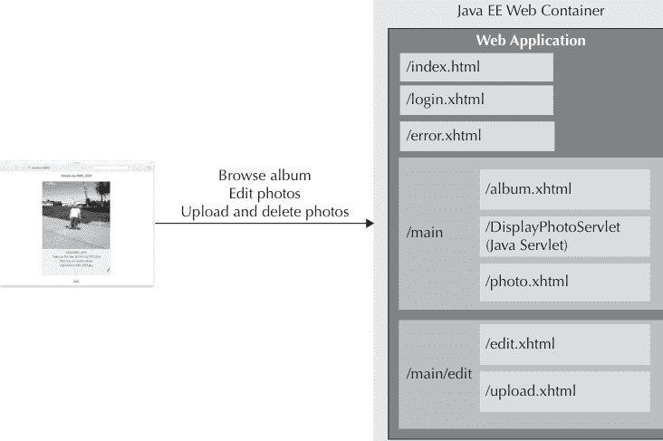

| Java EE Web 容器 | |
| :--- | :--- |
| **Web 应用程序** | |
| /index.html | |
| /login.xhtml | |
| /error.xhtml | |
| 浏览相册 | /album.xhtml |
| 编辑照片 | /DisplayPhotoServlet (Java Servlet) |
| 上传和删除照片 | /main / /photo.xhtml |
| /edit.xhtml | |
| /main/edit | /upload.xhtml |

图 7-6. 受保护的照片应用程序

当你运行应用程序时，你将看到许多新变化。为了运行该应用程序，你需要在你的应用程序服务器上设置至少两个用户账户，并记录用户名和密码。其次，你需要将其中一个用户关联到照片应用程序中定义的每个安全角色。在 Java EE 服务器中创建用户并将其与应用程序定义的角色关联是根据你使用的 Java EE 服务器而执行不同的任务。

你可以在 Web 部署符（deployment descriptor）中找到照片应用程序角色的声明。

...

-   列表：摄影师和查看者角色

```xml
<web-app>
  <security-role>
    <role-name>viewer</role-name>
  </security-role>
  <security-role>
    <role-name>photographer</role-name>
  </security-role>
</web-app>
```

你可以看到名称是 `viewer` 和 `photographer`。在 GlassFish 4.0 服务器中，你可以通过添加一个包含 Web 应用程序映射的 `glassfish-web.xml` 文件将你创建的用户与这些角色关联。

一旦运行应用程序（如图 7-7 所示），在配置了这些用户账户并将其与查看者和摄影师角色关联后，你会发现应用程序的第一页发生了变化。

点击钥匙图标会尝试访问 `main/album.xhtml` 页面。现在，你会注意到此应用程序的部署符包含一个使用表单登录机制（form login mechanism）的指令，正如从这个 XML 文件的片段中所示。

-   列表：照片的表单登录

```xml
<web-app>
  <login-config>
    <auth-method>FORM</auth-method>
    <form-login-config>
      <form-login-page>login.xhtml</form-login-page>
      <form-error-page>error.xhtml</form-error-page>
    </form-login-config>
  </login-config>
...
</web-app>
```

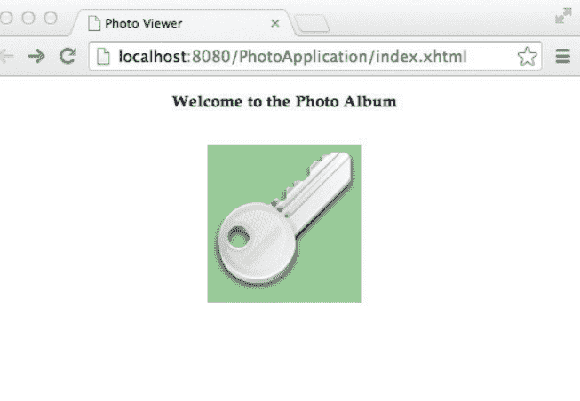

**图 7-7.** 欢迎

我们将 `main/album.xhtml` 页面受部署符的安全约束保护，当你尝试访问它时，表单登录机制会将你重定向到部署符指定的 `login.xhtml` 页面。如图 7-8 所示。

填写你创建的与安全角色之一关联的用户账户即可访问相册页面。如果你用于身份验证的用户账户是查看者账户，你应该看到如图 7-9 所示的内容。

另一方面，如果你使用与摄影师角色关联的用户账户进行身份验证，你应该看到类似图 7-10 的内容。

注意 `main/album.xhtml` 页面在其欢迎标题中知道用户账户名称。注意两种类型的用户都可以注销 Web 应用程序。注意两种账户都可以查看照片并点击查看图标获取详细视图。只有拥有 `photographer` 角色的用户看到上传按钮以及编辑或删除照片的图标。事实上，如果 `viewer` 角色的用户通过输入 `/main/edit/photo.xhtml` URI 尝试访问 UI 中提供的编辑功能，他们将被访问该资源并收到 HTTP 403 响应。

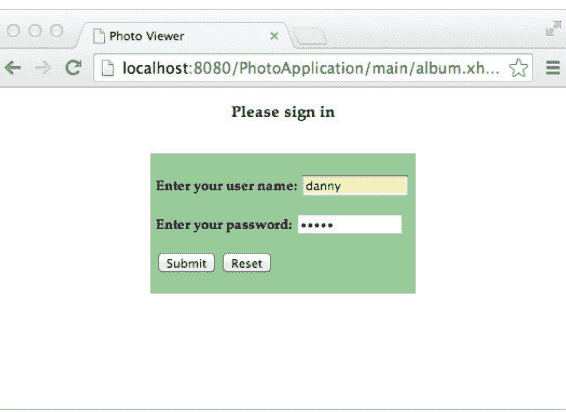

图 7-8. 登录

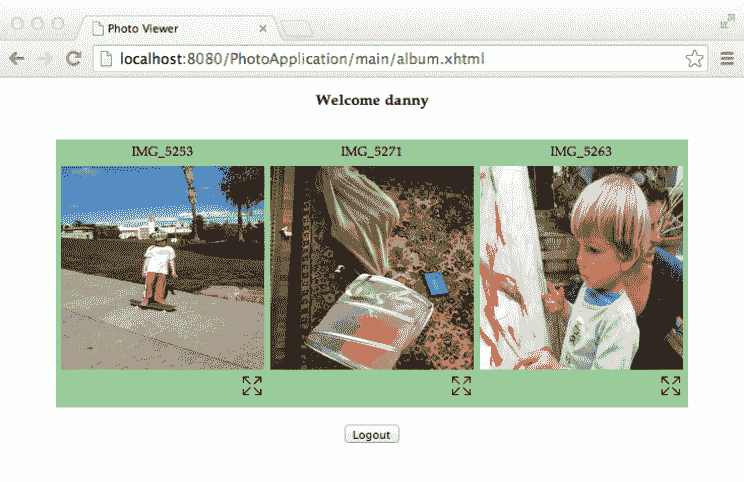

图 7-9. 查看者查看相册


**图 7-10.** 摄影师查看相册

这里发生了两件事：首先，声明式安全模型强制执行 `viewer` 与 `photographer` 角色的 Web 应用程序访问权限；其次，JavaServer Faces 页面使用程序化访问来显示允许的内容。让我们查看保护 应用程序的安全约束。

-   列表：照片应用程序的安全约束

```xml
<web-app>
...
  <security-constraint>
    <display-name>ViewAndEdit</display-name>
    <resource-collection>
      <web-name>ViewableAndEditable</web-name>
      <url-pattern>/*</url-pattern>
    </resource-collection>
    <auth-constraint>
      <role-name>photographer</role-name>
    </auth-constraint>
  </security-constraint>
</security-constraint>
<display-name>ViewOnly</display-name>
<resource-collection>
  <web-name>Viewables</web-name>
  <url-pattern>/main/album.xhtml</url-pattern>
  <url-pattern>/main/photo.xhtml</url-pattern>
  <url-pattern>/main/DisplayPhotoServlet</url-pattern>
</resource-collection>
<auth-constraint>
  <description/>
  <role-name>viewer</role-name>
  <role-name>photographer</role-name>
</auth-constraint>
</security-constraint>
...
<web-app>
```

第一个安全约束 `ViewAndEdit` 允许 `photographer` 访问应用程序中的所有 Web 组件：显示相册的以及编辑相册的。它通过通配符匹配风格的 `url-pattern` 实现。

第二个安全约束 `ViewOnly` 允许 `viewer` 访问应用程序中仅显示照片相册的 Web 组件。它通过使用精确 URI 风格的 `url-pattern` 显式列表实现。

程序化 API 在照片应用程序中用于在相册页面显示当前用户名、根据所属角色决定是否显示各种编辑功能以及执行日志记录。使用这些 API 的代码被收集到一个请求作用范围（request-scoped）托管 Bean 中，照片应用程序中的各种 JavaServer Faces 可以使用它。让我们来看看这个代码 `SecurityBean`：

-   列表：SecurityBean

```java
import javax.enterprise.context.RequestScoped
import javax.faces.FacesException
import javax.inject.Named
import javax.faces.context.FacesContext
import javax.servlet.http.HttpServletRequest
import javax.servlet.ServletExceptionException

@Named(value = "securityBean")
@RequestScoped
public class SecurityBean {
    private static String VIEWER_ROLE = "viewer";
    private static String PHOTOGRAPHER_ROLE = "photographer";

    private HttpServletRequest getServletRequest() {
        return (HttpServletRequest) FacesContext.getCurrentInstance()
            .getExternalContext().getRequest();
    }
}
```

```java
public String getUsername() {
    HttpServletRequest request = this.HttpServletRequest();
    if (request.getUserPrincipal() != null) {
        return request.getUserPrincipal().getName();
    } else {
        return "";
    }
}
```

```java
public boolean isUserAbleToEdit() {
    HttpServletRequest request = this.HttpServletRequest();
    return request.isUserRole("PHOTOGRAPHER_ROLE");
}
```

```java
public boolean isLoggedIn() {
    return (this.getHttpServletRequest().getUserPrincipal() != null);
}
```

```java
public void logout() {
    try {
        this.getHttpServletRequest().logout();
        this.getHttpServletRequest().getSession().invalidate();
    } catch (ServletException se) {
        throw new FacesException("Failure on logout", se);
    }
}
```

该托管豆（managed bean）处于请求作用域（request scope），命名为 `securityBean`，因此可以在应用程序的任何 JavaServlet 页面中通过该名称访问它。它用于支持消息的核心对象是来自底层 servlet API 的 `HttpServletRequest` 对象。它从 `FacesContext` 中获取 `getHttpServletRequest()`，并根据需要执行 `logout()` 操作，同时提供关键属性，这些属性允许豆的客户端判断用户是否已通过身份验证、当前用户的用户名是什么，以及通过检查用户在应用程序定义的角色中的成员身份，判断当前用户是否允许编辑照片。这些属性分别定义在 `isLoggedIn()`、`getUsername()` 和 `isUserAbleToEdit()` 方法中。

我们不会查看应用程序中使用安全豆的所有地方，但让我们来看 `main/album.xml` 看看它是在哪里被使用的。

- 列表：相册 JavaServlet Faces 页面

```xml
<?xml version="1.0" encoding="UTF-8" ?>
<!DOCTYPE html PUBLIC "-//W3C//DTD HTML 1.0 Transitional//EN" "http://www.w3.org/TR/html-transitional.dtd">
<html xmlns="http://www.w3.org/1999/xhtml"
xmlns:h="http://xmlns.jsp.org/jsf/html"
xmlns:c="http://xmlns.jsp.org/jstl/jsp/core">
<head>
  <title>Photo Viewer</title>
</head>
<body style="font-family:Palatino;font-size:small">
  <div align="center">
    <h3>Welcome \${securityBean.username}</h3>
    <br><br>
    <table bgcolor="#99C0C9" cellspacing="4">
      <tbody>
        <tr>
          <c:forEach items="${photoAlbum.photos}" var="photo">
            <td>
              <div align="center">
                \${photo.name}
              </div>
            </td>
          </c:forEach>
        </tr>
        <tr>
          <c:forEach items="${photoAlbum.photos}" var="photo">
            <td>
              <form>
```


# Web应用程序与Web归档 (WAR)

## 示例：相册 JavaServer Faces 页面

```xml
<h:graphicImage
  height="200"
  width="200"
  value="${photo.viewUri}" />
</form>
<div align="right">
  <h:commandButton
    title="View"
    image="../view.png"
    actionListener="${photoAlbum.setCurrentPhoto(photo)}"
    action="photo/" />
  <c:if test="${securityBean.userAbleToEdit}">
    <h:commandButton
      title="edit"
      image="../edit.png"
      actionListener="${editPhotoBean.setPhoto(photo)}"
      action="edit/" />
    <h:commandButton
      title="delete"
      image="../delete.png"
      action="${photoAlbum.removePhoto(photo)}" />
  </c:if>
</div>
</td>
</c:forEach>
</tr>
</tbody>
</table>
</div>
</body>
</table>
<br>
<if test="#{securityBean.userAbleToEdit}">
  <h:commandButton
    value="Upload"
    onclick="window.open('edit.xhtml')" />
</if>
<if test="#{securityBean.userAbleToEdit}">
  <h:commandButton
    value="Logout"
    onclick="window.open('index.xhtml')" />
</if>
</div>
</body>
</html>
```

该托管豆处于请求作用域，命名为 `securityBean`，因此可以在应用程序的任何 JavaServlet 页面中通过该名称访问它。它用于支持消息的核心对象是来自底层 servlet API 的 `HttpServletRequest` 对象。它从 `FacesContext` 中获取 `getHttpServletRequest()`，并根据需要执行 `logout()` 操作，同时提供关键属性，这些属性允许豆的客户端判断用户是否已通过身份验证、当前用户的用户名是什么，以及通过检查用户在应用程序定义的角色中的成员身份，判断当前用户是否允许编辑照片。这些属性分别定义在 `isLoggedIn()`、`getUsername()` 和 `isUserAbleToEdit()` 方法中。

我们不会查看应用程序中使用安全豆的所有地方，但让我们来看 `main/album.xml` 看看它是在哪里被使用的。

### 列表：相册 JavaServer Faces 页面

```xml
<?xml version="1.0" encoding="UTF-8" ?>
<!DOCTYPE html PUBLIC "-//W3C//DTD HTML 1.0 Transitional//EN" "http://www.w3.org/TR/html-transitional.dtd">
<html xmlns="http://www.w3.org/1999/xhtml"
  xmlns:h="http://xmlns.jsp.org/jsf/html"
  xmlns:c="http://xmlns.jsp.org/jstl/jsp/core">
<head>
  <title>Photo Viewer</title>
</head>
<body style="font-family:Palatino;font-size:small">
  <div align="center">
    <h3>Welcome ${securityBean.username}</h3>
    <br><br>
    <table bgcolor="#99C0C9" cellspacing="4">
      <tbody>
        <tr>
          <c:forEach items="${photoAlbum.photos}" var="photo">
            <td>
              <div align="center">
                ${photo.name}
              </div>
            </td>
          </c:forEach>
        </tr>
        <tr>
          <c:forEach items="${photoAlbum.photos}" var="photo">
            <td>
              <form>
                <h:graphicImage
                  height="200"
                  width="200"
                  value="${photo.viewUri}" />
              </form>
              <div align="right">
                <h:commandButton
                  title="View"
                  image="../view.png"
                  actionListener="${photoAlbum.setCurrentPhoto(photo)}"
                  action="photo/" />
                <c:if test="${securityBean.userAbleToEdit}">
                  <h:commandButton
                    title="edit"
                    image="../edit.png"
                    actionListener="${editPhotoBean.setPhoto(photo)}"
                    action="edit/" />
                  <h:commandButton
                    title="delete"
                    image="../delete.png"
                    action="${photoAlbum.removePhoto(photo)}" />
                </c:if>
              </div>
            </td>
          </c:forEach>
        </tr>
      </tbody>
    </table>
  </div>
</body>
</table>
<br>
<if test="#{securityBean.userAbleToEdit}">
  <h:commandButton
    value="Upload"
    onclick="window.open('edit.xhtml')" />
</if>
<if test="#{securityBean.userAbleToEdit}">
  <h:commandButton
    value="Logout"
    onclick="window.open('index.xhtml')" />
</if>
</div>
</body>
</html>
```

该托管豆处于请求作用域，命名为 `securityBean`，因此可以在应用程序的任何 JavaServlet 页面中通过该名称访问它。它用于支持消息的核心对象是来自底层 servlet API 的 `HttpServletRequest` 对象。它从 `FacesContext` 中获取 `getHttpServletRequest()`，并根据需要执行 `logout()` 操作，同时提供关键属性，这些属性允许豆的客户端判断用户是否已通过身份验证、当前用户的用户名是什么，以及通过检查用户在应用程序定义的角色中的成员身份，判断当前用户是否允许编辑照片。这些属性分别定义在 `isLoggedIn()`、`getUsername()` 和 `isUserAbleToEdit()` 方法中。

我们不会查看应用程序中使用安全豆的所有地方，但让我们来看 `main/album.xml` 看看它是在哪里被使用的。

### 列表：相册 JavaServer Faces 页面

```xml
<?xml version="1.0" encoding="UTF-8" ?>
<!DOCTYPE html PUBLIC "-//W3C//DTD HTML 1.0 Transitional//EN" "http://www.w3.org/TR/html-transitional.dtd">
<html xmlns="http://www.w3.org/1999/xhtml"
  xmlns:h="http://xmlns.jsp.org/jsf/html">
```

---

## 224 Java EE 7：大局图

现在我们已经查看了 Java EE 中的所有技术，现在是时候后退一步，查看 Web 中的机制，但从整个应用程序的角度来看。

在本章中，我们将检查应用程序是如何构造的。这将引导我们详细查看 WAR 文件，特别是部署描述符。我们已经遇到过这种重要元数据的某些方面，现在我们更深入地研究两类 Web 组件：Servlet 监听器和 Web 过滤器。前者从不被客户端调用，而后者产生自己的内容。我们将通过检查 Web 中如何建模异步处理来结束本章，贯穿使用示例。

## 第 8 章：自包含的网站：Java EE Web 应用程序

WAR 是一种特殊的 ZIP 归包，包含了组成应用程序的所有静态和动态内容、类文件、文本、图像、库和其他资源，以及 Web 容器在运行时配置应用程序所需的部署信息。这些部署信息存储在 Web 部署描述符中。

让我们来看 WAR 文件的结构。

有三个主要区域：

- **Web 资源**，根目录为 `/`：Web 资源部分是 Web 应用程序中所有静态内容的所在地，以及任何包含标记语言（如 JSP 和 Server Pages）文本文件的 Web 组件。除非受到安全的显式保护，否则此区域的任何 Web 资源将暴露在 Web 应用程序的 URI 空间，因此对客户端可见。

- **Java 类和代码库**，根目录为 `WEB-INF/classes` 和 `WEB-INF/lib`：该部分包含了顶级 Web 组件或应用程序中 Web 组件使用的所有 Java 类。因此，这是 Java Servlet 类、JAX-RS 资源、WebSocket 端点以及任何被 Web 组件作为托管豆和标签库使用的类的所在位置。类可以直接放在 WAR 文件的 `WEB-INF/classes` 条目下。或者，如果类已封装成 JAR 文件作为自包含库，则可以放在 `WEB-INF/lib` 条目下。部署到 Java EE 容器时，放在 `WEB-INF` 下的任何内容都不会直接暴露给 Web 应用程序的 HTTP 客户端。

- **Web 部署描述符** `WEB-INF/web.xml`：该 XML 文档包含了描述 Java EE 容器如何部署 WAR 文件中 Web 应用程序的部署信息。当 Web 应用程序部署到 Java EE 容器时，此配置文件对 HTTP 客户端不可见。

### 总结

在本章中，我们查看了保护 Web 应用程序的通用原则、如何对用户进行身份验证和授权以及如何保护资源。我们还查看了 WAR 文件。下一章我们将探索使用 Maven 构建和部署 Web 应用程序。


### Web应用程序与Web归档 (WAR)

| 逻辑视图 | 示例归档视图 |
| :--- | :--- |
| 位于根目录的Web资源 | `index.html`<br>`login.jsp`<br>`error.jsp`<br>`banner.js`<br>`cars-logo.jpg`<br>`cars/`<br>`catalog.xhtml`<br>`360four.xhtml` |
| 位于 /WEB-INF/classes 的Web组件Java类 | `/WEB-INF/classes/`<br>`CarSelectorServlet.class`<br>`CarRepositoryBean.class`<br>`CarValidator.class`<br>`OfferUpdates.class`<br>`InventoryWebService.class` |
| 位于 /WEB-INF/lib 下的代码库 | `lib/`<br>`car-utils.jar` |
| 位于 /WEB-INF/web.xml 中的部署信息 | `/WEB-INF/web.xml` |

**图 8-1.** WAR 文件结构示例，显示了

在图 8-1 中，示例应用程序是一个汽车经销商网站。该应用程序包含多个 Web 组件：用于浏览可用型号目录的 JavaServer Faces，以及对特定车辆进行 3D 游的能力。它使用 JSP 实现网站重复访问的表单登录。它使用了多种 Java 组件，例如用于更新库存的 servlet 和 JAX-RS 资源，以及用于保持用户网页与当前优惠同步更新的 Java WebSocket。它还有一个专门用于以 HTML 格式显示汽车信息的类库。最后，它使用部署描述符将 Java servlet 映射到应用程序 URI 空间中的 URI，并配置了表单登录等内容。

它可以配置哪些内容？我们首先来看 Web应用程序的一个全局属性，该属性并不总是容易从 WAR 文件中推导出来的。

## Web应用程序的 URI 空间

Web 应用程序的 URI 空间是相对于 Web 容器根 URL 的 URI 集合，该 Web 容器发布应用程序中的所有 Web 组件和静态资源。当 Web 应用程序部署到 Java EE Web 容器时，必须配带一个相对 URI，Web 容器使用该 URI 来放置应用程序中所有 Web 资源的根目录。这个相对 URI 称为应用程序的上下文根。如果 Web 应用程序直接部署到 Web 容器，那么该应用程序的上下文根取决于所使用的特定 Web 容器。例如，GlassFish Web 容器使用一个名为 `glassfish-web.xml` 的 GlassFish 特定 XML 文件，该文件位于 WAR 文件的 `WEB-INF/` 目录下，用于存放上下文根。

### 列表：GlassFish 描述符

```xml
<glassfish-web-app>
  <context-root>/car-app</context-root>
  ..
</glassfish-web-app>
```

如果 WAR 包含在一个更大的 Java EE 应用程序中（可能使用了企业级 Bean），那么 WAR 文件将作为较大归档（企业归档，或 EAR）的一部分进行部署。在这种情况下，EAR 有它自己的部署描述符，其中包含了 WAR 的上下文根。我们稍后看到更多 Java EE 部署描述符和 EAR 文件格式。现在，如果汽车网站被封装在名为 `car-site.war` 的 WAR 文件中，那么包含它的 Java 应用程序通过在它的 `application.xml` 部署描述符中包含以下信息来定义 WAR 的上下文根：

```xml
<application>
  <module>
    <web>
      <web-uri>car-site.war</web-uri>
      <context-root>/car-app</context-root>
    </web>
  </module>
  ..
</application>
```

一旦上下文根建立，部署到 Java EE 容器时的 Web 应用程序根路径为：

```
http://hostname:port/<context-path>/
```

这意味着任何相对路径为 `/web-component` 的组件都可以在以下地址访问：

```
http://hostname:port/<context-path>/web-component
```

这意味着我们已经完全理解了 Web 组件在 Web应用程序中映射的所有方式，我们将完全理解 Web 应用程序完整的 URI 空间。


# 第 8 章：自包含网站：Java EE Web应用程序

## 静态内容

Web应用程序中静态内容文件（HTML 文件、XML 文件、文本文件、音频文件、图像文件）的相对 URI 简单就是它的路径。因此，如果索引页名为 `index.html`，那么客户端可以通过以下地址访问：

```
http://hostname:port/<context-path>/index.html
```

同样，如果一个名为 `classroom.jpg` 的文件位于 `classroom.jpg`，那么客户端可以通过以下地址访问：

```
http://hostname:port/<context-path>/classroom.jpg
```

## Java Faces

在路径映射方面，Java Faces 页面被视为静态内容，因此它们在 Web 应用程序中的 URI 与其路径相同。`catalog.xhtml` 客户端可以通过以下地址访问：

```
http://hostname:port/<context-path>/catalog.xhtml
```

## Java Servlets

正如我们在第 7 章中看到的，servlet 的路径可以通过使用 `@WebServlet` 注解来实现。该注解的 `urlPatterns` 属性接受一个字符串数组，每个字符串都可以是

### URL 模式的定义

有三种类型的 URL 模式可以用于映射 servlet：

- **精确路径**：例如，`cars/InventoryServlet`
- **带有通配符的路径**：例如，`cars/*`
- **文件名结尾**：例如，`*.web`

还有另一种 servlet 在 URI 空间中声明其位置的方法：通过在部署描述符中使用 servlet mapping（servlet mapping）。

使用这种机制分为两个步骤。首先，你必须使用 `<servlet>` 元素在 Web应用程序中声明 servlet。该元素具有 `<servlet-name>` 和 `<servlet-class>`，要求你为 servlet 提供一个在部署描述符其他地方使用的逻辑名称，以及 servlet 的全限定类名。例如，如果 servlet 的类名为 `com.acme.cars.CarSelectorServlet`，那么它可以被赋予逻辑名称 `CarSelector`，并如列表所示在部署描述符中声明。

**列表：带有 servlet 声明的 Web 描述符**

```
<web-app>
  <servlet>
    <servlet-name>CarSelector</servlet-name>
    <servlet-class>com.acme.cars.CarSelectorServlet</servlet-class>
  </servlet>
</web-app>
```

现在 servlet 有了逻辑名称，可以使用 `<servlet-mapping>` 元素与一个或多个 URL 关联，使用 `<url-pattern>` 元素，该元素采用之前的三种 URL 模式形式之一。例如，将 `CarSelectorServlet` 映射到 URL 模式 `/cars/CarSelectorServlet`，你需要列表所示的部署描述符片段。

**列表：带有 servlet 映射的 Web 描述符**

```
<web-app>
  <servlet>
    <servlet-name>CarSelector</servlet-name>
    <servlet-class>com.acme.cars.CarSelectorServlet</servlet-class>
  </servlet>
  <servlet-mapping>
    <servlet-name>CarSelector</servlet-name>
    <url-pattern>/cars/CarSelectorServlet</url-pattern>
  </servlet-mapping>
</web-app>
```

最后，如果你在 Web 部署描述符中定义了 servlet，同时在 `@WebServlet` 注解中定义了 URL 模式，那么 Web 部署描述符中的映射将替换注解中定义的映射。这通常是一种实用的实现技术，可以在注解中创建一个合理的默认 URL 模式，并在 servlet 组装到 Web 应用程序时，通过部署描述符中的 servlet 映射对其进行覆盖。

## JavaServer Pages (JSP)

JavaServer Pages 很容易映射到 应用程序的 URI 空间：类似于 JavaServer Faces，JavaServer Page 的相对 URI 是 WAR 文件中的存档条名称。

与 servlet 类似，你可以通过在部署描述符中使用 `<servlet>` 元素声明 JSP 为 JavaServer Page 提供额外的映射。`<servlet>` 元素有一个替代子元素 `<jsp-file>`，它可以替代 `<servlet-class>` 元素。每个 `<servlet-mapping>` 元素可以添加任意数量的 `<url-pattern>` 元素，将 JSP 暴露给 应用程序 URI 空间中的更多 URI。例如，假设你想让汽车网站中的 `login.jsp` 页面不仅作为默认的 `/login.jsp` 暴露，还作为 `login.html` 。你需要在部署描述符中添加以下 servlet 和 servlet 映射。

**列表：带有 JSP 映射的 Web 部署描述符**

```
<web-app>
  <servlet>
    <servlet-name>LoginPage</servlet-name>
    <jsp-file>login.jsp</jsp-file>
  </servlet>
  <servlet-mapping>
    <servlet-name>LoginPage</servlet-name>
    <url-pattern>/login.html</url-pattern>
  </servlet-mapping>
</web-app>
```

## JAX-RS 资源和 Java WebSockets

JAX-RS 资源和 Java WebSocket 端点分别使用来自 `javax.ws.rs` 包的 `@Path` 注解和来自 `java.websocket.server` 包的 `@ServerEndpoint` 注解映射到它们在 应用程序 URI 空间中的位置。正如我们在第 5 章和第 6 章看到的，这两种组件都可以使用这些注解通过相对 URI 或 URL 模板进行映射。这两种 Web 组件技术都没有在部署描述符中定义任何映射到 应用程序 URI 空间的句法。

## 总结：Web 组件及其 URI 路径

我们将通过总结 应用程序定义暴露给客户端的 URI 空间的方式来结束本节。

| 类别 | 路径类型 | 定义的 URI 路径 |
| --- | --- | --- |
| 静态内容 | 精确路径 | 与 WAR 存档条目相同 |
| Java Faces | 精确路径 | 与 WAR 存档条目相同 |
| JavaServer Pages | 精确路径和 URL 模式 | 与 WAR 存档条目相同；使用 `<servlet-mappings>` 定义额外的路径 |
| Java servlets | URL 模式 | 在 servlet 类中使用 `@WebServlet` 注解或使用 `<servlet-mappings>` |
| JAX-RS 资源 | 精确路径或 URI 模板 | 在资源类或方法中使用 `@Path` 注解 |
| Java WebSocket 端点 | 精确路径或 URI 模板 | 在端点类上使用 `@ServerEndpoint` 注解 |

## 全局 Web 组件：Web 过滤器 (Filters) 和 Web 监听器 (Listeners)

我们关注两种尚未涵盖的 Web 组件：web 过滤器和监听器。每种组件都以不同的方式具有全局性。Web 过滤器是适应 应用程序中任何 HTTP 组件的传入 HTTP 请求和输出 HTTP 响应的一种方式。因此，它们的全局特性是它们可以同样地适用于 Java servlet 或 Faces 页面。Web 监听器是全局性的体现在它们在 应用程序的整个生命周期内仅实例化一次。两者都是 Web 应用程序非常有用的补充，并在提升 应用程序功能和使某些功能供其他 应用程序可用方面提供了某种程度的模块化。

## Web 过滤器

Web 过滤器是非常强大的组件，它们可以拦截与 应用程序中任何 HTTP 组件的 HTTP 交互。Web 过滤器模型可用于实现广泛的过滤任务，从监控与 Web 组件交互的过滤器（如日志过滤器），到根据某些动态决策选择性地阻塞或允许交互的过滤器（如身份验证过滤器），再到可以转换传入请求和/或任何传出 HTTP 响应任何方面的压缩过滤器和 XML 转换过滤器。

Web 过滤器允许你编写一个 Java 组件，在它到达 Web 容器时拦截底层的 `HttpServletRequest` 对象。过滤器负责将读取并修改过的 `HttpServletRequest` 以及可能经过修改的响应对象传递给交互中的下一个 Web 组件，这可能是另一个 Web 过滤器，或者是 Web 组件交互的终点。用于修改 `HttpServletRequests` 和 `HttpServletResponses` 使用的策略是包装它们：也就是说，过滤器将创建一个 `HttpServletRequest` 或 `HttpServletResponse` 的实现，该实现将其大多数方法委托给它包装的实例，但修改其他调用的行为以便实现过滤行为。我们可以在图 8-2 中看到这种方法。

**图 8-2. Web 过滤器**


我们可以看到，当 应用程序中的 HTTP 组件调用 `HttpServletRequest` 的读取方法时，过滤器已经完成了工作。在 应用程序中的 HTTP 组件调用 `HttpServletRequest` 的读取方法之前，它们调用了包装原始请求的 `HttpServletRequest` 对象，并有机会修改请求内容。同样，当 HTTP 组件写入响应时，包装原始响应的 `HttpServletResponse` 对象被调用，该对象在写入数据时具有修改机会，并将这些行为委托给真实的响应对象。如果多个过滤器作用于特定的交互，它们在链中调用过滤器链，传递到链中的下一个 Web 组件，如果它不是链中的最后一个，否则它是 Web 组件交互的终点。

让我们先查看一些伪代码来说明 Web 过滤器的工作原理。创建 Web 过滤器的起点是实现 `javax.servlet.Filter` 类。该类有两个生命周期方法：

```java
void init(FilterConfig filterConfig)
```

由容器在 Web 过滤器进入服务时调用，以及

```java
void destroy()
```

在 Web 过滤器实例移出服务时调用。这两个方法为 Web 过滤器实例提供了清理它们可能需要的昂贵资源的机会，例如数据库或外部连接。

过滤器 接口的主方法是 `doFilter()` 方法。

```java
void doFilter(ServletRequest request,
               ServletResponse response,
               FilterChain chain)
               throws IOException, ServletException
```

`FilterChain` 对象是 Web 容器对该过滤器需要调用的下一个 Web 组件的引用，可能是另一个过滤器，或者是目标 HTTP 组件。所有 Web 过滤器都按照以下配方实现 `doFilter()` 方法：

- 首先，它们可能会检查传入的请求，例如读取头并记录时间。
- 其次，它们可能会包装请求或响应对象，以便作为过滤的一部分执行请求/响应修改。
- 然后，通过是否在 `FilterChain` 对象上调用 `doFilter()` 来决定是否允许交互继续。身份验证过滤器可能会根据它被调用的客户端请求头来决定是否允许交互继续。
- 最后，在它调用过滤器链之后，它们可能会直接在响应对象上添加或更改头，这种更改的效果取决于响应头是否已经发送回客户端。

所有 Web 过滤器在它们的 `doFilter()` 实现中遵循这些步骤的子集。这是一个简单的过滤器示例，它不修改任何请求或响应，只是记录 HTTP 交互。

**列表：日志过滤器**

```java
import java.io.IOException;
import javax.servlet.Filter;
import javax.servlet.FilterChain;
import javax.servlet.FilterConfig;
import javax.servlet.ServletException;
import javax.servlet.ServletRequest;
import javax.servlet.ServletResponse;
import javax.servlet.annotation.WebFilter;
import javax.servlet.http.HttpServletRequest;
import java.util.logging.Logger;

@WebFilter(filterName="LogFilter", urlPatterns = {"/*"})
public class LogFilter implements Filter {
    private Logger logger;

    @Override
    public void init(FilterConfig filterConfig) {
        this.logger = Logger.getLogger(LogFilter.class.getName());
    }

    @Override
    public void doFilter(ServletRequest request,
        ServletResponse response,
        FilterChain chain)
        throws IOException, ServletException {

        this.logger.log(Level.INFO, "Request for " +
            ((HttpServletRequest) request).getRequestURI());
        try {
            chain.doFilter(request, response);
        } catch (ServletException se) {
            this.logger.log(Level.SEVERE, "Error fulfilling request " +
                se.getMessage());
            throw new ServletException("Error invoking the " +
                "rest of the filter chain: " + se.getMessage());
        }
        this.logger.log(Level.INFO, "Request complete.");
    }

    @Override
    public void destroy() {
        this.logger = null;
    }
}
```

## Web 过滤器配置

Web 过滤器的配置模型与 Java Servlet 类似。在逻辑上，每个 Web 过滤器都可以被分配一个 URL 模式列表，这些模式与传入的请求匹配，从而决定该过滤器是否被调用。

与 Java Servlet 一样，Web 过滤器可以通过注解或 Web 部署描述符进行声明。用于声明 Web 过滤器的注解是 `@javax.servlet.annotation.WebFilter`，它具有属性 `name`（Web 过滤器的逻辑名称）和 `url-patterns`（URL 模式数组）；例如：

```java
@WebFilter(name="LogFilter", url-pattern="/*")
```

将过滤器映射到 Web 应用程序的任何请求 URI。

或者，也可以在部署描述符中等效地声明过滤器，使用 `<filter>` 和 `<filter-mapping>` 元素，所示：

**列表：带有过滤器映射的 Web 部署描述符**

```xml
<web-app>
  <filter>
    <filter-name>LogFilter</filter-name>
    <filter-class>javae.chapter8.filters.LogFilter</filter-class>
  </filter>
  <filter-mapping>
    <filter-name>LogFilter</filter-name>
    <url-pattern>/*</url-pattern>
  </filter-mapping>
</web-app>
```


如果你在一个 Web 应用程序中配置多个过滤器，且链调用的顺序很重要，那么你应该始终在部署描述符中声明过滤器映射。Java EE 容器按照 Web 部署描述符中匹配 URL 模式出现的顺序来组装过滤器链。如果你使用注解方法，则无法保证过滤器调用的顺序。

现在让我们来看一个稍微复杂的过滤器。该过滤器向 Web 应用程序的静态内容响应中注入额外内容，以告知客户端程序正在运行，并将静态内容转换为全大写字母。

此过滤器要求调用者必须是经过身份验证的用户，因此为了运行它，你需要向 Java EE 应用程序服务器添加一个用户，并将其与 Web 部署描述符中定义的用户角色关联。每个 Java 应用程序服务器都有添加用户并将其与应用程序定义规则关联的不同机制。

回到示例：看看当 `UpperCaseFilter` 应用于以下 HTML 代码时会发生什么。

列表：未完成的 HTML 代码

```html
<html>
<head>
  <title></title>
</head>
<body>
  <title></title>
  <div align="center">
    <h3>Web filters are really Wonderful </h3>
  </div>
</body>
</html>
```

用户 `becky` 的结果如图 8-3 所示。

# 第 8 章：自包含式网站：Java EE Web应用程序 239


**图 8-3.** 经过过滤器处理的 HTML 内容输出

此应用程序要求所有用户必须经过身份验证。为了运行它，你需要向 Java EE 应用程序服务器添加一个用户，并将其与 Web 部署描述符中定义的用户角色关联。每个 Java 应用程序服务器都有添加用户并将其与应用程序定义规则关联的不同机制。

（注：原文后续存在大量重复段落，此处已按要求剔除，保留核心信息。）

## 242 Java EE 7: 概览

在 Web 容器允许 Web应用程序接收其第一个 HTTP 请求之前，并在 Web 容器允许 Web应用程序发送最后一个 HTTP 响应之后结束。`ServletListener` 允许 Web应用程序拦截由 Web 容器生成的事件：Web 容器为 Web应用程序创建 `ServletContext` 实例以及 Web 容器释放 Web应用程序的 `ServletContext` 实例。`ServletListener` 是 Web应用程序的终极全局守门员；它在一个新的 Web 应用程序诞生后、在任何一个应用程序销毁之前被调用。当你在启动 Web应用程序之前和之后需要进行繁重的初始化和/或清理工作时，这是一个非常有用的监听器，例如，为 Web应用程序中的 Web 组件准备可用的数据库。

`ServletAttributeListener` 接口设计用于在从 `ServletContext` 中添加或删除属性（attributes）时通知 Web 应用程序。它们通过让任何将要设置为 `ServletContext` 属性的应用程序对象实现该接口来实现的。

Web 容器中的其他三个监听器都与 `HttpSessions` 的活动有关。`HttpSessionListener` 允许 Web应用程序监听 Web 容器中所有的会话创建和销毁事件：通过用 Java 类实现此接口，容器将实例化该 Java 类的一个实例，并在每当 `HttpSession` 创建或销毁时通知它。如果你想保持对应用程序中所有不同客户端的控制，这是一个非常实用的监听器；正如我们很快将提到的，你可以轻松使用此监听器来维护应用程序中所有活动会话的最新列表。

`HttpSessions` 在其生命周期内管理 ID。这通常发生在用户在会话期间进行身份验证时。跟踪 `HttpSession` ID 的变化也是很有用的，以防你可能需要维护当前会话与其 ID 之间的关系。如果你想知道会话何时更改其 ID，你的应用程序可以实现 `HttpSessionIdListener` 接口，以便在发生此类事件时收到通知。

与 `ServletContext` 类似，`HttpSessions` 也有一个属性映射（attribute map），应用程序可以在其中以键值对的形式存储应用程序数据。与 `ServletContext` 类似，知道当数据被添加、从属性映射中删除或在 `HttpSession` 的属性映射中发生变化时，这一点是很有用的。会发生许多事件：可能是 Web 应用程序中的某个 Web 组件或监听器对象添加、更改或删除了某个属性。对于这类事件，所有需要被通知此类更改的属性只需要实现 `HttpSessionAttributeListener`。Web 容器可能会临时存储 `HttpSession` 的状态，以便稍后在不同的机器上进行复制。这通常发生在分布式应用程序服务器中，那里有一个被称为负载均衡器的特殊服务器，它在这些虚拟机之间共享 Web 服务器的工作。负载均衡器必须将 `HttpSession` 从一个虚拟机移动到另一个虚拟机，以确保 Web应用程序的负载均匀地分布在 Web 服务器的虚拟机之间。在这种情况下，任何绑定到 `HttpSession` 的属性都存储在 `HttpSession` 服务器中，并在它复活时作为 `HttpSession` 的一部分被恢复。要在以这种方式存储或恢复应用程序数据时收到通知，属性只需要实现 `HttpSessionActivationListener` 就会被告知。让我们看看图 8-4 中所有监听器的总结。

*

# 第 8 章：自包含的网站：Java EE Web 应用程序


图 8-4 所有的 Web 监听器

## 配置 Web 监听器

正如我们讨论过的，配置监听 `ServletContext` 或 `HttpSession` 属性状态变化的 Web 监听，只需让属性实现相关的 Web 监听接口即可。

另外三个监听器 `ServletContextListener`、`HttpSessionListener` 和 `HttpSessionIdListener` 必须使用不同的机制进行配置。与 Java EE Web API 一样，你有一些选择。你可以在类级别使用 `@javax.servlet.annotation.WebListener` 注解将监听器实现类标记为 Web 监听器，或者可以使用

```xml
<listener>
    <listener-class>com.example.MyListener</listener-class>
</listener>
```

在 `web.xml` 中配置监听器如下：

```xml
<listener>
    <listener-class>com.example.MyListener</listener-class>
</listener>
```

# 第 8 章：自包含网站：Java EE Web 应用程序 247

HTTP 连接已释放。因此，你可能希望将请求读取和响应构建分离到两个独立的线程中，甚至可以使用自己的线程池来分配你希望 Web 应用程序用于构建 HTTP 响应的线程。

在本节中，我们将查看 Java EE Web 容器支持异步的两个示例。首先，让我们看看如何创建一个异步 Servlet。

## 异步 Servlet (Asynchronous Servlets)

在传统的 Servlet 模型中，对传入 `HttpRequest` 的处理和 `HttpServletResponse` 的构建都发生在 Servlet 服务方法中的一个代码块内，该代码只能由容器的一个线程执行。Servlet 方法内部对象的状态（例如请求以及请求头的可读性，以及响应及其输出流的可用性）可以被描述 Servlet 交互的执行上下文。如果你必须存储从 Servlet `service()` 方法获取的 `HttpRequest` 或 `HttpServletResponse` 并在 `service` 方法完成后调用它们，你可能已经观察到过一些异常行为：这些对象不应该在它们的执行上下文之外使用。

能够异步处理 Servlet 的关键在于将调用的执行上下文扩展到 Servlet `service()` 调用的边界之外。Servlet API 提供了一个对 `AsyncContext` 的调用，它可以理解为在 `AsyncContext` 对象内部持有 `HttpRequest` 和 `HttpServletResponse` 对的地方。一旦 `HttpRequest` 和 `HttpServletResponse` 进入 `AsyncContext`，`service()` 方法就可以不发生任何处理的情况下完成，而传递给另一个线程的 `AsyncContext` 可以方便地检索它们进行处理。

以这种方式使用 `AsyncContext` 的关键点包括：Servlet 必须标记为使用异步编程机制，可以通过使用 `@WebServlet` 注解的 `asyncSupported=true` 属性或在 Web 部署描述符中添加 `<async>`。这允许 Web 以不同的处理线程的方式来对待 Servlet。

用于交互的 `AsyncContext` 对象通过 `.startAsync()` 方法从 `HttpRequest` 获取。这会将活跃的请求和响应放入上下文，以便将其传递给不同的线程来处理交互。

这是通过 `AsyncContext.start(Thread)` 方法将你想要执行实际处理的线程传递给 `AsyncContext` 的。`service()` 方法可以完成，它调用的 Web 容器线程也可以完成它的工作。

在用于处理交互的辅助线程上，可以使用以下方法从 `AsyncContext` 获取请求和响应对象：

```
asyncContext.getRequest()
asyncContext.getResponse()
```

并像它们在 `service()` 调用的通常范围内一样使用它们。

一旦处理完成，必须在 `AsyncContext` 上调用 `complete()` 方法以提交响应并允许 Web 容器垃圾回收请求和响应对象。


# 248 Java EE 7：概览

这是你可以用以拆解 Servlet 调用的执行上下文并将其传递给不同线程处理的流程。让我们来看此操作的一个简单示例。

## 锁定 Servlet (Locked Servlet)

Locked Servlet 示例使用带有 `AsyncContext` 的 Servlet 将调用的处理委托给另一个线程。然而，LockedServlet 应用用于处理与 Servlet 交互的线程始终等待直到第二个组件“解锁”一个 Servlet 属性。一旦 Servlet 上下文属性解锁，在调用被锁 Servlet 之后的某个任意时间将处理请求。让我们看看它看起来是什么样。

`lock.xml` 页面是第一个 Web 页面，如图 8-6 所示。

点击闪电按钮会在第二个窗口中调用 `LockedServlet`，如图 8-7 所示，它会等待 LockedServlet 的响应。在原始窗口中点击锁按钮之前，LockedServlet 一直处于锁定状态，这会释放等待的异步线程并完成 Locked Servlet 的执行，如图 8-8 所示。

`lock.xml` 的代码简单地揭示了页面上的两个动作，如下所示所示。


图 8-6. 锁定 Servlet 的主页


# 250 Java EE 7：概览

列表：lock.xhtml JavaFaces 页面

```xml
<h:form>
    <h:commandButton value="Lightning" action="#{lockBean.callLockedServlet}"/>
    <h:commandButton value="Unlock" action="#{lockBean.unlock}"/>
</h:form>
```

点击闪电按钮会在第二个窗口中调用 `LockedServlet`，如图 8-7 所示，它会等待 LockedServlet 的响应。在原始窗口中点击锁按钮之前，LockedServlet 一直处于锁定状态，这会释放等待的异步线程并完成 Locked Servlet 的执行，如图 8-8 所示。

这是你可以用以拆解 Servlet 调用的执行上下文并将其传递给不同线程处理的流程。让我们来看此操作的一个简单示例。

你可以看到第一个按钮调用了 `LockedServlet`，`ServletContext` 设置为未解锁。现在让我们来看看 `LockedServlet` 本身。

列表：LockedServlet

```java
import java.io.IOException;
import java.io.PrintWriter;
import javax.servlet.ServletException;
import javax.servlet.annotation.WebServlet;
import javax.servlet.http.HttpServlet;
import javax.servlet.http.HttpServletRequest;
import javax.servlet.http.HttpServletResponse;
import javax.servlet.AsyncContext;
import javax.servlet.ServletContext;

@WebServlet(urlPatterns = {"/LockedServlet"}, asyncSupported = true)
public class LockedServlet extends HttpServlet {
    private static final String LOCK = "lock";
    private static final String LOCKED = "unlocked";

    @Override
    protected void doGet(HttpServletRequest request, HttpServletResponse response)
            throws ServletException, IOException {
        final AsyncContext asyncContext = request.startAsync();
        asyncContext.start(new Runnable() {
            @Override
            public void run() {
                performProcessing(asyncContext);
            }
        });
    }

    protected void performProcessing(AsyncContext asyncContext) {
        HttpServletResponse response = (HttpServletResponse) asyncContext.getResponse();
        response.setContentType("text/html");
        HttpServletRequest request = (HttpServletRequest) asyncContext.getRequest();
        ServletContext context = request.getServletContext();
        int wait = 0;
        for (wait = 0; wait < 100; wait++) {
            if (!"locked".equals(context.getAttribute(LOCK))) {
                break;
            } else {
                try {
                    Thread.sleep(250);
                } catch (Exception r) {
                }
            }
        }
        int waitSecs = (int) (wait / 4);
        try (PrintWriter out = response.getWriter()) {
            out.println("<!DOCTYPE html>");
            out.println("<html>");
            out.println("<head>");
            out.println("<title>" + waitSecs + " seconds</title>");
            out.println("</head>");
            out.println("<body>");
            out.println("<image src='unlock_lg.png'>");
            out.println("</body>");
            out.println("</html>");
        } catch (IOException ioe) {
            System.out.println("There was an IOException");
        }
        asyncContext.complete();
    }
}
```

# 第 8 章：自包含网站：Java EE Web 应用程序 273


LockedServlet 的整体结构非常简单。在 `doGet()` 方法中，并没有执行请求/响应处理，而是从请求中获取 `AsyncContext` 并创建一个工作线程（匿名内部类），将其传递给 `AsyncContext` 以执行 Servlet 的实际工作。一旦完成，它会确保 `ServletContext` 特殊锁属性被锁定。

# Java EE 7: 概览

`performProcessing()` 方法获取了传递给 `LockedServlet` `doGet()` 方法的请求和响应对象，在使用请求和响应对象方面，它看起来与普通的 servlet 方法无二致。它会在循环中等待，直到作为锁使用的 `ServletContext` 属性被解锁，此时，它会渲染一个包含已解锁挂锁图像的页面。它会记录工作线程进入 `performProcessing()` 方法的时间，并使用它（该记录的时间）来将等待解锁的秒数设置为页面的标题。

## 异步 Web 资源

JAX-RS 使用了一种类似的机制，从实现 Web 资源的单个 Java 方法的执行上下文，在服务器上执行 Web 服务调用的执行上下文。我们将在本节中探索这一机制。对于使用 RESTful Web 服务 API 的应用程序，有相似（甚至更高）的需求，能够在独立的线程中管理 Web 服务请求的处理，由这些线程产生响应实体。Web 服务资源可能代表大型数据集，或用于启动需要长时间和/或大量计算能力才能完成的操作，例如安装软件或转换或分析大量数据。

另一方面，`javax.ws.rs.container.AsyncResponse` 类代表 Web 服务调用的执行上下文，该上下文可以从单个同步 Java 方法中提取出来并在不同的线程中使用。类似于 servlet API 的 `AsyncContext`，JAX-RS 允许你在 Web 资源服务中通过将响应委托给 `AsyncResponse` 来。

以下是使用与特定资源调用关联 `AsyncResponse` 实例的步骤。为此，你需要获取 `AsyncResponse` 实例，在资源方法中声明参数类型 `AsyncResponse`，并用 `@javax.ws.rs.container.Suspended` 注解装饰该参数。

在资源方法内部，你可以扩展你希望用于实际响应处理的线程，并使其引用 `AsyncResponse` 以通过调用 `resume()` 方法开始工作，或者你可以调用该方法的 `cancel()` 方法。我们很快就会详细展示一个此类示例。

由于 JAX-RS API 也包含一个客户端 API，我们应该提到，客户端 API 也包含一种处理来自异步调用 Web 服务 API 的响应的机制。这对于那些将服务器端机制表示长时间操作的 Web 服务客户端应用程序特别有用。客户端应用程序通常为了响应用户发起的 GUI 事件而调用一个可能耗长的 Web 服务调用。客户端应用程序显然不想在线程等待响应时让 GUI 冻结。它可能调度请求并分配一个来自 GUI 事件的另一个线程来轮询结果，或者在响应到达时接收回调。

在 JAX-RS 客户端 API 中，可以在从 `WebTarget` 构建 `Invocation` 对象时使 Web 服务调用变为异步的；例如：

```
WebTarget resourceTarget = client.target("http://acme.com/webservices/bigdata/");
```

而不是构建一个同步的 `Invocation` 对象并在其上调用 Web 服务方法（在此例中为 `get()`）：

```
String responseString = resourceTarget
    .request("text/plain")
    .get(String.class);
```

相反地，异步模型使用 `Invocation.Builder` 上的 `async()` 方法构建一个 `AsyncInvoker` 对象，并在其上调用 Web 服务方法（在此例中为 `get()`）：

```
Future<String> responseFuture = resourceTarget
  .request("text/plain")
  .async()
  .get(String.class);
```

在异步情况下，你得到的是 `java.util.concurrent.Future<V>` 对象，其中 V 是你期望的响应实体的类型。`Future` 对象在从服务器接收响应之前就已经构建好了。`Future` 对象是将从服务器返回的最终响应的持有者，你可以对它进行询问以确定调用的状态、取消它，并在响应到达时获取实际的响应实体。这些任务通过调用以下方法完成：

```
boolean isDone()
boolean cancel(boolean mayInterrupt)
V get()
```

其中 V 是你期望的结果类型。

## 异步

让我们看看我们在第五章见过的熟悉的示例：HelloWorld Web 服务。但现在这个示例已经过更新，使得客户端在独立的线程上调用 Web 服务并等待响应，而服务器从处理传入请求的独立线程创建响应。

客户端窗口看起来和之前一样，如图 8-9 所示，直到你按下 Say Hello 按钮，你会注意到几件事，如图 8-10 所示。首先，响应需要几秒钟才能到达。


其次，客户端应用程序每秒都会知道正在等待响应返回。那些精通 GUI 编程艺术的人还会注意到发起 Web 服务请求、等待回复和处理响应的活动。发起此 Web 服务调用的 GUI 线程为了等待调用完成而不会等待响应。让我们通过以下列表看到实现的：

> 列表：异步 HelloClient

```java
import javax.ws.rs.client.*;
import java.util.concurrent.Future;
import javax.ws.rs.core.Response;
```

```java
public class HelloClient {
    WebTarget wt;

    public HelloClient() {
        Client client = ClientBuilder.newClient();
        this.wt = client.target("http://localhost:8080/HelloAsyncWebServices/hello");
    }

    public String getUriAsString() {
        return this.wt.getUri().toString();
    }

    public Future<Response> sayHelloFuture(String message) {
        Future<Response> futureResponse =
```

# Java EE 7: 概览

```java
.request()
.accept("text/plain")
.async()
.method("PUT", Entity.text(message));
return futureResponse;
```

我们可以从 HttpClient 类的 `sayHelloFuture()` 方法中看到，它并不是使用 `Invocation` 调用来执行 put 操作，而是通过 `InvocationBuilder` 上的 `async()` 调用获取了一个 `AsyncInvoker` 来调用 `put`。这会立即返回一个 `Future<Response>` 对象，其中 `Response` 是 JAX-RS API 的 `javax.ws.core.Response` 对象，代表调用返回的响应。通过这种方式，该方法在 Web 服务实际完成之前就会返回，允许 `ClientWindow` 检查 `Future` 以建立响应状态。从这段 ClientWindow 代码片段可以看出，`sayHello()` 方法是点击 Say 按钮时调用的方法，而 `jta` 变量是它用于向用户显示信息的文本区域。

列表：ClientWindow 类片段

```java
public void sayHello() {
    final Future<Response> futureResponse =
        this.httpClient.sayHelloFuture(this.jtf.get());
    this.jta.append(formatter.format(new Date()) + " " + "sent request." + "\n");

    Thread pollingThread = new Thread() {
        @Override
        public void run() {
            pollResponse(futureResponse);
        }
    };
    pollingThread.start();
}

void pollResponse(Future<Response> futureResponse) {
    while (!futureResponse.isDone()) {
        jta.append(formatter.format(new Date()) + " " + "waiting..." + "\n");
        try {
            Thread.sleep(1000);
        } catch (InterruptedException e) {}
    }
    String s = "";
    try {
        Response r = futureResponse.get();
        s = r.readEntity(String.class);
        jta.append(formatter.format(new Date()) + " " + s + "\n");
    } catch (ExecutionException | InterruptedException e) {
        jta.append(e.getMessage() + "\n");
    }
}
```

# 第 8 章：自包含式网站：Java EE Web 257

在 `sayHello()` 方法中，客户端在 `HelloClient` 实例上发起的服务调用并获取 `Future<Response>` 对象。在向窗口打印请求已发送的状态后，它创建了一个轮询线程来调用 `pollResponse()` 方法。该方法保持在循环中，每秒通过一次 `isDone()` 方法检查 `Future<Response>` 是否完成，并每次打印一条消息。当 `Future` 完成时，意味着 `Response` 已经接收并可以读取。此时 `isDone()` 方法返回 true，该方法读取实体并将其打印到窗口上。

通过这种方式，等待响应和通知用户的工作被委托给了一个特殊的线程，而不是在用于绘制用户界面的线程上执行这些工作。

# 总结

在本章中，我们查看了 Web 程序的全局方面：URI 空间、部署描述符以及 Web 过滤器（web filters）和 Web 监听器（web listeners）等全局组件。我们还研究了在 Web 组件建模可能耗时且昂贵的操作时，Web 组件的执行上下文如何移动到应用程序控制的线程中以实现异步编程模型。

在对 Web 层的所有探索中，我们发现了一些如 `ServletContext` 和 `HttpSession` 的结构，我们可以在其中存储特定应用程序和用户的信息，但仅限于应用程序的生命周期。为了让数据保留时间比应用程序会话（session）更长，我们需要深入研究 Java EE 平台的下一层。在下一章中，我们将开始离开标记、XML 和 HTTP 的世界，进入数据、事务和持久化的领域。


# 第二部分

## Java EE 的大脑：中间层


# 第 9 章

# 企业级豆（Enterprise Beans）的基础

# 262 Java EE 7: 概览

企业级豆（Enterprise Beans）就像航空公司乘客，他们都将乘坐头等舱。

企业级豆是运行在 Java 服务器上的应用程序组件，是任何 Java 平台中成本昂贵的组件。与普通的 Java 类一样，它们有构造函数来实例化，有方法处理信息并执行任务。与普通的 Java 类不同，它们运行在企业级豆容器（Enterprise Bean container）的豪华环境中，该容器负责服务器应用程序开发者通常面临的各种潜在复杂任务。

# 企业级豆（Enterprise Beans）简介

企业级豆为其客户端提供的服务包括：

- 管理企业级豆的生命周期和实例数量，从实例化通过各个阶段直到销毁。
- 管理对企业级豆暴露方法的访问并发性，允许企业级豆决定是否允许多个线程同时访问其方法，或者线程是否应该排队逐个访问方法。
- 允许企业级豆实现异步方法，其中组件可以立即返回，而容器则等待实际过程完成。
- 允许在单个事务中原子地处理多个企业级豆操作，保证应用程序数据的完整性。
- 对企业级豆的调用进行门控，允许它们声明哪些用户是被允许的。

在图 9-1 中，我们可以看到企业级豆所享服务的总结。这些企业级豆特性意味着，作为 Java 开发者，如果你的应用程序需要扩展到大量用户，你应该考虑使用它们，因为企业级豆的生命周期由容器管理，容器可以实例化相应数量的实例来满足当前客户端的需求。此外，由于许多企业级豆跨越多个虚拟机（VM），运行应用程序的工作可以在多个虚拟机之间分担。通过这种方式，变化的需求可以由容器有效平衡。最后，企业级豆的客户端不需要知道物理位置细节（即它们位于哪个虚拟机）；客户端定位企业级豆的方法独立于这些细节。因此，让 Bean 容器执行这种负载均衡通常比在 Java EE 应用中自己编写要容易得多。

# 第 9 章：企业级豆的基础 263


图 9-1. 企业级豆享有的服务

- 应用程序正在管理需要事务支持的相对复杂的数据。由于企业级豆容器管理并发线程，在从数据库读写数据时编程模型显然存在冲突。Java 事务 API（JTA）支持企业级豆的事务能力，允许你将一组企业级豆操作标记为一个原子操作。也就是说，你可以决定一组操作数据的方法的调用是否必须无故障完成才能成功，或者在某个子方法失败时回滚集体操作。类似于负载均衡，允许你控制企业级豆并发访问以及管理涉及数据事务的控件，比自己编写这些保护措施要易用得多。

- 你的应用程序有各种不同的客户端。调用企业级豆的类型。企业级豆可以被其他企业级豆、EE Web 组件、使用 EE 应用程序容器的客户端以及 Web 服务客户端调用。通过在一个或多个企业级豆中实现应用程序逻辑，你不需要为了添加新的客户端类型而更改应用程序逻辑，这在开发和维护中始终是非常节省时间的方法。

这些客户端与企业级豆连接的主要方式是通过 RMI/IIOP（下文介绍）、HTTP、JMS 和本地 Java 方法调用。

## 264 Java EE 7: 概览

## RMI/IIOP

RMI/IIOP 是基于互联网对象协议的 Java 远程方法调用（Java Remote Method Invocation over the Internet Inter-Orb Protocol）简称。它是客户端与不同 Java VM 中的 Enterprise Bean 通信的主要且通用的方法，例如 Web 容器中的 Java Servlet 调用 Enterprise Bean 容器中的 Enterprise Bean。

## HTTP

你可以声明一个 Enterprise Bean 为可调用的 RESTful Web 服务，这意味着它的方法被暴露给客户端，客户端通过 HTTP 发起如我们在第 5 章中观察到的那种 RESTful 服务调用来与其交互。

## JMS 协议

Enterprise Bean 的优势之一是被称为消息驱动豆的（message-driven bean）。这种豆的客户端使用 Java Java 消息服务（JMS）支持的许多消息传输协议之一进行调用。

## 本地 Java 方法调用

在某些情况下，Enterprise Bean 的客户端可能位于同一个容器中。实际上在 Web 容器中运行某些类型的 Enterprise Bean 是完全可能的，在这种情况下，来自同一个 Web 容器的 Bean 组件对这类 Enterprise Bean 的调用可以使用普通的 Java 到 Java 对象方法调用。如果开发者想要获得本地调用的性能优势，通常会选择这种设置。

图 9-2 提供了不同客户端连接到 Enterprise Bean 的总结。


图 9-2. Enterprise Bean 客户端

# 第 9 章：Enterprise Bean 基础 265

## Enterprise Bean 的种类

Enterprise Bean 有两种本质不同的类型。它们被称为会话豆（session beans）和消息驱动豆（message-driven beans）。


# 会话豆与消息驱动豆

会话豆是一种通用的 Enterprise Bean，可以通过 RMI/IIOP 和 Web 服务协议以及本地 Java 方法调用进行访问。它们是最常用的 Enterprise Bean 类型。消息驱动豆是一种特殊的 Enterprise Bean，用于客户端通过使用 Java 消息服务（JMS）发送消息来对其进行调用。虽然会话豆和消息驱动豆共享一些属性，但对于它们被打包并部署到 Java EE 服务器的示例，它们的交互模型是完全不同的。我们将分别检查这些类型的 Enterprise Bean。

在探索不同类型的 Enterprise Bean 之前，我们从一个非常简单的示例开始。

## Hello Enterprise Beans

这个示例是一个包含单个 Enterprise Bean 的 Java EE 应用，该豆由 Java Servlet 调用。我们使用这个示例来突出 Enterprise Bean 的一些核心概念。

当你运行应用程序时，浏览器会调用 Java Servlet。你将看到类似图 9-3 所示的内容。

此应用程序中有三个 Java 类：Java Servlet（称为 `ServletClient`）以及组成 Enterprise Bean 的两个 Java 类：`HelloBean` 和 `HelloBeanImpl`。


图 9-3. Hello Enterprise Beans 客户端视图

### HelloBean 远程接口

`HelloBean` Java 类实际上是一个接口。

```
import javax.ejb.Remote;

@Remote
public interface HelloBean {
    public String getMessageFor(String caller);
}
```

它定义了一个单一方法，除了类级别上的 `@Remote` 注解外，它就像一个普通的 Java 接口。`@Remote` 注解并没有将此接口转换为 Enterprise Bean 远程接口，也就是说，这是一个接口被 Enterprise Bean 用于向其所有潜在客户端发布其方法，无论这些客户端是应用程序客户端或其他 Enterprise Bean。

图 9-4 显示了 Hello Enterprise Beans 应用的架构，展示了实现类。

图 9-5 显示了 Enterprise Bean 及其 Java Servlet 客户端的逻辑结构。

### HelloBean 实现类

```
import javax.ejb.Stateful;

@Stateful
public class HelloBeanImpl implements HelloBean {

    @Override
    public String getMessageFor(String caller) {
        return "hello to you, " + caller + " !";
    }
}
```

我们可以从代码中看到 Enterprise Bean 的实现实现了远程接口。与实现接口的普通 Java 类相比，唯一额外的是来自 `javax.ejb` 包的 `@Stateful` 注解。它将实现类标记为一种特定的会话豆，称为有状态会话豆。简而言之，Enterprise Bean 容器会为调用它的每个客户端精确创建一个此类豆的实例。

最后，让我们看看如何从 Java Servlet 客户端调用 Enterprise Bean。

### HelloBean Servlet: HttpServlet

```
import java.io.IOException;
import java.io.PrintWriter;
import com.example.chapter9.hello.HelloBean;
import javax.ejb.EJB;
import javax.servlet.ServletException;
import javax.servlet.annotation.WebServlet;
import javax.servlet.http.HttpServlet;
import javax.servlet.http.HttpServletRequest;
import javax.servlet.http.HttpServletResponse;
```

```
@WebServlet(name = "ServletClient")
```

`ServletClient` 通过声明一个实例变量 `helloBean` 来存储对豆的引用，并在该实例变量上使用来自 `javax.ejb` 包的 `@EJB` 注解来访问 `HelloBean`。该注解的作用是 Web 容器在 Servlet 时注入一个 Enterprise Bean 的实例。正如 Servlet 的 `get()` 方法所示，当浏览器发起请求时，调用了 `HelloBean` 的 `getMessageFor()`。

这个示例展示了一种特定的 Enterprise Bean 类型——会话豆，通过依赖注入被 Servlet 访问。

我们现在探索此示例开启的四个方向：Enterprise Bean 的不同类型、客户端如何定位 Bean、访问 Enterprise Bean 的不同模式（本地和远程）以及 Enterprise Bean 可以暴露的 Java 方法。

## Enterprise Bean 的种类

如你所知，Enterprise Bean 有两种主要类型：会话豆和消息驱动豆，我们已经提到了会话豆的不同种类。让我们看看会话豆的三种类型：无状态、有状态和单例。

### 无状态会话豆：@Stateless

### 有状态会话豆：@Stateful

有状态豆是最常见的 Enterprise Bean 类型。有状态会话豆是指其实现类标记为 `@Stateful` 的豆。Enterprise Bean 容器为每个调用它的客户端实例化一次有状态会话豆。这意味着，例如，如果 Web 组件多次调用一个有状态会话豆，它将调用该 Enterprise Bean 实现类的同一个实例。同样，如果另一个 Web 组件调用同一个有状态会话豆，它将调用该豆实现类的不同实例。

这种模型允许 Enterprise Beans 在跨越该客户端的多次方法调用期间，在其实类类的实例变量中保存状态。这使得这种豆对于如购物车、包含个性化功能的应用程序、根据之前的交互调整应用程序等应用非常有用。有状态会话豆的缺点是它们的扩展性不如无状态会话豆，因为它们拥有活跃的客户端。有时，应用程序需要持有所有应用程序客户端共有的状态。这便引入了单例会话豆。

### 单例会话豆：@Singleton

单例会话豆在应用程序中实例化一次，并一直持续到应用程序部署为止。它们被标记为 `@Singleton` 注解。单例会话豆可以被多个客户端并发访问，并在应用程序生命周期内在其实例变量中持有数据。这使得这种 Enterprise Bean 适用于管理应用程序的全局属性，例如群聊天记录、在线拍卖中某个物品的所有出价记录，或聚合站点中所有发布的新闻库。

### 消息驱动豆

消息驱动豆是响应 Java 消息服务（JMS）消息的 Enterprise Bean 类型。它们由 `@MessageDriven` 注解标记，并通过 `javax.messaging.MessageListener` 接口接收消息，该接口具有一个简单的方法：

```
void onMessage(Message message)
```

`javax.messaging.Message` 代表传入的消息。这使得它的交互模型与会话豆有根本性的区别。对于会话豆，客户端调用 Enterprise Bean 上的 Java 方法。对于消息驱动豆，客户端将 JMS 消息推送到 JMS 队列，由队列异步将消息投递给消息驱动豆。

会话豆通常通过远程接口访问（尽管如我们所看到的，存在某些不需要远程接口的情况），而消息驱动豆只有一个豆的实现类。

**消息驱动豆是无状态的**，也就是说，消息豆的客户端可能无法依赖处理消息的实例在后续消息中是同一个。消息驱动豆在那些客户端需要启动某些操作或任务，但不想等待任务或操作完成的应用程序中非常有用。


## 暴露 Enterprise Beans

现在让我们来看 Enterprise Beans 如何向希望使用它们的客户端暴露其功能。

### Java 方法

通常情况下，Enterprise Bean 实现类有两种方式可以暴露其方法：远程地或本地地。消息驱动豆是例外：它们仅在远程暴露其可调用方法。然而，所有类型的会话豆都可以对其 Java 方法暴露远程视图或本地视图。

当 Enterprise Bean 远程地暴露其方法时，它可以从应用程序客户端、远程组件以及相同或不同应用程序中的其他 Enterprise Beans 访问。这种远程访问方法的核心能力是 Enterprise Bean 能够位于不同的 Java VM 甚至完全不同的计算机上。

当 Enterprise Bean 在本地暴露其方法时，它可以从同一个 Java EE 应用程序内的 Web 组件和其他 Enterprise Beans 访问，范围较窄，但它带来了一个重要的优势。

Enterprise Bean 远程视图所赋予的广泛暴露是需要代价的：当客户端进入 Enterprise Bean 远程时，它使用的是远程协议 RMI/IIOP。这意味着每个作为方法参数或返回值的对象都必须被序列化以便在网络上传输。与普通的本地方法调用相比，这会产生性能开销。由于此原因，当 Enterprise Beans 确定其客户端位于同一个 Java EE 应用程序的更局限范围内时，它们会选择本地视图，因为客户端可以更快地调用它们。

那么，Enterprise Bean 是否会同时暴露远程视图和本地视图呢？

### 暴露远程视图

Enterprise Bean 通过提供一个或多个远程接口来暴露远程视图。远程接口是一个 Java 接口，包含了 Enterprise Bean 中要暴露的方法，并标记有来自 `javax.ejb` 包的 `@Remote` 注解。Enterprise Bean 实现类为远程接口上远程暴露的方法提供实现。Enterprise Bean 实现类声明了其两种方式之一：

- 直接实现远程接口
- 使用类级别注解 `@Remote` 并使用 `value` 属性列出想要暴露的远程接口。

在 Hello 示例中，我们说 Hello Enterprise Bean 暴露了一个名为 `HelloBean` 的远程接口：

```
@Remote
public interface HelloBean { ... }
```

而其实现类通过直接实现它来暴露 `HelloBean` 远程接口：

```
@Stateful
public class HelloBeanImpl implements HelloBean {...}
```

然而，Hello Enterprise Bean 实现类也可以同样地使用 `@Remote` 注解来声明其远程接口。

```
@Stateful
@Remote(HelloBean.class)
public class HelloBeanImpl {...}
```

### 暴露本地视图

当 Enterprise Bean 希望通过本地视图暴露其方法时，它有几种方法。第一种也是最正式的方法是定义一个本地接口，本地接口是一个普通的 Java 接口，声明了豆实现类中想要暴露的方法，并标记有 `@Local` 注解。豆的实现类声明其本地接口，如果它想要暴露多个本地视图，可以通过实现本地接口或接口，或者通过使用 `@Local` 注解并在 `value` 属性中列出本地接口类。这与 Enterprise Bean 暴露远程视图的方式类似。例如，如果我们的 Hello Enterprise Bean 想要暴露一个本地视图，它可以：

```
@Local
public interface LocalHelloBean { ... }
```

并像这样声明本地视图：

```
@Stateful
@Local(LocalHelloBean.class)
public class HelloBeanImpl {...}
```

或者这样：

```
@Stateful
public class HelloBeanImpl implements LocalHelloBean {...}
```

在 Enterprise Bean 上暴露本地视图的第二种方法是在豆的实现类上添加 `@LocalBean` 注解。这使得 Enterprise Bean 被称为无接口视图，一种不需要定义本地接口的本地视图类型。例如，你如何在我们的 Hello Enterprise Bean 上声明无接口视图：

```
@Stateful
@LocalBean
public class HelloBeanImpl {...}
```

这表示 `HelloBeanImpl` 类的所有方法对本地客户端都可用。事实上，如果豆实现类没有实现任何其他接口，你可以完全省略 `@Local`。

```
@Stateful
public class HelloBeanImpl {...}
```

并且这就成了一个将 `HelloBeanImpl` 的所有方法暴露给本地客户端的 Enterprise Bean 定义。

通常情况下，明确你的 Enterprise Bean 导出的视图会更好，特别是当在本地和远程暴露 Enterprise Bean 的语义存在细微差别时，通过定义远程和本地视图来保持清晰性是最佳实践。

### 按值传递与按引用传递

当客户端调用 Enterprise Bean 的方法时，如果它是作为本地 bean 调用的，则方法调用是本地的。这意味着当对象被传递到方法调用时，它们是按引用传递的。换句话说，bean 的方法实现调用了传入的对象的方法，它调用的是与客户端传递给它的完全相同的对象。bean 对对象所做的任何更改，在方法完成时都能被客户端观察到。然而，如果客户端是远程的，它在将对象传递给 bean 的方法时，这些对象会被序列化、通过网络传输、反序列化，然后被传入。这意味着 bean 方法处理的对象是客户端发送的对象的副本。bean 对对象所做的任何更改，客户端都不会观察到。换句话说，本地客户端在方法调用中使用对象是按引用传递的，而远程客户端在方法调用中使用对象是按值传递的。

### Web 服务视图

除了 Java 方法的远程和本地视图外，无状态会话豆和单例会话豆可以通过将其实现中的一个或多个方法转换为 Web 服务资源来暴露 Web 服务。要做到这一点，bean 类必须标记为 `@WebService` 注解，要暴露的方法标记为 `@WebMethod` 注解。这里是一个简单的示例。

#### 具有 Web 服务视图的 Enterprise Bean

```
import javax.jws.WebMethod;
import javax.jws.WebService;

@WebService
@Stateless
public class HelloServiceBean {

    public void HelloServiceBean() {}

    @WebMethod
    public String getMessageFor(String caller) {
        return "hello to you, " + caller + " !";
    }
}
```

我们在总结了 Enterprise Bean 的不同类型的视图。


图 9-5. Enterprise Bean 的各种视图

## 查找 Enterprise Bean

现在我们已经看到 Enterprise Bean 可以使其功能供客户端使用，我们将查看希望使用这些功能的客户端是如何定位到 Enterprise Bean 的。

### 查找消息驱动 Bean

消息驱动 Bean 监听接收到的 JMS 消息队列的消息；消息驱动 Bean 不是通过直接的 Java 方法调用调用的。你用于将 Java 类声明为消息驱动 Bean 的 `@MessageDriven` 注解，要求你包含一个 JMS 消息队列的 JNDI 名称以连接到此 Bean。假设消息队列在 JNDI 名称 `jms/myQueue` 处可用，那么每当 JMS 队列的客户端发送消息时，以下消息驱动 Bean 就会接收到一个回调。

#### 映射消息驱动 Bean

```
import javax.ejb.MessageDriven;
import javax.jms.Message;
```


```java
@MessageDriven(mappedName = "jms/myQueue")
public class MyMessageDrivenBean {
  ...
  public void onMessage(Message incoming) {
    // process message
  }
}
```

# Java EE 7：概览

## 查找会话 bean

查找会话 bean（session bean）的引用有两种方法。第一种是在 Java EE 平台的 Java 命名和目录接口（JNDI）服务中查找 Enterprise Bean。第二种方法是使用依赖注入。

## JNDI 中的 Enterprise Bean 查找

Java EE 平台中的 JNDI 服务是一个非常有用的有趣平台对象仓库，也可以用于存储应用程序对象。我们将在后面的章节中回到 JNDI 话题。目前，只需要理解对象可以存储在 JNDI 中并具有一个唯一名称，稍后可以使用它来定位和使用它们即可。

任何在 Java EE 中部署的 Enterprise Bean 都会在 JNDI 命名空间中获得一个名称，运行在相同 Java EE 环境中的任何其他 EJB 模块都可以通过该名称查找它。如果查找 Enterprise Bean 的客户端位于同一 Java EE 应用中的 Web 应用程序或应用程序客户端模块中，它可能出现在同一 Java EE 应用的不同模块中。此外，查找可能发生于位于完全不同的 Java EE 应用的客户端。

所有的 Enterprise Bean 注解都有一个 `name` 属性，允许你命名该 bean。例如，为前面的示例中的 HelloBean 命名，我们会使用

```java
@Stateful(name="hello-bean")
public class HelloBeanImpl implements HelloBean {
}
```

Enterprise Bean JNDI 名称的通用格式

```
java:global/app-name/module-name/ejb-name
```

其中 `app-name` 是包含该 Enterprise Bean 的应用程序名称，`ejb-name` 是 Enterprise Bean 的名称。如果 Enterprise Bean 没有在其 Enterprise Bean 注解中显式声明名称，则 JNDI 查找中的 `ejb-name` 将使用 bean 实现类的短类名和简短接口类名形成。

```
ejb-name = <bean-implementation-class>!<remote-interface>
```

因此，要从任何其他应用在 JNDI 命名空间中定位 HelloBean Enterprise Bean，你可以使用以下两种 JNDI 名称之一

```
java:global/app-name/module-name/ejb-name
```

# 第 9 章：Enterprise Bean 基础

```
java:global/app-name/module-name/HelloBeanImpl
```

或者

查找本身是使用 JNDI API 通过编程进行的。例如，要查找 HelloBean，你可以使用

```java
import javax.naming.InitialContext;

HelloBean hello = (HelloBean) InitialContext.lookup("java:global/app-name/module-name/ejb-bean");
```

如果 Enterprise Bean 的客户端位于同一个应用程序中，可以使用简短的 JNDI 名称访问

```
java:app-name/ejb-name
```

并且如果 Enterprise Bean 的客户端位于同一个模块中，可以使用简短的 JNDI 名称访问

```
java:module/ejb-name
```

我们在图 9-6 中说明了这种命名方案。


图 9-6。JNDI 命名空间中的 Enterprise Beans

# Java EE 7：概览

## Enterprise Bean

通常情况下，明确你的 Enterprise Bean 导出的视图会更好，特别是当在本地和远程暴露 Enterprise Bean 的语义存在细微差别时，通过定义远程和本地视图来保持清晰性是最佳实践。

## Enterprise Bean

现在我们已经看到 Enterprise Bean 可以使其功能供客户端使用，我们将查看希望使用这些功能的客户端是如何定位到 Enterprise Bean 的。

## 查找消息驱动 bean

消息驱动 bean 监听接收到的 JMS 消息队列的消息；消息驱动 bean 不是通过直接的 Java 方法调用调用的。你用于将 Java 类声明为消息驱动 bean 的 `@MessageDriven` 注解，要求你包含一个 JMS 消息队列的 JNDI 名称以连接到此 bean。假设消息队列在 JNDI 名称 `jms/myQueue` 处可用，那么每当 JMS 队列的客户端发送消息时，以下消息驱动 bean 就会接收到一个回调。

- 列表：映射消息驱动 bean

```java
import javax.ejb.MessageDriven;
import javax.jms.Message;
```

```java
@MessageDriven(mappedName = "jms/myQueue")
public class MyMessageDrivenBean {
  ...
  public void onMessage(Message incoming) {
    // process message
  }
}
```

# Java EE 7：概览

## 查找会话 bean

查找会话 bean（session bean）的引用有两种方法。第一种是在 Java EE 平台的 Java 命名和目录接口（JNDI）服务中查找 Enterprise Bean。第二种方法是使用依赖注入。

## JNDI 中的 Enterprise Bean 查找

Java EE 平台中的 JNDI 服务是一个非常有用的有趣平台对象仓库，也可以用于存储应用程序对象。我们将在后面的章节中回到 JNDI 话题。目前，只需要理解对象可以存储在 JNDI 中并具有一个唯一名称，稍后可以使用它来定位和使用它们即可。

任何在 Java EE 中部署的 Enterprise Bean 都会在 JNDI 命名空间中获得一个名称，运行在相同 Java EE 环境中的任何其他 EJB 模块都可以通过该名称查找它。如果查找 Enterprise Bean 的客户端位于同一 Java EE 应用中的 Web 应用程序或应用程序客户端模块中，它可能出现在同一 Java EE 应用的不同模块中。此外，查找可能发生于位于完全不同的 Java EE 应用的客户端。


# Enterprise Bean 基础

## Enterprise Bean 命名与 JNDI 查找

所有的 Enterprise Bean 注解都有一个 `name` 属性，允许你命名该 bean。例如，为前面的示例中的 HelloBean 命名，我们会使用：

```java
@Stateful(name="hello-bean")
public class HelloBeanImpl implements HelloBean {
}
```

### Enterprise Bean JNDI 名称的通用格式

```
java:global/app-name/module-name/ejb-name
```

其中 `app-name` 是包含该 Enterprise Bean 的应用程序名称，`ejb-name` 是 Enterprise Bean 的名称。如果 Enterprise Bean 没有在其 Enterprise Bean 注解中显式声明名称，则 JNDI 查找中的 `ejb-name` 将使用 bean 实现类的短类名和简短接口类名形成：

```
ejb-name = <bean-implementation-class>!<remote-interface>
```

因此，要从任何其他应用在 JNDI 命名空间中定位 HelloBean Enterprise Bean，你可以使用以下两种 JNDI 名称之一：

```
java:global/app-name/module-name/ejb-name
```

```
java:global/app-name/module-name/HelloBeanImpl
```

查找本身是使用 JNDI API 通过编程进行的。例如，要查找 HelloBean，你可以使用：

```java
import javax.naming.InitialContext;

HelloBean hello = (HelloBean) InitialContext.lookup("java:global/app-name/module-name/ejb-bean");
```

如果 Enterprise Bean 的客户端位于同一个应用程序中，可以使用简短的 JNDI 名称访问：

```
java:app-name/ejb-name
```

并且如果 Enterprise Bean 的客户端位于同一个模块中，可以使用简短的 JNDI 名称访问：

```
java:module/ejb-name
```

我们在图 9-6 中说明了这种命名方案。


图 9-6。JNDI 命名空间中的 Enterprise Beans

## Enterprise Bean 视图

通常情况下，明确你的 Enterprise Bean 导出的视图会更好，特别是当在本地和远程暴露 Enterprise Bean 的语义存在细微差别时，通过定义远程和本地视图来保持清晰性是最佳实践。

## 查找会话 Bean

查找会话 bean（session bean）的引用有两种方法。第一种是在 Java EE 平台的 Java 命名和目录接口（JNDI）服务中查找 Enterprise Bean。第二种方法是使用依赖注入。

### JNDI 中的 Enterprise Bean 查找

Java EE 平台中的 JNDI 服务是一个非常有用的有趣平台对象仓库，也可以用于存储应用程序对象。我们将在后面的章节中回到 JNDI 话题。目前，只需要理解对象可以存储在 JNDI 中并具有一个唯一名称，稍后可以使用它来定位和使用它们即可。

任何在 Java EE 中部署的 Enterprise Bean 都会在 JNDI 命名空间中获得一个名称，运行在相同 Java EE 环境中的任何其他 EJB 模块都可以通过该名称查找它。如果查找 Enterprise Bean 的客户端位于同一 Java EE 应用中的 Web 应用程序或应用程序客户端模块中，它可能出现在同一 Java EE 应用的不同模块中。此外，查找可能发生于位于完全不同的 Java EE 应用的客户端。

## 查找消息驱动 Bean

消息驱动 bean 监听接收到的 JMS 消息队列的消息；消息驱动 bean 不是通过直接的 Java 方法调用调用的。你用于将 Java 类声明为消息驱动 bean 的 `@MessageDriven` 注解，要求你包含一个 JMS 消息队列的 JNDI 名称以连接到此 bean。假设消息队列在 JNDI 名称 `jms/myQueue` 处可用，那么每当 JMS 队列的客户端发送消息时，以下消息驱动 bean 就会接收到一个回调。

### 列表：映射消息驱动 bean

```java
import javax.ejb.MessageDriven;
import javax.jms.Message;

@MessageDriven(mappedName = "jms/myQueue")
public class MyMessageDrivenBean {
  ...
  public void onMessage(Message incoming) {
    // process message
  }
}
```


## EJB 生命周期

对于 Enterprise Bean 需要注意的一点是容器管理它们的生命周期。在本节中，我们将查看各种类型 Enterprise Bean 的生命周期。

### 无状态会话 Bean 和消息驱动 Bean

无状态会话 Bean 和消息驱动 Bean 具有相同的生命周期。它们有两个状态：离服务（Out of Service）和激活（Active）。当这些 Bean 被引入服务时，它们处于离服务状态。此时，EJB 容器调用构造函数，注入任何依赖项，然后将其引入激活状态。在此状态下，Bean 可以接受客户端的调用。当容器不再需要该 Bean 时，它会移出服务，清理资源并对其进行垃圾回收（例如，当容器关闭时）。

无状态 Bean 和消息驱动 Bean 的实例只需要在客户端调用的期间存在；Enterprise Bean 仅在客户端调用时才引入服务。同样，Enterprise Bean 在调用完成后立即销毁这些实例。

### 单例会话 Bean

相反，单例会话 Bean 在任何客户端调用之前创建，并在所有客户端调用完成后才销毁。

### 有状态会话 Bean

有状态会话 Bean 包含第三种状态——被动状态（Passive state）。被动状态是 Enterprise Bean 实例临时移出服务的状态。在这一状态下，容器不会向 Enterprise Bean 传递任何客户端调用。当被动状态的 Bean 收到调用时，容器将其带回激活状态。容器可能会将同一个 Stateful Bean 多次引入和移出被动状态。

### 生命周期回调注解

你可以拦截 Enterprise Bean 的所有状态更改（从离服务到激活）。为了实现这一点，实现一个在状态更改发生时调用的 Java 方法，并将其标记为 Enterprise Bean 状态注解之一。

*   为了让容器在 Bean 从离服务状态移动到激活状态时调用你的 Bean，使用 `@PostConstruct` 注解。注意此时 Bean 已经构造并执行了依赖注入。
*   为了让容器在 Bean 移动到离服务状态时调用你的 Enterprise Bean，使用 `@PreDestroy` 注解。
*   对于有状态会话 Bean，你可以使用 `@PrePassivate` 和 `@PostActivate` 注解来拦截激活和被动状态之间的转换。

## Enterprise Bean 注入

当 Enterprise Bean 的客户端位于同一个应用程序中时，可以使用简短的 JNDI 名称访问。

理解 Enterprise Bean 的注入很重要。无状态会话 Bean（stateless session beans）和消息驱动 Bean（message-driven beans）的生命周期由容器管理，注入通常发生在 Bean 实例化之后、业务方法调用之前。

## 按值传递与按引用传递

当客户端调用 Enterprise Bean 的方法时，如果它是作为本地 Bean 调用的，则方法调用是本地的。这意味着当对象被传递到方法调用时，它们是按引用传递的。换句话说，Bean 的方法实现调用了传入对象的方法，它调用的是与客户端传递给它的完全相同的对象。Bean 对对象所做的任何更改在方法完成时都能被客户端观察到。

然而，如果客户端是远程的，它在将对象传递给 Bean 的方法时，这些对象会被序列化、通过网络传输、反序列化，然后被传入。这意味着 Bean 方法处理的对象是客户端发送的对象的副本。Bean 对对象所做的任何更改客户端都不会观察到。换句话说，本地客户端在方法调用中使用对象是按引用传递的，而远程客户端在方法调用中使用对象是按值传递的。

## Web 服务视图

除了 Java 方法的远程和本地视图外，无状态会话 Bean（stateless session beans）和单例会话 Bean（singleton session beans）可以通过将其实现中的一个或多个方法转换为 Web 服务资源来暴露 Web 服务。要做到这一点，Bean 类必须标记为 `@WebService` 注解，要暴露的方法标记为 `@WebMethod` 注解。这里是一个简单的示例。

### 列表：具有 Web 服务视图的 Enterprise Bean

```java
import javax.jws.WebMethod;
import javax.jws.WebService;

@WebService
@Stateless
public class HelloServiceBean {

    public HelloServiceBean() {}

    @WebMethod
    public String getMessageFor(String caller) {
        return "hello to you, " + caller + " !";
    }
}
```

## 查找 Enterprise Bean

现在我们已经看到 Enterprise Bean 可以使其功能供客户端使用，我们将查看希望使用这些功能的客户端是如何定位到 Enterprise Bean 的。

### 查找消息驱动 Bean

消息驱动 Bean（message-driven beans）监听接收到的 JMS 消息队列的消息；消息驱动 Bean 不是通过直接的 Java 方法调用调用的。你用于将 Java 类声明为消息驱动 Bean 的 `@MessageDriven` 注解，要求你包含一个 JMS 消息队列的 JNDI 名称以连接到此 Bean。假设消息队列在 JNDI 名称 `jms/myQueue` 处可用，那么每当 JMS 队列的客户端发送消息时，以下消息驱动 Bean 就会接收到一个回调。

#### 列表：映射消息驱动 Bean

```java
import javax.ejb.MessageDriven;
import javax.jms.Message;

@MessageDriven(mappedName = "jms/myQueue")
public class MyMessageDrivenBean {
    ...
    public void onMessage(Message incoming) {
        // process message
    }
}
```

### 查找会话 Bean

查找会话 Bean（session bean）的引用有两种方法。第一种是在 Java EE 平台的 Java 命名和目录接口（JNDI）服务中查找 Enterprise Bean。第二种方法是使用依赖注入。

#### JNDI 中的 Enterprise Bean 查找

Java EE 平台中的 JNDI 服务是一个非常有用的有趣平台对象仓库，也可以用于存储应用程序对象。目前，只需要理解对象可以存储在 JNDI 中并具有一个唯一名称，稍后可以使用它来定位和使用它们即可。

任何在 Java EE 中部署的 Enterprise Bean 都会在 JNDI 命名空间中获得一个名称，运行在相同 Java EE 环境中的任何其他 EJB 模块都可以通过该名称查找它。如果查找 Enterprise Bean 的客户端位于同一 Java EE 应用中的 Web 应用程序或应用程序客户端模块中，它可能出现在同一 Java EE 应用的不同模块中。此外，查找可能发生于位于完全不同的 Java EE 应用的客户端。

所有的 Enterprise Bean 注解都有一个 `name` 属性，允许你命名该 Bean。例如，为前面的示例中的 HelloBean 命名，我们会使用：

```java
@Stateful(name="hello-bean")
public class HelloBeanImpl implements HelloBean {
}
```

Enterprise Bean JNDI 名称的通用格式：

```
java:global/app-name/module-name/ejb-name
```

其中 `app-name` 是包含该 Enterprise Bean 的应用程序名称，`ejb-name` 是 Enterprise Bean 的名称。如果 Enterprise Bean 没有在其 Enterprise Bean 注解中显式声明名称，则 JNDI 查找中的 `ejb-name` 将使用 Bean 实现类的短类名和简短接口类名形成：

```
ejb-name = <bean-implementation-class>!<remote-interface>
```

因此，要从任何其他应用在 JNDI 命名空间中定位 HelloBean Enterprise Bean，你可以使用以下 JNDI 名称之一：

```
java:global/app-name/module-name/ejb-name
java:global/app-name/module-name/HelloBeanImpl
```

查找本身是使用 JNDI API 通过编程进行的。例如，要查找 HelloBean，你可以使用：

```java
import javax.naming.InitialContext;

HelloBean hello = (HelloBean) InitialContext.lookup("java:global/app-name/module-name/ejb-bean");
```

如果 Enterprise Bean 的客户端位于同一个应用程序中，可以使用简短的 JNDI 名称访问：

```
java:app-name/ejb-name
```

并且如果 Enterprise Bean 的客户端位于同一个模块中，可以使用简短的 JNDI 名称访问：

```
java:module/ejb-name
```

## 单例 Bean 的启动控制

关于单例 Bean（singleton beans）的最后一点说明：Enterprise Bean 容器在何时实例化它所使用的单例 Bean 实例具有选择权：它可以在包含该单例 Bean 的应用部署之后到需要响应的客户端调用之前的这一刻之间的任何时间进行实例化。你可以在单例 Bean 上使用类级别的 `@Startup` 注解，引导容器在应用部署时实例化该 Bean，而不是让容器将其留到最后一刻。这与一个带有 `@PostConstruct` 注解的方法相结合，是一种非常有用的方法，可以让容器在应用部署后、在任何调用（无论是针对此单例 Bean 还是针对应用程序中已服务的其他 Bean）之前为你运行代码。

## 打包 Enterprise Beans

Enterprise Beans 的打包与将 Web 组件打包成 WAR 文件相似，但更为简单。Enterprise Beans 的打包格式是 Enterprise Beans JAR 文件。这是一个普通的 JAR 文件，根目录下包含所有的 Enterprise Bean 类及其支持类，连同 JAR 的清单文件，以及可选的 Enterprise Bean 部署描述符（位于 JAR 文件中 `META-INF` 条目下的 `ejb-jar.xml` 文件）。

与 Web 部署描述符一样，Enterprise Bean 部署描述符并非必须的；容器所需的关于 JAR 文件中 Enterprise Bean 的大部分信息都包含在嵌入 Bean 代码的注解中。事实上，相对简单的 Enterprise Bean 应用可能不需要 Enterprise Bean 部署描述符。

Enterprise Bean 应用也可以打包在 WAR 文件内部。当其包含的 Enterprise Beans 被 Web 应用使用时，这非常方便，因为它允许所有的应用逻辑位于同一个文件中。

正如你预期的，Enterprise Bean JAR 可以简单地添加到 WAR 文件的 `WEB-INF/lib` 条目中，或者将 Enterprise Bean 类添加到 `WEB-INF/classes` 目录，如果使用了 `ejb-jar.xml` 部署描述符，则将其添加到 `WEB-INF` 目录。

## 银行示例

银行示例应用由两部分组成。面向客户的部分是一个 Java EE 应用，包含一个驱动在线银行网站的 Web 应用和 Enterprise Beans。你可以使用该网站检查余额、通过输入金额进行付款、确认付款、提交付款，并在付款后查看新的账户余额。

有第二个应用程序，银行后台应用。当客户端通过网站付款时，该应用程序会在每笔付款进入时显示其确认信息。

我们可以看到银行账户应用由包含三个 JavaServer Faces 页面的 Web 应用组成。这些页面使用一个名为 `AccountBean` 的 JSF 托管 Bean，该 Bean 进而调用 `Checking` Bean 和 `BillPay` Bean。


图 9-13. 查看新余额

## 283 Java EE 7: 概览

## 银行示例：AccountBean

```java
import javax.ejb.EJB;
import javax.faces.ManagedBean;
import javax.faces.bean.SessionScoped;
import javax.faces.context.FacesException;
import java.util.List;

@ManagedBean
@SessionScoped
public class AccountBean {
    @EJB
    private Checking checking;
    @EJB
    private BillPay billPay;

    private String currentPayee;
    private double amount = 15;
    private boolean paymentOK = false;
    private String paymentConfirmation = null;

    public AccountBean() { }

    public String getAccountNumber() {
        return checking.getAccountNumber();
    }

    public double getBalance() {
        return checking.getBalance();
    }

    public List<String> getPayees() {
        return billPay.getPayees();
    }

    public String getCurrentPayee() {
        if (currentPayee == null) {
            billPay.getPayees().get(0);
        }
        return currentPayee;
    }

    public void setCurrentPayee(String payee) {
        currentPayee = payee;
    }

    public double getAmount() {
        return amount;
    }

    public void setAmount(double amount) {
        amount = amount;
    }

    public void reset() {
        paymentOK = false;
        paymentConfirmation = null;
    }

    public String getPaymentConfirmation() {
        return paymentConfirmation;
    }

    public boolean getPaymentOK() {
        return paymentOK;
    }

    public void makePayment() {
        try {
            checking.deduct(amount);
            String confirmation = billPay.doPay(
                checking.getAccountNumber(),
                currentPayee,
                amount);
            paymentOK = true;
            paymentConfirmation = confirmation;
            amount = 15;
            currentPayee = null;
        } catch (Exception pe) {
            throw new FacesException(pe.getMessage());
        }
    }
}
```

# 286 Java EE 7: 概览

列表：Checking bean 的实现类

```java
import javax.ejb.Stateful;
import javax.ejb.annotation.PostConstruct;

@Stateful
public class CheckingImpl implements Checking {
    private double balance;
    private String accountNumber;

    @PostConstruct
    private void init() {
        this.balance = 400;
        this.accountNumber = "8729-356-XXXXX";
    }

    @Override
    public double getBalance() {
        return this.balance;
    }

    @Override
    public String getAccountNumber() {
        return this.accountNumber;
    }

    @Override
    public void doDeduct(double amount) throws PaymentException {
        if (amount > this.balance)
            throw new PaymentException("Not enough cash in the account to deduct " + amount);
        } else {
            balance = balance - amount;
        }
    }
}
```

注意 `Checking` bean 是一个会话 bean（session bean）。这意味着企业 Bean 容器会为该 bean 的每个客户端创建一个新实例。在应用程序中，由于该 bean 的唯一客户端是 Web 应用程序中的 `AccountBean`，这意味着每个 Web 客户端都关联且仅关联了一个 `Checking` bean。这正是我们想要的，因为这个 bean 代表用户的银行账户。另请注意，`Checking` bean 实现了其远程接口 `Checking` 中的方法，`AccountBean` 通过使用这些方法来返回当前余额、账户号码以及从账户中扣款。`Checking` bean 甚至充分利用了 `@PostConstruct` 注解来初始化其账户信息。在更完整的应用程序中，这可能会连接到数据库以检索这些信息，并使用调用者的身份来查找正确的账户信息。

# 第 9 章：Enterprise Beans 基础 287

列表：BillPay bean 的实现类

```java
import javax.ejb.Singleton;
import java.util.*;
import javax.annotation.Resource;
import javax.jms.Connection;
import javax.jms.ConnectionFactory;
import javax.jms.JMSException;
import javax.jms.MessageProducer;
import javax.jms.Session;
import javax.jms.TextMessage;

@Singleton
public class BillPayService implements BillPay {
    @Resource(mappedName = "jms/myConnectionFactory")
    private ConnectionFactory connectionFactory;
    @Resource(mappedName = "jms/myQueue")
    private javax.jms.Queue queue;

    @Override
    public List<String> getPayees() {
        List<String> l = new ArrayList<>();
        l.add("energy");
        l.add("water");
        l.add("mortgage");
        l.add("cable");
        return l;
    }

    @Override
    public String doPay(String accountNumber, String payee, double amount) throws PaymentException {
        // 在信贷系统中处理付款项
        String confirmation = new Long(System.currentTimeMillis()).toString();
        this.updateBackOfficeRecords(accountNumber, payee, amount, confirmation, new Date());
        return confirmation;
    }

    private void updateBackOfficeRecords(String accountNumber, String payee, double amount, String confirmation, Date d) {
        try (Connection connection = connectionFactory.createConnection()) {
            Session session = connection.createSession(false, Session.AUTO_ACKNOWLEDGE);
            MessageProducer messageProducer = session.createProducer(queue);
            TextMessage message = session.createTextMessage();
            message.setText(accountNumber + ": " + payee + ": " + amount + ": [" + confirmation + "]");
            messageProducer.send(message);
        } catch (JMSException e) {
            System.out.println("Exception occurred: " + e.toString());
        }
    }
}
```

# 288 Java EE 7: 概览

`BillPay` bean 是单例 bean（singleton bean），这意味着每个应用程序只有一个该 bean 的实例。因此，应用程序中的该实例处理来自所有账户的所有付款。

除了返回当前的收款人列表外，该 bean 还会使用位于 JNDI 地址 `jms/myConnectionFactory` 的 JMS `ConnectionFactory` 获取的连接，向位于 `jms/myQueue` 的 JMS 队列发送 JMS 消息通知。为了使这些操作成功，必须配置你正在使用的 Java EE 服务器，并在你所选的 EE 服务器的 JNDI 命名空间中注册这些对象。请参考引言获取有关如何在 Glassfish 服务器中设置 JMS 环境的更多信息。`BillPay` bean 发送到 JMS 队列的消息包含了所支付款的确认，包括付款账户、收款人以及金额。

这个答案是如何回答该问题的？

为了回答这个问题，我们现在来看下后台应用程序（Backoffice application）。该应用程序包含两个 Enterprise Bean，如图 9-15 所示。它是一个消息驱动 bean（message-driven bean）；让我们来看一下。

- 列表：Backoffice bean 的实现类

```java
import javax.ejb.MessageDriven;
import javax.jms.Message;
import javax.jms.TextMessage;
import javax.jms.JMSException;
import javax.ejb.EJB;

@MessageDriven(name = "jms/myQueue")
public class BackofficeBean {
    @EJB(lookup="java:module/payment-recorder")
    private PaymentRecorder recorder;

    public BackofficeBean() {
    }

    public void onMessage(Message incoming) {
        try {
            if (incoming instanceof TextMessage) {
                TextMessage message = (TextMessage) incoming;
                recorder.recordPayment(message.getText());
            } catch (JMSException e) {
                System.out.println("Exception occurred: " + e.toString());
            }
        } catch (Exception e) {
            System.out.println("Error occurred: " + e.getMessage());
        }
    }
}
```

# 第 9 章：Enterprise Beans 基础 289

# 290 Java EE 7: 概览

列表：PaymentRecorder bean 的客户端

```java
import javax.swing.*;
import chapter9.backoffice.PaymentRecorder;
import java.util.*;
import javax.naming.InitialContext;
import javax.naming.NamingException;

public class Main extends JFrame {
    JTextArea jta = new JTextArea();
    PaymentRecorder recorder;

    public Main() {
        try {
            recorder = (PaymentRecorder) new InitialContext()
                .lookup("java:app/BankBackoffice-ejb/payment-recorder");
        } catch (NamingException e) {
            System.out.println("Could not connect to payment recorder bean, exiting. " + e.getMessage());
            return;
        }
        JScrollPane jsp = new JScrollPane(jta);
        this.getContentPane().add(jsp);
        Thread t = new Thread() {
            @Override
            public void run() {
                while (true) {
                    List<String> l = recorder.getPayments();
                    updateUI(l);
                    setTitle("Backoffice at " + new Date());
                    try { sleep(5000); } catch (InterruptedException r) {}
                }
            }
        };
        t.start();
    }

    private void updateUI(List<String> l) {
        jta.setText(String.join("\n", l));
    }

    public static void main(String[] args) {
        Main m = new Main();
        m.setBounds(20, 20, 450, 300);
        m.setVisible(true);
        m.setDefaultCloseOperation(JFrame.EXIT_ON_CLOSE);
    }
}
```

# 第 9 章：Enterprise Beans 基础 291


```java
void updateUI(List<String> l) {
  this.jta.setText("");
  for (String next : l) {
    jta.append(next + "\n");
  }
}
```

这个简单的 Swing 应用使用 JNDI API 方法在 JNDI 命名空间中定位 `PaymentRecorder` bean，从 `InitialContext` 类中查找它。一旦完成，它就会轮询 Enterprise Bean 并显示所有的确认信息。

在这个应用程序中，我们已经练习了目前为止探索的 Enterprise Bean 技术中的许多特性。在你查看此应用程序时，脑海中可能会产生一个问题：如果账单支付过程中出现错误会发生什么？是否可能银行账户已成功扣款，但账单支付却没有完成？

答案是肯定的。这个示例需要更多的工作来确保在发生错误时账单支付过程的完整性。在下一章中，我们将看到如何使用尚未探索过的 Enterprise Beans 众多功能之一：它们的事务能力，来纠正这种情况。

# 总结

在本章中，我们介绍了 Enterprise Beans，即 Java EE 平台的中间件组件模型。我们探索了 Java EE 服务器为 Enterprise Bean 组件提供的一些常用服务，如生命周期管理、安全和事务。我们查看了不同类型的 Enterprise Beans 以及如何在应用程序中声明它们并打包它们。我们研究了从同一应用程序内以及不同应用程序定位和调用 Enterprise Bean 的不同方法。我们查看了 Enterprise Bean 的生命周期和基数，以及如何在 bean 的生命周期期间拦截状态转换。最后，我们探索了一个多 Enterprise Bean 的银行应用程序，该程序使用了多种 Enterprise Bean 类型，并由应用程序客户端、Web 组件和其他 Enterprise Beans 使用各种查找方法。

# 第 10 章

# 进阶思考

使用 Enterprise Beans


# 294 Java EE 7：大局

Enterprise Bean 容器的目标是允许 Enterprise Beans 执行它们最擅长的事情：思考。

每个人都知道，为了能够更好地思考，最好有一个安静的环境。我们需要暂时从那些干扰思维过程的日常生活细节中解放出来。服务器端组件正是为 bean 清理出路径，使其专注于预期的应用程序逻辑。让我们再次看看图 10-1，这是我们在第 9 章中首次看到的。

我们已经涵盖了各种类型 Enterprise Bean 的部分生命周期，将在第 15 章中深入探索使用 Enterprise Beans 的安全性。在本章中，我们将查看 Enterprise Beans 中的异步编程、事务和并发主题，同时还将涵盖定时器和拦截器等主题。

# 多线程与 Enterprise Beans

Session 和消息驱动 bean 实例是单线程的：也就是说，对于这种类型的任何 Enterprise Bean 的每个实例，Enterprise Bean 容器都确保在任何时候都只有一个线程在调用该 Enterprise Bean。有一种情况开发者可以覆盖这种行为，正如我们接下来看到的，但在开发者不需要进行特殊工作的情况下，这种单线程行为是常态。然而，从客户端的角度来看，Enterprise Bean 似乎是多线程的。Enterprise Bean 的多个客户端可能会同时调用；同一个客户端可能会产生多个线程来调用它并同时启动所有线程。在这种情况下，发生的情况是 Enterprise Bean 首先接收到客户端请求。它负责如何将请求传递给正确的 bean 实例，如果多个请求指向同一个 bean 实例，它将一个接一个地交付它们，如图 10-2 所示。

这种方法有一个巨大的优点，也有一个缺点。这种方法的优点在于开发者。Enterprise Bean 不需要针对多个线程的并发访问进行防御性编码；例如，不需要担心竞态条件。缺点是需要付出性能代价。如果一个 Enterprise Bean 接收到 10,000 个请求（例如，它正在处理电视节目比赛的在线投票），那么容器要么为所有请求建立队列，要么实例化 Enterprise Bean 的独立实例以便每个请求都有一个实例来处理，或者是这两种方法的结合。无论哪种方法或两者的混合，都有计算成本。Enterprise Bean 的类型影响容器如何选择方法：例如，对于无状态会话 bean（`stateless session beans`），它可以自由实例化它认为的的实例来处理请求，但对于单例会话 bean（`singleton session beans`），规则是应用程序中只能有一个单例 bean 实例，容器别无选择只能建立请求队列并一个接一个地交付给该实例。任何经历过多车道高速突然收窄为单车道的人都能体会这种性能代价。


图 10-2。一个接一个交付请求

# 多线程与单例 Bean

然而，对于单例 bean 情况，开发者通过一些额外工作可以覆盖这种线程限制。这是通过向并发线程开放来实现的，要么基于单个方法，要么一次性开放所有方法。

类级注解 `@javax.ejb.ConcurrencyManagement` 控制单例 bean 的整体并发方案。它的值属性为 `ConcurrencyManagement.CONTAINER` 或 `ConcurrencyType.BEAN`。

注解 `@ConcurrencyManagement(ConcurrencyType.CONTAINER)` 表示由 Enterprise Bean 管理 bean 的并发请求，一个接一个地传递它们。这与未包含注解时的默认行为相同。注解 `@ConcurrencyManagement(ConcurrencyType.BEAN)` 表示容器将并发请求传递给 bean，由 bean 自己来同步其自己的数据。

当单例使用容器管理的并发时，它可以在方法级别声明受管理的并发访问。方法级注解 `@javax.ejb.Lock` 规范这种行为。标记为 `@Lock(LockType.READ)` 的方法在其他线程调用 bean 时可以被调用，而使用容器管理的并发且标记为 `@Lock(LockType.WRITE)` 的单例方法，在没有活动线程调用 bean 时，只能被一个线程调用。最后，`@Lock` 注解可以在类级别使用，为所有尚未标记了 `@Lock` 注解的方法提供所需的并发级别。

让我们来看一个例子。

+ 列表：一个非并发单例 bean

```java
import javax.ejb.Singleton;

@Singleton
public class VotingBeanSingleThreaded {
    private String contestant;
    private long voterId;

    public String getLastVote() {
        return "Voter: " + voterId + " vote for " + contestant;
    }

    public void doVote(long voterId, String contestant) {
        // 在投票系统中处理投票
        this.voterId = voterId;
        this.contestant = contestant;
    }
}
```

在这个示例中，单例 bean 负责接收和处理来自电视秀观众的投票。该 bean 还可以报告最后一次投票者是谁以及他/她投给了谁。

在一个有数十万次投票的才秀中，预计会有很多并发请求指向 bean。假设有许多观众访问节目的网站时

## 第 10 章：使用 Enterprise Beans 的高级思维 297

当选票大量涌入时，你可能也预期对最后的选票报告会有同样数量甚至更多的请求。现在，按照目前的写法，`VotingBeanThreaded` bean 每次只能响应一个请求，无论是投票还是获取选票报告。我们不希望两个个人同时投票，因为 bean 中的记录数据可能会被损坏。但如果 bean 能够同时处理多个选票报告请求，那是可以的，而且实际上是理想的。在方法调用方面，我们倾向于在线程执行 `doVote()` 方法时让所有请求都等待，但如果没有人调用 `doVote()`，则对 `getLastVote()` 的请求可以并发处理。在接下来的代码列表中，你将看到我们使用了 `@ConcurrencyManagement` 和 `@Lock` 注解来实现这一点。

### 列表：一个部分单例 bean

```java
import java.ejb.Singleton
import java.ejb.ConcurrencyManagement;
import java.ejb.ConcurrencyManagementType;
import java.ejb.Lock;
import java.ejb.LockType;
```

```java
@Singleton
@ConcurrencyManagement(ConcurrencyManagementType.CONTAINER)
public class VotingBeanConcurrentReadAccess {
    private String contestant;
    private long voterId;

    @Lock(LockType.READ)
    public String getLastVote() {
        return "Voter: " + voterId + " vote for " + contestant;
    }

    @Lock(LockType.WRITE)
    public void doVote(long voterId, String contestant) {
        // 在投票系统中处理投票
        this.voterId = voterId;
        this.contestant = contestant;
    }
}
```

## 线程限制

除了这种更特殊的案例外，Enterprise Bean 无需担心其方法的并发访问的典型情况并没有带来更大的收益，尽管这种益处在开发过程中是实实在易及的。通过将线程管理的责任交给 Enterprise Bean 容器，容器可以自由应用各种多年积累的经验，以平衡 Enterprise Bean 应用程序的负载（换句话说，客户端请求的数量和频率）与它拥有的计算资源之间的关系。这意味着 Enterprise Bean 容器承担了部分优化应用程序性能的负担。但这种收益也伴随着权衡；如果 Enterprise Bean 容器要管理用于调用其 Enterprise Beans 的线程，它就必须管理应用程序中的所有线程。这意味着 Enterprise Beans 被限制创建、停止和挂起线程，

## Java EE 7：全景

并且无法修改容器线程的优先级。某些应用程序发现这种限制过于繁琐，且 Enterprise Bean 容器执行的优化类型针对其需求并不具体。我们将在第 16 章回到 Java EE 平台中并发处理的话题。

## 异步 Enterprise Beans

Enterprise Beans 模型涵盖了多种编程任务。其中某些任务是长周期的，例如对大量数据的分析，或者可能需要调用时难以确定的长时间；例如依赖某些响应不可预测的外部服务的操作。当此类任务的启动者启动时，如果他们不需要等待响应时间，将是很有用的；在等待结果期间，他们可以利用资源做更有价值的事情，或者如果任务结束时间比他们开始时想的要长，他们可能希望取消任务。对于此类情况，Enterprise Beans 支持异步模型。让我们仔细观察它是如何运作的。

假设我们有一个分析学区考试结果的 Enterprise Bean。由于数据集很大，此类分析可能是缓慢的。

- 列表：一个异步的 SlowBean

```java
@Stateful
public class SlowBean {
    public String getAverageExamScore(String criteria) {
        // 计算分数的不可预测的长耗操作
        return score;
    }
}
```

SlowBean 的客户端进行常规调用，例如：

```java
String score = slowBean.getAverageExamScore("11ac<13&F&count");
```

但与其在执行计算时等待，客户端不如去处理其他事情。我们现在可以稍微重写一下 SlowBean，为方法添加 `@javax.ejb.Asynchronous` 注解，将其返回类型更改为 `java.util.concurrent.Future`，并使用 `javax.ejb.AsyncResult` 类返回计算结果。

- 列表：一个异步的 SlowBean

```java
@Stateful
public class SlowBeanAsync {

    @Asynchronous
    public Future<String> getAverageExamScore(String criteria) {
        String score;
        // 计算分数的不可预测的长耗操作
        return new AsyncResult<String>(score);
    }
}
```

当此方法被调用时，它会立即返回 `Future` 对象，而计算则如下所示开始：

```java
Future<String> futureScore = slowBeanAsync.getAverageExamScore("11<age<13&F&county");
```

客户端可以测试 `Future` 对象以查看方法是否完成：

```java
boolean calculationComplete = futureScore.isDone();
```

如果操作耗时过长，客户端可以取消操作：

```java
if (impatient) {
    futureScore.cancel(true);
}
```

或者等待结果：

```java
String score = futureScore.get();
```

`@Asynchronous` 注解可以应用于返回值为 `void` 的同步 Enterprise Bean 方法，新的返回值也是 `void`，因此客户端没有方法跟踪完成情况。在方法执行期间会抛出异常。

# 302 Java EE 7: 概览

这可以在 PrimeCalculator Bean 在调用 `context.wasCancelled()` 时获取。

如果没有超过超时时间，将从 `get()` 方法返回质数，以及 `Future` 对象：

```java
Long prime = calculationFuture.get();
```

通过这种方式，客户端窗口在进行计算时不需要挂起。

# 企业级 Bean 上下文

在上一个示例的中间，我们发现会话 Bean（session beans）在会话激活期间可以访问企业级 Bean（Enterprise Bean）包含的一些有用信息。这是一个仔细观察 `SessionContext` 以及其他类型 Bean 可用上下文信息的好机会。

会话 Bean 有权访问容器与其关联的 `javax.ejb.SessionContext` 实例，而消息驱动 Bean（message-driven beans）有权访问容器与其关联的 `javax.ejb.MessageDrivenContext` 实例。这两个上下文对象都继承自 `javax.ejb.EJBContext`。该接口包含了多种与安全相关的方法，例如在 JNDI 命名空间中查找对象的方法。以下是部分常用方法的选取：

| EJBContext 方法 | 用途 |
| --- | --- |
| `Principal getCallerPrincipal()` 和 `boolean isCallerInRole(String role)` | 获取与调用线程关联的调用者标识，并测试调用者是否属于指定的角色。 |
| `Object lookup(String jndiName)` | 在 JNDI 命名空间中查找对象（例如，另一个 EJB Bean）。 |
| `TimerService getTimer()` | 获取与上下文关联的定时器服务引用，用于注册调度回调。 |
| `UserTransaction getUserTransaction()` | 如果调用者与由 Bean 创建的事务关联，则返回该事务 |

我们将很快介绍定时器服务和事务主题。事实上，`MessageDrivenContext` 没有向此通用父接口添加任何新方法，但 `SessionContext` 增加了几个方法，我们在此重点介绍其中的几个。

| SessionContext 方法 | 用途 |
| --- | --- |
| `Class getInvokedBusinessInterface()` 和 `boolean wasCancelled()` | 获取调用者访问 Bean 的远程类型或无接口类型。对于异步调用，确定客户端是否在操作完成前取消了操作。 |

# 第 10 章：企业级 Bean 的进阶思考 303

相关的上下文对象被注入到 Bean 的实例变量中，正如我们在异步示例中所看到的。


```java
代码列表: 访问 SessionContext

import javax.annotation.Resource;

public class PrimeCalculator implements PrimeCalculatorRemote {
    @Resource
    SessionContext context;
}
```

消息驱动 Bean 也是如此：

```java
代码列表: 访问 MessageDrivenContext

import javax.annotation.Resource;

@MessageDriven(mappedName = "jms/myQueue")
public class NotifyBean {
    @Resource
    MessageDrivenContext context;
...
}
```

# 定时器服务 (The Timer Service)

到为止，我们讨论的所有关于企业级 Bean 的示例和场景都是基于这样一个想法：始终有一个位于 Java EE 外部的客户端进行调用，导致对企业级 Bean 产生活动（如方法调用）。无论是通过应用程序客户端、Web 组件传递的用户操作，还是对 JMS 消息的响应，企业级 Bean 必须仅对某些外部事件做出反应。企业级 Bean 还可以有另一个客户端：企业级 Bean 定时器服务可以根据预设的调度调用它们。

定时器服务在需要某种周期性心跳活动或任务的应用程序中具有多种用途。任务包括数据的定期备份、应用程序当前状态的定期通知或报告，以及按照预设间隔对旧数据进行后台清理。所有此类任务都可以由企业级 Bean 根据应用程序的时间表进行调度。

定时器服务的基本机制由以下部分组成：

- 根据应用程序所需的调度创建的 `Timer` 对象
- `Timer` 对象在遵循其调度规定时发生过期
- 当定时器产生超时事件时，容器调用的企业级 Bean 的超时方法

我们可以在图 10-6 中说明这种通用机制。


图 10-6. 定时器服务

定时器服务可以与任何类型的会话 Bean 或消息驱动 Bean 配合使用。可以创建各种调的 `Timer` 对象，从简单的一次性过期定时器，到定期间隔过期的定时器，或根据日历指定的时间过期的定时器。定时器与超时方法关联有两种方式：编程方法和使用注解的方法。

在编程方法中，使用从与 Bean 关联的 `EJBContext` 获取的 `javax.ejb.TimerService` 的方法之一来创建 `Timer` 对象。例如，这段代码：

```java
TimerService timerService = ejbContext.getService();
Timer myTimer = timerService.createSingleActionTimer(60 * 1000, new TimerConfig("just a minute", false));
```

创建并启动了一个 `Timer` 对象，它将在一分钟后创建一个超时事件。

当 `Timer` 对象产生超时事件时，标记了 `@javax.ejb.Timeout` 注解的 Bean 会执行。此类超时方法必须具有 `void` 返回值，要么没有参数，要么有一个类型为 `javax.ejb.Timer` 的方法参数。

```java
@Timeout
private void closeAction(Timer t) {
    // 关闭竞价操作，时间到了。
}
```

## 运行时的定时器

在时间下运行的 Enterprise Beans 可以通过编程方式控制 `Timer` 对象。正如我们已经看到的，超时回调方法可以选择接收一个 `javax.ejb.Timer` 对象作为方法的参数。即使 Enterprise Bean 设置了多个定时器，你创建定时器事件的那个 `Timer` 实例也会是传递到方法中的那一个。

通过这个 `Timer` 对象，你可以取消定时器并获取有关其调度的信息。`Timer` 对象默认是持久化的，并且在 Java EE 服务器重启或失败时会被持久化。这意味着当 EE 服务器及其应用程序恢复时，定时器将继续运行。你可以让 `Timer` 句被设为非持久化，这既可以通过传递给 `TimerService` 创建定时器方法的 `TimerConfig` 对象以程序化的方式实现，也可以通过使用 `@Schedule` 注解并将属性设置为 `false` 来。

最后，你可以通过调用 `getTimers()` 或 `getAllTimers()` 分从 `TimerService` 获取当前 bean 的所有定时器，或当前 bean 所在容器模块的所有定时器。

# 事务与 Enterprise Beans

Enterprise Beans 是 Java EE 平台中的逻辑层。这意味着它们通常负责处理、计算和合成数据，而这些数据的去处是 Java EE 平台的数据层，该层通过 JDBC 或 Java Persistence APIs 进行管理。因此，当 Enterprise Beans 与一个或多个数据库中的应用程序数据进行交互时，保持跨操作的数据完整性是非常重要的的。简单的数据操作（如增加计数器值或向数据库添加员工记录）可以被建模为单一的 Enterprise Bean 方法。如果方法失败，数据写入就会失败，反之亦然。在现实世界的应用中，许多操作（例如向公司的人力资源系统添加新员工）涉及到与多个数据库的交互。回溯到我们在第 8 章中研究的银行账户示例，进行付款是一个两步操作的经典例子：先提款以进行付款，然后执行付款。当一切顺利时，这些操作是否包含多个步骤并不重要。但当多项操作在中间发生某些错误时，就需要额外的工作来确保系统处于一致状态。我们真的应该记住，我们是从银行账户中取款的。

Java 事务为该问题提供了答案。在多项操作中（通常编码为多次方法调用，并导致对一个或多个数据源的读写操作），事务将这些操作转换为一个单一的工作单元，该单元要么成功要么失败。如果事务成功，所有数据源都将进入新状态。如果事务由于任何一个组成步骤而失败，数据源将回滚到操作开始时的状态。在银行账户示例中，要么付款成功且资金从账户中扣除，要么不进行付款且账户资金不被扣除。

在这样的背景下，处理事务更简单的方法是将多个 Java 方法视为单一的原子操作，该操作要么成功要么失败。

为了直观地展示，让我们看看图 10-7 中的银行账户示例。

在图 10-7 中，付款和扣除支票账户的操作被封装在一个事务中。在任何事情发生之前，事务（即原子化的付款操作）开始。然后进行付款并扣除账户资金。如果在这个

...操作过程中发生任何错误


# 308 Java EE 7：全景

Enterprise Bean 容器

事务服务


**图 10-7.** 一个带事务的银行账户

操作是付款事务的一部分，事务将回滚，一切都回到初始状态。如果两个操作都成功完成，那么且仅当如此，付款才能完成。由于我们已经看到，即使 Enterprise Bean 设置了多个定时器...（此处原文似乎此处不完整）

# 拦截器 (Interceptors)

Enterprise Bean 拦截器是 Java 组件，用于封装对 Enterprise Bean 的调用。拦截器非常有用，因为它们允许你分离 Java 类，你可以将这些类附加到一个或多个 Enterprise Bean 上，从而拦截该 Bean 上的所有方法调用。这种组件有多种用途：从日志记录审计到安全检查，允许应用程序开发框架通过修改它们消费和产生的对象来修改 Enterprise Bean 的行为。我们可以在图 10-8 中看到拦截器工作原理的概述。

你可以通过在类上标记类注解 `@javax.interceptor.Interceptor` 来标识一个 Java 类将作为一个拦截器。

为了拦截普通的 Enterprise Bean 调用，你编写一个方法，用于实现拦截逻辑，并使用 `@javax.interceptor.AroundInvoke` 对其进行注解。该方法必须有一个 `Object` 返回值，抛出 `java.lang.Exception`，并接收一个名为 `javax.interceptor.InvocationContext` 的类作为其唯一参数。


图 10-8 附加到 Enterprise Bean 的拦截器

参数。换句话说，你可能编写的所有 `@AroundInvoke` 拦截器看起来如下所示：

列表：拦截器模板

```java
import javax.interceptor.AroundInvoke;
import javax.interceptor.InvocationContext;
import javax.interceptor.Interceptor;

@Interceptor
public class MyInterceptor {
    @AroundInvoke
    public Object myInterceptorName(InvocationContext ic)
        throws Exception {


    }
}
```

`InvocationContext` 是实现 `@AroundInvoke` 方法的关键。通过 `InvocationContext`，你可以确定被拦截的 Enterprise Bean 的 `java.lang.reflect.Method` 对象。通过使用 `getMethod()` 调用，你可以通过 `getParameters()` 获取方法参数的值，甚至可以通过 `setParameters()` 对它们进行修改。最重要的是，`proceed()` 方法会导致 Enterprise Bean（或链中的下一个拦截器）被调用，要么抛出异常，要么返回一个值（如果 Enterprise Bean 方法返回 `void` 则返回 `null`）。因此，`@AroundInvoke` 方法实现的典型流程如下：

列表：`AroundInvoke` 方法模板

```java
@AroundInvoke
public Object myInterceptorName(InvocationContext ic)
    throws Exception {
    // 查看 InvocationContext 以获取有关
    // 被调用的 Enterprise Bean 的信息，以及关于
    // 方法的信息
    // 必要时修改参数
    try {
        Object result = ic.proceed(); // 调用 bean
    } catch (Exception e) {
        // 抛出、封装或消费异常
    }
    // 清理，记录拦截完成
    return result;
}
```

要将拦截器附加到 Enterprise Bean 或其任何方法上，你只需要在类级或方法级别的注解 `@Interceptors` 中列出拦截器类，该注解的值接收拦截器类列表。Enterprise Bean 容器按照拦截器在 `@Interceptors` 中出现的顺序调用附加到 Enterprise Bean 上的拦截器。


如果 `@Interceptor` 注解应用于类级别，则它将应用于 Enterprise Bean 的所有方法。

## AuditInterceptor 示例

让我们来看一个短的示例。考虑 AuditInterceptor，它会记录对 Enterprise Bean 的每次方法调用。

列表：AuditInterceptor

现在，将它附加到我们在第 8 章中已经遇到过的一对 Enterprise Bean 的关键方法上：银行账户示例中的 BeanPay 和 Checking bean。我们将分别将 AuditInterceptor 附加到这些 bean 的支付和扣款方法上。

列表：附加 AuditInterceptor (1)

```java
@Stateful
public class CheckingImpl implements Checking
...
```

```java
@Interceptors(AuditInterceptor.class)
public void doDeduct(double amount) throws PaymentException {
  ...
}
```

以及

```java
@Stateful
public class BillPayService implements BillPay {
  @Interceptors(AuditInterceptor.class)
  public String doPay(String accountNumber,
      String payee,
      double amount) throws PaymentException {
}
```

当我们通过 Web 界面支付时，AuditInterceptor 会产生输出，正如下一个节录所示。

列表：来自 AuditInterceptor 的输出

Info: AuditInterceptor: The call to CheckingImpl.CheckingImpl[15.0]...

Info: AuditInterceptor: ...has returned null

Info: AuditInterceptor: The call to BillPayService.BillPayService[8729-356-XXXXX, energy, 15.0)

Info: AuditInterceptor: ...has returned 1399609319141

拦截器可以用于捕获引入的超时方法的调用。如果 `@Interceptor` 注解应用于类级别，则它将应用于 Enterprise Bean 的所有方法。

# 第11 章：经典记忆：JDBC


图 11-1. 从 Java EE 组件访问 JDBC API

由于 JDBC API 相对简单，许多 Java EE 应用程序将 JDBC 与一种或多种 Web 组件结合使用，而完全不使用 Enterprise Beans。这种两层架构具有简单性的优点，特别是对于较小的应用程序而言，它完全不需要具备 Enterprise Bean 容器的知识。在本章中，我们的示例都采用了这种两层架构。然而，您从 Web 组件中通过 JDBC API 看到的访问关系型数据的方式，在 Enterprise Beans 中也同样适用。

在 11-2 中，我们将看到典型的 JDBC 对象在典型的 JDBC 应用中是如何运作的。


JDBC 客户端应用程序（无论是 Web 组件还是 Enterprise Bean）都会获取一个 `javax.sql.DataSource` 实例。`DataSource` 对象是关系型数据库的入口点，充当 `java.sql.Connection` 对象的工厂。Java EE 组件可以在 JNDI 命名空间中查找预配置的 `DataSource` 对象，也可以将它们注入到 Java EE 组件中。`Connection` 对象代表与数据库的单个会话，包含了一系列更新数据库或从数据库中检索数据的交互。应用程序将 SQL 语句传递给连接对象，以创建表示它们想要执行的操作的 `java.sql.Statement` 对象。正如我们将看到的，`Statement` 对象有不同种类的类型，这取决于 SQL 语句将如何被处理。应用程序通过调用 `Statement` 对象上的其中一个 `execute()` 方法，使数据库运行由 `Statement` 对象持有的 SQL 语句。Statement 执行的结果，对于像创建表或更新表中某行（不返回表数据）等的操作，结果是一个状态；而对于检索数据的操作，则是一个 `ResultSet` 对象的实例。`java.sql.ResultSet` 对象是通用表格信息的表示，其基于概念是使用游标遍历每行数据，并根据使用列名通过 `get()` 调用从该行中读取每条数据。您可能从这个描述中立即看出，在使用 JDBC 存储数据的应用程序中，大部分工作都在于如何编写正确的 SQL 语句，以及从 `ResultSet` 对象中读取数据并将其转换为应用程序级别的 Java 对象。

## Hello JDBC 示例

有了对 JDBC API 的这些通用描述，让我们来看一个简单的示例：Hello JDBC。

在这个示例中，从图 11-3 所示的初始页面，我们创建一个如图 11-4 所示的表，如图 11-5 所示向其添加一条消息，如图 11-6 所示检索该消息，然后如图 11-7 所示删除该表。


图 11-3. HelloJDBC 首页


图 11-4. 在 HelloJDBC 中创建表


图 11-5. 向数据库添加消息


图 11-6. 从数据库中获取消息


### 图 11-7. 删除表

Hello JDBC 应用是一个名为 `database.xhtml` 的 JavaServer Pages，它调用了一个类名为 `HelloJDBCBean` 的请求作用域托管 bean。在用 JDBC API 方面，它同样可以是 servlet 或 Enterprise Bean。在转向此示例的源码之前，我们先介绍如何配置它。配置的两个主要步骤是：首先在数据库中设置一个写入表的模式（schema），其次是配置应用程序将使用的数据源，该数据源将包含应用程序通过此数据源连接所需的所有配置。这些取决于您使用的数据库和 Java EE 应用程序。在 NetBeans 工具中，为了创建模式，第一步是定位并选择数据库的 JNDI 名称以及可以连接到它的用户密码。其次，要在应用程序中配置数据源，是在数据源连接的 JNDI 名称下添加 GlassFish DataSource。在本示例中，我们设置了一个注册为 `jdbc/helloDatasource` 并带有用户名和密码的数据源。以下是该 `glass-resources.xml` 文件：

```xml
<?xml version="1.0" encoding="UTF-8"?>
<!DOCTYPE resources PUBLIC "-//GlassFish Container//DTD Resource Definition 1.0//EN" "http://glassfish.org/dtd/glassfish-resources.1.0.dtd">
<resources>
  <connection-pool enabled="true" jndi-name="jdbc/helloDatasource" type="javax.sql.DataSource" classname="org.apache.derby.jdbc.client.ClientDataSource">
    <property name="URL" value="jdbc:derby://localhost:1527/hello-jdbcdb"/>
    <property name="user" value="app"/>
    <property name="password" value="app"/>
  </connection-pool>
  <jdbc-resource enabled="true" jndi-name="jdbc/helloDatasource" pool-name="helloConnectionPool"/>
</jdbc-resource>
</resources>
```

```java
EMPTY_TABLE_ICON);

catch (SQLException e) {
    this.setStatus("Error: " + e.getMessage(), ERROR_TABLE_ICON);
}
```

```java
public void writeValue() {
    try (Connection connection = ds.getConnection()) {
        Statement smnt = connection.createStatement(
            ResultSet.TYPE_SCROLL_INSENSITIVE,
            ResultSet.TYPE_CONCUR_READ_ONLY);
        int result = smnt.executeUpdate(
            "INSERT INTO Messages (MessageId,Message)\n        VALUES ('"+this.message+"\');\n");
        this.setStatus("Success: " + result + " row was added to the Messages table.");
    } catch (SQLException e) {
        this.setStatus("Error: " + e.getMessage(), ERROR_TABLE_ICON);
    }
}
```

```java
public String retrieveValue() throws SQLException {
    ResultSet rs = null;
    try (Connection connection = ds.getConnection()) {
        Statement smnt = connection.createStatement(
            ResultSet.TYPE_SCROLL_INSENSITIVE
```

```java
public void dropTable() {
    try (Connection connection = ds.getConnection()) {
        Statement smnt = connection.createStatement(
            ResultSet.TYPE_SCROLL_INSENSITIVE,
            ResultSet.TYPE_CONCUR_READ_ONLY);
        int result = smnt.executeUpdate("DROP TABLE Messages");
        this.setStatus("The Messages table was removed.", NO_TABLE_ICON);
    } catch (SQLException e) {
        this.setStatus("Error: " + e.getMessage(), ERROR_TABLE_ICON);
    }
}
```

注意，此请求作用范围 Bean（request scope bean）将 `DataSource` 实例注入到自身，并使用 JNDI 名称在 JNDI 名称中定位它（`lookup="jdbc/helloJDBCdatasource"`）。点击主页面上的按钮时调用的方法是 `createTable()`、`retrieveValue()` 和 `dropTable()`。每个方法都遵循从数据源获取新连接的相同模式。注意 `getConnection()` 不需要参数，正如我们在 NetBeans 中数据源的特定配置中所看到的，`DataSource` 已经包含了数据库的位置以及连接数据库的帐户凭据；在使用该连接的代码中不需要此类配置。四个按钮中的每一个都会创建一个 `Statement` 对象，准备接受 SQL 语句。并发语句的选项 `ResultSet.TYPE_SCROLL_INSENSITIVE` 和 `ResultSet.CURSOR_READ_ONLY` 表示，在该 `Statement` 上执行的 SQL 语句返回的 `ResultSet` 如果返回了数据，在结果集打开期间将不会被更改。然后这四条消息分别使用 `CREATE TABLE`、`INSERT`、`SELECT` 和 `DELETE TABLE` 语句来创建消息、向表中添加包含消息的行、检索 Messages 表中的该行以及删除 Messages 表。当调用 `execute()` 方法时，SQL 语句会在数据库上执行：取决于 SQL 语句是否返回数据，调用 `executeQuery()` 或 `executeUpdate()`。在 SQL 语句返回数据的情况下，`retrieveValue()` 方法中的 `ResultSet` 对象包含了表的所有行，并返回添加到 Messages 表的最后一条行的 `Message` 列的值。HelloJDBC 根据操作状态维护一个字符串标签和相应的图标。

从这个非常简单的示例中，你可以看到创建表、向表中添加内容、检索值和删除表的构建块。在这个简单的应用程序中，你可以开始看到 JDBC 应用的一些主要主题：管理连接、管理嵌入在 Java JDBC API 调用中的 SQL 代码，以及如何使用语句和导航返回应用程序请求数据的 ResultSets 的开端。

现在我们准备好扩展这些基础元素，并更详细地探索如何使用 JDBC 进行更复杂的应用程序存储和检索。但首先，我们将对 SQL 语言进行简要的概述。

## 结构化查询语言

SQL 是一种用于与关系型数据库交互的简单语言。它自 20 世纪 70 年代初创建以来，已被证明具有极强的持久性。在本节中，我们将查看最常用的命令。

SQL 语句分为两大基本类：一类是操作存储在数据库中的数据形状的，另一类是操作数据本身的。也就是说，既有用于创建或修改存储数据的表的语句，也有用于创建或修改表内数据的语句。

### 修改表结构的语句

最频繁使用的语句是 `CREATE TABLE` 和 `DROP TABLE`。我们已经在 Hello JDBC 示例中见过其中两个的操作运行。

### 存储或检索数据的语句

`SELECT` 语句是从表中检索数据的工作表。该语句由以下部分组成：

```sql
SELECT <column-name1>, <column-name2>...<column-nameN>
FROM <table-name>
```

将你想要访问的数据。`INSERT` 语句允许你向现有表添加记录。语法为：

```sql
INSERT INTO <table-name> (<column-name>, <column-name2>, ...)
VALUES (<value1>, <value2>, ...)
```

其中 table-name 是要添加信息的表，column-names 是要更新的列名，values 列表包含了要更新的列的值。

```sql
SELECT First_Name, Last_Name FROM Employees
```

将返回所有员工的姓和名。`WHERE` 子句可以用 SELECT 语句的末尾，根据某些标准过滤结果：

```sql
SELECT <column-name1>, <column-name2>...<column-nameN>
FROM <table-name>
WHERE <column-name> <sql-operator> <value>
```

并且 sql-operator 可以（等于）、<>（不等于）、>（大于）、<（小于）、>=（大于等于）、<=（小于等于）、BETWEEN（在闭范围内）、LIKE（匹配模式）或 IN（为该列指定多个值）。

```sql
SELECT Last_Name From Employees WHERE First_Name='John'
```

SQL 语言中有很多命令，例如用于编辑表内行的 `UPDATE` 语句或用于更改表列的 `ALTER`。然而，如果你不熟悉它们，`CREATE TABLE`、`INSERT`、`SELECT` 和 `DROP TABLE` 是基础。

## JDBC API

现在我们可以查看 JDBC API 的主要类。

### DataSource 对象

从使用 JDBC API 的应用程序的角度来看，`DataSource` 对象是一个工厂，用于创建应用程序可以与数据库交互的对象。`DataSource` 接口隐藏了有关定位和连接关系型数据库的许多复杂性。它封装了应用程序连接数据库所需的所有配置信息，包括驱动程序信息和位置、任何驱动特定的属性，以及可选的通过驱动连接数据库时使用的凭据。`DataSource` 还隐藏了连接池的实现和驱动程序的事务支持（如果支持的话）。这使得应用程序无需此类配置选项，并让 `DataSource` 只剩下两个创建连接的方法，使用 `DataSource` 处的单一凭据设置，以及一个

```java
Connection getConnection() throws SQLException
Connection getConnection(String username,
String password)
throws SQLException
```

不同的开发环境以不同的方式在应用程序中配置 `DataSource`。Hello JDBC 示例展示了 NetBeans 和 GlassFish 如何将 `DataSource` 配置到应用程序中。一旦配置完成，`DataSource` 可以注入到 Web 组件或企业级豆（Enterprise Bean）中，或者在 JNDI 命名空间中查找。假设 `DataSource` 已注册在名称 `my/jdbcDataSource` 下，以下示例展示了在应用程序中定位并查找它的两种方法。

代码列表：定位 DataSource 的两种方法

```java
@Stateless
public class MySessionBean {
    @Resource(lookup="jdbc/helloJDBCDataSource")
    private DataSource ds;
}
```

或者


```java
@Stateless
public class MySessionBean {
    private DataSource ds;
    public void init() {
        try {
            DataSource ds = (DataSource) InitialContext()
                .lookup("jdbc/helloJDBCDataSource");
    } catch (NamingException e) {
            // time for plan B
        }
    }
}
```

## Connection 对象

`Connection` 对象代表与其 `DataSource` 对象支持的数据库之间的活动会话。连接可以是活动状态，也可以是关闭状态。可以使用 `isClosed()` 测试此状态，应用程序可以使用 `close()` 方法关闭连接。`Connection` 对象包含许多方法，允许 JDBC 查询数据库的配置，例如从 `getMetaData()` 调用返回的 `DatabaseMetaData`。对于 JDBC 应用程序至关重要的是，`Connection` 对象持有对 `Statement` 对象的引用，这些对象将用于在数据库上调用 SQL 语句。我们很快就会看到，有不同类型的 `Statement` 对象，它们在体现的 SQL 语句的执行方式上有所不同（尽管无论选择哪种，结果都是相同的）。让我们来看看最通用的 `Statement` 对象。任何空 `Statement` 对象都是通过 `Connection` 对象使用以下方法创建的：

```java
Statement createStatement() throws SQLException
```

## 第 11 章：经典记忆：JDBC 333

在 `Statement` 用于执行返回数据的查询的情况下，带有变体可以控制返回的 `ResultSet` 对象的属性。

## Statement 对象

有三种 `Statement` 对象，分别由 `Statement`、`PreparedStatement` 和 `CallableStatement` 接口表示。`CallableStatement` 继承自 `PreparedStatement`，继承自 `Statement`。

`Statement` 接口代表一个执行任意 SQL 语句的对象。语句通过一个以 SQL 语句为参数的 `execute()` 方法执行，例如：

```java
int executeUpdate(String sql) throws SQLException
```

用于不返回表数据的 SQL 语句（如 `TABLE CREATE` 或 `INSERT` 语句），以及：

```java
ResultSet executeQuery(String sql) throws SQLException
```

用于确实返回表数据的 SQL 语句（以 `ResultSet` 对象的形式，例如 `SELECT` 语句）。

你会发现，SQL 语句仅在执行时才对 JDBC 和数据库可见。使用 `Statement` 对象运行 SQL 语句对于许多程序来说完全足够了。然而，它为 JDBC API 和数据库提供的优化频繁使用的查询的机会很少。

`PreparedStatement` 接口代表一个已预编译为 Java 类的 SQL 语句，它在对数据库执行该语句的过程中节省了一个步骤。对于应用程序中频繁使用的 SQL 语句，使用 `PreparedStatement` 代替 `Statement` 可以提高性能。`PreparedStatement` 是通过向 `Connection` 对象传递 SQL 语句创建的，例如 `Connection` 方法：

```java
PreparedStatement prepareStatement(String sql) throws SQLException
```

SQL 语句可以使用 `?` 进行参数化处理，以便 `PreparedStatement` 能够使用参数化值轻松重用。例如：

```java
PreparedStatement ps = prepareStatement("SELECT Last_Name FROM Employees WHERE First_Name = ?")
ps.setString(1, "Sarah");
ps.setString(1, "Ian")
```

`PreparedStatement` 使用以下方法执行：

```java
int executeUpdate();
```

以及：

```java
ResultSet executeQuery();
```

取决于 SQL 语句将返回表数据。

## 334 Java EE 7: 概览

`CallableStatement` 接口代表了 SQL 语句执行优化的下一步也是最后一步。大多数关系型数据库都可以存储查询本身。比预编译的 `PreparedStatement` 更高效的是查询，因为查询位于本地，通常处理得高效得多。它们通过 `Connection` 对象创建，例如使用方法：

```java
CallableStatement prepareCall(String sql) throws SQLException
```

与 `PreparedStatement` 类似，`CallableStatement` 可以使用带参数的 SQL 语句创建。`CallableStatement` 通过其父接口 `PreparedStatement` 的相同方法调用 `executeQuery()` 或 `executeUpdate()` 执行，取决于它所代表的 `Statement` 的性质。

你使用哪种风格的 `Statement` 大程度上取决于你的应用程序的性质。在理解你的应用程序可能从哪些优化中受益之前，坚持使用 `Statement` 接口是一个简单有效的方法。图 11-8 显示了三种不同类型的语句。

## ResultSet

`ResultSet` 对象是 SQL 查询（`SELECT` 语句）返回的表数据的表示。JDBC 应用程序可以从 `ResultSet` 对象读取数据，也可以更新 `ResultSet` 中的数据。`ResultSet` 是 `Statement` 对象执行返回表数据的查询（如 `SELECT` 语句）的结果返回的。`ResultSet` 不是仅仅是一个包含表数据的数据结构：它代表与一个表或多个表的活动会话。语句结束时必须关闭 `ResultSet`。对于读取数据，有两种思路：表中的光标位置，`ResultSet` 返回第一行。光标位置可以使用导航方法移动，例如 `next()` 和 `previous()`。API 非常庞大，所以我们没有包含所有方法。访问方法根据列进行类型，例如：`getString(String columnName)`、`getByte(String columnName)`、`getDate(String columnName)` 和 `getInt(String columnName)` 是最常用的几个。

| Employee_Number | First_Name | Last_Name |
| --- | --- | --- |
| 390 | Grace | Chatto |
| 953 | Jack | Patterson |
| 832 | Milan | Smith |
| 199 | Luke | Patterson |

```java
getInt("Employee_Number") getString("First_Name") getString("Last_Name")
```

## 336 Java EE 7: 概览

你可能注意到在从 `Connection` 对象创建 `Statement` 对象时，`createStatement()` 方法有变体，允许设置三个选项中的任何或全部。例如：

```java
Statement createStatement(int resultSetType,
int resultSetConcurrency,
int resultSetHoldability)
throws SQLException
```

这些选项控制从结果集中返回的 `ResultSet` 的方面。默认的 `ResultSetType` 控制光标如何在结果集中移动。默认的 `ResultSet.TYPE_FORWARD_ONLY` 仅允许光标向下移动通过表。`ResultSetConcurrency` 控制光标是否可以更新。如果你希望通过调用 set 方法更改 `ResultSet` 中的数据，你需要使用 `ResultSet.CONCUR_UPDATABLE` 作为默认值。`ResultSet.CONCUR_READ_ONLY` 允许读取 `ResultSet` 外的任何操作。`resultSetHoldability` 控制语句在事务内执行时 `ResultSet` 会发生什么。

对于可写的 `ResultSet`，有许多与读取数据类似的方法。`updateString(String columnName, String value)`、`updateByte(String columnName, byte b)`、`updateDate(String columnName, Date date)` 和 `updateInt(String columnName, int i)` 是最常用的几个。

我们现在有了足够的 JDBC API 知识来回顾熟悉的应用程序，并为其寻找完美的存储方案。

## 使用 JDBC 的应用程序

在第 5 章中我们创建了一个图书馆应用程序。该程序是一个带有 Swing 的 JAX-RS 应用程序。通过 JAX-RS 客户端，你可以根据类型过滤库中的书籍，并可以向库中添加或删除书籍，如图 11-10、11-11 和 11-12 所示。


图 11-10. 在图书馆中浏览书籍

# 第 11 章：经典记忆：JDBC


图 11-11. 按类别在图书馆中浏览书籍

在第 5 章中，应用程序持有的数据存储在启动应用程序时显示的书籍中，这些书籍在 `LibraryEndpoint` 类初始化时被添加到一个列表中。

到目前，我们已经掌握了足够的 JDBC API 知识，可以使用它们在数据库中存储图书馆应用程序使用的书籍数据。在查看任何代码之前，让我们先看看该应用程序的架构图。

在图 11-13 中，我们可以看到客户端使用 REST 调用到 `LibraryEndpoint` 和 `BookEndpoint` JAX-RS 资源来查询和修改图书馆服务。反过来，这些 JAX-RS 资源使用一个名为 `LibraryManager` 的单例 Bean。`LibraryDataManager` Bean 使用 JDBC API 来满足按书籍类别搜索以及从数据库添加或删除书籍的请求。`Book` 数据对象代表


图 11-12. 向图书馆添加书籍

每个 Library Service 应用程序中的每本书籍。由于我们已经在第 5 章中涵盖了该应用程序的 JAX-RS 部分，我们在这里不再重复它。相反，我们将重点关注 `LibraryDataManager`，并观察它是如何使用 JDBC 的。首先，我们将快速查看 `Book` 数据对象。

### 列表：书籍数据对象

```java
public class Book {
    private final int id;
    private final String title;
    private final String author;
    private final String genre;

    public Book(int id, String title, String author, String genre) {
        this.id = id;
        this.title = title;
        this.author = author;
        this.genre = genre;
    }

    public int getId() {
        return this.id;
    }

    public String getTitle() {
        return this.title;
    }

    public String getAuthor() {
        return this.author;
    }

    public String getGenre() {
        return this.genre;
    }

    @Override
    public String toString() {
        return "a book by " + this.author;
    }
}
```

这是一个简单的不可变 Java 对象，包含了图书馆应用程序中书籍的属性。`LibraryEndpoint` 和 `BookEndpoint` JAX-RS 资源通过其远程接口 `LibraryDataManager` 与 `LibraryDataManager` Bean 通信。

### 列表：LibraryDataManager 远程接口

```java
import java.util.List;
import javax.ejb.Remote;

@Remote
public interface LibraryDataManager {
    public static String NOVEL = "Novel";
    public static String REFERENCE = "Reference";
    public static String HUMOR = "Humor";

    public boolean removeBook(int id);
    public List<Book> getBooks(String searchGenre);
    public List<Book> getBooks();
    public boolean addBook(Book book);
    public int generateId();
}
```

注意，这个远程接口大量使用了 `Book` 数据对象。

现在我们转向 `LibraryDataManagerImpl` 类中的 JDBC 调用。运行此企业 Bean（Enterprise Bean）的前提是注册一个名为 `jdbc/myLibraryDatasource` 的预配置 `DataSource`，正如我们之前为 HelloJDB 示例设置的那样。

### 列表：LibraryDataManagerImpl 企业级实现


```java
import java.sql.Connection;
import java.sql.ResultSet;
import java.sql.SQLException;
import java.sql.Statement;
import java.sql.PreparedStatement;
import javax.annotation.Resource;
import javax.ejb.Singleton;
import javax.sql.DataSource;
import javax.ejb.Startup;
import javax.annotation.PostConstruct;
import javax.annotation.PreDestroy;
import java.util.*;

@Singleton
@Startup
public class LibraryDataManagerImpl implements LibraryDataManager {
    @Resource(lookup="java:comp/env/jdbc/myLibraryDatasource")
    private DataSource ds;

    @PostConstruct
    public void initializeData() {
        try {
            this.initDatabase();
        } catch (SQLException e) {
            System.out.println("Error initializing: " + e.getMessage());
        }
    }

    @PreDestroy
    private void deleteData() {
        try (Connection connection = ds.getConnection()) {
            Statement smnt = connection.createStatement(
                ResultSet.TYPE_SCROLL_INSENSITIVE,
                ResultSet.TYPE_CONCUR_READ_ONLY);
            smnt.executeUpdate("DROP TABLE Books");
        } catch (SQLException e) {
            System.out.println(e.getMessage());
        }
    }

    @Override
    public boolean removeBook(int id) {
        try (Connection connection = ds.getConnection()) {
            Statement smnt = connection.createStatement(
                ResultSet.TYPE_SCROLL_INSENSITIVE,
                ResultSet.TYPE_CONCUR_READ_ONLY);
            int result = smnt.executeUpdate("DELETE FROM Books WHERE ID=" + id);
            return result > 0;
        } catch (SQLException e) {
            System.out.println(e.getMessage());
            return false;
        }
    }

    @Override
    public List<Book> getBooks(String searchGenre) {
        List<Book> books = new ArrayList<>();
        try (Connection connection = ds.getConnection()) {
            String getByQuery = "SELECT BookID, Title, Author, Genre FROM Books WHERE Genre=?";
            PreparedStatement ps = connection.prepareStatement(getByQuery);
            ps.setString(1, searchGenre);
            try (ResultSet rs = ps.executeQuery()) {
                while (rs.next()) {
                    int id = rs.getInt("BookID");
                    String title = rs.getString("Title");
                    String author = rs.getString("Author");
                    String genre = rs.getString("Genre");
                    books.add(new Book(id, title, author, genre));
                }
            }
        } catch (SQLException e) {
            System.out.println(e.getMessage());
        }
        return books;
    }

    @Override
    public List<Book> getBooks() {
        List<Book> books = new ArrayList<>();
        try (Connection connection = ds.getConnection()) {
            String getAllQuery = "SELECT BookID, Title, Author, Genre FROM Books";
            PreparedStatement ps = connection.prepareStatement(getAllQuery);
            try (ResultSet rs = ps.executeQuery()) {
                while (rs.next()) {
                    int id = rs.getInt("BookID");
                    String title = rs.getString("Title");
                    String author = rs.getString("Author");
                    String genre = rs.getString("Genre");
                    books.add(new Book(id, title, author, genre));
                }
            }
        } catch (SQLException e) {
            System.out.println(e.getMessage());
        }
        return books;
    }

    @Override
    public boolean addBook(Book book) {
        try (Connection connection = ds.getConnection()) {
            Statement smnt = connection.createStatement();
            smnt.executeUpdate("INSERT INTO Books (ID, Title, Author, Genre) VALUES (" + book.getId() + "','" + book.getTitle() + '\','" + book.getAuthor() + '\','" + book.getGenre() + '\')");
            return true;
        } catch (SQLException e) {
            System.out.println(e.getMessage());
            return false;
        }
    }

    private void initDatabase() throws SQLException {
        try (Connection connection = ds.getConnection()) {
            Statement smnt = connection.createStatement();
            smnt.executeUpdate("CREATE TABLE Books (ID INT, Title varchar(255), Author varchar(255), Genre varchar(255))");
            for (Book b : this.getDefaultBooks()) {
                this.addBook(b);
            }
        }
    }

    @Override
    public int generateId() {
        long l = System.currentTimeMillis() * (new Random()).nextInt();
        String asString = "" + l + "1";
        String as5String = asString.substring((asString.length()-5), (asString.length()));
        return (new Integer(as5String).intValue());
    }

    private List<Book> getDefaultBooks() {
        List<Book> books = new ArrayList<Book>();
        Book b = new Book(this.generateId(), "A Passage to India", "E M Forster", LibraryDataManager.NOVEL);
        books.add(b);
        b = new Book(this.generateId(), "Damp Bedsheets", "I P Nightly", LibraryDataManager.HUMOR);
        books.add(b);
        b = new Book(this.generateId(), "Sense and Sensibility", "Jane Austen", LibraryDataManager.NOVEL);
        books.add(b);
        b = new Book(this.generateId(), "The Stranger", "Albert Camus", LibraryDataManager.NOVEL);
        books.add(b);
        return books;
    }
}
```

# 第 11 章：经典记忆 343

```java
books.add(b);
b = new Book(this.generateId(), "How the Dinosaurs Died", "P T Dactyl",
LibraryDataManager.REFERENCE);
books.add(b);
b = new Book(this.generateId(), "Too close to the edge?", "Eileen Dover",
LibraryDataManager.HUMOR);
books.add(b);
b = new Book(this.generateId(), "Houseplants for Dummies", "G Fingers",
LibraryDataManager.REFERENCE);
books.add(b);
b = new Book(this.generateId(), "Disguises in History", "Ivor Beard",
LibraryDataManager.HUMOR);
books.add(b);
b = new Book(this.generateId(), "10,000 Knitting Patterns",
"M N E Sweaters", LibraryDataManager.REFERENCE);
books.add(b);
return books;
```

请注意，这个单例利用了它的生命周期来提供设置数据库表（`Books` 表）并在应用程序启动时填充默认值的便利性。你可以通过使用看到这一点：


```java
@PostConstruct
public void initializeData() { . . .
```

方法。同样，它使用 `@PreDestroy` 注解进行“自清理”，标记 `deleteData()` 方法，该方法会在应用程序关闭时删除 `Books` 表。

除了这两个为了让 Library 应用程序易于运行而无需手动设置表的方法外，该类还包含了搜索和编辑 `Books` 数据库的所有方法。让我们来看，例如 `addBook()` 方法。

你可以看到该方法获取了数据源的连接，该连接被注入到此 Enterprise Bean 的变量中。该方法创建了一个 `Statement` 对象，其中包含向表中添加一行的 SQL。它使用提供的 `Book` 对象来实现，该对象将用于填充 SQL 语句中的行值，然后调用 `executeUpdate()` 方法来调用数据库。

由于添加书籍可能不是频繁频繁的操作，因此一个 `Statement` 对象完全足够了。书籍列表的搜索操作调用的频率可能会更高，因此让我们来看看实现 `getBooks(String genre)` 的搜索Genre 方法。

该方法没有使用 `Statement` 对象，而是创建了 `PreparedStatements` 以适应将执行的两种 SQL 语句：一种当搜索标准为 `All` 时返回所有书籍，另一种是仅返回匹配给定类别的书籍。然而，在后一种情况下，使用 `getString()` 方法在 SQL 语句上设置类别。一旦获取了 `ResultSet`，就会执行相应的 `PreparedStatement`，对 `ResultSet` 的导航非常简单：使用 `next()` 方法遍历 `ResultSet`，并使用 `isLast()` 方法在读取所有数据时终止循环。通过使用 `PreparedStatement` 对象，SQL 语句的执行避免了在 JDBC 实现内部创建和编译表示查询的 Java 对象的步骤。

# 344 Java EE 7：大局观

# 总结

在本章中，我们学习了从 Java EE 访问关系型数据库最传统的方法。基于 SQL 语句、连接框架以及从数据库读取表格化数据的 API，我们学习了这一重要 API 的基本概念。我们回顾了基础 SQL 语法，并研究了 JDBC API 如何允许对语句进行预编译以及访问数据库上的存储过程，以提高频繁使用的数据库查询的效率。我们没有展示在关系型数据库中建模数据的所有可能性，因为这是一本关于 Java API 的书。但我们处理了两个示例，突显了最常见的查询类型，在第二个示例中，使用 JDBC API 将 RESTful Web 应用程序及其数据移动到关系型数据库中。

即使对于我们看到的两个相对简单的 JDBC ，也很明显，JDBC 中的大部分代码都用于对表中持有的数据建模（例如 Library 应用程序中的 `Book` 类），或者维护嵌入在代码中的 SQL 语句，或者通过导航 `ResultSet` 对象以应用程序所需的形式提取数据。这还包括处理一些低层次的连接问题，例如必须关闭 `Connection` 对象和 `ResultSet` 对象。

如果有代码可以将 Java 对象更直接地映射到它们在数据库中等效的关系型数据行，那不是很好吗？在下一章中，我们将看到 Java Persistence API 是如何做到此的。


# 第 12 章

## 现代记忆：Java Persistence API

# 346 Java EE 7：大局观

Java Persistence API 允许应用程序通过将它们持久化到关系型数据库中来扩展普通 Java 对象的寿命。

正如我们在 JDBC API 中了解的，JDBC 应用程序的大部分工作涉及制定正确的 SQL 语句以将 Java 数据映射到关系型数据库、管理它们，并通过解释代表数据库数据查询结果的通用 `ResultSet` 对象来重构应用级数据对象。

Java Persistence API (JPA) 为这些步骤中的某些提供了非常方便的快捷方法。JPA 通过以下功能帮助应用程序在从关系型数据库存储和检索数据的过程中：


- 它允许数据应用程序对象轻松地转换为可以在关系型数据库中持久化的对象。此类数据对象被称为持久化实体（persistence entities）或简单实体（simple entities）。

- 它包含了管理实体在应用层和关系型数据库之间转换的 API。此 API 被称为 `EntityManager`。

- 它包含了名为 Java Persistence Language 的语言以及用于查询数据的 Criteria API。

图 12-1 显示了 Java Persistence API 的简单架构。

在本章中，我们将探索哪些类型的 Java 类适用于持久化实体，并详细研究 Java 类如何映射到关系型数据库中的表，特别是当存在许多相互引用的 Java 类时。


FIGURE 12-1. Java Persistence API 的解剖

# 第 12 章：现代记忆：Java Persistence API 347

相互引用，通过引用另一个实例变量，或具有继承关系。我们将研究如何使用 Java 对象作为关系型表中的主键。我们将详细查看 `EntityManager` API，并结合 JPQL 语言示例进行高视角观察。

Java Persistence API 是 Java EE 平台中设计用于简化问题的 API 之一。本着这种精神，我们使用一个熟悉的应用程序作为我们的“Hello World”。

## 使用 Java Persistence 的 Library 服务

我们上次在第 11 章看过了 Library 服务应用程序。我们扩展了第 5 章引入的 JAX-RS 客户端/服务器应用程序以将其数据存储在关系型数据库中，并使用了 API 检索数据。

作为回顾，Library 服务正在运行，如图 12-2(a) 和 12-2(b) 所示。正如我们在第 11 章末尾提到的，Library 服务的 JDBC 数据管理层部分使用 SQL 语句创建、更新和删除用于存储数据的表，另一部分则关注从通用 `ResultSet` 对象中读取数据。当我们查看这里使用 Java Persistence API 的 Library 服务应用程序时，请注意应用程序代码变得简单得多。

首先，大部分应用程序是相同的。事实上，应用程序修改了 `Book` 数据对象，该对象代表持久化实体。然后，应用程序用使用 Java Persistence API 的新实现替换了 `LibraryDataManager` 企业实现类。我们可以从图 12-3 中看到应用程序的总体架构。


FIGURE 12-2. (a) Library 服务浏览；(b) Library 服务添加书籍

# 348 Java EE 7: 概览


图 12-3. Library 服务的架构

因此，我们不需要重新检查客户端代码或 JAX-RS 终点的代码；它们都保持不变。让我们先看看新的 *Book* 类。

**代码列表：** *Book 类*

```java
import javax.persistence.Entity;
import javax.persistence.NamedQueries;
import javax.persistence.NamedQuery;
import javax.persistence.Id;
import java.io.*;
```

```java
@Entity
@NamedQueries({
@NamedQuery(
  name="findAllBooks",
  query="select b from Book b"
)
@NamedQuery(
  name="findBooksByGenre",
  query="select b from Book b where b.genre = :genre"
)
public class Book implements Serializable {
  @Id
  private int id;
  private String title;
  private String author;
  private String genre;

  public Book() {}

  public Book(int id, String title, String author, String genre) {
    this.id = id;
    this.title = title;
    this.author = author;
    this.genre = genre;
  }

  public int getId() {
    return this.id;
  }

  public String getTitle() {
    return this.title;
  }

  public String getAuthor() {
    return this.author;
  }

  public String getGenre() {
    return this.genre;
  }

  @Override
  public String toString() {
    return "a book by " + this.author;
  }
}
```

Book 类的整体数据结构没有变化：它仍然有一个 ID，以及用于书籍标题、作者名和流的槽位。但从类声明中可以看出，它使用了许多注解将其转换为持久化实体（persistence entity）。它使用 `@Entity` 注解来声明该类是一个持久化实体。它还定义了类级别的两个 NamedQueries。注意，`NamedQuery` 有一个名称（正如我们所看到的，它将用于执行它）和一个查询字符串。查询字符串使用的是 JPQL 语言。请注意，除了 `NamedQuery` findBooksByGenre 中的查询参数（例如 `@genre`）外，查询字符串看起来非常像 SQL 语句。请注意，Java Persistence API 将此实体映射到名为 Book 的单表。Book 类的每个实例变量都将标记为 `@Id` 变量。Java Persistence API 将此实体映射到名为 Book 的单表。Book 类的每个实例变量将是表中的一列，每个被持久化的 Book 实例将是表中的新行。`@Id` 注解表示 Book 类的 Id 实例变量将是该表的主键，表中 ID 的列名将称为 ID，即 `@Column` 注解的 name 属性。

因此，这个 Book 包含了 Java Persistence API 将其实例映射到关系型数据库中所需的所有信息。

现在我们可以使用这些持久化数据了。让我们来看看 `JPALibraryDataImpl` 类。

- 代码列表：`JPALibraryDataImpl` 类

```java
import javax.ejb.Singleton;
import javax.ejb.Startup;
import javax.annotation.PostConstruct;
import java.util.List.*;
import javax.persistence.EntityManager;
import javax.persistence.PersistenceContext;
import javax.persistence.Query;

@Singleton
@Startup
public class JPALibraryDataManager implements LibraryDataManager {
    @PersistenceContext
    private EntityManager em;

    @PostConstruct
    public void initializeDefaultData() {
        for (Book b : this.getDefaultBooks()) {
            this.addBook(b);
        }
    }

    @Override
    public void removeBook(int id) {
        Book book = this.em.find(Book.class, id);
        this.em.remove(book);
    }

    @Override
    public List<Book> getBooks(String searchGenre) {
        List<Book> books;
        if (LibraryDataManager.ALL.equals(searchGenre)) {
            books = em.createNamedQuery("findAllBooks").getResultList();
        } else {
            Query query = em.createNamedQuery("findBooksByGenre");
            query.setParameter("genre", searchGenre);
            books = query.getResultList();
        }
        return books;
    }

    private void addBook(Book book) {
        this.em.persist(book);
    }

    @Override
    public void addBook(String title, String author, String genre) {
        Book book = new Book(this.generateId(), title, author, genre);
        this.addBook(book);
    }

    public int generateId() {
        long l = System.currentTimeMillis() * (new Random()).nextInt();
        String asString = "" + l;
        return Integer.parseInt(asString.substring(0, 8)); // 修正了截取逻辑
    }

    private List<Book> getDefaultBooks() {
        List<Book> books = new ArrayList<>();
        books.add(new Book(this.generateId(), "A Passage to India", "Forster"));
        books.add(new Book(this.generateId(), "Dampheets", "Nightly"));
        books.add(new Book(this.generateId(), "Sense and Sensibility", "Jane Austen"));
        books.add(new Book(this.generateId(), "The Stranger", "Albert Camus"));
        books.add(new Book(this.generateId(), "How the Dinosaurs Died", "dactyl"));
        books.add(new Book(this.generateId(), "Two close to the edge", "Eileen Dover"));
        books.add(new Book(this.generateId(), "House for Dummies", "Fingers"));
        books.add(new Book(this.generateId(), "Disguises in History", "Ivor Beard"));
        books.add(new Book(this.generateId(), "100 Knitting Patterns", "Sweaters"));
        return books;
    }
}
```


此单例 bean 向自身注入了 `javax.persistence.EntityManager` 实例。由此实例执行的数据操作 `JPADataImpl` 类使用了 `EntityManager` 的以下方法：

- `find()`：通过主键定位实体实例，例如 `Book b = this.em.find(Book.class, id)` 找到给定 ID 的实例。

- `remove()`：从数据库中移除实体，例如 `this.em.remove(book)` 从数据库中移除 Book 实例。

- `persist()`：如果实体不在数据库中，则将其添加到数据库中，例如 `this.em.persist(book)` 将一个新的 Book 实例放入表中。

- `NamedQuery`：根据提供的命名查询创建可以执行的 Query，例如 `books = em.createNamedQuery("findAllBooks").getResultList()` 产生 Book 对象的列表。此外，当命名查询包含参数（如 findByGenre）时，可以在 Query 对象上设置，如下：`query = em.createNamedQuery("findBooksByGenre"); query.setParameter("genre", searchGenre); books = query.getResultList();`

即使在这个应用是书籍对象的简单示例中，也有几点需要注意：

- Book 对象及其数据库表的映射完全包含 Book 类内部，通过持久化注解实现。没有翻译代码。

- 向数据库添加和移除 Book 的简单操作是单行调用。

- 对于复杂的数据查询，NamedQueries 看起来非常像 SQL 代码。

此示例展示了 Java Persistence 应用的基本属性：将应用程序类转换为持久化实体，使用 `EntityManager` 将实体移入数据库，以及使用查询（在本例中为 JPQL 查询）对数据进行提问。我们现在可以查看这些核心主题的所有变体了。

## 持久化实体

JPA 应用的起点是决定你想要持久化的应用程序数据。让我们先看看如何将普通的 Java 类转换为持久化实体。

候选类必须是一个非 final 的顶层类，并具有公共或保护的构造函数。你想要持久化的类内数据必须存储在非公共、非临时（non-transient）的实例变量中。候选类必须具有实例变量（或之后看到的实例变量组合），可以被 Persistence API 用作存储类实例的表中的主键。通过在类级别上添加 `@javax.persistence.Entity` 注解并将用于主键的实例变量（目前假设是最简单的单实例变量键）标记为 `@javax.persistence` 注解，可以将候选类转换为持久化实体。Java 类有效实例变量存储的数据被称为持久化实体的持久化属性。例如，以下 Author 已转换为持久化实体。

- 代码列表：Author 实体

```java
@Entity
public class Author {
    @Id
    private int id;
    private String firstName;
    private String lastName;

    public Author() {}

    public Author(int id, String firstName, String lastName) {
        this.id = id;
        this.firstName = firstName;
        this.lastName = lastName;
    }
}
```

该持久化实体具有持久化属性 id、firstName 和 lastName，并使用 id 属性作为主键。

持久化实体默认映射到一个表，该表中有效实例变量的名称被用作主表的列名。例如，Author 实体映射到名为 Author 的关系型表，包含 id、firstName 和 lastName 列。

# 354 Java EE 7: 概览

这些名称可以通过添加 `@Table` 和 `@Column` 注解来更改。例如，查看以下实体：

列表：一个调整了表名和列名的实体

```java
@Entity
@Table(name="Author_Table")
public class Author {
    @Id
    @Column(name="Key")
    private int id;
    @Column(name="First_Name")
    private List<String> firstName;
    @Column(name="Last_Name")
    private String lastName;
}
```

这会将该实体映射到名为 `Author_Table` 的表，其列名为 `First_Name` 和 `Last_Name`。

在持久化实体中使用的实例变量类型非常多。以下是持久化实体中允许的类型：

- Java 原始类型、其等价类、字符串以及相应的 Java 集合

- 任何实现了 `Serializable` 的类

    - `java.math.BigInteger` 和 `java.math.BigDecimal`

    - `java.util.Date`、`java.util.Calendar`

    - `java.sql.Date`、`java.sql.Time`、`java.sql.Timestamp`


- `byte[]`, `Byte[]`, `char[]`
- Java 枚举
- 其他持久化实体以及其他持久化实体的集合
- 可嵌入类及其集合

特别是，你会注意到可以使用其他持久化实体，这把持久化实体的范围扩展到包含成员之间具有各种关系的 Java 类图。在讨论实体如何相互映射的复杂性之前，我们先介绍允许类型列表中的最后一种类型：可嵌入类。

# 可嵌入类

有时，将对象类型 A 的某些私有数据建模为另一个类 B 的实例是方便的。在这种情况下，类 B 中建模的数据完全归类 A 所有，并且在类 A 的上下文之外没有意义。当 A 是一个持久化实体时，B 实例中的数据可以被“平化”到与 A 相同的表中。在这种情况下，类 B 被称为可嵌入类，并用类级别的 `@javax.persistence.Embeddable` 注解标记。持久化实体 A 用于引用其 B 实例的实例变量相应地标记为 `@javax.persistence.Embedded` 注解，以完成持久化关系。例如，为了方便起见，在我们的 Author 示例中，我们可以定义一个新的类来持有作者的姓和名：

- 列表：一个可嵌入类

```java
@Embeddable
public class Name {
    private String firstName;
    private String lastName;
}
```

然后在 Author 持久实体中使用 Name：

- 列表：嵌入与可嵌入类

```java
@Entity
public class Author {
    @Id
    private int id;
    @Embedded
    private Name name;
}
```

在这种情况下，Author 实体将映射到同一个单表，而嵌入的 Name 属性将平化为两列以容纳其数据。

# 实体关系

现在假设我们有一个 Book 实体，包含一个 ID 和一个标题，现在我们希望每本书书都关联一个 Author 实例。

```java
@Entity
public class Book implements Serializable {
    @Id
    private int id;
    private String title;
    private Author author;
}
```

在这种情况下，每位作者可能写了多本书，因此 Author 实例不适合被建模为可嵌入类。我们希望同一作者编写的所有书籍共享同一个 Author 实例。在这种情况下，我们希望书籍和作者都是实体，并希望定义它们之间的关系，以便在从数据库中检索实体时能够重建正确的实例图。

这个简单的示例向我们引入了实体关系的世界。实体关系是存在于两个持久对象之间的一种状态。关系的一侧是所有方，另一侧被称为目标方。正如我们将要看到的，关系中的所有方实体决定了其目标在关系型数据库中如何被更新。

持久化实体通过所有方在实例变量中引用目标来定义彼此之间的关系。如果目标在任何实例变量都没有引用所有方实体，则这被称为单向关系。如果目标实体通过实例变量引用所有方实体，则它被称为双向关系，目标有时被称为关系的反向。

实体关系有四种，无论是单向还是双向的：一对一、一对多、多对一和多对多。

在一对一关系中，所有方实体与目标的单个实例相关。如果我们用 Cat 实体建模猫，并用 Collar 实体建模项圈，由于每只猫都有一个项圈，我们将所有方 Cat 建模为与其目标实体有一对一的关系。

在一对多关系中，所有方实体与目标实体的一个或多个实例相关。如果我们将 Author 视为所有方，由于每位作者写了多本书，我们将 Author 建模为与 Book 实体有一对多的关系。

在多对一关系中，一个或多个所有方实例与单个目标实体相关。例如，如果我们将汽车建模为所有方 Car 实体，目标 Owner，由于每辆车有一个主人，但每个主人可能拥有几辆车，Car 实体将与 Owner 实体有多对一的关系。

在多对多关系中，一个或多个所有方实例与一个或多个目标实例存在关系。例如，如果我们建模人类和家庭，每个人都有一个或多个成员，且每个人可能属于多个家庭，我们可以将所有方 Person 实体建模为与目标 Family 实体有多对多的关系。

我们可以在图 12-4 中看到四种类型的实体关系。


图 12-4. 四种实体关系类型

当所有方实体试图声明它与目标实体的关系时，它必须使用 `javax.persistence` 包中的以下注解之一对其属性进行注解：`@OneToOne`、`@OneToMany`、`@ManyToOne` 或 `@ManyToMany`，取决于关系的类型。例如，Book 实体与 Author 实体有单向的多对一关系，因此我们需要用 `@ManyToOne` 注解 Book 实体的 author 字段。

```java
public class Book implements Serializable {
    private int id;
    private String title;
    @ManyToOne
    private Author author;
}
```

当关系是双向的时，反向方必须通过 `@OneToOne`、`@OneToMany` 或 `@ManyToMany` 注解的 `mappedBy` 属性来引用其所有方。`mappedBy` 元素标识实体中的属性。在双向关系中，如果一侧是“多”，则该侧必须是所有方。

这些注解必须添加到实体中，以便 Java API 在实体图的一部分被修改时知道该做什么。例如，如果删除了作者，书籍会发生什么？

# 持久化状态

持久化实体有两个存在形式：一种是 JPA 应用中带有 `@Entity` 注解的 Java 对象，另一种是分布在关系型数据库中的行或多个表。JPA 应用中的持久化状态是指持久化实体的 Java 对象形式与其受实体管理器管理的表示之间的关系。在新建状态下，实体（或实体图）已创建，但尚未被实体管理器持久化到数据库。此时，数据库中没有反映持久化实体状态的数据。当实体被持久化时，它移动到托管状态。在此状态下，它在数据库中有等效的表示。持久化实体的更改反映在数据库中。如果实体移动到游离状态，其表示仅与分离时的 Java 对象同步。对实体的进一步更改不会导致关系型数据库的更新。可以通过执行合并操作将游离实体放回托管状态，从而用 Java 实体表示的新状态更新关系数据。在关系型数据库中，它被删除了。图 12-5 给出了持久化状态的状态总结。我们将查看 EntityManager 如何允许 JPA 应用通过 API 调用管理这些状态，但现在我们可以回到成员被修改时会发生什么的话题。

## 358 Java EE 7: 概览


图 12-5. 持久实体的持久状态

## 实体关系中的级联

实体关系注解 `@OneToOne`、`@OneToMany`、`@ManyToMany` 和 `@ManyToOne` 都有一个 `cascade` 属性，该属性定义了当关系结束且应用注解的对象被 EntityManager 以某种方式修改时会发生什么。此控制选项包括：当所有实体变为游离、合并、移除或删除、刷新或持久化时，目标实体会发生什么。`CascadeType` 枚举定义了所有可能的选项，如下表所示。

| CascadeType | 效果 |
| :--- | :--- |
| `CascadeType.PERSIST` | 如果 EntityManager 持久化所有实体，它也将持久化目标实体。 |
| `CascadeType.REFRESH` | 如果 EntityManager 刷新所有实体，它也将刷新目标实体。 |
| `CascadeType.DETACH` | 如果 EntityManager 解离所有实体，它也将解离目标实体。 |
| `CascadeType.MERGE` | 如果 EntityManager 合并所有实体，它也将合并目标实体。 |

## 第 12 章：现代记忆：Java Persistence API 359

### CascadeType 效果

```java
CascadeType.REMOVE
```

如果 EntityManager 移除所有实体，它也将移除目标实体。

```java
CascadeType.ALL
```

如果 EntityManager 对所有实体执行列出的任何操作，它将在目标实体上执行相同的操作。

## 实体管理器

现在我们已经探索了使用 Java Persistence API 设置持久化实体的一些常用选项，现在是时候看看这里的主角了：EntityManager。该接口是所有操作的网关，用于从关系数据库中存储、检索、同步和移除对应的持久化数据。

EntityManager 的主要功能是管理持久化实体的生命周期以及对数据制定查询。每个 EntityManager 都有自己的生命周期：它是开启或关闭的。EntityManager 通常会缓存持久化实体，通过 `flush()` 操作将持久化实体写入数据库。应用程序中使用的开启 EntityManager 的主要方法如下：

```java
void persist(Object entity)
// 持久化给定的实体；
```

```java
void merge(Object entity)
// 更新给定实体的状态；
```

```java
void refresh(Object entity)
// 将给定实体的状态更改为与其持久化状态一致；
```

```java
void detach(Object entity)
// 将给定实体从其持久化状态解离；
```

```java
void remove(Object entity)
// 删除给定的持久化实体状态；
```

```java
<T> T find(Class<T> entityClass, Object primaryKey), 以及变体
// 根据匹配的键查找给定持久化类的实例；
```

```java
Query createQuery(String qlString),
// 根据给定的字符串创建 Query 对象，可以执行该对象以获取查询结果。
```

我们可以在图 12-6 中看到 EntityManager 的主要功能。

## 360 Java EE 7: 概览


EntityManager 可以通过程序方式实例化，也可以注入到 Java EE 组件中。当 EntityManager 实例被注入时，EE 容器管理它们的生命周期，而通过程序实例化的 EntityManager 必须显式地开启和关闭。这使得注入 EntityManager 实例成为更简单的选择，并且在使用标准 Java EE 组件编程时，使用 Java Persistence API 是明显的选择。为了注入 EntityManager，你需要添加一个类型为 EntityManager 并带有 `@PersistenceContext` 注解的实例变量，例如：

```java
@Singleton
public class Library {
    @PersistenceContext
    private EntityManager em;
}
```

EntityManager 实例可以使用 EntityManagerFactory 通过程序方式创建，该工厂是从一个可能注入的 PersistenceUnit 类实例获取的：

```java
@PersistenceUnit
EntityManagerFactory emf;
...
EntityManager em = emf.createEntityManager();
```

## 第 12 章：现代记忆：Java Persistence API 361

### Java 持久查询语言

Java Persistence API 定义了一种类似于 SQL 的查询语言，可用于对 EntityManager 管理的持久化数据制定查询。讨论该语言的每一个方面超出了本章的范围，因此本节将限于适用于 Java Persistence API 查询的常用功能。JPQL 深受 SQL 启发，任何熟悉 SQL 的人都会发现 JPQL 易于使用。基本语句是 SELECT、UPDATE 和 DELETE。例如：

```sql
SELECT a.firstName FROM Author WHERE lastName = "Coward" ORDER BY a.firstName
```

将按字母顺序返回 Author 表中 lastName 为 "Coward" 的作者的 firstName。

```sql
DELETE FROM Author WHERE lastName = "James"
```

将删除 Author 表中所有 lastName 为 "James" 的作者。在 JPA 应用程序中，JPQL 语句包含命名参数。JPQL 语句中的命名参数始终以冒号开头。JPA 查询是通过 EntityManager 创建的。实现此点的有两种主要方法：动态使用 `createQuery()`，例如：

```java
Query q = myEntityManager.createQuery("SELECT a.firstName, a.lastName FROM Author ORDER BY a.lastName");
```

或者使用命名查询。命名查询是使用 `@NamedQuery` 注解声明预编译 JPQL 语句。例如，以下 Author 实体包含名为 findAuthors 的命名查询：


```java
@NamedQuery(
  name="findAuthors",
  query="select a from Author"
)
public class Author implements Serializable {
  @Id
  private int id;
  ...
}
```

当 JPA 应用程序想要调用该查询时，它使用 EntityManager 上的 `createNamedQuery` 方法创建 Query 对象，并传入命名查询名称。例如：

```java
Query q = myEntityManager.createNamedQuery("findAuthors");
```

无论是动态创建还是作为预编译的命名查询，只要查询是 INSERT 或 UPDATE 语句，都可以通过 Query 对象的 `executeUpdate()` 方法来执行。

# Java EE 7: 概览

### 配置上下文

持久化是 Java EE 应用程序使用的数据源的高级抽象。你可能记得当使用 `@PersistenceContext` 注解将 EntityManager 注入到 JPA 应用程序时，这种注入告诉所有的 EntityManager 实例都从同一个 PersistenceContext 创建。事实上，一个应用程序可能有多个持久上下文，在这种情况下，使用 `@PersistenceContext` 注解的 `name` 属性可以区分它们。在许多情况下，应用程序只有一个 PersistenceContext，因此经常省略 `name` 属性。

Java Persistence API 定义了一种文件格式，其中包含应用程序中 PersistenceContext 的配置信息，称为 `persistence.xml` 文件。它位于包含 Java 存档的 META-INF 目录中。例如，如果一个 Enterprise Bean

## 第 12 章：现代记忆：Java 持久 API 363

应用程序使用一个持久化上下文，`persistence.xml` 将位于 Enterprise Bean JAR 的 META-INF 目录下。通常，如果你使用 IDE，IDE 会为你设置好 `persistence.xml` 文件，因此如果你在应用程序中使用多个持久化上下文，你只需要关注名称即可。不过，这里有一个示例。

## 列表：一个 persistence.xml 文件示例

```xml
<?xml version="1.0" encoding="UTF-8"?>
<persistence version="2.1"
    xmlns="http://xmlns.jcp.org/xml/ns/persistence"
    xmlns:xsi="http://www.w3.org/2001/XMLSchema-instance"
    xsi:schemaLocation="http://xmlns.jcp.org/xml/ns/persistence/persistence_2_1.xsd">
    <persistence-unit name="MyPersistenceContextName" transaction-type="JTA">
        <exclude-unlisted-classes>false</exclude-unlisted-classes>
        <properties>
            <property name="javax.persistence.schema-generation.database.action" value="drop-and-create"/>
        </properties>
    </persistence-unit>
</persistence>
```


此 `persistence.xml` 文件定义了一个名为 `MyPersistenceContextName` 的持久化上下文。特别注意属性 `javax.schema-generation.database.action`。该属性有三个选项：`none`、`create` 和 `drop-and-create`。当 JPA 应用程序部署时，此属性决定了 JPA 运行时是否尝试为应用程序中的持久化实体创建表，以及在应用程序卸载时是否删除这些表。如果该属性不存在，应用程序将不采取任何操作。如果该属性存在且值为 `create`，则在部署时创建表；如果该属性存在且值为 `drop-and-create`，则会在应用程序部署时创建表，并在应用程序卸载时删除表。

在对 Java Persistence API 主要功能有了这些之后，我们现在可以重新审视 Library 应用程序。

## 持久化图书馆服务

持久化 Library 服务建立在之前介绍的 Library 服务概念之上，但增加了书籍作者和体裁的概念，书籍可以属于这些类型。使用了 JavaServer Web 前端而不是 Swing 客户端。此 UI 允许你按类型浏览书籍（如图 12-7 所示）、列出给定作者的所有书籍（如图 12-8 所示）、添加新书籍（如图 12-9 所示）以及添加新作者（如图 12-10 所示）。


图 12-7。浏览科幻目录


图 12-8。关于作者的所有信息


图 12-9。添加新书籍


图 12-10。添加新作者

该应用程序的核心是它的持久化实体集合：`Book` 及其子类 `ChildrenBook`，以及 `Author` 和 `Genre`。首先让我们来看 `Book` 类。

### 列表：Book 类

```java
import javax.persistence.Entity;
import javax.persistence.NamedQueries;
import javax.persistence.NamedQuery;
import javax.persistence.Id;
import javax.persistence.GeneratedValue;
import javax.persistence.ManyToOne;
import javax.persistence.OneToMany;
import javax.persistence.CascadeType;
import java.io.*;
import java.util.List;

@Entity
@NamedQueries({
    @NamedQuery(
        name="findAllBooks",
        query="select b from Book b order by b.title"
    ),
    @NamedQuery(
        name="findAllBooksByAuthor",
        query="select b from Book b where b.author.id = :aid order by b.title"
    )
})
public class Book implements Serializable {
    @GeneratedValue
    @Id
    private int id;
    private String title;
    @ManyToOne(cascade={CascadeType.PERSIST, CascadeType.REFRESH})
    private Author author;
    @OneToMany(cascade={CascadeType.PERSIST, CascadeType.REFRESH})
    private List<Genre> genres;

    public Book(String title, Author author, List<Genre> genres) {
        this.title = title;
        this.author = author;
        this.genres = genres;
    }

    public int getId() {
        return this.id;
    }

    public String getTitle() {
        return this.title;
    }

    public Author getAuthor() {
        return this.author;
    }

    public List<Genre> getGenres() {
        return this.genres;
    }

    public boolean hasGenre(String name) {
        for (Genre g : genres) {
            if (g.getName().equals(name)) {
                return true;
            }
        }
        return false;
    }

    @Override
    public String toString() {
        return "Book: " + title + ")";
    }
}
```

### 列表：Author 类

```java
import javax.persistence.Entity;
import javax.persistence.NamedQueries;
import javax.persistence.NamedQuery;
import javax.persistence.Id;
import javax.persistence.GeneratedValue;
import java.io.*;
import java.util.*;

@Entity
@NamedQueries({
    @NamedQuery(
        name="findAllAuthors",
        query="select a from Author a"
    ),
    @NamedQuery(
        name="findAuthorById",
        query="select a from Author where a.id = :aid"
    )
})
public class Author implements Serializable {
    @Id
    @GeneratedValue
    private int id;
    private List<String> foreNames;
    private String lastName;
    private String description = "";

    public Author() { }

    public Author(List<String> foreNames, String lastName, String description) {
        this.foreNames = foreNames;
        this.lastName = lastName;
        this.description = description;
    }

    public Author(String firstName, String lastName, String description) {
        List<String> foreNames = new ArrayList<>();
        foreNames.add(firstName);
        this.foreNames = foreNames;
    }

    public int getId() {
        return this.id;
    }

    public List<String> getForeNames() {
        return this.foreNames;
    }

    public String getLastName() {
        return this.lastName;
    }

    public String getDescription() {
        return this.description;
    }

    @Override
    public String toString() {
        return "Author:(" + foreNames + " " + lastName + ")";
    }
}
```

在 `Author` 类中可以看到 `Book` 与它的关系是单向的，`Author` 类没有用于 `Books` 的实例变量。`Author` 类使用了 `NamedQueries`，特别是在 `findById` 查询中使用命名参数以允许动态提供作者 ID。`Genre` 实体也类似，使用了 `NamedQueries`，显示其来自 `Book` 的关系也是单向的，以体裁名称作为主键，并有一个属性来存储体裁的描述。

注意，像 `Book` 一样，`Author` 类现在请求由 JPA 运行时生成，减轻了应用程序每次都生成新对象的负担。

### 列表：Genre 类

```java
import java.io.Serializable;
import javax.persistence.*;

@Entity
@NamedQueries({
    @NamedQuery(
        name="findAllGenres",
        query="select g from Genre g"
    ),
    @NamedQuery(
        name="findByGenreName",
        query="select g from Genre g where g.name = :gName"
    )
})
public class Genre implements Serializable {
    @Id
    private String name;
    private String description;

    public Genre(String name, String description) {
        this.name = name;
        this.description = description;
    }

    public String getName() { return this.name; }

    public String getDescription() { return this.description; }

    public Genre() { }

    public String toString() {
        return "genre:" + name + " " + description;
    }
}
```

最后，关于实体类，`ChildrenBook` 是 `Book` 的子类，它添加了一个整数类型的 `age` 来表示读者的引导年龄。你会看到儿童图书出现在图书馆首页，并根据它们是针对成人、较小儿童还是较大儿童显示不同的图标。

### 列表：ChildrenBook 类

```java
import java.io.Serializable;
import java.util.List;
import javax.persistence.Entity;

@Entity
public class ChildrenBook extends Book implements Serializable {
    private int bestAge;

    public ChildrenBook() { }

    public ChildrenBook(String title, Author author, List<Genre> genres, int bestAge) {
        super(title, author, genres);
        this.bestAge = bestAge;
    }

    public int getAge() {
        return bestAge;
    }

    @Override
    public String toString() {
        return "a kids book called " + super.getTitle() +
               " by " + super.getAuthor() + " in " + super.getGenres() +
               " age " + bestAge;
    }
}
```

在这个应用程序中，我们配置了持久化单元，使得表在应用程序部署时创建，并在应用程序移除时删除。这些表由一个单例 bean（Singleton bean）填充，该 bean 被标记了 `@javax.ejb.Startup` 注解，以确保它在应用程序部署时运行。我们不会查看代码，只需注意它使用了 `Book`、`ChildrenBook`、`Author` 和 `Genre` 的普通 Java 构造函数来设置数据，并使用 `EntityManager.persist()` 调用将每本 `Book` 写入数据库；例如：

```java
Book b = new Book("The Adventures of Herlock Holmes", a, genres);
entityManager.persist(b);
```

我们可以很容易地使用 SQL 脚本在启动时填充表。这是 `persistence.xml` 中一个更高级的配置选项，我们将在示例中展示。

现在来看应用程序的逻辑部分，即使用 `EntityManager` 来管理书籍、作者和流派的 `LibraryBeanImpl`。

### 列表：LibraryBeanImpl 类

```java
import elems.chapter12.library.entities.*;
import elems.chapter12.library.LibraryBean;
import java.util.*;
import javax.ejb.*;
import javax.persistence.EntityManager;
import javax.persistence.PersistenceContext;
import javax.persistence.Query;

@Singleton
public class LibraryBeanImpl implements LibraryBean {
    @PersistenceContext
    private EntityManager em;

    @Override
    public Genre getGenreByName(String name) {
        Query query = em.createNamedQuery("findByGenreName");
        query.setParameter("name", name);
        return (Genre) query.getSingleResult();
    }

    @Override
    public List<Book> getBooksByGenre(String genre) {
        Query query = em.createNamedQuery("findAllBooks");
        List<Book> books = query.getResultList();
        List<Book> genreBooks = new ArrayList<>();
        for (Book b : books) {
            if (b.hasGenre(genre)) {
                genreBooks.add(b);
            }
        }
        return genreBooks;
    }

    @Override
    public List<Book> getBooksByAuthor(int authorID) {
        Query query = em.createNamedQuery("findAllBooksByAuthor");
        query.setParameter("aid", authorID);
        return query.getResultList();
    }

    @Override
    public List<Author> getAuthors() {
        Query query = em.createNamedQuery("findAllAuthors");
        List<Author> authors = query.getResultList();
        return authors;
    }
}
```


```java
private List<Genre> getGenreNames(List<String> genreNames) {
  List<Genre> genres = new ArrayList<>();
  for (String name : genreNames) {
    genres.add(this.getGenreByName(name));
  }
  return genres;
}
```

```java
@Override
public void addBook(String title, int authorId,
  List<String> genreNames, boolean isChildren, int age) {
  Author author = this.getAuthorById(authorId);
  if (author == null) {
    throw new RuntimeException("bad author");
  }
  List<Genre> genres = this.getGenres(genreNames);
  Book newborn = new Book();
  if (isChildren) {
    newborn = new ChildrenBook(title, author, genres, age);
  } else {
    newborn = new Book(title, author, genres);
  }
  em.persist(newborn);
}
```

```java
@Override
public List<String> getGenreNames() {
  Query query = em.createNamedQuery("findAllGenres");
  List<Genre> genres = query.getResultList();
  List<String> names = new ArrayList<>();
  for (Genre g : genres) {
    names.add(g.getName());
  }
  return names;
}
```

```java
@Override
public void deleteBook(int id) {
  Book b = em.find(Book.class, id);
  if (b != null) {
    em.remove(b);
  }
}
```

```java
@Override
public Author getAuthorById(int id) {
  return (Author) em.find(Author.class, id);
}
```

# 第 13 章：重新回顾大局：Java EE 应用


图 13-1. Java EE 应用的逻辑视图

在图 13-1 中，我们看到了 Java EE 应用逻辑结构的表示。在查看这种逻辑结构如何反映在 Java EE 应用的企业级归档（Enterprise Archive）打包格式中之前，我们先更正式地查看一下 Java EE 客户端。

## 应用程序客户端

Java EE 平台包含一个用于客户端应用程序的容器，例如 Java Swing 或 JavaFX 应用程序。该容器称为应用程序客户端容器（application client container），它提供了许多在 Web 容器或企业豆（Enterprise Bean）容器中运行的 Java EE 组件。这些服务的示例包括：访问位于 JNDI 命名空间中配置好的对象（如 JDBC 数据源），以及注入运行在 Java EE 服务器上的企业豆的引用并调用它们的能力。

应用程序客户端程序始终包含一个带有 Java `main()` 方法的主类。应用程序客户端容器在初始化时会调用主类，该应用程序的生命周期特别简单，因为应用程序容器不会实例化主类；它会运行 `main()` 方法直到其结束。

Java EE 平台的主要特性之一是应用程序客户端可以利用访问 JNDI 命名空间的权限。

## Java EE 7：大局

Java EE 客户端可以访问服务器端 Web 容器和企业豆容器中可用的部分 Java 服务。例如，应用程序客户端可以在 JNDI 命名空间中查找其 Java EE 服务器上的任何企业豆。我们稍后将探索整个平台中 JNDI 命名空间中可用的 Java EE 服务，并为应用程序客户端识别这些服务。

## 应用程序客户端资源注入

由于应用程序容器从不实例化主类，因此向主类字段进行资源注入仅适用于静态变量，并且是在 `main()` 方法被调用之前完成的。

应用程序客户端被打包在一个名为“应用程序客户端 JAR”（application client JAR）的文件中。这种类型的文件是一个普通的 JAR 文件，包含了应用程序客户端代码所需的所有类和资源，并带有一些额外功能。

JAR 文件的 `MANIFEST.MF` 文件在 `Main-Class` 属性中包含了应用程序客户端主类的完全限定名。

可选的 XML 描述符文件位于 `META-INF` 目录，名为 `application-client.xml`，它包含了关于应用程序的描述信息（如逻辑名称和显示名称），以及应用程序所使用的企业豆组件引用和外部资源的描述（如果这些资源尚未在源代码中使用注解进行声明的话）。

图 13-2 显示了应用程序客户端 JAR 的结构，以及一个应用程序客户端 JAR 的示例。

| 应用程序客户端 JAR | 示例归档视图 |
| :--- | :--- |
| 逻辑视图 | |
| 位于根目录 / 的应用程序客户端类 | / com/store/MainWindow.class com/store/AddProduct.class com/store/ShoppingUtil.class com/store/ShoppingUtil.class |
| 在 /META-INF/application-client.xml 和 /META-INF/MANIFEST-MF 中的部署信息 | /META-INF/application-client.xml /META-INF/MANIFEST-MF<br>Manifest-Version: 1.0<br>Created-By: 1.8.0-b129 (Oracle Corporation)<br>Main-Class: com.store.MainWindow |

**图 13-2.** 应用程序客户端 JAR 的结构

## 企业级归档：EAR 文件

Java EE ARArchive，简称 EAR 文件，是分发 Java EE 应用的文件格式。它是一种特殊的 ZIP 归档，其根条目可以包含零个或多个 WAR 文件、企业豆 JAR 文件、RAR 文件和应用程序客户端 JAR 文件。它还可以在 `META-INF` 目录下的名为 `application.xml` 的文件中包含一个部署器（deployor），该文件可能对其包含的模块添加更多描述（稍后将看到示例）。它还可能包含应用程序所使用的企业豆组件引用和外部资源的描述。它还可以在 `/lib` 目录下包含应用程序中一个或多个 Java EE 模块所使用的库的 JAR 文件。

## Java EE 应用和模块名称

EAR 文件中的所有模块都有一个逻辑名称，称为模块名称。Java EE 模块的模块名称默认为其归档的条目名称，即文件扩展名。例如，在图 13-3 中，EAR 中包含的 Java EE 模块的默认模块名称为 `ui/store`、`ui/catalog`、`admin/dataBeans` 和 `admin/client`。

Java EE 应用本身也有一个逻辑名称。Java EE 应用的默认逻辑名称是其文件名，即 `.ear` 扩展。默认的应用和模块名称可以在可选的 `application.xml` 部署描述符中进行覆盖。


图 13-3. Java EE 应用的结构

## 外部库

EAR 文件的 `/lib` 目录提供了 EAR 模块所需的库。

```text
META-INF/MANIFEST.MF
Manifest-Version: 1.0
Extension-Name: 1
Specification-Version: 4.8
```

```text
外部依赖
```

```text
META-INF/MANIFEST.MF
Manifest-Version: 1.0
Extension-Name: 1
Specification-Version: 4.8
```

```text
外部依赖
```

```text
META-INF/MANIFEST.MF
Manifest-Version: 1.0
Extension-Name: 1
Specification-Version: 4.8
```

# Java EE 7: 全局视图


图 13-4. Java EE 中注入和命名的对象

此外，所有 应用程序都在共享命名空间中命名，Java EE 服务器将 `java.net.` URL 映射到 应用程序的上下文根（context root）。在 `java:app` 命名空间中， 应用程序的 JNDI 名称为：

```
java:app/<module-name>!ROOT
```

其中 `<module-name>` 是 应用程序的逻辑名称。

在 `java:global` 命名空间中， 应用程序的 JNDI 名称为：

```
java:global<app-name>/<module-name>!ROOT
```

# 第 13 章：回顾全局视图：Java EE 应用

Java EE 服务器的 JNDI 命名空间还包含部署在其上的应用程序和模块的逻辑名称。Java EE 组件可以通过 JNDI 名称 `java:app/AppName` 访问其应用程序名称（一个 String 对象），通过 JNDI 名称 `java:module/ModuleName` 访问其所在模块的名称（一个 String 对象）。

你还可以告诉组件你是运行在应用程序客户端容器还是服务器端 Java EE 容器（如 Web 容器或 Enterprise Bean 容器）中。Java EE 组件的本地 `java:comp` 命名空间包含一个注册在 `java:comp/InAppContainer` 名称下的 Boolean 对象，如果组件在 Java EE 客户端容器内则返回 true，否则返回 false。

我们现在探索 JNDI 命名空间中的其他命名对象。

## 简单环境项 (Simple Environment Entries)

大多数应用程序都有某些特定的参数，可以在不重新编译代码的情况下进行调优。文件名、用户消息和端口号都是常见的示例。环境项为 Java EE 应用程序提供了一种通用方法，可以在部署描述中声明此类属性并使用它们的（可配置）值。

声明环境项最简单的方法是创建一个 `env-entry` 元素并将其添加到应用程序或 Java EE 模块描述文件中，取决于你希望在应用程序何处访问它。你可以使用 `@Resource` 注解将值注入到实例变量中，或者在 `InitialContext` 类上进行查找。

为了看到这种语法，让我们看看第 9 章中的 `Async Enterprise Bean`，它是一个在给定限制下计算最大质数的 Enterprise Bean。我们看到它的 GUI 在：

| ACME Prime Calculator | |
| :--- | :--- |
| 上限 (bound): | 20000 |
| 超时 (s): | 1 |
| 计算 (Calculate) | 0% |

图 13-5. Async Enterprise Bean，主窗口

对 `application-client.xml` 部署描述进行仔细检查可以发现带有 `window-title` 的环境项。

+ 列表：应用程序部署描述

```xml
<application-client version="7"
xmlns="http://xmlns.jcp.org/xml/ns/javaee"
xmlns:xsi="http://www.w3.org/2001/XMLSchema-instance"
xsi:schemaLocation="http://xmlns.jcp.org/xml/ns/javaee
      http://xmlns.jcp.org/xml/ns/javaee/application_client.xsd">
<display-name>Async-client</display-name>
<env-entry>
  <description>Title of window</description>
  <env-entry-name>window-title</env-entry-name>
  <env-entry-type>java.lang.String</env-entry-type>
  <env-entry-value>ACME Prime Calculator</env-entry-value>
</env-entry>
</application-client>
```

这被用于 `PrimesWindow` 类（你在图 13-5 中看到的窗口）。

+ 列表：PrimesWindow 摘

```java
public PrimesWindow() {
  try {
    String title = (String) InitialContext.lookup(
      "java:comp/env/window-title");
    this.setTitle(title);
  } catch (NamingException e) {
    // 部署描述中未找到或未指定的项
    this.setTitle("Find the largest prime under a limit");
  }
  ...
```

注意 `java:comp` 范围的使用，因为该项是在 Java EE 模块中声明的。同样注意 `/env` 的使用：这是命名项的 Java EE 约定。

类似，如果你调用允许最大上限的 `PrimeCalculator` bean，你将看到图 13-6 所示的 `PrimesWindow`。它将环境项注入到实例变量。

# 第 13 章：回顾全局视图：Java EE 应用


**图 13-6. Async Enterprise Bean，主窗口**

+ 列表：注入项

```java
@Stateless
public class PrimeCalculator implements CalculatorRemote {
    @Resource(lookup="java:comp/env/upper-bound")
    int upperBound;
}
```

+ 列表：注入环境项

```xml
<ejb-jar version="3." xmlns="http://xmlns.jcp.org/xml/ns/javaee"
xmlns:xsi="http://www.w3.org/2001/XMLSchema-instance"
xsi:schemaLocation="http://xmlns.jcp.org/xml/ns/javaee
http://xmlns.jcp.org/xml/ns/javaee/ejb-jar_3_2.xsd">
  <enterprise-beans>
    <session>
      <ejb-name>PrimeCalculator</ejb-name>
      <env-entry>
        <description>Maximum Limit</description>
        <env-entry-name>upper-bound</env-entry-name>
        <env-entry-type>java.lang.Integer</env-entry-type>
        <env-entry-value>50000</env-entry-value>
      </env-entry>
    </session>
  </enterprise-beans>
</ejb-jar>
```

环境项可以是以下任何类型：String, Character, Byte, Short, Integer, Long, Boolean, Double, Float, Class 以及任何 Enum。这些通常足够覆盖 Java EE 中需要的大部分配置。下表总结了 `env-entry` 元素及其用于定义环境项的子元素。

| env-entry 子元素 | 目的 |
| :--- | :--- |
| env-entry-name | 环境项的逻辑名称，用于将值映射到 JNDI 命名空间中的 /env/(逻辑名称) |
| env-entry-type | 环境项值的 Java 类型 |
| env-entry-value | 环境项的字符串值 |
| env-entry-description | 环境项的文本描述 |

## Enterprise Bean 引用 (Enterprise Bean References)


当 Bean 被部署时（无论是在 Enterprise Bean JAR 中，还是包含在 EAR 文件中的 Enterprise Bean 中），EE 服务器会使其能够在 JNDI 命名空间中进行查找，或者通过直接在 JNDI `InitialContext` 中查找，或者通过使用 `@JB(lookup=jndi-name)` 语法进行注入。

你将引用的 Enterprise Bean 将有一个逻辑名称，即其 Bean 名称，该名称默认为实现类的类名。可以使用 `@Stateful`、`@Stateless` 或 `@Singleton` 的 `name` 属性进行覆盖。Enterprise Bean 可能有一个无接口视图，在这种情况下，可以直接调用其实现类上的方法，或者暴露一个或多个（称为业务的）接口。Bean 名称结合客户端想要通过其一个远程接口进行调用、所需远程项的完全限定名，构成了 Bean 发布的 JNDI 名称的基础。

如果该 Enterprise Bean 封装在模块名为 `ejb-module` 的 Enterprise Bean JAR 中，并封装在逻辑名为 `enterprise-archive` 的企业归档中，那么下表给出了 Enterprise Bean 的 JNDI 名称：

| 范围 | JNDI 名称 |
| :--- | :--- |
| 全局 (Global) | 如果部署在 EAR 中：`java:global/enterprise-archive/ejb-module/bean-name[!fq remote className]` <br> 否则，如果部署在其 Enterprise Bean JAR 中：`java:global/ejb-module/bean-name[!fq remote className]` |
| 应用 (Application) | `java:app/ejb-module/bean-name[!fq remote className]` |
| 模块 (Module) | `java:module/bean-name[!fq remote className]` |

使用 `@JB(lookup=jndi-name)` 语法来定位 Enterprise Bean 引用的更简单替代方案是使用 `@EJB` 注解的 `name` 属性。

# 第 13 章：重温大局：Java EE 应用

例如，对于表中 JNDI 命名空间中描述的 Enterprise Bean（企业 Bean），语法 `@EJB(name="bean-name")` 在最近的作用范围内定位具有给定的 `bean-name` 的 Enterprise Bean。

你可以完全省略 `name` 属性，在这种情况下，容器将使用你注解的字段的 Java 类型作为 Bean 的名称进行定位。这是一种常用的使用风格，特别是在 Enterprise Bean 较少的较小应用程序中。

## Enterprise Bean 命名对象

现在让我们来看一下 Enterprise Bean 可用的某些命名对象。

### EJBContext

`javax.ejb.EJBContext` 是一个非常有用的对象，可以被所有的 Enterprise Bean 访问。例如，它可以用于访问对 Bean 调用的安全信息，例如与调用相关的 Java `Principal`。你可能在第 10 章中记得用于消息驱动 Bean 和会话 Bean 的子接口 `MessageDrivenContext` 和 `SessionContext`。可以使用以下方式将 `EJBContext` 注入到 Enterprise Bean 实例的字段中：

```java
@Stateful
public class MySessionBean {
    @Resource
    private SessionContext myContext;
}
```

与 Enterprise Bean 关联的 `EJBContext` 实例在 JNDI 命名空间中可用，并且可以使用 JNDI 命名上下文在 Bean 的组件范围命名空间中显式地找到。

#### 列表：查找 EJBContext

```java
@Stateful
public class MySessionBean {
    private SessionContext myContext;
    public void init() {
        try {
            SessionContext myContext =
                InitialContext.lookup("java:comp/EJBContext");
        } catch (NamingException ex) {
            // 环境出现问题
        }
    }
}
```

### TimerService

`TimerService` 是一个实用的命名对象，可以被任何状态会话 Bean 以外的 Enterprise Bean 使用。与 `EJBContext` 一样，它可以使用 `@Resource` 注解注入到 Enterprise Bean 的字段中：

```java
@Resource
private TimerService myTimer;
```

或者它可以在 Bean 的组件范围命名空间下以 `java:comp/TimerService` 的名称找到并显式查找：

```java
TimerService myTimerService =
    InitialContext.lookup("java:comp/TimerService");
```

### DataSource

当一个需要 JDBC `DataSource` 来访问关系型数据库的 Java EE 应用部署在 Java EE 服务器上时，那么它对 `DataSource` 的依赖必须被解析。这种依赖的解析取决于特定的应用程序服务器，但无论该过程如何实现，结果都将在服务器上给定的 JNDI 名称配置一个 `DataSource`。对于 GlassFish 应用程序服务器，`DataSource` 的配置信息存储在辅助部署描述符 `glassfish-resources.xml` 中。

#### 列表：GlassFish 对 JDBC DataSource 的配置

```xml
<?xml version="1.0" encoding="UTF-8"?>
<!DOCTYPE resources PUBLIC "-//GlassFish.org//DTD GlassFish Application Server 3.1 Definitions//EN"
  "http://glassfish.org/dtds/glassfish-resources_1_5.dtd">
<resources>
  <jdbc-resource
    enabled="true"
    jndi-name="jdbc/myDataSource"
    type="user"
    pool="myConnectionPool">
    <description/>
  </jdbc-resource>
  <jdbc-connection-pool allow-non-component-callers="false"
    associate-with-thread="false"
    connection-creation-retry-attempts="0"
    connection-creation-retry-interval-in-seconds="10"
    connection-leak-reclaim="false"
    connection-timeout-in-seconds="0"
    connection-validation-method="auto-commit"
    datasource-classname="org.apache.derby.jdbc.ClientDataSource"
    fail-all-connections="false"
    idle-timeout-in-seconds="300"
    is-connection-validation-required="false"
    is-isolation-level-guaranteed="true"
    lazy-connection-association="false"
    lazy-connection-enlistment="false"
    match-connections="false"
    max-connection-usage-count="0"
    max-pool-size="32"
    max-wait-time-in-millis="60000"
    name="myConnectionPool"
    non-transactional-connections="false"
    pool-resize-quantity="2"
    res-type="javax.sql.DataSource"
    timeout-in-seconds="-1"
    steady-pool-size="8"
    validate-almost-once-per-in-seconds="0"
    wrap-jdbc-objects="false">
    <property name="URL" value="jdbc:derby://localhost:1527/databaseHelloJDBC"/>
    <property name="serverName" value="localhost"/>
    <property name="PortNumber" value="1527"/>
    <property name="DatabaseName" value="databaseHelloJDBC"/>
    <property name="User" value="hello"/>
    <property name="Password" value="hello1"/>
  </jdbc-connection-pool>
</resources>
```

应用程序中的任何 Java EE 组件都可以通过使用 `@Resource` 注解将 `DataSource` 注入到字段中进行访问。执行注入最不容易出错的方法是使用 `lookup` 属性来指定 `DataSource` 的 JNDI 名称：

```java
import jakarta.annotation.Resource;

public class MyDataBean {
  @Resource(lookup="jdbc/myDataSource")
  DataSource ds;
}
```

或者，如果 Java EE 模块中只有一个持久单元，则省略 `lookup` 属性：

```java
import jakarta.annotation.Resource;

public class MyDataBean {
  @Resource
  DataSource ds;
}
```

#### 列表：persistence.xml 配置示例

```xml
<?xml version="1.0" encoding="UTF-8"?>
<persistence xmlns="http://xmlns.jcp.org/ns/persistence"
             xmlns:xsi="http://www.w3.org/2001/XMLSchema-instance"
             version="2.1"
             xsi:schemaLocation="http://xmlns.jcp.org/ns/persistence http://xmlns.jcp.org/ns/persistence/persistence_2_1.xsd">
  <persistence-unit name="PersistenceUnit" transaction-type="JTA">
    <jta-data-source>jdbc/myDataSource</jta-data-source>
    <exclude-listed-classes>false</exclude-listed-classes>
  </persistence-unit>
</persistence>
```

# 第 13 章：重温大局：Java EE 应用

你可能在第 12 章记得在 JPA 应用中访问持久单元的两种方法。最方便的方法是注入到使用它的 Java EE 组件字段中。这是最简单的，因为在这种情况下 Java EE 管理 `EntityManager` 的生命周期。它使用 `@PersistenceContext` 注解和持久单元名称进行注入：

```java
@PersistenceContext(unitName="PersistenceUnit")
private EntityManager entityManager;
```

如果 Java EE 模块中只有一个持久单元，则可以省略 `unitName`：

```java
@PersistenceContext
private EntityManager entityManager;
```

然而，与 `DataSource` 不同，`EntityManager` 实例默认不会注册在组件的名称中。如果你希望在 JNDI 名称中查找 `EntityManager` 管理器，你必须手动放置。幸运的是，这相对容易；你只需要为 `EntityManager` 选择一个可管理的 JNDI 名称，并如下所示在类级别使用 `@PersistenceContext` 注解进行注册：

```java
@PersistenceContext(
    name="PersistenceUnit-jndi-name",
    unitName="PersistenceUnit"
)
@Singleton
public class MyBeanImpl implements MyBean {
  // ...
}
```

这在 `java:comp/env` 命名空间中以 `PersistenceUnit-jndi-name` 的名称注册了名为 `PersistenceUnit` 的持久单元。然后，从组件中的任何实例，都可以这样找到 `EntityManager`：

```java
EntityManager em = new InitialContext().lookup("java:comp/env/PersistenceUnit-jndi-name");
```

如果你希望管理自己的 `EntityManager` 实例，你可以改为注入 `EntityManagerFactory`，可以使用它来实例化它们。使用 `@PersistenceUnit` 注解来注入 `EntityManagerFactory` 并指定持久单元的名称：

```java
@PersistenceUnit(unitName="PersistenceUnit")
private EntityManagerFactory entityManagerFactory;
```


或者，就像 `EntityManager` 的 `@PersistenceContext` 注入一样，如果模块中只有一个，则省略持久单元名称。

# 394 Java 7: 概览

`@PersistenceUnit` 注解也可以用于类级别，以便在组件的 `java:comp` 命名空间注册 `EntityManagerFactory`，这与 `@PersistenceContext` 的情况相同。

# 其他命名和可注入对象

我们已经过的命名和可注入对象：应用和模块名称、应用上下文根、环境条目、Enterprise Beans、数据源以及持久单元对象并不是平台中唯一的命名和可注入对象。你还可以通过 JMS 连接工厂、JavaMail 会话以及当前范围内的事务来注入并查找已配置的对象。

以下是 Java EE 平台中最常用的命名和可注入对象的总结：

- 应用和模块名称
- 环境条目
- Enterprise Beans
- JDBC 数据源
- `javax.jdbc.DataSource`
- Java 持久化对象
- `javax.persistence.EntityManager`, `javax.persistence.EntityManagerFactory`
- 当前事务
- `javax.transaction.UserTransaction`
- 消息队列
- `javax.jms.Queue`

# 注入在何有效？

在讨论 Java EE 平台中的可注入对象时，我们最初提到注入可以在任何 Java EE 组件中工作：web、应用程序客户端或 Enterprise Bean。事实确实如此，但它也适用于 Java EE 平台中的其他组件，例如 Java servlet 过滤器或 JavaFaces 管理豆。以下是 Java EE 应用中可以使用可注入对象的所有位置列表：

- Java servlets
- Servlet 过滤器
- Web 监听器
- 事件监听器
- JSP 标签库和事件监听器
- JavaServer Faces 管理豆
- JAX-RS 资源
- WebSocket 端点
- Enterprise Beans 拦截器
- CDI 管理豆（参见第 14 章）

# 总结

在本章中，我们查看了 Java EE 应用的打包和部署格式、EAR 文件格式，以及应用程序客户端的 JAR 打包和部署格式。我们查看了 Java EE 应用共同绑定库文件并表达对外部库依赖的不同方式。我们探索了平台中最常用的可注入命名对象。

在对对命名对象的探索中，我们隐式地提到了 Java EE 应用使用但并不管理其生命周期的对象话题。我们已经看到 Java EE 容器是如何管理应用组件生命周期的。这意味着现在是时候关注上下文和依赖注入（CDI）话题了：这是 Java EE 平台的通用生命周期管理框架。


# 第 14 章

## 解构组件：Java EE 上下文和依赖注入

# 398 Java EE 7: 概览

Java EE 依赖注入服务就像编程的终极交付服务：每当你需要某个对象的实例时，你都可以依靠 Java 依赖注入来获取正确的实例。

适当上下文和依赖注入（简称 CDI）是应用模块化的尖端技术。与 Java EE 平台集成后，CDI 提供了许多解耦 Java EE 应用元素实现的方法。它源于希望将 Web 组件与 Enterprise Bean 组件结合在一起的愿望，并共享和泛化了 Java EE 平台两个层次的特性。

在本章中，我们将检查 CDI 框架及其机制、 API，同时查看 CDI 如何与我们已知的 Java EE 组件和 API 结合使用。

# CDI 简介

在图 14-1 的消费者端，右侧的类有一种特定类型的对象。为了向 CDI 框架声明其需求，它定义了一个注入点。注入点可能位于字段、方法或构造函数处，CDI 运行时在此注入消费者类所需的对象。为了实现这一点，CDI 运行时分析消费者类定义的注入点，在其可用的 CDI Bean 存储中查找，取决于是否已经由 CDI 运行时管理的合适的 CDI Bean 实例适用于消费者的注入点，或者 CDI 运行时需要创建一个新实例，CDI 运行时将将其选的实例注入到注入点。

CDI API 包含了注解，允许消费者定义限定信息，CDI 运行时将使用这些信息选择合适的 CDI Bean 进行注入。它还包含了 CDI 生产者的概念：当一个类拥有一个 CDI Bean 实例时：


**图 14-1.** CDI 中的消费者-生产者关系

CDI 运行时需要注入，但自身不被注入。它包含了生命周期注解，赋予每个 CDI Bean 实例拦截其生命周期关键阶段的能力。它包含一个拦截器模型，允许应用添加 Java 类来拦截 CDI Bean 的生命周期和方法调用，并包含一个事件模型，允许 CDI Bean 相互通知变化。

我们已经在 Java EE 中遇到过许多 CDI 框架工作的示例：例如将 Enterprise Beans 的引用注入到 Web 组件，以及将 JDBC DataSources 和 Entity 注入到 Enterprise Beans。

CDI 还包含了 Java EE 范围的概念，定义了多少个实例

# 第 14 章：解构组件：Java EE 上下文和依赖注入 399

我们将查看 CDI 范围在 Java EE 中如何工作。有几种范围定义了 Bean 的生命周期。最常见的有 `@RequestScoped`、`@SessionScoped`、`@ApplicationScoped` 和 `@Dependent`。

# Java EE 和 CDI 范围

Bean 的范围定义了 Bean 的生命周期以及存在多少个 Bean 实例。例如，`@RequestScoped` 范围的 Bean 意味着为每个 HTTP 请求创建一个新的 Bean 实例，并在请求结束销毁。`@SessionScoped` 范围的 Bean 为每个 HTTP 会话创建，并在会话结束时销毁。`@ApplicationScoped` 范围的 Bean 在整个应用程序生命周期内创建一次，并在应用程序关闭时销毁。`@Dependent` 范围的 Bean 在每次注入时创建，并在客户端销毁时销毁。

下表总结了 Java EE 中常见的 CDI 范围：

| 范围 | 生命周期 | 说明 |
| :--- | :--- | :--- |
| `@RequestScoped` | 每个 HTTP 请求 | 为每个 HTTP 请求创建。 |
| `@SessionScoped` | 每个 HTTP 会话 | 为每个 HTTP 会话创建。 |
| `@ApplicationScoped` | 应用程序生命周期 | 针对整个应用程序创建一次。 |
| `@Dependent` | 每次注入 | 注入时创建，客户端销毁时销毁 |

# 使用 CDI 范围

在本节中，我们将学习如何在 Java EE 应用中使用 CDI 范围。我们将使用一个使用购物车的简单示例来演示不同范围的区别。

```java
@SessionScoped
public class ShoppingCart {

    private List<String> items = new ArrayList<>();

    public void addItem(String item) {
        items.add(item);
    }

    public List<String> getItems() {
        return items;
    }
}
```

在这个示例中，`ShoppingCart` 类是 `@SessionScoped` 的。这意味着为每个 HTTP 会话创建一个新的 `ShoppingCart` 实例。然后我们可以将同一个 `ShoppingCart` 注入到 servlet 中：

```java
@WebServlet("/cart")
public class CartServlet extends HttpServlet {

    @Inject
    private ShoppingCart cart;

    protected void doGet(HttpServletRequest request, HttpServletResponse response)
            throws ServletException, IOException {

        String item = request.getParameter("item");
        cart.addItem(item);
        response.getWriter().write("Cart items: " + cart.getItems());
    }
}
```

# 402 Java EE 7: 概览

```java
@Inject
@Comfort("firm")
private Bed bed1;

private Bed bed2;

@Inject
public void initializeBed(@Comfort("yielding") Bed bean) {
    this.bed2 = bean;
}

protected void doGet(HttpServletRequest request,
    HttpServletResponse response)
    throws ServletException, IOException {

    response.setContentType("text/html;charset=UTF-8");
    try (PrintWriter out = response.getWriter()) {
        out.println("<!DOCTYPE html>");
        out.println("<html>");
        out.println("<head>");
        out.println("<title>Goldilocks and the CDI beans</title>");
        out.println("</head>");
        out.println("<body>");
        out.println("<div align='center'>");
        out.println("<h2>Hello Servlet using three CDI beans</h2>");
        out.println("");
        out.println("<p>");
        out.println("Goldilocks tried the first bed, but it was "
            + bed1.tryIt() + ".<br>");
        out.println("Goldilocks tried the second bed, but it was "
            + bed2.tryIt() + ".<br>");
        out.println("Goldilocks tried the third bed, and it was "
            + bed3.tryIt() + ".<br>");
        out.println("</p>");
        out.println("</div>");
        out.println("</body>");
        out.println("</html>");
    }
}
```

GoldilocksServlet 首先要注意到的一点是它有三个实例变量：`bed1`、`bed2` 和 `bed3`。每一个类型都是 `Bed`，这意味着 GoldilocksServlet 对将填充其实例变量的实现类一无感知。`bed3` 变量被 `@Inject` 注解装饰着，这意味着它在 servlet 类首次实例化时，请求 CDI 向该变量注入一个 `Bed` 类型的合适实例。该注入点没有关联其他信息，因此这是对 CDI 运行时选择默认 CDI 实现的请求，因为它在 `BabyBearBean` 中没有声明其他注解。`bed1` 变量标记了 `@Inject` 和 `@Comfort("firm")` 注解，这意味着它在 servlet 实例化时调用 CDI 运行时注入该类型的合适实例，且注入的实例必须带有 `@Comfort("firm")` 注解的限定。在满足这些要求的 `DaddyBean` 中，`bed2` 实例变量被标记了 `@Inject` 注解。那么在运行时是如何赋值的呢？注意被标记了 `@Inject` 注解的 `initializeBed()` 方法，它将值分配给 `bed2`。这就是 CDI 运行时在 servlet 实例化时调用此方法的方法，并注入方法参数的值。注意 `Bed` 参数被标记为 `@Comfort("yielding")`，这是请求 CDI 运行时注入一个带有 `@Comfort("yielding")` 注解的 `Bed` 类型的 CDI bean。在应用程序中，该请求由 `MommyBearBean` 满足。现在我们已经理解了实例变量是如何初始化的，当调用 servlet 时，它的 `doGet()` 方法会调用三个 bean 中的每一个来创建图 14-3 所示的页面。

在这个应用程序中主要要注意的点是，处于关系消费者端的 GoldilocksServlet 不仅了解实现类、它们如何被实例化以及如何传递给其字段和方法。合适的 bean 实例如何注入到 GoldilocksServlet 中，取决于它对 `@Qualifier` 注解的使用，它使用的注入点也取决于它的实例变量（在 CDI API 文档中通常称为字段）以及向方法注入。


**图 14-3.** Goldilocks 应用程序的逻辑结构

# 404 Java EE 7: 概览

掌握了这个简单的示例后，我们已经看到了 CDI 框架运行的一些主要方面。因此，我们处于一个很好的位置，可以更正式地观察它的工作原理。

# CDI Beans

CDI bean 是 Java 对象实例的源，称为 bean 实例。CDI bean 可以是一个类，也可以是一种特殊的 Java 方法（称为生产者方法 `producer method`），或者是一种特殊的字段（称为生产者字段 `producer field`）。方法或字段形式的 CDI bean 被有 `@javax.inject.Produces` 注解。

一个 CDI bean 具有以下属性：

- **一组 bean 类型**：bean 类型是 bean 的消费者可能用于访问其功能或数据的 Java 类型。数据接口、带有或不带泛型参数的类、原始数组和原始类型可以是 bean 类型。
- **一组限定符 (qualifiers)**：限定符是一种特殊的注解，标记为 `@javax.inject.Qualifier`，为 bean 添加元数据，CDI 运行时使用这些数据将其与注入点匹配。
- **作用域 (scope)**：bean 的作用域定义了何时创建 bean 的新实例。
- **可选名称**：可以使用 `@javax.inject.Named` 注解为 bean 赋予一个逻辑名称，用于引用它。JavaServer 表达式语言只有在 CDI bean 被命名时才能引用它们。
- **一组拦截器绑定 (interceptor bindings)**：这组定义了将应用于此 CDI bean 的所有拦截器类。

## 示例

我们在 Goldilocks 中看到的所有 bean 都是 Java 类形式的 CDI bean。在 Goldilocks 示例中，`MommyBean` 是类形式的 CDI bean，作用域是默认的，没有逻辑名称和拦截器绑定。以下是两个方法形式的 CDI bean 示例：

```java
public class ProducerMethodClass {

  @Produces
  public Integer getAnswerToLifeTheUniverseAndEverything() {
    return 42;
  }

  @Produces
  public Bean getMyBean() {
    return new BabyBearBean();
  }
}
```


第一个产生了 `Object` 和 `Integer` 类型实例，第二个产生了 `Bed` 和 `BabyBearBean` 类型实例。这里还有一个字段形式的 CDI bean：

```java
public class ProducerFieldClass {

    @Produces
    private Bed bed = new BabyBearBean();
}
```


这产生了 `Bed`、`BabyBearBean` 和 `Object` 类型实例。

# 限定符

限定符用于表示注入点与可能注入其中的 CDI bean 之间的条件关系。限定符是一种特殊的注解，其目标为类、方法、字段和类型；其保留策略在运行时保留信息；并且被标记为 CDI API 中的 `@Qualifier` 注解。限定符注解可以拥有属性。在我们的 Goldlocks 示例中，自定义的 `@Comfort` 限定符有一个单值属性。

一个 bean 可以声明多个限定符来定义 CDI 运行时可以注入它的注入点类型。同样，注入点也可以定义多个限定符来定义 CDI 运行时可以注入它的 CDI bean 类型。为了让 CDI 运行时进行注入，所有限定符必须通过 `equals()` 测试。这意味着所有限定符的属性值必须匹配。

因此，应用程序定义限定符来精炼 CDI 运行时匹配 bean 和消费者的方式。`@Default` 限定符构建在 Java EE API 中并具有特殊含义。

# @Default

当 CDI bean 或注入点没有声明 `@Named` 以外的任何限定符时，等同于声明了 `@Default` 限定符。例如，

```java
public class BabyBearBed implements Bed {...}
```

相当于

```java
@Default
public class BabyBearBed implements Bed {...}
```

且这两个 CDI bean 定义都匹配这两个等效字段注入点：

```java
@Default
private Bed bed;
```

或者

```java
@Default
private Bed bed;
```

# 406 Java EE 7: 概览

## @Named

`@Named` 限定符有一个可选的 `value` 属性，允许 CDI 应用使用此注解为 CDI bean 赋予逻辑名称。当从 JavaServer 表达式语言（EL）使用 CDI bean 时，这是必须的：从 EL 引用 CDI bean 的唯一方法就是通过此 @Named。如果省略了 `value` 属性，则 bean 的逻辑名称为该类的短名。

## 注入点（Injection Points）

Java 类可以声明三种类型的注入点。它可以通过在任何实例变量上标记 `@Inject` 和任何限定符来将其声明为注入点。这种注入方式被称为字段注入。CDI 运行时一旦创建了 Java 类的实例，就会将一个合适的 CDI bean 运行到该实例中。例如：

```java
public class Car {
    @Inject
    private Driver driver;
    ...
}
```

其次，Java 类可能通过在方法上标记 `@Inject` 注解来声明一个注入点。CDI 运行时会查找该方法的参数（这些参数可能也标记了限定符），并尝试为每个参数找到匹配的合适 CDI bean，然后注入其实例。这种 Java 方法注入点被称为初始化方法，Java 类可以声明一个或多个此类方法。

```java
public class Car {
    @Inject
    public void initDriver(@Fast Driver driver) {
        ...
    }
}
```

最后，Java 类可以声明一个单一的构造函数作为注入点。CDI 运行时使用 `@Inject` 注解为它的每个构造函数参数提供适用于 CDI 的 bean 实例。

```java
public class Car {
    @Inject
    public Car(@Safe Driver driver) {
        ...
    }
}
```

我们可以在图 14-4 中总结学到的关于 CDI bean、注入点和限定符的知识。

# 第 14 章：解构组件：Java EE 上下文与依赖注入 407


图 14-4. 注入点、产生 CDI bean 实例的方法以及匹配关系。

## CDI Bean 的生命周期

到目前为止，除了 CDI bean 实例会被实例化和注入之外，我们还没有学习其生命周期的任何知识。CDI bean 实例具有生命周期，由 CDI 运行时管理，通过该生命周期 bean 实例可以接收回调。

## @PostConstruct

bean 可以请求 CDI 运行时在它实例化并完成需要的操作后调用其任何方法。CDI bean 上的任何无参方法都可以标记 `@javax.annotation.PostConstruct` 注解。该方法可以具有任何 Java 包访问级别。例如，在 Goldilocks 示例中，如果我们需要知道 `DaddyBear` 实例被创建且在注入到 servlet 之前的恰刻，我们可以定义：

```java
@PostConstruct
private void doInit() {
    System.out.println("dad's bed got made");
}
```

## @PreDestroy 和 @Disposes

同样，当 bean 被使用完毕且 CDI 运行时准备对其进行去引用时，CDI bean 实例可能会在发生这种情况之前请求执行回调。CDI bean 在合适的方法上标记 `@javax.annotation.PreDestroy` 注解。

# 408 Java EE 7: 概览

例如，在 `GoldilocksServlet` 实例完成客户端请求后，它注入的 bean 不再被需要，CDI 运行时将调用它们上标记为 `@PreDestroy` 的任何方法。

- 列表：@PreDestroy 的示例用法

```java
import javax.annotation.PreDestroy;

@Comfort("firm")
public class DaddyBearBed implements Bed {
    @Override
    public String tryIt() {
        return "hard too";
    }

    @PreDestroy
    public void doCleanup() {
        System.out.println("Bye: your bed was too hard in any case");
    }
}
```

# 第 14 章：解构组件：Java EE 上下文与依赖注入 411

```java
@RequestScoped
@Inexpensive
public class DisposableBed implements Bed {...}
```

```java
import javax.enterprise.context.SessionScoped;

@SessionScoped
@Comfortable
public class RegularBed implements Bed, Serializable {...}
```

```java
import javax.enterprise.context.ApplicationScoped;

@ApplicationScoped
public class BunkBed implements Bed, Serializable {...}
```

Bed 类型分别具有请求、会话和应用作用域。`SleepScopesServlet` 注入这些床的实例，并在每次浏览器请求它时将每个对象打印到页面上。

- 列表：SleepScopesServlet 类

```java
import java.io.IOException;
import java.io.PrintWriter;
import javax.servlet.ServletException;
import javax.servlet.annotation.WebServlet;
import javax.servlet.http.HttpServlet;
import javax.servlet.http.HttpServletRequest;
import javax.servlet.http.HttpServletResponse;

@WebServlet(urlPatterns = {"/SleepScopesServlet"})
public class SleepScopesServlet extends HttpServlet {
    @Inject
    @Inexpensive
    Bed bedA;

    @Inject
    @Comfortable
    Bed bedB;

    @Inject
    Bed bedC;

    protected void doGet(HttpServletRequest request,
                         HttpServletResponse response)
            throws ServletException, IOException {
        response.setContentType("text/html;charset=UTF-8");
    }
}
```


# 412 Java EE 7：全景视图

```java
try (PrintWriter out = response.getWriter()) {

    out.println("<!DOCTYPE html>");

    out.println("<head>");

    out.println("<title>Sleep test servlet</title>");

    out.println("</head>");

    out.println("<body>");

    out.println("<div align='center'> sleep in,");

    out.println("<h2>有三床可以睡，但哪一个有作用域？</h2>");

    out.println("<h2>请求作用域， \n    会话作用域还是应用作用域？ </h2>");

    out.println("<p>");

    out.println("Bed A " + bedA + " <br>");

    out.println("Bed B " + bedB + " <br>");

    out.println("Bed C " + bedC + " <br>");

    out.println("</p>");

    out.println("</div>");

    out.println("</body>");

}
```

如果你查看修饰符（qualifiers），你会发现 CDI 运行时会将 `DisposableBed` 实例包含到 A，将 `RegularBed` 实例包含到 B，并将 `BunkBed` 实例包含到 C。现在，如果你加载 servlet 页面，你应该看到类似图 14-5 的内容。

非常好。现在，为了测试哪个 Bed 位于哪个作用域中，通过重新加载 servlet 页面，你正在创建一个新的 HTTP 请求/响应交互。因此，用于此 servlet 且处于请求作用域的任何 CDI Bean 都将在每次 HTTP 请求/响应交互中重新实例化并重新注入。


图 14-5。SleepScopes 应用程序首页

由于使用了 `DisposableBean` 注解，你每次加载页面都会显示一个 Bed A 的新实例。由于每个 HTTP 请求都来自同一个浏览器客户端，所有请求都在同一个 HTTP 会话中。因此，注入到 Bed B 的 CDI Bean（被分配给处于会话作用域的 `RegularBean` CDI Bean）保持不变：由于我们仍然处于同一个 `HttpSession` 中，因此不会发生新的注入。同样，对于 Bed C，应用作用域的 `BBean` 也保持不变，因为 `BBean` 在整个应用程序生命周期内只实例化了一个实例，并在其所有注入点之间共享。

通过打开另一个浏览器并加载新的 servlet 页面可以触发 Bed B 的重新实例化和重新注入。这会在同一个应用程序中创建一个新的 `HttpSession`。因此，Bed A 和 Bed B 都会为新的 `HttpSession` 重新实例化。Bed C 仍然是同一个 `BunkBean`，所以你的客户端必须争夺这个共享实例的床位。

# 事件

CDI 框架有一种事件机制。这允许应用程序定义事件，提供 CDI Bean 使用 CDI API 触发事件的方法，并允许它们选择性地观察来自其他 CDI Bean 的任何或所有事件。

该机制相对直观，正如你对 CDI 框架所期望的那样，事件的发送者和观察者之间具有高度的分离。

事件类可以是任何 Java 类，它包含了事件想要传递的关于何时发送以及*为什么*发送的信息。事件的构建由应用程序控制，因此对该对象的创建方式没有限制。

CDI Bean 通过注入 CDI API 的 `javax.enterprise.event.Event` 类的实例来触发事件类。通过此实例，CDI Bean 可以使用事件方法随意触发它创建的事件类实例：

```java
void fire(T event)
```

感兴趣监听事件广播的 CDI Bean 可以通过定义方法来注册其兴趣，该方法接收事件类作为参数，并标记有 `@javax.enterprise.event.Observes` 注解。

此外，该模式可以在事件类定义上标记一个或多个修饰符。反之，声明观察方法的 CDI Bean 可以为观察者方法的事件类参数添加修饰符，以精炼它选择从其他 CDI 接收的事件。

# 第 14 章：解构组件：Java EE 上下文与依赖注入 417

```java
public void listen(@Observes SomeInBedEvent whbimbe) {

    events.add(whbimbe);

}
```

```java
@SessionScoped
public class GrandFatherBear extends RememberingBear
    implements Serializable {

    public void listen(@Observes(notifyObserver=Reception.IF_EXISTS) SomeInBedEvent whbimbe) {

        events.add(whbimbe);

    }

}
```

得益于其父类 `RememberingBear`，这两个类的实例都拥有一个事件列表，其实例每次接收到事件时都会将其添加。每种情况下的观察者方法都是 `listen()`，其中单个 `SomeInBedEvent` 参数被标记为 `@Observes`。两个祖父豆（bean）都是会话作用域的（session-scoped）。

现在我们可以查看 `GrandparentsServlet`，如图 14-8 所示，它要求每个祖父记住他们看到了什么（如果有的话）。


图 14-8。祖父们知道什么？

# 418 Java EE 7：全景

列表：GrandparentsServlet 类

```java
import java.io.*;

import javax.servlet.annotation.WebServlet;

import javax.servlet.http.*;

import javax.inject.Inject;

import java.util.List;

@WebServlet(url="/GrandparentsServlet")
public class GrandparentsServlet extends HttpServlet {

    @Inject
    GrandmotherBear grandmotherBear;

    @Inject
    Grandfather grandfatherBear;

    @Override
    protected void doGet(HttpServletRequest request,
                         HttpServletResponse response)
            throws ServletException, IOException {

        response.setContentType("text/html;charset=UTF-8");

        try (PrintWriter out = response.getWriter()) {

            request.getSession(false).invalidate();

            out.println("<!DOCTYPE html>");

            out.println("<html>");

            out.println("<head>");

            out.println("<title>金发小姑娘与 CDI 豆</title>");

            out.println("</head>");

            out.println("<body>");

            out.println("<div align=\"center\">");

            out.println("<h2>带有事件的 CDI 豆</h2>");

            out.println("");

            out.println("<p>祖母熊知道：<br><br>");

            this.printMemory(grandmotherBear.getEvents(), out);

            out.println("<br><br>");

            out.println("<p>祖爷爷知道： ");

            this.printMemory(grandfatherBear.getEvents(), out);

            out.println("</p>");

            out.println("</div>");

            out.println("</body>");

            out.println("</html>");

        }

    }

    private void printMemory(List<SomeInBedEvent> events, PrintWriter out) {

        if (events.isEmpty()) {

            out.print("什么都没有，他睡着了！");

        } for (SomeInObserverEvent e : events) {

            out.print(e.getName() + " 尝试了 " + e.getBed() + " <br>");

        }

    }

}
```

该 Servlet 在自身中为每个祖父豆实例化，并打印出它收到的所有事件。从图 14-8 我们可以看到，每当 `GoldilocksServlet` 尝试每个床时，`GrandMotherBear` 都会收到事件。但为什么 `GrandMotherBean` 没有收到呢？关键在于各自观察者方法使用的 `@Observes` 注解。祖母使用了 `@Observes`，而祖爷爷使用了 `@Observes(notifyObserver=Reception.IF_EXISTS)` 注解。由于在调用 `GoldilocksServlet` 时，没有任何 CDI 豆的实例存在，因此该 servlet 执行产生的事件会创建一个新的 `GrandMother` 豆，并将事件递送给它。祖爷爷 `@Observes` 注解上的 `notifyObserver=IF_EXISTS` 属性意味着 CDI 不为了递送事件而实例化 CDI 豆的新实例。祖爷爷豆第一次实例化是在它注入到 `GrandparentsServlet` 的时候。

在窗户隔壁处，祖母看到金发小姑娘尝试了所有的床，而祖爷爷可能睡着了没看到。

# 拦截器

EE 拦截器（我们在第 10 章通过 Enterprise Beans 首次遇到它们）也可以附加到 CDI 豆上。拦截器的用例与 Enterprise Beans 一样广泛：从简单的应用程序审计到自定义身份验证方案，以及对 CDI 豆的输入输出转换。

最常见的拦截器形式是拦截对 CDI 豆的任何方法调用。拦截器是一个类，它接受 `javax.interceptor.InvocationContext` 作为其单一方法的参数，该参数被标记为 `javax.interceptor.AroundInvoke` 注解。`InvocationContext` 提供了一个要被调用的抽象 CDI 豆方法实例。例如，熊家族来说，找出他们出门时家里发生了什么，最好的方法不是依赖邻居的祖父，而是在家里安装窃听设备。让我们来看其中一个。

列表：作为窃听设备的拦截器

```java
import javax.interceptor.AroundInvoke;

import javax.interceptor.InvocationContext;

import java.util.*;

public class BuggingDevice {

    @AroundInvoke
    public Object intercept(InvocationContext context) throws Exception {

        Object result = context.proceed();

        return result;

    }

}
```


# 442 Java EE 7：全景

```java
public Object intercept(InvocationContext context) throws Exception {

    Object result = null;

    Bean bed = (Bean) context.getTarget();

    return result;

}
```

拦截器通过 `@Interceptors` 注解连接到豆上。例如，熊家族来说，找出他们出门时家里发生了什么，最好的方法不是依赖邻居的祖父，而是在家里安装窃听设备。让我们来看其中一个。

用于 CDI 豆的拦截器的更高级用法包括 `@PostConstruct`、`@PreDestroy`、`@PrePassivate` 和 `@PostActivate`。

列表：将 CDI 豆附加到

```java
import javax.interceptor.Interceptors;

import javax.enterprise.event.Event;

import javax.inject.Inject;

public class BabyBear implements Bed {

    @Inject
    Event<SomeInBedEvent> sib;

    @Override
    @Interceptors(BuggingDevice.class)
    public String try(String name) {

        sib.fire(new SomeInBedEvent(name));

        return "right";

    }

    public String toString() {

        return "Baby";

    }

}
```

拦截器通过 `@Interceptors` 注解连接到豆上。最常见的形式是拦截对 CDI 豆的任何方法调用。拦截器是一个类，它接受 `javax.interceptor.InvocationContext` 作为其单一方法的参数，该参数被标记为 `javax.interceptor.AroundInvoke` 注解。`InvocationContext` 提供了一个要被调用的抽象 CDI 豆方法实例。例如，熊家族来说，找出他们出门时家里发生了什么，最好的方法不是依赖邻居的祖父，而是在家里安装窃听设备。让我们来看其中一个。

列表：示例 beans.xml

```xml
<?xml version="1.0" encoding="UTF-8"?>
<beans xmlns="http://xmlns.jcp.org/xml/ns/javaee"
     xmlns:xsi="http://www.w3.org/2001/XMLSchema-instance"
     xsi:schemaLocation="http://xmlns.jcp.org/xml/ns/javaee
             http://xmlns.jcp.org/xml/ns/javaee/beans_1_1.xsd"
     bean-discover-mode="all">
</beans>
```


当 Java EE 应用部署时，CDI 运行时会扫描每个 Java EE 模块。它通过两种技术实现：寻找显式标记作用域注解的 Java 类，以及在 `WEB-INF` 或 `META-INF` 查看 `beans.xml` 文件。

如果 Java EE 没有 `beans.xml` 文件，CDI 只能注入显式标记为依赖的 Java 类。因此，在这样的模块中，你无法识别你想要注入的类。当你拥有没有显式作用域注解的 Java 类时，你需要包含一个 `beans.xml` 文件并将 `bean-discover-mode` 设置为。

# Java 7：全景

# CDI 聊天

让我们所学应用于一个熟悉的示例：第 4 章中的 WebSocket 示例。你记得这是一个使用 JavaScript 连接到 Java WebSocket 的 Java EE 应用。你可以在图 14-9 中看到主聊天页面。

应用程序 4 中的关键构造部分是聊天记录、活动用户列表以及与当前 WebSocket 会话关联的用户。在第 4 章中，我们使用 WebSocket 的 `EndpointConfig` 来存储全局传输和列表，使用 WebSocket session 对象存储当前用户。这是一种完全可行的方法，也是理解 WebSocket API 的极佳方式。但 CDI 允许我们定义位于全局作用域以及依赖当前 WebSocket 端点实例作用域的 CDI 豆。与其手动管理记录用户与全局 `EndpointConfig` 以及当前用户与 WebSocket `Session` 对象之间的关系，我们可以将这些代码交给 CDI 为我们管理这些对象。与此相比，应用程序的大部分完全相同。

## Java EE 7: 整体概览


图 14-9. 带有第 4 章版本的 CDI 聊天客户端：聊天消息、HTML 和 JavaScript 代码。变化的是 `ChatServer` 端点和 `Transcript` 对象。让我们先看 `Transcript`。

**代码列表：** Transcript 类

```java
import java.util.ArrayList;
import java.util.List;
import javax.enterprise.context.ApplicationScoped;

@ApplicationScoped
public class Transcript {

    private final List<String> messages = new ArrayList<>();
    private final List<String> usernames = new ArrayList<>();
    private final int maxLines;

    public Transcript() {
        maxLines = 20;
    }

    public String getLastUsername() {
        return usernames.get(usernames.size() - 1);
    }

    public String getLastMessage() {
        return messages.get(messages.size() - 1);
    }

    public void addEntry(String username, String message) {
        if (usernames.size() > maxLines) {
            usernames.remove(0);
            messages.remove(0);
        }
        usernames.add(username);
        messages.add(message);
    }
}
```

我们可以看到 `Transcript` 对象已经丢失了与 WebSocket `EndpointConfig` 的连接；它以前有一个静态方法，可以在 `EndpointConfig` 的用户属性映射映射中查找 `Transcript` 的全局实例。现在它变成了一个应用作用域的 CDI Bean。因此，当它被注入时，始终只有一个。

现在另一个应用作用域的对象是 `UserList`，它持有当前登录聊天的用户列表。

-   代码列表：UserList 类

```java
import java.util.*;
import javax.enterprise.context.*;
import javax.enterprise.inject.*;
import vaems.chapter14.chat.event.*;
import javax.enterprise.event.Event;
import javax.inject.Inject;

@ApplicationScoped
public class UserList {

    private final List<User> users = new ArrayList<>();

    @Inject
    private Event<ChatEvent> eventSource;

    class UserImpl implements User {

        private String name;

        @Override
        public void setName(String name) {
            this.name = name;
            eventSource.fire(new UserJoinedEvent(this));
        }

        @Override
        public String getName() {
            return this.name;
        }

        @Override
        public String toString() {
            return "User: " + name;
        }

        @Default
        @Produces
        @Dependent
        private User getUser() {
            User user = new UserImpl();
            users.add(user);
            return user;
        }

        public void deleteUser(User user) {
            users.remove(user);
            eventSource.fire(new UserLeftEvent(user));
        }

        public List<String> getUsernames() {
            List<String> usernames = new ArrayList<>();
            for (User u : users) {
                usernames.add(u.getName());
            }
            return usernames;
        }

        public String validateUsername(String newUsername) {
            if (this.getUsernames().contains(newUsername)) {
                return newUsername;
            }
            return null;
        }
    }
}
```

注意，在添加 `User` 列表时，该类由于其 `getUser()` 方法充当了 `User` Bean 的生产者。注意它在用户列表变化时会注入一个 `Event`。

现在 `User` Bean 在 `@Dependent` 作用域中产生。所以我们接下来应该看 `User` Bean 是如何被注入的。

```java
import vaems.chapter14.chat.data.*;
import java.io.IOException;
import java.util.*;
import javax.websocket.*;
import javax.websocket.server.*;
import javax.inject.Inject;

@Server(value = "/chat-server",
    subprotocols = {"chat"},
    decoders = {ChatDecoder.class},
    encoders = {ChatEncoder.class})
public class ChatServer {

    private Session session;

    @Inject
    private Transcript transcript;

    @Inject
    List<User> users;

    @Inject
    User currentUser;

    @OnOpen
    public void startChatChannel(Session session) {
        this.session = session;
    }

    @OnMessage
    public void handleChatMessage(ChatMessage message) {
        switch (message.getType()) {
            case UserMessage.USERNAME_MESSAGE:
                this.processUser((UserMessage) message);
                break;
            case ChatMessage.DATA_MESSAGE:
                this.processChatUpdate((ChatUpdate) message);
                break;
            case ChatMessage.SIGNOFF_REQUEST:
                this.processSignoffRequest((UserSignoffMessage) message);
        }
    }

    @OnError
    public void onError(Throwable t) {
        System.out.println("Error: " + t.getMessage());
    }

    @OnClose
    public void endChatChannel() {
        if (currentUser != null) {
            userList.deleteUser(currentUser);
        }
    }

    void processUser(UserMessage message) {
        currentUser.setName(message.getUsername());
        transcript.addEntry(currentUser.getUsername(), message.getData());
        broadcastTranscriptUpdate();
    }

    void processChatUpdate(ChatUpdate message) {
        ChatUpdate cdm = new ChatUpdate(transcript.getLastUsername(), message.getData());
        for (Session nextSession : session.getSessions()) {
            try {
                nextSession.getRemote().sendObject(cdm);
            } catch (IOException ie) {
                System.out.println("Error: " + ie.getMessage());
            }
        }
    }

    void processSignoffRequest(UserSignoffMessage message) {
        if (currentUser != null) {
            userList.deleteUser(currentUser);
        }
        broadcastTranscriptUpdate();
    }

    void broadcastTranscriptUpdate() {
        for (Session nextSession : session.getSessions()) {
            ChatUpdate cdm = new ChatUpdate(transcript.getLastUsername(), "");
            try {
                nextSession.getRemote().sendObject(cdm);
            } catch (IOException ie) {
                System.out.println("Error: " + ie.getMessage());
            }
        }
    }

    void broadcastUserList() {
        UserListMessage um = new UserListMessage(user.names());
        for (Session nextSession : session.getSessions()) {
            try {
                nextSession.getRemote().sendObject(um);
            } catch (IOException ie) {
                System.out.println("Error: " + ie.getMessage());
            }
        }
    }
}
```

## 第 14 章：解构组件：Java EE 上下文与依赖注入

我们看到 Bean 被注入到 `ChatServer` 端点的每个新实例中。记得第 4 章，每个与浏览器的 WebSocket 连接都有一个 `ChatServer` 端点的实例。CDI 为每个 `ChatServer` 实例恰好注入一个不同的 `User` 实例，即其 `currentUser` 字段。注意 CDI 运行时如何将 `Transcript` 和 `Userlist` 注入到 `ChatServer` 的其他字段中。应用程序中这些关键对象的生命周期管理现在由 CDI 控制：该端点不需要知道其全局的 `EndpointConfig`，也不需要向 `Session` 对象中存储任何内容，更不用担心维护用户列表或当前用户了。最后，这个 CDI 示例添加了一个简单的审计 Bean 来监听 `UserList` 的变化。

-   代码列表：UserAudit Bean

```java
import java.text.SimpleDateFormat;
import vaems.chapter14.chat.event.*;
import javax.enterprise.event.*;
import java.util.*;

public class UserAudit {

    void userJoined(@Observes UserJoinedEvent e) {
        System.out.println(e.getUser().getName() + " joined the chat at " +
            this.format(e.getTimestamp()));
    }

    void userLeft(@Observes UserLeftEvent e) {
        System.out.println(e.getUser().getName() + " left the chat at " +
            this.format(e.getTimestamp()));
    }

    String format(Date d) {
        SimpleDateFormat sdf = new SimpleDateFormat(
            "yyyy.MM.dd 'at' HH:mm:ss z");
        return sdf.format(d);
    }
}
```

```java
String formatted = sdf.format(d);
return formatted;
}
```


如果你将此 CDI 聊天应用程序与第 4 章的版本进行比较，可能会尝试确定哪一个应用程序的代码更少，以及哪一个应用程序将更多的代码花在了聊天逻辑上，而不是数据的生命周期管理上。

# 总结

在本章中，我们探索了 CDI 框架和 API 的通用范式。我们研究了如何声明 Java 类，使其由 CDI 运行时而不是应用程序来管理，以及将这些类注入到需要它们的消费者对象中的机制。我们查看了豆可能注入到 Java 类中的不同位置。通过围绕“金发小姑娘”在熊家里尝试三种不同豆的示例，我们研究了如何声明由 CDI 广播的事件以及如何监听这些事件。在本章最后，我们取了一个熟悉的示例（即第 4 章的 WebSocket 聊天示例），并将其主要的应用程序数据对象重构为 CDI Bean，以说明即使是基本的 CDI 机制也能通过承担对象生命周期管理的工作来简化 Java EE 应用程序。


# 第 15 章：Java EE 安全

虽然你可能希望全世界都知道你的 Java EE 应用程序，但你可能并不希望全世界都使用它。而且你可能想知道到底是谁在使用它。

在第 7 章中，我们使用了带有守卫大门的城堡类比，该大门仅允许已知的访客进入。我们探索了 Java EE Web 容器中提供的技术，用于保护部署在 Java EE 服务器上的 Web 组件的安全。HTTP 和 WebSocket 协议并不是进入城堡的唯一方式。

在本章中，我们查看了 Enterprise Bean 容器中提供的用于保护 Enterprise Bean 的安全机制。Enterprise Bean 的客户端可以是 Enterprise Bean、Java EE 应用程序客户端，或运行在 Java EE Web 容器中的 Java EE Web 组件。我们查看了 Enterprise Bean 容器中的安全机制如何融入到 Java EE 组件向其进行调用的大蓝图中。我们可以在图 15-1 中看到 Java EE 平台及其访问点的视觉表示。

## Enterprise Bean 安全

Java EE 平台通过两种方式协助开发者限制对 Enterprise Bean 的访问：程序化或声明式。使用程序化方法，Enterprise Bean 选择自行管理对其应用程序逻辑的所有访问。在这种情况下，当 Enterprise Bean 容器接收到对 Enterprise Bean 的调用时，它反过来调用该 Enterprise Bean，并将它拥有的关于调用者的信息暴露给 Bean。Enterprise Bean 会根据需要对调用者的身份进行任何检查，以决定如何以及究竟是否调用应用程序逻辑。例如，调用者是否被允许访问，如果是，该调用者是否处于某个特定的角色，从而赋予其特定层级的功能？


图 15-1. Java EE 平台中的调用安全


图 15-2. Enterprise Bean 的程序化与声明式安全

使用声明式方法，Enterprise Bean 使用 Java EE 注解和/或其在部署描述符中声明的信息，请求 Enterprise Bean 容器建立其安全模型。在这种情况下，当 Enterprise Bean 容器接收到 Enterprise Bean 的调用时，它要求客户端经过身份验证，并根据调用者以及 Enterprise Bean 声明的信息，决定是否允许调用在 Bean 中继续。在程序化方法中，Enterprise Bean 对与调用相关的安全信息也具有相同的访问权限，但容器已经检查了调用者调用该 Bean 的权限。我们可以在图 15-2 中看到这两种方法的视觉表示，无论 Enterprise Bean 的客户端是谁。

## 声明式安全

声明式模型基于将调用者抽象化一个一个的“安全角色”。一个安全角色有一个名称，并用于在应用程序部署时，在应用程序对调用者集合的理解与调用者的实际名称之间提供一个抽象层。就像 Web 应用程序一样，Enterprise Bean 应用程序也可以以安全角色名称的形式声明访问约束。例如：“仅允许属于‘经理’安全角色的用户访问我的方法”，或“允许‘管理员’用户和‘付费客户’用户访问我的方法”。部署应用程序的人在声明的调用者与其所属的安全角色之间建立关联。

在声明式模型中，Enterprise Bean 使用一个或多个注解来定义安全规则，调用者必须属于这些规则才能访问该 Bean。注解可以应用于实现类的类级别，在这种情况下，它们既适用于 Bean 的所有方法，也适用于实现类的某个特定方法（在那种情况下，权限仅适用于该方法）。当 Enterprise Bean 在方法级别和类级别上都使用安全注解时，方法层级的注解将覆盖类级别的注解。如果 Enterprise Bean 的客户端尝试调用其一个被安全注解保护的方法，且没有足够的权限执行该操作，则会接收到类型为 `EJBAccessException` 的异常。让我们来看看这些注解，从最实用的开始。

### @RolesAllowed

`javax.annotation.security.RolesAllowed` 有一个属性，接收一个安全角色数组，并且它被用于方法级别。当它注解类或方法时，它的含义是只有处于这些角色的用户才能访问。

```java
import javax.ejb.Stateful;
import javax.annotation.security.RolesAllowed;

@Stateful
@RolesAllowed({"customer", "backend"})
public List<String> getTitles() {
    ...
}
```

### @PermitAll

`javax.annotation.security.PermitAll` 没有属性。当它注解类或方法时，它的含义是任何经过身份验证的用户都可以访问该类或方法。

### @DenyAll

`javax.annotation.security.DenyAll` 没有属性。当它注解类或方法时，它的含义是没有人可以访问该类或方法。

不能在同一级别上混合这些注解。然而，你可以在方法和类级别上都使用注解。正如提到的，方法级别的安全注解会覆盖类级别的注解。

如果方法级别没有安全注解而类级别有安全注解，那么授予该方法的访问权限由类级别注解定义。最后，如果某个方法没有安全注解，则任何调用者都可以调用它，无论是否经过身份验证。

### @DeclareRoles

`javax.annotation.security.DeclareRoles` 有一个属性 `value`，接收一个安全角色名称列表，并且它被用于 Enterprise Bean 的类级别。与其他安全注解不同，它并不基于角色允许访问；相反，它让部署者（或正在部署的工具）告知 Bean 正在使用哪些角色，无论是在显式声明中（如 `@RolesAllowed` 注解），还是在程序化的安全角色中（我们将稍后看到示例）。这允许部署者将 Java EE 服务器中注册的用户映射到 Bean 使用的角色上。

## 声明式安全示例

此示例的形式是一个名为 `HelloBean` 的 Enterprise Bean，以及一个对其进行调用的 Java EE 应用程序客户端。客户端有一个 GUI，如我们在图 15-3 中所示。

客户端可以要求 `HelloBean` 给定的名称打招呼，并更改 `HelloBean` 用于打招呼的问候语。但只有当他们经过身份验证并处于正确的安全规则时，才能执行所有三个操作。让我们看看 Bean 的实现类，看看谁可以做什么。


图 15-3. 声明式安全 GUI

**代码列表：HelloBeanImpl 类**

```java
import javax.ejb.Stateful;
import java.io.Serializable;
import javax.annotation.security.PermitAll;
import javax.annotation.security.RolesAllowed;
import javax.annotation.security.DeclareRoles;

@Stateful
@PermitAll
@DeclareRoles({"registered-user", "administrator", "guest"})
public class HelloBeanImpl implements HelloBean, Serializable {

    private String greeting = "Hello";

    @Override
    public String sayHello() {
        return greeting;
    }

    @RolesAllowed({"administrator", "registered-user"})
    @Override
    public String sayHelloTo(String name) {
        return greeting + " " + name + "!";
    }

    @RolesAllowed("administrator")
    @Override
    public void setGreeting(String greeting) {
        this.greeting = greeting;
    }
}
```

我们可以看到 `HelloBeanImpl` 是一个有状态的会话 Session Bean，从它的 `@DeclareRoles` 注解中我们可以知道 `registered-user`（注册用户）、`administrator`（管理员）和 `guest`（游客）。它在类级别有一个 `@PermitAll` 注解，这意味着除非 Bean 方法有自己的安全注解，否则所有经过身份验证的用户都将被允许调用该方法。例如，`sayHello()` 方法就是这种情况。但 `sayHelloTo()` 方法使用 `@RolesAllowed` 来限制访问属于 `registered-user` 或 `administrator` 角色的已验证用户。同样，`setGreeting()` 方法可以被具有 `administrator` 角色的已验证用户调用。

现在，检查这一点是一个两步过程：首先，我们需要使用我们正在使用的任何应用程序服务器向应用服务器添加用户，并提供用户名和凭据；其次，我们需要决定将哪个用户与应用程序中的安全角色关联。

此示例是在 GlassFish 服务器上构建并测试的。在 GlassFish 中添加用户可以通过 GlassFish 管理控制台完成，通过向文件 realm 中添加用户名和密码。GlassFish 使用封装在 Enterprise Bean JAR 包中的部署描述符 `glassfish-ejb-jar.xml` 文件来将用户名与安全角色关联起来。

对于此示例，我们设置了三个用户：cecile、alex 和 jared。下表显示了他们所关联的角色：

| 用户 | 角色 |
| --- | --- |
| Cecile | guest |
| Alex | registered-user |
| Jared | administrator |

这里是对应的 `glassfish-ejb-jar.xml` 文件：

**代码列表：定义角色用户关联的 glassfish-ejb-jar.xml 文件**

```xml
<?xml version="1.0" encoding="UTF-8"?>
<!DOCTYPE glassfish-ejb-jar PUBLIC "-//GlassFish.org//DTD GlassFish Application Server 3.1 EJB 3.1//EN" "http://glassfish.org/dtds/glassfish-ejb-jar_3_1.dtd">
<glassfish-ejb-jar>
  <security-role-mapping>
    <role-name>administrator</role-name>
    <principal-name>jared</principal-name>
  </security-role-mapping>
  <security-role-mapping>
    <role-name>registered-user</role-name>
    <principal-name>alex</principal-name>
  </security-role-mapping>
  <security-role-mapping>
    <role-name>guest</role-name>
    <principal-name>cecile</principal-name>
  </security-role-mapping>
  <enterprise-beans>
</glassfish-ejb-jar>
```

现在当 cecile 登录时，她可以调用 `sayHello()`，因为作为 `guest` 角色的成员，她是被允许的。但当她尝试调用其他两个方法之一时，是不允许的，如图 15-4 所示。


图 15-4. Cecile 不被允许向特定名称问候


图 15-5. Alex 可能不能更改问候

当 alex 登录时，他可以调用 `sayHello()` 和 `sayHelloTo()`，因为他是 `registered-user` 角色，但他不能调用 `setGreeting()` 方法（如图 15-5 所示），因为他不是 `administrator` 角色。

只有 jared 作为 `administrator` 角色的成员，才能调用所有三个方法。我们不会详细查看客户端代码，但我们将查看用户在客户端窗口尝试更改问候时所调用的方法。

**代码列表：客户端窗口的 changeGreeting() 方法**

```java
public void changeGreeting() {
  try {
    helloBean.setGreeting(changeGreetingTf.getText());
  } catch (EJBAccessException ebae) {
    JOptionPane.showMessageDialog(
      "您没有更改问候语的权限！");
  }
}
```

请注意，该方法显式地处理了 `EJBAccessException`，当用户没有正确的角色成员来执行该方法时，就会抛出该异常。

## 程序化安全

每个 Enterprise Bean 都可以通过提供的 `EJBContext` 访问其容器持有的关于当前调用者的安全信息。我们在第 10 章中首次遇到这个对象。有两个方法可以访问调用的安全上下文。第一个是：

`getCallerPrincipal()` 返回与调用者关联的 `java.security.Principal`。如果调用者未经过验证（这在未验证的 Web 组件调用 Enterprise Bean 时发生），该 Principal 是 Java EE 服务器提供的一个保留 Principal，表示调用者未通过身份验证。

第二个访问安全上下文的方法是：

```java
boolean isCallerInRole(String roleName)
```

它测试调用者是否属于给定的角色 `roleName`。

这些方法与 Web 组件中的对应方法类似，例如对于 Servlet、JSP 和 JavaServer Faces 的 `HttpServletRequest`；对于 JAX-RS 组件的 `SecurityContext`；以及对于 Java WebSocket 组件的 `javax.websocket.Session`。

`EJBContext` 可以被注入到 Enterprise Bean 中，例如：

```java
import javax.ejb.Stateful;
import javax.ejb.EJBContext;
import javax.annotation.Resource;

@Stateful
public class LibraryBean {
    @Resource
    EJBContext myContext;
}
```


通过这些方法，Enterprise Bean 可以实现自己的访问控制。它可以通过在允许方法调用之前通过 `getPrincipal()` 检查特定用户来实现。使用 Enterprise Bean 定义的安全角色，并根据 `isCallerRole()` 门控方法执行。Enterprise Bean 还可以结合使用声明式和程序化安全模型，使用声明式模型提供基本的访问控制，并使用程序化模型根据调用者身份和/或调用者的角色成员身份来精炼 Bean 执行的任务。

# 应用程序客户端认证

在声明式示例中，我们没有解释如何对应用程序客户端进行身份验证。应用程序客户端与 Enterprise Bean 进行身份验证的方法特定于你正在使用的 Java EE 服务器实现。提供单登录能力，允许应用程序客户端验证一次身份即可访问多个应用程序的 Enterprise Bean，而无需重新验证。应用程序客户端可以与操作系统的证书存储集成并执行 SSL 证书认证。某些可能提供基本的用户名-密码方案（类似于基本认证机制），并在获取声明了某些访问限制的 Enterprise Bean 引用之前，提供默认 UI 来收集用户凭据。最后一种模型适用于 GlassFish 服务器。

所有应用程序客户端无论属于哪个 Java EE 服务器实现，都必须提供对 `javax.security.auth.callback.CallbackHandler` 接口的支持。

## 第 15 章：Java EE 安全

此接口的目的是允许应用程序定义自己的收集凭据的机制。如果应用程序客户端实现了此接口，它必须实现此单一方法：

```java
void handle(Callback[] callbacks) throws IOException, UnsupportedCallbackException
```

当应用程序客户端需要收集凭据信息时会调用该方法，这要求实现类填充传入方法的 `Callback` 对象以完成凭据交互。反之，由 `application-client.xml` 部署描述符处理处理。让我们结合部署描述符语法查看具体操作。

在声明式安全中，我们依赖于 GlassFish 容器的默认登录屏幕。通过使用我们自定义的 `CallbackHandler`，我们可以自定义此屏幕并自己提供凭据。我们将看到如何通过一个简单的 GUI 实现这一点。首先，我们编写 `CallbackHandler`。

### 列表：自定义的 CallbackHandler

```java
import java.security.auth.callback.CallbackHandler;
import java.security.auth.callback.PasswordCallback;
import java.security.auth.callback.NameCallback;
import java.security.auth.callback.UnsupportedCallbackException;
import java.security.auth.callback.Callback;
import java.io.*;

public class MyCallbackHandler implements CallbackHandler {

  @Override
  public void handle(Callback[] callbacks) throws IOException, UnsupportedCallbackException {
      MyLoginWindow mlw = MyWindow.gatherCredential("Login to Declarative Security");
      if (mlw.isCancelled()) {
        return;
      }
      for (Callback c : callbacks) {
        if (c instanceof NameCallback) {
          ((NameCallback) c).setName(mlw.getUsername());
        } else if (c instanceof PasswordCallback) {
          ((PasswordCallback) c).setPassword(mlw.getPassword().toCharArray());
        }
      }
    }
}
```

此 `Callback` 使用另一个类 `MyLoginWindow` 来从用户处检索凭据。在 GlassFish 上，`Callback` 使用简单的身份验证协议被调用，因此我们预期只接收到一个 `PasswordCallback` 和一个 `NameCallback` 对象来填充 `handle()` 方法。一旦用户名和密码填充完成，`handle()` 方法执行完毕，身份验证将使用提供的凭据开始。

我们不会查看 `MyLoginWindow` 类的 GUI 代码；相反，图 15-6 显示了我们将看到的登录屏幕。虽然这是一个 GUI，但你可以轻松地想象出更复杂的界面，例如与大型 GUI 紧密集成的东西，或者连接到特定系统以收集凭据的东西。

在 `application-client.xml` 中声明 `CallbackHandler` 只需添加一个 `<callback-handler>` 元素，并带有 `CallbackHandler` 实现类的类名。例如，这里是运行此自定义过程所需的 `application-client.xml`。

### 列表：声明了 CallbackHandler 的应用程序客户端部署描述符

```xml
<?xml version="1.0" encoding="UTF-8"?>
<application-client version=""
    xmlns="http://xmlns.jcp.org/xml/ns/javaee"
    xmlns:xsi="http://www.w3.org/2001/XMLSchema-instance"
    xsi:schemaLocation="http://xmlns.jcp.org/xml/ns/javaee/application-client_7.xsd">
    <display-name>DeclarativeEnterpriseBeanclient</display-name>
    <callback-handler>javaelems.chapter15.client.MyCallbackHandler</callback-handler>
</application-client>
```


**图 15-6.** 自定义的应用程序客户端登录 GUI

## 安全身份传播

Java EE 安全最常见的场景可能是：一组企业 Bean（Enterprise Beans）的客户端是 Web 组件和其他企业 Bean，而不是应用程序客户端。

在 Java EE 平台中，你可以选择是让 Web 组件或企业 Bean 使用其被调用时的身份传播到它所调用的企业 Bean 中，还是你希望调用者以某种其他身份进行调用。

使用后者的机制是为了将应用程序 Web 层设置的身份和角色与企业 Bean 层隔离开。在这种情况下，使用第二种机制，你可以确保所有进入企业 Bean 层的调用都在一个为 Web 层调用预留的单一身份下进行。这种机制被称为 **Run-As**（以...身份运行）机制。

在查看语法之前，图 15-7 展示了浏览器和应用程序客户端调用 Web 组件，而 Web 组件反过来调用应用程序企业 Bean 层的排列。每当调用 Web 组件或企业 Bean 组件时，该组件都有可能将其调用者的身份传递给企业 Bean 本身，或者使用 Run-As 机制传递其他身份。

解读图 15-7 的方法是：浏览器已通过身份验证，并在给定的身份 A 下调用两个 Web 组件。第一个 Web 组件在调用其企业 Bean 时，选择传递调用者身份 A，它调用的企业 Bean 知道调用者身份为 A。浏览器选择的第二个 Web 组件使用 Run-As 机制调用其企业 Bean 使用与其被调用时身份不同的身份（即身份 B）。

当企业 Bean 组件想要以它自己的身份作为调用者调用所有其他企业 Bean 时，无需进行任何操作：这是这些组件的默认模式。


**图 15-7** Java EE 平台中的身份排列

## 第 15 章：Java EE 安全

要使用 Run-As 机制，Web 或企业 Bean 组件需要声明一个角色名称，Java EE 服务器将使用该名称来定义它调用时的身份。

对于 Servlet 和企业 Bean，声明此角色非常简单：只需在 Servlet 或企业 Bean 实现上使用 `@RunAs` 注解，并将角色名称作为值传入。例如：

```java
import javax.annotation.security.RunAs;

@RunAs("auto")
@Stateless
public class MyFacadeBean {
    @EJB
    CalculatorBean calculator;
}
```

在这种情况下，无论调用 `MyFacadeBean` 的是谁，它的任何方法调用 `CalculatorBean` 都将以安全角色内的身份进行。问题是，是哪一个身份？`auto` 角色可能关联了多个用户。Java EE 服务器如何从定义的角色中选择特定用户是特定于部署应用程序的 Java EE 服务器的配置任务。在安全角色仅关联了一个用户的特殊情况下（如我们在 GlassFish 服务器声明式安全示例所示），该用户就是被选为 RunAs 的身份。

现在我们已经探索了 Java EE 应用层之间身份传播的概念，查看了配置的一些选项，并学习了如何通过编程方式访问安全信息，让我们把这些知识整合到一个熟悉的场景中：第 12 章的图书馆示例。

当我们查看图书馆示例时，我们已经将数据层升级为使用持久化 API（PA）。在本章中，我们学习了足够的知识来要求该应用程序进行身份验证，并通过 Web 层和企业 Bean 层应用 Java EE 安全模型。

对于此应用程序，我们设置了三个用户并与其关联了三个角色：

| 用户 | 角色 |
| --- | --- |
| cecile | adult |
| alex | child |
| jared | administrator |

## 第 15 章：Java EE 安全

当我们第一次尝试访问应用程序时，系统会要求登录，如图 15-8 所示。如果我们以 Cecile 的身份登录，我们将看到书籍列表，但如图 15-9 所示，这些都是成人读。相反，如果我们以 Alex 的身份登录，我们也会看到书籍列表，但正如图 15-10 所示，它们都是儿童读。此外，如果 Alex 或 Cecile 尝试添加或删除书籍或作者，他们将看到如图 15-11 所示的页面。最后，如果我们以 Jared 的身份登录，我们可以看到图书馆所有的标题（包括成人和儿童），并且可以在图书馆中添加作者和删除书籍，如图 15-12 所示。

让我们来看看 Java EE 安全模型在该应用程序中的用法。首先，在 Web 应用程序部分的 `web.xml` 部署描述符中，我们使用表单登录机制保护了应用程序中的 JavaServer Faces 页面，并将对这些 JavaServer Faces 页面的访问限制在具有 administrator、adult 或 child 角色之一的认证用户。


**图 15-8** 登录图书馆应用程序

### Cecile 的图书馆


书籍长度的虚构散文叙，通常以某种程度的现实主义描写人物和动作。

- Reid A Green House
- James am Zog
- Reid Lighthouse at dusk
- James Lost on Neptune
- Boyle The Adventures of Herlock Holmes
- Boyle The Return of Herlock Holmes

**图 15-9** Cecile 的成人书籍

### Alex 的图书馆


书籍长度的虚构散文叙，通常以某种程度的现实主义描写人物和动作。

- Boyle Herlock Holmes, a picture mystery!
- James Speak like an animal!
- Reid Tween robot dawn

**图 15-10** Alex 的儿童书籍


**图 15-11** 未授权访问


**图 15-12** Jared 拥有所有书籍

### 列表：Library 示例的 Web 部署描述符

```xml
<?xml version="1.0" encoding="UTF-8"?>
<web-app version="3.1"
    xmlns="http://xmlns.jcp.org/ns/javaee"
    xmlns:xsi="http://www.w3.org/2001/XMLSchema-instance"
    xsi:schemaNamespaceLocation="http://xmlns.jcp.org/ns/javaee/web_app_3_1.xsd">
    <context-param>
        <param-name>javax.faces.STAGE</param-name>
        <param-value>Development</param-value>
    </context-param>
    <servlet>
        <servlet-name>Faces Servlet</servlet-name>
        <servlet-class>javax.faces.webapp.FacesServlet</servlet-class>
        <load-on-startup>1</load-on-startup>
    </servlet>
    <servlet-mapping>
        <servlet-name>Faces Servlet</servlet-name>
        <url-pattern>*.xhtml</url-pattern>
    </servlet-mapping>
    <session-config>
        <session-timeout>30</session-timeout>
    </session-config>
    <welcome-file-list>
        <welcome-file>books.xhtml</welcome-file>
    </welcome-file-list>
    <login-config>
        <auth-method>FORM</auth-method>
        <form-config>
            <form-login-page>login.xhtml</form-login-page>
            <form-error-page>error.xhtml</form-error-page>
        </form-config>
    </login-config>
    <error-page>
        <exception-type>javax.faces.UnauthorizedAccessException</exception-type>
        <location>site/accessdenied.xhtml</location>
    </error-page>
    <security-constraint>
        <display-name>ViewEdit</display-name>
        <resource-collection>
            <resource-name>ViewableAndEditable</resource-name>
            <url-pattern>site/*</url-pattern>
        </resource-collection>
        <auth-constraint>
            <role-name>administrator</role-name>
            <role-name>adult</role-name>
            <role-name>child</role-name>
        </auth-constraint>
    </security-constraint>
</web-app>
```

注意部署描述符中的 `error-page` 声明。Library 应用程序中任何托管 bean 抛出的未处理的 `UnauthorizedAccessException` 类型异常都会将浏览器引导到 `/site/accessdenied.xhtml`：这是 Alex 和 Cecile 在尝试添加新书籍时看到的页面。

现在来看 `LibraryBeanImpl` 类的片段。

### 列表：LibraryBeanImpl 类的片段


import `javax.annotation.security.PermitAll`;

import `javax.annotation.security.RolesAllowed`;

import `javax.annotation.security.DeclareRoles`;

import `javax.annotation.security.Resource`;

@`PermitAll`

@`Singleton`

@`DeclareRoles`("adult", "child", "administrator")

public class `LibraryBeanImpl` implements `LibraryBean` {

  @`PersistenceContext`

  private `EntityManager` em;

  @`Resource`

  `SessionContext` sessionContext;

  @`Override`

  public `List<Book>` getBooksByGenre(`String` genreName) {

    `Query` query = em.createNamedQuery("findAllBooks", "Book");

    `List<Book>` books = query.getResultList();

    `List<Book>` genreBooks = new `ArrayList<>()`;

    for (`Book` b : books) {

      if (b.isInGenre(genreName)) {

        if (sessionContext.isCallerInRole("child")) {

          if (b `instanceof` `ChildrenBook`) {

            genreBooks.add(b);

          }

        } else if (sessionContext.isCallerInRole("adult")) {

          if (!(b `instanceof` `ChildrenBook`)) {

            genreBooks.add(b);

          }

        } else {

          genreBooks.add(b);

        }

      }

    }

    return genreBooks;

  }

  @`RolesAllowed`("administrator")

  @`Override`

  public void addBook(`String` title,

  int authorId,

  `List<String>` genreNames,

  boolean isChildren,

  int age) {

    int id = this.generateNewBook();

    `Author` author = this.getAuthorForId(authorId);

    if (author == null) {

      throw new `RuntimeException`("bad author");

    }

    `List<Genre>` genres = this.getGenres(genreNames);

    `Book` newBook;

    if (isChildren) {

      newBook = new `ChildrenBook`(id, title, author, genres, age);

    } else {

      newBook = new `Book`(id, title, author, genres);

    }

    em.persist(newBook);

  }

  @`RolesAllowed`("administrator")

  @`Override`

  public void addAuthor(`List<String>` foreNames,

  `String` lastName,

  `String` description) {

    int id = this.generateNewAuthorId();

    `Author` a = new `Author`(id, foreNames, lastName, description);

    em.persist(a);

  }

  @`RolesAllowed`("administrator")

  @`Override`

  public void deleteBook(int id) {

    `Book` b = em.find(`Book.class`, id);

    em.remove(b);

  }

}

```

注意在类级别使用 `@PermitAll` 注解时，认证用户允许调用此 bean 上的方法，除非该方法有相反的安全注解。`addBook()` 和 `deleteBook()` 方法的情况确实如此，每个方法都使用 `@RolesAllowed` 注解，仅允许管理员角色的用户调用这些方法。这解释了为什么 Jared 敢编辑图书馆应用程序的内容，因为他是管理员角色的唯一用户。

其次，注意虽然 `getBooksGenre()` 方法对所有认证用户都可见，但它的实现使用了注入 `LibraryBeanImpl` 类的 `SessionContext` 来确定当前调用者的身份，因此仅对儿童角色的用户提供儿童书籍，对成人角色的调用者提供成人书籍。这解释了为什么 Cecil 和 Alex 看到不同的书籍，因为 Cecile 是成人角色而 Alex 是儿童角色。

最后，查看 `AddJSFBean` 的片段，它被 JavaServer Faces `addbook.xml` 页面使用，用于向图书馆添加新书籍。

列表：处理 `EJBAccessException` 的 `AddJSFBean` 片段

```java

import `javax.ejb.EJB`;

import `javax.ejb.EJBAccessException`;

@`Named`("addBook")

@`RequestScoped`

public class `AddJSFBean` {

    @`EJB`

    `LibraryBean` libraryBean;

    private `String` title;

    private `String` genreName1;

    private `String` genreName2;

    private `String` author;

    private boolean childrensBook = false;

    private `List<Integer>` ages = new `ArrayList<>()`;

    private int age;

    public void add() {

        `List<String>` genres = new `ArrayList<>()`;

        this.addIfNotEmpty(genreName1, genres);

        this.addIfNotEmpty(genreName2, genres);

        try {

            libraryBean.addBook(this.title,

            this.author.getId(),

            genres,

            childrensBook,

        } catch (`EJBAccessException` e) {

            // handle exception

        }

    }

}

```

```java

catch (`EJBAccessException` e) {

    throw new `UnauthorizedAccessException`(

        "Error adding a new book",

        libraryBean.getClass().getSimpleName(),

        "addBook" 

    );

}

```

`add()` 方法捕获了 `libraryBean` 抛出的 `EJBAccessException`。当 Alex 或 Cecile 尝试向图书馆添加书籍并抛出 `UnauthorizedAccessException` 时，由于 web.xml 部署描述符中 `<error-page>` 声明，系统会将他们引导到 `/site/accessdenied.html` 页面。

我们可以对此应用进行扩展：例如，使用我们在第 7 章介绍过的 Web 安全 API，当当前已验证的用户不允许某些操作时，禁用 JavaServer Faces 页面中的功能。这留给读者作为练习。

# 总结

在本章中，我们接续了第 7 章的开头（第 7 章探讨了对 Java EE Web 容器的声明式和程序化安全特性的检查）。我们探索了 Enterprise Bean 容器的声明式安全模型，以及使用应用程序客户端调用其方法。我们深入研究了应用程序客户端认证的世界，并查看了如何自定义登录过程。我们研究了 Enterprise Bean 对其调用者信息的程序化访问权限，并了解了 Java EE 服务器组件如何控制传递给其调用的 Enterprise Bean 的身份。最后，我们查看了如何对一个熟悉的 Library 应用应用 Java EE 端到端安全机制，以限制其暴露范围并根据使用者的不同来区分其功能。


## 第 16 章
# 人多力量大事好办：Java EE 并发

## 452 Java EE 7: 概览

Java EE 并发 API 之于计算密集型任务，正如同多车道高速公路之于交通管理。

多年来，计算任务可以执行得越来越快，这归功于处理器底层能力的一个方面的改进：芯片速度。随着芯片架构开始接近制造的物理极限，芯片设计师转而采用另一种技术来增加其架构的计算能力：并行处理。就在管理道路交通方面，这很像于意识到一个事实：提高限速的作用是有限的：如果你关注的是车辆的整体吞吐量，你就必须开始为道路增加更多车道。无论芯片具有多个核心，还是架构是基于多个芯片的并行运行，计算任务（如运行复杂的网站、分析大型数据集或将信息从一种格式转换为另一种格式）都可以被分解为若干独立任务，这些任务可以并行执行而非顺序执行，从而利用多处理器或多核架构的并行处理能力，更快速、更高效地完成工作。最初盛于 20 世纪 90 年代用于运行 Web 服务器的大型计算机系统，多播和多处理器架构已在数十亿个平台上普及，从服务器机器到桌面系统、笔记本电脑、平板电脑和智能手机。

对于某些类型的计算任务（例如在桌面上运行多个应用程序），系统相对容易知道如何分离任务并决定哪些任务可以并行执行。对于其他类型的任务（例如从人口普查数据库中分析统计信息），则更为困难。因此，编程语言和平台正在不断演进，允许应用程序自行引入并发技术。图 16-1 显示了并发执行任务与并行执行任务的概念流。


图 16-1. 大任务的并行执行

## 第 16 章：人多力量大事好办：Java EE 并发 453

Java SE 包含了将任务分解为可并行执行子任务的设施，从 `Thread` 类开始。由于其低级性质以及容易产生竞态条件、线程饥饿和锁定条件，它很难使用，因此 Java SE 平台提供了一组被称为“并发 API”的接口，以提供更高层次的并发编程方法。所有这些技术的核心都依赖于创建多个线程来并行处理任务集合的能力。

对于 Java EE 程序员来说，Java EE 承担了线程管理的工作。事实上，在 Enterprise Bean 容器中，强烈不建议由应用程序创建线程，因为容器无法感知到这些线程的存在，并无法将其集成到生命周期及其提供的其他服务中。正如我们所看到的，Java EE 本身允许应用程序定义可以以并发方式运行的组件，例如在需要时实例化的无状态豆（stateless beans），或者为每个连接到它们的客户端实例化的 WebSocket 端点。但直到最近，还没有一种方法能够在完全受应用程序控制的情况下以并发方式执行任务。在本章中，我们将查看 Java EE 并发 API。

## 任务与执行器

Java EE 并发 API 的核心概念是任务（task）和执行器（executor）。任务是应用程序想要完成的一项计算工作。Java EE 应用程序创建的任务可以是任何类型的应用程序工作，从数学计算到影响大型数据库表的过程，再到数据格式的转换。任务在执行时可能产生结果，也可能没有。执行器是 Java EE 平台提供的用于提交任务的服务。它维护一个托管线程池，用于执行任务并告知每个任务的进度。

应用程序任务是实现了 `java.lang.Runnable` 或 `java.util.concurrent.Callable<V>` 接口的类。`Runnable` 接口适用于不返回结果的应用任务，例如压缩视频文件的任务。它有一个你已经熟悉的方法：

```
run()
```

应用程序在此实现执行任务的代码。`Callable<V>` 接口适用于在执行结束产生结果（类型为 V）的应用程序任务，例如计算全国人口普查受访者的平均年龄。它有一个方法：

```
V call() throws Exception
```

应用程序在此实现执行任务的代码。Java EE 平台提供的服务，通过 `javax.enterprise.concurrent.ManagedExecutorService` 实例来执行应用程序任务（无论是 Runnable 还是 Callable）。例如，`submit(Callable<V>)` 调用允许你向服务提交单个任务进行执行

```
Future<V> submit(Callable<V> task)
```

## 454 Java EE 7: 概览

返回一个 `java.util.concurrent.Future` 对象，在服务完成任务时提供该任务（及其结果）的引用；或者：

```
Future<?> submit (Runnable task)
```

同样返回一个 `Future` 对象，在服务完成任务时提供该任务的引用，其 `get()` 方法在 Runnable 执行完成后返回 `null`。

你还可以提交任务集合，以换相应的 Future 对象集合。你可以使用方法来实现：

```
List<Future<T>> invokeAll(Collection<? extends Callable<T>> tasks)

throws InterruptedException
```

我们可以在图 16-2 中看到使用任务和执行器的通用思想。

执行器服务维护一个线程池，用于处理提交给它的任务。任何时候使用了多少线程很大取决于 Java EE 服务器的实现以及部署它的系统。应用程序需要关注的只是构建正确的任务来模拟应用程序中的操作，并处理结果。


图 16-2. Java EE 并发 API 中的任务与执行器

## 第 16 章：人多力量大：Java EE 并发 455

在我们进一步研究 Java EE 并发 API 之前，让我们来看一个相对简单的示例。

## 并发素数计算器

我们在第 10 章在探索异步 Enterprise Bean 行为时，首次遇到了这种计算给定上限值小于最大素数的算法。在这个示例中，我们将相同的算法放入一个可能需要较多时间才能完成的任务中。我们将比较使用传统的 Java 循环顺序执行若干此类任务的结果，以及使用 Java EE 并发 API 并发执行这些任务的结果。

## 运行并发素数计算器

当你运行该应用程序时，你将看到类似于图 16-3 的界面。
应用程序接收一个最大上限，并随机创建多个小于该最大值的上限。对于每一个上限，应用程序都会计算其下方最大的素数。


图 16-3. 运行并发素数计算器

当你点击提交（Submit）时，应用程序将进行计算，首先串行执行计算，然后并发执行。页面会显示计算结果（无论计算模式如何，结果始终是相同的）以及每种模式完成计算所需的时间。从网页上，你可以调整计算的次数，也可以调整将应用的最大上限。如果你花时间调整这些变量，你应该一致地发现，与串行执行单个计算相比，当并发执行单个计算时，完成速度要快得多。具体快多少取决于单个计算的数量；例如，如果只有一次计算，时间将大同小！速度的差异还取决于运行应用程序的 Java EE 服务器和系统。

## 并发素数计算器示例的架构

网页由 index.xhtml Faces 页面生成。该页面使用名为 JavaBeans 的请求作用域（request scoped）托管豆。JavaBeans 创建 `PrimeCalculation` 对象，应用程序执行的每个计算对应创建一个对象。每个 `PrimeCalculation` 对象都使用第 10 章中 PrimeCalculator Enterprise Bean 的微调版本来执行计算。JavaBeans 组合了两个 `PrimeCalculation` 对象列表，其中一个通过循环遍历，另一个则提交给 `ManagedExecutorService` 实例进行并发执行。


图 16-4. 并发素数计算器架构

## 代码分析

首先让我们来看 `PrimeCalculation` 类。

代码列表：PrimeCalculation 类

```java

import java.util.concurrent.Callable;
```


# Java EE 并发编程示例

## PrimeCalculation 类

```java
import java.example.chapter16.primes.beans.PrimeCalculatorRemote;
import java.naming.*;

public class PrimeCalculation implements Callable<Long> {

    private final long upperBound = 10;

    public void setUpperBound(long upperBound) {
        this.upperBound = upperBound;
    }

    @Override
    public Long call() {
        try {
            PrimeCalculatorRemote primeCalculator = (PrimeCalculatorRemote) InitialContext.lookup("java:global/ConcurrentPrimeCalculator/PrimeCalculator");
            return primeCalculator.calculateMaxPrimeBelow(upperBound);
        } catch (NamingException ne) {
            System.out.println(ne.getMessage());
            return (long) -1;
        }
    }
}
```

注意，该类实现了 Java EE 并发 API 中的 `Callable` 接口，因为它是一个返回结果（给定边界值小于最大的素数）的应用任务。注意在 `call()` 方法中，该类查找了 `PrimeCalculator` Enterprise Bean 的实例，并将计算委托给它。让我们来看 `ConcurrencyBean`。

## ConcurrencyBean 类

```java
import javax.enterprise.context.RequestScoped;
import javax.inject.Named;
import java.util.*;
import javax.annotation.Resource;
import java.util.concurrent.Future;
import java.util.concurrent.ExecutionException;
import javax.enterprise.concurrent.ManagedExecutorService;

@Named("concurrencyBean")
@RequestScoped
public class ConcurrencyBean {

    @Resource
    ManagedExecutorService executor;

    private int numberCalculations = 5;
    private long lastParallelTime;
    private long lastSequentialTime;
    private List<Long> sequentialResults = null;
    private List<Long> parallelResults = null;
    private List<Long> upperBounds = null;
    private int maxUpperBound = 1000;

    public void reset() {
        this.parallelTime = 0;
        this.lastSequentialTime = 0;
        this.sequentialResults = null;
        this.parallelResults = null;
        this.upperBounds = null;
    }

    public int getMaxUpperBound() {
        return this.maxUpperBound;
    }

    public void setUpperBound(int maxUpperBound) {
        this.maxUpperBound = maxUpperBound;
    }

    public int getNumberCalculations() {
        return this.numberCalculations;
    }

    public void setNumberCalculations(int numberCalculations) {
        this.numberCalculations = numberCalculations;
        this.reset();
    }

    public void doCalculate() {
        this.getSequentialResults();
        this.getParallelResults();
    }

    public List<Long> getSequentialResults() {
        if (this.sequentialResults != null) {
            return this.sequentialResults;
        }

        this.sequentialResults = new ArrayList<>();
        long time = System.currentTimeMillis();

        for (Long upperBound : upperBounds) {
            PrimeCalculation c = new PrimeCalculation();
            c.setUpperBound(upperBound);
            this.sequentialResults.add(c.call());
        }

        this.lastSequentialTime = System.currentTimeMillis() - time;
        return this.sequentialResults;
    }

    public List<Long> getUpperBounds() {
        if (this.upperBounds == null) {
            this.upperBounds = new ArrayList<>();
            for (int i = 0; i < this.numberCalculations; i++) {
                double d = Math.random();
                long nextUpperBound = (Long) (2 + (d * (this.maxUpperBound - 2)));
                this.upperBounds.add(nextUpperBound);
            }
        }
        return this.upperBounds;
    }

    public Long getLastParallelTime() {
        return this.lastParallelTime;
    }

    public List<Long> getParallelResults() {
        if (this.parallelResults != null) {
            return this.parallelResults;
        }

        this.parallelResults = new ArrayList<>();
        long then = System.currentTimeMillis();

        List<PrimeCalculation> calculations = new ArrayList<>();
        for (Long upperBound : upperBounds) {
            PrimeCalculation c = new PrimeCalculation();
            c.setUpperBound(upperBound);
            calculations.add(c);
        }

        try {
            List<Future<Long>> result = executor.invokeAll(calculations);
            for (Future<Long> next : result) {
                this.parallelResults.add(next.get());
            }
            this.lastParallelTime = System.currentTimeMillis() - then;
            return this.parallelResults;
        } catch (InterruptedException e) {
            System.out.println("The executor encountered an error making the calculation: " + e.getMessage());
        } catch (ExecutionException e) {
            System.out.println("The calculation threw an error: " + e.getMessage());
        }
        return new ArrayList<Long>();
    }

    public Long getLastSequentialTime() {
        return this.lastSequentialTime;
    }
}
```

注意，这个请求作用域豆拥有 JavaServer Faces 属性，用于控制计算次数的 `numberCalculations` 以及控制最大上限的变量 `maxUpperBound`。当调用 `doCalculate()` 方法时，`ConcurrencyBean` 会在 `upperBounds()` 方法中为所有将要进行的计算创建一个随机生成的上限列表。

接下来看 `getSequentialResults()` 方法的实现。该方法使用上限列表创建 `PrimeCalculation` 对象，每个对象对应一个上限，在传统的 Java for 循环中迭代，对它创建的顺序 `PrimeCalculation` 对象调用 `call()` 方法。通过这种方式，`getSequentialResults()` 方法的单一调用线程执行每个质数计算，只有在上一个计算完成后，下一个计算才会开始，就像单车道乡村路上的单行交通流。

相比之下，`getParallelResults()` 的实现创建了一个与顺序版本具有相同上边界的 `PrimeCalculation` 对象列表。注意，`ConcurrencyBean` 向自身注入了一个 `ManagedExecutorService` 实例，`getParallelResults()` 使用 `invokeAll()` 将其提交的 `PrimeCalculation` 对象列表提交执行。它遍历 `invokeAll()` 返回的 `Future` 对象，并对每个对象调用 `get()` 以组装结果。请注意，由于 `Future` 对象上的 `get()` 方法会阻塞直到计算完成，因此等待 `future` 对象的迭代循环只有在所有计算完成后才会完成，尽管它并不关心哪些计算已经完成。

你可以看到，`ManagedExecutorService` 的开销略大，但在性能方面并没有收益。

# Java EE 并发 API

我们已经查看了并发应用程序任务必须使用执行服务实现的 `Runnable` 和 `Callable<V>` 接口。在我们的示例中，我们用于建模计算的类除了实现 `Callable` 之外只是一个普通的 Java 类。此类任务可以位于 Java EE 组件中，例如我们在第 14 章中看到的 CDI Bean，但在使用对象时必须加小心：并发任务的生命周期是不可预测的。并发任务的完成取决于任务本身之外的许多因素，例如执行服务中正在执行多少个其他任务，或者运行 Java EE 服务器的底层系统的资源限制。如果一个并发任务的生命周期在它完成之前结束了，那么结果将是不可预测的。如果你选择将并发任务实现为托管对象，最好坚持使用 `@Application` 或 `@Dependent` 对象。

然而，并发任务一旦被提交到执行服务，它们就保留了 Java EE 环境的所有特权。这是因为当并发任务提交到执行服务时，其所在的 Java EE 环境在并发任务实际执行时可能复存在。这种情况很容易发生，例如，如果一个请求作用域（request-scoped）Bean 提交了任务而不等待结果计算。请求作用域以及所有相关信息（如 JNDI 上文和有关调用的安全信息）可能在任务执行之前已被销毁。这允许并发任务对象可靠地使用资源注入和 JNDI 查找的服务，例如并发质数计算器中对 Enterprise Bean 的查找。

# ManagedExecutorService 和 ManagedScheduledExecutorService

`ManagedExecutorService` 接口持有将并发任务提交到服务所需的方法。此外，它还有一些方法，允许使用该服务的应用程序关闭服务。该方法

```java
void shutdown()
```

防止任何新任务被提交到执行服务并将服务置于 `shutdown` 状态。当前正在执行的任务将继续执行，直到最后一个任务完成，随后执行器进入 `terminated` 状态。你可以通过阻塞的等待等待终止状态：

```java
boolean awaitTermination(long timeout, TimeUnit unit) throws InterruptedException
```

如果你无法等待服务这样文明地关闭，可以调用方法：

```java
List<Runnable> shutdownNow()
```

它会防止任何新任务被提交到执行服务，并返回任何未完成的任务而不对其进行任何进一步执行。在正常情况下，Java EE 平台提供的 `ManagedExecutorService` 实例由 Java EE 容器关闭，以防任何意外的任务被取消以及任何正在进程中的任务被中断。

除了 `ManagedExecutorService` 之外，其特化版本 `ManagedScheduledExecutorService` 提供了额外的设施用于调度应用程序任务执行的启动，既可以在指定时间也可以在指定的时间间隔。例如：

```java
Alarm myAlarm = new Callable("ring ring");
myScheduledExecutor.schedule(myAlarm, 8, TimeUnit.HOURS);
```

调度给定的闹报调用器在 8 小时后执行其 `call()` 方法，并且：

```java
BackupTask backup = new BackupTask(BackupTask.LOG_FILES);
Future backup = myScheduledExecutor.scheduleAtFixedRate(30, TimeUnit.MINUTES);
```

每隔 30 分钟备份所有的日志文件。

# 获取 ManagedExecutorService 实例

Java EE 平台为 Java EE 应用程序提供了两个 `ManagedExecutorService` 服务实例供使用：一个 `ManagedExecutorService` 实例和一个 `ManagedScheduledExecutorService` 实例。它们可以通过使用 `@Resource` 注解进行注入，例如：

```java
public class MyComponent {
    @Resource
    ManagedScheduledExecutorService scheduledExecutor;
}
```

或者这些实例可以在 JNDI 命名空间中，通过名称 `java:comp/DefaultManagedExecutorService` 和 `java:comp/DefaultManagedScheduledExecutorService` 进行查找。

# 识别和监控并发任务

通常情况下，能够为你创建的任务添加信息以便日后识别，并监控提交到执行服务的任务的进度是非常有用的。为了实现这一点，两个额外的接口是相关的。首先，`ManagedTask` 接口提供了一种标准方式为并发任务添加任意属性，并定义了通用属性。实现这需要任务实现方法：

```java
Map<String, String> getExecutionProperties()
```


# ManagedListener

## 时间

```java
void taskSubmitted(Future<?> future,
  ManagedExecutorService executor,
  Object task)
```
在任务提交后、启动之前调用。

```java
void taskStarting(Future<?> future,
  ManagedExecutorService executor,
  Object task)
```
在执行器准备启动任务时调用。

```java
void taskAborted(Future<?> future,
  ManagedExecutorService executor,
  Object task,
  Throwable exception)
```
当执行器必须取消任务时调用，例如 Java EE 服务器正在关闭时。

```java
void taskDone(Future<?> future,
  ManagedExecutorService executor,
  Object task,
  Throwable exception)
```
在任务执行完成后调用。

图 16-5 显示了 `ManagedTask` 被执行器处理时的不同状态。

# ManagedThreadFactory

当需要比执行服务的提交方法更复杂的执行模式时，Java EE 并发 API 为 Java EE 应用程序提供了产生自己的线程的方法。在传统的 Java SE 方法中，应用程序通过创建 `Runnable` 并实例化，或创建 `Thread` 子类并实例化来创建一个新线程。所有此类线程都在 Java EE 容器控制之外，并且缺乏 EE 应用程序所需的上下文属性，例如当前事务和 JNDI 命名上下文。Java EE 并发 API 提供了一个 `ManagedThreadFactory` 实例，从它可以创建新线程。像执行服务的托管任务一样，从 `ManagedThreadFactory` 创建的线程带有整个 Java EE 上下文，通过 JNDI 查找托管对象或注入资源的服务在此类线程中是有效的。

Java EE 服务器为 Java EE 应用程序提供的 `ManagedThreadFactory` 实例既可以通过注解或使用 `@Resource` 注解获取：

```java
import javax.annotation.Resource;

public class MyComponent {

    @Resource
    ManagedThreadFactory myManagedThreadFactory;

}
```

或者可以在 JNDI 命名空间中通过保留名称 `java:comp/DefaultManagedThreadFactory` 进行查找。

`ManagedThreadFactory` 的唯一方法是：

```java
Thread newThread(Runnable r)
```

这允许你传递一个 `Runnable` 对象（某种任务），并返回一个由 Java EE 容器管理的线程，你可以使用它来执行任务。

## 监控的质数计算器示例

我们将继续使用 Java EE 并发 API 学习并发任务执行，通过我们的质数计算器示例，更深入地研究任务执行，利用我们已经学到的关于托管任务的知识。

## 运行监控的质数计算器

当我们打开监控的质数计算器示例时，我们看到我们具有启动和配置多个计算的能力，如图 16-6 所示。


图 16-6. 监控的质数计算

通过点击“监控（Monitor）”按钮，我们可以弹出另一个页面，在每个计算执行时对其进行监控，如图 16-7 所示。

当你尝试这个示例时，你可能会注意到，虽然顺序任务的执行顺序是完全可预测的（理应；因为它们在每个循环内执行），但并发任务的执行顺序并不是。

## 监控的质数计算器架构

让我们查看这个更新应用程序的整体，如图 16-8 所示。

在这次更新中，我们添加了 `CalculatorListener` 类来跟踪每个质数计算的进度。所有的 `CalculatorListener` 实例都会更新一个名为 `MonitorBean` 的单例 Enterprise Bean。这会通知一个 WebSocket 端点 `MonitorBroadcaster`，`monitor.html` 页面在加载时连接到它。这样，`monitor.html` 页面在每个质数计算任务完成后接收其信息。让我们来看看代码。

图 16-7. 监控单个托管任务


图 16-8. 监控的质数计算器架构

首先，`ConcurrencyBean` 托管 bean 和 `PrimeCalculator` Enterprise Beans 大程度上没有变化，因此我们将直接跳转到 `Calculation` 类，你可能记得它之前就负责管理质数计算。

### 列表：`Calculation` 类

```java
import javaeems.chapter16.monitoredprimes.beans.MonitorBean;
import java.util.concurrent.Callable;
import javaeems.chapter16.monitoredprimes.beans.PrimeCalculatorRemote;
import java.util.enterprise.concurrent.ManagedTask;
import java.util.enterprise.concurrent.ManagedTaskListener;
import javax.naming.InitialContext;
import javax.naming.NamingException;
import java.util.*;

public class Calculation implements Callable<Long>, ManagedTask {

    public static String SUBMIT_TIME_KEY = "SUBMIT_TIME_KEY";
    public static String START_TIME_KEY = "START_TIME_KEY";
    public static String END_TIME_KEY = "END_TIME_KEY";
    public static String EXECUTION_TYPE = "EXECUTION_TYPE";
    public static String SEQUENTIAL = "sequential";
    public static String CONCURRENT = "concurrent";

    private final long upperBound;
    private final MonitorBean monitorBean;
    private final Map<String, String> executionProperties = new HashMap<>();

    public Calculation(MonitorBean mb, int id, long upperBound, String type) {
        this.mb = mb;
        this.upperBound = upperBound;
        this.executionProperties.put(EXECUTION_TYPE, type);
        this.executionProperties.put(
            ManagedTask.IDENTITY_NAME, Integer.toString(id));
    }

    @Override
    public Long call() {
        try {
            PrimeCalculator primeCalculator = InitialContext.doLookup(
                "java:global/MonitoredPrimeCalculator/PrimeCalculator");
            return primeCalculator.calculateMaxPrime(upperBound);
        } catch (NamingException ne) {
            System.out.println(ne.getMessage());
            return (long) -1;
        }
    }

    @Override
    public ManagedTaskListener getManagedTaskListener() {
        return new CalculationListener(this.mb);
    }

    @Override
    public Map<String, String> getExecutionProperties() {
        return this.executionProperties;
    }
}
```

注意 `Calculation` 类现在实现了来自 Java EE 并发 API 的 `ManagedTask` 接口。它要求暴露一个执行属性的 `Map` 并产生一个 `ManagedTaskListener` 实例。`Calculation` 类演进为使用执行属性来存储其执行类型：顺序或并发，以及质数计算的上限。它还为其执行属性定义了键，用于记录执行的提交、开始和结束，但没有设置具体值。此外注意 `Calculation` 类持有对单例 `MonitorBean` Enterprise Bean 的引用，它使用它来构造它所产生的 `CalculatorListener` 实例。

`CalculatorListener` 类有一个实例变量来引用 `MonitorBean`，正如我们从代码中看到的。

### 列表：`CalculationListener` 类

```java
import javaweems.chapter16.monitoredprimes.beans.MonitorBean;
import java.enterprise.concurrent.ManagedTaskListener;
import java.enterprise.concurrent.ManagedExecutorService;
import java.enterprise.concurrent.ManagedTask;
import java.util.concurrent.Future;

public class CalculationListener implements ManagedTaskListener {

    private final MonitorBean mb;

    public CalculationListener(MonitorBean monitorBean) {
        this.mb = monitorBean;
    }

    @Override
    public void taskSubmitted(Future<?> future, ManagedExecutorService executor, Object task) {
        ((ManagedTask) task).getExecutionProperties().put(
            Calculation.SUBMIT_TIME_KEY,
            Long.toString(System.currentTimeMillis()));
    }

    @Override
    public void taskAborted(Future<?> future, ManagedExecutorService executor, Object task, Throwable exception) {
        System.out.println("Task Aborted: " + task);
    }

    @Override
    public void taskDone(Future<?> future, ManagedExecutorService executor, Object task, Throwable exception) {
        ((ManagedTask) task).getExecutionProperties().put(
            Calculation.END_TIME_KEY,
            Long.toString(System.currentTimeMillis()));
        mb.taskCompleted(task);
    }

    @Override
    public void taskStarting(Future<?> future, ManagedExecutorService executor, Object task) {
        ((ManagedTask) task).getExecutionProperties().put(
            Calculation.START_TIME_KEY,
            Long.toString(System.currentTimeMillis()));
    }
}
```

## 第 16 章：人多力量大：Java EE 并发

我们可以看到任务执行的时间是由应用程序“手动”设置的，作为对 `MonitorBean` 的通知。`CalculationListener` 接口仅在并发计算期间被调用，在将 `Calculation` 实例提交给 `ManagedExecutorService` 之后。让我们简要查看 `Concurrency` 类中的顺序计算。

### 列表：`Concurrency` 类片段

```java
public List<Long> getSequentialResults() {
    if (this.sequentialResults != null) {
        return this.sequentialResults;
    }

    this.sequentialResults = new ArrayList<>();
    long time = System.currentTimeMillis();
    int id = 0;

    for (Long upperBound : this.getUpperBounds()) {
        Calculation c = new Calculation(mb, upperBound, Calculation.SEQUENTIAL, id++);
        c.getExecutionProperties().put(
            Calculation.SUBMIT_TIME_KEY,
            Long.toString(System.currentTimeMillis()));
        c.getExecutionProperties().put(
            Calculation.START_TIME_KEY,
            Long.toString(System.currentTimeMillis()));
        long l = c.call();
        c.getExecutionProperties().put(
            Calculation.END_TIME_KEY,
            Long.toString(System.currentTimeMillis()));
        mb.taskCompleted(c);
        this.sequentialResults.add(c.call());
    }

    this.lastSequentialTime = System.currentTimeMillis();
    return this.sequentialResults;
}
```


你可能在奇怪为什么 `CalculationListener` 不自己查找 `MonitorBean`，而是依赖于通过构造函数传递引用。答案是，托管任务继承了其调用者的 Java EE 调用上下文，但它们产生的 `ManagedTaskListener` 实例并不一定相同。因此，良好的做法是不依赖于在 `ManagedTaskListener` 内部可以使用完整的 Java EE 调用上下文。

# 470 Java 7: 概览

无论是顺序执行还是并发执行，在每个计算完成后，`MonitorBean` 都会收到通知，每个 `Calculation` 对象都携带了其执行属性，即执行的时机信息。

列表：MonitorBean 类

```java
import javaems.chapter16.monitoredprimes.web.Calculation;
import javaems.chapter16.monitoredprimes.web.MonitorBroadcaster;
import javax.ejb.Singleton;
import javax.ejb.LocalBean;
import java.util.*;
import javax.enterprise.concurrent.ManagedTask;

@Singleton
@LocalBean
public class MonitorBean {

    private final List<MonitorBroadcaster> listeners = new ArrayList<>();

    public void add(MonitorBroadcaster pbe) {
        this.listeners.add(pbe);
    }

    public void remove(MonitorBroadcaster pbe) {
        this.listeners.remove(pbe);
    }

    public void calculationStarted(int numberCalculations) {
        for (MonitorBroadcaster pbe : this.listeners) {
            pbe.sendUpdate("xx");
            pbe.sendUpdate("calculation started with " + numberCalculations + " calculations.");
        }
    }

    public void taskAborted(Object task) {
        Calculation calculation = (Calculation) task;
        for (MonitorBroadcaster pbe : this.listeners) {
            pbe.sendUpdate("error in Task: " + calculation.getExecutionProperties().get(ManagedTask.IDENTITY_NAME));
        }
    }

    public void taskCompleted(Object task) {
        for (MonitorBroadcaster pbe : this.listeners) {
            if (task instanceof Calculation) {
                Calculation c = (Calculation) task;
                String prefix;
                if (c.getExecutionProperties().get(Calculation.EXECUTION_TYPE).equals(Calculation.CONCURRENT)) {
                    prefix = "c";
                } else {
                    prefix = "s";
                }
                long submitTime = Long.parseLong(c.getExecutionProperties().get(Calculation.SUBMIT_TIME_KEY));
                long startTime = Long.parseLong(c.getExecutionProperties().get(Calculation.START_TIME_KEY));
                long endTime = Long.parseLong(c.getExecutionProperties().get(Calculation.END_TIME_KEY));
                int id = Integer.parseInt(c.getExecutionProperties().get(ManagedTask.ID_NAME));
                pbe.update(prefix + "Task(" + id + ") completed in " + (endTime - startTime) + "ms.");
            } else {
                pbe.update(task.toString());
            }
        }
    }
}
```

查看 `MonitorBean`，可以看到它允许注册 `MonitorBroadcaster` WebSocket 端点以进行更新，并在完成后移除。当 `MonitorBean` 接收到任务完成信号时，它会通知其 `MonitorBroadcaster` 端点列表。随后，`MonitorBroadcaster` 端点更新位于 `monitor.html` 页面中的客户端 WebSocket，使用简单的文本消息格式，允许结果在发送时以表格形式呈现。

通过这种方式，`monitor.html` 页面可以显示每个单独计算的完成情况，无论是在顺序计算还是并发计算中。

# 总结

人多力量大！

在本章中，我们探讨了在多核和多处理器系统架构背景下并发编程的一般原则。我们探索了 Java EE 并发任务和执行器（`executor`）的概念，这是 Java EE 并发 API 的主要元素。我们查看了并发应用程序中可用的两种执行器服务，并通过一个基于耗时数学计算的示例，比较了任务的传统顺序执行与基于 Java EE 并发 API 的托管任务执行。我们查看了 API 中用于跟踪任务执行的机制，并可能让我们相信，大量计算密集型任务可以从并行处理中获益。

# 索引

# A

- `AccountBean`, 284–285
- `action` attribute, 127
- `actionListener` attribute, 127
- actions, JSP, 63–75
- Active state, EJB lifecycle, 277
- `addAuthor()` method, 373, 448
- `addBook()` method, 162, 323, 343, 448
- `addJSFBean`, 430–449
- `addMessage()` method, 448–449
- administrator role, 436
- `albumum.xml` file, 126–127
- `ALTER` statement, 331
- Enterprise Bean, 268–269, 241, 277–278, 310
- Java EE programming, 9, 11, 12
- Java Persistence API, 350, 357, 358
- Java servlet, 34, 40, 50, 52, 212–213
- Java WebSocket, 174–175
- JavaServerFaces, 100, 101–112
- JAX-RS annotations, 141, 142–148
- JDBC API, 343
- named object, 383
- security, 432–433, 448
- transaction by, 310
- web filter, 237, 240
- web listener, 243, 245
- anonymous access, 200
- `@Any` annotation, 409
- application clients, 379–380
- authentication, 437–439
- resource injection, 380
- application scope, 72, 113, 152, 410
- `application.xml` deployment descriptor, 220, 381
- `application-client.xml` file, 439
- applications
    - client-side, 379–380
    - Java EE, 2–20, 378–382
    - Java Persistence API, 362–363
    - Java servlet, 34–44, 51
    - Java WebSocket, 176–182, 190–198
    - JAX-RS, 153–167
    - `@ApplicationScoped`, 113, 160, 410
    - Concurrent Program, 456
    - Java EE platform, 2–4
    - Java Persistence API, 346
    - Java servlet runtime, 49
    - JSF application, 97–104
    - JSP runtime, 59–60
    - Library application, 338
    - Monitored Prime, 466
    - arithmetic operators, 85, 88
    - `@Around` interceptors, 312, 314, 420
    - `@AroundTimeout`, 314
    - Async example, 299–302, 385–387
    - `async()` method, 253, 256

# C

- `@Asynchronous` annotation, 299
- asynchronous modes, 246–257
- Async example, 299–302
- Enterprise Beans and, 298–302
- Hello Asynchrony example, 253–257
- Java servlets and, 247–252
- web resources, 252–257
- `AsyncInjector`, 256
- `AsyncResponse` object, 252, 255
- Auditinterceptor example, 313–314
- `auth-constraint` element, 207
- authentication, 201–204
- application client, 437–439
- basic, 202, 203
- client certificate, 203, 204
- configuring mechanisms, 203
- examples of, 203–204
- form-based, 202, 203, 204
- `Author` class, 367–369
- `Author` persistence entity, 353–354
- authorization, 201, 204–211
- process diagram, 205
- security constraints, 206–207
- user data constraints, 207
- `autoFlush` attribute, 65, 66
- summary about, 428
- CDI beans, 404–421
- events, 413–421
- injection points, 419–421
- lifecycle of, 407
- packaging, 421
- properties, 404
- qualifiers, 405–406
- scopes, 409–410
- CGI applications, 188
- CDI example of, 421–428
- `ChatEncoder` class, 197
- `ServerSocket`, 192–195
- new message broadcasts, 196–197
- `Transcript` class, 195–196, 422–423
- `UserList` class, 423–424
- `ChatMessage` subclasses, 196
- `Chat` endpoint, 192–194, 427
- Checking bean, 286

# B

- Backoff application, 288–291
- Banking application, 280–291
- basic authentication, 202, 203
- bean instances, 404
- `xml` file, 421
- `BillPay` bean, 287–288
- binary value, 90, 182, 186
- `Book` class, 162–164, 348–350, 366–367
- `Book` data object, 338–339
- `BookEndpoint` resources, 337, 339
- `boolean isSecure()` method, 215
- Boolean literals, 85
- `broadcastTransactionUpdate()` method, 196–197
- `buffer` attribute, 65, 66
- `BuggingDevice` interceptor, 419–420
- `ChildrenBook` class, 370
- classes
    - embedable, 355–355
    - Java Persistence API, 353
    - Java servlet, 45, 46–50
    - Java WebSocket, 176
    - JAX-RS, 151–152
- client authentication, 203, 204
- `@ClientEndpoint` annotation, 173–174
- client-side applications, 379–380
- Clock application, 176–182
- architecture
    - client page, 179–180
    - `ClockServer` endpoint, 177–178
    - WebSocket instances, 182

# 476 Java 7: 概览

- `@DELETE` 注解, 142
- `DELETE` 方法, 164
- `DELETE` 语句, 361
- `deleteData` 方法, 343
- `degetMessage()` 方法, 10
- `@DependencyAll` 注解, 432–433
- 依赖注入, 277
- `@Dependent` 注解, 114–115
- 依赖范围, 115–410
- 部署
    - Java EE 应用, 20
    - Java servlet, 51–52
    - JAX-RS 资源, 144
    - WebSocket 端点, 190
- 部署描述符 (deployer descriptors)
    - 包含在 WAR 文件中, 19, 51, 203, 228
    - Enterprise Bean, 279, 387
    - 库示例, 445–446
    - 命名对象, 383
    - 安全约束, 205, 207, 211, 219
    - servlet 声明和映射, 232
    - 声明的 web 过滤器, 238
    - 声明的 web 监听器, 243–244
- `destroy()` 方法, 45, 197
- 指令 (directives)
    - include, 67
    - page, 62, 64–67
    - taglib, 68, 77
- `DisplayAbstractServlet`, 34, 38–40, 44
- `DisplayPhotoServlet`, 34, 36–37, 42, 44, 122
- `Dispatcher`, 4, 6, 8–12, 13
- `@PostConstruct` 注解, 408
- `dodoCalculate()` 方法, 459
- `dfilter()` 方法, 236–237
- `dodoGet()` 方法, 13, 32, 37, 251, 268
- `dodoPost()` 方法, 83
- `dodoTag()` 方法, 91
- `dovote()` 方法, 297
- `DROP TABLE` 语句, 330
- `dropTable()` 方法, 329
- 动态网页。参见 JSPS

# E

- `EAR` 文件, 19–20, 230–381


# 索引

- Echo Server 示例代码, 173
- EditBean 类, 128–130
- @EJB 注解, 26, 268, 277, 383
- EJB 容器, 2, 3, 294, 295
- EJBAccessException, 448–449
- EJBContext() 方法, 302
- EJBContext 对象, 389
- EJB, Enterprise Beans
    - 可嵌入类, 355–355
    - 空对象, 085
    - `encode()` 方法, 197
    - 编码器, WebSocket, 182–184
    - `end()` 方法, 114
    - `endChannel()` 方法, 198
    - `endpointConfig` 实例, 195
    - end-to-security, 441–449
    - Enterprise Beans, 262–291
        - 注解, 268–269, 277–378, 310
        - 应用程序客户端身份, 437–439
        - 异步, 298–302
        - AuditInterceptor 示例, 313–314
        - 银行应用, 280–291
        - 客户端连接, 264
        - 并发性, 294–298
        - 上下文, 302–303
        - 声明式安全, 431–436
        - 示例, 270–273
        - 查找, 273–277
        - 种类, 265, 268–269, 265–268
        - Hello 应用, 440–441
        - 身份保护，注入, 276–277
        - 拦截器, 311–314
        - JAR 文件, 19, 279, 378
        - JDBC API 和, 321
        - 生命周期, 271–272
        - 本地视图, 多线程和, 294–298
        - 命名对象, 389–390
        - 打包, 19, 279
        - 程序化安全, 436–437
        - 引用, 388–390
        - 远程视图, 安全方法, 430–437
        - 采用的业务, 262, 263
        - 使用场景, 262–263
        - 总结, 201, 314–315
        - Timer 服务, 303–307
        - 视图图解, 273
        - Web 服务视图, 272
- Enterprise JavaBeans (EJB) 容器, 2, 3, 294, 295

- @Entity 注解, 11, 350, 367
- 实体提供者, 160–162
- 实体关系
    - 级联, 358–359
    - 解释, 355–357
    - EntityManager 接口, 352–363
    - EntityManagerFactory 实例, 393–394
- env-entity 元素, 388
- 环境条目, 385–388
- 错误页面, JSP, 66
- errorPage 属性, 66, 67
- 事件处理, 117–118
- CDI, 419, 323
- JSF, 117–164
- 异常映射, JAX-RS, 150–151
- `execute()` 方法, 321, 333
- `executeQuery()` 方法, 329, 333
- `executeUpdate()` 方法, 329, 333, 343, 361
- 执行上下文, 247
- 执行器, 453–455
- 表达式, JSP, 84–88
- extends 属性, 67
- JSF 的扩展性, 96
- 内部库, 382
- Faces, 120
- FacesServlet 类, 102
- 字段注入, 406
- File Transfer Object (FTP), 26
- FileChain 对象, 236
- `find()` 方法, 352
- 查找企业, 273–277
- 消息驱动, 273–274
- session beans, 274–277
- `interactions()` 方法, 114
- flow 范围, 114
- @FlowScoped 注解, 114
- `flush()` 操作, 359
- 表单认证, 202, 203–204
- form-login-config 元素, 203, 204
- `forward()` 方法, 43
- forward 动作, 73
- FTP (File Transfer), 26
- @Generated 注解, 367
- Genre 类, 369–370
- @GET 注解, 140, 142, 144, 160
- `get()` 方法, 322, 460
- HTTP 中的 GET 方法, 28, 164
- `getAllTim()` 方法, 307
- `getAuthenticationScheme()` 方法, 215
- `getAuthorID()` 方法, 373
- `getBooks()` 方法, 160, 162, 167
- `getBooksByAuthor()` 方法, 373
- `getBooksByName()` 方法, 448
- `getCause()` 方法, 299
- `getConnection()` 方法, 324
- `getFullDescription()` 方法, 164
- `getGenerics()` 方法, 160
- `HttpServletRequest()` 方法, 223
- `getID()` 方法, 447
- `getLastVote()` 方法, 297
- `getMessage()` 方法, 268
- `getMetaData()` 方法, 332
- `getMetaData()` 方法, 312
- `getBeanProperty()` 方法, 72
- `getParallelResults()` 方法, 460
- `getParameters()` 方法, 312
- `getPhotoAlbum()` 方法, 44
- `getSequentialResults()` 方法, 459, 460
- `getStoredMessage()` 方法, 10
- `getString()` 方法, 353
- `getTimers()` 方法, 307
- `getUpperBounds()` 方法, 459
- `getUser()` 方法, 424
- `getUsername()` 方法, 223
- `getUserPrincipal()` 方法, 214
- `giveGreeting()` 方法, 140
- Glassfish 服务器, 218
- glassfish-ejb-jar.xml 文件, 435
- glassfish-resources.xml 文件, 325–332
- glassfish-web.xml 文件, 230
- goldAllocation, 399–404
- goldocksObserved 示例, 414–419
- goldocksServlet 类, 399, 401–402
- grandparentsServlet 类, 418–419
- GreetingResource 类, 141
- `handle()` 方法, 439
- `handChatMessage()` 方法, 196, 197
- `handleMessage()` 方法, 181
- `handleRequest()` 方法, 40, 41
- handshake, WebSockets 方法, 171–172
- @HEAD 注解, 142
- Hello Asynchronous 应用, 253–257
- Hello Enterprise Beans 应用, 265–268
- Hello Java EE 应用, 4–14
    - 组件和代码, 6–14
    - 运行示例, 4–6
    - 打包和部署, 18–20
- Hello JavaFaces 应用, 98–102
- Hello JDBC 应用, 322–329
- HelloBean 类, 100–103, 266
- HelloBeanImpl 类, 434
- HelloClient 类, 145–146
- HelloJDBCBean, 325–329
- HelloResource 类, 140
- HelloResource 示例
    - 丰富的客户端, 144–146
    - 服务端, 142
    - HTML 代码
        - 标签用于, 104
        - web 过滤器, 238–240
    - HTTP DELETE 请求, 138
    - HTTP GET 请求, 138
    - HTTP POST 请求, 6, 138
    - HTTP 协议, 26–29
    - Accept 请求头, 139
    - Enter Beans, 264
    - 操作方法, 138
    - 请求/响应, 27–28
    - session cookies, 49
    - HTTP PUT 请求, 138
    - @HttpConstraint 注解, 212
    - @HttpMethod 注解, 212, 213
    - http-method 元素, 206
    - HttpServlet 类, 31, 45, 49, 223, 247
    - HttpServletRequest 对象, 32, 55, 216
    - HttpServletResponse 对象, 32, 55, 247
    - HttpSession 注解, 47–49
    - 事件监听器, 216
    - 架构, 49
    - 安全关注, 216
    - session 维护, 48–49
    - 关闭追踪, 66
    - HttpSessionListener, 242, 245
    - @Id 注解, 350
    - 身份传播, 440–441
    - ImageValidator, 123
    - 隐式对象, 75–76, 83
    - import 属性, 65, 67
    - include 指令, 67
    - including 动作, 73–74
    - index.xml 文件, 101, 103, 111
    - info 属性, 67
    - `init()`, 45, 197
    - InitialContext 类, 291
    - `init()` 方法, 160
    - @Inject 注解, 114, 130, 403, 406
    - 可注入对象, 382–394
    - DataSource, 390–392
    - Enterprise Bean 引用, 388–390
    - 环境条目, 385–388
    - Java Persistence, 392–394
    - 命名空间, 383–385
    - 总结, 384, 394
    - 注入, 12
    - 应用，客户端资源, 380
    - Enterprise Bean, 276–277
    - 工作原理, 394–395
    - 注入点, 398, 407
    - INSERT 语句, 331
    - CDI bean, 404
    - Concurrency API, 463–464
    - Concurrent Prime Calculator, 455–460
    - 任务和执行器, 453–455
    - Monitored Prime Calculator, 457–460
    - ManagedExecutorService 接口, 462–463
    - ManagedScheduledExecutorService 接口, 461–462
    - ManagedBeanFactory 接口, 463–464, 464–471
    - JAX-RS 资源类, 151–152
    - AuditInterceptor 示例, 313–314
    - CDI bean, 419–421
    - Enter Bean, 311–314
    - @Interceptors 注解, 312–313
    - InvocationContext 类, 312–419
    - `invoke()` 方法, 146, 167
    - `invokeAll()` 方法, 460
    - `isClosed()` 方法, 332
    - `isDone()` 方法, 257
    - isScriptEnabled 属性, 64, 67
    - isErrorPage 属性, 66
    - `isLast()` 方法, 343
    - `isLoggedIn()` 方法, 223
    - `isThreadSafe` 属性, 66, 67
    - `UserAbleToEdit()` 方法, 223
    - `UserInRole()` 方法, 215
    - 迭代标签, 78
    - 应用配置, 362–363
    - 架构图, 346
    - CascadeType 枚举, 358–359
    - 可嵌入类, 354–355
    - 实体关系, 355–357
    - EntityManager 接口, 359–360

- JAR 文件, 19, 279, 380
- Java Database Connectivity APIs。参见 JDBC APIs
- Java EE
    - 架构, 2–4
    - 并发, 453–471
    - 身份传播, 440–441
    - 实现, 20
    - Managed beans, 112–115
    - 命名对象, 382–394
    - 预定义范围, 410
    - 安全模型, 18, 430
- Java EE 应用
    - 组件, 378–382
    - 部署, 20
    - 外部库, 382
    - Hello EE 示例, 4–14
    - 模块名称, 381
    - 打包, 18–20
    - 安全模型, 18
    - 变体, 14–18
- Library 服务, 以及 37–353, 363–373
    - 命名对象, 392–394
    - 持久化实体, 353–359
    - 持久化状态, 357–358
    - 查询语言, 361–362
    - 总结, 373
- Java Servlet API 类, 31
- Java servlets, 4, 26–29
    - API 概览, 44–50
    - 异步, 247–252
    - 调用者识别, 214, 215
    - 创建, 31–33
    - 部署信息, 51–52
    - 优点和坏特性, 54–55
- HttpServlet 类, 45
- HttpSession 对象, 47–49, 216
- JavaServer Pages 对, 58
    - 生命周期, 46
- Locked Servlet 示例, 248–252
- 实例数量, 45–46
- 路径映射, 52–54
- 发布到 web 容器, 34
- Photo 应用, 34–44
- 运行图解, 32
- RequestDispatcher 类, 50
- 运行时架构, 49
- 安全约束, 211–213

- Java WebSockets (续)
    - 编码器和解码器, 182–184
    - 端点部署, 190
    - 实例, 102
    - 周期, 173
    - 消息处理, 184–186
    - 路径映射, 186–189
    - 协议, 170–171
    - 查询字符串, 188–189
    - 安全约束, 211
    - 总结, 198
    - URI 空间与, 231
- `javax.ws.rs.core.Application` 接口, 144, 151
- `javax.ws.rs.ExceptionMapper<E>` 接口, 151
- JAX-RS, 136, 140–167
    - 注解列表, 172
    - 异步, 252–253
    - 调用者识别, 214, 215
    - 内容消耗, 148–149
    - 内容产生, 146–148
    - 上下信息, 149–150
    - 部署资源, 144, 151
    - 异常映射, 150–151
    - 探索性概览, 140–142
    - HelloResource 示例, 142–144
    - 库服务应用, 153–167, 250
    - 路径映射, 152–153
    - 资源类实例, 151–152
    - 响应实体, 146–147
    - 总结, 167
    - URI 空间与, 233

- JavaBeans
    - 特性, 68
    - JSP 中的使用, 68–75
    - 标签库对比, 83
    - UI 组件与, 96
- JavaMail, 3
- JavaScript Object Notation (JSON), JSON
- JavaScript Server Faces (JSF), 15–16–93


## 索引

- 注解, 100–101, 112–115
- 应用架构, 97–104
- 调用者识别, 214, 215
- 核心联系, 115–119
- 数据转换, 118–119
- 数据校验, 113–117
- 事件处理, 117–118
- 可扩展性与模块化, 120
- 特性概览, 96
- Hello 应用, 98–102
- Java EE 托管豆, 112–115
- JSTL 代码, 109
- Locked Servlet 示例, 250
- 模型-视图-控制器模式, 97–98; 102–104
- PartyPartner 应用, 106–112
- 路径映射, 231
- Photo 应用, 120–132, 223–225
- 作用域注解, 112–115
- 总结, 123
- 使用的标签, 104–105, 115–119
- UL 组件, 104–105
- URI 空间与, 231
- Java Pages. 见 JPS
- `javax.enterprise.context` 包, 112
- `javax.faces.convert` 包, 119
- `javax.servlet.Principal` 类, 214
- `javax.servlet.AsyncContext` 调用, 247
- `javax.servlet.http.HttpServlet` 类, 45
- `javax.servlet.http.HttpSession` 对象, 47
- `javax.servlet.ServletContext`, 46–147
- JDBCBC APIs, 4, 17, 320–344
    - 注解, 343, 322–333
    - `Connection` 对象, 332–334
    - `DataSource` 对象, 331–332
    - 与 Enterprise Beans 的, 321
    - Hello JDBC 示例, 322–329
    - 入门概览, 320–322
    - 主要类, 331–336
    - `ResultSet` 对象, 334–336
    - SQL 语句, 329–331
    - `Statement` 对象, 333–334
    - 总结, 344
- JMS (Java Message Service), 3, 264, 265, 269
- JNDI, 383–385
- JND 服务, 274–275, 383
- Jpa. 见 Persistence API
- `JLibraryDataMap` 类, 350–352
- JPL 语句, 361–362
- JSF. 见 JavaFaces
- JSON Processing API, 161
- `JsonBodyReader` 类, 160–161, 166
- `JsonBodyWriter` 类, 161–162, 166
- `JsonObject` 方法参数, 162
- JSP 表达式语言 (JSP), 64, 79, 84
    - 表达式声明, 84
    - 字面量类型/值, 85
    - 运算符类型, 85

# 索引 481

- JSP 标准标签库, 77
- JSPs (Java Pages), 15, 58–94
    - 动作 (actions), 73–75
    - 调用者识别, 214, 215
    - 闹钟示例, 60–64, 81–83
    - 自定义标签, 80–83
    - 指令, 62, 63–68
    - 错误页面, 66
    - 解释性概览, 58
    - 表达式语言 (EL), 64, 79, 84–88
    - Java 环境, 75–76
    - 与 Java servlets 的, 58
    - 使用 JavaBeans, 68–75, 83
    - Photo 示例, 88–94
    - 运行时环境, 59–60
    - 可用的作用域, 72
    - 脚本段 (scriptlets), 62–64, 68, 90
    - servlet 生成, 60
    - 标准标签, 76–80
    - 总结, 84
    - 语法, 73–75
    - 与 URI 空间, 233
- JSTL 核心标签, 119
- 生命周期
    - CDI bean, 407–409
    - Enterprise Bean, 227–278
    - Java servlet, 46
    - Java WebSocket, 171–173
    - JSP 字面量, 85
- `@Local` 注解, 271
- 本地视图，Enterprise Bean, 271–272
- `@LocalBean` 注解, 271
- `@Lock` 注解, 296, 297
- Locked Servlet 示例, 248–252
- 标签, 381
- 逻辑运算符, 88
- `login` 方法, 216
- `login` 配置元素, 203, 211
- `logout()` 方法, 216, 223
- `main()` 方法, 379, 380
- 托管豆, 100–101, 112–115
- `@ManagedBean` 注解, 112
- `ManagedExecutorService` 接口, 460–462
- `ManagedScheduledExecutorService` 接口, 461–462
- `ManagedTask` 接口, 462, 463, 467
- `ManagedTaskListener` 接口, 462, 467, 469
- `ManagedThreadFactory` 实例, 463
- 多对多关系, 356
- 多一对关系, 356
- 路径映射, 见 path mapping
- `Message` 类, 101
- 消息处理 (Java WebSocket), 184–186
    - 接收大消息, 184–185
    - 发送消息, 185–186
- 消息驱动豆, 265, 269
- 查找, 272–274
- 与 Java EE 应用, 16–17
- 与 JMS 协议, 264
- `@ManagedDriven` 注解, 269, 273
- `ManagedDrivenContext`, 302, 303
- 消息表, 329
- MIB 类型, 62, 63, 64, 90, 139
- 模型组件, 4, 6, 8–14
- 模型-视图-控制器模式, 97–102
- JS 的模块化, 120
- 模块名称, 381
- `monitor.html` 页面, 471
- L 属性, 64, 67
- `Library` 类, 156, 157–160, 162
- Library 服务应用, 153–167
    - 架构, 338, 348
    - 其中的类, 155–156
    - 客户端侧, 153, 154–167
    - 部署描述符, 445–446
    - 端到端服务, 441–449
    - 实体提供类, 160–162
    - 使用示例, 153–154
    - 数据处理, 162–164
    - 交互对话框, 156–157
    - 与 Java Persistence API, 347–350, 363–373
    - 作为 JDBC APIs, 336–343
    - 服务端侧, 153, 155, 157–164
- `LibraryBeanImpl` 类, 371–373, 446–448
- `LibraryClient` 类, 153, 164–166
- `LibraryDataManager` 豆, 338, 340–343
- `LibraryDataManager` 接口, 339–340
- `LibraryDataManagerImpl`, 340–343
- `LibraryEndpoint` 资源, 337, 339

# 482 Java EE 7: 全景图

- `MonitorBean` 类, 469, 470–471
- `Monitorcaster` 端点, 465, 471
- Monitored Prime Calculator, 464–471
    - 架构, 466
    - 代码分析, 465–471
    - 运行, 464–465
- `@OnMessage` 注解, 173, 175, 196
- `@OnOpen` 注解, 175, 181
- JSP 运算符, 85
- `@OPTIONS` 注解, 142
- 服务, 277
- 见 Concurrent Calculator
- 监控任务, 462–463
- 多线程
- P Enterprise Beans, 294–298
    - 限制, 297–298
    - 单例豆, 296–297
- packaging CDI 豆
- `MyLoginWindow` 类, 439
- `MyWalletBean`, 77, 84
- N
- `@Named` 注解, 100, 112
- `@Named` CDI 限定符, 406
- 命名对象, 382–394
    - `DataSource`, 383
    - 部署描述符，Enterprise beans, 388–390
    - 环境条目, 375
    - Java Persistence, 392–394
    - JNDI 命名空间, 385–388
    - 总结, 384
- 命名参数, 362, 373
- 命名查询, 361, 369
- `@NamedQueries` 注解, 11
- `NamedQueries` 类, 350, 352
- 命名空间, JNDI, 383–385
- navigation
- `@path` 注解, 141, 142, 152, 160
- 路径信息, 178–187
- Java servlet, 52–54, 231
- Java WebSocket, 186–189
- JAX-RS, 152
- `PaymentRecorder` 豆, 289–291
- `Processing()` 方法, 251–252
- `@PermitAll` 注解, 432, 434, 448
- 持久, 352, 367, 371, 373
- 持久实体, 355–359
- 页面的机制, 96
- `ResultSet` 对象, 335
- `next()` 方法, 335
- 无参构造函数, 90
- 接口视图, 271
- 字面量, 85–88
- `CascadeType` 枚举, 358–359
- 嵌入类, 354–355
- 实体关系, 355–357
- 作为 Java 类, 353–354
- 持久状态的见 Java Persistence API
- O
- `@Observers` 注解, 414, 417, 419
- `@OnClose` 注解, 175, 198
- `@OnError` 注解, 175
- 多对多关系, 356
- 一一对关系, 356
- 在线书店示例, 207–211
- `@PersistenceUnit` 注解, 12, 360, 383
- 持久 文件, 362–363, 371, 392
- 持久状态, 357–358
- Photo 应用
    - Java servlet, 34–44
    - Java Faces, 120–123, 225
    - Jasper Pages, 88–94
    - web 监听器, 244–246

# 索引 483

- `Album` 类, 33–44, 89–90, 123–125
- Plain Java Object (POJO), 8
- 功能, 74
- `pollResponse()`, 257
- `@POST` 注解, 142, 160
- HTTP 中的 POST 方法, 28
- `@PostActivate` 注解, 278
- `@PostConstruct` 注解, 160, 277, 278, 286, 343, 407
- `@PreDestroy` 注解, 277, 343, 407–408
- `PreparedStatement` 接口, 333, 333, 344
- `@PreSerializable` 注解, 278
- `previous()` 方法, 335
- Prime Calculator
    - 异步示例, 299–302
    - Prime 构造函数, 455–460
    - Monitored Prime, 464–471
    - `PrimeCalculator` 类, 457
    - `PrimeCalculator` 方法, 300–301, 386–387, 466
    - 私有数据, 207
    - `proceed()` 方法, 312
    - `processUpdate()` 方法, 196
    - `processResponse()`, 方法, 257
    - 生产者-消费者关系, 398–399
- `@Produces` 注解, 144, 148, 164
- matic安全, 201, 213–216
- 接收 WebSocket 消息, 184–185
- 引用
    - Enterprise Bean, 338–390
    - 传递对象, 通过 272
    - `refresh()` 操作, 367
    - 关系型数据库, 320
    - 相对运算符, 85
    - 相对 URI, 51, 53, 54, 152, 229
- `@Remote` 注解, 266, 270
- 远程方法调用 (RMI), 3
- 本地视图，Enterprise Bean, 270–271
- 远程接口, 176, 185
- `remove` 方法, 352
- `removeLibrary()` 方法, 164
- `removeServlet`, 32–44
- 请求参数, 189
- 请求作用域, 72, 113
- `RequestDispatcher` 类, 43, 50
- `@RequestScoped` 注解, 113, 410
- `reset()` 方法, 111
- 资源存档 (RAR), 378
- `@Resource` 注解, 308, 32, 383, 463
- 资源类, JAX-RS, 151–152
- 资源注入, 380
- 响应实体
    - Enterprise Bean, 336–437
    - 会话机制与, 216
    - `login()` 和 `logout()` 方法, 216
- 理解调用者, 214–215
- 事务, 308–309
- 生产者类, 151–152
- `@PUT` 注解, 142, 144
- `putUserMessage()` 方法, 160
- 扩展内容的产生, 147–148
- 响应包装器, 240–241
- RESTful Web, 136–139
- 与 Enterprise Beans 的, 264
- lation, 136–137
- 通用概览, 139
- 特性刻画, 137–139
- `ResultSet` 对象, 320, 322, 334–336
- `resume()` 方法, 252
- `rieValue()` 方法, 329

# 484 Java EE 7: 概览

## S

- Java WebSockets，以及 211
- 照片应用，222–222
- 安全服务，3, 18
- SELECT 语句
- `sayHello()` 方法， 144, 246, 257, 434, 435–436
- `sayHello()` 方法， 256
- `sayHelloPlain()` 方法， 144, 256
- `sayHelloTo()` 方法， 434, 436
- `@Schedule` 注解，304–306, 207
- `scope` 属性，72, 283
- 范围 (scopes)
    - JPA, 361, 362
    - SQL, 330–331
- 发送消息
    - 异步模型，185–186
    - WebSocket 模式，185
    - `sendObject()` 方法，184
    - 服务端点部署，190
- `@ServerEndpoint` 注解，173–174, 181, 190
- 应用，72, 113, 152
    - CDI bean，209–410
    - 会话 (conversation),113–114
    - 依赖的 (dependent),114–115
    - 流 (flow),114
    - 托管 bean (managed bean),112–115
    - 页面 (page),72, 83
    - 定义的 (predefined),410
    - 请求 (request),72, 112
    - 会话 (session),72, 110
    - SleepScales 示例，410–413
    - 视图 (view),114
- `service()` 方法，31, 45
- servlet 元素，102
- `ServletClient` 类，267–268
- `ServletConfig` 对象，245
- `ServletContext` 类，46–47
- `ServletContext` 对象，37, 44–242
- `ServletContextListeners` 接口，242
- `ServletContextListener` 接口，242, 243
- `ServletException`，245
- `servlet-mapping` 元素，102
- servlets。Java 服务
    - 脚本，JS，62, 64–65, 98
    - 安全，180–225, 430–449
        - 用于注解，432–433, 448
        - 身份验证，201, 202, 407–439
        - 授权，201, 204–211
        - 核心概念，201
        - 声明式模型，200, 201, 202, 231–436
        - Enterprise Bean，430–441
        - 身份标识传播，440–441
    - Java servlets，以及 211–213
    - Java WebSockets，以及 211
    - 库应用，441–449
    - 照片应用示例，217–225
    - 程序化模型，201, 213–236, 436–
    - 安全约束，206
    - 总结信息，225, 449
    - 相关的三个问题，200–201
    - 用户数据约束，207
    - Web 容器，200, 201–216
    - 安全 bean，222–223, 225
    - 安全约束，206
    - 部署描述符，208, 219
        - 使用示例，207–211


# 索引

## S

- 包含的信息，206–207
- Java Servlets，以及 211–213
- `@SessionSecurity` 注解，212–213
- session 属性，66, 67
    - 查找，274–277
    - Java EE 应用和，16
    - JNDI 查找，274–275
- `Session.getOpenSessions()` 调用，197
- 会话初始化协议 (SIP)，26
- `Session` 接口，176
- session 范围，72, 110, 113, 410
- `ServletContext()` 方法，302–303
- `@SessionScoped` 注解，110, 110, 410
- `setGetting()` 方法，434, 436
- `setMyBeanProperty()` 方法，72
- `setParameters()` 方法，312
- `setString()` 方法，343
- `setUploaded()` 方法
- 简单对象访问协议 (SOAP)，16
- `@Singleton` 注解，269
- 单例会话 bean，269
    - Java EE 应用和，16
    - 生命周期，277, 278
    - 多线程，以及，296–297
- SleepScopes 示例，410–413
- `SleepScopesServlet` 类，411–412
- SlowBean 示例，298–299
- 代码片段，JFS，120
- SQL (结构查询语言)，320, 329–331
    - 修改结构的语句，320–339
    - 获取数据的语句，330–331
- SSL 协议，49
- 标准标签，JSP，76–80
- `startClock()` 方法，168, 180
- `@Startup` 注解，278
- `@Stateful session beans`，16, 269, 277
- `@Stateless` 注解，268
    - 无状态资源，136, 267
    - 无状态会话 bean，16, 268
- `Statement` 接口，333, 334
- `Statement` 对象，321, 333–344
- 静态内容文件，231
- HTTP 状态码，29
- `stopClock()` 方法，180
- `String` 构造函数，73
- String 验证，116
- String 字面量，85
- `String` 对象，385
- `submit()` 调用，453
- `@Suspended` 注解，255
- 同步编程，246
- 模板，URI，152–157, 186–187
- action，75
- ，184
- Timer Service，303–307
    - 计划，305–306
    - 运行时控制，307
    - 超时方法，304–305
- `TimerService` 对象，390
- `@TransactionAttribute` 注解，310
- `@TransactionManagement` 注解，308, 310
- 事务
    - 基于注解，310
    - Enterprise Beans 和，307–311
    - 程序化的，308–309
- `Transcript` 类，195–196, 422–423
- `try()` 方法，416

## U

- UI 组件，104–105
- `UnauthorizedAccessException`，449
- UPDATE 语句，JPQL, 361, SQL, 331
- `upload.xhtml` 页面，131–132
- `uploadPhoto()` 方法，40
- `UnauthorizedFilter`，238–239
- `UnauthorizedResponse` 包装器，240
- 应用 URI 空间，229–234
- Java servlets 和，231–232
- Java WebSockets 和，233
- Java Faces 和，231
- JSP 和，233
- JAX-RS 资源和，233
- 静态内容文件和，231
- `Url` 类，162
- URLs (统一资源标识符)，27
    - 相对的，51, 53, 54, 152, 229
    - 模板，152–153, 186–187
- URL 路径，52–53
- `url-pattern` 元素，206, 222
- URL (统一资源定位符)
    - 自定义映射，63
    - 术语，52–53, 231–232
    - 重写，49

## T

- `@Table` 注解，11, 354
- 表
    - 修改结构，329–330
    - 数据存储/检索，330–331
- 标签属性，92
- 标签库 (JSP)，64
    - 自定义，80–83
    - 与 JavaBeans，83
    - 标准，76–80
- 标签库描述符 (.tld) 文件，80
- `taglib` 指令，68, 77
- 标签
    - JavaServer Faces，104–105, 115–119
    - Java Pages，76–83
- 任务，453–455
- 用户数据约束，207
- 用户角色，204–205, 207, 209, 441
- `UserAudit` bean，427–428
- `UserCounter` 类，245
- `UserList` 类，423–424
- `UserTransaction` 方法，308–309

## V

- 数据验证，115–117
- `ValidationException`，116
- `validatorMessage` 属性，115
- `value()`，传递对象，272
- `value()` 属性，148
- view 范围，114
- `viewCount` 属性，245–256
- `@ViewScoped` 注解，114
- `void run()` 方法，453

## W

- WAR 文件
    - 包含 Enterprise Beans，228
    - 使用示例，207–211
    - 包含的信息，206–207
- Web 过滤器，234–241
    - 配置，237–241
    - 声明选项，237–238
    - `doFilter()` 方法实现，236–237
    - 使用说明，234–235
    - 响应包装器，以及 240–241
- Web 监听器，241–246
- Web 资源
    - 配置，243–246
    - 声明选项，243–244
    - 使用说明，241–243
    - 示例说明，243
- 异步，252–257
- 位于 WAR 文件中，228
- URI 空间和，229
- Web 资源和，137
- `AsyncResponse`，252–257
- Enterprise Bean 视图，277
- 异常映射，150
- 资源创建，139
- RESTful Web 开发，136
- `@WebListener` 注解，240
- `Web-INF/` 目录，51
- `@WebListener` 注解，245
- `@WebMethod` 注解，272
- `web-resource` 集合，206
- `ServletContext` 接口，176
- WebSockets。查看 JavaSockets
- xml file, 52, 101–102, 207, 211
- WHERE clause, 330–331
- widget library, JSF, 111
- `write()` 方法, 161
- `writeValue()` 方法, 329

# 硬件与软件

为协同工作而设计


# 需要帮助？需要咨询吗？

需要专业的意见吗？

# 您需要一位 Oracle ACE

Oracle 合作伙伴、开发者和客户寻求 Oracle ACE 和 Oracle ACE 主监提供专注的**专业知识、系统与解决方案讨论，以及对各种数据中心实施方案的意见。

他们的资历与 Oracle 产品和技术专家、社区爱好者以及解决方案倡导者一样深厚。

现在是进一步了解关于这一精英群体，或提名一位值得的同事的绝佳时机。

有关 Oracle ACE 计划的更多信息，请访问：

oracle.com/technetwork/oracleace

- 保持联系

oracle.com/technetwork/oracleace

- f /oracleaces

@oracleace

blogs.oracle.com/oracleace


# 通过 Oracle 出版集团触达超过 70 万 Oracle 客户

连接对您的业务最重要的受众

### Oracle Magazine

全球最大的 IT 出版物

发行量：550,000

受众：IT 管理人员、DBA（管理员）、程序员和开发者

### Profit

为企业级业务领导者提供商业洞察，

帮助他们利用 Oracle 技术构建更好的业务

发行量：100,000

受众：高管和业务部门经理

### Java Magazine

关于 Java 技术、Java 编程语言和基于 Java 应用的核心来源

发行量：125,000 且持续稳定增长

受众：企业及独立 Java 开发者、程序员和架构师

欲需更多信息或注册免费订阅：

扫描二维码访问

Oracle 在线发行


