# Java EE 和 HTML5 企业级应用开发 (Oracle Press)


# 在 OraclePressBooks.com 加入 Oracle Press 社区

获取有关 Oracle 产品和技术的最新信息。获取 Oracle Press 书籍的专属折扣。与 Oracle Press 专家作者及其他 Oracle Press 社区成员互动。阅读博客文章、下载内容和多媒体资源以及更多。立即加入吧！

## 立即加入 Oracle Press 社区并享受以下福利：

- 专属会员享折扣和优惠
- 完全访问网站上的所有功能：示例章节、免费代码和下载、作者博客、播客、视频等
- 与作者和 Oracle 爱好者互动
- 关注你喜爱的作者和主题并接收更新
- 接收包含独家优惠、折扣、抢预览以及作者播客和采访的新快通讯

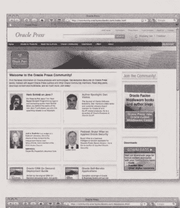

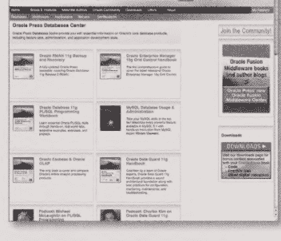

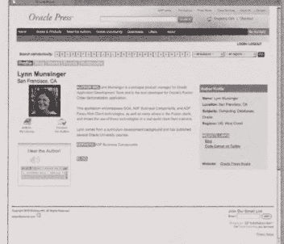

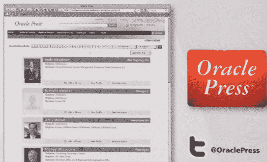


写我的妻子 Lisa：感谢你鼓励我承担这个项目，忍受了随之而来的所有深夜和情绪波动。

-John

写我亲爱的妻子 Menka 和优秀的儿子 Aditya 和 Mihir，感谢他们的支持和鼓励。

-Arun

写我的妻子 Hermine！同时也给各地的 NetBeans 用户——希望你们在阅读这本书的过程中获得乐趣并学到很多知识。

-Geertjan

## 关于作者

John Brock 是 Oracle 公司的首席产品经理。John 拥有超过 15 年的 Web 应用开发经验。在 Sun Microsystems 工作期间，他负责识别新兴技术以及它们可能如何与 Java 虚拟机 (`JVM`) 交互。他目前的重点是 NetBeans 的 HTML5 开发、JavaScript 和 CSS 功能。

Arun Gupta 是 Red Hat 的开发者倡导总监，专注于围绕 JBoss 中间件构建社区。作为 Sun Microsystems Java EE 团队的创始成员，他通过内容、营销活动和计划领导了 Java EE 7 平台的全球发布。Arun 拥有丰富的演讲经验，曾遍布 37 个国家，并是 Java Rockstar。他是一位畅销书作者、跑步爱好者，可以通过 `@ungupta` 联系他。

Geertjan Wielenga 是 Oracle 公司的首席产品经理。Geertjan 自 1996 年起进入软件行业。在 Sun Microsystems 期间，他负责一系列技术的文档工作（主要是 Java EE 和 Web 领域），开发教程并编写著作。Geertjan 是 NetBeans 作为 Web 技术工具中心解决方案的热心支持者。他还推广 NetBeans Platform 作为大型 Java 桌面应用的稳定通用解决方案。他目前担任 NetBeans IDE 推广的产品经理。

## 关于技术编辑

John Yeary 是 Infor Global Solutions Epiphany CRM 营销首席软件工程师。John 一直是 Java 倡导者，自 1995 年起从事 Java 工作。John 是一位专注于 Java 企业版、NetBeans 和 GlassFish 的技术博客。他是 Greenville Java 用户组 (`GreenJUG`) 的创始人和主席。他是教师、导师以及丰富的开源贡献者。

John 毕业于缅因海洋学院，获得海洋工程学学位，专注于数学。他是一名海事船员，拥有许多执照和认证。在不从事 Java 和开源项目时，他喜欢徒步、航海、旅行并与家人共度时光。John 还是美国童子军 (`BSA`) 833 队的助理童军长、单位辅导以及 Blue Ridge Council Southbounder 区活动与公民服务主席。

## 内容概览

+ 索引 ....................................................................................... 145
致谢 ............................................................................................ xiii
引言 ..................................................................................... XV
xii Java EE 与 HTML5 企业级应用开发

## 致谢

感谢 Liza Lyons 在视觉化 Book Club 示例应用程序布局方面提供的帮助。非常感谢编辑们：从技术到校对。一位优秀的编辑能将技术思维作者的“涂鸦笔记”变得如此出色，这真是不可思议。与 Oracle Press 团队的其他成员一起工作是一种乐幸，当然，非常感谢我的合作者们。

-John Brock

诚心感谢 Brandi Shailer 和 Amanda Russell 在整个过程中的引导。非常感谢 John Yeary 提供的扎实的技术评审，展示了他对该领域的渊博知识。如果没有我的两位合作者以及 Oracle Press 团队的其他成员，这绝对是不可能实现的。

-Arun Gupta

非常感谢 Amanda Russell、Brandi Shailer，以及 JB Brock 和 Arun Gupta 在本书编写中的工作与合作，并感谢我们的主要评审员 John Yeary。

-Geertjan Wielenga

# 引言

市场上有很多书籍仅涵盖 Java Web 服务或仅涵盖 HTML5，但未兼顾。因此，本书试图在两者之间寻找平衡：HTML 开发者应该对他们连接的 Java Web 服务了解多少，以及 Java 开发者应该对那些消费并与 Web 服务交互的 HTML5 应用了解多少。

随着过去几年 JavaScript 的复兴，Java 开发者经常面临需要理解 HTML5 客户端应用如何交互并消费他们一直在创建的服务端 Web 服务的需求。同时，HTML5 开发者经常发现他们需要理解应用程序所依赖的服务是如何构建和配置的。随着新的 HTML5 和 CSS3 规范引发行业大量关注，以及 AngularJS 和 Knockout 等新 JavaScript 库日益流行，一些 Java 开发者可能会怀疑自己的技能仍然适用。

## 谁应该读这本书

这本书对于以下开发者是理想的：他们发现自己不仅需要如何开发基于 Java EE 的 Web 服务（如 REST、SSE 和 WebSocket），还需要如何开发消费并与这些 Web 服务交互的 HTML5 。无论你是一个寻找 HTML5 应用如何连接到 服务的 Java 开发者，还是一个希望更好地了解服务端 Java EE 服务的 HTML5 开发者，本书都能满足你的需求。

## 本书涵盖内容

本书涉及主题

- Java EE 7 持久化 API (`JPA`)
- Java EE 7 RESTful Web 服务 API (`JAX-RS`)
- Java EE 7 WebSocket API
- HTML5 规范的新特性
- 通过 Knockout 的 JavaScript 模型-视图-模型 (`MVVM`) 架构模式
- REST、WebSocket 和服务端事件 (`SSE`) 的 JavaScript API
- 通过 CSS3 特性的响应式设计
- 使用 SASS 进行 CSS 预处理
- Web 应用的客户端和服务安全概念

这些主题将在六章中涵盖：

- 第一章“Java EE 与 HTML5 企业级开发简介”提供了书中三个主要领域的概述：Java EE 7 Web 服务、HTML5 应用开发和 NetBeans IDE。

- 第二章“持久化”讨论了 Java 持久化 API (`JPA`)，并向你展示了持久化的核心概念以及如何使用 `JPA` 在关系数据库中创建、读取、更新和删除数据。

- 第三章“RESTful 资源”介绍了 REST（表述状态转移）作为全球网等分布式系统的架构风格。涵盖了 Java EE 7 RESTful Web 服务 API (`JAX-RS`)，包括对服务端事件 (`SSE`) 的新支持。你将学习如何开发自己的 RESTful Web 服务和 `SSE` 服务，这些服务将作为你在第五章中开发的 Book Club 应用程序的数据资源。

- 第 4 章“WebSocket”涵盖了使用 WebSocket 开发应用程序的服务器端和客户端部分。你将学习用于 WebSocket 的 Java API，以及如何开发与 WebSocket 服务交互的 HTML5 客户端。

- 第 5 章“HTML5、JavaScript 和 CSS”完全关于 HTML5 和客户端开发。你将与在第 3 章中创建的 REST 和 `SSE` 服务进行交互。书中将向你展示如何通过使用 JavaScript 库 Knockout 使用模型-视图-视图模型（`MVVM`）架构模式。你将接触到响应式设计概念，以及使用 Syntactically Awesome Stylesheets (`SASS`) 进行的 CSS 预处理技术。

- 第 6 章“HTML5 和 Java 应用服务”涵盖了 HTML5 客户端应用程序和基于 Java EE 的 Web服务的安全概念。

## 如何使用本书和代码

本书的结构允许你按顺序阅读，也可以跳转到任何章节将其作为一个独立主题来阅读。书中讨论的所有应用程序都提供了源代码，并可以在 `www.OraclePressBooks.com` 下载。这使得你能够从较后的章节开始阅读，仍然可以访问如果你先阅读前面的章节时本会开发的资源。例如，如果你选择先阅读第 5 章（在其中你开发了 Book Club 应用程序），你可以访问该应用程序所依赖的第 3 章数据资源。可以在阅读每个章节时参考源代码进行，或者从 NetBeans IDE 部署并运行源代码——以最适合你的方法为宜。书中全程使用 NetBeans IDE 来向你展示如何使用向导和其他高效开发方法，例如内置的 JavaScript 调试器。


# 第 1 章 Java EE 和 HTML5 企业级开发简介

## 2 章 Java EE 和 HTML5 企业级应用开发

近年来，企业软件开发领域发生了许多变化。其中两个最大的变化是向软件服务（`SaaS`）的趋势，以及使用 HTML5 提供纯客户端用户界面。

在本章中，你将被介绍贯穿全书的主要主题：NetBeans IDE、Java EE 7 和 HTML5。你将获得有关如何获取应用程序和示例的信息，这些示例将帮助你完成后续章节。通过使用这种 IDE、平台和 HTML5 技术的结合，你很快就能构建出强大的、动态的企业级应用程序。

## 开发工具

本书使用了三个主要的开发工具：NetBeans IDE、Java EE 7 和 HTML5。你将学习如何使用这些工具的组合来构建强大的、现代的企业级应用程序。在开始构建应用程序之前，确保你对这些技术的基础有坚固的理解。

## NetBeans

NetBeans IDE 是你将在书中全程使用的开发工具。它提供了编辑器、模板和代码生成器等功能，使其成为创建使用 Java EE 7 和 HTML5 应用程序的完美人选。从 NetBeans IDE 7.3 开始，引入了新功能以支持和增强利用 HTML5 族技术的客户端 Web 应用程序开发体验。你可以使用此 IDE 快速、直观地创建丰富的 Web 应用程序，这些程序支持同时针对桌面和移动平台的响应式设计范式。此外，从 NetBeans 7.4 开始，你可以在 Java EE 和 PHP 应用程序中使用 HTML5 技术。

NetBeans 的故事始于 1996 年，当时布拉格查尔斯大学的一群学生试图用 Java 编写一个类似于 Delphi 的 Java IDE。该项目最初名为 Xelfi，这个学生项目深入研究了当时 Java IDE 领域的未知领域。Xelfi 在开发者社区中引起了足够的兴趣，


在毕业后，学生们决定将新产品推向市场。1997 年，他们成立了一公司并将 IDE 的名称改为 NetBeans。

没多久，当太阳微系统（Sun Microsystems）开始寻找 Java 开发工具时，他们对 NetBeans 产生了兴趣。1999 年，太阳微收购了 NetBeans，并将 NetBeans IDE 成为 Java 的旗舰工具集。当时，太阳微做出了另一个关键决定：将 NetBeans IDE 建立为一个开源项目——供任何想要使用它的人免费使用。多年来，NetBeans IDE 已经成为一个功能全的跨平台 IDE，支持 Java 应用开发的各个方面。

当 Oracle 在 2010 年收购太阳微系统时，NetBeans IDE 成为 Oracle 的一部分，Oracle 承诺继续支持它。今天，使用 NetBeans IDE 的人比任何时候都多。到 2010 年，活跃用户达到了一百万，NetBeans IDE 社区持续创新和增长。

你可以从 Oracle NetBeans 网站下载 NetBeans IDE。访问 `//netbeans.org/downloads` 概述可用的发行版本并找到相应的下载链接。你需要 NetBeans IDE 的“Java EE”或“All”发行版本才能遵循书中的指令。这些指令和代码示例是在 NetBeans IDE 7.4 中创建的，这是编写本书时的最新版本。随后发布的 NetBeans IDE 版本应该也同样适用，如果你在使用较新版本时遇到问题，建议你切换到 NetBeans IDE 7.4。

系统中仅有 Java 运行环境（`JRE`）是不够运行运行 NetBeans IDE 的。你需要 Java 开发工具包（`JDK`），它包含了 `JRE` 的副本。你可以访问 `http://oracle.com/technwork/java/index.html` 下载 `JDK` 的最新版本。

## Java EE

Java 平台企业版（Java EE）提供了一个基于标准的平台用于开发 Web 和企业级应用程序。该平台由多个组件组成，每个组件都通过规范定义。

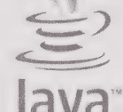

Java EE 提供了一个用于开发企业级应用程序的基于标准的平台。平台还伴随着一些额外的服务。

Java EE 7 平台中定义了 33 个组件。与本书相关的组件将在本节介绍。有关组件的完整列表请参考 Java EE 7 技术列表 (`www.oracle.com/technet/javaee/tech/index.html`)。

Java EE 7 平台的主要主题之一是简化 HTML5 应用程序的开发，特别是服务端所需的服务。为了实现这一点，用于 RESTful 服务的 Java API（`JAX-RS`）是平台的一个组件，它定义了如何开发、部署和调用 RESTful Web 服务。一个简单的 Java 对象（`POJO`）可以通过指定注解轻松地发布为表述状态转换（`REST`）端点。使用标准 HTTP 动词访问资源时，可以轻松调用常规方法。还有用于调用 `REST` 端点的 Java API。服务器发送事件（`SSE`）是 HTML5 规范的关键部分，是从服务器向客户端异步推送数据。尽管 `SSE` 尚未成为平台的一部分，但 `JAX-RS` 实现提供了对 `SSE` 的支持。

WebSocket 在单个 TCP 连接上提供全双工、双向通信通道，并显著提高了现代 Web 应用程序的延迟。Java EE 7 平台新增了一个 API 用于构建 WebSocket 应用程序。就像 `JAX-RS` 一样，在 `POJO` 上添加注解即可转换为 WebSocket 端点。凭借对 WebSocket 的关注以及简化的 API，Java EE 7 是构建你的 HTML5 应用程序的最佳平台。

JavaScript 对象表示法（`JSON`）是 HTML5 应用程序内部数据传输的关键技术，无疑也是 Web 的通用语言。Java EE 7 使用 `JSON-P` 1.0 添加了用于解析和生成 `JSON` 文本和对象的新的 API。该 API 允许解析或生成整个 `JSON` 文本。或者，也可以逐项地构建。

任何 Web 应用程序通常都需要将信息持久化在永久数据存储中。Java 持久 API（`JPA`）定义了一个用于管理持久化和对象关系映射的 API，使用一个

## 第 1 章：Java EE 与 HTML5 企业级开发简介

Java 领域模型。与整体主题一致，添加注解允许将 `POJO` 映射到数据库表。它提供了合理的默认值，可以通过注解进行覆盖。`POJO` 还可以用于生成数据库表，甚至是表生成所需的脚本。开发人员可以编写基于字符串或类型安全的查询来对 Java 数据模型进行操作。

此外，这些数据中的信息需要被存储和检索，以保持 ACID（原子性、一致性、隔离性、持久性）属性。这可以通过企业级 JavaBean (`EJB`) 或新引入的 `@Transactional` 注解来实现。`EJB` 提供了方便的容器托管事务。它们还有不同的类型：无状态（`stateless`，服务器端无状态）、有状态（`stateful`，状态存储在服务器上）和单例（`singleton`，每个应用程序每个 `JVM` 仅有一个实例）。


新添加的 `@Transactional` 注解可以指定在 POJO 上，以便在 Enterprise JavaBeans 之外提供容器托管事务。对类进行注解意味着该类的所有方法将在容器托管事务中运行。或者，该注解也可以指定在方法上以限制事务的范围。

本书将使用大量的代码示例详细介绍所有这些主题。

此外，Java EE 7 平台提供了其他几个组件：

- **Java 平台批处理应用程序 (Batch Applications for the Java Platform)**：允许定义和执行非交互式、批量型和长时间运行的任务。它允许面向条目的处理处理样式（也称为 Chunk）和面向任务的处理样式（也称为 Batchlet）。Chunk 是主要且推荐的处理样式，它一次读取、处理并聚合以写入一个“块”数量的项。每个 chunk 都在容器托管事务中写入，并提供检查点。Batchlet 是一种自定义的批处理模式。它是一种面向任务的处理样式，任务被调用一次，运行完成并返回退出状态。

- **Java 消息服务 (JMS)**：提供了一种面向消息的中间件，允许在分布式系统之间发送和接收消息。它提供了点对点消息模型，发布者将消息发送到特定的目标（称为队列 `queue`），目标指向订阅者。或者，JMS 提供了发布-订阅消息模型，多个发布者可以将消息发布到一个目标（称为主题 `topic`），该主题可以被多个订阅者订阅。在这两种情况下，发布者和订阅者之间都是松耦合的。他们只需要知道目标和消息格式。

- **上下文与依赖注入 (CDI)**：提供了一种类型安全的依赖注入机制。bean 是“强类型”的，因为它只定义了它依赖的其它 bean 的类型和语义，而不使用字符串名称，并使用 Java 类型系统中可用的类型信息。它提供了“松耦合”，因为注入请求无需感知 bean 的实际生命周期、具体实现、线程模型或其他客户端。

- **并发工具类 (Concurrency Utilities)**：允许为现有的 Java EE 应用程序添加并发设计原则。它允许应用程序创建由控制器管理的的用户线程。通常的类加载、`Java 命名目录接口 (JNDI)` 上下文以及安全上下文会传播到这些线程。

- **JavaServer Faces (JSF)**：提供服务端用户界面 (UI) 框架。它允许遵循模型-视图-控制器 (MVC) 设计模式使用一组可重用的 UI 组件来创建网页。组件绑定到服务端模型上，实现了应用程序数据与 UI 之间的双向迁移。JSF 还定义了页面导航，管理跨服务器请求的 UI 组件状态，并可以轻松用于构建和复用自定义组件。

- **Java Servlet 技术**：允许 Web 客户端使用请求/响应模式进行交互并生成动态内容。容器负责 servlet 的生命周期，接收请求并发送响应，并作为该功能执行所需的任何其他编码/解码。

请参阅《Java EE 7 教程》(http://docs.oracle.com/javaee/7/tutorial/doc/home.htm) 了解完整的 Java EE 7 技术的详细信息。

## HTML5

虽然大多数人认为 HTML5 是相对新的，但它实际上从 2004 年开始就在开发了。万维网联盟 (W3C) 设计原始规范是为了解决它所观察到的当时互联网上 HTML 和 XHTML 的常见用途。W3C 在起草新规范时考虑的其他因素还包括了将多媒体整合到网页中的趋势，以及合并在 HTML 4.01 规范使用期间已成为广泛使用的各种规范的需求。这种整合不仅包括升级到 HTML 4 规范，还将将 XHTML 1 和 DOM Level 2 HTML 规范合并为一。

## HTML5 规范达到功能完备

过去一年中，让 HTML5 跃居前沿的是在 2012 年 12 月 17 日，W3C 宣布 HTML5 规范已达到功能完备。通过将规范标记为“候选建议”（Candidate Recommendation），W3C 为企业和开发人员提供了一个可以开始使用的稳定规范。

当你将 HTML5 作为你的客户端应用程序框架工作时，需要考虑的一个主要问题是，虽然它已经达到了稳定、功能完备的状态，但它尚未被批准为一个完成的标准。这最大的影响是，由于使用的草案规范不同，仍然存在不同的实现。或者可能完全不支持规范的某些部分。现在该规范已经功能完备，主要的浏览器用户代理开发者应该能够收敛到更接近规范的实现上。然而，这需要时间，你需要确保在所有浏览器和用户代理上测试你所有的 HTML5 代码。

W3C 在发布 HTML5 规范完整定义的公告中（www.w3.org/2012/12/html5-cr.html），对下阶段将包含的内容描述如下：

> 在此阶段，HTML 工作组将分析当前的 HTML5 实现，为测试开发建立优先级，并与社区合作开发这些测试。HTML 小组计划此实施阶段持续到 2014 年年中，之后 W3C 预计发布最终的 HTML5 建议，供实施者免费使用。

## Java EE 与 HTML5 企业级应用程序开发

到目前为止，HTML5 规范的实现可以说是针对一个不断变化的目标进行的。不同的供应商以不同的方式支持规范，或者可能完全不支持规范的某些部分。这为应用程序开发人员带来了问题，因为他们必须为可能使用各种设备组合的客户群进行开发。坦率地说，已经建立了几个网站来帮助开发人员应对这一棘手领域。最流行的两个网站是：

- HTML5 Test http://html5test.com/
- Can I Use http://caniuse.com/

HTML5 Test 网站将允许你看到特定版本或品牌的浏览器实现整个 HTML5 规范的程度如何。当你试图决定应用程序提供哪种浏览器或设备支持矩阵时，这非常有用。

Can I Use 网站提供了更详细的信息，允许你查看特定的 HTML 元素或属性并查看哪些浏览器供应商实现了它以及在哪些版本中实现。

## 移动设备的使用

HTML5 最近可见度上升的第二个主要原因可能是智能手机、平板电脑以及其他具有互联网访问能力的移动和嵌入式设备（例如联网电视、游戏机和蓝光播放器，仅举几例）可用性的增加。这些设备可用性的增加让 HTML5 脱颖而出的原因是，所有它们都是使用在某种程度上已经支持 HTML5 的浏览器进行开发的。与桌面操作系统不同，这些设备的浏览器开发人员不需要考虑任何与现有浏览器实现的后兼容性问题。这些类型设备上一切都是新的，制造商从最新的 HTML5 规范开始，以期待其在不久后成为标准。

移动设备访问互联网的兴起也是吸引企业开发者关注 HTML5 的因素之一。传统的网站布局无法在智能手机或平板电脑等较小设备上进行舒适的缩放。现有的检测到客户端为移动设备时，生成一个完全不同的网站版本进行显示的方法，已被证明充满了维护问题，且扩展效率低下。

## HTML5 的新特性

HTML5 的主要新特性之一是引入了新的语义化元素（参见表 1-1），以帮助开发者管理 HTML 页面的布局及其内容，使其在较小设备上查看时能够完美缩放。你现在可以使用 `<header>`、`<footer>`、`<section>`、`<article>`、`<aside>`、`<nav>` 等标签来布局 HTML 内容。

除了 HTML5 规范中的新语义化元素外，还有表 1-2 所示的新语法元素，旨在消除安装专有插件的需求。这些元素包括 `<canvas>`、`<video>`、`<audio>` 和 `<svg>`。这些特性的设计旨在处理多媒体和图形变得更加容易。

最后，HTML5 规范为一些现有元素引入了新的属性。其中最显著的是 `<input>` 元素 `type` 属性的新值（参见表 1-3）。这些值主要用于表单。虽然所有新类型值现在已成为最终版规范的一部分……

### 表 1-1 语义化元素

| 元素 | 描述 |
| --- | --- |
| `<header>` | 文档的头部部分。通常包含介绍性或导航信息。 |
| `<footer>` | 文档的页脚。通常包含版权信息、法律信息、指向有关网站更多信息的链接等。 |
| `<section>` | 文档中的通用章节。 |
| `<article>` | 文档中一个独立的内容区域。 |
| `<aside>` | 与文档其他部分仅轻微关联的内容。 |
| `<main>` | 文档的主要内容。文档中只允许一个此类元素。 |
| `<dialog>` | 用作对话框或弹出窗口的文档部分。 |
| `<nav>` | 用于导航链接的文档部分。 |
| `<menuitem>` | 代表用户可以从弹出菜单中选择的命令的文本。 |
| `<mark>` | 应为了额外参考而高亮显示的文本。 |
| `<details>` | 文档中包含根据需要显示或隐藏的额外控件或信息的部分。 |
| `<summary>` | 为 `<details>` 元素提供摘要内容。 |
| `<bdi>` | 文档中需要与其他部分隔离的部分，因为它可能是为需要双向语言支持的语言格式化的。 |
| `<figure>` | 文档中具有独立流的自包含部分。通常是图形性质的，如图像、视频内容等。 |
| `<figcaption>` | `<figure>` 元素的说明。 |
| `<meter>` | 代表测量值的文档部分。 |
| `<progress>` | 展示任务完成情况的部分。 |
| `<ruby>` | 允许包含 `<ruby>` 注释。通常用于东亚排版。 |
| `<rt>` | `<ruby>` 的子元素。 |
| `<rp>` | `<ruby>` 的子元素。 |
| `<time>` | 日期和/或时间元素。 |
| `<wbr>` | 换行的机会。 |
| `<datalist>` | 与 `<input>` 元素的 `list` 属性结合使用创建组合框。 |
| `<output>` | 代表某种计算输出的文档部分。 |
| `<keygen>` | 用作键对生成器控件。 |

### 表 1-2 语法元素

| 元素 | 描述 |
| --- | --- |
| `<audio>` | 音频多媒体内容。 |
| `<video>` | 视频多媒体内容。 |
| `<source>` | `<audio>` 和 `<video>` 的子元素。当有多个可用源格式时使用。 |
| `<track>` | 用于 `<video>` 元素的文本轨道。 |
| `<canvas>` | 用于渲染动态位图内容的部分。用于图表或游戏等内容。 |
| `<svg>` | 用于渲染可缩放矢量图形 (SVG) 的部分。 |

### 表 1-3 表单输入类型

| 属性 | 描述 |
| --- | --- |
| `<input type="color"/>` | 输入值代表颜色 |
| `<input type="date"/>` | 输入值代表日期 |
| `<input type="datetime"/>` | 输入值代表日期和时间 |
| `<input type="datetime-local"/>` | 输入值代表无时区偏移的本地日期和时间 |
| `<input type="time"/>` | 输入值代表时间 |
| `<input type="email"/>` | 输入值代表电子邮箱地址 |
| `<input type="month"/>` | 输入值代表月份 |
| `<input type="week"/>` | 输入值代表周 |
| `<input type="number"/>` | 输入值代表数字 |
| `<input type="range"/>` | 输入值代表最小和最大设置之间的范围 |
| `<input type="search"/>` | 输入值代表搜索 |
| `<input type="tel"/>` | 输入值代表电话号码 |
| `<input type="url"/>` | 输入值代表 URL |

HTML5 规范规定了每个浏览器可以以及如何实现它们在渲染时的行为。规范的意图是厂商能够为这些输入类型中的每一种提供用户界面。例如，如果浏览器渲染一个 `type` 设置为 "Date" 的输入字段，用户将看到一个日期选择器来选择他们想要输入的日期。遗憾的是，这是目前浏览器厂商在功能上差异最大的领域之一。在移动设备上，体验更好。你经常发现，当你点击或触摸 `type` 设置为 "number" 的输入字段时，你会得到一个数字小键盘而不是普通键盘，或者如果输入字段是 "url"，则会显示不同类型的键盘。

关于 HTML5 应用最大的误解之一是它们仅由 HTML5 组成。事实上，在所有情况下，应用程序实际上至少由三个组件组成：HTML5、JavaScript 和 级联样式表 (CSS)。通过结合 CSS 第 3 版本 (CSS) 的所有新媒体查询功能，你可以在不同的设备尺寸布局下显示相同的内容。这种修改内容以响应设备可用显示尺寸的方法被称为*响应式设计*（responsive design）；布局响应于它被渲染时的显示尺寸。

关于响应式设计有几点重要的注意事项。首先，尽管它允许你创建一个在多个设备尺寸上具有相同外观和体验的网站，但 HTML5 仍然是在智能手机或平板电脑等较小设备上的网络浏览器中查看的网页。应用程序不会像为特定类型移动设备编写和编译的应用程序那样具有真正的“原生”外观和体验。其次，对于希望应用程序能够访问特定移动功能（如摄像头、联系人列表和日历）的开发者来说，HTML5 和响应式设计可能不是标准答案。因为应用程序在网络浏览器中运行，你只能编写程序来使用浏览器允许你交互的内容。

如前所述，HTML5 应用中常用的第三个组件是 JavaScript。JavaScript 架构库的引入是使其更容易被企业开发者接受的一个大因素。

在企业环境中开发应用程序通常意味着开发任务的分离，设计师和 UI 团队负责前端或视图层，而其他团队则负责数据层和控制器层。这种应用层之间的分离被称为“模型-视图-控制器”（MVC）架构模式。在过去的几年里，JavaScript 库被开发出来，以引入一种类似的架构，称为“模型-视图-视图模型”（MVVM）。

MVVM 最初由微软在 2005 年开发，是其 Windows 呈现框架（WPF）的一部分。Steve Sanderson 在 2010 年作为一个开源项目引入了该架构模式的 JavaScript 实现。它以 Knockout.js（http://knockout.com/）的名字发布，并迅速在已经熟悉 MVC 开发实践的 JavaScript 开发者中流行起来。虽然深入理解 MVVM（更具体地说是 Knockout.js）超出了本书的范围，但当你在第 5 章创建一个 HTML5 应用时，你将使用 Knockout.js，该应用将消耗并与 REST、WebSockets 和服务器发送事件（SSE）等网络服务交互。

你已经学习了 Java EE 7 规范在网络服务方面的更新内容，这些服务用于开发 HTML5 应用所需的特定服务。你还了解了 HTML5 规范中的一些新功能，以及开发客户端 HTML5 应用所需的特定技术。这种对开发工具当前状态的介绍将帮助你在完成本书剩余内容时，结合编码概念和示例进行工作。

正如你所看到的，Java EE Web 开发和 HTML Web 开发在过去几年中都已趋于成熟，朝着“软件即服务”（SaaS）的共同趋势发展。遵循这一趋势，NetBeans IDE 等工具已经演进，提供了比以往任何时候都更容易结合这两种技术的功能。

在下一章中，你将深入研究 Java EE 7 持久 API（Persistence API），学习如何为你的 HTML5 应用创建和维护数据库。

数据是任何应用程序不可或缺的一部分，通常定义了应用程序在任何特定时间的状态。持久化是应用程序状态的一种特征，其寿命比创建它的进程更长。如果没有持久化，应用程序数据将在程序终止时丢失。如果银行应用程序无法持久化账户信息，那么该应用程序将无用武处。同样，如果零售商店应用程序无法持久化库存、客户订单和发货信息，它也将毫无价值。持久化允许应用程序访问数据并执行更改数据状态的 CRUD（创建、读取、更新和删除）操作。在应用程序意外崩溃并恢复后，持久化允许应用程序使用与崩溃时完全相同状态的数据。

在 Java 中有许多方法可以持久化数据。Java 平台标准版（Java SE）提供了操作流和文件的 API。这需要大量的低级处理，例如定义流的位置和名称、打开和关闭流，以及定义数据格式。Java 数据库连接（JDBC）API 可用于将数据存储在关系型数据库中，例如 Oracle 或 MySQL 数据库服务器。这需要管理数据库连接、编写 SQL 查询语句、将结果映射到 Java 对象以及许多其他操作。不同的 NoSQL 数据存储提供了用于管理特定数据存储数据的 API。大多数数据都持久化在数据库中，特别是关系型数据库中。

Java EE 平台提供了 Java 持久 API（JPA）用于管理持久化和对象/关系映射。换句话说，一个 POJO（普通 Java 对象）可以用于表示关系型数据库中的一张表，每个类实例对应于表中的某行。该 API 定义了如何使用 POJO 管理这些行。

存储在关系型数据库中的数据应保持 ACID（原子性、一致性、隔离性、持久性）属性。为了帮助维护 ACID 属性，确保任何对数据的更新或删除都在事务边界内完成是非常重要的。事务可以是容器管理的，也可以是用户管理的。容器管理的事务既可以通过企业级 JavaBeans（EJB）容器管理，也可以通过使用事务 API（JTA）提供的 `@javax.transaction.Transactional` 注解来管理。在这种情况下，事务由容器自动启动，然后由容器提交或回滚。用户管理的事务则由用户显式启动，然后由用户提交或回滚。

本章将介绍 JPA 的核心概念，以及如何创建、查询和更新实体。文中解释了基于文本的持久化查询语言（JPQL）和类型安全的 Criteria API。最后解释了如何使用 NetBeans 工具和向导生成数据库架构。

JPA 将实体定义为轻量级领域对象。任何带有无参构造函数的 POJO 都可以是实体。图 2-1 显示了一个定义作者的 JPA 实体。

列表 2-1 作者实体


```java
@Entity
@Table(name = "AUTHOR")
public class Author implements Serializable {
    private static final long serialVersionUID = 1L;
    @Id
    private Integer id;

    @NotNull
    @Size(min = 1, max = 20)
    private String firstName;

    @Size(max = 20)
    private String lastName;

    @Size(max = 1000)
    private String bio;

    @Size(max = 30)
    private String email;
    public Author() { }
    // 其他构造函数

    // getters 和 setters
}
```

让我们来看这段代码：

- `@javax.persistence.Entity` 注解用在 POJO 上，指定这是一个实体。实体的默认名称是类的未限定名。可以使用可选的 `name` 属性来指定实体名称，该名称随后查询中引用实体。

- `@javax.persistence.Table` 是实体上的一个可选注解，用于指定被注解实体的主表。附加表可以使用 `SecondaryTable` 或 `SecondaryTables` 注解来指定。

如果实体上没有指定 `@Table` 注解，或者注解未指定 `name` 属性，则生成的表默认为实体名称。

- 实现 `Serializable` 接口允许该类通过远程接口按值传递。

- 遵循 JavaBean 风格访问器（“属性访问”）或实例变量（“字段访问”）的 Bean 属性代表实体的持久状态。实体类的持久化字段或属性可以是许多类型，例如 Java 原始类型、任何原始类型包装类、使用 `@javax.persistence.Embedded` 定义的并称为嵌入对象的其他细粒度类、嵌入对象的集合以及许多其他类型。

代码中的 `firstName`、`lastName`、`bio` 和 `email` 具有 getters 和 setters，为了代码在代码中省略了。这些字段中的每一个都将映射到数据库表中的列。

属性和字段使用了合理的默认列名。例如，列名 `ID` 用于 `id` 属性，列名 `FIRST_NAME` 用于 `firstName` 属性。可选可以使用 `@javax.persistence.Column` 注解来覆盖映射列的名称。

- `@javax.persistence.Id` 注解指定实体的主键。应用此注解的字段或属性应该是以下类型之一：任何 Java 基础类型、任何基本包装类型、`java.lang.String`、`java.util.Date`、`java.sql.Date`、`java.math.BigDecimal` 或 `java.math.BigInteger`。对应的映射列被假设为主表的主键。

可以使用 `@javax.persistence.IdClass` 注解在实体上定义一个由多个字段或属性组成的复合主键。一个可嵌入的类（embeddable class）可以使用 `@javax.persistence.EmbeddedId` 注解标记为主键。

- 可以对实体上指定验证约束，以确保仅使用有效数据与数据库通信。Bean Validation 1.1 是 Java EE 7 平台中的另一项规范，它在 `javax.validation.constraints` 包中定义了几个预定义的约束。在字段上指定 `@javax.validation.constraints.NotNull` 可以确保该字段无法被设置为 null 并持久化。`@javax.validation.constraints.Size` 约束允许你指定字段的最小和最大边界。

Bean Validation 规范定义了一种扩展机制，通过该机制你可以轻松定义自定义约束以满足应用需求。实体可以使用 `@javax.persistence.OneToOne`、`@javax.persistence.OneToMany`、`@javax.persistence.ManyToOne` 和 `@javax.persistence.ManyToMany` 注解捕捉不同表之间的关系。连接表使用 `@javax.persistence.JoinTable` 注解定义。基本或可嵌入类型的集合可以使用 `@javax.persistence.CollectionTable` 注解进行映射。

NetBeans IDE 提供了一个向导，能够从数据库架构生成 JPA 实体。在 IDE 中，右键点击你的应用程序，并选择 New | Other | Persistence | Entity Classes from Database。“New Entity Classes from Database”向导的 Database 页面如图 2-1 所示。所选数据源中可用的表显示在 **Available Tables** 列表中。

在左侧面板中选择 **Available Tables** 列表中的任何表，并点击 **Add** 按钮将其添加到右侧的 **Selected Tables** 列表中。如果你添加了引用了其他表的表，被引用的表也会自动添加到 **Selected Tables** 列表中。被引用的表显示为灰色，以指示它们是被引用表。IDE 将为 **Selected Tables** 列表中列出的每个表自动生成实体类。


图 2-1. 从数据库选择表

点击 **Next** 进入“New Entity Classes from Database”向导的 **Entity Classes** 页面，如图 2-2 所示，你可以在此处检查或设置以下内容：

- **Class Names**：显示为列出的每个表生成的类名。**Generation Type** 列显示该类是新建的、更新还是重新创建的。如果所选表的实体类已存在，你可以点击 **Class Names** 表下方的切换按钮 (...) 来选择重新创建实体类或更新现有类。

- **Project**：显示实体类将要保存的项目。此字段是只读的。

- **Location**：选择你想要创建实体类的源文件夹。

- **Package**：从下拉列表中选择现有的包，或输入新包的名称。

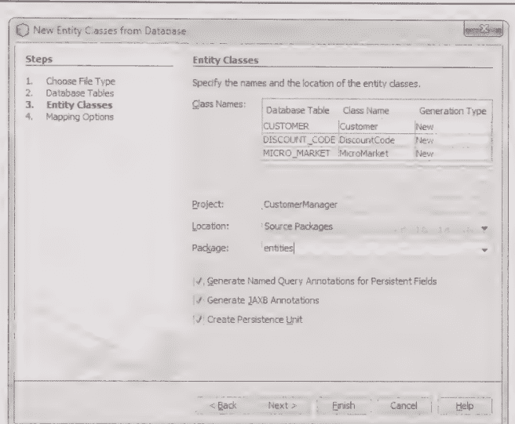

### 图 2-2. 定义要创建的类和其他文件

- **Generate Named Query Annotations for Persistent Fields**：如果选中，IDE 会在实体类中生成命名查询注解。

- **Generate JAXB Annotations**：如果选中，IDE 会在实体类中生成注解，将类映射到 XML 元素，然后该元素可以被 Java XML 绑定 (JAXB) Web 服务使用。

为了持久化实体类类，你的项目需要一个持久化单元（如下节“Packaging an Entity”所述）。当你创建实体类时，NetBeans IDE 会检查项目是否存在持久化单元。如果 IDE 无法找到持久化单元，则会出现 **Create Persistence Unit** 复选框，如图 2-2 所示。或者，你也可以在 New File 向导中选择 Persistence | Persistence Unit 在以后创建持久化单元。

从 **Entity Classes** 页面，你可以点击 **Finish** 为指定的每个表创建实体类，也可以点击 **Next** 修改生成映射注解时使用的默认设置，如图 2-3 所示。如果你选择后一种选项，可以设置以下选项来配置生成的注解元素：

- **Association Fetch**：选择要添加到关系注解中的 fetch 元素。你可以选择 default、eager 或 lazy。如果选择了 default（默认选中 default），则不会向关系注解中添加任何元素。

- **Collection Type**：为 OneToMany 和 ManyToMany 容器管理关系 (CMR) 字段选择集合类型。你可以选择 `java.util.Collection`、`java.util.List` 或 `java.util.Set`。默认选择 `java.util.Collection`。

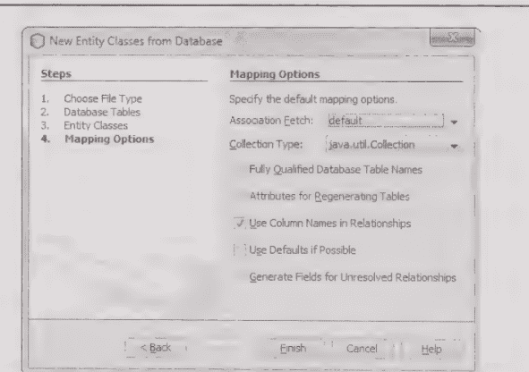

图 2-3. 设置创建实体类的选项

- **Column Names in Relationships**：如果选中，当表引用外键时，字段名将根据表的列名生成。例如，如果 `customer` 表有一个名为 `zip` 的列映射到 `micromarket` 表中名为 `zip_code` 的列，则生成的字段名将是 `zip`。此选项默认勾选。

当你点击 **Finish** 时，IDE 会为向导中指定的每个表创建实体类，如图 2-4 所示。

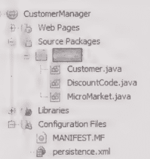

图 2-4. 创建实体类的结果

实体被管理在*持久化上下*（见下节“Packaging an Entity”），持久化上下文是一个受管理的实体实例集合，其中任何持久化实体都有唯一标识。持久化上下文拥有多个管理实体生命周期的*管理器*。实体管理器、配置信息以及映射实体的可选元数据一起被封装为持久化单元。持久化单元由 *persistence.xml* 文件定义并封装在 WAR 文件中。列表 2-2 显示了一个 *persistence.xml* 文件。

```xml
<?xml version="1.0" encoding="UTF-8"?>
<persistence version="2.1" xmlns="http://xmlns.jcp.org/ns/persistence" 
  xmlns:xsi="http://www.w3.org/2001/XMLSchema-instance" 
  xsi:schemaLocation="http://xmlns.jcp.org/ns/persistence/persistence_2_1.xsd">
  
  <persistence-unit name="authorPU" transaction-type="JTA">
    <properties>
    </properties>
  </persistence-unit>
</persistence>
```

**列表 2-2** 示例 persistence.xml

persistence.xml 文件可以拥有多个 `<persistence-unit>` 元素，每个元素对应一个管理器。每个管理器可以使用标准的 `javax.persistence.<properties>` 元素进行配置。

NetBeans IDE 为编辑 persistence.xml 文件提供了编辑器。打开 persistence.xml 文件，你将看到三种用于处理文件的视图：Design、Source 和 History。点击 **Source** 按钮查看文件的源码。在 Source 视图中使用代码补全时——即按下 CTRL-TAB（默认）——可以获得补全当前单词的建议，并带有相关的文档补全，如图 2-5 所示。

当你点击 **Design** 按钮时，将显示一个用于处理 persistence.xml 结构化视图（见图 2-6）。下拉列表允许导航到感兴趣的部分，而文本字段和按钮允许你向底层的 persistence.xml 文件输入值。

最后，点击 **History** 按钮将打开文件的本地历史视图。History 视图允许你回滚本地保存的更改。

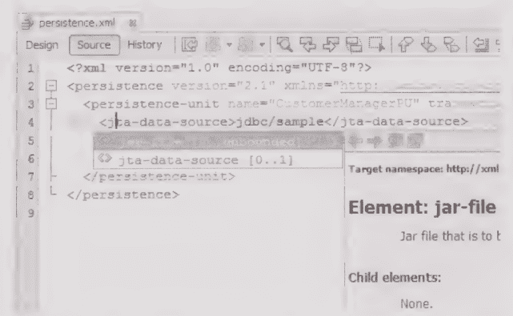

图 2-5. persistence.xml 的源码视图

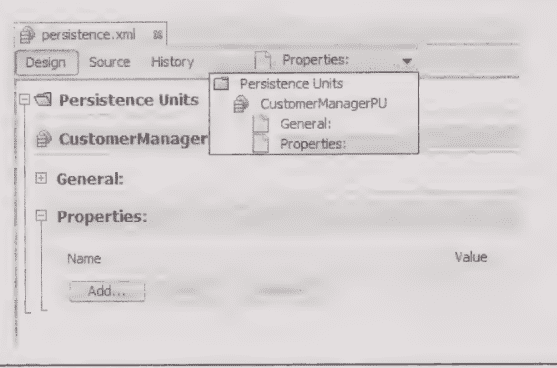

图 2-6 persistence.xml 文件的设计视图

每个实体在其生命周期内都会经历创建、读取、更新和删除（CRUD）操作。通常，一个实体会被创建一次，被读取和更新多次，然后被删除一次。

Enterprise JavaBean（EJB；也称为企业豆）通常用于管理实体。EJB 实例本身在运行时由 EJB 容器管理。容器提供了所有底层工作，如事务、远程调用、并发、连接池以及其他细节，使得应用程序开发者可以专注于业务逻辑。

EJB 有两种类型：会话豆（session beans）和消息驱动豆（message-driven beans）。会话豆同步处理消息，而消息驱动豆用于异步处理消息。会话豆有三种类型：有状态（stateful）、无状态（stateless）和单例（singleton）。有状态会话豆为特定客户端维护会话状态，无状态会话豆不包含特定客户端的任何会话状态，而单例会话豆每个应用程序只实例化一次。

无状态会话豆由于其无状态的本质，可以被容器池化，并为应用程序提供更好的扩展性。默认情况下，会话豆的所有方法都具有容器管理的事务。这意味着 EJB 容器实现了所有低层事务协议，例如事务管理器与数据库系统之间的两阶段提交协议，以遵循事务语义。底层资源的更改将根据情况相应提交或回滚。

在无状态会话豆中，可以通过依赖注入获取容器管理的实体管理器（entity manager）。然后使用该实体管理器对实体执行操作。

列表 2-3 显示了如何使用无状态会话豆来创建或删除实体实例。

```java
@Stateless
public class AuthorSessionBean {
    @PersistenceContext
    EntityManager em;
    public void addAuthor(Author e) {
        em.persist(e);
    }
    public void deleteAuthor(Author e) {
        em.remove(e);
    }
}
```

通过在 POJO 上添加 `@javax.ejb.Stateless` 注解来定义无状态会话豆。要在数据库表中创建新行，可以使用无参构造函数或便利构造函数创建新的实体实例。调用 setter 或为实例变量将填充实体值。这通常在客户端组件（如 servlet 或其他 Java EE 组件）中完成。

在 `addAuthor()` 方法中获取并使用容器管理的 `javax.persistence.EntityManager` 来保存实体。同样，可以通过调用 `EntityManager.remove()` 移除实体实例。EJB 容器在方法调用之前启动事务，并在方法完成后提交事务。对实体管理器的所有更改都会随着事务提交存储在数据库中。

NetBeans IDE 提供了一个允许你生成 EJB 的向导。在 IDE 中，右键点击你的应用程序，并选择 New | Other | Enterprise JavaBeans | Session Bean 来打开 New Session Bean 向导，如图 2-7 所示。

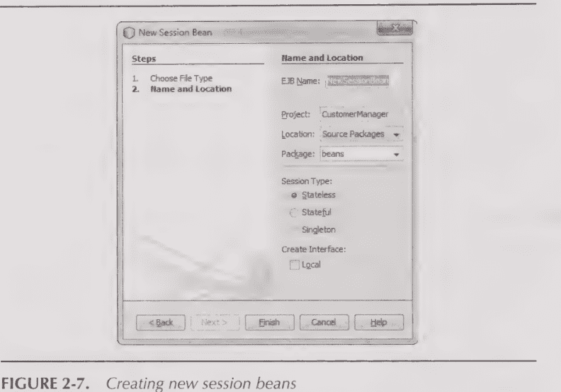

对于会话类型（Session Type），你可以选择以下内容之一：

- **Stateless**（无状态）：该豆在与用户交互期间不保存任何状态信息。这些企业豆法适用于客户端与应用程序服务之间的简单交互，这些交互在单个方法调用中完成。例如，一个处理订单的企业豆。每个订单都可以通过调用一个方法（如 `processOrder()`）来处理。处理所需的所有信息都包含在方法参数中。

- **Stateful**（有状态）：该豆在与用户交互期间会保存状态信息。这些企业豆适用于客户端与应用程序服务之间的业务流程，这种交互持续时间超过单个方法调用，并且需要记住交互状态。例如，在线购物车。最终用户通过客户端程序订购多个项目。管理交互的有状态会话豆必须累积项目，直到最终用户准备好查看累积订单、批准或拒绝项目并启动批量处理。有状态会话豆必须存储未处理的项目并允许最终用户添加更多。

- 单例会话豆每个应用程序只实例化一次，并在应用程序生命周期内存在。你可以使用 `@startup` 注解创建一个容器在应用程序启动时实例化的单例豆。例如，用于初始化应用程序并发访问数据的豆。

使用 EJB 容器提供容器管理事务的替代方案是在 POJO 或其方法上使用新引入的 `@javax.transaction.Transactional` 注解。这允许对由上下文和依赖注入（CDI）管理的豆，以及由托管豆或其他 Java EE 组件定义的类进行声明式的事务边界定义。

列表 2-4 显示了如何在方法上指定 `@javax.transaction.Transactional` 注解以创建或删除实体实例。就像在 EJB 中一样，容器管理的事务由 CDI 运行时自动启动，并根据情况提交或回滚。

```java
public class AuthorSessionBean {
    @PersistenceContext
    EntityManager em;

    @Transactional
    public void addAuthor(Author e) {
        em.persist(e);
    }

    @Transactional
    public void deleteAuthor(Author e) {
        em.remove(e);
    }
}
```

Java Persistence Query Language（JPQL）是一种基于字符串的查询语言，用于定义对实体及其持久状态的查询。JPQL 允许应用程序开发者以可移植的方式指定查询语义。底层持久化提供程序会将查询转换为目标语言（例如数据库的 SQL）。


# 查询与持久化

查询可以是 `SELECT` 语句（CRUD 中的读取）、`UPDATE` 语句（CRUD 中的更新）或 `DELETE` 语句（CRUD 中的删除）。可选的 `WHERE` 子句可用于限制结果，`GROUP BY` 子句、`HAVING` 子句或 `ORDER BY` 子句可用于聚合结果。查询可以动态构建，也可以在元数据注解中静态定义。

如下例所示，`javax.persistence.NamedQuery` 注解可以用于实体以指定多个 JPQL 查询。每个查询使用 `@javax.persistence.NamedQuery` 注解指定。每个查询都需要一个 `name` 属性在持久化单元内唯一标识该查询。查询字符串使用 `query` 属性定义。

```java
@NamedQuery(name = "Author.findAll", query = "SELECT a FROM Author a")
@NamedQuery(name = "Author.findById", query = "SELECT a FROM Author WHERE a.id = :id")
```

在前面的示例中，两个查询都是静态定义的。第一个查询名为 `Author.findAll`，等于从表中选择所有行。注意查询字符串是围绕实体定义的，而不是对应的数据库表。这提供了 JPQL 在多个数据库之间的可移植性。第二个查询名为 `Author.findById`，它使用 `WHERE` 子句限制结果，并要求指定参数 `id`。

NetBeans IDE 提供了一个 JPQL 查询对话框，以便你可以在不部署应用程序的情况下验证查询。在使用之前，请确保编译应用程序中的 JPA 实体，这些编译后的类会被 JPQL 查询对话框使用。然后，如图 2-8 所示，右键点击打开 `persistence.xml` 文件并选择 Run JPQL 以打开 JPQL 对话框。

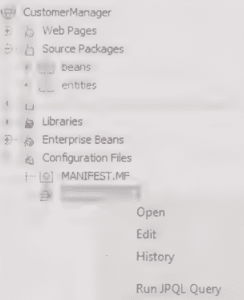

**图 2-8. 打开 JPQL 查询对话框**

在 JPQL Query 对话框中，你可以使用代码补全（默认使用 `CTRL-TAB`）来帮助定义查询。当你运行查询时，结果将显示在 Result 选项卡中，如图 2-9 所示，而查询的 SQL 版本则可以在 SQL 选项卡中查看。

`javax.persistence.Criteria` API 是一种基于对象的、类型安全的替代方案，用于基于字符串的 JPQL。它在实体的元模型（metamodel）上操作，该元模型通常由注解处理器生成。元模型是一组描述了你的领域模型的类，并提供了一种处理应用程序领域模型的通用方法。`javax.persistence.criteria` 和 `javax.persistence.metamodel` 包中的 API 用于创建这种强类型查询。

列表 2-5 展示了如何使用 Criteria API 编写 `Author.findAll` 查询。

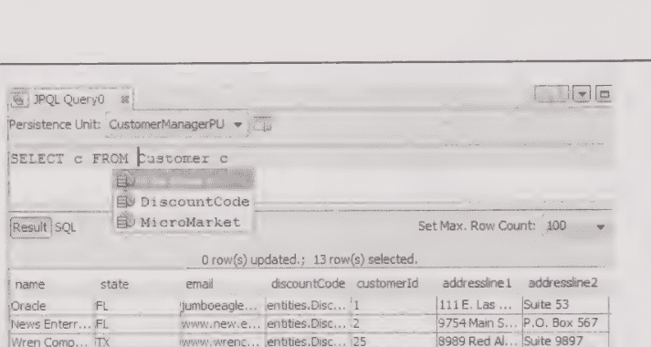

**图 2-9. 显示查询结果**

### 列表 2-5 Author Criteria 查询

```java
CriteriaBuilder builder = em.getCriteriaBuilder();
CriteriaQuery criteria = builder.createQuery(Author.class);
Root<Author> root = criteria.from(Author.class);
criteria.select(root);
TypedQuery<Author> query = em.createQuery(criteria);
List<Author> list = query.getResultList();
```

Criteria 查询虽然冗长，但在构建动态查询方面提供了很大的灵活性。

在某些情况下，必须使用原生 SQL 语句来查询数据库。可以使用 `javax.persistence.EntityManager.createNativeQuery()` 方法来指定原生 SQL 查询字符串。列表 2-6 展示了如何将 `Author.findAll` 命名查询作为原生 SQL 查询执行。

### 列表 2-6 Author 原生查询

```java
em.createNativeQuery("select * from author", Author.class);
```

在这个简化的情况下，结果集直接映射到 `Author` 实体类。可以使用 `@javax.persistence.SqlResultSetMapping` 注解指定更复杂的映射。

NetBeans IDE 提供了向导，可以使用原生 SQL 查询字符串查询数据库。切换到 Services 窗口（`CTRL-3`）并展开 Databases。右键点击表节点（如图 2-10 所示），并选择 View Data 以查看数据库中相关表的数据。

当 SQL 编辑器打开时，你可以使用语法高亮和代码补全功能查询数据库并直接在 IDE 中查看数据，如图 2-11 所示。

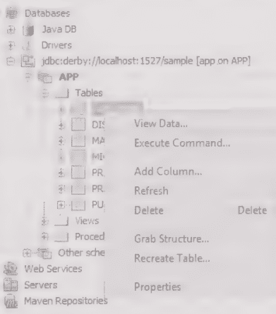

**图 2-10. 查看数据库中定义的数据**

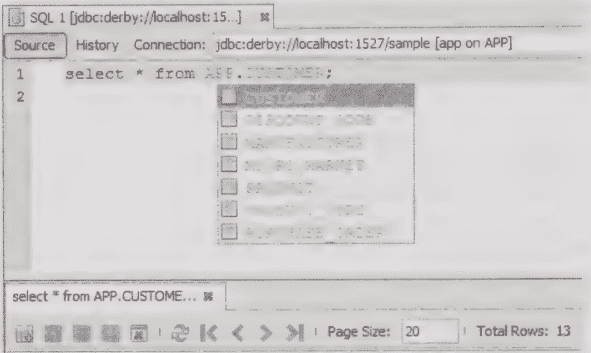

**图 2-11. 在 SQL 编辑器中编辑 SQL 查询字符串**

可以通过任何方法检索所需的实体来删除数据库表中的某行。调用 `javax.persistence.EntityManager.remove()` 方法来删除实体。与 `javax.persistence.EntityManager.persist()` 方法一样，它必须在事务内调用。当事务提交时（由容器隐式提交或用户显式提交），实体的状态将持久化到数据库。

NetBeans IDE 提供了一个向导，用于生成 JPA 控制器类，以为实体类执行 CRUD 功能。在 IDE 中，右键点击你的应用程序并选择 New | Other | Persistence | JPA Controller Classes from Entity Classes。

此外，你还可以为应用程序中的实体类生成 session beans。在 IDE 中，右键点击你的应用程序并选择 New | Other | Enterprise JavaBeans Session Beans for Entity Classes，这将显示图 2-12 所示的 New Session Beans for Entity Classes 页面。

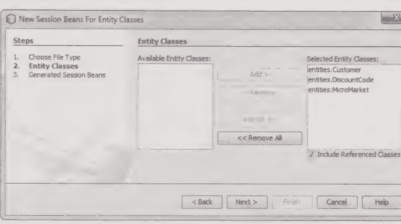

**图 2-12. 开始为现有实体类创建 session beans**

从左侧面板的 Available Entity Classes 列表中选择任意实体类，并点击 Add 按钮。任何引用的实体类都会自动添加到右侧面板的 Selected Entity Class 列表中。如果实体类显示为灰色，则表示它是被引用的实体类。

点击 Next 到向导的 Generated Session Beans 页面（如图 2-13 所示），并检查或设置以下内容：

- **Project（项目）**：显示将保存实体类的项目。此字段是只读的。
- **Location（位置）**：选择你想要创建实体类的源文件夹。
- **Package（包）**：从 Package 下拉列表中选择现有的包，或输入新包的名称。
- **Create Interfaces（创建接口）**：选择你希望向导生成的 session facade 接口。

当你点击 Finish 时，将创建指定的 session beans，如图 2-14 所示。

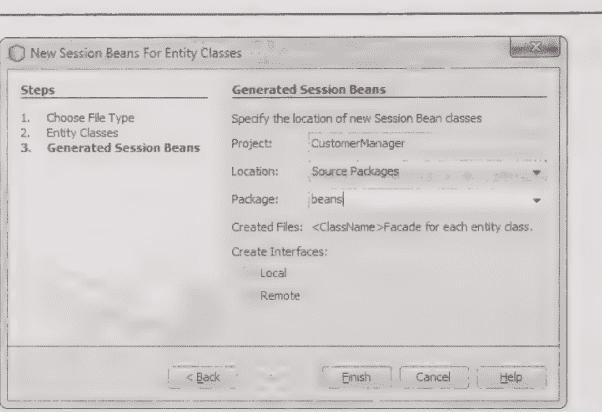

**图 2-13. 为 session beans 指定详细信息**


**图 2-14. 在应用程序中创建 session beans**

通常，数据库架构已经定义，并且可以从脚本生成。列表 2-7 显示了如何配置这些属性：

### 列表 2-7 持久化单元配置

```xml
<persistence version="2.1" xmlns="http://xmlns.jcp.org/ns/persistence"
xmlns:xsi="http://www.w3.org/2001/XMLSchema-instance"
xsi:noNamespaceLocation="http://xmlns.jcp.org/ns/persistence/persistence.xsd">
  <persistence-unit name="authorPU" transaction-type="JTA">
    <properties>
      <property name="javax.persistence.schema-generation.database.action" value="drop-and-create"/>
      <property name="javax.persistence.schema-generation.create-source" value="script"/>
      <property name="javax.persistence.schema-generation.drop-source" value="script"/>
      <property name="javax.persistence.schema-generation.create-script-source" value="META-INF/create.sql"/>
      <property name="javax.persistence.schema-generation.drop-script-source" value="META-INF/drop.sql"/>
      <property name="javax.persistence.sql-load-source" value="META-INF/load.sql"/>
    </properties>
  </persistence-unit>
</persistence>
```

以下列表解释了这些属性：

- `javax.persistence.schema-generation.database.action` 属性值指定删除现有表并创建。可能的值有 `none`、`create`、`drop-and-create` 和 `drop`。
- `javax.persistence.schema-generation.create-source` 属性值指定数据库创建是基于脚本的。
- `javax.persistence.schema-generation.drop-source` 属性值指定数据库删除是基于脚本的。

上述两个属性的可能值有 `metadata`、`script`、`metadata-then-script` 和 `script-then-metadata`。在这种情况下，使用实体上指定的脚本或元数据或组合来创建或删除表。

- `javax.persistence.schema-generation.create-script-source` 属性值指定数据库创建脚本的位置。
- `javax.persistence.schema-generation.drop-script-source` 属性值指定数据库删除脚本的位置。
- `javax.persistence.sql-load-source` 属性值指定 SQL 批量加载脚本的位置。

最后三个属性值指定脚本与应用程序打包。在这种情况下，脚本的位置相对于持久化单元指定。或者，可以使用 URL 外部标识脚本。

这些属性允许从脚本或实体元数据生成数据库架构。除了之前描述的属性外，可以使用以下属性来指定脚本的生成：

- `javax.persistence.schema-generation.scripts.action` 可指定需要哪些脚本。可能的值有 `none`、`create`、`drop-and-create` 和 `drop`。
- `javax.persistence.schema-generation.scripts.create-target` 和 `javax.persistence.schema-generation.scripts.drop-target` 可指定创建和删除脚本的位置。位置指定为对应文件 URL 的字符串。

JPA 提供了多种注解，例如 `@javax.persistence.Index`、`@javax.persistence.ForeignKey`、`@javax.persistence.CollectionTable`、`@javax.persistence.JoinTable` 和 `@javax.persistence.JoinColumn`，可以在实体上指定这些注解，以方便数据库或脚本的生成。

NetBeans IDE 提供了一个向导，可以简化基于元数据的脚本生成。在 IDE 中，右键点击您的应用程序并选择 New | Other | Persistence | DB Scripts for Entity Classes 来生成脚本。

Java 持久化 API（Java Persistence API）还提供了二级缓存、乐观和悲观锁、实体生命周期监听器等许多高级概念。

本章描述了持久化的核心概念，并解释了如何使用 JPA 从关系型数据库表中创建、读取、更新和删除数据。它还研究了如何轻松将关系型数据库表映射到 JPA 实体，并介绍了关于它们打包的内容。介绍了不同类型的企业级 Java Bean（Enterprise JavaBeans）并简要解释了它们的事务性质。最后，本章演示了如何使用 `persistence.xml` 中定义的属性轻松生成数据库表。整个章节都展示了 NetBeans IDE 工具和向导，以突出简化的开发流程。下一章将采用这些 JPA 实体并将它们发布为 RESTful 端点。


# 第 3 章：RESTful 资源

## Java EE 和 HTML5 企业级应用开发

REST 或表表示状态转移（Representational State Transfer）是 Web 等分布式系统的架构风格。该术语最初由 Roy Fielding 在他 2000 年的毕业论文《架构风格与网络软件架构的设计》中引入并定义。Fielding 选择该论文主题的动机是他“渴望通过对架构约束的原则化使用，理解并评估网络应用程序软件的架构设计，从而获得架构的功能、性能和社会属性”。请参阅 `www.ics.uci.edu/~ffield/pubs/dissertation/introduction.htm`。这是通过定义一个理解网络应用程序架构的框架来实现的。该论文随后描述了如何使用 REST 来指导现代 Web 架构的设计和开发。

现代应用程序通常使用 REST API 发布其接口，API 发布地址为 `https://dev.twitter.com/docs/api`。集成任何 Twitter 功能（例如搜索特定标签的推文或获取最新推文集）都可以通过调用 Twitter REST API 并在您的应用程序中处理结果来实现。

万维网（World Wide Web）是符合 REST 架构风格的最大系统。在这种背景下，REST 是一组原则，定义了如何使用 HTTP 和 URL 等网络标准来构建您的应用程序。要成功构建利用 Web 标准的 Java 应用程序，您需要理解 REST 架构的指导原则。这些原则将在您定义资源和设置服务时指导您。

REST 架构的指导原则是：

- **资源（Resource）**：架构中的关键信息是资源。任何可以命名为资源的信息：文档或图像、书本、作者、其他资源的集合等。
- **客户端和服务器（Client and server）**：使用客户端-服务器模型，客户端向服务器发起请求；服务器处理请求并向客户端返回适当的响应。请求和响应围绕资源的传输而构建。
- **资源识别（Identification of resources）**：每个资源在客户端和服务器上都有唯一标识。Web 上的一切都可以被识别为资源，每个资源都可以通过 URI 唯一标识。
- **资源有多种表示形式（Resources are available in multiple representations）**：资源可以通过媒体类型以多种格式表示。客户端和服务器可以对资源的内容类型进行协商。
- **可以使用标准方法操作这些资源（Standard methods can be used to manipulate these resources）**：可以使用标准方法创建、读取、更新和删除每个资源。使用 `GET`、`PUT`、`POST` 和 `DELETE` 等 HTTP 动词在 Web 上无状态地操作资源。
- **通信（Communicate）**：服务器不会为任何客户端保留单个请求之外的通信状态。如果需要状态，则应保留在客户端或转换为资源状态。这允许服务器具有更好的扩展性。

随着本章的继续，您将看到这些原则是如何应用于 Java REST API 的，以及在第 5 章 JavaScript REST API 中的应用。

Java API for RESTful Web Services (JAX-RS) 定义了一个标准的、基于注解的 API，帮助开发者在 Java 中开发和调用 RESTful Web 服务。JAX-RS 1.1 首次包含在 Java EE 6 中。Java EE 7 包含了 JAX-RS 2.0，它是 JAX-RS 的深度修订，增加了许多可以处理最现代风格 Web 应用程序的功能。


# 让我们考虑一个对作者数据库提供创建、读取、更新和删除操作的 REST 资源

此类 REST 资源可以使用任何标准 HTTP 动词（如 `POST`、`GET`、`PUT` 或 `DELETE`）进行调用。端点应该具有发布和消费多种格式资源表示的能力。应该可以访问作者列表或特定作者。列表 3-1 显示了一个使用常用 HTTP 动词发布和消费作者资源多种表示形式的 REST 端点。

## 列表 3-1 AuthorResource 类

```java
@Path("authors")
public class AuthorResource {
    @Inject AuthorBean bean;

    @GET
    @Produces({"application/xml", "application/json"})
    public List<Author> findAll() {
        return bean.findAll();
    }

    @GET
    @Path("{id}")
    @Produces({"application/xml", "application/json"})
    public Author find(@PathParam("id") Integer id) {
        return bean.find(id);
    }

    @GET
    @Path("count")
    @Produces("text/plain")
    public int count() {
        return bean.countAuthors();
    }

    @POST
    @Consumes({"application/xml", "application/json"})
    public void create(Author author) {
        bean.createAuthor(author);
    }

    @PUT
    @Consumes({"application/xml", "application/json"})
    public void edit(Author author) {
        bean.updateAuthor(author);
    }

    @DELETE
    @Path("{id}")
    public void remove(@PathParam("id") Integer id) {
        bean.removeAuthor(id);
    }
}
```

以下信息将帮助您理解代码：

- 通过在类上添加 `@javax.ws.rs.Path` 注解可以将 POJO 转换为 REST 资源。注解定义了访问资源的 URI——在本例中为 `authors`。路径是相对路径。对于注解类，基础 URI 是通过扩展 `javax.ws.rs.core.Application` 类使用 `@javax.ws.rs.ApplicationPath` 注解定义的。资源的完整 URI 定义为：

```
http://<host>:<port>/<webapp-context>/<base-URI>/<resource-URI>
```

假设资源打包在上下文根为 `सहारा` 的 WAR 文件中并部署在主机 `"localhost"` 和端口 `"8080"`，且基础 URI 为 `"webresources"`，那么资源的完整路径将是：

```
http://localhost:8080/sahara/webresources/authors
```

- 通过在根资源的方法上标记 `@javax.ws.rs.Path` 注解可以定义子资源。子资源的基础 URI 是包含类的有效 URI。当使用基础 URI 和方法上指定的完整路径访问资源时，就会调用注解的方法。在列表 3-1 中，如果通过 `webresources/authors/count` 路径访问资源，将调用 `count()` 方法。注意 `count` 方法也标记了 `@javax.ws.rs.GET` 注解，但由于它是作为子资源定义的，因此位于不同的路径。

- 此外，尽管列表 3-1 中未显示，但可以使用 `@javax.ws.rs.CookieParam` 注解将 cookie 绑定到参数，可以使用 `@javax.ws.rs.PathParam` 注解将 HTTP 头绑定到参数，矩阵参数可以绑定使用 `@javax.ws.rs.MatrixParam` 注解绑定到方法参数，而通过 HTML 表单传的参数可以使用 `@javax.ws.rs.FormParam` 注解绑定到方法参数。

- 验证约束虽然在列表 3-1 中未显示，但可以在方法参数上指定约束，以确保方法参数仅接受有效值。如果输入的值不符合标准，则会抛出 `javax.constraint.ConstraintViolation` 异常（例如，在期望数字值时发送了字母值）。这可以通过方法参数上的任何一个 `@javax.validation.constraints.Min`、`@javax.validation.Max`、`@javax.validation.constraints.Digits` 或类似的注解轻松指定。该规范甚至定义了一种可扩展的机制，可以轻松地定义满足应用需求的自定义约束。

- 任何 Java EE 组件都可以通过依赖注入进行注入。在列表 3-1 中注入了一个企业级 JavaBean（EJB）`AuthorBean`，以确保所有的业务逻辑都定义在 Bean 中。这确保了任何与检索、添加或更新数据库相关的代码都会在事务中执行并保持在 EJB 内部。这非常重要，因为运行时容器会启动并提交或回滚事务，以确保底层数据库的 ACID 属性自动保留。否则，应用程序将必须手动创建并管理事务。

- Java EE 7 引入了 `@javax.transaction.Transactional` 注解，虽然在列表 3-1 中未显示，它允许 Bean 内部的所有方法或 Bean 中的任何方法被选择性设置为事务性的。这是通过 CDI 拦截器绑定实现的，允许应用程序开发者选择使用 EJB 或 POJO 进行容器管理的事务。

- 不同的 HTTP 动词（如 `GET`、`PUT`、`POST` 和 `DELETE`）通过 `javax.ws.rs` 包中相应的注解进行标识。

- 当使用 HTTP `GET` 访问资源时，会调用 `findAll()` 方法。资源或子资源的路径如之前解释的那样。方法生成的媒体类型使用 `@javax.ws.rs.Produces` 进行描述。一个方法可以支持一个或多个媒体类型，请求资源的客户端可以使用标准的 HTTP `Accept` 请求头请求特定的媒体类型。方法的返回值将转换为相应的媒体类型并在网络上传输。如果未指定此注解，容器将假设可以产生任何类型。建议指定返回的媒体类型，以确保客户端和端点都了解该契约。

- JAX-RS 提供了 `javax.ws.rs.MediaType` 类，它为常用的媒体类型提供了强类型字段。例如，可以使用 `MediaType.APPLICATION_JSON` 代替 `application/json`。然而，某些开发者更喜欢在端点中直接指定字面量，因为这可以提高代码的可读性。

- 默认情况下支持 `application/xml` 和 `application/json` 等标准媒体类型。提供能够从流中读取/写入媒体类型的实体提供者，可以支持特定的应用程序媒体类型。

- `@javax.ws.rs.Consumes` 注解用于定义方法可以消费的媒体类型。

# Java EE 和 HTML5 企业级应用开发

开箱即用，NetBeans IDE 提供了许多向导来帮助你。

- 方法可以消费的媒体类型。
- 如果未指定此注解，容器将假设可以产生任何类型。
- 可以通过方法添加 `javax.ws.rs.PUT` 注解来更新资源。同样，可以通过为方法添加 `javax.ws.rs.DELETE` 注解来删除资源。
- NetBeans IDE 提供了一个“New RESTful Java Client”向导，让你快速方便地为现有 RESTful 服务创建 Java 服务客户端。
- `javax.ws.rs.MediaType` 类为常用的媒体类型提供了强类型字段。例如，可以使用 `MediaType.APPLICATION_JSON` 代替 `application/json`。然而，某些开发者更喜欢在端点中直接指定字面量，因为这可以提高代码的可读性。
- 然后端点可以使用 `qs` 属性（“服务质量”的缩写）来指示媒体偏好。`qs` 是一个范围在 `0.000` 到 `1.000` 之间的浮点数，它表示该表示与其他可用表示相比的相对质量，且独立于客户端的能力。`qs` 值为 `0.000` 的表示将永远不会被选中。没有 `qs` 参数值的表示被赋予 `qs=1` 的媒体类型，或者视为无首选表示，此时将返回资源的 JSON 表示，因为它的优先级（`qs=1`）高于列出的唯一其他媒体类型 XML（`qs=0.75`）。但是，如果客户端显式地请求 `application/xml` 媒体类型，则将返回 XML 表示。
- 当使用 HTTP `GET` 访问资源时，会调用 `findAll()` 方法。资源或子资源的路径如之前解释的那样。方法生成的媒体类型使用 `@javax.ws.rs.Produces` 进行描述。一个方法可以支持一个或多个媒体类型，请求资源的客户端可以使用标准的 HTTP `Accept` 请求头请求特定的媒体类型。方法的返回值将转换为相应的媒体类型并在网络上传输。
- `@javax.ws.rs.Consumes` 注解用于定义可以的。
- 任何 Java EE 组件都可以通过依赖注入进行注入。在列表 3-1 中注入了一个企业级 JavaBean（EJB）`AuthorBean`，以确保所有的业务逻辑都定义在 Bean 中。这确保了任何与检索、添加或更新数据库相关的代码都会在事务中执行并保持在 EJB 内部。这非常重要，因为运行时容器会启动并提交或回滚事务，以确保底层数据库的 ACID 属性自动保留。否则，应用程序将必须手动创建并管理事务。
- Java EE 7 引入了 `@javax.transaction.Transactional` 注解，虽然在列表 3-1 中未显示，它允许 Bean 内部的所有方法或 Bean 中的任何方法被选择性设置为事务性的。这是通过 CDI 拦截器绑定实现的，允许应用程序开发者选择使用 EJB 或 POJO 进行容器管理的事务。
- 不同的 HTTP 动词（如 `GET`、`PUT`、`POST` 和 `DELETE`）通过 `javax.ws.rs` 包中相应的注解进行标识。
- 验证约束虽然在列表 3-1 中未显示，但可以在方法参数上指定约束，以确保方法参数仅接受有效值。如果输入的值不符合标准，则会抛出 `javax.constraint.ConstraintViolation` 异常（例如，在期望数字值时发送了字母值）。这可以通过方法参数上的任何一个 `@javax.validation.constraints.Min`、`@javax.validation.Max`、`@javax.validation.constraints.Digits` 或类似的注解轻松指定。该规范甚至定义了一种可扩展的机制，可以轻松地定义满足应用需求的自定义约束。
- 在 JAX-RS 发布之前，调用 REST 资源需要使用 `java.net.URL` 和相关类的模板代码。Java 对象的序列化和反序列化必须手动完成。JAX-RS 2.0 引入了可以调用 REST 资源的 API。该 API 可用于消费在 HTTP 协议或其扩展（例如 WebDAV）之上的服务。
- `javax.ws.client.ClientBuilder` 是流式 JAX-RS Client API 的入口。通过调用 `newClient()` 方法可以创建 `javax.ws.client.Client` 实例。该实例随后用于构建和执行客户端请求以消费响应。建议在应用程序中仅创建所需的 Client 实例，Client 实例的初始化和销毁可能是昂贵的操作。
- 资源 URI 被传递给 `target()` 方法并构建 `javax.ws.rs.client.Target` 实例。使用构建器风格 API 构建目标资源的请求。`request()` 方法开始构建请求。可选可以将响应接受的媒体类型指定为方法参数。这些类型也可以作为 `request().accept()` 方法的参数。一旦请求准备就，可以使用直观的 `get()`、`put()`、`post()` 和 `delete()` 方法进行调用。通过指定方法参数，可以将响应自动转换为 Java 类型。在这种情况下，响应以 `Author` 数组的形式返回。

```java
Client client = ClientBuilder.newClient();
client.register(JacksonFeature.class);
WebTarget target = client.target("http://localhost:8080/sahara/webresources/authors");
Author[] authors = target.request("application/json").get(Author[].class);
```

## 第 3 章：RESTful 资源 51

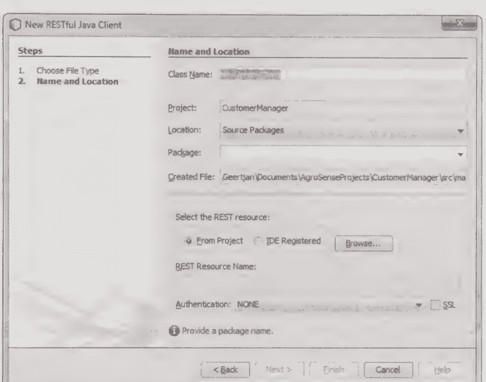

**图 3-3. 新 RESTful Java 客户端向导**

通过 RESTful JavaScript 客户端向导为您的 RESTful Web 服务提供的 HTML/JavaScript/CSS 前端，如图 3-4 所示。

在标准的 HTTP 请求-响应场景中，JavaScript 客户端或使用 JAX-RS Client API 的 Java 客户端打开资源端点的连接，向服务器发送 HTTP 请求（例如 HTTP `GET` 请求），然后接收 HTTP 响应；服务器在完全发送/接收响应后关闭连接。客户端始终发起请求，并根据需要从服务器“拉取”信息。有时，可能需要服务器异步地向客户端“推送”信息。例如，股票行情端点可以将更新后的股票价格推送到客户端。在我们的示例中，可以将新书的信息推送到客户端。

# Java EE 和 HTML5 企业级应用开发

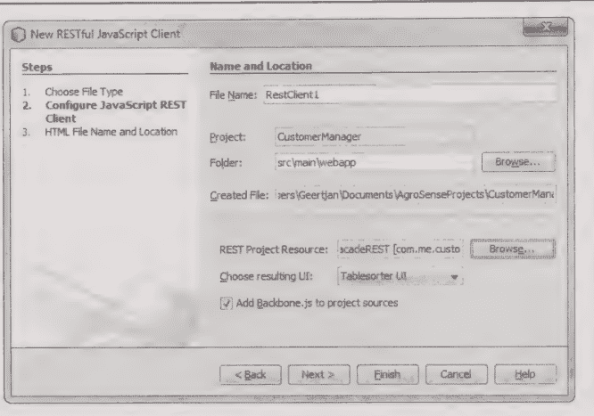

**图 3-4. 新 REST JavaScript 客户端向导**

## 服务器发送事件 (SSE)

通常情况下，客户端向服务器发起请求并接收响应。服务器发送事件（SSE）是一种机制，允许服务器在有新的数据“块”可用时，异步地将数据从服务器推送到客户端。客户端仍然负责与服务器建立连接。当服务器上有新数据准备好发送时，服务器会将数据事件发送给客户端，因此得名为“服务器发送事件”。

服务器事件在服务器端生成，其预定义的媒体类型为 `text/event-stream`。对于单个事件消息中使用的媒体类型没有限制。在客户端，使用标准的 `EventSource` JavaScript API 来打开 HTTP 连接，以接收来自服务器的推送通知。这些事件在客户端 JavaScript 注册的回调处理程序中接收，并用于更新客户端。

注意，SSE 将与 HTML5 其他部分一起成为最终规范。该目标是在 2014 年底确定。在此之前，SSE 不能作为标准 API 添加到 JAX-RS。然而，JAX-RS 的参考实现 Jersey 已经增加了对 SSE 的支持。本章将使用 Jersey 在我们的应用程序中实现该功能并解释 SSE。

## 第 3 章：RESTful 资源 53

假设你有一个 `Book` 资源来表示作者写的书。该资源可以按照 `Author` 使用的设计模式进行描述。现在，假设你更新 `Book` 资源端点，使其在每次添加新书时生成服务器端事件。

首先，你需要为 JAX-RS 启用 SSE 支持。由于这不属于标准 JAX-RS API 的部分，你需要更新 `pom.xml` 文件以包含 SSE 媒体类型模块，如列表 3-3 所示。

### 列表 3-3 Jersey SSE 媒体依赖

```xml
<dependency>
  <groupId>org.glassfish.jersey.media</groupId>
  <artifactId>jersey-media-sse</artifactId>
  <version>2.0</version>
  <scope>provided</scope>
</dependency>
```

接下来，你需要在 Application 类中注册 `org.glassfish.jersey.media.sse.SseFeature`，如列表 3-4 所示。

### 列表 3-4 为 JAX-RS 添加 SseFeature

```java
public Set<Class<?>> getClasses() {
  Set<Class<?>> resources = new java.util.HashSet<>();

  // ..
  resources.add(SseFeature.class);
  return resources;
}
```

`getClasses()` 方法返回根资源、特性和类集合。在从此方法返回的类集中添加 `SseFeature` 即可完成该特性的注册。

然后，你需要添加或更新向客户端推送 SSE 的方法，如列表 3-5 所示。

### 列表 3-5 更新 SSE 方法


```java
@Path("books")
public class BooksResource {
  // ..
  private final SseBroadcaster BROADCASTER = new SseBroadcaster();

  @POST
  @Override
  @Consumes({"application/xml", "application/json"})
  public void createBooks(Books book) {
      bean.createBooks(book);

      OutboundEvent event = new OutboundEvent.Builder()
          .data(String.class, "New book \""
          + book.getTitle())
          + "\" with ISBN \""
          + book.getIsbn())
          + "\" added")
          .build();
      BROADCASTER.broadcast(event);
  }

  @GET
  @Path("events")
  @Produces(SseFeature.SERVER_SENT_EVENTS)
  public EventOutput getEvents() {
      final EventOutput eventOutput = new EventOutput();
      this.BROADCASTER.add(eventOutput);
      return eventOutput;
  }
}
```

列表 3-5 只显示了更新的方法。以下列表解释了这些代码：

- 在服务器端生成 SSE 是两个步骤。首先，想要监听 SSE 的客户端向此资源发送 GET 请求。
- `getEvents()` 方法返回 `EventOutput` 并将其添加到 `BROADCASTER` 中。
- `createBooks()` 方法创建一个 `OutboundEvent` 并使用 `BROADCASTER.broadcast(event)` 将其广播给所有连接的客户端。

# 第 4 章：WebSocket

并且每次 HTTP 消息交换都会终止 TCP 连接，这降低了应用程序的整体性能。

HTTP 作为一种线缆协议，其开销也很大。为了满足协议要求，客户端和服务器之间在传输线上必须交换最少一组标头部。解析这些标头部需要处理成本，如果消息交换的次数增加，这种成本会进一步降低应用程序的性能。

简而言之，HTTP 是一种半双工且冗长的协议，对于客户端和服务器之间的全双工双向通信来说效率低下。这正是 WebSocket 所解决的需求。

## 什么是 WebSocket？

WebSocket 是一种全双工的双向协议，它使用单个 TCP 连接进行双向的消息交换。WebSocket 由两个规范定义：

- WebSocket 协议，RFC 6455 <http://tools.ietf.org/html/rfc6455>
- W3C WebSocket API <www.w3.org/TR/websockets/>

RFC 6455 定义了如何通过握手建立 WebSocket 连接。它还定义了 WebSocket 消息交换的线缆协议。W3C WebSocket API 是一个由不同浏览器实现的 JavaScript API。该 API 可以供 Web 应用用于与 WebSocket 端点建立连接并交换消息。

## WebSocket 握手

HTTP 1.1 (RFC 2616) 的 14.42 定义了一种升级机制，允许从 HTTP 1.1 协议转换到不同的协议。在这种情况下即 WebSocket 协议。在客户端和服务器之间协商升级后，随后的请求将使用新选择的协议进行交换。

RFC 6455 定义了 WebSocket 客户端如何发出 HTTP 升级请求。这被称为 WebSocket 客户端握手，如列表 4-1 所示。

### 列表 4-1 WebSocket 客户端握手

```
GET /chat HTTP/1.1
Host: server.example.com
Upgrade: websocket
Connection: Upgrade
Sec-WebSocket-Key: dGhlIHNnhbBsZsSBub225jZQ=
Origin: http://example.com
Sec-WebSocket-Protocol: chat
Sec-WebSocket-Version: 13
```

列表 4-1 显示了一个典型的开启握手请求。握手中的标头部字段可以是任何顺序。在这个片段中，前几行类似于普通的 HTTP 请求，标识了请求指向的主机和 URI。这里需要注意的关键部分是，WebSocket 协议试图在现有的 HTTP 基础设施环境中实现双向通信。这使得该协议可以在 HTTP 端口 80 和 443 上运行，并支持 HTTP 代理和中间件。

列表 4-1 中的 WebSocket 相关的标头部字段如下：

- `Upgrade` 和 `Connection` 标头部字段将此 HTTP 请求标记为升级请求，专门请求升级到 WebSocket。
- `Sec-WebSocket-Protocol` 标头部字段可协商不同的子协议。如果你选择定义子协议，则服务器和客户端都必须包含该字段。还建议将任何子协议向互联网分配数字机构（IANA）注册，以帮助避免命名冲突。
- `Sec-WebSocket-Version` 标头部由服务器返回，必须设置为值 13。
- `Origin` 标头部字段用于防止在 Web 浏览器中使用 WebSocket API 的脚本未经授权跨源使用 WebSocket 服务器。
- 如果服务器能够处理此升级请求，它将使用预定义的算法处理收到的 `Sec-WebSocket-Key` 标头部字段，并在服务器握手响应中返回生成的值。

一个典型的服务器开启握手响应如下：

```
HTTP/1.1 101 Switching Protocols
Upgrade: websocket
Connection: Upgrade
Sec-WebSocket-Accept: s3pPLMBITxaq9KGYzzZrbK+xOo=
```

第一行是 HTTP 状态行，表示握手成功。`Upgrade` 和 `Connection` 标头部字段完成了 HTTP 升级。`Sec-WebSocket-Accept` 标头部字段必须包含服务器使用 RFC 6455 定义的预定义算法生成的值。为了完成握手，所有这些标头部字段必须存在。

一旦客户端和服务器之间建立了连接，它们被视为具有对等能力的对等端。每次发送都可以向对方发送消息，而无需等待对方响应。

每个对等端可以通过发送包含指定控制序列的数据的 `Close` 控制帧来发起关闭握手。接收端发送一个 `Close` 控制帧作为响应，表示连接现在已关闭。

对等端在发送 `Close` 控制帧后不再发送任何后续数据。同样，接收端在收到 `Close` 控制帧后会丢弃任何后续数据。WebSocket 关闭握手随后也会启动 TCP 关闭握手。

## WebSocket API

WebSocket API (<www.w3.org/TR/websockets/>) 允许网页与远程主机进行双向通信。

WebSocket 可以发送和接收文本和二进制数据。API 提供了一个重载的 `send` 方法，可以通过接受以下任意参数发送文本或二进制数据：

- 文本：`String`
- 二进制：`Blob`、`ArrayBuffer`、`ArrayBufferView`

API 提供了事件处理器，在不同的生命周期事件和接收消息时被调用：

- 生命周期事件：`onopen()`、`onerror()`、`onclose()`
- 消息：`onmessage()`

## WebSocket Java API

WebSocket Java API 定义了一组用于开发 WebSocket 应用的 Java API。该 API 允许你定义服务器或客户端。你可以通过使用 WebSocket 的注解装饰 POJO 来定义服务器或客户端。在本章中，我们将使用 WebSocket 构建经典的井字棋游戏。在游戏中，两个玩家（标识为 X 和 O）交替在由三行三列组成的九宫网格中标记。在水平、垂直或对角线方向上成功放置三个标记的玩家获胜游戏。游戏的注解端点如列表 4-2 所示。

### 列表 4-2 WebSocket 注解端点

```java
@Endpoint(value = "/endpoint",
    decoders = BoardDecoder.class)
public class TicTacToeEndpoint {
    private static Map<String, String> games = new HashMap<>();

    @OnOpen
    public void onOpen(Session session) throws IOException {
        if (games.isEmpty()) {
            games.put(session.getId(), "x");
            session.getBasicRemote().sendText("You play X");
        } else {
            games.put(session.getId(), "y");
            session.getBasicRemote().sendText("You play O");
        }
    }

    @OnMessage
    public void onMessage(Board board, Session session) throws IOException, EncodeException {
        if (board.getStatus() != null && board.getStatus().equals("clear")) {
            for (Session s : session.getOpenSessions()) {
              games.remove(s.getId());
              s.close();
            }
            return;
        }

        String symbol = null;
        for (String game : games.keySet()) {
            if (game.equals(session.getId())) {
                symbol = games.get(game);
                break;
            }
        }

        // 创建 JSON 结构
        StringBuilder writer = new StringWriter();
        JsonGenerator gen = Json.createGenerator(writer);
        gen.writeStartObject();
        gen.write("symbol", symbol);
        gen.write("x", board.getX());
        gen.write("y", board.getY());
        gen.writeEndObject();
        gen.close();

        // 发送到所有其他客户端
        for (Session s : session.getOpenSessions()) {
            if (!s.equals(session)) {
                s.getBasicRemote().sendText(writer.toString());
            }
        }
    }
}
```

以下列表解释了列表 4-2 中的代码：

- `@Endpoint` 是类级注解，用于装饰 POJO 以成为 WebSocket 端点。该注解允许开发者使用 `value` 属性定义发布此端点的 URL。

默认情况下，每个应用程序每个虚拟机（VM）会创建一个端点实例，以表示每个连接对等端的逻辑端点。在这种典型情况下，端点的每个实例处理来自一个且仅一个对等端的连接。

`configurator` 属性可用于指定 `ServerEndpointConfig.Configurator` 类，该类可用于为所有对端提供端点的单例实例。自定义配置算法（例如拦截打开握手）也可以通过此配置器进行指定。本示例中没有使用此属性。

可以使用其他属性来指定额外的配置信息；例如，`decoders` 属性定义了此端点使用的解码器类的有序数组。`BoardDecoder.class` 将 WebSocket 消息转换为应用程序定义的 `Board` 对象。该实现为每个连接的端点实例创建一个新的解码器实例。

- 被注解的类必须有一个公共的无参构造函数。

- `games` 是一个 `Map` 对象，存储客户端唯一标识符及其对应的符号（symbol）。

- `@OnOpen` 是一个方法级注解，用于装饰 Java 方法，当新的 WebSocket 连接打开时调用该方法。该方法可以接受以下参数：

    - 一个可选的 `Session` 参数，表示两个 WebSocket 端点之间的会话。
    - 一个可选的 `EndpointConfig` 参数，包含该端点在握手期间使用的信息。
    - 0 到 n 个带有 `@PathParam` 注解的 `String` 参数，它们映射到端点路径映射中指定的 URI 模板。

此方法定义玩家的符号，将其放入以客户端标识符为键的 `games` Map 对象中，并向玩家发回消息以指示该符号。

- `@OnMessage` 是一个方法级注解，用于装饰 Java 方法，当接收到传入 WebSocket 消息时调用该方法。每个 WebSocket 端点对于每种原生 WebSocket 消息格式（文本、二进制和 pong）可能只能有一个方法。

如果该方法处理文本消息，则参数可以是以下之一：

- `String`：用于接收整个消息。
- Java 原始类型或等效类：用于接收转换为该类型的完整消息。
- `String` 和 `boolean` 对：用于分段接收消息。
- `Reader`：用于作为阻塞流接收整个消息。
- 对于该端点作为文本解码器的任意对象参数。

如果该方法处理二进制消息，则参数可以是以下之一：

- `byte[]` 或 `ByteBuffer`：用于接收完整消息。
- `byte[]` 和 `boolean` 对，或 `ByteBuffer` 和 `boolean` 对：用于分段接收消息。
- `InputStream`：用于作为阻塞流接收完整消息。
- 对于该端点作为二进制解码器的任意对象参数。

如果该方法处理 pong 消息，则参数可以是 `PongMessage`。

在这种情况下，`Board` 由 `BoardDecoder` 解码。指定可选的 `Session` 参数来表示两个端点之间的会话。

如果收到的棋盘状态设置为 "clear"，则从 `games` Map 中移除所有游戏，并关闭与客户端对端的连接。否则，从 `games` Map 中检索符号。

- JSON 处理 API（Java API for JSON Processing）提供了用于解析和生成 JSON 的标准 API。它允许以流式方式生产/消费 JSON 文本（类似于 XML 的 StAX API），或者允许构建 Java 对象模型（类似于 XML 的 DOM API）。

使用 `Json.createGenerator()` 方法创建一个流式生成器。可以向此方法传递一个 `Writer` 或 `OutputStream`。`Writer` 用于写入字符流，而 `OutputStream` 用于写入字节流。创建创建一个指示游戏中当前使用的符号以及 x、y 坐标的 JSON 结构。它看起来像：

```json
{
  "symbol": "x",
  "x": "1",
  "y": "2"
}
```

- `session.getOpenSessions()` 方法提供所有监听客户端的列表。生成的 JSON 文本被发送给所有监听客户端，然后它们更新棋盘的状态。

`BoardDecoder.class` 解码传入的文本负载并将其转换为特定的 `Board` 类。列表 4-3 显示了。


```java
public class BoardDecoder implements Decoder.Text<Board> {
  @Override
  public Board decode(String string) throws DecodeException {
    System.out.println(" " + string);
    JSONObject jsonObject = Json.createReader(new StringReader(string)).read();
    Board board = new Board();
    if (jsonObject.getString("x", null) != null)
      board.setX(Integer.parseInt(jsonObject.getString("x")));
    if (jsonObject.getString("y", null) != null)
      board.setY(Integer.parseInt(jsonObject.getString("y")));
    if (jsonObject.getString("status", null) != null)
      board.setStatus(jsonObject.getString("status")));
    System.out.println("decoded: " + board);
    return board;
  }

  @Override
  public boolean willDecode(String string) {
    try {
      Json.createReader(new StringReader(string)).readObject();
      return true;
    } catch (JsonException ex) {
      ex.printStackTrace();
      return false;
    }
  }

  @Override
  public void init(EndpointConfig ec) {
    System.out.println("BoardDecoder.init");
  }

  @Override
  public void destroy() {
    System.out.println("BoardDecoder.destroy");
  }
}
```

以下列表描述了列表 4-3 所示的代码：

- 文本解码器通常实现 `Decoder.Text<T>` 接口，而二进制解码器通常实现 `Decoder.Binary<T>` 接口。

*(注：原文后续部分存在大量 OCR 识别导致的重复和乱码，已根据核心逻辑进行翻译并清理)*

## 70 Java EE 和 HTML5 企业级应用开发

```html
<section id="playerInfo" class="col-sm-3">
  <div class="row">
    <div id="playerName" data-bind="text: playerName">玩家</div>
    <div id="playerStatus" class="playerStatus" data-bind="visible: showStatus, text: gameStatus">由你先开始！</div>
    <!--<div id="playSecond" class="playerStatus" data-bind="visible: gameOver">你赢了！</div>-->
    <div id="win-lose" class="win-lose" data-bind="visible: gameOver">你赢了！</div>
    <div id="output"></div>
  </div>
  <div class="row">
    <div class="btn" data-bind="click: clearBoard">新游戏？</div>
  </div>
</section>

<section id="boardLayout" class="col-sm-9">
  <div id="board" class="container col-xs-12">
    <div id="row" class="row col-xs-12">
      <div id="1" class="col-sm-offset-4 col-xs-1 game-cell"></div>
      <div id="2" class="col-xs-1 game-cell"></div>
      <div id="3" class="col-xs-1 game-cell"></div>
    </div>
    <div id="row2" class="row col-xs-12">
      <div id="4" class="col-sm-offset-4 col-xs-1 game-cell"></div>
      <div id="5" class="col-xs-1 game-cell"></div>
      <div id="6" class="col-xs-1 game-cell"></div>
    </div>
    <div id="row3" class="row col-xs-12">
      <div id="7" class="col-sm-offset-4 col-xs-1 game-cell"></div>
      <div id="8" class="col-xs-1 game-cell"></div>
      <div id="9" class="col-xs-1 game-cell"></div>
    </div>
  </div>
</section>
```

```html
<footer>
  <div id="footerContent">
    <ul class="footerLinks" data-bind="foreach : footerLinks">
      <li><a data-bind="text: name, attr: {linkID, href: linkTarget}"></a></li>
    </ul>
  </div>
  <div>
    <span class="footerText">Copyright &copy; 2013. 版权所有。</span>
  </div>
</footer>
```

让我们来看代码的不同各个部分：

- 代码（注：代码的第一部分是 `<header>` 元素，它的功能正如其名：定义了主游戏页的页眉）。

- 游戏区域分为两个 `<section>` 元素。第一个 `<section>` 元素显示当前玩家信息以及游戏期间可能需要显示的任何消息。第二个 `<section>` 元素是游戏板本身。这是一个九宫格（三列三行），其布局由 Twitter Bootstrap 提供的 CSS 网格布局管理。游戏板中需要注意的关键点是，每个单元格的 x 和 y 坐标被设置为特定单元格的数据属性，并且使用 Knockout 数据绑定为每个单元格设置了点击绑定。每个单元格默认设置了一个空白图像作为占位符。在 JavaScript 层中 Knockout 绑定的重要性在于只需分配信息即可。

# 第 4 章：WebSocket

## Java EE 和 HTML5 企业级应用开发

作为示例应用程序的一部分，设置了一个 HTML 元素来显示 WebSocket 连接的当前状态。你可以在列表 4-8 中看到它是定义的。当你查看列表 4-9 中显示的每个 JavaScript API 方法时，你会看到一个名为 `writeTo` 的函数被作为设置输出 HTML 元素的简单方法。`onmessage()` 方法未在列表 4-9 中。它将在其他方法之后的单独章节中介绍。

## WebSocket 控制方法

与使用 WebSocket 的 Java API 类似，JavaScript API 中提供了五个可用方法：

- `open()`
- `onmessage()`
- `onclose()`
- `onerror()`
- `send()`

## WebSocket 初始化

```javascript
var host = window.location.host;
var wsUri = "ws://" + host + "/TicToe";
var websocket = new WebSocket(wsUri);
var output = document.getElementById("output");
```

### 列表 4-9 WebSocket JavaScript 方法

```javascript
websocket.onopen = function() {
    displayMessage("已连接！");
};
websocket.onclose = function(evt) {
    var message = '';
    var closeCode = evt.code;
    if (closeCode == '1006') {
        message = "连接到 WebSocket 端点出错";
    } else if (closeCode == '1000') {
        message = "连接正常关闭";
    } else {
        message = "关闭状态为：" + closeCode;
    }
    displayMessage(message);
}
```

```javascript
websocket.onerror = function(evt) {
    displayMessage('<span style="color: red;">ERROR: </span>' + evt.data);
}
```

```javascript
function send(text) {
    websocket.send(text);
}
```

让我们仔细查看列表 4-9 中显示的方法。请记住，在初始化期间，你将新的 WebSocket 对象定义为一个名为 `websocket` 的变量。

- `websocket.onopen (evt)`：你只是在向输出变量发送一条消息，表示连接成功。这是由 WebSocket 连接抛出的第一个事件，如果你需要任何额外的设置代码，可以在此处进行。

- `websocket.onclose (evt)`：你将检查 WebSocket 协议提供的代码，以帮助确定连接关闭的原因。执行此操作的棘手之处在于，WebSocket 协议 (RFC 6455) 仅说明端点“可以”发送关闭代码，但并不必须发送。如果发送了代码，它应该符合 IETF 规范（https://tools.ietf.org/html/rfc6455#section-7.4）中定义的其中一个关闭代码。表 4-1 列出并描述了建议的代码（引自 RFC 6455）。

| 代码 | 描述 |
| --- | --- |
| 1000 | 表示正常关闭，意味着建立连接的目的已经实现。 |
| 1001 | 表示端点正在“离开”，例如服务器宕机或浏览器已导航离开页面。 |
| 1002 | 表示端点由于协议错误正在终止连接。 |
| 1003 | 表示端点因为收到了无法接受的数据类型的数据而终止连接（例如，仅理解文本数据的端点如果接收到二进制消息，可能会发送此代码）。 |
| 1004 | 预留。具体含义必须在未来定义。 |
| 1005 | 是一个预留值，端点**不得**在 Close（关闭）控制帧中将其设置为状态码。它被指定用于期望通过状态码来指示实际上不存在任何状态码的应用。 |

表 4-1. RFC 6455 关闭代码

## Java EE 和 HTML5 企业级应用开发

| 代码 | 描述 |
|---|---|
| 1006 | 是一个预留值，端点**不得**在 Close（关闭）控制帧中将其设置为状态码。它被指定用于期望通过状态码来指示连接异常关闭（例如，在没有发送或接收 Close 控制帧的情况下）的应用。 |
| 1007 | 表示端点因为收到的消息内数据与消息类型不一致而终止连接（例如，文本消息中包含非 UTF-8 [RFC3629] 数据）。 |
| 1008 | 表示端点因为收到的消息违反了其策略而终止连接。这是一个通用状态码，当没有其他合适的状态码（例如 1003 或 1009）或者当需要隐藏有关策略的特定细节时，可以返回此代码。 |
| 1009 | 表示端点因为收到的消息过大而无法处理而终止连接。 |
| 1010 | 表示端点（客户端）正在终止连接，因为它期望服务器协商一或或多个扩展，但服务器没有在 WebSocket 握手的响应消息中返回这些扩展。所需的扩展列表**应该**出现在 Close（关闭） 帧的 `/reason/` 部分。注意，服务器不使用状态码，因为它可以导致 WebSocket 握手失败。 |
| 1011 | 表示服务器因为遇到了阻止其完成请求的意外情况而正在终止连接。 |
| 1015 | 是一个预留值，端点**不得**在 Close（关闭）控制帧中将其设置为状态码。它被指定用于期望通过状态码指示连接因执行 TLS 握手失败而关闭的应用（例如，无法验证服务器证书）。 |

表 4-1. RFC 6455 关闭代码

对于这个游戏代码，你只需要检查几个特定的代码，对于端点可能发送的任何其他内容，回退到一个显示关闭代码的通用消息。检查关闭代码 1006 只是以防应用程序尝试连接端点但该端点并不存在。在这种情况下，你无法使用 `onerror()` 事件，因为发生这种情况时 WebSocket 对象尚未完全创建。它在完全打开之前就关闭了。检查关闭代码 1000 是表示点击了“新游戏”（New Game）按钮，并且 `websocket.close()` 方法已调用并成功处理。

- `websocket.onerror()` 方法非常浅而易懂。如果发生错误，端点可能会触发错误事件。该错误将被此方法捕获，消息将显示在游戏上。

- `websocket.send()` 方法用于向服务器发送消息。在这个游戏示例中，WebSocket 连接仅发送和接收文本。然而，WebSocket 协议还可以以 Blob 或 ArrayBuffer 的形式发送和接收二进制数据。

## WebSocket 数据管理

WebSocket API 的最后一个方法是 `websocket.onmessage()`。这是客户端与服务器之间通信的核心。列表 4-10 显示了 `websocket.js` 文件中处理来自服务器端点的入站文本的代码。

> 列表 4-10 websocket.onmessage() 方法


```javascript
websocket.onmessage = function(evt) {
  var json = null;
  try {
    json = $.parseJSON(evt.data);
  } catch (ex) {
    json = null;
  }
  if (json === null) {
    if (evt.data.toLowerCase().indexOf("x") >= 0) {
      vm.playerName('Player One');
      vm.showStatus(true);
    } else {
      vm.playerName('Player Two');
      vm.showStatus(false);
    }
  } else {
    if (json.symbol === 'x') {
      vm.image(vm.X);
      vm.symbol(vm.playerTwo);
    } else {
      vm.image(vm.O);
      vm.symbol(vm.playerOne);
    }
  }
  var cellID = "cell" + json.x + "-" + json.y;
  $('#' + cellID).attr("src", vm.image());
  if (vm.gameStatus().toLowerCase().indexOf("wait") >= 0) {
    vm.gameStatus('Your turn');
  } else {
    vm.gameStatus('Please wait');
  }
}
```

*(注：由于原文提供的代码块在输入处存在混乱和重复，翻译时已根据逻辑对代码结构进行了整理，以确保其可读性并符合文档工程师的规范。)*

让我们遍历列表 4-10 中的代码，以更好地了解客户端如何与服务器交互：

- 当浏览器首次连接到 WebSocket 端点时，服务器返回一条关于该连接是玩家的消息。棋游戏中 X 先行，因此解析返回的字符串是否包含“x”，如果是，则 `onmessage` 方法设置“玩家一”（Player One）。

- 如果 `onmessage` 数据是一个 JSON 对象，检查 `symbol` 成员以判断数据是 X 玩家还是 Y 玩家，`onmessage` 方法为该玩家设置相应的图像。它将 JSON 对象传递给 `setCellImage` 方法进一步处理。图 4-2 显示了使用 NetBeans IDE 的网络监视功能来查看发送和接收的数据。

图 4-2. NetBeans 网络监视窗口

# 80 Java EE 与 HTML5 企业应用开发

在为特定的游戏单元格设置图像时（如列表 4-11 所示），既可以从点击游戏单元格的玩家客户端设置，也可以从服务器设置显示对手刚刚选择的内容。这种方法必须处理这两种情况。这就是你使用 Knockout 视图模型（viewModel）大显身手的地方。如果数据对象的 `symbol` 成员是玩家 X，那么视图模型的 `image` 属性（在 Knockout 术语中称为 observable）就应该是 X 的图像。然后你会将视图模型的 `symbol` 可观察对象设置为操作者的相反者。这是因为当前玩家的回合已结束，你正在为下个玩家做准备。现在，你将特定单元格的 `arc` 属性设置为该 X 或 Y 图像的位置。最后，需要更新状态以告知玩家：当可观察对象设置为“Wait wait”（等待中）时，将其切换为“Your turn”（轮到你了）；否则，设置为“Please wait”（请稍候）。

到为止，你已经熟悉了通过 `websocket.onmessage()` 事件从服务器接收数据的流程。点击特定游戏单元格并将其发送到服务器，然后发送给对手的流程非常相似，但它起始于列表 4-12 中的 `gameCellClicked()` 方法。

### 列表 4-12 捕捉游戏单元格点击并发送数据

```javascript
function gameCellClicked(data, event) {
    var player = vm.symbol();
    var json = createJSON(player, $(event.currentTarget).attr('data-x'), $(event.currentTarget).attr('data-y'));
    setCellImage(json);
    send(JSON.stringify(json));
}

function createJSON(symbol, x, y) {
    var jsonData = ""
    + "\"symbol\": \"" + symbol + "\","
    + "\"x\": \"" + x + "\","
    + "\"y\": \"" + y + "\}";

    return JSON.parse(jsonData);
}
```

让我们来看列表 4-12 显示的两个函数：

- 当游戏棋板上的单元格被点击时，它会调用 `gameCellClicked()` 方法。用于此的 Knockout click 绑定会自动将数据和事件对象作为方法的一部分发送。在这种情况下，数据对象包含当前的 `boardViewModel()` 内容。

不过，你真正寻找的是事件对象。你想知道点击了哪个游戏单元格，以便设置相应的图像，然后你想为该单元格创建 JSON 数据，以便将其发送回服务器，并更新你对手的游戏棋板。

- 在 `gameCellClicked()` 方法中，通过从视图模型中获取 `symbol` 的值来设置当前玩家。收集了被点击的特定单元格的 `data-x` 和 `data-y` 属性值。这三个值都会被发送到一个函数，该函数将这些值格式化为你的 WebSocket 端点所预期的 JSON 对象。这在列表 4-12 所示的 `createJSON()` 方法中完成。

> 注意

在在此函数中，使用 HTML5 的 `dataset` 方法来获取 `data-x` 和 `data-y` 值将是理想的。如果你使用 `dataset`，代码看起来像这样：

```javascript
$(event.currentTarget).data('x')
```

在本示例中没有这样做的原因是，在编写时并非所有浏览器都支持 HTML5 的 `dataset` 特性。特别是 Internet Explorer 直到 IE 11 发布才支持此功能。使用直接的 DOM 调用来获取属性可以在所有浏览器中运行。


- `createJSON()` 函数返回格式化后的 JSON 对象，该对象可以在你稍早在列表 4-11 中查看过的 `cellImage()` 函数中使用。

- 一旦图像和游戏状态被正确设置，JSON 对象将被转换为字符串，以便可以使用 `websocket.send()` 方法发送到 WebSocket 端点。记住，WebSocket 数据必须是 UTF-8 字符串格式或 `Blob` 或 `ArrayBuffer` 的二进制格式。直接发送实际 JSON 对象将导致 WebSocket 协议错误。

# Java EE 与 HTML5 企业应用开发

虽然本章使用的游戏代码没有使用 `Blob` 或 `ArrayBuffer` 二进制数据类型，但你可能想多了解一些它们如何使用的信息。`Blob` 是默认的二进制数据类型，发送这种格式的数据不需要进行任何特殊操作。只需将 `Blob` 对象作为参数传递给 `send()` 方法即可，就像传递文本字符串一样。服务器代码需要检查传入消息的类型。列表 4-13 显示了检查消息类型并恰当处理的可能方法。

### 列表 4-13 测试消息类型的示例

```javascript
if (message.type == 'utf8') {
    console.log('Received Text Message: ' + message);
    ... // 对字符串进行操作
} else if (message.type == 'binary') {
    console.log('Received Binary Message: ' + message.binaryData);
    ... // 对二进制数据进行更多操作
}
```

在客户端侧，你需要提供一些方法来收集二进制数据，然后将该数据传递给函数进行处理并发送到 WebSocket 连接。列表 4-14 显示了一种可能的解决方案：使用类型为 `file` 的输入，允许用户选择文件并将其发送到 WebSocket。

### 列表 4-14 客户端发送数据的示例

```javascript
document.getElementById("binary").addEventListener('change', sendBinary, false);
function sendBinary(evt) {
    var file = evt.target.files[0];
    socket.binaryType = "arraybuffer";
    var reader = new FileReader();
    reader.readAsArrayBuffer(file);
    console.log('file.size: ' + file.size);
    reader.onload = function(e) {
        socket.send(e.target.result);
    };
}
```

让我们快速查看 4-14 中的代码：

- 第一行代码向一个输入元素添加事件监听器。该输入元素的 `id` 属性设置为 "binary"。

- 当事件监听器检测到输入元素发生变化时，它将调用 `sendBinary()` 函数。该函数使用监听器默认发送的事件对象获取用户选择的文件。

- `sendBinary()` 方法将 WebSocket 连接的 `binaryType` 属性设置为 "arraybuffer"。

- 此时创建一个 `FileReader` 对象并使用 `readAsArrayBuffer()` 方法读取文件。

- 最后，`FileReader` 完成数据加载，数据通过 WebSocket 发送。

> 注意

应该注意，`FileReader` API 是 HTML5 的新特性，并非所有浏览器都实现。特别是 Internet Explorer 9 和 6.0 之前的任何 Safari 版本不支持它。


## 总结

在本章中，你学习了什么是 WebSocket 协议，以及 Java 和 JavaScript 的 API 如何在服务器和纯客户端 HTML5 应用中与 WebSocket 协议交互。你学习了如何使用 Java 的 JSON API 在服务器上读取和生成 JSON 对象。

在客户端，你学习了如何处理字符串和 JSON 对象数据以操作 HTML DOM 元素，并使用 Knockout.js MVVM 架构模式与游戏板交互。你在游戏或阅读 `boardViewModel()` 中所有的 Knockout 可观察对象时，可能注意到游戏中没有实现评分系统。这种遗漏是有意为之的。现在轮你根据所学知识添加客户端和服务端的代码来存储和管理游戏状态。`win`、`lose` 和 `tie` 的 Knockout 可观察对象已经就绪，供你配合现有的游戏状态系统使用。


## 第 5 章

## HTML5、JavaScript 和 CSS

86 Java EE 和 HTML5 企业级应用开发

从桌面电脑到智能手机以及其间的几乎所有类型的设备，HTML5 应用的开发和可用性不断增加，使得在企业应用空间中使用 HTML5 应用受到了急需的关注。在本章中，你将学习如何创建一个纯客户端 HTML5 应用，该应用将消耗并与你在之前的章节中学习的如何编写的 REST、服务器发送事件 (SSE) 和 WebSocket Java 服务交互。你将看到如何通过 JavaScript 库 Knockout.js 实现模型-视图-视图模型（MVVM）架构模式。你还将学习使用 CSS3 媒体查询进行响应式设计的基础知识，以便在应用显示于不同尺寸的设备时动态更改 UI 布局。最后，你将学习 Syntactically Awesome StyleSheets (SASS) 和 Sassy CSS (SCSS) 语法的基础，以管理企业级应用中更复杂的 CSS 文件集。

## HTML5 项目设置

要开始操作，请使用 NetBeans IDE 创建一个新的 HTML5 项目：

1. 选择 File | New Project。

2. 如下所示，在 Categories 栏中选择 HTML5，然后在 Projects 栏中选择 HTML5 Application。点击 Next 按钮进入项目详细信息。

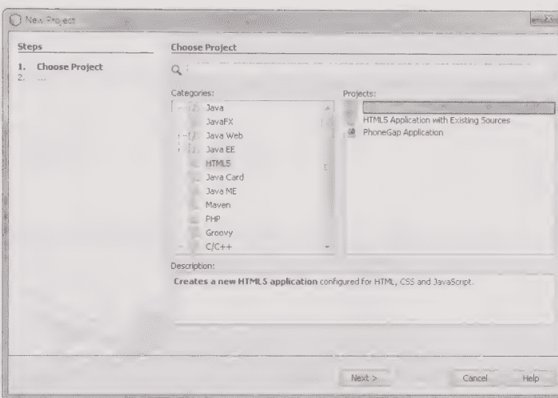

第 5 章：HTML5、JavaScript 和 CSS 87

3. 在向导的第二步中，在 Project Name 字段中输入 BookClub 并再次点击 Next。

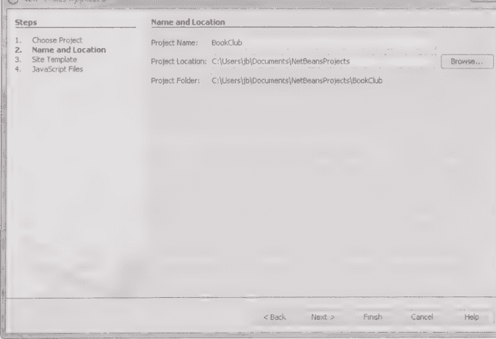

4. 在向导的下一步 Site Template（站点模板）中，你有三个选项可以选择如何配置你的新项目。对于此示例，你将基于本书提供的模板来创建你的新项目。该模板将为本章后面涵盖的内容提供基础。

因此，如下所示，点击 Select Template 单选按钮，点击 Browse 按钮，并进入 BookClub.zip 文件的位置。在 Template 字段选中 BookClub.zip 文件后点击 Next 按钮。

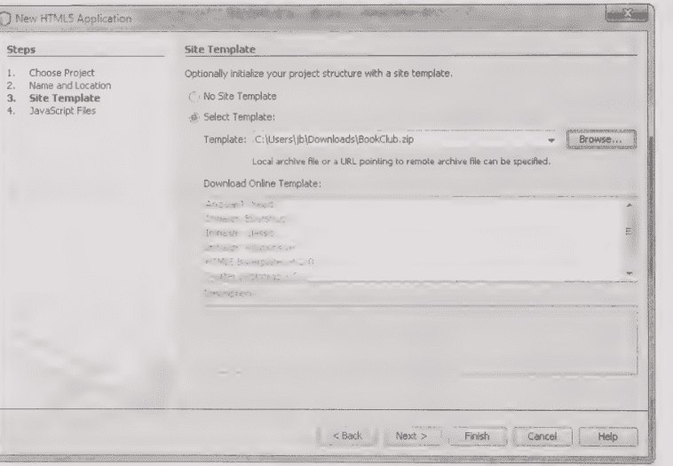

5. 创建新项目的最后一步是添加你可能需要的其他 JavaScript 库。图像中显示的 JavaScript 库列表直接从 JavaScript 内容分发网络 (CDN) 仓库提取，并可以通过点击库列表下方的链接随时更新。如果你以后需要添加更多库，请进入 NetBeans IDE 中的 Project Properties 对话框并选择 JavaScript Library Manager 选项。目前，此项目所需的所有 JavaScript 库都包含在模板中。点击 Finish 按钮创建项目。

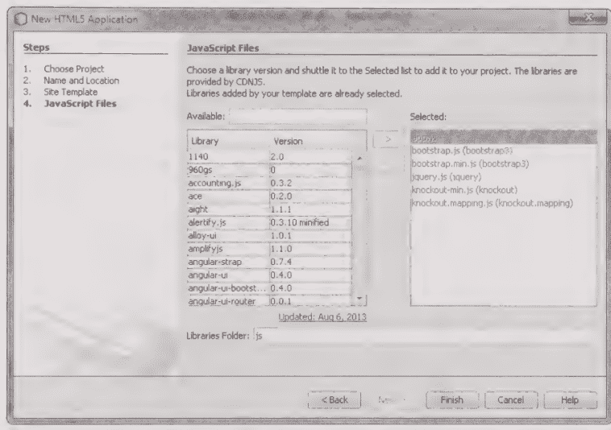

Listing 5-1 显示了向导从模板为你的项目加载的 index.html 文件。你可以看到`<title>` 元素标识了项目的名称。还要注意 CSS 和 JavaScript 库是如何被引用的：`<head>` 部分中的 `<link>` 和 `<script>` 标签告诉浏览器在运行 index.html 文档时加载指定的文件。

### 设置 CSS 和 JavaScript 引用

```html
<head>
<title>My Book Club</title>
<meta charset="UTF-8" content="width=device-width">
<link rel="stylesheet" href="css/bootstrap3/responsive.css" />
<script type="text/javascript" src="js/jquery/jquery.js"></script>
<script type="text/javascript" src="js/knockout/knockout-min.js"></script>
<script type="text/javascript" src="js/knockout.mapping/knockout.mapping.js"></script>
<script src="js/bootstrap3/bootstrap.js"></script>
<script type="text/javascript" src="js/app.js"></script>
</head>
```

注意`<head>` 部分的最后一行包含一个额外的 `<script>` 元素，引用了一个名为 app.js 的 JavaScript 文件。该文件包含特定于应用的 JavaScript 代码。如果你是从头开始此项目并需要添加此文件，可以右键点击项目导航器中的 js 节点（如下），并选择 New | JavaScript File。

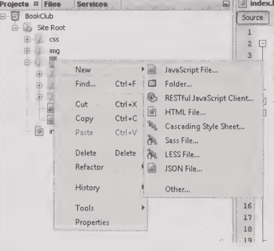

将显示如插图所示对话框。将文件名设置为 app 并点击 Finish。

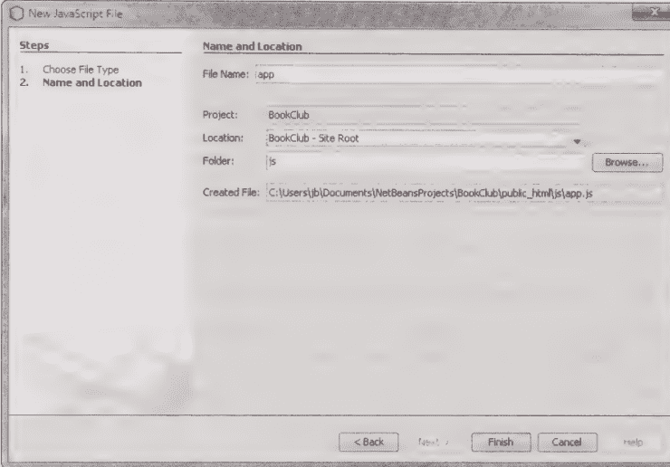

在处理 REST 时，你将希望使用与本章后面 Listing 5-7 类似的完整语法。你还会注意到此示例中的 URL 是使用变量 `self.serviceURL` 设置的，而不是 URL 本身的字符串。这是因为该行实际上是一个名为 ViewModel 的较大函数的一部分。这是你在第 1 章中读过的 Knockout.js 模型-视图-视图模型 (MVVM) 架构模式的一部分。Listing 5-4 显示了完整的 ViewModel 代码。

学习如何使用特定服务的简单方法是从 Listing 5-2 所示的代码开始。这是因为该行实际上是一个名为 ViewModel 的较大函数的一部分。这是你在第 1 章中读过的 Knockout.js 模型-视图-视图模型 (MVVM) 架构模式的一部分。Listing 5-4 显示了完整的 ViewModel 代码。


# Java EE 和 HTML5 企业级开发

从桌面电脑到智能手机以及其间的几乎所有类型的设备，HTML5 应用的开发和可用性不断增加，使得在企业应用空间中使用 HTML5 应用受到了急需的关注。在本章中，你将学习如何创建一个纯客户端 HTML5 应用，该应用将消耗并与你在之前的章节中学习的如何编写的 REST、服务器发送事件 (SSE) 和 WebSocket Java 服务。你将看到如何通过 JavaScript 库 `Knockout.js` 实现模型-视图-视图（MVVM）架构模式。你还将学习使用 CSS3 媒体查询进行响应式设计的基础知识，以便在应用显示于不同尺寸的设备时动态更改 UI 布局。最后，你将学习 Syntactically Awesome StyleSheets (SASS) 和 Sassy CSS (SCSS) 语法，以管理企业级应用中更复杂的 CSS 文件集。

## HTML5 项目设置

要开始操作，请使用 NetBeans IDE 创建一个新的 HTML5 项目：

1. 选择 `File | New Project`。
2. 如下所示，在 `Categories` 格中选择 `HTML5`，然后在 `Projects` 格中选择 `HTML5 Application`。点击 `Next` 按钮进入项目详细信息。
3. 在向导的第二步中，在 `Project Name` 字段中输入 `BookClub` 并再次点击 `Next`。
4. 在向导的下一步 `Site Template`（站点模板）中，你有三个选项可以选择如何配置你的新项目。对于此示例，你将基于本书提供的模板来创建你的新项目。该模板将为本章后面的内容提供基础。

因此，如下所示，点击 `Select Template` 单选按钮，点击 `Browse` 按钮，并进入 `BookClub.zip` 文件的位置。在 `Template` 字段选中 `BookClub.zip` 文件后点击 `Next` 按钮。

5. 创建新项目的最后一步是添加你可能需要的其他 JavaScript 库。图像中显示的 JavaScript 库列表直接从 JavaScript 内容分发网络 (CDN) 仓库提取，并通过点击库列表下方的链接随时更新。如果你以后需要添加更多库，请进入 NetBeans IDE 中的 `Project Properties` 对话框并选择 `JavaScript Library Manager` 选项。目前，此项目所需的所有 JavaScript 库都包含在模板中。点击 `Finish` 按钮创建项目。

Listing 5-1 显示了向导从模板为你的项目加载的 `index.html` 文件。你可以看到 `<title>` 元素标识了项目的名称。还要注意 CSS 和 JavaScript 库是如何被引用的：`<head>` 部分中的 `<link>` 和 `<script>` 标签告诉浏览器在运行 `index.html` 文档时加载指定的文件。

### 设置 CSS 和 JavaScript 引用

```html
<head>
  <title>My Book Club</title>
  <meta charset="UTF-8" content="width=device-width">
  <link rel="stylesheet" href="css/bootstrap3/responsive.css" />
  <script type="text/javascript" src="js/jquery/jquery.js"></script>
</head>
```

```html
<script type="text/javascript" src="js/knockout/knockout-min.js"></script>
<script type="text/javascript" src="js/knockout.mapping/knockout.mapping.js"></script>
<script src="js/bootstrap3/bootstrap.js"></script>
<script type="text/javascript" src="js/app.js"></script>
```

注意 `<head>` 部分的最后一行包含一个额外的 `<script>` 元素，引用了一个名为 `app.js` 的 JavaScript 文件。该文件包含特定于应用的 JavaScript 代码。如果你是从头开始此项目并需要添加此文件，可以右键点击项目导航器中的 `js` 节点（如下），并选择 `New | JavaScript File`。

将显示如插图所示对话框。将文件名设置为 `app` 并点击 `Finish`。

在处理 REST 时，你将希望使用与本章后面 Listing 5-7 类似的完整语法。你还会注意到此示例中的 URL 是使用变量 `self.serviceURL` 设置的，而不是 URL 本身的字符串。这是因为该行实际上是一个名为 `ViewModel` 的较大函数的一部分。这是你在第 1 章中读过的 Knockout.js 模型-视图-视图 (MVVM) 架构模式。Listing 5-4 显示了完整的 `ViewModel` 代码。

学习如何使用特定服务的简单方法是从 Listing 5-2 所示的代码开始。

### Listing 5-3 jQuery 方法调用

```javascript
$.getJSON(self.serviceURL, function(data) {
  // do something with the data
});
```

### Listing 5-4 Example ViewModel

```javascript
function viewModel() {
  var self = this;
  self.serviceURL = serviceURL + "/books";
  self.Books = ko.observableArray([]);
  $.getJSON(self.serviceURL, function(data) {
    var mappedBooks = self$.map(data, function (item) {
      return new viewModel(item);
    });
    self.Books(mappedBooks);
  });
}
```

让我们逐行分析所提供的内容：

- `function booksViewModel() { var self = this;` 在 JavaScript 中，当前对象通常通过伪变量 `this` 来引用。在函数中始终使用 `this` 来引用变量的主要问题是，`this` 的作用范围可能会根据函数调用方式而改变。你希望将本地变量绑定到当前对象，以便无论以后在代码中如何调用该函数，都能引用同一个对象。

- `self.serviceURL = serviceRootURL + "/books";` 这一行设置了用于进行实际 REST API 用的 URL。由于所有的 REST API 调用都具有相同的主机名和应用程序路径，因此设置了一个全局变量来包含 URL 中始终不变的部分。在开发模式下处理 REST 服务调用时，需要记住的一点是，当你从不同设备测试代码时，主机名可能会变化。例如，使用 `"localhost"` 作为主机名对于任何想要连接到你在同一机器上运行的 REST 服务的浏览器都是可行的。但是，如果你从平板电脑等测试代码并连接到开发机器的 IP 地址，那么对 `"localhost"` 的 JavaScript 调用将失败。出于原因，你会在示例应用程序代码的顶部看到 `serviceHostname` 变量被设置为 `serviceHostname = window.location.hostname;`，最后的 `serviceRootURL` 变量使用这个动态值创建。

```javascript
serviceHostname = window.location.hostname;
serviceRootURL = "http://" + serviceHostname + ":8080/sahara/webresources";
```

- `self.Books = ko.observableArray([]);` 这显示了你第一次使用 Knockout js 方法。你将变量 `self.Books` 赋值给 Knockout `observableArray` 并用空数组对其初始化。使用 Knockout 可观测对象（observables）和可观测数组是在你的 MVVM 架构的 Model 层数据与 View 层之间建立双向绑定的关键。你将在本章稍后的部分看到是如何使用这个 `observableArray` 的。

# 第 5 章：HTML5、JavaScript 和 CSS

```javascript
$.getJSON(self.serviceURL, function(data) { 这一行已经在列表 5-3 中出现过并在随后进行了讨论，但此时这些变量应该会更容易理解一些。当返回成功请求时，会处理回调函数。`data` 对象包含了从服务器返回的响应对象的一部分的数据。由于你使用了 `$.getJSON()`，返回的数据是一个 JSON 对象。
```


```javascript
var mappedBooks = $.map(data, function(item) { 这里是使用 .map() 工具方法来获取返回的 JSON 对象中的每个顶层元素并将其添加到数组中。每个 item 在从 .map() 方法返回之前都会被创建一个新的 `bookModel` 对象。
```

```javascript
return new bookService(item); 最终，你得到了一个包含模型集合的数组。在稍后讨论列表 5-5 时，你将了解到更多关于 Model 对象的信息。
```

```javascript
self.Books(mappedBooks); 这一最后一行将预定义数组 `self.Books` 的值设置为包含 Model 对象的集合。当你将 ViewModel 绑定到 View 层时，你将看到如何使用此对象。
```

Model 代表你数据的一个实例。将其想为数据库中的单条记录或表格中的单行数据是最容易的。在列表 5-5 中，你可以看到 Model 中的每个字段都被赋值给一个 Knockout 可观测变量。这让你能够利用 Knockout.js 闻名的双向绑定。双向绑定意味着当可观测对象或可观测数组的值发生变化（无论是通过程序还是通过终端用户的数据输入）时，Knockout 库会自动更新所有绑定到它上面的元素。你不需要为 View 层中使用的每个变量设置监听器（当你读到本章稍后关于 View 层的讨论时，这将变得更加清晰）。在 Model 的最后一行，你会注意到你不仅从数据集中分配了每个字段，还定义了你将在 View 层中使用的自定义变量。在示例应用程序中，书籍封面照片已经提供，并根据每本书的 ISBN 代码进行命名。在列表 5-5 中，你可以看到 `this.coverImage` 被赋值为 `bookData.isbn` 的值，以便稍在 HTML 代码中加载特定的图像。

### 列表 5-5 示例 Model

```javascript
function bookModel(bookData) {
    this.description = ko.observable(bookData.description);
    this.isbn = ko.observable(bookData.isbn);
    this.publishedDate = ko.observable(format(bookData.publishedDate));
    this.publisher = ko.observable(bookData.publisher);
    this.title = ko.observable(bookData.title);
    this.coverImage = ko.observable(bookData.isbn);
}
```

现在你已经创建了 Model 和 ViewModel，拼图中还有最后一块碎片。列表 5-6 显示 View 层的 HTML 代码。它包含在项目的 `main.html` 文件中。

### 列表 5-6 示例 View

```html
<article id="bookInfo">
    <div class="item active" data-bind="foreach: Books">
        <div id="bookCoverPhoto" class="bookCoverPhoto col-md-3" data-bind="click: getBookDetails">
            <a class="thumbnail">
                
                <div class="caption" data-bind="text: title" style="margin-left:10px"></div>
            </div>
            <div id="isbnValue" class="hidden" data-bind="text: isbn"></div>
        </div>
    </div>
</article>
```

让我们来拆解这段代码示例：

- `<article id="bookInfo">` 这个元素代表定义页面结构的简单语义化元素。然而，`id` 属性很重要，因为它会被 Knockout.js 的 `applyBindings()` 方法将此部分绑定到之前创建的 ViewModel。

- `<div class="item active" data-bind="foreach: Books">` 这一行是列表的开始。这个 `div` 将包含一个模型的布局和样式。如果这是一个表格，这就是数据的一行。关键属性是 `data-bind` 属性。它使用 Knockout `foreach:` 绑定来渲染 `div` 内部的每个项。回顾列表 5-4 的讨论，它将 `Books` 的值设置为返回的模型数组。

- `<div id="bookCoverPhoto" class="bookCoverPhoto col-md-3" data-bind="click: getBookDetails"></div>` 是书籍封面图像及其标题的容器。它有一个 Knockout `click:` 绑定，以便你可以进入页面获取有关此特定书籍的更多详情。你将在稍后看到更多关于获取和显示书籍的内容，因为详情页将用于你的 CRUD 应用程序的更新和删除操作。

- 接下来的三行设置了每本书显示的内容。封面图像、标题和每本书的 ISBN 都绑定到它们自己的 HTML 元素上。这段代码中有两点需要注意：

- `data-bind="attr:{src: 'img/'+coverImage()+'.jpg'"` 在这个 `data-bind` 属性中，Knockout 可观测对象 `coverImage` 被作为方法调用，而不是像你到目前为止的所有绑定中那样仅引用。当你想要变量的实际值而不是 Knockout 用于双向绑定的函数引用时这样做。这样做破坏了该引用的双向绑定，但在某些情况下是可以接受的。在这种情况下，你只是使用该变量来动态获取 `coverImage` 文件的名称。你不计划在代码的其他部分更改此名称，因此不需要将其设为双向绑定。当你在本章稍后读到代码的更新部分时，你会看到关于为什么要这样做的更好的例子。

- `class="hidden" data-bind="text: isbn">` 在此行代码中，值被绑定到该特定书籍的 ISBN 值。你实际上不需要将此值作为当前视图的一部分，当你获取此书的详情时，确实需要此值。通过将 CSS 样式类设置为 "hidden"，实际的 `<div>` 不会被渲染，但 ISBN 值将作为 Knockout 传递给函数的数据的一部分（通过点击绑定 `click: binding`）可用。

将列表 5-3 到列表 5-6 中的所有代码放在一起并在浏览器中运行时，其最终结果将如图 5-1 所示。

## 创建，使用 POST 请求（CRUD 中的 C）

现在你已经学会了如何使用 REST 服务执行最常见的任务——读取数据，接下来你将学习如何向你的数据服务添加新记录。

在本例中中，你将向数据库添加一本新书。你将使用与读取书籍列表 `/books` 相同的 REST API；然而，你使用的请求类型将是 POST 请求，而不是之前使用的 GET 请求。列表 5-7 显示了执行此 POST 请求的代码。

### 列表 5-7 AJAX POST 调用示例

```javascript
$.ajax({
  url: serviceRootURL + "/books",
  type: 'POST',
  data: JSON.stringify(json),
  dataType: 'json',
  contentType: 'application/json',
  success: function(response, status, xhr) {
      booksVM.Books.push(new bookModel(json));
      $('#addBookDialog').modal('hide');
  },
  error: function(xhr, status, errorThrown) {
      alert('Error adding Book: ' + status + ':' + errorThrown)
  }
});
```

让我们逐行的代码：

- `$.ajax({` 这是用于实现异步 HTTP 请求 (AJAX) 的 jQuery 方法。

- `url: serviceRootURL + "books",` 这行设置了你将进行 REST 调用的 URL。

- `type: 'POST',` 这一行将请求类型设置为 POST。这告诉 REST 服务你想将此新数据添加到数据库中。

- `data: JSON.stringify(json),` 你传递到请求中的数据来自表单（稍后你将学习如何创建）。由于 REST 服务期望以 JSON 对象的形式接收数据，你将使用 JSON 对象提供的实用方法 `.stringify()` 将代码转换为有效的 JSON 对象。

- `dataType: 'json',` 这是你期望服务器对 `json` 响应所返回的数据类型。

- `contentType: 'application/json',` 这告诉服务器你在此请求中发送给它的什么类型的数据。

- `success:` 如果请求成功，使用的回调函数。

- `error:` 如果请求失败，使用的回调函数。


> **提示**
> 要测试你的错误回调函数，可以尝试发送一个请求，对某个要求必须字段字段发送相同的值。在示例应用程序中，尝试添加两本具有相同 ISBN 的书。

## 100 Java EE 和 HTML5 企业级应用开发

列表 5-8 所示的 HTML 代码包含一个 Knockout `click:binding`，它用于显示对话框，以便在其中输入要添加到数据库中的新书信息。

### 列表 5-8 显示新书对话框的 click: Binding

```html
<div id="featuredBooks" class="featured">
  特选书籍
  <span class="addNewBookIcon" data-bind="click: showDialog">
  +</span>
</div>
```

这段代码非常直观。Knockout `click:binding` 正在了一个名为 `showDialog` 的函数。该函数使用 Twitter Bootstrap 框架（最初创建项目时使用的）提供的模态对话框功能来显示对话框。此对话框包含一个表单，提供添加到数据库的新书详情。列表 5-9 显示了对话框的 HTML。显示对话框的行代码是：

```javascript
$('#addBookDialog').modal('show');
```

### 列表 5-9 带有表单的新书模态对话框

```html
<div id="addBookDialog" class="modal fade" tabindex="-1"
role="dialog" aria-labelledby="bookLabel" aria-hidden="true">
  <div class="modal-dialog">
    <div class="modal-content">
      <div class="modal-header">
        <button type="button" class="close" data-dismiss="modal"
        aria-hidden="true"></button>
        <h3 id="addLabel">新书<strong></strong></h3>
      </div>
      <div class="form-horizontal" data-bind="submit: addBook">
        <div class="modal-body" style="padding: 20px;">
          <fieldset>
            <div class="form-group">
              <label class="control-label col-md-3"
              for="bookTitle">标题:</label>
              <div class="col-md-9">
                <input id="bookTitle" type="text"
                class="form-control"/>
              </div>
            </div>
          </fieldset>
        </div>
      </div>
    </div>
  </div>
</div>
```

```html
<div class="form-group">
  <label class="control-label col-md-3" for="selectAuthor">作者</label>
  <div class="col-md-9">
    <select id="selectAuthor" class="form-control">
      <option value="1">John Pollock</option>
      <option value="2">Ken Bluttman</option>
      <option value="3">Wendy Willard</option>
      <option value="4">Danny Corward</option>
    </select>
  </div>
</div>
<div class="form-group">
  <label class="control-label col-md-3" for="bookISBN">ISBN</label>
  <div class="col-md-9">
    <input id="bookISBN" type="text" class="form-control"/>
  </div>
</div>
<div class="form-group">
  <label class="control-label col-md-3" for="bookPublisher">出版社</label>
  <div class="col-md-9">
    <input id="bookPublisher" type="text" class="form-control"/>
  </div>
</div>
<div class="form-group">
  <label class="control-label col-md-3" for="bookPublishedDate">日期</label>
  <div class="col-md-9">
    <input id="bookPublishedDate" type="text" class="form-control" placeholder="mm-dd-yyyy"/>
  </div>
</div>
<div class="form-group">
  <label class="control-label col-md-3" for="bookDescrip">描述</label>
  <div class="col-md-9">
    <textarea id="bookDescrip" class="form-control" rows="3"></textarea>
  </div>
</div>
```

# Java EE 与 HTML5 企业应用开发

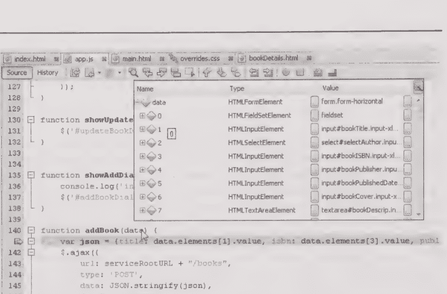

图 5. NetBeans JavaScript 调试器示例

现在你已经提交了将书籍添加到 REST 服务的请求，你可能需要对 View 层完成任何可能受 POST 请求结果影响的更改。再次查看列表 5-7，你将看到用于成功和错误的两个回调函数。如果发生错误，你应该对用户执行某些操作，告知请求无效。在本示例中，调用了 alert 并传入错误状态以及一个返回错误结果的警框：

```javascript
error: function(xhr, status, errorThrown) {
    alert('Error adding new book: ' + status + ' ' + errorThrown);
}
```

在请求成功的情况下，你将希望把发送到服务器的相同 JSON 数据添加到你的 View 绑定的现有 Knockout `observableArray` 中。在列表 5-7 中，代码行 `booksVM.Books.push(new bookModel(json))` 根据 JSON 数据创建一个新的 Model 对象并将其推入可观测数组 `booksVM.Books()`。因为 `Books` 是一个 Knockout `observableArray`，只需添加新的 Model 对象就会触发事件，绑定到 `foreach` 绑定的 HTML 将自动更新自身。

## 更新，使用 PUT 请求 (CRUD 中的 U)


更新记录的过程与上一节介绍的创建新条目的过程相同。你将希望查看你将要编辑的书籍的详细信息。列表 5-11 显示了如何编写 HTML 来列出你服务中的所有书籍。

### 列表 5-11 Knockout foreach 绑定示例

```html
<div class="item active" data-bind="foreach: Books">
  <div id="bookCoverPhoto" class="bookCoverPhoto col-md-3" data-bind="click: getBookDetails">
    <a class="thumbnail">
      
      <div class="caption" data-bind="text: title" style="margin-left:10px"></div>
      <div id="isbn" class="hidden" data-bind="text: isbn"></div>
    </a>
  </div>
</div>
```

`foreach:` 的 Knockout 绑定用于以相同的样式显示 `Books` 中的每一项。`Books` 是来自 ViewModel 的 Knockout `observableArray`。HTML 代码中最重要的元素实际上是包含每本书 ISBN 的 `<div>`。ISBN 是每本书的唯一 ID，它允许你再次调用 REST 来获取某本特定书籍的信息。注意，用于书籍封面图像、标题和 ISBN 的每个 `<div id="bookCoverPhoto">` 元素都通过 `click:` 绑定到了函数 `getBookDetails()`。该函数将加载显示该特定书籍所有详细信息的页面。

列表 5-12 显示了此函数。

### 列表 5-12 getBookDetails 函数

```javascript
function getBookDetails(data) {
  var bookData = $(data);
  ko.cleanNode($('#mainPage'));
  $('#mainPage').load('bookDetails.html', function() {
    var vm = new bookDetailsViewModel(bookData);
    ko.applyBindings(vm, document.getElementById('bookInfo'));
    ko.applyBindings(vm, document.getElementById('bookDialogContainer'));
  });
}
```

让我们来看这段代码：

- 第一行简单地设置了一个本地变量 `bookData`，包含你刚刚离开的页面的数据。
- 到目前为止你一直使用的整个示例应用程序设计为单页应用。这意味着应用程序在发出请求时不会更改 URL 并加载新页面，而是将新的页面片段或模板加载到大页面的特定部分。在本应用程序中，`index.html` 页面被设计为包含头部和页脚代码，并在主体中有一个单个 `<div>` 来包含所有其他页面模板。这个 `<div>` 的 ID 为 `mainPage`。由于 Knockout 允许你同时对一个 DOM 元素只有一个绑定，因此在加载新页面模板时，你需要清除现有绑定并添加新绑定。
- `ko.cleanNode($('#mainPage'));` 清除 `mainPage` DOM 元素，`$('#mainPage').load('bookDetails.html', function()` 将新页面模板加载到同一个 DOM 元素中。
- 在 `.load` 方法的回调函数中，你将设置新的 ViewModel 并将该 ViewModel 绑定到两个独立的 DOM 元素。第一个是所有书籍书籍详细信息的容器，第二个是模态对话框的容器。对话框将用于更新此书籍的详细信息，并作为是否删除该书籍的确认。

一旦调用 Knockout `applyBindings()`，`bookDetailsViewModel()` ViewModel 将被处理。列表 5-13 显示了此 ViewModel 代码。

### 列表 5-13 bookDetailsViewModel 函数示例

```javascript
function bookDetailsViewModel(data) {
  var self = this;
  self.bookAuthor = ko.observable('');
  self.serviceURL = serviceRootURL + "books/" + data.isbn() + "/authors";
  self.isbn = ko.observable(data.isbn());
  self.publisher = ko.observable(data.publisher());
  self.publishedDate = ko.observable(data.publishedDate());
  self.title = ko.observable(data.title());
  self.description = ko.observable(data.description());
  $.JSON(self.serviceURL, function(result) {
    if (result.length > 0) {
      self.bookAuthor(result[0].firstName + " " + result[0].lastName);
    } else {
      self.bookAuthor("Unknown");
    }
  }, this);
}
```

### 列表 5-14 书籍详情表单 HTML

```html
<div class="form-group">
  <label class="control-label col-md-3" for="bookTitle">标题</label>
  <div class="col-md-9">
    <input id="bookTitle" type="text" class="form-control" data-bind="value: title()">
  </div>
  <div class="form-group">
    <label class="control-label col-md-3" for="bookISBN">ISBN</label>
    <div class="col-md-9">
      <input id="bookISBN" type="text" class="form-control" data-bind="value: isbn()">
    </div>
  </div>
</div>
```

与列表 5-9 中创建的 `addBook` 对话框类似，这是一个 Twitter Bootstrap 模态框。在列表 5-15 中有两个重要的点需要注意。首先，你不需要直接向此对话框传递任何信息。每个字段都绑定到现有的 Knockout 可观察对象（observable）上，该对象也用于在主页面中显示书籍详情。

> **注意**
>
> 注意所有 `<input>` 元素都使用 `value` 绑定，而其他 DOM 元素使用 `text:` 绑定来获取内容。在处理 Knockout 绑定时，为种类型的 DOM 元素绑定正确的内容属性至关重要。例如，如果你通过 `value` 属性设置 DOM 元素的内容，那么你应该使用 Knockout 绑定。

其次，注意在所有表单元素中，Knockout 可观察对象都是被当作函数来调用的：`data-bind="value: isbn()"`。这非常重要。由于 Knockout 的双向绑定，如果你尝试直接绑定到可观察对象，一旦你在表单字段中更改了它，它就会立即在书籍详情页中更新。你不希望这种情况立即发生，以防最终用户点击“取消”按钮而不是提交更改。通过作为函数调用可观察对象，你获得的是变量的实际值而不是可观察对象。


列表 5-16 展示了如何处理表单以及如何在 REST API 中执行实际更新。

### 列表 5-16 提交更新

```javascript
function updateBook(data) {
  var json = {
    title: data.elements[1].value,
    isbn: data.elements[2].value,
    publisher: data.elements[3].value,
    published: new Date(data.elements[4].value),
    description: data.elements[5].value
  };
  $.ajax({
    url: serviceRootURL + "/books",
    type: 'PUT',
    data: JSON.stringify(json),
    dataType: 'json',
    contentType: 'application/json',
    success: function(data, status, xhr) {
      $('#updateBookDialog').modal('hide');
    },
    error: function(xhr, status, errorThrown) {
      alert('Error updating the Book: ' + status + ": " + errorThrown);
    }
  });
  $('#updateBookDialog').on('hidden.bs.modal', function () {
    loadDefaults();
  });
}
```

让我们遍历这段代码以检查正在发生什么：

- 传入 REST API 调用的 JSON 对象是使用 Knockout 提交（绑定触发）时传递的表单数据创建的。
- 再次使用用于添加新书籍的同一个 AJAX 调用来更新书籍。然而，使用的 `type` 属性现在是 `PUT`，而不是添加方法时使用的 `POST`。
- 你同样拥有相同的 `success:` 和 `error:` 回调函数。`error:` 函数与之前完全相同。

更新完成后，应用程序将返回主页面。`success:` 函数会关闭 `updateBookDialog` 对话框并等待其完成。然后，它会调用 `loadDefaults()` 函数，该函数会重置 ViewModel 并正确的绑定恢复到主页面。

## 删除，使用 DELETE 请求（CRUD 中的 D）

更新过程的设置有点长，但这些设置开启了删除功能。`confirmDeleteDialog` 对话框的显示方式与 `updateBookDialog` 对话框相同，通过调用 `showDeleteDialog()` 函数来实现。列表 5-17 显示了执行删除所需的 REST API 调用。

### 列表 5-17 DELETE REST API 调用示例

```javascript
function deleteBook(data) {
  var currentISBN = data.isbn();
  var books = booksVM.Books();

  $.ajax({
    url: serviceRootURL + "books/" + data.isbn(),
    type: 'DELETE',
    dataType: 'application/json',
    success: function(data, status, xhr) {
      var match = ko.utils.arrayFirst(books, function(item) {
        return item.isbn() === currentISBN;
      });
      ko.utils.arrayRemove(books, match);
      $('#confirmDeleteDialog').modal('hide');
      $('#confirmDeleteDialog').on('hidden.bs.modal', function() {
        loadDefaults();
      });
    },
    error: function(xhr, status, errorThrown) {
      alert('Error updating the Book: ' + status + ": " + errorThrown);
    }
  });
}
```


与列表 5-9 中创建的 `addBook` 对话框类似，这是一个 Twitter Bootstrap 模态框。在列表 5-15 中有两个重要的点需要注意。首先，你不需要直接向此对话框传递任何信息。每个字段都绑定到现有的 Knockout 可观察对象上，该对象也用于在主页面中显示书籍详情。

> **注意**
>
> 注意所有 `<input>` 元素都使用 `value` 绑定，而其他 DOM 元素使用 `text:` 绑定来获取内容。在处理 Knockout 绑定时，为种类型的 DOM 元素绑定正确的内容属性至关重要。例如，如果你通过 `value` 属性设置 DOM 元素的内容，那么你应该使用 Knockout 绑定。

其次，注意在所有表单元素中，Knockout 可观察对象都是被当作函数来调用的：`data-bind="value: isbn()`。这非常重要。由于 Knockout 的双向绑定，如果你尝试直接绑定到可观察对象，一旦你在表单字段中更改了它，它就会立即在书籍详情页中更新。你不希望这种情况立即发生，以防最终用户点击“取消”按钮而不是提交更改。通过作为函数调用可观察对象，你获得的是变量的实际值而不是可观察对象。


## Java EE 和 HTML5 企业级应用开发

列表 5-16 展示了如何处理表单以及如何在 REST API 中执行实际更新。

### 列表 5-16 提交更新

```javascript
function updateBook(data) {
  var json = {
    title: data.elements[1].value,
    isbn: data.elements[2].value,
    publisher: data.elements[3].value,
    published: new Date(data.elements[4].value),
    description: data.elements[5].value
  };
  $.ajax({
    url: serviceRootURL + "/books",
    type: 'PUT',
    data: JSON.stringify(json),
    dataType: 'json',
    contentType: 'application/json',
    success: function(data, status, xhr) {
      $('#updateBookDialog').modal('hide');
    },
    $('#updateBookDialog').on('hidden.bs.modal', function () {
      loadDefaults();
    });
    error: function(xhr, status, errorThrown) {
      alert('Error updating the Book: ' + status + ": " + errorThrown);
    }
  });
}
```

让我们遍历这段代码以检查正在发生什么：

- 传入 REST API 调用的 JSON 对象是使用 Knockout 提交（绑定触发）时传递的表单数据创建的。
- 再次使用用于添加新书籍的同一个 AJAX 调用来更新书籍。然而，使用的 `type` 属性现在是 `PUT`，而不是添加方法时使用的 `POST`。
- 你同样拥有相同的 `success:` 和 `error:` 回调函数。`error:` 函数与之前完全相同。

## Java EE 和 HTML5 企业级应用开发

更新完成后，应用程序将返回主页面。`success:` 函数会关闭 `updateBookDialog` 对话框并等待其完成。然后它会调用 `loadDefaults()` 函数，该函数会重置 ViewModel 并正确的绑定恢复到主页面。

## 删除，使用 DELETE 请求（CRUD 中的 D）

更新过程的设置有点长，但这些设置开启了删除功能。`confirmDeleteDialog` 对话框的显示方式与 `updateBookDialog` 对话框相同，通过调用 `showDeleteDialog()` 函数来实现。列表 5-17 显示了执行删除所需的 REST API 调用。

### 列表 5-17 DELETE REST API 调用示例

```javascript
function deleteBook(data) {
  var currentISBN = data.isbn();
  var books = booksVM.Books();

  $.ajax({
    url: serviceRootURL + "books/" + data.isbn(),
    type: 'DELETE',
    dataType: 'application/json',
    success: function(data, status, xhr) {
      var match = ko.utils.arrayFirst(books, function(item) {
        return item.isbn() === currentISBN;
      });
      ko.utils.arrayRemove(books, match);
      $('#confirmDeleteDialog').modal('hide');
      $('#confirmDeleteDialog').on('hidden.bs.modal', function() {
        loadDefaults();
      });
    },
    error: function(xhr, status, errorThrown) {
      alert('Error updating the Book: ' + status + ": " + errorThrown);
    }
  });
}
```

## Java EE 和 HTML5 企业级应用开发

## Server-Sent Events (SSE)

Server-Sent Events 有时被称为推送技术，因为数据流是单向的。一切都来自服务器。浏览器选择连接到 SSE 流，以便在有新信息可用向其发送信息。示例应用程序设置了一个部分用于显示传入的数据。Knockout 双向绑定对于显示非常有帮助，因为你可以将传入的数据与特定的 DOM 元素建立绑定，并在新数据进入时让 Knock 进行更新。列表 5-18 展示了如何连接到 SSE 流以及使用哪些函数处理流及其数据。

### 列表 5-18 Server-Sent Events 示例

```javascript
function sseViewModel() {
  var self = this;
  self.sseData = ko.observable('test message');
  self.displayError = ko.observable(false);
  self.displayMessage = ko.observable(false);

  if (typeof(Event) == "undefined") {
    self.source = new EventSource(serviceRootURL + "/books/events");
    self.source.onopen = function (event) {
      var message = "SSE Connection Opened<hr>";
      self.sseData(message);
    };
    self.source.onmessage = function(event) {
      var message = self.sseData() + event.data + "<hr>";
      self.sseData(message);
    };
    self.source.onerror = function (event) {
      self.displayError(false);
      self.sseData(event.data);
    };
  } else {
    self.sseData("Sorry, your browser does not support server-events...");
    self.displayError(true);
  }
}

self.closeSSE = function() {
  self.source.close();
}
```

```
self.sseData("SSE Connection Closed<hr>");
}
```

Server-Sent Events（服务器事件）是 HTML5 引入的一项新功能。在本文写作时，某些浏览器尚不支持此功能。

> **提示**
>
> 目前，没有任何版本的 Microsoft Internet Explorer 支持 Server-Sent Events。

在继续执行初始化代码之前，最好进行以下检查，以确保浏览器提供了 SSE 支持：

```
if (typeof (EventSource) !== "undefined") {
```

如果浏览器不理解 `EventSource` 的类型，则它不支持 SSE，在这种情况下你可以显示一条错误消息。

让我们通过列表 5-18 中的代码，看看每个部分的作用：

- 前几行设置了你的 Knockout 可观测对象（observables）的默认值。这些观测对象被绑定到 HTML 代码中的 SSE 部分。
- 在检查浏览器是否支持服务器发送事件的 `if` 语句内部，你创建了一个新的 `EventSource` 对象并将其赋值给 `self.source` 变量。用于建立连接的 URL 是你在书中第 3 章中编写的 SSE 流：
  ```
  new EventSource(serviceRootURL + "/books/events");
  ```
- 一旦你有了 `EventSource` 对象，你就可以监听以下三个事件，然后执行相应的操作：
  - `onopen`: 该事件在连接首次打开时触发。
  - `onmessage`: 每当服务器向浏览器发送消息时都会触发此事件。这是你想要处理的主事件。
  - `onclose`: 当连接由于任何原因关闭时触发此事件。


在列表 5-18 中，你正在将局部变量 `message` 设置为一个表示连接已打开的字符串。然后你将该值赋值给 Knockout 可观测对象 `sseData`，它将显示在绑定到同一观测对象的 SSE HTML 部分中。由于你在此消息中包含了 HTML 标记，因此 HTML 页面上的 Knockout 绑定实际上是 `html:` 绑定，而不是纯文本的 `:` 绑定：

```
<div id="sseMessage" data-bind="html: sseData, ..."></div>
```

- 在 `onmessage` 函数中，你希望通过将服务器的最新消息追加到现有消息的末尾，布局进入此区域的消息。你通过将局部变量 `message` 设置为观测对象的实际值，然后追加传入的事件 `.data` 来实现。生成新的追加消息后，你将 `self.sseData` 可观测对象设置为新值。
- 如果连接由于任何原因关闭，请设置一条表示连接已关闭的消息，并设置相同的 `self.sseData` 来显示该消息。
- 当 `self.displayMessage` 和 `self.displayError` 的原始可观测对象初始化时，它们被设置为 `false`，这样在页面加载期间就不会显示这些区域。现在连接已经建立并设置了消息，你可以将可观测对象设置为 `true`，这将显示消息区域，同时保持错误部分隐藏。
- 最后，在事件区域的视图层中有一个很小的 X 图标，它已绑定到 `closeSSE()` 函数。当点击该图标时，当前的 SSE 流将关闭并显示适当的消息。

## WebSocket

在 JavaScript 中使用 WebSocket API 并结果数据连接到 HTML 视图层已经在第 4 章中介绍过。如果你还没有读第 4 章，建立服务连接的基本方法与你刚刚通过 Server-Sent Events 学到的相同。然而，通过 WebSocket API，你还可以向服务器发送数据。使用 WebSocket 连接代替 REST 或其他类型协议的最大优势之一是显著减少了你发送的流量。使用 WebSocket 协议时，客户端和服务器之间的连接建立一次，并一直保持到通过 API 或客户端关闭。对于其他协议，你每次想要从服务器发送或接收数据都需要重新建立连接。

要获取 WebSocket 协议的完整描述，请阅读第 4 章。

## 响应式设计

响应式设计的概念是为了设计你的 Web 应用程序，使其根据显示设备的屏幕尺寸适当地渲染布局。应用程序视图层需要通过更改布局或渲染的内容来响应尺寸的变化。

CSS2 规范提供了根据媒体类型动态使用不同 CSS 规则的能力。这些类型中最常见的（在 CSS3 中继续存在）是屏幕和打印。CSS3 规范通过引入媒体查询（media queries）扩展了这一功能。媒体查询由一个媒体类型和零或多个表达式组成。这些表达式检查媒体的特定条件。一个很好的例子是检查显示屏幕尺寸的表达式：

```
@media only screen (min-width: 450px) and (max-width: 1024px) {}
```

通过使用媒体查询和定义为网格布局的 CSS 类模式，你可以让应用程序响应显示屏幕的变化。

网格布局模式是你可以设计的内容，但使用现有的网格框架要简单得多。到为止，你一直在使用 Bootstrap 框架来显示列。注意 Bootstrap 使用 12 列网格系统。这意味着一列可以跨越 1 到 12 的任何数字。例如，`col-md-6` 占据宽度的一半，`col-md-4` 占据三分之一，而 `col-md-3` 占据四分之一。

（注：原文文本中存在大量重复的响应式设计描述，此处已根据要求去冗处理，仅保留核心逻辑）

# 语法卓越的样式表 (SASS)

对于大多数 HTML5 应用程序，你可能只需要使用一个结构合理且易于维护的单一 CSS 文件即可。然而，随着应用程序的增长和变得越来越复杂，CSS 也会变得同样复杂。在历史上，维护巨大的 CSS 文件是极其困难的。即使你将文件拆分为较小文件并在 HTML 中引用每个文件，你也必须记住文件的正确顺序，因为浏览器是按照列出的顺序加载 CSS 文件的，但每个文件都会覆盖之前设置的任何样式类。这是一种“后者胜出”的概念。如果你恰好在多个文件中定义了相同的规则，那么该规则生效的文件取决于它们在你的 HTML 代码中列出的顺序。2007 年，一位名为 Hampton Catlin 的开发者引入了 SASS。如今，SASS 的开发由 Nathan Weizenbaum 和 Chris Epstein 继续进行。

原始的样式表语言在缩缩进语法上设计得与 Haml（HTML 抽象标记语言）编程语言相似，这种风格看起来和用起来完全不像 CSS。这种语法通常以 `.sass` 文件扩展名引用。一种较新的语法被称为 Sassy CSS，或 SCSS，它的设计目的是看起来和用起来与 CSS 本身完全一样——以至于任何有效的 CSS 代码也是 SCSS 的有效子集。这种语法通常通过 `.scss` 文件扩展名引用。

SASS 作为 SASS 或 SCSS 文件的预处理器工作，并将这些独立的文件编译成一个或多个 CSS 文件，你可以在 HTML 代码中引用这些文件。

列表 5-21 包含了两个指向样式表的引用。第一个是 Bootstrap 框架，你将其作为 My Club 示例应用程序的基础；第二个是对应用程序特定样式的引用。后者文件名为 `responsive.css`，是一个由于对四个独立的 SCSS 文件进行 SASS 预处理而生成的 CSS 文件。这些文件如图 5-4 所示。

> **列表 5-21 引用 CSS 文件**
>
> ```html
> <head>
>   <title>My Book Club</title>
>   <meta charset="UTF-8">
>   <meta name="viewport" content="width=device-width">
>   <link rel="stylesheet" href="css/bootstrap3/bootstrap.css">
>   <link rel="stylesheet" href="css/responsive.css">
> </head>
> ```

如你在图 5-4 所示，`responsive.scss` 文件仅包含三行实际代码。它按照你希望组装顺序导入了其他三个 SCSS 文件。另外三个文件被拆分以包含针对特定媒体查询类型的类和规则：在这种情况下，分别是桌面端、平板电脑和手机端。你的个人项目将决定你如何确定将 CSS 拆分为更易于管理的部分的最佳方法。

NetBeans IDE 使得在项目中使用 SASS 变得非常简单。在导航器中右键点击你的项目名称并选择属性（Properties）菜单选项。在属性对话框中，选择 SCSS Preprocessors 选项，如图 5-5 所示。对于此项目，IDE 被指示在名为 `/scss` 的目录中查找 SCSS 文件，并将编译后的文件输出到 `/css` 目录。

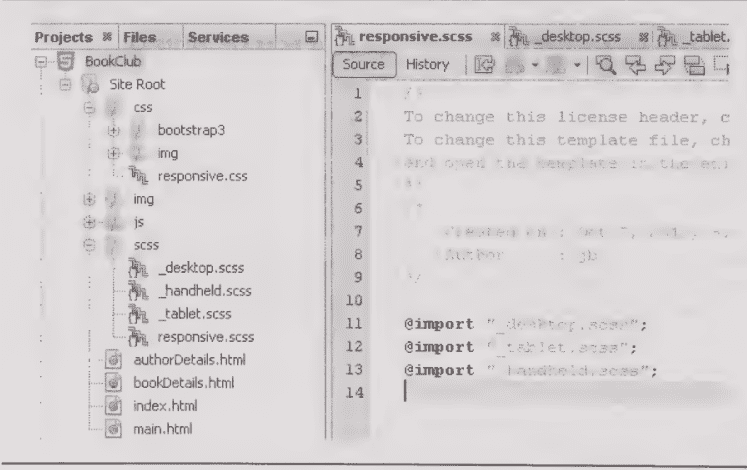

图 5-4. SCSS 和生成的 CSS 文件列表

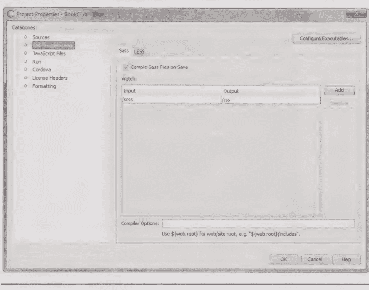

图 5-5. CSS 预处理器设置

> **提示**


在处理 SASS 时，如果你将 SCSS 文件名以下划线开头，这将指示编译器不要将该特定文件编译为自己的 CSS 文件。当你有多个较小文件被导入到一个较大的文件中，且你只想将较大的文件编译为最终的 CSS 文件时，这非常有用。

如果你还没有这样做，可以通过点击此对话框右上角的 `Configure Executables`（配置可执行文件）按钮来安装和管理 SASS 的执行文件。用于处理 CSS 预处理器执行文件的全局 IDE 选项对话框如图 5-6 所示。你会发现，如果你不知道从哪里下载可执行文件，那里提供了一个链接将带你到达正确的位置。

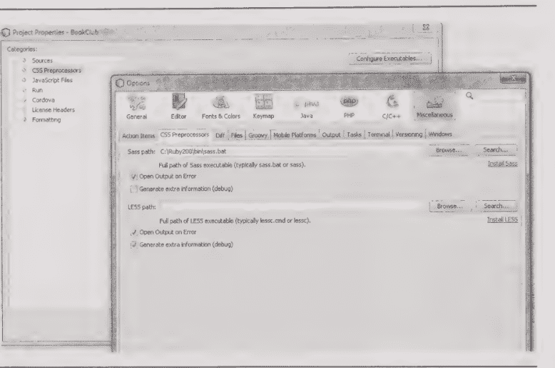

**图 5-6.** 用于 CSS 预处理器的全局 IDE 属性

你还会注意到 NetBeans IDE 支持另一种类型的 CSS 预处理，称为 LESS。这是一种与 SASS 类似的方法，由 Alexis Sellier 在 2009 年设计。由于有许多开源项目，你的项目可能会影响另一个，反之亦然。在这种情况下，SASS 设计于 2007 年，影响了 2009 年 LESS 的开发。LESS 的引入随后引入了 SASS 中使用的新 CSS 语法。两种样式表语言都有各自的优缺点。对于 NetBeans IDE 而言，两者的设置和功能是相同的。

现在你已经了解了如何使用 NetBeans IDE 处理 SCSS 文件，你已经准备好查看……

# 第 6 章：HTML5 与 Java 应用安全

当 Web 应用将用户输入整合到生成的输出中，但没有对输入进行适当的验证或编码时，就会发生 XSS。来自终端用户（例如表单输入）或数据连接（例如 REST 服务）的数据被视为不可信数据。这些数据并不是你作为应用程序的一部分创建的，因此你无法验证它们是否来自可信源。你必须防范这些不可信数据。

理解 XSS 的最佳方法是看一些示例。虽然本节的重点是客户端安全，但服务器端 XSS 攻击最容易理解，因此接下来提供了两个服务器端 XSS 攻击的示例，随后是一个客户端示例。

对于第一个示例，假设你决定为 404（未找到文件）错误创建一个自定义错误页面。当有人输入类似下面的 URL 时：

```
http://my.website.com/not-here
```

错误页面返回一条消息，说明服务器上未找到 `not-here` 文件。如果错误消息中显示的数据在被浏览器读取之前没有转义，就会发生 XSS 漏洞，在这种情况下，攻击者可以执行类似以下的操作：

```
http://my.website.com/<script>alert("TEST")</script>
```

浏览器在解析数据以显示为错误消息的一部分时，会执行 `<script>` 标签。

对于第二个示例，假设你的 Web 应用有一个搜索框。当用户进行搜索时，搜索结果将显示在一个单独的结果页面上。如果页面使用了常见的“找到针对：<搜索内容> 的 x 个结果”这种模式，并且没有对搜索字符串进行适当的编码，就会发生 XSS 漏洞。如果恶意用户输入类似于上一个示例中 `<script>` 块的搜索字符串，那么当搜索结果页面在浏览器中加载时，JavaScript 将执行。

上述两个示例通常会在服务器端处理，因为错误页面和搜索结果页面通常会在服务器上生成。如前所述，第三种 XSS 攻击纯粹是客户端的，涉及 JavaScript 如何处理 DOM 元素的执行。

为了演示基于 DOM 的 XSS 攻击是如何工作的，我们将使用一个与之前的搜索字段示例类似的示例。假设你的 HTML5 应用有一个表单，其中包含一个请求用户用户名的输入字段。该表单还包含一个 `<div>` 元素，当用户按下回车键时，该元素将更新以显示用户在输入字段中输入的任何内容。列表 6-1 显示了该示例的代码。

### 列表 6-1 表单示例

```
<label id="nameLabel" for="userName">User name: </label>
<input id="userName" autocomplete="off"/>

<div id="user"></div>
```

你想要将此 `<div>` 元素的内容设置为用户名输入字段中输入的字符串值。使用原生 JavaScript 执行此操作可能类似于列表 6-2。

### 列表 6-2 innerHTML 示例

```javascript
document.getElementById("user").innerHTML = document.getElementById("userName").value;
```

列表 6-2 中的代码运行得完全正常。然而，通过使用 `<div>` 元素的 `.innerHTML` 属性，你将自己暴露在了基于 DOM 的 XSS 攻击之下了。如果恶意用户输入了类似于下面内容的字符串：

```
<div onmouseover="javascript:alert('failed!')">XSS Test</div></div>
```

该 HTML 将按原样添加到 DOM 中，下一次有人将鼠标移动到新的 `<div>` 元素上时，JavaScript 就会执行。

对于某些 DOM 属性和方法，你应该避免处理不可信数据。部分列表包括：

- `element.innerHTML`
- `document.write()`
- `document.writ()`
- `javascript.eval()`
- `element eventHandlers`
- `setTimeout`
- `setInterval`
- `new function ()`

通常情况下，如果你正在处理不可信数据，请设置你的 HTML 以便可以使用元素的 `.textContent` 方法（如列表 6-3 所示），而不是尝试直接添加 HTML。

### 列表 6-3 textContent 示例

```javascript
document.getElementById("user").textContent = document.getElementById("userName").value;
```

如果你必须允许不可信数据进入可以被 JavaScript 或 HTML 解析器执行的上下文，那么你应该学习如何使用提供的许多 HTML 和 JavaScript 编码器之一。你可以尝试自己使用编码器，但这样做可能是很复杂的，因为每个浏览器的 JavaScript 引擎处理方式略有不同。你最好使用由信任的安全团队开发的编码器，例如来自开放 Web 应用安全项目 (OWASP) 团队提供的企业安全 API (ESAPI)。

你应该意识到，使用 jQuery 等 JavaScript 框架也会相同的问题。使用如下代码：

```javascript
$('#user').html($('#userName').val());
```

将打开与 `.innerHTML` 相同的 XSS 攻击向量。如果你在使用 jQuery，请确保使用 `.text` 而不是 `.html`：

```javascript
$('#user').text($('#userName').val());
```


## Java EE 和 HTML5 企业级应用开发

### 跨站请求伪造

利用跨站请求伪造 (CSRF) 安全漏洞的攻击并不常见，因为它们只在非常有限的条件下成功。然而，如果你不采取某些措施来防止攻击，你就会让你的网站访问者面临潜在的严重结果。

解释 CSRF 攻击的一种良好方法是使用银行网站的示例。我们将该网站称为 megabank.com。当你登录该银行网站的账户时，登录会在浏览器中存储一个 cookie。这对于银行网站来说是完全正常且接受的做法。如果你在没有注销的情况下离开了网站，CSRF 漏洞就会存在。你的浏览器在缓存中仍然拥有该 cookie。cookie 的过期时间由 megabank.com 网站设置，大多数情况下会在最后活动后 15 分钟过期。不过，这个过期时间可能会有所不同。假设你导航到另一个被黑的网站，该网站包含了恶意代码，激活后（例如通过点击按钮）会指示你的浏览器向 megabank.com 发送请求，从“你的账户”转移资金到黑客账户。当银行网站接收到请求时，它会寻找会话 cookie 来识别用户，它会在你的浏览器中找到。转移就像是你执行了请求一样。

虽然成功的 CSRF 攻击所需的所有变量存在的概率较低，但只需要一次成功的攻击就能破坏 megabank.com 网站的声誉。如果你遇到过垃圾邮件或链接到看似随机网站的垃圾评论，它们很可能是诱导你进行 CSRF 攻击的尝试。CSRF 漏洞最糟糕的部分是终端用户甚至不需要在被黑的网站上点击任何内容。整个攻击可以在页面加载时由 JavaScript 处理。

所以，你可以做什么来确保你的 HTML5 应用不会允许这种 CSRF 攻击？首先，要意识到你的应用程序必须维护会话 cookie 这种类型的攻击才会发生。如果你的应用程序不维护会话 cookie（无状态应用程序），那么它就不会受到这种攻击的影响，你不需要做任何事情。

## 第 6 章：HTML5 与 Java 应用安全 131

确保你的网站不会受到前一节描述的 XSS 类型攻击。如果它容易受到 XSS 攻击，那么你为防止 CSRF 攻击所做的任何努力都是徒劳的。

要在 HTML5 客户端应用程序中实现任何类型的 CSRF 预防，你需要与应用程序服务器端的操作配合。你用于防止 CSRF 的技术被称为“双重 Cookie Cookie”（double-spending cookies）。该技术涉及从最初请求的网页发送的 cookie 中读取会话 ID（session ID）。使用 JavaScript 将相同的会话 ID 放入应用程序中所有表单的隐藏字段中，并将其附加到任何从应用程序返回服务器的 AJAX 调用中。在将 session ID 值传回服务器时，它通常被称为 CSRF 令牌。


> 永远不要在 GET 方法类型的 AJAX 调用上设置 CSRF 令牌。这样做可能会导致 CSRF 令牌暴露在许多不同的地方（服务器日志、浏览器日志、网络监视器等）。

使用与列表 6-4 类似的代码允许你将当前的 session ID 回传给服务器，然后服务器将检查其是否与 cookie 中的 session ID 匹配。使用这种技术，服务器极不可能从另一个网站收到一个既具有正确的 session cookie 又在隐藏表单元素中有相同 session ID 的请求。

### 列表 6-4 CSRF 隐藏表单令牌

```
<form action="servlet/formsubmission" method="post">
  <input type="hidden" name="CSRFToken" value="secret_key">
</form>
<script>
  document.getElementById('csrf').setAttribute('value',
  getCookie('Session'));
</script>
```

如你所示，防止 CSRF 攻击的真正解决方案必须从服务器开始，但作为客户端开发者，你也可以尽一份之力来防止此类攻击。

## 点击劫持 (Clickjacking)

点击劫持是另一种你必须保护 HTML5 Web 应用程序的攻击类型。为了使点击劫持成功，攻击者必须首先能够将你应用程序的网页嵌入黑客创建的网站的某种框架（即 `<iframe>`）中。黑客在其创建的看似是正常网站的网站上方堆叠了一系列透明层。当网站访问者认为他们正在点击你网站上的按钮或链接时，他们实际上在点击一个不可见的按钮。2009 年，Chris Shlett 描述了这样一种攻击（http://shiflett.org/blog/2009/feb/twitter-dont-click-exploit），该攻击使用 Twitter 页面作为透明覆盖层。当终端用户点击“不要点击”按钮时，他们实际上是在点击隐藏的 Twitter 页面的帖子，并发送了一条由攻击者设计的推文。

与大多数此类攻击一样，防御点击劫持的最佳方法是从服务器端。在点击劫持的情况下，服务器端的防御是使用 `X-Frame-Options` 响应头来拒绝所有类型的框架，或仅允许来自同域的框架。然而，有一种你可以在客户端使用的编码实践可以保护你的应用程序免受点击劫持。

如果你无法从服务器端修改响应头，或者你需要支持不支持 `X-Frame-Options` 头的旧版浏览器，你可以将列表 6-5 所示的代码添加到页面的 `<head>` 元素中，以帮助防止点击劫持攻击。这个概念来自 Aspect Security 的 Jason Li，并在此讨论：https://www.codemagi.com/blog/post/194。

### 列表 6-5 反点击劫持示例

```
<head>
<style id="antiClickjack">body{display:none !important;}</style>
<script type="text/javascript">
  if (self === top) {
    var antiClickjack = document.getElementById("antiClickjack");
    antiClickjack.parentNode.removeChild(antiClickjack);
  } else {
    top.location = self.location;
  }
</script>
...
</head>
```

## 第 6 章：HTML5 与 Java 应用安全 133

在页面顶部添加 `<style>` 元素可以使紧随其后的脚本知道它正在引用你的页面。如果你只单独使用代码的 `else` 部分，该表达式可以通过多种种绕过方法被破解。使用列表 6-5 中的代码，脚本会寻找 `antiClickjack` `<style>` 元素，如果它还不是最顶层，它就会移动到顶层。这是 OWASP 推荐的从客户端防止点击劫持的方法。

## 身份验证与授权 (Authentication and Authorization)

开发 HTML5 Web 应用程序时最明显的安全问题可能是如何处理应用程序登录。到目前为止书中介绍的所有代码示例都没有包含登录过程，但如果你的应用程序将存储特定用户的信息和/或有助于让用户当前访问你的应用程序更加愉快的信息，那么你将希望在应用程序中构建某种形式的身份验证。

JavaScript 应用程序常用的身份验证方法是 OAuth 标准。OAuth 是一种开放的身份验证标准。2006 年，一组开发者汇编了 OAuth 的概念。在接下来的一年中，开发了 OAuth 草案。2007 年，OAuth 1.0 协议发布。2008 年，OAuth 规范带到了互联网工程任务组（IETF）年度会议。2009 年，发布了 OAuth 草案。2010 年，OAuth 标准在 4 月发布为 RFC 5849。2011 年，OAuth 标准已成为 Twitter、Flickr 等许多服务的强制性身份验证。2012 年，OAuth 2.0 规范发布为 RFC 6749。尽管它在互联网上逐渐流行，但在其开发过程中出现了许多争议。要决定在你的情况下使用哪种协议，你将需要自行研究。可以认为，如果你的应用程序需要支持直接验证，你应该从 OAuth 开始。

## 134 Java EE 与 HTML5 企业级开发

在不涉及协议技术细节的情况下，OAuth 允许客户端应用程序（通常是 Web 应用程序）代表用户采取行动。OAuth 2.0 的主要组件是

- 客户端 (Client)
- 授权服务器 (Authorization server)
- 资源服务器 (Resource server)
- 资源所有者 (Resource owner)

资源所有者是可以访问受保护资源的实体。客户端是代表资源所有者做出请求的应用程序。客户端根据用户授权对资源服务器执行操作。例如，用户可以通过登录 Google 账户（google.com 为授权服务器）通过浏览器（客户端）访问 flickr.com（资源服务器）上的图像。这种方法的优点是用户不需要创建和记住多个登录名和密码。相反，客户端在用户允许的情况下从授权服务器获取*访问令牌* `bearer token`，并将其存储。然后，当需要在资源服务器访问资源时，客户端发送格式如下的特殊 HTTP 头部：

```
Authorization: Bearer <token_value>
```

令牌值对客户端来说是不透明的，但资源服务器可以对其解码，以便服务器检查客户端是否代表用户有权访问该资源。

如果你的应用程序将作为需要用户验证的大型企业环境的一部分使用，那么你的应用程序可能不需要提供独立的身份验证。如果你确实需要在应用程序中包含一些身份验证，有许多不同语言、不同授权服务器和资源提供者提供的库提供了 OAuth 支持。在决定你的安全基础设施之前，值得查看它们。

在典型的企业环境中，你的应用程序将是更大的应用程序服务器安装的一部分。该应用程序服务器将为你的应用程序执行身份验证，用户在通过验证之前无法进入你的应用程序页面。

# 第 6 章：HTML5 与 Java 应用安全 135

应用程序服务器的方法。这也是授权（authorization）概念出现的地方。一旦应用程序服务器（或应用程序服务器使用的身份管理系统）验证了终端用户，就可以用它来判断终端用户是否有权访问您的应用程序。在这种环境中，您需要从安全团队获取信息，了解您的应用程序需要实现哪些类型的检查，以确保它在您的特定环境中正常运行。

## 客户端安全常识

处理客户端安全的常识方法将帮助您避开许多陷阱。基于此，这里是一些您应该考虑遵循的常识做法：

- 尝试始终使用 HTTPS 协议运行您的应用程序。
- 如果您的应用程序运行在安全域（HTTPS）中，请勿将应用程序连接到不安全的服务。确保您的 REST 调用也指向 HTTPS 域，并且您的 WebSocket 调用使用的是 `wss` 而不是 `ws`（参见本章稍后部分的“WebSocket 安全”）。


- 如果可能，请不要在你的 HTML 文件中允许 `<script>` 元素。将您的 JavaScript 放置在外部文件中并引用它们。
- 如果您正在使用 JavaScript 框架，请检查它针对常见的安全问题提供了什么帮助，并使用这些功能。
- 最后，花时间研究您的特定应用程序安全需要哪些安全措施。您会发现有很多应用程序安全信息，而且这些信息正在快速增长。

## 服务端安全

本节解释了服务器端的关键概念：认证（`authentication`）、机密性（`confidentiality`）和数据完整性（`data integrity`）。

- **认证（Authentication）** 验证客户端的身份。它确定客户端是否真的是它所声称的。它通常涉及接收来自客户端包含用户 ID 和凭据的请求。Java EE 应用程序服务器中的 Servlet 容器提供了利用标准 Web 协议验证凭据的机制。
- **授权（Authorization）** 确保经过认证的客户端拥有访问请求资源的适当权限。这允许服务器检查用户是否可以在您的服务上调用某些操作。Servlet 容器通常定义了可以执行的操作类型。
- **机密性（Confidentiality）** 确保只有经过授权的接收者才能访问信息。这个概念与授权相似，关键区别在于：授权防止信息到达非意图对方，而机密性确保即使信息确实到达了非意图对方，也能确保其无法被查看或使用。
- **数据完整性（Data integrity）** 确保信息在客户端和服务器之间的传输过程中没有发生更改。数据的哈希值（`hashcode`）或签名随数据一起发送，并在接收端进行确认。

让我们来看看这些概念如何在 Java EE 容器中实现。之后，我们将注意力转到 REST 资源安全和 WebSocket 安全。

## 认证

实现认证有多种方法；下面列出的前两种类型来自 RFC 2617 草案标准：

- **基础认证（Basic Authentication）** 这是 HTTP 上最简单的认证方法。客户端（通常是 Web 浏览器）会打开一个登录框，提示用户输入用户名和密码。然后，客户端将 base64 编码的用户名和密码发送给服务。服务器随后检查用户账户是否存在，并验证发送的密码。如果用户名和密码与账户匹配，则提供响应；否则，将向客户端返回 HTTP 401 响应码，告知客户端其无权访问该资源。

在底层，客户端生成一个 HTTP `Authorization` 请求头，其设置为用户名、冒号和密码的 base64 编码字符串。在这些编码字符串之前会添加授权方法和一个空格（即 "Basic "）。如果您的用户名是 "u1"，密码是 "p1"，那么请求头看起来如下：

```
Authorization: Basic DTE6cDE=
```

强烈建议在 HTTPS 配合使用基础认证，否则用户名和密码可以被很容易地解码。

- **摘要认证（Digest Authentication）** 基础认证的一个局限性是密码是以明文发送的，并且容易受到中间人攻击。摘要认证（即在加密的 HTTP 连接上进行基础认证）解决了这个问题。

摘要认证通过对用户名、密码、服务器提供的随机数（`nonce value`）、HTTP 方法和请求的 URI 应用哈希函数，以加密的形式通信凭据。

对于您的用户名和密码，`Authorization` 请求头看起来如下：

```
Authorization: Digest username="u1"
realm="file"
nonce="06mhdNdONXUNFTMNJgxMxQ1MTEzFItUvu5MR75Khm/wtvp1E="
uri=/webresources/authors/
algorithm=MD5
response="21c29c7a7c760e5c39ba46637ad4313aa
opaque="00000000000000000000000000000000"
```

摘要认证中的许多安全选项是可选的，因此服务器可能会在安全降低模式下运行。尽管它比基础认证好一点，但它并不打算替代更强的认证协议（如客户端证书 `client-cert`）。与基础认证一样，摘要认证也容易受到中间人攻击。这类攻击可以通过使用 HTTPS 代替 HTTP 来避免。

- **表单认证（Form-based Authentication）** 表单认证允许对呈现客户端的登录屏幕和错误页面进行自定义。登录表单必须包含用户名、密码字段以及一个提交按钮。这些内容的编码如下：

```html
<form action="security_check" method="POST">
  Username: <input type="text" name="username">
  Password: <input type="password" name="password">
  <input type="submit" value="Submit">
</form>
```

登录表单必须命名为 `security_check`。如果认证成功，将重定向到请求资源。如果失败，则返回错误页面。

- **证书认证（Client-Cert Authentication）** HTTPS 不仅提供安全连接，还可以认证。这种机制要求客户端拥有由受信任组织（称为证书颁发机构）颁发的公钥证书（`PKC`）。服务器使用该证书来认证客户端。这种方法的唯一缺点是在客户端和服务器都要管理证书。否则，这种方法比基础认证和表单认证更安全。

## Java EE 与 HTML5 应用开发

### 描述符 (Descriptors)

```xml
<web-app xmlns="http://xmlns.jcp.org/xml/ns/javaee"
             xmlns:xsi="http://www.w3.org/2001/XMLSchema-instance"
             xsi:schemaLocation="http://xmlns.jcp.org/xml/ns/javaee/web-app_3_1.xsd"
             version="3.1">

<security-constraint>
  <web-resource-collection>
    <web-resource-name>Authors</web-resource-name>
    <url-pattern>/webresources/</url-pattern>
    <http-method>GET</http-method>
  </web-resource-collection>
  <auth-constraint>
    <role-name>admin</role-name>
  </auth-constraint>
</security-constraint>

<login-config>
  <auth-method>BASIC</auth-method>
  <realm-name>file</realm-name>
</login-config>

<security-role>
  <role-name>admin</role-name>
</security-role>

</web-app>
```

如示例 6-6 所示，部署描述符有三个主要元素：

- `<security-constraint>` 元素用于将安全约束与一个或多个 资源集合关联。它具有以下子元素：
  - `<web-resource-collection>` 识别 Web 应用程序中适用于安全约束的部分资源和 HTTP 方法。例如，在示例 6-6 中，安全约束是针对访问 `/webresources/` 资源的 HTTP GET 方法定义的。可以使用通配符来指定 URL 模式，例如：
    - `/webresources/*`
    - `/webresources/authors/*`
    - `/*.html`
  - 一旦用户通过认证，`<web-resource-collection>` 定义了用户被授权的方法。
  - `<auth-constraint>` 指明允许访问该资源的用户角色。`<role-name>` 使用此处必须对应于此 Web 应用定义的 `<security-role>` 元素之一的 `<role-name>`。或者，也可以是预留的角色名称 `*`，表示该 Web 应用中的所有角色。换句话说，指定预留角色名称 `*`意味着任何登录用户都可以访问该资源。
- `<user-data-constraint>` 如果指定，则表示资源可以通过安全传输进行访问。在列表 6-6 中，需要添加以下元素：

```xml
<user-data-constraint>
<transport-guarantee>CONFIDENTIAL</transport-guarantee>
</user-data-constraint>
```

如果客户端尝试使用 HTTP 访问资源，它将被重定向到 HTTPS URL。这确保了传输的数据不会被其他实体观察到，从而允许强制执行机密性这一核心概念。

`<transport-guarantee>` 子元素也可以取 `NONE` 或 `INTEGRAL` 的值。后者确保了数据在传输过程中不会被更改，从而允许强制执行数据完整性这一核心概念。

它同样重要的是，如果在 `<security-constraint>` 中列出了一个 `<http-method>`，则该方法将按照部署描述符中定义的约束受到保护。所有其他未显式列出的 HTTP 方法被称为“未受保护的方法”（`uncovered methods`）。在部署描述符中添加顶层 `<deny-uncovered-http-methods/>` 元素可以保护这些方法。

- `<login-config>` 元素用于配置此应用程序应使用的身份验证方法和域（`realm`）。它具有以下子元素：
  - `<auth-method>` 配置 Web 应用的身份验证机制。元素内容必须是 `BASIC`、`DIGEST`、`FORM`、`CLIENT-CERT` 或特定厂商身份验证方案。前四个值对应之前解释的不同身份验证方案。
  - `<realm-name>` 指定为 Web 应用选择的身份验证方案使用的域名称。
- `<security-role>` 元素定义安全角色。子元素 `<role-name>` 指定安全角色的名称。注意，这些角色是以特定应用程序服务器的方式创建。

## REST 资源安全

在保护 REST 资源时，以下是需要记住的一些指南：

- 用户名和密码、安全令牌或 API 密钥不应出现在 URL 中，因为它们可能会在 Web 服务器日志中被捕获并用于恶意目的。
- 每个 REST 资源并不一定需要被读取 (`GET`)、创建 (`POST`)、更新 (`PUT`) 和删除 (`DELETE`)。确保在部署描述符中仅暴露了所需的 HTTP 方法，并使用之前定义的机制（如 `<deny-uncovered-http-methods/>`）显式地保护其他方法。
- 每个用户并不需要访问所有 REST 资源。通过使用 `<security-role>` 定义角色并相应地使用 `<auth-constraint>` 提供资源访问来实现适当的授权。
- 对于接收多种内容类型的 REST 端点，始终检查 `Content-Type` 头部和 Bean Validation 约束（如第 2 节所述），以限制类型。
- 第三方 REST API 允许通过 Google、Facebook 和 Twitter 等流行的 OAuth 提供者进行身份验证和授权。考虑集成这些提供者，而不是从零开始创建自己的基础设施。

## WebSocket 安全

WebSocket 连接是从现有的 HTTP 连接升级而来的。普通 WebSocket 连接使用 `ws` URI 方案建立，安全连接可以使用 `wss` URI 方案建立。这允许通过标准端口 80（用于明文通信）和 443（用于安全通信）进行 WebSocket 通信，因此不需要在防火墙中打开额外端口。这还允许现有的 HTTP 安全机制应用于 WebSocket 连接。

WebSocket 使用 Web 浏览器常用的基于源的安全模型。RFC 6454 (https://www.iet.org/rfc/rfc6454.txt) 定义了用户代理（如浏览器）如何隔离从不同源（URL 的方案、主机名和端口的组合）获取的内容，以防止恶意网站的运营者干扰良性网站的运行。基本上，从一个源获取的内容可以与从同一源获取的其他内容自由交互，但它与从不同源获取的内容交互的方式受到限制。RFC 6455 定义了一个 HTTP 头部字段 `Origin`，它指示与 HTTP 请求关联的源。浏览器的 WebSocket 握手需要包含此头部，以便后续请求能够得到相应的处理。然而，当非浏览器客户端初始化 WebSocket 连接时，该模型将不起作用。

除了 `Origin` 字段外，WebSocket 开启握手还需要 `Sec-WebSocket-Key` 字段。该字段作为开启握手的一部分从客户端发送，并用于服务器证明它收到了有效的 WebSocket 握手。这有助于确保服务器接受来自非 WebSocket 客户端（例如 HTTP 客户端）的连接，这些连接可能被滥用向毫无防备的 WebSocket 服务器发送数据。

如你所见，WebSocket 已经提供了相当水平的协议级安全。此外，Java EE 中的 WebSocket 端点可以使用容器安全模型进行保护。映射到 `ws://` URI 的 WebSocket 在部署描述符中通过映射具有相同主机名、端口和路径的 URI 受到保护，因为这是开启握手的 URL。WebSocket 应用程序在开启握手之前可以使用基本身份验证或基于表单的身份验证。同样，可以通过向部署描述符中添加 `<security-constraint>` 元素来设置 WebSocket 授权。安全约束中 `<url-pattern>` 用于匹配 WebSocket 开启握手的请求 URI。最后，`CONFIDENTIAL` 的 `<transport-guarantee>` 允许通过 `wss://` 连接运行 WebSocket 应用。

## 总结

HTML5 规范提供了许多新功能，这些功能也带来了自身的安全问题。虽然本书重点关注 HTML5 与 Web 服务的交互（即服务器发送事件 `Server-Sent Events`），但可能还有其他你想要研究的领域，例如本地存储、地理定位等。

开放 Web 应用项目 (`OWASP`) 是一个全球性的非营利组织，其主要关注点是提高安全性。该组织的网站 (www.owasp.org) 是研究 HTML5 开发所有领域现有安全问题的绝佳资源。

# 146 Java EE 与 HTML5 企业级应用开发

- 绑定, Knockout
- `applyBindings()`, 96
- 双向破坏, 97
- 点击, 97–98
- `foreach`, 97
- POST 请求, 109, 102
- PUT 请求, 105–106, 108–110
- 双向, 94–95
- 常识, 135
- 跨站请求伪造, 130–131
- 跨站脚本, 126–129
- 概览, 126
- LOB 二进制数据类型, 81–82
- `BoardDecoder` 类, 65–66
- `boardViewModel()`, 1
- `bookData` 值, PUT 请求, 106–107
- `bookDetailsViewModel()`, 1
- PUT 请求, 110
- 广播消息, SSE 用于 AJAX-RS, 55
- 浏览器
- 关闭连接 WebSocket 握手, 61
- `close()`, SSE, 114
- `@Column` 注解, 23
- 列, 在关系中使用键名, 23
- 通信状态, REST 原则, 43
- 组件主键 实体, 17
- 并发, 67–77
- 机密性, 136
- CSRF 验证, 91
- HTML5 数据并非所有浏览器实现, 81
- FileReader API 并非所有浏览器实现, 83
- 防止点击, 132–133
- 防止 XSS 攻击, 129
- 响应式设计, 68
- SSE 并非所有浏览器实现, 114
- 在 HTML5 上测试, 7–8, 12
- WebSocket 并非所有浏览器实现, 72
- WebSocket 安全模型, 142
- 配置器属性, WebSocket, 64
- 配置执行按钮, SASS, 121
- 确认删除对话框 dialog, DELETE 请求, 111–112
- 连接头字段, WebSocket 握手, 60
- 容器, EJB, 26–29
- 容器管理的实体管理器, 27
- 容器管理的事务, 16–27
- JavaScript 内容分发网络 (CD), 88–89
- `contentType`

## **C**

- DELETE 请求, 112
- POST 请求, 99
- 上下文依赖注入 (CDI), 6
- 控制方法, WebSocket JavaScript API, 73–77
- 回调函数, POST 请求, 99
- Can I use website, HTML, 7
- 候选人注册状态, HTML5, 6
- 级联样式表。参见 CSS (Cascading Style Sheets)
- CDI (上下文与依赖注入), 6
- CNIS (JavaScript 内容分发网络), 88–89
- Chrome, axios 作者, 129
- 块 (Chunk), 5
- 类名, 实体页面, 20
- 点击, Knockout
- GET 请求, 97–98
- POST 请求, 100
- PUT 请求, 105, 108
- 点击劫持攻击, 132–133
- 客户端 API, AJAX-RS, 49–52
- 客户端认证, 138
- 客户端, OAuth 2.0, 134
- 客户端-服务器模型, REST 原则, 42
- 验证与授权, 133–135
- 点击劫持, 132–133
- 来自会的 CSRF 攻击, 130–131
- JAX-RS, 45
- 防止 CSRF 攻击, 131
- `image()`, GET 请求, 97
- 创建操作, CRUD, 98–105, 141


# 索引

## 符号

- `create()`, SSE 用于 AJAX-RS, 55
- `createGenerator()`, JSON, 65–66
- `createJSON()`, 1
- `createNativeQuery()`, 32–33
- Criteria API, 31–32
- 跨站请求伪造 (CSRF), 133, 130–131
- 跨站脚本 (XSS) 攻击, 126–129, 131
- CRUD（创建、读取、更新、删除）操作
  - 使用 POST 请求创建, 98–105
  - 使用 DELETE 请求删除, 111–112
  - 使用实体的 JPA 控制器类, 34
  - JPQL 查询, 30
  - 实体生命周期, 26
  - 允许持久化, 16
  - GET 请求读取 cookie, 92–98
  - 使用 REST 服务, 92
  - 保护 REST 资源, 141
  - 无状态会话 Bean, 27
  - 更新 PUT 请求, 105–111
- CSS (级联样式表)
  - 网格布局模式, 116–118
  - HTML5 应用组件, 12
  - 新 HTML5 项目, 89
  - 针对大型文件的预处理, 119–123
  - SASS, 119–123
  - GET 请求, 97–98
  - PUT 请求, 105–106
  - 基于 DOM 的 XSS 攻击, 126–129
  - 双重签名 cookie, CSRF 栈, 131

## E

- EJB (Enterprise JavaBeans)
  - 简介, 5
  - 管理容器的事务, 16
  - 管理实体, 26–29
  - 嵌入实体, 18–19
  - 编码输入以及 XSS 攻击, 127
  - 针对不可信数据的编码器, 129
  - 密文认证 Digest, 137
- 端点 (endpoints)
  - 数据绑定属性, GET 请求, 97
  - 数据完整性, 136
  - 数据管理, WebSocket, 77
  - 数据库, 19–20
  - DELETE 请求, 111–112
  - POST 请求, 98
  - PUT 请求, 110
  - 调试器, JavaScript, 103–104
  - 解码器, `Decoder.Text<T>` 接口, 67
  - `Decoder.Binary`, 67
  - `Decoder.Binary<T>` 接口, 67
  - `Decoder.Text` 接口, 67
  - `Decoder.Text<T>` 接口, 67
  - 使用 DELETE 请求删除, 111–112
  - 依赖注入, 容器管理器, 27–28
  - 部署描述符, 138–141
  - 设计视图, `persistence.xml`, HTML5, 7–13
  - Java EE, 7–6
  - NetBeans, 2–3
  - `<div>` 元素, 定义, 126
  - 基于 DOM 的 XSS 攻击, 127–129
  - 企业安全 (ESAPI), 数据, 129
  - Criteria API 查询, 31–32
  - JPA, 17–24
  - JPQL 查询, 30–31
  - 原生 SQL 查询, 32–36
  - 打包, 24–26
  - 管理器, 持久化上下文, 24
  - `EntityManager.remove()`, 27
  - 错误: 回调函数
  - DELETE 请求, 112
  - POST 请求, 99
  - PUT 请求, 110
  - 错误页面 XSS 攻击, 127
  - ESAPI (企业安全), 数据, 129
  - 事件处理器, WebSocket API, 59
  - 事件监听器, 逻辑, 83
  - 输出实例, SSE 用于 AJAX-RS, 54–55
  - `EventSource`, SSE, 52

## F

- 功能完整, 作为 HTML5, 6
- 获取元素, 映射注解, 22
- `FileReader` API, 82–83
- `findAll()`: JAX-RS, 47
- Firefox 作者, 129
- `<footer>` 元素, `index.html`, 71–72
- `forEach`: 绑定, Knockout
- GET 请求, 97
- POST 请求, 105
- PUT 请求, 105
- 表单认证, 137–138, 142
- 帧, `onClick`, 132
- 完全限定表名, 映射注解, 23
- 主机, 使用 REST, 94
- HTML 抽象标记语言 (H), 111
- HTML 编码器, 不可信数据, 129
- HTML 表单参数, JAX-RS, 46
- HTML5
  - 应用安全。参见安全
  - WebSocket 客户端应用, 67–72
  - 连接到 SSE, 113–115
  - 使用 PUT 创建, 98–112
  - 使用 DELETE 删除, 111–112
  - 作为功能, 7–8
  - 历史, 7
  - 输入类型属性, 10–12
  - 与 REST 交互执行 CRUD 操作, 91–98
  - Java EE 7 简化, 4
  - 应用部分, 12–13
  - 项目设置, 86–91
  - 使用 GET 读取, 92–98
  - 理想设计, 116–119
  - SASS, 119–123
  - 语义元素, 9–10
  - 总结回顾, 124
  - 语法元素, 9–11
  - 测试网站, 7
  - 使用 PUT 更新, 105–111
  - WebSocket, 115–116

## G

- `gameClicked()`, 游戏逻辑, 80–81
- 用于关系的字段生成, 映射注解, 23
- 生成 JAX 注解, 20
- 持久化字段生成的命名查询注解, 92
- 使用 GET 请求, 92–98
- `getDetails()`, SSE 用于 AJAX-RS, 53
- `getClass()`, SSE 用于 AJAX-RS, 54
- `get()`, SSE 用于 AJAX-RS, 54
- `getJSON()`, 92–103
- `getJSON` 变量, GET 请求, 95
- `openSessions()`, JSON 处理 API, 66
- 进入, 在其上, 17–18
- 全局 IDE 属性, CSS 处理器, 121–122
- 布局模式, 响应式设计, 116–118

## H

- HTTP Basic 认证, 137
- 客户端安全, 35
- Header, JAX-RS, 45
- 高开销, 59
- 调用 REST 资源, 44–45
- 握手, WebSocket, 60
- 主机, 使用 REST, 94
- HTML 抽象标记语言 (H), 111
- HTML 编码器, 不可信数据, 129
- HTML 表单参数, JAX-RS, 46
- HTML5
  - 应用安全。参见安全
  - WebSocket 客户端应用, 67–72
  - 连接到 SSE, 113–115
  - 使用 PUT 创建, 98–112
  - 使用 DELETE 删除, 111–112
  - 作为功能, 7–8
  - 历史, 7
  - 输入类型属性, 10–12
  - 与 REST 交互执行 CRUD 操作, 91–98
  - Java EE 7 简化, 4
  - 应用部分, 12–13
  - 项目设置, 86–91
  - 使用 GET 读取, 92–98
  - 理想设计, 116–119
  - SASS, 119–123
  - 语义元素, 9–10
  - 总结回顾, 124
  - 语法元素, 9–11
  - 测试网站, 7
  - 使用 PUT 更新, 105–111
  - WebSocket, 115–116

## Java EE 与 HTML5 企业应用开发

- Jersey，用于 JAX-RS, 52–55
- JMS (Java 服务), 5–6
- 关联表, 19
- JPA (Java 持久 API)
  - 为实体创建控制器类, 34
  - 定义, 16
  - 生成脚本, 39
  - 概述, 4–5
- JPQL (Java Persistence 查询语言), 30–31
  - (查询以及基于 DOM 的 XSS 攻击, 129)
- JRE (Java 运行时)
- JSF (Java Server Faces), 6
- JSON (JavaScript 对象表示法)
  - 使用 POST 创建操作, 92
  - 使用其进行数据验证, 123
  - 使用 DELETE 进行删除操作, 112
  - 简介, 4
  - JSON 处理 Java API, 65–67
  - 管理游戏逻辑, 80–82
  - 使用 GET 进行读取操作, 92–98
  - 使用 PUT 进行更新操作, 110
  - WebSocket 数据管理, 77–79
- JTA (Java 事务 API), 16
- 摘要认证 (Digest Authentication), 137
  - 基于表单的认证, 137–138
  - 安全问题, 133–135
- 长轮询, HTTP, 58
- CDI 中的松耦合, 6

## M

- 中间人攻击, 137
- `map()`, 查询, 95
- 映射注解, Entity 类, 22–24
- 矩阵参数, JAX-RS, 45–46
- 媒体查询, 116–118
- 媒体类型
  - JAX-RS, 47–48
  - SSE, 52–55
- 消息驱动 Bean, EJB, 26
- 消息, JMS, 5–6
- 实体的元模型, Criteria API, 31–32
- 方法

## K

- Knockout.js
  - 将可观察对象作为函数调用, 109
  - 使用 POST 创建操作, 100–105
  - 实现 MVVM, 69
  - 使用 GET 进行读取操作, 93–98
  - SSE, 113–115
  - 使用 PUT 进行更新操作, 105–106, 108–110

## L

- DOM, 避免不可信数据, 128–129
- WebSocket JavaScript API, 73–77
- REST 原则, 43
- 移动设备, 7–8, 12
- MVC (模型-视图-控制器), 13
- MVVM (模型-视图-视图模型)
  - HTML5 应用设置, 68–72
  - 管理游戏逻辑, 80
  - 概述, 13
  - 使用 GET 进行读取操作, 93–98
- 布局
  - 用于 HTML5 组件, 12
  - 响应式设计, 12–13, 116–118
  - 支持 Beans IDE 的 LESS, 122
  - HTML5 项目的移动库, 88–89
  - `<link>` 标签, HTML5 项目, 89
  - `load` 回调函数, PUT 请求, 106
  - `loadfault()`, 110–112
  - Location, Entity 类, 20
- `<login-config>` 元素, 部署描述符, 140–141
- 登录过程
  - 基础认证 (Basic Authentication), 136

## N

- `name` 属性, JPQL 查询, 30
- 列的命名规范, 18
- 原生 SQL, 32–36
- Beans IDE
  - 创建 HTML5 项目, 86–91
  - CSS 样式窗口, 118
  - 为实体生成 JPA 控制器类, 34
  - 简介, 2–3
  - JPQL 查询对话框, 30–31
  - 网络监视器 (Network Monitor), 79
  - 使用原生 SQL 查询字符串查询数据库, 33
  - 对 LESS 的支持, 122
  - 对 SASS 的支持, 120–122
  - Web 服务, 27–31, 48–52
  - 网络监视功能, Beans IDE, 79

```
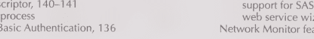
```

## 从数据库创建新实体类向导, 19–24

## 新 HTML5 应用

- 添加其他 JavaScript 库, 88–89
- 名称和位置面板, 87
- 新项目向导, 88
- 项目面板, 86–87
- 模板面板, 88

- 新 RESTful Java 客户端向导, 50–51
- 新 RESTful JavaScript 客户端向导, 51–52
- 新 Session Bean 向导, 27–29
- 为实体类的新 Session Bean, 34–36
- OAuth 标准, 认证, 133–135, 141
- 可观察对象 (observables), 109, 114–115
  - 封装事件, SSE, 114
  - `encode()`, WebSocket API, 73
  - `error()`, WebSocket API, 74
- 在线资源
- 防跨点击劫持 (anti-clickjacking), 132
- 点击劫持攻击 (clickjacking), 132
- HTML 应用开发,
- Java EE 7 技术, 4
- Java EE 7 教程, 6
- Knockout.js, 69
- NetBeans IDE, 13
- OAuth 标准, 133
- RFC 6544, WebSocket 安全, 142
- WebSocket API, 61
- WebSocket 规范, 59
- SSE, 114–115
- WebSocket API, 73–79
- 方法级注解, WebSocket, 64–65
- `onopen` 事件, SSE, 114
- `open()`, WebSocket API, 73–75
- 握手, WebSocket, 142
- Oracle, NetBeans IDE, 3
- `ORDER BY` 子句, JPQL 查询, 30
- 基于来源的安全, WebSocket, 60, 142
- `OutputStream`, JSON, 65–66
- HTTP 开销, 59
- OWASP (开放 Web 应用安全), 129, 143

## P

- 打包实体, 20, 24–26
  - WebSocket 参数, 64–65
- 密码
  - 基础认证, 136
  - 摘要认证, 137
  - 基于表单的认证, 137–138
- `persist()`, Entity Manager, 34
- 持久化 (persistence)
  - Criteria API, 31–32
  - JPA 实体, 17–24
  - 管理实体, 26–29
  - 原生 SQL, 32–36
  - 视图, 16
  - 架构生成, 36–39
  - 持久化单元 (persistence unit), 20, 21–36
  - `persistence.xml` 文件,
  - 点消息模型, JMS, 5
- POJO (简单旧对象)
  - 转换为 REST 资源, 45
  - 使用 Java API 定义实体, 16
  - 定义无状态 Session Bean, 20
  - 轮询, HTTP, 58
  - POST 请求创建操作, 98–105
  - 主键, 17–18
  - 程序化端点, WebSocket, 61
- 项目实体类, 20
- 属性
  - 全局 ID 的 CSS 处理器, 121–122
  - 架构生成, 37–39
  - 协议级安全, WebSocket, 142
  - 公钥加密 (PKC), 认证, 138
  - 无参构造函数, WebSocket, 64
  - 发布/订阅消息模型, JMS, 5–6
  - PUT 请求更新操作, 105–111

## 152 Java EE 与 HTML5 应用开发

- 安全, 141
- Server-Sent Events, 52–55
- 概述, 56
- RFC 5849, IETF, 133
- RFC 6455, IETF, 74–77
- RFC 6749, IETF, 133

## Q

- `qs` 属性, JAX-RS, 47
- 查询
  - CSS 媒体, 116–118
  - 使用 Criteria API 定义实体, 31–32
  - 使用 JPQL 定义实体, 30–31
  - 使用原生 SQL, 32–36
- 查询属性, JPQL 查询, 30

## S

- SASS (语法优雅样式表), 119–123
- Sassy (SCSS), 112
- 架构生成, 37–39
- 屏幕尺寸，响应式设计布局, 116–118
- `<script>` 元素
  - 添加 Knockout.js, 69
  - 新 HTML5 项目, 89–90
  - 在 HTML 文件中不允许, 135
  - 搜索结果页的 XSS 攻击, 127
- `<section>` 元素, `index.html` 文件, 70–71

## 安全

- REST 资源安全, 141
- 反射 XSS 攻击, 126

## R

- 读取操作, CRUD
  - 使用 GET, 92–98
- `readAsArrayBuffer()`, WebSocket, 83
- 引用表, 持久化, 19–20
- 关系注解, 映射, 22–24
- `remove()`, 31


# 索引

- **表述状态转换 (Representational State Transfer)**. 参见 REST

- `request()`, JAX-RS API, 50

- **资源**
  - **客户端**. 参见客户端安全
  - **服务端**. 参见服务端安全
  - **概述**, 143

- **SELECT 语句**, JPQL 查询, 30

- `self.Books` 变量, 94–95

- `self.serviceURL` 变量, 93–94, 107

- **语义化元素**, HTML, 5–10

- `end()`
  - JAX-RS, 43–49

- **OAuth 2.0 起源和服务器**, 134

- **REST 原则**, 42–43

- **可行的设计**
  - **定义**, 68
  - **HTML5 和**, 12–13
  - **概述**, 16
  - **表述状态转换 (Representational State Transfer)**
    - **WebSocket 优势**, 15–16
    - **带有 APIs**, 22
    - **转换为 POJO**
    - **使用 POST 创建操作**, 98–105
    - **使用 DELETE 删除操作**, 112
    - **使用 GET 读取操作**, 92–98
    - **使用 PUT 更新操作**, 105–111
    - **管理游戏逻辑**, 80–82
    - **WebSocket 数据管理**, 77–79
    - **响应头**, 防止点击劫持, 132
    - **css 文件**, 19–120

- **session bean**, EJB, 26

- **定义**, 16

- **编辑 SQL**, 33–36

- **示例**, 13–15

- **用于** 4

- **用于 JAX-RS**, 52–55

- **用于** 5–6

- **用于 实体**, 34

- **用于 生成脚本**, 39

- **用于 概述**, 4–5

- **用于 JPQL**, 30–31

- **用于 (查询以及基于 DOM 的 XSS 攻击**, 129)

- **用于 (Java Server Faces)**, 6

- **用于 JSON (JavaScript 对象表示法)**

- **用于 数据验证**, 123

- **用于 简介**, 4

- **用于 JSON 处理 Java API**, 65–67

- **用于 防跨点击劫持**, 132

- **用于 点击劫持攻击**, 132

- **用于 HTML 应用开发**,

- **用于 Java EE 7 技术**, 4

- **用于 Java EE 7 教程**, 6

- **用于 Knockout.js**, 69

- **用于 NetBeans IDE**, 13

- **用于 OAuth 标准**, 133

- **用于 RFC 6544, WebSocket 安全**, 142

- **用于 WebSocket API**, 61

- **用于 WebSocket 规范**, 59

- **用于 SSE**, 114–115

- **用于 WebSocket API**, 73–79

- **用于 方法级注解, WebSocket**, 64–65

- **用于 onopen 事件, SSE**, 114

- **用于 open(), WebSocket API**, 73–75

- **用于 握手, WebSocket**, 142

- **用于 Oracle, NetBeans IDE**, 3

- **用于 ORDER BY 子句, JPQL 查询**, 30

- **用于 基于来源的安全, WebSocket**, 60, 142

- **用于 OutputStream, JSON**, 65–66

- **用于 HTTP 开销**, 59

- **用于 OWASP (开放 Web 应用安全)**, 129, 143

- **用于 打包实体**, 20, 24–26

- **用于 参数, WebSocket**, 64–65

- **用于 基础认证**, 136

- **用于 摘要认证**, 137

- **用于 基于表单的认证**, 137–138

- **用于 persist(), Entity Manager**, 34

- **用于 持久化**
  - **用于 Criteria API**, 31–32
  - **用于 JPA 实体**, 17–24
  - **用于 管理实体**, 26–29
  - **用于 原生 SQL**, 32–36
  - **用于 视图**, 16
  - **用于 架构生成**, 36–39
  - **用于 持久化单元**, 20, 21–36
  - **用于 persistence.xml 文件**,
  - **用于 点消息模型, JMS**, 5
  - **用于 POJO (简单旧对象)**
  - **用于转换为 REST 资源**, 45
  - **用于 使用 Java API 定义实体**, 16
  - **用于 定义无状态 Session Bean**, 20
  - **用于 轮询, HTTP**, 58
  - **用于 POST 请求创建操作**, 98–105
  - **用于 主键**, 17–18
  - **用于 程序化端点, WebSocket**, 61

- **用于 项目实体类**, 20

- **用于 属性**
  - **用于 全局 ID 的 CSS 处理器**, 121–122
  - **用于 架构生成**, 37–39
  - **用于 协议级安全, WebSocket**, 142
  - **用于 公钥加密 (PKC), 认证**, 138
  - **用于 无参构造函数, WebSocket**, 64
  - **用于 发布/订阅消息模型, MS**, 5–6
  - **用于 PUT 请求更新操作**, 105–111
  - **用于 安全**, 141
  - **用于 Server-Events**, 52–55
  - **用于 概述**, 56
  - **用于 RFC 5849, IETF**, 133
  - **用于 RFC 6455, IETF**, 74–77
  - **用于 RFC 6749, IETF**, 133
  - **用于 qs 属性, JAX-RS**, 47

- **用于 查询**
  - **用于 CSS 媒体**, 116–118
  - **用于 使用 Criteria API 定义实体**, 31–32
  - **用于 使用 JPQL 定义实体**, 30–31
  - **用于 使用原生 SQL**, 32–36

- **用于 查询属性, JPQL 查询**, 30

- **session bean**, EJB, 26

- **定义**, 16

- **编辑 SQL**, 33–36

---

# 154 Java EE 和 HTML5 企业级应用开发

在关系中使用列名，映射注解, 23

尽可能使用默认值，映射注解, 23

用户界面 (UI)，JSF 服务端, 6

用户管理的事务, 16 用户名

## WebSocket

- **API**, 61
- **握手**, 59–61
- **HTML 应用程序设置**, 68–72
- **用于 HTML5 的客户端应用**, 68–83
- **简介**, 4
- **用于 的 Java API**, 62–67
- **视图**, 58–59
- **REST 服务对比**, 115–116
- **安全性**, 141–142
- **规范**, 59
- **总结回顾**, 83–84

### WebSocket，用于 JavaScript API

- **控制方法**, 73–77
- **数据管理**, 77–79
- **初始化**, 73

- **基础身份认证 (Basic Authentication)**, 136
- **摘要身份认证 (Digest Authentication)**, 137
- **基于表单的认证 (form-based authentication)**, 138
- **保护 REST 资源**, 141
- **UTF-8 字符串格式，WebSocket 数据**, 81

## V

- **验证 (validation)**
  - **Bean Validation 规范**, 19
  - **约束**, 19
  - **使用 POST 的创建操作**, 103
  - **JAX-RS 约束**, 46
  - **输入失败导致的 XSS 攻击**, 127

- **值：绑定，Knockout**, 109
- **视图数据 (View Data）**, 原生 SQL, 33
- **视图层 (View layer)**, 96–98, 104
- **ViewModel**, 110
- **WebSocket 协议，RFC 6455**, 59–61
- **websocket.js 文件**, 73
- **WHERE 子句，JQPL 查询**, 30
- **willDecode().Decoder.Text<T> 接口**, 67
- **Windows Presentation Foundation (WPF)**, 13
- **万维网联盟 (W3C)**, 13
- **WPF (Windows Presentation Foundation)**, 13
- **ws createGenerator()**, 65–66
- **ws URI 方案**, 141–142

## W

- **W3C (万维网联盟)**
  - **开发 HTML**, 6
  - **HTML 功能完备**, 6
  - **HTML 规范的下一阶段**, 6–7
  - **WebSocket API**, 59, 61

- **Web 服务向导，NetBeans IDE**, 27–31, 48–51

## X

- **X-Frame-Options 响应头，防止点击劫持**, 132
- **Xelfi**, 2
- **XSS（跨站脚本）攻击**, 126–129, 131

---

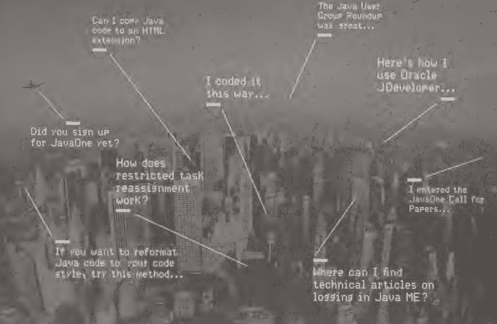

我可以将 Java 代码编写到 HTML 扩展名中吗？

Java 用户小组的总结非常棒……

我是这样编写代码的……

这是我如何使用 Oracle JDeveloper 的……

你已经报名参加 JavaOne 了吗？

受限制的任务重新分配是如何运作的？

我提交了 JavaOne 征稿……

如果你想重新格式化你的代码风格，尝试这种方法……

我可以在哪里找到关于在 Java ME 中失败的技术文章？

---

# Oracle Technology Network。它是用于共享专业知识的代码。

来到这个最好的地方，与其他 IT 专业人员就一切进行协作。

Oracle Technology Network 是全球最大的开发者、管理员和架构师社区，他们使用 Java 和其他行业标准技术以及 Oracle 产品。

注册免费会员，您将访问：

- 讨论论坛和实操实验室
- 免费下载的软件和示例代码
- 产品文档
- 成员贡献的内容

利用我们的全球知识网络。

立即加入 访问：`oracle.com/technet/java`

---

# 我们的技术。您的未来。

通过 Oracle 认证快速提升您的职业。

超过 150 万份认证证明了这些顶尖行业认可凭证的重要性，它们是脱颖而出的最佳途径之一。并且保持领先。

从今天开始

**ORACLE 认证计划**

`certification.oracle.com`

---


---

# 硬件与软件

为协同工作而设计

# ORACLE

## ACE 计划

# 需要帮助？需要咨询吗？

需要见明的意见吗？

保持联系

`oracle.com/technetwork/oracleace`

- `oraclesaces`
- `@oracleace`
- `blogs.oracle.com/oracleace`

你需要一个 Oracle ACE

Oracle 合作伙伴、开发者和客户寻求 Oracle ACE 和 Oracle ACE 主监提供专注的产品专业知识、系统和解决方案讨论，以及对各种数据中心实现的明智见解。

作为 Oracle 产品和技术专家、社区爱好者和解决方案倡导者，他们的资历非常深厚。

现在是更多关于这个精英群体——或提名一位值得的同事的绝佳时机。

有关 Oracle ACE 计划的更多信息，请访问：

`oracle.com/technetwork/oracleace`

---

# ORACLE

# ORACLE

# 复仇者集结

复仇者和 S.H.E.L.D. 的秘密取决于选项，提供执行关键任务的洞察。保护数据免受攻击

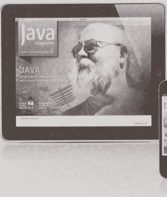

---

# 通过 Oracle Publishing 触达 70 万客户

全球最大的 IT 出版

发行量：550,000

受众：IT

# 业务洞察


连接最相关的受众

发行量：100,000

受众：高管

# Java 核心来源

发行量：125,000

受众：企业与独立人士

有关更多信息或免费订阅：

扫描二维码访问

Oracle Publishing 在线。

---

005.133 $35.00

WIenga Geertjan

Java EE 和 HTML5

企业开发

5 10/19 SEAFORD PUBLIC LIBRARY

2234 JACKSON AVE.

AFORD, NEW YORK 11783

516-221-1334

2014年5月

---

# 创建下一代企业应用

构建并分发针对桌面和移动设备的业务 Web 应用。由 Java EE 和 NetBeans IDE 专家编写的《Java EE 和 HTML5 企业级开发》介绍了先进工具和策略。了解如何操作 NetBeans IDE、构建 HTML5 程序、采用 JavaScript API、集成 CSS 和 WebSockets 以及处理安全性。本 Oracle Press 指南还对 SaaS、MVVM 和 RESTful 概念提供了实用涵盖。


探索 HTML5 和 Java EE 7 特

使用 NetBeans IDE 编辑器、模板和代码生成器

使用 Knockout.js 实现 MVVM 功能

配置、管理和调用 RESTful 服务

通过 WebSocket 最大化消息效率

接收并处理 HTML5 服务器发送事件流

采用流行的的样式、CSS3 和 Sass CSS

书中的代码示例可在 `www.OracleBooks.com` 下载。

获取完整的 Oracle Press 书单，请访问 `www.OraclePressBooks.com`。

---

# 更多学习。更多。

`MHPROFESSIONAL.COM`

在 Twitter 上关注我们 `@OraclePress`

电子书可用

$35.00 USD

ISBN 978-0-07-182309-8

MHID 0-07-182309-3

53500

9780071823098

编程/Java
