# Java EE 和 HTML5 企业级应用开发

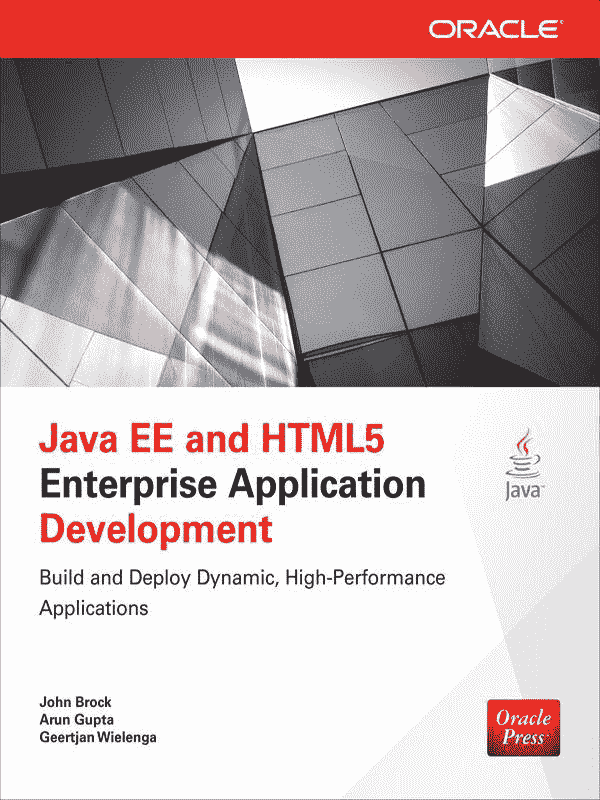

> 给我的妻子 Lisa：感谢鼓励我承担这个项目，并忍受随之来的所有深夜和情绪波动。
>
> – `John`

> 给我可爱的妻子 Menka 和优秀的儿子 Aditya 和 Mihir，感谢的支持和鼓励。
>
> – `Arun`

> 给我的妻子 Hermine！也给各地的 NetBeans 用户——希望你们在学习这本书时获得乐趣并学到很多知识。
>
> – `Geertjan`

# 关于作者

**John Brock** 是甲骨文公司（Oracle Corporation）的主任产品经理。John 在 Web 应用开发领域拥有超过 15 年的经验。在 Sun Microsystems 工作期间，他负责识别新兴的互联网技术以及这些技术如何与 Java 虚拟机 (`JVM`) 交互。John 曾与 `JRuby`、`Jython`、`Groovy`、`JavaFX` 等开发团队合作过。他目前的关注重点是 HTML5 应用开发，并且是 `NetBeans IDE` 中 `HTML5`、`JavaScript` 和 `CSS3` 特性的产品经理。可以通过 `@peppertech` 轻松联系到 John。

**Arun Gupta** 是红帽（Red Hat）开发者倡导总监，专注于围绕 `JBoss Middleware` 构建社区。作为 Sun Microsystems `Java EE` 团队的创始成员之一，他向全世界传播了对技术的热爱。在甲骨文，Arun 领导一个跨职能团队，通过对内容、营销活动和计划的策略、规划和执行，驱动了 `Java EE 7` 平台的全球发布。Arun 拥有丰富的演讲经验，包括在 37 个国家就众多主题进行演讲，并是 `JavaOne` 星级大师。他曾是畅销书作者、狂热跑步爱好者、环游家以及 `Java Champion`，可以通过 `@arungupta` 轻松联系到他。

**Geertjan Wielenga** 是甲骨文公司（Oracle Corporation）的主任产品经理。Geertjan 自 1996 年起一直从事软件行业工作。在 Sun Microsystems 期间，他负责多种技术的文档工作（主要涉及 `Java EE` 和 Web 领域），开发了教程并为出版书籍做出了贡献。Geertjan 是 `NetBeans` 的热诚倡导者，将其作为 Web 技术工具需求的核心解决方案。他同样推崇 `NetBeans Platform` 作为大型 Java 桌面应用程序的稳定且多功能的解决方案。他目前担任负责 `NetBeans IDE` 外部推广的产品经理。

# 关于技术编辑

**John Yeary** 是 Infor 全球解决方案（Infor Global Solutions）`Epiphany CRM Marketing` 的首席软件工程师。John 一直是 Java 倡导者，自 1995 年起一直从事 Java。John 是一位技术博客作者，专注于 `Java Enterprise Edition` 技术、`NetBeans` 和 `GlassFish`。John 目前是格林维 Java 用户组（`GreenJUG`）的创始人兼主席。他是一位教师、导师以及活跃的开源贡献者。

John 毕业于缅因海事学院（Maine Maritime Academy），获得海洋工程学士学位 (`B.Sc.`），专注于数学。他是一名海洋船员，拥有多项执照和认证。不在从事 Java 和 `F/OSS` 项目时，他喜欢徒足、航海、旅行以及与家人共度时光。John 还是美国童子军（`BSA`）833 队的副小团长、单位专员，以及 `BSA` 蓝岭理事会（Blue Ridge Council）活动与公民服务的南部区主席。

# 目录

- 引言
- 第 1 章 Java EE 和 HTML5 企业级开发简介
    - 开发工具
        - NetBeans
        - Java EE
        - HTML5
        - 总结
- 第 2 章 持久化
    - JPA Entity
    - 打包 Entity
    - 管理 Entity
    - Java 持久化
    - Criteria API
    - 原生 SQL
    - Schema 生成
    - 总结
- 第 3 章 RESTful 资源
    - REST 原则
    - Java RESTful 服务 API
    - JAX-RS API
    - 服务器发送事件
    - 总结
- 第 4 章 WebSocket
    - 什么是 WebSocket?
    - WebSocket 握手
    - WebSocket API
    - Java WebSocket API
    - HTML5 WebSocket 客户端
    - HTML5 应用设置
    - JavaScript WebSocket API
    - 总结
- 第 5 章 HTML5, JavaScript 和 CSS
    - HTML5 项目设置
    - REST
    - 使用 GET 请求 (R)
    - 使用 POST 请求 (C)
    - 使用 PUT 请求 (U)
    - 使用 DELETE 请求 (D)
    - 服务器发送事件 (SSE)
    - WebSocket
    - 响应式设计
    - 语法化样式表 (SASS)
    - 总结
- 第 6 章 HTML5 和 Java 应用安全
    - 客户端安全
    - 跨站脚本 (XSS)
    - 跨站请求伪造 (CSRF)
    - 点击劫持
    - 认证与授权
    - 客户端安全常识
    - 服务端安全
    - 认证
    - REST 资源安全
    - WebSocket 安全
    - 总结
- 索引

# 引言

本书涵盖的主要题包括：

- Java EE 7 持久化 API (`JPA`)
- Java EE 7 RESTful 服务 API (`JAX-RS`)
- Java EE 7 WebSocket API
- HTML5 规范的新特性
- `SockJS`、`ViewModel` 等库
- WebSocket、WebSocket 和服务器发送事件 (`SSE`) 的 API
- 通过 CSS3 特性的响应式设计
- 使用语法化样式表 (`SASS`) 进行 CSS 预处理

## Web 应用的客户端和服务安全

这些主题在以下六章节中：

**第 1 章**，“Java EE 和 HTML5 企业级开发简介”提供了书中三个主要领域的简要概述：Java EE 7 服务、HTML5 应用开发以及 `NetBeans IDE`。

**第 2 章**，“持久化”讨论了 Java 持久化 API (`JPA`)，并展示了持久化的关键概念以及如何从关系数据库中创建、读取、更新和删除数据。

**第 3 章**，“RESTful 资源”向你介绍了 REST（表现状态转移），作为分布式系统的架构风格。涵盖了 Java EE 7 RESTful 服务 API (`JAX-RS`)，包括对服务器发送事件 (`SSE`) 的新支持。你将看到如何开发自己的 RESTful 服务和 SSE 服务，这些服务将作为你在第 5 章中开发的图书会应用程序的数据资源。

**第 4 章**，“WebSocket”涵盖了使用 WebSocket 开发应用程序的服务器和客户端部分。你将学习 WebSocket 的 Java API，以及如何开发与服务交互的 HTML5 客户端。

**第 5 章**，“HTML5, JavaScript 和 CSS”完全关于 HTML5 和客户端开发。你将与你在第 3 章中创建的 REST 和 SSE 服务进行交互。你将看到如何通过 JavaScript 库 `Knockout` 使用模型-视图-模型 (`MVVM`) 架构模式。你将接触响应式设计概念以及使用语法化样式表 (`SASS`) 的 CSS 预处理技术。

**第 6 章**，“HTML5 和 Java 应用安全”涵盖了 HTML5 应用和基于 Java EE 的服务的安全概念。

## 如何使用本书和代码

本书的结构使得你可以顺序阅读，也可以跳转到任何章节作为独立主题来阅读。书中讨论的所有应用程序都提供了源代码，并可以在 `www.OraclePress.com` 下载。这允许你从后一个章节开始，仍然可以获得阅读前面的章节会拥有的资源。例如，如果你选择先阅读第 5 章（即你开发图书会应用程序），你就可以访问第 3 章中应用程序所依赖的资源。

采用最适合你的方法即可。书中全程使用 `NetBeans IDE` 向你展示如何使用向导和其他高效的开发方法，例如内置调试器。

# 第 1 章 Java EE 和 HTML5 企业级开发简介

近年来，企业开发领域发生了许多变化。两个最大的变化是向软件即服务 (`SaaS`) 的趋势，以及使用 HTML5 提供纯客户端界面。在本章中，你将介绍书中涵盖的主要议题：`NetBeans IDE`、`Java EE 7` 和 `HTML5`。通过这种 IDE、平台和 HTML5 的组合，你将很快就能构建强大的动态应用程序。

## 开发工具

书中使用了三个主要的开发工具：`NetBeans IDE`、`Java EE 7` 和 `HTML5`。在开始构建应用程序之前，重要的是确保你对这些技术的原理有所了解。

### NetBeans

`NetBeans IDE` 是你在书中使用的开发工具。它提供了如编辑器、模板和代码生成器等功能，非常适合创建使用 `Java EE 7` 和 HTML5 的应用程序。从 `NetBeans IDE 7.3` 开始，引入了新功能以支持和增强 Web 的开发体验。你可以使用这个 IDE 快速直观地创建针对桌面和移动平台的应用程序。NetBeans 的故事始于 1996 年，当时布拉格大学的一群学生尝试编写一种类似 Delphi 的 Java IDE，最初被称为 `Xelfi`。`Xelfi` 在开发者社区引起了足够的兴趣，以至于他们在毕业后决定将其新产品推向市场。1997 年，他们成立了一家公司并将 IDE 命名为 `NetBeans`。在 Sun Microsystems 开始关注 `NetBeans` 没多久，1999 年，Sun 收购了 `NetBeans` 并使其成为 Java 开发的旗舰工具集。当时，Sun 做出了另一个关键决策：将 `NetBeans` 作为一个开源项目——对任何想使用它的人免费。2010 年，甲骨文收购了 Sun，`NetBeans` 成为甲骨文的一部分，甲骨文承诺继续支持它。如今，活跃用户突破了一百万，`NetBeans` 社区继续创新和增长。

### Java EE 7

Java 平台企业版 (`Java EE`) 为开发 Web 和企业应用程序提供了一个基于标准的平台。该平台由多个组件组成，允许开发者构建这些应用程序。每个组件都使用正式规范来描述所提的组件及其功能。平台还伴有使用 Javadoc 描述的应用程序接口 (`API`)。该 API 然后被用于构建应用程序。平台还提供了一些额外的服务，如命名、注入和资源管理，跨整个平台。这些应用程序随后部署在 `Java EE` 容器中，例如 `GlassFish`，它们提供了运行时支持。`Java EE 7` 平台定义了 33 个组件。本节描述了与书中内容相关的组件。组件的完整列表请参见 `www.oracle.com/technetwork/java/javaee/tech/index.html`。

Java EE 7 平台的主要主题之一是简化 HTML5 应用的开发，特别是服务端需要的服务。为了实现这一点，Java RESTful 服务 API (`JAX-RS`) 是平台中的一个组件，定义了如何开发、部署和调用 RESTful 服务。一个简单的 Java 对象 (`POJO`) 可以通过指定注解轻松发布为表现状态转移 (`REST`) 端点。当使用标准动词访问资源时，可以轻松调用普通方法。服务器发送事件 (`SSE`) 是 HTML5 规范的关键部分，用于从服务器向客户端异步推送数据。尽管 `SSE` 尚未成为平台的一部分，但 `JAX-RS` 实现为 `SSE` 提供支持。WebSocket 在单连接上提供了全双工双向通道，并显著提高了现代 Web 应用的延迟。Java EE 7 平台增加了一个新的 API 用于构建应用程序。就像 `JAX-RS` 一样，在 `POJO` 上添加注解可以将其转换为 `WebSocket` 端点。

### HTML5

HTML5 是万维网联盟（W3C）制定的最新 HTML 标准。它为现代 Web 应用程序提供了丰富的语义元素、多媒体支持以及强大的 JavaScript API。随着移动设备的普及，HTML5 成为跨平台开发的首选技术。本书将重点介绍 HTML5 与 Java EE 7 后端服务的集成，包括 RESTful 服务、WebSocket 和服务器发送事件 (`SSE`) 的交互。

#### 移动设备的使用

HTML5 近期知名度上升的第二个主要原因，可能是接入互联网的智能手机、平板电脑和其他类型移动及嵌入式设备可用性的增加（例如，联网电视、游戏机和蓝光播放机等）。这些设备可用性的提高之所以能让 HTML5 脱颖而出，是因为它们的所有设备在开发时使用的浏览器已经在某种程度上支持 HTML5。与桌面操作系统不同，这些设备的浏览器开发人员不需要考虑与现有浏览器实现之间的任何向后兼容性问题。在这些类型的设备上，一切都是新的，制造商从最新的 HTML 规范开始，以预见它将在不久的将来成为标准。

这种通过移动设备访问互联网的增长也是吸引企业级开发者更密切关注 HTML5 的因素之一。传统的网站布局无法在智能手机或平板电脑等较小设备上进行舒适的缩放。现有的方法是在检测到客户端为移动设备时生成一个完全不同的网站版本进行显示，已被证明充斥着维护问题，且扩展效率低下。

#### 新 HTML5 特性

HTML5 的主要新特性之一是包含了新的语义化元素，帮助开发者管理 HTML 页面及其内容的布局，以便其在较小设备上查看时能够完美缩放。你现在可以使用如 `<header>`、`<footer>`、`<section>`、`<article>`、`<aside>`、`<nav>` 等许多标签来布局你的 HTML 内容。

**表 1-1. 语义元素**

| 元素 | 描述 |
| :--- | :--- |
| `<header>` | 定义文档或节的页眉 |
| `<footer>` | 定义文档或节的页脚 |
| `<section>` | 定义文档中的节 |
| `<article>` | 定义独立的自包含内容 |
| `<aside>` | 定义页面主内容之外的内容 |
| `<nav>` | 定义导航链接 |

除了 HTML5 规范中的新语义元素外，还存在新的语法元素，旨在消除安装专用插件的需求。这些包括如 `<canvas>`、`<video>`、`<audio>` 和 `<svg>` 等元素。


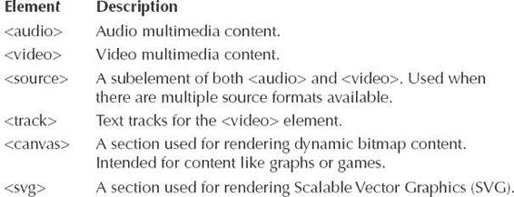

表 1-2. 语法元素

## 语法元素

最后，HTML5 规范为某些现有元素带来了新属性。其中最引人的是 `<input>` 元素 `type` 属性的新值。虽然所有这些新类型值现在都是最终定版 HTML5 规范的一部分，但每个浏览器厂商都可以（也已经）实现它们在渲染时的行为。例如，如果浏览器渲染一个类型设置为 `"date"` 的输入字段，用户将看到一个日期选择器来帮助选择他们想要输入的日期。遗憾的是，这是目前浏览器厂商分歧最大的领域之一。在移动设备上，体验更好。你经常会发现，当你点击或触摸类型设置为 `"number"` 的输入字段时，你会得到一个数字键盘而不是普通键盘；或者如果输入字段设置为 `"url"` 等，则会显示不同类型的键盘。

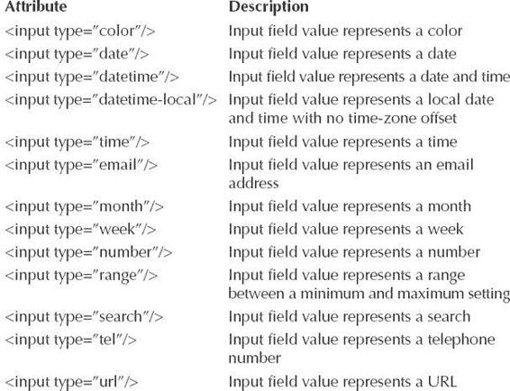

表 1-3. 表单输入属性

## HTML5 程序的组成

关于 HTML5 应用程序常见的误区之一是它们仅由 HTML5 组成。事实上，在大多数情况下，应用程序实际上由三个不同的组件组成：HTML5、JavaScript 和层叠样式表 (CSS)。通过将所有新的 HTML5 元素和属性与 CSS 版本 3 (CSS3) 的新媒体查询功能相结合，你可以为不同的设备尺寸显示相同内容的不同布局。这种修改内容以响应设备可用尺寸的方法被称为**响应式设计**；布局会对其渲染的显示尺寸做出响应。关于响应式设计，有几点需要注意的重要提示。首先，尽管它允许你创建一个在多个设备尺寸上具有相同外观和感受的网站，但 HTML5 应用程序仍然是在智能手机或平板电脑等较小设备的网络浏览器中查看的网页。应用程序不会具有像为特定类型移动设备编写和编译的应用程序那样的真正的“原生”外观和感受。其次，HTML5 和响应式设计对于希望应用程序能够访问特定移动功能（如摄像头、联系人列表和日历）的开发者来说可能不是答案。因为应用程序运行在网络浏览器中，你只能编写程序使用浏览器允许你交互的内容。如前所述，HTML5 应用程序中常用的第三个组件是 JavaScript。JavaScript 架构库的引入是使其更容易被企业级开发者接受的重要因素。

## 开发应用程序

在企业环境中开发应用程序通常意味着开发任务的分离，设计师和 UI 团队负责前端或视图层，而其他团队则负责数据层和控制层。这种应用层之间的分离被称为**模型-视图-控制器 (MVC)** 架构模式。在过去的几年里，已经开发了 JavaScript 库来引入一种类似的架构，称为**模型-视图-模型 (MVVM)**。MVVM 最初由微软在 2005 年作为 Windows 呈现框架 (WPF) 的一部分开发。这种架构模式的 JavaScript 实现由 Steve Sanderson 在 2010 年作为一个开源项目引入。它以 Knockout.js 的名称发布（[`knockoutjs.com/`](http://knockoutjs.com/)），并已经在熟悉 MVC 开发实践的 JavaScript 开发者中迅速流行起来。虽然深入理解 MVVM（特别是 Knockout.js）超出了本书的范围，但你将在第 5 章中使用 Knockout.js 创建一个将消费 REST、WebSockets 和服务器发送事件 (SSE) 等网络服务的 HTML5 应用程序。

*(注：由于提供的原文后部分存在大量重复和乱码干扰，译文已根据核心逻辑进行了清理和整合。)*

|  | 注意：在此函数中使用 HTML5 的 `dataset` 方法来获取 `data-x` 和 `data-y` 值将是理想的。如果你使用 `dataset`，代码将如下所示：在本示例中没有这样做的原因是，在编写时并非所有浏览器都支持 HTML5 的 `dataset` 特性。特别是 Internet Explorer 直到 IE 11 发布后才支持此功能。使用直接 DOM 调用来获取属性可以在所有浏览器中运行。 |

 `createJSON()` 函数将格式化后的 JSON 作为一个 JSON 对象返回，以便在之前查看过的 Listing 4-11 中的 `setCellImage()` 函数中使用。 一旦正确设置了图像和游戏状态，JSON 对象就会转换回字符串，以便通过 `websocket.send()` 方法发送到 WebSocket 端点。记住，WebSocket 数据必须是 UTF-8 字符串格式或 `Blob` 或 `ArrayBuffer` 的二进制格式。发送实际的 JSON 对象将导致 WebSocket 协议错误。

虽然本章使用的游戏代码没有使用 `Blob` 或 `ArrayBuffer` 二进制数据类型，但你可能想进一步了解一下它们是如何使用的。`Blob` 是默认的二进制数据类型，发送这种格式的数据不需要你进行任何特殊操作。只需将 `Blob` 对象作为参数传递给 `send()` 方法即可，就像传递文本字符串一样。服务器代码需要检查传入消息的类型。Listing 4-13 显示了检查消息类型并对其进行适当处理的一种可能方法。Listing 4-13 测试消息类型的示例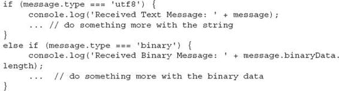

从客户端来说，你需要提供一些方法来收集二进制数据，然后将这些数据传递给函数进行处理并发送到 WebSocket 连接。Listing 4-14 显示了一种可能的解决方案：使用类型为 `file` 的输入，并允许最终用户选择文件将其发送到 WebSocket 流中。Listing 4-14 发送二进制数据的客户端代码示例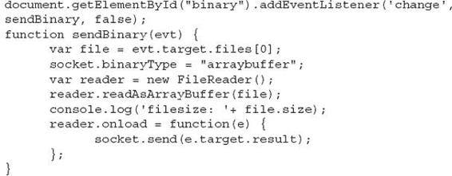

让我们快速查看 Listing 4-14 中的代码：

 第一行是在 HTML 标记中为类型为 `file` 的输入元素添加添加事件监听器。该输入元素有一个 `id` 属性，设置为“binary”。

 当事件监听器检测到输入元素发生变化时，它将调用 `sendBinary()` 函数。该函数使用监听器默认发送的事件对象来获取用户选择的文件。

 `sendBinary()` 方法将 WebSocket 连接的 `binaryType` 属性设置为 `ArrayBuffer` 类型。

 此时会创建一个一个 `FileReader` 对象，并使用 `FileReader` 的 `readAsArrayBuffer()` 方法将文件内容读取到其中。

 最后，一旦 `FileReader` 完成数据的加载，数据将通过 WebSocket 连接发送出去。

|  | 注意：需要注意的是，`FileReader` API 是 HTML5 的新特性，并非所有浏览器都已实现。特别是 Internet Explorer 9 和任何早于 6.0 的 Safari 版本都不支持它。 |

## 总结

在本章中，你学习了什么是 WebSocket 协议，以及如何使用 Java 和 JavaScript 的 API 在服务器端以及纯客户端 HTML5 应用中与 WebSocket 协议进行交互。你还学习了如何使用 Java 的 JSON API 在服务器上读取和生成 JSON 对象。

在客户端，你学习了如何处理 `String` 和 JSON 对象数据以操纵 HTML DOM 元素，并使用 Knockout.js 的 MVVM 架构模式与游戏面板进行交互。

在玩游戏或阅读 `boardViewModel()` 中的所有 Knockout 可观察对象（observables）时，你可能注意到游戏中没有实现评分系统。这种遗漏是有意为之的。现在由你根据所学的知识，添加客户端和服务器端的代码来存储和管理游戏状态。用于胜利、失败和平局的 Knockout `observables` 已经准备就绪，可以供你结合现有的 `gameStatus` 系统进行使用。

在第 5 章中，你将学习更多关于处理 HTML5、JavaScript 和 CSS 的细节。Knockout.js 库也将得到更多关注。

# 第 5 章：HTML5、JavaScript 和 CSS

从台式电脑到智能手机以及其之间所有类型的设备，HTML5 应用的发展和可用性增加，使得人们对如何在企业应用领域充分利用 HTML5 产生了高度关注。在本章中，你将学习如何创建一个纯客户端 HTML5 应用，该应用将调用并与你在前面的章节中学习如何编写的 REST、服务器发送事件 (SSE) 和 WebSocket Java Web 服务进行交互。

你将看到如何通过使用 JavaScript 库 Knockout.js 实现模型-视图-ViewModel (MVVM) 架构模式。你还将学习使用 CSS3 媒体查询进行响应式设计的基础知识，以便在应用程序显示在不同尺寸的设备上时动态更改 UI 布局。最后，你将学习使用 Syntactically Awesome StyleSheets (SASS) 和 Sassy CSS (SCSS) 语法的基础，以管理企业应用中复杂的 CSS 文件集。

## HTML5 项目设置

要开始操作，请使用 NetBeans IDE 创建一个新的 HTML5 项目：

1. 选择 `File | New Project`。

2. 如下所示，在 Categories 格中选择 `HTML5`，然后在 Projects 格中选择 `HTML5 Application`。点击 `Next` 按钮进入项目详情。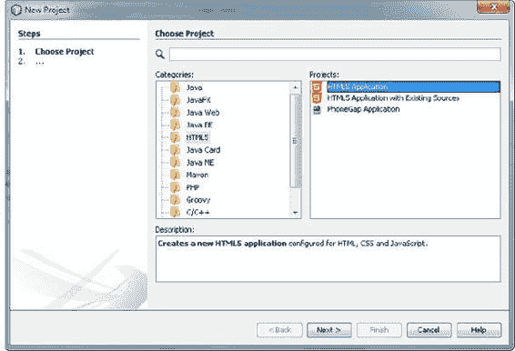

3. 在向导的第二步中，在 `Project Name` 字段中输入 `BookClub` 并再次点击 `Next`。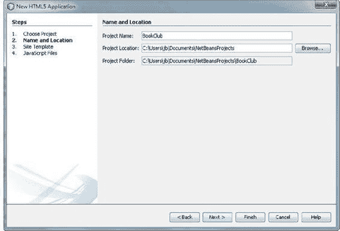

4. 在向导的下一步 `Site Template`（站点模板）中，你有三个选项供选择，以决定如何配置你的新项目。对于本示例，你将基于本书提供的模板来创建新项目。该模板将为本章后面涵盖的内容提供基础。因此，如下，点击 `Select Template` 单选按钮，点击 `Browse` 按钮，并导航到 `BookClub.zip` 文件的位置。在 Template 字段中选中 `BookClub.zip` 后，点击 `Next` 按钮。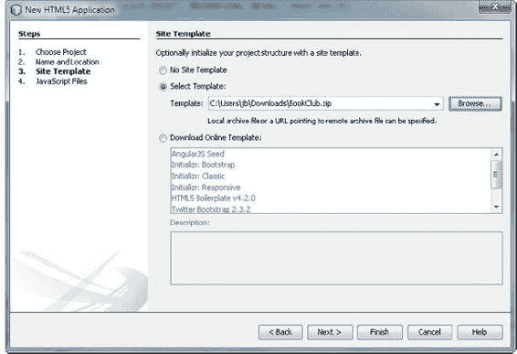

5. 创建新项目的最后一步是添加你可能需要的其他 JavaScript 库。下图中部分显示的 JavaScript 库列表直接从 JavaScript 内容交付网络 (CDNJS) 仓库提取，可以通过点击库列表下方的链接随时更新。如果你以后需要添加更多库，请进入 NetBeans IDE 中的 `Project Properties` 对话框并选择 `JavaScript Library Manager` 选项。目前，此项目所需的所有 JavaScript 库已包含在模板中。点击 `Finish` 按钮创建项目。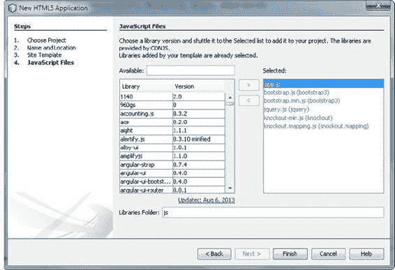

Listing 5-1 显示了向导从模板为你项目加载的 `index.html` 文件。如所示，`<title>` 标识了你的项目名称。还要注意 CSS 和 JavaScript 库是如何引用的：`<head>` 部分中的 `<link>` 和 `<script>` 标签告诉浏览器在运行 `index.html` 文档时加载指定的文件。

列表 1：设置 CSS 和 JavaScript 引用

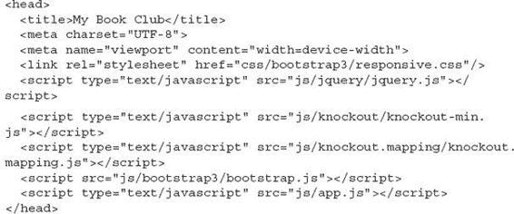

注意`<head>` 部分的最后一行包含一个额外的`<script>` 元素，引用了一个名为 `app.js` 的 JavaScript 文件。该文件包含特定此应用的 JavaScript 代码。如果你是从零开始此项目并需要添加此文件，应如所示右键点击项目导航器中的 `js` 节点并选择 `New | JavaScript File`。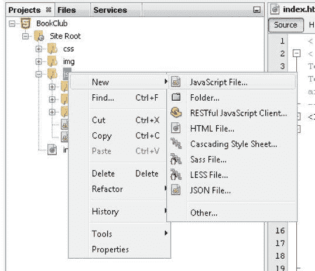

将显示如下插图所示对话框。将文件名设置为 `app` 并点击 `Finish`。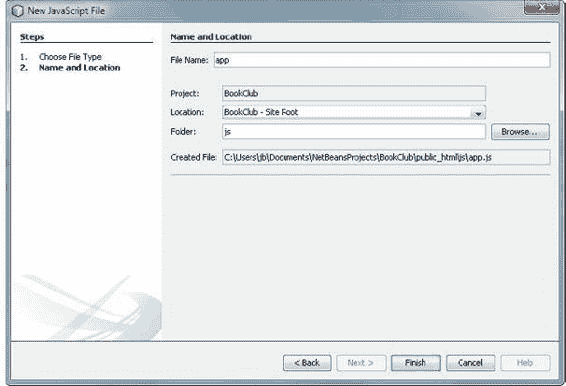

现在你可以运行项目了，一切都应该正常加载。

## REST 服务

在处理 REST 服务时，你首先需要识别可用的 REST API。这些信息通常可以在开发者文档中找到。在本章中，你将使用书中创建 REST 服务。如果你从本地机器运行，URL 将是 `localhost:8080`。

Listing 5-2 所示的 REST API 提供以下功能：

* `/books` 返回所有书籍列表。
* `/books/{id}` 返回特定书籍的详情。`{id}` 是书籍的 ISBN（书号）。
* `/books/{id}/authors` 返回特定书籍的所有作者。
* `/authors` 返回所有作者列表。
* `/authors/{id}` 返回特定作者的详情。每个作者在数据库中都有唯一的 ID。
* `/authors/{id}/books` 返回特定作者的所有书籍列表。

## CRUD 操作

学习使用特定 REST 简单方法是编写一个 CRUD 应用，调用创建、读取、更新和删除数据的 API。在本节中，你将使用 Listing 5-2 中的 API 来实现这些操作。本节讨论的所有代码都在你项目的 `app.js` 文件中。

### 使用 GET 请求读取（CRUD 中的 R）

你将开始从 Listing 5-3 所示的代码开始，对可用数据进行读取。

列表 3：jQuery getJSON 方法调用

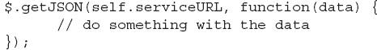

这是一个非常简单的调用，使用了 jQuery 的别名 `$` 并调用 `.getJSON` 方法。该调用接收两个参数：REST API 的 URL 以及一个处理返回数据的回调函数。[Listing 5-3] 使用 `.getJSON()` 发起调用，因此它请求以 JavaScript 对象表示法（JSON）返回数据。由于 JSON 数据格式在语法上与创建 JavaScript 对象的代码相同，因此可以直接从 JavaScript 语言中解析，而无需额外的解析器或处理器。

|  | 注意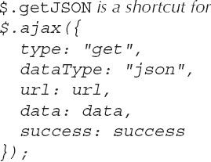 |

你会注意到，回调函数仅对成功请求有效。如果你需要进行错误处理，将希望使用在本章节稍后在列表 5-7 中所示的完整语法。

你还会注意到示例中的 URL 是使用变量 `self.serviceURL` 设置的，而不是直接使用 字符串。这是因为这一行实际上是一个名为 `ViewModel` 的较大函数的一部分。这是 Knockout.js 模型-视图-视图模型（MVVM）架构模式的一部分，你在第 1 章中读过相关内容。列表 5-4 显示了完整的 `ViewModel` 代码。


列表 5-4 示例 ViewModel


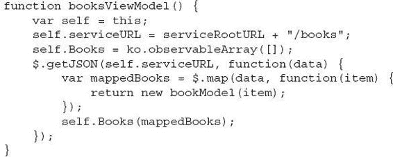

### 让我们逐行分析其提供的功能：


```javascript
function booksViewModel() { var self = this;
```

JavaScript 中的当前对象通常通过一个伪变量 `this` 来引用。在函数中始终使用 `this` 来引用变量的主要问题是，`this` 的作用域可能会根据函数的调用方式而改变。你希望将一个局部变量绑定到当前的 `this` 对象上，这样无论以后在代码的哪个部分调用该函数，都能仍然引用到同一个对象。


```javascript
self.serviceURL = serviceRootURL + "/books";
```

这一行设置了将用于实际 REST API 调用的 URL。由于所有的 REST API 调用都具有相同的主机名和应用程序路径，因此设置了一个全局变量来包含 URL 中始终不变的部分。在开发模式下处理 REST 服务调用时，需要记住的一点是，当你从不同的设备测试代码时，主机名可能会变化。例如，使用“localhost”作为主机名对于任何连接到运行在同一机器上的 REST 服务的浏览器来说都是没问题的。然而，如果你尝试从例如平板电脑测试代码并连接到你开发机器的 IP 地址，那么对“localhost”的 JavaScript 调用将失败。出于这个原因，你会在应用程序代码的顶部看到 `serviceHostname` 变量被设置为 `serviceHostname = window.location.hostname;`，并且最终的 `serviceRootURL` 变量是使用这个动态值创建。

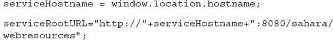 

```javascript
self.Books = ko.observableArray([]);
```


这显示了你第一次使用 Knockout.js 方法。你将变量 `self.Books` 赋值给一个 Knockout `observableArray` 并用空数组对其初始化。使用 Knockout 可观察对象（observables）和 `observableArrays` 是在 MVVM 架构的模型层数据与视图层之间建立双向绑定的关键。你将在在本章稍后的部分看到这个 `observableArray` 是如何使用的。


```javascript
$.getJSON(self.serviceURL, function(data) {
```

这一行已经在列表 5-3 中出现过并在之后进行了讨论，但此时这些变量应该会更容易理解一些。当返回成功请求时，会处理回调函数。`data` 对象包含了从服务器返回的作为 `response` 对象一部分的数据。由于你使用了 `$.getJSON()`，返回的数据是一个 JSON 对象。


```javascript
var mappedBooks = $.map(data, function(item) {
```

这一行使用 jQuery 的 `.map()` 工具方法获取返回的 JSON 对象中的每个顶层元素，并将其添加到数组中。每个项目在从 `.map()` 方法返回之前，都会被创建一个新的 `bookModel` 对象。


```javascript
return new bookModel(item);
```

最后，你得到了一个包含模型集的数组。当稍后讨论列表 5-5 时，你将了解到更多关于 `Model` 对象的信息。


```javascript
self.Books(mappedBooks);
```

最后这一行将预定义的 `observableArray` `self.Books` 的值设置为包含 `Model` 对象集合。当你将 `ViewModel` 绑定到视图层时，将看到此对象是如何使用的。

### 模型 (Model)

Model 代表你数据的一个实例。最简单的想法将其视为数据库中的单条记录或表格中的单行。在列表 5-5 中，你可以看到 Model 中的每个字段都被赋值给了一个 Knockout 变量。这让你能够利用 Knockout.js 闻名的双向绑定。双向绑定意味着，当 `observableArray` 的值发生程序化更改或来自用户输入更改时，Knockout 库会自动更新所有绑定到它的元素。你不需要为视图层中使用的每个变量设置监听器（当你在稍后讨论视图层时，这一点会变得更加清晰）。

在 Model 的最后一行，你会注意到你不仅从数据中分配了每个字段，还可以定义将在视图层中使用的自定义变量。在示例中，书籍封面照片已经提供，并以其 ISBN 代码命名。在列表 5-5 中，你可以看到变量 `this.coverImage` 被赋值给 `bookData.isbn` 的值，以便稍在 HTML 代码中加载特定的图像。


列表 5-5 示例 Model


### 视图 (View)

现在你已经有了 Model 和 ViewModel，拼图还剩下最后一块。列表 5-6 显示了视图层的 HTML 代码。它包含在项目的 `main.html` 文件中。


列表 5-6 示例


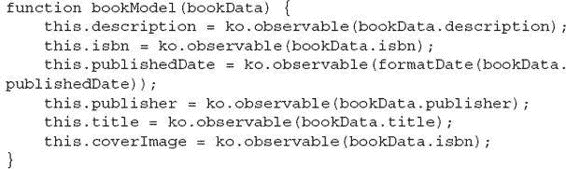

让我们分解这段代码：


```html
<article id="bookInfo">
```

该元素代表有助于定义页面结构的语义元素。然而，`id` 属性是重要的，因为它会被 Knockout.js 的 `applyBindings()` 方法用于此 HTML 部分绑定到你创建的 ViewModel。


```html
<div class="item active" data-bind="foreach: Books ">
```

这一行是渲染书籍列表的开始。这个 `div` 将一个模型的布局和样式。如果这是一个表格，这就是数据行的布局和样式。关键属性是 `data-bind`。它使用 Knockout 的 `foreach:` 绑定来渲染 `div` 内部的每一个项目。回想关于列表 5-4 的讨论，它将 `Books` 的值设置为来自 REST 调用返回的模型数组。


```html
<div id="bookCoverPhoto" class="bookCoverPhoto col-md-3" data-bind="click: getBookDetails">
```

这个 `div` 是书籍封面及其的容器。它绑定了 `click:` 绑定，以便你进入页面获取该特定书籍的更多详情。你稍后将看到更多关于获取和显示书籍详情的内容，因为该详情页将用于你的 CRUD 应用程序的操作。


接下来的三行设置了每本书将显示的内容。每本书的封面图像、标题和 ISBN 都绑定到它们自己的 HTML 元素上。这段代码中有两个注意点：


```html
data-bind="attr: {src: 'img/'+coverImage()+'.jpg'}"
```

在这个 `data-bind` 中，Knockout 可观察对象 `coverImage` 被当作方法调用，而不是像你在之前所有的绑定中那样仅引用变量。当你想要变量的实际值而不是 Knockout 用于双向绑定的函数引用时这样做。这破坏了该引用的双向绑定，但在某些情况下是可以的。在这种情况下，你只是使用变量动态地获取 `coverImage` 文件。你没有在代码的其他部分更改此名称，因此不需要将其设置为双向绑定。


```html
class="hidden" data-bind>
```

这个 `class` 是 `"hidden" data-bind`...

|  | TIP 要测试您的错误回调函数，请尝试发送一个请求，其中某个唯一字段的值相同。在示例应用程序中，请尝试添加两个 ISBN 相同的书籍。 |

Listing 5-8 中显示的 HTML 代码包含一个 Knockout `click:` 绑定，该绑定会显示一个对话框，在其中输入你想要添加到数据库的新书信息。

Listing 5-8 click: 绑定以显示添加新书对话框!!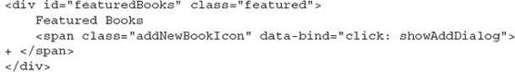

这段代码非常直观。Knockout `click:` 绑定正在调用一个名为 `showAddDialog()` 的函数。该函数使用 Twitter Bootstrap 框架（你最初创建项目时使用的）提供的模态对话框功能来显示模态对话框。此对话框包含收集用于添加到数据库的新书详情的表单。Listing 5-9 显示了该对话框的 HTML。显示模态对话框的一行代码是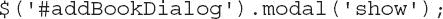

Listing 5-9 带有表单的新书模态对话框!!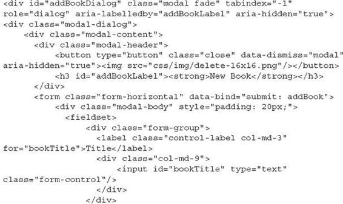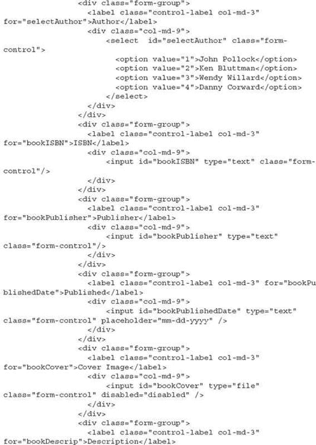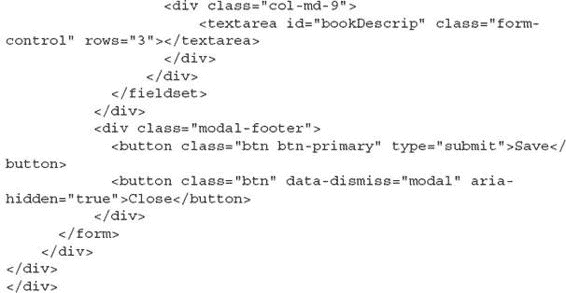

这是一段非常大的代码，但几乎大部分都是 HTML 布局和样式。让我们讨论一下提供功能的行：

```html
<form class="form-horizontal" data-bind="submit: addBook">
```

这是 Knockout `submit:` 绑定，它告诉 Knockout 在执行提交时将所有表单元素传递给 `addBook` 函数

```html
<button class="btn btn-primary" type="submit">Save</button>
```

通过将此按钮的 `type` 属性设置为 `"submit"`，它会在被点击时触发提交事件，导致调用初始的 `submit:` 绑定。当表单提交时，它将回调 `addBook` 函数，该函数包含了你之前审查过的 REST 调用。上一个示例中未显示如何将数据格式化为作为请求一部分的 JSON 对象。Listing 5-10 向你展示了如何使用 Knockout `submit:` 绑定传递的表单元素来创建 JSON 数据

Listing 5-10 解析表单数据到 JSON 对象的示例!!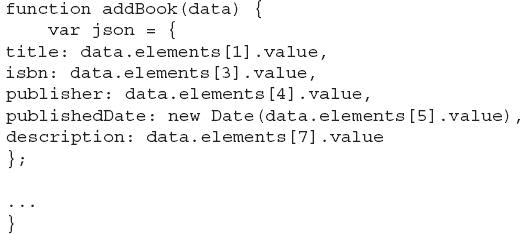

传递到 `addBook()` 函数的数据包含一个 HTML 元素数组，你将从这些元素中提取所需的值赋值给 REST 服务要求的字段。在这种情况下，数组包含了 Listing 5-10 中显示的五个字段。当你向 REST 服务发送数据时，必须知道每个字段期望接收的值的格式。例如，当设置 `publishedDate` 字段时，REST 服务期望为该字段发送一个 `Date`，因此你将需要将表单数据转换为适当的格式。

此时，可以通过两种方式进行数据验证。你可以使用来自客户端框架（如 Twitter Bootstrap）的内置验证功能，以确保在提交事件触发之前，输入表单的数据符合正确的格式，和/或者你可以在将数据赋值给 JSON 对象时进行验证。提供的示例应用程序没有执行任何客户端验证。不过，它在“出版日期”（Published Date）表单字段上提供了一个提示，帮助最终用户知道该字段期望的格式：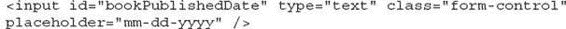

如果你在表单中也包含了不想使用的元素，确定哪个特定的 HTML 元素包含了你想赋值给 JSON 对象中特定字段的数据可能会很棘手。NetBeans IDE 提供了一个 JavaScript 调试器，对于确定返回给函数的函数对象中的内容非常有用。图 5-2 展示了如何使用调试器来确定需要使用哪些元素来实现 Listing 5-10 中所示的代码。点击 JavaScript 文件左侧的行槽会在该行上设置一个断点，如 图 5-2 中的第 141 行所示。当在浏览器中提交表单时，IDE 会停这一行。你可以悬停在 `data` 变量上，在提示框中查看它的值。展开它将显示数据对象中的每个元素及其值。当然，如果你不想使用提示框，也可以在 IDE 底部的变量（Variables）窗口中查看这些调试器信息。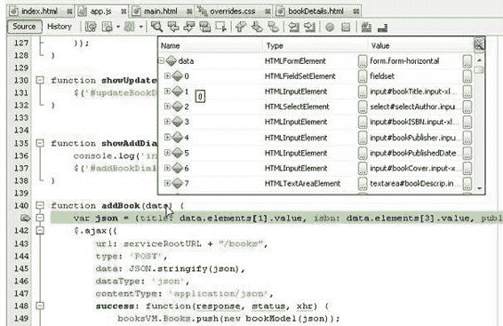

### 图 5-2 NetBeans JavaScript 调试器

现在你已经向 REST 服务提交了添加书籍的请求，你想完成任何可能受 POST 请求结果影响的视图层更改。再次查看 Listing 5-7，你会看到成功和错误的两个回调函数。如果发生错误，你应该采取某些操作通知最终用户请求未执行。在示例中，会调用 `alert` 显示错误状态以及 REST 服务返回的任何文本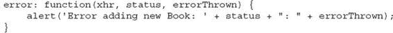

在请求成功的情况下，你想将发送到服务器的相同 JSON 数据添加到绑定的 Knockout 可观测数组中。在 Listing 5-7 中，代码行 `booksVM.Books.push(new bookModel(json))` 根据 JSON 数据创建一个新模型并将其推入 `booksVM.Books`。由于 `Books` 是一个 Knockout 可观测数组，只需添加新模型就会触发事件，绑定到 `foreach:` 的 HTML 将自动更新自身。

### 使用 PUT 请求进行更新（CRUD 中的 U）

更新记录的过程与上一节介绍创建新条目的过程相似。首先，你想查看要编辑书籍的详情。Listing 5-11 显示了如何编写 HTML 来列出服务中的所有书籍

Listing 5-11 Knockout foreach: 绑定示例!!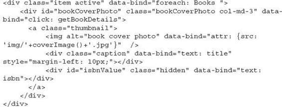

Knockout 的 `foreach:` 绑定用于以相同的样式显示 `Books` 中的每项。`Books` 是来自你视图的 Knockout 可观测数组。HTML 代码中最重要的元素实际上是包含每本书 ISBN 的隐藏 `div`。ISBN 是每本书的唯一 ID，这将允许你再次调用 REST 来获取某个特定书籍的信息。注意，书籍封面图像、标题和 ISBN 的每个 `<div id="bookCoverPhoto"` 元素都有到函数 `getBookDetails()` 的绑定。该函数将加载显示特定书籍所有详情的页面。Listing 5-12 显示了这个函数

Listing 5-12 getBookDetails 函数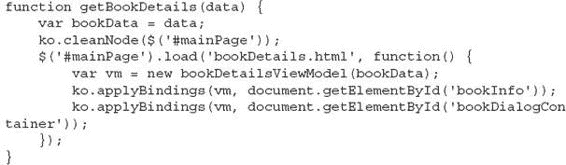

让我们来看看这段代码：

第一行简单地设置了一个本地变量 `bookData`，包含你刚刚离开的页面的数据

你目前为止使用的整个示例应用程序被设计为单页应用程序。这意味着应用程序在发出请求时不会更改 URL 并加载新页面，而是将新的页面片段或模板加载到大面的特定部分。在该应用程序中，`index.html` 页面被设计为具有头部和页脚代码以及页面中单个 `div` 用于包含所有其他页面模板。此 `div` 的 ID 为 `mainpage`。由于 Knockout 允许在此时对 DOM 元素上只有一个绑定，因此当你加载新页面模板时需要清除现有绑定并添加新绑定

在 `ko.cleanNode($('#mainPage'));` 清除 mainPage 后，`$('#mainPage').load()` 将新模板加载到页面中。

|  | **注意** 注意所有 `<input>` 元素都使用 `value:` 绑定，而其他 DOM 元素使用 `text:` 绑定来获取其内容。在处理 Knockout 绑定时，为种类型的 DOM 元素绑定正确的内容属性非常重要。例如，如果你通过 `value` 属性设置 DOM 元素的内容，那么你应该使用 `value` Knockout 绑定。 |

其次，注意在所有的表单元素绑定中，Knockout 可观测对象（observ）都是作为函数调用的：`data-bind="value: isbn()"`。这非常。由于 Knockout 的双向绑定，如果你尝试直接绑定到可观测对象，一旦你在表单字段中更改了它，它就会在书籍详情页中同步更新。你不希望这种情况立即发生，以防最终用户点击“取消”按钮而不是提交更改。通过作为函数调用可观测对象，你获取的是变量的实际而不是可观测对象。[Listing 5-16] 显示了表单是如何处理的，以及如何在 REST API 中执行实际的更新。


Listing 5-16 提交更新


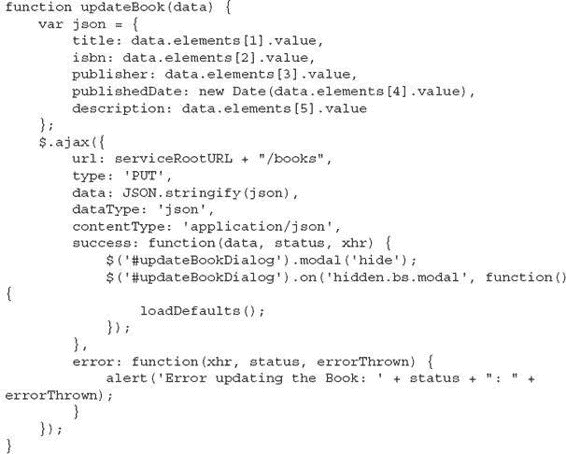

让我们通过这段代码来检查正在发生什么：


传递给 REST API 用的 JSON 对象是使用 Knockout `submit:` 绑定触发时传递的表单数据创建的。


你用于添加新书籍的相同 AJAX 调用被再次用于更新书籍。然而，现在使用的 `type` 属性是 `PUT` 而不是添加方法时使用的 `POST`。


你同样拥有 `success:` 和 `error:` 回调函数。`error:` 函数与之前完全相同。


更新完成后，应用程序返回到主页。`success:` 函数关闭 `updateBookDialog` 对话框，然后等待关闭操作完成。随后它调用 `loadDefaults()` 函数，该函数会重置 ViewModel 并将正确的绑定带回主页。

### 使用 DELETE 请求（CRUD 中的 D）

更新过程的设置有点长，但该设置也开启了删除功能。`confirmDeleteDialog` 对话框的显示方式与 `updateBookDialog` 相同，通过调用 `showDelete()` 函数来实现。[Listing 5-17] 显示了执行删除所需的 REST API 调用。


Listing 5-17 DELETE API 调用示例


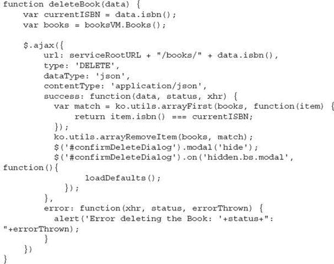

当用户在 `confirmDeleteDialog` 确认对话框中点击“是”按钮后，将调用 `deleteBook(data)` 函数并将当前的 `Books` 详情传递给该函数。要使用 REST API 删除记录，你需要为想要删除的记录准备一个唯一 ID。在示例应用程序案例中，这就是 `ISBN` 值。让我们看看 [Listing 5-17] 中的代码：


传递给 AJAX 用的 JSON 对象只需要包含你想要删除的记录的唯一 ID。注意，再次你设置的是可观测对象的实际值，而不是可观测对象的引用。


一个本地变量被设置为当前的 `ISBN` 值，以便稍后在比较函数可以使用 ISBN 值。


一个本地变量被设置为 `Books` 可观测数组（`observableArray`），这样如果 REST API 调用成功，你就可以移除 Model 条目。


AJAX 调用中的 URL 设置为使用 REST API 来获取你想要删除的精确书籍。


`type` 属性被设置为 `DELETE`。


`dataType` 和 `contentType` 都被设置为 `JSON`，以便服务知道你发送和期望返回的是什么。


与所有其他调用一样，有 `success:` 和 `error:` 回调函数。`error:` 函数与之前完全相同。


`success:` 函数使用 Knockout 实用函数 `arrayFirst()` 在 `observableArray` 中找到第一个匹配项。一旦找到，它会返回该 Model 的引用，以便可以使用另一个名为 `arrayRemoveItem()` 的 Knockout 实用函数将其移除。


就像处理 `updateBookDialog` 对话框一样，`confirmDeleteDialog` 对话框被关闭，一旦关闭完成后，调用 `loadDefaults()` 函数来重置 ViewModel 并加载主页。

### 服务器发送事件 (SSE)

服务器发送事件有时被称为推送技术，因为数据流是单向的。所有内容都来自服务器。浏览器选择连接到 SSE 流，以便在有新信息可用时向其发送信息。示例应用程序设置了一个事件部分来显示来自 SSE 流的数据。Knockout 双向绑定对于显示数据非常有帮助，因为你可以设置传入数据与特定 DOM 元素之间的绑定，并在新数据更改可观测对象时让其更新。[Listing 5-18] 显示了如何连接到 SSE 流以及用于处理流及其数据的函数。


Listing 5-18 服务器发送事件示例


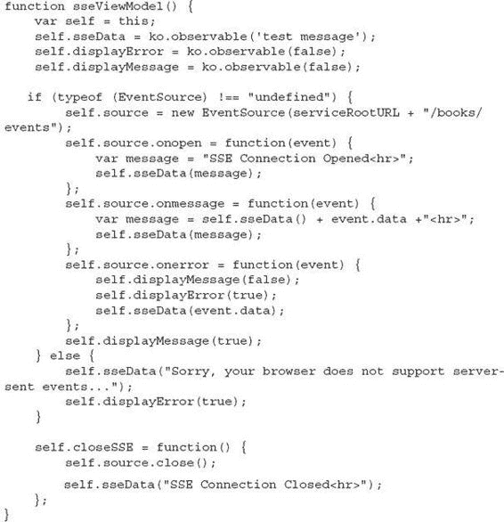

服务器发送事件是 HTML5 引入的新功能。在编写期间，某些浏览器并不支持此功能。

|  | **提示** 目前，没有任何版本的 Microsoft Internet Explorer 支持服务器发送事件。 |

在继续初始化代码之前，最好执行以下检查以确保浏览器支持 SSE：


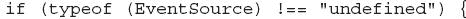

如果浏览器不理解 `EventSource` 的类型，说明它不支持 SSE，在这种情况下你可以显示错误消息。让我们遍历 [Listing 5-18] 中的代码来查看每个部分的功能：


前几行设置了 Knockout 可观测对象的默认值。这些可观测对象绑定到 HTML 代码中的 SSE 部分。


在检查浏览器是否支持服务器发送事件的 `if` 语句内部，你创建一个新的 `EventSource` 对象并将其赋值给变量 `self.source`。用于连接的 URL 是你在书籍第 [3 章]中编写的 SSE 流。

一旦你拥有了 `EventSource` 对象，就有三个事件可以进行监听，然后执行相应的操作：

- `onopen:`: 此事件在连接首次建立时触发。
- `onmessage:`: 每当服务器向浏览器发送消息时，该事件就会触发。这是你将可能需要处理的主要事件。
- `onclose:`: 当连接由于任何原因关闭时，会触发此事件。

在列表 5-18 中，你正在将局部变量 `message` 设置为一个表示连接已建立的字符串。然后，你将该值赋值给 Knockout 可观测对象 `sseData`，它将显示在绑定到同一个可观测对象的 SSE HTML 区域内。由于你在消息中包含了 HTML 标记，因此 HTML 页面上的 Knockout 绑定实际上应该使用 `html:` 绑定，而不是普通的 `text:` 绑定。

在 `onmessage` 函数中，你希望通过将服务器的最新消息追加到现有消息的末尾，布局进入该区域的消息。你通过将局部变量 `message` 设置为可观测对象的实际值，然后追加传入的 `event.data` 来实现。生成新的追加消息后，你将 `self.sseData` 可观测对象设置为新值。

如果连接由于任何原因关闭，你将设置一个表示连接已关闭的消息，并设置相同的 `self.sseData` 可观测对象来显示该消息。

当初始化 `self.displayMessage` 和 `self.displayError` 的原始可观测对象时，它们被设置为 `false`，这样在页面加载期间它们就不会显示这些区域。现在连接已经建立并设置了消息，你可以将可观测对象设置为 `true`，这将显示消息区域，同时保持错误部分隐藏。

最后，在 Event 区域的视图层中有一个很小的 X 图标，它已绑定到 `closeSSE()` 函数。当点击该图标时，当前的 SSE 流将关闭，并显示相应的消息。

## WebSocket

在 JavaScript 中使用 WebSocket API 并产生的数据连接到 HTML 视图层已在第 4 章中介绍过。如果你还没有阅读第 4 章，设置到服务连接的基本方法与你刚刚通过服务器发送事件（SSE）学到的方法是相同的。然而，通过 WebSocket API，你还可以向服务器发送数据。使用 WebSocket 连接代替 REST 或其他类型协议的巨大优势之一是，当你使用 WebSocket 协议时，显著减少了通过线路传输的数据流量。客户端和服务器之间的连接建立一次，然后一直维持到通过 API 或客户端关闭连接为止。在其他协议中，你每次想从服务器发送或接收数据时都需要经过连接设置。要获取有关新 WebSocket 协议的完整描述，请阅读第 4 章。

## 响应式设计

响应式设计概念解决了设计 Web 应用程序的需求，使其能够根据显示它的设备屏幕尺寸相应地渲染其布局。应用程序的视图层需要通过改变布局或渲染的内容量来响应这种视图尺寸的变化。

CSS2 规范提供了根据媒体类型动态使用不同 CSS 规则的能力。这些类型中最常见（且在 CSS3 中也继续如此）是屏幕（screen）和打印（print）。CSS3 规范通过引入媒体查询（media queries）扩展了这一能力。媒体查询由一个媒体类型和零或多个表达式组成。这些表达式检查媒体特性的特定条件。一个很好的例子是检查当前显示屏幕尺寸的表达式。

通过使用媒体查询和定义为网格布局的 CSS 类模式，你可以让应用程序响应显示屏幕的变化。

网格布局模式是你可以自己设计的，但使用现有的网格框架要容易得多。到目前为止，你一直在使用 Twitter Bootstrap 框架来显示模态对话框并帮助显示按钮和通用表单布局。Twitter Bootstrap 在其 CSS 文件中也包含网格布局。最常用的网格样式是 12 列网格。你可以将布局的不同部分定义为任意数量的列，这些列之和为最大宽度 12。例如，你可以设置三个部分，每个部分都设置为四列宽。例如，在示例应用程序添加新书籍的模态对话框中，对话框对所有表单元素使用九列宽，而标签（label）元素使用三列。列表 5-19 显示了该对话框部分内容的显示效果。

示例网格布局 HTML

注意每个 `<div>` 元素中的 `class="col-md-9"` 样式类，以及标签的 `class="col-md-3"` 样式类。这些样式类和媒体查询的结合使得响应式设计成为可能。让我们看看列表 5-20 中的 CSS 代码。

网格布局的 CSS 示例

列表 5-20 的两个部分通过不同的媒体查询遵循 `.col-md-9` 的样式类。第一部分涵盖了浏览器尺寸不落入任何特定媒体查询的情况。第二部分引入了浏览器尺寸设置为 `min-width:992px` 情况的媒体查询。你在特定媒体查询内部放置的任何样式规则在媒体查询表达式为真时，都会覆盖该相同规则先前的任何值。如果你没有覆盖某个规则，则现有规则将继续被使用。在显示的代码中，你并没有覆盖现有值，而是为 `width:` 和 `float:` 设置了新规则。注意宽度被设置为百分比。

## 语法优雅样式表 (SASS)

对于大多数 HTML5 应用，你可能可以使用一个易于维护的单个 CSS 文件。然而，随着应用程序的增长和变得复杂，维护大型 CSS 文件变得异常困难。历史上，如果你将 CSS 文件拆分成较小文件并在 HTML 中引用它们，规则的生效取决于文件的顺序，即“后者胜”原则。在 2007 年，SASS 由名为 Hampton Catlin 的开发者引入。SASS 的开发目前由 Nathan Weizenbaum 和 Chris Eppstein 继续。

原始的样式表语言在设计上类似于 Haml（HTML 抽象语言）编程语言，因为它使用了缩进样式。这种被称为缩进格式的样式看起来完全不像 CSS。这种语法通常使用扩展名 `.sass` 。后来了一种新的语法称为 Sassy CSS，或 SCSS，它的设计看起来和感觉与 CSS 完全一样——以至于任何有效的 CSS 代码都是 SCSS 的子集。这种语法通常使用扩展名 `.scss` 。SASS 作为 SASS 或 SCSS 文件的预处理器工作，并将独立文件编译为一个或多个可以在 HTML 代码中引用的 CSS 文件。列表 5-21 包含了两个样式引用：第一个是作为 My Club 示例应用程序基础的 Bootstrap 框架，第二个是对应用程序特定样式的引用。后者文件名为 `responsive.css`，它是作为 SASS 处理四个独立 SCSS 文件生成的 CSS 文件。这些文件见图 5-4。

引用 CSS 文件

如图 5-4 所示，`responsive.scss` 文件仅包含三行实际代码。它按照你想要的组合顺序导入其他三个 SCSS 文件。其他三个文件被拆分以包含针对特定媒体查询类型的类和规则：在这种情况下，分别是桌面、平板和手持设备。这种分离只是一个例子。你的个人项目将决定你如何确定将 CSS 拆分为更易管理部分的最佳方法。

NetBeans IDE 使在项目中使用 SASS 变得非常简单。在导航中右键点击项目名称，选择属性菜单选项。在项目属性对话框中，选择 CSS 处理器选项，如图 5-5 所示。对于此项目，IDE 被指示在 `/scss` 目录查找 SCSS 文件，并将编译后的文件输出到 `/css` 目录。

|  | 提示：在使用 SASS 时，如果你以下划线开头 SCSS 文件的命名，这将指示编译器不将该特定文件编译成单独的 CSS 文件。当你有多个较小的文件并将其导入到一个较大的文件中，且你只想将该较大的文件编译为最终的 CSS 文件时，这种方法非常有用。 |

如果你还没有这样做，可以点击此对话框右上角的 `Configure Executables` 按钮来安装和管理 SASS 的可执行文件。用于处理 CSS 预处理器可执行文件的全局 IDE 选项对话框如图图 5-6 所示。你会发现，如果你不知道从哪里下载可执行文件，文中提供了一个链接可以引导你到达正确的地点。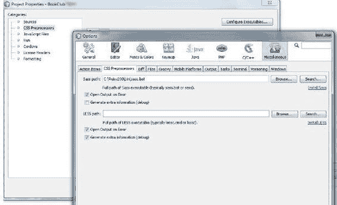图 5-6。CSS 预处理器的全局 IDE 属性

你还会注意到 NetBeans IDE 支持另一种名为 LESS 的 CSS 预处理。这种方法与 SASS ，由 Alexis Sellier 在 2009 年设计。与许多开源项目一样，一个项目可能会影响另一个，反之亦然。在这种情况下，SASS 设计于 2007 年，这影响了 2009 年 LESS 的开发。随后 LESS 的引入影响了 SASS 中使用的新 SCSS 语法。这两种样式表语言都有其优缺点。对于 NetBeans IDE 而言，两者的设置和功能是相同的。

现在你已经了解了如何使用 NetBeans IDE 处理 SCSS 文件，你已准备好查看代码了。代码列表 5-22 展示了一个非常简单的嵌套示例，并在生成的文件中显示了结果 CSS。与 `#footerContent` 类相关的所有相关规则都嵌套在 SCSS 文件的根样式中。CSS 编译后，生成的 CSS 包含分离的规则。列表 5-22 SCSS 嵌套及生成的 CSS 代码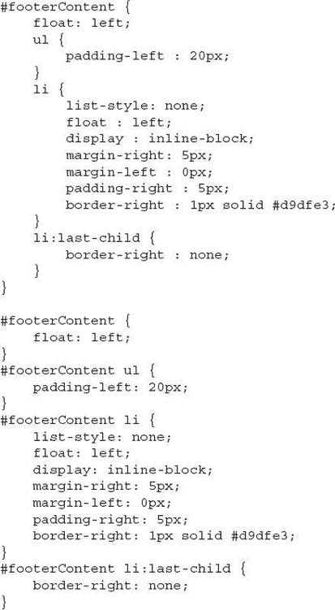

## 总结

在本章中，你学习了如何在 NetBeans IDE 中处理 HTML5 项目，以及如何使用和交互 REST Web 服务以执行 CRUD 功能。你使用 JavaScript 连接到服务器发送事件 (SSE) 流，并使用来自该流中的数据更新了 BookClub 应用程序中的事件窗口。通过使用 Knockout.js JavaScript 库，你接触了模型-视图-模型 (MVVM) 架构模式。你还学习了使用 Twitter Bootstrap 框架提供的网格布局和媒体查询进行响应式设计的基础知识。最后，你简要查看了如何使用 CSS 预处理器来管理大型且复杂的 CSS 实现。

本章使用的 BookClub 应用程序在“作者详情（Author details）”部分故意留空。这样做是为了让你利用设置“书籍详情”时学到的任务，为应用程序的“作者”部分添加相同的功能。

# 第 6 章：HTML5 和 Java 应用程序安全

作为一名应用程序开发人员，你可能会感觉到，每当你深入了解一个最新的安全问题时，新的问题就会出现。要处于安全趋势的前沿似乎在实践上是不可能的，但你可以遵循一些基本的开发规范，这将帮助你至少跟上安全趋势。应用程序安全可以有许多形式。在 HTML5 和 Java Web 应用程序的情况下，两种主要的安全形式是客户端安全和服务器端安全。适用于客户端和服务器端安全的顶级问题和常见最佳实践有所不同，因此本章将分别讨论，从保护客户端开始。

## 客户端安全

在处理 HTML5 应用程序时，请始终记住这个重要的事实：不同的 HTTP 流量分析器可以读取你发送或接收的几乎任何内容。

|  | 提示你应该将进入和离开你的 HTML5 应用程序的所有数据视为可能是恶意的。 |

对于 HTML5 应用，虽然几乎所有的安全措施都需要在服务端实现，但仍有几种类型的客户端攻击是您需要注意的并在编写代码时进行防范的，以避免您的应用程序被黑客利用。这些攻击类型包括跨站脚本、跨站请求伪造和点击劫持。您还需要对应用程序的身份验证和授权实践有基本的了解，最后，还需要掌握在进行客户端安全编码时应始终遵循的一些常识做法。

## 跨站脚本

跨站脚本（`XSS`）是 Web 应用中最常见的安全漏洞之一。实际上有三种 XSS 攻击：反射型、存储型和基于 DOM 的。反射和存储型 XSS 攻击是服务端攻击，必须在应用程序服务器或 Web 服务器上处理；而基于 DOM 的 XSS 攻击是客户端攻击，必须由客户端开发者解决。

当 Web 应用在没有先对输入进行适当验证或编码的情况下，将用户输入整合到生成的输出中，就会发生 `XSS`。来自最终用户（例如表单输入）或数据连接（例如 REST 服务）的数据被视为不可信数据。这些数据不是你作为应用程序的一部分创建的，因此你无法验证它们是否来自受信源。你需要防范的就是这些不可信数据。

理解 `XSS` 的最佳方法是看一些示例。虽然本节的重点是客户端安全，但服务端 `XSS` 攻击最理解，因此接下来提供了两个服务端 `XSS` 攻击的示例，随后是一个客户端示例。

对于第一个示例，假设你决定为 404（文件未找到）错误创建一个自定义错误页面。当有人输入类似于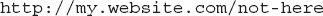 的 URL 时，错误页面会返回一条消息，说明在服务器上未找到 `not-here` 文件。如果错误消息中显示的数据在浏览器读取之前没有经过适当转义，就会发生 `XSS` 漏洞，在这种情况下，攻击者可以执行如下操作：。浏览器在解析数据并将其作为错误消息的一部分显示时，会执行 `<script>`。

对于第二个示例，假设你的 Web 应用有一个搜索框。当用户进行搜索时，搜索结果将在一个单独的结果页面上显示。如果结果页面使用了非常常见的模式“找到关于：x 个结果找到：<显示所搜索的内容>”，并且没有对搜索字符串进行适当的编码，就会发生 `XSS` 漏洞。如果恶意用户输入了类似于上一个示例中 `<script>` 块的搜索字符串，那么当搜索结果页面在浏览器中加载时，JavaScript 将被执行。

上述两个示例通常都在服务端管理，因为错误页面和搜索结果页面通常在服务器上生成。如前所述，第三种 `XSS` 攻击是纯粹的客户端攻击，涉及到 JavaScript 如何处理 DOM 元素的执行。

为了演示基于 DOM 的 `XSS` 攻击如何工作，我们将使用一个与之前的搜索字段示例相似的例子。假设你的 HTML5 Web 应用有一个表单，包含一个请求用户用户名的输入字段。表单还包含一个 `<div>`元素，当用户按下回车键时，该元素将更新以显示用户在输入字段中键入的任何内容。列表 6-1 显示了此示例的代码。

列表 6-1 表单示例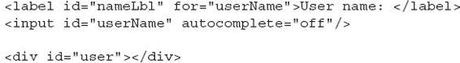


# 客户端安全

你想将此 `<div>` 元素的内容设置为输入 `userName` 输入字段的字符串值。使用纯 JavaScript 执行此操作可能像列表 6-2 所示。

## 列表 6-2 innerHTML 示例

列表 6-2 中所示代码将可以正常工作。然而，通过使用 `<div>` 元素的 `.innerHTML` 属性，你让自己暴露在了基于 DOM 的 `XSS` 攻击之下。如果恶意用户输入了一个类似于 `` 的字符串，HTML 将按原样添加到 DOM 中，下次有人将鼠标移动到新的 `<div>` 元素上时，JavaScript 将被执行。

在处理不可信数据时，您应该避免某些 DOM 属性和方法。部分列表包括：

- `element.innerHTML`
- `document.write()`
- `document.writeln()`
- `eval()`
- `eventHandlers`
- `.setTimeout`
- `.setInterval`
- `new function()`

通常，如果你正在处理不可信数据，请设置 HTML 以便你可以使用元素的 `.textContent` 方法，如列表 6-3 所示，而不是直接添加 HTML。

## 列表 6-3 textContent 示例

如果你必须将不可信数据允许到被 JavaScript 或 HTML 解析器执行的上下文中，那么你应该学习如何使用许多 HTML 和 JavaScript 编码器。你可以尝试自己编写编码器，但这样做可能很困难，因为每个浏览器的 JavaScript 引擎处理方式略有不同。使用由受信安全团队开发的编码器，例如来自开放 Web 安全项目 (OWASP) 团队的企业安全 API (ESAPI)。

你还应该意识到，使用 jQuery 等 JavaScript 框架存在相同的问题。使用如 `$("#div").html(userInput)` 的代码将打开与 `.innerHTML` 相同的 XSS 攻击向量。如果你正在使用 jQuery，请确保使用 `.text` 代替 `.html`：`$("#div").text(userInput)`。

> **注意** 现代版本的 Firefox 和 Chrome Web 浏览器都配备了基础 XSS 审计器，可以帮助防止某些类型的 XSS 攻击。然而，你不应以任何方式依赖此功能作为唯一的保护方法。使用适当的编码实践是真正防御 XSS 攻击的唯一方法。

## 跨站请求伪造

利用跨站请求伪造（CSRF）安全漏洞的攻击并不常见，因为它们只有在非常有限的条件下才能成功。然而，如果你不采取某些措施来防止 CSRF 攻击，你就会让你的网站访问者面临可能非常糟糕的后果。

### 理解 CSRF 攻击

解释 CSRF 攻击的一种良好方法是使用银行网站示例。我们将该网站命名为 `megabank.com`。当你在这个银行网站上登录账户时，登录过程会在你的浏览器中存储一个会话 cookie。对于银行网站来说，这是一个完全正常且可以的做法。

如果你在没有通过点击 `Logout` 按钮手动注销的情况下离开网站，就会存在 CSRF 漏洞。在 cookie 过期之前，你的浏览器缓存中会有该会话 cookie。会话 cookie 的过期时间由 `megabank.com` 网站设置，大多数情况下会在网站最后一次活动后约 15 分钟后过期。不过，这个过期时间可能会有所不同。

假设你随后导航到另一个网站，而该网站恰好被黑了，包含了恶意代码。当这些代码被激活（例如通过点击按钮）时，它们会指示你的浏览器向 `megabank.com` 发送请求，将资金从“你的”账户转移到恶意代码中列出的黑客账户。当 `megabank.com` 网站接收到请求时，它会寻找识别用户的会话 cookie，由于你刚刚访问了该网站并没有登出，它会在你的浏览器中找到它。转移将会顺利，就像是你亲自执行该请求一样。

### 风险与影响

虽然成功的 CSRF 攻击所需的所有变量同时存在的概率较低，但只需一次成功的攻击就能摧毁 `megabank.com` 网站的声誉。如果你遇到过垃圾邮件或垃圾论坛评论，其中仅包含指向某些看似随机网站的链接，那么它们很可能是诱导你进行 CSRF 攻击的尝试。

CSRF 漏洞最糟糕的部分是，终端用户甚至不需要点击被黑网站上的任何内容。整个攻击过程可以在页面加载时通过 `JavaScript` 完成。

## 预防策略

那么，你可以做些什么来确保你的 HTML5 应用程序不允许此类 CSRF 攻击呢？

1. 注意，你的应用程序必须维护会话 cookie，这种攻击才会发生。
2. 如果你的应用程序不维护会话 cookie（无状态应用程序），那么它就不会容易受到此类攻击，你不需要做任何事情。
3. 如果你的应用程序确实维护会话 cookie，那么你的首要任务是确保你的网站不受前一节描述的 `XSS` 类型攻击的影响。如果它容易受到 `XSS` 攻击，那么你尝试防止 CSRF 攻击所做的一切都是徒劳的。

要在 HTML5 客户端应用程序中实现任何类型的 CSRF 预防，你需要与应用程序服务器端的操作配合。你用于防止 CSRF 的技术被称为 `双重发送 cookie`（double-sending cookies）。

这种技术涉及从首次请求网页时服务器发送的 cookie 中读取 session ID。使用 `JavaScript` 将该相同的 session ID 放入应用程序中所有表单的隐藏字段中，并将其附加到应用程序发回服务器的任何 `AJAX` 调用中。当将 session ID 值发送回服务器时，它通常被称为 `CSRF token`。

> **注意** 永远不要在使用 `GET` 方法的 `AJAX` 调用上设置 `CSRF token`。可能会在许多不同的地方（服务器日志、浏览器日志、网络监视器等）暴露 `CSRF token`。

使用类似于列表 6-4 所示的代码，将允许你将当前会话 ID 回传给服务器，然后服务器将检查它是否与 cookie 中的会话 ID 匹配。使用这种技术可以极大地降低服务器从另一个网站接收到既具有正确会话 cookie、又在隐藏表单元素中具有相同会话 ID 的请求概率。

## 列表 6-4 CSRF 隐藏表单令牌

```html
<form action="/transfer" method="POST">
  <input type="hidden" name="csrfToken" value="<%= sessionId %>">
  <!-- 其他表单字段 -->
</form>
```

如你所见，防止 CSRF 攻击的真正解决方案必须从服务器端开始，但作为客户端开发者，你也可以尽一份力来防止此类攻击。

### 点击劫持

点击劫持是另一种必须保护你的 HTML5 应用程序的攻击类型。要使点击劫持攻击成功，攻击者首先必须能够将你应用程序的网页嵌入黑客创建的网站的某种框架（即 `<iframe>`）中。黑客在其创建的网站上方堆叠了一系列透明层，该网站看起来是一个正常的网站。当网站访问者认为他们正在点击该网站上的按钮或链接时，他们实际上正在与你的网站进行交互，并点击了一个不可见的按钮或链接。2009 年，Chris Shiflett 描述了这样一种攻击（<http://shiflett.org/blog/2009/feb/twitter-dont-click-exploit>），该攻击使用 Twitter 页面作为透明覆盖层。当终端用户点击可见的“不要点击”按钮时，他们实际上点击的是隐藏的 Twitter 页面的“发布”按钮，并发送了由攻击者设计的推文。

与大多数此类攻击一样，防御点击劫持的最佳方法是从服务器端进行。在点击劫持的情况下，服务端的防御措施是将 `X-Frame-Options` 响应头设置为拒绝所有类型的框架，或仅允许来自同一域的框架。然而，有一种可以在客户端使用的编码实践来保护你的应用程序免受点击劫持。

如果你无法修改服务器端的响应头，或者你需要支持不支持 `X-Frame-Options` 头的旧浏览器版本，你可以将列表 6-5 所示代码添加到页面的 `<head>` 元素中，以帮助防止点击劫持攻击。这个概念来自 Aspect Security 的 Jason Li，并在此处讨论：<https://www.codemagi.com/blog/post/194>。

## 列表 6-5 反点击劫持示例

```html
<style id="antiClickjack">body{display:none !important;}</style>
<script>
  if (self === top) {
    var antiClickjack = document.getElementById("antiClickjack");
    antiClickjack.parentNode.removeChild(antiClickjack);
  } else {
    top.location = self.location;
  }
</script>
```

在页面顶部添加 `<style>` 元素可以使紧随其后的脚本知道它正在引用你的页面。如果你只是单独使用代码的 `else` 部分，该表达式可以通过多种规避方法被击败。通过使用列表 6-5 中的代码，脚本会寻找 `antiClickjack <style>` 元素，如果它不是顶层，则将其移动到顶层。这是 OWASP 推荐的从客户端防止点击劫持的方法。

### 身份验证与授权

开发 HTML5 Web 应用程序时，最明显的安全问题可能是处理应用程序登录的方式。书中到目前为止的所有代码示例都未包含登录过程，但如果你的应用程序将存储特定用户的信息和/或有助于让用户当前访问应用程序的体验更加愉快的信息，那么你将希望在应用程序中构建某种形式的身份验证。

JavaScript 应用程序最常用的身份验证方法是 `OAuth` 标准。`OAuth` 是一种身份验证开放标准。2006 年，来自 Twitter 和 Magnolia 的几位开发者共同提出了 `OAuth` 的概念。在接下来的一年里，通过一小组开发者的工作，开发了 `OAuth` 标准的草案提案，并在 2007 年 10 月发布的最终草案。2008 年，`OAuth` 规范提交给互联网工程任务组 (IETF) 年会的一组开发者，以进行进一步的标准化工作。

`OAuth 1.0` 协议于 2010 年 4 月发布为 `RFC 5849` (<http://tools.ietf.org/html/rfc5849>)。`OAuth` 标准现在是许多领先 Web 服务（如 Twitter、Flickr 等）所需的身份验证协议。`OAuth 2.0` 规范于 2012 年发布为 `RFC 6749` (<http://tools.ietf.org/html/rfc6749>)。尽管它在互联网上逐渐变得流行，但在其开发过程中发生了许多争议。一些 `OAuth 1.0` 协议的原始开发者由于对其方向和政策的意见分歧而退出了该项目。为了决定在特定情况下使用哪种协议，你需要对你自己进行进一步研究。如果你的应用程序需要支持身份验证，应该从 `OAuth` 协议开始。

在不涉及协议技术细节的情况下，`OAuth` 允许客户端（通常是 Web 应用程序）代表用户执行操作。`OAuth 2.0` 的主要组件是：

- `Client`（客户端）
- `Authorization server`（授权服务器）
- `Resource server`（资源服务器）
- `Resource owner`（资源所有者）

`resource owner` 是一个可以授予访问资源的实体。`client` 是代表资源所有者发起请求的应用程序。根据 `authorization server` 提供的授权，`client` 在 `resource server` 执行操作。例如，用户通过登录 Google 账户访问 `flickr.com`（资源服务器）上的图片。这种方法与在 `flickr.com` 上创建单独登录相比的优势在于，用户不需要创建多次登录。相反，`client` 从 `authorization server` 获取 `bearer token`（持有者令牌）并存储。然后，当需要访问 `resource server` 时，`client` 以以下格式发送特殊的 HTTP 头：

```
Authorization: Bearer <token>
```

令牌值对于 `client` 来说是不透明的，但被 `resource server` 解码，以便服务器可以检查 `client` 是否有权限访问资源。

如果你的应用程序将作为需要用户验证的大型企业环境的一部分，那么你的应用程序可能不需要提供单独的身份验证。如果你确实需要在应用程序中包含某种形式的身份验证，有许多不同语言的 `authorization servers` 库提供了 `OAuth` 支持。在决定安全基础设施之前，值得查看它们。

在典型的企业环境中，你的应用程序将是 `application server` 安装的一部分。该 `application server` 将为应用程序执行身份验证，直到用户通过 `application server` 的方法验证。这就是授权概念发挥作用的地方。一旦 `application server` 或使用的身份管理系统验证了终端用户，就可以用来判断用户是否有权访问应用程序。在这种环境下，你需要从安全团队获取应用程序需要实现哪些检查。

### 客户端安全常识

客户端安全的常识方法将帮助你避免许多陷阱。基于此，以下是你应该考虑遵循的一些常识实践：

- 尽量始终使用 `HTTPS` 协议运行你的应用程序。
- 如果你的应用程序运行在安全域 (`HTTPS`)，不要将你的应用程序连接到不安全的服务。确保你的 `REST` 调用也指向 `HTTPS` 域，并且你的 `WebSocket` 调用使用的是 `wss` 而不是 `ws`（参见章节后的“WebSocket 安全”）。
- 如果可能，不要在你的 HTML 文件中允许 `<script>` 元素。将 JavaScript 放在外部文件中并引用它们。
- 如果你在使用 JavaScript 框架，请检查它对常见安全问题提供什么样的帮助，并使用那些功能。
- 最后，花时间研究你的特定应用程序需要哪些安全措施。你会发现有很多应用程序安全信息可用，并且正在快速增长。

# 服务端安全

本节解释了服务器端安全的关键概念：身份验证、授权、机密性和数据完整性。

- **身份验证**：验证客户端的身份。它确定客户端是否真的是它声称的身份。这通常涉及接收来自用户 ID 和凭据的客户端请求。Java EE 服务器中的 servlet 提供了利用标准协议和验证凭据的机制。
- **授权**：确保经过验证的客户端拥有访问请求资源的相应权限。这允许服务器检查用户是否可以在你的服务上调用某些操作。servlet 容器定义了可以执行的操作。
- **机密性**：确保只有授权的接收者可以访问信息。这个概念与授权相似，区别在于授权防止信息到达非授权方，而机密性确保即使信息到达了非授权方，也无法被查看或使用。
- **数据完整性**：确保信息在客户端和服务器传输过程中没有更改。数据的哈希值或签名与数据一起发送，并在接收端进行确认。

让我们看看这些概念如何在 Java 容器中实现。

## 身份验证

有多种方法来实现身份验证；下面列出的两种来自 `RFC 2617` 草案标准：

### 基础身份验证

这是通过 HTTP 进行身份验证的最简单方法。客户端（通常是网络浏览器）打开一个登录框，提示用户输入用户名和密码。`client` 将 base64 编码的用户名和密码发送给服务。服务器检查用户账户是否存在并验证发送的密码。如果用户名和密码与账户匹配，则提供该资源；否则，向客户端返回 HTTP 401 响应代码，告知客户端无权访问该资源。

在底层，客户端生成一个 HTTP `Authorization` 头，格式如下：

```
Authorization: Basic base64(username:password)
```

一旦用户通过身份验证，`<web-resource-collection>` 定义了用户授权访问的方法。

`<auth-constraint>` 指明允许访问此资源的用户角色。此处使用的 `<role-name>` 必须与为该 Web 应用定义的 `<security-role>` 元素中的 `<role-name>` 相对应。或者，也可以使用预留的角色名称 `*`，它表示 Web 应用中的所有角色。换句话说，指定预留角色名称 `*` 意味着任何登录的用户都可以访问该资源。


`<user-data-constraint>` 如果指定，则表示资源可以通过安全传输进行访问。在列表 6-6 中，需要添加以下元素：

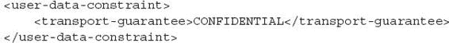

如果客户端尝试使用 HTTP 访问资源，它将被重定向到 HTTPS URL。这确保了传输的数据不会被其他实体观察，从而允许强制执行机密性（confidentiality）的核心概念。

`<transport-guarantee>` 子元素也可以取 `NONE` 或 `INTEGRAL` 的值。后者确保数据在传输过程中不会被更改，从而允许强制执行数据完整性（data integrity）的核心概念。

同样重要的是，如果 `<security-constraint>` 中列出了一个 `<http-method>`，那么该方法将根据部署描述符中约束的定义受到保护。所有未显式列出的其他 HTTP 方法统称为“未覆盖方法（uncovered methods）”。在部署描述符中添加一个顶级的 `<deny-uncovered-http-methods/>` 元素可以保护这些方法。


`<login-config>` 元素用于配置此应用程序身份验证方法和领域名称（realm name）。它具有以下子元素：


- `<auth-method>`: 配置 Web 应用程序的身份验证机制。元素内容必须是 `BASIC`、`DIGEST`、`FORM`、`CLIENT-CERT` 或特定厂商身份验证方案。前四个值对应于之前解释的不同身份验证方案。


- `<realm-name>`: 指明 Web 应用程序选择的身份验证方案使用的领域名称。


`<security-role>` 元素定义了一个安全角色。子元素 `<role-name>` 指定安全角色的名称。注意，这些角色是以特定应用程序服务器的方式创建的。

## REST 资源安全

在保护 REST 资源时，以下是需要记住的一些其他指南：


- 用户名和密码、安全令牌或 API 密钥不应出现在 URL 中，因为这些可能会被 Web 服务器日志捕获并用于恶意目的。

- 每一个 REST 资源并不一定需要读取 (GET)、创建 (POST)、更新 (PUT) 和删除 (DELETE)。确保在部署描述符中仅暴露了所需的 HTTP 方法，并使用之前定义的机制（例如 `<deny-uncovered-http-methods/>`）显式地保护其他方法。

- 每个用户并不需要访问所有 REST 资源。通过使用 `<security-role>` 定义角色，并相应地使用 `<auth-constraint>` 资源访问权限来实现适当的授权。

- 对于接收多种内容类型的 REST 端点，始终检查 Content-Type 头部并使用 Bean Validation 约束（如第 2 章所述）来限制类型。

- 大多数第三方 REST API 支持使用 Google、Facebook 和 Twitter 等流行的 OAuth 提供商进行身份验证和授权。考虑集成这些提供者，而不是从开始创建自己的基础设施。

## WebSocket 安全

WebSocket 连接是从现有的 HTTP 连接升级而来的。普通的 WebSocket 连接使用 `ws` URI 方案建立，而安全连接可以使用 `wss` URI 方案。这允许通过标准端口 80（用于明文通信）和 443（用于安全通信）进行 WebSocket 通信，因此不需要在防火墙中打开额外的端口。这也使得许多现有的 HTTP 安全机制可以适用于 WebSocket 连接。

WebSocket 使用 Web 浏览器常用的基于源（origin-based）的安全模型策略。RFC 6454 ([www.ietf.org/rfc/rfc6454.txt](http://www.ietf.org/rfc/rfc6454.txt)) 定义了用户代理（如浏览器）如何隔离从不同源（URL 的方案、主机和端口组合）获取的内容，以防止恶意网站运营者干扰良性网站的运行。基本上，从一个源获取的内容可以与从同一源获取的内容自由交互，但它与从不同源获取的内容交互的方式受到限制。RFC 6454 定义了一个名为 `Origin` 的 HTTP 头部字段，它指示了哪些源与 HTTP 请求关联。浏览器的 WebSocket 开启握手需要包含此头部，以便后续请求能够得到相应的服务。然而，当非浏览器客户端初始化 WebSocket 连接时，该模型将不起作用。

除了 `Origin` 字段外，WebSocket 开启握手还需要包含一个 `Sec-WebSocket-Key` 字段。该字段作为握手的一部分从客户端发送，并由服务器用于证明它收到了有效的 WebSocket 开启握手。这有助于确保服务器不接受来自非 WebSocket 客户端（例如 HTTP 客户端）的连接，这些连接可能被滥用来向不知情事的 WebSocket 服务器发送数据。

如你所见，WebSocket 已经提供了不错的协议级安全性。此外，Java EE 应用程序中的 WebSocket 端点可以使用 Web 容器安全模型进行保护。映射到给定 `ws://` URI 的 WebSocket 在部署描述符中通过列出相同主机名、端口和路径的 `http://` URI 受到保护，因为这是开启握手的 URL。WebSocket 应用程序可以在开启握手之前使用 Basic 验证或基于表单的身份验证。同样，可以通过向部署描述符中添加 `<security-constraint>` 元素来设置 WebSocket 授权。安全约束中 `<url-pattern>` 用于匹配 WebSocket 开启握手的请求 URI。最后，`CONFIDENTIAL` 的 `<transport-guarantee>` 允许通过加密的 `wss://` 连接进行 WebSocket 通信。这允许 WebSocket 应用程序使用标准机制分配身份方案、用户角色和传输保证。

## 总结

HTML5 规范提供了许多新功能，但同时也带来了各自的潜在安全问题。虽然本节专门关注 HTML5 与 Web 服务以及服务器发送事件（Server-Sent Events）的交互，但可能还有你想要研究的其他领域，例如本地存储、地理位置等等。开放 Web 安全项目（OWASP）是一个全球性的非营利组织，其主要关注点是改进软件安全性。该组织的网站（[www.owasp.org](http://www.owasp.org)）是研究所有 HTML5 开发领域现有和潜在安全问题的极佳资源。
