# Oracle Java Cloud 上的 Java EE 应用：开发、部署、监控与管理你的 Java 云应用

## 在 OraclePressBooks.com 加入 Oracle Press 社区

获取 Oracle 产品和技术的最新信息。获取 Oracle Press 书籍的专属折扣。与 Oracle Press 专家作者和其他 Oracle Press 社区成员互动。阅读博客文章、下载内容和多媒体资源，以及更多。

## 立即加入 Oracle Press 社区并享受以下福利：

- 专属会员折扣和优惠活动
- 完整访问网站上的所有功能：示例章节、免费代码和下载、作者博客、播客、视频等
- 与作者和 Oracle Press 爱好者互动
- 关注你喜欢的作者和主题以接收更新
- 包含专属优惠、折扣、抢先预览以及作者播客和采访的通讯报

@OraclePress

## 关于作者

Harshad Oak 是 IndicThreads 和 Rightrix Solutions 的创始人。IndicThreads.com 是本开发者杂志，举办关于 Java、云计算、软件质量和移动软件的技术会议。在创立自己的企业之前，Harshad 曾就职于 i-flex Solutions 和 Cognizant Technology Solutions。

除了这些工作外，他还编写了《JDeveloper10g: Empowering JEE Development》和《Pro Jakarta》，并合著了《JEE 1.4 Bible》。Harshad 在印度、美国、斯里兰卡、泰国和中国演讲。他一直在印度建立活跃的 Java 社区并组织了许多用户小组会议。此外，Harshad 在印度 Symbiosis 大学教授计算机科学硕士课程。由于他对技术和社区的贡献，他被授予 Oracle ACE 指向和 Java Champion。

Harshad 在 IndicThreads.com 及其社交平台撰写技术。他在 HarshadOak.com 和 Twitter @HarshadOak 上撰写社交和其他话题。可以通过 harshad@rightrix.com 联系他。

# 前言

向云转型已成为一个看似不可挡的趋势。企业和技术人员在不断努力中发现自己被这一趋势驱动，旨在利用企业技术实现更优的效益和更快的业务创新速度。

这一点在软件即服务（`SaaS`）和基础设施即服务（`IaaS`）的快速兴起和采用得到了充分说明，但对于应用软件基础设施——即企业级数据库和企业级中间件——本身，这种趋势却异常轻微或有限。这并非因为缺乏尝试，而是因为它代表了一个非常棘手的问题，而这个问题现在才开始得到解决。

Oracle Java Cloud Service 的出现及其功能是通往企业级云基础设施之旅中迈出的重要一步。它代表了 Oracle 一项重大战略投资的一部分，旨在推出业界首款平台即服务（`PaaS`）产品。该产品将企业级中间件 Oracle WebLogic Server 和企业级数据库 Oracle Database 整合到一个高生产力、简单且易用的应用程序开发和部署环境中，该环境已在大规模、关键任务的应用部署中经过了验证。

考虑到我在 Oracle WebLogic Server、Oracle Coherence 以及 Oracle Java Cloud Services 开发和项目管理中的角色，并感谢本书作者 Harshad Oak 给予的机会，我想分享我对这项投资进展情况的见解，希望这能为你阅读和理解本书提供一个框架。

它从所有基础设施的“中间”——应用程序服务器开始。在该领域，Oracle 提供了 Oracle WebLogic Server，这是我们用于构建定制 Java EE 应用程序以及托管第三方 Java 程序的服务器。Oracle Coherence 则对其进行了补充，它是我们的内存网格，用于扩展数据中心内部及跨数据中心的基础设施。

在过去的五几年里，我的团队投入了巨大精力，继续演进 Oracle WebLogic Server 和 Oracle Coherence 的技术历程，使其能够在数百台、在许多情况下是数千台服务器的大规模环境中运行。我们专注于扩展性、可靠性、可用性和性能等硬性问题，并辅以大规模的管理和运维投入。

云为解决问题带来了一系列全新的独特挑战：通过强有力的接口进行管理（通过可用于管理 WebLogic Server 的 `JAX-RS API` 解决）、弹性扩展性（通过 WebLogic Server 和 Coherence 中的动态集群解决）、自服务置备（现在已在 Oracle Java Cloud Service 中可用！）、安全相关问题的进展（通过对 WebLogic Server 安全特性的持续投入以及安全部署指南来解决），以及最近关注的与 Oracle Database 12c 及其近期对多租户支持相关的多租户问题。

但仅仅让 WebLogic Server 的基础设施变得更企业化、更云原生是不够的。Oracle 迈出了下一步，在 http://oracle.com 的 Oracle Cloud 中提供了 WebLogic Server 和 Oracle Database。围绕 Oracle WebLogic Server 构建的一系列 Java 服务被称为 Oracle Java Cloud Services，而对于数据库，则称为 Oracle Database Services。

在本书出版时，Oracle 拥有一个 Java Cloud 服务——SaaS Extension。这是 Oracle 提供的首个中间件，重点在于让客户能够构建和部署应用程序，而不是让他们必须理解如何管理和运行 Oracle WebLogic Server。

SaaS Extension 是一个非常易用的 Java 服务，也是本书的重点。它有时被简单地称为 Java Cloud Service，最近我听人们口语化地称它为 `JCS-SX`。几年前发布时，它通过提供一个真正的企业级 WebLogic Server 版本开创了先河，该版本与 Oracle Database 实现了独特的开箱即用。

“SaaS Extension”指的是该服务的一个特性，即扩展 Oracle Cloud 中提供的 Oracle SaaS 应用程序的能力，以及对 Java 应用程序进行纯定制开发的能力。所有的生命周期活动——补丁、备份和恢复——都由 Oracle 在数据中心处理，你作为开发者或应用程序管理者的关注点主要是部署和运行你的应用程序。简单！而 Harshad 将向你展示如何做到。

# 引言

在构建企业级软件方面，Java EE 和云无疑是今天最重要的两项技术。在本书中，你将理解这两项技术的运行原理，以及你如何利用它们在 Java 云领域的主要参与者之一——Oracle Java 云服务（Oracle Java Cloud Service）上构建并部署应用程序。你不仅将学习如何使用 Java EE 进行构建，还将了解 Oracle Java Cloud 的细微差别和特性。通过本书，你将对 Java EE、云计算以及它们在现代软件开发中的作用有全面的理解。

- 了解如何使用 Servlets、JSP、EJB 和 JPA 等 Java EE 技术构建和部署应用程序，并对云平台、优点及其局限性有清晰认识。
- 使用 Oracle Java Cloud 配合 Oracle 数据库云（Oracle Database Cloud）来满足应用程序的持久化需求。
- 了解如何根据云的限制以及 Oracle Java Cloud 提供的混合环境调整你的软件开发流程。
- 学习如何利用 NetBeans IDE 来简化你的云开发。

## 第 1 章：Java EE 与云计算

在本章，你将对 Java EE 和云计算及其起源和当前现状有良好的理解。你将看到与传统的 Java EE 实现相比，在云端选择 Java EE 的优缺点。你还将回顾各种 Java PaaS（平台即服务）云供应商提供的解决方案以及其他竞争技术。

## 第 2 章：Oracle Java Cloud

在本章，你将查看 Oracle 云的细节。你将回顾 Oracle SaaS、IaaS 和 PaaS 产品，并深入研究更细的细节，例如 Oracle Java Cloud 的定价、功能和限制。你还将看到如何将 NetBeans、Eclipse 和 JDeveloper IDE 与 Oracle Java Cloud 集成。

## 第 3 章：使用 NetBeans 进行构建和部署

在本章，你将开始使用 NetBeans IDE 构建你的第一个 Java EE 应用程序。你将理解 Java EE Web 应用程序的结构以及如何打包 Java EE 应用程序。

## 第 4 章：Servlets、过滤器和监听器

在本章，你将查看 Servlets、基于 Servlet 的 Java EE 应用程序的配置、数据共享、会话管理、过滤器和监听器。然后你把应用程序部署到 Oracle Java Cloud，并查看如何监控应用程序以及访问 Oracle Java Cloud 上的 Java 日。

## 第 5 章：JavaServer Pages、JSTL 和表达式语言

在本章，你将学习 JavaServer Pages (`JSP`)、JSTL 和表达式语言，以及它们如何帮助你通过精简、高效的代码生成强大的 Web 页面并提高开发者生产力。

## 第 6 章：JavaServer Faces

在本章，你将探索 JavaServer Faces (`JSF`)，它是目前 Java EE 应用程序的首选 Web 技术。你将看到 JSF 如何通过 UI 组件模型、事件处理、验证框架、结构化页面导航和国际化，提供一种整洁且功能丰富的方式构建服务器端应用程序。你还将看到如何使用模板为你的 JSF 应用程序提供一致的外观样式。你将在 Oracle Java Cloud 上构建并部署 JSF 应用程序，并看到你的全功能 JSF 应用程序在云端运行。

## 第 7 章：Enterprise JavaBeans（会话 Bean）

在本章，你将查看 Enterprise JavaBeans 以及它如何让你的业务逻辑代码高效、准确且安全地运行。你将构建包含多个 EJB 和 Web 应用程序的企业级，并将它们全部打包在一个应用程序中。你将使用无状态和有状态会话 Bean 的丰富功能，并看到如何让容器管理应用程序中的事务。

## 第 8 章：Web 服务

在本章，你将查看使用 SOAP 和 RESTful Web 服务的需求和益处。你将学习如何在 Oracle Java Cloud 等云环境中运行 Web 服务时绕过某些限制。然后你将同时使用 SOAP 和 REST 构建 Web 服务并将其部署到 Oracle Java Cloud Service。

## 第 9 章：使用 Oracle 数据库云进行持久化

在本章，你将探索 Oracle 数据库云，并使用 Java Persistence API（`JPA`）将数据持久化到你的 Oracle 数据库云中。你将使用 JPA 创建表以及检索、更新和删除数据。Oracle 以其数据库闻名，你将看到 Oracle 数据库如何为你的 Oracle Java Cloud Service 提供所有的能力。

除了章节外，还有三个附录：

- 附录 A 列出了所有 Java EE 5、6、7 技术及其对应的 Java 规范请求 (`JSR`)。
- 附录 B 列出了与 Java EE 5 和 7 兼容的应用程序服务器。
- 附录 C 列出了 Oracle Java Cloud Service 支持的技术，以及明确表示不支持的相关技术和 API。

# 目标读者

本书适合以下读者：

- 想要学习 Java EE 和云计算的开发者
- 想要在 Oracle Java Cloud 上构建和部署 Java EE 应用程序的开发者
- Oracle 中间件技术、希望在 Oracle Java Cloud 上使用 Java EE 构建应用程序的用户
- 需要 Java EE、Java 云和 Oracle Java 云服务介绍的业务用户、技术经理或顾问

本书假设读者不具备 Java EE 或云计算的知识。你只需要熟悉 Java 编程即可。学习 Java EE 和 Java 云所需的所有知识都包含在书中。

# 第1章：Java EE与云计算

尽管大多数人倾向于将微版（micro edition）认为是移动版，但实际上，微版不仅用于手机，还用于各种设备，如电视机、打印机、智能卡等。Java ME 提供了一个 API 和轻量级的 Java 虚拟机（`JVM`），用于运行 Java 应用程序。

> **注意**：Oracle 已宣布其长期战略是整合 Java ME 和 Java SE，以提供一种模块化的解决方案。旨在设计和实现标准模块系统的项目被称为 Jigsaw 项目，预计将 Java 9 的一部分。尽管 Java 9 的模块化还有一段路，但 Java SE 8 已经引入了紧凑配置型（compact profiles）。紧凑配置型是完整 Java SE 8 规范的三个子集配置，可供不需要整个平台的应用程序使用。

## Java EE

尽管官方定义有所不同，但从实际用途来看，Java EE 是构建 Web 和分布式应用程序的平台。它本质上是一组库，在你构建应用程序时提供所需的大部分核心功能，而在大多数情况下，这是一个基于 Web 的应用程序。虽然你经常听到这些应用程序被称为“企业级应用程序”，但不要让“企业级”二字吓跑构建 Java EE 应用程序的心。EE 中的“企业级”仅仅是指提供某些安全性、可靠性、速度、可扩展性、分布式、事务和可移植性的应用程序。在一个主流应用程序是独立的、基于桌面的且孤立的时代，“企业级”的定义是有意义的。然而在今天，几乎所有软件都是在线的、可扩展的，并且在某种意义上都是“企业级”。

如图 1-1 所示，Java EE 运行在 Java 平台（Java SE）之上。由于大多数开发者是从 Java SE 开始学习 Java 的，因此重要的一一点是：在 Java SE 中学到的所有内容在 Java EE 中依然适用。

你将利用对 Java 语言的知识以及对 Java EE 提供库的理解来构建 Java EE 应用程序。在构建这些应用程序时，你还需要遵循 Java SE 和 Java EE 定义的某些规则和约定。在 Java EE 应用服务器的魔法帮助下，你的应用程序将很快运行起来。

| Java 企业版 (EE) | Java 标准版 (SE) |
| :--- | :--- |
| 操作系统 | |
| 硬件 | |

图 1-1. Java EE

## 应用服务器

应用服务器是 Java EE 的骨干。这是实现 Java EE 并运行根据 Java EE 规范开发并部署在服务器上的 Java EE 应用程序的软件。应用服务器必须遵守 Java EE 规范才能兼容 Java EE。我们将在本章稍后的部分详细讨论“规范（specification）”和“兼容（compatible）”，但目前你可以按照这些术语的常用英语含义来理解。

应用服务器有各种形状和大小，由各种商业和开源供应商提供。

## 开源 vs 商业

尽管 Java EE 应用服务器价格昂贵，但有很多开源的 Java EE 应用服务器。如果你好奇为什么有人会商业版本付费，答案在于付费版本所附带的额外功能、工具和服务。付费版本提供一个或多个附加组件，例如控制仪表板、24x7 支持、优先 Bug 修复和补丁、额外缓存以及性能调优。

你可以通过开源服务器获得所有的标准的 Java EE 功能，但在你的企业级应用程序需要那一点额外功能的情况下，你可以选择商业版本。GlassFish、Apache Geronimo、Apache TomEE、Caucho Resin 和 JBoss（现为 WildFly）是一些流行的开源应用服务器。通过许多开源服务器，你会发现同一家供应商也提供带有附加组件的付费商业版本。

Oracle WebLogic、SAP NetWeaver 和 IBM WebSphere 是流行的商业应用服务器。这些商业服务器通常价格高昂，并且针对特定的业务需求进行定制，甚至作为商业产品的一部分进行捆绑。

Oracle WebLogic 是 Oracle 的商业应用服务器产品，它运行在 Oracle Java Cloud 上。

> **注意**：开源服务器可以免费下载和使用。然而，即使是大多数商业服务器（如 Oracle WebLogic）也提供试用/开发者许可，允许你下载和使用该服务器。Oracle 在 2012 年为 WebLogic 引入了 OTN 免费开发者许可，这使得开发者能够更容易尝试 WebLogic。

应用服务器的差异主要体现在以下因素：

- 许可（Licensing）：软件许可是一个宏大的话题。有许多种商业许可和许多种开源许可，因此有时某个服务器可能满足组织的所有要求，但可能因为某些许可条款和条件而不被考虑采用。


- 支持服务：许多服务器供应商（尤其是那些提供开源服务器变体的供应商）依赖支持服务来获取收入。支持服务的质量通常是决定采用哪种服务器的关键因素。

- 成本：应用服务器的成本差异巨大。此外，你会发现供应商有其自己的服务器定价方式。成本可能取决于许多因素，例如服务器实例数量、处理器数量和用户数量。

## Oracle Java Cloud 上的 Java EE

- 易用性：尽管服务器很容易安装、使用和管理，

- 报告与管理：Java EE 规范提供了报告和管理功能。

- 独立：某些服务器作为产品的一部分捆绑。

- 磁盘和内存需求：规范处理磁盘和内存需求。

- 性能：Java EE 规范提供了一个衡量性能的基准。

- 向后兼容：尽管 Java EE 规范本身提供了向后兼容，

参考实现是 `GlassFish Server Open Edition`，可以在 `www.glassfish.org` 下载。

由于 Java EE 参考实现是与规范同步开发的，它不仅证明了规范是可以实现的，还确保在最终规范发布后就能立即提供实现。因此，尽管 `GlassFish 3` 是 Java EE 6 的生产版本，但 `GlassFish 4` 是在 Java EE 7 规范定稿期间开发的。Java EE 7 发布的当天，作为参考实现的 `GlassFish 4` 即可供开发者尝试 Java EE。

## Oracle Java Cloud 上的 Java EE 应用

## Java 社区进程 (JCP) 与 Java EE

Java EE 与所有 Java 技术一样，由 JCP 驱动。JCP 进程并不是由一个组织来做出所有决策，而是让开发者社区和行业参与到 Java 规范的开发中。会选出一个由来自不同公司（如 Oracle、Red Hat、IBM 和 SAP）的成员以及独立 Java EE 专家组成的专家小组，来管理 Java 规范的每次迭代。该专家小组负责收集其他开发者的建议，并为 Java 规范请求（JSR）起草规范。规范的每个版本都有对应的 JSR，你可以通过这些 JSR 获取有关规范的完整信息。

例如，`JSR 316` 是 Java EE 6 的总 JSR；它列出了 Java EE 6 的高层视图以及组成规范的文档。`JSR 342` 涵盖了 Java EE 7，而 `JSR 244` 涵盖了 Java EE 5。所有的 Java EE 5、6 和 7 技术以及 JSR 均列在附录 A 中供参考。

执行委员会负责批准最终规范。供应商公司通常在这些规范的实际实现上进行竞争。

如果你下载了 `JSR 316` 或 `342`，你得到的只是一个 PDF 文件。公司如何实现该 PDF 中的规范决定了市场上的巨大差异。只要开发者按照所有兼容 Java EE 的实现方案进行开发即可。

那么，如果 EE 只是一个 PDF 文件，代码在哪里？实现在哪里？你可能从上一节中记得，应用程序实际上实现了该规范。因此，应用程序服务器是实现代码的所在地。服务器供应商负责编写实现规范的代码。

> **注意**
>
> 尽管针对不同的 Java EE 版本有特定的 JSR，但请注意，一个 JSR 并不为所有的 Java EE 技术提供规范。Java EE JSR 引用了其他 JSR 来详细介绍 Java EE 中的各种技术。请访问 `https://jcp.org/en/introduction/faq` 查看 JCP 常见问题，了解更多关于 JSR 从提议阶段到最终发布的历程。


只有当 Java EE 规范的实现通过了 Java 兼容性测试套件（CTS）中的 Java EE 兼容性测试时，才被认为是兼容的。

所有的 JSR 都需要提供以下：

- 规范
- 规范的参考实现
- 技术可移植性包 (TCK)

所有经过认证的 Java EE 服务器都能运行你的 Java EE 程序是 Java EE 的核心特性之一。它为平台带来了可移植性，并极大地减少了供应商锁定，这两个对于大企业来说都是至关重要的特性。这里的可移植性意味着在需要时可以选择迁移到不同的应用程序服务器或不同的供应商。

然而，为了让客户确保这种可移植性，所有声称兼容 Java EE 的应用程序服务器都需要通过一组特定的兼容性测试。因此，Oracle 为 Java EE 许可者提供了一个全面的 Java EE 兼容性测试套件（CTS）。只有服务器通过了 CTS 中的测试，才被认证为 Java EE 兼容。针对特定版本的这种认证是对最终客户的保证，确保服务器支持其通过认证的规范所规定的 Java EE。

> **注意**
>
> 所有兼容 Java EE 的应用程序服务器（即符合 Java EE 许可和兼容性测试程序的应用程序服务器）都列在 Oracle 技术网络 (OTN) 网站的“Java EE Compatibility”页面上，地址为 `http://j.mp/JavaEE-Compatibility`。

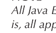

我想重申的是，尽管不同的 Java EE 服务器供应商可以自由对实际实现进行创新，只要这不干扰指定的行为即可。

> **注意**
>
> Oracle Java Cloud Service 未针对任何特定的 Java EE 版本通过认证，但支持 Java EE 5 和 Java EE 6 技术的混合，这是 Oracle 认为适合企业客户的。

请参阅附录 B 获取兼容 Java EE 5、6 和 7 的实现列表。

在 Java EE 5 之前，你只能选择一个完整的 Java EE 应用程序服务器，它支持十年来进入 Java EE 的所有技术。然而，Java 社区发现，尽管大多数 Java EE 应用只使用了技术的子集，但它们仍然携带所有 Java EE 技术的负担。

因此在 Java 6 中，引入了配置的概念。配置允许根据需求创建更小的 Java EE 子集。虽然预计会出现许多配置，但考虑到支持和维护的影响，Java EE 6 和 Java EE 7 只有一个配置，即 Web Profile。因此，通过 Java EE 6 和 Java EE 7，你可以选择完整的 Java EE 服务器或更精量的 Java EE Web Profile 服务器。

Web Profile 规范仅列出了 15 项技术作为强制组件。这自然导致了更精量的应用程序服务器，其性能对于大多数 Web 应用来说完全足够。Web Profile 排除了完整 Java EE 规范中的若干技术。然而，通过企业级 Bean (EJBs)，Web Profile 引入了精简版的 EJB Lite。下载大小并不是版本之间差异的绝对指标。但值得注意的是，完整的 Java EE（英文，Windows）版本为 3MB。请参阅附录 A 关于 6 和 7 中的 Web Profile。

在过去的几年里，云计算一直是巨大的热点。如图 1-2 所示，在 2009 年我们开始听到“云计算”这个术语时，大部分讨论都是围绕云计算的。

那么云计算有什么不同之处？主要的区别在于通用互联网。过去网络局限于校园或区域，而现在我们就可以从全球任何角落访问信息；过去就不如此了。

如今的云计算是因为数据中心具有高度的可扩展性，并且由于虚拟化技术。虚拟化正如其名，主要是创建虚拟机 (VM)，它们不运行在实际硬件上，而是运行在与硬件通信的操作系统之上。一台带有 Linux 操作系统的硬件盒可以运行许多虚拟机——有些运行 Windows，有些运行其他发行版的 Linux。

简单来说就是根据一段时间的需求租赁计算能力和数据存储。你可以租赁硬件、运行在硬件上的基础软件平台或完整的软件应用程序。

随着核心业务需求和开发者角色的演变，企业主希望避免昂贵的硬件，软件开发者希望避免担心设置和维护平台，而用户希望完全避免构建软件；他们只想使用。企业主、开发者和用户都更倾向于租赁他们需要的并进行定制，而不是设置和管理基础设施。

基础设施即服务 (IaaS) 有时被称为“硬件即服务”，它开启了云计算的潮流。在 2009 年我们开始听到“云计算”这个术语时，大部分讨论都是关于 IaaS 的，在很大程度上，它受到了亚马逊通过其弹性计算云（EC2）服务成功租用容量的推动。EC2 允许你租用虚拟计算机，并在这些计算机上安装、部署和运行软件。

通过 IaaS，供应商仅提供硬件，而用户负责根据需要设置软件平台。虽然这为用户提供了极大的灵活性，但它要求 IaaS 用户具备相关的专业知识来设置和管理租得的硬件。

虽然有时租用硬件可能足够了，但开发者通常不仅仅想要硬件，还想要一个已经安装并运行的基础软件平台。这为软件团队带来了巨大的价值，因为他们现在仅需要专注于构建自己的软件应用程序，而无需担心硬件甚至基础软件平台的设置问题。这就是平台即服务（PaaS）的用处。


> **注意**
>
> 通常，软件开发人员和网络管理员是不同的团队。必须担心硬件的设置和管理意味着开发者可以很好地独立运营一切。

如果一个软件团队想要构建 Java、.NET 或 PHP 应用程序，如果他们能获得硬件的同时获得操作系统，以及预安装并设置好的 Java/PHP/.NET 软件平台，不是会容易得多吗？如果有一个正在运行、经过优化且高度可扩展的应用程序服务器又如何？

如果说云计算的第一波是围绕 IaaS 的，那么下一波就是围绕 PaaS 的。然而，PaaS 领域比 IaaS 要复杂得多，主要因为 PaaS 供应商提供了软件构建的数百种构建方式。许多 PaaS 厂商为了简化和安全在其服务上构建的软件，定义了严格的准则和限制，以及他们可以支持和不支持的功能。实施这样的政策既是一种特性，也是一种限制。它是一种特性，是因为你可以确定与你共享平台的其他用户不会随心所欲并危及你的设置。然而，这也是一个主要的限制，你必须根据 PaaS 提供者设定的规则来构建你的应用程序。

| | | |
|---|---|---|
| SaaS 电子邮件、会计、人力资源、CRM | 用户 |
| PaaS 数据库、应用服务器 | 开发者 |
| IaaS 存储、磁盘、虚拟机 | 网络管理员 |

图 1-3. *“即服务”（aaSS）类型*

PaaS 的采用应该随着时间的推移而增长，因为人们预期的组织会将硬件设置和管理委托出去，但对在硬件上构建和运行的软件保留发言权。

“软件即服务（SaaS）”这一术语出现的时间实际上比“云计算”这一术语要早。我记得在 2006 年讨论过 SaaS，那时云计算还不为人所知。它的含义仍然基本保持，只是它现在被认为是云计算的一种类型。

如果你的业务正在使用在线第三方服务进行会计、电子邮件、发票、在线活动和电子邮件营销，那么它就在利用 SaaS。SaaS 是让你无需费心租用硬件，甚至无需租用用于构建应用程序的软件平台。你直接租用所需的实际软件应用程序。你根据预期使用量付费，或者在某些情况下，你按需付费。SaaS 在初创公司中特别流行，因为它显著降低了他们的启动和运行成本，同时仍然为初创企业提供了所需的所有灵活性。

如图 1-3 所示，SaaS 产品构建在 PaaS 的能力之上，而 PaaS 又运行在 IaaS 之上。对于本书，我们将主要与 PaaS 工作。

对云计算感兴趣并采用的首要原因是：

- **技术**：设置和维护自己的硬件和软件可能是极其昂贵且乏味的事情。大多数人更愿意让别人去做。

- **人员**：大多数企业主希望尽量减少/避免招聘、培训和留住额外人员的费用和精力。

- **非核心**：运行和维护硬件和软件并不是大多数企业的核心业务。在有选择的情况下，大多数企业更愿意专注于其核心业务并从大型、可靠的供应商那里租用计算能力。

- **按需扩展**：你可以在需要时租用容量，并在需要时扩大，同样在需要时缩小规模。

- **按需付费**：企业无需配置昂贵的资源来满足可能的未来需求。

云计算的主要担忧是：

- **安全性**：大多数调查显示，安全性是企业对云计算的首要考虑。许多企业不习惯于将敏感数据放在共享云环境中。

- **可用性**：如果亚马逊云宕机，它会带走大量的网站和服务。2012 年 10 月的一次亚马逊停机导致了 Reddit、Foursquare 和 Pinterest 等热门网站崩溃。

- **连接性问题**：尽管互联网连接在过去几年里有了巨大提高，但在大多数发展中国家仍然不可靠。

- **锁定和对供应商的依赖**：少数大型云供应商占据了大部分云市场份额，而且到为止云服务还没有什么标准化的，因此你很容易被锁定在某个供应商处。

- **僵化**：使用云服务极大地限制了你运行自己的硬件和软件时的灵活性。大多数云供应商都定义了相当严格的操作规则，用户必须遵守这些规则。你甚至需要在考虑这些局限性的情况下构建你的应用程序。

- **法律**：云根据位置带有其自身的法律影响。这是一个巨大的因素，特别是对于拥有敏感数据的企业。

### 私有云、公有云和混合云

尽管云通常被认为是公共、共享设置，但在某些情况下（由于安全等考虑），这种设置可能并不适用。

在这种情况下，你可以选择私有云，它的工作方式与公有云非常相似，但仅供特定组织访问，其用户是组织内部的各个业务部门。私有云通常运行在内部数据中心或“本地”。然而，这并不总是如此。混合云是结合了公有云和私有云的云。

云的一个经常被忽视的重要方面是它为软件公司和开发者提供了一个公平的竞争环境。

今天我们看到，通过各种云服务，小公司可以构建和运行企业级的 Java EE 软件，其安全性和可靠性不大型公司的应用程序。同样，单个开发者或在三人公司工作的开发者的知识，与大型公司数百人团队中工作的开发者基本相当。这是开发者考虑采用云计算的重要原因。云极大地平衡了软件公司和开发者之间的竞争。

现在我们已经了解了 Java EE 和云计算，让我们看看 Java EE 作为云平台的定位如何，以及它与某些替代方案相比如何。

多年来，Java EE 一直是服务器端开发的支柱，目前仍然是最广泛使用的软件平台之一。尽管到目前当前的 Java EE 版本似乎没有针对云的规范或标准，但许多供应商已经在云上提供了强大的 Java EE 解决方案。

直到最近，Java EE 应用一直被认为是企业在自己的专用服务器基础设施上构建和运行的应用程序。如果一家公司构建了 Java EE 应用，人们认为该公司还将搭建必要的硬件基础设施以及管理和监控这些设施的团队。在共享托管时代（这种技术在 PHP 等领域中已流行了一段时间）被认为适用于 Java 的特性和需求之前，已经过了很长一段时间。

我们之前讨论过云计算的优点和缺点。你会发现，大多数对云特性的担忧都是针对专用 Java EE 设置的，反之亦然。

除了对企业而言的优缺点外，专用 Java EE 服务器的一个主要问题是，小型企业避开了 Java EE，因为它们不希望建立和管理自己的服务器基础设施。

然而，在几乎所有情况下，企业过去都是在专用服务器上运行 Java，几乎很少在共享/云环境中运行。在云浪潮到来之前，还没有免费托管提供商会费心为 Java 提供优质的 Java 托管或类云解决方案。

一旦显而易见即使是企业也开始转向云端路径并在过程中投入巨资，Java 就开始出现在每一个新的/云解决方案中。很快，Java 成为云端上使用最广泛、支持最好的语言之一。

Java 进军云端彻底改变了 Java EE，也改变了开发者社区对 Java 的认知。各种规模的开发者、架构师和客户正日益寻求在云端利用 Java。

Java EE 只是你可以用来构建软件的众多技术之一。考虑到技术仅仅是实现目的的手段，每当启动新项目时，开发者都有选择使用何种技术。多个技术平台使开发者能够构建各种软件：Java、.NET、Ruby、Python 和 PHP 将会位列软件平台列表的前端。

虽然现在有许多 EE 托管和 Java PaaS 解决方案，但与其它 Web 技术的云端/托管解决方案相比，这个数量仍然显得微不足道。PHP、.NET、Python 和 Ruby 在开发者社区中继续保持着良好的热度。

类 PaaS 的 PHP 托管解决方案已经存在了相当长的时间——只是那时它们还不是 PaaS。PHP 即使在共享托管环境中运行得良好，因此运行在相当廉价的共享托管解决方案上的 PHP 应用一直是过去十年 Web 应用程序的主流。相比之下，Java 在共享托管方面一直很挣扎。很少有托管提供商共享环境中提供 Java，即使是那少数提供商通常也提供一个紧密沙箱化的 Tomcat 实例，这几乎无法用于实际应用程序。大多数托管提供商只要你提到 Java 或 Java EE 这个词，就会要求你切换到专用服务器。

奇怪的是，那时似乎几乎没有人对 Java 在共享托管领域的缺失感到困扰。仅仅因为云技术引发了企业寻找共享云环境的热潮，我们才看到许多 Java PaaS 解决方案的出现。

Java 平台的表现优于 PHP、Python 和 Ruby 等语言，因为 Java 被认为是“企业级的”，与许多其他技术不同。然而，随着许多巨头现在为 PHP、Python 和其他技术提供 PaaS 解决方案，我们现在看到围绕 PHP、Python、Ruby 以及其他 JVM 语言的技术正对企业的传统 Java EE 构成更激烈的竞争。

虽然早期的“企业级软件开发”主要是 Java EE 和 .NET 之间的双马赛，但今天我们看到许多技术正在被考虑。这在很大程度上归于这些其他技术提供了企业级的 PaaS 解决方案。

尽管每个平台都有其优缺点，但以下是 Java EE 在云端中特别有效的几点：

- Java EE 从一开始就是为了健壮、可扩展、分布式、多层应用而设计的，这正是你对云应用程序所预期的特性。这使得 Java EE 非常适合云端。

- Java EE 在云端已经是一个成熟的平台。你有许多供应商、大量的选择，以及各种定价模型供你使用。

- Java EE 的人才池是巨大的。让这些开发者在云端使用 Java EE 比构建全新的技能组容易得多。

- Java EE 社区充满活力，Java EE 技术随着每个版本的更新变得越来越好且易于使用。因此，云端的 Java EE 可能是最安全的选择。


# Oracle Java 云上的 Java EE 应用

## 标准与 Java EE

## Java EE 供应商及替代方案

虽然亚马逊被认为是发起了云浪潮，但谷歌应用引擎（GAE）是第一个获得广泛关注的 PaaS 解决方案。GAE 从支持 Python 开始，但一年后引入了 Java。许多 PaaS 供应商运行 `Tomcat` 服务器，有些则使用 `Jetty` 和 `GlassFish`。Oracle Java 云运行在 `WebLogic 10.3.6`，这是最新版本。其中一些服务器还提供 IaaS 解决方案，你可以在那里安装自己的服务器。在这里我们只关注它们的 PaaS 产品。

**Beanstalk**：Beanstalk 是亚马逊的 PaaS 产品。它支持使用 Java、PHP、Python、Ruby、Node.js 和 .NET 构建的应用程序。本身免费，你只需为存储和运行应用程序所需的 Web 服务（AWS）资源付费。Beanstalk 将应用程序部署到 `Apache Tomcat` 服务器，因此支持所有受 Tomcat 的 Java EE 技术。

**Google App Engine**：谷歌应用引擎仅支持部分 Java EE，并使用自定义的服务器和数据存储。如果打算使用谷歌应用引擎，某些特定的供应商知识是必要的。

**Jelastic**：Jelastic 起源于“Java 云”。它现在不再自称是“Java 云”，因为它现在支持 Java 和 PHP。Jelastic 支持多个 Java EE 服务器（`Tomcat`、`TomEE`、`GlassFish` 和 `Jetty`），以及多种 SQL 和 NoSQL 数据库。它的优点是专注于 Java，并且不要求你使用其专有的 API 和技术。

# 第1章：Java EE 与云计算

**OpenShift** OpenShift 是红帽公司提供的 PaaS。它支持 Java、Ruby、Node.js、Python、PHP 和 Perl。它支持多个 Java EE 应用服务器（`JBoss AS 7.1`、`WildFly 8`、`JBoss Tomcat` 和 `GlassFish`）以及 `MySQL`、`MongoDB` 和 `PostgreSQL` 数据库。OpenShift 对多种语言、框架和数据库的支持是其主要优势。

<https://www.openshift.com/get-started/java>

**Oracle Java Cloud** 尽管整本书都是关于 OJC 的，但它是一个运行 Oracle `WebLogic` 服务器的 Java PaaS 服务，该服务器是 Oracle Fusion Middleware 及其 Oracle Cloud Application Foundation 的不可缺组成部分。OJC 支持 Java EE 5 和 6 特性的混合体。`WebLogic` 服务器、标准支持、Oracle 数据库以及 ADF 等 Oracle 框架和易用性是其它的亮点之一。

<https://cloud.oracle.com/mycloud/?p=service:java:0af>

尽管这些是 Java PaaS 领域的活跃者，但其他值得提及的还有 Salesforce.com 的 Heroku 以及 GoPivotal（原 VMware）的 Cloud Foundry。目前，Java PaaS 的产品已经非常广泛且深入。这些产品取决于多种因素，因此在为需求选择合适的 Java PaaS 之前，通常需要对多个供应商进行仔细检查。


> 注意
>
> `WebLogic` 服务器是 Oracle Fusion Middleware 系列及其 Oracle Cloud Application Foundation 的不可或缺的一部分，也是 Oracle Java Cloud Service 上使用的服务器。

- **定价和计费** 不同供应商的成本和定价策略差异很大。有些根据细粒度的使用详情收费，而另一些则提供基于时间的订阅制。你需要评估自己是想采用订阅制还是“按需付费”模式。

  **OJC:** 目前提供单个 `WebLogic` 服务器实例每月 249 美元起 的订阅服务。它不提供“按需付费”选项。OJC 提供三个宽泛的版本，每个版本都带有一组特定的资源。你选择自己的版本并支付等额的固定月度租金。

- **支持的功能和技术** 支持的技术和功能是否符合你的需求？你选择的框架是否受云供应商官方支持？支持哪个版本？供应商是否支持标准，还是你必须编写自定义的、特定供应商的代码？许多供应商只支持 Java EE 的子集，在某些情况下，要求你使用并采用他们的自定义技术/API。如果你打算开发纯 Java EE 应用，请检查供应商是否支持全功能 Java EE。EE 标准是 OJC 的首要选择之一。它目前支持大部分 Java EE 5 和许多 Java EE 6 功能，但并未完全兼容 Java EE 6 甚至不兼容 EE 6 Web Profile。对于已有 ADF 部署和开发设置的人来说，它对 Oracle ADF 框架的支持是一个加。

- **灵活性** 许多供应商坚持让你使用某些 API 以特定的方式进行开发。除非你有一个团队擅长按照该云供应商的要求进行开发，否则这并不总是可行或容易执行的。

  **OJC:** OJC 依赖 Java EE 标准，并不强制使用任何非 Java EE 或 Oracle 特有的 API，除非你想利用任何 `WebLogic` 或 Oracle 云的特定功能。

- **供应商地位** 考虑到你将应用程序和数据放在供应商的硬件上，你确实希望对供应商的信誉以及在（例如）10 年后保持运行的能力充满信心。

  **OJC:** Oracle 在这方面的评分很高。Java Cloud Service 将会存在很长时间。

- **工具和易用性** 许多供应商拥有丰富的 Web 界面（UI），有些甚至提供了与流行的集成开发环境 (IDE) 的集成。易用性非常重要，因为云服务可能会相当困惑，有时甚至令人望而畏。

  **OJC:** OJC 拥有良好的基于浏览器的 UI，并与流行的 IDE（包括 `JDeveloper`、`NetBeans` 和 `Eclipse`）进行状态集成。

- **数据库支持** 大多数云供应商至少支持一个 RDBMS 和一个 NoSQL 数据存储。你需要检查这是否是你偏好的类型。

  **OJC:** OJC 支持 Oracle RDBMS，但目前还没有 NoSQL 数据库。然而，考虑到其他供应商提供了 NoSQL 选项，且 Oracle 拥有 NoSQL 数据库，Oracle NoSQL 在 Oracle Cloud 上可用只是时间问题了。

- **开放/封闭：供应商锁定** 供应商是否提供一个会让你锁定的封闭堆栈？如果需要需要，你是否可以迁移到新服务器，还是说你正被锁定在某个特定的供应商那里？

  **OJC:** 由于强调基于 Java EE 标准的开发，OJC 在这方面表现良好。从 Oracle Cloud 迁移到专用服务器或其他 PaaS 供应商应该是可能的。

- **Java 友好性** 虽然某些供应商是专注于 Java 云的玩家，但另一些则支持许多不同的技术。这似乎影响了功能、文档以及该服务的整体优先级。

  **OJC:** 作为一个纯 Java 云服务，OJC 确实是 Java 友好的。

- **技能构建** 构建一个能够开发和部署此类 PaaS 的团队有多困难？

  **OJC:** 再次，由于 OJC 专注于 Java EE，与其它 PaaS 解决方案相比，构建这样一个团队要容易得多。除了软件平台问题外，当然还有其他非软件问题，例如服务水平协议 (SLA) 以及需要考虑的地点。

在本章中，我们查看了 Java EE 和云计算的基础。我们讨论了各种云服务，以及为什么 Java EE 非常适合云环境……（此处省略重复内容）。

现在让我们进入 Oracle Cloud，设置我们的 Java 云实例，并开始查看 Oracle 云的产品。


由“Oracle”（<https://cloud.oracle.com/mysql/faq?p=service:0#q2>）完全托管、托管和支持。如今的 Oracle Cloud 在 SaaS、IaaS 和 PaaS 领域提供广泛的云解决方案。

从第一天起，Oracle Cloud 的定位更像是一个解决方案提供者，而不是硬件和软件零售店。Oracle 的重点一直放在围绕垂直领域的 SaaS 解决方案，例如企业资源计划（ERP）、规划与预算、财务报告、人力资本管理（HCM）、人才管理、销售与营销以及客户支持。Oracle 在每个领域都有一个受欢迎的产品，其首次云端推动是让这些产品作为云端 SaaS 解决方案可用。除了传统的 Oracle 产品外，云端还有 Oracle 社交网络（OSN）。OSN 在 2012 年 OpenWorld 大上宣布，试图在将社交互动引入企业的同时，将其与其他 Oracle 解决方案紧密集成。

2013 年 1 月，Oracle 也宣布了基础设施即服务（IaaS）解决方案。Oracle IaaS 侧重于本地部署，而不是像 Amazon 那样的通用云。Oracle IaaS 为客户提供每月租用选项，以访问预配置的应用程序服务器，并将其部署在客户的本地数据中心中。

Oracle Cloud 还提供广泛的 PaaS 解决方案，其中一些已经处于可用状态（General Availability），而另一些仍在测试/预览阶段（Beta/Preview）。其中已可用的 Java PaaS，这也是本书的重点。其他 PaaS 包括 Oracle Developer Cloud Service（它提供项目配置、源码控制、缺陷跟踪、持续构建集成和文档协作），以及 Oracle Storage Cloud 和 Oracle Messaging Cloud。Oracle 的所有 PaaS 服务都旨在紧密集成并相互协作。同样不容的是 Oracle Database Cloud，它是 Oracle Java Cloud 提供的不可或缺的一部分。我们将在处理持久化的章节中使用数据库云。

对 Oracle Java Cloud 的简单解释是，它是集成了 Oracle 数据库的 Oracle `WebLogic Server`。因此，在 Java Cloud 上开发和部署等同于在 `WebLogic` 上开发和部署，并使用 Oracle 数据库进行持久化。然而，最新版本的 `WebLogic` 支持所有 Java EE 6 特，而 Java Cloud 则支持 Java EE 5、Java EE 6 和 Oracle `WebLogic` 能力的混合体。有关 Java Cloud 支持的技术详细列表，请参阅附录 B。


> Oracle 最近引入了“Oracle WebLogic as a Service”，目前仍处于预览模式。尽管 Java Cloud Service 和 `WebLogic` 均运行 `WebLogic Server`，但“Oracle WebLogic as a Service”的主要区别因素在于它提供了完全的管理和操作控制。

尽管 Java Cloud 支持多种特性和能力，但值得注意的是，Java Cloud 支持几乎所有最常用的 Java EE 技术。虽然它可能不支持每个技术的最新版本，但它支持 `Servlets`、`JavaServer Pages (JSP)`、`JavaServer Faces (JSF)`、`Enterprise JavaBeans (EJB)`、`Java Persistence API (JPA)`、`Java API for Restful Web Services (JAX-RS)` 以及 `Java API for XML Web Services (JAX-WS)`，以及 ADF 等流行技术。

另一个需要注意的是，Java Cloud 支持 Java SE 6 APIs。有关哪些会触发白名单违反并阻止你的应用程序部署的技术详细列表，请参阅附录 C。


> 白名单是一个满足软件/服务技术和安全要求并已获批准在其运行的技术和 API 列表。

既然你已经了解了 Oracle Java Cloud 的历史和定位，那么开始需要什么呢？Oracle 提供三种广泛的云订阅版本；你选择自己的版本并支付固定的月租金。

本书写作时，Java Cloud 的价格范围从单个 `WebLogic Server` 实例的每月 249 美元到四个 `WebLogic Server` 实例的 1,499 美元不等。任何 `WebLogic` 服务器实例都可以作为你的 Java EE 应用程序的部署目标。你还可以选择在同一个 `WebLogic` 实例上运行多个 Java EE 应用程序。考虑到多个 Java EE 应用程序可以在单个 `WebLogic` 服务器实例上良好运行，在大多数情况下，决定购买哪种 OCI 版本的因素将取决于每个版本可用的内存、存储和数据传输。

这里的 `WebLogic Server` 指的是一个配置好的、准备好托管任何应用程序和资源的实例。你不需要执行任何涉及设置和配置 `WebLogic Server` 实例的任务。

此外，一个物理硬件盒可以运行多个 `WebLogic` 实例，甚至一个实例可以运行在多个物理盒上。然而，云的重点在于，你的实例运行的硬件是什么并不重要。云服务商不会共享或让用户控制其云设置下方运行的硬件。

如图 2-1 所示，用户在较高的价位下并不会获得对设置任何进一步的细粒度控制。尽管缩小规模

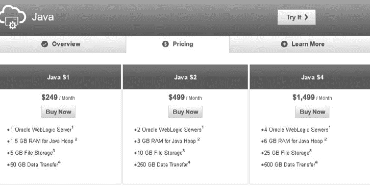

图 2-1

| 版本 | 访问 | 价格 |
| :--- | :--- | :--- |
| 基础 (Basic) | 包含 | 每月 175 美元 |
| 标准版 (Standard) | 包含 | 每月 900 美元 |
| 专业版 (Professional) | 包含 | 每月 1,400 美元 |
| 企业版 (Enterprise) | 包含 | 每月 2,000 美元 |

图 2-2

> Oracle 最近引入了“Oracle WebLogic as a Service”，目前仍处于预览模式。尽管 Java Cloud Service 和 `WebLogic` 均运行 `WebLogic Server`，但“Oracle WebLogic as a Service”的主要区别因素在于它提供了完全的管理和操作控制。

> 白名单是一个满足软件/服务技术和安全要求并已获批准在其运行的技术和 API 列表。

> 注意
>
> 奇怪的是，截至本书写作，链接只有在同一标签页中打开才有效，尝试在新标签页/窗口中打开则无效。

“我的服务”页面就像是你 Oracle Java Cloud 的仪表盘。你可以收藏审批邮件中的“MyServices 管理 URL”（格式为 `https://myservices.<datacenter>.cloud.oracle.com/mycloud/?p=my_services`），或者访问 `https://cloud.oracle.com/` 使用你的 Oracle 单点登录 ID 进入我的服务。两种情况下，你都会看到一个包含图 2-3 所示框的屏幕。请注意，我的服务的 URL 会根据其关联的数据中心而变化。

点击 Java 服务的链接，你将获得图 2.4 所示的概述页面，显示当前的服务状态以及关于开始日期、结束日期、sftp 等其他信息。在左侧面板中，你会找到标题为概述 (Overview)、管理 (Administration)、指标 (Metrics) 和关联 (Associations) 的章节。


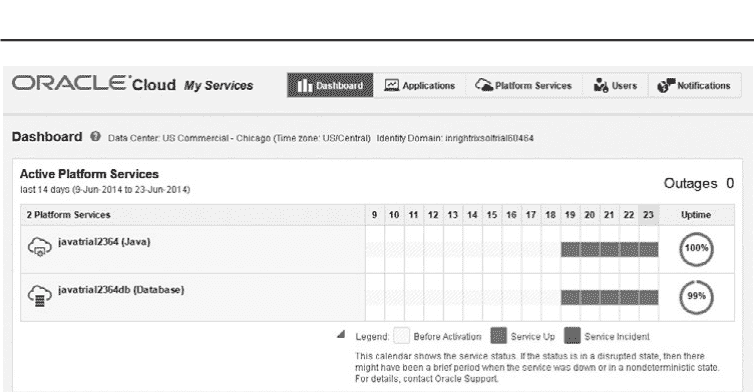

图 2-3. 我的服务

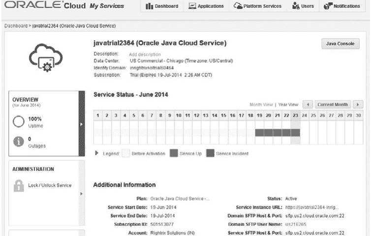

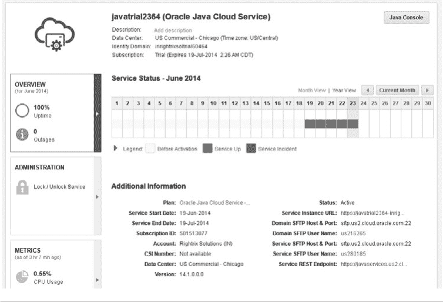

图 2-4. Java Cloud 服务仪表板

- 锁定此服务将防止您的用户访问您的应用程序和云服务。
- 请求可能需要时间进行处理。
- 当您的锁定或解锁操作完成后，Oracle Cloud 将向您发送一电子邮件。


图 2-5. 锁定/解锁服务

点击左侧面板中的“管理”（Administration），您将看到如图 2-5 所示的界面，在界面中您可以根据需要点击锁定服务的按钮。

点击左侧面板中的“指标”（Metrics），您将看到如 CPU 使用率、内存使用率、应用程序数量等信息，如图 2-6 所示。

点击“关联服务”（Associated Services），您将看到任何其他与您的 Oracle Java Cloud 设置关联的 Oracle Cloud 服务。对于试用版设置，您将只会看到您的数据库服务，如图 2-7 所示。

图 2-4 右上角的“Java 控制台”（Java Console）按钮将带您进入 Java Cloud 服务控制。我们将在第 4 章中查看更多关于 Java Cloud 服务控制的内容。

| 最新使用情况（3 小时 10 分钟前） |
| :--- |
| CPU 使用率 | 0.55% |
| 已部署应用程序 | 1 |
| 内存使用率 (MB) | 335.53 |
| 请求频率（每） | 0 |
| 历史使用情况 | 过去 7 天无使用数据。 |

图 2-6. 使用指标


图 2-7. 关联服务


如今，大多数 Java 开发人员使用某些集成开发环境（IDE）进行开发。一些流行的 Java IDE 有 NetBeans、Eclipse、JDeveloper 和 IntelliJ IDEA。虽然您可以从许多可用的 Java 开发工具中选择，但我们将在书中使用官方支持的工具进行演示：NetBeans、Oracle JDeveloper 和 OEPE。Oracle 目前为 NetBeans、JDeveloper 和 Eclipse 提供 Oracle Java Cloud 集成：

- **NetBeans IDE**：NetBeans 已经存在十多年，曾是 Sun 微系统（后被 Oracle 收购）的旗舰 Java 开发工具。NetBeans 在 Oracle 旗下继续蓬勃发展，通常是第一个支持 Java SE 和 Java EE 新技术的工具。在我看来，NetBeans 丰富的功能集和开箱即用的特性使其成为初学者以及高级开发人员的绝佳选择。

- **Oracle JDeveloper**：JDeveloper 在 Sun 收购之前是 Oracle 的 Java IDE。近年来，JDeveloper 已进入了一个特定的利基市场，成为 Oracle 开发人员的首选 Java IDE。它在纯 Java 圈中不再那么流行，但它是 Oracle 应用程序开发人员的主要 Java 工具。JDeveloper 可能极少在以 Java 为中心的会议上成为热门话题，但在 Oracle 会议上总是会出现的。

- **Oracle Enterprise Pack for Eclipse (OEPE)**：Eclipse 在各种编程领域都有极大的吸引力，而不只是 Java。今天，许多公司都在发布基于 Eclipse 构建的产品和开发工具。自然，有成千上万的开发者最习惯 Eclipse IDE。Oracle Enterprise Pack for Eclipse 就是这些开发人员想要的基于 Eclipse 的 Oracle 开发工具。

哪个 IDE 最好？开发人员对自己的 IDE 非常热衷，每个工具都有其优点。为了对这些领先的 IDE 选项公平，我们将在每一个中展示 Java Cloud 集成。所有 IDE 的集成都非常相似，因此这三者在 Java Cloud 方面没有竞争优势，您可以根据需求选择您认为最适合的。在进行 IDE 集成之前，您首先需要获取 Oracle Java Cloud Service SDK。

下载 Oracle Java Cloud Service SDK，该 SDK 在 Oracle Technology Network 网站上免费下载。请注意，SDK 可以独立于任何 IDE 运行使用。

SDK 包含以下工具：

- 用于与您的 Oracle Java Cloud Service 实例交互的命令行界面。
- 用于检查应用程序云部署就绪情况的白名单工具。
- 用于与您的 Oracle Java Cloud Service 实例交互的 Ant 任务和 Maven 插件。
- SDK 无安装过程；您只需要下载文件并解压到您的机器上。

## NetBeans

从 `www.netbeans.org` 下载并安装 NetBeans IDE。确保您下载了 Java EE Bundle 或 All Bundle。安装 NetBeans 的 Oracle Cloud 插件。启动 NetBeans，然后选择“工具” | “插件”。在插件管理器中，选择“可用插件”选项卡并搜索“Oracle Cloud”。您应该选择一个类别标记为“Java EE”的 Oracle Cloud 插件。选择插件并安装。

现在选择“工具” | “云提供商”，然后点击“添加云”按钮。在下一个屏幕上选择 Oracle Cloud，您将看到一个如图 2-8 所示的界面。输入您的凭据并提供之前解压的 Oracle Cloud SDK 路径。现在您将看到“云资源”中列出“Oracle Remote”，如图 2-9 所示。点击完成。

# 第 2 章：Oracle Java Cloud 37

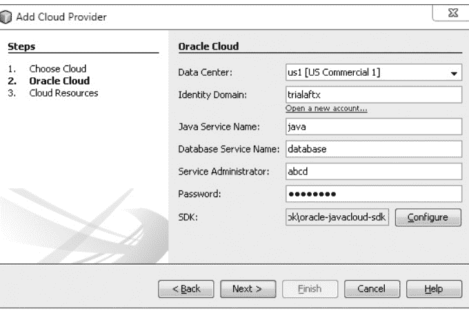

图 2-8. 添加云提供商

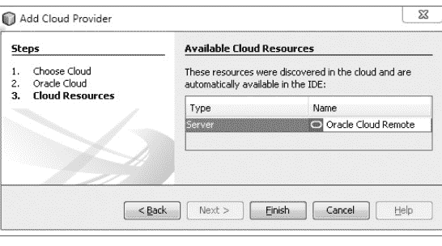

图 2-9. 可用云资源

| 项目 | 文件 | 服务 |
| :--- | :--- | :--- |
| 数据库 | | Web 服务 |
| 服务器 | | GlassFish 3+ |
| Oracle Remote | | |
| Maven 仓库 | | |
| 云 | | Oracle Cloud |
| Hudson 构建器问题跟踪 | | |

图 2-10. NetBeans 服务

“Oracle Cloud”现在会出现在 NetBeans 服务窗口的“云”节点下，而“Oracle Remote”将列在“服务器”节点下，如图 2-10 所示。如果没有看到 Oracle Remote，请点击刷新。

Oracle Cloud 旁边的绿色箭头表示服务器正在运行。考虑到我们使用的是云服务器，这里将是绿色的。如果本地 GlassFish 服务器也在运行，GlassFish 旁边也会类似的绿色。

从 OTN 下载最新版本的 JDeveloper。Studio 版本支持 Java EE。启动 JDeveloper，然后选择“视图” | “应用程序导航器”。您应该在导航器中看到 `IntegratedLogicServer` 实例，如图 2-11 所示。这代表了随 JDeveloper IDE 的 WebLogic 服务器。

要添加 Java Cloud 应用程序，右键点击“应用程序”并选择“新建应用程序”，即可得到如图 2-12 所示的界面。

注意，“新建”和“新建应用程序”提供的功能不同。在此界面上，选择“独立服务器”。在下一个屏幕上，选择 Oracle Cloud 作为连接类型，然后输入您的 Oracle Cloud 凭据，这些凭据在所有 IDE 中都是相同的。

完成后，您将在“应用程序导航器”中看到第二个服务器。现在您可以将您的任何应用程序部署到 Oracle Java Cloud 的服务器上。


图 2-11. JDeveloper 应用程序导航器

从 `www.oracle.com/technetwork/developer-tools/eclipse/` 下载 Oracle Enterprise Pack for Eclipse。安装非常简单，只需解压 zip 文件。启动 Eclipse。如果您启用了 Web 或 Java EE 视图，将看到服务器窗口。如果默认未启用此项，您可能需要手动打开服务器窗口。您还可以通过“窗口” | “首选项” | “服务器” | “运行时环境”来编辑服务器。

在 Servers 窗口中，右键点击并选择 New | Server。在这里，输入你的 Oracle Java Cloud 凭据，如图 2-13 所示。你还需要指向 Oracle Java Cloud SDK 和 Java 运行时环境（JRE）。如果你指向 JRE 7，将收到以下告警：

> 云应用程序必须使用 Java 6 或更高版本开发。所选版本为“1.7”。

在这种情况下，请下载并安装 JRE 6 并指向 JRE 6 目录。

如果连接成功，Servers 窗口将更新，如图 2-14 所示。

与 NetBeans 一样，你会发现 Eclipse 在正在运行的服务器旁边也显示一个绿色箭头，在这种情况下它就是 Oracle Java Cloud。

你现在已经启动了 Oracle Cloud 服务器并将其集成到 NetBeans、JDeveloper 和 Eclipse 中。

将 Oracle Cloud 作为集成到 IDE 中的服务器可用也是件很有趣的事，因为与本地服务器不同，云服务器始终可以供你使用，无需任何安装、管理或停止、启动……

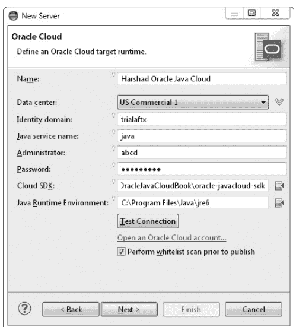

图 2-13. Eclipse 的 New Server 窗口

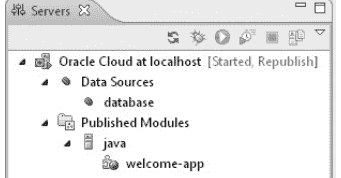

图 2-14. Eclipse 的 Servers 窗口

Maven (`http://maven.apache.org/`) 和 Ant (`http://ant.apache.org/`) 因其项目管理和构建能力被广泛使用。Ant 是一个老且可靠的实干型构建工具，而 Maven 是一个相对较新的工具，除了构建能力外，还拥有令人印象深刻的项目管理能力。

OJC 通过 Cloud SDK 与这两个工具都提供了丰富的集成。Maven 插件 `javacl.jar` 和 Ant 插件 `ant-javacl.jar` 可以在 SDK 的 lib 目录中找到。通过 Maven 插件，Java Cloud 的命令以 Maven goals 的形式暴露。此外，Ant 插件中还为大多数命令行提供了相应的 Ant task。

如果命令是 "install"，则 Maven goal 是 `com.oracle.cloud:javacl:install`，而 Ant task 是 `<javacl:install/>`。

Maven 和 Ant 插件使你只需对 Maven 或 Ant 配置进行少量更改，即可将项目集成到 Oracle Java Cloud。

## 用户与角色

每个 Oracle Cloud 服务都属于一个身份域，该身份域控制该服务的用户验证和授权。你可以通过将多个 Oracle Cloud 服务放在同一个身份域中，在它们之间共享相同的身份存储。

点击页面右上角的 Users 链接（如图 2-3 所示），你将看到如图 2-15 所示的屏幕，列出了系统中用户的名称、用户名和电子邮件。可以使用搜索框以及 Show and Sort By 下拉列表来获取特定用户或类型的用户。

## Oracle Java Cloud 上的 42 Java EE 应用

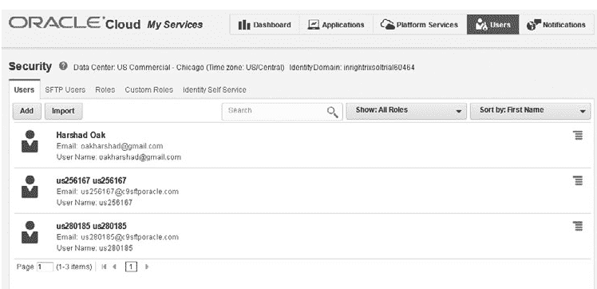

## 图 2-15. 用户

一个并不明显的功能是，如果你点击或将鼠标悬停在用户名称上，会弹出一个小窗口，显示分配给该用户的角色，如图 2-16 所示。此外，点击列表最右侧的图标可以获得修改用户信息、重置密码、管理分配给该用户的角色以及删除用户的选项，如图 2-17 所示。对于具有身份域管理员角色的用户，Remove 选项是禁用的。

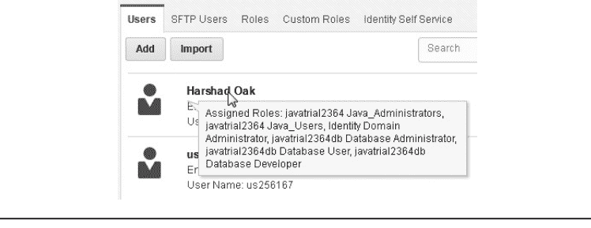

## 图 2-16. 用户角色


图 2-17. 修改用户信息

你登录 Oracle Cloud 的用户默认也是身份域管理员。然而，你可以根据需要添加和修改用户及角色。

要添加新用户，点击图 2-16 所示的 Add 按钮。你将看到如图 2-18 所示的弹窗，可以在其中添加新用户并为该用户选择角色。

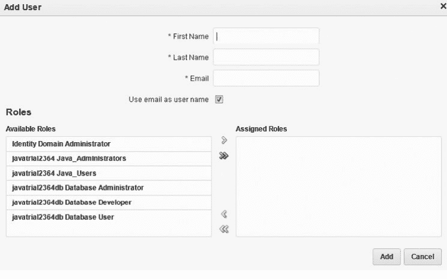

图 2-18. 添加用户

| | Users | SFTP Users | Roles | Custom Roles | Identity Golf Service |
| :--- | :--- | :--- | :--- | :--- | :--- |
| 批量分配角色: | Identity Domain Administrator User Assignments: 1 | javiera2364_Java_Administrators User Assignments: 1 | javiera2364_Java_Users User Assignments: 1 | javiera2364_Database_Administrator User Assignments: 1 | javiera2364_Database_Developer User Assignments: 1 |

# 第 3 章：使用 NetBeans 51 构建与部署

> **注意**
>
> 尽管我们在这里选择了一个特定的 IDE（即本书中的 NetBeans），但我们始终将遵循 Java EE 规范来构建应用程序，不会编写任何特定于 IDE 代码。

## 使用 Java EE 技术进行构建

现在让我们开始使用 NetBeans 构建一个应用程序并将其部署在 OJC 上。首先，让我们专注于构建应用程序，而不要担于每种 Java EE 技术的微观细节。我们将在未来的章节中详细介绍 Java EE 技术。现在，拥有一个全局观至关重要。

> **提示**
>
> 本书中的项目编写旨在提供实操培训。重要的是，你必须亲手尝试并结合书中的章节来构建你的应用程序，以获得这些课程的全部价值。

NetBeans 可以安装在所有支持 Java 的操作系统上。因此，我们将在 Windows、Linux 和 Mac OS 系统上安装并运行它。我们已经在第 2 章介绍过如何安装 NetBeans IDE。

请注意，安装完整版本并不意味着所有功能都会立即激活并启动资源。NetBeans 拥有整洁的“按需功能”能力，只有在你实际使用某项技术时，才会启用它。

因此，当你首次在 NetBeans 中使用不同的技术时，可能会看到激活界面。

## 第一个 NetBeans 项目

一旦运行 NetBeans，选择 File | New Project。在此屏幕上，选择 Java Web | Web Application。将项目命名为 `Ch3WebApplication1`。你不需要更改屏幕上的其他任何内容。但请注意 Project Location 字段中的文本，以便了解项目文件具体存储在机器的哪个位置。点击 Next。

## Oracle Java Cloud 上的 Java EE 应用程序

如图 3-1 所示，选择 Oracle Cloud Remote 作为你的服务器。这里需要注意的是，由于 OJC 尚未支持 Java EE 6，NetBeans 将强制你使用 Java EE 5，以防止你编写任何 OJC 可能无法运行的代码。NetBeans 还建议你将 source level 设置为 1.5，因为这将阻止你使用 Java 后期版本的功能。此外，当编译项目时，所有类创建时的源级别都设置为 1.5。

> **提示**
>
> OJC 上的应用程序可以使用 Java SE 6 API，如果你打算使用 JDK 6 的源码功能，请转到 Project Properties | Sources 并将代码级别更改为 JDK 6。支持的 API 列表请附录 C。

OJC 对 Java 语言和 Java EE 特性的支持将随着更高版本的 Java EE 和 WebLogic 的发布而更新。如前，你可以将源级别更改为 JDK 6。但由于 Java 和 Java EE 的向下兼容性，即使是带有 Java 5 代码的 Java EE 5 应用程序在 OJC 上也能完美运行。


图 3-1. 在 Server and Settings 部分选择 Oracle Cloud Remote 作为你的服务器。

## 第 3 章：使用 NetBeans 53 构建与部署

注意：Java 放弃了 1.5、1.6 等版本命名方式，改用 Java 5、Java 6 等。因此，这里对 Java 1.5 的引用可能会让人感到困惑。请注意，1.5.0（或 1.5）继续在仅开发者可见的地方或程序解析版本号的地方使用，但 1.5.0 指的与编号为 5.0 的完全相同的平台和产品。因此，这里的 1.5 版本就是你可能熟悉的 Java 5。

点击图 3-1 中的 Next 按钮。NetBeans 将显示一个类似于图 3-2 的屏幕，询问你是否想在项目中使用任何额外的框架。它列出了 JavaFaces (JSF)、Spring Web MVC、Struts 和 Hibernate。JSF 框架是 Java EE 规范的一部分，我们将在第 6 章介绍它。另外三个是流行的第三方开源框架，但它们并不是 Java EE 本身的一部分。不要选择任何框架。点击 Finish。项目现在应该已经创建，Projects 窗口将显示如图 3-3 所示的文件结构。

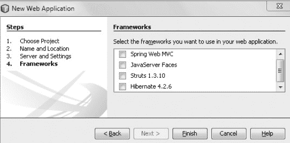

图 3-2. 额外的 Web 框架

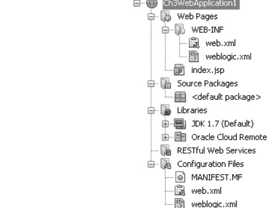

图 3-3. Projects 窗口中的文件结构

这里有几点需要注意：

- `index.jsp` 文件由 NetBeans 生成。NetBeans 对所有 Web 应用程序都会这样做。尽管这是一个 JavaServer Page，你会发现在这种情况下它与 HTML 几乎相同。我们将在第 5 章介绍 JSPs。


- 你可以在 Oracle Cloud 上看到可供项目使用的库（JAR 文件）。在列表中展开 `Oracle Cloud Remote`，你将找到 `jaee5.jar` 以及持久化（persistence）所需的库。持久化在大多数情况下意味着与数据库进行通信。我们将在第 9 章使用这些库。

- 尽管我们将源级别设置为 1.5，但你仍然可以使用机器上的 JDK 1.7，而无需安装 JDK 1.5。NetBeans 将确保你只使用 1.5 的语言特性，而不使用后续发布版本中的语法和功能。

- 因为 OJC 运行在 WebLogic 服务器上，所以还会生成一个名为 `weblogic.xml` 的 WebLogic 配置文件。

| Firefox | JSP Page | + |
|---|---|---|
| ← + | https://java-trialects.java.us.oraclecloudapps.com/Ch3WebApplication/index.jsp | |
| Hello World! | | |

**图 3-4.** 部署在 OJC 上的应用程序的 index.jsp

如果你预计在云端部署和运行此应用程序之前还有很多步骤，那么你就要大一惊了。你只需要右键点击项目名称并点击 `Run`（运行）。NetBeans 将在 OJC 上编译、打包并部署你的应用程序。它实际上会更进一步，用你的默认浏览器打开 `index.jsp`。完成后，你应该看到如图 3-4 所示的 Hello World 页面。恭喜！你构建并部署了一个 Java 应用程序。

## 发生了什么？

现在让我们仔细看看 NetBeans 到底做了什么，让你觉得你赢得了云 EE 开发者的称号。首先，让我们看看 NetBeans 在后台执行的所有工作。


> **提示**
>
> 如果你关闭关闭窗口看不到日志，可以通过点击 `Windows` 来重置 NetBeans。

# 第 3 章：使用 NetBeans 构建和部署

为了简洁起见，我已将日志中所有出现 NetBeans 项目路径的地方替换为 `<NPDP>`。列表 3-2 中的日志显示了 NetBeans 为构建、打包、上传并将应用程序部署到 OJC 执行的各种操作。

## 列表 3-2：Oracle Cloud 远程部署日志

```
Uploading...
Deploying...
========== Log file: virusscan==========
<TIME> CDT: Starting "Virus Scan"
<TIME> CDT: Virus Scan started
<TIME> CDT:
<TIME> CDT: File Scanned: "Ch3WebApplication1.war"
<TIME> CDT: File Size: "2197"
<TIME> CDT: File Status: "CLEAN"
<TIME> CDT:
<TIME> CDT: Virus scan passed.
<TIME> CDT: "Virus Scan" complete: status SUCCESS
========== Log file: whitelist==========
<TIME> CDT: Starting action "API Whitelist"
<TIME> CDT: API Whitelist started
<TIME> CDT: WARNING - There are 3 warnings (s)
found for Ch3WebApplication1.war.

<TIME> CDT: INFO Whitelist validation has completed
with 0 error(s) and 3 warning(s).
<TIME> CDT: Whitelist validation passed.
<TIME> CDT: "API Whitelist" complete: status SUCCESS

========== Log file: deploy==========
<TIME> CDT: Starting action "Deploy Application"
<TIME> CDT: Deploy Application started
<TIME> CDT: [Deployer:1451944]Operation 'deploy'
on application 'Ch3WebApplication1' has succeeded on 'm0'
<TIME> CDT: WL action state: completed
<TIME> CDT: Application deployment succeeded.
<TIME> CDT: "Deploy Application" complete: status SUCCESS
```

日志记录中的长时间戳已被替换为 `<TIME>`。此日志是由 OJC 返回的，所有操作完全在云端执行。NetBeans 的角色仅限于创建、上传和部署应用程序的 `.war` 文件，之后由 OJC 负责对应用程序进行扫描、验证和部署。在部署成功的情况下，应用程序通常需要一左右的时间在 OJC 上启动并运行。

## 生成的文件和目录

`Ch3WebApplication1 (run)` 日志将显示 NetBeans 创建了几个目录，随后构建了 `Ch3WebApplication1.war` 文件并将其上传和部署到云端。我们将在本章后面的“我们处于 WAR 之战”部分详细讨论 WAR 文件。

图 3-3 显示了 NetBeans 如何组织你的项目文件。然而，这可能会让人困惑，因为 NetBeans 组织文件的方式是为了方便开发——它并不对应你计算机上的实际目录结构。为了更好地理解这一点，请打开操作系统上的 Windows 资源管理器或类似工具并查看目录结构。它应该与图 3-5 所示完全相同。

虽然你可以在 NetBeans 窗口内看到此视图，但将其与你熟悉的操作系统目录联系起来会更容易理解 NetBeans 的工作。明确 NetBeans 在后台做什么至关重要；否则，它看起来就像 NetBeans 正在通过某种魔法让你的应用程序运行。

`WEB-INF` 等目录是根据 Java EE 规范创建的。然而，其他目录（如 `build`、`src` 和 `dist`）仅根据常见的开发约定创建——例如，将源文件保留在 `src` 目录中，构建文件保留在 `build` 目录中，将发布的 `.war` 文件保留在 `dist` 目录中。`nbproject` 目录用于 NetBeans 配置信息和脚本。

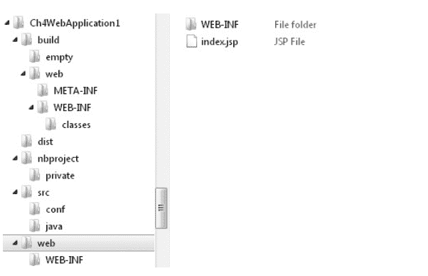

图 3-5. 项目目录

## 云端部署

第二个日志文件 Oracle Cloud Deployment 提供了关于一旦 NetBeans 将你的应用程序上传到 OJC 后究竟发生了什么见解。第一部分标记为“virus-scan”。一旦病毒扫描通过，接下来是“whitelist”。白名单是一份满足软件/服务技术和安全要求并已批准在其上运行的技术和 API 列表。列表 3-2 中的白名单日志显示了三个警告和零错误。

你会发现警告在 IDE 中更常见，因为白名单扫描通过后接下来是“whitelist”。白名单是一份满足软件/服务技术和安全要求并已批准在其上运行的技术和 API 列表。列表 3-2 中的白名单日志显示了三个警告和零错误。

日志记录中的长时间戳已被替换为 `<TIME>`。此日志是由 OJC 返回的，所有操作完全在云端执行。NetBeans 的角色仅限于创建、上传和部署应用程序的 `.war` 文件，之后由 OJC 负责对应用程序进行扫描、验证和部署。在部署成功的情况下，应用程序通常需要一左右的时间在 OJC 上启动并运行。

## Oracle Java Cloud Java EE 应用程序

`classes` 目录是存放你的 Java 类的地方。请根据你的 Java 包名在 `classes` 目录内创建目录结构。`com.example.User.java` 的类文件位于 `/WEB-INF/classes/com/example/User.class`。

`lib` 目录是存放任何库（你自己的或第三方的）的地方。库是 JAR 文件，应用程序服务器将加载它们以供应用程序使用。现在我们已经看了 Web 应用程序的目录结构，让我们来看看如何部署打包好的 Java EE 应用程序。

## 应用程序打包

如果你在机器上运行着本地 Java EE 应用程序服务器，你通常可以选择只需将应用程序复制到特定目录，服务器就会部署该应用程序。然而，对于像 OIC 这样的云提供商，你预计需要以标准的 Java EE 格式打包应用程序，并将打包后的文件上传到服务器。

## 我们正处于“战争”中

在之前的日志中，你可能注意到对 `Ch3WebApplication1.war` 文件的引用。你创建的 Java EE Web 应用程序已被 NetBeans 打包成该文件。很有可能，你在之前的 Java 开发中已经遇到过 Java 档（JAR）文件，但如果 JAR 文件包含 Web 应用程序，你应该将文件命名为 `.war` 文件。在这里，WAR 代表“网络归档”（web archive），它本质上是一个文件扩展名为 `.war` 的 JAR 文件，以便表示它是一个 Web 应用程序。所有兼容 Java EE 的应用程序服务器（无论是本地还是云端）都有部署 WAR 文件的选项。另一种类型的 JAR 文件称为企业归档（EAR）文件，我们将在书中后部分遇到。

> **提示**
>
> JAR、WAR 和 EAR 都是使用 ZIP 文件格式构建的。因此，你可以使用已安装的任何 ZIP 软件打开、压缩和提取这些文件。


## 第 3 章：使用 NetBeans 构建和部署

在 `Ch3WebApplication1(run)` 日志中，你会看到以下行：

```
Created dir: ...\Ch3WebApplication1\dist
Building jar: ...\Ch3WebApplication1\dist\Ch3WebApplication1.war
```

如前简要提到的，NetBeans 创建的目录并非 Java EE 规范强制要求的，但将你的目录命名为发行文件名称是一种惯例。如果你打开该目录，你会发现 `Ch3WebApplication1.war` 文件。

注意，这个 `Ch3WebApplication1.war` 文件是 NetBeans 实际上传到 OIC 并部署在云端上的唯一文件。你可以使用 Java JAR 工具甚至像 WinZip 或 7-Zip 等 ZIP 工具打开此 WAR 文件。无论你使用哪种开发工具或 IDE，以及该工具在 UI 中如何显示文件，WAR 文件始终将处于规范规定的结构中。

当你打开此文件时，你会发现它与图 3-5 所示的结构一致。`lib` 目录缺失是因为我们的应用程序没有使用任何额外的库，因此不需要 `lib` 目录。

注意，在我们的应用程序中，我们有一个 `web.xml` 文件和一个 `weblogic.xml` 文件。`web.xml` 文件是 Web 部署描述符，包含了所有特定于 Web 应用程序的配置信息。`weblogic.xml` 文件是运行时描述符，用于 WebLogic 特定的配置参数。

在第 7 章中，我们将介绍将 WAR 文件与 JAR 文件一起打包。这是通过使用第二种 Java EE 应用程序打包方式——EAR（企业归档）文件实现的，正如我们将详细讨论的那样。

## 总结

在本章中，我们使用 NetBeans 开发了一个应用程序并将其部署到 OIC。我们还查看了 Java EE Web 应用程序的结构以及如何打包 Java EE 应用程序。在下一章中，我们将进一步完善应用程序，并使用 Servlet 技术为其添加功能。


# 第 4 章：Servlets、过滤器和监听器

## Oracle Java Cloud Java EE 应用程序

在上一章中，我们使用 NetBeans 创建了一个基础 Web 应用程序，并讨论了 Java EE 应用程序的结构和打包。在本章中，我们将查看 Servlet，这是一种从第一天起对于 Java EE 应用程序构建就不可或缺的 Java EE 技术。我们还将查看基于 Servlet 的 Java EE 应用程序的关键文件、数据共享、会话管理、过滤器和监听器。最后，我们将这些功能将应用程序部署到 Oracle Java Cloud (OIC)。

## Servlets

Servlet 自 20 世纪 90 年代后期以来一直存在，令人惊讶的是，它们今天仍然是一项关键的基础技术。在某种意义上，Java EE 是从 Servlet 开始的。Java Servlet 开发包是 1999 年引入的 Java 2 平台企业版（JEE）的前身（http://oracle.com.edgesuite.net/timeline/java/）。Servlet 发布时，Java 本身还很新颖，且 Java Applet 仍然很流行并被广泛使用。

当时的 Servlet 是利用 Java 的能力来扩展 Web 服务器的功能。如今的 Servlet 是大多数 Java EE 技术利用或在其之上构建的基础技术。Oracle Java Cloud (OIC) 支持 Servlets 2.5 规范。

在之前的章节中，我们讨论了应用程序服务器，即服务器接收请求并返回响应。如果你希望这个请求/响应过程能更强大，并具有智能逻辑呢？这就是 Servlet 的用处，它让你能够利用许多 Java 库和特性生成动态内容。

## Servlet 接口

Servlet 是 `javax.servlet.Servlet` 接口的实现。Servlet 接口定义了初始化 Servlet、处理请求和销毁 Servlet 的生命周期方法。然而，使用 Servlet 接口的标准方法不是直接实现接口，而是通过子类接口的抽象实现。

可以是 `javax.servlet.GenericServlet` 或 `javax.servlet.HttpServlet`（后者继承自 `GenericServlet`）。`GenericServlet` 和 `HttpServlet` 都是抽象类，它们通过为 Servlet 提供基础框架来简化编写工作，并提供了 Servlet 生命周期周期方法的实现。由于这些是抽象类，Servlet 开发者需要扩展并重写至少一个方法。

因此，你不需要将类写为

```java
public class YourServlet implements Servlet
```

并强制实现接口中的所有方法，而是有一个更简单的选择：

```java
public class YourServlet extends HttpServlet
```

或

```java
public class YourServlet extends GenericServlet
```

## HttpServlet

`GenericServlet` 与协议无关，而 `HttpServlet` 专门设计用于 HTTP 和 HTTPS 协议，并且是它常用的。

如果你正在构建 Web 应用程序，你将通过 HTTP 进行通信并必须使用 `HttpServlet`，它为各种 HTTP 请求方法提供了支持。因此，有一个 `doGet` 方法处理 GET 请求，有一个 `doPost` 方法处理 POST 请求，以此此类推。`HttpServlet` 中其他专门处理各种 HTTP 方法的方法包括 `doDelete`、`doGet`、`doHead`、`doOptions`、`doPut` 和 `doTrace`。

> **提示**
>
> HTTP 请求方法（GET, POST, OPTIONS, PUT, DELETE, TRACE 和 CONNECT）是 HTTP 规范（www.w3.org/Protocols/rfc2616/rfc2616.html）的一部分，并且在各种技术中具有同样的相关性。HttpServlet 只通过为每个请求提供对应的方法来方便处理各种 HTTP 请求，这些方法由服务器根据 HTTP 请求方法的类型自动调用。

GET 和 POST 是最常用的 HTTP 请求，GET 用于向资源请求。因此，每当你在浏览器中输入 URL 时，你实际上都在发送一个 GET 请求。POST 主要用于 HTML 表单提交。其他 HTTP 请求方法很少使用。在大多数情况下，你的 Servlet 将重写 HttpServer 的 `doGet` 和 `doPost` 方法。

> **提示**
>
> 由于 RESTful 构建分布式应用程序的方式，在应用程序中利用 HTTP 请求方法经历了某种程度的“重生”。REST 代表表征状态转移（Representational State Transfer），这通常只会增加困惑。我们将在第 8 章介绍 REST。

## Servlet 基础

让我们使用 NetBeans 构建第一个 Servlet，然后将其部署并运行在 OIC 上。请注意，Servlet 在 WAR 文件中部署到云端的方式与上一章讨论的类似。以下是遵循的步骤：

1. 启动 NetBeans。
2. 选择 `File`（文件） | `New Project`（新建项目）。
3. 在结果界面上，选择 `Java Web` | `Web Application`（Web ）。
4. 将项目命名为 `Ch4Servlet1`。与上一章一样，确保选择 `Oracle Remote` 作为服务器。
5. 点击 `Finish`（完成）。


# 第 4 章：Servlets、过滤器和监听器

在 Projects（项目）窗口中选择项目 `Ch4Servlet1`。现在你可以从菜单栏选择 File | New File（文件 | 新建文件），或右键点击并在上下文菜单中选择 New | Servlet（新建 | Servlet）。你现在应该看到如图 4-1 所示的新 Servlet 窗口。

在这里，包名输入 `servlets`，类名输入 `Hello`。点击 Next（下一步）。在图 4-2 所示的屏幕上，注意你正在提供可以与类名不同的 Servlet 名称，以及可以用于访问 Servlet 的 URL 模式。

> **注意**
>
> 尽管 NetBeans 默认会使用类名作为 Servlet 名称和 URL 模式，但情况并非如此。你完全可以有一个类名为 A、Servlet 名称为 B、访问该 Servlet 的 URL 模式为 C 的 Servlet。


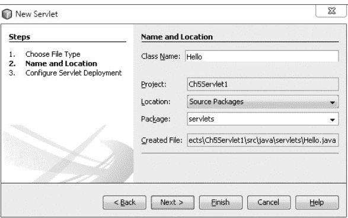

**图 4-1. 新 Servlet 窗口**

将类名与 Servlet 名称以及 URL 模式绑定并不是良好的做法。URL 模式代表应用程序的流程和功能，而类名和 Servlet 名称则取决于你如何组织代码。

你有声明多个 Servlet 名称的选项，它们都指向同一个类。因此，你可以拥有一个声明了多个 Servlet 名称的类，每个 Servlet 名称可以有多个 URL 模式。

现在，将 Servlet 名称更改为 `HelloServletName`，并将 URL Pattern(s) 字段改为 `/HelloUrl,/MyServlet`，如图 4-2 所示，以体现名称及其通常用途的区别。注意，我们为 Servlet 提供了两个 URL 模式，告诉服务器每当收到 URL 模式为 `/HelloUrl` 或 `/MyServlet` 的请求时运行我们的 Servlet。多个 URL 模式非常有用，因为你通常希望通过应用程序中不同的流程访问同一个 Servlet 功能。

你可以在 URL 模式中使用星号 (`*`) 通配符，将宽范围的 URL 模式映射到 Servlet。因此，你可以有一个 URL 模式 `*.abc`，这意味着所有形式为 `<anything>.abc` 的请求都将重定向到 Servlet。或者你可以将 URL 模式 `/abc/<anything>` 映射到 Servlet。

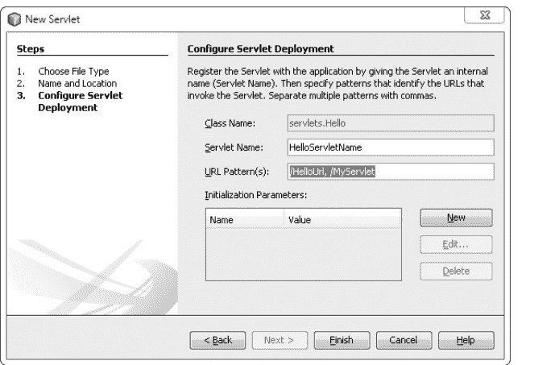

**图 4-2. 配置 Servlet**

这种能力通常用于你想使用中央 Servlet 框架来管理应用程序的情况。你将在第 6 章看到这种能力的应用。

> **提示**
>
> `*` 通配符的使用不像你在正则表达式中看到的那样频繁。通配符可以放在 URL 模式的开头，也可以放在斜杠 (`/`) 之前或之后。你不能用斜杠结束 URL 模式。因此，你不会像在正则表达式中使用那样拥有几十种用法的组合。

点击 Finish。NetBeans 打开了两个文件：名为 `Hello.java` 的 Servlet 类和 `web.xml` 文件。

现在，在 Servlet 文件 `Hello.java` 任意地方点击右键并点击 Run File（运行文件）。你也可以通过在 NetBeans Projects 窗口中右键点击 `Hello.java` 来获取相同的运行选项。你将看到如图 4-3 所示的窗口，它要求输入 Servlet 执行 URI。你不需要更改它；但是，如图所示，你可以使用此屏幕向你的 Servlet 传递额外的查询参数。点击 OK。

现在，将重复上一章讨论的步骤，从 NetBeans Output（输出）窗口可以看到两个标签页：一个显示正在执行的步骤的日志，另一个显示在 OIC 上的部署详情。

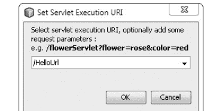


**图 4-3. 选择执行 URI**

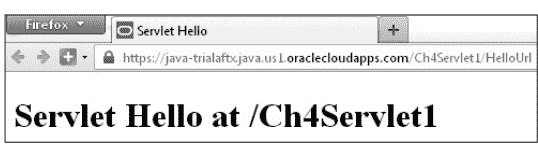

**图 4-4. 在浏览器中运行 Servlet**

## Servlet 类

现在我们部署了 Servlet，让我们讨论一下类。我们的 Servlet 继承自 `HttpServlet`，你会发现大部分内容在 `doGet` 和 `doPost` 中。注意，这取决于项目或 WAR 文件。通过 Servlet 方法，我们可以设置内容类型并生成输出。`HttpServlet` 是一个接口，Servlet 容器创建它的实现。在代码中，你已经看到了如何使用 `HttpServlet` 设置内容类型并生成输出。你还可以使用 `HttpServlet` 进行重定向、设置 Cookie、添加 Header 以及编码 URL。`set` 和 `setCharacterEncoding` 方法并不特定于 HTTP，它们继承自其父接口 `HttpServlet`。

内容类型和字符编码对于响应接收者（通常是网络浏览器）正确处理显示至关重要。我们在同一个方法中将字符编码设置为 UTF-8。`getContextPath()` 返回上下文路径。你会在配置中找到上下文路径。

### HttpServletRequest

你的 Servlet 可以通过 `HttpServletRequest` 对象了解请求的所有信息。注意 `HttpServletRequest` 是一个接口。Servlet 容器包含它的实现并将其传递给 Servlet。通过 `HttpServletRequest` 方法，我们可以获取请求路径、主机、端口、请求协议、请求参数、Cookie、请求 URI 等信息。其中一些方法继承自其父接口 `ServletRequest`。

### HttpServletResponse

你可以使用 `HttpServletResponse` 对象处理从 Servlet 发送的响应。同样，`HttpServletResponse` 是一个接口，Servlet 容器创建它的实现。在代码中，你已经看到了如何使用 `HttpServletResponse` 设置内容类型。你还可以使用它重定向、设置 Cookie、添加 Header 以及编码 URL。`set` 和 `setCharacterEncoding` 方法并不特定于 HTTP，它们继承自其父接口 `HttpServletResponse`。

## web.xml

`web.xml` 文件是部署描述符——你在此文件中说明应用程序的配置和部署信息。在 Projects 窗口中双击 `web.xml`。NetBeans 默认将打开用于编辑 XML 的 GUI 工具。点击 Source（源代码）选项卡即可看到 XML，如列表 4-1 所示。

## 列表 4-1: web.xml

```xml
<xml version="1.0" encoding="UTF-8">
<web-app version="2.5" xmlns="http://java.sun.com/xml/ns/javaee"
xmlns:xsi="http://www.w3.org/2001/XMLSchema-instance"
 xsi:schemaLocation="http://java.sun.com/xml/ns/javaee/web-app_2_5.xsd">
  <servlet>
    <servlet-name>HelloServlet</servlet-name>
    <servlet-class>servlets.Hello</servlet-class>
  </servlet>
  <servlet-mapping>
    <servlet-name>HelloServlet</servlet-name>
    <url-pattern>/HelloUrl</url-pattern>
  </servlet-mapping>
  <servlet-mapping>
    <servlet-name>HelloServlet</servlet-name>
    <url-pattern>/MyServlet</url-pattern>
  </servlet-mapping>
  <session-config>
    <session-timeout>30</session-timeout>
  </session-config>
  <welcome-file-list>
    <welcome-file>index.jsp</welcome-file>
  </welcome-file-list>
</web-app>
```

首先是 `<servlet>` 标签，其中规定了 Servlet 的名称和类。紧接着是 `<servlet-mapping>`，在其中你可以找到创建 servlet 时提供给 NetBeans 向导的 URL 模式。请注意，`<servlet-name>` 标签关联了这两个标签。因此，如果你更改了 `<servlet>` 标签中的 `<servlet-name>`，你也必须在 `<servlet-mapping>` 标签中更新它。

`<session-timeout>` 标签用于定义会话（session）的超时时长。我们将在本章稍后的“会话管理”部分详细讨论会话。最后 `<welcome-file-list>` 标签指定了应用程序的欢迎页。在我们当前的应用程序中，如果你运行整个项目而不是单个 servlet，你的浏览器将指向 `https://.../Ch4Servlet1/`，它实际上会调用 `https://.../Ch4Servlet1/index.jsp`，因为 `index.jsp` 是 `web.xml` 中指定的欢迎文件。

你可以声明多个欢迎文件，服务器将按照它们声明的顺序查找它们。如果没有指定欢迎文件，服务器将按顺序查找 `index.html` 或 `index.jsp`。

## weblogic.xml

`weblogic.xml` 文件是一个 WebLogic 特有的 Web 部署描述符 XML 文件，其中包含了应用程序的 WebLogic 特有配置。如果应用程序不包含 `weblogic.xml` 部署描述符，WebLogic 将对许多 WebLogic 部署描述符元素使用默认值。这些元素中的每一个都为你的应用程序提供了额外的 WebLogic 特有配置能力。由于我们不打算在此引入任何 WebLogic 配置，并计划清除任何特定服务器的特性/配置，因此你不需要在此处添加该文件。

你可以尝试从项目中删除 `weblogic.xml` 文件，然后右键点击项目并选择 Verify（验证）。白名单工具将发出警告：

> **缺少推荐的资源 "WEB-INF/weblogic.xml"**

但这并不是错误，你的应用程序将继续运行。OJC 并不要求你使用任何 WebLogic 功能或 API，也不期望你的应用程序中包含任何 WebLogic 特有的配置文件。

## 共享数据

现在我们已经仔细查看了 Servlet 的结构以及使其运行的各种元素，让我们进入 Web 应用程序中非常需要的功能——在应用程序的不同组件之间共享数据。你可以通过共享使用属性（attributes）来实现这种数据共享。Servlet 中提供的三种类型的属性是 `ServletContext`、`HttpSession` 和 `ServletRequest`，如图 4-5 所示。在这里，`ServletRequest` 的范围最小，而 `ServletContext` 的范围最广。

`ServletRequest` 范围内的属性在当前请求持续期间是可访问的。一旦请求完成，所有的 `ServletRequest` 属性都会丢失。`HttpSession` 属性只要会话处于激活状态就可以被访问。我们将在稍后的章节中更深入地查看会话，但目前，会话可以被看作同一个用户访问你应用程序中的多个 Servlet 或页面。`ServletContext` 范围是最大的范围，只要你的应用程序在运行，Servlet 属性就是可用的。

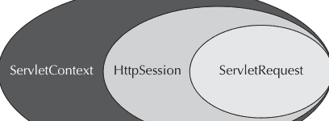

**图 4-5. 属性范围**

根据需要，可以使用 `ServletContext`、`HttpSession` 或 `HttpServlet` 的 `getAttribute()` 和 `setAttribute()` 方法。在每情况下，你都为属性命名并传递一个 `java.lang.Object` 对象作为属性值。你可能已经意识到 `java.lang.Object` 本质上意味着任何对象。你可以通过调用 `removeAttribute()` 方法来移除对象。

让我们通过创建一个名为 `Ch4Attributes` 的新项目来尝试。与之前的示例类似，在 JavaBeans 中为创建的新项目选择 Oracle Cloud Remote 作为服务器。在这个新项目中，创建两个名为 `SetAttributes` 和 `GetAttributes` 的 Servlet。现在，编辑 `SetAttributes` 中的 `processRequest()` 方法。

### 列表 4-2: SetAttributes 中的 processRequest 方法

```java
protected void processRequest(HttpServletRequest request, HttpServletResponse response)
    throws Exception, IOException {
    response.setContentType("text/html");
    PrintWriter out = response.getWriter();
    try {
        out.println("<h1>Set Attributes</h1>");
        request.setAttribute("Request Attribute", "REQ");
        request.getSession().setAttribute("Session Attribute", "SES");
        getServletContext().setAttribute("ServletContext Attribute", "CON");
    } finally {
        out.close();
    }
}
```

接下来，编辑 `GetAttributes` 中的 `processRequest()` 方法，如列表 4-3 所示。

### 列表 4-3: GetAttributes 中的 processRequest 方法

```java
protected void processRequest(HttpServletRequest request, HttpServletResponse response)
    throws Exception, IOException {
    response.setContentType("text/html");
    PrintWriter out = response.getWriter();
    try {
        out.println("<h1>Get Attributes</h1>");
        out.println("Request Attribute Value = " +
            request.getAttribute("Request Attribute"));
        out.println("Session Attribute Value = " +
            request.getSession().getAttribute("Session Attribute"));
        out.println("ServletContext Attribute Value = " +
            getServletContext().getAttribute("ServletContext Attribute"));
    } finally {
        out.close();
    }
}
```

注意，这两个方法都省略了 `<html>` 和 `<body>` 等基础标签，以减少代码并使其更容易理解。移除这些标签不是良好的编程技术；但是所有现代浏览器即使在没有这些标签的情况下显示 Web 内容。对于本示例而言，移除这些标签有助于关注代码的核心部分。

现在，运行 `SetAttributes` Servlet 以设置各种属性值。接下来，运行 `GetAttributes` Servlet。你将看到图 4-6 所示的页面。你可以请求属性值为 null，会话属性值 SES 被显示，Servlet 属性值 CON 也是如此。

这是因为访问 `GetAttributes` 的请求与 `SetAttributes` 的请求是不同的，因此在 `SetAttributes` 中设置的请求属性对 `GetAttributes` 不可用。然而，`HttpServlet` 和 Servlet 属性是可用的，因为这仍然同一个会话和同一个应用程序。

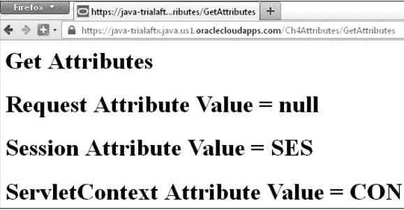

**图 4-6. 显示 Get 属性**

注意，为了获得此结果，Servlet 需要由同一个浏览器调用，并且浏览器不应禁用 Cookie，以便会话属性值能够保留并可见。下一节将讨论 Cookie 在会话管理中的作用。

# 会话管理 (Session Management)


# Web应用程序中最常见的功能之一是跨多个页面跟踪用户并提供登录功能，以便为用户提供特定的页面和内容

遗憾的是，HTTP 协议没有记忆状态的能力，因此需要由应用程序来保存和管理状态，并识别出是同一个用户在访问多个页面。考虑到这是 Web 应用的常用功能，大多数开发平台都提供了会话管理功能。Java EE 中的 `HttpSession` 提供了所需的会话管理功能。

## HttpSession

服务器创建 `HttpSession` 接口的实现，这帮助我们跨多个页面跟踪用户并存储用户信息。如列表 4-1 和列表 4-2 所示，通过调用 `HttpServletRequest` 的 `getSession` 方法获取 `HttpSession` 对象，该方法将返回请求对应的会话。如果没有会话，它将创建一个新会话。

在上示例中，我们查看了如何使用会话添加和检索属性。服务器是如何知道是同一个会话和同一个用户回来了？答案在于所谓的会话 ID（session ID），它是一个在客户端和服务器之间回传的唯一标识符。

实现此点的默认模式是使用 cookie。因此，当你访问 `SetAttributes` Servlet 时，浏览器上会设置一个带有唯一标识符的 cookie。接下来，当你访问 `GetAttributes` Servlet 时，服务器发现你是同一个用户，因为请求的浏览器 cookie 中包含了你访问 `SetAttributes` 时拥有的唯一标识符。它判断这是会话的一部分，会话属性值可供 `GetAttributes` Servlet 使用。打开浏览器的隐私设置，你会发现一个带有 OJC URL 且名为 `JSESSIONID` 的 cookie。注意，对于浏览器来说，这个 `JSESSIONID` cookie 与其他 cookie 没有区别。`JSESSIONID` 只是一个唯一标识符（会话 ID）的文本值。

应用程序服务器进行会话管理的唯一要求是唯一标识符（会话 ID）能够不断传回。浏览器很少会禁用 cookie，但如果禁用了，你现在需要找到一种方法在每个请求中发送唯一标识符。你的选择如下：

- 使用 `response.encodeURL` 方法对 URL 进行编码。当发现 cookie 被禁用时，`encodeURL` 方法会在 URL 中添加会话 ID。因此，如果不通过 cookie，ID 将作为请求参数继续传回服务器。
- 将会话 ID 作为隐藏表单字段传递。这样，当用户提交表单时，会话 ID 也会作为隐藏表单字段发送到服务器。

只要会话 ID 在往回，你就能利用 `HttpSession` 的功能。注意，属性会占用你的服务器内存——尤其是 `HttpContext` 属性，它们在内存中留存很长时间——你需要谨慎使用属性。


> **提示**
>
> 现代 Web 开发框架默认使用 cookie，但在 cookie 被禁用的情况下具有使用 `encodeURL` 或隐藏表单字段的后备方案。与自定义构建应用程序相比，如果你使用框架，cookie 被禁用并不是太令人担心。

## Oracle Java Cloud 上的 Java EE 应用程序

## RequestDispatcher

在早期的示例中，无论你做什么，请求属性（request attribute）始终为 null，因为对 `SetAttributes` 和 `GetAttributes` 的请求始终是独立的。那么在 Servlets 中是否有方法使用请求属性进行协作和数据共享呢？你能转发到另一个 Servlet 或将一个 Servlet 的输出包含另一个 Servlet 的输出中吗？

`RequestDispatcher` 为我们提供了所需的结果。正如名称所示，`RequestDispatcher` 将请求分发到应用程序中的另一个资源。在 `SetAttributes` Servlet 的 `processRequest` 方法的 `try` 块末尾添加列表 4-4 中的行。

# 第 4 章：Servlets、过滤器和监听器

## 列表 4-4：RequestDispatcher

```
RequestDispatcher rd1 = request.getRequestDispatcher("GetAttributes");
//RequestDispatcher rd = getServletContext().
getRequestDispatcher("GetAttributes");
if (rd1 != null) {
    rd1.forward(request, response);
    rd1.include(request, response);
}
```

代码中的前两行显示了获取 `RequestDispatcher` 的两种方法。两种方法的区别在于，`getRequestDispatcher` 接受相对路径，而 `ServletContext` 的 `getRequestDispatcher` 方法接受绝对路径，因此以斜杠开头。

接下来，我们检查是否为 null。之后是注释掉的 `forward` 和 `include` 调用。正如名称所示，`forward` 将请求转发到 `GetAttributes` Servlet，而 `include` 将将 `GetAttributes` 的输出包含在 `SetAttributes` 生成的输出中。运行更新后的代码，你将得到图 4-7 所示的页面。第一行是 `SetAttributes` Servlet 的输出，其余部分由 `GetAttributes` Servlet 生成。

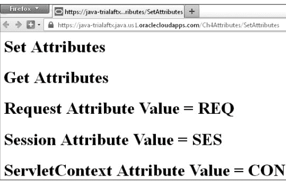

图 4-7 调度到 Get attributes 的请求

## Oracle Cloud 上的 Java EE

因此，我们可以使用 `RequestDispatcher` 让多个 Servlet 进行协作、委托和共享。我们可以使用 `RequestDispatcher` 创建一个真实的 Web 应用程序。

## Web 特定 Servlet 功能

Oracle Cloud 支持多种 API，其中之一是 `servlet`。此包提供了 `Filter`、`InitParam` 和 `Servlet` 注解，允许你使用元数据。这些注解不是 Java EE 规范的一部分，因此它们会将你的应用程序锁定到供应商。支持的 API 列于此处：

- logging
- jsp
- cache
- application
- i18n
- i18ntools
- jndi
- jws
- servlet
- transaction

# 第 4 章：Servlets、过滤器和监听器

除非有迫切需求，否则你不想在 Java EE 应用程序中使用特定供应商的代码。我们已经在第 1 章中讨论过原因。

现在让我们来看看过滤器和监听器，它们的功能经常被需要。过滤器和监听器可以使用我们构建的所有 Java EE 应用程序，无论我们是否使用 Servlets。

## 过滤器 (Filters)

当你想到“过滤器”（filter）一词时，你倾向于认为让东西（比如水）通过过滤器，去除杂质并获得纯水。然而，Java EE 中的过滤器能够对请求和响应做更多事情。它可以 a) 从请求中过滤掉内容，b) 编辑/添加请求内容或简单地记录请求内容，c) 过滤响应，或 d) 编辑/添加响应内容或简单地记录响应内容。因此，过滤器是一个请求预处理器和响应后处理器。

当多个 servlet 和其他 Java EE 组件需要某些功能（如身份验证、日志和加密）时，通常使用过滤器。在链中让一个或多个过滤器工作，为 Java Servlets 或其他 Java EE 组件提供预期的功能是有意义的。

让我们在本章之前创建的 `Ch4Servlet` 中添加一个简单的过滤器。右键点击 `Ch4Servlet` 并选择 Next | Other。在此屏幕上，选择 Web 类别和 Filter 类型。点击 Next。在下一个屏幕上，指定过滤器名称为配置过滤器部署（Configure Filter Deployment）屏幕，如图 4-8 所示。注意这里的包映射，`LogFilter` 应用于 `/*`。正如本章之前讨论的 URL 模式，这里的 `*` 是通配符，因此 `/*` 意味着过滤器适用于所有请求。点击 Next。

点击 Next，你将看到一个可以在过滤器初始化时设置配置值的屏幕。我们不需要在这里设置这些，所以点击 Finish。NetBeans 现在将项目生成 `LogFilter.xml` 文件，项目现在也包含列表 4-5 所示的添加内容。

# Oracle Cloud Java EE 应用

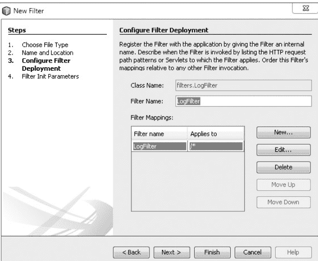

图 4-8 配置过滤器部署（Configure Filter Deployment）屏幕的过滤器映射

## 列表 4-5: web.xml 中的过滤器标签

```xml
<filter>
  <filter-name>LogFilter</filter-name>
  <filter-class>filters.LogFilter</filter-class>
</filter>
<filter-mapping>
  <filter-name>LogFilter</filter-name>
  <url-pattern>/*</url-pattern>
</filter-mapping>
```

你会注意到这些标签与列表 4-1 中的 Servlet 标签相似。在两种情况下，你都先声明一个 Servlet/过滤器，然后将其映射到 URL 模式。NetBeans 生成的 LogFilter.java 代码功能丰富；然而，对于初学者来说也相当望而生畏。因此，列表 4-6 显示了我简化并清理后的版本。

## 列表 4-6: LogFilter.java

```java
package filters;

import java.io.*;
import java.util.logging.*;
import javax.servlet.Filter;
import javax.servlet.servlet.*;

public class LogFilter implements Filter {

    private final Logger Logger LOGGER =
        Logger.getLogger(LogFilter.class.getName());

    public void doFilter(ServletRequest request, ServletResponse response, FilterChain chain)
        throws IOException, ServletException {

        long timeRequest = new java.util.Date().getTime();

        LOGGER.log(Level.INFO, "Request Protocol: {0}",
            request.getProtocol());
        LOGGER.log(Level.INFO, "Request Received At: {0}",
            new java.util.Date());

        chain.doFilter(request, response);

        long timeResponse = new java.util.Date().getTime();

        LOGGER.log(Level.INFO, "Response Sent In: {0} milliseconds",
            timeResponse - timeRequest);
    }

    public void init(FilterConfig cfg) throws ServletException {
    }

    public void destroy() {
    }
}
```

LogFilter 类实现了 Filter 接口，因此必须实现该接口。`doFilter` 方法是当请求匹配我们声明的过滤器映射时服务器将调用的方法。在代码中，我们使用 Java Logging API 来记录有关请求和响应的信息。

## Oracle Cloud Java EE 应用

过滤器不能由用户直接运行，而是旨在当过滤器映射生效时自动被调用。因此，在我们的情况下，我们不会尝试运行 LogFilter，而是运行 Hello.java。当我们向之前用 Hello.java 创建的 Servlet 发送请求时，应该发生以下情况：

1. 请求将由 LogFilter 进行预处理。
2. 随后将由 Hello.java Servlet 处理，由它生成一个响应。
3. Servlet 响应将再次通过过滤器，在其中再次被处理。

过滤器后处理后的输出将发送给客户端。

以下由 LogFilter 生成的日志输出显示了这三个步骤的结果：

```
Request Protocol: HTTP/1.1
Request Received At:<Date Time>
Response Sent In : 2 milliseconds
```

由于查看日志在整个应用程序中都是用的，而不仅仅是在 Servlet 或过滤器中，我们将在章节后半部分的“查看 Java 日志（View Java Logs）”中介绍如何在 OJC 上以及何时可以查看日志。你可以快速跳过该部分，并在完成后返回。

在这个示例中，我们查看了一个单一过滤器；然而，你完全可以创建一个系列/链式过滤器。过滤器按照它们在 web.xml 文件中声明的顺序执行。

## 监听器（Listeners）

Java EE 提供了让你使用事件监听器跟踪应用程序中关键事件的能力。每当相应的生命周期事件发生时，服务器都会调用这些监听器中的方法。

当你向应用程序添加监听器时，你需要 a) 编写一个实现相应监听器接口的类，以及 b) 在 web 部署监听器中声明该监听器。监听器通常用于你想在应用程序启动时执行某些操作或加载某些数据/配置，或者在事件发生时打开和关闭数据库连接以便在应用程序关闭时执行任何操作。

监听器接口如下：

| 监听器 | 描述 |
| --- | --- |
| `javax.servlet.ServletContextListener` | 当 ServletContext 创建和 ServletContext 销毁时被通知。 |
| `javax.servlet.ServletContextAttributeListener` | 当 ServletContext 属性更改、添加新属性或现有属性被删除或替换时被通知。 |
| `javax.servlet.http.HttpSessionListener` | 当会话生命周期变化（如创建、失效和超时）时被通知。 |
| `javax.servlet.http.HttpSessionAttributeListener` | 当 HttpSession 属性更改、添加新属性或现有属性被删除或替换时被通知。 |
| `javax.servlet.ServletRequestListener` | 当 ServletRequest 初始化或销毁时被通知。 |
| `javax.servlet.ServletRequestAttributeListener` | 当 ServletRequest 属性更改、添加新属性或现有属性被删除或替换时被通知。 |

你可以选择为每个监听器实现准备一个单独类，或者使用一个实现多个监听器的单一类。我们实现的每个接口都将迫使我们实现相应的事件。

# 第 4 章：Servlets、过滤器和监听器

除了监听器类中的代码外，需要做的另一件事是告诉服务器这个类是它应该调用的监听器类。因此，将 `<listener>` 标签添加到到 `web.xml` 文件中。如果你打开 `web.xml` 文件，你会发现文件中添加了一个新的 XML 块，如列表 4-8 所示。

## 列表 4-8：web.xml 中的监听器标签

```xml
<listener>
  <description>
    ServletContextListener,
    ServletContextAttributeListener, HttpSessionListener,
    HttpSessionAttributeListener, RequestListener,
    RequestAttributeListener
  </description>
  <listener-class>listeners.WebListener</listener-class>
</listener>
```

`<listener-class>` 的值对服务器来说是最重要的，`<description>` 标签可以安全地编辑为你喜欢的任何文本。你不需要告诉服务器你实现了哪些监听器，因为服务器可以根据你的类所实现的接口推断出来。

现在，运行我们在本节之前创建的 `SetAttributes` Servlet。虽然该 Servlet 的运行方式与之前完全相同，但日志现在将显示由 `SetAttributes` Servlet 中的操作触发的各种监听器记录的输出。

## 查看 Java 日志

在尝试本章中的应用程序时，你可能没有得到预期的结果并不知道哪里出了问题。此外，在过滤器和监听器的示例中，我们需要查看应用程序日志以理解其工作原理。

检查应用程序和服务器日志在本地设置或专用服务器上是一项简单的任务。然而，在云端，你甚至不知道应用程序正在运行，对日志的访问受限于云提供商。

你可以通过多种方式访问 OCI 日志。让我们先查看 Java Cloud Services 的日志。


图 10 Java Cloud Service 日志


# Java Cloud Service 日志

Java Cloud Service 日志如图 4-10 所示。此日志显示了部署期间的步骤，以及是否发生了错误或警告。你可以点击图 4-10 中高亮的下拉列表选择你想要查看的日志。右侧是每几分钟刷新一次日志的选项。默认设置是手动。

如果你查看 Java Cloud Service 日志，你会发现这些你在 NetBeans 中看到的 Oracle Cloud 日志条目是相同的。在本章中，第二个日志在你的应用程序运行时是很有用的。要访问此日志，点击图 4-11 所示的性能摘要中的“查看日志”（View Log）。你会得到一个可以精确选择想要查看的日志的屏幕。


> **图 11. 性能摘要中的查看日志**

你可以指定日期范围或选择精确日期，然后选择想要查看的消息类型。你会得到一个如图 4-12 所示的屏幕。

> **提示**
>
> 此日志显示了使用 Java 内置日志 API、Log4j 和系统日志。这里的“系统日志”指的是开发者经常使用的 `System.out.print`。本章示例中使用 Java 内置日志 API 是推荐的。

你可以点击图中“导出消息到文件”（Export Messages to File）按钮，将日志消息导出为 `.txt`、`.csv` 或 `.xml` 文件。


> **图 12. 日志消息**

> **提示**
>
> 在消息出现在日志之前可能会出现延迟。你可能需要等待一会儿或再次点击搜索。

你还可以选择使用 Oracle Cloud Ant 和 Maven 插件来访问日志。使用 SDK，你可以在命令提示符中执行 `query-service-logs` 命令。该命令要求使用 `service`、`identitydomain` 和 `datacenter` 参数。

| ID | 操作 | 状态 | 持续 |
| :--- | :--- | :--- | :--- |
| 18272 | 重新部署应用程序 | 2014-6-27 12:05:02 | 0:21 |
| 18269 | 重新部署应用程序 | 2014-6-27 12:05:03 | 0:23 |
| 18271 | 部署应用程序 | 2014-6-27 13:13:18 | 0:43 |
| 18030 | 重新部署应用程序 | 2014-6-27 11:49:02 | 0:26 |
| 17951 | 部署应用程序 | 2014-6-27 22:34 | 0:53 |
| 17056 | 部署应用程序 | 2014-6-10 12:04:57 | 0:11 |
| 15537 | 创建实例 | 2014-6-19 19:46:50 | 0:04 |

> **图 4-3. Oracle Cloud 作业和日志**

```bash
java -jar javacloud.jar query-service-logs -user username -service identitydomain -datacenter identitydomain
```

`query-service-logs` 接受许多参数，因此你可以自定义输出以获取你所需的日志消息。你可以参考 SDK 文档获取整个参数列表，或者直接运行命令：

```bash
java -jar javacloud.jar query-service-logs -help
```

所有的参数将显示在屏幕上。

## 总结

在本章中，我们学习了 Servlets、会话和监听器。我们还查看了如何在 OCI 上访问日志。在下一章中，我们将转向 JavaScript Pages 以制作面向浏览器的功能丰富的应用程序。


# 第 5 章：JavaServer Pages、JSTL 和表达式语言

## Oracle Cloud Java EE 应用程序

在上一章中，我们使用 Servlet、过滤器和监听器构建了应用程序并将其部署在云端。你可能注意到，使用 Servlet 构建应用程序是枯燥的，涉及大量的 Java 代码，即使生成的是静态 HTML。为了解决这个问题，JavaServer Pages (JSP) 应运而生。JSP 允许你在 HTML 中嵌入 Java 代码。

## JSP 的起源

与 Servlet 一样，JSP 从 Java 早期时代一直存在。1.0 版本发布于 1999 年，而 JSP（2.3 版本）是 Java EE 的组成部分。JSP 也继续被用于各种应用程序。

当 JavaServer Faces (JSF) 作为构建组件化用户界面的框架被引入时，JSP 一直是 JSF 的视图技术。只有在 JSF 2.0 中，JSP 才作为 JSF 的视图技术被废弃，并被 Facelets 取代。“视图技术”在这里指的是 JSF 框架中负责生成视图的部分。我们将在下一章中更深入地查看 JSF。

在过去的十年里，尽管大多数书籍和博客推荐使用 JSF 而非 JSP，但 JSP 直到今天仍然被广泛使用。这不仅是因为 JSP 易于快速开发，还因为 JSP 技能很容易找到。此外，许多习惯于使用 JSP 构建的开发者发现它对他们非常有帮助，因此并不热衷于切换。

此外，JSP 凭借其简单的请求-响应模型，对于只需要基本功能的应用程序甚至 JavaScript 客户端来说，是一个很好的后备。较新的 JSP 由 Web 容器提供了更复杂的生命周期管理，这在某些情况下似乎显得过度设计。

由于向下兼容性，即使是最新的 JSP 版本也支持早期的使用语法。在许多情况下，这意味着实现同一功能有多种方法。在本章中，我们将主要介绍使用标签库和表达式语言的较新且更优雅的方法。

## Oracle Java Cloud 上的 JSP

Oracle Java Cloud 目前支持 JSP 2.1 版本，这是 Java EE 5 包含的版本。JSP 2.1 版本是一次重大的发布，因为它为 JSP 和 JSF 引入了统一的表达式语言。OJC 不实施任何针对 JSP 的限制或规定。Java Cloud Services 控制页面上标记为 Servlets 和 JSPs 的小部件（如图 5-1 所示）显示了活动会话数、过去五分钟内 Servlets 和 JSPs 的平均请求时间以及过去五分钟内的每分钟请求数。


> **提示**
>
> Java Cloud Service 控制台上显示的所有“每分钟”统计数据都是过去五分钟内的“每分钟”。

虽然图 5-1 中的值适用于你的整个 Java Cloud 实例，但你可以在 Applications 表中查看特定应用程序的值，也可以在该应用程序的 Java Cloud 控制页面上查看。虽然我们将在本章稍后部分讨论自定义标签，但这里值得注意的是，OJC 也支持在 `weblogic.jsp` 中使用 WebLogic Server 特有的自定义标签。

> **图 5-1. 性能摘要下的 Servlets 和 JSPs 小部件**

## JSP 内部原理

JSP 是一个文本文档——大多数情况下是一个 HTML 文件——其中包含一些 JSP 特有的标签，有时包含一些 Java 代码。推荐的文件扩展名是 `.jsp`。JSP 文件可以是 XML 格式，这样它可以被任何 XML 解析器解析和使用；也可以是标准语法，后者不那么冗长，但不是良好的 XML。

XML 形式的 JSP 从未受到开发者的欢迎；使用标准语法编写 JSP 很简单。除非需要使用 XML API 解析 JSP，否则大多数开发者倾向于使用标准语法。我们在本章的代码中将使用标准语法；然而，我们也会查看相应的 XML 标签。

## JSP 生命周期

理解 JSP 的关键在于理解 Servlets，因为当运行一个 JSP 时，实际运行的是 Servlet。当服务器接收到 JSP 的第一个请求时，它会将 JSP 翻译成 Servlet 类，然后编译该类。之后，在每次请求时，服务器都会运行该 Servlet 类，直到发现 JSP 文件已更新，在这种情况下，它将再次翻译并编译新的 JSP。

JSP 页面最大的性能损耗发生在编译时，因此预编译 JSPs 是一种最佳实践，这样在接收用户的第一个请求时，你的 Servlet 已经就绪。预编译 JSPs 有多种方法，最简单的方法是在应用程序的 `web.xml` 配置文件中的 `<jsp-descriptor>` 标签内添加 `<precompile>true</precompile>` 标签，如列表 5-1 所示。

> **列表 5-1: 预编译 JSP**

```xml
<jsp-descriptor>
  <precompile>true</precompile>
</jsp-descriptor>
```

## Servlet 代码

理解 JSP 工作原理的最好方法是查看 JSP 页面并分析理解对应的生成的 Servlet。让我们开始在 NetBeans 中创建一个名为 `Ch5JavaServerPages1` 的新 Web 应用程序，代码行与我们在上一章中创建的应用程序完全相同。与之前的情况一样，按照以下步骤操作：

1. 在 Server and Setting 屏幕上选择 Oracle Cloud 设置为服务器。
2. 在 Frameworks 屏幕上不要选择任何框架。

NetBeans 默认会在它生成的每个应用程序创建一个 `index.jsp` 文件，如列表 5-2 所示。

> **列表 5-2: NetBeans 生成的 index.jsp**

```jsp
<%@page contentType="text/html" pageEncoding="UTF-8"%>
<!DOCTYPE html>
<html>
<head>
  <meta http-equiv="Content-Type" content="text/html; charset=UTF-8">
  <title>JSP Page</title>
</head>
<body>
  <h1>Hello World!</h1>
</body>
</html>
```

你会发现，除了以 `<%@` 开头的第一行外，JSP 与 HTML 文件完全一样。

> **提示**
>
> 你可以将任何纯 `.html` 文件重命名为 `.jsp`，只要 HTML 的运行机制正常，它就可以工作。JSP 不包含具有特殊含义的字符。

NetBeans 有一个非常有用的功能，你可以右键点击 JSP 并选择 View Servlet，如图 5-2 所示。为了理解 JSP，你可以安装 WebLogic 服务器或者使用 NetBeans 自带的服务器。生成的 Servlet 通常位于 `<NetBeansProjectsDirectory>\Ch5JavaServerPages1\build\generated`，其中 `<NetBeansProjectsDirectory>` 是你 NetBeans 项目的位置。你将在输出窗口中找到目录创建日志。在生成的目录中，如果你使用的是 GlassFish，你会发现一个 `\org\apache\jsp` 目录层次结构，并在其中找到 `index_jsp.java`，如列表 5-3 所示。

> **提示**
>
> 即使你没有安装服务器或无法让编译工作，只需查看列表 5-3，因为它显示了语法并传达了关于 JSP 如何翻译成 Servlet 的核心点。

> **图 5-2. View Servlet 选项**

> **列表 5-3: index.jsp 的翻译 Servlet**

```java
package org.apache.jsp;

import javax.servlet.*;
import javax.servlet.http.*;
import javax.servlet.jsp.*;

public final class index_jsp extends org.apache.jasper.runtime.HttpJspBase
    implements org.apache.jasper.runtime.JspSourceDependent {

    private static final JspFactory _jspFactory = JspFactory.getDefaultFactory();
    private static java.util.List<String> _jsp_dependants;
    private org.glassfish.jsp.api.ResourceInjector _jsp_resourceInjector;

    public java.util.List<String> getDependants() {
        return _jsp_dependants;
    }

    public void _jspService(HttpServletRequest request, HttpServletResponse response)
        throws java.io.IOException, ServletException {

        PageContext pageContext = null;
        HttpSession session = null;
        ServletContext application = null;
        ServletConfig config = null;
        JspWriter out = null;
        Object page = this;
        JspWriter _jsp_out = null;
        PageContext _jspx_page_context = null;

        try {
            response.setContentType("text/html;charset=UTF-8");
            pageContext = _jspFactory.getPageContext(this, request, response, null, true, 8192, true);
            _jspx_page_context = pageContext;
            application = pageContext.getServletContext();
            config = pageContext.getServletConfig();
            session = pageContext.getSession();
            out = pageContext.getOut();
            _jspx_out = out;
            _jsp_resourceInjector = (org.glassfish.jsp.api.ResourceInjector) application.getAttribute("com.sun.appserv.jsp.resource.injector");

            out.write("\n");
            out.write("<!DOCTYPE html>\n");
            out.write("<html>\n");
            out.write("\n");
            out.write("<head>\n");
            out.write("<meta http-equiv=\"Content-Type\" content=\"text/html; charset=UTF-8\">\n");
            out.write("<title>JSP Page</title>\n");
            out.write("</head>\n");
            out.write("<body>\n");
            out.write("<h1>Hello World!</h1>\n");
            out.write("</body>\n");
            out.write("</html>\n");
        } catch (Throwable t) {
            if (!(t instanceof SkipPageException)) {
                out = _jspx_out;
                if (out != null && out.getBufferSize() != 0) {
                    out.clearBuffer();
                }
                if (_jspx_page_context != null) {
                    _jspx_page_context.handlePageException(t);
                } else {
                    throw new ServletException(t);
                }
            }
        } finally {
            _jspFactory.releasePageContext(_jspx_page_context);
        }
    }
}
```


经过 JSP 后的 Servlet 在所有服务器上并不完全相同；类名和包名取决于服务器所使用的 Servlet 容器。由于 GlassFish 使用 Tomcat 的衍生版本，因此使用了包名 `apache.jsp.jsp`。

## 第 5 章：JavaServer Pages、JSTL 和表达式语言

在 Servlet 代码中，请注意创建的实例变量以及 HTML 代码所在的位置。这个类非常像一个 Servlet，在这种情况下它扩展了 `org.apache.jasper.runtime.HttpJsBase`，而后者又扩展了我们在上一节中讨论过的 `HttpServlet`。我们在上一节中讨论的所有关于 Servlet 内容在 JSP 中的工作方式完全相同；你只需要意识到并理解你的 JSP 代码出现在 Servlet 的什么位置。

你可以在 NetBeans（或任何代码编辑器）中打开此代码文件；我们将回来查看对 JSP 所做的更改是如何反映在 Servlet 中的。

现在让我们来看看提供动态内容生成以及根据需要编写 Java 代码能力的 JSP 元素。

## JSP 指令

指令为 JSP 引擎提供信息，影响翻译后的 Servlet 代码。三种类型的指令是页面（page）、包含（include）和标签库（taglib）。

### page 指令

page 指令提供了关于页的信息。列表 5-2 中的第一行是页面说明页面生成的内容是 HTML 且编码为 UTF-8：

```jsp
<%@page contentType="text/html" pageEncoding="UTF-8" %>
```

在列表 5-3 中，你会注意到该指令被翻译为行：

```java
response.setContentType("text/html; charset=UTF-8");
```

page 指令除了 `contentType` 和 `pageEncoding` 之外还支持许多属性。你可以在 NetBeans 中按 `CTRL-SPACE`，这将得到显示指令属性的弹出窗口（见图 5-3）。

> **提示**
> 即使对于具有 true/false 选项或需要从一组选择中挑选的 JSP 属性，NetBeans 也提供了自动完成功能。`CTRL-SPACE` 用于获取自动完成选项。


```jsp
<%@page contentType="text/html" pageEncoding="UTF-8" %>

<!DOCTYPE html>

<html>

<head>

    <meta http-equiv="Content-Type" content="text/html">

    <title>JSP Page</title>

</head>

<body>

    <h1>Hello World!</h1>

</body>

</html>
```

图 5-3. 指令属性

### include 指令

include 指令用于在 JSP 翻译时包含一个文件，以便两个文件的内容合并到生成的 Servlet 中：

```jsp
<%@ include file="footer.html" %>
```

在使用 include 指令和合并 JSP 文件时要小心，因为在某些情况下可能会导致意料之外的错误，例如在多个文件中使用了相同的变量名时。

### taglib 指令

taglib 指令表示 JSP 中正在使用标签库。其用法语法如下：

```jsp
<%@ taglib prefix="test" uri="taglib.tld" %>
```

我们将在本章稍后的单独部分讨论标签库。现在，只需注意要使用标签库时，我们使用标签库指令。

## XML 格式的 JSP 指令

在之前的节中，我们查看了指令的 JSP 语法；然而，如果你需要 XML 语法：

```xml
<jsp:directive attribute="name" value="value" />
```

### JSP 声明

JSP 声明用于在 JSP 中声明变量和方法。让我们先看看它在翻译后的 Servlet 中的位置。

> **列表 5-4：JSP 声明**

```jsp
<% int count = 0;

String welcomeMsg(String name) {

    return "Welcome " + name;

}

%>
```

由于 JSP 声明中的 `count` 变量变成了实例变量，每次刷新页面都会访问同一个 Servlet 实例，因此值会增加。

### JSP 脚本

脚本是嵌入在 JSP 中的 Java 代码段。如果使用得当，脚本可以节省大量的时间精力，但如果使用过度，对任何人来说都可能是场噩梦。让我们在 JSP 中添加脚本。

> **列表 5-5：JSP 脚本**

```jsp
<% int count = 0; %>

<h1>声明中的计数: <%= count %></h1>

<% count++; %>

<h1>脚本中的计数: <%= count %></h1>
```

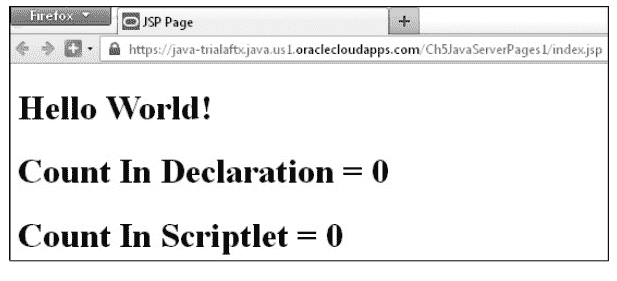

图 5-4. 声明与脚本

奇怪的地方在于刷新页面。你会发现声明的计数一直在增加，而脚本的计数保持为零。谜团答案在于 Servlet 代码。你会发现脚本中的所有代码都翻译成了 `_jspService` 方法。然而，对于局部变量 `count`，`int count = 0` 这一行是 `_jspService` 方法的一部分，每次请求都会执行。局部变量 `count` 一直被重置为零。

### JSP 表达式

JSP 表达式的格式为：

```jsp
<%= Expression %>
```

并为输出打印值提供了快捷方法。因此，列表 5-5 中的 `<%out.print(count);%>` 可以替换为 `<%= count %>`。将该行添加到 JSP，在翻译后的 Servlet 代码中，你会发现表达式中的所有内容实际上进入了 Servlet 中的 `out.print`。

### 隐式对象

脚本和表达式强大且有用，因为脚本代码位于 `_jspService` 方法中，不仅可以访问 `HttpServletRequest` 和 `HttpServletResponse` 对象，还可以访问在 `_jspService` 方法顶部发现的其他对象，如 `Session` 和 `ServletContext`。这些被称为 JSP 隐式对象，而不是由开发者费力创建它们，JSP 在翻译后的 Servlet 代码中创建了它们并供开发者使用。

| 对象 | 类/接口 | 用途 |
| --- | --- | --- |
| out | `javax.servlet.JspWriter` | 指页面输出流。用于向响应输出内容。 |
| page | `java.lang.Object` | 指页面的 Servlet 实例。用于引用为 JSP 生成的 Servlet 实例。这与使用 `this` 相同。 |
| pageContext | `javax.servlet.jsp.PageContext` | 指页面环境。用于在不同范围内获取和设置属性，因为它包含了其他隐式对象的引用。 |
| config | `javax.servlet.ServletConfig` | 指 Servlet 配置。用于获取初始化参数。 |
| exception | `java.lang.Throwable` | 指发生的异常。用于错误处理以生成适当的响应。它包含之前页面抛出的任何异常。 |

### JSP 注释

注释在编程中是一种最佳实践，用于传达你的想法或作为解决代码中特定问题的方法。在 JSP 中，你有三种使用注释的选择：JSP 注释、Java 注释和 HTML 注释（参见列表 5-6）。

**列表 5-6：JSP 注释**

```jsp
<%-- JSP Comment --%>

<% //Java Comment %>

<!-- HTML Comment -->
```

这三者的区别在于，JSP 注释只出现在 JSP 中，甚至不会出现在翻译后的 Servlet 代码中。Java 注释出现在 JSP 和 Servlet 代码中，而 HTML 注释是唯一会进入响应（通常是 HTML）的注释，如果用户在网页浏览器中选择“查看源代码”，就可以看到。

任何风格的注释都不会影响 JSP 页面的输出，但了解注释出现的位置对于你能够在正确的地方使用正确类型的注释至关重要。注释仅供 JSP 开发者使用，你应该使用 `<%-- JSP Comment --%>` 风格的注释。`<!-- HTML Comment -->` 风格应在你想在 HTML 响应中进行注释时才使用。虽然 HTML 注释只有在有人在浏览器检查源码时才可见，但你仍然移动了大量不必要的代码。

`<% //Java Comment %>` 类型是 Java 开发者熟悉且不至于出错的类型。然而，它相比 JSP 注释没有真正的优势，包括翻译后的 Servlet 中的注释通常没有太大作用。在大多数情况下，JSP 注释是首选。

在本节中，我们查看了 JSP 的工作原理、基本语法以及指令、脚本段、表达式和注释的使用。现在让我们看看如何使用标签让你的 JSP 构建得更快且易于维护。

## 标签和表达式

到目前为止，我们已经看到了如何在 JSP 中使用脚本为 HTML 添加动态内容。然而，JSP 脚本的问题不在于 JSP 本身，而在于 Web 开发人员使用方式。开发者使用过程化代码创建了大型且复杂的 JSP，并封装了大量功能。因此，随着时间的推移，页面对于原始开发者以外的任何人都变得难以管理和理解。此外，JSP 的理念是分离 HTML 和 Java，但并没有实现这一点，因为大多数 JSP 最终到处都是 Java 代码。

为了解决这个问题，引入了自定义标签（以及后来的 JSP 标准标签库，或 JSTL）和表达式。自定义标签提供了一种构建完全自定义标签的方法。JSTL 如其名，是一组具有常用功能的标准标签。表达式语言提供了一种在无需编写 Java 代码的情况下实现复杂功能的方法。

JSTL 与表达式语言结合可以确保你的 JSP 页面功能丰富且整洁易于理解和维护。

## 自定义标签

通过自定义标签，你可以创建具有你所需含义和功能的新标签。例如，在 HTML 中使用 `<p>` 标签会导致创建一个新段落，因为浏览器在 HTML 中看到 `<p>` 标签时知道这是其意图。同样，通过自定义标签，你可以在 JSP 中使用名为 `tag` 的标签，而浏览器在 HTML 中看到 `<p>` 标签时知道这是其意图。

## 第 5 章：JavaServer Pages、JSTL 和表达式语言

JSTL 拥有多个标签库，每个库都有唯一的 URI 并由许多不同的标签组成：

- 核心：`http://java.sun.com/jsp/jstl/core`
- XML：`http://java.sun.com/jsp/jstl/xml`
- 格式化：`http://java.sun.com/jsp/jstl/fmt`
- SQL：`http://java.sun.com/jsp/jstl/sql`
- 函数：`http://java.sun.com/jsp/jstl/functions`

### Taglib 指令

在使用任何标签库之前，我们需要先使用 taglib 指令来声明我们正在使用哪些库及其前缀。前缀和 URI 是非常重要的，以避免不同库中名称相同的标签之间发生冲突。

JSTL 标签库的 taglib 指令如列表 5-8 所示。

> **列表 5-8：JSTL 标签指令**

```jsp
<%@ taglib prefix="c" uri="http://java.sun.com/jsp/jstl/core" %>
<%@ taglib prefix="sql" uri="http://java.sun.com/jsp/jstl/sql" %>
<%@ taglib prefix="x" uri="http://java.sun.com/jsp/jstl/xml" %>
<%@ taglib prefix="fn" uri="http://java.sun.com/jsp/jstl/functions" %>
<%@ taglib prefix="fmt" uri="http://java.sun.com/jsp/jstl/fmt" %>
```

> **提示**
> 注意，前缀是按照约定使用的，但你可以更改所使用的前缀。此外，URI 在此处仅作为库的唯一标识符。它并不意味着页面必须与该 URI 通信并检索任何内容。

### 核心标签库

核心标签库包含了你最经常使用的标签。它提供了设置变量、运行循环以及在逻辑条件满足时生成输出的功能。

核心标签库的指令为：

```jsp
<%@ taglib prefix="c" uri="http://java.sun.com/jsp/jstl/core" %>
```

该库中的标签列如所示：

| 标签 | 功能 |
| ------|---|
| `<c:out>` | 评估表达式并将评估结果输出到当前的 `JspWriter` |
| `<c:set>` | 设置作用域变量的值或目标对象的属性 |
| `<c:remove>` | 移除作用域变量 |
| `<c:catch>` | 捕获由其任何嵌套操作抛出的 `java.lang.Throwable` |
| `<c:if>` | 如果 `test` 属性指定的表达式为真，则评估其正文内容 |
| `<c:choose>` | 为互斥的条件执行提供上下文 |
| `<c:when>` | 代表 `<c:choose>` 动作中的一种备选方案 |
| `<c:otherwise>` | 代表 `<c:choose>` 动作中的最后一个备选方案 |
| `<c:forEach>` | 在对象集合上重复其嵌套的正文内容，或重复固定次数 |
| `<c:forTokens>` | 遍历由提供的分隔符分隔的标记 |
| `<c:import>` | 导入基于 URL 的资源内容 |
| `<c:url>` | 构建一个应用了适当重写规则的 URL |
| `<c:redirect>` | 向客户端发送 HTTP 重定向 |
| `<c:param>` | 向 URL 添加请求参数 |

来源：`http://jcp.org/en/js/detail?id=052`

### XML 标签库

XML 标签库对于处理 XML 非常有用。XML 标签库的指令为：

```jsp
<%@ taglib prefix="x" uri="http://java.sun.com/jsp/jstl/xml" %>
```

你可以使用下表列出的标签来解析、转换 XML 并控制流：

| 标签 | 功能 |
| ------|---|
| `<x:parse>` | 解析 XML 文档。 |
| `<x:out>` | 评估 XPath 表达式并将评估结果输出到当前的 `JspWriter` 对象。 |
| `<x:set>` | 评估 XPath 表达式并将结果存储在作用域变量中。 |
| `<x:if>` | 评估 `select` 属性指定的 XPath 表达式，如果表达式评估为真，则渲染其正文内容。 |
| `<x:choose>` | 为互斥的条件执行提供上下文。 |
| `<x:when>` | 代表 `<x:choose>` 动作中的一种备选方案。 |
| `<x:otherwise>` | 代表 `<x:choose>` 动作中的最后一个备选方案。 |
| `<x:forEach>` | 评估给定的 XPath 表达式并在结果上重复其嵌套的正文内容，将上下文节点设置为迭代中的每个元素。 |
| `<x:transform>` | 对 XML 文档应用 XSLT 样式表转换。 |
| `<x:param>` | 设置转换参数。`<x:transform>` 的嵌套动作。 |

来源：`http://jcp.org/en/js/detail?id=052`

### 格式化标签库

格式化标签用于格式化文本、日期、时间和以及数字，并用于国际化。格式化库的指令为：

```jsp
<%@ taglib prefix="fmt" uri="http://java.sun.com/jsp/jstl/fmt" %>
```

标签列如下表所示。

| 标签 | 功能 |
| ------|---|
| `<fmt:setLocale>` | 设置本地化设置 |
| `<fmt:message>` | 从本地化资源查找消息 |
| `<fmt:formatNumber>` | 格式化数字 |
| `<fmt:formatDate>` | 格式化日期 |
| `<fmt:formatTime>` | 格式化时间 |
| `<fmt:formatCurrency>` | 格式化货币 |
| `<fmt:parseNumber>` | 解析本地化后的数字 |
| `<fmt:bundle>` | 指定本地化包 |

### SQL 标签库

SQL 标签库包含了与数据库交互的标签。许多应用程序倾向于直接与数据库通信，而不是使用这些标签。SQL 标签库的指令为：

```jsp
<%@ taglib prefix="sql" uri="http://java.sun.com/jsp/jstl/sql" %>
```


<%@ taglib prefix="sql" uri="http://java.sun.com/jsp/jstl/sql" %>

标签列如下：

| 标签 | 功能 |
| ------|---|
| `<sql:query>` | 查询数据库。 |
| `<sql:update>` | 执行 INSERT、UPDATE 或 DELETE 语句。 |
| `<sql:transaction>` | 为 `<sql:query>` 和 `<sql:update>` 建立事务。 |
| `<sql:setDataSource>` | 设置数据源作为作用域变量。 |
| `<sql:param>` | 设置 SQL 语句的参数。 |

# 第 5 章：JavaServer Pages、JSTL 和表达式语言 119

## 函数库 (Functions Tag Library)

该库包含了字符串处理函数。注意这些不是标签，而是可以使用在表达式中的函数。函数库的指令为：

```jsp
<%@ taglib prefix="fn" uri="http://java.sun.com/jsp/jstl/functions" %>
```

标签列如下：

| 标签 | 功能 |
| ------|---|
| `fn:contains` | 测试字符串是否包含指定的子字符串 |
| `fn:containsIgnoreCase` | 忽略大小写测试字符串是否包含指定的子字符串 |
| `fn:endsWith` | 测试字符串是否指定的结尾 |
| `fn:escapeXml` | 转义可以解释为 XML 的字符 |
| `fn:indexOf` | 返回字符串中指定子字符串首次出现的索引 |
| `fn:join` | 将数组中的所有元素连接成字符串 |
| `fn:length` | 返回集合中的项目或字符串的字符数 |
| `fn:replace` | 返回通过将所有出现的字符串替换为另一个字符串得到的字符串 |
| `fn:split` | 将字符串分割为字符串数组 |
| `fn:startsWith` | 测试字符串是否以指定的前缀开头 |

## 120 Oracle Cloud 上的 Java EE

## 在 JSP 中使用标签

现在我们查看了各种标签，让我们如何在 JSP 中使用它们。为了在我们的应用程序中使用 JSTL，我们需要在 `weblogic.xml` 文件中引用 JSTL ，如列表 5-9 所示。你可以在云服务控制的 Libraries 小部件中找到准确的规范和实现版本，如图 5–5 所示。共享库部件列出了各种

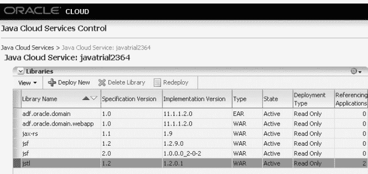

图 5-5. 共享库 - JSTL

# 第 5 章：JavaServer Pages (JSP)、JSTL 和表达式语言 (EL) 121

你可以使用的库。你可以使用 Deploy 按钮添加新库。OIC 在该库提供给应用程序之前会检查其是否符合 Oracle 标准。在我们的情况下，我们不需要添加 JSTL 库，因为 JSTL 1.2 已经部署并可用。

为了图 5-5 的屏幕截图，我将 JSTL 控件拖到了页面左侧，但默认情况下，你不会在页面右侧找到它。

## 列表 5-9：参考 JSTL 库

```xml
<library-ref>
  <library-name>jstl</library-name>
  <specification-version>1.2</specification-version>
  <implementation-version>1.2.0.1</implementation-version>
  <exact-match>false</exact-match>
</library-ref>
```

接下来，创建一个名为 `jstl.jsp` 的新 JSP。在此 JSP 中，添加列表 5-10 所示的代码。

## 列表 5-10：在 JSTL 标签集 Set、Choose、When 中使用表达式

```jsp
<%@page contentType="text/html" encoding="UTF-8" %>
<%@taglib prefix="c" uri="http://java.sun.com/jsp/jstl/core" %>
<%@taglib prefix="fmt" uri="http://java.sun.com/jsp/jstl/fmt" %>
<!DOCTYPE html>
<html>
<head>
  <meta http-equiv="Content-Type" content="text/html; charset=UTF-8">
  <title>JSP Page</title>
</head>
<body>
  <!--使用 JSTL 的表达式语言-->
  <%--设置请求属性--%>
  <c:set var="amount" scope="request" value="500" />
  <%--访问属性的多种方式--%>
  <ul>
    <li>liAmount = ${requestScope.amount}</li>
    <li>liAmount = ${requestScope["amount"]}</li>
  </ul>
    <li>Amount = ${amount}</li>
  </ul>
<!-- Choose When -->
<c:choose>
  <c:when test="${requestScope.amount < 1000}">
    <p>访问受限！</p>
    <p>您的金额为
    <fmt:formatNumber minFractionDigits="2" value="${amount}"/>
    </p>
  </c:when>
  <c:other>
    <p>欢迎！</p>
  </c:other>
</c:choose>
</body>
</html>
```


122 Java EE Applications on Oracle Java Cloud

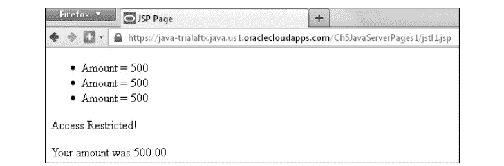

图 5-6. 使用 JSTL 和表达式的输出

第 5 章：JavaServer Pages、JSTL 和表达式语言 123

接下来，我们看到如何通过表达式提供的多种方式访问 amount 属性。在说 `${amount}` 的情况下，服务器将从最窄的作用域到最宽的作用域查找 amount 变量。因此，你可能在多个作用域中有具有相同的属性，你应该始终说明作用域。

接下来，我们使用 `<c:choose>` 标签，它包含 `<c:when>` 标签，我们测试 amount 是否小于 1000。如果小于 1000，我们使用格式化标签并对数字进行格式化，使小数点后至少保留两位。

现在让我们尝试另一个示例，我们处理一个迭代许多项目的常见用例。这些我们希望迭代的这些项目可以是用户输入的列表，或者有时是从数据库中检索出的项目列表。创建一个新的 JSP `jstl2.jsp`。在此 JSP 中，添加列表 5-11 所示的代码。

## 列表 5-11：JSTL forEach

```jsp
<%@taglib prefix="c" uri="http://java.sun.com/jsp/jstl/core" %>
<%@taglib prefix="fn" uri="http://java.sun.com/jsp/jstl/functions" %>
<%@page contentType="text/html" pageEncoding="UTF-8"%>
<!DOCTYPE html>
<html>
<head>
<meta http-equiv="Content-Type" content="text/html; charset=UTF-8">
<title>JSP Page</title>
</head>
<body>
<%@taglib prefix="c" uri="http://java.sun.com/jsp/jstl/core" %>
<%@taglib prefix="fn" uri="http://java.sun.com/jsp/jstl/functions" %>
<h1>List Technologies</h1>
<c:forEach items="${paramValues.tech}" var="technology">
  <p>
  <c:if test="${fn:containsIgnoreCase(technology,'java')}">
    ${technology}
  </c:if>
  </p>
</c:forEach>
</body>
</html>
```


124 Java EE Applications on Oracle Java Cloud

| | JSP Page | |
|---|---|---|
| List Technologies | Java Ruby | https://java-trial.oraclecloudapps.com/Chapter5ServerPages/jst2.jsp?tech=Java&tech=PHP | 5-7. 使用 JSTL forEach

运行 JSP。最初你不会得到所需的输出，因为我们没有传递任何参数。将浏览器中的查询字符串修改为：`/Chapter5ServerPages/jst2.jsp?tech=Java&tech=PHP`


通过这种方式，我们模拟从复选框提交三个值。现在你应该得到图 5-7 所示的输出。注意，我们在前面的“表达式语言”部分使用了隐式对象 `param`。让我们创建一个名为 `jstl3.jsp` 的 JSP，看看如何进一步利用表达式和隐式对象（见列表 5-12）。

## 列表 5-12：表达式和隐式对象

```jsp
<%@page contentType="text/html" pageEncoding="UTF-8">
<html>
<head>
  <meta http-equiv="Content-Type" content="text/html; charset=UTF-8">
  <title>JSP Page</title>
</head>
<body>
  <!--表达式语言用法-->
  <p>Cookie = ${cookie.JSESSIONID}</p>
  <p>Host = ${header.host}</p>
  <p>2 + 3 = ${2 + 3}</p>
```


# 第 5 章：JavaServer Pages、JSTL 和表达式语言

```xml
<p>Mod 10/4 = ${10 mod 4}</p>
<p>Mod 10/4 = ${10 % 4}</p>

<p>10/5 = ${10 div 5}</p>
<p>10/5 = ${10 / 5}</p>

<p>10 is greater than equal 5 = ${10 ge 5}</p>
<p>10 is greater than equal to 5 = ${10 >= 5}</p>

<p>z = 'z' > 'a'</p>
<p>Example param exists = ${empty param}</p>
```

使用 JSP 后，你将得到图 5-8 所示的输出。你可以看到，可以使用表达式实现很多功能。注意由于我们只使用表达式而不使用标签，在这种情况下不需要 `taglib` 指令。此外，注意 cookie 和 host 的值将根据你的设置而变化。

| | JSP Page |
|---|---|
| | https://java-trial.oraclecloudapps.com/Chapter5ServerPages/jstl.jsp |
| Cookie | Cg0WcsYCTfY2MWXC2MWcn63M4VBygsGT42QQLb6cCn01-643568301 |
| Host | java-trial.oraclecloudapps.com |
| 2 + 3 | 5 |
| Mod 10/4 | 2 |
| Mod 10/4 | 2 |
| 10/5 | 2.0 |
| 10/5 | 2.0 |
| 10 is greater than equal to 5 | true |
| 10 is greater than or equal to 5 | true |
| z = a | true |
| Example param exists | false |

图 5-8. 使用各种表达式的输出

在这些示例中，我们查看了常见的场景——如何使用 JSTL 和表达式语言 (EL) 在 JSP 中生成动态内容而无需编写任何 Java 代码。良好使用 JSTL 和 EL 的关键在于了解我们所涵盖的所有标签，理解可能的表达式范围，并适当地使用它们。

在这里列出所有标签是不合适的，但请注意，在所有情况下格式几乎是相同的——大多数标签都有多个属性来提供各种可能性，而且这些属性在许多情况下接受表达式以使标签更加强大。

## 总结

JSP 已经存在很久，但仍然是构建 Java EE 应用程序的良好、快速的选择。使用 JSP 配合 JSTL 和 EL，使你在构建丰富应用程序的同时保持代码整洁。JSP 技能很容易获得，而且 JSP 即使在最新版本的 Java EE 中仍然是一个重要部分。OIC 运行你的 JSP 文件，而且对你的开发没有特定的 JSP 限制。

不要仅仅因为 JSP 不再流行就轻视它并采用更复杂的框架。如果你在在这里讨论的库中没有找到需要的标签，请探索一些可满足小众需求的许多开源标签库。

在下一章中，我们将查看 JavaServer Faces (JSF)，它是一个功能丰富的 Web 框架，也是大多数新 Java EE Web 应用程序的首选框架。

# 第 6 章：JavaServer Faces

## 从 JSP 到 Struts 再到 JSF

使用 JSP 时，我们将网页视为脚本、标签和 HTML 的集合；然而，使用 JSF 时，我们将网页视为放置在页面上的组件集。我们可以调整并自定义每个组件的工作方式。在大多数情况下，这些组件与后端 Java 代码绑定，从而进一步增强了它们的功能。

JSF 是一个用于构建 Web 应用的框架，因此它不仅仅是页面视图，还考虑了整个应用程序应该如何设计和管理。它为构建 Web 应用提供了确定的结构和开发范式。因此，与其说 JSP 是一种视图技术，不如说 JSF 不止此。

在 JSF 2.0 之前，JSP 是 JSF 的视图技术。JSF 2.0 及更高版本使用 Facelets 作为主要的视图技术；然而，JSP 仍然被支持和使用。

尽管如此，JSF 的起源不仅源于 JSP 的局限性，还源于 2000 年初一种流行的 Web 框架 Struts。虽然 Struts 仍然存在（`http://struts.apache.org/`），但它已不再流行。

Struts 证明了一个基于模型-视图-控制器 (MVC) 设计范式的构建 Web 应用的开源框架。MVC 是一种设计模式，其中 Model 代表业务逻辑和页面，Controller 代表应用程序导航。Struts 是为 HTTP 应用量身定制的，并为响应处理和表单提交等常见 Web 功能提供了丰富的可能。控制器与视图的解耦为 Web 应用带来了巨大的价值，因为当时的 Web 应用已经变得过于庞大和复杂，无法仅用 JSP 来管理。

Java EE 一直擅长采用优秀的理念。Struts 的 Craig McClanahan 也是 JSF 1.0 的联合规范负责人之一。因此，JSF 的后端代码和导航处理能力与 Struts 非常相似。JSF 的 Facelets UI 组件采纳了来自 Apache Tapestry 和 Tiles 等框架的想法。早期的 Tiles 是 Struts 的一部分，但现在是一个名为 Apache Tiles 的独立项目。

## Oracle Java Cloud 上的 JSF

如前面的章节所述，OJC 支持 Java EE 5 和 Java 6 技术的混合，因此在 JSF 情况下，OJC 支持 JSF 1.2 版本以及在 Java EE 6 中引入的 2.0 版本。对 JSF 2.0 的支持是非常重要的，因为今天 JSF 首选的视图技术直到 JSF 2.0 才被引入。这里的“视图技术”本质上是指生成 Web 页面视图的代码。尽管如此，JSP 仍然通过最新的 JSF 版本获得支持，但 Facelets 是推荐的视图技术。如果你正在构建新应用程序，最好避免使用 JSP 而改用 Facelets。

JSF 2.0 的另一个重要变化是对注解的支持。在 JSF 1.x 之前，所有配置都在一个名为 `faces-config.xml` 的文件中；但在 2.0 版本中，你可以使用注解。我们在第 4 章关于 Servlet 的内容中无法使用注解，因为 OJC 支持的 Servlet 版本不支持注解。然而，由于 OJC 支持支持注解的 JSF 2.0，我们可以在本章中使用注解。

> **提示**
> 注解是一种元数据，它对代码的运行没有直接影响，但用于配置或向编译器或其他开发/部署工具提供额外信息。

## Facelets

Facelets 是 JSF 规范的一部分。它提供了页面声明语言和模板能力，适用于构建基于组件的页面。Facelets 带来了性能改进，并允许开发者根据需要方便地插入新组件。

Facelets 的基于组件的模型也为供应商提供了交付可以轻松插入任何应用程序的组件库的选项。有许多此类免费、开源和商业组件库。这些库的创建者通常只交付一个包含许多根据 Facelets 和 JSF 规范构建的组件的 `.jar` 文件。

Facelets 基于组件的模型还导致了可以方便添加和编辑组件的工具的出现。除了我们在上一章中讨论过的 JSTL，Facelets 还提供了标签库。

从表面上看，Facelets 从 JSP 演变为使用 XHTML 以及使用了不同的标签和组件。然而，Facelets 还支持超越 JSP 的表达式语言能力。因此，在上一章中，我们只查看了使用 `${}` 语法进行立即求值的表达式。然而，通过 Facelets，我们还可以在生命周期的适当点利用 `#{}` 语法。

现在让我们构建一个 JSF 示例并尝试理解。将项目命名为 JSF1。在第一步中，选择 Java Web Application。与之前的章节类似，在库下拉菜单中使用 JSF 2.0。选择 Facelets。

接下来，点击 Configuration（配置）选项卡。如图 6-2 所示，URL 模式设置为 `/faces/*`。这意味着所有匹配 `/faces/*` 的请求将由 JSF 框架处理。这里，`*` 是通配符，意味着 Servlet 可以独立运行。

接下来，我们需要选择首选语言。选项有 Facelets 和 JSP。接下来，选择 Components（组件）选项卡。你将看到图 6-3 所示的屏幕。列出了流行的 JSF 套件（PrimeFaces、ICEFaces 和 RichFaces），它们带来了自己的一套组件。虽然 JSF 本身有很多，但使用这些套件之一是使用更多功能和令人印象深刻的 UI 来增强你的应用程序的简单方法。不要选择任何套件。点击 Finish（完成）。

项目将被创建，NetBeans 还会创建一个 `index.xhtml` 文件。在添加功能之前，让我们查看应用程序中包含的 JSF 特有配置。打开 `web.xml` 文件，你将找到列表 6-1 所示的 XML。

## 列表 6-1: web.xml

```xml
<context-param>
  <param-name>javax.faces.PROJECT_STAGE</param-name>
  <param-value>Development</param-value>
</context-param>

<servlet>
  <servlet-name>FacesServlet</servlet-name>
  <servlet-class>javax.faces.webapp.FacesServlet</servlet-class>
  <load-on-startup>1</load-on-startup>
</servlet>

<servlet-mapping>
  <servlet-name>FacesServlet</servlet-name>
  <url-pattern>/faces/*</url-pattern>
</servlet-mapping>
```

首先是参数 `javax.faces.PROJECT_STAGE`，它设置为 `Development`，但也可以取 `Production`、`SystemTest` 或 `UnitTest` 值。根据此值，JSF 实现可以优化其行为，以及修改开发时诊断信息、错误消息和调试信息的详细程度。

接下来，注意我们在图 6-2 中设置的值导致了一个新的 Servlet 被声明，所有 `/faces/*` 请求都映射到它。请注意，`/faces/*` 是我们在向导中提供的模式。我们完全可以使用其他某种模式。

现在让我们来看 `index.xhtml` 文件，其代码如列表 6-2 所示。

## 列表 6-2: index.xhtml

```xml
<?xml version="1.0" encoding="UTF-8" ?>
<!DOCTYPE html PUBLIC "-//W3C//DTD HTML 1.0 Transitional//EN"
"http://www.w3.org/TR/xhtml/xhtml-transitional.dtd">
<html xmlns="http://www.w3.org/1999/xhtml" xmlns:h="http://java.sun.com/jsf/html">
<head>
<title>Facelet Title</title>
</head>
<body>
Hello from Facelets
</body>
</html>
```

尽管这是一个空陋的 `.xhtml` 文件，但它仍然包含了足够的内容让我们讨论基于 Facelets 的 `.xhtml` 文件的基础。

XHTML 既是 HTML 也是 XML。因此，你在 HTML 文件中可以通融的所有小技巧和快捷方式在 XHTML 中都是无效的。XHTML 引入了以下条件：doctype 必须是；所有元素必须嵌套、关闭且全小写；文档必须有一个根元素；所有属性必须全小写；属性必须加引号；等等。除了能带来代码整洁、易读的代码外，另一个重要益处是 XHTML 可以使用 XML 解析器进行解析，如果你想使用和修改该文件，这是一项重要的能力。

> **提示**
> 最常见的 HTML 标签问题之一涉及 `<br>` 标签。为了使其有效且格式良好的 XML，该标签必须是 `<br />` 而不是 `<br>`。

接下来，你会发现除了 `xmlns="http://www.w3.org/1999/xhtml"` 声明外，还有 `xmlns:h="http://java.sun.com/jsf/html"`，这是我们所有使用前缀 `h` 的标签的命名空间声明。因此，`h:head` 和 `h:body` 标签不是基础 XML 的一部分，而是 Facelets 引入的额外标签库的一部分。虽然这里的 `h:head` 和 `h:body` 标签只生成对应的 `<head>` 和 `<body>` 标签，但我们可以利用标签的各种属性来让它们执行比生成 HTML 标签更多的操作。

> **警告**
> JSF 2.2 引入了以 `http://xmlns.jcp.org` 开头的新命名空间，而不是 `http://java.sun.com`。因此，许多工具以及许多在线示例使用了新的命名空间。但注意，OJC 支持 JSF 2.0 和 `http://java.sun.com` 命名空间。

Facelets 在 JSF 2.0 中支持的标签库列在此处：

| 标签库 | URI | 前缀 |
|---|---|---|
| Facelets | http://java.sun.com/jsf/facelets | ui: |
| HTML | http://java.sun.com/jsf/html | h: |
| Core | http://java.sun.com/jsf/core | f: |
| Composite | http://java.sun.com/jsf/composite | composite: |
| JSTL Core | http://java.sun.com/jsf/jst/core | c: |
| JSTL Functions | http://java.sun.com/jsp/jst/functions | fn: |

我们在第 5 章中查看了一些 JSTL 标签，将在稍后的示例中查看其他库中的一些关键标签。

## JSF Managed Beans

JSF managed beans 是由 JSF 管理的简单旧 Java 对象（POJOs）。使一个 Java 类成为 managed bean 的唯一方法是在代码中添加 `@ManagedBean` 注解。managed bean 通常用于处理 HTML 表单值，是你添加想要绑定到 UI 组件的 Java 代码的地方。managed bean 有时包含应用程序的实际业务逻辑；然而，将逻辑代码移动到专门的逻辑类或 EJB 被认为是更好的做法。

> **提示**
> managed bean 术语曾专用于 JSF managed beans。然而，随着较新规范（如上下文依赖注入 CDI）的出现，该术语倾向于用于任何由服务器管理的 Java 类。关于 CDI managed beans 的更多信息可以访问 `http://docs.oracle.com/javaee/6/tutorial/doc/gz.html`。OJC 不支持 CDI，因此本文中的任何 managed bean 使用均指 JSF managed beans.

为我们的应用程序添加一个带有单个 `String` 属性 `username` 的 managed bean。然后我们将 bean 中的该属性绑定到 UI `.xhtml` 文件中的文本框。要添加 managed bean，在 Projects 窗口中右键点击项目，选择 New | Other | JavaServer Faces | JSF Managed Bean。你会得到图 6-4 所示的界面。类名为 `WelcomeBean`，包名为 `managedbeans`。你现在编辑器中应该是 `WelcomeBean.java`。你可以手动添加 `username` 属性的代码，也可以使用 NetBeans 向导。使用 NetBeans 添加：在代码编辑器的类体内右键，选择 Insert Code | Add Property。将属性命名为 `username` 并将类型设置为 `String`。你可以通过勾选 Javadoc 框让 NetBeans 生成 Javadoc 注释。取消勾选该框以保持代码简洁。你现在应该拥有列表 6-3 所示的代码。

## 列表 6-3: WelcomeBean

```java
package managedbeans;

import javax.faces.bean.ManagedBean;
import javax.faces.bean.RequestScoped;
```


## 第 6 章：JavaServer Faces

```java
@ManagedBean
@RequestScoped
public class WelcomeBean {

    private String username;

    public WelcomeBean() {
    }

    public String getUsername() {
        return username;
    }

    public void setUsername(String username) {
        this.username = username;
    }
}
```

图 6-4. 新的 managed bean

尽管 Java 代码非常简单，但需要注意的是 `@ManagedBean(name="welcome")` 和 `@RequestScoped`。现在我们已经准备好了 bean，让我们在 `.xhtml` 中添加一个文本框并绑定到 bean 中的属性。`index.xhtml` 文件如列表 6-4 所示。

### 列表 6-4: index.xhtml

```xml
<?xml version="1.0" encoding="UTF-8" ?>
<!DOCTYPE html PUBLIC "-//W3C//DTD HTML 1.0 Transitional//EN" 
"http://www.w3.org/TR/xhtml/xhtml-transitional.dtd">
<html xmlns="http://www.w3.org/1999/xhtml" xmlns:h="http://java.sun.com/jsf/html">
<head>
  <title>Facelet Title</title>
</head>
<body>
  <form>
    <h:inputText label="Name" id="youname" value="#{welcome.username}"/>
    <h:commandButton action="welcomepage" value="Go!"/>
  </form>
</body>
</html>
```

注意，你的按钮为了工作并提交输入的值，需要一个封装的 HTML 表单。在这段代码中，`inputText` 生成了一个带有文本 "Go!" 的提交按钮。然而，这段代码的特殊之处在于绑定到 managed bean 中属性的 `value` 属性。这种绑定显而易见的益处是，当需要获取或处理属性值时，调用 getter 和 setter 方法是框架的任务。开发者从获取请求参数的繁琐任务中解放出来。

注意我们在表达式中使用了 `#{}`，这意味着它是延迟求值的。因此，JSF 框架可以在组件生命周期中的适当时间点决定何时评估表达式。JSF 大多数使用延迟表达式。

在表达式 `#{welcome.username}` 内部，`welcome` 是 managed bean 的名称（如列表 6-3 中的 `@ManagedBean` 注解所示），`username` 是属性。`username` 属性将根据输入的内容进行设置。注意我们根据 JavaBeans 规范在列表 6-3 中编写了访问器方法（setter 方法，也称为 "getter-setter 方法"）。因此，JSF 实现会调用 `setUsername` 方法来设置用户名值，调用 `getUsername` 方法来获取用户名值。

接下来，你可以设置 `h:commandButton` 中的 action 值为 `welcomepage`，这目前在 JSF 应用程序中还没有意义。创建一个名为 `welcomepage.xhtml` 的新 JSF 页面。右键点击项目并选择 New | JSF Page。在下一个屏幕（如图 6-5 所示）中，选择 Faclets 选项并点击 Finish。现在按照列表 6-5 所示更新页面。

### 列表 6-5: 欢迎页

```xml
<?xml version='1.0' encoding='UTF-8' ?>
<!DOCTYPE html PUBLIC "//W3C//DTD HTML 1.0 Transitional//EN"
"http://www.w3.org/TR/DTD/xhtmlml1-transitional.dtd">
<html xmlns="http://www.w3.org/1999/xhtml"
xmlns:h="http://java.sun.com/jsf/html">
<head>
  <title>Welcome Page</title>
</head>
<body>
  Welcome #{welcome.username}
</body>
</html>
```

接下来，右键点击并运行 `index.xhtml` 文件。与之前章节中的应用程序类似，该项目将被打包并部署在 OJC 上，当从你的浏览器中访问该页面时，你将看到图 6-6 所示的页面。

在文本框中输入一些文本并按回车键或点击 Go! 按钮。JSF 将你带到 `welcomepage.xhtml` 页面，在那里你将看到消息“Welcome-你输入的值”。所以这里发生的情况是当你提交表单时，`yourname` 的值被设置为 `WelcomeBean` 属性，并且我们在 `welcomepage.xhtml` 中从 bean 中检索了该值。考虑到在 Web 应用程序中你需要经常接受和处理提交，JSF 的表单处理能力特别有用。

在表单提交时，通常你需要根据提交的值来决定页面流。在列表 6-6 中，我们检查 `yourname` 的值，如果是 java 则返回 `welcomepage`；如果是其他任何内容，则返回 `notwelcomelcomepage`。

图 6-6 浏览器中的 index.xhtml

### 列表 6-6: WelcomeBean 中的 checkedWelcome 方法

```java
public String checkedWelcome() {
    if (yourname.equalsIgnoreCase("java")) {
        return "welcomepage";
    } else {
        return "notwelcomepage";
    }
}
```

接下来需要编辑命令标签 `action="#{welcome.checkedWelcome}" value="Go!"/>`

此外，在 else 条件中添加一个名为 `notwelcomepage.xhtml` 的新 JSP 页面。保持该页面与列表 6-5 中的 `welcomepage` 完全相同，只需将代码 Welcome 改为 NotWelcome，但在引用托管 bean 的表达式处除外。

再次运行 `index.xhtml`。你会发现根据文本框中是否有 java 这个单词，你会被重定向到 `welcomepage` 或 `notwelcomepage`。到目前为止，我们硬编码了页面名称，这在实际应用程序中既不明智也不具可行性。因此，我们现在将通过引入 JSF Faces 配置文件（`faces-config.xml`）来增强导航能力，这是一个可以用于定义页面导航规则和配置 bean 的配置文件。

> **提示**
> JSF 默认在 `WEB-INF` 目录中查找名为 `faces-config.xml` 的配置文件，但你可以使用不同的名称或将配置拆分为多个文件。你只需要在 `web.xml` 中添加一个名为 `javax.faces.CONFIG_FILES` 的上下文参数即可。

要添加 `faces-config.xml` 文件，请右键点击项目并选择 New | Other | JavaServer Faces | JSF Faces Configuration。`faces-config.xml` 文件将在 `WEB-INF` 目录中创建。我们现在将利用一个方便创建导航规则的简洁 NetBeans 工具。注意，该工具会生成所需的 XML；我们并没有进行任何 NetBeans 特有的操作。

在 `faces-config.xml` 编辑窗口中，点击 PageFlow 选项卡。我们的三个 xhtml 页面显示在三个框中。点击并拖动

图 6-7 页面流编辑器

NetBeans 默认分别将页面流命名为 case1 和 case2。我们将它们更新为更相关的名称，分别是 welcome 和 notwelcome。现在点击 Source 选项卡，你会发现可视化编辑器生成了列表 6-7 中的 XML。

### 列表 6-7: faces-config.xml

```xml
<?xml version="1.0" encoding="UTF-8"?>
<faces-config version="2.1"
  xmlns="http://java.sun.com/xml/ns/javaee"
  xmlns:xsi="http://www.w3.org/2001/XMLSchema-instance"
  xsi:schemaLocation="http://java.sun.com/xml/ns/javaee/web-faces-config_2.1.xsd">
  <navigation-rule>
    <from-view-id>/index.xhtml</from-view-id>
    <navigation-case>
      <from-outcome>welcome</from-outcome>
      <to-view-id>welcomepage.xhtml</to-view-id>
    </navigation-case>
    <navigation-case>
      <from-outcome>notwelcome</from-outcome>
      <to-view-id>notwelcomepage.xhtml</to-view-id>
    </navigation-case>
  </navigation-rule>
</faces-config>
```

既然我们已经定义了从 `index.xhtml` 到 `welcome.xhtml` 的导航情况 `welcome` 以及从 `index.xhtml` 到 `notwelcome.xhtml` 的导航情况 `notwelcome`，让我们回到托管 bean 并按照列表 6-8 所示编辑代码。

### 列表 6-8: 为导航情况更新的 checkedWelcome

```java
public String checkedWelcome() {
    if (yourname.equals("java")) {
        return "welcome";
    } else {
        return "notwelcome";
    }
}
```

现在，根据文本框输入的值，我们可以决定应用程序的导航。我们通过在 XML 文件中声明它而不是将其硬编码到代码中，保持了导航的灵活性。

## 验证

验证用户输入是 Web 应用程序中最常见的任务之一。在 JSF 之前，你要么编写验证逻辑，要么插入一个独立的框架。然而，有了 JSF，你可以轻松地验证用户输入。JSF 提供了多个验证器，详见下表：

| 标签 | 功能 |
|---|---|
| `validateLength` | 检查长度是否在范围内。 |
| `validateLong` | 检查值是否在范围内。 |
| `validateDouble` | 检查值是否在范围内。 |
| `validateRegEx` | 按照表达式对值进行检查。 |
| `validateRequired` | 检查值是否为空。 |

让我们回到代码并验证 `index.xhtml` 中的名称。为此，我们需要首先声明库，如列表 6-9 所示。

### 列表 6-9: 标签声明

```xml
<html xmlns="http://www.w3.org/1999/xhtml"
xmlns:h="http://java.sun.com/jsf/html"
xmlns:f="http://java.sun.com/jsf/core">
```

接下来，我们编辑 `h:inputText` 标签，如列表 6-10 所示。

### 列表 6-10: 验证长度

```xml
<h:inputText label="Name" id="username"
value="#{welcome.username}">
    <f:validateLength maximum="10" />
    <f:validateRequired/>
</h:inputText>
```

> **提示**
> 在 NetBeans 编辑器中使用 `CTRL-SPACE` 进行标签自动补全。

该字段是必填字段，最大长度为 10。现在运行 `index.xhtml`，输入任何大于 10 的长度。你将得到与图 6-8 类似的屏幕。我们目前页面上没有任何元素来处理和显示验证消息。因此，默认情况下消息以红色出现在页面底部，`web.xml` 中的 `javax.faces.PROJECT_STAGE` 值设置为 Development。我们在在本章前面的部分讨论过 `javax.faces.PROJECT_STAGE` 值。

> **提示**
> 注意使用延迟表达式 `#{()}` 的好处。即使发生了验证错误导致回传并重新加载页面，输入的值也不会丢失。

你可以通过在页面上放置 `<h:messages />` 来一次性控制所有验证消息的位置，也可以使用 `<h:message />` 标签为单个字段提供特定的位置和样式。按照列表 6-11 所示编辑代码。

### 列表 6-11: 验证消息

```xml
<h:messages />
<h:form>
    <h:inputText label="Name" id="yourname"
value="#{welcome.yourname}">
        <f:validateLength maximum="10" />
        <f:validateRequired/>
    <h:commandButton action="#{welcome.checkedWelcome}"
value="Go!"/>
</h:form>
<h:message for="yourname" style="color:blue" />
```

在这种情况下，我们使用了两种方案：`<h:messages />` 将显示所有验证消息，而 `<h:message />` 将以蓝色显示 `yourname` 文本字段的验证消息。

## Ajax

Ajax 在几年前非常风靡，现在已成为大多数 UI 应用的规范。虽然有大量的第三方 Ajax 框架可供，但 JSF 自带了对基础 Ajax 性的支持。

让我们来看一个简单的示例，其中你使用 Ajax 在点击时刷新时间并避免页面重新加载。为了实现这一点，请创建一个名为 `jaxtime.xhtml` 的新 JSF 页面，如列表 6-12 所示。

### 列表 6-12：Ajax 时间

```xml
<?xml version='1.0' encoding='UTF-8' ?>
<!DOCTYPE html PUBLIC "//W3C//DTD HTML 1.0 Transitional//EN" 
"http://www.w3.org/TR/html/html-transitional.dtd">
<html xmlns="http://www.w3.org/1999/xhtml"
xmlns:h="http://java.sun.com/jsf/html"
xmlns:f="http://java.sun.com/jsf/core">
<head>
  <title>Ajax Time</title>
</head>
<body>
  <p>Time: <h:outputText value="#{welcome.time}" id="timetext" /></p>
  <p>
    <h:link value="Refresh Time">
      <f:ajax render="timetext"/>
    </h:link>
  </p>
</body>
</html>
```

在这里，我们使用表达式 `#{welcome.time}` 获取属性 `time` 的值，这将调用托管 Bean `WelcomeBean` 中的 `getTime` 方法。请如列表 6-13 所示添加该属性和方法。

### 列表 6-13：托管 Bean 中的 getTime 方法

```java
private String time;

public String getTime() {
  return new java.util.Date().toString();
}
```


## Oracle Java Cloud Java EE 应用

| Firefox | Ajax Time | + |
| --- | --- | --- |
| ← | + | https://java-trialatfx.java.us/Oraclecloudapps.com/Ch6JSF/faces/ajastime.html |
| Time : Sun Sep 15 11:17:43 GMT 2013 | | |

**图 6-9.** Ajax 时间

列表 6-12 中的 `<ajax>` 用法传达了在点击链接时，我们希望 ID 为 `timetext` 的组件被渲染。因此，整个页面不会重新加载，只有那一个组件会再次被渲染。由于我们在 ID 为 `timetext` 的组件中获取了**时间** 属性，每次点击链接时，新的**时间**值都会更新，如图 6-9 所示。

## 模板

大多数 Web 应用倾向于在整个站点保持一致的视觉效果和感受。例如，所有页面通常都有一个固定的页眉和页脚，有时甚至包含一个侧边栏。JSF 中的 Facelets 提供了模板功能，允许你将一个页面作为应用程序中其他页面的模板。

要向我们的项目添加新模板，请右键点击项目并选择 New | Other | JavaScript Faces | Facelets Template。选择带有页眉和左侧边栏的布局，如图 6-10 所示。NetBeans 不会创建新的 `Template.xml` 文件，但会创建一个包含几个 .css 文件的 resources 目录。

NetBeans 生成的代码使用标准 HTML 标签包含 CSS。但是，由于应用程序根目录下的 "resources" 是 JSF 的特殊目录，它期望所有的 Web 资源文件（CSS、图像和 JavaScript）存储其中，我们可以使用 `<h:outputStylesheet>` 标签引用 CSS，使用 `<h:outputScript>` 标签引用任何 JavaScript。我们甚至可以在 resources 目录内为应用程序的不同主题创建子目录，并为主题的版本创建子目录。修改后的模板代码如列表 6-14 所示。

# 第6 章：JavaServer Faces 147

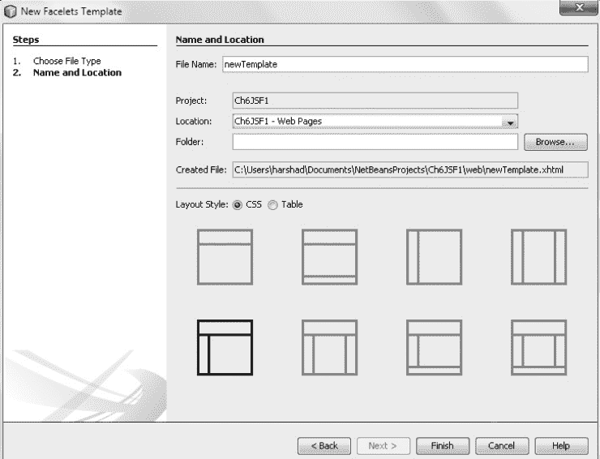

**图 6-10** 模板布局样式

## 列表 6-14：模板

```xml
<?xml version='1.0' encoding='UTF-8' ?>
<!DOCTYPE html PUBLIC "//W3C//DTD XHTML 1.0 Transitional//EN"
   "http://www.w3.org/TR/xhtml1/DTD/xhtml1-transitional.dtd">
<html xmlns="http://www.w3.org/1999/xhtml"
     xmlns:ui="http://java.sun.com/jsf/facelets"
     xmlns:h="http://java.sun.com/jsf/html">
<head>
  <meta http-equiv="Content-Type" content="text/html; charset=UTF-8" />
  <h:outputStylesheet name="css/default.css" />
  <h:outputStylesheet name="css/cssLayout.css" />
  <title>Facelets Template</title>
</head>
<body>
  <div id="top" class="top">
    <ui:insert name="top">Top Content</ui:insert>
  </div>
  <div id="left">
    <ui:insert name="left">Left Content</ui:insert>
  </div>
  <div id="content" class="left_content">
    <ui:insert name="content">Main Content</ui:insert>
  </div>
</body>
</html>
```

# 148 Oracle Java Cloud Java EE 应用

接下来，通过右键点击项目并选择 New | Other | Faces | Facelets Client 为我们创建的模板添加一个客户端。在模板字段中，选择我们创建的 `newTemplate.xhtml` 文件，如 6-15 所示。

## 列表 6-15：newTemplate.xhtml

```xml
<?xml version='1.0' encoding='UTF-8' ?>
<!DOCTYPE html PUBLIC "-//W3C//DTD HTML 1.0 Transitional//EN"
"http://www.w3.org/TR/xhtml/xhtml1-transitional.dtd">
<html xmlns="http://www.w3.org/1999/xhtml"
xmlns:ui="http://java.sun.com/jsf/facelets">
<body>
  <ui:composition template="newTemplate.xhtml">
    <ui:define name="top">
      top
    </ui:define>
    <ui:define name="left">
      left
    </ui:define>
    <ui:define name="content">
      content
    </ui:define>
  </ui:composition>
</body>
</html>
```

运行 `newTemplate.xhtml`，你将得到图 6-11 所示的页面。如预期的，页面布局和样式遵循模板，而文本来自客户端。


## 第6 章：JavaServer Faces 149

| Firefox | Facelets Template | + |
|---|---|---|
| | https://www-trial.java.us/oraclecloudapps.com/Ch6JSF/faces/newTemplateClient.xhtml | |
| top | | |
| left | content | 6-11. 模板客户端页面

你可以尝试通过将早期的 JSF 页面转换为模板客户端页面，为本章中的所有示例创建一个一致的基于模板的视觉效果和感受。虽然功能代码保持不变，但布局和视觉效果将来自模板。因此，列表 6-12 中的 Ajax 示例可以如列表 6-16 所示通过创建一个 `ajaxTemplateClient.xhtml` 进行修改。

## 列表 6-16：使用模板的 Ajax 时间

```xml
<?xml version='1.0' encoding='UTF-8' ?>
<!DOCTYPE html PUBLIC "//W3C//DTD XHTML 1.0 Transitional//EN"
   "http://www.w3.org/TR/xhtml1/DTD/xhtml1-transitional.dtd">
<html xmlns="http://www.w3.org/1999/xhtml"
xmlns:ui="http://java.sun.com/jsf/facelets"
xmlns:h="http://java.sun.com/jsf/html"
xmlns:f="http://java.sun.com/jsf/core">
<body>
  <ui:composition template="/newTemplate.xhtml">
    <ui:define name="top">
      Ajax With JSF
    </ui:define>
    <ui:define name="left">
      <h:link value="Refresh Time">
        <f:ajax render="timetext"/>
      </h:link>
    </ui:define>
    <ui:define name="content">
      Time: <h:outputText value="#{welcome.time}" id="timetext" />
    </ui:define>
  </ui:composition>
</body>
</html>
```


## 总结

在本章中，我们在 OJC 上构建并部署了 JSF 应用。OCC 支持 Java EE 6 中的 JSF 2.0，使得我们可以使用广泛的功能并通过注解轻松使用。我们使用了多个 JSF Facelets 组件，验证了输入，将 UI 组件绑定到托管 Bean，并以声明的方式管理了应用程序导航。然后我们使用了模板。正如你所看到的，在 OJC 上运行 JSF 应用并没有以任何方式限制其范围或能力。在接下来的一章中，我们将探索企业级豆（EJB）。


# 第7章：Enterprise JavaBeans (Session Beans)

## 152 Oracle Java Cloud Java EE 应用

我们已经查看了使用各种 Java EE 技术来处理 HTTP 和 Web 部分。然而，可以说，任何软件最关键的组件都是实际业务逻辑的功能。在本章中，我们将查看企业级豆（EJB），这种技术的主要目标是高效、准确和安全地运行业务逻辑。

## 容器

EJB 运行在应用程序服务器中称为 EJB 容器的特殊部分。之前的章节示例使用的是应用程序服务器的 Web 容器部分，在本章中，我们将使用应用程序服务器的 EJB 容器，并让 Web 和 EJB 容器协同工作。

## OJC 中的 EJB

Oracle Java Cloud 运行 WebLogic 服务器，而 WebLogic 包含了 EJB 容器和 Web 容器。然而，在为 OJC 构建 EJB 之前，我们需要了解支持的确切规范，以及你在 OJC 中可以使用 EJB 做什么。

OJC 支持 EJB 2.1 和 EJB 3.0 规范。EJB 3.0 的重点是为开发者简化 EJB，其关键特性是引入注解作为 XML 部署描述文件的可选方案。EJB 3.0 相比 2.1 有了巨大的改进，这也是本章将使用的版本。

在 EJB 3.0 之前，使用 Entity Beans（实体豆）进行持久化是 EJB 的不可或缺的一部分。但从 EJB 3.0 开始，持久化被移到了 Java Persistence API (JPA)（我们将在第 9 章详细查看 JPA）。尽管 OJC 支持 EJB 2.1，但请注意处理持久化的 EJB 2.1 Entity Beans 是不受支持的。对于 OJC，我们使用 JPA。

OJC 仅支持本地 EJB 调用而不支持远程调用。因此，你只能在同一个部署内或在部署到同一个 Java Cloud Service 实例的部署包内调用 EJB。这是在使用 OJC 开发 EJB 时需要记住的一个重要点。如果你发现确实需要调用远程 EJB，你将不得不考虑 Web 服务等替代方案。如果你正寻求迁移使用远程 EJB 的现有 EJB 应用，这可能也是一个挑战。

Bean 有两种类型——会话豆（Session Beans）和消息驱动豆（Message-Driven Beans）。OJC 不支持任何 Java 消息服务 (JMS) 服务，为了使用消息驱动豆，我们需要配合 OJC 使用 Oracle Messaging Cloud。否则，OJC 将会把任何带有 JMS 依赖的应用标记为白名单。

> **提示**
> 附录 C 包含了 OJC 支持和不支持的所有技术详细列表。

## 为什么使用 EJB？

3.x 及更高版本的 EJB 基本上是普通的旧 Java 对象 (POJO)，带有了一些注解，这些注解告诉 EJB 容器提供 EJB 特有的服务和能力。然而，首先提出的问题之一是，为什么要使用 EJB 而不是直接使用简单的 Java 类呢？

## Oracle Java Cloud Java EE 应用

使用 EJB 的原因完全在于 EJB 容器的能力。你的代码本身并无不同、不复杂、不强大。应该是容器注入它的魔法，并提供对企业应用有价值的额外能力。这些额外能力包括：

- **可扩展性**：如果你预计一个应用需要扩展到数千个用户，EJB 是一个很好的选择。EJB 包含了池化和其他功能，以优化可用资源的管理。
- **分布式环境**：EJB 构建用于运行在分布式环境中。它们向云端的迁移是无缝的，并且在分布式环境中的表现同样出色。
- **状态管理**：会话豆包含一个状态（Stateful）选项，可以使用它来管理应用程序中的状态。如果你希望在多次调用之间保留数据或为用户共享数据，使用会话豆是可以实现的。
- **事务管理**：事务管理在企业应用中至关重要。与其编写事务管理代码，不如使用 EJB 基于注解的事务管理高效得多，以确保你的事务按预期方式工作，并减少挫败感。
- **可复用服务**：包含业务逻辑的 EJB 非常适合在多个应用程序之间使用并作为 Web 服务共享。通过 EJB 可以实现代码和功能的复用。

## 会话豆 (Session Beans)

会话豆是业务逻辑类。一个真实世界的应用可能有几十个会话豆，每个处理应用程序业务逻辑和功能的子集。EJB 3.0 包含了两种类型的会话豆：无状态（Stateless）和有状态（Stateful）。

> **注意**：第三种类型单例豆（Singleton Bean）已在 EJB 3.1 中引入（OJC 尚未支持）。正如单例一词所示，这种会话豆每个应用程序只实例化一次，在整个应用程序生命周期内只存在这实例。


## 无状态 (Stateless)

无状态会话豆仅在调用期间保留任何特定信息。一旦方法调用完成，任何客户端特定的状态都不会被保留。

这意味着你不能依赖实例变量来存储和检索信息。即使使用相同的引用对 Bean 进行重复调用，每次也可能获得一个新的对象。这些无状态会话豆依赖对象池以实现最佳性能，在每次调用中，你完全可能从池中获得不同的对象。该对象池的管理由 EJB 容器负责，但大多数应用程序服务器会让你稍微调整参数。然而，由于 OJC 是 PaaS 环境，你无法对服务器的池化配置进行细粒度的访问。

然而，池化的无状态方法带来了内存的最优利用和显著的性能提升。因此，原则是：除非有跨调用恢复数据/状态的强烈需求，否则使用无状态豆。

## 有状态 (Stateful)

有状态会话豆将在客户端-Bean 会话期间维护状态信息。有状态豆用于需要维护状态以执行豆与客户端交互的情况，或者你希望在多次方法调用之间保留某些客户端信息的情况——经典的例子是购物车，购物者不断向购物车中添加和删除对象。

我们将在“会话豆的生命周期”中查看会话豆生命中的各个阶段。

## 接口：本地或远程

客户端代码可以使用业务接口访问会话豆。本地接口和远程接口的实际代码上没有多大区别。本地接口用注解 `@Local` 标记，而远程接口用 `@Remote` 标记。如前所述，当你希望让运行在同一应用程序服务器上的远程客户端访问该 Bean 时，就需要远程访问。然而，远程调用涉及到数据在网线上的序列化和反序列化的巨大开销、网络延迟以及在网络上的实际传输。

当你有紧密耦合的功能，且让 Bean 运行在同一个应用程序服务器是有意义的时，本地访问是一个很好的选择。多年来，EJB 只有远程访问选项，因此每次调用 EJB 都必须是一次远程调用。现在看来，EJB 2.0 竟然没有本地访问选项似乎很奇怪。如今，本地访问似乎是更通用的用法。

> **注意**：EJB 3.1 引入了无接口视图（No-Interface View），通过这种视图，会话豆的所有公共方法都暴露出来。在无接口的情况下，你不需要提供本地接口并说明你想要暴露的方法。虽然无接口简化了事情，但系统架构师通常倾向于保留接口。无接口选项是 EJB 3.1 的一部分，因此目前在 OJC 中不可用。


## 使用 EJB 开发企业级应用

我们一直在处理的是封装为 WAR 文件的 Web 应用。然而，当你的应用程序不仅仅是一个 Web 应用程序时，你就有一个 EAR 文件（企业归档）。这是你用来打包企业级应用的文件，它可以包含一个或多个 EJB 模块和 Web 应用程序。

EJB 模块被封装成 JAR 文件（Java 归档）。Web 应用程序被封装成 WAR 文件（Web 存档）。整个企业级应用（包括 JAR 和 WAR 文件）被封装成 EAR 文件（企业归档）。请注意，这三种类型文件的格式与 Java 中的普通 JAR 文件相同。压缩方式与 ZIP 文件相同，因此可以使用任何常用的压缩/解压工具打开并查看所有文件。

要创建我们的企业级应用，启动 NetBeans，选择 `New Project`（新建项目），然后选择 `Java EE` | `Enterprise Application`，如图 7-1 所示。

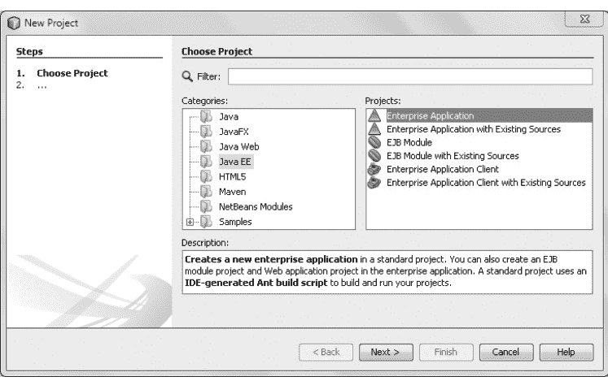

图 7-1. 新建的企业级应用

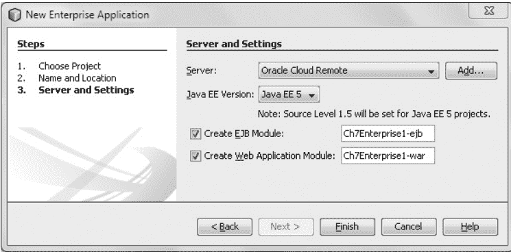

图 7-2. Web 和 EJB 模块

点击 `Next`（下一步）。将项目命名为 `Ch7Enterprise1`。点击 `Next`（下一步）。如图 7-2 所示，向导现在会询问你想要创建一个 EJB 模块和一个 Web 应用程序模块。保留默认名称（EJB 模块的 `Ch7Enterprise1-ejb` 和 Web 应用程序模块的 `Ch7Enterprise1-war`），如图 7-2 所示。确保你已选择 Oracle Cloud 作为服务器，然后点击 `Finish`（完成）。

NetBeans 现在创建了图 7-3 所示的项目。有企业级应用项目（包含两个模块），以及 EJB 项目和 Web 应用程序项目。

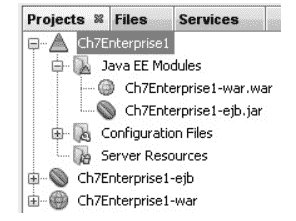

图 7-3. Ch7Enterprise1 项目

右键点击 `Ch7Enterprise1` 并选择 `Clean and Build`（清理并构建）。输出日志将显示在 `<YourNetBeansProjectsDirectory>Ch7Enterprise1\dist\` 处创建了一个新的 `Ch7Enterprise1.ear` 文件。

使用任何压缩工具打开该文件，你会发现该文件包含了 Web 应用程序的 WAR 文件、EJB 应用的 JAR 文件以及几个配置 XML 文件。

我们的项目目前是空的，所以让我们在 EJB 模块中添加一个会话 Bean。

### 新的会话 Bean

右键点击 `Ch7Enterprise1-ejb` 并选择 `New` | `Enterprise JavaBeans` | `Session Bean`。将 Bean 命名为 `AuthenticateSessionBean`，并将包命名为 `beans`，如图 7-4 所示。在 `Create Interface`（创建接口）下，`Local`（本地）复选框将默认被选中，这样 NetBeans 会同 Bean 类一起创建相应的接口。

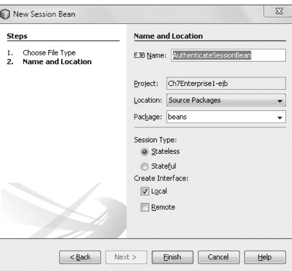

图 7-4. 新的会话 Bean AuthenticateSessionBean

如前所述，OJC 仅允许本地访问，因此创建远程接口并没有意义。请注意，默认选择了 `Stateless`（无状态）会话类型，我们将在示例中使用它。

NetBeans 将生成 `AuthenticateSessionBean` 类，如列表 7-1 所示，该类实现了如列表 7-2 所示的本地接口 `AuthenticateSessionBeanLocal`。

**列表 7-1: AuthenticateSessionBean**

```java
package beans;

import javax.ejb.Stateless;

@Stateless
public class AuthenticateSessionBean
    implements AuthenticateSessionBeanLocal {
}
```

**列表 7-2: AuthenticateSessionBeanLocal**

```java
package beans;

import javax.ejb.Local;

@Local
public interface AuthenticateSessionBeanLocal {
}
```

这些类中唯一特殊之处在于接口中的 `@Local` 注解，它将接口标记为本地接口；以及会话 Bean 中的 `@Stateless` 注解，它传达了该 Bean 是一个无状态会话 Bean。

给我们的 Bean 添加一个简单的验证方法。在 Bean 代码中右键点击并选择 `Insert Code` | `Add Business Method`（插入代码 | 添加业务方法），如图 7-5 所示。

在图 7-6 所示的 `Add Business Method` 窗口中，我们为方法命名为 `auth`，并提供 `String` 参数 `username` 和 `password`。对于返回类型，输入 `boolean`。注意已选择了 `Use Interface (Local)`（使用接口（本地）），此新方法也将自动添加到接口中。

现在如列表 7-3 所示编辑 `AuthenticateSessionBean`，使得如果用户名为 `java` 且密码为 `cloud`，方法将返回 `true`。（硬编码的程序化验证并不理想，仅用作会话 Bean 中业务逻辑的简单演示。）

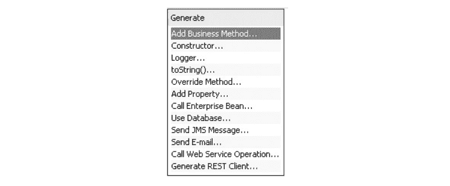

图 7-5. Insert Code | Add Business Method

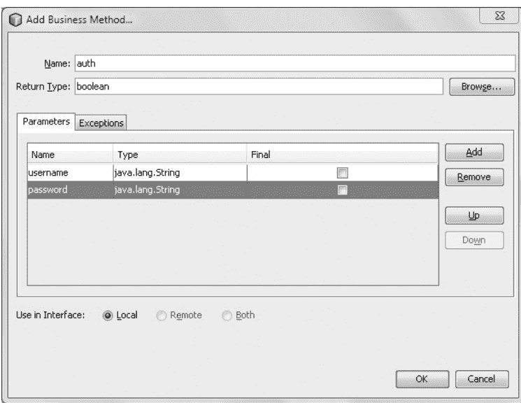

图 7-6. Add Business Method 界面

**列表 7-3: AuthenticateSessionBean**

```java
package beans;

import javax.ejb.Stateless;

@Stateless
public class AuthenticateSessionBean
    implements AuthenticateSessionBeanLocal {

    @Override
    public boolean auth(String username, String password) {
        return (username.equals("java")
            && password.equals("cloud"));
    }
}
```

现在让我们创建一个 Servlet 并访问这个会话 Bean。右键点击 `Ch7Enterprise1-war` 并选择 `New` | `Servlet`。将 Servlet 命名为 `LoginServlet`，并将包命名为 `servlets`，URL 为 `/LoginServlet`。

现在在 Servlet 代码中，在类体内右键点击并点击 `Insert Code`。你将看到图 7-7 所示的选项。

| Generate |
| :--- |
| Constructor... |
| Logger... |
| Getter... |
| Setter... |
| equals() and hashCode(). |
| toString()... |
| Delegate Method... |
| Override Method... |
| Add Property... |
| Call Enterprise Bean... |
| Use Database... |
| Send JMS Message... |
| Send E-mail... |
| Call Service Operation... |
| REST Client... |
| Generate REST Client... |


图 7-7. Insert Code | Call Enterprise Bean

这里的 `@EJB` 注解是依赖注入（Dependency Injection）的体现，这一概念在短时间内迅速流行。

### 将会话 Bean 注入到 Servlet

在 Java EE 的语境下，依赖注入是指组件由容器提供其依赖。因此，注解告诉容器要注入什么种对象，容器会完成创建实例并将其注入组件中的所有工作。

初接触依赖注入的人在看到没有对象初始化代码的情况下调用对象时，通常会感到困惑。这种方法之所以有效且没有像很多人预期的那样抛出 `NullPointerException`，是因为相关对象已经由容器注入了。

依赖注入的出现对于 Java EE 来说是极好的，因为它让服务器变得更加智能，不再需要显式信息，而是根据代码中简单的注解来判断并完成平凡的任务。

在我们的 Servlet 中，`@EJB` 注解是向 Servlet 注入 EJB 实例。Servlet 中没有查找或实际实例化 EJB 的代码；注解仅仅是对容器执行所需任务的请求。`@EJB` 注解可以通过参数提供额外信息，如 `beanInterface`、`beanName`、`description`、`mappedName` 和 `name`。

**列表 7-4: 会话 Bean 的依赖注入**

```java
@EJB private AuthenticateSessionBeanLocal authenticateSessionBean;
```

一旦 EJB 被注入到 Servlet 中，我们就可以在 `processRequest` 方法中使用它，如列表 7-5 所示。

**列表 7-5: 在 Servlet 中访问注入的会话 Bean**

```java
```


## 第 7 章：Enterprise JavaBeans（会话 Bean）

### 基于 Oracle Java Cloud 的 Java EE 应用

```java
protected void processRequest(HttpServletRequest request, HttpServletResponse response) throws ServletException, IOException {
    response.setContentType("text/html;charset=UTF-8");
    PrintWriter out = response.getWriter();
    try {
        out.println("<html>Auth ->"
            + authenticateSessionBean.auth("java", "cloud")
            + "/</html>");
    } finally {
        out.close();
    }
}
```

在这里，我们在注入的 bean 实例中调用 `auth` 方法并打印收到的输出。注意，我们甚至可以使用与用于 Servlet 相同的依赖注入技术，将 EJB 注入到另一个本地 EJB 中。

### 从 NetBeans 打包并运行

考虑到我们现在正在处理一个包含 Web 应用和 EJB 模块的企业级应用程序，直接从 Web 应用运行 Servlet 是不可行的。我们需要部署该企业级应用程序。可以通过右键点击企业应用程序并选择“Deploy（部署）”来实现。由于 NetBeans 识别企业应用程序中的 Java EE 模块，NetBeans 将构建 Web 和 EJB 模块项目，然后将它们打包成一个 EAR 文件。

### 使用 Java Cloud Services 控制台进行部署

要使用 Java Cloud Services 控制台进行部署，请使用您的凭据登录 `http://cloud.oracle.com`。在页面默认位于右上角的“Applications（应用程序）”部件中，你会找到“Deploy New（新建部署）”按钮，如图 7-8 所示。如果没有列出应用程序或未选择列出的应用程序，其他按钮将显示灰色。


#### 部署应用界面

| Deploy Application（部署应用） | Cancel（取消） | Deploy（部署） |
|---|---|---|
| 为您想要部署的应用提供名称，然后导航到应用程序归包。 | | |
| * Name（名称） | Ch7Enterprise1 | | |
| * Archive Path（归包路径） | Browse...（浏览...） | Ch7Enterprise1.ear |

**图 7-9.** 上传归包的应用界面

现在你将看到图 7-9 所示的界面。在这里，你可以为应用程序命名并提供相关的应用程序归包（即应用程序的 JAR、WAR 或 EAR 文件）。

要获取我们企业级应用程序的 EAR，请在 NetBeans 中右键点击 `Ch7Enterprise1` 项目并选择“Clean and Build（清理并构建）”选项，这将删除任何之前编译的文件和其他构建输出。它将重新编译应用程序——在这种情况下，包括我们企业级应用程序部分的 Web 应用模块和 EJB 模块。整个应用程序被打包成一个 EAR 文件。

在谈到构建应用程序时，注意右键点击项目时，你有三个构建选项：Build（构建）、Clean and Build（清理并构建）。运行 Clean and Build 是防止过时编译文件的良好保障。然而，对于大型项目，Clean and Build 耗的时间可能比 Build 长得多。

在使用 Java Cloud Services 网站进行部署之前，运行 Verify（验证）工具以捕获任何白名单违规是一个好主意。使用 Verify 工具捕获并处理白名单违规，比在云端部署失败、查看日志并发现白名单违规要容易得多。要进行验证，右键点击项目并点击 Verify。将打开一个新的“White List Log（白名单日志）”窗口，列出应用程序中的任何警告和错误。警告不是致命的；但是，如果你遇到错误，你的应用程序将无法部署。

回到 `Ch7Enterprise1` 应用程序，选择 EAR 文件并点击图 7-9 所示的 Deploy 按钮。你将得到“Uploading Archive（正在上传归包）”提示，然后被重定向到 Java Cloud Services 控制台的主界面，你将在那里得到类似图 7-10 所示的警告。

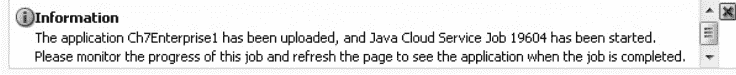

关于 Java Cloud Service Jobs（云服务任务）部件的更多信息，该部件默认位于页面底部。如图 7-11 所示，选择最后一个任务 ID，这是我们的部署任务。取决于你的应用程序的大小，部署可能需要一段时间才能完成，日志也可能可用。

弄清楚如何查看任务并不太直观。在出现的下拉菜单中点击“View Java Cloud Service（查看 Java 云服务）”，如图 7-12 所示，你可以选择查看 Virus Scan（病毒扫描）、Application Whitelist Validation（应用程序白名单验证）、WLS Compile（WLS 编译）、Cloud Compile（云编译）或 Deploy Application（部署应用）的日志。点击这些任何选项，你的浏览器都会弹出一个窗口来查看/保存日志文件。

如果你选择 Deploy Application 且应用程序部署成功，你将得到类似列表 7-6 中的日志。WLS Compile 选项将为你提供 WebLogic 应用程序编译日志，其中列出了所引用的 WebLogic 库及其版本，以及一些 WebLogic 特有的编译信息。Cloud Compile 选项将为你提供应用程序编译日志，它将列出 OJC 如何检测、注入和组装你的应用程序以进行部署。如果一切顺利，这两个日志都应该以状态 SUCCESS（成功）结束。

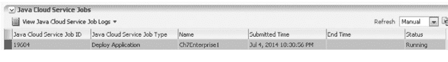

#### 查看任务日志选项

| View Java Cloud Service（查看 Java 云服务） | Virus Scan（病毒扫描） |
|---|---|
| | Application Whitelist Validation（应用程序白名单验证） |
| | WLS Compile（WLS 编译） |
| | Cloud Compile（云编译） |
| | Deploy Application（部署应用） |

**图 7-12.** 查看任务日志

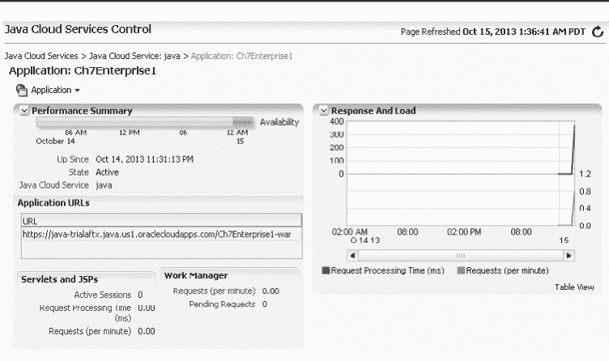

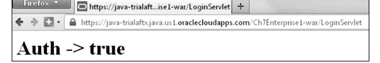

### Stateful Bean 与 Stateless Bean 的区别

创建和使用 stateful bean 的代码与 stateless bean 相同，除了 `@Stateful` 注解外。然而，区别在于 bean 的工作方式。例如，如果你将 stateful bean 用于一个购物车，你可以将 bean 注入到会话中并在会话变量中保留项目，状态变量将会保持，你每次调用都会得到相同的实例。如果你使用的是 stateless bean，你每次都可能得到不同的 bean 实例。继续使用我们的购物车类比，就像是你每次想向购物车中添加东西时，都会发现早期的购物车内容丢失了，或者发现了你从未添加过的意外物品。

#### 列表 7-7：Stateful Bean 示例

```java
shopBean.add("phone");
shopBean.add("laptop");
shopBean.add("tv");
```

在示例中，我们使用了 Web 应用和单个 EJB，但在真实世界的应用程序中，会有许多 EJB 模块，这些 EJB 通常被用于 Web 应用的不同部分。

### Session Bean 的生命周期

所有 EJBs 都由 EJB 容器管理；然而，了解任何 EJB 的生命周期、它所经历的阶段以及你可以做和不能做的事情是非常重要的。

#### Stateless Bean 生命周期

Stateless bean 的生命周期非常简单：

1. 容器创建 bean。依赖项由容器注入。执行任何 `@PostConstruct` 回调。bean 现在已就绪。
2. 在 bean 实例销毁之前，容器执行任何 `@PreDestroy` 回调。bean 实例被移除并在之后进行垃圾回收。

`@PostConstruct` 回调对于希望在 bean 开始处理客户端请求之前执行任何操作非常有用。`@PreDestroy` 回调对于希望在 bean 销毁之前执行任何清理操作非常有用。

#### 回调方法

使用回调函数只需要在方法上标记 `@PostConstruct` 或 `@PreDestroy` 注解。如列表 7-8 所示，你可以选择任何方法名称，但方法签名必须返回 `void` 且不接受任何参数。这是因为该方法是由 `EJBContainer` 在生命周期事件发生时调用的，因此用户无法传递参数或获取返回值。

#### 列表 7-8: 回调方法

```java
@PostConstruct
public void initialize() {
    // 初始化资源的代码
}

@PreDestroy
public void release() {
    // 释放资源的代码
}
```

无状态 bean 也利用池化能力，所有无状态 bean 的实例都是等待的，容器可以根据需要从池中选取对象并将其返回池中。

#### Stateful Bean 生命周期

有状态 bean 的生命周期涉及多几个步骤：

1. 由容器创建 bean。任何依赖项都由容器注入。执行任何 `@PostConstruct` 回调。该 bean 现在已就绪。
2. 根据 bean 的使用情况和可用资源，EJB 容器有时可能会通过将 bean 从内存移动到次级存储器来钝化它。在钝化之前，EJB 容器将执行任何 `@PrePassivate` 回调。
3. 如果客户端调用钝化 bean 的方法，EJB 容器将激活该 bean。激活时，容器将执行任何 `@PostActivate` 回调。该 bean 现在已就绪。
4. 在 bean 实例被销毁之前，容器执行任何 `@PreDestroy` 回调。bean 实例被移除并在随后被垃圾回收。

### 事务管理

事务管理是确保包含所有中间步骤的整个事务执行，或者什么都不执行。想象你正在从一个银行账户转账到另一个账户。这涉及两个步骤：

1. 从一个账户取款。
2. 向另一个账户存款。

我们希望要么执行整个事务，要么什么都不执行。换句话说，你永远不希望出现钱已从一个账户中取出，但从未存入另一个账户的情况。

虽然你可以手动编写事务管理代码，但使用注解的容器托管事务要简单得多且更容易维护。你对参与事务的方法进行注解，EJB 容器将完成其余工作。

为我们的企业级应用程序添加一个会话 bean。此 bean 将以事务安全的方式转账。我们可以将此 bean 添加到现有的 EJB 模块中，但让我们创建一个新的 EJB 模块项目，以突出企业级应用程序如何运行多个 EJB 模块。

选择 Project \| Java EE \| EJB Module。将项目命名为 `Ch7EJBMoneyTransfer` 并点击 Next。在下一个屏幕（见图 7-16）中，将项目添加到企业级应用程序 `Ch7Enterprise1`。

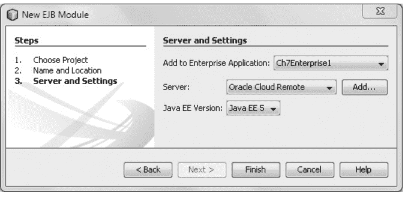

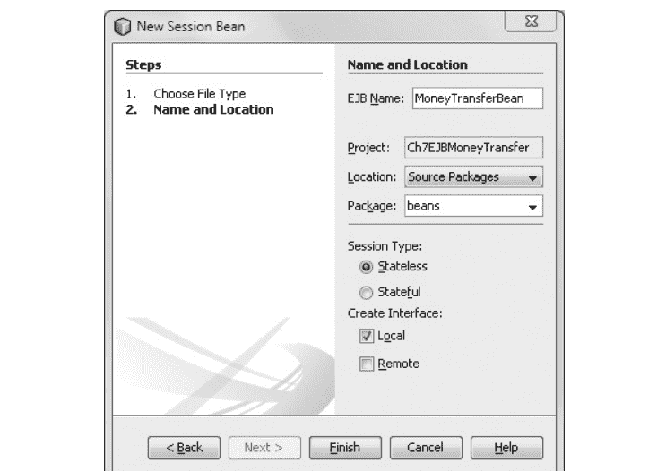

选择 Oracle Cloud Remote Server。点击 Finish。我们的企业级应用程序现在有两个 EJB 模块和一个 Web 模块。

在 Projects 窗口中右键点击 `Ch7EJBMoneyTransfer` 项目并选择 New \| Session Bean。如图 7-17 所示，将 bean 命名为 `MoneyTransferBean`，包命名为 `beans`，会话类型选择 Stateless，接口类型选择 Local。点击 Finish。

将创建两个文件：`MoneyTransferBean.java` 和本地接口 `MoneyTransferBeanLocal.java`。现在，按照列表 7-9 所示修改 bean `MoneyTransferBean.java`，并按照列表 7-10 所示修改 `MoneyTransferBeanLocal.java`。

#### 列表 7-9: MoneyTransferBean

```java
package beans;

import javax.ejb.Stateless;
import javax.ejb.TransactionAttribute;
import javax.ejb.TransactionAttributeType;

@Stateless
public class MoneyTransferBean implements MoneyTransferBeanLocal {

    @TransactionAttribute(TransactionAttributeType.REQUIRES_NEW)
    public void moveMoney() {
        // 从 A 取出的金额
        pullMoneyFromA();

        // 如果这里发生失败，事务将回滚
        //  A 的金额将恢复。
        depositInB();
    }

    @TransactionAttribute(TransactionAttributeType.MANDATORY)
    public void pullMoneyFromA() {
        // 执行从 A 取款的操作
        // 更新数据库记录 - 减少账户余额
    }

    @TransactionAttribute(TransactionAttributeType.MANDATORY)
    public void depositInB() {
        // 执行向 B 存款的操作
        // 更新 B 的数据库记录 - 增加账户余额
    }
}
```

#### 列表 7-10: MoneyTransferBeanLocal

```java
package beans;
import javax.ejb.Local;

@Local
public interface MoneyTransferBeanLocal {
    void moveMoney();
}
```


在这里，我们为 bean 引入了一个公共方法 `moveMoney`，并在本地接口中声明了它。该方法使用另外两个方法 `pullMoneyFromA` 和 `depositInB` 将钱从 A 转移到 B。注解是该事务的关键。注意 `REQUIRES_NEW` 和 `MANDATORY` 属性的使用。`REQUIRES_NEW` 告诉容器它需要创建一个新事务，而 `MANDATORY` 告诉容器如果该方法不是事务的一部分，则将抛出异常。


因此，在这种情况下，`moveMoney` 将创建一个新事务，`pullMoneyFromA` 和 `depositInB` 将加入其中。整个过程将作为一个单一事务执行。因此，如果 `pullMoneyFromA` 成功但 `depositInB` 失败，即使是 `pullMoneyFromA` 也会回滚。

其他事务属性及其行为在下表中详细说明，该表解释了具有指定属性的方法在被带事务的方法或不带事务的方法调用时将如何工作。

| 属性 | 事务存在 | 事务不存在 |
| :--- | :--- | :--- |
| NOT_SUPPORTED | 挂起事务 | 无事务 |
| REQUIRED | 使用事务 | 无事务 |
| REQUIRES_NEW | 挂起事务并启动新事务 | 启动新事务 |
| MANDATORY | 使用事务 | 异常 |
| NEVER | 异常 | 无事务 |

现在让我们创建一个新的 Servlet，并在其中调用 bean 中的 `moveMoney` 方法。右键点击 `Ch7-project` 并选择 New | Servlet。将 servlet 命名为 `MoneyTransferServlet`，包命名为 `servlets`，URL 模式为 `/MoneyTransferServlet`。我们按照列表 7-11 所示修改 `TransferServlet`。在代码中，我们在 Servlet 中注入了 `MoneyTransferBean` 的实例，并在 `processRequest` 方法中增加了对 `moveMoney` 方法的调用。

**列表 7-11:** `MoneyTransferServlet`

```
@EJB
private MoneyTransferBean moneyTransferBean;

protected void processRequest(HttpServletRequest request
    HttpServletResponse response)
    throws ServletException, IOException {
    response.setContentType("text/html;charset=UTF-8");
    PrintWriter out = response.getWriter();
    try {
        moneyTransferBean.moveMoney();
        out.println("<h1>钱已从 A 转到 B</h1>");
    } finally {
        out.close();
    }
```

如果你使用 Call Enterprise Bean 向导注入 EJB，NetBeans 将自动为项目属性添加对 `Ch7EJBMoneyTransfer` 的依赖。然而，如果你直接将代码添加到 Servlet 中，则必须将 `Ch7EJBMoneyTransfer` 添加到项目库中。你可以通过右键点击 Project 窗口中的项目名称并选择 Properties，或者通过 File | Project Properties 菜单进入项目属性。如果你没有看到列出的库，如图 7-18 所示。

清理并构建 `Ch7Enterprise` 项目并使用 Java Cloud Service Control 重新部署应用程序。`Redploy` 按钮如图 7-13 所示，也可以在 Application 上的下拉菜单中找到。

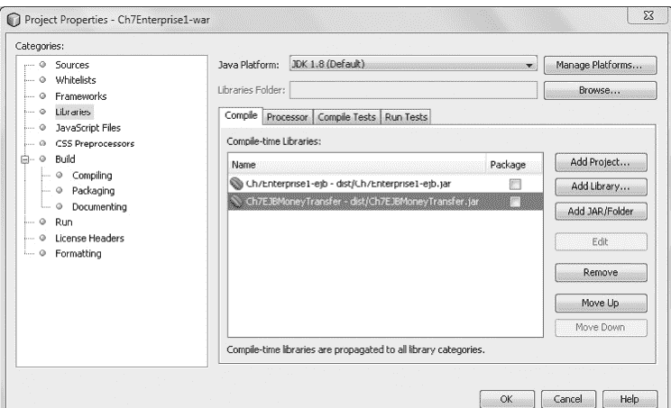

FIGURE 7-18. 项目库

# 176 Oracle Java Cloud Java EE 应用程序

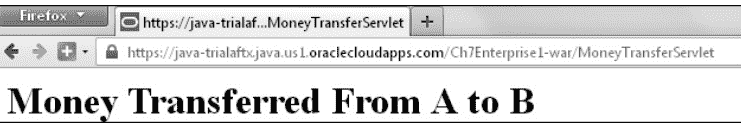

图 7-19. MoneyTransferServlet 输出

图 7-14 中的摘要页面。重新部署 EAR 文件后，我们可以通过 `https://java-trialftx.java.us1.oraclecloudapps.com/Ch7Enterprise-1-war/MoneyTransferServlet` 访问 Servlet，并获得图 7-19 所示的输出。此示例展示了容器托管事务的便利性以及对任何基于 EJB 的应用程序的巨大价值。

## 回滚与异常处理

上一个示例展示了一个一切运行良好的场景，但如果发生错误导致你获取了异常怎么办？在这里，我们可以将异常分为系统异常和应用程序异常。应用程序异常特定于你的应用程序（例如，资金不足或权限不足）。这些异常表示的是业务问题而非系统问题。在这些情况下，事务默认不会回滚。因此，当我们需要应用程序异常来触发回滚时，需要使用注解，如列表 7-12 所示。在这里，我们声明 `rollback = true` 以传达在抛出异常时事务已回滚。

### 列表 7-12：应用程序异常回滚

```java
@ApplicationException(rollback = true)
public class InsufficientFunds extends Exception {}
```

系统异常包括 `java.lang.RuntimeException`、`RemoteException` 及其子类。发生任何系统异常时，事务都将回滚。例如，`NullPointerException` 是最常见的异常之一。你可以通过使用 `ApplicationException` 注解并将 `rollback` 值设置为 false，即使在发生 `RuntimeException` 时也不回滚事务，如列表 7-13 所示。

## 列表 7-13：不回滚

```java
@ApplicationException(rollback = false)
public class CreateException extends RuntimeException {}
```

## 总结

在本章中，我们构建了构建多个打包 EJB 的企业级应用程序。我们看到了无状态会话豆和有状态会话豆提供的丰富功能，以及容器托管事务在构建任何应用程序时是如何一项强大的资产。EJB 对于企业级应用开发至关重要，随着过去几年 EJB 开发的极大简化，在构建云端企业级应用程序时，EJB 确实是值得关注的，因为并不是所有云厂商都为 EJB 提供相同的支持。


# 第 8 章

## Web 服务

Web 服务是异构技术通信的首选模式。W3C Web 服务架构小组将 Web 服务定义为一种旨在支持网络上可操作机器间交互的软件系统。由于 Web 服务是旨在具有全覆盖范围的软件，它依赖于 HTTP 协议，这是一种跨技术支持的标准。Web 服务还依赖于 XML，这这也是一种跨技术的技术。尽管跨平台通信的底层理念是相同的，但 Web 服务主要分为两类：

- 依赖于简单对象访问协议（SOAP）标准的 XML 消息的 Web 服务
- 使用表述状态转移（RESTful）并利用 HTTP GET、POST、PUT 等进行通信的 Web 服务

我们将查看如何在 OCI 上开发和部署这两种类型的 Web 服务。


注意 OCI 支持 Java EE 5 和 Java EE 6 混合。即使对于 Web 服务，OCI 也支持基于 Java EE 5 的基于 XML 的 Web 服务 API（JAX-WS）的 SOAP-Web 服务，以及基于 Java EE 6 的基于 RESTful 服务的 API（JAX-RS）。OCI 支持 JAX-WS 2.1 版本和 JAX-RS 1.1 版本。OCI 不支持基于 XML 的 RPC（JAX-RPC）的 Web 服务。JAX-WS 是 JAX-RPC 的继者，因此 OCI 建议将 JAX-RPC Web 服务转换为 JAX-WS。OCI 支持 JAX-WS 和 JAX-RS 注解以及 Jersey 1.9 注解，Jersey 是 JAX-RS 的参考实现。让我们从使用 SOAP 和 JAX-WS 构建 Web 服务开始。

在第 7 章中，我们讨论过由于 OCI 限制了对你的 bean 的远程访问，可以使用 Web 服务作为替代方案。由于 Web 服务依赖于基础 HTTP，你可以在 OCI 边界之外暴露 EJB 中的功能。你可以让远程客户端通过基于 SOAP 或 RESTful 的 Web 服务调用你的 bean。

## 开发 SOAP Web 服务

第一波 Web 服务围绕 SOAP 标准构建的，该标准广泛使用 XML 来定义 Web 服务以及进行实际通信。除了用 Java 编写的实际逻辑代码外，Web 服务的其余部分都是 XML。因此， Web 操作在基于 XML 的 Web 服务定义语言（WSDL）文件中定义。根据 SOAP 标准，Web 服务与 Web 服务客户端之间的通信将是 XML。

让我们构建两个 Web 应用程序——一个 SOAP Web 服务应用程序和一个 Web 服务客户端应用程序，然后分析代码以更好地理解它们是如何工作的。我们通过选择 File | Java Web | Web Application 来创建一个新的 Web 应用程序。将应用程序命名为 `SoapWebService`，并确保选择了服务器 Oracle Cloud Remote。现在选择 New | Services | Web Service。点击 Next。你现在应该看到一个像图 8-1 所示的屏幕。将 Web 服务命名为 `DateTime`，包命名为 `ws`。

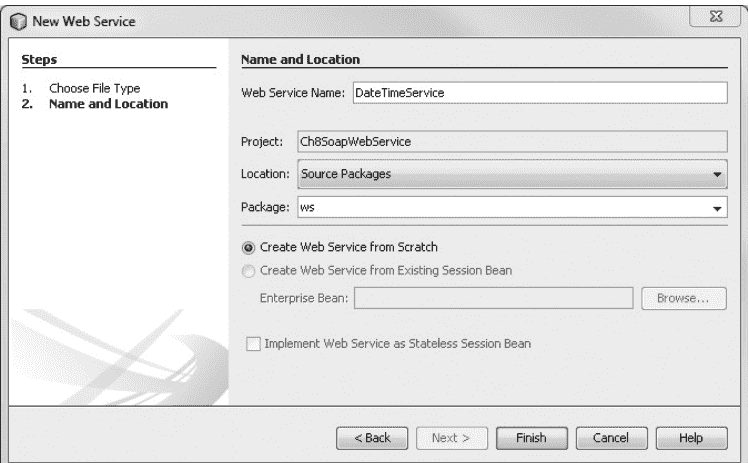

图 8-1. 创建 Web 服务

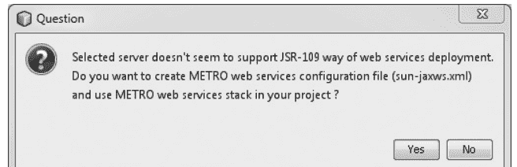

图 8-2. 关于 sun-jaxws 的警告

使用 JAX-WS，所以我们不需要 sun-jaxws 文件。点击 No。`DateTimeService.java` 文件应该已经创建，如列表 8-1 所示。

### 列表 8-1：DateTimeService

```java
@WebService
public class DateTimeService {
}
```

注意，这是向导创建的唯一文件。`WebService` 注解传达了该类实现了 Web 服务。`WebMethod` 注解表示该方法是待暴露的 Web 服务方法。

NetBeans 默认创建一个 `hello` 方法。我们现在想添加另一个返回日期和时间的方法，这正是我们 Web 服务旨在提供的功能。你可以直接带有必要的注解编写代码。然而，NetBeans 提供了一种更简单的方法。点击 Design 选项卡，你将看到图 8-3 所示的屏幕。

现在点击 Add Operation 按钮获取图 8-4 中的屏幕。将方法命名为 `fetchDateTime`，然后点击 OK。切换回 Source 视图，你会发现类中添加了一个新方法 `fetchDateTime`。

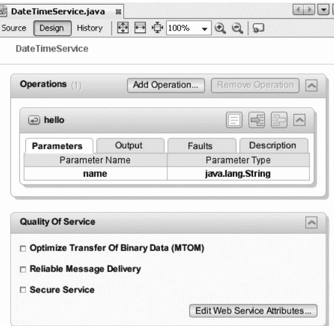

图 8-3. WebService 设计视图

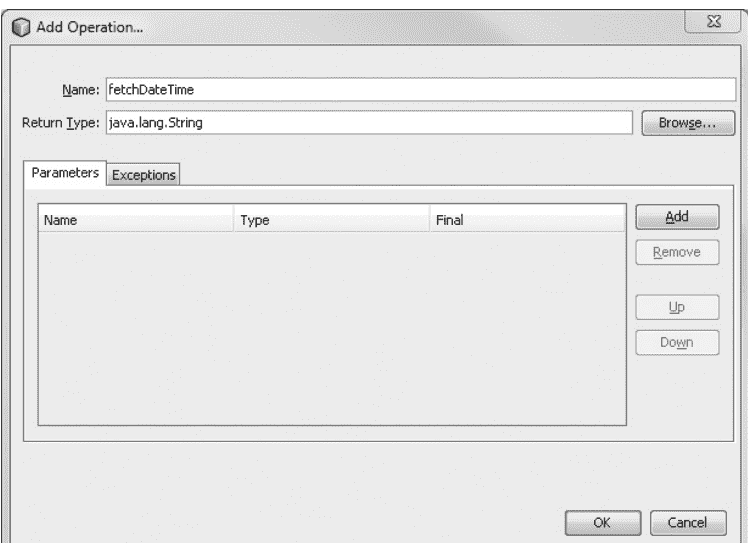

图 8-4. Add Operation 屏幕

### 列表 8-2：fetchDateTime 方法

```java
@WebMethod(operationName = "fetchDateTime")
public String fetchDateTime() {
    return new java.util.Date().toString();
}
```

## 第 8 章：Web 服务 185

在列表 8-3 中。为了突出注解参数的使用以及它们如何与类名或方法名区分，请按照列表 8-3 所示调整参数值，将 `serviceName` 参数更改为 `DateTimeService`，并将 `operationName` 参数更改为 `helloOp` 和 `fetchDateTimeOp`。


# 列表 8-3: DateTimeService

```java
package ws;

import javax.ejb.Stateless;
import javax.jws.WebService;
import javax.jws.WebMethod;
import javax.jws.WebParam;

@Stateless
@WebService(serviceName = "DateTimeService")
public class DateTimeService {

    @WebMethod(operationName = "helloOp")
    public String hello(@WebParam(name = "name") String txt) {
        return "Hello " + txt + " !";
    }

    @WebMethod(operationName = "fetchDateTimeOp")
    public String fetchDateTime() {
        return new java.util.Date().toString();
    }
}
```

在这种情况下，我们需要移除登录要求。与之前章节中的示例不同，该 Web 服务将不会通过浏览器使用（消费），而是由另一部分代码调用。因此，为了保持我们的服务公开且可访问，并避免在服务客户端代码中添加任何登录功能，我们将编辑 `web.xml` 文件以添加 `login-config` 标签项，如列表 8-4 所示。


# 列表 8-4: web.xml

```xml
<?xml version="1.0" encoding="UTF-8"?>
<web-app version="2.5" xmlns="http://java.sun.com/xml/ns/javaee"
xmlns:xsi="http://www.w3.org/2001/XMLSchema-instance"
xsi:schemaLocation="http://java.sun.com/xml/ns/javaee
http://java.sun.com/xml/ns/javaee/web-app_2_5.xsd">
<login-config></login-config>
<session-config>
  <session-timeout>
    30
  </session-timeout>
</session-config>
<welcome-file-list>
  <welcome-file>index.jsp</welcome-file>
</welcome-file-list>
</web-app>
```

## 186 Oracle Java Cloud Java EE 应用程序

现在我们的服务已经就绪，让我们将其部署到 OJC。右键点击项目并选择 Deploy（部署）。与书中之前的应用程序一样，NetBeans 将构建并并将应用程序部署到 OJC。

一旦应用程序部署完成，你就可以通过 `https://<CloudServiceName>.<IdentityDomain>.java.DataCenter.oraclecloudapps.com/Ch8SoapWebService/DateTimeService` 访问服务页面。你将看到一个如图 8-5 所示的屏幕。注意，URL 中的服务名是注解中所说的 `DateTimeWebService`，以及 Java 类名 `DateTimeService`。

## WSDL

在图 8-5 中，`https://java-trialaxta.java.1.oraclecloudapps.com/Ch8SoapWebService/DateTimeService?wsdl` 是指向动态生成的 WSDL 的链接。WSDL 代表 Web Services Description Language（Web 服务描述语言）。

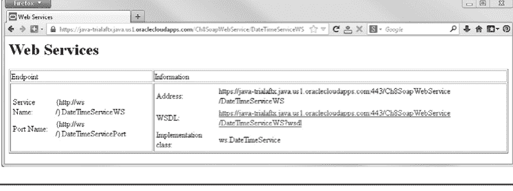

图 8-5. Web 服务信息页面

它是用于描述 Web 服务的标准格式。它列出了服务的名称、操作、数据结构和输出。WSDL 帮助客户端知道如何访问 Web 服务以及它执行哪些操作。WSDL 经常被读作 "wsdl"。


注意：URL 中的服务名是 `DateTimeWebService`，正如注解中所述，以及 Java 类名 `DateTimeService`。

WSDL

在图 8-5 中，`https://java-trialaxta.java.1.oraclecloudapps.com/Ch8SoapWebService/DateTimeService?wsdl` 是指向动态生成的 WSDL 的链接。WSDL 代表 Web 服务描述语言。


图 8-5. Web 服务信息页面

它是用于描述 Web 服务的标准格式。它列出了服务的名称、操作、数据结构和输出。WSDL 帮助客户端知道如何访问 Web 服务以及它执行哪些操作。WSDL 经常被读作 "wsdl"。

注意：URL 中的服务名是 `DateTimeWebService`，正如注解中所述，以及 Java 类名 `DateTimeService`。


# 第 8 章：Web 服务

## 185 注解参数调整

在列表 8-3 中，为了突出注解参数的使用以及它们如何与类名或方法名区分，请按照列表 8-3 所示调整参数值，将 `serviceName` 参数更改为 `DateTimeService`，并将 `operationName` 参数更改为 `helloOp` 和 `fetchDateTimeOp`。

### 列表 8-3: DateTimeService

```java
package ws;

import javax.ejb.Stateless;
import javax.jws.WebService;
import javax.jws.WebMethod;
import javax.jws.WebParam;

@Stateless
@WebService(serviceName = "DateTimeService")
public class DateTimeService {

    @WebMethod(operationName = "helloOp")
    public String hello(@WebParam(name = "name") String txt) {
        return "Hello " + txt + " !";
    }

    @WebMethod(operationName = "fetchDateTimeOp")
    public String fetchDateTime() {
        return new java.util.Date().toString();
    }
}
```

## 移除登录要求

在这种情况下，我们需要移除登录要求。与之前章节中的示例不同，该 Web 服务将不会通过浏览器使用（消费），而是由另一部分代码调用。因此，为了保持我们的服务公开且可访问，并避免在服务客户端代码中添加任何登录功能，我们将编辑 `web.xml` 文件以添加 `login-config` 标签项，如列表 8-4 所示。

### 列表 8-4: web.xml

```xml
<?xml version="1.0" encoding="UTF-8"?>
<web-app version="2.5" xmlns="http://java.sun.com/xml/ns/javaee"
         xmlns:xsi="http://www.w3.org/2001/XMLSchema-instance"
         xsi:schemaLocation="http://java.sun.com/xml/ns/javaee
         http://java.sun.com/xml/ns/javaee/web-app_2_5.xsd">
    <login-config></login-config>
    <session-config>
        <session-timeout>
            30
        </session-timeout>
    </session-config>
    <welcome-file-list>
        <welcome-file>index.jsp</welcome-file>
    </welcome-file-list>
</web-app>
```

## 186 Oracle Java Cloud Java EE 应用程序

现在我们的服务已经就绪，让我们将其部署到 OJC。右键点击项目并选择 **Deploy**。与书中之前的应用程序一样，NetBeans 将构建并部署应用程序到 OJC。

一旦应用程序部署完成，你就可以通过 `https://<CloudServiceName>.<IdentityDomain>.java.DataCenter.oraclecloudapps.com/Ch8SoapWebService/DateTimeService` 访问服务页面。你将看到一个如图 8-5 所示的屏幕。注意，URL 中的服务名是注解中所说的 `DateTimeWebService`，以及 Java 类名 `DateTimeService`。

### WSDL

在图 8-5 中，`https://java-trialaxta.java.1.oraclecloudapps.com/Ch8SoapWebService/DateTimeService?wsdl` 是指向动态生成的 WSDL 的链接。WSDL 代表 Web 服务描述语言。


它是用于描述 Web 服务的标准格式。它列出了服务的名称、操作、数据结构和输出。WSDL 帮助客户端知道如何访问 Web 服务以及它执行哪些操作。WSDL 经常被读作 "wsdl"。

## Web 服务客户端

现在，为了使用该 Web 服务——即向其发送 SOAP XML 消息并返回 SOAP XML 消息——我们只需要在 Servlet 中添加一行代码来调用插入到 Servlet 中的 `fetchDateTime` 方法即可。因此，请如列表 8-6 所示更新处理请求的方法。

### 列表 8-6：Servlet Web 服务客户端

```java
protected void processRequest(HttpServletRequest request,
    HttpServletResponse response)
    throws ServletException, IOException {

    response.setContentType("text/html;charset=UTF-8");
    PrintWriter out = response.getWriter();
    try {
        out.println("<h1>Date - Time Is -> " + fetchDateTime() + "</h1>");
    } finally {
        out.close();
    }
}
```

现在运行 Servlet。NetBeans 将项目打包成 WAR 文件并部署到 Oracle。请注意，对于我们的 Servlet，WSDL 以及用于 JAX-WS 生成的 Web 服务客户端类都打包在了 WAR 中。Servlet 的输出如图 8-12 所示。底层发生的情况是将一个 SOAP XML 消息发送到我们在应用程序 `Ch8SoapWebService` 中的 DateTime Web 服务。该 Web 服务响应一个包含当前服务器日期和时间的 SOAP XML 消息。

在这个示例中，我们创建了一个基于 EJB 的 Web 服务，并使用 WSDL 生成了 Web 服务客户端。请注意，由于 Web 服务的平台和技术无关性，可以使用另一种技术从另一个平台访问我们的 Web 服务。同样，我们的 Web 服务客户端可以通过引用 WSDL 并使用 SOAP 消息进行通信，利用由另一种技术开发的 Web 服务。

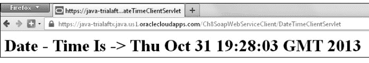

## 194 Oracle Cloud Java EE 应用

### RESTful Web 服务

RESTful Web 服务通常被称为“轻量级” Web 服务，因为与 SOAP 需要在传输中传输大量的 XML 不同，REST 要简单得多且更直接。与 SOAP Web 服务相比，REST 几乎没有开销。REST 的主要局限性涉及对过去十年中演变的安全标准的支持。Oracle 对 RESTful Web 服务的支持使用了 JAX-RS API。Jersey 是 JAX-RS 的参考实现，并用于 Oracle。

使用 REST 构建应用程序的关键是使用标准 HTTP 方法通过唯一标识符访问数据和功能，在这种情况下，标识符就是 URL。因此，如果你想获取数据，可以简单地向 URL `<WebApplicationPath>/resources/employee/` 发送 HTTP 请求。作为响应，你可以以 HTML、Text、JSON 或其他格式获取员工信息。最近更倾向于使用 RESTful Web 服务，因为调用 URL 似乎比交换基于 XML 的消息简单且直观得多。通常 CRUD（创建、读取、更新、删除）由 HTTP 方法 PUT、GET、POST 和 DELETE 覆盖。注解传递了哪种方法将处理该路径。

> **RESTful Web 服务的一个简单示例是 Google REST API。** 在浏览器中输入 `http://ajax.googleapis.com/ajax/search?web=1`，你将获得 JSON 格式的响应。在 URL 中，将 `web` 改为 `news`，或将 `images` 改为以使用不同的搜索服务。


## 在 Oracle 上构建 RESTful Web 服务

让我们开始构建我们的 RESTful 服务应用，在 NetBeans 中创建一个名为 `Ch8WebService` 的新 Web 应用，并选择 Oracle Cloud 作为服务器。右键点击项目并选择 **Web Services | RESTful Web Services**。NetBeans 现在提供了创建模式的多种模式。选择 **Root Resource** 并点击 **Next**。将包名设置为 `rest`，路径命名为 `employees`，类命名为 `EmployeeWS`。然后，选择 MIME 类型 `text/html` 并将表示形式命名为 `java.lang.String`，如图 8-13 所示。

NetBeans 将创建 `ApplicationConfig.java`，该类扩展了 `javax.ws.rs.core.Application` 以创建我们的 JAX-RS 应用程序。`ApplicationConfig` 包含 `@Path` 注解，该注解声明路径为“webresources/”。此外，`addResource` 方法将所有资源添加到集合中。

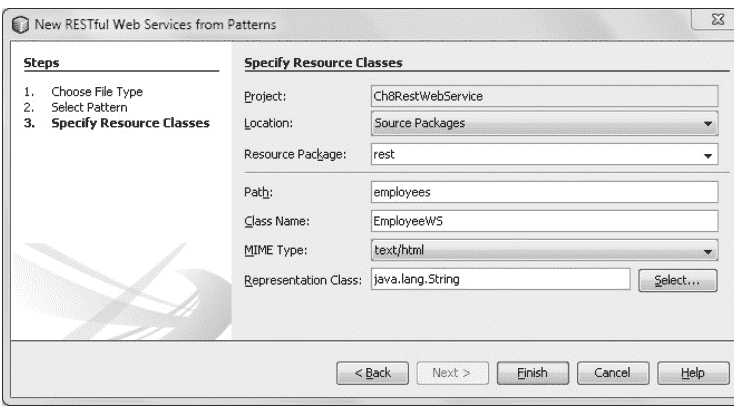

## 196 Oracle Cloud Java EE 应用

NetBeans 还创建了 `EmployeeWS.java`，其中包含我们资源的代码。此外，注意对 `web.xml` 文件的修改。你会发现创建一个新的 Servlet 和映射，如列表 8-7 所示。

### 列表 8-7：web.xml

```xml
<login-config>
    <servlet>
        <servlet-name>ServletContainer</servlet-name>
        <servlet-class>org.glassfish.jersey.servlet.ServletContainer</servlet-class>
        <init-param>
            <param-name>javax.ws.rs.Application</param-name>
            <param-value>rest.ApplicationConfig</param-value>
        </init-param>
        <load-on-startup>1</load-on-startup>
    </servlet>
</login-config>
```


<servlet-mapping>
  <servlet-name>Servletor</servlet-name>
  <url-pattern>/webresources/*</url-pattern>
</servlet-mapping>

## JAX-RS 1.1 修复

`web.xml` 文件的添加是根据 JAX-RS 2.x 的，而 Oracle 支持 JAX-RS 1.1。因此，我们需要将 `org.glassfish.jersey.servlet.ServletContainer` 替换为 `com.sun.jersey.spi.container.ServletContainer`，因为在 Jersey 2.0 移动到 GlassFish 之前一直使用该类名。

右键点击项目并选择 Properties。在 Libraries 部分（图 8-14 所示）中，你将找到 Jersey 2.0 和 JAX-RS 2.0，它们都不受 Oracle 支持。移除这些库并将其替换为 Jersey 1.x。Jersey 1.x 的 JAR 文件从 https://jersey.java.net/download.html 下载。

> 你可以通过右键点击项目并选择 Verify 来验证我们的应用程序符合规范并符合白名单。


# 第 8 章：Web 服务 197

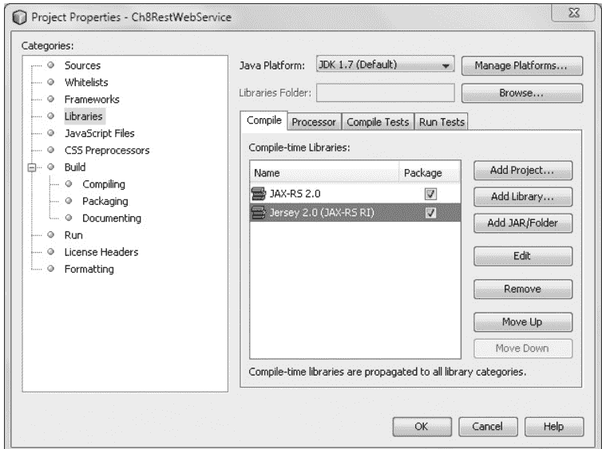

图 8-14. 项目库视图

## 修改 REST

现在让我们查看 `EmployeeWS.java` 并根据需要对其修改。你首先注意到的是 `@Path` 注解的值 employees，根据 `ApplicationConfig` 和 `EmployeeWS` 中的路径，我们将通过 `/webresources/` 访问此资源。接下来是 `@GET` 注解，它标记某个方法为响应 GET 请求的方法。同样，带有 PUT、POST、HEAD 和 DELETE 注解的方法处理相同的 HTTP 请求。因此，CRUD（创建、读取、更新、删除）分别由 PUT、GET、POST 和 DELETE 覆盖。此外，注意 `@Produces` 和 `@Consumes` 注解，它们定义了这些方法产生和消耗的 MIME 类型。

# Oracle Cloud Java EE 应用

现在让我们如列表 8-8 所示修改我们的代码，使 GET 方法接受参数并返回适当的数据。

# 列表 8-8：EmployeeWS

```java
package javax.ws.rs.core;

import javax.ws.rs.core.UriInfo;
import javax.ws.rs.PathParam;
import javax.ws.rs.Consumes;
import javax.ws.rs.PUT;
import javax.ws.rs.Path;
import javax.ws.rs.GET;
import javax.ws.rs.Produces;
import javax.ws.rs.MediaType;

@Path("employees")
public class EmployeeWS {

    @Context
    private UriInfo context;

    public EmployeeWS() {
    }

    @GET
    @Produces(MediaType.APPLICATION_XML)
    public String getHtml(@PathParam("employee") String employee) {
        return "<employees><employee>Employee Data</employee></employees>";
    }

    @PUT
    @Consumes(MediaType.TEXT_HTML)
    public void putHtml(String content) {
    }

    @GET
    @Path("/1")
    @Produces(MediaType.TEXT_HTML)
    public String getEmployeeOne() {
        return "<h1>EMP ONE</h1>";
    }
}
```

## 第8章：Web 服务 199

```java
@Path("{name}")
@Produces("MediaType.TEXT_PLAIN")
public String getEmployeeName(@PathParam("name") String name) {
    return "<h1>Got Data For Employee: " + name + "</h1>";
}
```

我们修改了 `@Produces` 注解，使用 MediaType 常量代替 MIME 类型，并修改了 `getHeight` 方法以生成 XML。我们还引入了两个新的 GET 方法：一个接受路径 `/1` 并返回员工 1 的数据，另一个接受我们在代码中处理的参数并据此生成输出。

请注意，对于 `getEmployeeName` 方法，我们生成了 HTML 标签，但 `@Produces` 注解扫描的是 `MediaType.TEXT_PLAIN`。因此，浏览器不会处理 HTML，而是会将标签作为纯文本显示。这些不同的方法展示了 RESTful 服务接受不同输入并生成变量输出的灵活性。将某些功能作为 RESTful Web 服务暴露出来只需添加该方法并对其标记必要的注解即可。

图 8-15 显示了 NetBeans 列出的 RESTful Web 服务。它还提供了右键点击列表并选择“Test Resource URI”的选项。然而在本文期间，NetBeans 在假设存在本地服务器的情况下生成 URI，无法为 OJC 生成正确的 URI。

右键点击项目并选择“Deploy”（部署）。一旦项目部署，你就可以直接从浏览器访问 RESTful 服务。访问 URL `https://<CloudServiceName>.<IdentityDomain>.java.<DataCenter>.oraclecloudapps.com/Ch8RestWebService/webresources/employees/Example/`，你将获得图 8-16 所示的输出。

从浏览器访问 Web 服务非常简单，让我们从 Java 代码通过编程的方式来看它。

## RESTful Web 服务客户端

调用 RESTful Web 服务就像发送 HTTP 请求一样简单。你可以使用如 Apache HttpComponents 中的 `HttpClient` 等 HTTP 库，也可以使用 JAX-RS/Jersey 中的客户端库功能。NetBeans 有一个向导可以自动生成 Java 客户端；然而，生成的代码是基于 JAX-RS 2.0 的，因此我们在这里不会使用它。JAX-RS 1.1 的代码足够简单。

我们可以在 NetBeans 中为客户端创建一个新项目，但那样需要再次遵循“JAX-RS 1.1 Fix”部分中提到的步骤。相反，让我们直接在 `Ch8RestWebService` 中创建客户端代码。

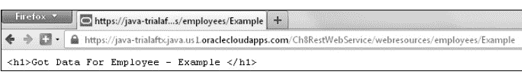
图 8-16。由 getEmployeeByName 生成的输出

为此，在 `servants` 包中创建一个名为 `RestClientServlet` 的新 Servlet。按照列表 8-9 所示修改代码。

## 列表 8-9：RESTful 客户端

```java
protected void processRequest(HttpServletRequest request,
        HttpServletResponse response)
    throws ServletException
```


你还需要添加 `com.sun.jersey.api.client.Client`、`com.sun.jersey.api.client.WebResource` 以及 `javax.ws.rs.core.MediaType` 的导入语句。运行 Servlet，你将获得图 8-17 所示的输出。客户端代码访问 Web 服务并获取员工 1 的数据。

| RESTful WS 输出 |
| --- |
| EMP ONE |

图 8-17. RestServlet 输出

## 总结

在本章中，我们查看了使用 SOAP 和 REST 构建 Web 服务并将其部署在 OJC 上。我们还查看了如何解决 OJC 在 Web 服务方面的一些局限性。

# 第9章：使用 Oracle 数据库云服务进行持久化

Java 和 Java EE 提供了一套持久化的标准和工具。在本章中，我们查看 Java 持久化以及 Oracle 云的能力。

## Oracle 云上的持久化

当大多数人想到 Oracle 时，他们想的是 Oracle 数据库。因此，Oracle 云的一个主要重点领域就是 Oracle 数据库云。Oracle Java Cloud 使用 Oracle Database Cloud 为 Java EE 提供持久化能力。Oracle Java Cloud 目前不支持 Oracle Database Cloud 外的任何数据库，该云基于 Oracle Database 11g Release 2 企业版。

在采用 OCI 时，可以使用 Oracle 无疑是一个考虑的因素；然而，许多企业已经在广泛使用 Oracle 数据库，并且即使在云端也愿意致力于 Oracle Database。

## Oracle Database Cloud Service

Oracle Database Cloud Service 不是在远程服务器上安装 Oracle Database。


图 8-15. NetBeans 中的 RESTful Web 服务列表

客户端代码访问 Web 服务并获取员工 1 的数据。


## 探索数据库云

数据库服务提供了 Oracle Express (Apex)，这是一个开发工具。


图 9-1. 启动 Oracle Cloud


图 9-2. 数据库服务概述

### 归档

- 你可以自动将应用程序归档到模式中的数据库表中。
- 存档是增量的。只有新的和发生过变化的应用程序会被归档。
- 存档可以通过 APEX Application Archive 封装程序可用。

### 锁定 / 解锁服务

- 锁定此服务可以防止用户访问你的应用程序和云服务。
- 请求可能需要时间来处理。
- 当你的锁定或解锁操作完成后，Oracle Cloud 将向你发送电子邮件。

## 导出数据和数据结构

| 导出 | 导出数据 |
|---|---|
| 您没有导出的数据。 | |
| 导出文件将保留 2 天，并可从您的安全 FTP 下载区域的输出目录进行下载 | |
| 服务 SFTP 主机与端口: `sftp@us2.cloud.oracle.com:22` 服务 SFTP 用户: `us256167` | |

图 9-4 导出数据和数据结构

点击左侧面板中的“指标”（Metrics），你将看到使用信息，例如以 MB 为单位的存储占用百分比，如图 9-6 所示。
点击“关联服务”（Associated Services），你将看到其他已与你的 Oracle Database Cloud 配置的 Oracle Cloud 服务。对于试用设置，你只会看到列出的 Java Cloud Service，如图 9-7 所示。
图 9-2 右角的“打开服务控制台”（Open Service Console）按钮将带你进入 Oracle Application Express，如图 9-8 所示。
你将看到主图标以及屏幕顶部的标签页菜单，用于访问各种功能并管理你的数据库云。

| 为 javatrial2364db-inrightrixsoltrial60464 导出数据 | x |
|---|---|
| 请选择你想要包含在数据导出中的内容： | |
| [ ] 包含数据结构 | |
| [ ] 包含数据 | |
| | [创建数据导出] [取消] |

图 9-5 创建数据导出

## 指标 - 使用情况

| 最新使用情况（截至 25 小时 1 分钟前） |
|---|---|
| 存储 | |
| 存储占用 (MB) | 2.75 |
| 存储百分比 | 0.27% |

**历史使用情况**
过去 7 天没有使用率数据。

图 9-6 指标 - 使用情况

## 关联服务

**关联服务**
javatrial2364 (Java)

图 9-7 关联服务


图 9-8 Oracle Application Express

## Oracle Apex

Oracle Application Expression (Apex) 是你处理数据库云的主要工具。如图 9-8 所示，Apex 有四个主要部分：

- **应用构建器（Application Builder）**：应用构建器提供了一个基于浏览器的开发环境，带有向导和工具，可以轻松地构建以数据为中心的应用程序。它还自带了包应用程序以及导入应用程序的能力。
- **SQL 工作室（SQL Workshop）**：SQL 工作室提供系列管理数据的工具。如图 9-9 所示，SQL 工作室是我们在配合 OIC 使用 Oracle Cloud Database 时最经常使用的部分。特别值得注意的是图 9-10 所示的实用程序，以及以 RESTful 服务形式暴露数据的能力。
- **团队开发（Team Development）**：团队开发提供了跟踪功能、待办任务、里程碑和 Bug 的能力。它还有帮助管理应用程序开发周期。
- **管理（Administration）**：管理提供了管理用户和组、监控活动和使用情况以及管理服务的能力。


图 9-9 SQL 工作室

| ORACLE Application Express | | | | |
|---|---|---|---|---|
| 首页 | 应用构建器 | SQL 工作室 | 团队开发 | 管理 |
| 🏠 SQL 工作室 | 实用程序 |


图 9-10 SQL 工作室工具

> **注意**
> Oracle Database Cloud 中的数据源无法从桌面上的远程数据库工具直接访问。因此，我们无法直接在 NetBeans 中将云数据库作为服务。但是，你可以使用 Oracle 的 SQL 集成开发环境（IDE）SQL Developer 将数据上传到数据库云。

## Java Cloud：数据库云集成

Oracle Database Cloud 实例作为 JDBC 数据源提供给所有部署在 OIC 上的应用程序。如图 9-11 所示，Java Cloud Services 控制台中在“数据源”下列出的“javatrial2364db” JNDI 位置是 OIC 可用的唯一数据源。你可以添加新数据源或自定义任何数据源设置。因此，OIC 上所有需要数据源的应用程序都需要引用相同的 JNDI 名称。请注意，此名称在不同安装中是不同的，因此你的数据源的 JNDI 名称与图中或文中引的不相同。

| Java Cloud Services 控制 |
|---|---|
| Java Cloud Services > Java Cloud Service: javatrial2364 |
| Java Cloud Service: javatrial2364 |
| 数据源 |
| JNDI 位置 |
| javatrial2364db |

**图 9-11 Oracle Java 数据源**

> **注意**
> Oracle Database Cloud 中的数据源无法从桌面上的远程数据库工具直接访问。因此，我们无法直接在 NetBeans 中将云数据库作为服务。但是，你可以使用 Oracle 的 SQL 集成开发环境（IDE）SQL Developer 将数据上传到数据库云。

Persistence API (JPA) 是持久化的 API。

## 开发实体应用程序

首先，在 NetBeans 中创建一个名为 `ChJPA1` 的新 Web 项目。确保选择 Oracle Cloud 作为服务器。接下来，右键点击项目并选择 New File | Persistence | Entity Class。如图 9-12 所示，类名为 `Device`，包。请注意主键默认为 `Long`。勾选“Create Persistence Unit”框。点击 Next。

接下来，如图 9-13 所示，向导会询问有关持久化供应商和数据库的更多信息。选择了 EclipseLink (JPA 2.0)。

| 步骤 | 提供者和数据库 |
|---|---|
| 1. 选择文件类型 | 持久化单元名称：CH9PAIPU |
| 2. 名称和位置 | 为实体类指定持久化提供者和数据库 |
| 3. 提供者和数据库 | 持久化提供者：EclipseLink (JPA 2.0)(默认)<br>数据源：javatrial2364db<br>[x] 使用 Java 事务 API<br>表生成策略：○ 创建删除和不创建 |

JPA x 建议源码级别为 1.6。该项目的源码级别目前为 1.5。

图 9-13. 实体提供者和数据库

作为持久化提供者。我们将使用它，是因为 OIC 开箱支持它。你可以从下拉菜单中选择另一个 JPA 2.0 提供者，例如 Hibernate。然而，在这种情况下，你还必须提供库文件，否则 OIC 不会配置这些文件。

“数据库，”。表生成策略允许我们选择创建新表、删除之前的表然后创建一个新表，或者不尝试创建表。选择 Create（创建）选项，因为我们根据实体类中的属性创建表。点击 Finish（完成）。你现在应该有一个实体类了。

> **注意**
> 只要用法通过白名单检查，OIC 就支持 Java SE 6 API。因此，考虑到图 9-9 所示的警告，你可以将 File | Project Properties | Sources 中的源码级别更改为 JDK 6。然而，本章的示例无需更改也可以正常运行。


> **注意**
> 附录 C 列出了 OJC 支持的技术和 API。

你现在会在 NetBeans 的 Configuration Files（配置文件）下看到一个名为 `persistence.xml` 的新文件。该文件是 NetBeans 根据我们在图 9-13 中的输入创建的。打开 `persistence.xml`，在源视图中，你将看到列表 9-1 所示的 XML。

## 列表 9-1: persistence.xml

```xml
<xml version="1.0" encoding="UTF-8"?>
<persistence version="2.0" xmlns="http://java.sun.com/xml/ns/persistence"
xmlns:xsi="http://www.w3.org/2001/XMLSchema-instance"
xsi:schemaLocation="http://java.sun.com/xml/ns/persistence
http://java.sun.com/xml/ns/persistence_2_0.xsd">
<persistence-unit name="Ch9JPAIPU" transaction-type="JTA">
<provider>org.eclipse.persistence.jpa.PersistenceProvider</provider>
<jta-data-source>javatrial236db</jta-data-source>
<exclude-unlisted-classes>false</exclude-unlisted-classes>
<properties>
<property name="eclipse.ddl-generation" value="create-tables"/>
</properties>
</persistence-unit>
</persistence>
```

你可以点击 Design 选项卡并更改此配置和某些属性，以更好地理解配置。重复一遍，JTA 数据源名称 `javatrial2364db` 指向图 9-11 所示的 JNDI 名称。该名称对于你的安装来说可能不同。

为实体创建的 `Device.java` 文件具有 `id` 属性、一些注解以及 `toString`、`hashCode` 和 `equals` 方法的默认实现。你会注意到 `id` 属性带有注解 `@GeneratedValue(strategy = GenerationType.AUTO)`，它指定了主键的生成策略。这里的 AUTO 表示持久化提供者应该为特定的数据库选择一种合适的策略。其他选项是 IDENTITY、SEQUENCE 和 TABLE。你会发现，对于云端上的 Oracle 数据库，持久化提供者 (EclipseLink) 创建了一个名为 SEQUENCE 的表，用于生成主键。

现在让我们修改实体类以添加几个属性，这些属性将成为表中的列。你可以自己编写代码，也可以通过右键并选择 Insert Code（插入代码）自动生成。添加属性 `String name` 和 `int cost`，以及相应的 getter 和 setter 方法，使你的实体类看起来如列表 9-2 所示。添加合适的构造函数也是一个好主意。

## 列表 9-2: Device.java

```java
package entities;

import java.io.Serializable;
import javax.persistence.Column;
import javax.persistence.Entity;
import javax.persistence.GeneratedValue;
import javax.persistence.GenerationType;
import javax.persistence.Id;

@Entity
public class Device implements Serializable {

    private static final long serialVersionUID = 1L;

    @Id
    @GeneratedValue(strategy = GenerationType.AUTO)
    private Long id;

    @Column(name = "DEENAME")
    private String name;

    private int cost;

    public Device(String name, int cost) {
        this.name = name;
        this.cost = cost;
    }

    public Device() {
    }

    public Long getId() {
        return id;
    }

    public void setId(Long id) {
        this.id = id;
    }
}
```


# 第 9 章：使用 Oracle 数据库服务的持久化

## 实体提供者和数据库配置

| 步骤 | 提供者和数据库 |
|---|---|
| 1. 选择文件类型 | 持久化单元名称：CH9PAIPU |
| 2. 名称和位置 | 为实体类指定持久化提供者和数据库 |
| 3. 提供者和数据库 | 持久化提供者：EclipseLink (JPA 2.0)(默认)<br>数据源：javatrial2364db<br>[x] 使用 Java 事务 API<br>表生成策略：○ 创建删除和不创建 |

图 9-13. 实体提供者和数据库

作为持久化提供者。我们将使用它，是因为 OIC 开箱支持它。你可以从下拉菜单中选择另一个 JPA 2.0 提供者，例如 Hibernate。然而，在这种情况下，你还必须提供库文件，否则 OIC 不会配置这些文件。

“数据库，”。表生成策略允许我们选择创建新表、删除之前的表然后创建一个新表，或者不尝试创建表。选择 Create（创建）选项，因为我们根据实体类中的属性创建表。点击 Finish（完成）。你现在应该有一个实体类了。

> 注意
> 只要用法通过白名单检查，OIC 就支持 Java SE 6 API。因此，考虑到图 9-9 所示的警告，你可以将 File \| Project Properties \| Sources 中的源码级别更改为 JDK 6。然而，本章的示例无需更改也可以正常运行。


## 注意事项

> 注意
> 附录 C 列出了 OJC 支持的技术和 API。

你现在会在 NetBeans 的 Configuration Files（配置文件）下看到一个名为 `persistence.xml` 的新文件。该文件是 NetBeans 根据我们在图 9-13 中的输入创建的。打开 `persistence.xml`，在源视图中，你将看到列表 9-1 所示的 XML。

## 列表 9-1: persistence.xml

```xml
<xml version="1.0" encoding="UTF-8"?>
<persistence version="2.0" xmlns="http://java.sun.com/xml/ns/persistence"
xmlns:xsi="http://www.w3.org/2001/XMLSchema-instance"
xsi:schemaLocation="http://java.sun.com/xml/ns/persistence
http://java.sun.com/xml/ns/persistence_2_0.xsd">
<persistence-unit name="Ch9JPAIPU" transaction-type="JTA">
<provider>org.eclipse.persistence.jpa.PersistenceProvider</provider>
<jta-data-source>javatrial236db</jta-data-source>
<exclude-unlisted-classes>false</exclude-unlisted-classes>
<properties>
<property name="eclipse.ddl-generation" value="create-tables"/>
</properties>
</persistence-unit>
</persistence>
```

你可以点击 Design 选项卡并更改此配置和某些属性，以更好地理解配置。重复一遍，JTA 数据源名称 `javatrial2364db` 指向图 9-11 所示的 JNDI 名称。该名称对于你的安装来说可能不同。

为实体创建的 `Device.java` 文件具有 `id` 属性、一些注解以及 `toString()`、`hashCode()` 和 `equals()` 方法的默认实现。你会注意到 `id` 属性带有注解 `@GeneratedValue(strategy = GenerationType.AUTO)`，它指定了主键的生成策略。这里的 AUTO 表示持久化提供者应该为特定的数据库选择一种合适的策略。其他选项是 IDENTITY、SEQUENCE 和 TABLE。你会发现，对于云端上的 Oracle 数据库，持久化提供者 (EclipseLink) 创建了一个名为 SEQUENCE 的表，用于生成主键。

现在让我们修改实体类以添加几个属性，这些属性将成为表中的列。你可以自己编写代码，也可以通过右键并选择 Insert Code（插入代码）自动生成。添加属性 `String name` 和 `int cost`，以及相应的 getter 和 setter 方法，使你的实体类看起来如列表 9-2 所示。添加合适的构造函数也是一个好主意。

## 列表 9-2: Device.java

```java
package entities;

import java.io.Serializable;
import javax.persistence.Column;
import javax.persistence.Entity;
import javax.persistence.GeneratedValue;
import javax.persistence.GenerationType;
import javax.persistence.Id;

@Entity
public class Device implements Serializable {

    private static final long serialVersionUID = 1L;

    @Id
    @GeneratedValue(strategy = GenerationType.AUTO)
    private Long id;

    @Column(name = "DEENAME")
    private String name;

    private int cost;

    public Device(String name, int cost) {
        this.name = name;
        this.cost = cost;
    }

    public Device() {
    }

    public Long getId() {
        return id;
    }

    public void setId(Long id) {
        this.id = id;
    }

    public String getName() {
        return name;
    }

    public void setName(String name) {
        this.name = name;
    }

    public int getCost() {
        return cost;
    }

    public void setCost(int cost) {
        this.cost = cost;
    }

    @Override
    public int hashCode() {
        int hash = 0;
        hash = 31 * hash + (id != null ? id.hashCode() : 0);
        return hash;
    }

    @Override
    public boolean equals(Object o) {
        if (this == o) return true;
        if (o == null || getClass() != o.getClass()) return false;
        Device device = (Device) o;
        return id != null || id.equals(device.id);
    }

    @Override
    public String toString() {
        return "Device[id=" + id + ", name=" + name + ", cost=" + cost + "]";
    }
}
```


## 第 9 章：使用 Oracle 数据库云服务持久化


**图 9-14.** SQL 工作区对象浏览器中的表

`DEVICE` 表，请注意列名如注释中所指定的。因此是 `DEVICENAME` 而不是属性名 `NAME`。`SEQUENCE` 表将用于自动生成主键。

> **注意** NetBeans 会将 EclipseLink 库添加到你的项目库中。EclipseLink 是 Oracle 的默认 JPA 库，因此不需要将其封装在我们的项目中。从此，你可以从项目中移除该库。移除不必要的库也可以显著加快部署速度。

点击 `DEVICE` 表的 Data 选项卡，如图 9-15 所示，你将看到我们从 Servlet 添加的两个设备。现在表中已有了一些数据，让我们来看看如何查询和检索这些数据。


**图 9-15.** `DEVICE` 表的 Data 选项卡

| DEVICE | Table Data Indexes Model Constraints Statistics UI Defaults Triggers Dependencies |
| :--- | :--- | :--- | :--- | :--- | :--- | :--- | :--- |
| Query Count Rows Insert Row | | | | | | | | |
| EDIT | ID | COST | DEVICENAME | | | | | |
| | 1 | 100 | Android | | | | |
| | 2 | 200 | iPhone | row(s) 1-2 of 2 | | | | |

> **注意** 现在我们的 Device 表已经按要求创建完成，你可以通过移除 `eclipselink.ddl-generation` 属性来编辑 `persistence.xml` 文件，因为你不再希望 EclipseLink 尝试创建表。在 `persistence.xml` 编辑器中将表生成策略更改为“None”应该得到相同的结果，但我在 NetBeans 中遇到了一些 XML 无法更新的问题。因此，你可能需要手动从 XML 中删除该属性。


### 查找并更新实体

所有实体都可以使用类名和主键进行查找/检索。更新实体非常简单：更新实体对象中的值并持久化更新后的对象。我们稍后将查看如何进行批量更新，但在需要更新单个实体时，修改对象中的值是最简单的方法。

让我们将代码列表 9-4 所示的方法添加到我们的 Servlet 中，该方法将先找到一个对象，更新它，然后持久化更新后的对象。

#### 代码列表 9-4：查找并更新设备

```java
public void findAndUpdateDevice(Long primaryKey) {
    try {
        utx.begin();
        Device foundDevice = em.find(Device.class, primaryKey);
        if (foundDevice != null) {
            foundDevice.setCost(2000);
            em.persist(foundDevice);
        }
        utx.commit();
    } catch (Exception e) {
        Logger.getLogger(getClass().getName())
            .log(Level.SEVERE, "exception caught", e);
        throw new RuntimeException(e);
    }
}
```

注意此方法与代码列表 9-3 中的 `persist` 方法类似。与添加新实体一样，在更新实体时，我们需要一个事务以便 `EntityManager` 在调用其 `persist` 方法时不会抛出异常。

在行 `Device foundDevice = em.find(Device.class, 2L)` 中，我们声明类为 `Device.class`，主键为 2。注意我们将其写为 `2L` 是为了表示这是一个 `Long` 类型。如果没有 L，它将被视为整数，从而导致异常。一旦找到设备，我们就会更新成本并持久化更新后的对象。然而，仅使用 `EntityManager` 进行查找对于大多数应用程序来说是不够的；因此，你需要一种强大的查询机制，例如 Java 持久查询语言（JPQL）。

JPQL 是一种类似于 SQL 的查询语言，允许你编写可移植的查询而无需担心底层数据存储。你可以像 SQL 一样执行 `SELECT`、`UPDATE` 或 `DELETE` 查询。你可以在实体类中使用注解来声明 JPQL 查询，也可以使用 `EntityManager` 的 `createQuery` 方法在代码本身中编写查询。将查询声明为注解通常是更简单、更整洁的方法。

### SELECT NamedQuery

让我们来看一个例子，其中我们用注解声明一个 SELECT 查询，并在代码中声明第二个查询。

在 `Device.java` 类中，为 `javax.persistence.NamedQuery` 和 `NamedQueries` 注解添加导入语句，使类顶部如代码列表 9-5 所示。

#### 代码列表 9-5：NamedQuery

```java
import javax.persistence.NamedQuery;

@Entity
@NamedQuery(name = "Device.findPricey",
    query = "SELECT d FROM Device d WHERE d.cost > :cost")
public class Device implements Serializable {
```

在这里，我们使用注解声明了一个查询。其语法与 SQL 非常相似，除了我们需要传递的 `cost` 参数。接下来我们在 Servlet 中添加新方法。

#### 代码列表 9-6：Select 查询

```java
public void findDevices(PrintWriter out, int cost) {
    // SelectQuery
    Query q = em.createQuery("SELECT d FROM Device d WHERE d.cost > :cost");
    q.setParameter("cost", cost);
    List<Device> devices = q.getResultList();
    for (Device d : devices) {
        out.println("Device Name: " + d.getName());
    }
}
```

### 更新和删除查询

在本章早期，我们学习了如何通过更新实体对象来更新表。更新单个记录的方法很容易，但当你想要更新多条记录时，这种方法并不高效。与其遍历更新每一个实体，不如运行 UPDATE 查询。

让我们在 Device 类中添加几个查询——一个用于提高特定名称设备的成本，另一个用于删除所有名称的设备。使用多个命名查询时可以使用 `@NamedQueries` 注解，如代码列表 9-8 所示。你需要添加 `javax.persistence.NamedQueries` 的导入语句。

#### 代码列表 9-8：更新删除查询

```java
@Entity
@NamedQueries({
    @NamedQuery(name = "Device.findPricey",
        query = "SELECT d FROM Device d WHERE d.cost > :cost"),
    @NamedQuery(name = "Device.hikePrice",
        query = "UPDATE Device d SET d.cost = d.cost+100 WHERE d.name = :name"),
    @NamedQuery(name = "Device.deleteBasedOnName",
        query = "DELETE FROM Device d WHERE d.name = :devname")
})
public class Device implements Serializable {
```

注意对于 UPDATE 查询，我们使用位置参数，而对于 DELETE，我们使用了命名参数。

现在我们需要向 Servlet 添加运行 UPDATE 和 DELETE 查询的方法。我们添加了 `deleteDeviceByName` 方法来删除设备，以及 `updateDevicePrice` 方法来更新设备，如代码列表 9-9 所示。由于 UPDATE 和 DELETE 查询需要在事务中运行，最好创建一个 `updateDeleteInTxn` 方法（如代码列表 9-9 所示），并将要执行的查询传递给它。我们将在 `processRequest` 方法中调用 `deleteDeviceByName` 和 `updateDevicePrice` 方法。

#### 代码列表 9-9：执行更新删除

```java
private void deleteDeviceByName(PrintWriter out, String name) {
    // DELETE namedQuery
    Query deleteQuery = em.createNamedQuery("Device.deleteBasedOnName")
        .setParameter("devname", name);
    out.println("<h4>Deleted: " + updateDeleteInTxn(deleteQuery) + "</h4>");
}

private void updateDevicePrice(PrintWriter out, String name) {
    // 更新命名查询
    Query updateQuery = em.createNamedQuery("Device.hikePrice")
        .setParameter(1, name);
    out.println("<h4>Updated: " + updateDeleteInTxn(updateQuery) + "</h4>");
}

public int updateDeleteInTxn(Query q) {
    try {
        utx.begin();
        int count = q.executeUpdate();
        utx.commit();
        return count;
    } catch (Exception e) {
        Logger.getLogger(getClass().getName()).log(Level.SEVERE, 
            "异常", e);
        throw new RuntimeException(e);
    }
}
```

我们通过从 `processRequest` 方法中调用各种方法来利用它们，如代码列表 9-10 所示。

#### 代码列表 9-10：processRequest

```java
protected void processRequest(HttpServletRequest request,
    HttpServletResponse response)
    throws SQLException, IOException {

    response.setContentType("text/html;charset=UTF-8");
    PrintWriter out = response.getWriter();

    try {
        persist(new Device("Android"), 100);
        persist(new Device("iPhone"), 200);
        out.println("Added devices to the table");

        // 查找价格超过 100 的设备
        findPriceDevices(out, 100);

        // 查找名称以 A 开头的设备
        deviceNameLike(out, "A%");

        // 更新 iPhone 价格
        updateDevicePrice(out, "iPhone");

        // 删除 Android 设备
        deleteDeviceByName(out, "Android");

        // 根据主键查找并更新设备成本
        findAndUpdateDevice(2L);

    } finally {
        out.close();
    }
}
```


现在运行 `DeviceServlet`，你应该能得到图 9-16 所示的输出。

访问数据库云上的 SQL 工作坊 | 对象浏览器，以检查你的数据是否已按预期创建和更新。在这个示例中，我们查看了如何使用各种 JPA 特性以及 JPQL 查询来根据需要创建实体以及选择、更新和删除实体。


向表中添加了设备

- 列出所有成本大于 100 的设备
  设备名称：iPhone
- 列出所有名称以 A 开头的设备
  设备名称：Android
  已更新：1
  已删除：1

图 9-16. DeviceServlet 输出

注意：
我们使用实体创建了表；然而，你也可以采取反向方法，使用表创建实体。NetBeans 以及许多其他 IDE 都有精巧的向导，可以从表中自动生成实体。我们在这里不会涉及 JPQL 语法的微小细节。虽然它的大部分内容与 SQL 相当相似，但我建议你参考 `http://docs.oracle.com/javaee/6/tutorial/doc/bnbuf.html` 中的详细 JPQL 语法列表以获取更多信息。

## 实体的 JSF CRUD

大多数应用程序为数据提供创建-读取-更新-删除（CRUD）功能。现在我们已经有一个映射到表的实体，让我们使用精巧的 NetBeans 特性为我们的实体创建一个 JSF CRUD 应用程序。虽然创建的应用程序可以直接使用，但也可以作为你根据应用程序需求进行修改的良好基础。

要生成 JSF CRUD 应用程序，右键点击 `Ch9JPA1` 项目并选择 `New | Other | Persistence | JSF Pages from Entity Classes`。你将看到图 9-17 所示的屏幕。


图 9-17. 从实体类创建新 JSF 页面的屏幕

添加 `Device` 实体并点击 Next。在图 9-18 所示的下一个屏幕上，将 JPA 控制器包设置为 `jpacontroller` 并将 JSF 类包设置为 `jsfclasses`。点击 Next。

如图 9-19 所示，NetBeans 现在会要求你选择使用的服务器库。默认将选择 JSF 2.0，因为那是 OJC 支持的版本。你不需要更改它，只需点击 Finish。

NetBeans 将生成多个类和 JSF `.xhtml` 文件。它还会创建托管豆 `jsfclasses.DeviceController` 并修改 `weblogic.xml` 文件以添加对 JSF 2.0 的库引用。你还会发现几个其他生成的类，以及 Web Pages 下一个新的 `device` 目录。你在这里不会涉及到自动生成应用程序的细节，但这些本质上也是类类。


图 9-18. 正在生成 JSF 页面

## Oracle Java Cloud Java EE 应用

Java EE 6 还引入了特定应用的 Java EE 平台形式，称为配置（Profiles），其中第一个是轻级的 Web Profile，它包含了 Java EE 6 技术的子集，旨在构建 Web 应用程序。因此，开发者现在可以选择使用 Web Profile 或全功能平台（Full Platform）。

Java EE 6 还引入了上下文和依赖注入（CDI），它通过允许开发者根据该注入的上下文来选择注入的实例，进一步推进了注入技术的发展。

考虑到 RESTful Web 服务日益增长的普及性，Java EE 6 还引入了 RESTful Web 服务 API（JAX-RS）。

以下是 Java EE 6 中各种 API 的列表，大致分为处理 Web 服务、Web 应用程序、企业级应用程序、管理与安全以及与 EE 相关的 Java SE 技术。

# Web 服务技术

| 用于 RESTful 服务的 Java API (JAX-RS) 1.1 | JSR 311 |
| 企业级 Web 服务 1.3 | JSR 109 |
| 基于 XML 的 Web 服务 Java API (JAX-WS) 2.2 | JSR 224 |
| XML 绑定 Java 架构 (JAXB) 2.2 | JSR 222 |
| Web 平台 服务元数据 | JSR 181 |
| 基于 XML 的 RPC Java API (JAX-RPC) 1.1 | JSR 101 |
| XML 消息 Java API 1.3 | JSR 67 |
| XML 注册表 Java API (JAXR) 1.0 | JSR 93 |

# Web 应用程序技术

| Servlet 3.0 | JSR 315 (包含在 Web Profile 中) |
| JavaServer Faces 2.0 | JSR 314 (包含在 Web Profile 中) |
| JavaServer Pages 2.2/表达式语言 2.2 | JSR 245 (包含在 Web Profile 中) |
| JSP 标准标签库 (JSTL) 1.2 | JSR 52 (包含在 Web Profile 中) |
| 其他语言调试支持 1.0 | JSR 45 (包含在 Web Profile 中) |

# 企业级应用程序技术

| Java 上下文和依赖注入 (Web Beans 1.0) | JSR 299 (包含在 Web Profile 中)/JSR 330 (包含在 Web Profile 中) |
| Java 依赖注入 1.0 | JSR 303 (包含在 Web Profile 中) |
| Bean 校验 1.0 | JSR 318 (EJB 3.1 Lite 和拦截器 1.1 包含在 Web Profile 中) |
| 企业 JavaBeans 3.1 (包含拦截器 1.1) | |
| Java EE 连接器架构 1.6 | JSR 322 |
| Java 持久 2.0 | JSR 317 (包含在 Web Profile 中) |
| Java 平台通用注解 1.1 | JSR 250 |
| Java 消息服务 API 1.1 | JSR 914 |
| Java 事务 API (JTA) 1.1 | JSR 907 (包含在 Web Profile 中) |
| JavaMail 1.4 | JSR 919 |

# 管理与安全技术

- 容器 Java 认证服务提供接口: JSR 196
- 容器 Java 授权 1.2: JSR 115
- Java EE 部署 1.2: JSR 88
- J2EE 管理 1.1: JSR 77

# Java SE 中相关的 Java EE 规范

- XML 处理 Java API (JAXP) 1.3: JSR 206
- Java 数据库连接 4.0: JSR 221
- Java 管理扩展 (JMX) 2.0: JSR 255
- JavaBeans 激活框架 (JAF) 1.1: JSR 92
- XML 流式 API (StAX) 1.0: JSR 173

# Java 平台企业版 (Java EE 6) Web Profile

此规范列出了 Web Profile 产品需要的技术。然而，Web Profile 产品可以选择支持全 Java EE 平台中未列在 Web Profile “必要组件”中的某些技术。

必要组件：
- Servlet 3.0
- JavaServer Pages (JSP) 2.2
- 表达式语言 (EL) 2.2
- 其他语言调试支持 (JSR-45) 1.0
- JSP 标准标签库 (JSTL) 1.2
- JavaServer Faces (JSF) 2.0
- Java 平台通用注解 (JSR-250) 1.1
- Enterprise JavaBeans (EJB) 3.1
- Java 事务 API (JTA) 1.1
- Java 持久 API (JPA) 2.0
- Bean 校验 1.0
- Managed Beans 1.0
- 拦截器 1.1
- Java EE 平台上下文和依赖注入
- Java 依赖注入 1.0

# Java 平台企业版 (Java EE 7) JSR 342

Java EE 7 引入了 WebSocket Java API，它为需要实时更新和频繁交换应用程序提供了一个轻量级的双工通信通道。WebSocket 配合 HTML5 提供了丰富的交互体验。

# 附录 A：Java EE 技术与 JSR

在 Java EE 6 中引入的 CDI 已成为 Java EE 7 的一部分。考虑到 JSON 的广泛使用，Java EE 7 引入了 JSON Java API，用于解析和生成 JSON。Java EE 7 还引入了用于批量应用的并发 API。考虑到 RESTful 服务的广泛使用，Web Profile 在 Java EE 7 中更新包含了 JAX-RS。

以下是 Java EE 7 中各种 API 的列表，大致分为处理 Web 应用程序、企业级应用程序、Web 服务、管理与安全以及与 EE 相关的 Java SE 技术。

# Web 应用程序技术

- WebSocket Java API: JSR 356 (包含在 Web Profile 中)
- JSON Java API: JSR 353 (包含在 Web Profile 中)
- Servlet 3.1: JSR 340 (包含在 Web Profile 中)
- JavaServer Faces 2.2: JSR 344 (包含在 Web Profile 中)
- 表达式语言 3.0: JSR 341 (包含在 Web Profile 中)
- JavaServer Pages 2.3: JSR 245 (包含在 Web Profile 中)
- JSP 标准标签库 (JSTL) 1.2: JSR 52 (包含在 Web Profile 中)

# 企业级应用程序技术

- Java 平台批量应用: JSR 352
- Java EE 并发工具 1.0: JSR 236
- Java 上下文和依赖注入 1.1: JSR 346 (包含在 Web Profile 中)
- Java 依赖注入 1.0: JSR 330 (包含在 Web Profile 中)
- Bean 校验 1.1: JSR 349 (包含在 Web Profile 中)

# Oracle Cloud Java EE 应用

| Enterprise JavaBeans 3.2 | JSR 345 (包含在 Web Profile 中) |
| 拦截器 1.2 | JSR 318 (包含在 Web Profile 中) |
| Java EE 连接器架构 1.7 | JSR 322 |
| Java 持久 2.1 | JSR 338 (包含在 Web Profile 中) |
| Java 平台通用注解 1.2 | JSR 250 (包含在 Web Profile 中) |
| Java 消息服务 API 2.0 | JSR 343 |
| Java 事务 API (JTA) 1.2 | JSR 907 (包含在 Web Profile 中) |
| JavaMail 1.5 | JSR 919 |

# Web 服务技术

| 用于 RESTful 服务的 Java API (JAX-RS) 2.0 | JSR 339 (包含在 Web Profile 中) |
| 实现 Web 服务 1.3 | JSR 109 |
| 基于 XML 的 Web 服务 Java API (JAX-WS) 2.2 | JSR 224 |
| Java 平台服务元数据 (JAX-RPC) 1.1 (可选) | JSR 181 |
| 基于 XML 的 RPC Java API | JSR 101 |
| XML 消息 Java API 1.3 | JSR 67 |
| XML 注册表 Java API (JAXR) 1.0 | JSR 93 |

# 管理与安全技术

| 容器 Java 认证服务提供接口 1.1 | JSR 196 |
| 容器 Java 授权 1.2 | JSR 115 |
| Java EE 部署 1.2 (可选) | JSR 88 |
| J2EE 管理 1.1 | JSR 77 |
| 其他语言调试支持 1.0 | JSR 45 (包含在 Web Profile 中) |

# Java SE 中相关的 Java EE 规范

| XML 绑定 Java 架构 (JAXB) 2.2 | JSR 222 |
| XML 处理 Java API (JAXP) 1.3 | JSR 206 |
| Java 数据库连接 4.0 | JSR 221 |
| Java 管理扩展 (JMX) 2.0 | JSR 003 |
| JavaBeans 激活框架 (JAF) 1.1 | JSR 92 |
| XML 流式 API (StAX) 1.0 | JSR 173 |

# Java 平台企业版 (Java EE 7) Web Profile

此规范列出了 Web Profile 产品需要的技术。然而，Web Profile 产品可以选择支持全 Java EE 平台中未列在 Web Profile “必要组件”中的某些技术。

必要组件：
- Servlet 3.1
- JavaServer Pages (JSP) 2.2
- 表达式语言 (EL) 3.0
- 其他语言调试支持 (JSR-45) 1.0
- JSP 标准标签库 (JSTL) 1.2
- JavaServer Faces (JSF) 2.2
- Java 平台通用注解 (JSR-250) 1.1
- Enterprise JavaBeans (EJB) 3.2 Lite
- Java 事务 API (JTA) 1.2
- Java 持久 API (JPA) 2.1
- Bean 校验 1.1
- Managed Beans 1.0
- 拦截器 1.1
- Java EE 平台上下文与依赖注入 1.1
- Java 依赖注入 1.0

# 来源

- `www.oracle.com/technetwork/java/javaee/tech/javaee6technologies-1955512.html`
- `www.oracle.com/technetwork/java/javaee/tech/index.html`


# 附录 B

## 应用服务器兼容 Java EE 5, 6 和 7

## Oracle Java Cloud 上的 Java EE 应用程序

第 1 章详细讨论了 EE 兼容性。基本上，只有当一个 Java EE 实现（应用程序服务器）通过了 Java EE 兼容性测试套件 (CTS) 中的测试时，才被认为与 Java EE 兼容。请注意，CTS 是供旨在构建 Java EE 兼容应用程序服务器的 Java EE 许可用户使用的，而不是供 Java 应用程序开发者使用的。

Oracle Cloud 服务运行 Oracle WebLogic 服务器，因此你不需要在所有可用服务器中进行评估和选择。然而，为了理解 Java EE，了解其他应用程序以及每个服务器支持的不同的 Java EE 版本是非常重要的。此列表对于比较不同的云供应商也有用，因为正如第 1 章所述，大多数供应商支持一个或多个服务器。随着更多供应商支持最新的 Java EE 版本，Java EE 7 实现列表可能会不断增长。

# Java EE 5 兼容的实现

- Apache Geronimo-2.1.4
- Apusic Application Server (v5.0)
- Fujitsu Interastage Application Server Enterprise Edition 9.2
- GlassFish Application Server v2
- IBM WASCE 2.0
- IBM WebSphere Application Server v7
- JBoss Application Server 5.0
- JBoss Enterprise Application Platform 5
- NEC WebOTX 8.1
- Oracle Application Server 11
- Oracle WebLogic Server 10g R3
- OW2 JOnAS 5.1

# Java EE 6 全平台兼容的实现

- Apache Geronimo 3.0-beta-1
- 基于 Windows Azure 的 Fujifilm Interstage Application Server
- Fujifilm Interstage Application Server v10.1
- Hitachi uCosmineexus Application Server v9.0
- IBM WebSphere Application Server 8.x
- IBM WebSphere Application Server Community Edition 3.0
- JBoss Application Server 7.x
- JBoss Enterprise Application Platform 6
- NEC WebOTX Application Server v9.x
- Oracle GlassFish Server 3.x
- Oracle WebLogic Server 12.1.1
- TMAX JEUS 7

# Java EE 6 Web Profile 兼容的实现

- Apache Geronimo 3.0-beta-1
- Apache TomEE 1.0
- Caucho Resin 4.0.17
- IBM WebSphere Application Server Version 8.5.5 (Liberty Profile)
- JBoss Application Server 7.x
- JBoss Enterprise Application Platform 6
- JOnAS
- Oracle GlassFish Server 3.x
- SAP NetWeaver Cloud

# Java EE 7 全平台兼容的实现

- GlassFish Server Open Source Edition 4.0
- TMAX JEUS 8
- Wildfly 8.0.0

# Java EE 7 Web Profile 兼容的实现

- GlassFish Server Open Source Edition 4.0 Web Profile
- Wildfly 8.0.0 Web Profile

# 源码

`www.oracle.com/technetwork/java/jaee/overview/compatibility-jsp-136984.html`


# 附录 C

## 支持与不支持的技术、和服务 API

# 支持的技术和服务

Java Cloud 服务支持以下类型的部署：

- Web 应用程序包 (WAR) 和企业存档 (EAR) 部署。
- Web 应用程序：使用 Servlet 2.5、JavaServer Pages (JSP) 和 JavaServer Faces (JSF) 版本 1.2 和 2.0 的应用程序。
- Web 服务：使用 XML Web Services API (JAX-WS) 2.1 和 RESTful Web Services API (JAX-RS) 1.1 的应用程序。
- 企业级 JavaBeans (EJB) 容器：使用 EJB 2.1 和 3.0 规范的应用程序。仅支持本地 EJB 调用。
- JDBC 服务：使用 Java Persistence API (JPA) 2.0 规范和带有 EclipseLink 2.1 的 `persistence.xml`。
- 直接使用 Java Database Connectivity (JDBC) 4.0。使用兼容 Oracle Database 11g 的 SQL 语句。
- Java 平台标准版 (SE) 1.6 API：应用程序可以使用 SE 白名单，并符合 Java EE 最佳实践。
- ADF 11.1.1。

# Java EE 5 和 6 规范

Oracle Java Cloud 支持的 Java EE 5 和 6 规范如下：

- JavaServer Pages 标签库 (JSTL) 1.2
- Java Database Connectivity (JDBC) 4.0
- Java Persistence API 2.0
- Java 命名和目录接口 (JNDI) 1.2
- Java 事务 API (JTA) 1.1
- XML Streaming API (StAX) 1.0
- Java SOAP Attachments API (SAAJ) 1.3
- JavaBeans Activation Framework (JAF) 1.1
- Java XML Processing API (JAXP) 1.3
- Java Management Extensions (JMX) 1.2 MMX 仅支持部署存档内的 MBeans 以及部署到同一 Java Cloud 实例的其他 MBeans。
- 基于 XML Web Services API (JAX-WS) 2.1
- RESTful Web Services API (JAX-RS) 1.1
- Java Architecture for XML Binding (JAXB) 2.0

# 公共 WebLogic Server 10.3.6 API 和功能

Oracle Java Cloud 支持 WebLogic 服务器特定的 API 和功能，包含以下包中：

- `weblogic.logging.*`
- `weblogic.jsp.*`
- `weblogic.cache.*`
- `weblogic.application.*`
- `weblogic.i18n.*`
- `weblogic.i18nt.*`
- `weblogic.jndi.*`
- `weblogic.jws.*`
- `weblogic.servlet.*`
- `weblogic.transaction.*`

# 不支持的功能和 API

Oracle Java Cloud 不支持此处列的功能和 API。在大多数情况下，原因是 a) 共享环境的限制，b) Oracle 的产品策略或 c) 安全考虑。

- WebLogic Server 版本 10.3.6 或更低中任何弃用的 API。
- ADF 版本 11.1.1 或更低中任何弃用的 API。
- 直接 JAR 部署。
- WebLogic 服务器共享库、部署和引用（“理解本地和 Java Cloud 迁移”中描述的 Java Cloud 服务定义库外）。
- Java EE 连接器 (JCA) 容器——RAR 部署。
- Java 消息服务 (JMS) 服务。任何具有 JMS 依赖的应用程序，包括 WebLogic 范围 JMS 模块的使用。
- 基于 JAX-RPC 的服务。
- 暴露或调用异步服务的应用程序。
- 非 WS-Security（通过 OWSM 策略）。
- 使用非 HTTPS 传输协议（包括明文 HTTP）的远程调用。
- 通过 WebLogic ActiveCache 管理或使用的 Coherence 应用程序。
- 直接使用 ADF 外的任何 API 组件。例如，直接使用 Oracle Platform Security Services (OPSS) 和 ODL API。
- 直接使用 Oracle JDBC Driver API。
- 使用 SQL 语句指定 Oracle Database 11g (11.2) 的实例。
- JavaMail API 规范。
- 直接修改 Java 命令行参数（包括指定系统属性）。
- 范围 JDBC 模块。
- 运时 OWSM 策略附加。
- 设置操作系统环境变量、Java 系统属性和 JVM/服务器命令行参数。
- 部署的应用程序对文件系统的访问。
- EJB 2.x 实体豆。
- ADF 功能：桌面集成、mBeans、种子自定义或跨会话个性化 (MDS)、移动、活动数据服务、BI 数据控制、Essbase、BAM、JMX 和业务组件服务、接口（Web 服务）以及事件。
- 大小超过 95MB 的应用程序部署存档。

# 不支持 WebLogic Server 10.3.6 API 和功能

Oracle Java Cloud 不支持的 WebLogic Server 10.3.6 API 和功能。在某些情况下，这些 API 非常老，源于 WebLogic 成为 Oracle 产品之前的时代。此外，最佳实践是避免使用供应商/服务器特定的 API。

- `weblogic.wtc.*`
- `com.bea.logging`
- `com.bea.httppubsub`
- `com.bea.security.*`
- `commonj.*`
- `weblogic.apache.*`
- `weblogic.webservice.*`
- `weblogic.cluster.*`
- `weblogic.connector.*`
- `weblogic.deploy.*`
- `weblogic.management.*`
- `weblogic.rmi.*`
- `weblogic.security.*`
- `weblogic.time.*`
- `weblogic.uddi.*`
- `weblogic.workarea.*`
- `weblogic.xml.*`
- 用于 JMS 的 .NET 和 C API

## 白名单违规

当应用程序使用以下任何功能时，将会遇到白名单违规：

- Java SE | Java 非阻塞 IO
- Java 网络
- 执行新进程
- 直接 SQL 连接
- Java 媒体
- Java 邮件
- Java 编译器
- Java RMI
- Java 原生接口 (JNI)
- Java 桌面辅助功能
- JDK 日志管理。（您可以使用 JDK 日志器记录消息。）
- CORBA API (`org.omg.*`)
- 覆盖 Java 安全管理器
- Java EE | 远程 EJB
- Java 消息服务 (Messaging Service)
- 远程 JMX 管理

## 来源

- `http://docs.oracle.com/cloud/CSJSU/feat_implement.htm#CSJSU7149`
- `http://docs.oracle.com/cloud/CSJSU/dev_app.htm#BCEEEBF`

## 索引

## 符号

- `#{()}` 表达式, 130, 145–146
- `$()` 表达式, 113
- `*` (星号) 通配符, 70–71

## A

- 绝对路径, 81
- 访问注入的会话, 163–164
- 添加业务方法 (Add Business Method), 161
- 添加操作界面, 184
- 管理, 210
- Ajax, 145–146, 149
- Amazon
    - 云服务, 15–19
    - Elastic Beanstalk, 20
- amount 属性, 122–123
- `@` 注解
    - `@Consumes`, 197
    - `@EJB`, 163
    - `@Local`, 156
    - `@ManagedBean`, 134, 137–138
    - `@Path`, 197
    - `@PostConstruct`, 169–170
    - `@PreDestroy`, 169
    - `@Produces`, 197–199
    - `@Remote`, 156
    - `@Stateless`, 160
    - `@WebService`, 192
    - `@WebService`, 182
    - `@WebServiceRef`, 192
    - 在 JavaServer Faces 中，通常, 129
    - 在 JavaServer Pages 中，通常, 102
- Ant, 44
- Apache
    - HttpComponents, 199
    - Struts, 53, 128–129, 212–213
    - Tiles, 129
- Apex (Oracle Application Express)
    - 简介, 205–206
    - 访问开源控制台, 208
    - 概述, 210–211
- APIs (应用程序编程接口)
    - EntityManager, 219–220, 223
    - Google REST, 194
    - 在 Java 中。参见 Java APIs
    - OJC 不支持, 251–252
    - OJC 支持, 248–249
    - WebLogic, 82–83
    - WebLogic Server, 10.3.6, 249–252
- App Engine, 19–20
- 应用程序归档, 207
- 应用程序构建器, 210
- 应用程序编程接口 (APIs)。参见 APIs
- APKs (应用程序编程接口)
    - 兼容性，通常, 244
    - Java EE 5, 以及 244–245
    - Java EE 6 完整平台, 以及 245
    - Java EE 6 Web Profile, 以及 246
    - Java EE 7 完整平台, 以及 246
    - 在 Java EE 中，通常, 4–6
    - 源码用于, 244
    - 应用程序。也参见 web 应用程序
    - 在 Apex 中, 205–206, 208–211
- ... 中的 APIs。参见 APIs (应用程序编程接口)
- 使用 NetBeans 构建。参见 NetBeans
- 使用企业级 Java Beans 开发。
    - 165–167
    - 参见企业级 Java Beans (EJB)
- ... 中的异常, 176
- 在 Java EE 中，通常, 3–4
- 服务器用于。参见应用程序服务器
- web。参见 web 应用程序
- 存档
    - 应用程序归档, 207
    - EAR 文件, 62–63, 175, 165
    - JAR 文件, 62–63, 157–159, 165
    - WAR 文件, 62–63, 157–159, 165
- 相关服务, 34–35, 209
- 星号 (`*`) 通配符, 70–71
- 属性
    - amount, 122–123
    - 指令的, 105–106
    - MANDATORY, 173
    - REQUIRES_NEW, 173
    - 在 Servlets 中, 76–81, 91
    - 在事务管理中, 174
    - value, 137
- 认证方法, 160
- AuthenticationBean, 159–163
- 自动完成能力, 105
- 可用性，在云计算中, 15
    - PaaS 中, 13–14
    - 私有的, 16
    - SaaS, 14
    - 服务控制, 19
    - 以及, 19
    - 云端。参见 Oracle Cloud
    - CloudBeans, 20
    - CloudWorld 事件, 26
    - CMP (容器持久化), 212
    - 逗号分隔值 (CSV), 44
    - 商业 Java EE 服务, 4–6
    - 开发与注入 (CDI), 30
    - 向后兼容性, 6
    - 包, 159, 172
    - 在 Java EE 中。参见 Enterprise EE
    - Java Beans (EJB)
    - 在 NetBeans 中，参见 NetBeans
    - 会话的，参见 session beans
    - beanstalk, 20
    - 浏览器 cookies, 79–80
    - 构建选项, 165
    - 应用服务器的, 244–246
    - 企业级 Java Beans, 152
    - 使用 Java EE, 9–10
    - 测试套件 (CTS), 9
    - 编译选项, 166
    - 容器持久化 (CMP), 212
    - 包含，在 Java Beans 中, 152
    - 上下注入 (CDI), 135
    - cookie 值, 125
    - 企业级 Bean, 162
    - 回调方法, 169–170
    - 层级样式表 (CSS), 146
    - CDI (开发与注入), 30
    - 认证, 98
    - 项目。参见项目
    - 类目录, 62
    - 清洁构建选项, 60
    - 清洁选项, 165
    - 客户端。参见 web services
    - 在 CloudBeans 中, 20
    - 关注, 15
    - 云计算, 12
    - 复杂选项, 166
    - IaaS, 12–13
    - Java EE 和通用, 1–2, 11–19
    - Java EE 开发者以及替代方案, 19–23
    - 层, 16
    - 用于 OJC。参见 Java Cloud (OCI)
    - 远程 Oracle Cloud, 51, 54–90
    - 在 Oracle Messaging Cloud 中, 153
    - 数据中心, 94–95
    - 导出, 208
    - 在 Java Persistence API, 221–222
    - 共享, 75–78
    - 提供者和数据库界面, 215
    - DateTimeService, 181–186
    - DELETE 查询, 226–229
    - 依赖注入, 163
    - 应用程序, 165–167
    - 描述符, 73–75
    - 日志, 57
    - 用于 NetBeans, 49–50–69
    - Oracle Cloud 部署, 59
    - 重部署按钮, 175
    - 存款, 171, 173–174
    - 弃用, 98,
    - 类, 214
    - DEVICE 表, 221–222
    - Device java, 216–219
    - 指令, 219–220, 228
    - 包含, 106
    - 页面, 105–106
    - taglib, 106
    - 用于 XML, 106–107
    - directors 类, 62
    - 图库, 62
    - 在 NetBeans 中, 58–59, 61–62
    - WEB-INF, 61–62, 140
    - web 服务客户端中, 189, 191
    - 磁盘要求, 6
    - 分布式环境, 154
    - 类型, 133
- EAR (企业存档) 文件
    - 企业级 Java Beans, 157, 165
    - 以及 NetBeans, 62–63
- 易用性, 62–63
- EC2 (弹性计算云), 13
- Eclipse, 39–41
- EclipseLink, 213–215
- EL (表达式语言), 113–114, 126
- Elastic Beanstalk, 20
- 弹性计算云 (EC2), 13
- Elarry, 36
- else 条件, 140
- EmployeeWS, 195–198
- 企业应用技术
    - 在 Java EE 中, 235
    - 在 Java EE 中, 67
    - 在 Java EE 中, 73–240
- 企业存档 (存档) 文件。参见 EAR
- 企业级 (java) 版本，参见 Java EE (企业版)
- 企业级 Java Beans (EJBs)
    - 益处, 153–154
    - 容器中的, 152
    - 使用开发应用程序，通常，
    - 异常处理, 176
    - 简介, 210–214
    - 包含 JAR/WAR 文件, 157–159
    - 本地/远程接口, 152
    - 以及 NetBeans, 62–63
    - 会话中的, 159–163
    - 撤销, 174
    - 回调方法, 169–170
    - 层级样式表 (CSS), 146
    - CDI (开发与注入), 30
    - 认证, 98
    - 项目。参见项目
    - 类目录, 62
    - 清洁构建选项, 60
    - 清洁选项, 165
    - 客户端。参见 web services
    - 在 CloudBeans 中, 20
    - 关注, 15
    - 云计算, 12
    - 复杂选项, 166
    - IaaS, 12–13
    - Java EE 和通用, 1–2, 11–19
    - Java EE 开发者以及替代方案, 19–23
    - 层, 16
    - 用于 OJC。参见 Java Cloud (OCI)
    - 远程 Oracle Cloud, 51, 54–90
    - 在 Oracle Messaging Cloud 中, 153
    - 数据中心, 94–95
    - 导出, 208
    - 在 Java Persistence API, 221–222
    - 共享, 75–78
    - 提供者和数据库界面, 215
    - DateTimeService, 181–186
    - DELETE 查询, 226–229
    - 依赖注入, 163
    - 应用程序, 165–167
    - 描述符, 73–75
    - 日志, 57
    - 用于 NetBeans, 49–50–69
    - Oracle Cloud 部署, 59
    - 重部署按钮, 175
    - 存款, 171, 173–174
    - 弃用, 98,
    - 类, 214
    - DEVICE 表, 221–222
    - Device java, 216–219
    - 指令, 219–220, 228
    - 包含, 106
    - 页面, 105–106
    - taglib, 106
    - 用于 XML, 106–107
    - directors 类, 62
    - 图库, 62
    - 在 NetBeans 中, 58–59, 61–62
    - WEB-INF, 61–62, 140
    - web 服务客户端中, 189, 191
    - 磁盘要求, 6
    - 分布式环境, 154
    - 类型, 133

## 索引

## 符号

- `#{()}` 表达式, 130, 145–146
- `$()` 表达式, 113
- `*` (星号) 通配符, 70–71

# Oracle Cloud 上的 256 Java EE 应用

## GetAttribute
- Servlets: `processRequest` 方法，在 `getRequestDispatcher` 中，以及 80–81
- running, 78
- session IDs, 以及 79–80
- `getByUsername`, 199–200
- `getTime` 方法, 在, 145–146

## ClassPath
- 兼容性, 244
- EJB 容器, 在 152
- Jersey, 以及 15–36
- 在 NetBeans 中, 102–104
- 作为开源应用服务器, 5
- Oracle Cloud 方法, 以及 38
- PaaS 商, 21–
- Web Profile 版本, 10

## GNU 通用公共许可证 (GPL) v2
- 0
- App Engine (GAE), 19–20
- REST API, 194
- 趋势, 11
- GPL (通用公共许可证) v2, 50

## Identity Domains (身份域)
- 简介, 41–42
- 在 Java Cloud Services Control 中, 94–95
- 在 NetBeans 中, 59
- Identity Self Service (身份自助服务), 46

## IDEs (集成开发环境)
- 自动化接口, 在 22
- 使用, 22–23
- NetBeans, 作为, 50–51
- Oracle Database Cloud 和, 204
- Oracle Java Cloud 和, 35–36
- 隐式对象, 109–110
- include 指令, 106
- 索引文件
- JSPs 以及, 107–108
- NetBeans 生成, 54–55, 101–104
- 索引文件
- 在 CRUD JSF 中, 231
- 在 JavaServer Faces 中, 222–133, 137–143
- 基础设施服务 (IaaS). 参见 Infrastructure as Service
- session 注入, 163–164
- 开发环境 (IDEs). 参见集成开发环境
- 编程, 参见应用程序接口
- JNDI, 211–216
- 在 Servlets 中, 67
- 在 sessions 中, 155–156
- 内部机制, 100

## H
- h 前缀, 124
- 硬件服务 (Hardware as a Service), 12–13
- Hibernate, 53, 212–213, 215
- 历史
    - 在 JavaServer Faces 中, 128
    - 在 JavaServer Pages 中, 98–99
    - 在 Oracle Cloud 中, 26
- host 值, 125
- HTML (标记语言). 参见 Extended HTML
- 在 facets (特性) 中, 13–134
- 注释, 110–114
- 在 JavaServer Pages 中, 98–100
- 在 NetBeans 中, 6
- 在 RESTful 服务中, 199
- HTTP (传输协议)
- HttpClient, 199
- HttpComponents, 199
- `HttpServletRequest`, 62–68, 72–73
- `HttpServletResponse`, 73
- `HttpSession`, 75–76, 78–80
- 混合云, 16
- HTML (标记语言). 参见标记语言
- HTTP (传输协议). 参见传输协议

## J
- JAR (归档文件) 文件
    - Java Beans 以及, 157, 159
    - 在 NetBeans 中, 62–63
- Java. 参见实现
- 兼容性, 23
- 版本, 2–3
- 企业版. 参见 Java EE (企业版)
- 在 boxes 中, 140
- `Java.String`, 199
- 日志, 在 31–35
- Java APIs. 参见应用程序接口
- 在 Java EE 中, 6–7
- 在 Java SE 中, 28
- 用于持久化, 参见 Java Persistence API (JPA)
- 用于 RESTful Web Services. 参见 JAX-RS (Java API REST Web Services)
- 在 XML Web Services 中. 参见 JAX-WS (Java API Web Services)
- Java Cloud. 参见 Oracle Cloud (OJC)
- Java Cloud 服务, 166–167
- Java Cloud Controls

## I
- IaaS (基础设施服务)
    - 在云计算中, 12–14
    - Java EE 供应商以及, 19–20
    - 在 Oracle Cloud 中, 26–27
- 企业 Java Beans 以及, 164–169
- 简介, 34
- 库在, 120–121
- 日志, 91–94

## Index 257
- Java 注释, 110–111
- Java 进程 (JCP), 7–8
- Java 数据库连接 (JDBC), 22
- Java EE (企业版). 参见版本
    - APIs 在, 6–7
    - 应用程序服务器, 以及 4–6, 244–246
    - 应用程序, 一般而言, 51
    - 云计算以及. 参见云计算
    - 兼容性应用, 在 4–6
    - 历史, 2–3, 244–248
    - Java 进程以及, 8
    - 开源应用程序, 在 4–6
    - 配置文件, 10
    - 参考实现, 在 6–7
    - 源码, 242
    - 规范, 7, 248–249
    - 技术,以及, 19–23
- Java EE (企业版) 5
    - 兼容实现, 244–252
    - JSR 10 和 8
    - 规范在, 248–249
    - 技术, 234–235
- Java EE (企业版) 6
    - 规范在, 248–249
    - 技术, 236–237
- Java EE (企业版) 7
    - 完整版本, 246
    - 兼容实现, 245–246
    - 简介, 18–19
    - JSR 34 和 8
    - 规范在, 238–241
    - 技术, 239–241
- Java EE (企业版) 7
    - 完整版本, 246
    - 兼容实现, 241
    - 技术, 241–242
- Java 命名和目录接口 (JNDI), 212–212, 216
- Java 持久 API (JPA)
    - 一般实体, 213–214
    - 应用程序开发中, 214–219
    - 查找实体, 在 222–223
    - 持久化提供者在, 213
- Java 持久查询语言 (JPQL)
    - CRUD, 229–232
    - 简介, 222–235
    - SELECT 查询, 在 225–226
    - UPDATE 和 DELETE 查询, 在 226–229
- 规范请求 (JSR). 参见 JSRs
- Java 标准版 (Java SE)
    - APIs 在, 28
    - Java EE 7 以及, 241
    - 应用程序在, 3–4
    - 版本和, 252
- Java 虚拟机 (JVM), 3
- JavaServer Faces (JSF) 以及, 145–146
    - CRUD 应用程序, 在 229–232
    - Facets (特性) 在, 129–134
    - 历史, 128
    - JavaServer Pages 以及, 98–99, 128
    - 类在, 230
    - Managed beans 在, 134–142
    - NetBeans 以及, 53
    - 在 Oracle Cloud 上, 229
    - Struts 以及, 128–129
    - 总结, 150
    - 模板在, 146–149
    - 验证, 124–145
- JavaServer Pages, 109
    - 注释, 在 110–111
    - 自定义标签, 在 112–113
    - 表达式语言, 在 113–114
    - 格式化标签库, 在 108–119
    - 标签库在, 119–120
    - 实现对象在, 110
    - 内部机制, 在 100
    - 简介, 98
    - JavaServer Faces 以及, 128
    - JSP 注释, 110–111
    - 生命周期, 101
    - NetBeans 以及, 54–55
    - 在 Oracle Cloud 上, 99–100
    - 起源, 98–99
    - 页面指令, 在 105–106
    - 脚本, 在 107–108
    - Servlets 以及, 99–100
    - SQL 标签库,在, 118–119
    - 标准标签库以及, 参见 JSTL (JSP 标准标签库)
    - Struts 以及, 128–129
    - 总结的 150
    - taglib 指令在, 106, 115
    - 一般标签在, 111–113
    - 库的, 114–120
    - 使用的标签在, 120–126
    - 版本, 99
    - 用于 XML 的, 106–107
    - XML 标签库在, 116–117
- JAX-RS (RESTful Web Services Java 接口)
    - 简介, 94
    - 版本 1.1 使用, 196–197, 200
- JAX-WS (XML Web Services Java 接口)
    - 简介, 180
    - SOAP 以及, 182
    - Web 服务客户端以及, 187–190

## L
- NamedQuery, 224–225
- 导航, 141
- 本地接口, 155–156
- 本地 WSDL 文件, 192
- 锁定, 15
- Lock Service, 34

## M
- managed beans, 134–142
- NetBeans 以及, 53
- 在 Oracle Cloud 上, 229
- Struts 以及, 128–129
- 总结, 150
- 模板在, 146–149
- 验证, 124–145
- JavaServer Pages, 109
    - 注释, 在 110–111
    - 自定义标签, 在 112–113
    - 表达式语言, 在 113–114
    - 格式化标签库, 在 108–119
    - 标签库在, 119–120
    - 实现对象在, 110
    - 内部机制, 在 100
    - 简介, 98
    - JavaServer Faces 以及, 128
    - JSP 注释, 110–111
    - 生命周期, 101
    - NetBeans 以及, 54–55
    - 在 Oracle Cloud 上, 99–100
    - 起源, 98–99
    - 页面指令, 在 105–106
    - 脚本, 在 107–108
    - Servlets 以及, 99–100
    - SQL 标签库,在, 118–119
    - 标准标签库以及, 参见 JSTL (JSP 标准标签库)
    - Struts 以及, 128–129
    - 总结的 150
    - taglib 指令在, 106, 115
    - 一般标签在, 111–113
    - 库的, 114–120
    - 使用的标签在, 120–126
    - 版本, 99
    - 用于 XML 的, 106–107
    - XML 标签库在, 116–117
- JAX-RS (RESTful Web Services Java 接口)
    - 简介, 94
    - 版本 1.1 使用, 196–197, 200
- JAX-WS (XML Web Services Java 接口)
    - 简介, 180
    - SOAP 以及, 182
    - Web 服务客户端以及, 187–190

## N
- NamedQuery, 224–225
- 导航, 141
- 本地接口, 155–156
- 本地 WSDL 文件, 192
- 锁定, 15
- Lock Service, 34

## O
- OEPE (Oracle Enterprise Pack for Eclipse), 35–36
- 开启/关闭窗口锁定, 23
- 打开服务控制台 (Open Service Console), 208
- 开源 Java EE 应用程序, 4–6
- OpenWorld 活动, 26–27
- Oracle 账户, 32
- Oracle Application Expression (Apex)
    - 介绍, 205–206
- 访问 Open Service Console, 208
- 概述, 210–211
- Oracle Cloud Remote
    - 部署, 59
    - 与 NetBeans, 51–57
- Oracle Cloud 和, 38
- Oracle CloudWorld 活动, 26
- Oracle Database Client
    - 与 Apex, 210–213
    - 实体中的, 用于 CRUD ID, 229–232
    - 实体中的, 更新, 222–223
    - 实体中的, 213–214
    - 实体应用开发,在, 214–219
    - 解释, 209–210
    - Java 和 Persistence API, 通用, 212–213
    - Java Persistence Query Language (JPQL), 223–227
- Oracle Cloud 和, 28, 30, 205–206
- 概述, 204–205
- 概述, 203–204
- 持久化持久于, 213
- SELECT NamedQuery 在, 224–225
- SELECT 查询在, 225–226
- 总结, 213
- UPDATE 和 DELETE 事件在, 226–229
- Oracle Exadata, 204
- Oracle Enterprise Pack for Eclipse (OEPE), 35–36
- Oracle Cloud Java (OIC)
    - 与 Ant, 41
    - 组成部分, 10
    - 组成部分, 26–27
    - 与 Eclipse, 39–41
    - Enterprise Java beans 中的, 153
    - 历史背景, 26
    - LaaS 中的, 27
    - IDE 集成在, 35–36
    - 介绍, 1, 21, 26–28
- Java EE 供应商和, 19–20
- Java Faces 在, 129
- JavaServer Pages 在, 99–100
- JDeveloper 和, 38–39
- Maven 和, 41
- My Services 在, 32–35
- NetBeans 和, 36–38, 54–57
- Oracle Database Cloud 和, 211–212
- Oracle WebLogic 在, 5
- PaaS 在, 27
- 定价, 28–31
- 角色在, 41–47
- Service SDN 在, 36–41
- Servlets 和 Services, 56
- 标准和, 19
- 订阅, 22
- 总结, 47
- 支持的技术/APIs 在, 248–249
- 不支持的技术/APIs 在, 252–55
- 用户, 41–47
- 支持的 web 服务, 180
- WebLogic 服务器特定 APIs 和, 249
- Oracle Developers, 38–39
- Oracle Messaging Cloud, 153
- OpenWorld 活动, 26–27
- Oracle Service Network (OSN), 26
- Oracle Technology Network (OTN), 5, 9
- out 标签, 113

# P

## PaaS (即服务)
- 益处, 23
- 定义, 13–14
- Java 供应商和, 2, 19–
- Oracle Cloud Java, 27
- PHP 托管和, 18
- 应用程序打包, 62, 164
- 密码, 160
- 进入处, 55
- 云端人员, 15
- 每分钟统计, 99
- 性能
    - 服务器的, 6
    - 在 Java Cloud Services, Control 中, 93
    - JavaServer Pages 的, 100
    - Servlets 的, 99–100
- 持久化
    - 介绍, 203–204
    - 用于的 Java API.
    - 用于 JPQL. 参见 Java Persistence Query Language (JPQL)
    - 在 Oracle-Database Cloud 上, 通用, 204
    - xml 文件, 216, 222
- PHP (PHP Hypertext Preprocessor), 17–18
- Plain Old Objects (普通旧对象)
    - 作为 Java Beans 的, 134
    - 作为实体, 213
    - 作为 PaaS 的, 153
- 平台即服务 (PaaS)
- POST 请求
    - 在 Servlet 中, 67–68
    - 在 RESTful 服务中, 194
    - 在 web 服务中, 180
- 预编译 JSPs, 101
- 前缀, 32
- 定价, 27–31
- 私有云, 15
- 表现状态转移 (REST)
    - 客户端在, 190
    - 介绍, 214
    - 修改的, 197–199
    - 在 Oracle Cloud 上, 195
- 平台服务 (Platform as a Service)
    - 概述, 204–205
    - 概述, 203–204
    - 持久化持久于, 213
- SELECT NamedQuery 在, 224–225
- SELECT 查询在, 225–226
- 总结, 213
- UPDATE 和 DELETE 事件在, 226–229
- Oracle Exadata, 204
- Oracle Enterprise Pack for Eclipse (OEPE), 35–36
- Oracle Cloud Java (OIC)
    - 与 Ant, 41
    - 组成部分, 10
    - 组成部分, 26–27
    - 与 Eclipse, 39–41
    - Enterprise Java beans 中的, 153
    - 历史背景, 26
    - LaaS 中的, 27
    - IDE 集成在, 35–36
    - 介绍, 1, 21, 26–28
- Java EE 供应商和, 19–20
- Java Faces 在, 129
- JavaServer Pages 在, 99–100
- JDeveloper 和, 38–39
- Maven 和, 41
- My Services 在, 32–35
- NetBeans 和, 36–38, 54–57
- Oracle Database Cloud 和, 211–212
- Oracle WebLogic 在, 5
- PaaS 在, 27
- 定价, 28–31
- 角色在, 41–47
- Service SDN 在, 36–41
- Servlets 和 Services, 56
- 标准和, 19
- 订阅, 22
- 总结, 47
- 支持的技术/APIs 在, 248–249
- 不支持的技术/APIs 在, 252–55
- 用户, 41–47
- 支持的 web 服务, 180
- WebLogic 服务器特定 APIs 和, 249
- Oracle Developers, 38–39
- (此处重复)
- Oracle Service Network (OSN), 26
- Oracle Technology Network (OTN), 5, 9
- out 标签, 113

# R
- 重新部署按钮, 175
- 参考实现 (RI), 6–7, 9
- 回滚, 176
- 运行, 56
- 运行 Java Beans, 164

# S
## SaaS as a Service, 14, 26–27
- 可扩展性, 154
- 脚本, 107–108
- 安全文件传输 (SFTP), 46, 211
- 安全
    - 云计算中, 15
    ...
- 部署设置, 5, 52
- Service Side SDK (Software Developer Kit)
    - 与 Ant, 41
    - 与 Eclipse, 39–41
    - 介绍, 36
    - 与 JDeveloper, 38–39
    - 与 Maven, 41
    - 与 NetBeans, 36–38, 54–57
- 服务实例, 94–95
- Servlets
    - 构建, 67–75
    - 类, 72–73
    - 代码用于, 101–105
    - 客户端, 190
    - `HttpServlet`, 67–68
    - `HttpServletRequest`, 73
    - `HttpServletResponse`, 73
    - `HttpSession`, 79–80
    - 注入 beans, 163–164
    - 介绍, 65–66
    - 与 JavaServer Pages, 99–105
- 登录Servlet, 162
- 查询日志, 94–95

# T
- MoneyTransferServer, 174–176
- `RequestDispatcher`, 和 80
- RESTful 服务在, 201
- servlets, 162, 179–219
- 会话管理和, 79–80
- 数据共享和, 75–78
- 总结, 25
- web 服务客户端在, 189–193
- WebLogic 服务器特定 APIs 和, 249
- web.xml 文件和, 75
- web.xml 文件
    - 其中的 filter 标签, 84
    - 在 JavaServer Faces 中, 132
    - 其中的 listener 标签, 91
    - 在 NetBeans 中, 60–63
    - 在 RESTful Web 服务中, 196
    - 服务与, 73–75
    - 在 Web 服务中，通常情况下, 185–186
- 欢迎页面, 139–141
- Welcomebean, 135–140
- 白名单, 107
    - 定义, 28
    - 扫描, 59
    - 违规, 165, 195, 262
- wizdl, 186–187
- 世界维网联盟 (W3C), 180
- ws 程序包, 181
    - 客户端包, 187
- WSDL (Web 服务描述语言)
    - 在其中的 Web 服务客户端中, 189–193
    - 在 Web 服务中, 181, 186–194

## W

- W3C (世界维网联盟), 180
- WAR（Web 存档归档）文件：
    - 企业级 Java Bean, 154, 157, 165
    - 与 NetBeans 的, 62–63
- Web 应用。也参见应用程序
    - 用于 APIs。参见 APIs (应用程序编程接口)
    - 使用 NetBeans 构建。参见 NetBeans
    - 使用 EJBs 开发。参见企业级 Java Bean (EJBs)
    - 界面, 52–53
    - 结构, 60–62
    - 用于的技术，在 Java EE 中, 225
    - 用于的技术，在 Java EE 6 中, 236
    - 用于的技术，在 Java EE 7 中, 239
- Web 存档归档 (WAR) 文件。参见 WAR (Web 存档归档)
- WEB-INF 指令, 61, 62–140
- Web Profile
    - 简介, 10
    - 在 Java EE 中, 6, 233–238, 245–246
    - 在 Java EE 7 中, 241–242, 246
- Web 服务客户端。RESTful, 199–201
    - SOAP, 187–194
- WSAD, 189–193
- Web 服务引用, 191–192
- Web 服务
    - 其中的客户端。参见 Web 客户端
    - 简介, 179–180
    - 针对 JAX-RS API，修复 v1.1, 196–197
    - 在 JPA 上的 JAX-RS API, 195–196
    - 基于 JPA 的 RESTful
    - 在 RESTful 中, 199–201
    - RESTful，通常情况下, 194
    - RESTful，针对 REST 资源进行修改, 197–199
    - SOAP, 181–186, 194
    - 总结, 202
    - 用于的技术，在 Java EE 5 中, 234–235

## X

- XHTML (可扩展 HTML)。也参见 index.xml 文件
    - 在 Ajax 中, 145
    - 在 Facets 中, 130–140
    - 在 NetBeans 中, 61
    - 模板, 146–148
    - welcomebean 在其中, 138–139
- XML (可扩展标记语言)
    - 变体 (Facets), 以及 113
    - JavaServer Pages 和, 100–101
    - 用于 Web 服务的 JAX-WS, 在 180–182, 187–190
    - JSP 描述符, 106–107
    - 在 NetBeans 中, 59–60
    - 标签库, 116–117
    - Web 文件中的。请参见 web.xml 文件
    - Web 服务, 180–187–190
    - weblogic 文件。参见 weblogic.xml 文件

## Z

- ZIP 文件, 62–63, 157


## 加入全球最大的技术社区

- 下载最新的软件、工具和开发者模板
- 获取实操培训和研讨会的专属访问权限
- 通过 Oracle ACE 计划扩展你的专业网络


## 加入全球最大的技术社区

- 下载最新的软件、工具和开发者模板
- 获取实操培训和研讨会的专属访问权限
- 通过 Oracle ACE 计划扩展你的专业网络


## 加入全球最大的技术社区

- 下载最新的软件、工具和开发者模板
- 获取实操培训和研讨会的专属访问权限
- 通过 Oracle ACE 计划扩展你的专业网络
