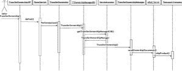
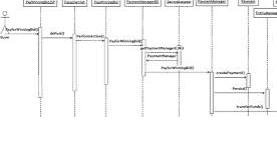
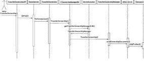
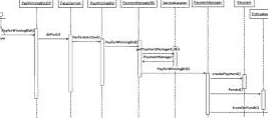
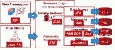

# Java EE 企业级应用案例研究：解决非功能性需求的完整解决方案

# 前言

编写这本书的动力源于这样一个事实：如今有大量的框架和技术可用于使用 Java 框架构建自定义的企业级应用。那么我应该选择哪一个？我需要做出哪些选择？我是需要采购多个框架，还是 Java EE（5及以上版本）已经提供了构建企业级应用的全面能力？理解这一点以及多种 Java EE 技术的优缺点，以及它们如何融入 Java 企业级应用中，是本书的主题。本书还涉及了非功能性需求（NFR），并解释了如何在解决方案中解决这些需求。本书提供循序渐进的方法和最佳实践，帮助架构师和领域专家（SME）推广解决方案，涵盖了各种视图/图表，包括设计决策、假设、风险以及缓解措施。

目前还没有涵盖从需求到企业级 Java 应用解决方案全过程的参考资料。这些参考资料侧重于描述框架及其能力，但没有一个能提供端到端的视图以及如何推广解决方案（包括处理 NFR）的流程。本书涵盖的关键领域包括事务、安全、框架、硬件选型、部署模型和应用程序的扩展。大多数书籍和参考资料仅提供理论方法，指导有限，对于现实世界的场景或企业级应用来说是不够的。对于理解领域专家、设计师和架构师如何利用 UML 表示和各种模型来记录企业级应用是一个很好的参考。

本书描述了使用 JEE（5.0及以上）应用框架构建全方位真实世界解决方案的过程。

# 致谢

感谢我的讨论伙伴、评审者和支持者，他们宝贵的意见和反馈对本书做出了贡献。我期待你们对本书提供持续的反馈。

特别感谢我的妻子 Vaishali 和家人在本书开发期间的鼓励和持续支持。

# 关于作者

Sameer S Paradkar 是一位企业架构师，在 ICT 行业拥有 15 年以上的丰富经验，横跨咨询、产品开发和系统集成。他拥有 Open Group TOGAF、Oracle Master Java EA (SCEA)、TMForum NGOSS、IBM SOA Solutions、IBM Cloud Solutions 和 ITIL Foundation V3 认证。他在企业架构倡议中担任顾问架构师和导师，并继续作为领域专家和作者工作。他曾在美国、英国、欧洲、亚洲和中东地区参与过多个架构转型项目，提供了分阶段的转型路线图，在最大化业务价值的同时最小化了成本和风险。在 ICT 职业中，他曾环球旅行，访问过五个大洲的多个国家。

- 他曾在全球多个 IT 架构转型和现代化项目中担任企业架构师。过往客户包括：英国 AVIVA、美国 AOL、英国 BT、花旗银行（亚太地区）、印度 LIC、英国伦敦德银行、美国微软、沙特阿拉伯 Mobily、沙特阿拉伯港务局、德国西门子股份、沙特阿拉伯 STC、新西兰电信、亚洲地区 Telenor、澳大利亚 Telstra、突尼斯电信、美国 Walgreens。

- 他曾与部门主管、技术和业务领导层级接触，并就技术采纳战略和路线图向他们提供建议。他曾作为企业架构咨询实践的一部分担任企业架构师，专注于跨垂直行业的评估、战略对齐、业务案例开发和治理。

- 在过去的几年里，他撰写了多篇在全球范围内发表的文章，包括 BPTrends、BPMInstitute 和 SOAInstitute。

- 他还担任过顾问，专注于 EAI、SOA 和 BPM，为财富 100 强客户规划并构建 IT 系统和业务关键应用——涵盖主要的零售、银行、电信、保险和医疗健康行业。

- 多年来他在领导和推动多个大型架构现代化项目方面拥有成功的经验。

在加入 EY - IT 转型 - IT 咨询之前，他曾在 IBM GBS、Wipro Consulting Services、Infosys Technologies 和 Deloitte Consulting 等组织工作，精通 IT 战略和企业转型倡议。

图 1：Java EE 框架组件

## 解决业务问题

分析师团队将对客户背景和 Java EE 应用的需求进行简要介绍。他们将包含对主要需求的结构化描述、领域模型、用例图以及非功能性需求（NFRs），并预计你使用 Java EE 技术和框架为 Java 应用提供解决方案。

在研讨会期间记录或讨论的业务问题可能是模糊的，并且可能对主要用例给出非常高层次的描述，因此会有许多未解决的问题或需要计划进一步深挖的领域。需求可能是不完整的，例如用例图可能缺少设计所需的必要信息。因此，你必须自己填补缺失的部分，并用假设替换缺失的信息，可能将不明确的元素添加到风险列表中。这最好通过与来自业务部门和技术部门的各种利益相关者进行研讨会、访谈和讨论来完成。一旦获得了适当的详细信息并且你脑海中有了解决方案，那么使用合适的可视化编辑器为解决方案绘制视图就并不困难。可以利用如 MS Visio 等工具绘制图表，因为它们非常直观，且足以满足需求。

解决方案本身的关键部分（即各种图表或视图）是架构师交付的核心输出。作为架构师，你必须决定系统应该具有哪些组件或接口集成到生态系统中，以及如何处理非功能性和功能性需求。

该过程还将涉及大量时间来估计应用程序的资源（硬件）需求，并探索和比较部署环境以及各种物理与云端选项的非功能性特性。本节将涵盖你在创建 Java 解决方案时应该采用的方法论和方法。

解决方案通常包括：

- 类图（Class Diagram）
- 描述范围内各种层级和组件的组件图（Component Diagram）
- 描述主要层级建议物理布局的部署图（Deployment diagram）
- 每个用例的时序图或协作图（Sequence or Collaboration diagram）
- 技术风险与缓解策略
- 为解决方案做的设计决策（Design Decision）
- 为解决方案提出的假设

## 风险与假设

在这一部分，你将被测试识别给定业务场景和技术版图中存在的顶级技术风险的能力，以及你的解决方案如何解决这些问题。在评估风险时要具有战略性和客观性。应避免低级风险，并将可能导致噩梦场景的高级、系统性风险包含在本节中。例如，在一个在线拍卖应用程序中，任何形式的安全限制都是一个主要风险，比担心应用程序是否能在多个浏览器中运行要严重得多。缓解并可能的完全消除是本节的重点。

## 类图 – 从领域模型到类图

必须确保领域模型中详细列出的所有对象都出现在类图中。选择并确定一种方法或框架，描述你计划如何在 Web/表示层、业务逻辑层、持久化层和集成层构建解决方案。类图中有一些需要注意的重要要点，如下：

- 类图中的细节水平将包括实体、重要的管理器 EJBs 以及其他几个代表重要架构概念的类（如缓存、拦截器、访问外部工具的 DAO 等，这些是解决方案需要处理的）。
- 领域模型将几乎直接地映射到类，仅在少数情况下需要修改和扩展，例如引入基类。
- 将使用注解来显示领域模型中的特定项目如何映射到特定的 JEE 组件上，特别是会话 bean 和实体类（Entity classes）。类图将包含与 `@Entity` 或 `@Embeddable` 相关的重要信息（在适用处）。
- 类图保持与 Web 框架无关。可以利用任何 Web 框架来构建解决方案。

类图还可能包含类型、包、关系，甚至是如对象和链接之类的实例。类图甚至是静态的；它们显示了哪些在相互交互，但没有显示在交互时发生了什么。类图可以三种关系：

- 关联（Association）是两个类实例之间的关系。如果一个类的实例必须知道另一个类才能执行其工作，则两个类之间存在关联。在图中，关联是连接两个类的链接。
- 聚合（Aggregation）是一种一个类属于某个集合的关联。聚合显示一个菱形端指向包含整体的部分。
- 泛化（Generalization）是一种继承链接，表示一个类是另一个类的超类。泛化显示指向超类的三角形。

使用初始的业务类列表，通过识别和定义领域模型中类之间的关系来开发类图。这是在与业务伙伴的交互式开发研讨中进行的。将这些图表显示在白板或其他媒介上也是有用的，并随着项目的进行逐渐开发。图表存储在 UML 工具中，以便所有团队成员和其他利益相关方访问。类图还展示了类与类之间的关系。图表的这一方面在设计过程的后期可能会演变，因为会识别出更多的类。类图将改进对类的定义，反过来这可能需要更改时序图，以及开发后的状态转换图。这些其他图表也会对类图产生影响。

## 组件图 – 逻辑架构

组件图是系统的另一个视图，比类图层次更高。在这个视图中，你被期望展示在更高层次上视觉化系统并理解你解决方案中所有关键部分的能力。如果你建议使用 MDBs 来解决特定的集成问题，这就是你需要在图中描绘的地方。组件图代表了构成建模应用程序的高级部分。该图是对组件及其关系的高级描述。组件图描绘了组件在开发后或构建阶段的细化状态。

组件图是类图的物理版本。组件图显示了软件组件之间的关系和依赖，包括 Java 源代码组件、Java 类组件和 Java 可部署组件 JAR（Java 存档）文件。在部署图中，软件组件可以表示为组件类型。对于 Java EE，某些组件存在于编译时，某些存在于运行时，某些则存在于多个时间。仅编译的组件是仅在编译时有意义的，类似，在这种情况下运行时组件将是一个可执行程序。

## 部署图 – 物理架构

部署图捕获了关于基础设施特性的信息。命名特定的机器、供应商或路由器可能不是必要的，因为这些决策变化非常快。请指示一种与供应商/机器无关的资源部署方式以支持架构，即 CPU、内存、网络需求、磁盘配置等，然后提供特定供应商/机器组合的具体示例以满足你的理论容量预测。虽然认为所需的资源会随场景而异，但基础资源本身不会。这些如下：

- CPU（核心数、时钟频率）
- RAM（GB 容量）
- 网络（最小接口速度）
- 存储（磁盘/SAN 配置）

部署图将所有元素整合在一起，捕获应用程序运行时元素的配置。该图显然在应用程序完成并准备好部署时最有用。描绘了节点，例如：JEE 服务器、其访问的数据库服务器以及用于访问 JEE 应用的用户工作站。

部署图显示了软件和硬件的物理配置。部署图是对组件图的补充。它显示了运行时处理元素（如服务器和其他硬件）的配置，以及它们包含的软件组件、进程和对象。软件组件实例代表类的运行时表现。不作为运行实体的组件不会出现在这些图中，它们显示在组件图中。部署图是通过通信链接或关联连接的节点的图形化表示。节点可能包含组件实例，这表示组件居住并运行在节点上。部署图可以用于显示哪些组件运行在哪些节点上。还可以表示组件从节点到节点的迁移，或对象从组件到组件的迁移。

## 序图 – 从用例到序图

序图描述了对象组如何随时间推移对某些行为进行协作。它记录了单个用例的行为。它显示了用例中的对象以及这些对象之间传递的消息。一个设计在不同类中可能有很多方法，这使得很难确定行为的整体序列。该图简单且逻辑性，使得序列和控制流一目了然。

序图显示了流经系统以实现所需目标或结果的显式交互序列。序图对于具有时间依赖功能的系统（如实时应用）以及时间依赖性至关重要的复杂场景特别有用。它有两个方面，即时间以及参与实现目的所需事件序列的各种对象。

通常，在实时应用中，系统对象所经历的事件序列非常重要，时间轴是一个重要的衡量标准。此视图通过对象为了完成目标而经历的状态序列，识别了对象在系统中的角色。这种视图是系统的事件驱动视角。角色之间的关系没有显示。类图和对象图展示了此类静态视图。序图和交互图是动态的。它们描述了对象如何协作或交互。序图是一种交互图，详细说明了功能、消息（请求和响应）以及时机。随着你向下移动页面，时间在推进。操作涉及的对象根据它们参与消息序列的顺序从左到右列出。序图可以有一个说明注释，即放在有折角的矩形内的文本。注释可以放在任何类型的 UML 图中。

序图是业务过程模型，代表了系统中参与者（Actor）和对象之间的不同交互。每个过程都有一个过程所有者和目标（如周期时间、缺陷率和成本），由一组业务活动（按顺序和/或并行）组成。

每个指定的用例都应该有一个序图或协作图。不要为了节省时间将一个或多个用例合并到一个图中。序图应该是清晰的，并能大致对应于用例的复杂度。你在类图和组件图中创建的类和组件应该被表示出来，以及它们之间实现所记录的用例所需的调用。

## 设计决策

本节提供了架构师在构建企业级 Java 解决方案时必须做出的各种设计决策亮点。本节涵盖了所有关键领域，包括事务、安全、框架、硬件选型、部署模型和应用程序扩展。

## 用于救援的 Java EE 框架

J2EE 1.3 和 J2EE 1.4 的常见做法确实是用大量的附加框架来补充 J2EE 栈。

从 Java EE 5 开始，现在特别是 Java EE 6 & 7，你不需要额外的框架，因为 JEE 为所有规范都提供了参考实现。Spring 容器为 J2EE 提供的核心功能，现在可以通过轻量级的 EJB3.1 和 CDI 组件模型来实现，ORM 支持由 JPA 提供，它通常由 Hibernate 实现。MVC Web 框架通过 JSF 成为标准栈的一部分。

当然，个人可能仍然偏好 Spring 和 Struts 编程 API，但有了 Java EE 6，已经没有迫切需要使用它们。或者换句话说，除非 Oracle 没有提供相应的参考实现，否则不再绝对需要补充 Java EE。

RedHat Seam 确实为 Java EE 提供了一些非常棒（可移植的）扩展，而 JSF 实际上是为配合扩展和第三方组件库使用而构建的。然而，这样的库并不是真正的“框架”，它只是在你的页面上提供了额外的小组件使用，而不是像用 Struts 或 GWT 替换 JSF。

| Seam Beans | Java EE | JSF | |
|---|---|---|---|
| SE Beans | JDK 1.4 | JSF 1.2 | JSF 1.2 |
| SE Beans | JDK 1.5 | JSF 1.4 | JSF 1.3 |
| Data | JDK 1.6 | JSF 1.5 | JSF 1.1 |
| Non Chart | EJB 3.2 | Spring FWF | EJB 4.1 |
| Business Logic | | Struts | Struts Action |
| Data Access | JPA 2.0, 2.1 | Hibernate | Oracle JDBC |
| Legging | | Apache Hibernate | Jakarta Faces |

图 2：Java EE 框架对比

## N 层或无层架构

N 层系统如果架构和设计得当，可以帮助实现系统所有的非功能服务水平需求。由于高度分布的模型，N 层系统中的可管理性可能会略受影响，但由于所有系统都是高度模块化的，这个问题相当容易解决。值得注意的是，架构师有时必须在某个服务水平需求上做出些妥协，以在另一个需求上实现预期效果。例如，性能和安全之间存在反比关系。

组成：

- 客户端层（Client Tier）：与最终用户交互的层。客户端可以是“轻级客户端”（例如基于浏览器的应用程序），也可以是“胖客户端”（例如客户端 Java 应用程序）。
- Web 层（Web Tier）：将客户端层与业务层解耦。Servlet 和 JSP 位于此层。Servlet 充当控制器；它们翻译接收到的请求并将其分发到可以调用业务层事件的组件。JSP 将静态模板与动态数据结合，创建供客户端用于展示的动态输出。
- 业务/应用逻辑层（Business / Application Logic Tier）：通常使用企业 Java Bean（EJB）实现，作为业务过程对象和业务领域对象。EJB 容器提供各种服务，如对象分布、持久化、事务、资源管理和安全等。
- 企业信息系统集成层（Enterprise Information System Integration Tier）：EIS 集成层连接业务（有时是 Web 层）对象与企业系统。例如，数据访问对象（DAO）将企业 Bean（通常为 Session Bean 或 BMP Entity Bean）与企业数据解耦。
- 企业信息系统层（Enterprise Information System Tier）：代表所有的企业数据。其形式包括关系型数据库、XML 数据库和 ERP 系统等。

## EJB 容器模型

EJB 容器位于 EJB 服务器和 EJB 之间。EJB 服务器可以拥有多个 EJB 容器，每个容器可以管理多个组件。EJB 容器管理 EJBHome 和 EJBObject 实现。通过这些对象，容器装饰企业 Bean 类并提供各种服务，如：

- 生命周期管理
- 命名
- 对象分布
- 持久化
- 安全
- 事务
- 并发

EJB 容器还通过实例池和交换（针对无状态 Session Bean）以及钝化/激活（针对有状态 Session Bean 和实体 Bean）进行资源管理。

## 企业 Java Bean 对比 无 Bean

为了适应不断增长的用户，你可能需要将应用程序的组件分布到多台机器上。应用程序的 Bean 不仅运行在不同的机器上，而且其位置对客户端是透明的。需要事务来确保数据完整性。企业 Bean 支持事务，即管理共享对象并发访问的机制。应用程序将有很多客户端。只需几行代码，远程客户端即可定位企业 Bean。这些客户端可以是轻量级的、多样化的且大量的。可以使用 EJBs 构建可扩展的应用程序。

EJB 3.0 已被分为两个部分：EJB 规范和 JPA 规范。在 JEE 5 及更高版本中，EJBs 现在被称为实体（entities），并且是 POJO。JPA（Java Persistence API）顾其实名，是 API 的持久化部分。它通常用于 EclipseLink、Hibernate 和 Toplink 等库。Hibernate 是最流行的且早于 JPA，但两者之间的差异并不大。JPA 是一种 ORM（对象关系映射器），用于将对象模型投影到关系型数据库上。

## EJB 3 改进

- 简化了 ejb 的开发过程显著减少了开销。使用 Java 语言注解作为配置，提高了开发者的效率。
- 规范了程序化默认值（包括针对元数据），减少了开发者在 EJB 容器上指定常见预期行为和需求的需求。
- 通过使用注解、依赖注入机制和简单的查找机制，对环境依赖和 JNDI 访问进行了封装。
- 简化了企业 Bean 的类型。
- EJB 支持继承和多态。
- 使用 JPA EntityManager API 进行轻量级 CRUD 操作。
- 增强了 JPA 查询能力。
- 生命周期回调方法可以定义在 ejb 自身，也可以定义在 bean 监听类中。

- 针对 Session Bean 和消息驱动 Bean 的拦截器监听器。拦截器方法可以定义在 bean 类上或与 bean 关联的拦截器类上。

- 在一个应用程序中同时使用 CMP 和 JPA

## Bean 托管事务与容器托管事务

Java Platform EE 平台支持两种事务管理范式：声明式事务边界划分和程序化事务边界划分。声明式事务管理指的是非程序的事务边界划分，通过在部署描述符中为容器管理的 EJB 组件的各种方法指定边界来实现。这是一种灵活的方法，可以在不修改任何代码的情况下更改应用程序的事务特性。实体 EJB 组件必须使用容器管理的事务边界划分。

在 Bean 托管事务边界划分中，EJB Bean 使用 `UserTransaction`。只有 Session Bean 可以使用 Bean 托管事务。在容器管理的事务边界划分中，EJB 容器负责事务边界划分。此外，你应该使用容器管理的事务边界划分，因为它不容易出错，而且你应该让容器自动处理事务划分。这让组件提供者无需在组件中编写事务划分代码。更容易将企业 Bean 分组以执行具有特定事务行为的某些任务。应用程序组装器可以在部署描述符中自定义事务属性，而无需修改代码。

然而，有时需要程序化（过程化）访问控制来满足细粒度或特定应用程序的条件。

## Bean 托管安全与容器托管安全

为了简化企业 Bean 提供者的开发过程，安全基础设施的实现留给 EJB 容器提供者，而定义安全策略的任务留给 Bean 部署者。通过避免在 Bean 代码中硬编码安全策略，EJB 应用程序在为企业应用程序配置和重新配置安全策略时获得了灵活性。应用程序在可能使用不同安全机制的不同 EJB 服务器之间也获得了可移植性。EJB 框架规定了安全管理方面的灵活性，允许它是声明式的（容器托管）或程序化的（Bean 托管）。

定义方法权限的安全管理在企业 Bean 的部署描述符或通过使用注解（如果使用 EJB 3.0）进行声明。容器托管安全使企业 Bean 更加灵活，因为它没有绑定到特定应用程序定义的安全规则。安全角色是赋予应用程序定义的一组信息资源权限的名称。将主体（principal）与此安全角色关联，只要该主体在该角色中，就会向该主体授予相应的访问权限。

然而，有时需要程序化（过程化）访问控制来满足细粒度或特定应用程序的条件。企业 Bean 可以使用 EJBs 上文对象中的 `isCallerRole()` 和 `getCallerPrincipal()` 方法程序化地管理安全。`isCallerRole()` 方法测试调用者是否具有指定的安全角色，如果具有则返回 true，否则返回 false。`getCallerPrincipal()` 方法返回标识调用者的 `java.security.Principal`。

## QoS 考虑因素

- 性能 – 根据响应时间或单位时间内的事务数来衡量系统。负载均衡（例如 DNS 轮询）和负载均衡是有助于获得更高性能的两种技术。应用程序调优、服务器调优和数据库调优等任务也能提高系统性能。

- DNS 轮询：在系统中分配负载的过程。如果我们有十台可以处理 HTTP 请求的 Web 服务器，第一个请求指向服务器 1，第二个请求指向服务器 2，依此类推。当所有十台服务器都处理了一个请求后，该过程将重新开始。注意，这只是负载均衡技术之一。DNS 轮询并不均衡负载。

- 反向代理负载均衡：当你拥有不同 CPU 和内存的服务器时，使用反向代理负载均衡。你可能有一些强大的服务器专门用于 SSL 会话，而另一些服务器处理静态 HTML。使用这将最大化你应用程序的性能。

- 可扩展性 – 系统在负载增加时以满意的方式执行和运行的能力。可扩展性可以通过两种方式实现——垂直扩展（向现有硬件添加额外的处理器、内存或磁盘）和水平扩展（向系统添加更多机器）。垂直扩展比水平扩展更容易实现。然而，许多 J2EE 厂商也支持水平扩展。

- 可靠性 – 系统随着负载增加而确保应用程序及其所有数据完整性和一致性的能力。

- 可用性 – 系统确保所有服务和资源始终可用的。这可以通过容错（在服务/组件故障时防止系统故障的能力）技术，如主动复制和被动复制来实现。

## 遗留采集器

- 屏幕采集器（Screen Scraper）：屏幕采集器模拟大型机终端。基本上，屏幕采集器像普通用户一样登录大型机，向大型机发送请求然后读取响应。屏幕采集器的问题是，如果你更改了大型机的任何代码，屏幕采集器总有可能停止工作。

- Java 原生接口（JNI）：JNI 用于允许 Java 与 C++ 等语言编写的程序通信。实际上，你正在封装 C++ 代码以供 Java 使用。例如，你用一个 C++ 方法 `debitAccount(int amount)` 封装一个类似的 Java 方法；Java 方法将直接调用 C++ 方法。这意味着你现在可以通过 RMI 使该方法可用。

- Java IDL：Java IDL 为 Java 平台增加了 CORBA（公共对象请求代理架构）能力，提供了基于标准的互操作性和连接性。Java IDL 允许分布式 Web Java 应用程序使用对象组定义的行业标准 IDL（对象组接口定义语言）和 IIOP（互联网 ORB 协议）透明地调用远程网络服务的操作。运行时组件包括用于 IIOP 通信进行分布式计算的 Java ORB。

## Hibernate Vs JPA

JPA 只是一个规范，意味着它没有实现。你可以尽可能地对你的类进行注解。

你可以使用 JPA 注解，但如果不使用这些注解，什么都不会发生。可以将 JPA 想象为必须遵循的准则或接口，而 Hibernate 实现是符合 JPA 规范定义的 API 并提供底层功能的代码。当你使用 Hibernate 时，你就被锁定了在这一特定实现上，因为其他 ORM 可能会使用不同的配置，因此无法直接切换到另一个。作为架构师，你可以选择多种 JPA 实现，Oracle 提供了它自己的 JPA 实现，即 EclipseLink。

## JPA 优点

- 将应用程序与数据库隔离。
- 增加应用程序的可管理性。
- 提高开发生产力。
- 便于开发和高效的持久化逻辑。
- 可能优于手写的 SQL，减少数据库往返次数。
- JPA 实体可以在容器之外使用，从而提高重用性并减少编码工作量。
- JPA 实体可以同时用于表现层和业务层，从而减少编码工作量和维护成本。
- 支持懒加载从而提高性能。
- 与 EJB 有最佳集成。

## JPA 缺点

- 由于存在额外的层导致性能损失。
- 无法手动调优 SQL。
- ORM 供应商对数据存储（Datastore）的支持有限。
- 开发者需要精通 ORM（有学习曲线）。

## Java EE 对 Spring

以下帮助你在 Java EE 和 Spring 之间做出选择的观点：

- 选择容器的自由 - 如今有许多符合 Java EE 6 标准的应用程序服务器，提供各种开源和商业选择。如果你想在 GlassFish 或 WebLogic 上扩展你的应用程序，由于 Java EE 6 的可移植性，你甚至可以迁移到不同的供应商。Spring 是单家公司的一系列产品，需要将所有库封装在一个 WAR 文件中，这可能会导致文件臃肿。

- Java EE 6 平台是使用 Java 社区创建的，Oracle、RedHat 和 Apache 等所有大厂商都在做出贡献以确保平台的成功。这允许你选择应用程序服务器来部署你的 Java EE 应用程序。如果你对某个供应商的支持不满意，由于平台提供的移植性，你可以将应用程序移动到另一个供应商——一个价格、一个支持、一个维护组织、一个销售组织等。由多个供应商支持的 Java EE 对于那些规避风险的人来说是一个更稳妥的选择。

- 生产支持 - 使用 Spring，你通常需要获得两家供应商的支持——VMware。在 Java EE 6 中，所有这些通常由一个供应商提供。例如，Oracle 提供来自系统、操作系统、JDK、应用程序服务器以及运行其上的应用程序的商业支持。VMware 确实也提供。

- 可维护性 - 使用 Spring，你将构建自己的发行版本，涉及多个 JAR 文件的所有组件的集成、补丁、版本控制等。Spring 的说辞是，多个 JAR 文件允许你选择不同组件的最新版本。Java EE 应用程序服务器为你管理这一切，并提供一个经过良好测试并受商业支持的包。

虽然意识到有新的、改进的框架来取代旧框架（如 Spring）总是好事，但好消息是 Java EE 容器不仅提供了上述描述的内容，还允许你在迁移到更现代架构的同时部署并运行你的应用程序。最终结果是你可以兼顾了两者的优点，既保留了遗留投资，又转向更敏捷、轻量级的 Java EE 6 世界。

图 3: Java EE 对 Spring

## JSF 对 JSP

使用 JSF，用户将获得数据到视觉组件的自动绑定、映射、输入数据验证以及请求之间的状态保存。使用 JSP 则需要手动实现。JSF 还支持与服务器的 Ajax 交互。

如果你正在开发一个需要标准行为（如数据输入、编辑和显示）的应用程序——JSF 是最佳选择。如果你需要一个响应快速、支持客户端页面内导航的在线应用程序（如 Gmail 或 twitter）——你可能花费大量时间在 JSF 中翻译客户端逻辑组件。在这种情况下，你最好使用 JSP 作为数据源，并使用 JavaScript 库来显示数据。因此，JSF 并不适用于所有的项目，所以使用 JSP 的人不会迁移到 JSF。

## JSF 优点

- MVC 框架。在行为和表现层之间提供了整洁的分离。
- UI 组件模型（绑定、事件、状态保存、验证）。
- 多个前端（桌面和移动浏览器）。
- 隐藏了 HTTP 基础设施。
- 使用 IDE RAD 环境。
- 自动事件处理（将 http 请求映射到特定组件）。
- 自动的服务器端验证和转换。
- 自动国际化 (I18N)。
- 所有功能都缩短了开发时间。
- 表达式语言和标签库。

## JSF 缺点

- 标准的 HTML 编辑器无法渲染 JSF。需要部署 JSF 应用后才能渲染页面。

## 估算资源需求 – 硬件选型

NFR（非功能性需求）指定了并发用户数和所需的运行时间。每秒事务数（tps）可以从这些数据中得出。以下是几个可以提供解决方案硬件选型思路的示例。

### 示例 1：业务应用程序

该应用程序是一个 JEE 学习管理软件，必须支持 2000 个并发用户并 24/7 可用，因此需要非常强大的数据库硬件。基础设施如下：

- 2 个物理应用程序服务器节点和 HTTP 服务器
- 4 GB 内存（2GB 用于操作系统）
- 8 个（虚拟）处理器
- 数据库：主从模式且带自动故障转移
- 32 GB RAM
- 24 个（虚拟）处理器

### 示例 2：Web

为 5000 个注册用户（其中 500 人访问）提供 Liferay Portal，需要一个拥有 4GB 内存和 3GHz 四核 Xeon 处理器的应用程序服务器；对于数据库，一台低于 4GB/1四核3GHz 的服务器即可。

## 结论

鉴于上述示例和其他信息，对于 200 个不执行资源密集型操作的并发用户且每天可用 10 小时的需求，一台 4GB 内存、2 核 2.5GHz、同时运行单个 AS 和数据库的机器能够满足性能要求。

IBM 建议典型的 IBM WebSphere Application Server v7.0 部署至少需要高 CPU 实例以访问足够的物理内存和计算能力。这意味着 2 GB RAM 和 2 个（虚拟）核心，每个核心 2.5-3.0 GHz 2007 代 Opteron 处理器。这是运行 WebSphere 的最小生产配置，也可以作为任何标准 Java EE Web 应用的最小配置。

通常情况下，安装程序发现数据库服务器的容量耗尽速度远快于 WebLogic 服务器。你必须规划一个足够健壮的数据库服务器来处理应用程序。一个良好的应用程序数据库性能比应用程序服务器硬件高三四倍。

## 生产环境中的多节点与单节点

对于有限数量的并发用户（例如 400 个并发用户），在机器上部署单个服务器实例就足够了，因为应用程序服务器及随后的 JVM 都是为支持多处理器扩展而设计的。然而，在单台机器上创建多个实例对于应用隔离和滚动升级可能是有有益的。

## 部署环境 – 云端或物理机

你可以选择三种部署环境之一。

- 租用物理服务器——费用最高，但从长远来看可能更有成本效益，特别是当服务器存在永久高负载时。
- 租赁虚拟专用服务器 (VPS)——提供的资源较低（如 0.5-1.5 GB，~1 GHz），因此很少适用于 Java EE。
- 云端部署——非常灵活（易于添加新实例、伸缩实例规模），将提供非常好的 SLA，但由于各种小费用的累积，最终价格可能会增加。

## 总结

记住，一张清晰易懂的图胜过千言万语。重要的是，提供的图表/视图代表了记录 Java 解决方案的一种方式。只要你遵循前面章节列出的标准，请提供你自己的 UML 图，展示你对分配业务场景的独特解决方案。具体执行以下操作：

- 重点应放在业务解决方案上，即如果你的类图 80% 都是框架和逻辑，那么就有失败的风险。
- 使用英文文本增强图表，但确保你的视图清晰可见。
- Web 应用程序的常见部分可能未在需求中提到，例如用户注册/登录。这应该由解决方案解决。
- 如果需求的某些方面或解决方案的要求不明确，请与利益相关者沟通并进行讨论。
- 需要时做出相应调整并记录这些，以便所有方可以使用。
- 风险和缓解是一个重要领域且必须涵盖。所有高级风险都应得到处理，并确定缓解措施。
- 设计决策应与其理由一同记录在制品。

## 业务问题 – 案例研究

### 背景

油气行业面临着持续创新的压力。地缘政治不稳定性、环境问题以及能源价格和消耗的上升创造了一个业务环境，在这种环境下，缺乏灵活性的石油公司受到自由市场定价和政府制裁的共同惩罚，而敏捷灵活的公司可以获得回报。Zamco 是一家总部位于英国的石油公司，在俄罗斯、非洲和墨西哥湾有重要业务。该公司最近与一家大型拍卖市场达成了协议，以更有效地将其产品推向市场，改善现金流并降低配送成本。Zamco 的内部业务案例预计，在五年内将节省 22% 的成本，且利润和收益管理将比目前的业务稳态每年提高 7%。

### 工作坊产出

你是 Zamco 市场项目的架构师。你被 Zamco 管理层委派领导负责整个系统交钥匙解决方案的设计、实施和持续管理的团队。在与内部业务分析师和领域专家进行了一系列深入的工作坊后，你了解到如下：

- 拍卖市场暴露了一个基于 Java 技术的 API，使用 Java Message Service (TMS) 技术允许公司发送销售信息并竞标石油，并具有保证性消息传递和安全性等特性。
- Zamco 已经在内部运行了一套复杂的定价系统，该系统计算拍卖市场中每笔石油投放的价格（基于其提取方式、到达目的地的运输方法）。作为解决方案架构师，你需要使用 Web 服务与此系统集成，在进入市场销售之前对其进行定价。
- 最终的外部系统是 Zamco 的库存管理系统，该系统也通过 Web 服务访问，并将允许你查看剩余可拍卖的容量。
- Zamco 与银行有合作处理交易。
- 拍卖管理系统的实际订单投放是手动处理的。Zamco 雇佣了一个交易员团队，跟踪油价的涨跌，并结合定价信息以及项目范围之外的其他系统来决定出售石油的最佳时机。
- 系统性能（99% 的所有消息必须在三秒或更短时间内构建并发送到 API 服务器）、扩展性（400 个并发用户）、可用性（核心工作时间内为 99.999%）和安全性（至少 128 位加密）都是关键需求，你必须在提出的解决方案中显式地处理每项需求。

## 领域模型

下图描绘了业务场景的领域模型。

![img/a46bfe20cc12a7ad84c82266a2a2b9_47_0.png]

图 4：Zamco 领域模型

## 用例

下图描绘了解决方案场景的业务用例。

![img/a46bfe20cc12a7ad84c82266a2a2b9_47_1.png]

图 5：Zamco 用例图

## 解决方案

本文档提供了 Zamco 市场集成系统的全面架构概述。在本制品——开发中系统 - SUD 中，此应用程序将称为 Zamco Application。它是软件架构师与其他项目角色之间关于系统架构的通信媒介。Zamco Application 将使用 Java EE 架构框架和基于组件的架构进行开发。此解决方案架构文档将解决参与端到端交互的各种组件/子系统，以实现业务目标。此架构遵循 Java EE 5 标准以及最佳实践架构指南和方法，并在当前集成项目的背景下对其详细说明。

解决方案架构文档的目的是提供：

- 向各利益相关者提供有关范围内实现功能的端到端概述
- 业务场景之间的联系，说明它们如何相互关联以推出 Zamco 业务的可感知功能
- 关键架构决策和假设
- Zamco Application 的风险和缓解措施
- 本文档提供了以下 UML 视图：
    - 类图
    - 组件图
    - 部署图
    - 序列图

- 解决方案非功能方面的概述以及如何在解决方案中处理。

## 目标和范围

本节描述了 Zamco 市场集成项目的范围和目标。

本项目范围内的关键用例：

- 售卖石油产品
- 石油产品竞标
- 转移所有权/运输石油产品
- 支付中标款项

设计的系统必须满足以下标准，即非功能性需求：

- 性能：99% 的交易应在 3 秒以内完成
- 可扩展性：应支持 400 个并发用户
- 可用性：核心工作时间内的可用性为 99.999%
- 安全性：至少采用 128 位加密。

# Zamco 业务领域模型

以下领域模型描述了在 Zamco 市场整合项目研讨期间识别的关键对象。这些对象和关系在解决方案设计中得到了处理。请参阅图 4 中的领域模型。

## 假设

## 系统/组件/假设框架

拍卖市场平台将提供对产品进行拍卖的能力/功能。Zamco 应用 - SuD（开发中系统）将通过发布的接口与此外部系统建立接口。

- 1 拍卖市场平台：拍卖市场接口将提供所需的解密/加密、访问控制和传输层安全支持。

## 非功能性需求

- **2 拍卖市场平台**：拍卖市场接口的标准 SLA（响应时间）将少于 2 秒。
- **3 商户系统**：商户银行将提供一个开放标准接口供 Zamco 应用 – SuD 使用，该接口将基于 `SOAP over HTTP` 等互操作协议。
- **4 银行系统**：商户银行接口将提供解密/加密、访问控制和传输层安全的机制。
- **5 商户银行**：商户银行接口的标准 SLA（响应时间）将少于 2 秒。
- **6 库存系统**：库存系统接口的标准 SLA（响应时间）将少于 2 秒。
- **7 定价系统**：定价系统接口的标准 SLA（响应时间）将少于 2 秒。
- **8 定价系统集成**：Zamco 应用集成了定价系统，在石油产品进入拍卖市场之前对其进行定价。定价系统将调用所需的外部系统进行定价计算。
- **9 部署配置细节**：Web 服务器、应用程序服务器和数据库服务器详情未包含在配置需求中，将与 Zamco 确定。
- **10 部署配置**：架构将遵循 `JEE 5` 规范，因此将利用 `JPA` 和 `JTA` 进行持久化事务机制。
- **11 应用 JEE 版本**：应用程序将在 Web 层使用 `LDAP` 进行身份验证。
- **12 应用安全**：应用程序将在 Web 层和业务层使用基于角色的安全性进行授权。

## 架构决策

## 系统/组件/架构决策框架

- **1 Zamco 架构框架**：MVC 框架强制的一致结构和功能分离使得应用程序更可靠、更易维护和扩展。出于这些原因，Zamco 应用采用框架设计。
- **2 通用能力**：应用程序将使用 `JEE` 框架提供的错误与异常处理、日志记录和资源注入能力构建。这将使应用程序具有维护性和可靠性，并有助于更快解决问题。
- **3 设计模式**：解决方案架构利用设计模式，因为它们使应用程序具有维护性和扩展性。
- **4 Java EE 框架**：为了提供可扩展性和业务逻辑复用性，利用 `EJB` 构建了解决方案。`Enterprise Beans` 技术提供了可扩展性、可靠性、基于组件的开发模型以及池化、声明式事务和安全等通用横向服务。
- **5 分布式架构支持**：Zamco 应用采用基于开放标准的互操作接口和组件设计，以支持分布式架构。

## 风险与缓解

风险是威胁利用漏洞的概率与对组织影响的乘积。架构风险管理过程是识别软件中这些风险并处理它们的过程。

风险缓解是指优先考虑、实施和维护从风险分析过程中建议的适当降低措施的过程。缓解风险意味着以一种或多种方式更改软件或业务架构，以降低风险的可能性或影响。

## 风险缓解表

| 风险 | 描述 | 缓解措施 | 影响 |
| :--- | :--- | :--- | :--- |
| 缺乏安全机制 | 商户银行在交互时的控制 | 架构应提供与商户银行解密组件的加密 | 导致敏感数据与银行 API 交互 |
| 缺乏安全机制 | 拍卖市场在交互时的控制 | 架构应提供与拍卖市场的加密/解密支持 | 导致交互敏感数据的组件与拍卖市场交互 |
| 应用/接口 | 商户对商户不可用 | 提供高可用架构以确保不会导致收入损失 | 满足 Zamco NFRs |
| 应用/接口 | 拍卖市场对拍卖市场不可用 | 提供高可用架构以确保客户满意度 | 满足 Zamco NFRs |
| 应用/接口 | 定价系统对定价不可用 | 提供高可用架构以确保客户满意度 | 导致收入损失 |
| 应用/接口 | 库存系统对库存不可用 | 提供高可用架构以确保客户满意度 | 导致收入损失 |

使用 `Java EE` 无状态会话豆处理核心业务逻辑，以支持高可扩展性并解决 Zamco 应用在集群时缺乏扩展的问题。可扩展性会导致客户满意度下降。可以配置负载均衡器，当主服务器达到容量阈值时将流量路由到备用服务器。

## Zamco 架构概览

Zamco 应用将其组件分为五个大层。它们是客户端层、表示层、业务层、集成层和数据层。系统通过浏览器访问。

- **客户端层**：用户连接到应用程序的起点。Zamco 应用使用 Web 浏览器访问应用程序。
    - `浏览器`
- **表示层**：用于托管显示组件并为每个用户管理会话。Zamco 应用 `Web` 容器和 `Web` 组件组在此层中。
    - `JSF` 框架
- **业务逻辑层**：进行业务应用程序处理的地方。Zamco 应用使用 `EJB` 容器并将业务组件组在此层中。
    - `EJBs`（实体、会话和驱动豆）
    - `Java Mail`
    - `JAAS`
    - `JAXP`
    - `JAXB`
- **集成层**：处理与 `EIS` 的连接，检索并更新数据到 `EIS` 中。实体用于搜索和大型记录检索。
    - `JMS/MQ`（加密/解密）
    - `JAX-WS / Web 服务`（加密/解密）
- **数据层**：应用程序数据持久化在关系型数据库或遗留应用程序的地方。Zamco 应用使用 `RDBMS` 管理数据。
    - `JPA`
    - `JTA`

![img/a46bf6e20cc12a7ad84c822666a2a2b9_57_0.png]

## 图 6：应用层 – Zamco

解决方案架构定义了处理数据和支持 Zamco 业务流程的关键系统、应用程序组件和集成。

## Zamco 应用框架

本节提供了应用程序架构中利用的框架组件和相应设计模式的细节。

## 显示请求处理

请求处理是通过结合以下内容得出的：

- 前置控制器
- 命令处理器（后端豆类）
- 业务委托（业务服务提供者/业务服务的代理）

该机制的参与者图和协作图如下所示。

![img/a46bf6e20cc12a7ad84c822666a2a2b9_58_0.png]

## 图 7：显示请求处理 – 类图

显示请求处理机制捕获了以下关键架构决策：

- 所有用户请求均由单个 `Web Controller`（应用程序的前台控制器）处理。
- 前台控制器借助存储在 `XML` 文件（`BackingBean.xml`）形式中的资源和访问映射信息，将请求转发给适当的命令处理程序（`Command Handler`）。
- 命令处理程序管理特定用例的用户交互，并与用户协调用例的交互。
- 命令处理程序不执行业务逻辑。相反，它们使用业务委托（`Business delegates`）作为应用程序服务器服务的业务提供者。
- 命令处理程序不产生任何用户输出。相反，它们调用视图（`Views`）来创建 `HTML` 类型的流并返回给用户。
- 视图通过 `JSP` 实现。
- 业务委托以 `Java Beans` 实现，运行在调用者委托的线程中。

![img/a46bf6e20cc12a7ad84c822666a2a2b9_59_0.png]

## 图 8：显示请求处理 – 序图

## 业务服务访问

业务服务结合了以下 `Sun Java EE` 模式的实现策略：

- 业务委托（`Business Delegate`）
- 会话 Facade（`Session Facade`）
- 服务定位器（`Service Locator`）

该机制的参与者图和协作图如下所示。

![img/a46bf6e20cc12a7ad84c822666a2a2b9_59_1.png]

## 图 9：业务服务访问 – 类图

该机制是组织访问应用程序组件的蓝图。该架构不允许任何显示层组件（特别是命令处理程序）直接与实体通信。因此，只有可以远程访问的 Bean 是会话 Bean（`session beans`）。

该机制捕获了以下架构决策：

- 所有业务服务组件均实现为 `Session EJBs` 或具有 `Session EJB Facade`。
- 客户端（大多数情况下是 `Bean` 处理器）需要访问业务服务组件并创建业务委托的实例。

由于使用了框架的两种机制，应用程序在显示层和业务逻辑之间有了明确的分离。边界是业务委托，它们是应用程序业务服务的智能代理（`smart proxies`）。这种分离由于以下原因是有益的：

- 它在系统的显示层设计人员/开发者与业务层之间提供了一个显式的契约。
- 它允许业务层独立于显示层进行更改。
- 它允许这两个层进行并发开发。

![img/a46bf6e20cc12a7ad84c822666a2a2b9_61_0.png]

## 图 10：业务服务访问 – 序图

## 数据服务访问

应用程序架构使用 `Local CMP Entity Beans` 对数据库进行读/写操作。当客户和代理同时访问相同详细信息时，这些 Bean 将处理账户的并发问题。

![img/a46bf6e20cc12a7ad84c822666a2a2b9_61_1.png]

## 图 11：数据服务提供者 – Zamco

## 公共元素与服务

公共元素和服务是支持元素和服务的分组（一个包），它们不属于任何业务组件，但属于支撑应用程序的框架。

![img/a46bf6e20cc12a7ad84c822666a2a2b9_62_0.png]

## 图 12：公共服务 – Zamco

该包包含以下元素和服务：

- 示请求处理
- 业务请求处理
- 日志框架
- 工具类
- `XML` 解析器

## Zamco UML 图

下节描绘了 Zamco 应用程序的各种图。本部分由以下图组成：

- 类图
- 组件图
- 部署图
- 序图

本部分与应用程序框架共同形成了 Zamco 应用程序架构的端到端描绘。应用程序框架部分主要关注显示层和业务层，这些层由 `MVC`（模型-视图-控制器）框架以及参与 `MVC` 架构的各种类组成，例如业务委托、前台控制器、服务定位器和业务服务 `EJBs`。此外，还有一份 Zamco 应用程序所有类的主列表，作为“Zamco 类列表”章节的一部分显示。

## 主类图

本节描绘了 Zamco 应用程序的主类图。该图描述了 Zamco 应用程序的关键类。该类图根据领域模型开发，并将元素建模为实体、会话 Bean、`MDB` 和 `Java Bean`，同时将元素重新组织为经典的 n 层架构。“Zamco 类列表”章节提供了 Zamco 应用程序所有类的详细列表及描述。这是 Zamco 应用程序中所有类的主列表。主类图显示了与以下相关的细节：

- 用于关键用例场景的 `JSP`
- 控制器（`Controller`）
- 实体（`Entities`）
- 无状态会话 Bean（业务逻辑）
- 消息驱动 Bean（`Message Driven Beans`）
- 外部应用程序/系统接口

主类图中省略（以确保可读性）的类按如下涵盖：

- 外部应用程序/系统接口
- 命令处理程序
- 业务委托
- 服务定位器

类图保持框架无关，任何 `Web` 框架都是可选的。Zamco 应用程序利用显示设计已映射到 `JEE` 组件。

![img/a46bf6e20cc12a7ad84c822666a2a2b9_64_0.png]
![img/a46bf6e20cc12a7ad84c822666a2a2b9_65_0.png]

## 图 13：主类图 – Zamco

## WEB 层类

以下描绘了 Zamco 应用程序的 Web 层图。

![img/a46bf6e20cc12a7ad84c822666a2a2b9_65_1.png]

## 图 14：Web 层类图 – Zamco

## 所有类列表

本节提供了 Zamco 应用程序所有类的详细列表。这是 Zamco 应用程序中所有类的主列表。下表提供了类名、其子系统以及对应的描述。

| # | 层级 | 子系统 | 类 | 描述 |
| :--- | :--- | :--- | :--- | :--- |
| 1 | 显示层 | 旧产品 | `SearchOnProduct`, `SaleDSP` | 产品销售用例 |
| 2 | 显示层 | 竞价系统 | `PostBidProduct`, `SearchOnBidResult`, `PlaceBidProduct` | 产品竞价用例 |
| 3 | 显示层 | 所有权 | `TakeOwnershipDSP` | 所有权用例 |
| 4 | 显示层 | 支付胜者 | `WinningBidDSP` | 支付结算用例 |
| 5 | 显示层 | 登录 | `Login`, `Logout`, `HomeJS` | 登录、注销和首页用例 |
| 6 | 显示层 | 管理 | `UserDSP`, `BidDSP`, `PaymentDSP` | 管理功能 |
| 7 | 显示前台控制器 | `FacesController` | 将 Zamco 应用路由到适当 Web Bean 的控制器 |
| 8 | 显示层项 Bean | 旧产品 | `SearchOnProduct`, `SearchOnBidResult`, `PostBidProductSale` | 从前台控制器转发，通过 `ProductManager` 委托提供业务服务 |
| 9 | 显示层项 Bean | 竞价 Bean | `SearchOnBidProduct`, `SearchOnBidResult`, `PlaceBidProduct` | 从前台控制器转发，通过 `BidManager` 委托提供业务服务 |
| 10 | 显示层项 Bean | 所有权 | `TakeOwnershipDSP` | 从前台控制器转发，通过 `OwnerManager` 委托提供业务服务 |
| 11 | 显示层项 Bean | 支付胜者 | `WinningBidDSP` | 从前台控制器转发，通过 `PaymentManager` 委托提供业务服务 |
| 12 | 显示层项 Bean | 登录 | `Login`, `Logout`, `Home`, `Back bean` | 从前台控制器转发，通过 `LoginManager` 委托提供业务服务 |
| 13 | 显示层项 Bean | 支付回执 | `User`, `Bid`, `Product`, `Payment Back bean` | 从前台控制器转发，通过...委托提供业务服务 |
| 14 | 业务委托 | 产品经理 | `ProductManagerBD` | 用于 `ProductManagerBD` 查找和 Web 类远程异常的服务代理 |
| 15 | 业务委托 | 账单经理 | `BillManagerBD` | 这是 `BillManager` 的服务代理。它帮助 Web 类进行查找和远程异常 |
| 16 | 业务委托 | 所有权转移 | `TransferOwnershipBD` | 这是 `TransferOwnershipBD` 查找和 Web 类远程异常的服务代理 |
| 17 | 业务委托 | 支付经理 | `PaymentManagerBD` | 这是 `PaymentManager` 的服务代理。它帮助 Web 类进行查找和远程异常 |
| 18 | 业务委托 | 登录与主页 | `UserManagerBD` | 这是 `UserManagerBD` 查找和 Web 类远程异常的服务代理 |
| 19 | 业务委托 | 用户与产品支付 | `AdminManagerBD` | 这是 `AdminManager` 的服务代理...它处理 Web 类的查找和远程异常 |
| 20 | 业务层服务定位器 | `ServiceLocator` | 创建, 捕获 |
| 21 | 业务层无状态会话 Bean | `ProductSaleManager` | 业务服务 `EJB` |
| 22 | 业务层无状态会话 Bean | `BillManager` | 用于账单的业务过程组件，并作为实体层的门面 |
| 23 | 业务层无状态会话 Bean | `TransferOwnershipManager` | 用于所有权转移的业务过程组件，作为实体层的门面 |
| 24 | 业务层无状态会话 Bean | `PaymentManager` | 用于支付的业务过程组件，并作为实体层的门面 |
| 25 | 业务层无状态会话 Bean | `InventoryManager` | 用于库存的业务过程组件，并作为实体层的门面 |
| 26 | 业务层无状态会话 Bean | `PricingManager` | 用于定价的业务过程组件，并作为实体层的门面 |
| 27 | 业务层无状态会话 Bean | `UserManager` | 用于身份验证的业务过程组件，并作为实体层的门面 |
| 28 | 业务层 Bean | `AdminManager` | 用于各种实体和产品支付管理的业务过程组件，并作为实体层的门面 |
| 29 | 集成层 | 消息驱动 Bean | `BillExtener` | 这是传入的来自...的订单详情 |
| 30 | 持久化层 | `JPA` 实体 | 精油厂、管道、油轮、`Lawson`、海上 | Zamco 应用的 `JPA` 条目 |
| 31 | 持久化层 | `JPA` 实体 | 汽油、煤油、买家、卖家 | Zamco 应用的 `JPA` 条目 |
| 32 | 持久化层 | `JPA` 实体 | 竞价 | Zamco 应用的 `JPA` 条目 |
| 33 | 持久化层 | `JPA` 实体 | 支付 | Zamco 应用的 `JPA` 条目 |
| 34 | 集成层 | `VO` 对象 | 精油厂/`VO`, 油轮/`VO`, `Lawson`/`VO`, 海上/`VO`, 汽油/`VO`, 煤油/`VO`, 定位器/`VO`, 买家/`VO`, 卖家/`VO`, 锅炉/`VO`, 支付/`VO` | 值对象 |

## 组件图

本节描绘了 Zamco 应用的组件图。该图展示了 Zamco 应用的组件交互情况。组件图是系统的另一种视图，层次比类图更高。组件图在类图的基础上进一步构建，将相关的类在逻辑上分组为执行特定业务操作的组件。组件图的布局使得架构的层次结构一目了然。

该组件图包含以下层级：

- 表示层
- 业务逻辑与持久化层
- 集成层
- 外部系统 / 接口

![img/a46bf6e20cc12a7ad84c822666a2a2b9_69_0.png]

## 图 15：组件图 – Zamco

## 部署图

下图显示了 Zamco 应用的部署图。部署图捕获了系统在生产环境中运行的信息。部署图描绘了所提解决方案在运行时如何执行，包括支持该软件解决方案所需的硬件和配置。在此图中，我们采用了指定三个硬件配置（A、B 和 C）的惯例，以强调我们预计 `Web` 服务器、应用程序服务器和数据库服务器需要不同的系统资源。

部署图分为以下层级：

- `Web` 服务器
- 应用程序服务器
- 数据库服务器
- 外部应用程序

为了提供高可用性，已配置了热备。虽然主应用程序服务器能够处理 400 个用户，当主服务器故障时，热备服务器将能够处理用户。负载均衡器将配置在主服务器故障或达到容量阈值时路由流量。

![img/a46bf6e20cc12a7ad84c822666a2a2b9_70_0.png]

## 图 16：部署图 – Zamco

## 节点描述

下表列出了架构的节点。

## 节点的硬件配置

在部署图中，我们采用了指定三个硬件配置（A、B 和 C）的惯用，以强调我们预计 Web 服务器、应用程序服务器和数据库服务器需要不同的系统资源。

## 硬件配置详情

### Web 层

- **CPU**: 2.5 GHz
- **内存**: 4 GB
- **磁盘**: 12 RPM HD
- **操作系统**: 32 Bit

### 应用程序层

- **CPU**: 2.5 GHz
- **内存**: 8 GB
- **磁盘**: 15 RPM HD
- **操作系统**: 32 Bit

### 数据库层

- **CPU**: 2.5 GHz
- **内存**: 32 GB
- **磁盘**: 15 RPM HD
- **操作系统**: 64 Bit

## 序图

序图显示了不同对象之间的消息流。序图解释了“待售石油发布”用例、“石油产品竞价”用例、“所有权转移”用例以及“支付中标款”用例的实现。

## 发布待售石油 – 序图

下图显示了“发布待售石油”用例的映射。它允许 Zamco 代表在市场上发布石油产品。

图 17：发布待售石油序图 – Zamco

## 石油产品竞价 – 序图

下图显示了“石油产品竞价”用例的映射。它允许潜在买家对特定数量的石油产品报价。潜在买家搜索匹配条件，系统返回匹配报价。潜在买家选择感兴趣的特定报价并对产品报价。

图 18：石油产品竞价序图 – Zamco

## 所有权转移 / 运输石油 – 序图

下图显示了“所有权转移”用例的映射。它允许授权的 Zamco 代表直接将购买的报价所有权转移给购买者，或转移给指定的中间人运往目的地。这是由 Zamco 代表选择指定的成交报价开始的。

图 19：所有权转移运输石油序图 – Zamco

## 支付中标款 – 序图

下图显示了“支付中标款”用例的映射。它允许授权买家为其在拍卖中赢得的石油产品付款。在买家成功执行成交请求后，系统返回成功的成交结果。

图 20：支付中标款序图 – Zamco

# 第二部分 – 非功能性需求

## 处理非功能性需求 (NFRs)

你应该对应用的非功能性特性有清晰的认识，并说明你的解决方案如何满足或超过这些需求。你还应该理解并重视业务和技术领域固有的主要技术风险，并提供缓解措施。

- 性能
- 可扩展性
- 可靠性
- 安全性
- 可用性

维护处理 NFR 将归结为以下关键方面：

- 你为什么以及如何满足各个非功能性需求（性能、安全等等）。
- 你做出了哪些具体的选择，考虑过哪些替代方案以及拒绝它们的原因是什么。
- 关键点包括与外部系统的通信、利用的模式、在设计过程中利用的框架。

## NFR – 解决方案

以下章节描述了针对给定业务问题的 NFR 解决方案可选方案。

### 性能

针对 Zamco 应用架构建议采用以下机制以达到所需的性能：

- 三层架构（即 Web 层、应用层和数据库层）托管在不同的硬件机器上。因此，在 EJB 层和数据库中实现的资源密集型操作托管在专用硬件上，从而提供了更好的性能。
- 对数据库连接使用`Connection Pooling`将提高性能。
- 在 EJB 容器中使用`Bean Pooling`将提高性能。
- 使用`Business Delegate pattern`将减少表示层与业务逻辑层之间的往返次数，从而提高性能。
- 使用`Service Locator`将提高性能。`Service Locator`可以避免由于初始上下文创建和服务查找带来的性能开销。
- `Transfer Object`可以避免因应用频繁通信（Chatty）导致的网络性能下降。
- 对象的缓存将提高应用性能。

### 可扩展性

针对 Zamco 应用架构建议采用以下机制以达到所需的可扩展性：

- 架构设计支持垂直扩展和水平扩展。
- 为了处理更多的客户端请求，可以通过在多台机器上部署额外的 Web 容器来扩展应用。
- 应用服务器将进行集群化，允许通过简单地向集群中添加实例来增加处理能力。
- 数据库使用连接池和 EJB 使用`Bean Pooling`可以提高应用的可扩展性。
- 使用`Stateless session beans`设计应用可以提高应用的可扩展性。（`ProductSaleManager`、`BidManager` 和 `PaymentManager`）
- 可以添加应用或数据库服务器节点（水平扩展）来提高应用的可扩展性。
- 业务逻辑与 Web 层组件没有紧耦合，因此将应用组件（EJB 组件）部署在单独的节点并进行集群化非常容易。
- 架构没有使用任何实体 Bean（EJB 2.1）。这增加了内存中创建的对象数量，并将增强可扩展性。

### 可用性

针对 Zamco 应用架构建议采用以下机制以实现高可用性：

- 应用设计采用`Hot stand-by`配置以实现高可用性。
- 如果主服务器宕机，负载均衡器将请求路由到备用/热备节点。
- 负载均衡器可以配置为在主服务器达到容量阈值时将流量路由到热备节点。
- 无状态设计 - 当特定的无状态服务器故障时，其工作可以重定向到不同的服务器实例，而不会影响状态管理。

### 安全性

针对 Zamco 应用架构建议采用以下机制以达到所需的安全性：

- 安全将通过使用内外防火墙的`DMZ`（解密区）提供。应用服务器和数据库服务器位于内部防火墙之后，Web 服务器位于`DMZ`的外部防火墙之后。
- 架构在 Web 层使用`Form Based authentication`，安全逻辑实现在应用层的可重用业务组件（`UserManager`）中。
- `SSL`将为向商银行和市场等关键系统发送敏感信息提供所需的安全性。
- `JMS`消息级安全（使用加密和数字签名）和传输层安全（使用`SSL`）。
- 应用将在 Web 层使用`LDAP`进行身份验证，并在 Web 和业务层使用基于角色的安全（`Role based security`）进行授权。

**最佳实践：**

- `SQL`注入：预编译或动态`SQL`语句
- 跨站脚本（`XSS`）：`JSF`验证、避免使用`JavaScript`、避免`Frame/iFrames`
- 拒绝服务（`DoS`）：服务请求队列技术。限制并发请求数量对所有额外请求进行队列。
- 中人攻击：使用`SSL`、避免`Frame/iFrames`、`URL`重写。

## 可靠性

针对 Zamco 应用架构建议采用以下机制以实现可靠性：

- 主应用服务器处理所有请求，配置了备用服务器在主服务器宕机时路由流量。
- 通过防止未经授权访问的安全控制实现数据完整性。
- 数据库事务确保根据成功/失败执行完全提交或回滚。

## 可扩展性与可维护性

针对 Zamco 应用架构建议采用以下机制以实现扩展性和可维护性：

- 将应用逻辑上划分为不同层（客户端、表示层、业务逻辑、集成和 EIS）允许系统具有活性。当表示层发生变化时，不会影响其他层。架构在 Web 层使用`Command pattern`（`JSF Backing`类）来处理 Web 事件。我们可以通过开发`BackBean`类轻松创建新的 action 并在`faces-config.xml`中配置它。修改现有功能变得简单。应用设计中利用了封装、继承、低耦合和高内聚等面向对象的设计。因此，只要接口保持，对子系统的任何更改对使用它的系统影响都会很小。
- 接口与实现的解耦 – 此机制允许架构师为相同的功能替换不同的实现。
- 这由良好的应用文档支持（架构图、与外部系统的接口协议、类图、时序图、编码规范等）。

## 可管理性

针对 Zamco 应用架构建议采用以下机制以实现可管理性：

- 良好的日志机制，用于指示任何致命（`Fatal`）或错误（`Error`）情况
- 利用`Tivoli`软件为应用提供广泛的监控和管理能力
- 代码的插桩和分析（`Instrumentation and profiling`）以确保符合质量阈值

## 会话（状态）管理

针对 Zamco 应用架构建议采用以下机制进行会话/状态管理：

- 架构使用`JSF Faces servlet`（前端控制器），它是系统中所有请求的网关。它在 Web 层的`HttpSession`对象中统一处理客户端会话。
- EJB 层未用于处理状态会话，因此影响了应用的扩展性。
- 大多数应用服务器支持内存中的`HTTP`会话复制，并在集群故障转移期间使用。

## 事务与并发

针对 Zamco 应用架构建议采用以下机制处理事务与并发：

- 应用设计在数据库事务中结合容器托管事务（`CMT`），这使得代码更简单、更具移植性。
- 与组件相关的所有事务都通过 EJB 由单个工作流对象管理。该 EJB 是使用门面模式设计的无状态会话 Bean。
- 架构使用`JPA`实体（`Payment (@Entity)`）处理支付事务。该方法通过无状态会话 Bean设置了`Requires New`事务属性。
- 实体实例基于行，`EntityManager`负责并发处理。

# 持久化

针对 Zamco 应用架构，推荐了以下持久化机制：

- 架构使用`JPA Entity`将数据持久化到关系型数据库中。
- `JPA Entity`提供了关系型表的复合视图，便于管理持久化，而`JPA`查询语言（`JQL`）通过优化查询提供了快速访问表行的能力。
- 使用`JPA Entity`持久化数据增加了跨多个节点的可扩展性。
- 得益于与无关的`JPA`查询语言，`JPA`提高了数据库的可移植性。

## 分布式

针对 Zamco 应用架构，推荐了以下分发机制。

- 架构使用远程无状态会话豆（`stateless session beans`）从 Web 层访问业务服务。这些组件作为`JPA Entity`层的门面（`Facade`），该层采用复合模型设计，以支持容器管理的关系。
- 通过这种方式，我们可以通过部署到多台机器来分配业务组件，并允许 Web 层组件从远程访问它们。这将增加应用程序的可扩展性。

# 第三部分 – Java EE 最佳实践

## 最佳实践 – Java EE 应用

为进入这一领域提供一些简单的指导，我整理了这份我认为对 Java EE 最重要且最重大的最佳实践清单。为了避免遗漏关键实践，这份清单是 Java EE 应用中至关重要的顶级最佳实践。

## Web 层

### 利用 MVC

将业务逻辑（`Java beans`和`EJB`组件）与控制器逻辑（`servlets/Struts actions`）以及表现层（`JSP, XML/XSLT`）进行清晰分离。良好的分层可以掩盖许多错误。

这种实践对于 Java EE 的成功采用至关重要，以至于在“第一”的位置上没有竞争。模型-视图-控制器（`MVC`）是设计良好的 Java EE 应用的基础。它简单来说是将你的程序分为以下几个部分：

- 负责业务逻辑的部分（Model – 通常使用 Enterprise JavaBeans 或普通 Java 对象 `POJO` 实现）。
- 负责用户界面展示的部分（View）。
- 以及负责应用程序导航的部分（Controller -- 通常用 Java `servlets` 或关联类，如 `Struts` 控制器，实现）。

如果不遵循基本的`MVC`架构可能会出现很多问题。大多数问题发生在在架构的 View 部分放置了过多的内容。在实践中，如使用`JSP`标签库执行数据库访问，或在`JSP`中执行应用流控制，这种做法在小型应用中很常见，但随着`JSPs`变得越来越难以维护和调试，这在后期开发中可能会导致问题。

同样，我们经常看到 View 层的构造迁移到业务逻辑中。例如，一个常见问题是将用于构建视图的`XML`解析技术推送到业务层。业务层应该作用在业务对象上操作，而不是作用于与视图绑定的特定数据表示。

然而，仅仅拥有适当的组件并不意味着你的应用程序具备了正确的分层。常见的情况是发现某些应用虽然有`servlets`、`JSPs`和`EJB`组件，但大部分业务逻辑都在`servlet`层完成，或者应用程序导航是在`JSP`中处理的。你必须在代码审查和重构上保持严谨，以确保业务逻辑仅在 Model 层中处理，应用程序导航完全是 Controller 层的职责，并且你的 Views 仅关注将模型对象渲染为适当的`HTML`和`Javascript`。

就在几年前，Web 应用的用户界面开发者还可以从`servlets`和`JSPs`、`struts`以及可能可能的`XML/XSL`转换之间进行选择。从那时起，`JSF`和`Faces`变得流行，现在`AJAX`正在获得大量追随。如果每当首选的用户界面技术发生变化时都得重新开发应用程序的核心业务逻辑，那将是一个遗憾。

### 将 JSF 作为你首选表现技术的备选

使用`JSF`，可以实现数据到视觉组件的自动绑定、映射、输入数据验证以及请求之间的状态保存。使用`JSP`则你必须手动实现这些。`JSF`还支持与服务器的`Ajax`交互。

如果你正在开发一个需要标准行为（如数据输入、编辑和显示）的应用程序，那么`JSF`是最佳选择。如果你需要一个响应快速、支持客户端页面内导航的在线应用（例如 Gmail 或 twitter），你可能需要花费大量时间在`JSF`中翻译客户端逻辑组件。在这种情况下，你最好使用`JSP`作为数据源，并使用`JavaScript`库来显示数据。

### 仅存储所需的状态

启用会话持久化（`session persistence`）。

`HttpSession`是存储应用程序状态信息的绝佳工具。遗憾的是，开发者经常忽略了`HttpSession`的意图——即维护临时的用户状态。它不是任意的数据缓存。许多系统在每个用户的会话中放入海量数据——数兆字节（`MB`）。嗯，如果有 1000 个已登录用户，每个用户拥有 1 `MB`的`HTTP session`，那么仅仅会话就会占掉 1 `GB`或更多内存。保持这些`HTTP session`尽可能小，否则你应用程序的性能将会受损。一个经验法是保持在 2K-4K 以下。这不是硬性规定。8K 仍然可以，但显然比 2K 慢。

一个常见问题是使用了可以根据需要轻松重新创建的`HttpSession`信息。由于会话是持久化的，这是一个非常昂贵的决策，会强制进行不必要的数据序列化和写入。相反，使用内存中的哈希表来缓存数据，仅在 session 中保留一个指向数据的键。这使得当用户故障转移到另一个应用程序服务器时，数据可以被重建。

启用会话持久化。如果不启用，一旦服务器由于任何原因停止（服务器故障或常规维护），任何当前在该应用程序服务器上的用户将丢失其会话。这将导致非常糟糕的体验。他们必须重新登录并重做之前正在的操作。相反，如果启用了会话持久化，`AS`将透明地将用户（及其会话）移动到另一个应用程序服务器。他们甚至不会知道发生了什么。这种效果非常好，我们实际上看到过生产系统经常崩溃也能提供服务。

## 业务层

在使用 EJB 组件时始终使用会话门面（`session facades`），在架构适当的情况下使用本地 EJB（`local EJBs`）。

使用会话门面是使用 EJB 的公认最佳实践之一。事实上，这种通用做法被适用于任何分布式技术，包括`CORBA`、`EJB`和`DCOM`。基本上，应用程序的分布“交叉面”越低，在小块数据的多次网络往返上浪费的时间就越少。实现这一点的方法是创建大粒度的“门面”对象，它们封装了子系统并在单个方法中完成有用的业务功能。这不仅减少了网络开销，在 EJB 内部，通过为整个业务功能创建一个单一事务上下文，关键地减少了数据库调用。这实际上是面向架构的核心原则之一。

EJB 规范为本地 EJB 提供了性能优化。本地接口必须由应用程序显式调用，这需要更改代码，并防止以后在不更改应用程序的情况下分布 EJB。如果你确定 EJB 调用将始终是本地的，可以使用本地 EJB 的优化。然而，会话门面本身的实现（通常是无状态会话豆）应该为远程接口设计。这样，EJB 本身就可以被其他客户端远程调用，而不会破坏现有业务逻辑。

为了性能优化，可以为会话门面添加本地接口。这利用了这样一个事实：在大多数情况下（至少在 Web 应用中），你的 EJB 客户端和 EJB 将位于同一个`JVM`中。或者，可以使用 Java EE 应用服务器优化（如`WebSphere`的“无本地副本”），当会话门面被本地调用时通过使用的远程接口。然而，你必须意识到，这些替代方案将交互的语义从“值传递”更改为了“引用传递”。这可能会导致你的代码中出现细微的错误。最好使用本地 EJB，因为其行为是可以基于每个 bean 独立控制的，而不是影响整个应用服务器。

### 使用无状态会话 bean 代替状态会话 bean

这使得你的系统更易于故障转移。使用`HttpSession`来存储用户特定的状态。

有状态会话 bean（`Stateful Session Bean`）在架构上与`CORBA`对象完全相同：它是绑定到单个服务器的单个对象实例，其生命依赖于服务器。如果服务器宕机，对象的值将会丢失，该 bean 的任何客户端都将倒霉。

提供有状态会话 bean 转移的 Java EE 应用服务器可以解决某些问题，但有状态解决方案的扩展性不如无状态的。例如，在应用服务器（`Application Server`）中，针对无状态会话 bean 的请求会在部署了无状态会话 bean 的集群所有成员之间进行负载均衡。相比之下，应用服务器无法对有状态 bean 的请求进行负载均衡。这意味着负载可能会不均匀地分布在集群的服务器上。此外，使用有状态会话 bean会将状态推送到你的应用服务器，这是不理想的。有状态会话 bean 增加了系统复杂性并使故障场景变得复杂。健壮分布式系统的核心原则之一是尽可能使用无状态行为。

大多数应用程序选择无状态会话 bean 方法。处理过程中所需的任何用户特定状态，要么作为参数传递给 EJB 方法（并通过像`HttpSession`的机制存储在 EJB 外部），要么作为 EJB 事务的一部分从持久化存储中检索（例如，通过使用 Entity bean）。在适当，这些信息可以缓存在内存中，但要注意在分布式环境中保持缓存一致性可能面临的挑战。缓存对于只读数据效果最好。

总的来说，你应该确保从第一天起就规划扩展性。检查你设计中的所有假设，并查看如果应用程序运行在多台服务器上，这些假设是否仍然成立。规则不仅适用于上述情况中的应用代码，还适用于 `MBeans` 和其他管理接口等情况。

### 使用容器管理事务

利用 Java EE 中的两阶段提交事务并依赖它们，而不是开发自己的事务管理。容器在事务优化方面几乎总是更好。

容器管理事务（`CMTs`）提供了两个在没有容器支持的情况下几乎无法获得的优势：可组合的工作单元和健壮的事务行为。

如果你的应用程序代码显式地开始和结束事务（可能使用 `javax.jts.UserTransaction`，甚至使用原生资源事务），未来组合模块的需求（可能作为重构的一部分）通常需要更改事务代码。例如，如果模块 A 开始一个数据库事务，更新数据库然后提交事务，而模块 B 执行了相同的操作，请考虑一下当你尝试从模块 C 同时使用两者时会发生什么。模块 C 执行的是单个逻辑操作，但实际上导致了两个独立事务的发生。如果模块 B 在操作过程中失败，模块 A 的工作仍会被提交。这不是预期的行为。相反，如果模块 A 和模块 B 都使用 `CMTs`，模块 C 也可以启动一个 `CMT`（通常通过部署描述符隐式启动），模块 A 和 B 中的工作将隐式地成为同一个工作单元的一部分，无需任何复杂的重工作。

如果你的应用程序需要在同一操作中访问多个资源，你需要两阶段提交事务。例如，如果消息从 `JMS` 队列中移除，然后根据该消息更新数据库中的记录，那么确保这两个操作要么都发生，要么都不发生是非常重要的。如果消息从队列中移除但系统在更新数据库之前发生故障，那么该系统就是不一致的。状态不一致会导致严重的客户和业务影响。

我们偶尔看到客户端应用程序尝试实现自己的解决方案。也许应用程序代码可能会在数据库失败时尝试“撤销”队列操作。我们不建议这样做。这种实现比你最初认为的要复杂得多，而且有很多边界情况（想象一下如果应用程序在此过程中崩溃会发生什么）。相反，请使用两阶段提交事务。如果你使用 `CMT` 并在单个 `CMT` 中访问具有两阶段提交能力的资源（如 `JMS` 和大多数数据库），应用服务器将处理这些脏活累活。它将确保事务要么完全完成，要么完全不执行，包括系统崩溃、数据库崩溃等任何失败情况。实现实现在事务日志中维护事务状态。如果应用程序访问多个资源，我们再如何强调依赖 `CMT` 事务的必要性都不为过。如果你访问的资源提供两阶段提交，你没有选择只能使用更复杂的方法，但你应该尽一切所能地避免这种情况。

### 利用无需修改代码的应用服务器功能

通过如应用服务器缓存和预编译语句缓存（`Prepared Statement cache`）等功能，性能提升是巨大的，且开销极小。

上面的最佳实践明确说明了为什么在应用修改你代码的应用服务器特定功能时应该非常谨慎。这会使移植性变得困难，并可能使版本迁移具有挑战性。然而，应用服务器中有一系列特定的应用服务器功能，你可以也应该充分利用这些功能，恰恰因为它们不会修改你的代码。你的代码应该按照规范编写，但如果你了解这些功能以及如何正确使用它们，你就可以获得显著的收益。

作为这其中的一个例子，在 `WebSphere` 应用服务器中，你应该开启动态缓存并使用 servlet 缓存。

性能提升是巨大的且开销极小，而编程模型不受影响。通过缓存提高性能的优点是众所周知的。遗憾的是，当前的 Java EE 规范并不包含 servlet/JSP 缓存的机制。然而，`WebSphere` 应用服务器通过其动态缓存功能提供了页面和片段缓存的支持，而无需任何应用程序更改。缓存策略是声明式指定的，配置通过 `XML` 部署描述符进行。因此，你的应用程序不受影响，保持了 Java EE 规范的合规性和可移植性，同时从 `WebSphere` 的 servlet 和 JSP 缓存提供的性能优化中受益。

动态缓存 servlet 和 JSP 的性能可能是巨大的，取决于应用程序的特性。对现有的 `RDF`（资源描述格式）站点摘要（`RSS`）servlet 应用动态缓存，性能收益可达 10 倍。

为了获得额外的性能提升，`WebSphere` 应用服务器 servlet/JSP 缓存与 `WebSphere ESI` 片段处理器、`IBM HTTP` 服务器快速响应缓存加速（`FRCA`）以及边缘缓存功能集成。对于密集的读取型负载，通过利用这些能力可以获得额外的收益。

该原则的另一个例子是在使用 `JDBC` 代码时利用 `WebSphere` 预编译语句缓存。默认情况下，每当你在 `WebSphere` 应用服务器中使用 `JDBC PreparedStatement` 时，它将语句编译一次，然后将其放入缓存中。该缓存不仅会在创建 `PreparedStatement` 的同一个方法稍后被重用，还会在程序中所有使用相同或另一个 `PreparedStatement` 中相同 `SQL` 代码的地方重用。节省此重新编译步骤可以显著减少对 `JDBC` 驱动的调用，并提高应用程序的性能。你不需要做任何特殊操作来利用这一优势；只需编写 `JDBC` 代码来使用 `PreparedStatement` 即可。通过使用 `PreparedStatement` 代替普通的 `JDBC` 类（使用纯动态 `SQL`）来编写代码，你可以在不丢失任何可移植性的情况下利用这种性能增强。

我们看到的另一个重要领域是集群化。应用程序需要设计并交付以运行在集群环境中。大多数真实环境都需要集群化来保证可扩展性和可靠性。不进行集群部署的应用程序会迅速导致灾难。

### 使用标准日志框架记录你的程序状态

这包括异常处理程序。使用如 `JDK 1.4` 或以上版本的日志记录或 `Log4J` 等框架。

日志有时是编程中最枯燥、最被低估的部分，但它是决定你是花费数小时调试还是准时回家的关键。作为一个一般原则，在每个转换点都记录日志。当你将参数从一个方法传递到另一个方法，或在类之间传递时，记录日志。当对对象进行某些转换时，记录日志。当你疑问时，记录日志。

一旦你决定记录日志，请选择一个合适的框架。那里有很多很好的选择，但我们更倾向于 `JDK 1.4` 的 trace API，因为它们完全集成到 `WebSphere Application Server` 的跟踪子系统中并且是基于标准的。

## 持久化层

### 优先使用惯例而非异常

在理想的世界中，默认配置设置应该始终完全符合我们的预期。我们对基于异常的配置的使用将不再需要配置任何异常。我们可以通过减少与假设配置发生偏差的频率和严重程度来接近这个理想世界。虽然为默认配置设置提供特定的异常在本质上没有错误，但这样做需要我们投入更多精力来标记和维护描述默认配置异常的元数据。

### 使用可移植的继承映射策略

即使你的 `JPA` 提供者确实实现了可选的“每个具体类一个表”（table per concrete class）继承映射策略，如果你需要 `JPA` 提供者的可移植性，最好也避免使用。

在给定的 Java 实体类层次结构中，最好使用单一继承映射策略，因为 `JPA` 实现并不要求在单个类层次结构中混合使用多种映射继承策略。

### 利用最新工具

主要的集成开发环境（`IDE`）现在都内置了多个 `JPA` 相关的工具。`JDeveloper` 提供了一个向导，可以让你从指定的数据库表直接创建带有适当注解的基于 `JPA` 的实体类。只需点击几次，`JDeveloper` 用户同样可以创建一个无状态会话 bean（session bean），作为这些新创建的实体 bean 的 facade。`NetBeans 6.0` 提供了类似的 `JPA` 向导，而 `Eclipse Dali` 项目支持为 `Eclipse IDE` 提供 `JPA` 工具。

### 将 Spring 引入你的 JPA

开发者可以使用 `Spring` 编写基于 `JPA` 的应用程序，这些应用程序可以在标准的 Java 环境、Web 容器和全应用服务器 `EJB` 容器中轻松运行，而无需更改源代码。这是通过 `Spring` 容器注入在代码外部配置的数据源的能力，以及通过在代码外部配置的切面编程（`AOP`）支持事务来实现。`Spring` 框架允许 `JPA` 开发者将各种环境（Java SE 独立运行、Java EE Web 容器和 Java EE `EJB` 容器）中处理 `JPA` 的细节隔离在外部配置文件中，留下透明的基于 `JPA` 代码。

`Spring 2.0` 为 `JPA` 开发者提供的另一个功能是 `@Repository` 注解，它有助于评估 `JPA PersistenceException` 底层的特定数据库问题。

最后，`Spring` 框架提供了一种方便的机制来引用某些跨 `JPA` 提供者通用的 `JPA` 扩展。

## 方法论与流程

### 跳出框框思考

当你处理与你熟悉的行业垂直领域相关的场景/业务问题时，你可能会产生根据先验知识来提供解决方案的冲动。请克制这种随这些先入为主而行事的诱惑。事实上，采用这种方法的架构师往往会走向失败。

彻底理解问题陈述和范围，不要让你现有的偏好和概念影响你的决策。

### 严谨地选择框架和库

了解每一层中备选技术的优缺点（`JSF` 对比 `JSP` 对比 `JSTL` 等），以及在什么时候一种技术比另一种更合适。

拥有业务问题范围之外的知识是非常重要的。例如，你应该了解与安全相关的方面，如中间人攻击、拒绝服务、欺骗、加密机制等。

不要随处推行酷炫的技术（`JSF`, `EJB`, `JPA` 等），也不要因为某事通常被认为是好实践或坏实践就去做或避免去做。人们必须根据现有框架的能力并对优缺点进行理性考虑来做出决定。例如，在某些特殊情况下，使用带有 `JSTL` 标签的 `JSP` 进行数据库查询可能是最合适的解决方案。

### 不要重复轮子

使用常用的、验证过的框架，如 `Apache Struts`、`JavaServer Faces` 和 `Eclipse RCP`。使用经过验证的模式。

当我们最初开始帮助客户教育如何使用当时新兴的 Java EE 标准时，我们发现，开发一个用于用户界面开发的框架，比直接基于基础 servlet 和 `JSP` 规范构建 UI 应用程序显著提高了开发者的生产力。结果是，许多公司开发了自己的 UI 框架，简化了界面开发任务。

随着 `Apache Struts` 等开源框架的开发，切换到这些新框架将是自动且快速的。拥有开源社区支持框架所带来的益处对开发者来说将是显而易见的，而且它们会迅速获得接受——不仅对于新开发，对于遗留应用程序的改造也是如此。

事实令人惊讶的是，事实并非如此。我们仍然看到许多公司在维护甚至新开发功能上等同于 `Struts` 或 `JSF` 的用户界面框架。这背后有许多原因：组织惯性、“我们不发明”综合症、对更改现有代码缺乏感知收益，或者可能只是由于认为自己可以比开源开发者把事情做得“更好”的轻微傲慢。

然而，早已过了可以使用这些任何理由作为不采用标准框架的借口的时代。`Struts` 和 `JSF` 不仅在 Java 社区被广泛接受，在 `Oracle` 和 `IBM` 等厂商也得到了完全支持。同样，在富客户端领域，`Eclipse RCP`（富客户端平台）也被广泛用于构建富客户端。虽然它不是 Java EE 标准的一部分，但这些框架现在是 Java EE 社区的一部分，并应该被接受。

### 按照客户规范开发

熟记规范，并仅在经过仔细考虑后才偏离它们。仅仅因为你可以做某事并不意味着你应该这样做。

在 Java EE 允许你做的边缘进行尝试很容易给自己找麻烦。我们发现开发者通过尝试一些他们认为比 Java EE 允许的“好一点”的方法而陷入困境，结果发现这在以后会导致性能或迁移（在供应商之间，或更常见的在版本之间）中出现严重问题。

如今常见的问题是，开发者通过使用 `JAAS` 模块接管 Java EE 安全，而不是依赖内置的符合规范的应用服务器机制进行身份验证和授权。要非常警惕超出 Java EE 规范提供的身份验证机制，这可能是安全漏洞和供应商兼容性问题的主要来源。同样，请依赖 servlet 和 `EJB` 规范提供的授权机制，当你的需要超出这些范围时，确保你使用规范的 API（例如 `CallerPrincipal()`）作为你实现的基础。这样一来，你能够利用供应商提供的强力安全基础设施，并在业务需要时支持更复杂的授权规则。

其他常见问题还包括：使用与 Java EE 规范脱节的持久化机制（这会导致事务管理变得困难）、在 Java EE 程序中依赖不恰当的 Java SE 特性（如线程或单例）、以及在程序间通信中“自研”解决方案，而不是留在 Java 2 Connectors、`JMS` 或 Web 服务等支持的机制内。此类设计选择在从一个符合 Java EE 标准的服务器迁移到另一个服务器，甚至是迁移到同一服务器的新版本时，会带来无穷的困难。使用 Java EE 之外的元素通常会导致微妙的移植性问题。只有当存在无法在规范内解决的明确问题时，你才应该偏离规范。

最后，要小心过早采用新技术。在某项技术集成到 Java EE 规范的其他部分或供应商产品之前就过度狂热地采用它，往往是导致灾难的根源。支持至关重要，如果你的供应商不直接支持某项技术，你应该仔细考虑是否应该使用它。人们倾向于过度关注简化开发过程，而忽视了依赖由组织之外开发且不受支持的大量代码的长期后果。许多项目团队痴迷于新技术（例如，最新的开源框架），并迅速对其产生依赖，而没有考虑给业务带来的非常真实的成本。坦率地说，使用任何超出你从供应商处购买范围的技术决策，都应该由公司架构、业务和法律团队（或你环境中的对应部门）进行仔细审查，就像评估正常的产品购买决策一样。毕竟，除少数例外外，我们大多数人的业务是解决业务问题，而不是为了纯粹的乐趣而追求技术。

## 主动规划 Java EE 安全

开启应用服务器安全。将所有的 `EJB` 和 `URL` 锁定到至少允许已验证的用户访问。

让我们感到惊讶的是，我们合作的客户中，最初很少有人计划开启 `WebSphere Application Server` 的 Java EE 安全。只有大约 50% 的客户计划使用此功能。我们甚至与几家没有计划开启安全的大型金融机构合作过；幸运的是，这种情况通常在部署前的评审中得到了解决。

不利用 Java EE 安全是一场危险的游戏。假设你的应用程序需要安全防护（几乎所有程序都是如此）；你是在赌你的开发者可以构建出比你从 Java EE 供应商处购买的更优的安全基础设施。这不是一个好的赌注。保护一个分布式应用程序是非常困难的。例如，你需要使用网络安全的加密令牌来控制对 `EJB` 的访问。大多数自建的安全基础设施是不安全的——具有明显的弱点，会导致生产系统变得极其脆弱。

特别是，虽然像 `Access Manager` 等产品提供了卓越的安全功能，但它们本身无法保护整个 Java EE 应用程序。它们必须与 Java EE 应用服务器协同工作，以确保系统的各个方面。

另一个不使用 Java EE 安全的常见原因是：基于角色的模型无法提供足够细粒度的访问控制来满足复杂的业务规则。虽然这通常是事实，但这并不是避免 Java EE 安全的理由。相反，请结合 Java EE 身份验证模型、Java EE 角色以及你特定的扩展规则。如果需要复杂的业务规则来做出安全决策，请编写代码来实现，并基于易于获取且可靠的 Java EE 身份验证信息（用户 ID 和角色）来做出决策。

## 迭代与增量开发

迭代开发让你能够逐渐掌握 Java EE 的所有组成部分。通过在应用程序中构建细小的垂直切片，而不是一次性完成所有工作。

Java EE 是一个巨大的框架，如果一个开发团队刚开始接触 Java EE，试图一次性学习所有内容就太困难了。要掌握的概念和 API 太多了。在这个环境中，成功的关键是以小小的、受控的步骤来接受 Java EE。

这种方法通过在你的应用程序中构建细小的垂直切片来实现最好。一旦团队通过构建一个简单的领域模型和后端持久化机制（可能使用 `JDBC`）建立了信心，并对模型进行了彻底测试，他们就可以转向精通使用该领域模型的 servlets 和 `JSPs` 进行前端开发。如果开发团队发现需要 `EJB`，他们同样可以从容器管理的持久化 `EJB` 或基于 `JDBC` 的 `DAO`（数据访问对象）之上构建简单的会话门面（`Session Facades`）开始，然后再迁移到如消息驱动 bean 和 `JMS` 等更复杂的结构。这种方法并不新鲜，但实际上很少有团队以这种方式建立自己的技能。

相反，大多数团队为了应对进度压力而妥协，试图一次性构建所有内容——他们同时攻击 `MVC` 中的视图层、模型层和控制器层。相反，请考虑采用一些新的敏捷开发方法，例如极限编程（`XP`），这些方法可以促进这种增量式的学习和开发。`XP` 中常用的一种程序被称为“模型优先”（`Model First`），它涉及首先构建领域模型，作为组织和实现用户故事的机制。基本上，你是在实现的第一批用户故事时构建领域模型，然后根据实现后续用户故事的结果，在其之上构建 UI。这非常契合让团队一次学习一种技术，而不是让他们去参加几十门同时进行的课程（或让他们读十几本书），后者会让人应接不暇。

此外，应用程序每一层的迭代开发有助于应用模式和最佳实践。如果你从应用程序的底层开始，并应用数据访问对象和会话门面等模式，你就不应该在 `JSP` 和其他视图对象产生领域逻辑。

最后，当你以垂直切片进行开发时，更容易更早地对应用程序进行性能测试。将性能测试推到应用程序开发周期的最后是注定失败的。

## 利用 Java EE 能力

致力于构建真正利用 Java EE 功能的真实 Java EE 应用程序。

我们多次看到的最令人不安现象之一是，某些应用程序声称“在 `WebSphere` 中运行”，但实际上并不是真正的 `WebSphere` 应用程序。我们见过几个例子，在 `WebSphere Application Server` 中只有一段薄薄的代码（可能是 servlet），而所有的应用程序逻辑实际上都在另一个独立的进程中；例如，一个用 Java、C、C++ 或其他编写的守护进程——但没有使用 Java EE——执行了实际工作。这不是推荐的方法。应用服务器提供的几乎所有服务质量对于此类应用程序都是不可用的。对于那些认为这就是 `WebSphere` 的人来说，这可能是一个非常痛苦的觉醒。

应用服务器 `Application Server`。确保您的解决方案以厂商中立的格式交付。

## 总结

清晰性使利益相关者能够快速、简要地理解您提出的解决方案。在开发和记录解决方案时，请提出以下问题以确保您的方案不偏离轨道：

- 我是在为所提出的业务问题提供解决方案，还是在解决我想解决的问题？

- 我的解决方案是否有清晰的文档，它是否反映了设计意图？

- 我的解决方案是否简单简洁，同时能清晰地解决场景中呈现给我的业务问题？

在处理 Java EE 时，我们所需大部分服务都由应用程序服务器提供。因此，所需的依赖项极少。在大多数情况下，Java EE 提供了“例外配置”（configuration by exception），这意味着几乎不需要进行任何配置，在绝大多数情况下都使用了合理的默认值。当需要配置时，通过注解完成，这允许我仅通过查看源代码即可获取全貌，而无需在 XML 配置文件和源代码之间来回切换。

图 21：Java EE Framework 7

Java EE 为开发和部署多层、分布式应用程序提供平台，这些应用的设计目标是可维护、可扩展和可移植的。就像办公大楼需要许多水利、电力等电信隐藏基础设施一样，大型应用程序需要大量的支持基础设施。这些基础设施包括数据库访问、事务支持和安全性。Java EE 提供了这些基础设施，让您可以专注于自己的应用程序。

构建分布式应用程序允许您将软件划分为不同的责任层（或层）。分布式应用程序通常被划分为三个主要层：表示层、业务规则层和数据访问层。将应用程序划分为不同的层可以使软件更具维护性，并在对应用程序的需求增加时提供扩展应用的机会。

Java EE 架构基于围绕多层责任构建应用的想法。应用程序开发者创建组件，这些组件由 Java EE 容器托管。容器在 Java EE 架构中起着核心作用。

`Servlets` 是 Java EE Web 组件的一种。这些 Java 类托管在 Java EE 服务器内部，并通过对 Web 服务器发出的请求被调用。这些 `Servlets` 通过动态生成 HTML 来响应这些请求，并将 HTML 返回给请求客户端。

`JSPs` 在概念上与 `Servlets` 非常相似，但不同之处在于 Java 代码嵌入在 HTML 文档中。Java EE 服务器随后将该 HTML 文档编译为 `Servlet`，然后该 `Servlet` 响应客户端请求生成 HTML。

`JSF` 是一种用于创建完整且丰富的用户界面的 Java EE 技术。标准用户界面组件在服务器端创建并与业务逻辑组件连接。自定义渲染器（`Custom renderers`）获取这些组件并创建实际的用户界面。

`JDBC` 是一种允许应用程序与数据存储通信的技术。通常情况下，它是关系数据库，数据存储在表中，表通过表之间的逻辑关系连接起来。`JDBC` 提供了一个通用接口，允许您通过标准接口与数据库通信，而无需学习特定数据库的语法。

`EJBs` 是 Java EE 的核心，是构建 Java EE 中业务规则逻辑的组件模型。`EJBs` 可以设计为在与客户端会话期间保持状态，也可以是无状态的。它们还可以被设计为短寿命且瞬态的，或者持久化以供以后使用。`EJBs` 还可以设计为监听消息队列并响应特定的消息。Java EE 的内容远不止 `EJBs`，尽管 `EJBs` 确实扮演着重要角色。

Java EE 平台除了 `Servlets`、`JSPs` 和 `EJBs` 的组件托管外，还提供了许多服务。基础服务包括对 XML、Web 服务、事务和安全性的支持。

对 XML 的广泛支持是 Java EE 的核心组件。支持基于文档和基于流的 XML 文档解析构成了 XML 支持的基础。额外的 API 提供了 XML 注册服务、通过 XML 的远程过程调用调用以及基于 XML 的消息支持。

Web 服务高度依赖 XML，它们提供了在 Web 上描述、注册、查找和调用对象服务的支持。Java EE 提供了将 Java EE 组件作为 Web 服务进行发布和访问的支持。

为了确保分布式数据库系统的数据完整性，需要事务支持。这允许将复杂的、多步骤的数据库更新视为单个步骤，并有相应的机制在成功时提交整个过程或在失败时通过回滚完全撤销。Java EE 为分布式数据库事务提供了内在支持。

Java EE 提供了可配置的安全性，以确保敏感系统获得适当的保护。安全性以认证和授权的形式提供。

# 术语表

| 序号 | 缩写 | 说明 |
|---|---|---|
| 1 | `RMI` | 远程方法调用 (Remote method Invocation) |
| 2 | `JNDI` | Java 命名与目录接口 (Java Naming and Directory Interface) |
| 3 | `WAR` | Web 归包 (Web Application archive) |
| 4 | `JNI` | Java 原生接口 (Java Native Interface) |
| 5 | `JAAS` | Java 认证与授权服务 (Java Authentication and Authorization Service) |
| 6 | `JCA` | Java 加密体系 (Java Cryptography Architecture) |
| 7 | `JAR` | Java 归包 (Java Archive) |
| 8 | `JTA` | Java 事务 API (Java Transaction API) |
| 9 | `JAXR` | XML 注册表 API (Java API for XML Registries) |
| 10 | `JAX` | XML API (Java API for XML) |
| 11 | `JAXM` | XML 消息 API (Java API for XML Messaging) |
| 12 | `JCA` | Java 连接器架构 (Java Connector Architecture) |
| 13 | `AJAX` | 异步 JavaScript 和 XML (Asynchronous JavaScript and XML) |
| 14 | `JMX` | Java 管理扩展 (Java Management eXtension) |
| 15 | `BMP` | Bean 托管持久化 (Bean-Managed Persistence) |
| 16 | `BMT` | Bean 托管事务 (Bean-Managed Transaction) |
| 17 | `JPA` | Java 持久化 API (Java Persistence API) |
| 18 | `JTA` | Java 事务 API (Java Transaction API) |
| 19 | `JAX-RPC` | 基于 XML 的远程过程调用 API (Java API for XML-based Remote Procedure Calls) |
| 20 | `POJO` | 普通 Java 对象 (Plain Old Java Object) |

# 第四部分 附录

## 附录 I：方法与方法论

`RUP` 基于软件工程最佳实践，提供可配置的框架并可以扩展以支持企业级计划。因此，`RUP` 的所有方面也可以应用于 `SOA` 的开发。`RUP` 提供了一种系统的方法来弥合业务与 IT 之间的差距，以支持主要的关注领域：服务的识别以及业务流程如何通过执行服务来实现。`RUP` 通过承认现有的设计元素以及通过架构分析等活动将架构元素识别为服务，从而为自底向上（`bottom-up`）和自上而下（`top-down`）的方法提供了支持。

图 22：RUP 方法论

## 方法 – 方案设计

领域分解（`Domain decomposition`）代表了一种自上而下的方法，将业务领域分解为价值网中的各个功能区域。通过这种技术，我们可以确定工作范围。在领域被划分为功能区域后，每个区域可以进一步划分为流程、子流程和高层业务用例。经验表明，业务用例被认为是良好的暴露候选对象。

现有资产分析（`Existing asset analysis`）代表了自底向上的方法，我们分析并利用遗留系统和软件包中的 `API`、事务和模型作为可能的候选服务。

目标-服务建模（`Goal-service modeling`）提供了一种从中间开始（`middle-out`）的方法，将服务与目标、子目标、`KPI` 和指标相关联。这种技术以完整性检查的形式提供了某种程度的验证，并可能发现通过自上而下和自底向上活动未识别的候选服务。最后，子系统分析（`subsystem analysis`）扩展了在领域分解期间识别的子系统，并指定了它们之间的依赖关系和流。识别步骤的关键方面在于，它采用了会师中间的方法，包括自上而下、自底向上和从中间开始的分析技术的组合。在许多情况下，人们采取纯的自底向上方法，然而，这种方法会导致服务定义糟糕，因为主要由遗留应用程序接口的架构驱动，而不是从业务角度出发。

## 附录 II：Java EE 对比 Dot Net

Java EE 或 .Net - 一种中立观点

### Java EE

- Java EE 在 `ORM` 支持方面优于 .NET。`JPA`、`Hibernate` 等。.NET 带有 `Entity Framework`，但它没有 `JPA` 那么精简。在 .NET 世界，有一些来自 Java 的移植版，如 `NHibernate`。.NET 似乎更依赖于存储过程，而在 Java 中，领域对象中的一切内容都在数据库之外。

- Java 的构建系统和 `CI` 工具更加先进。`Hudson`、`Maven` 和 `ANT` 是非常优秀且精简的解决方案。在 .Net 侧，你可以使用 `NAnt` 或微软的专用工具。

- 社区：Java 社区非常棒了 —— 在 .NET 中，你必须依赖 `MSDN`。然而——这也可以被视为一种优势，也可以被视为缺点。你可以找到解决问题和查询的答案。

- Java 是最流行的语言，位列第一。

- Java `IDE`：如果你在考虑 .NET 与 Java EE 的对比，说明你已经为工具分配了预算（否则选择将显而易见）。在这种情况下，你应该先看看 `IntelliJ`。它是最好的商业 `IDE`。如果你在寻找免费 `IDE`，可以从 `NetBeans`（最好的开箱用体验）和 `Eclipse`（最流行的）开始。Java 工具生态系统非常卓越。

- 集成：Java 的集成故事非常出色。人们可以免费获得 `SAP`、`AS400`、文件等的连接器。`ESB`、`LDAP` 服务器都是免费的。

- 框架 / 库：如果你需要特定的库 —— 你会在 Java 中找到一切。在开始写第一行代码之前，你应该先做一些研究。

- 战略考虑：使用 Java EE，你真正实现了厂商中立化。这在价格谈判阶段非常有用。你甚至可以在不产生任何费用（订阅、许可证等）的情况下进入生产环境。Java EE 应用具有很强的移植性。Java EE 甚至不依赖于 Oracle —— 它是由所有主要供应商开发的。

- 稳定性：Java 语言已经稳定了多年。没有破坏性的更改。Java EE 5 和 6 平台也具有向后兼容性。因此你可以将旧的 `J2EE 1.X` 应用部署到 Java EE 环境中并进行平滑迁移。

- 最佳实践：Java EE 进入市场已有约 10 年时间。有很多应用程序和框架。大多数错误已经犯过，且最佳实践/模式已经非常成熟。

- 在大多数 .NET 项目中，你会发现开源扩展，以及商业级 .NET 工具。这种混合（就支持问题而言）可能会变得非常“有趣”。

- 操作系统：你可以为生产和开发选择你想要的任何操作系统。

- 开源：生产环境中的 80% 的 Java 应用是基于开源工具构建的。这是你的终极保障。

### Dot Net

- 一切都来自同一个供应商。

- `C#` 的发展非常快，并且拥有比 Java 更好的特性。`C#` 在 `DSL`（领域特定语言）领域表现优异。`LINQ` 对于数据库（以及树形结构）查询非常好用（不过，如果你需要类似的功能，应该看看 `Scala` 和 `Groovy`）。

- 你不需要搜索特定的解决方案，因为选择是显而易见的。这可以为你节省大量时间。

- 大多数工具都在 `MSDN` 上 —— 不需要预先评估工具和 `IDE`。

- `Visual Studio .NET` 是一个非常好的环境，拥有非常好的数据库和团队扩展。配合商业插件（例如 `Resharper`），它和 `IntelliJ` 一样好。

- `UI` 的最佳实践比 Java 更具一致性。例如，`ASP.NET MVC` 是 .NET 的主流选择。在 Java EE 中，你必须在 `JSF`、`Wicket`、`GWT` 和 `Struts 2` 之间选择。

- .NET 中的语言集成是无缝的。你可以轻松地从 `C#` 调用 `VB.NET` 方法。在 Java 中，从 `Groovy` 调用 `Scala` 函数很困难。

- `SharePoint`、`Exchange` 和 `Office` 产品与 .NET 的集成非常良好。你可以用 Java 访问它们，但需要第三方库。

- 持续集成已随 `Visual Studio Team System` 自。

## 附录 III：开源开发

在开源领域，将炒作与现实区分开来并不。它不仅成了一个技术热词，还成为了大量争议的中心：从版权法和知识产权辩论，到言论自由以及关于自由市场竞争的争论。`J2EE` 市场演变迅速，首先经历了整合阶段，现在进入了商品化阶段。这第二个阶段在很大程度上是由这一事实驱动的：为了展示价值，应用服务器供应商不能仅仅依靠其核心应用服务器。这创造了一个增值服务市场，特别是在开发工具和开发生产力领域。书中介绍的许多开源工具和框架都属于这一类。

开源也改变了全球大学学习编程的方式；离开学术界进入职场的新一代程序员要么使用过开源，要么贡献过开源。现在的学生可以通过检查展示了世界许多来源贡献的级级软件来学习。

在全球各地的企业 `IT` 部门，程序员们正聚集在 `Ant`、`JUnit`、`Tomcat` 和 `JBoss` 等开源项目之后。尽管接受开源的战斗在很大程度上是在程序员和中层管理层面进行的，但考虑到近期 `Linux` 对企业的影响，高层管理已开始看到开源的许多优势，特别是在企业 Java 领域。寻求减少软件成本的组织发现，与商业产品相比，开源（`OSS`）提供了较低的所有成本。

## 开源的优缺点

许多组织以不同程度使用开源项目。某些组织仅在不影响任何生产环境的开发阶段使用开源。组织还可能开源用于日志记录和 XML 解析等活动。开源应用服务器、Web 容器通用对象请求体系 (`CORBA`) 服务器可以提供基础设施。使用开源的组织发现，除了财务利益外，还有一些理由。

使用开源显而易见且重要的理由是初始所有成本较低。组织可以免费向多个开发者和用户分发软件。考虑一个拥有 100 个用户群和 10 人开发团队的应用，使用 500 美元的许可商业产品。这将总计 55,000 美元。使用开源产品，组织可以立即消除这笔费用并在不产生额外费用的情况下增加用户群。

也可以实现其他财务利益。由于开源免费复制，因此不需要产生许可证管理费用。此外，法律部门只需要对使用该许可证的所有项目审核并批准一次开源许可证，而不是每个商业产品许可证。使用流行的开源项目可以通过提供更大的资源池来减少培训费用。可以从外部招聘拥有开源框架知识的开发者。

### 优点

行业支持是考虑开源的另一个原因。`IBM`、`Sun`、`Oracle`、`BEA` 和 `Borland` 等许多主要公司在使用开源项目。这些组织对项目的成功有兴趣，因为它们的产品依赖于该框架。Java 开源项目的贡献者不再仅仅是业余时间编写代码的独立人士。许多大型公司有专门的开源部门。此外，许多开源项目如 `Eclipse`、`NetBeans` 和 `Tomcat` 最初是由大型企业赞助捐赠的。将开源视为一种扩展全球优秀资源的手段。访问源码是开源的一个优势。源代码是唯一 100% 准确的文档。`JavaDocs`、营销材料、架构图和说明往往没有保持更新。

开源项目在演进方面比商业产品更敏捷。通常，开源项目的发布周期比其对应的商业产品短，这至少是因为大多数项目都提供每夜快照（`nightly snapshots`）或直接对源代码仓库的访问权限。此外，组织不需要等待供应商的下一个发布版本来修复漏洞。拥有源代码为组织提供了自己修复漏洞的方法。愿意为开源项目做贡献的组织对项目的未来方向产生影响力。与专有开发不同，开源的优势在于可以接受潜在成百甚至上千名用户的审查和测试。单元测试和回归测试是软件质量的重要部分。像 `Jakarta Commons` 这样的开源项目要求在版本发布之前必须提供并通过 `JUnit` 测试。获取 `JUnit` 测试的访问权限可以通过提供将新版本与当前使用版本的单元测试进行对比的手段，来降低风险。测试结果可以作为风险管理工具，以确定升级对项目的影响。开源还能够促进个人的职业发展。开发者可以使用源代码学习新技术或 `API`。开源还通过允许使用更具经济效益的手段评估新技术，降低了准入门槛。对于缺乏经验的 Java 开发者来说，为开源项目做贡献可能是向雇主或潜在雇主展示知识的一种方式。开发者通常会评估某项技术并使用开源项目作为开发环境对概念验证应用进行建模，同时在商业平台上进行部署以供生产使用。

### 缺点

开源项目的文档记录通常较差。此外，开源软件通常没有背后受认可的公司为其提供支持（无论是免费还是付费）。这些缺点正在发生。一个围绕开源的新兴市场已经建立，以提供高质量的文档和支持——尽管是付费的。此外，许多项目拥有活跃的新闻组或论坛，可以有效地用于排查开源应用程序的故障。

开源项目还会受到后兼容问题的困扰。开源项目对后兼容性的考虑没有商业组织那么充分。然而与此同时，开源项目在创新和尝试从完全不同的角度解决问题时，往往变得更大胆。

开源最大的缺点是缺乏营销资金。通常，组织并不知道某个开源项目的存在，也不知道它可能如何应用。开源项目没有会议展位、杂志广告，也没有推销人员来解释它们可以解决的问题。开源项目还取决于贡献者的热情和人数，以及他们努力所关注的领域。例如，缺乏文档和管理工具是关于开源项目常见的投诉。

这让人想起了具有强力商业背景支持的成功开源项目，例如 `Eclipse` 项目，它由 `IBM` 支持，因此考虑到可用资源（即 `IBM` 员工、技术作家和编辑），拥有非常好的文档。

## 附录 IV：规模与容量规划

在与你生产环境中类似的硬件上对你的代码进行基准测试，识别任何瓶颈，然后确定当前硬件可以处理多少工作负载，和/或你需要多少硬件算力来处理目标工作负载。

流程的简要概述：

- 创建用户场景
- 添加监控功能
- 增加用户负载
- 分析结果
- 修复
- 清洗并重复

### 第一步：创建用户场景

搭建一个用于测试的环境。如果可能，这应该与你的生产硬件相当相当，否则你将不得不对数据进行外推。设置好你的服务器、账户、网站、带宽等。即使你在 `VM` 中进行这些操作也可以，只要你准备好扩展你的测试结果即可。

### 第二步：添加监控功能

你需要指标来监控，例如：有多少请求到达 Web 服务器，以及在用户开始获得超过两秒响应时间之前，每秒可以挤入多少请求。你必须监控 RAM、CPU 和磁盘使用情况，以确保负载均衡器能够处理连接。你可能需要查看 Web 服务器日志文件、启动性能计数器，或依靠压力测试工具的报告功能。需要监控的方面有：

- CPU 使用率
- RAM 使用率
- 磁盘使用率
- 磁盘延迟
- 网络利用率

取决于你具体测试的内容，你可能还会查看 SQL 死锁、寻道时间等。

## 第三步：增加用户负载

模拟负载。有很多工具可以做到这一点，并带有可配置选项：

- JMeter (Web)
- Apache Benchmark (Web)
- Grinder (Web)
- httpperf (Web)
- WCAT (Web)
- Visual Studio Load Test (Web)
- SQLIO (SQL Server)

选择一个数字，假设你想看系统在每分钟点击次数下的响应。你选择哪个数字并不重要，因为你要多次重复这一步骤，向上或向下调整数字以观察系统的响应。

理想情况下，你应该将这 10,000 次请求分布在多个负载测试客户端/节点上，这样单个客户端就不会成为请求的瓶颈。例如，JMeter 的 Remote Testing 提供了一个中心界面，可以从控制 JMeter 的机器启动多个客户端。按下那个神奇的 Go 按钮，看着你的 Web 服务器熔化并崩溃。

## 第四步：分析结果

现在，你需要回到第 2 步收集的指标。你发现当 10,000 个并发连接时，你的高可用代理框几乎是不费吹灰，但两个 Web 服务器的响应时间超过了五秒。

## 第五步：修复

现在你需要将你的网站速度提高一倍以上。所以你知道你需要向上扩展（scale up）或水平扩展（scale out）。要向上扩展，获取更大的服务器、更多的内存、更快的磁盘。要水平扩展，获取更多服务器。使用第 2 步的指标来做此决定。例如，如果你看到测试期间磁盘延迟巨大，你需要向上扩展并获取更快的驱动器。如果你看到处理器占用 100%，你可能需要水平扩展以减轻现有服务器的压力。没有通用的正确答案，只有适合你的答案。向上扩展，如果这样做无效，就改为水平扩展。假设我们要水平扩展，所以我决定克隆我的 Web 服务器。

## 第六步：清洗并重复

从第 3 步重新开始。如果你发现不符合预期（例如，我们双倍了 Web 服务器，但仍然有瓶颈），那么请检查其他瓶颈。例如，你双倍了 Web 服务器，但数据库服务器仍然糟糕。或者你克隆了更多 VM，但由于它们在同一个物理主机上，你只导致了对服务器资源的竞争。你可以使用此程序测试系统的其他部分。与其直接访问负载均衡器，不如直接访问 Web 服务器，或使用 SQL 基准测试工具访问 SQL 服务器。

影响服务器可扩展性和长期策略的因素如下表。

| 决定因素 | 当前因素 | 三年后的增长 |
|---|---|---|
| 事务数量 | X | 50% |
| 单次事务成本 | Y | 10% |
| 并发用户数 | | 10% |

### 图 23：增长预测

容量规划始于测量，在本例中是响应时间与负载。一旦知道了程序随负载变慢的程度（这不是线性函数），你就可以选择一个响应时间目标，然后发现满足该目标需要多少资源。

性能测量始终使用时间单位进行，因为时间是用户关心的，而且它们可以扩展或缩小。像 %CPU 和 IOPS 这样的指标是特定系统的，因此只有在你对系统进行了规划并在生产环境中进行了测量后，才使用它们作为你所关心的事物（时间）的“代理”。

# 参考文献

- [1] UML 2 与统一过程：面向对象分析与设计实践（第二版）
- [2] 企业级解决方案架构设计：高能力互联网系统的模式
- [3] https://glassfish.java.net/
- http://arjan-tijms.omnifaces.org/2014/05/implementation-components-used-by.html
- [4] http://java.dzone.com/articles/walking-through-java-ee-6
- [5] http://tomcat.apache.org/tomcat-7.0-doc/cluster-howto.html

结束
