# Java eLearning 初学者指南

## 包含

- 全彩书籍加在线培训课程
- 通过激活码免费获得 1 年在线自学培训权限
- 10 节互动课程，涵盖 Java 核心内容

## 作者：John Paul Mueller

# 导言

- 关于本包
- 本书的组织方式
- 本书使用的约定
- 假设
- 本包使用的图标
- Java 电子课程
- 包含

# 第 1 章：从 Java 开始

- 考虑使用 Java 的原因
- 使用流行语言
- 使用标准化语言
- 创建跨平台应用程序
- 使用 Java 的其他原因
- 获取并安装 Java 8 JDK
- 在 Windows 上安装
- 在 Linux 上安装
- 在 Mac 上安装
- 访问 Java 执行文件
- 为 Java 选择 IDE
- 使用文本编辑器
- 寻找 IDE
- 确定何时使用特定的开发环境
- 创建简单应用程序
- 编写应用程序代码
- 识别应用程序的部分
- 编译简单应用程序
- 打开命令提示符
- 创建编译后的类文件
- 执行简单应用程序
- 使用 `java` 命令
- 理解 `JavaW` 命令的区别
- 为你的 Java 代码添加注释
- 理解注释的重要性
- 创建单行注释
- 创建多行注释
- 导入其他类
- 介绍 Java API
- 导入单个类
- 导入整个包
- 获取 java 的帮助
- 获取本地帮助
- 获取本地工具帮助
- 在线查找 Java 信息
- 总结
- 动手实践实验
- 了解此技术谈话

## 第 2 章：使用基本类型变量

- 使用基本类型
- `byte`
- `short`
- `int`
- `long`
- `float`
- `double`
- `boolean`
- `char`
- 创建和使用常量
- 总结
- 动手实践实验
- 了解此技术谈话

## 第 3 章：使用对象变量

- 使用常用对象
- `String`
- `Calendar`
- `BigDecimal`
- `BigInteger`
- 将基本类型转换为对象
- 自动装箱和拆箱
- `Byte` 与字节类型
- `Short` 与 `short`
- `Integer` 与 `int`
- `Long` 与 `long`
- `Float` 与 `float`
- `Double` 与 `double`
- `Boolean` 与 `boolean`
- `Character` 与 `char`

## 第 4 章：格式化变量内容

## 第 5 章：使用运算符

## 第 6 章：使用条件语句

# 傻瓜 Java 学习包

- 执行默认任务
- 显示布尔值


# 第 7 章：使用循环重复任务

# 第 8 章：处理错误

## 理解错误来源

### 分类错误发生的时间

### 区分错误类型

## 捕获错误

### 可选的错误处理

### 处理从特定到具体的错误

### 使用 `Optional` 对象避免异常

## 抛出错误

### 在异常情况下抛出错误

### 将错误传递给调用者

### 强制性错误处理

## 总结

## 动手实践实验

## 了解此技术访谈

# 第 9 章：创建和使用类

## 理解类的结构

### 调用方法

### 分配属性

### 考虑继承

## 定义变量作用域

### 考虑默认作用域

### 观察块内的作用域

## 定义支持事件的类

### 定义事件

### 创建事件监听接口

### 在类定义中实现事件

### 在类中演示事件的使用

## 使用带事件的类

## 使用匿名内部类

## 使用 Lambda 表达式

## 总结

### 动手实践实验

### 了解此技术访谈

## 执行基础数组任务

### 定义数组

### 初始化数组

### 在数组中使用 for-each 循环

### 确定数组特性

### 更改数组大小

### 排序数组数据

## 创建多维数组

### 定义二维数组

### 获取数组的维度数

### 开发变长数组数组

## 与类数组结构交互

### 使用栈（`stacks`）

### 使用队列（`queues`）

### 使用双端队列（`deques`）

### 使用 `List` 元素和 Lambda 表达式遍历数组

## 使用 Map 创建集合

### 定义 `map`

### 创建 `map` 示例

## 使用 Java 注解

### 理解注解

### 使用注解

## 总结

### 动手实践实验

### 了解此技术访谈

# 学者 Java 在线学习包

# 第 11 章：执行高级字符串操作

## 字符串与字符串之间的数据转换

## 在字符串中查找信息

## 查看字符串的开头或结尾

## 处理子字符串

## 修改字符串内容

## 提取字符

## 分割字符串

## 格式化字符串输出

## 总结

## 动手实验

## 技术杂谈

# 第 12 章：与文件交互

## 与文件系统交互

## 管理目录信息

## 与文件交互

## 定义文件和目录属性

## 处理路径数据

## 打开文件进行读取


# 目录

- 写入文件 ................................................................................................................ 376
- 创建和使用临时文件 ............................................................................ 379
- 总结 ................................................................................................................................ 385
- 动手实验 ................................................................................................................ 385
- 技术杂谈 ................................................................................................................. 386

- 第 13 章：操作 XML 数据 ............................................................................ .387
- 理解 XML 和 Java 如何交互 ....................................................................... 389
- 从文件中读取 XML 数据 ................................................................................................ 390
- 将 XML 数据写入磁盘 ................................................................................................ 396
- 总结 ................................................................................................................................ 400
- 动手实验 ................................................................................................................ 401
- 技术杂谈 ................................................................................................................. 401

## 引言

如果你一直在考虑参加在线课程（这几天非常流行），但又担心会在电子信息的海洋中迷失，请不要再担心。《学者 Java 在线学习包》将为你提供帮助，为你提供一种一体化的学习体验，不仅包括你手中的书，还包括位于 `http://learn.dummies.com` 的在线课程版本。将本引言视为你的入门指南。

## 关于本学习包

本包中的每个部分都与其他部分配合工作，尽管你不需要它们就能对所涵盖的关键概念获得价值的理解。无论你是跟随书籍学习、在线查看课程，还是两者结合，《学者 Java 在线学习包》都会教你如何：

- 在你的特定平台上安装 Java 版本。（提供了 Windows、Linux 和 Macintosh 的说明）
- 为你的 Java 版本获取一个集成开发环境 (`IDE`)，如果你想使用它的话。
- 编写基础的 Java 程序。
- 如何使用 Java 获取帮助，以为你的机器编写应用程序。
- 使用变量存储信息供应用程序使用。
- 创建并使用模拟真实世界信息的对象。
- 在应用程序中使用 Java 新的日期和时间 API。
- 使用 Java 执行数学任务。
- 根据应用程序接收到的输入做出决策。
- 当应用程序发生错误时决定该做什么。
- 使用 lambda 表达式让代码更简单、更短。
- 处理信息集合。
- 让你的应用程序输出看起来更美观。
- 处理硬盘上出现的数据。
- 与出现在许多不同地方的 XML 数据（包括本地硬盘和在线）交互。

## 本书的结构

本书分为本节中描述的 13 章。你可以在引言的“访问 Java 在线课程”部分找到更多关于使用该多媒体学习包中所有部分的信息。

### 第 1 章：从 Java 开始

在开始使用 Java 执行任何操作之前，你需要在系统中安装一个 Java。更重要的是，你需要一个包含所有当前功能的 Java。本章将帮助你获取当前版本的 Java 并将其安装在你的 Windows、Macintosh 或 Linux 系统上。你将学习如何获取一个你希望配合书籍一起使用的集成开发环境（简称 `IDE`）（你可以使用任何你喜欢的文本编辑器。）当然，当你安装好 Java 后，你会想要用它创建一个基础的程序，本章也将介绍了 Java 编程技术。Java 是一门丰富的语言，因此在需要时知道如何寻求帮助很重要（即使是专业也使用帮助）——本章最后将向你展示如何。

### 第 2 章：使用基本类型变量

变量提供了一种存储空间，供你在应用程序运行时持有信息。本章向你介绍了 Java 开发者称为 `primitives`（基本类型）的基础变量——使用它们不需要任何复杂的技巧。

### 第 3 章：使用对象变量

基本类型变量有局限性。它们使用简单、速度快且不占用大量内存，但缺乏开发者希望的许多功能。本章向你介绍了功能丰富的对象变量。其基本思想与使用基本类型变量相同——毕竟变量是为了存储数据——对象变量让执行特殊任务变得简单得多，以至于你会怀疑自己以前没用它们是怎么过的。本章还向你介绍了新的日期和时间 API，它让处理日期和时间变得容易得多。

### 第 4 章：格式化变量内容

应用程序的输出非常重要。诚然，你可以用任何老办法输出内容，但你的用户可能无法理解其含义。格式化是编写应用程序不可或缺的一部分。在某种程度上，创建精美的输出可以让你的应用程序更易读，但格式化也有助于理解输出的含义。

### 第 5 章：使用运算符

许多应用程序用于执行与数学相关的任务。运算符提供了告诉 Java 你想执行什么操作以及执行顺序的手段。还有一些运算符可以帮助应用程序做出决策，例如一个值是否大于另一个。事实上，你将在应用程序中使用大量运算符来告诉 Java 如何查看特定变量、如何与它交互，或者简单地指定对一个或多个变量执行什么操作。

### 第 6 章：使用条件语句

大多数应用程序必须对它们接收到的数据做出决策。例如，如果一个数字比你预期的要高，那么你需要告诉应用程序如何处理它。由于你每天都要做成千上万决定，你编写的应用程序必须通过决策来模拟真实世界。本章将帮助你理解 Java 提供的决策方法。

### 第 7 章：使用循环重复任务

编写一个只执行一次任务的应用程序并没有太大意义。编写应用程序所需的时间通常大于你执行一次任务所需的时间。本章将帮助你创建可以多次执行任务的应用程序。重复是计算机的优势之一。计算机可以按照你需要的次数执行相同的任务，而且每次执行都完全相同。

### 第 8 章：处理错误

每个人都会犯错。即使没有人类参与，程序也可能由于硬件故障或另一个应用程序在主机系统上的运行而发生错误。本章强调了检测错误并采取措施的好处，而不是让你的应用程序崩溃。如果你曾经因为应用程序在看似无意义的崩溃后丢失数据而感到沮丧，那么你绝对想阅读这一章，以避免你的应用程序出现问题。

### 第 9 章：创建和使用类

你将在书中多次看到对象的使用。Java 依赖类来创建对象。如果你还没有看到你梦想中的类，Java 可能不会提供它。不要担心！你可以创建满足你所想象的任何需求的类。本章展示了如何创建可以在你的应用程序中作为对象使用的类，以完成惊的任务。它还演示了 Lambda 表达式的使用，这是 Java 的一项新功能，将使你的代码更短、更快，且更不容易出错。

### 第 10 章：使用数组和集合访问数据集

你在周围到处看到物品集合。如果你有一个书架，你就拥有一组书。当你去衣柜时，你会看到一组衣服。集合是放置在单个容器中的各种物品组合。本章将帮助你理解什么是集合（以及相关的数组），以及使用它们如何让你的工作变得更出色。

### 第 11 章：执行高级字符串处理

字符串是 Java 中最常用的变量，因为字符串模拟了人类思考信息的方式。你在引言中目前读过的每一个句子都是字符串。当你阅读任何其他书籍时，你读的是字符串。看带有文字的广告时，看到的是字符串。简而言之，字符串无处不在。本章将帮助你使用字符串执行一些高级任务，当你发现应用程序变得复杂时这将非常有用。

### 第 12 章：与文件交互

变量代表应用程序中的临时存储。当应用程序结束时，变量会被销毁，它们包含的数据也会消失。当然，你可能想以永久格式存储这些信息以便日后使用。本章展示了如何使用文件，文件为你机器硬盘上的数据提供了永久存储。

### 第 13 章：操纵 XML 数据

你的机器包含了丰富的类型。第 12 章向你介绍了文本文件，它提供了一种以字符串形式存储信息的手段。遗憾的是，基础文本文件没有任何智能——它们无法交流其所包含的数据的含义。你无法保存信息的上下文以便以后轻松理解。XML 使在数据存储中添加智能成为可能，以便以后能够区分名称和颜色。本章简要概述了在 Java 应用程序中使用 XML。

## 本书使用的约定

一些风格规范将帮助你高效地阅读本套件中的书籍：

- 在 `Lingo` 章节中我真正想要强调的术语或单词。
- 网站地址（或 `URL`）显示如下：`http://www.dummies.com`。
- 你需要遵循的编号步骤以及你需要输入的字符（如用户 ID 或密码）设为粗体。

## 幼稚的假设

首先，我假设你知道什么是 `eLearning`（在线学习），你需要发现如何构建 Java 应用程序（越快越好！），你想通过 Java eLearning Kit Dummies 以这种有趣且简单的方式获得这方面的知识。

我同样假设你了解使用你的计算机以及安装在该计算机上的操作系统的基础知识。你需要知道如何操作计算机的输入设备，执行需要启动应用程序的基础任务，以及如何使用应用程序执行任务（例如使用浏览器访问在线信息）。第一章提供了如何在你的系统上安装 Java 的说明，但如果你以前在系统中安装过应用程序，那将是一个加分项。

书中没有任何地方需要你在线执行任务。例如，访问基础 Java 帮助需要你在线获取最新信息。“Go Online”图标（见“本书使用的图标”）也将引导你访问在线资源。

# 第一章

## 从 Java 开始


- Java 日益增长的普及使其成为开发跨平台应用程序最常用的语言。
- 开发者依赖 Java 是一种基于标准的语言这一事实。
- Java 支持的每个平台都有自己版本的 Java 软件开发包 (`SDK`) 和 Java 运行时环境 (`JRE`)，但使用的是完全相同的语言。
- 所有 Java 应用程序共享公共组件。
- Java 应用程序依赖一种称为“编译器”的特殊应用程序，将开发者理解的 Java 源代码转换为 `JRE` 能够理解的执行形式。
- 使用注释有助于记住你的应用程序执行了的任务。
- Java 应用程序依赖 Java 应用程序接口 (`API`) 来执行许多任务。
- 通过查看帮助文件来对 Java 有更好的理解。


1. 使用跨平台语言的优势是什么？

   跨平台兼容性是使用 Java 的一个主要优势，如第 10 页所述。

2. 我可以在哪里获取 Java SDK 副本？

   你可以从第 13 页开始找到 Java SDK 的安装和配置说明。

3. 我绝对必须使用集成开发环境 (`IDE`) 吗？

   Java 让使用简单的文本编辑器创建程序变得容易，但如果你像第 21 页描述的那样依赖 `IDE`，会容易得多。

4. Java 应用程序的主要部分是什么？

5. `.class` 文件起什么作用？

   `.class` 文件包含由 `JRE` 执行的字节码，如第 29 页所示。

6. 为什么 `JavaW` 命令很重要？

   请在第 31 页了解 `JavaW` 的区别。

7. 我应该什么时候给代码加注释？

   正如第 32 页解释的，在某些特定的时刻你应该考虑给代码加注释。

8. 我在哪里可以找到 Java API 内容的解释？

   Java API 包含了所有用于创建应用程序的标准类，你可以在第 35 页找到相关信息。

9. 我必须在线上获取帮助吗？

   Java 提供了本地和在线帮助，如第 77 页所示。

Java 是一门了不起的语言。大多数编程语言都是围绕单一的操作系统或环境设计的。例如，当你使用 Microsoft .NET 框架语言（如 `C#` 或 `Visual Basic`）时，除非你获得特殊的第三方产品让这些语言在其他地方运行，否则你总是在 Windows 环境下工作。同样，Macintosh 开发者通常使用 `Objective C` 来创建他们的应用程序。Java 意味着你创建的是出现在浏览器中的应用程序，而不是运行在宿主操作系统中的应用程序。与所有这些限制不同，你可以在几乎每一个操作系统上找到 Java，而且 Java 应用程序既可以在操作系统环境中运行，也可以作为浏览器演示的一部分运行。

找到 Java 副本并不困难。某些操作系统预装了 Java，或者其他应用程序会为你安装 Java。即使你的版本没有安装 Java，大多数平台都有该语言的可用版本。在本章中，你执行的首要任务之一就是安装自己的 Java 副本。

Java 在开发者社区中获得了强有力支持。你可以找到各种工具、插件和免费源代码。事实上，选择之多可能让人目不应接。本章的开头较慢，让你意识到根据你计划如何使用 Java 创建应用程序所需要做的选择。

程序包含标准的标准部分，本章将向你展示如何构建它们。你可以通过使用 Java 应用程序接口 (`Java API`) 中找到标准化功能来增加程序的功能。

## 术语表

Java 程序使用 Java 开发工具包 (`SDK`) 来访问 Java 特性，例如在屏幕上显示信息或处理文件。为了让编写应用程序的过程尽可能简单，程序员使用集成开发环境 (`IDE`) 来编写代码。`IDE` 提供了特殊的帮助，例如在你输入字符时提醒你可以访问的 Java 特性，并发现代码中的错误。在程序员完成应用程序的编写后，源代码被编译成 `.class` 文件，你可以使用 Java 运行时环境 (`JRE`) 运行它。

代码让你的应用程序执行某些操作，但为了理解代码，你需要添加注释作为文档手段。在代码中添加注释使其更易读。

### 术语表

- 很多人都在谈论平台，但大多数人并没有解释这个词的意思。它对不同的人可能意味着不同的事情。当你在这书中看到“平台”时，它指的是硬件和相关操作系统的组合。仅仅依靠操作系统是不够的。例如，某些版本的 Windows 可以跨多种硬件运行（从 PC 到平板电脑和手机）。硬件和操作系统的组合定义了一个平台。


关于 Java 需要记住的一个基本事实是你可以在网上获取帮助。本章为你提供了关于 Java 的基本信息。

## 为什么使用 Java

Java 和所有编程语言一样，既有优点也有缺点。在做任何事情之前，知道你为什么要学习 Java 是重要的。

## 使用流行的语言

今天有成百上千（也许数千种）语言可用。其中某些语言显然比其他语言流行。哪种语言最流行取决于你问谁。例如，许多组织认为 Java 是最流行的。

如果你仍然需要帮助来判断 Java 是否适合你的语言，可以考虑在线查看如 Java Pros and Cons (`http://c2.com/cgi/wikiJavaProsAndCons`) 等网站。

## 使用标准化语言

为了让 Java 能够在它所在的所有环境中运行，它拥有一种强大的标准化语言。标准化意味着在在一个平台上设计用于执行特定任务的代码，在每个平台上都会执行该相同的任务。当然，每个平台必须运行相同版本的 `JRE` 以确保兼容性。

### 在线

Java 中涉及的技术由 Java 社区进程 (`JCP`) 创建、监控和控制。`JCP` 确保你可以发现 Java 的各个版本将包含哪些特性。个人甚至可以免费加入 `JCP`，并对 Java 的未来发展拥有话语权。你可以在 `http://jcp.org/en/home/index` 了解更多关于 `JCP` 的信息。

# 第一章

## 为多平台创建应用程序

曾几何时，为运行 PC 上的 Windows 编写应用程序就能满足大多数企业的需求。组织通常不需要许多平台来完成所需的任务。然而，如今的大多数组织必须支持多个平台。例如，人们希望使用他们的 PC、平板电脑和智能手机访问相同的数据。一个应用程序必须具有通用性，才能在（至少）这三类硬件上良好地运行。由于平板电脑和智能手机操作系统的差异很大，应用程序还必须在多个操作系统上良好运行，并向用户提供本质上相同的界面，以降低支持成本。Java 使得支持所有需求成为可能。

## 定义使用 Java 的其他理由

当你与人们谈论 Java 时，你会发现许多将其作为下一种编程语言的理由。许多开发者会认为 Java 是一个很好的选择，因为它是免费的，或者很容易利用掌握其他语言（如 `JavaScript` 和 `C/C++`）时获得的技能。对于基于你目前的技能 set 和下一个应用程序的要求的开发者你来说，这些理由是合理的。Java 提供了很多优势，你至少应该考虑以下理由来采用它：

- ✔ Java 提供了一个大型、标准化的函数库，使其能够不依赖任何第三方产品就编写出健壮的应用程序。


# Java 优势

- ✔ 创建 Java 的人员不断尝试简化其语法（语言结构），使其更容易学习。
- ✔ 依赖面向对象编程（OOP）技术使得 Java 比其他语言更健壮，更不容易受到问题的影响，因为 OOP 技术在这一方面有极佳的记录。（详情请参阅 `http://www.reetopassays.com/content/paper-outlining-various-concepts-found-object-oriented-programming-oop` 的讨论。）
- ✔ 所有与内存相关的任务都由你处理，所以你只需要担心编写你的代码即可。
- ✔ 巨大的帮助设施意味着你不会在尝试解决某些问题时被孤立地对待。
- ✔ 在各种平台上都具有优异的性能。

# 获取和安装 Java 8 JDK

书中的示例依赖于 Java 标准版 (SE) 开发工具包 8，这是 Java 的最新版本。至少某些示例可以在旧版本的 Java 上运行，但你会发现使用 Java 8 会获得更好的结果。Oracle 确实在其他几个版本中创建了 Java 8，但对于本书来说，你不必担心它们。是的，如果你有企业版 (EE) 开发工具包 8，示例可以正常工作，但你使用此书不需要那样华华的产品。考虑到这一点，接下来的章节描述了如何下载和安装 SE 开发工具包 8。

## 下载 Java 8

要创建一个 Java 应用程序，你必须拥有 Java 开发工具包 (JDK)。如果你希望其他人不需要编写应用程序代码，他们必须拥有 Java 运行环境 (JRE)。JRE 的版本必须与你的 JDK 版本匹配，以确保应用程序按预期运行。你可以从 `https://jdk8.java.net` 下载适用于你操作系统的 JDK 副本。JDK 目前支持以下版本：

- Windows 32 位和 64 位
- MacOS OS X 64 位
- Linux 32 位和 64 位
- 用于 Accord RISC 机器 (ARM) 32 位处理器的 Linux 通常用于平板电脑和智能手机
- Solaris 32 位和 64 位（你必须先安装 32 位版本，再安装 64 位版本）
- Solaris SPARC 32 位和 64 位（你必须先安装 32 位版本，再安装 64 位版本）

只需点击你所需的 Java 8 版本链接即可。如果你想为你的用户获取 JRE 副本，可以点击 `https://jdk8.java.net` 上的 JRE 链接而不是 JDK 链接。在配备 ARM 处理器的设备上工作时，你必须使用 JDK。JDK 的安装目录下还包含一个 JRE 副本子目录。

## 执行 Windows 安装

所需文件：你下载的 Java 安装程序

Windows 版本的 Java 以可执行文件的形式出现，就像你系统上的任何其他可执行文件一样进行安装。在你下载了适用于你系统的 JDK 版本后，使用以下步骤进行安装。

1. 双击下载的文件。

   你可能会看到出现用户账户控制对话框。该对话框询问你是否要允许应用程序对你的系统进行更改。点击“是”以允许系统更改。如果你点击“否”，应用程序将退出，Java 将不会安装。

   你看到了安装向导的欢迎页面。

2. 点击“下一步”。

   你看到了向导的自定义设置页面，如图 1-1 所示。你必须安装的三个项目——开发工具、源代码和公共 JRE——在图中已被选中。

   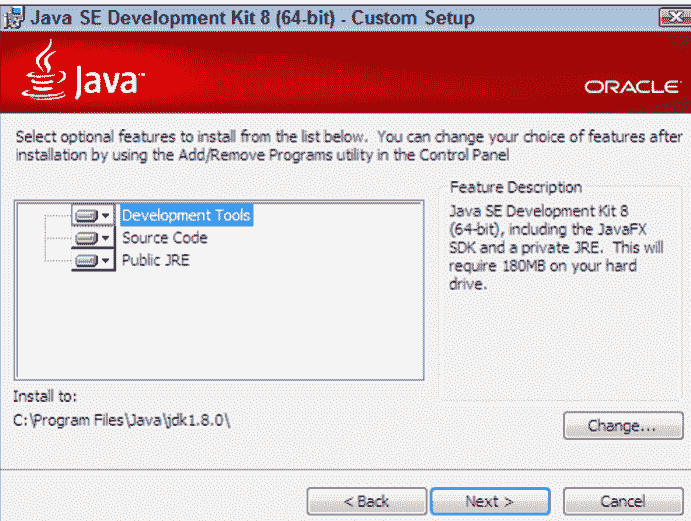

   图 1-1

3. （可选）点击“更改”以选择存储 Java 文件的位置。

   通常，使用默认安装位置是最好的，除非你有特殊理由将其放在其他地方。

4. 点击“下一步”。

   你会看到安装开始进行。在 JDK 安装完成后，你会看到一个 JRE 的二级对话框。

5. （可选）点击“更改”以选择 JRE 的位置。

   通常情况下，使用默认安装位置即可。

6. 点击“下一步”。

   JRE 开始安装。安装完成后，你返回到初始设置对话框。

7. 点击“关闭”。

   安装已完成，向导消失。

## 执行 Linux 安装

所需文件：你下载的 Java 安装程序

在 Linux 上安装 Java 的精确步骤取决于你的 Linux 发行版。使用下载的文件安装 Java 需要 root 用户权限。某些 Linux 版本（如 Fedora、Red Hat）启用了 root 用户，而另一些（如 Ubuntu 和 Debian）则没有。无论你拥有哪个版本的 Linux，通常都可以使用超级用户 (`sudo`) 命令。考虑到这一点，在 Linux 上获取 Java 的简单方法是执行以下命令：

```bash
sudo apt-get install oracle-java8-installer
```

## 执行 Mac 安装

所需文件：你下载的 Java 安装程序

在你下载了适用于你系统的 JDK 版本后，将其解压到硬盘上，最好放在 `/System/Library/java-8` 文件夹。要从 IDE 使用 Java，你只需要让 IDE 找到文件。如果你想在运行时正常使用 Java，必须按照本文后面“在 Mac 上创建路径”部分的说明进行。

# 访问 Java 可执行文件

## 额外信息

系统中 Java 可执行文件的位置包含这些文件的文件夹提供了使用 Java 所需的所有工具。当你安装 Java 时，安装程序会告诉你将存储在哪里。接下来的章节将告诉你 Java 8 文件的默认存储位置，并提供一些访问它们的提示。

使用 IDE 的优势之一在于你通常不需要担心 Java 可执行文件的位置。先安装 JDK，然后安装 IDE。IDE 安装程序会自动为你定位 JDK 文件，并配置 IDE 在你需要帮助、编译、调试或运行应用程序时使用这些文件。

## 在 Windows 中创建路径

如果你在 Windows 中未使用 IDE，你将始终为 Java 可执行文件创建路径。因为 Windows 通常不提供任何 Java 支持。除非你将其存储在其他地方，否则文件通常出现在两个位置之一。

- `Program Files\Java\jdk1.8.0\bin` 文件夹是标准存储位置。（如果你安装了更新版本的 JDK，你可能会发现它存储在略不同的文件夹中。例如，如果你安装了版本 1.8.0，你可能会看到 JDK 存储在 `\Program Files\Java\jdk1.8.0\bin` 文件夹）。
- 当你在 64 位 Windows 上安装 32 位版本的 Java 时，标准存储位置是 `\Program Files (x86)\Java\jdk1.8.0\bin`。

你可以使用 Windows 资源管理器找到 JDK 在系统上的精确位置。当你知道这些信息后，就可以为这些文件创建一个路径。在下面的练习中，你将在 Windows 中为 Java 安装创建一个路径。

所需文件：无

1. 右键点击“计算机”，从弹出的右菜单中选择“属性”，或者在控制面板中打开“系统”面板。

   你会看到图 1-2 所示的系统窗口。

2. 在控制面板左侧的主菜单中，点击“高级系统设置”。

   你会看到如图 1-3 所示的系统属性对话框的“高级” 选项卡。

   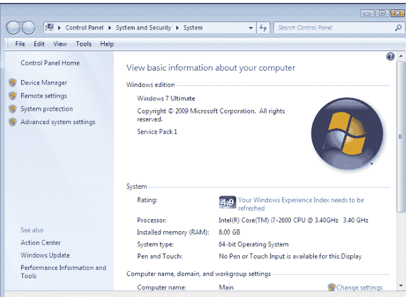

   图 1-2

   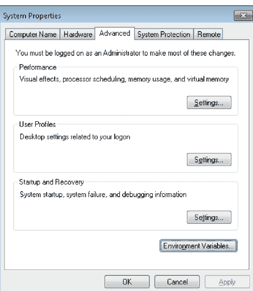

   图 1-3

3. 点击对话框右下角的“环境变量”按钮。

   你会看到图 1-4 所示的“环境变量”对话框。注意，此对话框被分为两个部分。上半部分仅影响本地用户，而下半部分影响使用系统的所有人。

4. 选中对应用户的 `Path` 条目（如果你只想为当前用户账户使用 Java）或系统的 `Path` 条目（如果系统上的每个人都要使用 Java），并点击“编辑”。

   a. 如果不存在 `Path` 条目，点击“新建”。
   b. 在“变量名”字段中输入 `Path`。

   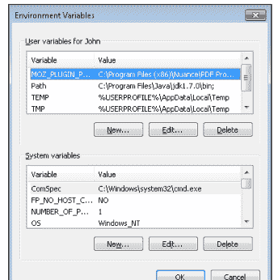

   图 1-4

创建一个与图 1-5 所示类似的变量对话框。根据你访问的版本，变量对话框可能有四种名称之一：添加用户变量、编辑用户变量、添加系统变量或编辑系统（变量）。所有版本仅名称上不同——它们的功能完全相同。

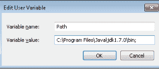

图 1-5

5. 在“变量值”字段中输入 JDK 的路径，后跟一个分号，不要更改任何现有内容。

   图 1-5 显示了一个示例条目。

6. 点击三次“确定”以关闭你打开的三个对话框。

7. 关闭系统窗口。

   环境变量已就绪，你可以在命令行访问 Java。

## 在 Linux 中创建路径

为了确保你可以根据需要访问 Java 8，你必须通过此命令配置 Java 可执行文件的路径：

```bash
sudo apt-get install oracle-java8-set-default
```

下一节中为 Solaris 描述的技术也适用于 Linux。

## 在 Solaris 中创建路径

在处理 Solaris 工作时，你可能已经在系统上安装了一个版本的 Java。大多数版本的 Java 都能兼容书中的大多数示例。然而，为了获得最大收益，你确实需要 Java 8。要确定你是否可以在命令行访问 Java，请输入 `% java -version` 并按回车。如果你看到版本号，你就可以顺利地访问 Java。如果你看到比 Java 8 更旧的版本号，则需要考虑在系统上安装新版本的 Java。

在某些情况下，即使安装了 Java，你可能也无法从系统的命令行访问它。Java 8 通常安装在你机器的 `/usr/local/jdk1.8.0/bin/` 目录下（你可以在相应的特定版本目录下找到其他版本的 Java）。如果你发现 Java 已安装但仅仅无法访问它，请按照后续章节中的步骤（取决于你使用的 shell）来提供访问权限。

### 使用 bash shell

`bash shell` 是 Solaris 提供的两个流行的 shell 之一（还有其他的，包括本章后面描述的 C shell）。在下面的练习中，当你使用 `bash shell` 时，为 Java 添加路径。

所需文件：无

1. 打开 `~/.bashrc` 文件进行编辑。
2. 修改 `PATH` 变量以包含你的 Java 安装路径。

   你的 `PATH` 变量看起来像：`PATH=/usr/local/jdk1.8.0/bin`。

3. 输入 `export PATH` 并按回车。

   shell 会为你导出 `PATH` 变量。

4. 保存文件并退出编辑器。
5. 需要时打开一个新的终端窗口。

   许多版本的 Linux 在你启动操作系统时会立即打开终端窗口。如果你没有打开终端窗口，请寻找名为 Xterm、Terminal、Konsole 或类似的应用程序。

6. 输入 `% java -version` 并按回车。

   你会看到 Java 安装的版本号。

### 使用 C shell

C shell 是 Solaris 提供的两个流行的 shell 之一（还有其他的，包括本章较早描述的 `bash shell`）。在下面的练习中，当你使用 C shell 时，为 Java 添加路径。

所需文件：用于编辑的 `~/.cshrc` 文件。

1. 打开 `~/.cshrc` 文件进行编辑。
2. 输入 `set path=(/usr/local/jdk1.8.0/bin $path)` 并按回车。
3. 保存文件并退出编辑器。
4. 需要时打开一个新的终端窗口。

   同样，许多版本的 Linux 在你启动操作系统时会立即打开终端窗口。如果你没有打开终端窗口，请寻找名为 Xterm、Terminal、Konsole 或类似的应用程序。

5. 输入 `% java -version` 并按回车。

   你会看到 Java 安装的版本号。

## 在 Mac 上创建路径

Mac 包含几个版本的 Java 作为基础安装。因此，你拥有 Java，但可能没有正确的版本。要将 Java 作为默认，你必须打开终端（通过应用程序：实用工具），并通过以下命令导出路径：

```bash
export JAVA_HOME=/System/Library
```

设置路径后，你需要通过以下命令验证你的安装：

```bash
java -version
```

你会看到 Java 安装的版本号。

# 为 Java 选择 IDE

## 在线查找

Windows 用户拥有记事本，它对于创建 Java 应用非常好。如果你真的想要更高级的，请尝试 [Notepad++](https://notepad-plus-plus.org)。Linux 开发者可能想要更熟悉的编辑器。你可以在 `http://www.TUTORIALS/yux.com/LinuxEditors.html` 找到许多文本编辑器。Mac 用户可能想要安装 Plain Text，地址为 `http://download.cnet.com/Plain-Text-Editor/3000-2079-4-1013406`。请查看文章 `http://www.blorge.com/2009/07/14/software-free-plain-text-editors-for-mac-a-description-of-other-editors-that-will-work-on`。如果你在使用多种编程语言，可能会尝试支持它们的编辑器，例如 [PilotEdit](http://pilotEdit.com)，这是一个支持多种编程语言的免费编辑器。

（在 Macintosh 上）将允许向输出添加格式代码，使得文本对编译器是无效的。（你可以参考 `http://support.apple.com/kb/ta204006` 中的说明将 TextEdit 设置为纯文本编辑器，但重要的是你必须记住在需要时执行此操作。）

如果你使用纯文本编辑器来创建应用程序，你还需要在命令行中手动编译和执行应用程序。执行这些任务很困难，但它们确实涉及了 IDE 通常会为你完成的额外工作。本章将告诉你如何在“打开命令提示符”部分中编译应用程序，以及如何在“使用 Java 命令”部分中执行它，因此，使用纯文本编辑器还是 IDE 完全取决于你的决定。

## 寻找 IDE

市场上有很多许多针对 Java 的 IDE，甚至有更多可以适用于 Java 的编辑器，即使它们不是专门为 Java 设计的。事实上，市上的编辑器多到让你（而且可能让你）眼晕脑胀，而没人希望那样。如果你打算投入时间和精力学习如何使用 IDE，最好是选择一个专门针对 Java 的产品。

市场上最快且功能最完整的 Java 编辑器之一是 jCreator Pro。这款 IDE 完全用 C++ 编写，这种语言因其性能而备受推崇，这也是它运行如此快的原因。它还提供了适用于所有水平 Java 开发的功能 set。然而，该产品存在一些问题，使其不利本书。首先，它只能运行在 Windows 上。而且它不是免费的。你可以从 `http://www.jcreator.com` 下载一个限制性的演示版本，但你可能希望将此产品留到处理大型应用程序时使用。你可以从 `http://download.cnet.com/jCreator/3000-2212_4_7956957.html` 免费下载一个名为 jCreator Standard 的旧版本。

大多数 Java 开发者开始使用的编辑器是 Eclipse (`http://www.eclipse.org/downloads`)。它比 IntelliJ 等高级 IDE 的功能稍弱一些——例如，它不提供简化的管理或版本控制支持——但它运行在 Linux、Mac 和 Windows 系统上。最棒的是，Eclipse 是社区支持的（你可以获得同行的帮助等）并且是免费的。我在写这本书时使用了 Eclipse，但你并不非得用。没有任何截图以任何方式引用过它。是否使用这个 IDE 完全取决于你。

有些开发者不需要 IDE —— 他们更倾向于编辑器（一种只提供代码编辑等基本功能的简单应用程序）。编辑器是一个提供关键字高亮和语言支持等功能的产品，提供帮助，但不提供编译和调试。编辑器是简单直接的。一个良好的 Java 编辑器示例是 JEdit (`http://www.jedit.org/index.php?page=download`)。该产品是免费的，你可以获得 Linux、Windows 和 Mac 版本。

## 访问网络

你可以找到专门介绍 Java 编辑器和 IDE 主题的完整网站。一个较全面的资源位于 `http://apl.jdu.edu/hall/java/IDES.html`。如果你不喜欢本节中提到的任何产品，并且觉得想要比记事本更好的工具来编写应用程序，请在网上查看其他选择。总会某种 IDE 或编辑器能满足你的需求。

## 确定何时使用特定的开发环境

在决定为你的应用程序选择工具时，做出良好的选择是重要的。对某一个人有效的工具可能不适用于另一个人。由于这个原因，经验丰富的开发者通常有多种工具可用 —— 单一工具是不可能满足每一个要求的。然而，你刚刚起步，所以之前章节中描述的工具之一目前就可以用。当你开始创建更多或更大的应用程序时，你将在选择工具时考虑这些指南。


- 该工具是否与你应用程序的复杂性和规模匹配？大型应用程序需要一个良好的调试器。与多个程序员协作意味着该工具必须提供支持。
- 你对该工具的用户界面感到满意吗？
- 工具供应商提供什么级别的支持？如果是社区支持的工具，请查看在线论坛，看看有多少人正在提供支持（相对于提问的人）。

# 第1章

所需文件：`GetStarted.java`

1. 在 `GetStarted.java` 中，在方法块（带大括号的部分）中输入以下步骤（加粗部分）。

```java
public static void main(String args[]){
    // This is an executable statement with its
    // associated data.
    System.out.println("This is your first Java program!");
}
```

每个任务都包含告诉 Java 执行某些事情，就像你在本次练习中给某人提供一组执行步骤一样。在这种情况下，应用程序正在告诉 Java 在屏幕上打印一些文本。`println()` 方法接受某些数据作为输入并将该输入显示在屏幕上——你可以看到它。

注意这里还有另一个注释，但它使用了不同的技术告诉编译器它是一个注释。任何以双斜杠 `//` 开头的行都是注释。随着书籍的进行，你将学习关于注释的所有知识。

2. 将你编写的代码保存到磁盘。

如果你在此时编译该应用程序，它将运行并在屏幕上显示一条简单的消息：“This is your first Java program!”。在本章的稍后部分，你会看到这一切是如何工作的。

保持编辑器或 IDE 开启以便进行下一个练习。

## 识别程序的各个部分

是时候整体查看示例应用程序了，而不是像以前那样拆分来看。在接下来的练习中，你将回顾完整的 `GetStarted` 应用程序的各个部分。

所需文件：`GetStarted.java`

1. 查看你在之前的练习中创建的 `GetStarted` 应用程序。

你的源代码应该像这里显示一样：

```java
/* This is your first Java program.
Author: John Mueller (John@JohnMuellerBooks.com)
Written: 6 January 2014 */
class GetStarted {
    public static void main(String args[])
```

### 编译简单的应用程序

```java
{
  // This is an executable statement with its
  // associated data.
  System.out.println("This is your first Java
program!");
}
```

### 2. 检查类块。

类块始终以 `class` 开始，随后是类名，在本情况下类名是 `GetStarted`。

### 3. 检查方法块。

方法以许多关键字开始——在本情况下是 `public`、`static` 和 `void`——正如后续章节中讨论的那样。接下来是方法名——在本情况下是 `main`。方法可能要求你向它提供信息。`main()` 方法只需要一个参数，在本情况下命名为 `args`。`args` 参数的类型为 `String`，你将在第 3 章中发现。此外，`args[]` 还是一个数组——你将在第 10 章遇到这个主题。所以现在看起来可能很神秘，但这些谜团将随着时间的推移得到解释。

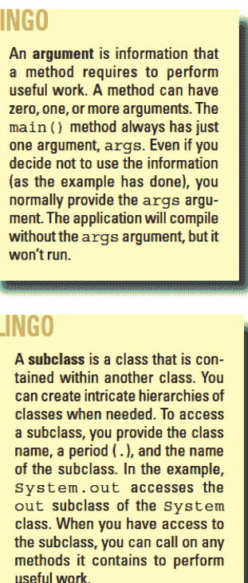

### 4. 检查执行任务的单行代码。

`main()` 方法调用 `println()` 方法在屏幕上显示信息。`println()` 方法位于 `System` 类的 `out` 子类中。`println()` 方法至少需要一个输入——你想要在屏幕上显示的数据。

### 5. 保存文件并关闭 IDE 或编辑器。

## 编译简单的应用程序

你的 IDE 很可能有一种编译手段——将人类可读的单词转换为计算机可以理解的内容——并运行在本章早期创建的应用程序。事实上，许多编辑器也提供此功能。然而，了解如何在命令行提示符中编译此应用程序对于更好地理解 Java 的工作原理非常重要。以下章节描述了如何打开命令行提示符并将 `GetStarted` 源代码编译为应用程序。

### 术语

编译 Java 应用程序意味着将开发者编写的人类可读单词转换为他们能理解的 Java 字节码。反过来，JRE 可以将字节码转换为可执行的低级代码。要编译应用程序，你必须使用编译器——一种专门设计用于读取人类可读单词并将其写入计算机有用内容的程序。

### 打开命令行提示符

命令行提示符实际上出现在你操作系统支持的一个特殊窗口中。你如何打开命令行提示符取决于你正在使用的操作系统。

#### 使用 Linux 命令行提示符

某些版本的 Linux 在启动时会立即打开命令行提示符。

如果你使用的 shell 不具备此功能，你始终可以单独打开命令行提示符。在大多数 Linux 版本中，命令行提示符的正式名称是 Terminal、Konsole 或类似的名称。当命令行提示符打开时，你可以输入命令来编译和运行你的 Java 应用程序。要访问你的应用程序，输入 `cd Full Application Path` 并按回车，其中 `Full Application Path` 是你保存之前章节中创建的源代码的路径。

#### 使用 Mac 命令行提示符

Mac 上的命令行提示符被称为终端。使用 `Applications:Utilities:Terminal` 命令（它看起来就像一台老式电视机）。当你打开终端时，你可以输入命令来访问你的应用程序、编译它并运行它。要访问你的应用程序，输入 `cd Application Directory` 并按回车，其中 `Application Directory` 是你将源代码保存到磁盘的相对路径。Mac 将所有内容保存到系统的 `/Users/[Your Username]` 目录，源代码将出现在该目录下的子目录。

#### 使用 Windows 命令行提示符

你在书中看到的输出截图依赖于 Windows 提示符。这并不意味着你的应用程序在 Linux 或 Mac 上无法运行。你看到的输出截图依赖于 Windows 提示符。

Windows 命令行提示符实际上被称为“Command Prompt”，而不是“terminal”或“console”这样晦涩的名称。选择 开始 > 所有程序 > Accessories > Command Prompt 打开命令行提示符。命令行提示符默认打开用户目录；输入 `cd Application Directory` 并按回车，其中 `Application Directory` 是你保存源代码的路径。然而，你可能将数据保存在硬盘上的其他位置，必须通过 `cd Full Application Path` 来访问它。本章节的示例出现在 `Java Learning Kit for Dummies\Lesson 01`。

在你打开命令行提示符并访问应用程序后，可以编译它。此处使用的 `javac` 工具调用 Java 编译器 (JavaC)，为你的应用程序创建一个 `.class` 文件。注意此活动在后台进行，如果不是这样；你将在屏幕上看到任何内容。


> 在执行 `javac` 工具时，务必包含 `.java` 扩展名。否则，编译器将无法找到要编译的文件，你会看到错误消息。

1. 打开你操作系统的命令行提示符。
   打开命令行提示符或终端窗口。
2. 输入 `javac GetStarted.java` 并按回车。
3. 输入 `Dir`（在 Mac 或 Linux 计算机上时输入 `ls`）并按回车。

你看到原始的 `.java` 文件和新生成的 `.class` 文件。`.class` 文件是你将在下一个练习中执行的那个。

保持命令行提示符开启以便进行下一个练习。

## 执行简单应用程序

编译应用程序使其能够执行。当你运行（execute）一个应用程序时，你就能看到该应用程序执行的任务。在 `GetStarted` 示例中，该应用程序会显示一条消息。以下章节介绍了执行应用程序的两种主要方法。

### 使用 java 命令

IDE 通常提供某种执行 Java 应用程序的方法。某些编辑器也提供此功能。然而，知道如何在不使用 IDE 或编辑器的情况下执行 Java 应用程序非常重要，因为你的用户可能没有这些软件——他们需要通过其他方式执行应用程序。在接下来的练习中，你将执行 `GetStarted` 应用程序以查看它的功能。

所需文件：`GetStarted.java`

1. 输入 `java GetStarted` 并按回车。

你将看到图 1-6 所示的消息。

> 应用程序名称是区分大小写的。如果你没有输入正确的名称，Java 会报错。注意，在使用 `java` 工具时，不需要包含文件扩展名。你只需要提供 `.class` 文件的名称。

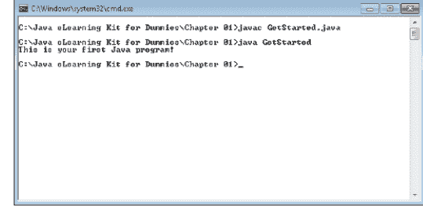

图 1-6

2. 为了测试 Java 的大小写敏感性，输入 `java getstarted` 并按回车。

Java 8 这会显示类似图 1-7 所示的错误消息。

```
C:\Java learning Kit for Dummies\Chapter 01\java GetStarted.java
C:\Java learning Kit for Dummies\Chapter 01\java GetStarted
This is my first program
C:\Java learning Kit for Dummies\Chapter 01\java getstarted
Exception in thread "main" java.lang.ClassNotFoundException: getstarted (Unknown class name)
tat: getstarted
  at java.lang.ClassLoader.loadClass(ClassLoader.java)
  at java.lang.ClassLoader.loadClass(ClassLoader.java)
  at java.security.SecurityManager.checkPermission(ClassPermission)
  at java.lang.ClassLoader.defineClass(ClassLoader.java)
  at java.lang.ClassLoader.defineClass(ClassLoader.java, String, byte[], int int)
  at java.lang.ClassLoader.defineClass(ClassLoader.java, String, byte[], boolean resolve)
  at java.lang.ClassLoader.findClass(ClassLoader.java)
  at java.lang.ClassLoader.loadClass(ClassLoader.java)
  at java.lang.ClassLoader.loadClass(ClassLoader.java)
  at java.lang.ClassLoader.loadClass(ClassLoader.java)
  at java.lang.ClassLoader.loadClass(ClassLoader.java)
  at java.lang.ClassLoader.loadClass(ClassLoader.java)
  at java.net.URLClassLoader.findClass(URLClassLoader.java)
  at java.net.URLClassLoader.loadClass(URLClassLoader.java)
  at java.net.URLClassLoader.getClass(URLClassLoader.java)
  at java.lang.ClassLoader.loadClass(ClassLoader.java)
  at java.lang.ClassLoader.loadClass(ClassLoader.java)
  at java.lang.ClassLoader.loadClass(ClassLoader.java)
  at java.lang.ClassLoader.loadClass(ClassLoader.java)
  at java.lang.ClassLoader.loadClass(ClassLoader.java)
  at java.net.URLClassLoader.findClass(URLClassLoader.java)
  at java.net.URLClassLoader.access$100(Unknown Source)
  at java.net.URLClassLoader$class$1.run(Unknown Source)
  at java.net.URLClassLoader$class$1.run(Unknown Source)
  at java.net.URLClassLoader$class$1.run(Unknown Source)
  at java.security.AccessController.doPrivileged(Native Method)
  at java.net.URLClassLoader.findClass(URLClassLoader.java)
  at java.lang.ClassLoader.loadClass(ClassLoader.java)
  at sun.c.Launcher$AppClassLoader.loadClass(ClassLoader.java)
  at java.lang.ClassLoader.loadClass(Unknown Source)
  at sun.launcher.LauncherHelper.checkAndLoadMain(Unknown Source)
  at sun.launcher.LauncherHelper.checkAndLoadMain(Unknown Source)
C:\Java learning Kit for Dummies\Chapter 01\
```

图 1-7

保持命令提示符打开以便下一个练习。

### 额外信息

> 早期版本的 Java 显示看起来非常复杂的错误消息，如下：

```
Exception in thread "main" java.lang.
UnsupportedClassVersionError: started :
Unsupported major.minor version 52.0
at java.lang.ClassLoader.defineClass(Native Method)
at java.lang.ClassLoader.defineClass(Unknown Source)
at java.security.SecurityManager.defineClass(Unknown Source)
at java.net.URLClassLoader.defineClass(Unknown Source)
at java.net.URLClassLoader.access$100(Unknown Source)
at java.net.URLClassLoader$class$1.run(Unknown Source)
```


```
at java.net.URLClassLoader$class$1.run(Unknown Source)
at java.net.URLClassLoader$class$1.run(Unknown Source)
at java.security.AccessController.doPrivileged(Native Method)
at java.net.URLClassLoader.findClass(Unknown Source)
at java.lang.ClassLoader.loadClass(Unknown Source)
at sun.c.Launcher$AppClassLoader.loadClass(ClassLoader.java)
at java.lang.ClassLoader.loadClass(Unknown Source)
at java.lang.ClassLoader.loadClass(ClassLoader.java)
at sun.lang.LauncherHelper.loadClass(Unknown Source)
```

# 为你的代码添加注释

编写代码时可以执行的最重要任务之一是对代码进行文档记录。许多开发者不写注释，是因为他们认为注释很困难。然而，你会发现注释非常简单。以下章节描述了许多好处：

- 注释更容易记住代码的功能。
- 你可以使用注释来记录为什么要使用特定技术。
- 良好的注释使你的应用程序更容易调试。
- 注释提供了代码本应如何工作的说明。
- 某些 IDE 可以直接创建文档。
- 注释可以定义应用程序的细节。
- 记录应用程序的需求是可能的。

## 创建单行注释

单行注释可以出现在行的任何位置。它以双斜杠（`//`）开头，包含你想要包含的任何文本。在接下来的练习中，你为 `GetStarted` 应用程序添加单行注释。

**所需文件**：`GetStarted.java`

1. 使用你喜欢的编辑器或 IDE 打开 `GetStarted.java` 文件。
2. 使用你之前编写的源代码。
3. 使用本章之前对 `main()` 方法的描述为它创建一个单行注释。

注意，每个单行注释都以 `//` 开头。随着书籍的进行，你将发现更多关于其具体含义的知识。目前，这是一个信息性注释，告诉了关于 `main()` 方法的所有已知信息。

```java
// 这是 Java 在启动应用程序时调用的第一个方法
// 该方法是公共的，所以
// 其他所有类都能看到该方法。该方法是
// 静态的，所以它不是作为对象的一部分，
// 而是直接调用的。结果是 void，所以这个
// 方法不返回值。唯一的 args 是调用者的列表。
public static void main(String args[])
```

4. 将文件保存到磁盘。
5. 使用“创建编译后的 .class 文件”部分中的步骤编译该文件。`javac` 工具无错误地编译了文件。
6. 使用“使用 java 命令”部分中的步骤执行该文件。

注意，由于你提供的注释，应用程序的输出并没有发生变化。编译器会忽略你可能添加的任何注释——它们包含在源代码中仅是为了对你有帮助。

# 第一章

## 创建多行注释

多行注释可以从行的任何位置开始，但它们通常出现在行首。注释会跨越多行持续，直到编译器遇到“注释结束”（End of Comment）符号为止。多行注释始终以 `/*` 开始，以 `*/` 结束。在接下来的练习中，你将为 `GetStarted` 应用程序添加一个多行注释。

**所需文件**：`GetStarted.java`

1. 在文件开头创建一个新的多行注释，用以记录你对应用程序所做的更改。

与单行注释一样，你创建的注释可以包含任何你认为有帮助的信息。加粗文本显示了此示例的建议多行注释：

```
/* Add a comment to the main() method.
Author: Your Name
Written: Today's Date */
```

```java
/* This is your first Java program.
Author: John Mueller (John@JohnMuellerBooks.com)
Written: 6 January 2014 */
```

你对应用程序所做的每处更改都应该在文件开头获得一个头部注释，以便其他人查看应用程序的历史。应用程序历史有助于更容易地发现哪些技术对应用程序有效（或无效）。

2. 保存文件并关闭编辑器或 IDE。
3. 使用“创建编译后的 .class 文件”部分中的步骤编译该文件。
`javac` 无错误地编译了该文件。
4. 使用“使用 Java 命令”部分中的步骤执行该文件。

注意，由于你提供的注释，应用程序的输出没有变化。

5. 保存文件并关闭 IDE 或编辑器。

## 导入其他类

Java API 是庞大的。任何开发者都不可能记住它即使是其中的一小部分。开发者通常会记住他们经常使用的 API 部分，然后使用 API 帮助文档（`http://docs.oracle.com/java/7/docs/api/help-doc.html`）来定位特定应用程序所需的信息。接下来的章节将更详细描述 Java API 并展示如何使用它。

### 介绍 Java API

Java API 由一系列类组成。最顶层的类是 `java` 类，它本身是无法使用的。你处理的总是子类，例如 `java.lang`，它包含了 Java 的所有语言元素。然而，为了执行任何真正有用的工作，你必须选择 `java.lang` 类的子类，例如 `String`，它提供了处理文本的手段。因此，第一个可用的类实际上是 `java.lang.String`。你使用的每个 API 特性都依赖于如 `java.lang.String` 这样的层次结构。

Java API 有数千个类。自然地，如果你没有某种快速定位它的方法，尝试访问某个类将非常困难。`lang` 包包含了所有作为 `java.lang` 类子类出现的类，作为一种封装类的手段，以便将它们组合在一起。你可以在 `http://download.java.net/jdk8/api/index.html` 找到包及其包含的类列表。该网站在左上格中显示包，在左下格中显示你所选包的元素，在右格中显示你所选元素的文档，如图 1 所示。

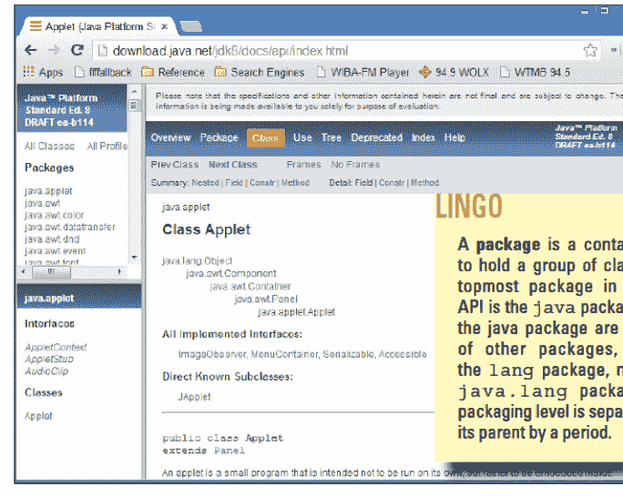

### 导入单类

在使用 Java API 中的类之前，你通常需要先导入它。`import` 关键字将一个类或整个包添加到你的应用程序中，以便使用它。在本次练习中，你创建了一个新应用程序，让你以新的方式与 Java 交互。你可以在命令行输入某些内容，Java 将使用一个特殊类将这些信息导入应用程序中。

**所需文件**：`SayHello.java`

1. 打开你为本书选择的编辑器或 IDE。
2. 在编辑器屏幕上输入以下代码。

```java
// Import the required API classes.
import java.util.Scanner;
import java.lang.String;

class SayHello
{
    public static void main(String[] args) {
        // 创建一个 Scanner 类的实例以
        // 用于访问键盘。
        Scanner getName = new Scanner(System.in);

        // 创建一个变量来存储用户的姓名。
        // 此变量用于存储文本。
        String username;

        // 询问用户姓名并将此名字存入
        // username 中。
        System.out.print("What is your name?");
        username = getName.nextLine();

        // 向用户显示一条带有
        // 名字的消息。
        System.out.println("Hello " + username + "!");
    }
}
```

在此示例中，`getName` 是一个 `Scanner`。`Scanner` 对象提供了对键盘的访问，让你可以将用户输入的任何内容存储到变量中。变量是一个用于存储信息的箱。为了保存用户输入的内容，应用程序必须从键盘获取按键并将其放入变量中。当应用程序检测到用户按了回车键时，它停止收集按键。

3. 使用类名和 `.java` 扩展名将编写的代码保存到磁盘，即 `SayHello.java`。文件名必须与类名完全匹配，否则应用程序将无法编译。
4. 打开该示例目录的命令提示符。
5. 输入 `javac SayHello.java` 并按回车。编译器为你创建一个 `.class` 文件。
6. 使用“使用 Java 命令”部分中的步骤执行该文件。

注意，由于你提供的注释，应用程序的输出没有变化。

7. 保存文件并关闭 IDE 或编辑器。

### 导入整个包

当你需要使用包中的多个类时，可以使用通配符 `*` 导入整个包。`import packagename.*` 允许你使用该包中的所有类，而无需逐个列出。在接下来的练习中，你将创建一个新应用程序，让你以这种方式使用 Java。

**所需文件**：`SayHello.java`

1. 打开你为本书选择的编辑器或 IDE。
2. 在编辑器屏幕上输入以下代码。

```java
// Import the required API classes.
import java.util.*;
```

3. 使用类名和 `.java` 扩展名将编写的代码保存到磁盘，即 `SayHello.java`。文件名必须与类名完全匹配，否则应用程序将无法编译。
4. 打开该示例目录的命令提示符。
5. 输入 `javac SayHello.java` 并按回车。编译器为你创建一个 `.class` 文件。
6. 使用“使用 Java 命令”部分中的步骤执行该文件。

注意，由于你提供的注释，应用程序的输出没有变化。

7. 保存文件并关闭 IDE 或编辑器。

## 获取 Java 帮助

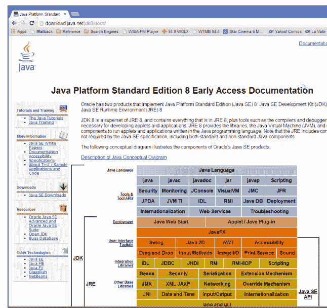

## Java 平台标准版 8 早期访问文档

Oracle 拥有两个实现 Java 平台标准版 (Java SE) 8 的产品：Java SE 开发工具包 (JDK) 8 和 Java SE 运行时环境 (JRE) 8。

JDK 包含了开发 Java 应用程序所需的工具和环境。JRE 提供运行 Java 应用程序所需的库、Java 虚拟机 (JVM) 以及其他组件。JRE 包含了 Java SE 规范未要求的组件，包括标准和非标准的 Java 组件。

该概念图阐释了 Oracle Java 产品的组件：

| java | javac | jadoc | jav | Scripting |
|---|---|---|---|---|
| 安全 | JConsole | JServiceImpl | JMS | JFR |
| JPDA | JIT | IDL | RMI | Java DB 部署 |
| 国际化 | Web 服务 | 故障排除 | | |
| Java Web Start | Applet 插件 | | | |
| Swing | Java 2D | AWT | 辅助功能 | |
| 拖放 | 输入法 | 图像 IO | 打印服务 | 声音 |
| JS | JNDI | JCA | 支持性 | |
| Beans | 安全 | 序列化 | 覆盖机制 | |
| JMX | XML | JAXP | 网络 | 国际化 |
| 日期和时间 | 输入/输出 | java.util | | |

图 1-11

## 获取本地实用工具帮助

JDK 提供的所有实用工具都自带帮助信息，因此你不需要记忆它们的用法。要访问这些信息，请输入工具名称并跟上 `-help`。例如，要访问关于 `java` 工具的信息，你需要输入 `java -help`。图 1-12 显示了一个典型的工具帮助屏幕。

# 第 1 章


```
C:\Windows\system32>java -help
$ java [options] class SourceCode$Chapter1$ [args...]
  java executes a class
  jar [options] -jar jarfile [args...]
where options include:
  -use-32-bit data model if available
  -use-64-bit data model if available
  -server select the "Server" host
    to connect to
  -cp path>search path for directories and zip files)
  -version print version of the launcher, and exit
  -list print a list of directories, JAR archives,
    and entries. Use help for Class details.
  -Dclass=<value>set a system property and exit
  -version print version of the launcher and exit
  -showversion print specific version to run
    print version number and continue
  -includes <packages>includes used JARs in the version search
    path (class search path)
  -help print help
  -f [packages]list all packages, classes, and
    members in the specified granularity
  -Xclasspath=<path>[:<classname>] with specified granularity
  -Xclasspath=<path>[:<classname>] with specified granularity
  -enable-assertions
  -disable-assertions [criteria]
  -librarypath path>search path for native libraries
    load native library (dll, .so), see java.lang.System
  -verbose verbose:<agent>load agent library by full pathname
    agent and help
  -javaagent:<agent>load agent library by full pathname
    Java programming language agent, see java.lang.instrument
  -splash <image> show splash screen with specified image
See http://www.oracle.com/java/javase/documentation/index.html for more details.
C:\Windows\system32> _
```

图 1-12

## 在线查找信息

使用在线帮助的优势是信息始终是最新的。你不必担心获取到可能导致问题的过时信息。你可以从 `http://download.java.net/jdk/docs/api/index.html` 开始访问在线帮助。正如在本章“介绍 Java API”部分提到的，你从选择一个包开始，然后选择包中的一个类来获取该类的帮助。

## 总结

以下是本章中学到的关键要点：

- Java 是最流行的语言之一，因为它能够运行在多种平台上。
- 标准化是 Java 能够在不同环境中运行的关键原因。
- JCP（Java 委员会）为 Java 的如何演进提供建议。
- 你可以使用任何文本编辑器编写 Java 应用程序，但使用 IDE 可以在颜色高亮、帮助和便利性方面提供显著优势。
- 安装 JDK 或 JRE 都可以让你在机器上运行 Java 应用程序。
- 为了获得最佳功能，JRE 支持的 Java 版本必须与编写应用程序时使用的 JDK 版本匹配。
- 在手动创建 Java 应用程序时（特别是在 Windows 系统上），你需要确保系统配置了查找 Java 可执行文件的路径。
- IDE 通常会自动为你定位并配置 Java 可执行路径。
- 类包含方法和其他类。
- `javac` 命令根据提供的源代码编译应用程序。
- `java` 命令在命令行窗口运行应用程序，而 `jav` 命令在没有命令行窗口的情况下运行应用程序。
- Java 支持单行和多行注释，两者都非常有用。
- Java API 非常庞大，你无法记忆。
- 使用 API 可以访问类。
- API 由 JDK 提供的类组成。
- API 是用于提供应用程序开发环境的工具和软件组合。
- API 是一个将多个类组合成易访问整体的容器。
- API 封装了这些类，让你能够更容易地找到它们。

## 第二章：使用原始类型变量


- 不同的变量类型使得存储特定类型的信息成为可能。
- 每个变量类型在计算机内存中需要不同量的存储空间。
- 常量值在整个应用程序生命周期内存储一个特定的值。

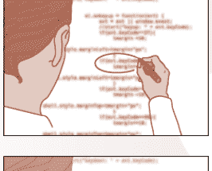


1. **计算机是如何区分数字和文本的？**  
   计算机实际上并不理解这种区别，而是你的应用程序定义了这种区别，正如第 50 页所示。

2. **为什么变量的大小各不同？**  
   较小的变量使用的内存较少并能提高速度，而较大的变量允许存储更大的值，正如第 51 页所示。

3. **变量递增或减少意味着什么？**  
   递增变量是在基础上加 1，而递减变量是在基础上减 1，正如第 56 页所示。

4. **整数类型和浮点数类型有什么区别？**  
   不仅它们存储的内容不同，计算机看待它们的方式也不同，正如第 61 页所示。

5. **布尔型数据类型的目的是什么？**  
   你使用布尔值来确定表达式的真值，正如第 65 页所示。

6. **获取字符（char）值与其他变量类型有何不同？**  
   `char` 类型要求你将单个字符从该行的其余其他字符中分离出来，正如第 67 页所示。

7. **常量有特定的类型吗？**  
   你可以使用任何变量类型创建常量，正如第 69 页所示。

8. **为什么在应用程序中使用常量值？**  
   常量在内存使用、应用程序执行速度和安全性方面提供了一些显著优势，正如第 50 页所示。

本章讨论了变量，因为如果不使用变量，你就无法编写大多数应用程序。事实上，你已经在第 1 章描述的 `SayHello` 和 `SayHello2` 应用程序中使用过变量。变量是一种作为数据存储信息的“盒子”。当你想要在 Java 中存储信息时，你会创建一个变量来容纳它。变量实际上是计算机内存的一部分，它以二进制数据的形式为你存储这些信息。当你的应用程序解释内存位置处的数据时，它会赋予其值，并将其从一个简单的数字变成你可以使用的信息。

变量根据它们存储的信息类型进行分类。计算机只将信息视为 1 和 0。对于计算机来说，字母 A 实际上是数字 65。就计算机而言，它仅仅是存储在特定内存位置的一组数字。是应用程序决定了存储在该内存位置中的数据类型。将数据转换为特定类型的信息称为为其分配类型。为变量分配类型有助于应用程序解释其所包含的数据。

本章专门介绍原始类型（`primitive types`）。原始类型仅由数据组成。原始类型变量包含的信息是以下内容之一：

- 整数——可以写成没有分数或小数部分的数字（`byte`、`short`、`int` 或 `long`）
- 浮点数——具有整数部分和小数部分（`float` 或 `double`）
- 真或假值（`boolean`）
- 单个字符（`char`）

数据被分配到计算机上特定的内存位置。数据实际上以连续的 1 和 0 存储。计算机对数据没有理解……（注：此处原文似乎有重复，翻译已按原文意图逻辑处理）。就计算机而言，它仅仅是存储在特定内存位置的一组数字。是应用程序决定了存储在该内存位置中的数据类型。将数据转换为特定类型的信息称为为其分配类型。为变量分配类型有助于应用程序解释其所包含的数据。

> **注：** 常量在内存使用、应用程序执行速度和安全性方面提供了一些显著优势，正如第 50 页所示。

## 原始类型操作

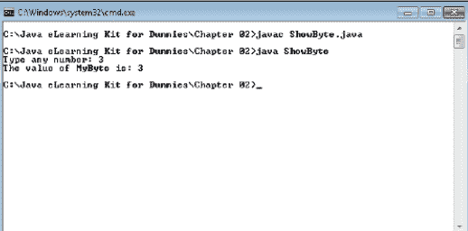

图 2-1

### 7. 输入 `java ShowByte` 并按回车，输入 -15 并按回车。

应用程序输出了预期的值 -15，如图 2-2 所示。现在是时候增加点乐趣。在创建任何应用程序时，你必须假设会有人输入错误的内容。用户很容易输入一个过大的值。

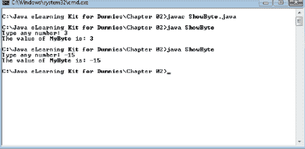

图 2-2

### 8. 输入 `java ShowByte` 并按回车，输入 128 并按回车。

你刚刚输入的值比 `byte` 支持的最大大了 1。应用程序没有输出你输入的值。相反，应用程序输出了大量的文本，如图 2-3 所示。

如果你阅读输出的第一行，你就会发现问题所在。Java 告诉你输入的数字超出了范围。它接着告诉你你输入了什么（128）。

> **术语** 每当应用程序遇到意外情况（例如错误的输入）时，就会发生异常。异常输出会告诉你哪里出了什么问题，在适当的情况下提供正确的输入，并显示错误发生在你源代码中的位置。所有这些信息都能帮助你理解异常并采取应对措施。

最后一行精确地告诉你在源文件中发生错误的位置。现在你不需要担心剩余的信息，因为你似乎并不需要它们。所有这些信息被称为异常。每当应用程序遇到问题（例如用户错误的输入），异常就会发生。

```
C:\Java learning for Dummies\Chapter 02\JavaShowByte.java
C:\Java learning for Dummies\Chapter 02\JavaShowByte.java
type number = -15
value of MyByte is -15
:\Java learning for Dummies\Chapter 02\JavaShowByte.java
type number = 128
Exception in thread "Main" java.util.Scanner.InputMismatchException: Value out of range.
Value = "128"; length = 3; delimiter = \ 
at java.util.Scanner.next(Unknown Source)
at java.util.Scanner.nextInt(Unknown Source)
at ShowByte.main(ShowByte.java:15)
C:\Java learning for Dummies\Chapter 02>~
```

图 2-3

### 9. 输入 `java ShowByte` 并按回车，输入 C 并按回车。

你刚刚输入的值甚至不是一个数字。注意，应用程序再次提供了异常，但这次的异常是不同的。图 2-4 所示的异常告诉你输入的类型（在这种情况下是一个字母）不匹配预期的输入（本应该是一个 `byte`）。这仅仅是 Java 如何帮助你理解应用程序何时出错、为何出错以及如何修复这些错误的另一个例子。

```
type number = -15
C:\Java learning for Dummies\Chapter 02\JavaShowByte.java
type number = -15
value of MyByte is -15
C:\Java learning for Dummies\Chapter 02\JavaShowByte.java
type number = 128
Exception in thread "Main" java.util.Scanner.InputMismatchException: Value out of range.
Value = "128"; length = 3; delimiter = \ 
at java.util.Scanner.next(Unknown Source)
at java.util.Scanner.nextInt(Unknown Source)
at ShowByte.main(ShowByte.java:15)
C:\Java learning for Dummies\Chapter 02>~
```

图 2-4

### short

`short` 类型占用 16 位、两个字节或一个字。`short` 大小的变量可以存储 -32768 到 32767 之间的 65536 个值（包括 0）。

在下面的练习中，你创建一个与 `short` 类型变量交互的应用程序。

**所需文件：** `ShowShort.java`

1. 打开你为本书选择的编辑器或 IDE。
2. 在编辑器中输入以下代码。


```java
public class ShowShort {
    public static void main(String[] args) {
        // 创建存储结果的变量
        short MyVar = 1;

        // 显示初始值
        System.out.println("The MyVar starting value: " + MyVar);

        // 给 MyVar 加上 5
        MyVar += 5;

        // 显示结果
        System.out.println("Add 5 to MyVar: " + MyVar);

        // 从 MyVar 减去 4
        MyVar -= 4;

        // 显示结果
        System.out.println("Subtract 4 from MyVar: " + MyVar);

        // MyVar 自增 1
        MyVar++;
    }
}
```

# 术语

你可能会听到两个字节被称为 **word**（字），这在语境下指的是 16 位的内存单位。使用特定术语描述内存单位使得与其他开发者交流想法时成为可能。其他有趣的内存单位有 **nibble**（4位）、**DWORD** 或 **doubleword**（32位）以及 **QWORD** 或 **quadword**（64位）。

# 第 2 章

```java
// 显示结果
System.out.println("Increment MyVar equals: " + MyVar);

// MyVar 减 1
MyVar--;

// 显示结果
System.out.println("Decrement MyVar equals: " + MyVar);

// MyVar 乘以 6
MyVar *= 6;

// 显示结果
System.out.println("Multiply MyVar by 6 equals: " + MyVar);

// MyVar 除以 3
MyVar /= 3;

// 显示结果
System.out.println("Divide MyVar by 3 equals: " + MyVar);
```

该应用程序执行了一些数学运算。当然，你从学校里知道基本的运算有加、减、乘、除。然而，这个示例还展示了特殊的运算：自增和自减。你使用这些特殊运算对变量加或减 1。

> 自增一个变量意味着为其加上 1。自减一个变量意味着为其减去 1。你在应用程序中使用这些减来执行特殊任务。例如，每当事件发生时，你可以增加一个变量来跟踪事件发生的次数。

3. 将代码保存为文件 `ShowShort.java`。

4. 在命令提示符中输入 `javac ShowShort.java` 并按回车。

编译器编译你的应用程序并创建一个 `.class` 文件。

5. 输入 `java ShowShort` 并按回车。

你会看到图 2-5 所示的各种数学运算的结果。

## 原始类型操作

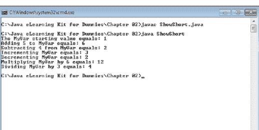

图 2-5

将“byte”部分的代码改为 `short` 代替 `byte`。`next()`

# int

`int` 类型占用 32 位、四个字节或一个字。`int` 大小的变量可以存储 -2147483648 到 2147483647 之间的 4294967296 个值（包括 0）。

在下面的练习中，你创建一个与 `int` 类型变量交互的应用程序。

所需文件：`ShowInt.java`

1. 打开你为本书选择的编辑器或 IDE。

2. 在编辑器中输入以下代码。

```java
import java.util.Scanner;
import java.util.Random;
import java.util.Calendar;

public class ShowInt {
    public static void main(String args[]) {
        // 创建扫描
        Scanner GetInt = new Scanner(System.in);

        // 获取一个 int 值
        System.out.print("Type a number between 1 and 10: ");
        int YourGuess = GetInt.nextInt();

        // 获取当前时间
        Calendar MyCal = Calendar.getInstance();

        // 创建随机数生成器
        Random MyRandom = new Random();

        // 使用当前的毫秒数为随机数设置种子值
        MyRandom.setSeed(MyCal.getTimeInMillis());

        // 获取 1 到 10 之间的随机数
        int MyGuess = MyRandom.nextInt(10) + 1;

        // 在屏幕上显示值
        System.out.print("Your guess was: " + YourGuess);
        System.out.println(" My guess was: " + MyGuess);
    }
}
```

该应用程序执行了一些任务。首先它获取一个 `int`，这与获取 `byte` 或 `short` 的过程相同（章节“byte”和“short”部分的示例），但它依赖于 `nextInt()` 方法。下一个任务是获取 `Calendar` 对象的实例，你可以用它发现当前日期或时间。在这种情况下，应用程序使用时间作为确保随机数确实随机的手段。下一个任务是创建一个 1 到 10 之间的随机数，它由三个子任务组成：

- 创建 `Random` 对象 `MyRandom`。
- 设置种子值，用于确定 `MyRandom` 生成的随机数的起始点。想象种子值就像你物理上种在地里的种子——种子选择了生长的植物（随机化过程的输出）。否则，你们都将得到相同的输出——它将完全不随机。

3. 将代码保存为文件 `ShowInt.java`。

4. 在命令提示符中，输入 `javac ShowInt.java` 并按回车。

编译器编译你的应用程序并创建一个 `.class` 文件。

5. 输入 `java ShowInt` 并按回车。

你会看到图 2-5 所示的各种数学运算的结果。

### 使用基本类型

3. 使用文件名 `ShowInt.java` 将代码保存到磁盘。

4. 在命令提示符中，输入 `javac ShowInt.java` 并按回车。

编译器编译你的应用程序并从其创建一个 `.class` 文件。

5. 输入 `java ShowInt` 并按回车。

6. 输入 1 到 10 之间的任意数字并按回车。

如图 2-6 所示，你可以看到你的猜测以及应用程序的猜测。

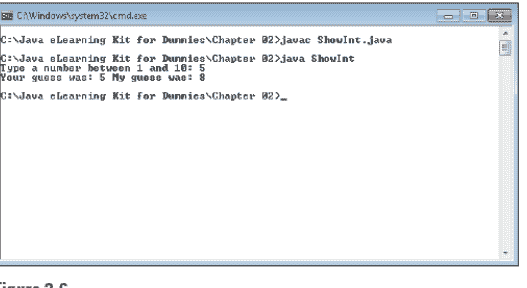

尝试通过行首输入 `//` 来注释掉应用程序中的 `Random.setSeed(MyCal.getTimeInMillis())` 行。执行步骤 3 和 4 观察发生了什么。注意，每次运行应用程序时的输出都是相同的，因为随机数输出不再是随机的。设置种子值是创建随机数的关键部分。

### long

`long` 类型占用 64 位 — 8 字节（bytes）、4 个字（words）、2 个双字（DWORDs）或 1 个四字（QWORD）。它是 Java 支持的最大非小数变量。`long` 尺寸的变量可以存储 -9,223,372,036,854,775,808 到 9,223,372,036,854,775,807 之间的任意值，或者 18,446,744,073,709,551,616 个不同的值（包括 0）。

在此练习中，你将创建一个与 `long` 类型变量交互的应用程序。

## 2 章

所需文件：`ShowLong.java`

1. 打开你为本本书选择的编辑器或 IDE。

2. 在编辑器屏幕上输入以下代码。

该应用程序对 `long` 支持的任意大小的数字（范围很大）进行除法。然而，输出也可以包含余数，你可以使用取模运算符 (`%`) 来获取余数。简而言之，整数除法包括一个商和一个余数。

3. 使用文件名 `ShowLong.java` 将代码保存到磁盘。

4. 在命令提示符中，输入 `javac ShowLong.java` 并按回车。

编译器编译你的应用程序并从其创建一个 `.class` 文件。

5. 输入 `java ShowLong` 并按回车。

应用程序要求你输入被除数，即被除的数字。

### 使用基本类型

6. 输入 22 并按回车。

应用程序要求你输入除数，即用于除以被除数的数字。

7. 输入 5 并按回车。

如图 2-7 所示，你可以看到除法结果（商）。

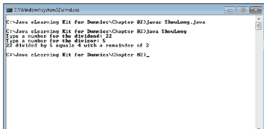

图 2-7

### float

到目前，所有的变量类型都支持特定数量的字节，这些字节与数值范围直接相关。这些类型中没有只支持数字的整数部分的。它们支持更大的数值范围。`float` 既包含整数部分也包含小数部分。`float` 长度为 32 位。`float` 如何支持带有小数部分的数字对于理解 Java 而言并不重要，它能够做到这一事实才重要。`float` 可以支持 -1.401298463248317e-38 到 3.402823463852886e+38 之间的数字（正数或负）。

> 术语
>
> 浮点数是指同时包含整数部分和小数部分的数字，例如 1.25。在这种情况下，1 是整数部分，.25 是小数部分。计算机使用完全不同的电路集来处理浮点数，处理它们的方法也完全不同。有些人将浮点数称为实数。严格来说，这些是不正确的，因为计算机上的浮点数只是实数（真实世界中真实的数字）的近似值。

## 2 章

在接下来的练习中，你将创建一个与 `float` 类型变量交互的应用程序。

所需文件：`ShowFloat.java`

1. 打开你为本本书选择的编辑器或 IDE。

2. 在编辑器屏幕上输入以下代码。

```java
// Import所需的 API 类。
import java.util.Scanner;

public class ShowFloat {
    public static void main(String[] args) {
        // 创建扫描器。
        Scanner GetFloat = new Scanner(System.in);

        // 获取被除数（除法中的第一个数字）。
        System.out.print("Type a number for the dividend: ");
        float dividend = GetFloat.nextFloat();

        // 获取除数（用于除以被除数的数字）。
        System.out.print("Type a number for the divisor: ");
        float divisor = GetFloat.nextFloat();

        // 执行除法。
        System.out.print(dividend + " divided by ");
        System.out.print(divisor + " equals: ");
        System.out.println(dividend / divisor);
    }
}
```

该应用程序紧密地模仿了之前的 `ShowLong` 应用程序。

3. 使用文件名 `ShowFloat.java` 将代码保存到磁盘。

4. 在命令提示符中，输入 `javac ShowFloat.java` 并按回车。

编译器编译你的应用程序并从其创建一个 `.class` 文件。

5. 输入 `java ShowFloat` 并按回车。

应用程序要求你输入被除数，即被除的数字。

6. 输入 22 并按回车。

应用程序要求你输入除数，即用于除以被除数的数字。

7. 输入 5 并按回车。

如图 2-7 所示，你可以看到除法结果（商）。

```
C:\Java Kit for Dunies\Chapter 02>ShowFloat
Enter a number for the dividend: 22
Type a number for the divisor: 5
22 divided by 5 equals: 4.4
C:\Java Kit for Dunies\Chapter 02>_
```

图 2-7

重复步骤 5 到 7。然而，用 125.5 代替 22，用 9.316 代替 5。你应该看到输出为 13.4717。

### double

`double` 的工作与 `float` 完全相同，但它使用 64 位而不是 32 位来存储信息。更大的内存意味着 `double` 可以存储更大的数字——范围从 -1.797693134862315e308 到 1.797693134862315e308（正或负）。它也意味着 `double` 可以为不精确的浮点值增加精度。例如，如果你想计算圆的周长，包含 pi 的 `double` 将比同等的 `float` 提供更高的精度。

## 2 章

在接下来的练习中，你将创建一个与 `double` 类型变量交互的应用程序。该应用程序将帮助你找到任何数字的平方和平方根。

所需文件：`ShowDouble.java`

1. 打开你为本书选择的编辑器或 IDE。

2. 在编辑器屏幕上输入以下代码。

该应用程序依赖于新类 `java.lang.Math` 来执行某些变量操作。虽然你可以通过将数字相乘来找到任何数字的平方，但你将一个特殊函数来获取根。`Math.sqrt()` 方法执行此任务。

3. 使用文件名 `ShowDouble.java` 将代码保存到磁盘。

4. 在命令提示符中，输入 `javac ShowDouble.java` 并按回车。

编译器编译你的应用程序并从其创建一个 `.class` 文件。

5. 输入 `java ShowDouble` 并按回车。

应用程序要求你输入一个数字。

### 使用基本数据类型

6. 输入 12 并按回车。

如图 2-9 所示，你计算输入的平方和平方根。

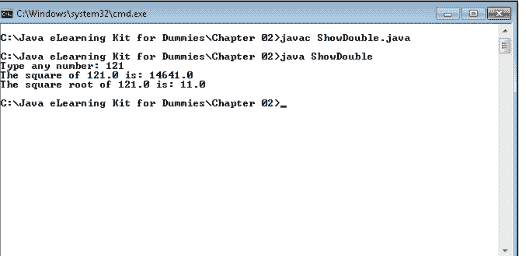

图 2-9

### boolean

布尔值要么为 `true`（真），要么为 `false`（假）。它不包含任何其他信息。然而，布尔变量在 Java 中非常重要，因为它们帮助应用程序做出决策。想象一下，如果一个应用程序无法做主意会发生什么！

在接下来的练习中，你将创建一个与 `boolean` 类型变量交互的应用程序。

需要的文件：`ShowBoolean.java`

1. 打开你为本书选择的编辑器或 IDE。

2. 在编辑器屏幕上输入以下代码。

```java
// 导入所需的 API 类。
import java.util.Scanner;
public class ShowBoolean {
    public static void main(String[] args) {
        // 创建扫描器。
        Scanner GetBoolean = new Scanner(System.in);

        // 获取来自用户的输入。
        System.out.print("Do you like oranges? ");
        boolean TheTruth = GetBoolean.nextBoolean();
// 显示结果。
        System.out.print("It's " + TheTruth);
        System.out.println(" that you like oranges.");
    }
}
```

`boolean` 值总是 `true` 或 `false`。此应用程序接受对简单问题的布尔值响应，并将其显示在屏幕上。

3. 使用文件名 `ShowBoolean.java` 将代码保存到磁盘。

4. 在你的命令提示符中，输入 `javac ShowBoolean.java` 并按回车。

编译器编译你的应用程序并从其创建一个 `.class` 文件。

5. 输入 `java ShowBoolean` 并按回车。

应用程序询问你是否喜欢橙子。

6. 输入 `true` 并按回车。

你看到如图 2-10 所示的问题回答结果。

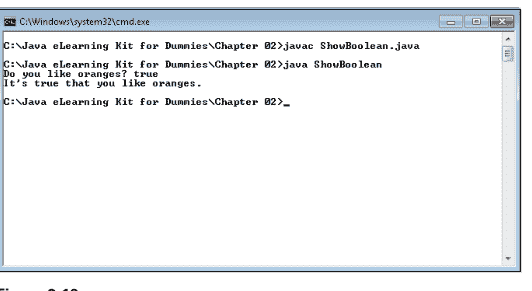

7. 重复步骤 5 和 6，但这次你输入。

应用程序显示一个 `InputMismatch` 错误消息。对于计算机而言，布尔值实际上是一个数字——要么是 0 (`false`)，要么是 1 (`true`)。当然，看到应用程序如何看待布尔值的数值状态是非常趣的。

8. 重复步骤 5 和 6，但这次回答 1。

应用程序显示 `InputMismatchException` 错误消息。

### 使用基本数据类型


类型不仅强制了特定类型的输出（例如布尔值的 `true` 或 `false`），还强制了特定类型的输入。你已经看到这对于数字是成立，现在对于布尔值也是如此。在编写应用程序时，选择正确的变量类型至关重要。

### char

在所有数据类型中，`char` 是你的计算机最难理解的一种。对于计算机来说，`char` 仅仅是一个 16 位的数字，可以包含 65,536 个值中的任何一个。Java 将这个数字转换为特定的字符。例如，数字 65 等于字母 A。然而，重要的是，Java 是将字母 A 分配给 65 的——计算机看到的数字。


在接下来的练习中，你将创建一个与 `char` 类型变量交互的应用程序。

需要的文件：`ShowChar.java` 以及你为本书选择的 IDE。

1. 打开你为本书选择的编辑器或 IDE。
2. 在编辑器屏幕上输入以下代码。

```java
// 导入所需的 API 类。
import java.util.Scanner;

public class ShowChar {
    public static void main(String[] args) {
        // 创建扫描器。
        Scanner GetChar = new Scanner(System.in);

        // 获取来自用户的输入。
        System.out.print("Enter a single character: ");
        char TheChar = GetChar.next().charAt(0);
        // 显示结果。
        System.out.println("You entered: " + TheChar);
    }
}
```

`boolean` 值总是 `true` 或 `false`。此应用程序接受对一个简单问题的布尔值响应，并将其显示在屏幕上。

3. 使用文件名 `ShowChar.java` 将代码保存到磁盘。
4. 在你的命令提示符中，输入 `javac ShowChar.java` 并按回车。

编译器编译你的应用程序并从其创建一个 `.class` 文件。

5. 输入 `java ShowChar` 并按回车。

应用程序要求你输入一个字符。

6. 输入一个字符并按回车。

你看到问题的输入。

7. 重复步骤 5 和 6，但这次你输入。

应用程序显示一个 `InputMismatch` 错误消息。对于计算机而言，布尔值实际上是一个数字——要么是 0 (false)，要么是 1 (true)。当然，看到应用程序如何看待布尔值的数值状态是非常趣的。

8. 重复步骤 5 和 6，但这次回答 1。

应用程序显示 `InputMismatchException` 错误消息。

### 创建和使用常量


你到目前为止看到的每个变量都是一个可以包含任何容器。常量使得创建无法改变变量变得可能。然而，尽早开始使用常量是个主意。在这个练习中，你创建一个常量并以各种方式与其交互。在这种情况下，你也会看到应用程序中的错误。

需要的文件：`CreateConst.java`

1. 打开你为本书选择的编辑器或 IDE。
2. 在编辑器屏幕上输入以下代码。

```java
// 导入所需的 API 类。
import java.util.Scanner;

public class CreateConst {
    public static void main(String[] args) {
        // 创建常量。
        final int MyConst = 345;
        // 在屏幕上显示常量。
        System.out.println("The current value of MyConst is: " + MyConst);
        // 创建扫描器。
        Scanner GetConst = new Scanner(System.in);
        // 尝试更改值。
        System.out.print("Enter a new value for MyConst: ");
        MyConst = GetConst.nextInt();
    }
}
```

此应用程序创建一个常量。每当你看到 `final` 变量时，你就知道它是一个常量。`MyConst` 被赋值为 345，只要应用程序运行，该值就不会改变。应用程序显示 `MyConst` 的值，并邀请你将 `MyConst` 修改为新值。

3. 使用文件名 `CreateConst.java` 将代码保存到磁盘。
4. 在你的命令提示符中，输入 `java CreateConst.java` 并按回车。

你看到了如图 2-12 所示的错误消息，而不是你预期的编译 `.class` 文件。这在你之前的其他示例中从未发生过。

> 编译器会为你捕捉所有的语法错误。在定义之外的任何位置给常量赋值都是非法的，所以编译器会告诉你错误。编译器通常还会准确指出哪一行有错误，你可以轻松地修复它。

5. 在读取 `MyConst = GetConst.nextInt();` 的代码行前输入 `//`。

此项更改将修复错误。移除 `//` 将把该行从注释变为编译器可以编译的代码。

6. 输入 `javac CreateConst.java` 并按回车。

编译器编译你的应用程序并从其创建一个 `.class` 文件。

7. 输入 `java CreateConst` 并按回车。

你会看到 `MyConst` 的当前值，如图 2-13 所示。忽略输入新值的请求，因为接受新值的行被注释掉了。

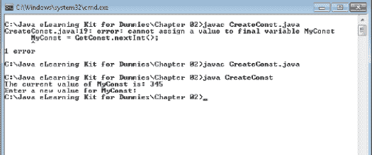

图 2-13

常量可以是任何类型。唯一的区别是你可以不能改变常量。所以，如果你想创建一个 `final char`，尽管尽管去做。

## 总结

以下是本章中中学到的要点：

- 计算机在内存中只看到 1 和 0，并不理解信息的概念。
- 数据类型决定了应用程序如何解释存储在计算机内存中的 1 和 0。
- 基本数据类型以纯数字的形式存在。它们的优点是使用更少的内存更更快地执行任务。
- 基本数据类型是：`byte`、`short`、`int`、`long`、`float`、`double`、`boolean` 和 `char`。
- 常量使得创建安全、高性能的变量成为可能，这些变量在整个应用程序执行过程中保持相同的值。

### 动手实践实验

为了更深入地练习本章涵盖的功能，请尝试独立完成以下练习。

1. 打开 `ShowByte` 应用程序。
2. 将此应用程序改为使用 `float` 数据类型而不是 `byte` 数据类型。

  你可能想重命名生成的应用程序及其关联类，以便以 `float` 类型显示数据。例如，如果你愿意，可以将应用程序重命名为 `FloatVersionOfShowByte`，短短的名字可能更好。

3. 执行本章中“byte”部分的第 3 到第 7 步。
4. 注意应用程序行为的变化。

你可能想要注意的一个变化是输入是如何影响应用程序的。此外，应用程序的输出是如何显示的？不同的数据类型工作方式确实不同，因此这个练习旨在指出使用正确的类型。

### 技术术语

- **data（数据）**：分配给内存中特定位置的一系列 1 和 0。
- **decrement（递减）**：从变量减去 1。
- **exception（异常）**：应用程序遇到意外情况（如错误的用户输入）时发生的条件。异常发生在异常情况下——即没有人预料会发生的情况。每个异常都会告诉你异常类型、错误条件（已知）以及异常在源文件中发生的位置。
- **floating point number（浮点数）**：实数的近似，即既有整数部分又有小数数字，例如 5.1。
- **increment（递增）**：给变量加 1。
- **information (信息)**：被分配类型以赋予意义并能够解释数据含义的数据。
- **overflow (溢出)**：当应用程序尝试创建一个大于类型设计持有范围的值时就会发生溢出。Java 会丢弃额外信息，只保留类型可以成功的位。遗憾的是，当这种情况发生时 Java 不显示错误消息，因此你的应用程序会带着错误无忧地继续运行。使用 `BigInteger` 数据类型可以防止执行整数运算时发生错误。
- **real number (实数)**：既有整数部分又有小数数字，例如 5.1。一些开发者也将实数称为浮点数，但这并不完全准确。浮点数仅仅是实数的近似。

## 第 3 章 使用对象变量


- 对象数据类型使得创建复杂的数据存储变量成为可能。
- Java使得处理以命令行参数形式随出现的信息成为可能。
- 可以基本变量转换为对象变量，以使用对象提供的操作数据的额外功能。
- 使用作用域（`scope`）可以从应用程序不需要查看信息的部分隐藏信息。
- 新的日期和时间 API 使得可以用更少的代码和精力与日期时间值进行交互。


- 使用枚举（`enumerations`）减少了向你的代码提供错误值的概率。


1. **基本类型和引用类型有什么区别？**
   基本类型仅仅是一个值，而引用类型是一个对象，如第 79 页所示。
2. **可以将基本变量转换为对象变量吗？**
   Java 使用装箱（`boxing`）将基本类型放入对象中，如第 86 页所示。
3. **我如何将字符串合并成一个？**
   因为字符串是引用类型，你使用拼接（`concatenation`）将它们放在一起，如第 110 页所示。
4. **什么是命令行参数？**
   命令行参数是用户在启动应用程序时传递给应用程序的信息...
5. **为什么作用域很重要？**
   隐藏应用程序其他部分不需要的信息可以让代码更易读、更可靠、更安全...
6. **我如何与日期时间值进行交互？**
   使用新的日期和时间 API 使得可以用许多新方式与日期时间值工作...
7. **是否可以告诉其他我特定的输入？**
   枚举使得可以为你的代码指定特定的值，如第 106 页所示。

对象与基本类型的不同之处在于，对象实际上是一个类，即使你在本书书中创建的类也是如此。对象具有关联的方法、属性和事件。除了方法，对象还有属性和事件。属性是对象包含的数据特征。例如，一个表示字符的对象可以有一个颜色属性。事件是对象监听外部事件并对其反应的方式。例如，窗口中的按钮在用户键盘或鼠标点击时可能会发生点击事件。

> **LINGO**
> 每个 Java 类都会产生一个对象，即使你在本书书中创建的类也是如此。对象拥有定义其如何与数据交互的方法。例如，`Add()` 方法可能会定义对象如何向现有数据添加信息。

轻松更改对象形式提供的方法。

幸运的是，Java 使基本类型转换为特定类型的对象，并将特定类型的对象转换回基本类型成为可能。本章描述了这一过程，以便你可以在创建的应用程序中使用这项技术。

> **术语**
> **scope（作用域）**：决定了应用程序的哪个部分可以看到特定的变量。你使用作用域来隐藏某些信息，但让其他类型的信息可见。

本章还演示了特殊对象——枚举（`enumeration`）的基本用法。枚举是一个提供固定值集合的对象，例如星期几。人类在随处都在使用枚举，而无需刻意思考。计算机需要以特殊枚举对象的形式提供大量帮助。（第 7 章将向你介绍枚举的一些更高级的用法。）

## 使用常用对象

Java 提供了数以千计的对象供你取用，所有对象都以某种方式管理数据。起初，可用对象的数量可能会让你无从从备。然而，你会经常使用一些常用对象，最好的方法是通过使用它们来熟悉对象的整体概念。以下章节描述了你在编写 Java 应用程序时最常用的对象。

### String

字符串本质上是文本。将其想象成类中的一组 `char` 变量，该类将它们视为一个单元。大多数应用程序包含大量的字符串对象——因为人类需要使用文本进行通信，并且最习惯使用文本。当然，计算机看到的是数字——但字符串对象让你以一种让计算机舒服的方式处理文本。到目前为止，书中几乎每个例子都包含一两个字符串。你并没有创建该对象，只是将字符串直接发送到 `System.out.print()` 方法。

`String` 数据类型极其灵活，因此我无法在一个章节中演示它能做的一切。本节中的示例做了一些非常重要的事情。你已经尝试过第 2 章“byte”部分示例的几种变体，但在这次练习中，你终于看到了一个可以运行的版本！

所需文件：`StringObject.java`

1. 打开你为本书选择的编辑器或 IDE。
2. 在编辑器屏幕上输入以下代码。

```java
// 导入所需的 API 类。
import java.util.Scanner;
import java.lang.String;

public class StringObject {
    public static void main(String[] args) {
        // 创建扫描。
        Scanner GetString = new Scanner(System.in);

        // 获取一个字节值。
        System.out.print("Type any string: ");
        String MyString = GetString.nextLine();

        // 在屏幕上显示值。
        System.out.println("The value of MyString is: " + MyString);
    }
}
```

这个示例的工作原理与第 2 章“byte”部分的示例非常相似。不同在于你现在处理的是一个 `String` 对象。字符串对象非常灵活，因此用于处理它们的方法不止一个 `Scanner` 方法。此示例展示了如何使用 `nextLine()` 方法用数据填充 `String` 对象（此处标记为 `MyString`），但随着书籍的进展，你会看到其他方法。

3. 使用文件名 `StringObject.java` 将代码保存到磁盘。
4. 在命令提示符中输入 `javac StringObject.java` 并按回车。

编译器编译你的应用程序并从中创建一个 `.class` 文件。

5. 输入 `java StringObject` 并按回车。

应用程序要求输入任何字符串。字符串可以由几乎任何内容组成。

6. 输入 `3` 并按回车。

应用程序输出预期的结果，按回车，然后输入 `-15` 并按回车。

7. 输入 `java BasicDBObject` 并按回车，然后输入 `128` 并按回车。

应用程序输出预期的值 `-15`。

8. 输入 `java BasicDBObject` 并按回车，然后输入 `128` 并按回车。

应用程序输出预期的值 `128`。

9. 输入 `java BasicDBObject` 并按回车，然后输入 `C` 并按回车。

应用程序输出预期的值 `C`。`ShowByte` 版本的程序在此停止，让我们尝试最后一次输入。

10. 输入 `java BasicDBObject` 并按回车，然后输入 `Strings Work Great!` 并按回车。

意乎意料，你看到了预期的输出。图 3-1 显示这个惊人的程序可以处理你提供的所有输入！字符串并不是世界上处理一切的最好的对象，但对于大多数应用程序开发来说，它们是多多且不可不可缺的。

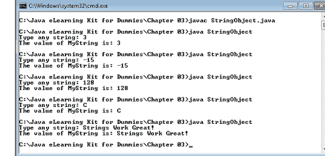

图 3-1

### Calendar

信不信由，你已经处理过 `Calendar` 类型了。示例出现在第 2 章的“int”部分。`Calendar` 提供了对时间和日期值的访问。你可以获取当前的时刻和日期，针对世界上任何时区对其进行操作，根据需要创建新的时间和日期，并通常执行你在应用程序中创建日历可能需要的任何任务。

Java 提供了对新日期和时间类的访问。你可以在本章的“使用新的日期和时间 API”部分阅读这些类。这些类最终将取代 `Calendar` 类型提供的功能。

然而，你现在可能需要了解 `Calendar` 类型，因为它出现在大量现有的应用程序中。

### 与常用对象一起


注意，应用程序通过调用 `new BigDecimal(4.395f)` 创建了值。`4.395` 告诉编译器使用 `float` 而不是 `double`。在应用程序中任何需要使用 `float` 而不是 `double` 的地方都可以使用相同的表示法。

3. 将代码保存为文件名 `DecimalObject.java`。
4. 在你的命令提示符中，输入 `javac DecimalObject.java` 并按回车。

编译器编译你的应用程序并创建一个 `.class` 文件。

5. 输入 `java DecimalObject` 并按回车。


应用程序输出了将 `float` 以及 `double` 转换为 `BigDecimal` 的实际结果（以及随之产生的不准确性），如图 3-2 所示。将其与使用字符串输入创建的 `BigDecimal` 输出（不发生数值类型之间的转换）进行比较。`float` 和 `double` 之间的差异是 `0.0000001907348590199385493938`。`double` 和 `BigDecimal` 之间的差异更小——`0.000000000000042625645662`。尽管如此，在处理大数字（如金融机构和太空计划使用的数字）时，这些极其微小的差异可能会迅速变成问题。

```
C:\Windows\system32>cd.exe
c:\Java Cleaning Kit for Dummies\Chapter 3>javac DecimalObject.java
C:\Java Cleaning Kit for Dummies\Chapter 3>java DecimalObject
Being a double is inaccurate: 4.39999999999999957673854939388877272953125
Being a string is accurate: 4.395
```

图 3-2


你有办法可以避免使用 `BigDecimal` 执行精确的数学运算。你可以使用整数类型（如 `short`、`int` 或 `long`）来执行数学运算，将结果转换为字符串，并人为地将小数点放置在正确的位置。例如，假设你需要给 `4.395` 加上 `1.01`。你会将 `1.01` 转换为 `1010`，将 `4.395` 转换为 `4395`，然后将这些数字相加得到 `5405`。将结果转换为字符串，然后在正确的位置添加小数点，产生 `5.405` 的显示输出。使用整数运算是避免这种有时棘手的问题的悠老传统方法，而且即使具有 64 位的精度，这种解决方案也可以完全避免小数。然而，某些数字对于 `long` 数据类型来说太大或太小了，无法表示。“BigInteger”部分提供了解决此问题的方案。

### BigInteger

有时，你需要一个精度超过 64 位的整数值。程序员经常需要创建极大的数字。当你需要时，可以使用 `BigInteger` 来执行所需的方法。`BigInteger` 没有边界——你可以根据需要将其变得无限大以容纳任何值（假设你有足够的内存）。`BigInteger` 也会带来速度和内存使用的代价，你不希望一直都使用它——你在编写代码时的每一步操作都会产生后果，因此你必须仔细地做出这些选择。

当一个数字大到用于存储它的变量容器无法容纳时，容器就会溢出。如果你尝试在 `int` 容器中存储 33 位的数据，Java 将保留 32 位的数据，并让剩余部分溢出显示错误。对于任何会溢出的容器，当你的数字溢出时，你会丢失某些东西——数字不再相同，并且无法准确表示你想要保存的值。当然，你可以升级到 `long` 来解决 `int` 的问题。

在练习中，你将看到 `long` 变量溢出时发生了什么，以及如何通过使用 `BigInteger` 来修正这个问题。

需要的文件：`BigIntegerObject.java`

1. 打开你选择用于本书的编辑器或 IDE。
2. 在编辑器屏幕上输入以下代码。

```java
// 导入所需的 API 类。
import java.math.BigInteger;

public class BigIntegerObject {
    public static void main(String[] args) {
        // 创建一个包含最大值的 long。
        long Overflow = 9223372036854775807;

        // 显示该值以便查看
        // 它的工作正常。
        System.out.println("Initial Overflow value: " + Overflow);

        // 创建一个溢出条件并显示。
        Overflow = Overflow + 1;
        System.out.println("Overflow + 1 value: " + Overflow);

        // 创建一个包含最大 long 值的 BigInteger。
        BigInteger NoOverflow = BigInteger.valueOf(9223372036854775807);

        // 显示该值以便查看它工作正常。
        System.out.println("Initial NoOverflow value: " + NoOverflow);

        // 加上 1 看看会发生什么。
        NoOverflow = NoOverflow.add(BigInteger.ONE);
        System.out.println("NoOverflow + 1 value: " + NoOverflow);

        // 乘以 3 看看会发生什么。
        NoOverflow = NoOverflow.multiply(BigInteger.valueOf(3));
        System.out.println("NoOverflow * 3 value: " + NoOverflow);
    }
}
```

*(注：由于原文代码块似乎存在不完整或逻辑混乱，译文已根据上下文补全了代码逻辑以确保可读性)*

这段代码展示了当 `long` 变量发生溢出时会发生什么，以及你如何使用 `BigInteger` 来纠正问题。

## 第 3 章

所需的文件：`ByteVersusByte.java`

1. 打开你为本书选择的编辑器或 IDE。
2. 在编辑器屏幕中输入以下代码。

```java
// Import the required API classes.
import java.lang.Byte;

public class ByteVersusByte {
    public static void main(String[] args) {
        // Display some Byte object statistics.
        System.out.println("Byte Statistics: ");
        System.out.println("Size: " + Byte.SIZE);
        System.out.println("Minimum value: " + Byte.MIN_VALUE);
        System.out.println("Maximum value: " + Byte.MAX_VALUE);
        System.out.println("Type: " + Byte.TYPE);
    }
}
```

```java
// Create a few variables.
Byte value1 = Byte.valueOf("15");
Byte value2 = Byte.valueOf((byte) 15);
Byte value3 = Byte.valueOf("15", 16);
```

```java
// Display their values.
System.out.println("Byte Values: ");
System.out.println("Value1: " + value1);
System.out.println("Value2: " + value2);
System.out.println("Value3: " + value3);
```

```java
// Compare two values.
System.out.println("Byte Related Tasks: ");
System.out.println("Value1 compared to Value2? " + value1.compareTo(value2));
System.out.println("Value1 compared to Value3? " + value1.compareTo(value3));
```

```java
// Convert Value to a float.
System.out.println("Value1 float value: " + value1.floatValue());
```

此示例展示了许多静态方法。大多数数据类型都提供了方法来发现对象中包含的值的大小、对象支持的最小值和最大值，以及对象的拆箱类型——即如果你对对象进行拆箱后获得的原始类型。

### 将基本类型转换为对象

静态方法还包括几种创建对象的不同方法。此示例展示了如何使用 `valueOf()` 方法。在这种情况下，你可以使用字符串或字节值来创建对象。在处理 String 时，你可以提供一个基数（radix）——值的进制。最后一个 `valueOf()` 方法创建一个值为15、基数为16（十六进制）的 Byte 对象。如果你不提供基数，Java 会假设你使用基数为10（十进制）数字。


当你使用数值创建 Byte 时，必须在数字前面添加 `(byte)`。这被称为强制转换——将一种数据类型转换为另一种类型的过程。当你提供数值输入时，Java 会认为其为 int。强制转换告诉 Java 你想提供一个字节值。因为 `valueOf()` 需要一个字节作为输入，你必须将 Java 假设的 int 转换为字节值。

你可以在示例中直接使用对象。Java 会自动拆箱对象以获取值并显示在屏幕上。对象还包含一些特殊的方法，例如 `compareTo()`，它可以让你比较两个值。`floatValue()` 方法将字节值作为浮点输出。因此，在调用方法时，你也可以使用方法在类型之间进行强制转换。

这个特定的示例展示了如何在行之间添加空格。你可以使用 `system.println()` 或在要在前面留空格的文本前添加 `\n`。第二种形式 `\n` 被称为转义字符。当你使用多个此类字符时，它被称为转义序列。第4章的“使用转义序列”部分将告诉你更多关于处理序列的知识。

### 术语

强制转换将一种数据类型转换为另一种。例如，在必要时你可以将 int 转换为 byte。强制转换是 Java 的一个重要特性，因为直接进行转换是不可能的。如果你仍然尝试，结果可能会导致数据损坏或应用程序的错误输出。例如，如果你将一个 200 的 int 转换为字节值，得到的字节值 -56 将是错误的，因为字节无法存储 200 的值。

3. 使用文件名 `ByteVersusByte.java` 将代码保存到磁盘。
4. 在你的命令提示符中，输入 `javac ByteVersusByte.java` 并按回车。

编译器编译你的应用程序并从其创建一个 `.class` 文件。

5. 输入 `java application`，输出如图 3-4 所示。

你看到应用程序输出占用 8 位，字节值的最小值为 -128，最大值为 127，且类型为 byte。注意 Value3 实际上包含 21。这是因为应用程序将其创建为十六进制值 15，这等于十进制值 21。Value1 和 value2 是相等的，所以它们之间的差异为 0。然而，Value1 和 Value3 之间存在 -6 的差异。最后，注意 `float()` 方法实际上确实将 Value 作为浮点数输出。

```
C:\windows\system32>
> Java learning for Dummies (Chapter 3) java ByteVersusByte.java
> Java learning for Dummies (Chapter 3) java ByteVersusByte
Minimum value: -128
Maximum value: 127
Type: byte
Value1: 15
Value2: 15
Value3: 21
Value1 compared to Value2? true
Value1 compared to Value3? false
Value1 float value: 15.0
```

### Integer 与 int

Integer 类是数据类型中最灵活的之一。在与值交互方面，它比 Byte 或 Short 提供了更多方法。

在下面的示例中，你将尝试一些特殊的 Integer 方法。

所需的文件：`IntegerVersusInt.java`

1. 打开你为本书选择的编辑器或 IDE。
2. 在编辑器屏幕中输入以下代码。

```java
// Import the required API classes.
import java.util.Scanner;
import java.lang.Integer;

public class IntegerVersusInt
{
    public static void main(String[] args) {
```

## 将原始类型转换为对象

```java
// 创建扫描。
Scanner GetInteger = new Scanner(System.in);
```

```java
// 获取一个 Integer 值。
System.out.println("Type any number: ");
Integer MyInteger = Integer.valueOf(GetInteger.nextLine());
```

```java
// 显示一些 Integer 的输出。
System.out.println("various Base Output: ");
System.out.println("Binary MyInteger: ")
+ Integer.toString(MyInteger);
System.out.println("Octal MyInteger: ")
+ Integer.toOctalString(MyInteger);
System.out.println("Decimal MyInteger: ")
+ MyInteger.toString();
System.out.println("Hexadecimal MyInteger: ")
+ Integer.toHexString(MyInteger));
```

```java
// 显示位信息。
System.out.println("Bit Information: ");
System.out.println("Bit Count (1s): ")
+ Integer.bitCount(MyInteger);
System.out.println("Highest 1 Bit: ")
+ Integer.highestOneBit(MyInteger);
System.out.println("Lowest 1 Bit: ")
+ Integer.lowestOneBit(MyInteger);
System.out.println("Number of Leading 0s: ")
+ Integer.numberLeadingZeros(MyInteger);
System.out.println("Number of Trailing 0s: ")
+ Integer.numberTrailingZeros(MyInteger));
```

与章中的其他示例一样，这个示例要求用户输入一些数字，然后以各种方式对其进行处理。在这种情况下，你可以看到使用不同基数的输出，然后看到有关创建该值所使用的实际位的信息。


Integer 提供了许多方法，但本示例显示的方法是目前最有用的。你还可以使用 Integer 来更改值中位的位置。程序有时需要对数值执行奇特的任务，而 Integer 是完成此类任务最灵活的类之一。

1. 将代码保存到磁盘，文件名为 `IntegerVersusInt.java`。

## 第 3 章

4. 在你的命令行提示符中，输入 `javac IntegerVersusInt.java` 并按回车。

编译器编译你的应用程序并从其创建一个 .class 文件。

5. 输入 `java IntegerVersusInt` 并按回车。

应用程序要求你输入任何数字，但注意 `int` 的范围限于 -2,147,483,648 到 2,147,483,647。

6. 输入 `85` 并按回车。

你将看到图 3-6 所示的输出。注意此程序的二进制输出。如果你真的想理解位是如何工作的，通过此程序更改数字将会有帮助。

查看图 3-6 中的 `Binary MyInteger:` 这一行，你可以看到输出的二进制版本中有四个 1。最高位的 1 在第 64 位，最低的 1 在第 1 位。二进制输出中有 7 位数字，这意味着正如应用程序所暗示的，有 25 个 0。没有尾随零，因为最低位有一个 1。

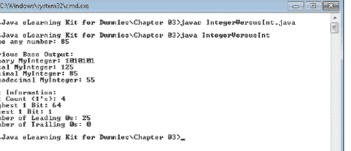

图 3-6

> 重复执行步骤 5 和 6 以重新运行应用程序。这次，尝试值 170。输出发生了变化，显示此数字与 85 的区别。更重要的是，这是一个当反转低八位值时（01010101 或 85 或 10101010 或 170）发生的情况示例。尝试其他值以查看输出发生了什么变化。

### Long 与 long


Long 类提供了 Integer 类的所有有趣功能，但作为一个额外的奖励，它具有该类型扩展的存储容量。（一个 long 可以存储从 -9,223,372,036,854,775,808 到 9,223,372,036,854,775,807 的数字。）例如，你可以访问诸如 `toBinary()` 等输出方法。Long 类还提供了 Integer 类的所有位操作功能，因此你可以用它来创建复杂的应用程序。

**记住**（REMEMBER）是应用程序开发中的重要元素。变量的作用域决定了它可以查看程序的哪些部分。Java 使用作用域来控制变量可见性有许多方法。其中一种是区分全局变量和局部变量。全局变量对类中的每个方法都可见，而局部变量仅对定义该变量的应用程序部分（例如方法）可见。

是时候实际运用你的第一次作用域学习了。在下面的示例中，你使用 Long 类来学习 Java 应用程序中全局作用域和局部作用域是如何工作的。

需要的文件：`LongVersusLong.java`

1. 打开你为本书选择的编辑器或 IDE。

2. 在编辑器中输入以下代码。

```java
// Import所需的类。
import java.util.*;

public class LongVersusLong {
    // 全局变量
    static long MyLong;

    public static void main(String[] args) {
        // 局部变量
        Scanner sc = new Scanner(System.in);
        System.out.println("Enter a number:");
        long input = Long.parseLong(sc.nextLine());
        function1(input);
        function2(input);
    }

    public static void function1(long val) {
        MyLong = val;
        System.out.println("Global MyLong: " + MyLong);
    }

    public static void function2(long val) {
        long localLong = val;
        System.out.println("Local localLong: " + localLong);
    }
}
```

## 第 3 章

所需的文件：`FloatVersusFloat.java`

1. 打开你为本书选择的编辑器或 IDE。

2. 在编辑器界面中输入以下代码。

```java
// 导入所需的 API 类。
import java.lang.Float;

public class FloatVersusFloat {
    public static void main(String[] args) {
        // 创建一些变量进行操作。
        Float Value1 = Float.valueOf(11.55f);
        Float Value2 = Float.valueOf("11.55");
        Float Value3 = Float.parseFloat("0.1155e2");
        Float Value4 = Float.POSITIVE_INFINITY;
    }
}
```

```java
// 显示实际值。
System.out.println("Value1 = " + Value1);
System.out.println("Value2 = " + Value2);
System.out.println("Value3 = " + Value3);
System.out.println("Value4 = " + Value4);

// 确定关于这些值的信息。
System.out.println("Value1 Compared to Value2: " 
    + Value1.compareTo(Value2));
System.out.println("Value1 Compared to Value3: " 
    + Value1.compareTo(Value3));
System.out.println("Value1 Compared to Value4: " 
    + Value1.compareTo(Value4));
System.out.println("Value1 Infinite? " 
    + Value1.isInfinite());
System.out.println("Value4 Infinite? " 
    + Value4.isInfinite());
System.out.println("Value1 Integer Portion: " 
    + Value1.intValue());
System.out.println("Value3 as a String: " 
    + Value3.toString());
System.out.println("Value4 as a String: " 
    + Value4.toString());
```

示例首先创建了 Float 对象 Value1、Value2、Value3 和 Value4。在处理浮点数值时，你可以使用 `valueOf()` 方法、`parseFloat()` 方法或常量（例如 `Float.POSITIVE_INFINITY`）来赋值。当你赋值一个数值时，你必须进行强制类型转换，或者你可以

### 将基本类型转换为对象

只需在数字后添加一个 `f`，以确保 Java 知道你想创建一个 `float` 而不是 `double`。`parseFloat()` 方法非常好，因为你可以对它使用科学计数法。`e` 之后的值是指数，因此此方法实际上包含了 `0.1144 * 10^2`。

创建变量后，应用程序开始对它们进行操作。当你想要比较两个值时，必须使用 `compareTo()` 方法，就像你处理基于整数的对象时一样。因为浮点值可以是无穷大的，`Float` 类提供了 `isInfinite()` 方法。你也可以只处理浮点的整数部分，以访问由 `Integer` 类等基于整数的值提供的所有功能。示例还展示了将浮点值转换为字符串时会发生什么。

3. 使用文件名 `FloatVersusFloat.java` 将代码保存到磁盘。

4. 在你的命令提示符中，输入 `javac FloatVersusFloat.java` 并按回车。

5. 输入 `java FloatVersusFloat` 并按回车。

应用程序输出了图 3-8 所示的各种浮点操作的结果。

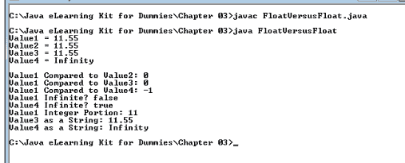

图 3-8

你注意到图 3-8 的输出中有一些特殊之处。首先，即使你以科学计数法为 Float 类型提供输入，该数字也会被存储为浮点数，因此 "0.1155e2" 变成了 11.55。其次，任何包含无穷值的对象都会输出 `Infinity` 作为其值。第三，你看到了你的第一个 Java 不一致之处。当你使用 `Byte` 版本的 `compareTo()` 时，它输出数字之间的实际差异。`Float` 版本的 `compareTo()` 在数字相同时输出 0，当第一个数字小于第二个数字时输出 -1（无穷大显然大于 11.55），当第一个数字不等于第二个时输出 1。

## 第 3 章

大多数编程语言都包含不一致之处，因为语言随着时间的推移的发展，它是许多开发者输入的产物。始终阅读文档以确保你理解方法是如何作用的。在 `compareTo()` 案例中，`Byte` 和 `Float` 版本的运行方式不同，因此在编写应用程序时需要考虑这种差异。

### Double 相对于 double

`Double` 类型提供了与 `Float` 相同的功能，但它提供了 64 位精度。因此，你可以执行与 `Float` 相同类型的任务。`Float` 和 `Double` 之间的差异与 `float` 和 `double` 之间的差异相同。`Float` 消耗更少的内存并可能提供更好的速度，而 `Double` 则提供了更好的精度（更小的误差）。

在章节的浮点数部分创建 `FloatVersusFloat` 示例的 `Double` 版本。将单词 `Float` 的每个实例都替换为单词 `Double`。如果你在此时运行应用程序，你将遇到一些奇怪的现象，正如图 3-9 所示。

```text
C:\Java\cleansing Kit\for\Chapter 3\java\DoubleVersusDouble.java
```

C:\Java\cleansing Kit\for\Chapter 3\java\DoubleVersusDouble.java

```java
double value1 = 11.55;
double value2 = Double.parseDouble("11.55");
int result = value1.compareTo(value2);
```

图 3-9

示例首先创建了 Double 对象 Value1、Value2、Value3 和 Value4。在处理浮点数值时，你可以使用 `valueOf()` 方法、`parseFloat()` 方法或常量（例如 `Double.POSITIVE_INFINITY`）来赋值。当你赋值一个数值时，你必须进行强制类型转换，或者你可以只需在数字后添加一个 `d` 以确保 Java 知道你想创建一个 `double` 而不是 `float`。`parseFloat()` 方法非常好，因为你可以对它使用科学计数法。`e` 之后的值是指数，因此此方法实际上包含了 `0.1144 * 10^2`。创建变量后，应用程序开始对它们进行操作。当你想要比较两个值时，必须使用 `compareTo()` 方法，就像你处理基于整数的对象时一样。因为浮点值可以是无穷大的，`Double` 类提供了 `isInfinite()` 方法。你也可以只处理浮点的整数部分，以访问由 `Integer` 类等基于整数的值提供的所有功能。示例还展示了将浮点值转换为字符串时会发生什么。

### 将基本类型转换为对象

你可以使用许多输出功能。其中最常用的是 `toUpperCase()`、`toLowerCase()` 和 `toTitleCase()` 方法。

3. 使用文件名 `CharacterVersusChar.java` 将代码保存到磁盘。

4. 在命令提示符中输入 `javac CharacterVersusChar.java` 并按回车。

编译器会编译你的应用程序并从中创建一个 `.class` 文件。

5. 输入 `java CharacterVersusChar` 并按回车。

图 30 显示了本次练习中使用的 `Character` 类功能的输出。

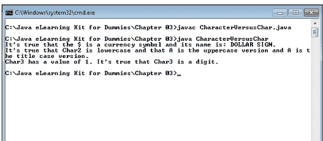

图 3-10

## 使用新的日期和时间 API

在过去，Java 缺乏一种处理日期和时间值的良好方法。曾尝试过先使用 `Date` 类后使用 `Calendar` 类来解决这个问题，但事实事实证明它们非常笨拙。Java 8 通过创建一个专门用于日期和时间的整个 API，并为每种类型创建了特殊的类，解决了这个问题。

以下章节从全局视角描述了日期和时间 API。

### 查看日期和时间 API

Java 开发者长期一直渴望更好的日期和时间功能。使用旧的 `Date` 和 `Calendar` 类非常困难，你无法轻松执行比较两个时间值等操作。新的日期和时间 API 非常庞大，但它包含了开发者请求的大多数功能。

## 第 3 章

有很多类可以与日期和时间进行交互。然而，你最常用的是以下类：

## 在线

- **Instant**: 一个特定的时间点。时间值定义为自 1970 年 1 月 1 日以来经过的纳秒数。

- **LocalDate**: 在主系统上显示的年、月、日格式的日期。输出不包含时区或时间值。

Java 8 的日期和时间 API 如此巨大，在单章涵盖是不可能的，更不用说的一个章节了。不过，你可以在 http://download.java.net/jdk/api/ 查看用于日期和时间 API 的各种类。

- **LocalDateTime**: 在主系统上显示的年、月、日、时、秒格式的日期和时间。输出不包含时区。

- **LocalTime**: 在主系统上显示的时、分、秒格式的时间。输出不包含时区或值。

- **MonthDay**: 没有对应年份的月份和日期。你可以使用此值来表示循环的日期值，例如周年纪念和生日。

### 额外信息

时区显示了与协调世界时（UTC）的偏移量。例如，美国中部时间（Central Time）的偏移为 -6:00，这意味着它比世界时间服务器维护的国际原子时间（TA）早六小时。你可以在 http://www.worldtimeserver.com/current_time_in.aspx 查看当前时间服务器时间。

- **OffsetDateTime**: 在主系统上显示的年、月、日、时、分、秒格式的日期和时间。输出包含一个时区值。

- **OffsetTime**: 在主系统上显示的时、分、秒格式的时间。输出包含一个时区值。

- **Year**: 不包含任何其他信息的值。你可以将此值用于日历上的标题等元素。

- **YearMonth**: 没有对应期的年份和月份。你可以使用此值来表示循环的每月事件，其中事件发生的日期并不重要。

- **ZonedDateTime**: 在主系统上显示的年、月、日、时、分、秒格式的日期和时间。输出包含一个枚举时区值，例如 `America/Chicago`。你可以在 http://java.sourceforge.net/timezones.html 查看可读时区的列表。

### 创建和使用日期和时间

日期和时间 API 为在应用程序中处理日期和时间值提供了极大的灵活性。更，你获得了一系列新方法，使得处理日期和时间变得更加简单。以下示例无法展示日期和时间 API 所能的所有功能，但它让你对可以预期的内容有一个基本的了解。

所需文件：`Java8DateTime.java`

1. 打开你为本书选择的编辑器或 IDE。

2. 在编辑器屏幕输入以下代码：

```java
// Import所需的 API 类。
import java.time.*;

public class Java8DateTime {
    public static void main(String[] args) {
        // 显示一个时间值。
        System.out.println("Local Values:");
        System.out.println("Local Time: " + LocalTime.now().toString());

        // 显示一个日期值。
        System.out.println("Local Date: " + LocalDate.now().toString());

        // 同时显示时间状日期。
        System.out.println("Local Date and Time: " + LocalDateTime.now().toString());

        // 显示带时区的日期和时间。
        System.out.println("Time Zone Values:");
        System.out.println("Numeric Time Zone: " + OffsetDateTime.now().toString());
        System.out.println("Enumerated Time Zone: " + ZonedDateTime.now().toString());
    }
}
```

日期和时间 API 为在应用程序中处理日期和时间值提供了极大的灵活性。更，你获得了一系列新方法，使得处理日期和时间变得更加简单。以下示例无法展示日期和时间 API 所能的所有功能，但它让你对可以预期的内容有一个基本的了解。

# 第3章

4. 使用文件名 `Enumerations.java` 将代码保存到磁盘。

5. 在命令提示符中，输入 `javac Enumerations.java` 并按回车。

编译器编译你的应用程序并从中创建一个 `.class` 文件。

6. 输入 `java Enumerations` 并按回车。

图 3-12 显示了你创建的枚举输出。

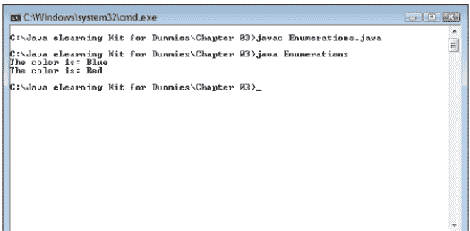

图 3-12

## 总结

以下是你在本章中学习到的要点：

- `BigDecimal` 数据类型帮助你使用实数（即包含整数和小数部分的数字）进行极其精确的计算。

- `BigInteger` 数据类型允许你使用整数进行巨大的计算。从理论上讲，除了系统的可用内存外，它没有大小限制。

- 基本数据类型的对象版本提供了额外的灵活性，使得操作值变得容易。

- 应用程序开发者通常使用二进制（2进制）、八进制（8进制）、十进制（10进制）和十六进制（16进制）计数系统来创建应用程序。

- `Character` 数据类型提供了精确检测变量包含什么类型字符的手段。

## 总结

- 新的日期时间 API 包含了许多日期时间类，你可以使用它们来处理日期和时间值。

- 枚举提供了一种列出用户无法更改特定值的方法。

### 动手实践实验

为了进一步练习本章涵盖的功能，请尝试独立完成以下练习。

1. 打开 `LongVersus` 应用程序。


- 2. 将加粗的代码添加到 `function2()` 方法中。

```java
public static void function2() {
    // 创建本地 MyLong，为其赋值一个值
    // 并在屏幕上显示它的值。
    MyLong MyLong;
    MyLong = Long.valueOf(900);
    System.out.println("MyLong in function2() = " + MyLong);
}
```

```java
// 修改全局 MyLong，为其赋值一个值
// 并在屏幕上显示它的值。
LongVersusLong.MyLong = Long.valueOf(1000);
System.out.println("Global MyLong in function2() = " + LongVersusLong.MyLong);
```

新代码通过为 `MyLong` 提供特定引用，允许 `function2()` 修改全局的 `MyLong`。而 `LongVersusLong.MyLong` 则强制 `function2()` 忽略默认作用域转而使用全局变量。

- 3. 编译应用程序。
- 4. 运行应用程序。

应用程序将根据你添加的新代码提供输出。

- 5. 将此输出与你在图 3-7 中看到的输出进行比较。

此版本的应用程序演示了 Java 作用域规则的另一个特性。在某些情况下，只要所需的变量没有被隐藏（如全局 `MyLong` 的情况所示），就可以覆盖作用域规则。

### 技术术语讲解

**装箱（boxing）**：将值放入对象的操作，以便借助对象的特性来操作该值。

**类型转换（casting）**：将一种类型转换为另一种类型的行为。

**拼接（concatenation）**：将两个字符串相加创建一个单个字符串的行为。如果 `String1` 包含 `Hello`（注意 Hello 后面有一个空格），`String2` 包含 `World`，拼接这两个字符串将产生 `Hello World`。

**数据（data）**：分配给内存中特定位置的一系列 1 和 0。

**转义字符（escape character）**：用于修改应用程序输出的单个特殊控制字符。例如，`\n` 转义字符会在两行输出之间添加一个额外的换行。

**转义序列（escape sequence）**：用于修改屏幕上信息外观的两个或多个转义字符。例如，`\t\t` 转义序列会在输出中添加两个制表符，从而控制文本在屏幕上的显示位置。

**浮点数（floating point number）**：实数的近似值，它同时包含整数和小数部分，例如 `5.1`。

**信息（information）**：被分配了类型的数据，以赋予意义并使其能够解释数据的含义。

**对象（object）**：用于持有特定类型数据的类，该类具有方法、属性和事件。对象可以具有特殊行为，使其以独特的方式与数据交互。

**溢出（overflow）**：当应用程序尝试创建一个大于类型设计所容纳的值时，就会发生溢出。Java 会丢弃多余的信息，只保留类型可以成功容纳的位。遗憾的是，当这种情况发生时 Java 不显示错误消息，因此你的应用程序会在错误的地方完美地运行。使用 `BigInteger` 数据类型可以防止执行数学运算时发生错误。

**实数（real number）**：同时包含整数和小数部分的数字，例如 `5.1`。一些开发者也称实数为浮点数，但这并不完全准确。浮点数仅仅是实数的近似值。

**作用域（scope）**：变量或方法对应用程序其他部分的可见性。

**拆箱（unboxing）**：从对象中移除值并将其放入相应的基本类型的操作。

## 第 4 章

## 格式化变量内容


- 以特定方式显示输出信息让用户更容易操作。
- 为格式化创建一个变量让用户更容易操作。
- 依赖转义序列可以让你创建特殊字符。
- 使用本地化指定货币值可以帮助你显示。
- 使用日期时间格式化可以帮助你显示这些值。

## 1. 我可以定义整数百分比吗？

可以输出整数百分比，见第 113 页。

## 2. 如何将单个字符串拆分成行？

使用特殊转义序列将字符串分成任意行，见第 115 页。

## 3. 是否可以创建特定的日期时间演示？

Java 提供的日期时间格式允许你访问每个日期元素（如年或秒）以构造特殊字符串，见第 118 页。

## 4. Java 提供的货币格式是否有限制？

Java 不会自动将一种货币值转换为另一种——它只为货币值提供正确的格式，见第 124 页。

## 5. 如何在 Java 中支持其他语言？

通过为该语言创建本地化来描述特定的语言特性，见第 125 页。

# 第 4 章

```java
// 设置小数点后的最大数字位数。
Percent.setMaximumFractionDigits(2);
```

```java
// 尝试显示利息。
System.out.println("The interest is: " 
    + Percent.format(Interest));
```

这个示例并没有进行任何复杂的操作。它首先开始创建一个带有百分比率的 `double` 类型变量。

要将数字显示为百分比，你需要创建一个格式化器（formatter）。格式化器是一个特殊的类，它的唯一作用就是创建美化的输出。在这种情况下，应用程序创建了一个 `NumberFormat` 对象。注意，你必须调用 `getPercentInstance()` 构造方法（用于从类定义构造对象的方法）来处理百分比。

Java 假设你希望将百分比显示为整数。然而，你可以通过调用 `setMaximumFractionDigits()` 方法来改变这种行为。你还可以设置其他值，例如用于输出中整数部分和小数部分的最小数字位数。

- 3. 将代码保存为文件 `DisplayPercent.java` 到磁盘上。
- 4. 在命令提示符中，输入 `javac DisplayPercent.java` 并按回车键。

编译器会编译你的应用程序并将其创建一个 `.class` 文件。

- 5. 输入 `java DisplayPercent` 并按回车键。

图 4-1 显示了格式化后的百分比。

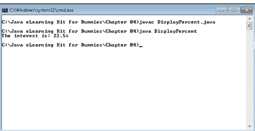

图 4-1

## 使用转义序列

当你可以使用标准文本但想以特殊方式对其进行格式化时，可以使用所谓的转义字符（escape character）来告诉 Java 执行格式化。（在这里，转义字符是指从标准字符呈现中“逸”出来执行特殊操作的字符，例如将光标移动到下一行。）当你将转义字符放在一起时，就得到了转义序列（escape sequence）。转义序列并不是 Java 特有的——许多其他编程语言也使用它们。此外，转义序列已经存在很长时间了。甚至大型机也使用转义序列。因此，转义序列出现在几乎平台上，并且在大多数语言中都是标准的。

转义字符总是以反斜杠 (`\`) 开头，后面跟着一个特殊的字母，例如用于换行的 `n`。表 4-1 显示了 Java 支持的转义字符。

### 表 4-1 Java 转义字符

| 字符 | 用途 | 描述 |
| :--- | :--- | :--- |
| `\n` | 新行 | 将光标移动到下一行。根据平台的不同，它可能不会将光标移动到行首。 |
| `\t` | 制表符 | 将光标移动到下一个位置。制表符允许精确对齐输出，使其看起来就像你使用表格来存放信息一样。 |
| `\b` | 退格 | 将字符向后移动一个空格但不删除该位置的字符。在正确且在正确的平台上时，你可以创建叠印（overstrikes），组合两个字符以产生特殊效果。 |
| `\f` | 换页 | 在打印机中排出当前纸张并从下一页开始。 |
| `\"` | 双引号 | 在不结束代码中引用元素的情况下产生双引号。该转义字符在创建包含双引号的 `String` 对象时很有帮助。 |
| `\'` | 单引号 | 在不结束代码中引用元素的情况下产生单引号。该转义字符在创建持有单引号的 `char` 时很有帮助。 |
| `\\` | 反斜杠 | 因为反斜杠被用于转义字符，所以你需要一个特殊方法在输出中包含反斜杠。 |
| `\uDDDD` | Unicode 字符 | 当你提供适当的四位数字时产生指定的 Unicode 字符。例如，包含 `\u00A9` 的字符串将产生版权符号。 |

是时候看看这些转义序列的实际运行了。在接下来的练习中，你将创建一系列依赖转义序列产生所需输出的字符串输出。你将在书的其他部分看到许多此类转义序列。

所需文件：`EscapeCharacters.java`

- 1. 打开你选择为本书使用的编辑器或 IDE。
- 2. 在编辑器屏幕上输入以下代码。

```java
public class EscapeCharacters {
    public static void main(String[] args) {
        // 使用转义
        // 序列输出各种
        // 字符串
        System.out.println("Use the tab \t character"
            + "\n to position things on screen.");
        System.out.println("Sometimes you want to move"
            + "\into the next line");
    }
}
```

### 在线查看

如果大家都使用相同的字符集那将很好，但事实并非如此。因此，Unicode 字符 `\u00BD` 通常产生输出 `½`。然而，某些版本的 Windows 命令提示符的 ASCII 文本需要 `\u00BD` 的值来产生相同的结果。由于不同的字符集遵循不同的标准，你需要在编写时知道将适用哪种字符集。你可以在 http://www.i18nguy.com/unicode/codepages.html 找到这些字符的极其列表。

## 使用转义序列

```java
// 在处理遵循 Unicode
// 标准的应用程序时，将 \u00AB 替换为 \u00BD。
System.out.println("The interest is: " + Percent.format(Interest));
```

示例使用了表 4-1 中描述的转义字符来产生输出。如果你发现 `\u00BD` 没有产生 `½`，请将其更改为 `\u00AB`。

- 3. 将每个字符与表 4-1 中的项匹配以确定它们的作用。
- 4. 将代码保存为文件 `EscapeCharacters.java` 到磁盘上。
- 5. 在命令提示符中，输入 `javac EscapeCharacters.java` 并按回车键。

编译器会编译你的应用程序并将其创建一个 `.class` 文件。

- 6. 输入 `java EscapeCharacters` 并按回车键。

图 4-2 显示了使用转义字符的结果。


图 4-2

# 显示日期时间

在可见的未来，Java 将使用两种不同的方法处理日期时间。旧的方法依赖于 `Calendar` 对象。Java 8 引入的新方法依赖于日期时间 API。

每种方法都有其呈现信息的方式。旧的方法活性较低且需要更多代码，但它是大多数应用程序中看到的技巧。新的日期时间 API 提供了极大的灵活性，并提供了一系列不需要多少代码的内置格式化选项。然而，由于 Java 8 还很新，你还没有经常看到这种技巧。后续章节将讨论这两种方法。

### 使用 Calendar 对象

大多数人对显示日期时间非常挑剔，因为世界是一个时间驱动的地方。精确按照预期显示日期时间是非常重要的。第 2 章中“int”部分的练习让你接触到了访问计算机日时间的 `Calendar` 对象。在本次练习中，你将创建一个符合特定标准的输出。

所需文件：`DisplayDateTime.java`

- 1. 打开你选择为本书使用的编辑器或 IDE。
- 2. 在编辑器屏幕上输入以下代码。

```java
// 导入所需的 API 类
import java.util.Calendar;

public class DisplayDateTime {
    public static void main(String[] args) {
        // 获取当前日期和时间。
        Calendar MyCal = Calendar.getInstance();

        // 分行显示日期和时间。
        System.out.format("%te %tB %tY",
            MyCal, MyCal, MyCal);
        System.out.format("\n%t1:%tM %tY",
            MyCal, MyCal, MyCal);
    }
}
```

### 显示日期和时间

示例首先开始创建一个 `Calendar` 对象 `MyCal`。它使用一个新的 `System.out` 方法 `format()` 来生成格式化后的信息。`format()` 通过在字符串中使用特殊代码作为占位符来工作。然后你提供一个变量来填充每个占位符。表 4-2 描述了这些格式化代码。

### 表 4-2 `format()` 方法格式化代码

| 代码 | 描述 |
| :--- | :--- |
| `%B` | 特定区域的月份名称。月份将始终显示完整名称，例如 January（一月）。 |
| `%tb` | 特定区域的月份缩写，例如 January 写写为 Jan。 |
| `%tm` | 当前月份的两位数字表示法，其中一月等于 01。 |
| `%td` | 不带前导零的月份两位数。因此，月份的第一天将显示为 1。 |
| `%te` | 带有前导零的月份两位数。因此，月份的第一天将显示为 01。 |
| `%ty` | 两位数的年份。 |
| `%Y` | 四位数的年份。 |
| `%A` | 特定区域的星期名称。星期将始终显示完整名称，例如 Sunday（星期日）。 |
| `%ta` | 特定区域的星期缩写，例如 Sunday 写写为 Sun。 |
| `%D` | 以 `%tm%td%ty` 格式输出日期的快捷方法。 |
| `%tk` | 不带前导零的 24 小时制小时。因此，第一个小时将显示为 1。 |
| `%H` | 带有前导零的 24 小时制小时。因此，第一个小时将显示为 01。 |
| `%tl` | 不带前导零的 12 小时制小时。因此，第一个小时将显示为 1。 |
| `%I` | 带有前导零的 12 小时制小时。因此，第一个小时将显示为 01。 |
| `%tM` | 带有前导零的分钟。因此，每小时的第一分钟将显示为 01。 |
| `%tS` | 带有前导零的秒。因此，每分钟的第一秒将显示为 01。 |
| `%tL` | 带有前导零的毫秒。因此，秒内的第一个毫秒将显示为 001。 |
| `%tN` | 带有前导零的纳秒。因此，秒内的第一个纳秒将显示为 000000001。 |
| `%tp` | 特定区域的低写 am 或 pm 显示。 |
| `%Tp` | 特定区域的大写 am 或 pm 显示。 |
| `%tz` | 与 GMT 的时区偏移量，例如美国中部时间为 -0600。 |
| `%tZ` | 时区值，例如标准标准时间为 CST。 |

- 3. 使用文件名 `DateTime.java` 将代码保存到磁盘。
- 4. 在你的命令提示符中，输入 `javac DateTime.java` 并按回车。

编译器会编译你的应用程序并从其创建 `.class` 文件。

- 5. 输入 `java DateTime` 并按回车。

`Calendar` 对象包含完整的时间，因此 `MyCal` 包含了你所需的一切。关键在于以你想要的格式获取日期和时间。如图 4-3 所示，此示例以特定格式输出日期和时间。

> **语言说明**
>
> 区域（locale）一词是指在信息展示时个人所在的位置。例如，如果你住在堪萨斯州，但将所有文档都设置为德语，那么你很可能会使用德语区域设置。大多数人使用他们实际居住的地方作为区域，但对计算机而言，区域代表了你用于格式化日期、时间、数字和货币等信息的国家规则。区域并不会神奇地将单词翻译成另一种语言。

```
C:\Java Learning for Bunnies\Chapter 4> javac DateTime.java
C:\Java Learning for Bunnies\Chapter 4> java DateTime
Thursday October 21 10:15:30 AM
C:\Java Learning for Bunnies\Chapter 4>_
```

图 4-3

### 显示日期和时间

根据需要修改示例，以其他格式输出时间和日期。

尝试表 4-2 中的各种字母组合以实现所需的结果。

在对代码进行每项更改后，执行步骤 3 到 5，以便你可以在屏幕上看到结果。


## 使用日期时间 API

日期时间 API 旨在解决 Java 以前版本中存在的日期和计时局限性。许多开发者面临的问题之一是缺乏格式化的灵活性。是的，你通常可以得到想要的输出，但只有在长时间研究代码后才能。以下练习演示了 Java 8 通过提供许多易于使用的选项解决了输出问题。

### 在线

表 4-2 包含了最常用的代码。你可以创建其他代码来获得所需的结果。

- 1. 打开 IDE 并创建一个名为 `DateTime.java` 的文件。
- 2. 在编辑器中输入以下代码：


```java
import java.time.*;
import java.time.format.*;

public class DateTime {
    public static void main(String[] args) {
        // 创建日期和时间对象。
        ZonedDateTime dateTime = ZonedDateTime.now();

        // 显示一些值。
        System.out.println("Date: " + dateTime.format(DateTimeFormatter.ISO_LOCAL_DATE));

        // 显示自定义格式。
        System.out.println("Time: " + dateTime.format(DateTimeFormatter.ofPattern("yyyy-MM-dd HH:mm:ss a")));
    }
}
```

## 第 4 章

编译器编译你的应用程序并从其创建一个 `.class` 文件。

5. 输入 `java Java8DateTime` 并按回车。

此示例仅演示了一些可用的格式化技术。图 4-4 显示了典型的输出。注意，尽管 `ZonedDateTime` 对象可以提供命名区域输出，但它也可以提供偏移量输出。

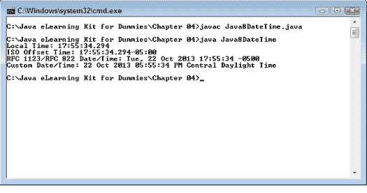

图 4-4

## 显示货币值

显示金额尤为重要，因为小数点位置错误会导致各种问题。使用正确的符号也很重要。英镑的货币金额肯定与美元不同。在接下来的示例中，你将为数值创建特定区域的货币输出。

所需文件：`DisplayCurrency.java`

1. 打开你为本书选择的编辑器或 IDE。

2. 在编辑器屏幕输入以下代码。

```java
// Import the required API classes.
import java.text.NumberFormat;
import java.util.Locale;
import java.math.BigDecimal;

public class DisplayCurrency
{
    public static void main(String[] args)
    {
        // Set the amount owed.
        BigDecimal MyMoney = new BigDecimal("19.95");
```

```java
// Create a formatter to use.
NumberFormat Currency = 
NumberFormat.getCurrencyInstance(Locale.US);
```

```java
// Try displaying the amount owed.
System.out.println("The amount you owe is: " 
 + Currency.format(MyMoney));
```

```
}
```

该示例首先使用 `BigDecimal` 创建了一个货币值，这是处理货币值的推荐方法。`MyMoney` 包含了此示例中欠的金额。然而，此值没有经过格式化，因此你不知道它是美元、英镑还是日元。

下一步创建了一个 `NumberFormat` 对象 `currency`，它通过 `getCurrencyInstance()` 设置为用于货币值的格式。注意使用 `Locale.US` 来设置示例输出美元。

3. 使用文件名 `DisplayCurrency.java` 将代码保存到磁盘。

4. 在命令提示符中，输入 `javac DisplayCurrency.java` 并按回车。

编译器编译你的应用程序并从其创建一个 `.class` 文件。

5. 输入 `java DisplayCurrency` 并按回车。

示例输出了美元值。图 4-5 显示了格式化后的信息。

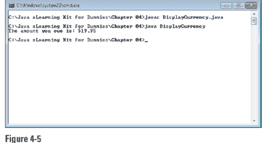

尝试更改此示例的代码以查看不同区域的结果。例如，尝试将 `Locale.US` 改为 `Locale.UK` 以查看英镑输出。货币金额不会改变，但格式会改变。

## 总结

以下是你在本章中学习到的要点：

- `NumberFormat` 对象使得创建正确格式的输出成为可能。

- 转义字符使得创建适用于几乎每个屏幕的良好格式化输出成为可能。

- 并非所有平台都使用相同的字符集，因此在处理 Unicode 输出之前，请确保知道你的平台使用的是什么字符集。

- 在处理本地时间时，使用特定区域的日期和时间格式，以便月份名称等功能以正确的方式显示。

- 日期和时间 API 比使用旧的 `Calendar` 对象提供了更大的灵活性，但你必须拥有 Java 8 才能使用。

- Java 货币功能只会更改输出的格式，而不会更改实际值。换句话说，Java 不会将你的美元输入转换为英镑。

## 动手实践实验室

为了进一步练习本章涵盖的功能，请尝试独立完成以下练习。

1. 打开 `EscapeCharacters` 。

2. 在应用程序中添加代码以重现表 4-1 的前两列。

思考重现表格所需的定位会有帮助。使用表格字符和换行符仔细地重建表格。

3. 编译应用程序。

4. 运行应用程序。

检查你生成的表格的准确性。

5. 重复第 2 到 4 步，直到你的表格与表 4-1 的前两列匹配。

6. 针对第 2 章中的表 2-1 重复第 1 到 5 步。

在这种情况下，你需要添加本章描述的其他类型的格式化。

### 技术术语

- **constructor（构造函数）**：一种特殊的方法，用于从类描述构建对象。构造函数包含用于执行初始化全局变量等任务的特殊代码。每个类都有默认构造函数，即使创建类的代码中不包含它也是。

- **escape character（转义字符）**：用于修改应用程序输出的单个特殊控制字符。例如，`\n` 转义字符会在两行输出之间添加额外的行。

- **escape sequence（转义序列）**：用于修改屏幕上信息外观的两个或多个转义字符。例如，`\t` 转义序列会在输出中添加两个制表符，从而控制文本在屏幕上的位置。

- **formatter（格式化器）**：一种特殊的类，专门用于格式化输出以使其美观。

- **locale（区域）**：定义特定语言的应用程序输出特征。例如，某些语言使用句点作为小数点标记，而另一些则使用逗号。考虑到区域来格式化数据使得说其他语言的人更容易使用。

## 第 5 章 使用运算符


- 将数据赋值给变量将在应用程序运行时存储该信息。

- 使用算术运算符通过各种数学类型修改数据值。

- 依靠一元运算符进行自包含的数据修改。

- 采用关系运算符检查数据项之间的比较。

- 运用运算符优先级确定你的应用程序中哪些运算符具有优先级。


1. 基本类型和对象使用赋值运算符的方式相同？

2. 整数类型如何处理除法？

3. 当变量包含我不的内容时该怎么办？

4. 是否可以将一种类型转换为另一种类型？

5. 如何确定两个变量是相同的？

6. 先发生加法还是乘法？

## 第 5 章

- 一元运算符使变量与其自身的内容进行某种交互，例如递增（变量值加）或递减（从变量值减去）。在许多方面，一元运算符提供了简写方式，使得应用程序代码更易理解且编写速度更快。

- 某些类型的关系运算符和条件运算符执行比较，并提供一个反映该比较的结果。这些运算符使得应用程序能够根据变量的内容做出决策。

### 术语

> 优先级定义了计算机执行任务的顺序。当你看到优先级时，请思考“优先顺序”。就像你会优先处理需要的工作一样，计算机必须优先处理它必须完成的工作。所有计算机语言的优先级顺序基本上是相同的，这种顺序是借自数学家的。简而言之，你在学校学习执行数学任务的规则与计算机执行任务时使用的规则是相同的。因此，你可能会发现学习优先级比你最初想象的要容易得多。

如果每个运算符的优先级完全相同，将会导致混乱，因为计算机不知道先执行哪项任务。由于计算机是逻辑化且排序良好的指令，Java 开发者必须在当单行代码中出现多个运算符时，创建一个它们的使用顺序。优先级有助于确定先执行哪项任务，使得代码的编写逻辑清晰。你需要理解优先级才能写出良好的代码。否则，你可能会写出假设计算机会先处理某个运算符的代码，结果却发现计算机实际上处理的是另一个运算符。

## 使用赋值运算符存储数据

到目前为止，你在书中已经多次使用过赋值运算符了。事实上，几乎每个例子都包含某种赋值运算符，因为几乎不可能在没有赋值运算符的情况下编写应用程序。

### 执行简单赋值

你最常用的赋值运算符是简单赋值。简单赋值依赖于等号 (`=`)。在本次练习中，你将使用简单赋值将一个值放入基本类型并显示在屏幕上。

## 使用赋值运算符存储数据

所需文件：`SimpleAssignment.java`

1. 打开你为本书选择的编辑器或 IDE。

2. 在编辑器屏幕上输入以下代码：

```java
public class SimpleAssignment {
    public static void main(String[] args) {
        // 创建一个变量来存储值。
        int MyInt;

        // 给变量赋值。
        MyInt = 2;

        // 显示变量的内容。
        System.out.println(" " + MyInt);
    }
}
```

在这个示例中，应用程序首先创建一个名为 `MyInt` 的 `int` 类型的存储容器。此时，`MyInt` 并不包含任何内容——它是一个空容器。事实上，如果你尝试对 `MyInt` 进行任何操作，Java 编译器都会报告你没有初始化该变量——也就是说，你实际上没有向存储容器中放入任何内容。

下一步使用赋值运算符 `=` 将值 2 放入 `MyInt` 中。这是一个简单赋值。除了 `MyInt` 现在包含了一个值外，什么都没有发生。在 `MyInt` 包含内容后，你就可以使用 `System.out.println()` 方法显示它包含的内容。

3. 使用文件名 `SimpleAssignment.java` 将代码保存到磁盘。

4. 在命令提示符中，输入 `javac SimpleAssignment.java` 并按回车。

编译器编译你的应用程序并从中创建一个 `.class` 文件。

5. 输入 `java SimpleAssignment` 并按回车。

你看到了图 5-1 所示的预期输出 `MyInt = 2`。这里的重点在于，应用程序使用赋值运算符进行了赋值。

```
C:\Java-learning Kit for Dummies\Chapter 5> javac SimpleAssignment.java
C:\Java-learning Kit for Dummies\Chapter 5> java SimpleAssignment
Point - 5

C:\Java-learning Kit for Dummies\Chapter 5> _
```

图 5-1

### 执行复合赋值

复合赋值通过首先对值执行特殊操作，然后执行简单赋值，增加了过程的复杂性。结果是变量的内容以特定方式更新。列表列出了常见的复合赋值运算符。

- `*=` 将变量的值乘以运算符右侧提供的数字。结果赋值给变量。

- `/=` 将变量的值除以运算符右侧提供的数字。结果赋值给变量。当与整数类型配合使用时，余数会被舍弃。

- `+=` 将变量的值与运算符右侧提供的数字相加。结果赋值给变量。

- `-=` 从变量中的数字中减去运算符右侧提供的数字。结果赋值给变量。

- `%=` 将变量的值除以运算符右侧提供的数字。余数赋值给变量。此运算符仅用于整数类型变量。

这些运算符中的每一个都先执行数学运算，然后执行赋值。在接下来的练习中，你将使用简单赋值将一个值放入基本类型中。随后应用程序执行多个复合赋值并将每次赋值的结果显示在屏幕上。

> 术语

`%` 运算符有一个特殊名称：模（modulus）。

## 使用赋值运算符存储数据

所需文件：`CombinedAssignment.java`

1. 打开你为本书选择的编辑器或 IDE。

2. 在编辑器屏幕上输入以下代码：

```java
public class CombinedAssignment
{
    public static void main(String[] args) {
        // 创建变量并显示
        // 其值。
        int MyInt = 15;
        System.out.println("Initial value = " + MyInt);

        // 执行乘法赋值。
        MyInt *= 3;
        System.out.println("Multiply assignment = " + MyInt);

        // 执行除法赋值。
        MyInt /= 2;
        System.out.println("Divide assignment = " + MyInt);

        // 执行加法赋值。
        MyInt += 6;
        System.out.println("Addition assignment = " + MyInt);

        // 执行减法赋值。
        MyInt -= 12;
        System.out.println("Subtraction assignment = " + MyInt);

        // 执行取余赋值。
        MyInt %= 7;
        System.out.println("Remainder assignment = " + MyInt);
    }
}
```

应用程序首先创建一个变量并对其进行初始化。如果你尝试在不初始化的情况下使用该变量，编译器将显示错误。

> 警告！在未初始化变量的情况下使用复合赋值运算符是不可能的。这样做会导致错误，因为复合赋值运算符依赖变量的内容。

应用程序创建变量后，使用每个复合赋值运算符对变量执行任务。应用程序每次都会显示结果。

3. 仔细查看代码的每个步骤，并记录你认为应用程序将显示的结果。

例如，第一次调用 `System.out.println()` 显示值为 15，因为 `MyInt` 被赋值为 15。这一步要求你在实际运行程序之前，确定剩余每个步骤之后会发生什么。

4. 使用文件名 `CombinedAssignment.java` 将代码保存到磁盘。

5. 在命令提示符中，输入 `javac CombinedAssignment.java` 并按回车。

编译器编译你的应用程序并从中创建一个 `.class` 文件。

6. 输入 `java CombinedAssignment` 并按回车。

你看到了应用程序的输出，如图 5-2 所示。

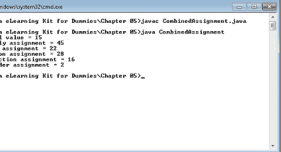

图 5-2

7. 将你的计算结果与实际应用程序输出进行对比。

8. 如果你的结果与输出不匹配，查看代码的每个步骤以确定你在哪里推导出了错误的输出。

这种练习有助于你更好地理解复合运算符。此外，这也是专业程序员用于学习新编程技能的类型分析方法。

# 使用算术运算符执行数学任务

更改应用程序中每一步使用的数值，进行分析并再次运行应用程序。尝试不同的值以观察应用程序的反应。例如，尝试创建一个会导致负数输出的值。

# 使用算术运算符执行数学任务

大多数应用程序都依赖数学操作来完成部分工作，即使应用程序并没有意识到大量的数学。随着本书的介绍，你将使用数学来执行诸如跟踪应用程序状态之类的任务。目前具体如何实现并不重要，但重要的是知道，在处理应用程序时，你使用数学的情况并不常见。以下是书中常用的数学运算符的概览：

- `*` 执行两个变量内数值的乘法运算。

- `/` 将运算符左侧变量中的值除以运算符右侧变量的值。在处理整数类型时，会舍弃余数。

- `%` 将运算符左侧变量中的值除以运算符右侧变量的值。但在这种情况下，结果是余数，而不是商。

- `+` 执行两个变量内数值的加法运算。

- `-` 从运算符左侧变量的值中减去右侧变量的值。

接下来的章节描述了如何使用数学运算符执行常见的数学任务。这些章节仅是对该主题的介绍。你将在本书的大多数示例中看到数学运算符的使用。

# 执行简单的数学任务

你经常需要执行简单的乘法、除法、加法或减法。本章“执行复合赋值”节描述的复合赋值运算符是执行单个数学任务的最佳方式。在下面的示例中，你将看到 Java 如何执行涉及多个运算符的数学操作或复合赋值运算符不起的情况。

## 第 5 章

所需的文件：`SimpleMath.java`

1. 打开你为本书选择的编辑器或 IDE。

2. 在编辑器屏幕上输入以下代码。


# 使用算术运算符执行数学任务

```java
public class SimpleMath {
    public static void main(String[] args) {
        // 创建一系列要使用的变量。
        int X = 5;
        int Y = 10;
        int Z = 15;
        // 执行乘法并显示结果。
        X = Y * Z;
        System.out.printf("%d * %d = %d\n", Y, Z, X);
        // 执行除法并显示结果。
        X = Z / Y;
        System.out.printf("%d / %d = %d\n", Z, Y, X);
        // 使用取模运算符执行除法并显示结果。
        X = Z % Y;
        System.out.printf("%d %% %d = %d\n", Z, Y, X);
        // 执行加法并显示结果。
        X = Y + Z;
        System.out.printf("%d + %d = %d\n", Y, Z, X);
        // 执行减法并显示结果。
        X = Y - Z;
        System.out.printf("%d - %d = %d\n", Y, Z, X);
    }
}
```

示例展示了创建三个变量 `X`、`Y` 和 `Z`。在很多情况下，你不想将计算结果存储在原始变量中，以便在另一个计算中重用原始值。在每种情况下，应用程序都执行计算并将结果放在 `X` 中。代码使用了这些操作来显示计算及其结果。

此示例也是第一个使用 `printf()` 方法的示例。你可以使用此方法创建格式化输出。格式化工作与第 4 章“显示日期和时间”中的日历示例完全相同。然而，你使用的不是第 4 章表 4-2 中的日期时间格式字符串，而是表 5-1 所示的格式字符串。表 5-1 显示了最常见的格式字符串——Java 还提供了用于特殊任务的其他字符串。

## 表 5-1 常用 Java 格式字符串

| 代码 | 具体用途 | 描述 |
| --- | --- | --- |
| `%b` | 通用 | 显示变量的布尔值。在处理布尔变量（基本类型或对象）时，结果是变量的实际值。当变量为 `null`（未初始化）时显示 `false`，当变量包含一个值时显示 `true`。大写的 `%B` 使用大写字母。 |
| `%s` | 通用 | 显示变量的字符串值——即 `toString()` 方法通常会显示的内容。大写的 `%S` 使用大写字母。 |
| `%c` | 字符 | 根据 `Character` 数据类型的规则显示 Unicode 字符。（详情请参阅第 3 章“Character vs char”部分。）大写的 `%C` 即使字符值通常会产生小写输出也会使用大写字母。 |
| `%d` | 整数 | 输出十进制格式的整数。 |
| `%o` | 整数 | 输出八进制格式的整数。 |
| `%x` | 整数 | 输出十六进制格式的整数。大写的 `%X` 使用大写字母。 |
| `%e` | 浮点数 | 使用科学计数法输出浮点值。大写的 `%E` 使用大写字母。 |
| `%f` | 浮点数 | 使用标准点表示（十进制）输出浮点值。 |
| `%g` | 浮点数 | 根据值使用十进制或科学计数法输出浮点值。大写的 `%G` 使用大写字母。 |
| `%%` | 符号 | 输出百分号。 |
| `%n` | 换行 | 在输出末尾换行。 |

- 3. 仔细查看每一步。
- 4. 将代码保存为 `SimpleMath.java`。
- 5. 输入 `javac SimpleMath.java`。
- 6. 输入 `java SimpleMath` 并回车。
- 7. 比较你的计算结果。
- 8. 如果结果不匹配，请更改 `X`、`Y` 或 `Z` 的值。

## 使用算术运算符执行数学任务（复杂示例）

```java
// 有序的加、减、乘法
// 版本一。
Result = X + (Y - Y) * Z;
System.out.printf("%d + (%d) * %d = %d\n", X, Y, Z, Result);
```

```java
// 有序的加、减、乘法
// 版本二。
Result = X + (Y - Y) * Z;
System.out.printf("%d + (%d) * %d = %d\n", X, Y, Z, Result);
```

```
}
```

该示例首先创建了三个 `int` 类型的值（`X`、`Y` 和 `Z`）作为输入，以及一个包含任何计算结果的单 `int` 变量（`Result`）。该示例对这些输入执行了各种数学任务，以便让你看到 Java（以及本质上说，更多的计算机语言）将如何做出反应。屏幕输出依赖于 `printf()` 方法，因为它在处理此类显示时效果非常好。为了根据需要处理许多不同的结果，你只需要更改应用程序开头的三个值即可。

在这种情况下，数学运算是混合的——这意味着它们是加法和乘法的组合。然而，之前提到的规则仍然有效。记住你在数学课上学到的，括号的作用是对你首先执行的操作进行分组——它们在其中具有最高优先级。在这种情况下，代码实际上可能来自教科书——它的感觉不像是在编写一个 Java 应用程序，不如说是在写一个方程。

- 3. 仔细观察代码的每一步，并写下你认为应用程序将显示的结果。
- 4. 使用文件名 `ComplexMath.java` 将代码保存到磁盘。
- 5. 在命令提示符中，输入 `javac ComplexMath.java` 并按回车。

编译器编译你的应用程序并从中创建一个 `.class` 文件。

- 6. 输入 `java ComplexMath` 并按回车。

应用程序输出包含每个数学运算所用值的格式化字符串，如图 5-4 所示。如果你更改了 `X`、`Y` 或 `Z` 的值，这些更改将自动出现在输出中。

## 使用一元运算符修改变量内容

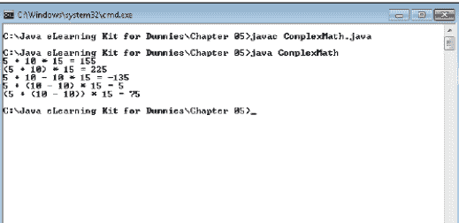

```java
C:\Java-learning-Kit\for-Dummies\Chapter 05\javaComplexMath.java
int x = 10, y = 15;
x++; // x 现在是 11
y--; // y 现在是 14
x += 5; // x 现在是 16
y -= 5; // y 现在是 9
x *= 10; // x 现在是 160
y /= 10; // y 现在是 0
x = (x - 10) * 5; // x 现在是 750
```

图 5-4

- 7. 将你的计算结果与实际应用程序输出进行比较。
- 8. 如果你的结果与输出不匹配，重新查看代码的每一步，以确定你在哪里得出了错误的输出。


尝试为示例创建其他方程。记住同时更改代码中的方程以及你希望 `printf()` 方法使用的字符串格式选择。（参考表 5-1。）

## 使用一元运算符修改变量内容

二元运算符是指需要两个操作数（变量或常量）才能工作的运算符。一元运算符是指只需要运算符及其关联操作数的运算符。在早前的“使用算术运算符执行数学任务”部分中的运算符是一元运算符的示例。接下来的章节将讨论一元运算符，例如用于增加或减少变量中值的运算符。

### 术语

> 一元运算符对单个操作数执行操作，例如增加或减少操作数内部的值。在大多数情况下，使用一元运算符时必须使用变量，而不是常量。

## 数字的递增和递减

最常见的一元操作是数字的递增和递减。在大多数情况下，应用程序使用这些操作来对某些计数。你可以随时使用它们来增加或减少变量的值。在本示例中，你将看到递增（`++`）和递减（`--`）运算符工作的。

所需文件：`IncrementDecrement.java`

- 1. 打开你选择用于本书的编辑器或 IDE。
- 2. 在编辑器屏幕上输入以下代码。

```java
public class IncrementDecrement{
    public static void main(String[] args) {
        // 定义一个变量。
        int X = 0;

        // 显示初始值。
        System.out.println("X = " + X);

        X++;
        // 递增 X 并显示结果。
        System.out.println("X = " + X);

        // 递减 X 并显示结果。
        X--;
        System.out.println("X = " + X);
    }
}
```

此示例中的代码非常直观。它首先定义了一个整数变量 `X`。代码显示了一次初始值。它递增 `X` 并显示结果。注意，递增是在变量名后添加 `++`。递减时也是如此。你在变量名后添加 `--`。

- 3. 使用文件名 `IncrementDecrement.java` 将代码保存到磁盘。
- 4. 输入 `javac IncrementDecrement.java` 并按回车。

编译器编译你的应用程序并创建一个 `.class` 文件。

- 5. 输入 `java IncrementDecrement` 并按回车。

图 5-5 的输出展示了递增和递减是如何工作的。

## 使用一元运算符修改变量内容（复合赋值示例）

```java
C:\Java-learning-Kit\for-Dummies\Chapter 05\javaComplexMath.java
int x = 10, y = 15;
x++; // x 现在是 11
y--; // y 现在是 14
x += 5; // x 现在是 16
y -= 5; // y 现在是 9
x *= 10; // x 现在是 160
y /= 10; // y 现在是 0
x = (x - 10) * 5; // x 现在是 750
```

## 否定、位取反和布尔取反

你应该一起查看这些类型的一元操作。否定是将值设置为其负数版本。

> **术语**
>
> 一元运算符对单个操作数执行操作，例如增加或减少操作数内部的值。在大多数情况下，使用一元运算符时必须使用变量，而不是常量。
>
> 位取反意味着逐位地进行操作，而不是使用整个值。
>
> 与减法对比
>
> 二元运算符 `--` 不作用于布尔值。逻辑运算符 `!` 不作用于布尔值以外的值。
>
> 位取反逐位查看——任何 1 变成 0，反之亦然。因此，当你拥有值 `000101` 时，它变成了六。

> **术语**
>
> 布尔值只有 `true` 或 `false`。当你对一个布尔值取反时，你将其从 `true` 变为 `false`，或从 `false` 变为 `true`。

## 否定、位取反和布尔取反示例

现在是对比否定、位取反和布尔取反的工作方式了。在下面的示例中，你将看到如何使用这些运算符来操作数字或布尔值。

所需文件：`NegationAndNot.java`

- 1. 打开你选择用于本书的编辑器或 IDE。
- 2. 在编辑器屏幕上输入以下代码。

```java
public class NegationAndNot
{
    public static void main(String[] args)
    {
        // 创建所需的变量。
        int X = 85;
        int Y = 0;
        boolean Z = true;

        // 显示当前值。
        System.out.println("X = " + X);

        // 否定值并显示结果。
        X = -X;
        System.out.println("X = " + X);

        // 再次否定值并
        // 显示结果。
        X = -X;
        System.out.println("X = " + X);

        // 显示将一个值加到它的
        // 反值的结果。
        Y = X + -X;
        System.out.printf("%d to %d = %d%n", X, -X, Y);

        // 将值设置为其取反等值
        // 并显示结果。
        X = -X;
        System.out.println("X = " + X);

        // 再次执行否定操作。
        X = -X;
        System.out.println("X = " + X);
    }
}
```

```java
// 显示将数值与其相反数
// 相加的结果。
Y = X + -X;
System.out.printf("\nAdding %d to d = %d\n", X, -X, Y);
```

```java
// 显示布尔操作。
System.out.println("Original Z = " + Z);
Z = !Z;
System.out.println("Z = " + Z);
System.out.println("Z = " + Z);
```

```
}
```

此示例从创建两个变量开始。第一个是 `int` 类型 `X`，可以使用取反运算符或位运算符。第二个是布尔类型 `Y`，可以使用布尔非运算符。将这些操作视为某种“开启/关闭”开关是非常重要的。程序首先显示每个变量的原始值，然后值发生变化（开启然后关闭）。

- 3. 使用文件名 `NegationAndNot.java` 将代码保存到磁盘。
- 4. 在命令提示符中，输入 `javac NegationAndNot.java` 并按回车。

编译器会编译你的应用程序并创建一个 `.class` 文件。

- 5. 输入 `java NegationAndNot` 并按回车。

代码按照图 5-6 所示执行了各项任务。注意，取反会产生数的负数，而位非会产生变量值的位反转。同样，布尔非会产生布尔值的反转。

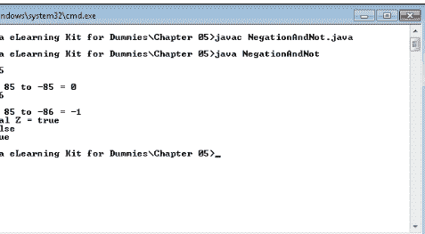

图 5-6

# 创建对象

在本书中，你会创建各种对象。Java 应用程序通常需要一个或多个对象才能运行。事实上，Java 应用程序本身就是一个对象。每当你在代码列表中看到 `class` 这个词时，你讨论的都是对象。书中的每个应用程序都是类，这意味着每个应用程序都是一个对象。

意识到对象是如何运作的非常重要。当你创建一个类时，你创建的是一个蓝图。蓝图描述了如何创建对象，但它本身不是对象。要创建一个类的实例（即对象），你使用 `new` 运算符根据你指定的类作为蓝图来创建请求对象的实例。应用程序可以根据需要创建许多个类的实例，只要有足够的资源（如内存）来实现。

# 将一种类型转换为另一种

类型转换是将一种类型的变量转换为另一种类型。重要的是要意识到类型转换并不是某种魔法。对于计算机来说，你所有的数据都是 1 和 0。转换发生在你的应用程序查看数据的方式上。在不同类型之间进行转换时（例如将整数转换为浮点类型），数据的实际形式也会发生变化，但这种变化并不需要你担心。（这一切都发生在底层。）

类型转换可能会导致数据损失。例如，如果你将浮点类型转换为整数类型，你将丢失浮点数的小数部分。然而，整数部分将保持完好。当你将一个较大容器（如 `long`）中的数字转换为较小容器时，可能会丢失高位，数字的实际值可能会改变。

在所有情况下，当你将想要的新类型放在原始变量旁边的括号内时就会发生转换。例如，`(float)MyInt` 会将 `int` 转换为 `float` 类型。在接下来的示例中，你将看到各种类型转换是如何工作的。

所需文件：`TypeCasting.java`

- 1. 打开你为本书选择的编辑器或 IDE。
- 2. 在编辑器屏幕上输入以下代码。


```java
public class TypeCasting
{
  public static void main(String[] args)
  {
    // 定义用于示例的变量。
    int MyInt = 65;
    long MyLong;
    float MyFloat;
    double MyDbl = 1234567890.123456;
    char MyChar = 'D';

    // 尝试将 int 转换为 long 并显示
    // 结果。
    MyLong = (long)MyInt;
    System.out.printf("%d%n", MyLong, MyInt);

    // 尝试将 int 转换为 float 并显示
    // 结果。
    MyFloat = (float)MyInt;
    System.out.printf("%f = %d%n", MyFloat, MyInt);

    // 尝试将 double 转换为 float 并显示
    // 结果。
    MyFloat = (float)MyDbl;
    System.out.printf("%f = %f%n", MyFloat, MyDbl);

    // 尝试将 double 转换为 long 并显示
    // 结果。
    MyLong = (long)MyDbl;
    System.out.printf("%d = %f%n", MyLong, MyDbl);

    // 尝试将 char 转换为 long 并显示
    // 结果。
    MyLong = (long)MyChar;
    System.out.printf("%d = %c%n", MyLong, MyChar);

    // 尝试将 int 转换为 char 并显示
    // 结果。
    MyChar = (char)MyInt;
    System.out.printf("%d = %c%n", MyInt, MyChar);

    // 尝试将 double 转换为 long 并显示
    // 结果。
    MyLong = (long)MyDbl;
    System.out.printf("%d = %f%n", MyLong, MyDbl);
  }
}
```

此示例从创建两个变量开始。第一个是 `int` 类型 `X`，可以使用取反运算符或位运算符。第二个是布尔类型 `Y`，可以使用布尔非运算符。将这些操作视为某种“开启/关闭”开关是非常重要的。程序首先显示每个变量的原始值，然后值发生变化（开启然后关闭）。

> **注**：提供的 OCR 文本在第 161-162 页的代码块中包含了一些重复和乱码，已根据标准模式和周围文本的上下文清理为逻辑的 Java 类结构。

# 第 5 章 使用关系运算符和条件运算符

关系运算符和条件运算符试图确定表达式的真值——即某内容是否为真。操作结果产生布尔输出，帮助应用程序做出决策。最常见的关系是使用以下运算符对两个操作数进行比较：

- `<` 小于
- `<=` 小于等于
- `==` 等于
- `>=` 大于或等于
- `>` 大于
- `!=` 不等于

随着书籍的进展，你将经常使用这些运算符。不过，你可能在数学课上已经使用过它们来确定表达式的真值，你会发现计算机使用它们的方式与此是相同的。

计算机还需要一些特殊的运算符，以便以人类直观理解的方式处理数据。例如，计算机需要知道两个变量是否为相同类型。你现在不需要完全理解它们，因为它们稍微高级，但接下来的章节将提供这些运算符的概述，作为后续章节的准备。

最后，还有一种特殊的条件运算符可用。第 4 章讨论了条件语句，所以你会在本章中看到它的演示。条件运算符根据你提供的操作数的真值，输出两个值中的一个。这是 Java 使用的少数几个三元运算符之一。

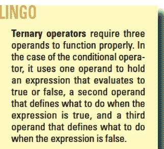

## 检查值的相等性

应用程序执行的重要真值任务之一是检查两个变量中值的相等性。本章将在后面的章节中介绍确定相等性背后真值的某些棘手情况，但现在，重要的是关注运算符本身。下面的练习将帮助你理解相等性检查是如何工作的。

**所需文件**：`DetermineEquality.java`

1. 打开你为本书选择的使用的编辑器或 IDE。
2. 在编辑器屏幕上输入以下代码。

```java
// 导入所需的 API 类。
import java.util.Scanner;

public class DetermineEquality {
    public static void main(String[] args) {
        // 创建扫描器。
        Scanner GetInt = new Scanner(System.in);
        // 获取比较值。
        System.out.print("Type the first number: ");
        int First = GetInt.nextInt();
        System.out.print("Type the second number: ");
        int Second = GetInt.nextInt();
        // 确定两个值的相等性。
        System.out.printf("It's %b that %d < %d\n", (First < Second), First, Second);
        System.out.printf("It's %b that %d > %d\n", (First > Second), First, Second);
        System.out.printf("It's %b that %d == %d\n", (First == Second), First, Second);
        System.out.printf("It's %b that %d >= %d\n", (First >= Second), First, Second);
        System.out.printf("It's %b that %d <= %d\n", (First <= Second), First, Second);
        System.out.printf("It's %b that %d != %d\n", (First != Second), First, Second);
    }
}
```

需要掌握的一个重要概念是，此示例执行的检查中至少有一个为真。事实上，可能有两个或多个检查为真。

为了让这个示例更容易使用，它依赖于一个扫描器，允许你输入两个整数值。任何两个整数都可以。

在应用程序从键盘读取两个值并存入 `First` 和 `Second` 后，它会执行这两个值之间的比较。注意代码如何使用括号来更改检查的优先级，以便结果为布尔值（`Boolean`）。否则，这些检查将无法工作。

3. **使用文件名** `DetermineEquality.java` **将代码保存到磁盘**。
4. **在你的命令提示符中输入** `javac DetermineEquality.java` **并按回车**。
5. **输入** `java DetermineEquality` **并按回车**。

应用程序要求你输入第一个数字。

6. 输入 `1` 并按回车。

应用程序要求你输入第二个数字。

7. 输入 `2` 并按回车。

应用程序输出检查结果，如图 5-8 所示。注意多个检查为真。例如，`1` 确实小于 `2` —— `1` 也小于等于 `2`。这两个值互不相等。值取决于你试图获取什么类型的信息。

```text
C:\Users\System32>java
C:\javaClearing Kit for Bunnies\Chapter 5>java DetermineEquality.java
C:\javaClearing Kit for Bunnies\Chapter 5>java DetermineEquality
type the first number: 1
type the second number: 2
Is 1 < 2? true
Is 1 > 2? false
Is 1 == 2? false
Is 1 >= 2? false
Is 1 <= 2? true
Is 1 != 2? true
C:\javaClearing Kit for Bunnies\Chapter 5>_
```

图 5-8

8. 使用值 `2` 和 `2` 执行步骤 5 到 7。

注意输出如何变化以反映不同的值。

> 尝试使用应用程序输入一系列值，看看它对不同输入的反应。此应用程序演示了真值在计算机内部是如何工作的，并将帮助你在书的后面创建更好的应用程序。

## 执行类型比较

本章早前的“将一种类型转换为另一种类型”部分演示了你如何将一种类型转换为另一种。它还证明了进行转换可能是一种危险的操作。下面的练习演示了一种你可以使用的技术来判断变量是否为特定类型。

**所需文件**：`CompareType.java`

1. 打开你为本书选择的使用的编辑器或 IDE。
2. 在编辑器屏幕上输入以下代码。

```java
public class CompareType {
    public static void main(String[] args) {
        // 定义变量
        Integer MyInt = 2;

        // 显示类型
        System.out.println("MyInt is of " + MyInt.getClass());

        // 检查 MyInt 是否是 Integer 的实例
        System.out.printf("It's %b that MyInt is an Integer.\n", MyInt instanceof Integer);
    }
}
```

3. **使用文件名** `CompareType.java` **将代码保存到磁盘**。
4. **在你的命令提示符中输入** `javac CompareType.java` **并按回车**。

编译器编译你的应用程序并从其创建 `.class` 文件。

5. **输入** `java CompareType`

示例输出类名，如图 5-9 所示。

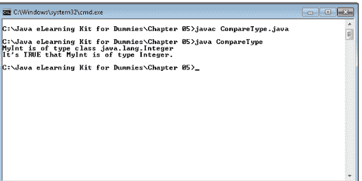

图 5-9

## 执行条件评估

Java 提供了一种特殊的条件运算符，它是你在第 6 章将发现的条件语句的简写。条件运算符 `? :` 需要三个操作数。第一个输出布尔值的表达式。第二个是条件为真时调用的输出。第三个是条件为假时调用的输出。下面的练习演示了它是如何工作的。

**所需文件**：`ConditionalExpression.java`

1. 打开你为本书选择的使用的编辑器或 IDE。
2. 在编辑器屏幕上输入以下代码。

```java
// 导入所需的 API 类。
import java.util.Scanner;

public class ConditionalExpression {
    public static void main(String[] args) {
        // 创建扫描器。
        Scanner GetAnswer = new Scanner(System.in);

        // 询问用户一个问题。
        System.out.print("Do you love the color blue?");
        boolean Answer = GetAnswer.nextBoolean();

        // 确定提供的输出。
        String Result = Answer ? "You love blue!" : "You like orange.";

        // 显示结果。
        System.out.println(Result);
    }
}
```

3. **使用文件名** `ConditionalExpression.java` **将代码保存到磁盘**。
4. **在命令提示符中，输入** `javac ConditionalExpression.java` **并按回车**。

编译器会编译你的应用程序并创建一个 `.class` 文件。

5. **输入** `java ConditionalExpression` **并按回车**。

程序会提出一个问题。

6. 输入 `true` 并按回车。

程序会告诉你你喜欢蓝色。

7. 再次输入 `java ConditionalExpression` 并按回车。

程序会提出一个问题。

8. 输入 `false` 并按回车。

程序会告诉你你更喜欢橙色。图 5-10 显示了条件运算符是如何工作的。

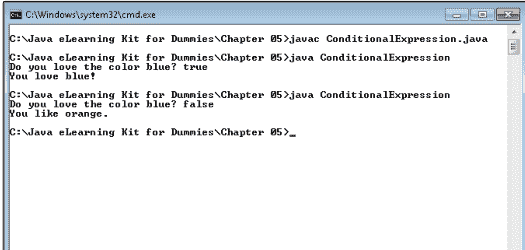

图 5-10

# 理解运算符优先级

本章讨论了大量的运算符优先级。了解 Java 如何解释你用于执行特定操作的符号以及解释符号的顺序至关重要。否则，你可能会编写一个预期结果为应用程序，却得到了完全不同的结果（本章中的几个示例所示）。每当你对 Java 如何解释你所使用的符号产生疑问时，都可以参考表 5-2 中的信息来帮助。

## 表 5-2 Java 运算符优先级

| 优先级 | 运算符 | 描述 | 结合性 |
|---|---|---|---|
| 1 | `[]` | 数组索引，用于指定访问哪个数组元素。 | 左 |
| 1 | `()` | 方法调用或分组。分组特别重要，因为它改变了运算符之间交互的普通规则，例如在乘法之前执行加法。 | 左 |
| 1 | `.` | 成员访问，用于与对象的成员进行交互。 | 右 |
| 2 | `++` | 前置或后置递增。为变量加 1。 | 右 |
| 2 | `--` | 前置或后置递减。从变量中减去 1。 | 右 |
| 2 | `+` `-` | 一元加号或减号。设置变量的符号。加运算符从不使用，因为变量默认是正数。减号运算符对变量取反。 | 右 |
| 2 | `~` | 一元按位取反运算符反转变量中的位。换句话说，它使变量变为原本相反的值。例如，5（二进制 00000101）变为 -6（二进制 11111010）。 | 右 |
| 2 | `!` | 一元布尔取反运算符用于布尔求值，将 `true` 变为 `false`，`false` 变为 `true`。 | 右 |
| 2 | `(type)` | 执行类型转换，将变量的类型更改为另一种类型。 | 右 |
| 2 | `new` | 根据提供的类创建新对象。 | 右 |
| 3 | `*` `/` `%` | 执行乘法、除法和取余数学运算。 | 左 |
| 4 | `+` `-` | 执行加法和减法数学运算。 | 左 |
| 4 | `+` | 拼接两个字符串以产生单个字符串。 | 左 |
| 5 | `<<` `>>` `>>>` | 位移运算符，很少用于应用程序开发。对这些运算符的讨论超出了本书的范围。 | 左 |
| 6 | `<` `<=` | 执行两个值之间“小于或等于”的逻辑比较。 | 左 |
| 6 | `>` `>=` | 执行两个值之间“大于或等于”的逻辑比较。 | 左 |
| 6 | `instanceof` | 测试对象是否是特定类的实例。 | 左 |
| 7 | `==` | 确定两个值是否精确相等。 | 左 |
| 7 | `!=` | 确定两个值是否不等。 | 左 |
| 8 | `&` | 按位与运算，结合两个值。对该运算符的讨论超出了本书的范围。 | 左 |
| 8 | `&` | 逻辑与运算，结合两个布尔求值的结果。在许多情况下，条件 A 和条件 B 必须为真，整个求值才为真。 | 左 |
| 9 | `^` | 按位异或（XOR）运算，结合两个值。对该运算符的讨论超出了本书的范围。 | 左 |
| 9 | `^` | 逻辑异或运算，结合两个布尔求值的结果。要为真，条件 A 或条件 B 必须为真，但不能都为真。 | 左 |
| 10 | `\|` | 按位或运算，结合两个值。对该运算符的讨论超出了本书的范围。 | 左 |
| 10 | `\|` | 逻辑或运算，结合两个布尔求值的结果。要为真，条件 A 或条件 B 或两者都必须为真。 | 左 |
| 11 | `&&` | 逻辑与运算符，作为逻辑表达式的一部分，用于确定两个表达式的真值。两者都为真时，整个表达式才为真。 | 左 |
| 12 | `\|\|` | 逻辑或运算符，作为逻辑表达式的一部分。要为真，条件 A 或条件 B 或两者都必须为真。 | 左 |
| 13 | `? :` | 三元运算符。 | 右 |
| 14 | `*=` `+=` `-=` `/=` `%=` `&=` `\|=` `^=` `<<=` `>>=` `>>>=` | 复合赋值。 | 右 |

> **注**：提供的文本包含由于 OCR 错误导致的重复标题和碎片表格行。我已根据逻辑流重建了文档内容。

# 了解这些技术术语

- **结合性** (`associativity`)：Java 执行二元操作的顺序。


# 术语表

- **二元运算符 (binary operator)**：需要两个操作数才能工作的运算符。由 `+` 运算符指定的加法运算就是二元运算符的一个示例。
- **位运算 (bitwise)**：一次修改一个位的值的操作，而不是对整个值进行整体操作。
- **类 (class)**：编写在代码中的、用于创建对象的蓝图。一个类可以包含方法、属性和事件。类定义了以安全方式处理数据的特定方法。
- **分组 (grouping)**：使用括号来显示完成任务的优先顺序的操作，而不是依赖默认顺序。
- **否定 (negation)**：将一个值设置为其负等价值的操作。这意味着正值变成负值，负值变成正值。值 2 变为 -2，值 -2 变为 2。
- **对象 (object)**：使用 `new` 运算符创建的类的实例。
- **操作数 (operand)**：与运算符一起使用以产生操作结果的变量或常量。例如，查看 `A + B` 时，A 和 B 都是操作数，`+` 是运算符，加法是操作。
- **运算符 (operator)**：对变量（无论是基本类型还是对象）执行预定义任务的特殊符号或符号标记符。在某些情况下，运算符会改变值，但在另一些情况下，它们只是执行比较并提供输出结果。
- **优先级 (precedence)**：当等式或表达式包含多个运算符时，Java 与运算符交互的顺序。Java 总是会在执行加法之前执行乘法。大多数优先级规则与数学家使用的规则相同。
- **三元运算符 (ternary)**：需要三个操作数才能工作的运算符。例如，条件运算符需要三个操作数：条件表达式、真值输出和假值输出。
- **一元运算符 (unary)**：对单个操作数执行操作的运算符。例如，`B++` 就是一元运算符的示例，其中 `B` 是操作数，`++` 是递增操作的运算符。

# 第 6 章：使用条件语句

- 使用简单的 `if` 语句可以让你的应用程序决定是否采取特定操作。
- 依赖 `if...else` 语句可以让你的应用程序在两个操作之间选择。
- 将一个 `if` 语句嵌套在另一个语句中可以帮助你的应用程序执行复杂的决策。
- 采用 `switch` 语句可以让应用程序从多个操作中选择一个操作。
- 定义默认选项使得应用程序在没有其他任务被选中时执行特定任务成为可能。
- 将布尔值转换为人类可读的形式可以让应用程序更容易使用。


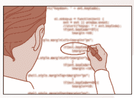


## 1. 是否根据任何标准做出简单的决策？

Java 使得通过 `if` 语句执行简单的决策任务成为可能，如第 167 页所示。

## 2. 如何在某种情况下创建只执行两个任务之一的代码？

使用 `...else` 语句使得只执行两个任务中的一个成为可能，如第 169 页所示。

## 3. 如果我需要做一个基础决策，然后根据该原始决策做出额外的决策怎么办？

语句的嵌套使得实现任何复杂程度的决策成为可能，如第 171 页所示。

## 4. 我的应用程序如何从许多选项中选择一个？

当你的应用程序需要从整个选项菜单中选择一个操作时，使用 `switch` 语句，如第 174 页所示。

## 5. 我不确定用户是否会选择任何选项，所以我的应用程序如何控制这种情况呢？

依赖默认操作使得即使用户或其他决策方无法确定该做什么，执行某些操作也成为可能，如第 177 页所示。

## 6. 在处理布尔值时，我能显示 true 或 false 以外的内容吗？

幸运的是，可以用其他形式（如“是”和“否”）显示布尔值，如第 180 页所示。

> 如果你从头到尾读这本书，那么当你读完时，对 Java 会有很多了解。这是人类形式的条件语句。应用程序中的条件语句以条件开始，以任务结束。你每天都在使用条件语句。条件语句的另一个例子是，“从列表中选择一个与你年龄最匹配的物品作为奖品。”程序也可以使用那种条件语句！本章的主要目的是向你展示如何编写计算机能理解的条件语句；但从逻辑角度来看，你已经掌握了使用条件语句的所有知识。

# 使用简单的 if 语句

这种语句是条件语句中最容易理解的，你会发现你经常使用它。一个 `if` 语句由一个如下所示条件组成：

```
if (expression)
```

其中 `expression` 是条件。与之关联的任务出现在大括号内：

```
{
  task
}
```

每个 `if` 语句都遵循这种模式。`expression` 是条件。`task` 是当条件为真时执行的操作。如果条件为假，则不执行任务。

| 部分 | 说明 |
| :--- | :--- |
| if | 关键字 |
| expression | 要检查的条件 |
| task | 条件为真时执行的操作 |

`if...else` 语句允许你处理两种结果。

| 部分 | 说明 |
| :--- | :--- |
| else | 用于处理“假”情况的关键字 |
| task | 条件为假时执行的操作 |

## 第 6 章：示例 - SimpleIf.java

```java
import java.util.Scanner;

public class SimpleIf {

    public static void main(String[] args) {

        // 创建扫描器
        Scanner GetInput = new Scanner(System.in);

        // 获取一个值。
        System.out.print("Enter number: ");
        int Input = GetInput.nextInt();

        // 判断 Input 是否小于 5。
        if (Input < 5) {
            System.out.println("The input is <5.");
        }

        // 判断 Input 是否大于等于 5。
        if (Input >= 5) {
            System.out.println("The input is >=5.");
        }
    }
}
```

此应用程序从控制台获取一个整数值。它使用两个 `if` 语句将该值与 5 进行比较。第一个语句判断是否小于 5。如果是，它会输出一条消息。

1. 打开编辑器。
2. 将代码输入编辑器。
3. 使用文件名 `SimpleIf.java` 将代码保存到磁盘。
4. 在命令提示符中输入 `javac SimpleIf.java` 并回车。编译器编译你的应用程序并创建一个 `.class` 文件。
5. 输入 `java SimpleIf` 并回车。应用程序要求你输入一个数字。确保你输入整数而不是浮点数。
6. 输入 4 并回车。应用程序输出：The input is <5。
7. 重复步骤 5 和 6，但这次将值替换为 5。应用程序输出：The input is >=5.。
8. 重复步骤 5 和 6，但这次将值替换为 6。应用程序输出：The input is >=5.，如图 6-1 所示。

# 使用 if...else 执行两个任务

基础 `if` 语句可以用于任何任务。然而，仅使用基础 `if` 语句编写代码可能会变得无聊，甚至会在应用程序中引入错误（漏洞）。再次查看“使用简单的 if 语句”部分的示例，你会发现它包含两个语句。`if...else` 语句允许使用一个结构执行完全相同的任务。`...else` 语句表示，如果条件为真，应用程序应该执行任务之一，但如果条件为假，它应该执行一组完全不同的任务。

错误会让你的应用程序以你没有预测的方式运行。任何使用你应用程序的人都会得到不是你想要提供的结果。漏洞会引起各种问题。例如，错误位置的漏洞可能会导致你的应用程序停止工作，或为病毒编写者入侵你的应用程序的机会。通过使用适当的语句简化应用程序是减少漏洞的方法之一。

本章“使用简单的 if 语句”节中的示例有些生硬，你可以很容易地改进它。接下来的示例展示了如何使用 `if...else` 语句来使代码更易读和理解。这种改变还减少了在应用程序中出现 bug 的风险。

**文件名：UsingElse.java**

```java
// Import the required API classes.
import java.util.Scanner;

public class UsingIfElse {

    public static void main(String[] args) {

        // Create GetInput
        Scanner GetInput = new Scanner(System.in);

        // 获取一个字节值。
        System.out.print("Type any number: ");
        int Input = GetInput.nextInt();

        // 判断 Input 是否小于 5。
        if (Input < 5) {
            // Input 小于 5。
            System.out.println("The input is < 5.");
        } else {
            // Input 大于或等于 5。
            System.out.println("The input is >= 5.");
        }
    }
}
```

此应用程序从控制台获取一个整数值。然后它使用 `if...else` 语句将该值与数字 5 进行比较。当 `Input` 小于 5 时，应用程序执行第一个任务；但当它大于或等于 5 时，应用程序执行第二个任务。


有趣的是，这个版本的应用程序比之前的版本少一行。当你使用本章所示各种快捷方式时，你不仅让应用程序不容易出错，还节省了输入代码的时间。

1. 打开你为本书选择的编辑器或 IDE。
2. 在编辑器屏幕上键输入以下代码。
3. 使用文件名 `UsingIfElse.java` 将代码保存到磁盘上。
4. 在命令提示符中，输入 `javac UsingIfElse.java` 并按回车。编译器编译你的应用程序并从其创建一个 `.class` 文件。
5. 输入 `java UsingIfElse` 并按回车。应用程序要求你输入一个数字。确保你输入的是整数，而不是浮点数或字符。
6. 输入 4 并按回车。应用程序输出一条消息：The input is < 5。
7. 重复步骤 5 和 6，但这次将值替换为 5。应用程序输出一条消息：The input is >= 5。
8. 重复步骤 5 和 6，但这次将值替换为 6。应用程序输出一条消息：The input is >= 5.，如图 6-2 所示。

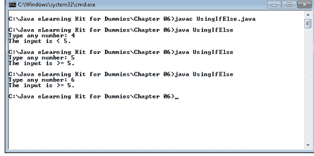

图 6-2 对图 6-1 与图 6-2。

9. 注意到两个版本的应用程序的行为完全相同。

# 嵌套 if 语句

有时一个决策需要多个层次。例如，如果天花板被涂成橙色，你可能还需要决定墙壁是涂成黄色还是红色。另一种多级决策的形式是菜单。用户可能必须在项目 A、B 或 C 之间做出选择，但不允许同时选择两个（项目 A 和 B）。幸运的是，你可以根据需要创建任意层次的 `if` 语句来处理。将多个层次的 `if` 语句组合以做出清晰的决策被称为嵌套。

## 语言

嵌套使得在应用程序中创建多个决策层次成为可能。你可以将各种语句组合成一个凝聚的单元以做出决策。嵌套让你关注决策过程的特定部分，并一次执行一个过程，而不是创建一个复杂的表达式。

菜单是你在应用程序中经常会遇到的决策过程之一。大多数世界的决策不仅仅是这个或那个，而是涉及到灰色地带，例如“你从可能选择的列表中选择一个项目”。下面的示例演示了如何使用嵌套来创建一个菜单系统。

**需要的文件：UseAMenu01.java**

```java
// Import the required API classes.
import java.util.Scanner;
import java.lang.Character;

public class UseAMenu01 {

    public static void main(String[] args) {

        // 创建 scanner。
        Scanner GetChoice = new Scanner(System.in);

        // 从用户处获取输入。
        System.out.println("\n");
        System.out.println("A. Yellow");
        System.out.println("B. Orange");
        System.out.println("C. Green");
        System.out.print("Choose your favorite color: ");
        char Choice = GetChoice.next().charAt(0);

        // 将输入转换为大写。
        Choice = Character.toUpperCase(Choice);

        // 判断输入是否为 A。
        if (Choice == 'A')
            System.out.println("Your favorite color is Yellow!");
        // 判断输入是否为 B。
        else if (Choice == 'B')
            System.out.println("Your favorite color is Orange!");
        // 输入可能是 C。
        else if (Choice == 'C')
            System.out.println("Your favorite color is Green!");
    }
}
```

应用程序从创建一个 `Scanner` (`GetChoice`) 开始并使用它从用户处获取 `char` (`Choice`)。因为不确定输入的是大写还是小写，所以需要将 `Choice` 转换为大写。由于 `Choice` 是基本类型，所以应用程序需要将其包装为对象，使用 `toUpperCase()` 进行转换，然后将结果拆箱回 `Choice`。代码需要检查三次，以确定用户的选择。

1. 打开你选择的用于使用的编辑器或 IDE。
2. 在编辑器屏幕上键入以下代码。
3. 使用文件名 `UseAMenu01.java` 将代码保存到磁盘。
4. 在命令提示符中，输入 `javac UseAMenu01.java` 并按回车。
5. 输入 `java UseAMenu01` 并按回车。
6. 输入 A 并按回车。应用程序输出预期的消息。
7. 重复步骤 5 和 6，但这次将值替换为 b。应用程序再次输出预期的消息。然而，无论输入是大写还是小写，你都能得到预期的结果。
8. 重复步骤 5 和 6，但这次将值替换为 1。应用程序没有输出任何内容，如图 6-3 所示。注意图 6-3，应用程序为菜单提供了良好的外观。例如，在 Options 和选项列表之间有一个空行。这就是在字符串末尾使用 `\n` 转义字符的目的，给用户带来享受。

```
C:\Windows\System32>cmd.exe
C>Java cleaning Kit for Durbies\Chapter 6>java UseAMenu.java
C>Java cleaning Kit for Durbies\Chapter 6>java UseAMenu
Options:
  A. Yellow
  B. Orange
  C. Green
  Choose your favorite color: 1
  Your favorite color is 'Yellow'
  C>Java cleaning Kit for Durbies\Chapter 6>java UseAMenu
Options:
  A. Yellow
  B. Orange
  C. Green
  Choose your favorite color: 2
  Your favorite color is 'Orange'
  C>>
```

图 6-3

提供正确的提示对应用程序的可用性可以产生巨大影响。例如，如果你为应用程序的用户提供一组有效选项列表，例如选择 A、B 或 C，你就可以减少用户做出无效选择的可能性。尽管如此，用户即使有提示也会做出无效选择，因此你的应用程序代码必须提供健壮的错误处理。

# 使用 switch 从多个条件中选择

就像在 `if...else` 语句中使用两个 `if` 语句有快捷方式一样，使用多个 `if...else` 语句创建 `switch` 也有快捷方式。`switch` 语句由如下条件组成：

```
switch (variable)
```

其中变量包含你想要与多个常量进行比较的值。这些常量以如下 `case` 子句的形式出现：

```
case value:
```

其中 `value` 是你想要检查的特定常量值。最后，任务出现在 `case` 子句之后，并以 `break` 子句结束，如下：

```
task;
break;
```

你必须包含 `break` 子句来告诉编译器任务何时完成。

`switch` 语句使得以一种易于阅读且输入大量更短的方式来创建一个菜单系统成为可能。在接下来的示例中，你创建了一个依赖于 `switch` 语句的应用程序，允许用户从几个选项中选择一个。

**所需的文件：UseAMenu02.java**

```java
// 导入所需的 API 类。
import java.util.Scanner;
import java.lang.Character;

public class UseAMenu02 {

    public static void main(String[] args) {
        // 创建 scanner。
        Scanner GetChoice = new Scanner(System.in);

        // 从用户处获取输入。
        System.out.println("\n");
        System.out.println("A. Yellow");
        System.out.println("B. Orange");
        System.out.println("C. Green");
        System.out.print("Choose your favorite color: ");
        char Choice = GetChoice.next().charAt(0);

        // 将输入转换为大写。
        Choice = Character.toUpperCase(Choice);

        // 使用 switch 语句处理选择。
        switch (Choice) {
            case 'A':
                System.out.println("Your favorite color is Yellow!");
                break;
            case 'B':
                System.out.println("Your favorite color is Orange!");
                break;
            case 'C':
                System.out.println("Your favorite color is Green!");
                break;
            default:
                System.out.println("Invalid choice!");
                break;
        }
    }
}
```

1. 打开你为本书选择使用的代码编辑器或 IDE。
2. 在编辑器中输入以下代码。
3. 使用文件名 `UseAMenu02.java` 将代码保存到磁盘。
4. 在命令提示符中，输入 `javac UseAMenu02.java` 并按回车。
5. 输入 `java UseAMenu02` 并按回车。
6. 测试不同的输入值（A, B, C, 1 等）验证程序行为。


// 创建扫描器。

`Scanner GetChoice = new Scanner(System.in);`

// 获取用户的输入。

`System.out.println("Options\n");`

`System.out.println("A. Yellow");`

## 第 6 章

```java
// 根据 switch 语句选择正确的颜色。

switch (Choice) {
    case 'A':
        System.out.println("Your favorite color is Yellow!");
        break;
    case 'B':
        System.out.println("Your favorite color is Orange!");
        break;
    case 'C':
        System.out.println("Your favorite color is Green!");
        break;
}
```

该应用程序通过显示选择菜单并要求选择一个，精确地使用了 UseAMenu01 应用程序。此外，它确保了根据需要将输入转换为大写字母。`switch` 语句将 `Choice` 与三个 `case` 子句（A、B 和 C）进行比较。当 `Choice` 等于其中之一时，应用程序将执行该 `case` 语句请求的任务，并在看到 `break` 子句时停止。

- 3. **使用文件名 `UseAMenu02.java` 将代码保存到磁盘。**
- 4. **在命令提示符中，输入 `javac UseAMenu02.java` 并按回车。**

编译器编译该应用程序并从其创建一个 `.class` 文件。

- 5. **输入 `java UseAMenu02` 并按回车。**

应用程序将要求你选择一种颜色。

- 6. **输入 `A` 并按回车。**

应用程序输出预期的消息。

- 7. **重复步骤 5 和 6，但这次将值替换为 `b`。**

应用程序再次输出预期的消息。

- 8. **重复步骤 5 和 6，但这次将值替换为 `3`。**

应用程序没有输出任何内容，如图 6-4 所示。

# 执行默认任务

```cmd
C:\Windows\System32\cmd.exe

C:\Java learning for Dummies\Chapter 06>UseAMenu02.java

C:\Java learning for Dummies\Chapter 06>UseAMenu02

Options:

 A. Yellow

 B. Green

 Choose your favorite color: a

 Your favorite color is Yellow!

Options:

 C:\Java learning for Dummies\Chapter 06>UseAMenu02.java

Options:

 A. Yellow

 B. Green

 Choose your favorite color: b

 Your favorite color is Orange!

Options:

 C:\Java learning for Dummies\Chapter 06>_
```

图 6-4

9. 比较图 6-3 和图 6-4。
注意两个版本的应用程序的行为完全相同。

# 执行默认任务

UseAMenu01 和 UseAMenu02 应用程序存在一个特定问题。当用户使用意外的字母、数字或符号时，应用程序直接结束且不显示任何内容。这种响应比允许应用程序崩溃要好，但它几乎没有告诉用户哪里出了问题。在这种情况下，你需要一个默认操作来帮助用户理解哪里错了。默认任务使得应用程序在用户未提供预期输入时也能执行某些操作。在下面的练习中，你创建了 UseAMenu02 的新版本并为其添加了一个默认任务。

所需的文件：`UseAMenu03.java`

- 1. 打开你为本书选择使用的编辑器或 IDE。
- 2. 在编辑器屏幕上输入以下代码。

```java
// 导入所需的 API 类。

import java.util.Scanner;

import java.lang.Character;
```

## 第 6 章

```java
public class UseAMenu03 {

    public static void main(String[] args) {

        // 创建扫描器。

        Scanner GetChoice = new Scanner(System.in);

        // 获取用户的输入。

        System.out.println("Options\n");

        System.out.println("A. Yellow\n");

        System.out.println("B. Orange\n");

        System.out.println("C. Green\n");

        System.out.print("Choose your favorite color: ");

        char Choice = GetChoice.next().charAt(0);

        // 将输入转换为大写。

        Choice = Character.toUpperCase(Choice);

        // 根据 switch 语句选择正确的颜色。

        switch (Choice) {

            case 'A':
                System.out.println("Your favorite color is Yellow!");
                break;

            case 'B':
                System.out.println("Your favorite color is Orange!");
                break;

            case 'C':
                System.out.println("Your favorite color is Green!");
                break;

            default:
                System.out.println("Type A, B, or C to select a color.");
                break;

        }

    }

}
```

该应用程序通过显示选择菜单并要求选择一个，精确地使用了 UseAMenu01 应用程序。此外，它确保了根据需要将输入转换为大写字母。`switch` 语句将 `Choice` 与三个 `case` 子句（A、B 和 C）进行比较。当 `Choice` 等于其中之一时，应用程序将执行该 `case` 语句请求的任务并在看到 `break` 子句时停止。注意特别是 `switch` 语句中的 `default` 子句。如果用户没有正确选择，`default` 提供了一种错误拦截的形式。换句话说，`default` 提醒用户有效的选择。

- 3. **使用文件名 `UseAMenu03.java` 将代码保存到磁盘。**
- 4. **在命令提示符中，输入 `javac UseAMenu03.java` 并按回车。**

编译器编译该应用程序并从其创建一个 `.class` 文件。

- 5. **输入 `java UseAMenu03` 并按回车。**

应用程序将要求你选择一种颜色。

- 6. **输入 `A` 并按回车。**

应用程序输出预期的消息。

- 7. **重复步骤 5 和 6，但这次将值替换为 `b`。**

应用程序再次输出预期的消息。

- 8. **重复步骤 5 和 6，但这次将值替换为 `3`。**

注意应用程序现在输出了一条帮助消息，如图 6-5 所示。

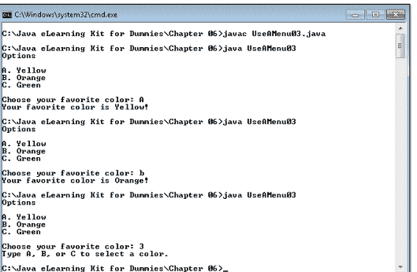

图 6-5

# 第6 显示布尔值

这是你第一次将布尔值真正用于预期用途——作为决策工具。然而，你会发现有时需要显示布尔值。大多数人理解 `true` 或 `false`，但他们并不觉得使用 `true` 或 `false` 自然。遗憾的是，Java 没有提供以其他方式显示布尔值的方法，例如输出 `ye` 或 `no` 等你能够理解的词。在下面的练习中，你构造了一个简单的方法来显示人类可读的布尔值，例如 `yes` 和 `no`。

所需的文件：`DisplayBoolean.java`

- 1. 打开为你本书选择使用的编辑器或 IDE。
- 2. 在编辑器屏幕上输入以下代码。

```java
// 导入所需的 API 类。

import java.lang.String;

public class DisplayBoolean {

    public static void main(String[] args) {

        // 定义一个布尔值到字符串。

        boolean BoolVar = true;

        // 将布尔值转换为字符串。

        String BoolString = BoolAsString(BoolVar)
```

该应用程序创建了一个简单的布尔值 `BoolVar` 并设置为 `true`。然后它创建了一个名为 `BoolString` 的字符串，包含 `BoolVar` 值的人类可读版本，并在屏幕上显示此字符串。

# 显示布尔值

此示例的秘密在于 `BoolAsString()` 方法，它接受三个参数作为输入并返回一个字符串值。

- `BoolValue`: 你想要转换为字符串的布尔值。
- `TrueString`: 当 `BoolValue` 为 `true` 时你输出的字符串。
- `FalseString`: 当 `BoolValue` 为 `false` 时，你想输出的字符串。

该示例根据第 5 章“执行条件评估”部分描述的条件语句返回相应的值。此示例展示了条件语句的实际用途。

- 3. 使用文件名 `DisplayBoolean.java` 将代码保存到磁盘。
- 4. 在命令提示符中，输入 `javac DisplayBoolean.java` 并按回车。

编译器会编译你的应用程序并在此创建一个 `.class` 文件。

- 5. 输入 `java DisplayBoolean` 并按回车。

应用程序输出一个与 `BoolVar` 值匹配的人类可读字符串，如图 6-6 所示。

```
C:\Windows\system32 C:\Java Cleaning Kit for Bunnies\Chapter 06> javac DisplayBoolean.java

C:\Java Cleaning Kit for Bunnies\Chapter 06> java DisplayBoolean

The answer is:

C:\Java Cleaning Kit for Bunnies\Chapter 06>>
```

图 6-6

将 `BoolVar` 的值改为 `false`。编译并运行应用程序。你应该看到输出发生变化以匹配 `BoolVar` 的新值。尝试使用其他的 `TrueString` 和 `FalseString` 值。

## 总结

以下是你在本章中学习到的要点：

- 条件语句由一个条件和一个任务组成。当条件为 `true` 时，应用程序执行该任务。
- 条件语句的条件部分也被称为表达式。
- 每个条件任务都可以通过简单的 `if` 语句完成，但使用其他条件语句的形式会让你的应用程序不易出错，并减少你的输入量。
- `else` 语句让你的应用程序根据你提供的表达式是 `true` 还是 `false` 在两种行动方案之间选择。
- 使用 `switch` 语句允许用户从项目列表中进行选择。
- 依赖 `default` 子句在用户未提供有效输入时为你的应用程序提供一个默认操作。

# 动手实践实验室

为了进一步练习本章涵盖的功能，请独立尝试以下练习：

- 1. 打开 `UseMenu03` 。
- 2. 在菜单中添加一系列额外的颜色。

你想更改菜单以包含额外的 `System.out.println("Letter. Color");` 条目。确保每个条目都有与其相关的唯一字母。

- 3. 通过修改 `switch` 语句来适应这些项，使新的菜单项具有功能。

每种新颜色都需要三行类似于此处所示的代码：

```
case 'A':
System.out.println("Your favorite color is Yellow!");
break;
```

- 4. 修改默认子句，以便为你添加的颜色提供所需的额外字母。
- 5. 编译应用程序。
- 6. 运行应用程序。
- 7. 尝试每个菜单项。
新的菜单项确实如你预期的那样工作吗？如果没有，为什么？
- 8. 尝试输入菜单上未出现的字母、数字或其他符号。
默认操作仍然按预期工作吗？

# 科技术语讲解

- **bug（漏洞）**: 应用程序代码中的错误，会导致你的应用程序以你没有预到的方式运行。
- **conditional statement（条件语句）**: 一种由条件（表达式）和任务组成的编程结构。当条件为 `true` 时，应用程序执行该任务。
- **expression（表达式）**: 对你想要应用程序检查的条件的数学描述。表达式通常包含一个逻辑运算符，并始终提供布尔输出。
- **nesting（嵌套）**: 将多个层级的语句组合成单个超级语句的行为。应用程序首先执行语句的较高层，然后深入到较低层级。使用嵌套来处理一个决策影响其他决策的复杂情况。

## 第 7 章
使用循环重复任务

- 创建 `for` 循环允许应用程序按特定次数执行任务。
- 创建 `while` 循环允许应用程序执行任务，直到任务完成。
- 创建 `for-each` 循环允许应用程序对对象集合执行任务，直到集合中的每个对象都已使用完毕。


# 1. 是否可以告诉 Java 执行确切次数的特定任务？

`for` 循环使得精确指定执行任务的次数成为可能，如第 187 页所示。

# 2. 当某些预期未满足时，应用程序可以停止执行循环中的任务吗？

使用 `break` 语句使得条件不符合时不执行任务成为可能，如第 189 页所示。

# 3. 在中断单个循环后，可以继续处理 `for` 循环吗？

`continue` 语句使得只跳过一次循环（单个值）然后继续处理下一个任务成为可能，如第 191 页所示。

# 4. 如果我不知道执行多少次，会发生什么？

使用 `while` 循环通过表达式而不是精确计数来控制任务执行的次数，如第 197 页所示。

# 5. 如果表达式为 `false`，意味着 `while` 循环的代码将不会执行。如何确保任务至少执行一次？

使用 `do while` 循环确保任务至少执行一次，但在第一次循环后，表达式控制是否重复，如第 199 页所示。

# 6. 如何对未知数量的元素执行任务并确保每个元素都经过处理？

`for-each` 循环使得对枚举、数组和集合的元素执行任务成为可能，如第 202 页所示。


跟我重复一遍：“Java 是一种神奇的语言！”现在再说一遍以加强记忆。现实世界中有很多时候你需要重复某些事情。同样，应用程序也有重复任务的需求。执行一次是不够的。本章帮助你理解如何多次执行任务。

可以使用 `for` 循环执行每个重复循环，但这样做意味着编写代码的方式很奇怪。因此，`for` 循环是重复结构的骨干，因为它易于创建、于调试和理解。`for` 循环的本质是应用程序执行特定次数的一系列任务。

> LINGO
重复循环由一种特殊的结构组成，用于跟踪开始和结束一系列重复任务，以及任务 `for` 执行特定次数的一系列任务，而 `while` 循环继续重复一系列任务，直到满足特定条件。`for-loop` 的特殊之处在于它可以处理枚举、数组或集合中的每个元素。

# 使用标准 for 循环

在创建第一个 `for` 循环之前，理解它是如何组合的是重要的。`for` 循环以单词 `for` 开头，后面跟着包含三个由分号（`;`）隔开的项目括号。

- 计数器变量以及初始化它的代码，例如 `Current = 1`。
- 在特定计数后结束循环的条件，例如 `Current <= 5`。
- 更新计数器变量的方法，以便 `for` 循环能够跟踪当前计数，例如 `Current++`。

> LINGO
结构从一个指定结构目的语句开始，例如重复循环。结构体开始于一个左大括号 `{`，结束于一个右大括号 `}` 或在大括号之间执行一个或多个任务的代码行，位于结构的主体。结构在书中用于许多目的。

## 第 7 章

接下来是用于定义 `for` 循环开始和结束的大括号。你将代码放在大括号内。在下面的示例中，你创建一个循环，然后使用它来观察 `for` 循环是如何工作的。

所需文件：`StandardFor.java`

1. 打开你为本书选择的编辑器或 IDE。
2. 在编辑器屏幕上输入代码。

> 术语
计数器变量（`counter variable`）是一种专门用于跟踪某事物当前计数的变量。该变量实际上不会对应用程序数据进行增加或减少任何操作；相反，计数器的目的是帮助应用程序执行你分配给它的任务。

```java
// 所需的 API 类;

import java.util.Scanner;

public class StandardFor {
```


```java
public static void main(String[] args) {

    // 创建扫描器。

    Scanner GetChoice = new Scanner(System.in);

    // 询问用户说几次几次。

    System.out.print("Hello how many times?");

    int Count = GetChoice.nextInt();

    // 创建一个 for 循环。

    for (int Current = 1; Current <= Count; Current++) {

        // 执行所需任务。

        System.out.println("Hello Number " + Current);

    }

}
```

应用程序首先询问用户它应该说多少次 Hello。（当然，生产环境应用程序会询问其他类型的问题，但原理是相同的）。用户提供的答案被存放在 `Count` 中。

下一步是创建一个 for 循环，其中一个 `int` 变量 `Current` 作为计数器变量跟踪当前计数。循环将继续执行结构体内的任务，直到 `Current` 大于 `Count`。每当循环开始时，`Current` 都会加 1，因此如果 `Count` 是 5，循环将执行五次。

# 执行固定次数的任务

注意，此示例使用了转义序列 `\"` 来在输出中显示双引号。在许多情况下，你需要记住转义序列的存在是为了实现你的目标。

3. 使用文件名 `StandardFor.java` 将代码保存到磁盘。
4. 在命令提示符中，输入：`javac StandardFor.java` 并按回车。

编译器编译你的应用程序并从其创建一个 .class 文件。

5. 输入 `java StandardFor` 并按回车。

应用程序询问你它应该说多少次 Hello。

6. 输入 5 并按回车。
应用程序输出一系列 Hello 消息，如图 7-1 所示。注意输出包含了 `Current` 的当前值。正如预期的那样，循环每迭代一次，值就会增加 1。

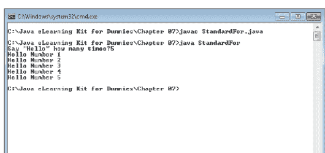

图 7-1

# 使用 break 语句

有时你想尽早停止 for 循环。例如，你可能会检测到一个导致循环失败的条件。也许没有足够的项目需要处理，或者你的应用程序检测到了其他问题。在这种情况下，你可以使用 `break` 语句停止 for 循环继续执行工作。在下面的示例中，你为 StandardFor 应用程序添加了 `break` 语句以提前停止它。

所需文件：`UsingBreak.java`

1. 打开你为本书选择的编辑器或 IDE。
2. 在编辑器屏幕上输入以下代码。

```java

// 所需的 API 类。

import java.util.Scanner;

public class UsingBreak {

    public static void main(String[] args) {

        // 创建扫描器。

        Scanner GetChoice = new Scanner(System.in);

        // 询问用户说几次几次。

        System.out.print("Say \"Hello how many times?");

        int Count = GetChoice.nextInt();

        // 创建一个循环。

        for (int Current = 1; Current <= Count; Current++) {

            // 不允许应用程序说

            // 超过三次。

            if (Current == 4)

                break;

        }

        // 执行所需任务。

        System.out.println("Hello Number " + Current);

    }

}

```

该应用程序看起来与使用章节中标准 for "循环"部分的 StandardFor 应用程序非常相似。然而，它额外增加了一个 `if` 语句，用于检测 `Current` 是否等于 4。当 `Current` 达到此值时，应用程序会发出 `break` 语句。


> 注意，如果 `if` 语句仅作用于下一行代码，则不使用大括号。在这种情况下，如果 `if` 语句仅与 `break` 语句关联，则不需要使用大括号。

3. 使用文件名 `UsingBreak.java` 将代码保存到磁盘。
4. 在命令提示符中，输入 `javac UsingBreak.java` 并按回车。

编译器编译你的应用程序并从其创建一个 .class 文件。

5. 输入 `java UsingBreak` 并按回车。

应用程序询问你它应该说多少次 Hello。

6. 输入 2 并按回车。

应用程序输出两个 Hello 消息。

7. 重复步骤 5 和 6，并在第 2 步中使用值 5。

你会看到三个 Hello 消息，如图 7-2 所示。`break` 语句并没有阻碍应用程序输出最多三个 Hello，但它不允许输出超过该数量的内容。

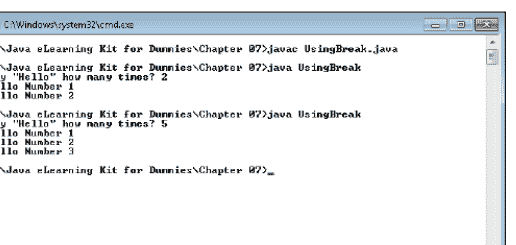

图 7-2

# 使用 continue 语句

到为止，你已经了一个执行特定次数的循环，以及另一个使用 `break` 语句在特定点停止的版本。理解 `break` 和 `continue` 语句差异的最佳方法是对比它们提供的输出。在下面的练习中，你创建一个应用程序，其工作方式与非常相似，但使用了 `continue` 语句而不是 `break` 语句。`continue` 语句告诉循环直接跳到下次循环，而不是完成当前循环。例如，你需要处理的数据可能类型错误，或者完全缺失。这种第三种形式依赖于 `continue` 语句。

使用章节中“使用 break 语句”部分的示例并使用相同的方法进行测试。然而，正如你所看到的，结果输出不同。

所需文件：`UsingContinue.java`

1. 打开你为本书选择的编辑器或 IDE。
2. 在编辑器屏幕上输入代码。

```java

// 所需的 API 类。

import java.util.Scanner;

public class UsingContinue {

    public static void main(String[] args) {

        // 创建扫描器。

        Scanner GetChoice = new Scanner(System.in);

        // 询问用户说几次几次。

        System.out.print("Say \"Hello how many times?");

        int Count = GetChoice.nextInt();

        // 创建一个循环。

        for (int Current = 1; Current <= Count; Current++) {

            // 不允许应用程序说

            // 超过三次。

            if (Current == 4) {

                continue;

            }

            // 执行所需任务。

            System.out.println("Hello Number " + Current);

        }

    }

}

```

> 额外信息
> 因为本章的示例单独查看 `break` 和 `continue` 语句，这是否意味着你不能在一个循环中结合使用它们？`break` 和 `continue` 语句可以出现在任何你需要的地方。例如，你可以选择处理 for 循环，如果满足条件时继续下次循环。如果在同一个循环中发生了错误，你可以选择使用 `break` 语句来结束它。一个 for 循环也可以包含多个 `break` 和 `continue` 语句实例。

3. 使用文件名 `UsingContinue.java` 将代码保存到磁盘。
4. 在命令提示符中，输入 `javac UsingContinue.java` 并按回车。

编译器会编译你的应用程序并从中创建一个 .class 文件。

5. 输入 `java UsingContinue` 并按回车。

应用程序会询问你应该说多少次 Hello。

6. 输入 `2` 并按回车。

应用程序输出两个 Hello 消息。在这种情况下，输出与 `UsingBreak` 应用程序完全相同，因为 `if` 语句从未被调用。

7. 重复步骤 5 和 6，用值 5 代替 2。

这次你将看到四个 Hello 消息，如图 7-3 所示。注意当 `Current` 等于 4 的消息缺失了。但是，由于 `continue` 语句让 `for` 结构处理下一次循环，你看到 `Current` 等于 5 时的输出了吗？

```
C:\Java\learning3v2\class

> Java Learning Kit for Dummies\Chapter 7>Java UsingContinue.java

Say "Hello" how many times? 5

Hello Number: 1

Hello Number: 2

Hello Number: 3

Hello Number: 5

> Java Learning Kit for Dummies\Chapter 7>Java UsingContinue

Say "Hello" how many times? 5

Hello Number:

Hello Number:

Hello Number:

> Java Learning Kit for Dummies\Chapter 7>_
```

图 7-3

修改 `UsingContinue` 应用程序，使其跳过数字 3 并在数字 6 停止。你需要同时使用 `continue` 和 `break` 语句来完成此任务。

## 嵌套 for 循环

有时你需要使用多个循环来处理某些内容。例如，在处理表格数据时，你可能使用一个循环来处理行，并使用另一个循环来处理列。每行都有多个列，因此 `Columns` 循环出现在 `Rows` 循环内部。将一个重复循环放在另一个循环内部被称为“嵌套循环”。主循环的每次迭代都会执行整个子级循环。因此，当你开始处理第一行时，它会在移动到下一行之前执行该行的所有的列任务。

乘法表是演示嵌套的较好的方法之一，因为你需要为行创建一个循环，并为列创建另一个循环。此外，你还需要创建显示相乘数字的表头，这意味着需要使用额外的循环。在接下来的练习中，你将创建一个应用程序，用代码演示创建乘法表的一种方法。

> 嵌套是将一个结构封装在相同类型的结构中的过程。Java 在许多地方都使用了嵌套，因此你会经常看到这种用法。在处理结构时，一个结构充当容器来装载另一个结构。容器结构被称为主结构（或父级结构）。主结构内部的结构被称为子级结构（或子级结构）。

所需的文件：`NestingLoops.java`

1. 打开你为本书选择使用的编辑器或 IDE。
2. 在编辑器屏幕上输入以下代码。

```java

// 导入所需的 API 类。

import java.util.Scanner;

public class NestingLoops {

    public static void main(String[] args) {

        // 创建扫描器。

        Scanner GetChoice = new Scanner(System.in);

        // 询问用户想提供多少行。

        System.out.print("How many rows do you want?");

        int Rows = GetChoice.nextInt();

        // 询问用户想提供多少列。

        System.out.print("How many columns do you want?");

        int Cols = GetChoice.nextInt();

        // 在顶部打印一列标题。

        for (int ColNum = 1; ColNum <= Cols; ColNum++)

            System.out.print("\t" + ColNum);

        // 结束列标题。

        System.out.println();

    }

}

```

## 执行固定次数的任务

```java

// 为行创建一个 for 循环。

for (int Row = 1; Row <= Rows; Row++)

{

    // 打印当前行号。

    System.out.print(Row + "\t");

    // 为列创建一个 for 循环。

    for (int Column = 1; Column <= Cols; Column++)

    {

        // 为每一列显示一个值。

        System.out.print(Row * Column + "\t");

    }

    // 移动到下一行。

    System.out.println();

}

```

该应用程序依赖多个循环来完成工作。然而，在执行任何工作之前，应用程序必须从用户那里获取一些信息。它获取了用户想要看到的行数和列数。

第一个循环打印标题的列数。注意此循环如何依赖转义序列（`"\t"`）来在每个列标题项之间产生制表符。

第二个循环是嵌套的。因为你的显示方式的方式，应用程序总是先打印一行以及该行内的所有列，然后移动到下一行。示例在每行的开头打印了标题元素。

3. 使用 `NestingLoops.java` 将代码保存到磁盘。
4. 在命令提示符中，输入 `javac NestingLoops.java` 并按回车。

编译器会编译你的应用程序并从中创建一个 .class 文件。

5. 输入 `java NestingLoops` 并按回车。

应用程序询问你想要看多少行。

6. 输入 `4` 并按回车。

应用程序现在询问你想要看多少列。

7. 输入 `5` 并按回车。

应用程序输出一个包含四行五列数值的乘法表，如图 7-4 所示。

```
Java Learning Kit for Dummies\Chapter 7>NestingLoops.java

How many rows do you want? 4

How many columns do you want? 5

	1	2	3	4	5

1	2	3	4	5

2	4	6	8	10

3	6	9	12	15

4	8	12	16	20
```

修改 `NestingLoops` 应用程序，使其跳过数字 3 并在数字 6 停止。你需要同时使用 `continue` 和 `break` 语句来完成此任务。

## 执行直到完成

你可以使用 `for` 循环创建任何你循环情况。然而，处理 `for` 循环并不总是方便，你会发现某些情况下检查条件比采取固定步数更有效。Java 提供了两种检查条件的方法。你可以在循环开始时使用 `while` 循环检查，也可以在循环结束时使用 `do` 循环检查。

> 额外信息
与 `for` 循环一样，你可以在 `while` 循环或 `do` 循环中使用 `break` 和 `continue` 语句。它们的工作方式完全相同。此外，你可以循环产生与 `for` 循环相似的结果。循环的主要区别在于你如何定义循环的开始和结束。

## 使用 while 循环

`while` 循环在执行任何操作之前检查特定条件。只要条件存在，循环就会继续执行分配给它的任务。由于它依赖条件，`while` 循环没有特定的结束——你只需要等待条件改变来结束它。例如，将 `while` 循环与本节中的 `for` 循环进行对比。

文件名：`StandardWhile.java`

1. 打开你为本书选择使用的编辑器或 IDE。
2. 在编辑器屏幕上输入以下代码。

```java

// 导入所需的 API 类。

import java.util.Scanner;

public class StandardWhile {

    public static void main(String[] args) {

        // 创建扫描器。

        Scanner GetCount = new Scanner(System.in);

        // 询问用户说多少次 hello。

        System.out.print("Say \"Hello\" how many times?");

        int Count = GetCount.nextInt();

        // 创建计数器变量。

        int Current = 1;

        // 创建 while 循环。

        while (Current <= Count) {

            // 执行所需的任务。

            System.out.println("Hello Number " + Current);

            // 更新计数器变量。

            Current++;

        }

    }

}
```


## 第 7 章

当你提供相同的输入时，此应用程序产生的输出与 `StandardFor` 程序完全相同。然而，`while` 循环要求你以稍不同的方式操作。例如，注意你必须在单独的一行代码上定义计数器变量 `Current` —— `for` 循环将计数器变量定义为语句的一部分。

`while` 语句的条件与 `for` 循环的条件部分（第二个参数）相同。然而，为了更新计数器变量 `Current`，你必须在 `while` 结构内部添加另一行代码。

- 3. 使用文件名 `StandardWhile.java` 将代码保存到磁盘。
- 4. 在命令提示符中，输入 `javac StandardWhile.java` 并按回车。

编译器编译你的应用程序并从中创建一个 `.class` 文件。

- 5. 输入 `java StandardWhile` 并按回车。

应用程序询问你应该说多少次 Hello。

- 6. 输入 `5` 并按回车。

应用程序输出一系列的 Hello 消息，如图 7-5 所示。

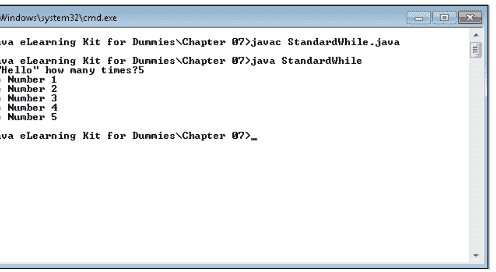

### 7. 比较图 7-1 和图 7-5

注意 `StandardFor` 程序的输出与 `StandardWhile` 程序的输出完全相同。

### 执行任务直到完成


现在你已经对 `while` 语句的工作原理有了更好的了解，请使用它来创建本章中 `UsingBreak`、`UsingContinue` 和 `NestedLoops` 示例的版本。在每个情况下，你需要进行与在本节中看到的更改类似的更改。有一个特殊的技巧可以让 `continue` 语句在 `while` 循环中生效 —— 记住你必须在每次循环迭代期间更新计数器变量。在你创建完每个新应用程序后，问问自己在该特定情况下使用 `for` 循环还是 `while` 循环最简单。

### 在首次执行 do...while 循环后进行检查

`do...while` 循环几乎像 `while` 循环一样。区别体现在检查条件时。`do...while` 循环在循环结束时检查条件，这意味着循环将至少运行一次。在这个示例中，你将 `do...while` 循环与 `StandardFor` 程序中的 `for` 循环进行比较。然而，在这种情况下，你还将进行另一个测试，展示使用 `do...while` 循环的有趣区别。

文件名：`StandardDoWhile.java`

- 1. 打开你选择用于本书的编辑器或 IDE。
- 2. 在编辑器屏幕上输入以下代码。

```java
// 导入所需的 API 类。

import java.util.Scanner;

public class StandardDoWhile {

    public static void main(String[] args) {

        // 创建扫描器。

        Scanner GetChoice = new Scanner(System.in);

        // 询问用户说多少次 hello。

        System.out.print("Say \"Hello\" how many\ntimes? ");

        int Count = GetChoice.nextInt();

        // 定义计数器变量。

        int Current = 1;

        // 创建一个 for 循环。

        do {

            // 执行所需的任务。

            System.out.println("Hello Number " + Current);

            // 更新计数器变量。

            Current++;

        } while (Current <= Count);
    }
}
```

此列表中需要注意的区别是，在循环执行之前不会测试条件。否则，其他所有内容与 `StandardWhile` 循环示例相同。

- 3. 使用文件名 `StandardDoWhile.java` 将代码保存到磁盘。
- 4. 在命令提示符中，输入 `javac StandardDoWhile.java` 并按回车。

编译器编译你的应用程序并从中创建一个 `.class` 文件。

- 5. 输入 `java StandardDoWhile` 并按回车。

应用程序询问你应该说多少次 Hello。

- 6. 输入 `5` 并按回车。

应用程序输出一系列 Hello 消息。

- 7. 再次执行步骤 5 和 6，将输入值替换为 -1。

应用程序仍然输出一个 Hello，如图 7-6 所示。事实上，你可以输入任何负数、0 或 1，仍然从应用程序中得到一个 Hello。

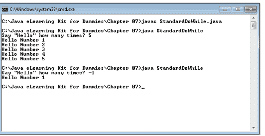
图 7-6

- 8. 使用 `StandardFor` 程序再次使用 -1 执行步骤 5 和 6。应用程序在没有任何输出的情况下退出。
- 9. 使用 `StandardWhile` 程序再次使用 -1 执行步骤 5 和 6。应用程序在没有任何输出的情况下退出。

从理论上讲，你在处理循环时可以提供这种行为，但它是复杂的，而且 `do...while` 循环被证明更容易使用。

### 与对象交互

`for-each` 循环是一种特殊的循环，你可以与一组事物一起使用。它在某些方面看起来像 `for` 循环，因为它实际上没有使用 `for-each` 关键字 —— 它使用的是 `for`。然而，关联的语句是不同的。关联语句以变量开头，用于持有你想处理的任何类型的元素。它有一个冒号。这个冒号意味着“在……中”。最后部分是元素的集合。假设你从 `MyString` 开始。现在语句变为“对于每个 `MyString` 中的 `Letter`”。

### 创建基础 for-each 循环

`for-each` 循环可以处理任何你需要的对象集合。这种方式更容易看到 `for-each` 循环是如何工作的以及为什么它是如此重要的 Java 特性。

所需文件：`StandardForEach.java`

- 1. 打开你选择用于本书的编辑器或 IDE。
- 2. 在编辑器屏幕上输入以下代码。

```java
// 导入所需的 API 类。

import java.lang.String;

import java.util.Scanner;

public class StandardForEach {

    public static void main(String[] args) {

        // 创建扫描器。

        Scanner GetString = new Scanner(System.in);

        // 获取字符串值。

        System.out.print("Type any string: ");

        String MyString = GetString.nextLine();

        // 在 for-each 循环中

        // 处理每个字符。

        for(char Letter : MyString.toCharArray())

            System.out.println(Letter);

    }

}
```

示例从用户处获取一个字符串。该字符串可以包含任何内容 —— 数字、字母或特殊字符，只要它们不是特殊字符（如制表符）。示例通过调用 `toCharArray()` 方法将字符串 —— 示例中的 `MyString` —— 转换为字符变量集合。它将每个字符放入 `Letter`，然后在屏幕上显示 `Letter`。简而言之，`for-each` 循环正在单独处理 `MyString` 中的每个字母。

- 3. 使用文件名 `StandardForEach.java` 将代码保存到磁盘。
- 4. 在命令提示符中，输入 `javac StandardForEach.java` 并按回车。

编译器编译你的应用程序并从中创建一个 `.class` 文件。

- 5. 输入 `java StandardForEach` 并按回车。

应用程序要求你输入任何字符串。

- 6. 输入 `Hello` 并按回车。

应用程序在你输入的每个字母单独输出到行中，如图 7-7 所示。

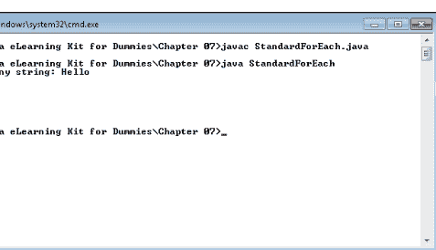
图 7-7

### 与枚举一起使用 for-each 循环

第 3 章向你介绍了枚举，一种可以创建项目列表的特殊结构。可以使用 `for-each` 循环来列出枚举。与其假设你已经知道列表包含什么（如第 3 课所示），你可以使用 for-each 循环来询问你的选项。人们通常对真实世界中的列表执行此任务，因此 Java 支持这一功能是有意义的。

在这个示例中，你创建了一个名为 `Days` 的星期枚举，然后使用 for-each 循环向用户显示这些名称。用户通过输入关联的数字来选择任何项目。

所需文件：`UsingEnumerations.java`

- 1. 打开你选择用于此本书的编辑器或 IDE。
- 2. 在编辑器屏幕上输入以下代码。

```java
// Import the required API classes.

import java.util.Scanner;

public class UsingEnumerations {

    // 创建一个枚举供示例 example 使用

    enum Days {

        Sunday,
        Monday,
        Tuesday,
        Wednesday,
        Thursday,
        Friday,
        Saturday
    }

    public static void main(String[] args) {

        // 创建扫描器

        Scanner GetDay = new Scanner(System.in);

        // 在屏幕上显示日期列表。

        for (Days ThisDay : Days.values()) {

            System.out.println(ThisDay.ordinal() + "\t" + ThisDay);
        }

        // 显示消息请求用户选择一天。

        System.out.print("Type the number of a day: ");

        // 获取数字。

        int Selection = GetDay.nextInt();

        // 显示结果。

        Days TheDay = Days.values()[Selection];

        System.out.println("You selected " + TheDay);
    }
}
```


枚举可以出现在代码的任何位置，但此示例将枚举放在了类结构内部、`main()` 方法之外。该枚举名为 `Days`，包含了星期中的每一天。

在 `main()` 方法内部，for-each 循环列出了星期的每一天。一个枚举项既有名称又有序数值（ordinal value）。示例向你展示了所有项。

在应用程序向用户显示星期后，它要求用户通过输入数值来选择特定的某一天。代码利用此从 `Days` 中选择一个特定的日子并将其放入 `TheDay` 中。输出是用户选择的日期的名称。

- 3. 使用文件名 `UsingEnumerations.java` 将代码保存到磁盘。
- 4. 在命令提示符中输入 `javac UsingEnumerations.java` 并按回车。

编译器编译你的应用程序并从中创建一个 `.class` 文件。

- 5. 输入 `java UsingEnumerations` 并按回车。

应用程序显示星期。然后要求用户输入对应于特定日的数字。

- 6. 输入 1 并按回车。

应用程序输出所选的日期 Monday，如图 7-8 所示。

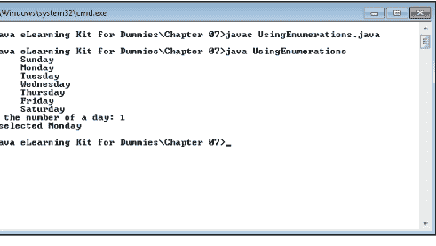

图 7-8

## 总结

以下是你在本章中学到的要点：

- `for` 循环按特定次数重复一系列任务。
- 使用 `break` 语句停止 `for` 循环继续处理任务。
- 当你想停止单个 `for` 循环的处理但想继续执行剩余循环时，使用 `continue` 语句。
- 当你需要处理多个维度或创建复杂的处理循环序列时，嵌套两个或多个 `for` 循环。
- `while` 循环持续重复一系列任务，直到满足特定条件。
- `do...while` 语句的作用与 `while` 语句非常相似，但它的区别在于无论你设置了什么条件，它都会至少执行一次其结构内的任务。
- 可以使用 `for`、`while` 或 `do...while` 语句重复大多数标准的循环需求，你的选择取决于方便性或个人口味。
- `for-each` 循环的特殊之处在于，它可以与枚举、数组或集合中的每个元素一起工作。
- `for-each` 循环依赖一种特殊的 `for` 循环来完成工作。
- 你使用 `for-each` 循环逐个地处理元素集合中的单个元素。
- 使用枚举可以使你的应用程序操作变得更容易。

# 动手实验

为了对本章涵盖的功能进行更多练习，请尝试独立完成以下练习。

- 1. 打开 `UsingEnumerations` 应用程序。
- 2. 创建一个包含颜色列表的新枚举。确保每个颜色之间都用逗号分隔，且颜色名称中不包含任何空格。
- 3. 重写代码，使用 for-each 循环向用户显示枚举。
- 4. 修改代码，要求用户选择一种颜色然后在屏幕上显示所选的颜色。
- 5. 编译应用程序。
- 6. 运行应用程序。
- 7. 尝试每个新的颜色项。

新的颜色项按照你预期的方式工作吗？如果没有，为什么？

# 了解此技术变量

**counter**：一种特殊的变量，用于跟踪应用程序中某些事物的当前计数。在大多数情况下，计数器变量是基本类型整数，因为计数器变量只跟踪整数，不需要对象的额外功能。

除了最简单的应用程序外，你极不可能遇到一个完全没有错误的应用程序。编码中的错误发生有很多原因。仅仅创建一个使用正确代码的应用程序是不够的，应用程序还必须具备正确的逻辑，并以精确正确的方式使用参数。在某些情况下，错误实际上存在应用程序之外，因此应用程序甚至无法控制错误是否发生。最好的应用程序所能的就是处理该错误，以便应用程序不会崩溃并可能损坏用户的数据。

在某些情况下，你应用程序特定部分的代码无法处理错误。每当代码没有足够的信息，或者没有执行某项所需的权限时，就会如此。在某些情况下，你需要与用户交互，允许用户做出决策。这些只是你的应用程序必须信号错误的少数情况之一。Java 应用程序使用异常（exception）来信号错误。你将在本书的其他章节中看到异常。本章是你首次发现如何抛出（throw）异常的章节。抛出异常意味着创建一个异常并发送给调用者。

### 术语

编码错误代表应用程序采取的任何操作都超该应用程序的预期行为。错误可能是戏剧性的，例如应用程序崩溃。然而，错误往往更加微妙，例如显示错误的输出或产生意料之外的结果。在某些情况下，用户完全没有注意到错误，但它们为不法分子提供了破坏应用程序或支持它的系统的机会。

异常是对某种状态的警报。它描述了你应用程序中的一个异常并告诉你发生了错误。异常可能由于各种原因发生。错误可能在你的代码中，也可能在应用程序环境中。例如，如果你的应用程序尝试打开一个不存在的文件，Java 运行环境 (JRE) 将生成一个异常告知你的应用程序错误。

抛出异常意味着创建异常对象并将其发送到应用程序中当前代码的部分。当你的应用程序抛出异常时，它创建一个对象，告诉其他人它遇到了一个无法修复的错误。正如术语所示，抛出异常是你的代码在特殊情况下（当没有其他替代方案可用时）执行的事情。

## 第 8 章

# 理解错误来源

应用程序有很多错误来源。你可能认为错误在代码中，但通常并非如此。错误可能存在于库或应用程序无法控制的其他代码中。在某些情况下，错误与代码无关，而与环境有关。例如，应用程序可能无法访问工作所需的资源。文件可能丢失，或者网络连接可能已断开。用户提供错误的输入也会导致错误。


在大多数情况下，当应用程序代码健壮并有足够的信息来解决时，应用程序可以通过某种方式处理任何错误。然而，在应用程序处理任何错误之前，它必须拥有解决错误所需的信息。开发者使应用程序足够健壮以处理任何错误的最佳工具之一，是对错误进行分类以及了解其发生的原因。这就是后续章节的目的——帮助你理解错误的本质，以便你更好地修复它们。

### 分类错误发生的时间

在线学习

错误可能发生在任何时候。然而，正如后续章节所述，你可以将错误发生的时间大致分为两类：编译时（compile time）和运行时（runtime）。

本章无法涵盖所有可能的错误来源或这些错误的解决方案。请将本章视为对最常见问题的良好介绍。事实上，如果你发现有整个章节专门介绍异常和处理话题，你可能会感到惊讶！良好的信息来源之一是 Java 异常处理教程（tutorials），地址为 http://tutorials.jenkov.com/java-exception-handling/index.html。你也可以找到关于该主题的有趣文章，例如 http://onjava.com/java/2003/11/19/exceptions.html 和 java.net/pub/a/today/2003/12/04/exceptions.html。

# 编译时

编译时发生的错误容易修复，因为编译器会准确告诉你在错误在哪里以及为什么。这些错误通常由于语法错误或类型不匹配引起。例如，如果你忘记分号或使用了错误的变量类型，编译器将生成编译时错误。你必须在运行程序之前修复这些错误。

运行时错误发生在程序运行时。这些错误难以调试得多，因为它们可能取决于输入数据或环境。例如，如果你的程序尝试打开一个不存在的文件，或除以零，它将遇到运行时错误。你可以通过异常来处理这些错误。

下表显示了一些常见的运行时错误：

| 错误类型 |  |
| :--- | :--- |
| `NullPointerException` | 当你尝试使用空对象引用时。 |
| `ArrayIndexOutOfBoundsException` | 当你尝试访问范围之外的数组索引时。 |
| `ArithmeticException` | 在算术运算期间发生，例如除以零。 |
| `IOException` | 在 I/O 操作期间发生错误时发生。 |

理解这些类型的错误将帮助你编写更健壮、更可靠的应用程序。在下一章中，我们将探索如何在 Java 中处理这些异常。

### 区分错误类型

了解错误何时发生是非常重要的。你需要理解何时要在你的应用程序中查找特定问题。然而，理解错误是如何发生的同样重要。错误的类型决定了你寻找它的策略，以及你可以采取什么措施来修复。虽然某些错误需要你修复代码并更新应用程序，但某些错误可以通过重试操作或与用户进行某种交互来修复。以下章节将讨论你最常遇到的错误类型。

## 语法错误

语法错误是指用于创建代码的语言不正确。例如，如果你尝试创建一个不包含括号内条件的语句（即使该条件与该语句在同一行），这也是一个语法错误。编译器会为你捕获大多数此类错误。如果代码语法不正确，在大多数情况下，编译器无法使用该代码为 JRE 创建字节码。以下是常见的常见的语法错误列表：

- **使用大写字母**：新开发者犯的最常见语法错误之一是将关键字大写，而不是小写。当你的代码至关重要时，Java 有正确的大小写。同样的错误也出现在类名、变量或你作为 Java 应用程序部分的任何其他代码类型中。名为 `myvar` 的变量始终比 `MyVar` 更正确。

- **跨行拆分字符串**：Java 并并不乎你的代码显示在一行还是多行上。然而，如果你将字符串跨行拆分导致字符串包含换行符，编译器将会反对。解决方法是在第一行末尾用双引号结束字符串，添加一个加号告诉编译器你想将此字符串与另一个字符串拼接（相加），然后在下一行继续该字符串，如下所示：

```java
System.out.print("This is a really long " + 
"string that appears on two lines.");
```

- **缺少参数**：如果你调用一个方法而没有在方法名后包含括号（即使你没有打算向该方法发送任何参数），编译器也会记录一个错误。例如，这段代码是不正确的，因为编译后的 `print()` 要求在后面有括号：

```java
System.out.print();
```

- **忘记导入类**：每当你想要使用特定的 Java API 功能时，都必须将相关的类导入到你的应用程序中。例如，如果你的应用程序使用 `String userName;`，你必须导入 `java.lang.String;` 来导入 String 类。

- **将静态方法视为实例方法**：静态方法是与特定类关联的方法，而实例方法是与从类创建的对象关联的方法。例如，当你在第 6 章嵌套 if 语句的章节中创建方法时，你使用了 `Character.toUpperCase()` 静态方法。如果你尝试从变量访问 `toUpperCase()`，应用程序将产生错误。

- **缺少大括号**：每当你想要让 Java 功能作用于多行代码时，都必须将整个块封装在大括号 `{}` 中。在大多数情况下，编译器会为你捕获这一点。例如，如果你尝试在不闭合大括号的情况下结束一个类，编译器将生成错误。这是一个错误，因为编译器可能不会向你显示缺少括号的精确位置——它只是知道缺少了一个。这种错误也会导致运行时错误。例如，当一个语句应该适用于多行代码，但你漏掉了大括号时，该语句只会影响下一行代码，导致应用程序运行不正常。

- **在方法调用中忘记类或对象名**：在进行方法调用之前，你总是包含与方法相关的类或对象。例如，`Character.toUpperCase()` 和 `System.out.print()` 是正确的，但仅仅调用 `toUpperCase()` 或 `print()` 是不正确的。

- **在 switch 语句中省略 break 子句**：很容易忘记向 switch 语句中添加 break 子句。此外，编译器不会捕获此错误。由于遗漏 break 子句，你的应用程序将继续执行 switch 语句中的代码，直到遇到 break 子句或 switch 语句完成。

### 额外信息

Java 8 对安全更加强调，这意味着你看到的异常（Exceptions）会比你处理应用程序时看到的要多。安全异常的增加并不意味着你的代码有缺陷，或者 Java 8 充满了漏洞——它意味着 Java 8 会自动讨论并告知你在用户使用你的应用程序时可能导致安全问题的问题。`SecurityException` 出现在 http://download.java.net/jdk/docs/api/java/lang/Exception.html。你会想这背后的原因。你可以在 `CON7932_mullan.pdf` 的系列幻灯片中找到更改的摘要，该文件位于：https://docs.oracle.com/entry/slides/javaone_session。这些更改在 JDK 增强项目 (JEP) 的条目中有进一步解释，地址为：http://jdk.java.net/projects/8/features。幻灯片中的数字与更新网站上的数字是对应的。关键在于，Java 8 帮助你创建最安全可靠的应用程序。

## 理解错误源

例如，以下内容来自第 6 章中执行默认任务的章节，但 break 子句被注释掉了。

```java
// 导入所需的 API 类。

import java.util.Scanner;

import java.lang.Menu;

public class UseAMenu03 {

    public static void main(String[] args) {

        // 创建扫描。

        Scanner GetChoice = new Scanner(System.in);

        // 获取用户输入。

        System.out.println("Options:");

        System.out.println("A. Yellow");

        System.out.println("B. Orange");

        System.out.println("C. Green");

        System.out.print("Choose your color: ");

        // 将输入转换为大写。

        char Choice = GetChoice.nextLine().charAt(0);

        // 根据 switch 语句选择颜色。

        switch (Choice) {

            case 'A':

                System.out.println("Your color is Yellow!");

                // break;

            case 'B':

                System.out.println("Your color is Orange!");

                // break;

            case 'C':

                System.out.println("Your color is Green!");

                // break;

            default:

                System.out.println("Type A, B or C to select a color.");

                // break;

        }

    }

}
```

## 第 8 章

当你执行此代码并回答 A 时，应用程序将输出所有可能的响应，如图 8-1 所示。将输出与 6-5 进行比较，你会发现应用程序运行不正常。

```
C:\Users\system2\com>

C:>Java Cleaning Kit for Dummies<Chapter 00>HelloWorld.java

Options:

A. Yellow

B. Orange

C. Green

Choose your color: 

Your color is Yellow!

Your color is Orange!

Your color is Green!

Type A, B or C to select a color.
```

图 8-1

- **缺少返回语句**：当你创建一个应该返回结果的方法但没有提供返回语句来返回结果时，编译器将会报错。

- **写错 main() 方法的头部**：编译器不会对此问题报错，但当你尝试启动应用程序时会立即看到它。Java 会抱怨找不到 main() 方法。记住 main() 方法必须像所示：

```java
public static void main (String []args)
```


# 理解错误源

- **使用了不适的操作符**：在某些情况下，你可能会尝试使用一个不适用于相关变量或变量的操作符。例如，你不能对布尔型变量使用自增运算符（`++`）。较新版本的 Java 已经擅长发现这种错误，但在某些情况下，当你使用错误的操作符时，仍然在确定错误发生的具体原因方面遇到困难。例如，`Obj1 == Obj2` 并没有比较两个对象——等性判断仅适用于数值类型。

- **使用了不兼容的类型**：这类错误可能很棘手，因为编译器会标记某些错误而忽略另一些。例如，如果你尝试将一个 `float` 赋值给 `int` 变量，编译器会显示错误信息。相反，如果你将一个 `int` 赋值给 `float` 变量，编译器会执行自动类型转换，将 `int` 转换为 `float`。第二种情况的问题在于，它可能会在代码中静默地引入错误，特别是当你确实想使用 `float` 时。

- **在转换过程中丢失精度**：有时你可能会错误地应用强制转换。将 `float` 转换为 `int` 可以正常工作，但会丢失数字的小数部分。这种精度的丢失会以意想不到的方式影响应用程序的输出，并导致输出结果与你预期的值不同。编译器能发现这种错误，是因为你专门对变量应用了强制转换，而编译器认为你清楚自己在做什么。

- **执行了可能的强制转换**：在 Java 中在不同类型之间进行转换是可能的。然而，无论你多想将一个 `boolean` 值转换为 `int`，Java 都不允许这样做。强制转换的概念在语法上是正确的，但你应用的方式是不正确的，这使其成为了编译器可以捕获的语义错误。

- **错误地应用作用域**：你在方法内部声明的任何变量的作用域（也就是说对应用程序其他部分的可见性）都与该方法相同。因此，你不能在方法内部声明 `private static` 变量。相反，你应该像这样全局地定义变量：

```java
public class PrivateVar {
    // 这种声明是有效的。
    private static int PrivateInt = 3;

    public static void main(String[] args) {
        // 这种声明无效的。
        private static int PrivateInt = 3;
    }
}
```

## 第 8 章

随着书籍的进展，你将会遇到其他类型的语义错误。目前，这些是你在代码中应该寻找的最常见问题。语义错误通常比语法错误更难发现，但还没有逻辑错误那么困难。

# 逻辑

逻辑错误可能极其难以发现，因为它们没有反映出任何编码问题或对 Java 语言元素的使用存在错误。代码按照编写的方式运行得完美无缺——它只是没有执行你预期的任务。因此，逻辑错误是最难发现的。你需要花时间检查代码，寻找错误的原因。以下是开发者遇到的常见逻辑错误列表：

- **使用了错误的操作符优先级**：Java 解释操作符的顺序非常重要。应用程序经常产生错误结果，是因为开发者没有在正确的位置包含括号。例如，接下来的示例从四个变量生成了 11、13、9 和 8 的输出，这都归于括号的位置（或缺失）。

```java
public class OperatorError {
    public static void main(String[] args) {
        // 创建一些变量。
        int MyVar1 = 5 + 4 * 3 / 2;
        int MyVar2 = (5 + 4) * 3 / 2;
        int MyVar3 = (5 + 4) * (3 / 2);
        int MyVar4 = (5 + (4 * 3)) / 2;

        // 输出结果。
        System.out.println("MyVar1: " + MyVar1 +
                           "MyVar2: " + MyVar2 +
                           "MyVar3: " + MyVar3 +
                           "MyVar4: " + MyVar4);
    }
}
```

- **定义了错误的计数**：最常见的逻辑错误可能是计数不正确。人们习惯从 1 开始计数，而计算机通常从 0 开始计数。因此，发现应用程序在执行某项任务时恰差 1 并不罕见，无论该任务是运行循环还是处理项目集合。

- **假设条件为真，但实际上并非如此**：开发者经常会查看用于定义条件的语句，并在没有验证该语句逻辑的情况下，假设该语句为真（或假）。当你真的想用 `and` 语句时却使用了 `or` 语句，也会导致问题。用于决策的逻辑导致给许多开发者（即使是经验丰富的开发者）带来了很多麻烦。务必验证你对条件的假设。

- **依赖浮点数进行精确工作**：你不能假设浮点数会提供特定的数字。这意味着你不能检查浮点数是否等于任何特定值——你必须使用值范围来执行检查。在 Java 中，浮点数总是近似值。

- **依赖整数值来测量数值**：整数非常适合计数项目，因为是精确的。然而，许多整数操作会产生不精确的结果。对于除法尤其如此，余数总是会被舍弃（数字被向下取整）。当你需要测量精度时，使用浮点值或 `BigDecimal` 对象类型是非常重要的。

- **分号位置放置错误**：尽管分号位置错误，也可能创建出完美编译并运行的 Java 代码。这里有一个例子：

```java
public class LoopError {
    public static void main(String[] args) {
        // 声明变量。
        int Count;

        // 创建循环。
        for (Count = 1; Count <= 10; Count++) {
        // 输出结果。
        System.out.println("Count is " + Count);
    }
}
```

注意分号紧跟在 `for` 语句后面，而不是应该在的代码块后面。与其打印单个 `Count` 值，这个示例打印了一句句子：“Count is 11”。

随着书籍的进展，你会看到更多可以想象的逻辑错误方法。

## 第 8 章

### 术语

## 捕获错误

从本书开始的所有示例都将包含错误处理。这些示例不会让你埋没在错误处理中，而是会让良好的错误处理成为应用程序的一部分。基于此，接下来的章节提供了捕捉错误的概述。你将看到三种常用的错误捕捉技术。

> 错误捕捉是检测异常并告诉 JRE 你打算如何处理的行为。JRE 的响应是将错误传递给当前方法的调用者，转而依赖当前方法修复问题。错误捕捉通常与 `try catch` 语句的 `try` 部分相关，而处理通常与 `try catch` 语句的 `catch` 部分相关。

## 可选错误处理

“可选错误处理”这个说法有点……仅仅是因为 Java 不要求你将其作为各个对象的一部分。你构建的每个应用程序都应该包含某种程度的错误处理，即使 Java 没有要求。事实上，在你创建的每个应用程序中添加错误处理（即使是简单的程序）将帮助你在这一方面变得精通，并领先于不遵循这一流程的开发者。

接下来的示例基于第 2 部分中的 `ShowByte` 示例。该示例没有包含任何错误处理，用户可以输入与 `byte` 数据类型不匹配的值，导致异常。这个示例通过对意外输入的情况提供错误处理，修正了早期示例的缺陷。

所需文件：`ShowByte.java`

1. 打开你为本书选择编辑器或 IDE。
2. 在编辑器屏幕上输入以下代码。

```java
// 导入所需的 API 类。
import java.util.Scanner;
import java.util.InputMismatchException;

public class ShowByte {
    public static void main(String[] args) {
```

# 异常处理

```java
// 创建扫描器。
Scanner GetByte = new Scanner(System.in);
```

```java
// 向用户请求输入。
System.out.print("Type any number: ");
```

```java
// 确保值是可以接受的。
try {
    // 获取一个字节值。
    byte MyByte = GetByte.nextByte();
    // 将值显示在屏幕上。
    System.out.println("The value of MyByte is: " + MyByte);
} catch (InputMismatchException e) {
    System.out.println("between -128 and 127:\n" + e.getMessage());
    return;
}
```

此示例的基础与原始的 `ShowByte` 示例完全相同。应用程序处理来自用户的输入并将其显示。

此示例的区别在于 `try...catch` 语句。`try...catch` 语句的 `try` 子句捕获错误，这意味着它检测到异常的发生。`try...catch` 语句的 `catch` 子句在此时接管并向用户显示一条有用的消息。

在代码示例中，`catch` 子句处理特定类型的错误，即 `InputMismatchException` 对象。再次查看图 2-4。对于两种错误输入，你看到的错误类型都是 `InputMismatchException`。当你尝试运行应用程序并寻找此类信息时，可以使用它来定制应用程序程序提供的错误处理。

### 术语

错误处理是解决应用程序抛出的异常的行为。在某些情况下，处理错误意味着向用户显示消息并请求纠正。错误处理可以采取许多形式，从完全自动化且对用户不可见。这通常与 `try...catch` 语句的 `catch` 部分有关。

## 第 8 章

`e` 对象提供了许多有趣的属性和方法。在这种情况下，示例使用了 `getMessage()` 方法来获取异常可以提供的任何额外信息。

3. 使用文件名 `ShowByte.java` 将代码保存到磁盘。
4. 在命令提示符中，输入 `javac ShowByte.java` 并按回车。

编译器编译你的应用程序并从中创建一个 `.class` 文件。

5. 输入 `java ShowByte` 并按回车。

应用程序要求你输入任何数字。

6. 输入 `3` 并按回车。

应用程序输出 `3` 的预期值。

7. 输入 `java ShowByte` 并按回车。然后输入 `-15` 并按回车。

应用程序输出 `-15` 的预期值。

8. 输入 `java ShowByte` 并按回车。然后输入 `128` 并按回车。

你输入的值大于 `byte` 能够支持的范围。应用程序不再输出图 2-3 中的异常，而是输出图 8-2 中的有用消息。请注意，此消息告诉用户如何操作以解决问题，并包含了异常提供的额外信息。

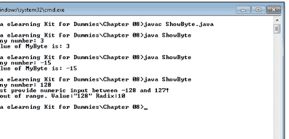

图 8-2

9. 输入 `java ShowByte` 并按回车。然后输入 `C` 并按回车。

应用程序通常会输出另一个异常，但在这种情况下，它输出相同有用消息的变体，如图 8-3 所示。使用此类有用的消息让使用户更容易与应用程序交互，这也使得用户更有可能继续使用它。

# 异常处理

```
C:\Java-cleaning-Kit-for-Dummies\Chapter 08\JavaShowByte.java
C:\Java-cleaning-Kit-for-Dummies\Chapter 08\JavaShowByte.java
type any number: -15
the value of MyByte: -15
C:\Java-cleaning-Kit-for-Dummies\Chapter 08\JavaShowByte.java
type any number: 128
input between -128 and 127
out of range: Value: -128
C:\Java-cleaning-Kit-for-Dummies\Chapter 08\JavaShowByte.java
type any number: 127
input between -128 and 127
null
C:\Java-cleaning-Kit-for-Dummies\Chapter 08\
```

图 8-3


注意图 8-3 中的输出显示的是 `null` 而不是额外信息。修改此示例的 `catch` 子句，使得当 `getMessage()` 方法有要返回给用户的文本时，才输出额外信息。

# 处理从具体到不具体的错误

大多数应用程序可以生成多个异常。此外，你可能无法精确检测到应用程序将生成哪些异常。在这种情况下，你需要为 `try...catch` 语句提供多个 `catch` 子句。每个 `catch` 子句专门处理一种特定类型的错误。此外，你还可以使用通用的异常处理程序来处理当应用程序遇到预期之外的错误的情况。

在接下来的示例中，你创建了一个可以生成多种错误的应用程序。你添加了错误处理代码以与每个潜在异常交互。

所需的文件：`MultipleException.java`

1. 打开你为本书选择的代码编辑器或 IDE。
2. 在编辑器中输入以下代码。
3. 导入所需的类。

```java
import java.util.Scanner;
import java.util.InputMismatchException;
import java.lang.Exception;

public class MultipleException {
    public static void main(String[] args) {
        // 创建扫描器。
        Scanner GetInput = new Scanner(System.in);

        // 尝试执行任务。
        try {
            // 向用户请求输入。
            System.out.print("Type the first number: ");
            int Value1 = GetInput.nextInt();

            // 向用户请求另一个输入。
            System.out.print("Type the second number: ");
            int Value2 = GetInput.nextInt();

            // 创建输出。
            int Result = Value1 / Value2;
            System.out.println("Value1 / Value2 = " + Result);
        } catch (InputMismatchException e) {
            // 判断是否存在错误信息
            // 显示并输出。
            if (e.getMessage() != null) {
                System.out.println("between -128 and 127\n" + e.getMessage());
            } else {
                System.out.println("between -128 and 127");
            }
        } catch (ArithmeticException e) {
            // 判断是否存在错误信息
            // 显示并输出。
            if (e.getMessage() != null) {
                System.out.println("by zero!\n" + e.getMessage());
            } else {
                System.out.println("by zero!");
            }
        } catch (Exception e) {
            // 判断是否存在错误信息
            // 显示并输出。
            if (e.getMessage() != null) {
                System.out.println("The application is\nunable to determine precisely what went\n" + e.getMessage());
            } else {
                System.out.println("The application is\nunable to determine precisely what went\n");
            }
        }
    }
}
```


## 第 8 章

示例仅展示了其中一种。在这种情况下，应用程序处理通用的 `Exception`。这个总类包含了应用程序可能生成的其他所有异常。你必须始终将泛型 `Exception` 放在最后，否则其他异常处理将不会被调用。

3. 使用文件名 `MultipleException.java` 将代码保存到磁盘。
4. 在你的命令提示符中，输入 `java MultipleException.java` 并按回车。

编译器编译你的应用程序并从其创建一个 `.class` 文件。

5. 输入 `java MultipleException` 并按回车。

应用程序要求你输入任意数字。

6. 输入字母 C 并按回车。

你看到了图 8-4 所示的预期输出。

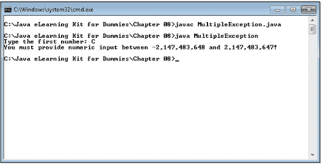

图 8-4

7. 输入 `java MultipleException` 并按回车。

应用程序要求你输入任意数字。

8. 输入 23 并按回车。

应用程序要求你输入另一个数字。

9. 输入 0 并按回车。

你看到了另一个异常消息，但这次它告诉你不要输入 0 作为第二个数字，如图 8-5 所示。

## 捕获错误

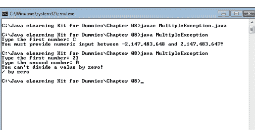

图 8-5

10. 重复步骤 7 到 9，但这次第二个数字输入 5。你看到了图 8-6 所示的预期输出。

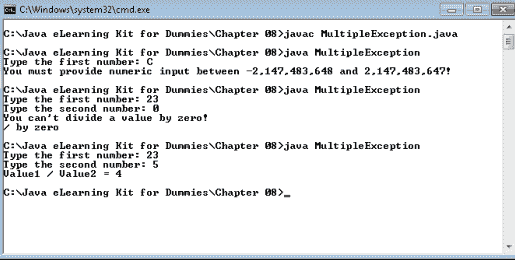

图 8-6

### 使用 Optional 对象避免异常

在处理 Java 时，你可能会看到的所有异常中，`NullPointerException`（或 NPE）是最常见的，有时也是最难诊断的。每当你向一个期望实际值的 Java 函数传递 `null` 值时，就会发生 `NullPointerException`。问题不在于每种情况都会产生 NPE，这本身才是一个问题。

有时你预期会有 `null` 值并需要某些方法来处理它。例如，考虑你想要在一个潜在值列表中查找一个特定值的情况。你完全可能找不到想要的值，导致返回 `null` 值。如果你接着尝试处理这个 `null` 值，就会得到 NPE。因为你已经预料到 `null` 值的出现，寻找错误可能会变得异常困难。

到目前为止，人类开发者很难理解计算机那种非黑即白的思维。Java 8 现在提供了 `Optional` 对象，用于处理函数返回值是可选而非必选的情况。下面的练习演示了如何使用 `Optional` 对象来减少意外 NPE 的可能性。

所需文件：`OptionalObject.java`

1. 打开你为本书选择的编辑器或 IDE。
2. 在编辑器屏幕输入以下代码：

```java
// 导入所需的 API 类。
import java.lang.String;

public class OptionalObject {

    public static void main(String[] args) {

        // 创建一个测试字符串和位置。
        String MyString = "Hello World!";
        char Letter = 'a';

        // 获取字符。
        String Chars = GetChar(MyString, Letter);

        // 打印结果。
        System.out.println("Found the letter: " + Letter + " + " + Chars.length() + " times.");

        // 更改位置。
        Letter = 'o';

        // 获取字符。
        Chars = GetChar(MyString, Letter);

        // 打印结果。
        System.out.println("Found the letter: " + Letter + " + " + Chars.length() + " times.");
    }

    public static String GetChar(String MyString, char SearchLetter) {

        // 创建输出字符串。
        String OutString = "";

        // 检查字符串中的每个字符。
        for (char ThisLetter : MyString.toCharArray()) {

            if (ThisLetter == SearchLetter) {
                // 将字符添加到字符串。
                OutString += new Character(ThisLetter).toString();
            }
        }

        // 返回结果。
        if (OutString.length() > 0) {
            return OutString;
        } else {
            return null;
        }
    }
}
```

你永远不会创建这样的代码，因为它提供了一种简单的方法来演示 NPE 是如何发生的。代码从开始创建一个测试字符串来定位特定字母。它还定义了第一种或第二种情况下发生的情况。对 `GetChar()` 的调用定位了测试字符串中每个字符的实例（在未找到字符时返回 `null`）。当在测试字符串中找到字符时，`GetChar()` 返回一个包含这些字符的字符串。打印 `Chars.length()` 会告诉你该字符出现了几次。注意示例中使用的将 `char` 转换为 `String` 的技术。在这种情况下，`char` 被装箱为一个 `Character` 对象，然后使用 `toString()` 方法创建所需的 `String` 输出。“自动装箱和拆箱”部分展示了你如何利用手动装箱来让自己有利。

3. 使用文件名 `OptionalObject.java` 将代码保存到磁盘。
4. 在你的命令提示符中，输入 `javac OptionalObject.java` 并按回车。

编译器编译你的应用程序并从其创建一个 `.class` 文件。

5. 输入 `java OptionalObject` 并按回车。

你看到了图 8-7 所示的错误输出，因为在字符串 "Hello World" 中没有字母 "a"。

```
C:\Java Learning for Dummies>javac OptionalObject.java
C:\Java Learning for Dummies>java OptionalObject
Exception at OptionalObject.main(OptionalObject.java:17)
```

图 8-7

6. 修改编辑器上的代码使其如下所示：

```java
// 导入所需的 API 类。
import java.lang.String;
import java.util.Optional;

public class OptionalObject {

    public static void main(String[] args) {

        // 创建一个测试字符串和位置。
        String MyString = "Hello World!";
        char Letter = 'a';

        // 获取字符。
        Optional<String> Chars = GetChar(MyString, Letter);

        // 打印结果。
        if (Chars.isPresent()) {
            System.out.println("Found the letter: " + Letter + " + " + Chars.get().length() + " times.");
        } else {
            System.out.println(Letter + " Not Found!");
        }

        // 更改位置。
        Letter = 'o';

        // 获取字符。
        Chars = GetChar(MyString, Letter);

        // 打印结果。
        if (Chars.isPresent()) {
            System.out.println("Found the letter: " + Letter + " + " + Chars.get().length() + " times.");
        } else {
            System.out.println(Letter + " Not Found!");
        }
    }

    public static Optional<String> GetChar(String MyString, char SearchLetter) {

        // 创建输出字符串。
        String OutString = "";

        // 检查字符串中的每个字符。
        for (char ThisLetter : MyString.toCharArray()) {
            if (ThisLetter == SearchLetter) {
                // 将字符添加到字符串。
                OutString += new Character(ThisLetter).toString();
            }
        }

        // 返回结果。
        if (OutString.length() > 0) {
            return Optional.of(OutString);
        } else {
            return Optional.empty();
        }
    }
}
```

使用 `Optional` 对象，你必须将所需的类导入你的应用程序。应用程序的基本流程与之前相同。然而，`Chars` 被定义为 `Optional<String>`。这意味着如果搜索字母不在搜索字符串中，你可以通过 `Chars.isPresent()` 进行测试。结果是你不需要担心 NPE，因为当字符串为 `null` 时它不会发生。

同样注意 `GetChar()` 方法的变化。它现在必须返回一个 `Optional<String>`。此外，你使用 `Optional.of()` 方法将 `OutString` 值放入返回值中。当没有字母要返回时，你使用 `Optional.empty()`。

## 第 8 章

7. 使用文件名 `OptionalObject.java` 将代码保存到磁盘。
8. 在你的命令提示符中，输入 `javac OptionalObject.java` 并按回车。

编译器编译你的应用程序并从其创建一个 `.class` 文件。

9. 输入 `java OptionalObject` 并按回车。

你看到了图 8-8 所示的预期错误输出，因为“Hello World”中没有出现字母“a”，但字母“o”出现了两次。

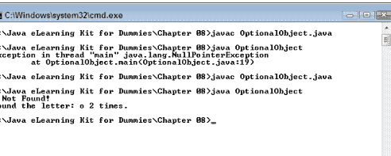

图 8-8

## 抛出错误

代码尽力解决问题是关键的。然而，有时你的代码确实没有足够的信息、资源、权限或其他要求来解决问题。当这种情况发生时，你的代码使用异常对象抛出错误。“异常”这个词是合适的，因为它应该是规则的例外，而不是应用程序执行的第一个动作。尽管如此，应用程序仍遇到需要特殊措施的错误，以下章节描述了如何处理这类情况。

## 抛出异常

所需的文件：`ThrowException.java`

1. 打开你为本书选择的编辑器或 IDE。
2. 在编辑器屏幕中输入以下代码。

```java
// 导入所需的 API 类。
import java.util.Scanner;
import java.util.InputMismatchException;
import java.lang.IllegalArgumentException;

public class ThrowException {

    public static void main(String[] args) {

        // 创建扫描。
        Scanner GetInput = new Scanner(System.in);

        try {
            // 向用户请求输入。
            System.out.print("Type a number between 1 and 10: ");
            int TheNumber = GetInput.nextInt();

            // 判断输入是否在正确范围内。
            if ((TheNumber >= 1) && (TheNumber <= 10)) {
                // 如果是
                System.out.println("The Number is: " + TheNumber);
            } else {
                throw new IllegalArgumentException("Please provide a value between 1 and 10!");
            }
        } catch (InputMismatchException | IllegalArgumentException e) {
            System.out.println(e.getMessage());
        }
    }
}
```

## 第 8 章

这个示例要求用户输入一个 1 到 10 之间的数字，然后在屏幕上显示该数字。当然，用户可能会输入数字以外的其他内容，这意味着你必须捕获 `InputMismatchException`。该示例提供了与你在本章其他示例中看到的类似的 `catch` 子句来处理这种特定错误。

此外，输入的数字可能不在 1 到 10 之间。Java 无法检测到此错误。应用程序通过 `if` 语句检测数字范围。当数字超出指定范围时，应用程序会抛出一个 `IllegalArgumentException`，这是一种特定的异常。应用程序可以使用简单的 `Exception`，但尽可能抛出特定异常总是更好的，这样可以让错误更容易被捕获。

注意，这个示例包含了一些新内容：它使用单个 `catch` 子句来捕获多个异常。在你的应用程序中使用这种技术，你只需要使用“或”运算符（`|`）将异常隔开即可。

3. 使用文件名 `ThrowException.java` 将代码保存到磁盘。
4. 在命令提示符中，输入 `javac ThrowException.java` 并按回车。

编译器编译你的应用程序并从其创建一个 `.class` 文件。

5. 输入 `java ThrowException` 并按回车。

应用程序要求你输入一个 1 到 10 之间的数字。

6. 输入字母 C 并按回车。

你会在图 8-9 中看到预期的输出。

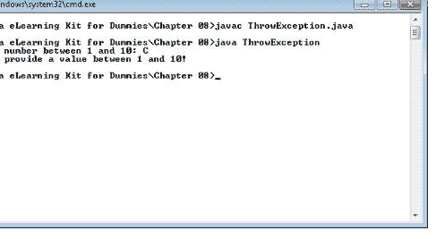

图 8-9

7. 使用 22 作为输入执行步骤 5 和 6。

你看到了相同的错误，但这次带有额外的信息，如图 8-10 所示。

```
C:\Java learning Kit for Dummies\Chapter 08\Java ThrowException.java
C:\Java learning Kit for Dummies\Chapter 08>>java ThrowException
type a number between 1 and 10:
Please provide a value between 1 and 10!
C:\Java learning Kit for Dummies\Chapter 08>>ThrowException
type a number between 1 and 10:
Please provide a value between 1 and 10!
the of Number is: 22
C:\Java learning Kit for Dummies\Chapter 08>>_
```

图 8-10

8. 使用数字 5 作为输入执行步骤 5 和 6。

这一次应用程序显示了预期的输出，如图 8-11 所示。

```
C:\Java learning Kit for Dummies\Chapter 08\Java ThrowException.java
C:\Java learning Kit for Dummies\Chapter 08>>ThrowException
type a number between 1 and 10:
Please provide a value between 1 and 10!
C:\Java learning Kit for Dummies\Chapter 08>>ThrowException
type a number between 1 and 10:
Please provide a value between 1 and 10!
the of Number is: 22
Number = -
C:\Java learning Kit for Dummies\Chapter 08>>_
```

图 8-11


# 抛出异常

所需的文件：`ThrowException.java`

1. 打开你为本书选择的编辑器或 IDE。
2. 在编辑器屏幕中输入以下代码。

```java
// 导入所需的 API 类。
import java.util.Scanner;
import java.util.InputMismatchException;
import java.lang.IllegalArgumentException;

public class ThrowException {
    public static void main(String[] args) {
        // 创建扫描。
        Scanner GetInput = new Scanner(System.in);
        try {
            // 向用户请求输入。
            System.out.print("Type a number between 1 and 10: ");
            int TheNumber = GetInput.nextInt();
            // 判断输入是否在正确范围内。
            if ((TheNumber >= 1) && (TheNumber <= 10)) {
                // 如果是，则显示它。
                System.out.println("TheNumber = " + TheNumber);
            } else {
                // 如果不是，抛出异常。
                throw new IllegalArgumentException(
                    "The value of TheNumber is: " + TheNumber);
            }
        } catch (InputMismatchException | IllegalArgumentException e) {
            // 判断是否存在需要显示的错误信息并输出。
            if (e.getMessage() != null) {
                System.out.println("Please provide a value " +
                    "between 1 and 10!\n" + e.getMessage());
            } else {
                System.out.println("Please provide a value " +
                    "between 1 and 10!");
            }
        }
    }
}
```

这个示例要求用户输入一个 1 到 10 之间的数字，然后在屏幕上显示该数字。当然，用户可能会输入数字以外的其他内容，这意味着你必须捕获 `InputMismatchException`。该示例提供了与你在本章其他示例中看到的类似的 `catch` 子句来处理这种特定错误。

此外，输入的数字可能不在 1 到 10 之间。Java 无法检测到此错误。应用程序通过 `if` 语句检测数字范围。当数字超出指定范围时，应用程序会抛出一个 `IllegalArgumentException`，这是一种特定的异常。应用程序可以使用简单的 `Exception`，但尽可能抛出特定异常总是更好的，这样可以让错误更容易被捕获。

注意，这个示例包含了一些新内容：它使用单个 `catch` 子句来捕获多个异常。在你的应用程序中使用这种技术，你只需要使用“或”运算符（`|`）将异常隔开即可。

3. 使用文件名 `ThrowException.java` 将代码保存到磁盘。
4. 在命令提示符中，输入 `java ThrowException.java` 并按回车。
   编译器编译你的应用程序并从其创建一个 `.class` 文件。
5. 输入 `java ThrowException` 并按回车。
   应用程序要求你输入一个 1 到 10 之间的数字。
6. 输入字母 `C` 并按回车。
   你会在图 8-9 中看到预期的输出。


图 8-9

7. 使用 `22` 作为输入执行步骤 5 和 6。
   你看到了相同的错误，但这次带有额外的信息，如图 8-10 所示。

```
C:\Java learning Kit for Dummies\Chapter 08\Java ThrowException.java
C:\Java learning Kit for Dummies\Chapter 08>>JavaException
type a number between 1 and 10:
Please provide a value between 1 and 10!
C:\Java learning Kit for Dummies\Chapter 08>>ThrowException
type a number between 1 and 10:
Please provide a value between 1 and 10!
the of Number is: 22
C:\Java learning Kit for Dummies\Chapter 08>>_
```

图 8-10

8. 使用数字 `5` 作为输入执行步骤 5 和 6。
   这一次应用程序显示了预期的输出，如图 8-11 所示。

```
C:\Java learning Kit for Dummies\Chapter 08\Java ThrowException.java
C:\Java learning Kit for Dummies\Chapter 08>>ThrowException
type a number between 1 and 10:
Please provide a value between 1 and 10!
C:\Java learning Kit for Dummies\Chapter 08>>ThrowException
type a number between 1 and 10:
Please provide a value between 1 and 10!
the of Number is: 22
Number = -
C:\Java learning Kit for Dummies\Chapter 08>>_
```

图 8-11

### 将错误传递给调用者

书中的示例刚刚开始进入你从 `main()` 调用方法的阶段。`main()` 方法始终是你的应用程序的顶层。你调用的方法增加了额外的层级。例如，从 `main()` 调用的方法位于你应用程序的第二层。（参见本章较之前“使用 Optional 对象避免‘异常’”练习中的示例。）如果该方法必须调用另一个方法，那么该方法将处于第三层，以此类推。大多数异常由许多层调用组成。事实上，当你在屏幕上看到异常时，它实际上显示的是一个调用当前方法的方法列表，其格式被称为**堆栈跟踪**（stack trace）。

处理错误是良好编程实践的重要组成部分。如果你希望拥有不会不断崩溃的健壮应用程序，你需要提供良好的错误处理。然而，在没有足够信息来处理错误时尝试处理错误是一个问题。当你的代码尝试在过低的层级上修复错误时，它会向一个可以修复该错误的层级隐藏错误。你希望在尽可能低的层级修复错误，但不要以提供一个实际上可能隐藏严重问题的方案为代价。

> **LINGO**
>
> 堆栈调用（stack call）是以“堆栈跟踪”（stack trace）的格式列出的调用当前方法的方法列表。

## 所需异常

所需的文件：`RequiredException.java`、`UseRequiredException.java`

此示例不包含 `main()` 方法，因此你无法执行它。该类仅包含一个名为 `DoDisplay()` 的公共方法，你可以从其他应用程序访问它。当你从另一个应用程序调用 `DoDisplay()` 时，它会从用户处获取输入，判断输入是否在范围内，然后根据用户是否提供了正确的信息来输出数字或抛出异常。

```java
// 导入所需的 API 类。
import java.util.Scanner;
import java.util.InputMismatchException;
import java.io.IOException;

public class RequiredException {
    public void DoDisplay() throws InputMismatchException, IOException {
        // 创建扫描。
        Scanner GetInput = new Scanner(System.in);
        // 向用户请求输入。
        System.out.print("Type a number between 1 and 10: ");
        int TheNumber = GetInput.nextInt();
        // 判断输入是否在正确的范围内。
        if ((TheNumber >= 1) && (TheNumber <= 10)) {
            // 如果是，则显示它。
            System.out.println("TheNumber = " + TheNumber);
        } else {
            // 如果不是，抛出异常。
            throw new IOException(
                "The value of TheNumber is: " + TheNumber);
        }
    }
}
```

注意，该方法包含了一个新的子句 `throws`。如果你创建一个可能抛出异常的方法，应该始终包含 `throws` 子句，以告知其他开发者需要提供异常处理。当用户输入数字以外的内容时，此方法可能会抛出 `InputMismatchException`。此外，当数字范围错误时，它可以抛出 `IOException`。

代码中使用 `IOException` 仅用于演示。你不会为 `DoDisplay()` 可能遇到的错误使用这种异常。`IOException` 是一个受检异常，因此示例使用它来演示受检异常是如何工作的。

3. 使用 `RequiredException.java` 将代码保存到磁盘。
4. 在命令提示符中输入 `javac RequiredException.java` 并按回车。
   编译器编译你的应用程序并创建一个 `.class` 文件。
5. 使用为你本书选择的编辑器或 IDE 创建新类 `UseRequiredException`。
   此新类必须与你在第 2 步创建的 `RequiredException` 类出现在同一个文件夹中。

6. 在编辑器输入以下代码。

```java
public class UseRequiredException {
    public static void main(String[] args) {
        // 创建所需的对象。
        RequiredException ThisTest = new RequiredException();
        // 使用 DoDisplay() 方法显示值。
        ThisTest.DoDisplay();
    }
}
```

此示例仅创建了一个名为 `ThisTest` 的 `RequiredException` 实例。然后使用 `ThisTest` 访问 `DoDisplay` 来显示数字。

注意，在示例的这部分没有看到任何导入语句。这是因为 `RequiredException` 类与 `UseRequiredException` 应用程序位于同一个文件夹。当两个类出现在同一个文件夹时，你不需要导入第一个类就可以在第二个类中使用它。

7. 输入 `javac UseRequiredException.java` 并按回车。
   编译器抛出如图 8-12 所示的错误，告诉你必须为 `DoDisplay()` 方法提供错误处理。

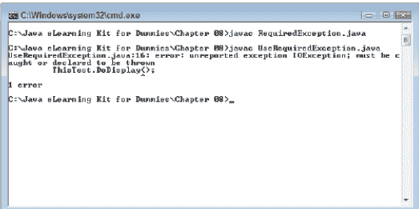

图 8-12

8. 对 `UseRequiredException` 类进行以下更改（**加粗**显示）。

```java
// 导入所需的 API 类。
import java.io.IOException;
import java.util.InputMismatchException;

public class UseRequiredException {
    public static void main(String[] args) {
        // 创建所需的对象
        RequiredException ThisTest = new RequiredException();
        // 尝试执行任务。
        try {
            // 使用 DoDisplay() 方法显示值。
            ThisTest.DoDisplay();
        } catch (InputMismatchException | IOException e) {
            // 判断是否存在需要显示的
            // 错误信息并输出。
            if (e.getMessage() != null) {
                System.out.println("Please provide a value " +
                    "between 1 and 10!\n" + e.getMessage());
            } else {
                System.out.println("Please provide a value " +
                    "between 1 and 10!");
                return;
            }
        }
    }
}
```

示例现在包含了所需的错误处理。可以使用消息处理两个异常，应用程序将它们都放在同一个 `catch` 子句中。

9. 输入 `javac UseRequiredException.java` 并按回车。
   编译器编译你的应用程序并创建一个 `.class` 文件。
10. 输入 `java UseRequiredException` 并按回车。
    应用程序要求你输入任意数字。
11. 输入字母 `C` 并按回车。
    你看到了预期的错误输出。（参考图 8-9）。
12. 使用数字 `22` 作为输入执行第 10 和 11 步。
    你看到了相同的错误，但这次有一些额外信息。（参考图 8-10。）
13. 使用数字 `5` 作为输入执行第 10 和 11 步。
    这一次应用程序显示了预期的输出。（参考图 8-11。）


```java
// 导入所需的 API 类。
import java.io.IOException;
import java.util.InputMismatchException;

public class UseRequiredException {
    public static void main(String[] args) {
        // 创建所需的对象
        RequiredException ThisTest = new RequiredException();

        // 尝试执行任务。
        try {
            // 使用 DoDisplay() 方法显示值。
            ThisTest.DoDisplay();
        } catch (InputMismatchException | IOException e) {
            // 判断是否存在需要显示的
            // 错误信息并输出。
            if (e.getMessage() != null) {
                System.out.println("Please provide a value " +
                    " between 1 and 10!\n" + e.getMessage());
            } else {
                System.out.println("Please provide a value " +
                    " between 1 and 10!");
                return;
            }
        }
    }
}
```

示例现在包含了所需的错误处理。可以使用可以使用消息处理两个异常，应用程序将它们都放在同一个 `catch` 子句中。

9. 输入 `javac UseRequiredException.java` 并按回车。

编译器编译你的应用程序并创建一个 .class 文件。

10. 输入 `java UseRequiredException` 并按回车。

应用程序要求你输入任意数字。

11. 输入字母 `C` 并按回车。

你看到了预期的错误输出。（参考图 8-9）。

12. 使用数字 `22` 作为输入执行第 10 和 11 步。

你看到了相同的错误，但这次有一些额外信息。（参考图 8-10。）

13. 使用数字 `5` 作为输入执行第 10 和 11 步。

这一次应用程序显示了预期的输出。（参考图 8-11。）


## 总结

你在本章中学的关键点有：

- 语法错误最容易修复。
- 语义错误次之，逻辑错误最难修复。
- 捕获错误意味着检测异常。
- 处理错误意味着向用户显示消息或采取其他行动。
- 受检异常确保了类及其创建的对象是可靠运行。
- 错误处理对于创建健壮的应用程序至关重要。

# 术语解释

**后台处理（background processing）：** 应用程序在后台执行的任务。例如，当用户请求应用程序打印文档时，应用程序在后台执行此任务，而用户继续与应用程序交互。

**调用栈（call stack）：** 在当前方法之前的方法列表。每个方法按顺序调用下一行以到达当前级别。大多数应用程序都有许多层，因此调用栈是修复错误的关键工具。

**受检异常（checked exception）：** JRE 强制你处理的异常。编译器通常会检查你是否提供了异常处理，如果你没有提供，它将不会为你创建 .class 文件。

**错误（error）：** 任何意外或未预料的应用程序行为，包括预期输出之外的操作或结果。

**错误处理（error handling）：** 对应用程序捕获的异常通过向用户显示消息或采取其他行动来解决。

**错误捕获（error trapping）：** 检测异常并将此信息传递给解析正确异常对象的 `catch` 语句。

**异常（exception）：** 在应用程序中定义错误条件的特殊对象。异常告诉我们错误在哪里发生以及发生了什么类型的错误。在某些情况下，异常可能会提供接收者可以用于解决错误的额外位信息。

## 第 8 章

**parse（解析）**：解释输入并产生输出的行为。例如，当程序员为 Java 编译器提供代码时，编译器会产生 Java 字节码作为输出。同样，当用户提供一个数字字符串作为输入时，解析器可以产生一个数值作为输出。

**throw（抛出）**：创建一个异常对象并将其传递给当前代码调用者的行为。抛出异常意味着当前代码无法解决错误，需要帮助来修复它。异常对象将帮助调用者理解发生了什么，并在许多情况下允许调用者修复问题。

# 第 9 章

## 以及使用类

- 建立对类结构的理解，帮助你创建更好的类。
- 理解变量作用域如何影响你在应用程序中使用变量的方式和时机。
- 开始编写展示类构造完整能力的类。
- 设计一个测试应用程序，充分演示如何使用一个完整的类定义。
- 使用匿名类来执行不需要使用正式类的临时任务。
- 使用 lambda 表达式通过比更传统技术更少的代码来完成任务。


1. 类继承如何影响我编写类的方式？

继承另一个类可以大大减少你需要的工作量，如第 253 页所示。

2. 当我创建新类并在我的应用程序中使用它们时，是否可以访问父类的方法、属性和其他特性？

Java 让你的类能够看到父类的特性，如第 254 页所示。

3. 到底什么是默认作用域？

默认作用域是在特定情况下，不使用任何特殊修饰符时，类特征的可见性，总结在第 257 页。

4. 我为什么会想要修改默认作用域？

修改默认作用域可以隐藏特征以防止他人窥探，并可能创建不太因安全和可靠性问题而失败的类，如第 266 页所示。

5. 我什么时候需要为我的类创建多个构造函数——即允许使用特殊变量或执行其他设置的元素？

使用多个构造函数可以创建具有扩展功能或更低编码要求的类版本，如第 267 页所示。

6. 是否可以在不费力创建类的情况下获得某个类的功能？

匿名类允许你创建用于单一用途的临时类，而无需正式定义该类，如第 277 页所示。

7. 我该如何构思一个只有一个方法的匿名类？

Lambda 表达式提供了定义一种特殊匿名类的手段，这种类仅有一个函数式接口和一个方法，如第 279 页所示。

你现在可能已经意识到，你一直都在这本书的每一章中创建类。如果不创建类，是不可能创建 Java 应用程序的。事实上，你在第 8 章的“所需的错误处理”部分创建了一个示例，在其中你从另一个 Java 类访问了简单类的特征。然而，到目前为止，你使用类的方式相对简单——Java 能够处理更多的复杂性，这正是本章的重点。

类具有特定的结构。就像用于建筑的蓝图具有某些特征并遵循预定义的格式一样，你创建的类也是如此。否则，JRE 将永远无法解释你的设计并使用该类在应用程序中构建对象。

在设计类时，你还必须理解如何在类中显示和隐藏数据及代码元素，这意味着必须提供一些关于作用域的额外信息。正确使用作用域使你的类更安全，因为你可以隐藏数据以防止他人窥探。作用域适当的变量还能让类更可靠，因为它降低了他人可能向变量中填充错误数据的可能性。使用作用域的另一个良好理由是通过隐藏其他开发者在使用类时不需要看到的细节，来使类更易于使用。

Java 拥有匿名类（通常缩写为 anonymous classes），用于在正式类描述不是必须的或大材小用的情况下创建临时类。例如，你可能使用匿名类仅在某一个实例中更改正式类的标准行为。使用匿名类使你的代码更整洁、更短且更易于理解。在许多情况下，它还有助于优化代码以便理论上运行。Java 8 包含了一项新功能 lambda 表达式，它让代码变得更短。lambda 表达式是一种特殊的匿名类，只包含一个函数式接口和一个方法，因此你可以用最少的代码描述要做什么。结果是，任何查看你代码的人都将关注代码在做什么，而不是代码周围的结构。

# 理解类的结构

建筑承包商可以理解建筑师设计的蓝图，因为他们都使用同一套规则和约定。当你创建一个类时，你就是建筑师。你创建的蓝图必须将你的想法传达给计算机，计算机扮演着建造者的角色。为了这种通信，你必须使用相同的规则和约定。以下章节通过将任务分为功能区域（例如编写方法），描述了在 Java 中创建类的规则和约定。

### 术语 (LINGO)

约定是你与 JRE 之间的一种协议。事实上，当你阅读文档时，它实际上在使用该术语来表达约定的概念。无论你使用哪种术语，约定都表达了双方在定义类和将其构建为对象时的职责。在某些情况下，你也可以将其视为自定义——即 Java 开发人员为开发类创建的实践。Java 使用的约定没有错，这套实践仅仅是 Java 开发人员随时间推出的最有效方法。

### 调用方法

你已经在书中接触了多种类型。然而，直到现在你才真正看到方法是如何组合的。方法描述了对象可以执行的操作。

在调用方法时，注意每个方法都可以包含以下部分：

- **修饰符（可选）**：修饰符改变类的行为。例如，如果你将类设为私有（`private`），则该方法对类内部其他方法可见。当你从该类创建对象时，对象的用户无法访问该私有方法。

# 额外信息 (EXTRA INFO)

你不能从静态方法调用非静态方法。非静态方法与对象（类的实例）关联，而静态方法与类本身关联。要访问非静态方法，必须创建一个对象。然而，你可以从非静态方法访问静态方法。静态方法在创建对象之前就已经存在了。因此，静态方法总是可用的。

# 理解类的结构

**返回类型（必选）**：每个方法都有一个返回类型。返回类型定义了方法在完成工作后返回给调用者的信息。当你没有内容要返回给调用者时，将返回类型设置为 `void`。例如，`main()` 方法的返回类型为 `void`，因为它没有向调用者返回任何内容。


一个方法只能有一个返回类型，即使该返回类型是包含多个值的复杂类型。

**方法名（必选）**：每个方法必须有一个名称。否则，这里有一些关于方法名的额外考虑因素：

- 方法名必须以字母开头——任何字母都可以。
- 你可以用数字或特殊字符开头方法名。
- 数字可以出现在方法名的任何其他位置。
- 你可以使用的唯一特殊字符是下划线 (`_`)。例如，方法名不能包含安培符号 (`&`)。

使用驼峰命名法（camelcase）是创建方法和变量的标准约定，但 Java 编译器并不强制这一约定。*驼峰命名法*是指你将方法或变量中的每个单词的首字母大写，但第一个单词除外。第一个单词始终是小写的。例如，如果你创建一个名为 `checkForDoubles()` 的方法，习惯写法是第一个单词小写，但显示为首字母大写的 `CheckDoubles`。某些开发者更偏于*帕斯卡命名法*（pascal），即方法或变量的每个单词都大写。在这种情况下，`CheckDoubles()` 的每个单词都会大写。使用帕斯卡命名法处理方法和变量可以帮助将它们与 Java 应用程序接口（API）中的任何方法和变量区分开。无论你使用哪种情况，它都能一致地工作。记住，Java 将 `checkForDoubles()` 视为与 `CheckDoubles()` 不同的方法。

**参数列表（可选）**：如果方法需要调用者提供信息来执行任务，你可以在括号内的列表中提供一个或多个参数（或者某些人称之为**参数**）。对于参数有一些额外的考虑因素：

- 参数包括类型，后跟参数名。例如，如果你想提供一个名为 `myInt` 的 int 值，输入 `int myInt`。
- 参数名和类型遵循与其他任何变量相同的限制条件。
- 你必须用逗号分隔参数。例如，如果 `myMethod(int)` 方法需要一个名为 `myInt` 的 int 和一个名为 `MyFloat` 的 float，参数列表将是 `myMethod(int myInt, float MyFloat)`。
- 如果没有参数，方法名后面必须跟一对空括号。

**异常列表（可选）**：异常列表定义了方法可能遇到并抛出的异常。异常列表以关键字 `throws` 开头，后面跟着一列异常类。你之前已经在第 8 章的“强制性错误处理”部分看过的该功能如何工作的示例了。

**方法体（必选）**：如果没有了告诉程序要执行哪些任务的代码，方法就没什么用处了。方法体始终出现在大括号 `{ }` 之间。

使用前面的规则，你可以创建的最短的方法声明是使用默认作用范围的方法；它可以作为对象的一部分被访问，没有参数，不返回值，且不包含代码。尽管以下方法完全没有用处，但它可以通过编译，你也可以可以在代码中调用它：

```
void MyMethod()
{}
```

接下来的部分演示了比 `MyMethod()` 更实用的方法，但了解创建方法所需的绝对最小代码量是非常重要的。使用方法的主要原因是将几行代码组合在一起，使其执行单一的定义任务。此外，你应该让方法足够小，以便其包含的代码能够被你以及随后的每一个人轻松理解。

### 分配属性

经常让许多 Java 开发者（以及一些有经验的 Java 开发者）困惑的问题之一是 Java 中的属性概念。某些语言具有处理属性的正式机制，但 Java 并没有提供这种机制。此外，对于 Java 用于与属性特定程序元素的术语，存在某种程度的混乱。本节使用了特定的术语，反映了大多数 Java 开发者使用的术语，但你应该预计在网上看到这些其他用法。

**属性**（property）你可以作为类或从类创建的对象的一部分访问的值。你使用属性来访问全局变量，这也称为*字段*（field）。第 3 章中的“Long 与 long”部分包含了书中全局变量的第一个示例。最佳实践是始终将字段设为 `private`，然后依赖特殊的 getter 和 setter 方法来访问它们。字段、getter 和 setter 的组合在 Java 中就是一个属性。这里有一个使用 `int MyInt` 的典型示例。

```java
// 创建 MyInt 字段。
private int MyInt = 0;

// 获取 MyInt 的当前值。
public int getMyInt()
{
    return MyInt;
}

// 为 MyInt 设置新值。
public void setMyInt(int MyInt)
{
    this.MyInt = MyInt;
}
```

在这个示例中，代码声明了一个私有变量 `MyInt` 并给其赋值为 0。getter 方法 `getMyInt()` 向调用者提供 `MyInt` 的当前值，而 setter 方法 `setMyInt()` 让调用者更改 `MyInt` 的值。你想使用属性是因为你可以对它们有更好的控制。


# 理解类的结构

属性是你可以作为类或从类创建的对象一部分访问的值。你使用属性来访问全局变量，这也称为**字段**。第 3 章中的“Long 与 long”部分包含了书中全局变量的第一个示例。最佳实践是始终将字段设为 `private`，然后依赖特殊的 getter 和 setter 方法来访问它们。字段、getter 和 setter 的组合在 Java 中就是一个属性。这里有一个使用 `int MyInt` 的典型示例。

```java
// 创建 MyInt 字段。
private int MyInt = 0;

// 获取 MyInt 的当前值。
public int getMyInt()
{
    return MyInt;
}

// 为 MyInt 设置新值。
public void setMyInt(int MyInt)
{
    this.MyInt = MyInt;
}
```

在这个示例中，代码声明了一个私有变量 `MyInt` 并给其赋值为 0。getter 方法 `getMyInt()` 向调用者提供 `MyInt` 的当前值，而 setter 方法 `setMyInt()` 让调用者更改 `MyInt` 的值。你想使用属性是因为你可以对它们有更好的控制。

## 理解类的结构

6. 将以下代码输入到编辑器屏幕中。

```java
// 导入所需的 API 类。
import java.lang.String;

public class SimpleClass extends ParentClass {
    // 重写父类中的相同方法并
    // 输出一个特殊的字符串。
    public String GetClassName() {
        return "This is the SimpleClass";
    }

    // 提供从父类获取字符串的方法。
    public String GetSuperClass() {
        return super.GetClassName();
    }
}
```

该类继承了 `ParentClass` 的所有功能。注意在类声明中使用了 `extends` 关键字。Java 类只能继承一个父类。

你应该注意的下一点是，该类也有一个 `GetClassName()` 方法，它向调用者返回一个 `String`。虽然 `String` 内容不同，但在其他方面，这种方法的调用被称为“重写”（overriding）。当你想要为子类中的该方法提供不同的行为时，你就对方法进行了重写。

### 术语

> **重写**：在继承自父类的类中提供方法的不同版本。在许多情况下，父类有一个简单方法，并不能专门满足子类的需求。


既然 `SimpleClass` 已经有了 `GetClassName()` 的实现，你可能认为无法在 `ParentClass` 中访问此方法。幸运的是，Java 有解决这个问题的方法。查看 `GetSuperClass()`，你会看到 `super` 关键字被用作从 `SimpleClass` 访问 `GetClassName()`。

7. 使用你的编辑器或 IDE 的标准命令，将此文件保存为 `SimpleClass.java`。

8. 在命令提示符中，输入 `javac SimpleClass.java` 并按回车。

编译器编译你的应用程序并从其创建一个 `.class` 文件。

## 第 9 章

9. 使用你为本书选择的编辑器或 IDE 创建名为 `UseSimpleClass` 的新类。

这个新类必须与你在第 6 步创建的 `SimpleClass` 类位于同一个文件夹中。

10. 将以下代码输入到编辑器屏幕中。

```java
// 导入所需的 API 类。
import java.lang.String;

public class UseSimpleClass {
    public static void main(String[] args) {
        // 创建简单类的一个实例。
        SimpleClass Test = new SimpleClass();

        // 显示 SimpleClass 字符串。
        System.out.println(Test.GetClassName());

        // 显示来自父类的字符串。
        System.out.println(Test.GetSuperClass());
    }
}
```

这只是创建了一个名为 `Test` 的 `SimpleClass` 实例。然后它使用 `Test` 访问 `GetClassName()` 和 `GetSuperClass()` 方法，以显示来自 `SimpleClass` 和 `ParentClass` 的类名。


> 通过仔细遵循这些操作，你看到了继承在 Java 简单层面是如何工作的。书的其余部分将提供更多继承的示例，因为它是一个重要且有些复杂的话题（仅通过一个示例无法讨论完）。

11. 保存文件，然后在你的命令提示符中输入 `javac UseSimpleClass.java` 并按回车。

编译器编译你的应用程序并从其创建一个 `.class` 文件。

12. 输入 `java UseSimpleClass` 并按回车。

你会在图 9-1 中看到所示输出。应用程序能够依靠 Java 提供的实例特性，同时显示 `SimpleClass` 和 `ParentClass` 字符串。

## 定义变量作用域

```cmd
C:\Windows\System32\cmd.exe
C:\Java learning Kit for Dummies\Chapter 09>javac ParentClass.java
C:\Java learning Kit for Dummies\Chapter 09>javac SimpleClass.java
C:\Java learning Kit for Dummies\Chapter 09>javac UseSimpleClass.java
This is the SimpleClass
This is the ParentClass
C:\Java learning Kit for Dummies\Chapter 09>
```


## 定义变量作用域

随着你的应用程序变得越来越复杂，考虑作用域变得越发重要。主要原因是，如果不遵守作用域规则，你可能会无意中向应用程序引入错误。这可能是由于字段或其他成员被应用程序错误地使用（例如添加了错误的数据值，或在错误的时间使用错误的数据访问方法）。此外，不正确的作用域可能会让外部人员以意想不到的方式与你的程序进行交互（例如病毒）。接下来的章节假设你已经读过第 3 章“长与短”部分中的作用域信息。

### 考虑默认作用域

当你没有专门为类元素分配作用域时，就会发生默认作用域。许多 Java 开发者并不知道某些元素的默认作用域是什么（而且使用默认作用域意味着你的代码没有记录），尽管这种情况并不常见。尽管如此，你仍然需要知道各种元素的默认作用域，因为某些 Java 开发者依赖它。然而，在理解默认作用域之前，你需要考虑可见性——即哪些应用程序元素是可见的。

- 包（Package）：类的容器。
- 类（Class）：代码的结构。
- 方法（Method）：代码的行为。
- 块（Block）：变量的作用域。

表 9-1 描述了各种作用域级别：

| 可见性 | 私有 (private) | 默认 (default) | 保护 (protected) | 公开 (public) |
| :--- | :---: | :---: | :---: | :---: |
| 从类访问 | X | X | X | X |
| 从包访问 | | X | X | X |
| 从任何子类访问 | | | X | X |
| 从任何地方访问 | | | | X |

表显示了默认作用域的作用。例如，如果你使用默认作用域声明一个方法，只要它位于包内就可以使用。此外，如果你创建一个继承该类的类，只要它位于同一个包中就可以使用该方法。然而，如果子类位于包之外，则无法使用该方法。简而言之，默认作用域比保护作用域严格，但比私有作用域宽松。

接下来，你创建一个具有私有、默认、保护和公开作用域的父类。你创建一个子类尝试访问这些方法。在另一个文件夹中，你创建另一个子类也尝试访问这些方法（以便看到默认作用域和私有作用域的区别）。

## 定义变量作用域

所需文件：`ScopeParent.java`、`ScopeChild1.java`、`ScopeChild2.java` 和 `TestScope.java`

1. 打开你为本书选择的编辑器或 IDE。

2. 在你的项目文件夹中创建一个名为 `inside` 的子目录。

3. 在 `inside` 子目录下创建一个名为 `ScopeParent.java` 的 .java 文件。

4. 将以下代码输入到编辑器屏幕中。

```java
// 定义类的包
package inside;

public class ScopeParent {
    // 创建一个私有方法。
    private void PrivateMethod() {
        System.out.println("The parent's private method.");
    }

    // 创建一个默认方法。
    void DefaultMethod() {
        System.out.println("The parent's default method.");
    }

    // 创建一个保护方法。
    protected void ProtectedMethod() {
        System.out.println("The parent's protected method.");
    }

    // 创建一个公开方法。
    public void PublicMethod() {
        System.out.println("The parent's public method.");
    }
}
```

# 第 9 章

这是你第一次看到 `package` 关键字。在这种情况下，`package` 关键字告诉该文件存在于 `inside` 子目录中。随着你开始编写更复杂的 Java 代码，你会发现你创建的几乎每个类都会使用 `package` 关键字，以确保该类位于特定的包中。

### 术语

> **包（package）**：定义了一个容器，用于将多个类文件存储在同一个位置，以便于访问。包内的内容通常是相互相关的，例如用于管理所有方法的类。包最简单的形式是目录结构中的子目录，但 Java 通常依赖 `.jar` 文件来存放包。

`ScopeParent` 类被定义为 `public`（公共），但你也可以将其定义为默认（default）作用域的类。在该类内部，你会发现各种方法，每个方法都依赖于不同的作用域。


注意，默认作用域方法 `DefaultMethod()` 是唯一不包含作用域关键字的方法。省略作用域关键字始终定义一个使用默认作用域的元素。

5. 将此文件保存为 `inside` 目录下的 `ScopeParent.java`。

6. 在命令提示符中，输入 `javac inside/ScopeParent.java` 并按回车。

7. 使用你为本书选择的编辑器或 IDE，在 `inside` 子目录下创建一个名为 `ScopeChild1.java` 的文件。

8. 在编辑器屏幕上输入以下代码。

```java
// 为此类定义包。
package inside;

public class ScopeChild1 extends ScopeParent {
    // 访问私有方法。
    public void UsePrivate1() {
        super.PrivateMethod();
    }

    // 访问默认方法。
    public void UseDefault1() {
        super.DefaultMethod();
    }

    // 访问受保护方法。
    public void UseProtected1() {
        super.ProtectedMethod();
    }

    // 访问公共方法。
    public void UsePublic1() {
        super.PublicMethod();
    }
}
```

与 `ScopeParent.java` 文件一样，该类将自己定义为属于 `inside` 包。该类尝试通过使用 `super` 关键字访问来使用父类中的每个方法。

9. 使用你的编辑器或 IDE 的标准命令，将此文件保存为 `inside` 目录下的 `ScopeChild1.java`。

10. 在命令提示符中，输入 `javac inside/ScopeChild1.java` 并按回车。

此时，你会看到一条错误信息，提示你无法访问类 `ScopeParent` 的私有成员 `PrivateMethod()`，如图 9-2 所示。Java 不允许你在子类中访问父类的私有成员。


# 第9章

## 定义作用域

- 11. 编辑 `ScopeChild1` 类以移除 `UsePrivate()` 方法（删除以下所有代码）。

```java
// 访问私有方法。
public void UsePrivate()
{
    super.PrivateMethod();
}
```

- 12. 保存文件，然后在命令提示符中按 `javac inside/ScopeChild1.java` 并按回车。

编译器编译你的应用程序并从其创建一个 `.class` 文件。

- 13. 在你的项目文件夹中创建一个名为 `outside` 的子目录。

- 14. 使用你为本书选择的编辑器或 IDE，在 `outside` 子目录下创建一个名为 `ScopeChild2.java` 的 `.java` 文件。

- 15. 在编辑器屏幕上输入以下代码。

```java
// 为此类定义包。
package outside;

// 导入所需的应用程序类。
import inside.ScopeParent;

public class ScopeChild2 extends ScopeParent {
    // 访问默认方法。
    public void UseDefault2() {
        super.DefaultMethod();
    }
    // 访问受保护方法。
    public void UseProtected2() {
        super.ProtectedMethod();
    }
    // 访问公共方法。
    public void UsePublic2() {
        super.PublicMethod();
    }
}
```

`ScopeChild1` 和 `ScopeChild2` 之间有一些有趣的区别。

首先注意包声明将此特定包定义为 `outside`，而不是 `inside`。其次，因为这是 `outside` 包的一部分，你必须在使用它之前导入 `ScopeParent`。在导入它之前，`ScopeChild2` 无法看到 `ScopeParent`，因为 `.class` 文件不在同一个目录下。

该示例基本上与 `ScopeChild1` 相同，只是它没有尝试访问 `ScopeParent` 类的 `PrivateMethod()`。你已经知道访问此方法是可能的，因为它在 `ScopeChild1` 中是不可的。

- 16. 使用你的编辑器或 IDE 的标准命令，将此文件保存为 `ScopeChild2.java`。

- 17. 在命令提示符中，输入 `javac outside/ScopeChild2.java` 并按回车。

你看到一条错误信息，提示你无法从 `ScopeChild2` 访问 `DefaultMethod()`，如图 9-3 所示。现在你看到了表 9-1 中作用域规则的真实含义。尽管 `ScopeClass1` 可以访问 `DefaultMethod()`，但该方法从外部是不可访问的。

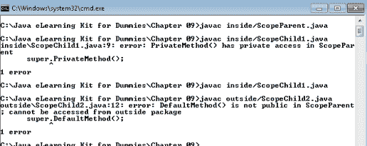

图 9-3

- 18. 编辑 `ScopeChild1` 类以移除 `UsePrivate()` 方法（删除以下所有代码）。

```java
// 访问私有方法。
public void UsePrivate()
{
    super.PrivateMethod();
}
```

- 19. 保存文件，然后在命令提示符中按 `javac inside/ScopeChild1.java` 并按回车。

编译器编译你的应用程序并从其创建一个 `.class` 文件。

## 定义支持事件的类

在这一章中，你已经看到了许多类和类组件。例如，你已经见过如何创建方法和属性。之前的章节还演示了作用域对你的类的重要性。然而，到目前为止，你还没有看到任何关于处理事件的信息，而且你还没有见过任何具有复杂的类。接下来的章节将为你介绍一个使用事件的类，因为它使用了事件，所以需要稍微复杂一点构造方法。

### 定义事件

事件是类内部发生的任何必须向外部世界传递的事件。例如，当用户点击按钮时，按钮必须告诉外部世界它被点击了。知道按钮被点击可以让其他代码对该事件做出反应。执行此任务的方法被称为**事件处理器**。

> **术语**
>
> 事件是类内部某个预定义动作的发生，例如按钮点击，该类必须让外部人员知道该事件。

在接下来的示例中，你创建了一个定义事件的类。事件本身是没有意义的——它仅仅描述了类内部可能发生的动作。该动作甚至不需要是特定的——你可以创建一个通用的事件，正如本例所示，它可以定义任何动作。

> **术语**
>
> 事件处理器是一种特殊的方法，它根据事件的发生来执行任务。

需要所需的文件：`MyEvent.java`

- 1. 打开你为本书选择的编辑器或 IDE。

- 2. 在编辑器屏幕上输入以下代码。

```java
// 导入所需的 API 类。
import java.util.EventObject;

// 事件对象包含了描述
// 事件所需的信息。
public class MyEvent extends EventObject {

    // 事件对象必须包含这个特殊的
    // 构造函数，它接受一个包含
    // 事件信息的对象。
    public MyEvent(Object EventArgs) {
        // 你的代码实际上不需要对
        // 事件做任何操作；父类会处理。
        super(EventArgs);
    }
}
```

你创建的任何定义必须继承自 `EventObject` 或类似的基于事件的类。因此，类开始导入 `java.util.EventObject` 并从其继承。


> **术语**
>
> 构造函数是一种特殊的方法，定义了类应该如何创建对象。默认构造函数除了创建对象之外什么都不做，并且它不接受任何输入参数。通用构造函数的作用不仅仅是创建对象（例如，它可以初始化变量），但它不需要任何输入参数。事件既不能运行默认构造函数或通用构造函数。

构造函数是一种没有返回值的特殊方法。它描述了如何从类创建对象。构造函数的名称始终与类名相同。

在一种情况下，你必须创建一个接受某种实现的特殊构造函数——示例显示了最简单的实现——它接受一个 `Object, EventArgs`。注意，构造函数是唯一一个不需要你提供返回值的方法，而且它的名称与类名完全相同。

如果你计划让事件执行某些特殊处理，你可以将其包含在构造函数中或作为类中其他方法的一部分。然而，你的类不需要实现任何特殊行为即可工作。简单的示例通过带 `EventArgs` 调用父类的构造函数 `constructor` 来完成它需要的工作。

除非你想进行大量的额外编码，否则你的事件类必须在某处调用父类的构造函数（如示例所示）。否则，当事件触发时，什么都不会发生。一个事件代码（这是一个可能混乱且容易出错的过程）。

- 3. 使用你的编辑器或 IDE 的标准命令，将此文件保存为 `MyEvent.java`。

- 4. 在命令提示符中，输入 `javac MyEvent.java` 并按回车。

编译器编译你的应用程序并从中创建一个 `.class` 文件。

### 创建事件监听器接口

当类产生事件时，必须有某种东西来监听并对其反应。

### 定义带有事件源的类

多个方法可以监听由你的类生成的事件。因此，你需要某种方法来管理这些类的列表。你有很多选项可以供你执行这项任务，但使用 `javax.swing.event.EventListenerList` 是最简单的方法。

示例从创建一个 `EventList, Listener` 开始。它提供了向列表添加（`AddEventListener()`）方法和从列表中移除（`RemoveEventListener()`）的方法。这些方法依赖于 `EventEventListener` 的功能——你不需要自己实现这些功能。

`FireEvent()` 方法是该类的核心。当此方法被调用时，调用者是在表示一个事件已经发生，并且从此调用创建的对象应该告诉所有人这个消息。该方法接受一个输入，一个 `MyEvent` 对象，即 `Event`。这个输入参数表示某种特定类型的事件已经发生。

为了通知所有表示想要知道该事件的人，`FireEvent()` 方法首先获取出现在.. 中的方法列表。`ListenerList` 的一个奇之处在于，条目出现在每隔一个元素中。你不需要担心为什么会这样——你只需要知道它是如此。因此，代码创建了一个循环来查看每隔一个元素。

你创建的列表可以包含任意数量的事件监听器，每个监听器都在等待不同的事件。示例确保了事件监听器条目的类与 `My` 类完全相同，这样你就知道它是正确的事件监听器类型。在这种情况下，代码会调用该类中的 `EventHappened()` 方法来告诉它事件已传递。

```java
{
  // 事件管理器必须逐个通知每个
  // 监听器，因此你需要一个
  // 监听器列表。
  Object[] Listeners = ListenerList;
  getListener();

  // 依次处理每个事件监听器。
  for (int i = 0; i < Listeners.length; i+=2) {
    {
      // 事件列表可能包含任意数量的
      // 事件，因此你需要确保
      // 处理那些想要听
      // 这一特定事件的监听器。
      if (Listeners[i] == MyEventListener.class) {
        // 使用调用者提供的事件参数
        // 触发 EventHappened 方法。
        (MyEventListener)Listeners[i+1].
        EventHappened(Event);
      }
    }
  }
}
```

- 3. 使用你的编辑器或 IDE 标准命令，将此文件保存为 `SampleEventClass.java`。

- 4. 在命令提示符中，输入 `javac SampleEventClass.java` 并按回车。

编译器编译你的应用程序并从其创建一个 `.class` 文件。

### 在类中演示事件的使用

你有了一种在类内部使用事件的方法。示例类并不复杂。然而，它包含了你学到的关于创建类的所有内容，并添加了你为了给类添加事件而需要知道的信息。以下示例展示了一个简单的类，允许你创建一个事件实现并以有意义的方式与其交互。

- 1. 打开你为本书选择的使用的编辑器或 IDE。

- 2. 在编辑器屏幕上输入代码。

```java
public class DemoClass {
    // 事件管理器类与事件管理器
    // 并不相同。DoEvents 是负责
    // 管理该类事件的对象。
    private SampleEventClass DoEvents = new
    SampleEventClass();
}

public DemoClass() {
    // 你必须将从该类创建的每个对象
    // 添加到事件监听列表中。每个对象将
    // 接收到通知。
}

DoEvents.AddEventListener(new MyEventListener())
{
    public void EventHappened(MyEvent Event)
    {
        if ((int)Event.getSource() >= 4)
            System.out.println("数字太大了!");

        if ((int)Event.getSource() <= 0)
            System.out.println("数字太小了!");
    }
}
```

```java
// 为该类创建一个字段。
// 字段可以表示任何数据。
private int Value = 0;
```

```java
// 获取字段的当前值。
public int getValue()
{
    return Value;
}
```

## 变量作用域示例

```java
// 在代码块内部创建一个变量。
for (i = 0; i < 10; i++)
```

```java
// 显示变量的值。
System.out.println("The value of i is: " + i);
```

```java
// 在块外部访问不可行。
System.out.println("The value of i is: " + i);
}
```

循环显示了 0 到 9 的值，这是由于 `for` 声明中的条件引起的。最后一次调用 `System.out.println()` 显示的值为 10，而不是开发者可能预期的 0 或 9。声明中的 `i++` 部分先发生，然后评估条件，因此 `i` 的最终值是 10 而不是 9，因为为了使条件变为假，它的值必须是 10。本节的重点在于，你必须考虑块是如何与变量结合的，以确定你是否可以访问该变量以及在退出块时它包含什么值。


# 第9章

```java
// 直接设置字段的值。
public void setValue(int Value) {
    // 创建一个包含调用者尝试使用的值事件对象。
    MyEvent Event = new MyEvent(Value);

    // 当调用者尝试将值设置太大或太小时，类必须触发事件。
    // 否则，它可以更改 Value 的内容。
    if ((Value <= 3) & (Value > 0))
        this.Value = Value;
    else
        DoEvents.fireEvent(Event);
}
```

```java
// 确保 Value 不变得太大。如果是，则触发事件。
if (Value <= 3)
    Value++;
else
    DoEvents.FireEvent(Event);

public void SubtractOne() {
    // 创建一个包含 Value 当前内容事件对象。
    MyEvent Event = new MyEvent(Value);
    // 确保 Value 不变得太小。如果是，则触发事件。
    if (Value > 0)
        Value--;
    else
        DoEvents.FireEvent(Event);
}
```

```java
// Now that Value is at 4 (we couldn't make it equal 5), keep subtracting 1 until Value should equal -1.
TestClass.SubtractOne();
System.out.println(TestClass.getValue());
TestClass.SubtractOne();
System.out.println(TestClass.getValue());
TestClass.SubtractOne();
System.out.println(TestClass.getValue());
TestClass.SubtractOne();
System.out.println(TestClass.getValue());
TestClass.SubtractOne();
System.out.println(TestClass.getValue());

// Try setting the value directly.
TestClass.setValue(3);
System.out.println(TestClass.getValue());
TestClass.setValue(5);
System.out.println(TestClass.getValue());
TestClass.setValue(-5);
System.out.println(TestClass.getValue());
```

应用程序首先创建一个 `DemoClass` 对象 `TestClass`。它通过测试该对象的所有方法、属性和事件来执行该对象。应用程序开始增加 `TestClass` 中的值，直到其超过建议值。现在 `TestClass` 已经达到限制，应用程序将减少其包含的值，直到它过低为止。最后，应用程序尝试直接设置 `TestClass` 中的值。简而言之，`TestClass` 展示了范围检查的实现。你无法将其超出预期的边界。

- 3. 使用编辑器或 IDE 的标准命令，将此文件保存为 `UseEvent.java`。
- 4. 在命令提示符中，输入 `javac UseEvent.java` 并按回车以创建一个 `.class` 文件。
- 5. 输入 `java UseEvent` 并按回车。

你会在图 9-5 中看到输出。注意，每当应用程序尝试超出预定义的范围时，事件处理器都会生成一条消息。此外，值将保持在最后一个已良好值。

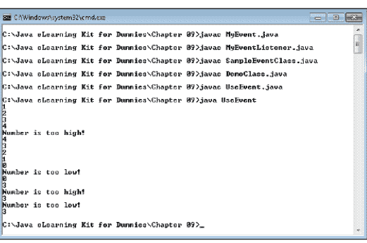

## 使用匿名内部类

有时，你并不真正需要创建一个正式的类定义来让你的应用程序正确运行。例如，无需通过本章之前看到的所有工作就可以为应用程序添加事件处理。匿名类可以使你的代码更易理解且更优雅。接下来的示例展示了在处理接口时使用匿名类的基本用法。

所需文件：`AnonymousClass.java`

- 1. 打开你选择用于本书的编辑器或 IDE。
- 2. 在编辑器屏幕上输入以下代码：

```java
public class AnonymousClass {
    // 创建一个描述要做某事的接口。
    interface DoSomething {
        // 指定一个执行某事的方法。
        void SaySomething();
        // 指定第二个方法。
        void SaySomethingsSpecific(String Value);
    }

    public static void main(String[] args) {
        // 使用匿名类创建接口的实例。
        DoSomething DoIt = new DoSomething() {
            // 定义接口内方法的功能。
            public void SaySomething() {
                System.out.println("I'm saying something!");
            }

            public void SaySomethingsSpecific(String Value) {
                System.out.println(Value);
            }
        };
        // 实际使用该匿名类。
        DoIt.SaySomething();
        DoIt.SaySomethingsSpecific("I'm saying specific");
    }
}
```

> 匿名内部类（也称为匿名类）在不需要或不想要正式声明时，为创建功能有限的类提供了一种快捷方法。例如，如果你通常使用另一个类的功能，但只需要为了某一个特定目的修改该功能，那么匿名类将非常有帮助。

在这种情况下，示例从一个名为 `DoSomething` 的接口开始，该接口包含两个方法：`SaySomething()` 和 `SaySomethingSpecific()`。接口不提供任何类型的实现——它只是说明要做什么。

`main()` 方法通过创建一个 `DoSomething` 实例开始，并将实现定义为匿名类。注意，你必须定义 `DoSomething` 中包含的两个方法，即使你计划在应用程序中只使用一个。关键在于这里有一个类定义，但它没有名称。注意匿名类的声明以分号结束。

要使用匿名类功能，你像稍后代码所示，调用 `DoIt` 对象中包含的方法之一。如果示例不包含匿名类，代码将无法编译，因为你只有一个接口，而接口是不实例化的。

- 3. 使用编辑器或 IDE 的标准命令，将此文件保存为 `AnonymousClass.java`。
- 4. 在命令提示符中，输入 `javac AnonymousClass.java` 并按回车。编译器编译你的应用程序并为其创建一个 `.class` 文件。
- 5. 输入 `java AnonymousClass` 并按回车。

你会在图 9-6 中看到输出。如你所示，代码依次调用了匿名类的每个方法。


## 使用 Lambda 表达式

关于 Lambda 表达式有很多话可以说。思考 Lambda 表达式最简单的方法是将其看作匿名类的简写形式。注意你的接口只有一个方法。

所需文件：`LambdaExpression.java`

- 1. 打开你选择用于本书的编辑器或 IDE。
- 2. 在编辑器屏幕上输入以下代码：

```java
public class AnonymousClass {
    // 创建一个描述要做某事的接口。
    interface DoSomething {
        // 指定一个执行某事的方法。
        void SaySomethingSpecific(String Value);
    }

    public static void main(String[] args) {
        // 使用 Lambda 表达式创建接口的实例。
        DoSomething it = (Value) -> { System.out.println(Value); };

        // 实际使用该 Lambda 表达式。
        it.SaySomethingSpecific("Saying specific!");
    }
}
```

示例从接口开始，就像处理匿名类一样。但注意此版本的 `DoSomething` 只有一个方法。创建 Lambda 表达式需要完成以下四个任务：

- 定义 Lambda 表达式的类型（此处为 `DoSomething`），即你想使用的接口。
- 定义存储 Lambda 表达式的对象名称（此处为 `it`）。
- 根据接口定义指定任何输入参数（此处为 `Value`）。注意你不需要定义变量类型——Java 会为你推断变量类型。
- 创建一个实现接口的表达式。注意表达式位于运算符的右侧。

使用生成的 Lambda 表达式与使用匿名类非常相似。你只需要指定对象的名称、方法以及该方法所需的参数。

- 3. 使用编辑器或 IDE 的标准命令，将此文件保存为 `LambdaExpression.java`。
- 4. 在命令提示符中，输入 `javac LambdaExpression.java` 并按回车。编译器编译你的应用程序并为其创建一个 `.class` 文件。
- 5. 输入 `java LambdaExpression` 并按回车。

你会在图 9-7 中看到输出。


## 总结

这里是你在本章中学到的要点：

- 方法提供了让类或对象执行特定任务的方法。
- 方法声明包括方法的作用域、是静态还是非静态、返回类型、方法名、参数列表和方法体。
- 属性提供了与类或对象内部数据交互的方法。
- 属性声明包含了属性的作用域、是静态还是非静态、类型、变量名和初始值。
- 使用 getter 和 setter 可以保护类管理的数据免受调用者的不当使用。
- 你在 Java 中创建的每个类都继承自某种父类。
- 你创建的类继承自 `Object` 类。
- 使用 `private` 作用域完全隐藏类元素。
- 使用默认（default）作用域防止当前包之外访问类元素。
- 使用 `protected` 作用域防止子类之外的访问类元素。
- 使用 `public` 作用域允许任何人访问类元素。
- 依赖事件的类使用事件类（event class）来定义事件。
- 事件监听器（event listeners）等待事件发生并对其做出响应。
- 将事件作为类的一部分进行实现需要你提供一种注册和注销事件处理程序的方法。
- 你必须提供一种触发事件的方法。
- 匿名类使得你能够比使用更传统技术所需的代码少得多的方式来表达任务。
- Lambda 表达式为创建特殊版本的匿名类提供了一种简便方法，这些类只有一个函数接口和一个方法。

### 动手实践实验室

为了进一步练习本章所涵盖的功能，请尝试独立完成以下练习：

1. 打开此书提供的源代码中的 `ParentClass.java` 文件。
2. 添加一个名为 `AnotherString()` 的新方法，并让向调用者返回“This is another string”。
3. 打开 `UseSimpleClass` 应用程序。
4. 以 `GetClassName()` 方法为例，学习如何创建新方法。
5. 在 `main()` 方法的末尾添加调用 `System.out.println(Test.AnotherString());`。添加这将测试新的 `AnotherString()` 方法。
6. 编译应用程序。
7. 运行应用程序。

运行应用程序时发生了什么？这个结果告诉了你关于继承的什么信息？

## 技术要点回顾

- **匿名内部类 (anonymous inner class)**：一种特殊的无名类，包含一个或多个接口和一个或多个方法。当你不需要或不想要正式类声明时，就会使用匿名类。因为匿名类没有名称，你无法在它所在的类之外引用它。
- **构造函数 (constructor)**：一种特殊类型的方法，用于从类创建对象。每个类都至少带有一个构造函数，即默认构造函数。
- **事件 (event)**：类内部的一种特殊情况，该类对此会感知。
- **事件处理程序 (event handler)**：一种设计用于响应另一个类生成的事件的特殊方法。
- **事件监听器 (event listener)**：一种设计用于监听另一个类内部发生的事件的特殊类。
- **字段 (field)**：定义为类或对象一部分的变量。
- **接口 (interface)**：定义未实现方法的类。任何继承自接口的类必须为所描述的方法提供实现。
- **getter**：一种用于获取字段值并使其在类或对象外部变得可访问的特殊方法。
- **Lambda 表达式 (lambda expression)**：一个仅包含一个函数接口和一个方法的匿名类。通常情况下，Lambda 表达式旨在使用尽可能短的代码来执行任务。
- **方法 (method)**：告知类或对象执行特定任务手段。
- **重写 (override)**：用子类中的新实现替换父类中方法的实现。通常，父类提供了一个简单的方法，但无法满足子类的需求。
- **包 (package)**：一种用于将多个类组合在一起的容器。最简单的包依赖于目录结构中的子目录。包始终在 `.java` 文件中使用 `package` 关键字定义。
- **属性 (property)**：访问由类或对象存储的值的手段。
- **setter**：一种用于从类或对象外部更改字段值的特殊方法。
- **父类 (superclass)**：当前类的父类。你通过 `super` 关键字访问父类。

# 第 10 章：使用数组和集合访问数据集


- 使用数组可以创建你想要处理的项列表。
- 大多数开发者将二维数组视为某种数据表。
- Java 允许你创建任意维数的数组，以便你能以自然（直观或现实世界）的方式表达数据。
- 有时数组并不是正确答案，因此 Java 还提供了其他类似数组的结构，这些结构具有其他特性，非常适合以特定方式存储数据。


- 即使数组和集合都存储数据列表，你也使用集合来像数据库那样操纵数据。
- 在创建集合和其他复杂类型时，你可以使用注解（annotations）使集合或类型的目的更清晰，而不影响应用程序的执行。


### 常见问题

1. **访问数组成员最快、最高效的方法是什么？**
   大多数开发者依赖 for-each 循环来快速处理数组数据，如第 289 页所示。

2. **二维数组真的像表格吗？**
   是的，它们由行和列组成，如第 298 页所示。

3. **我为什么想使用多维数组？**
   有时你需要多于两个维度。例如，当你决定管理仓库的库存时，你使用三维列表来完成——高度、宽度和深度。

4. **我如何创建一个栈？**
   例如，当你在做煎饼时，通常会把它们堆在一起。当你叠完堆后，取出最后放上去的项目，然后向第一个项目移动。这就是“后进先出”（LIFO）结构，如第 310 页所示。

5. **可以使用队列吗？**
   是的，我们都熟悉银行和购物中心的排队队列，其中排队中的第一个人也是第一个离开的人。这就是“先进先出”（FIFO）结构，如第 314 页所示。

6. **Java 提供双端队列吗？**
   是的，Java 提供了 `deque`（双端队列），它允许与两端进行交互，如第 318 页所示。

7. **可以使用集合吗？**
   实际上，某些形式的特殊列表非常常见，以至于 Java 为它们提供了特殊对象。例如，当你在做煎饼时，通常会把它们堆在一起。当你叠完堆后，取出最后放上去的项目，然后向第一个项目移动。

8. **我可以使用注解来跟踪数据吗？**
   是的，你可以使用注解使集合或类型的目的更清晰，而不影响应用程序的执行，如第 322 页所示。


最后，本章讨论了带有双端队列（deque）和映射（map）的真正特殊的数组形式。大多数人将这类对象视为一个集合。当你有一个 DVD 收藏时，你考虑的不是简单的光盘堆。每个 DVD 的内容非常重要，你通常按类型对 DVD 进行分类并按标题顺序列出。这些类数据库属性的使用将数组从简单的列表变为一种名为 map 的集合。接下来的章节描述了 Java 列表的所有形式。此外，你还将发现一种用于复杂类型的新文档方法，称为注解（annotations），当你的应用程序变得复杂时，你会发现它非常有帮助。

> **术语**
>
> **deque** 是一种特殊的数组，允许你从列表的两端添加或删除项。然而，你无法访问列表中间的项。根据时间需要，deque 可以充当栈也可以充当队列。它允许开发者创建一个列表，将程序无法处理的项重新放回列表中以便稍后处理。

## 执行基础数组任务


数组简单来说是任何内容的列表——任何原始类型或对象类型。在大多数情况下，数组是同类项的列表。例如，如果你创建一个 `int` 数组，那么其中所有的项都是 `int` 值。接下来的章节描述了如何创建、初始化、迭代（检查每个值）以及其他操作数组。

> **术语**
>
> **集合** 是复杂项的列表，你以管理数据库的方式管理它。Java 提供了 `Map` 对象用于此目的。列表以具体的方式组织——你可以根据需要对其重新排序，并以比其他 Java 类型更全面的方式处理它。

## 定义数组

> **在线学习**
>
> 本章非常快速地涵盖了大量信息。遗憾的是，你可以在网上找到额外帮助的来源。例如，你可以在 `http://docs.oracle.com/javase/tutorial/java/nutsandbands/arrays.html` 找到关于数组的优秀教程。另一个有趣的教程在 `http://www.learn-java-tutorial.com/Java-Arrays.cfm`。在开始你的 Java 之旅之初，请尽可能多使用可用资源，以确保你尽可能快地进入状态。

始终将数组视为项的列表。记住这一点，当你想要定义数组时，从你想要创建的项的类型开始。例如，如果你想创建一个整数值数组，在大多数情况下，从原始类型开始。类型后面跟着一对方括号 `[]`，然后是数组名称。对于书中的每个应用，`main()` 方法的声明都包含一个，所示：

```
public static void main(String[] args)
```

### 执行基础数组任务

在这种情况下，`args` 是一个 `String` 类型的数组。它包含了命令行提供的字符串值。随着章节进行，你会看到额外的数组示例。

#### 初始化数组

在使用数组之前，你必须对其进行初始化。初始化数组是一个两步骤的过程：

1. 实例化数组，以便你有一个可以操作的数组。
2. 为数组中的每个元素提供一个值。

数组中的元素使用唯一的数字访问。数字从 0 开始，比元素总数减一。例如，如果你有一个十个元素的数组，它们的编号为 0 到 9。要访问特定元素，使用数组名称，后面跟着方括号内的数字。以下代码显示了典型的定义和初始化：

```java
// 定义一个整数值数组。
int[] MyArray;

// 实例化 MyArray。
MyArray = new int[5];

// 定义数组值。
MyArray[0] = 0;
MyArray[1] = 1;
MyArray[2] = 2;
MyArray[3] = 3;
MyArray[4] = 4;
```

这段代码创建了一个名为 `MyArray` 的 `int[]`。通过调用 `new int[5]` 初始化该数组持有五个项。代码随后通过访问元素 0 到 4 初始化。

#### 使用 for-each 循环处理数组

定义数组并填充数据是使用数组的两个部分——是你每次使用数组时执行的操作。然而，当你有一个填充了数据的数组时，通常想对数据做些什么。在下面的练习中，你定义数组，填充数据，然后使用 for-each 循环显示数组中的值。

> **术语**
>
> **数组元素** 是列表中可以单独访问的项。每个元素都是与数组相同类型的项。例如，当你定义 `int[]` 时，每个元素都是 `int`。

### 第 10 章

**需要的文件：** `SimpleArray.java`

1. 打开你为本书选择的编辑器或 IDE。
2. 在编辑器屏幕上输入以下代码。

```java
public class SimpleArray {
    public static void main(String[] args) {
        // 定义一个整数值数组。
        int[] MyArray;

        // 实例化 MyArray。
        MyArray = new int[5];

        // 定义数组值。
        MyArray[0] = 0;
        MyArray[1] = 1;
        MyArray[2] = 2;
        MyArray[3] = 3;
        MyArray[4] = 4;

        // 使用 for-each 循环显示值。
        for (int Value : MyArray) {
            System.out.println(Value);
        }
    }
}
```

应用程序开始创建一个名为 `MyArray` 的 `int[]`。它实例化数组并填充数据。for-each 循环单独访问每个数组元素，用该元素填充 `int` 变量 `Value`，然后使用 `System.out.println()` 在屏幕上显示。

3. 使用文件名 `SimpleArray.java` 将文件保存到磁盘。
4. 在命令提示符中，输入 `javac SimpleArray.java` 并回车。

编译器编译你的应用程序并从中创建一个 `.class` 文件。

5. 输入 `java SimpleArray` 并回车。

你看到了图 10-1 所示的输出。当然，你可以轻松地用任何 `int` 值填充数组元素。

> **额外信息**
>
> 你可以使用 `byte`、`short` 或 `char` 变量访问数组元素。然而，使用 `long` 变量访问数组元素是非合法的，如果你尝试这样做，编译器将显示错误。


创建一个元素的 `SimpleArray` 应用。尝试用不同类型的数据填充数组。编译器对错误的输入反应如何？通过用正确的 `int` 值填充数组并运行它来完成练习，这样你就可以根据需要更改元素的数量。

### 执行基础数组任务


### 数组特性

数组具有 Java 特有的特性。在下面的示例中，你对数组及其关联元素执行了一些简单的查询。（在上下文中，查询仅仅是一个问题——你使用方法向数组提问。）

**需要的文件：** `ArrayProperties.java`

1. 打开你为本书选择的编辑器或 IDE。
2. 在编辑器屏幕上输入以下代码。

```java
// 导入所需的 API 类。
import java.lang.Integer;

public class ArrayProperties {
    public static void main(String[] args) {
        // 定义并初始化一个整数值数组。
        int[] MyArray = new int[5];
        MyArray[0] = 5;
        MyArray[1] = 10;
        MyArray[2] = 15;
        MyArray[3] = 20;
        MyArray[4] = 25;

        // 显示数组属性。
        System.out.println("Length: " + MyArray.length);
        System.out.println("Class: " + MyArray.getClass().getCanonicalName());

        // 显示元素属性。
        System.out.println("float Value: " + ((Integer) MyArray[4]).floatValue());
        System.out.println("Hexadecimal Value: " + Integer.toString(MyArray[4]));
    }
}
```

应用程序开始名为 `MyArray` 的 `int` 数组并初始化它。数组通过 `length` 属性访问其长度。你可以使用 `length` 属性使用标准的 `for` 循环迭代数组。你可以使用 `getClass().getCanonicalName()` 方法从实例化对象获取数组类型。`getClass()` 方法实际上返回一个具有许多属性和方法的对象，但除了 `getCanonicalName()` 方法外，默认没有返回值。

在使用索引访问数组后，你可以对它执行相同的操作，就像你可以通过使用 `floatValue()` 方法将原始 `int` 类型转换为 `float` 类型一样，你可以通过 `int` 数组执行相同的任务。同样，你可以将元素强制转换为对象（讨论请参见第 3 章的“自动装箱和拆箱”），然后使用对象类型的方法来处理它（在这种情况下是 `Integer`）。

3. 使用文件名 `ArrayProperties.java` 将文件保存到磁盘。
4. 在命令提示符中，输入 `javac ArrayProperties.java` 并回车。

编译器编译你的应用程序并从中创建一个 `.class` 文件。

5. 输入 `java ArrayProperties` 并回车。

你在图 10-2 中看到了预期的输出。注意你告诉数组类型的规范名称是精确的。


### 执行基础数组任务


与任何其他对象类型一样，你不能使用等号运算符（`==`）来比较两个数组。相反，你必须使用 `equals()` 方法。例如，如果你想检查 `Array1` 是否等于 `Array2`，你应该使用 `Array1.equals(Array2)`。

#### 更改数组大小

一旦你实例化并初始化了某个变量，无法更改其值的变量被视为不可变的。例如，所有常量都是不可变的，因为常量的值永远不会改变。同样，数组和许多对象也是不可变的，这意味着如果你想更改它们的特征，就有必要创建该对象的新实例。数组是容器，而它们的内容——元素是可变的（只要类型允许）。

### 第 10 章

#### LINGO

Java 开发者必须执行的常见任务之一是调整数组的大小。最好的办法是创建一个特殊的方法来执行此任务。在下面的示例中，你创建了一个用于调整数组大小的专用方法。这是你的第一个真正的通用代码，你可以将其用于你创建的任何应用程序。

**文件名：** `ResizeArray.java`

1. 打开你为本书选择的编辑器或 IDE。
2. 在编辑器界面中输入以下代码。

```java
// 导入所需的 API 类。
import java.lang.reflect.Array;

public class ResizeArray {
    public static void main(String[] args) {
        // 创建并初始化数组。
        int[] MyArray = {0, 1, 2, 3, 4};

        // 显示原始值和大小。
        System.out.println("Original Size: " + MyArray.length);
        System.out.print("Original Content: ");

        for (int Value : MyArray) {
            System.out.print(Value + " ");
        }

        // 调整数组大小。
        MyArray = (int[]) resize(MyArray, MyArray.length + 2);

        // 向数组添加两个新值。
        MyArray[5] = 5;
        MyArray[6] = 6;

        // 显示新值和大小。
        System.out.println("\nNew Size: " + MyArray.length);
        System.out.print("New Content: ");

        for (int Value : MyArray) {
            System.out.print(Value + " ");
        }
    }

    public static Object resize(Object OldArray, int NewSize) {
        // 获取数组的原始大小。
        int OriginalSize = Array.getLength(OldArray);

        // 获取原始数组的类型。
        Class ArrayType = OldArray.getClass().getComponentType();

        // 创建一个相同类型的新数组。
        Object NewArray = Array.newInstance(ArrayType, NewSize);

        // 确定哪个数组的大小较大。
        int CopyLength = Math.min(OriginalSize, NewSize);

        // 确保用户没有传递零大小的数组。
        if (CopyLength > 0) {
            // 将旧数组的内容复制到新数组。
            System.arraycopy(OldArray, 0, NewArray, 0, CopyLength);
        }

        // 返回新数组。
        return NewArray;
    }
}
```

此版本的应用程序使用了不同的技术来初始化 `MyArray`。在这种情况下，代码一步到位完成了任务。注意这些值出现在大括号（`{}`）中，这在 Java 中始终定义了一个代码块。块中的每个值用逗号分隔。你可以对任何数组使用这种技术。

代码开始时显示了 `MyArray` 中包含的原始大小和值。用于创建 `MyArray` 的新技术强调了一个原因，即即使在使用 `for-each` 循环处理数组内容时，你可能需要获取数组的长度。

`main()` 方法通过调用 `resize()` 结束。然后它显示了新的数组长度和元素值。

`resize()` 方法从获取原始长度开始。你可能会奇怪为什么代码不直接使用 `length` 属性。`resize()` 方法接收的是 `Object` 类型的旧数组，而不是 `int[]`，因此它无法轻松访问原生方法和属性。你必须使用 `Object` 类型的原因是，你无法准确知道用户将向 `resize` 传递什么类型的数组来调整大小。这个示例使用了所谓的“反射”来获取有关数组的信息。将反射想象成在镜子中检查变量。镜子反射了 `Object` 的真实内容，它是一个 `int[]`。

反射是一种编程技术，在需要使用反射来确定对象的真实性质的情况下非常有用。


代码还需要原始数组的类型，以便它可以创建一个相同类型的新数组。在代码确定了原始数组的长度和类型后，它使用这些信息创建新数组。`Array.newInstance()` 创建了一个类型正确且符合调用者请求大小的新数组。

通用例程的另一个潜在问题是，你无法轻松判断调用者是要求让新数组比原始数组大还是小。代码使用 `Math.min()` 来确定此信息，并将两个数组中较小的放在 `CopyLength` 中。当 `CopyLength` 大于 0 时，代码使用 `System.arraycopy()` 将原始内容复制到新数组。如果 `CopyLength` 等于 0，则 `resize()` 返回一个空数组。

3. 使用文件名 `ResizeArray.java` 将文件保存到磁盘。
4. 在你的命令提示符中，输入 `javac ResizeArray.java` 并按回车。编译器编译你的应用程序并创建一个 `.class` 文件。
5. 输入 `java ResizeArray` 并按回车。示例首先输出原始数组信息，然后输出调整大小后的数组信息，如图 10-3 所示。


以前程序员编写程序来对数组中的数据进行排序——这是一项出错且困难的任务。Java 使用 `java.util.Arrays` 类中的方法轻松地对数组内容进行排序。接下来，使用一种方法对 `String[]` 进行排序。

**所需文件：** `SortArray.java`

1. 打开你为本书选择的编辑器或 IDE。
2. 在编辑器屏幕上输入以下代码。

```java
// 导入所需的 API 类。
import java.util.Arrays;
import java.lang.String;

public class SortArray {
    public static void main(String[] args) {
        // 创建并初始化数组。
        String[] MyArray = {
            "Yellow",
            "Green",
            "Blue",
            "Orange",
            "Purple"
        };

        // 显示原始内容。
        System.out.println("Original Content:");
        for (String Value : MyArray) {
            System.out.print(Value + " ");
        }

        // 排序数组。
        Arrays.sort(MyArray);

        // 显示排序后的内容。
        System.out.println("\nSorted Content:");
        for (String Value : MyArray) {
            System.out.print(Value + " ");
        }
    }
}
```

## 创建多维数组


```java
// 用数据填充数组。
for (int x = 1; x <= 10; x++)
    for (int y = 1; y <= 10; y++)
        MathTable[x - 1][y - 1] = x * y;
```

```java
// 创建扫描器。
Scanner GetNumber = new Scanner(System.in);
```

```java
// 获取被乘数。
System.out.print("输入 1 到 10 之间的数字:");
int Multiplicand = GetNumber.nextInt();
```

```java
// 获取乘数。
System.out.print("输入 1 到 10 之间的数字:");
int Multiplier = GetNumber.nextInt();
```

```java
// 输出结果。
System.out.print("乘积是: " +
MathTable[Multiplicand - 1][Multiplier - 1]);
```


该示例开始创建一个二维 `int[][]` 数组 `MathTable`。你在数组中创建的每个维度都需要另一组方括号 (`[]`)。因为这是一个二维数组，所以它使用了两组方括号。

代码创建数组后，它用数据填充了数组。用于计算 `MathTable` 内容的值范围从 1 到 10。但是，请记住，数组始终使用从 0 开始的索引。作为一个序列，`MathTable[2][3]`（第二行第三列）包含 3 * 4，即值为 12。`for` 循环从 1 运行到 10，但索引必须将 `x` 和 `y` 减去 1，以创建正确的索引值。


此时，`MathTable` 包含一个数值表，你可以用它查找信息，而不是重新计算。许多应用程序在处理复杂计算时依赖查找表。应用程序不是在每次需要时都重新计算值，而是执行一次任务并将信息存储在表中，稍后再查找信息。这种技术让你的应用程序运行快得多。

## 第 10 章

为了使用 `MathTable`，应用程序要求用户提供两个数字。然后在 `MathTable` 中查找这些值并输出结果。注意，应用程序查找了乘积，但并没有重新计算。

### 术语

查找表以易于访问的形式存储计算信息。许多应用程序依赖查找表来存储计算数据。计算需要时间，因此多次计算相同信息会浪费资源，并可能导致应用程序运行变慢。计算越复杂，使用查找表可以节省的时间就越多。

- 3. 使用文件名 `TwoDimensions.java` 保存文件。
- 4. 在命令提示符中，输入 `javac TwoDimensions.java` 并按回车。

编译器编译你的应用程序并从中创建一个 `.class` 文件。

- 5. 输入 `java TwoDimensions` 并按回车。

应用程序要求你输入一个 1 到 10 之间的数字。

- 6. 输入 `2` 并按回车。

应用程序要求你输入另一个 1 到 10 之间的数字。

- 7. 输入 `8` 并按回车。

示例输出了 2 * 8 的乘积，如图 10-5 所示。


图 10-5

## 获取数组的维度数量

有时你处理的数组在开始不知道维度的数量或数组的长度。在某些情况下，这些数组可能是**锯形数组**（jagged arrays），每个维度都具有不同的固定长度。在下面的示例中，你将看到如何创建一个锯形数组，然后使用 Java 特性显示数组内容并确定数组维度的数量。

### 术语

锯形数组是指每个维度具有不同固定长度的数组。在数组声明后你无法更改维度的大小，但每个维度的预定大小可以不同。这种方法在处理真实世界数据时非常有用，因为某些元素的数据点会比其他元素。

所需文件：`ArrayDimensions.java`

- 1. 打开你为本书选择的编辑器或 IDE。
- 2. 将以下代码输入到编辑器屏幕。

```java
public class ArrayDimensions {
    public static void main(String[] args) {
        // 创建一个多维数组。
        int[][] MultiArray = {
            {
                1, 2, 3
            },
            {
                4, 5, 6
            },
            {
                7, 8, 9
            },
            {
                10, 11
            },
            {
                12, 13, 14
            },
            {
                15, 16, 17, 18
            }
        };
        // 输出内容。
        for (int x = 0; x < MultiArray.length; x++) {
            for (int y = 0; y < MultiArray[x].length; y++) {
                System.out.format("元素 [%d][%d] = %d\n", x, y, MultiArray[x][y]);
            }
        }
    }

    public static int getDim(Object input) {
        int dimensions = 0;
        Class<?> clazz = input.getClass();
        while (clazz.isArray()) {
            dimensions++;
            // 此处逻辑根据 OCR 片段修复，通常为获取组件类型
            clazz = clazz.getComponentType();
        }
        return dimensions;
    }

    public static void main(String[] args) {
        int[][] MultiArray = {
            {1, 2, 3},
            {4, 5, 6},
            {7, 8, 9}
        };
        System.out.println("维度数量为: " + getDim(MultiArray));
    }
}
```

*(注：由于原始 OCR 文本代码破碎严重，上述代码根据逻辑上下文和片段进行了结构化修复。)*

## 第 10 章

3. 使用文件名 `ArrayDimensions.java` 将文件保存到磁盘。
4. 在你的命令提示符中，输入 `javac ArrayDimensions.java` 并按回车。

编译器编译你的应用程序并从中创建一个 `.class` 文件。

5. 输入 `java ArrayDimensions` 并按回车。


示例首先输出每个元素的内容，然后是维的数量，如图 10-6 所示。注意，示例代码可以很好地处理锯齿数组，因为它没有对数组的内容或大小做任何假设。在编写自己的数组代码时，始终需要考虑调用者可能会提供任何大小或形状的数组。

```
C:\JavaSystem32>cd
C:\Java Cleaning Kit for forummies\Chapter 10>java ArrayDimensions.java
Element 1: 0 = 2
Element 2: 0 = 3
Element 3: 0 = 4
Element 4: 1 = 5
Element 5: 1 = 6
Element 6: 1 = 7
Element 7: 1 = 8
Element 8: 4 = 9
Element 9: 4 = 10
Element 10: 4 = 11
Element 11: 2 = 12
Element 12: 2 = 13
Element 13: 2 = 14
Element 14: 2 = 15
Element 15: 3 = 16
The number of dimensions is: 3
C:\Java Cleaning Kit for Dummies\Chapter 10>
```

图 10-6


更改 `MultiArray` 的输入数量和整体形状。例如，在 `{ 1, 2, 3 }` 数组之后立即添加另一个子数组。像示例中其他条目一样在子数组之间添加逗号。再次运行应用程序。新的子数组如何改变输出结果？

## 开发变长度的数组数组

Java 中的标准数组始终是固定大小的。对于基础 Java 数组，你无法进行任何调整大小的操作，除非如在本章早前的“更改数组大小”部分所示。然而，Java 自带了一个有趣的类，可以减少创建和与高度灵活数组交互所需的工作——`ArrayList`。使用 `ArrayList` 并不会消除 Java 的限制，但它确实让回避这些限制成为可能。

## 创建多维数组

然而，任何技术都没有免费午餐，`ArrayList` 也不例外。是的，`ArrayList` 提供了更大的灵活性，并减少了你在处理高度灵活数组时需要的工作，这意味着你可以提高效率。但是，你可以在 `ArrayList` 中使用对象而不能使用原始类型。此外，`ArrayList` 需要更多的内存，并且工作原理比相同类型的标准数组更复杂。为了编写出色的程序，你需要平衡使用 `ArrayList` 的优缺点，并根据实际应用需求做出决策。

在这个示例中，你创建了一个可以接受任意数量条目的 `ArrayList`。你只需要循环继续接受条目，直到用户输入正确的值（在本例中为 -1）。示例还引入了一些有趣的特性，例如模板的使用。此外，此示例结合了完整的异常处理。

文件名：`VariableLengthArray.java`

- 1. 打开你为本书选择使用的编辑器或 IDE。
- 2. 在编辑器屏幕上输入以下代码。

```java
// 所需的 API 类。
import java.util.Scanner;
import java.util.ArrayList;
import java.lang.Integer;
import java.lang.String;
import java.util.InputMismatchException;
```

```java
public class VariableLengthArray {
    public static void main(String[] args) {
        // 定义变长度数组。
        ArrayList<Integer> VarArray = new ArrayList<Integer>();

        // 创建一个存储数字的变量。
        int Input = 0;

        // 创建一个存储输出的变量。
        String Output = "";

        // 创建扫描器。
        Scanner GetNumber = new Scanner(System.in);

        while (Input >= 0) {
            try {
                // 获取一个 Integer。
                System.out.print("Type a number between 1 and 10 " + "or type -1 to end the program.");
                Input = GetNumber.nextInt();
            } catch (InputMismatchException e) {
                // 确保 Input 有正确的值。
                Input = 0;

                // 清除扫描器。
                GetNumber.nextLine();

                // 显示错误消息并重试。
                System.out.println("Use numbers between 1 and 10!");
                continue;
            }
            // 检查范围范围外的数字。
            if ((Input > 10) || (Input == 0)) {
                // 显示错误消息并重试。
                System.out.println("Use numbers between 1 and 10!");
                continue;
            }
            // 检查结束条件。
            if (Input < 0) {
                break;
            }
            // 将此数字添加到数组。
            VarArray.add(Input);
            // 清除旧的 Output 内容。
            Output = "";
            // 检查 VarArray 是否包含内容
            if (!VarArray.isEmpty()) {
                for (Integer Item : VarArray)
                    Output += Item + " ";
            }

            // 显示结果。
            System.out.println("Current Entries = " + Output);
        }
    }
}
```

## 多维数组

此示例通过创建一个数组对象 `VarArray` 开始。然而，这个示例的操作与你过去所看到的不同。`ArrayList` 有一个参数化条目 `<Integer>`。Java 开发者创建了名为泛型类（generic class）的工具，你将在书中看到它的演示，但在处理 Java 时会遇到它。泛型类作为特定对象类型的模板。你可以使用相同的代码创建仅适用于 `Integer` 或 `String` 的类。这是一个高级话题，但目前你只需要知道，对于参数，`<Integer>` 接收了 `ArrayList` 并创建一个只接受整数值的特定类型 `ArrayList`。使用强类型（一种编译器检查的

## 创建多维数组

8. 输入 `5` 并按回车。

你会看到数组包含一个值为 5 的条目，如图 10-8 所示。


图 10-8

9. 输入 `8` 并按回车。

应用程序现在有两个条目：5 和 8。

10. 输入 `-1` 并按回车。

示例演示结束，如图 10-9 所示。许多应用程序类型都依赖于像本程序演示的循环机制。用户继续输入值，直到满足预设的条件。此时，应用程序结束。


图 10-9

## 第 10 章

## 与类数组结构交互

数组是开放式的结构，你可以用它来存储各种信息。然而，开发者发现特定的实现非常有用。这些数组实现在应用程序中执行特定任务，为了让操作变得更简单，Java 包含了特定的类以便供开发者使用它们。本章将帮助你发现四个最重要的类数组结构，它们实际上是特殊的数组实现类：

- **栈 (Stack)**：栈的工作原理就像一叠煎饼。你煎好煎饼并把它们一个一个地堆在一起。然后把煎饼带到桌子上，从栈顶取出最上面的那个煎饼给别人吃。栈是一个后进先出（LIFO）结构，用于在应用程序其他区域的调用之间存储信息，或用于需要反向处理项目列表的其他情况。
- **队列 (Queue)**：队列的工作原理就像银行的排队。人们到达并站在队尾。他们沿着队列移动，当他们到达队首时，柜员会叫他们来处理需求。许多现实世界的情况都需要应用程序按照接收到的顺序处理项目。队列是一个先进先出（FIFO）结构。
- **双端队列 (Deque)**：双端队列（读作 deck）是栈和队列的混合体。在某些情况下，你需要根据条件从列表的任一端进行处理。然而，双端队列永远不会让你作弊从列表的中间获取值。
- **列表 (Lists)**：列表是一种特殊的数组。你使用它来获得额外的功能，执行诸如将 lambda 表达式与数组结合等任务。使用列表比使用标准数组可以让你的代码更短且更易读。你可以像访问数组一样访问列表中的任何位置的元素，但列表提供了丰富的功能。你也可以根据需要将列表视为栈、队列或双端队列。

## 使用栈

栈依赖于一些特殊功能来与列表成员协作。在本示例中，你让使用户能够向栈中推入（添加）值并从栈中弹出（移除）值。值的移除顺序总是与你添加它们的顺序相反。

## 与类数组结构交互

所需文件：`UsingStack.java`

1. 打开你为本书选择的编辑器或 IDE。
2. 在编辑器界面输入以下代码。


```java
// 导入所需的 API 类。
import java.util.Scanner;
import java.util.Stack;
import java.lang.String;

public class UsingStack {
    public static void main(String[] args) {
        // 创建一个持有字符串值的栈。
        Stack<String> PushAndPop = new Stack<String>();

        // 创建一个变量存储输入。
        String Input = " ";

        // 创建一个变量存储输出。
        String Output = " ";

        // 创建扫描器。
        Scanner GetInput = new Scanner(System.in);

        // 继续处理条目直到用户
        // 输入 quit。
        while (!Input.toUpperCase().equals("QUIT")) {
            // 创建一个用于处理的字符串。
            System.out.print("输入你想要的任何字符串，" +
                "输入 POP " +
                "从栈中移除一个值，" +
                "输入 QUIT " +
                "结束程序: ");
            Input = GetInput.nextLine();

            // 检查退出命令。
            if (Input.toUpperCase().equals("QUIT")) {
                break;
            }

            // 检查 POP 命令。
            if (Input.toUpperCase().equals("POP")) {
                if (PushAndPop.isEmpty()) {
                    System.out.println(
                        "栈为空，无值可 " +
                        "弹出。");
                    continue;
                } else {
                    System.out.println("正在弹出: " + 
                    PushAndPop.pop());
                    continue;
                }
            }
            // 如果用户没有退出或弹出
            // 条目，则向栈中推入条目。
            PushAndPop.add(Input);
        }
        // 显示栈的内容。
        for (String Item : PushAndPop)
            Output += Item + " ";
        System.out.println("栈包含: " + 
            Output);
    }
}
```

示例首先从创建一个名为 `PushAndPop` 的参数化栈开始。然后它创建了支持应用程序的变量，并使用 `while` 块启动处理循环。注意，在调用 `equals()` 执行比较之前必须先调用 `toUpperCase()`。当用户输入 QUIT 时，程序结束。应用程序首先通过 `isEmpty()` 检查栈中是否有值可弹出。如果有，则通过 `pop()` 从栈中移除。如果用户没有退出或弹出条目，则通过 `add()` 向栈中推入条目。

- 将文件保存到磁盘使用 `UsingStack.java`。
- 在命令行提示符中，输入 `javac UsingStack.java`。

编译器会编译你的应用程序并生成 `.class` 文件。

## 与类数组结构交互

### 5. 输入 5 并按回车。

运行程序，你会看到数组包含一个值为 5 的条目，如图 10-8 所示。


**图 10-8**

### 6. 输入 Hello 并按回车。

应用程序现在有两个条目：5 和 8。

### 7. 输入 Goodbye 并按回车。

应用程序显示栈的内容。注意它现在包含了 Hello 和 Goodbye。

### 8. 输入 pop 并按回车。

应用程序从栈中移除值。注意它移除的是最后添加的 Goodbye，而不是 Hello，如图 10-11 所示。


**图 10-11**

### 9. 输入 pop 并按回车。

应用程序从栈中移除 Hello。

### 10. 输入 pop 并按回车。

应用程序告诉你没有更多值可以弹出了，如图 10-12 所示。


```
C:\Windows\System32> java -d StringStack.java
C:\Java Development Kit for Dummies\Chapter 10\Java String.java
输入你想要的任何字符串，输入 POP 从栈中移除一个值，输入 QUIT 结束程序: Hello
栈包含: Hello 
输入你想要的任何字符串，输入 POP 从栈中移除一个值，输入 QUIT 结束程序: Goodbye
栈包含: Hello Goodbye 
输入你想要的任何字符串，输入 POP 从栈中移除一个值，输入 QUIT 结束程序: pop
正在弹出: Goodbye
输入你想要的任何字符串，输入 POP 从栈中移除一个值，输入 QUIT 结束程序: pop
正在弹出: Hello
输入你想要的任何字符串，输入 POP 从栈中移除一个值，输入 QUIT 结束程序: pop
栈为空，无值可弹出。
输入你想要的任何字符串，输入 POP 从栈中移除一个值，输入 QUIT 结束程序: 
```

**图 10-12**

### 11. 输入 Quit 并按回车。

应用程序结束。

## 使用队列

Java 有时会变得有点困惑，处理队列就是其中一种情况。一个队列

> **记住**
>
> 要记住的重要问题是，使用队列时你必须选择一个特定的实现来与队列配合，例如 `LinkedList`。事实上，你可以使用这些特定实现中的任何一个来创建队列。（现在不要担心它们之间的差异——这些信息在你学习 Java 工作时会开始理解的。）

- `AbstractQueue`
- `ArrayBlockingQueue`
- `ConcurrentLinkedQueue`
- `DelayQueue`
- `LinkedBlockingQueue`
- `LinkedList`
- `PriorityBlockingQueue`
- `PriorityQueue`
- `SynchronousQueue`

处理这些实现类时奇特之处在于，它们通常作用于多个接口。例如，你也可以使用 `LinkedList` 实现来创建一个双端队列（Deque）（你将在本章稍后的“使用双端队列”部分中这样做）。`LinkedList` 是实现类，而像 `Queue` 接口代表了该实现类的行为。

在下面的示例中，你创建了一个由 `LinkedList` 实现的 `Queue`。`LinkedList` 实现是最常见的 `Queue` 形式。此示例使用的代码与本章“使用栈”部分的 UsingStack 示例代码相似。

文件名：`UsingQueue.java`

1. 打开你为本书选择选择的编辑器或 IDE。
2. 在编辑器屏幕输入以下代码。

```java
// 导入所需的 API 类。
import java.util.Scanner;
import java.util.Queue;
import java.util.LinkedList;
import java.lang.String;

public class UsingQueue {
    public static void main(String[] args) {
        // 创建一个持有字符串值的队列。
        Queue<String> MyQueue = new LinkedList<String>();

        // 创建一个变量来存放输入。
        String Input = "";

        // 创建一个变量来存放输出。
        String Output = "";

        // 创建扫描器。
        Scanner GetInput = new Scanner(System.in);
    }
}
```

### 第 10 章

```java
// 继续处理条目直到用户
// 输入 quit。
while (!Input.toUpperCase().equals("QUIT"))
{
    // 获取用于处理的字符串。
    System.out.print("输入你想要的任何字符串，" +
    "REMOVE 从队列中移除一个值，" +
    "QUIT 则 " +
    "结束程序： ");
}
```

此示例的代码在目的上与 UsingStack 示例的代码相似。观察栈和队列之间的区别非常重要。重要的变化在于，你调用 `poll()` 从队列中移除一个元素，这种方式不会导致异常。同样，你调用 `offer()` 向队列中添加元素，如果队列有大小限制或存在其他问题，这种方式也不会导致异常。

### 与类数组结构交互

3. 使用文件名 `UsingQueue.java` 将文件保存到磁盘。
4. 输入 `javac UsingQueue.java` 并按回车。

编译器编译你的应用程序并从其创建一个 `.class` 文件。

5. 输入 `java UsingQueue` 并按回车。

应用程序要求你输入你想要的任何字符串，并提供了从队列中移除值或结束程序的特殊指令。

6. 输入 Hello 并按回车。

应用程序为你显示队列的内容。

7. 输入 Goodbye 并按回车。

应用程序再次显示队列的内容。注意它现在同时包含 Hello 和 Goodbye。

8. 输入 remove 并按回车。

应用程序从队列中移除一个值。注意它移除的是第一个添加的 Hello，而不是 Goodbye，如图 10-13 所示。这种行为恰恰与栈相反。


**图 10-13**

9. 输入 remove 并按回车。

应用程序从队列中移除 Goodbye。

10. 输入 remove 并按回车。

程序告诉你队列中没有可以移除的内容。

11. 输入 Quit 并按回车。

应用程序结束，如图 10-14 所示。


```text
C:\Windows\system32 for Dunner\Chapter 10\javaUsingQueue.java
C:\Learning Kit for Dunner\Chapter 10\javaUsingQueue
type: any string want, REMOVE to remove a value from the queue and QUEUE
The stack contains: Hello
type: any string want, REMOVE to remove a value from the queue and DEQUE
The deque contains: Hello
type: any string want, REMOVE to remove a value from the queue and DEQUE
and the program: removes
Deque contains: Hello
type: any string want, REMOVE to remove a value from the queue and DEQUE
and the program: removes
The queue empty: result
type: any string want, REMOVE to remove a value from the queue and DEQUE
and the program built
C:\Learning Kit for Dunner\Chapter 10.
```

**图 10-14**

## 使用双端队列

如前所述，双端队列（deques）是栈和队列的结合。你可以根据需要对双端队列的任意端操作。在下面的示例中，你将创建一个 UsingQueue 示例的扩展版本，展示双端队列的能力。

所需文件：`UsingDeque.java`

1. 打开你为本书选择的编辑器或 IDE。
2. 在编辑器屏幕输入以下代码。

```java
// 导入所需的 API 类。
import java.util.Scanner;
import java.util.Deque;
import java.util.LinkedList;
import java.lang.String;

public class UsingDeque {
    public static void main(String[] args) {
        // 创建一个持有字符串值的双端队列。
        Deque<String> MyDeque = new LinkedList<String>();

        // 创建一个变量来存放输入。
        String Input = "";

        // 创建一个变量来存放输出。
        String Output = "";

        // 创建扫描器。
        Scanner GetInput = new Scanner(System.in);
    }
}
```

### 与类数组结构交互

```java
// 继续处理条目直到用户
// 输入 quit。
while (!Input.toUpperCase().equals("QUIT"))
{
    // 获取用于处理的字符串。
    System.out.print("输入你想要的任何字符串，" +
    "REMOVE 从队列中移除一个值，" +
    "FIRST 从队列头部移除一个值，" +
    "LAST 从队列尾部移除一个值，" +
    "ADD 在头部添加一个值，" +
    "QUIT 则 " +
    "结束程序： ");
    Input = GetInput.nextLine();

    if (Input.equalsIgnoreCase("REMOVE")) {
        if (MyDeque.isEmpty()) {
            System.out.println("队列中没有可以移除的内容");
        } else {
            String removed = MyDeque.poll();
            System.out.println("移除了: " + removed);
        }
    } else if (Input.equalsIgnoreCase("FIRST")) {
        if (MyDeque.isEmpty()) {
            System.out.println("队列中没有从头部移除的内容");
        } else {
            String removed = MyDeque.pollFirst();
            System.out.println("移除了头部: " + removed);
        }
    } else if (Input.equalsIgnoreCase("LAST")) {
        if (MyDeque.isEmpty()) {
            System.out.println("队列中没有从尾部移除的内容");
        } else {
            String removed = MyDeque.pollLast();
            System.out.println("移除了尾部: " + removed);
        }
    } else if (Input.equalsIgnoreCase("ADD")) {
        MyDeque.addFirst(Input);
        System.out.println("已在头部添加: " + Input);
    } else if (Input.equalsIgnoreCase("QUIT")) {
        break;
    }

    // 显示双端队列的内容。
    Output = "";
    for (String item : MyDeque) {
        Output += item + " ";
    }
    System.out.println("双端队列包含: " + Output);
}
```

此示例的代码在目的上与 UsingStack 示例的代码相似。观察栈和队列之间的区别非常重要。重要的变化在于，你调用 `poll()` 从队列中移除一个元素，这种方式不会导致异常。同样，你调用 `offer()` 向队列中添加元素，如果队列有大小限制或存在其他问题，这种方式也不会导致异常。

3. 使用文件名 `UsingDeque.java` 将文件保存到磁盘。


## 4. 编译与运行 UsingDeque

输入 `javac UsingDeque.java` 并按回车。

编译器编译你的应用程序并从中创建一个 `.class` 文件。

输入 `java UsingDeque` 并按回车。

应用程序要求你输入任意字符串，并提供了从队列中移除值或结束程序的特殊指令。

## 5. 测试双端队列操作

输入 `Hello` 并按回车。

应用程序显示队列的内容。

输入 `Goodbye` 并按回车。

应用程序再次显示队列的内容。注意它现在同时包含 `Hello` 和 `Goodbye`。

输入 `remove` 并按回车。

应用程序从队列中移除一个值。注意它移除的是第一个添加的 `Hello`，而不是 `Goodbye`（注：此处逻辑应为双端队列操作，实际输出取决于 `MyDeque.poll()` 行为）。

```
输入你想要的任何字符串，REMOVE 从队列中移除一个值，FIRST 从队列头部移除一个值，LAST 从队列尾部移除一个值，ADD 在头部添加一个值，QUIT 则 
结束程序： 
Hello 
双端队列包含: Hello Goodbye 
输入你想要的任何字符串，REMOVE 从队列中移除一个值，FIRST 从队列头部移除一个值，LAST 从队列尾部移除一个值，ADD 在头部添加一个值，QUIT 则 
remove 
移除了: Hello
双端队列包含: Goodbye 
Goodbye 
输入你想要的任何字符串，REMOVE 从队列中移除一个值，FIRST 从队列头部移除一个值，LAST 从队列尾部移除一个值，ADD 在头部添加一个值，QUIT 则 
remove 
移除了: Goodbye
双端队列包含: 
Goodbye  
输入你想要的任何字符串，REMOVE 从队列中移除一个值，FIRST 从队列头部移除一个值，LAST 从队列尾部移除一个值，ADD 在头部添加一个值，QUIT 则 
remove 
队列中没有可以移除的内容
双端队列包含: 
输入你想要的任何字符串，REMOVE 从队列中移除一个值，FIRST 从队列头部移除一个值，LAST 从队列尾部移除一个值，ADD 在头部添加一个值，QUIT 则 
结束程序： 
Goodbye
已在头部添加: Goodbye 
双端队列包含: Goodbye 
Goodbye 
已在头部添加: Goodbye 
双端队列包含: Goodbye 
```

（注：上述示例文本块内容根据代码逻辑展示了双端队列的实际运行过程）

## 与类数组结构交互

输入 `Red` 并按回车。

应用程序向列表中添加了一个新条目。

输入 `Yellow` 并按回车。

由于值为 `Yellow` 的字符串大于值为 `Red` 的字符串（在字母表中，Y 排在 R 之后），因此该条目被添加到列表末尾，而不是列表开头。

输入 `Blue` 并按回车。

由于 `Blue` 小于 `Red`，该条目被添加到列表开头。你看到的是 `Red` 被 `Blue` 和 `Yellow` 环绕，如图 10-15 所示。

```
C:\Users\demo\Documents\chapter 10\JavaUsingDeque.java
C:\Java elearning for Dummies\Chapter 10\JavaUsingDeque.java
类型，以及你想要的字符串，输入 FIRST 从双队列头部移除一个值，
   LAST 从双队列末尾移除一个值，输入 QUIT 退出程序。
双队列包含: Blue
双队列包含: Red
类型，以及你想要的字符串，输入 FIRST 从双队列头部移除一个值，
   LAST 从双队列末尾移除一个值，输入 QUIT 退出程序。
双队列包含: Yellow
类型，以及你想要的字符串，输入 FIRST 从双队列头部移除一个值，输入 QUIT 退出程序
类型: Blue
类型，以及你想要的字符串，输入 FIRST 从双队列头部移除一个值，
   LAST 从双队列末尾移除一个值，输入 QUIT 退出程序。
```

图 10-15

输入 `First` 并按回车。

注意到应用程序从列表中移除了 `Blue`。这是因为 `Blue` 位于列表开头。

输入 `Last` 并按回车。

应用程序从列表中移除了 `Yellow`，因为 `Yellow` 位于列表末尾。当然，此时只剩下 `Red` 了，所以无论你输入 `FIRST` 还是 `LAST` 来移除它都一样。

输入 `First` 并按回车。

应用程序结束，如图 10-16 所示。

## 第 10 章


```
C:\Learning Kit for Dummies\Chapter 10\javaUsingDeque.java
类型，以及你想要的字符串，使用 FIRST 从双队列头部移除一个值
LAST 从双队列末尾移除一个值，以及 QUIT 退出程序
Deque
类型，以及你想要的字符串，使用 FIRST 从双队列头部移除一个值
LAST 从双队列末尾移除一个值，以及 QUIT 退出程序
Deque
双队列包含:
类型，以及你想要的字符串，使用 FIRST 从双队列头部移除一个值
LAST 从双队列末尾移除一个值，以及 QUIT 退出程序
Deque
移除 Blue:
类型，以及你想要的字符串，使用 FIRST 从双队列头部移除一个值
LAST 从双队列末尾移除一个值，以及 QUIT 退出程序
Deque
移除 Yellow:
类型，以及你想要的字符串，使用 FIRST 从双队列头部移除一个值
LAST 从双队列末尾移除一个值，以及 QUIT 退出程序
Deque
C:\Learning Kit for Dummies\Chapter 10...
```

图 10-16

### 使用 List 元素和 Lambda 表达式遍历数组

你无法在标准数组上轻松使用 Lambda 表达式。然而，你可以在 `List` 元素上使用它们，`List` 提供了数组的所有功能，外加执行诸如调整数组大小等任务的能力。实例化一个 `List` 比使用标准数组要容易得多。本节的示例展示了如何仅用两行代码就能创建、实例化并枚举一个 `List`。

**文件名：`LambdaArray.java`**

1. 打开你选择用于编辑器界面的编辑器或 IDE。

2. 输入以下代码：

```java
// 导入所需的 API 类。
import java.util.List;
import java.util.Arrays;

public class LambdaArray {
    public static void main(String[] args) {
        // 定义一个整数值数组。
        List<Integer> MyArray = Arrays.asList(0, 1, 2, 3, 4);

        // 使用 for-each 循环显示值。
        MyArray.forEach(ThisValue -> System.out.println(ThisValue));
    }
}
```

### 使用 List 创建集合

在创建 `List` 时，你必须告诉 Java 要创建什么类型的 `List`。在这种情况下，你使用一个包含数值信息的 `Integer` 列表。实例化 `List` 的许多方法之一依赖于调用 `Arrays.asList()`，在其中你提供了想要让 `List` 包含的值。当你将此示例与本章早期的示例进行比较时，你会发现使用 `List` 速度快得多且更容易理解。

创建 `List` 后，与其交互大部分情况下涉及特殊方法，例如 `forEach()`。在这种情况下，该方法逐个检查每个 `List` 元素，将值传递给 `ThisValue`，然后在屏幕上打印 `ThisValue`。或者，你的 Lambda 表达式可以对该值执行任何所需的任务——该示例只是你所能做内容的简单演示。

3. 使用文件名 `LambdaArray.java` 将文件保存到磁盘。

4. 在命令提示符中输入 `javac LambdaArray.java`。

5. 输入 `java LambdaArray` 并按回车。

你在图 10-17 中看到了预期的输出。


图 10-17

## 使用 Map 创建集合

在创建 `List` 时，你必须告诉 Java 要创建什么类型的 `List`。在这种情况下，你使用一个包含数值信息的 `Integer` 列表。实例化 `List` 的许多方法之一依赖于调用 `Arrays.asList()`，在其中你提供了想要让 `List` 包含的值。当你将此示例与本章早期的示例进行比较时，你会发现使用 `List` 速度快得多且更容易理解。

创建 `List` 后，与其交互大部分情况下涉及特殊方法，例如 `forEach()`。在这种情况下，该方法逐个检查每个 `List` 元素，将值传递给 `ThisValue`，然后在屏幕上打印 `ThisValue`。或者，你的 Lambda 表达式可以对该值执行任何所需的任务——该示例只是你所能做内容的简单演示。

## Map 概述

章节中的单个部分甚至无法开始讨论所有的类。随着书籍的进展，你可能会看到其中的一些类。重要的是，所有的 `Map` 类都依赖于唯一的键来标识数据以及值来持有数据。

## 第 10 章（续）

后续章节描述了一种名为 `Map` 的特殊集合。在继续之前，始终记住每当你向类添加时，尺寸都会增加。当你需要数组提供的特殊功能时，使用 `Map`。


### 定义 Map

`Map` 与基础容器类一样，实际上是一个接口。`Map` 描述了用于存储信息的键值对。键赋予数据一个唯一的名称，这使得可以搜索键并总是返回唯一的值。任何数量的键可以具有相同的值。

Java 有许多与之相关的类。以下是你创建 `Map` 时使用的类列表（再次，现在不需要担心这些类的细节）：

- `AbstractMap`
- `Attributes`
- `AuthProvider`
- `ConcurrentHashMap`
- `ConcurrentSkipListMap`
- `EnumMap`
- `HashMap`
- `Hashtable`
- `IdentityHashMap`
- `LinkedHashMap`
- `PrinterStateReasons`
- `Properties`

## 使用 Map 示例

```java
// Fill the Map with some entries.
MyMap.put("Jake", new BigDecimal(30.00));
MyMap.put("Ann", new BigDecimal(35.00));
MyMap.put("Sally", new BigDecimal(22.00));
MyMap.put("Adam", new BigDecimal(120.00));
MyMap.put("Zak", new BigDecimal(15.00));
MyMap.put("Jane", new BigDecimal(45.00));
```

```java
// Create a formatter to use.
NumberFormat Currency = NumberFormat.getCurrencyInstance(Locale.US);
```

```java
// Obtain each entry in order.
System.out.println("Displaying the initial entries:");
for (Map.Entry<String, BigDecimal> Item : MyMap.entrySet()) {
```

```java
// Display the entries.
System.out.format("%s owes %s%n", Item.getKey(), Currency.format(Item.getValue()));
}
```

```java
// Remove an entry.
MyMap.remove("Sally");
```

```java
// Add another one.
MyMap.put("Toby", new BigDecimal(99.00));
```

```java
// Display the values again.
System.out.println("\nDisplaying the updated entries:");
for (Map.Entry<String, BigDecimal> Item : MyMap.entrySet()) {
```

```java
// Display the entries.
System.out.format("%s owes %s%n", Item.getKey(), Currency.format(Item.getValue()));
}
```

该示例首先创建一个带参数的 `Map` `MyMap`。键的类型是 `String`，值的类型是 `BigDecimal`。注意你是如何用逗号分隔参数的。`MyMap` 是一个 `TreeMap`，这意味着它会自动为你排序。`TreeMap` 还提供了许多实用的方法，其中一些你在代码中可以看到。

新的 `Map` 是空的，应用程序开始使用 `put()` 方法添加一些条目。每个条目都由一个键值对组成。无论你以什么顺序输入数据——`MyMap` 都会自动为你进行排序。

此列表中的值是每个人欠的金额。因此，代码创建了一个名为 `Currency` 的 `NumberFormat`，它依赖于美国的格式设置。

下一步是使用 `for-each` 循环列出 `MyMap` 的内容。注意你如何使用 `Map.Entry` 类型来创建一个单个条目。为了访问条目，代码调用了 `MyMap.entrySet()`。由于此输出稍微复杂，应用程序使用了 `format()` 方法代替了 `println()`。它显示了列表中每个人欠的金额。对 `Currency.format()` 的调用将 `Item.getValue()` 中的数值值格式化为美元金额的 `String`。

为了演示如何操作列表，代码调用了 `MyMap.remove()` 使用其键删除一个特定的条目。它添加了另一个新条目并再次显示结果。`Map` 让你轻松地更改列表条目并找到你需要的任何条目。

3. 使用文件名 `UsingMaps.java` 将文件保存到磁盘。

4. 在命令提示符中，输入 `javac UsingMaps.java` 并按回车。

5. 输入 `java UsingMaps` 并按回车。

编译器编译你的应用程序并从中创建一个 `.class` 文件。

示例首先输出原始列表信息，然后输出修改后的信息，如图 10-18 所示。注意在这两种情况下，列表始终是排序的。你不需要做任何操作来获取此服务。


图 10-18

## 使用 Java 注解

你已经在书中的大多数示例中看到过注释。编译器忽略注释，所以当你创建一个注释时，你可以编写任何对以后确定应用程序能做什么有帮助的内容。注释记录了你的代码。然而，还有另一种类型的文档——注解。注解是一种编译器也能理解的文档类型。当编译器在代码中看到注解时，它知道需要对随后的代码进行特殊处理。注解对于以功能方式记录你的代码非常有帮助，编译器可以帮助你强制执行你提供的任何文档。

> **术语**
>
> 注解是你的应用程序代码的一种编译器可以理解的文档类型。与注释不同，编译器可以对注解采取操作，以帮助他人更高效地处理你的代码。

### 理解注解

注解的种类和内容与注释一样，仅限于你的想象力。Java 提供了一些预定义的注解，但你也可以创建注解来以你想要的方式描述程序元素。其核心思想是你可以描述注解应该如何工作，而编译器处理其余部分。


### 使用预定义的注解

预定义的注解是作为 Java 的一部分存在的。你可以在 `java.lang.annotation` 包中找到这些注解。要使用它们，你需要在应用程序开头添加 `import java.lang.annotation.*;`。以下列表提供了预定义注解的概述：

- `@Deprecated`：有时某个元素（类、方法、字段或其他编程特性）被较新的元素取代或不再需要。当你将该元素标记为已弃用时，使用 `@Deprecated`，以便开发者知道需要更新代码并停止使用该元素。
- `@Documented`：任何时候你标记元素为文档化时，Javadoc 都会根据文件内容生成它。
- `@FunctionalInterface`：指定该接口用于匿名类和 Lambda 表达式的函数接口，见第 9 章。
- `@Inherited`：类继承父类的特性。使用 `@Inherited` 注解告诉 Java 将类注解也应用于子类。
- `@Override`：指定子类正在重写父类的元素。如果此注解存在但子类缺少同名元素，编译器会输出错误，让你知道重写存在问题。
- `@Repeatable`：大多数注解仅应用于特定的元素。
- `@Retention`：注解可以仅影响源码、编译器和 JVM。
- `@SafeVarargs`：可以对传递给方法的参数执行不安全的操作。
- `@SuppressWarnings`：Java 编译器会对潜在问题输出警告。
- `@Target`：当你创建注解时，告诉编译器这些注解应该影响特定的元素是有帮助的。

## 第 10 章（续）

### 创建注解

Java 自带的预定义注解的用途相对有限。要创建真正实用的注解，你需要自己设计，或者作为第三方包的一部分获取。创建一个新注解分三个步骤：

1. 添加适当的导入语句：`import java.lang.annotation.*;`
2. 定义一个向编译器描述注解的接口：

```java
// 创建一个注解描述。
@Documented
@interface AuthorData {
  String Name();
  String Date();
  double Version() default 1.0;
}
```


在这种情况下，由于包含了 `@Documented` 注解，注解将出现在 Javadoc 创建的文档中。每个注解描述以 `@interface` 关键字开头，后面跟着注解类型的名称，在本例中是 `AuthorData`。

在大括号内，你看到了定义注解数据的字段。此示例包含了 `Name`、`Date` 和 `Version`。`default` 关键字为特定字段提供了值。这意味着如果注解中没有定义，该字段将使用该值。

### 3. 在应用程序中使用注解

```java
@AuthorData(
    Name = "John Smythe",
    Date = "04/01/2014"
)
```

注解作为类声明出现在它影响的元素之前。你必须定义每个没有默认值的字段。可选，你也可以定义有默认值的字段。在这种情况下，作者的名字是 John Smythe，代码最后更新于 2014 年 1 月 4 日。

### 使用注解

注解在应用程序中可以采取多种形式。其目的是提供某种类型的文档，并以某种方式对该文档做出响应。例如，如果你尝试使用一个已弃用的方法，编译器应该生成一条警告消息通知你，除非该调用被标记了 `@SuppressWarnings` 注解。以下示例展示了你可以在应用程序中使用注解的方法。

所需文件：`Annotations.java`

1. 打开你为本书选择的编辑器或 IDE。

2. 在编辑器中输入以下代码：

```java
// Import the required API
// classes.
import java.lang.annotation.*;

// Create an annotation
// description.
@Documented
@interface AuthorData {
    String Name();
    String Date();
    double Version() default 1.0;
}

// Use the annotation description.
@AuthorData(
    Name = "John Smythe",
    Date = "04/01/2014"
)
public class Annotations {
    @SuppressWarnings("deprecation")
    public static void main(String[] args)
```

注解是一项非常强大的新功能，因为它可以帮助他人以更少的错误与你的代码进行交互。此外，注解可以帮助你更清晰地记录代码，甚至提供特殊功能。基于此，一些开发者正在创建注解插件，你可以将其与预装注解一起使用。现有的最核心的框架插件之一是位于 `http://checker.washington.edu/checker-framework/` 的 Checker。该框架提供了类型注解的支持，例如 `@NonNull` 确保对象具有非空值，而 `@ReadOnly` 创建他人无法更改的静态对象。你可以在 `http://docs.oracle.com/java/javase/tutorial/type_annotations.html` 了解更多关于插件的信息。

# 第 10 章

```java
{ // Call on the deprecated method.
    SayHello("Hello There!");
}
// Define a deprecated method.
@Deprecated
static void SayHello(String value)
{
    System.out.println(value);
}
```

在这种情况下，代码开始创建一个名为 `AuthorData` 的新注解。你可以在本章的“创建新注解”部分阅读此过程。你的自定义注解通常会出现在单独的包中，但为了起见，这里将其作为应用程序代码的一部分显示。

下一步是使用 `AuthorData` 注解来记录 `Annotations` 类的声明。该注解实际上会出现在 Javadoc 输出中，作为类信息的一部分。

此示例包含一个已弃用的方法 `SayHello()`。当然，使用该方法会产生错误，除非告诉编译器在特定情况下使用它是可以的。你可以在此示例中看到 `@Deprecated` 和 `@SuppressWarnings` 预定义注解的使用。

3. **使用文件名 `Annotations.java` 将文件保存到磁盘。**

4. **在你的命令提示符中，输入 `javac Annotations.java` 并按回车。** 编译器会编译你的应用程序并从其创建一个 .class 文件。注意，编译器不会对已弃用的 `SayHello()` 方法生成任何警告。

5. **输入 `java Annotations` 并按回车。**

你将看到应用程序的一条简单输出消息。

# 总结

以下是你在本章中学习到的要点：

- 数组是一个项的列表，你可以一次访问其中一个元素。
- 数组提供了描述数组对象的方法和属性。此外，你可以像使用基本类型一样访问元素的方法和属性。
- 你创建的任何数组都是不可变的，这意味着你创建一个创建一个数组来调整现有数组的大小。
- 每个数组维度都需要一组方括号 (`[]`) 来定义它。因此，二维数组需要两组方括号（`[], []`）。
- 栈实现了 LIFO（后进先出）结构，移除列表中最后一个添加的项。
- 队列实现了 FIFO（先进先出）结构，移除列表中第一个添加的项。
- 双端队列（Deque）提供了栈和队列都具备的能力组合。
- 列表允许将类数组结构与 Lambda 表达式相结合，以创建一个更灵活的结构，但需要大量的代码才能使用。
- Map 是一种接口，你用它创建依赖键值对的复杂列表。
- 类型注解允许以编译器能够理解的方式记录代码元素，例如指示某个元素已弃用。

# 尝试一试看

为了进一步练习本章中介绍的功能，请尝试独立完成以下练习：

1. 打开本书源码提供的 `TwoDimensions.java` 文件。
2. 将文件另存为 `ThreeDimensions.java`。
3. 将类名改为 `ThreeDimensions`。

类名必须与文件名匹配。否则，Java 将无法为你编译该文件。

4. 为 `MathTable` 添加第三个维度，并用 x、y 和数据数据填充表格。
5. 添加第三个数字输入语句并带有相关的提示信息。

此代码依赖于 `Scanner`。因此，你的代码中会有这样的一行：`int ZAxis = Number.nextInt();`。确保你包含了该信息的提示。

6. 编译应用程序。
7. 运行应用程序。
8. 根据提示提供三个三个输入。

应用程序输了正确的结果吗？例如，2 * 3 * 4 真的显示了输出吗？

## 第 11 章：高级字符串操作


- 使用 Java API 提供的转换方法从其他类型的数据创建字符串，并从字符串创建其他类型的数据。
- 通过搜索、比较和子字符串在字符串中定位特定数据。
- 通过替换字符串内容、提取字符和分割字符串来执行字符串修改。
- 依靠丰富的格式化技术，为你的应用程序创建完美的输出。

### 常见问题

1. **是否可以将任何数据都转换为字符串？**
   可以的，你只需要使用正确的数据转换方法，如第 340 页所示。

2. **我的应用程序能够从用户的输入创建其他类型的数据吗？**
   解析字符串使得对其他类型进行大量数据转换成为可能，如第 342 页所示。

3. **如何在较长的 Java 字符串中找到我需要的信息？**
   可以使用多种搜索技术，包括直接搜索、字符串比较和处理子字符串，如第 344 页所示。

4. **在处理字符串时，如何将用户的内容替换为应用程序能够理解的内容？**
   可以将字符串中的字符序列替换为其他字符序列，如第 346 页所示。

5. **在处理特殊格式的字符串时，可以将字符串拆分为部分吗？**
   可以的，事实上，使用分隔符分割字符串是 Java 中的一种常见做法，你将在第 348 页看到演示。

6. **我需要做什么才能以我想要的格式查看字符串输出？**
   Java 为你的字符串输出提供了系列惊人的字符串格式化技术，其中许多技术出现在第 352 页。

大多数应用程序都大量使用字符串，因为字符串是人类容易理解的数据形式。此外，字符串提供了其他数据类型不具备的灵活性。例如，在处理字符串时，你可以将数字和文本混合。字符串可以包含你需要的任何信息。此外，字符串甚至可以包含转义字符，使字符串的内容以你喜欢的方式呈现。人类理解字符串，而且字符串极其灵活，这使其成为存储数据的流行方式。

遗憾的是，计算机并不像你那样理解字符串内容。例如，如果你想在应用程序中执行与数学相关的任务，你必须将字符串格式的数字转换为实际的数值原始类型或对象。否则，计算机将不知道如何与数据交互。幸运的是，Java 让字符串与字符串之间的转换变得简单。

字符串可能会变得非常长。当它们变长时，你可能需要以各种方式对它们进行搜索。除了寻找特定的字符、单词和短语，你可能还需要寻找控制字符或执行与其他字符串部分相关的任务。在使用 Java 时，你可以搜索字符串开头或结尾的信息。你可以比较两个字符串以确定哪一个包含你需要的信息。最后，你可以处理子字符串，即字符串的一部分——被拆分的字符串。

操作字符串的能力也是至关重要的。例如，你可能想替换句子中所有的“Jack”。你也可以从句子提取特定字符（如转义字符），或使用分隔符（一种将字符串的一部分与其他部分隔开的特殊字符）将字符串拆成小部分。操作字符串还包括对其进行格式化。你已经通过使用转义字符执行了格式化，如第 4 章中转义序列节所述。本章将告诉你一些可以用于格式化字符串并让它们看起来良好的额外技巧。

## 数据与字符串之间的转换

数据转换是 Java 编程的一个重要组成部分。人类对字符串的理解超过对 Java 使用的其他数据类型的抽象。此外，它允许你将不同的类型（如数字和布尔值）组合在一起。然而，你不能使用字符串来执行计算或评估表达式的真值。简而言之，你需要一种在数据类型之间转换的方法。

> **术语**
>
> 数据转换定义将数据从一种类型变为完全不同类型的方法。例如，通过数据转换，可以将字符串转换为数字。当你处理不同类型时使用数据转换，这与 `int` 和 `byte` 的强制类型转换（casting）形成对比。你在第 3 章中看到了字节强制转换的第一个示例。

`String` 和其他数据类型之间常见的转换是 `parseInt()`。在某些情况下，将数值值作为字符串来处理更为简单。然而，下面的示例展示了使用 `String` 进行用户输入并将数据转换为 `int` 的一个用处——错误处理。以下示例演示了一种确保用户输入准确数值的技术。

所需文件：`ConvertIntString.java`

1. 打开你选择用于本书的编辑器或 IDE。
2. 在编辑器屏幕上输入以下代码。

### 额外信息

Java 8 使得使用无符号整数和 `long` 值成为可能。通常，整数的值范围在 -2,147,483,648 到 2,147,483,647 之间。同样，标准的 `long` 取值范围从 -9,223,372,036,854,775,808 到 9,223,372,036,854,775,807。然而，在处理无符号值时，从 0 到 4,294,967,295 的整数以及从 0 到 18,446,744,073,709,551,615 的 `long` 是可能的。这种扩展的正范围使得处理各种数字变得可能。要让无符号值工作，请使用无符号方法。

```java
import java.util.Scanner;
import java.lang.String;

public class ConvertToIntString {
    public static void main(String[] args) {
        // 创建一个变量来存储输入。
        String Input = "";

        // 创建一个中间变量。
        int Convert = 0;

        // 创建一个变量来存储输出。
        String Output = "";

        // 创建扫描器。
        Scanner GetInput = new Scanner(System.in);

        // 获取字符串。
        System.out.print("Type any value: ");
        Input = GetInput.nextLine();

        try {
            // 将 String 转换为 int。
            Convert = Integer.parseInt(Input);
        } catch (NumberFormatException e) {
            // 用户输入了错误的值。
            System.out.println("Type an integer value.\n" + e.getMessage());
            return;
        }

        // 修改输入的值。
        Convert += 5;

        // 检查是否太大。
        if (Convert > 2147483647) {
            System.out.println("The input is too large!");
            return;
        }

        // 将 int 转换为 String。
        Output = String.valueOf(Convert);

        // 显示结果。
        System.out.printf("%s + 5 = %s\n", Input, Output);
    }
}
```

### 将数据转换为字符串及反

6. 输入一个整数并按回车。

应用程序显示了预期的错误信息：“输入一个整数值。”

7. 使用 5.5 作为输入值执行第 5 和 6 步。

应用程序正确地检测到这是一个浮点数而不是整数，因此再次显示了错误信息。

8. 使用 2147483648 作为输入值执行第 5 和 6 步。

这是一个整数值，但它超过了 `int` 能够容纳的值，因此应用程序显示了错误信息。

9. 使用 2147483647 作为输入值执行第 5 和 6 步。

此值可以放入 `int` 中，但它会导致溢出，因此应用程序显示了错误信息。

10. 使用 1,555 作为输入值执行第 5 和 6 步。

这是应用程序可以提供额外处理以允许用户输入该数值的情况之一。本书的“提取字符”部分将告诉你如何解决这个特定问题。目前，应用程序应该可以处理 1,555 这个值，但由于输入中的逗号，它无法处理。

11. 使用 15 作为输入值执行第 5 和 6 步。

你会在图 11-1 中看到输出。使用字符串防止了所有错误输入。额外的错误处理也防止了溢出，但这里的重点是 `String` 到 `int` 以及 `int` 到 `String` 的转换具有用处。

```
C:\Java learning for Dummies\Chapter 11\java ConvertAndString.java
C:\Java learning for Dummies\Chapter 11\java ConvertAndString.java
type an integer value: "Null"
type string: "Null"
type an integer value: 1,555
type string: "1,555"
C:\Java learning for Dummies\Chapter 11\java ConvertAndString.java
type an integer value: 2,147483648
type string: "2,147483648"
C:\Java learning for Dummies\Chapter 11\java ConvertAndString.java
type an integer value: 2147483647
type string: "2147483647"
C:\Java learning for Dummies\Chapter 11\java ConvertAndString.java
type an integer value: 1,555
type string: "1,555"
C:\Java learning for Dummies\Chapter 11\java ConvertAndString.java
type an integer value: 15
type string: "15"
15 + 5 = 20
C:\Java learning for Dummies\Chapter 11\_
```

图 11-1

## 第 11 章


将所有的数据转换调用 `parseInt()` 更改为 `parseUnsignedInt()`。此外，你必须将 `String.valueOf(Convert)` 更改为 `Integer.toUnsignedString(Convert)`。再次执行第 3 到 10 步，观察应用程序的行为的变化。尝试输入一个负数看看会发生什么。


## 在字符串中查找信息

字符串非常灵活，可以包含大量信息。这使得与 `String` 类型的工作与你使用的其他数据类型不同，因为字符串实际上可以包含这么多信息，以很难找到你需要的某位信息。幸运的是，`String` 数据类型还带有许多你可以使用的方法来定位特定的信息。接下来的章节将描述这些方法以及如何使用它们。

### 查看字符串的开头或结尾

有时查看字符串的开头或结尾以特定信息是有帮助的。你可能不在乎中间的内容；只需要它以正确的方式开始（或结束）。在下面的示例中，你将看到如何查找字符串开头和结尾的特定信息。

所需文件：`StartAndEnd.java`

1. 打开你为本书选择的编辑器或 IDE。
2. 将输入代码输入到编辑器屏幕。

```java
// 导入所需的类。
import java.util.Scanner;
import java.lang.String;

public class StartAndEnd {
    public static void main(String[] args) {
        // 创建一个变量来保存输入。
        String Input = "";

        // 创建扫描器。
        Scanner GetInput = new Scanner(System.in);

        // 获取用于处理的字符串。
        System.out.print("Type the secret string: ");
        Input = GetInput.nextLine();
    }
}
```

示例要求用户输入一个字符串。它将此字符串转换为大写，并检查字符串的开头和结尾是否有特定值。在这种情况下，字符串的开头必须包含单词 HELLO，字符串的结尾必须包含 WORLD。使用 `toUpperCase()` 方法可以确保用户输入任何大小写的输入并仍然成功。当输入不匹配时，应用程序输出错误信息。

3. 使用文件名 `StartToEnd.java` 将文件保存到磁盘。
4. 在命令提示符中，输入 `javac StartAndEnd.java` 并按回车。编译器编译你的应用程序并创建一个 `.class` 文件。
5. 输入 `java StartAndEnd` 并按回车。

应用程序要求用户提供字符串。

6. 输入 `Some String` 并按回车。

应用程序显示了预期的错误信息。

7. 使用 `Hello World` 作为输入执行第 5 和 6 步。

你将看到成功消息，如图 11-2 所示。如你所见，字符串中间并不匹配。


图 11-2

### 使用子字符串

子字符串是字符串的一部分。你可以选择字符串开头、中间或结尾的部分并作为独立的实体使用。开发者将子字符串用于各种任务。例如，许多排序程序和许多搜索技术都是基于此。下面的示例展示了子字符串的简单用法。

所需文件：`Substrings.java`

1. 打开你为本书选择的编辑器或 IDE。
2. 将以下代码输入到编辑器屏幕。

子字符串是在较大的字符串中找到的任何连续字符集。应用程序可以从字符串的开头、中间或结尾提取一组连续字符并将其作为子字符串使用。子字符串中的字符始终是连续的——你不能在这里取一个字符并称其为子字符串。例如，在字符串 "Hello World" 中，一个潜在的子字符串是单词 Hello。

示例要求用户输入一个字符串。它将此字符串转换为大写，并在字符串中的任何地方查找单词 HELLO。`indexOf()` 方法返回一个数字，指定 HELLO 在字符串中的位置。如果字符串中没有 HELLO，则返回 -1。当用户在字符串某处输入了 HELLO 时，应用程序使用 `substring()` 方法提取该单词。此示例同时使用了起始索引和结束索引。

3. 使用文件名 `Substrings.java` 将文件保存到磁盘。
4. 在命令提示符中，输入 `javac Substrings.java` 并按回车。

编译器编译你的应用程序并创建一个 `.class` 文件。

5. 输入 `java Substrings` 并按回车。

应用程序要求用户提供字符串。

6. 输入 `Hello World` 并按回车。

应用程序显示了预期的错误信息。

7. 使用 `Yellow Goodbye` 作为输入值执行第 5 和 6 步。

你将看到成功消息，如图 11-3 所示。如你所见，字符串中的位置并不重要。

```
C:\Windows\system32 C:\Java learning for Dummies\Chapter 11>javac Substrings.java
type the secret string Hello
The string at position: 0
C:\Java learning for Dummies\Chapter 11>java Substrings
type the secret string Yellow Goodbye
The string at position: 7
C:\Java learning for Dummies\Chapter 11>
```


图 11-3

将所有的数据转换调用从 `parseInt()` 更改为 `parseUnsignedInt()`。此外，你必须将 `String.valueOf(Convert)` 更改为读取 `Integer.toUnsignedString(Convert)`。再次执行第 3 到 10 步，观察应用程序的行为的变化。尝试输入一个负数看看会发生什么。

## 修改字符串内容

用户在很多情况下，你需要以某种方式更改字符串的内容。例如，你可能想将所有的字母 T 替换为 U。也可以删除字符并拆分字符串。这些技术在应用程序中非常常用，因为它们非常方便。例如，你会发现有时需要将磁盘上的文件路径拆分以便实际定位文件。接下来的章节将解释如何修改字符串内容。

### 提取字符

用户可以使用各种格式输入数据。在某些情况下，可以通过从字符串中提取额外的字符来防止错误。例如，当用户用 1555 代替 1555 时，应用程序可以在处理输入之前简单地删除逗号。下面的示例基于“将数据转换为字符串”部分所示的 ConvertToIntString 示例演示字符提取技术。

所需文件：`ExtractCharacter.java`

1. 打开你为本书选择的编辑器或 IDE。
2. 将以下代码输入到编辑器屏幕。

```java
// 导入所需的 API 类。
import java.util.Scanner;
import java.lang.String;
import java.lang.Integer;
import java.text.DecimalFormatSymbols;
import java.util.Locale;

public class ExtractCharacter {
    public static void main(String[] args) {
        // 创建一个变量来保存输入。
        String Input = ""

        // 创建一个中间变量。
        int Convert = 0;

        // 创建一个变量来保存输出。
        String Output = ""
    }
}
```

```java
// 创建扫描器。
Scanner GetInput = new Scanner(System.in);
```

```java
// 获取一个字符串进行处理。
System.out.print("Type any integer value: ");
Input = GetInput.nextLine();
```

```java
// 获取当前语言区域的
// 千位分隔符。
```

```java
// 从字符串中移除
// 千位分隔符。
String TempString = "";
for (int Index = 0; Index < Input.length(); Index++)
```

```java
if (Input.charAt(Index) != Thousands)
    TempString += Input.charAt(Index);
```

```java
// 将剩余部分放入 Input 中。
Input = TempString;
```

```java
try
{
// 将字符串转换为 int。
Convert = Integer.parseInt(Input);
```

```java
} catch (NumberFormatException e)
{
// 用户输入了错误的值。
System.out.println("Type an integer value.\n" + e.getMessage());
}
```

```java
// 退出程序。
return;
```

```java
// 修改输入的值。
Convert += 5;
```

```java
// 检查数字是否过大。
if (Convert < Integer.parseInt(Input)) {
    System.out.println("The input is too large!");
    return;
}
```

```java
// 将 int 转换为字符串。
Output = String.valueOf(Convert);

// 显示结果。
System.out.printf("%s = %s\n", Input, Output);
```

此示例的工作原理与 `ConvertIntString` 示例非常相似。但请注意，应用程序从用户处获取输入后，开始检查用户可能在数字组之间添加的千位分隔符。`DecimalFormatSymbols` 提供了对格式符号的访问，包括通过调用 `getSeparator()` 获取的千位分隔符。每当你处理区域信息（如千位分隔符）时，请确保你为所需的语言区域获取了正确的信息。在这种情况下，应用程序通过调用 `Locale.getDefault()` 获取系统的默认语言区域。不过，你也可以通过访问 `Locale` 类的其他成员按需要指定语言区域。

现在应用程序知道了哪个字符代表千位分隔符，它使用循环从 `Input` 中移除该字符。代码依赖一个临时字符串 `TempString` 来协助完成任务。实际提取是使用 `Input.charAt()` 方法完成的，它允许循环一次检查字符串中的一个字符。每当当前字符不等于 `Thousands` 中的值时，它就会被添加到 `TempString` 中。当然，你也可以使用相同的方法执行任何排序。

3. 使用 `ExtractCharacter.java` 将文件保存到磁盘。
4. 在命令提示符中，输入 `javac ExtractCharacter.java` 并按回车。编译器编译你的应用程序并创建一个 `.class` 文件。
5. 输入 `java ExtractCharacter` 并按回车。

应用程序要求用户提供数值输入。

6. 输入 `1,555,212` 并按回车。

你看到如图 11-4 所示的预期输出。

### 分割字符串

使用特定字符（如空格或斜杠）分割字符串是 Java 编程中的常见做法。开发者经常会收到包含某种方式组合的信息片段的字符串。使用分割技术允许开发者从字符串中提取出应用程序所需的单个信息片段。以下示例演示了如何使用字符串分割。

所需文件：`Splitter.java`

1. 打开你选择用于本书的编辑器或 IDE。
2. 在编辑器屏幕上输入以下代码。


图 11-4

```java
// 将字符串分割成片段。
String[] Output = Input.split(" ");

// 在屏幕上显示字符串。
for (String Item : Output)
    System.out.println(Item);
```

该示例首先从用户处获取一系列单词。实际上，任何由空格分隔的任何类型的字符序列都可以。代码调用 `split()` 方法将单个单词划分为字符串数组 `Output`。此时，代码可以使用 `for-each` 循环输出单独的单词。

3. 使用文件名 `Splitter.java` 将文件保存到磁盘。
4. 在命令提示符中，输入 `javac Splitter.java` 并按回车。编译器编译你的应用程序并为它创建一个 `.class` 文件。
5. 输入 `java Splitter` 并按回车。

应用程序要求用户提供一个字符串。

6. 输入 `This is a string to split` 并按回车。

你看到分割成单独单词的结果，如图 11-5 所示。


图 11-5

### 格式化字符串输出

在本“将数据转换为字符串”部分讨论的 `ConvertIntString` 示例缺少某些功能。`ExtractCharacter` 示例增加了输入缺少千位分隔符数字的能力。以下示例通过提供格式良好的输出完成了应用程序。

所需文件：`FormatNumbers.java`

1. 打开你选择用于本书的编辑器或 IDE。
2. 在编辑器屏幕上输入以下代码。

```java
// 导入所需的 API 类。
import java.util.Scanner;
import java.lang.String;
import java.lang.Integer;
import java.text.DecimalFormatSymbols;
```

```java
public class FormatNumbers {
    public static void main(String[] args) {
        // 用于存储输入的变量。
        String Input = "";

        // 中间变量。
        int Convert = 0;

        // 用于存储输出的变量。
        String Output = "";

        // 创建扫描器。
        Scanner ScannerInput = new Scanner(System.in);

        // 获取一个字符串进行处理。
        System.out.print("Type any integer value: ");
        Input = ScannerInput.nextLine();

        // 获取当前语言区域的
        // 千位分隔符。
        DecimalFormatSymbols DFS = new DecimalFormatSymbols(Locale.getDefault());
        char Thousands = DFS.getGroupingSeparator();

        // 从字符串中移除
        // 千位分隔符。
        String TempString = "";
        for (int Index = 0; Index < Input.length(); Index++) {
            if (Input.charAt(Index) != Thousands)
                TempString += Input.charAt(Index);
        }

        // 将剩余部分放入 Input 中。
        Input = TempString;

        try
        {
            // 将字符串转换为 int。
            Convert = Integer.parseInt(Input);
        }
        catch (NumberFormatException e)
        {
            // 用户输入了错误的值。
            System.out.println("Type an integer value.\n" + e.getMessage());
            return;
        }

        // 修改输入的值。
        Convert += 5;

        // 检查数字是否过大。
        if (Convert > Integer.MAX_VALUE) {
            System.out.println("The input is too large!");
            return;
        }

        // 将 int 转换为字符串。
        Output = String.valueOf(Convert);

        // 显示结果。
        System.out.printf("%s = %s\n", Input, Output);
    }
}
```

## 第 11 章

再次等于比较。这次代码通过代码添加千分位分隔符，是因为代码没有查看字符串的末尾。


在这个示例中有一个需要注意的特性。代码没有直接使用 `Thousands`，而是使用了 `String.valueOf(Thousands)`。请记住 `Thousands` 是一个字符（char），`Input.charAt(Index)` 的输出也是字符。如果你将这两个值相加，Java 会将它们的值相加，然后将它们拼接为字符串。

处理 `Output` 的循环与处理 `Input` 的循环相同。因此，你可以从这段代码创建一个方法并在需要时从 `main()` 中调用它。为了清晰，示例使用了这种方法。

- 3. 使用文件名 `FormatNumbers.java` 将文件保存到磁盘。
- 4. 在命令提示符中，输入 `javac FormatNumbers.java` 并按回车。

编译器编译你的应用程序并创建一个 `.class` 文件。

- 5. 输入 `java FormatNumbers` 并按回车。

应用程序要求用户提供数字输入。

- 6. 输入 1,555,212 并按回车。

你会在图 11-6 中看到预期输出。


图 11-6

## 总结

以下是本章学到的要点：

- 将数据从一种类型转换为另一种类型意味着改变数据的实际呈现和存储方式，而不是将其强制转换为相同类型的更高级形式。
- 字符串类型提供了多种查找信息的方法，包括查看字符串特定特征、比较两个字符串以及处理子字符串。
- 修改字符串涉及替换字符串元素、从字符串中提取字符以及将字符串拆分为片段。
- 格式化字符串可以使其对用户更具表现力，并且通过以用户理解的形式显示数据，使你的应用程序更加友好。

## 动手实践实验室

为了对本章涵盖的特性进行更多练习，请尝试独立完成以下练习。

1. 打开书中源代码附带的 `FormatNumbers.java` 文件。
2. 将文件保存为 `FormatNumbers2.java`。
3. 将类名更改为 `FormatNumbers2`。类名必须始终与文件名匹配。否则，Java 将无法为你编译该文件。
4. 创建名为 `FormatThousands()` 的方法。
5. 创建一个通用代码形式，用于向 `Input` 和 `Output` 字符串添加千分位分隔符。这一步意味着为 `FormatThousands()` 方法添加输入参数和返回值。
6. 移除示例中用于添加千分位分隔符的特定代码。
7. 根据需要添加对 `FormatThousands()` 方法的调用。
8. 编译应用程序。
9. 运行应用程序。
10. 根据提示提供所需的输入。

应用程序输出了正确的结果吗？使用 `FormatThousands()` 方法是否让代码更容易理解？

### 技术术语讲解

- **数据转换 (data conversion):** 在不同类型（如 `String` 和 `int`）之间转换数据的方法。在执行数据转换时，Java 实际上必须更改数据的表示，以适应新类型。
- **本地化 (locale):** 定义特定语言的应用程序输出特征。例如，某些语言使用句号作为小数点分隔符，而另一些语言使用逗号。考虑本地化并格式化数据可以让说其他语言的人更容易使用。
- **解析 (parse):** 将字符串拆分为称为标记（tokens）的片段的行为，通常在空格处划分，然后分析每个标记以获取特定信息。例如，“Java is a great language”有五个标记：“Java”、“is”、“a”、“great”和“language”。
- **子字符串 (substring):** 从字符串的开头、中间或结尾提取的字符序列，并作为应用程序中的独立实体使用。
- **标记 (token):** 字符串中单个可识别的信息单元。通常，句子通过空格分隔为标记，因此句子“Sunny days are nice!”包含四个标记：“Sunny”、“days”、“are”和“nice”。

# 第 12 章 与文件交互


- 使用 `java.io.File` 定位并与文件交互。
- 根据需要打开文件并与文件交互。
- 根据需要使用和写入数据。
- 写入并与文件交互。
- 1. 我如何使用 Java 定位目录？
- 2. 我可以获得关于文件的哪些信息？
- 3. 可以判断一个文件是否为目录吗？
- 4. 系统允许吗？
- 5. 我为什么会使用临时文件？

大多数操作系统依赖于基于目录的层级结构。本质上，目录仅仅是用于存储文件和其他目录的容器。

目录在磁盘上的位置称为路径（path）。路径通常从层级结构的最高点开始（在操作系统中称为根节点），并向下延伸。例如，路径 `C:\` 是根节点，位于根节点内的 `Temp` 目录的路径为 `C:\Temp`。

某些操作系统允许使用相对路径。路径根据当前位置描述目录或文件的位置。使用相对路径可能很复杂，本章将不再探讨。

最后的定义是当前路径——即层级结构中的当前位置。大多数 Java 应用程序依赖当前目录作为当前路径（有时称为默认路径）。为了简单，本章中的大多数应用程序都依赖当前位置。此外，使用当前位置意味着应用程序在 Linux、Macintosh 和 Windows 上都能同样地运行，这是本书的目标之一。

接下来的章节描述了使用 Java 访问目录和路径的一些方法。你还将发现有关文件系统中这些对象的更多信息的技巧，例如文件是否隐藏。

- **目录 (directory):** 用于目录（称为子目录）和文件的存储容器。目录与操作系统的文件结构相关。它通常是层级的。
- **路径 (path):** 硬盘上特定目录或文件的描述。绝对路径从驱动器开始，经过驱动器根一直延伸到特定的目录或文件。大多数路径根据当前层级结构描述目录或文件的位置。

## 与文件系统交互

### 在线

文件系统在不同的操作系统之间有所不同。此外，要完全学习文件系统的所有内容可能需要一整本书。你使用 Java 编写的大多数应用程序都可以依赖绝对路径或当前路径。然而，你将希望尽可能地了解文件系统。

Macintosh 拥有多种资源可供使用。对于硬核技术信息，你可以参考 Apple 网站上的 Apple 文档，例如 http://support.apple.com/TA27115。如果你只是想知道路径是如何工作的，请查看 http://www.westwind.com/reference/OS-X/paths.html 上的简单入门教程。你还可以在 http://www.zephyr.com/technote/filepath 找到 Macintosh 和 Windows 路径的有趣对比。

Macintosh 和 Linux 操作系统都基于 UNIX 原则。一旦你了解 Macintosh 文件系统的工作原理，发现你对 Linux 文件系统也有相当的了解，这不会让你感到意外。你可以在 http://www.frees.com/node/36 找到关于 Linux 文件系统及其与 Windows 对比的良好描述。Linux 文件系统的更技术性的描述出现在 http://tldp.org/LDP/Linux-Filesystem-Hierarchy.html。

关于 Windows 文件系统存在许多误解。对本书而言重要的一点是，在处理 Windows 路径时必须使用反斜杠 `\`。事实证明，在大多数情况下（某些例外除外），正斜杠 `/` 同样有效，因为 Windows、Macintosh 和 Linux 文件系统都基于 UNIX。Windows 的问题之一是它多年来拥有许多文件系统，包括文件分配表 (FAT)；新技术文件系统 (NTFS)，它在 http://technet.microsoft.com/library/cc76145.aspx 中有介绍；以及现在 Windows 8 中的弹性文件系统 (ReFS)，其解释见于 http://blogs.msdn.com/b/bs/archive/2012/01/16/building-the-next-generation-file-system-for-windows-refs.aspx。所有这些文件系统的工作原理基本上与命令行相同，在这一章中你将与应用程序一起工作。你可以在 http://www.westga.edu/its/index_5327.php 为 Windows 开发者找到良好的资源。

### 管理目录信息

如前所述，目录是一种用于存放文件和其他目录的容器。当前目录下的目录始终被称为子目录。存放文件和子目录的目录被称为父目录。下面的示例演示了列出目录内容的技巧，让你知道它包含哪些文件和子目录。

#### 所需文件：ListContent.java

1. 如果必要，创建你计划在此示例中使用的目录。在使用可下载的源代码时，你可以在第 12 章目录下找到此示例。
2. 使用适用于你操作系统的方法，切换到示例目录。
3. 使用适用于你操作系统的方法，在当前应用程序目录中创建两个目录：`Test1` 和 `Test2`。可下载的源代码已经包含了此项添加。
4. 使用适用于你操作系统的方法，创建一个文本文件：`My.txt`。确保 `My.txt` 包含一些内容。可下载的源代码已经包含了此项添加，包含字符串 "Content from a file"。
5. 打开你为本书选择的编辑器或 IDE。
6. 在编辑器屏幕上输入以下代码。

```java
// 导入所需的 API 类。
import java.io.File;

public class ListContent {
    public static void main(String[] args) {
        // 创建一个持有当前目录的对象。
        File Dir = new File(".");

        // 获取目录中的子项列表。
        String[] Children = Dir.list();

        // 列出每个子项的名字。
        for (String Child : Children) {
            System.out.println(Child);
        }
    }
}
```

示例从创建一个 `File` 对象 `Dir` 开始。尽管这不符合直觉，但 `File` 对象可以指向文件也可以指向目录。后面的示例将演示如何检测这种差异。现在，你只需要知道 `File` 对象可以包含两种类型。

在处理 `File` 对象时，你必须定义文件或目录的位置。提供一个只包含点 (`.`) 的输入字符串告诉你要使用当前目录。这是本书所使用的三个操作系统的共同点——点始终告诉操作系统你想使用当前目录。

下一步是调用 `list()` 方法，它返回一个字符串数组 `Children`，其中包含当前位置每个文件或目录的对应字符串。在这种情况下，示例依赖于 `for-each` 循环来显示 `Children` 中每个 `Child` 的名称。

7. 使用 `ListContent.java` 将文件保存到磁盘。
8. 在你的命令提示符中输入 `javac ListContent.java` 并按回车。

编译器编译你的代码并从中创建一个 `.class` 文件。

9. 输入 `java ListContent` 并按回车。

应用程序显示当前目录，如图 12-1 所示。注意输出包含 `ListSource` 文件、`ListContent.java`、`ListContent.class` 文件以及你之前创建的三个项目（如果你使用的是可下载的源代码）。

### 定义文件和目录属性

文件和目录都具有属性。其中一种属性决定了对象是文件还是目录——`ShowFiles` 示例演示了如何使用此属性在项目列表中将文件与目录分开（通过调用 `isFile()`）。有一个类似的 `isDirectory()` 方法可以用来检测目录。然而，文件和目录还提供了许多其他属性，帮助你判断如何与它们进行交互。

通过仔细使用文件和目录属性，你可以创建健壮的应用程序，避免出现你使用的某些应用程序中遇到的文件和目录问题（例如列出你可以访问的条目）。在下面的示例中，你创建了一个应用程序，分别打印目录和文件列表，并列出每个条目的若干实用属性。

#### 所需文件：GetAttributes.java

1. 打开你为本书选择的编辑器或 IDE。
2. 在编辑器屏幕中输入以下代码。

```java
// 导入所需的 API 类。
import java.io.File;
import java.util.Calendar;

public class GetAttributes {
    public static void main(String[] args) {
        // 创建一个持有当前目录的对象。
        File Dir = new File(".");

        // 获取目录中的子条目列表。
        String[] Children = Dir.list();

        // 检查每个条目是否为目录。
        System.out.println("Directories:");
        for (String Child : Children) {
            // 为子项创建一个 File 对象。
            File ChildDir = new File(Child);

            // 判断子项是否为目录。
            if (ChildDir.isDirectory()) {
                // 显示属性。
                ShowAttributes(ChildDir);
            }
        }

        // 检查每个条目是否存在文件名。
        System.out.println("\nFiles:");
        for (String Child : Children) {
            // 为子项创建一个 File 对象。
            File ChildFile = new File(Child);

            // 判断子项是否为文件。
            if (ChildFile.isFile()) {
                // 显示属性。
                ShowAttributes(ChildFile);
            }
        }
    }

    public static void ShowAttributes(File Entry) {
        // 显示文件名。
        System.out.println(Entry.getName());

        // 显示属性。
        System.out.print("\tHidden: " + Entry.isHidden());
        System.out.print("\tExecutable? " + Entry.canExecute());
        System.out.print("\tReadable? " + Entry.canRead());
        System.out.println("\tWriteable? " + Entry.canWrite());

        // 显示统计信息。
        Calendar FileDate = Calendar.getInstance();
        FileDate.setTimeInMillis(Entry.lastModified());
        System.out.format("\tLast Modified: %te %B %ty", FileDate, FileDate);
        System.out.println("\tSize: " + Entry.length());
    }
}
```

文件系统依赖属性来确定如何与文件和目录交互。例如，某个属性可以决定文件是否可读、可写或两者皆之。特殊属性可以帮助判断文件或目录最后修改的时间。简而言之，属性帮助你更好地理解文件和目录条目。


示例从 `main()` 方法开始。与本章之前的示例一样，代码首先获取当前目录的条目列表。它通过首先查找目录、然后查找文件来处理每个条目，使用的技术与 `ShowFiles` 示例相同。

在这种情况下，在打印目录或文件名之前，代码使用 `File` 对象（`ChildDir` 或 `ChildFile`）调用了 `ShowAttributes()`。`ShowAttributes()` 方法开始显示名称（文件或目录）。

显示属性（如隐藏、可执行、可读和可写）只需要调用所需的方法。在开发生产环境应用程序时，你会使用这些属性来确定对某个条目可以执行的操作。例如，在向文件写入数据之前，你应该确保该文件支持写入。

文件和目录也拥有关联的统计信息，如大小和日期。示例展示了如何将自 1970 年 1 月 1 日以来的毫秒数转换为可读的日期。示例还展示了如何显示文件或目录的大小。

### 使用绝对路径和相对路径

使用一个或两个点来描述位置是一种相对路径。在接下来的示例中，你将发现目录和文件的绝对路径与相对路径。

#### 所需文件：ShowPaths.java

1. 打开你为本书选择的编辑器或 IDE。
2. 在编辑器屏幕中输入以下代码。


```java
// Import所需的 API 类。
import java.io.File;

public class ShowPaths {
    public static void main(String[] args) {
        // 创建一个持有当前
        // 目录的对象。
        File Dir = new File(".");

        // 获取目录中的子条目列表。
        String[] Children = Dir.list();

        // 检查每个条目的文件名。
        for (String Child : Children) {
            // 为子项创建一个 File 对象。
            File ChildFile = new File(Child);

            // 显示相对路径。
            System.out.println(ChildFile.getPath());

            // 显示绝对路径。
            System.out.println(ChildFile.getAbsolutePath());
        }
    }
}
```

在这个示例中，应用程序首先获取当前目录中的目录和文件列表。然后它逐个处理这些条目中的每一个。调用 `getPath()` 显示了相对路径，在这种情况下，它仅仅是目录或文件的名称。另一方面，`getAbsolutePath()` 调用提供了该文件或目录在磁盘上的精确位置。

- 3. 使用文件名 `ShowPaths.java` 将文件保存到磁盘。
- 4. 在你的命令提示符中，输入 `javac ShowPaths.java` 并按回车。

编译器编译你的应用程序并从其创建一个 `.class` 文件。

- 5. 输入 `java ShowPaths` 并按回车。

应用程序显示了当前位置每个文件和目录的路径信息。你在图 12-4 中看到的精确信息将根据你的操作系统而异。每个操作系统都提供了一种显示路径信息的独特方式。你在图 12-4 中看到的输出是针对 Windows 操作系统的。（如果你使用的是下载的源代码而不是从头创建文件，那么你的列表将包含本章中所有文件和目录的路径信息）。

```
C:\Java\ing Kit for Dunmier\Chapter 12\ShowPaths.java
C:\Java\ing Kit for Dunmier\Chapter 12\ShowPaths.class
C:\Java\ing Kit for Dunmier\Chapter 12\GetFileInfo.class
C:\Java\ing Kit for Dunmier\Chapter 12\GetFileInfo.java
C:\Java\ing Kit for Dunmier\Chapter 12\ListContent.class
C:\Java\ing Kit for Dunmier\Chapter 12\ListContent.java
C:\Java\ing Kit for Dunmier\Chapter 12\ListText.txt
C:\Java\ing Kit for Dunmier\Chapter 12\ShowFile.class
C:\Java\ing Kit for Dunmier\Chapter 12\ShowFile.java
C:\Java\ing Kit for Dunmier\Chapter 12\ShowPaths.class
C:\Java\ing Kit for Dunmier\Chapter 12\ShowPaths.java
C:\Java\ing Kit for Dunmier\Chapter 12\Test1.txt
C:\Java\ing Kit for Dunmier\Chapter 12\Test2.class
C:\Java\ing Kit for Dunmier\Chapter 12\Test2.java
```

图 12-4

## 打开文件进行读取

除非你能访问它们所包含的信息，否则文件将毫无用处。对于这个示例，你访问了在本章“管理目录信息”部分创建的 `MyText.txt` 文件中的信息。然而，无论你打开什么类型的文件，文件访问的方式基本上是相同的。在接下来的示例中，你打开一个文件，读取其内容并将其显示在屏幕上。

所需文件：`ReadData.java`

- 1. 打开你为本书选择的编辑器或 IDE。
- 2. 在编辑器屏幕中输入以下代码。

```java
// Import所需的的 API 类。
import java.io.FileInputStream;
import java.io.FileNotFoundException;
import java.io.IOException;
import java.util.Scanner;

public class ReadData {
    public static void main(String[] args) {
        // 创建文件输入流。
        FileInputStream Input = null;
        try {
            Input = new FileInputStream("MyText.txt");
        } catch (FileNotFoundException e) {
            // 如果文件丢失，则显示错误消息。
            System.out.println("The file doesn't exist!\n" + e.getMessage());
        }

        // 直接退出不做其他操作。
        return;

        // 定义一个从流中读取的对象。
        Scanner Reader = new Scanner(Input);
        // 逐行读取并显示每一行。
        while (Reader.hasNextLine()) {
            System.out.println(Reader.nextLine());
        }

        // 完成后关闭文件。
        try {
            Input.close();
        } catch (IOException e) {
            // 需要时生成错误消息。
            System.out.println("Couldn't close the file!\n" + e.getMessage());
        }
    }
}
```

### 代码解析

读取文件始于 `FileInputStream`。将 `FileInputStream` 视为应用程序与数据源之间的连接。流有许多形式。示例展示了最简单的方法，使用 `Scanner` 对象。输出仍然是一个 `Stream` 对象。示例调用 `nextLine()` 来确定是否有更多输入。

每当你读取或写入文件时，都必须在完成后关闭文件。有很多关闭文件可能不起作用的情况，例如用户在关闭之前删除了文件，你还必须将 `Input.close()` 调用封装在 `try-catch` 块中。这可能会导致底层系统的内存泄漏，从而导致其他应用程序无法访问内存。

> **额外信息**
>
> Java 8 的 `Files.list()` 方法返回一个包含文件中所有数据行的 `Stream` 对象。这种方法的优点之一是，你可以指定读取文件时使用的字符集（例如 UTF-8）。你可以使用 `BufferedReader.lines()` 方法（位于 `java.io.BufferedReader` 包中）来提高读取大文件的性能，但要注意这样做是以消耗额外的内存来存储缓冲区数据为代价的。输出仍然是一个 `Stream` 对象。

图 12-5

## 写入文件

写入文件可以保存你写入的数据以供以后使用。数据可以是任何你通常用计算机创建的格式。当然，`MyText.txt` 文件包含文本信息。然而，用于写入文本数据的相同技术也适用于其他类型的数据。实际实现可能会略有不同，但主意是相同的。在接下来的示例中，你将创建一个可以将数据写入文件的应用程序。

```java
// 导入所需的 API 类。
import java.io.FileNotFoundException;
import java.io.FileOutputStream;
import java.io.OutputStreamWriter;
import java.io.IOException;
import java.util.Scanner;
import java.lang.String;

public class WriteData {
    public static void main(String[] args) {
        // 创建文件输出流。
        FileOutputStream Output = null;
        try {
            Output = new FileOutputStream("MyText.txt");
        } catch (FileNotFoundException e) {
            System.out.println("文件不存在!\n" + e.getMessage());
        }

        // 定义一个用于写入流的对象。
        OutputStreamWriter Writer = 
            new OutputStreamWriter(Output);

        // 创建一个用于输入数据的字符串。
        String Data = "";

        // 定义一种从键盘输入的手段。
        Scanner GetData = new Scanner(System.in);

        // 持续处理数据，直到另有指示。
        while (Data.toUpperCase().compareTo("DONE") != 0) {
            // 从用户处获取输入。
            System.out.print("输入内容以写入文件，或输入 DONE 退出：");
            Data = GetData.nextLine();

            // 逐行写入每个内容。
            try {
                Writer.write(Data + "\n");
            } catch (IOException e)
            {
                // 显示错误信息。
                System.out.println("无法写入文件!/n" + 
    e.getMessage());
            }
        }

        // 显示写入的内容。
        System.out.println("写入: " + Data);

        // 完成后关闭文件。
        try
        {
            Writer.close();
        } catch (IOException e)
        {
            // 在需要时生成错误信息。
            System.out.println("无法关闭文件!/n" + e.getMessage());
        }
    }
}
```

### 代码对比

将此示例中的代码与 `ReadData` 示例进行比较，你会发现它们有相似之处。不同在于，你不是在读取数据，而是在输出数据。总之，信息的方向发生了变化。在这种模式中，应用程序创建一个 `FileOutputStream`（Output），并使用它来创建一个 `OutputStreamWriter`（Writer）。

为了让这个示例更真实，应用程序创建了一个 `Scanner`（GetData），并使用它来获取用户的输入。当用户输入一个新值并按回车时，应用程序将其输出到数据文件中，同时也显示在屏幕上。要结束程序，用户输入 `DONE`（不区分大小写）并按回车。

与读取数据一样，在程序结束时必须关闭文件。否则，你几乎肯定会遇到数据丢失。此应用程序发生的异常类型与读取数据时发生的相同。

- 3. 使用文件名 `WriteData.java` 将文件保存到磁盘。
- 4. 在命令提示符中，输入 `javac WriteData.java` 并按回车。

编译器编译你的应用程序并从中创建一个 `.class` 文件。

- 5. 输入 `java WriteData` 并按回车。

应用程序要求你提供一些要写入文件的输入数据。

- 6. 输入 `Hello` 并按回车。

程序告诉你它已将数据写入磁盘。

- 7. 输入 `Done` 并按回车。

程序结束。当然，你并不知道程序是否真的运行正常——这是一种你可能无法得知任何结果的情况！你可以通过另一个示例来检查一个示例的功能。

- 8. 输入 `java ReadData` 并按回车。

你将看到如图 12-6 所示的之前输入的字符串。原始字符串被新数据覆盖了。


图 12-6

## 创建和使用临时文件

正如其名所示，临时文件用于在磁盘上临时存储信息。应用程序将临时文件用于许多不同的任务——从在用磁盘写入信息之前对数据文件进行备份，到将磁盘作为信息的草稿纸代替内存。在下面的示例中，你将在磁盘上创建、写入并读取一个临时文件。

所需文件：`UseTempFiles.java`

- 1. 打开你为本书选择的编辑器或 IDE。
- 2. 在编辑器屏幕上输入以下代码。

```java
// 导入所需的 API 类。
import java.io.File;
import java.io.FileInputStream;
import java.io.FileNotFoundException;
import java.io.FileOutputStream;
import java.io.OutputStreamWriter;
import java.io.IOException;
import java.util.Scanner;
import java.lang.String;
```

```java
public class UseTempFiles {
    public static void main(String[] args) {
        // 创建临时文件。
        File Temp = null;
        try {
            Temp = File.createTempFile("MyTemp", ".txt");
        } catch (IOException e) {
            // 在需要时生成错误信息。
            System.out.println("无法创建文件!\n" + e.getMessage());
            // 退出程序。
            return;
        }

        // 配置文件在程序结束时自动删除。
        Temp.deleteOnExit();

        // 将数据写入文件。
        WriteData(Temp);

        // 查看文件。
        Scanner GetData = new Scanner(System.in);

        // 从文件读取数据。
        ReadData(Temp);
    }
}
```


```java
// 将数据写入文件。
public static void WriteData(File Temp) {
    // 创建输出流。
    FileOutputStream Output = null;
    try {
        Output = new FileOutputStream(Temp);
    } catch (FileNotFoundException e) {
        // 显示错误信息。
        System.out.println("文件不存在!\n" + e.getMessage());
    }

    // 定义一个用于写入流的对象。
    OutputStreamWriter Writer = 
        new OutputStreamWriter(Output);

    // 向文件写入一些数据。
    try {
        Writer.write("这是临时文件!");
    } catch (IOException e) {
        // 显示错误信息。
        System.out.println("无法写入文件!/n" + e.getMessage());
    }

    // 显示写入的内容。
    System.out.println("写入: 这是临时文件!");

    // 完成后关闭文件。
    try {
        Writer.close();
    } catch (IOException e) {
        // 在需要时生成错误信息。
        System.out.println("无法关闭文件!/n" + e.getMessage());
    }
}
```

```java
// 从文件读取数据。
public static void ReadData(File Temp) {
    // 创建输入流。
    FileInputStream Input = null;
    try {
        Input = new FileInputStream(Temp);
    } catch (FileNotFoundException e) {
        // 显示错误信息。
        System.out.println("文件不存在!\n" + e.getMessage());
    }

    // 定义一个从流读取的对象。
    Scanner reader = new Scanner(Input);

    // 逐行读取内容。
    while (reader.hasNextLine()) {
        System.out.println(reader.nextLine());
    }

    // 完成后关闭文件。
    try {
        Input.close();
    } catch (IOException e) {
        // 在需要时生成错误信息。
        System.out.println("无法关闭文件!/n" + e.getMessage());
    }
}
```

# 第12章


7. 在运行应用程序的命令行提示符处按回车键。

应用程序将显示如图12-8所示的临时信息。

图 12-7


图 12-8

8. 再次查看临时目录。

注意应用程序已自动删除了文件并进行了清理。你的应用程序在处理临时文件时始终应该这样做。

## 总结

以下是本章中学习到的要点：

- 文件将存储在硬盘上的特定位置。
- 目录充当容器，用于存放目录和文件。
- 路径描述了文件或目录在磁盘上的位置。
- 属性使得确定文件或目录的细节成为可能，例如你是否可以对其进行读取或写入。
- 绝对路径从主机驱动器的根目录开始，并包含了从它到目标目录或文件位置之间的每一个子目录。
- 相对路径从当前位置开始，描述了从该点访问当前目录或的方法。
- 单点（`.`）表示当前目录，而双点（`..`）表示父目录。
- 读取和写入文件涉及使用流（`streams`），流充当硬盘和用户应用程序之间的通道。
- 每当你完成对数据文件的读取或写入时，都必须关闭它，否则文件可能会损坏。
- 临时文件对于创建文件备份非常有用，也可以作为应用程序的草稿纸。

# 动手尝试实验

为了进一步练习本章涵盖的功能，请尝试独立完成以下练习。

1. 打开书中源码提供的 `ReadData.java` 文件。
2. 将该文件保存为 `Read2.java`。
3. 将类名改为 `ReadData2`。
4. 创建一个名为 `MyInt.txt` 的文件，并在填充 1 到 5 的数字，用空格分隔。

类名必须与文件名匹配。否则，Java 将无法为你编译该文件。

数字应显示为 1 2 3 4 5。空格有助于 Java 识别单个整数值。

5. 通过更改 `FileInputStream` 构造函数来使用新文件。

将其更改为读取 `FileInputStream("MyInt.txt")`。

6. 修改 `Reader` 循环以便处理 `int` 值而不是字符串。

你的代码看起来像这样：

```
while (Reader.hasNextInt())
System.out.println(Reader.nextInt());
```

7. 编译并运行应用程序。

应用程序输出了正确的结果吗？你如何修改此应用程序以便改为处理 `char` 值呢？

# 技术杂谈

- **attribute (属性)**：磁盘上文件或目录的配置或状态的指示器。一个属性描述该条目是文件还是目录。其他属性描述该条目是否可读、可写或隐藏。还有与条目相关的统计信息，例如最后修改日期和文件大小。

- **directory (目录)**：用于在磁盘上存储其他文件或目录的容器。目录有助于组织磁盘内容并使其更容易查找。

- **file (文件)**：磁盘上用于存储数据的持久性存储容器。文件可以包含文本数据和二进制数据。

- **path (路径)**：一个字符串，可以以卷标符、条目列表开头，有时以文件名结尾，描述磁盘上目录或文件的位置。路径有多种形式。绝对路径从磁盘的根目录开始，通过目录层次结构向下移动到目标目录或文件。相对路径描述文件或目录相对于磁盘上当前位置的位置。

- **stream (流)**：应用程序与数据源之间的连接，用于将数据传输到应用程序或从应用程序传输。流通常单向流动：输入或输出。如果你想从数据源读取数据，则使用输入流。相反，如果你想向数据源写入数据，则使用输出流。

# 第12章 数据操纵

- 使用 XML 读取、写入
- 在你的应用程序中使用 XML


# 第13章 理解 XML 数据

- 使用 XML 读取
- 在你的应用程序中使用 XML


# 第13章 在线学习

# 从文件读取 XML

# 从文件中读取 XML 数据

第一行是每个完整的 XML 文档中包含的处理指令。每个 XML 文档都有一个根节点，定义了文档内容的开始和结束。三个子节点定义了相关人员的姓名、一个喜爱的水果列表以及她喜欢的颜色。水果列表由 `<Fruit>` 节点组成，每个节点包含一个水果。大多数 XML 文件比这一个复杂得多，但它可以作为一个很好的起点。

接下来的示例演示了如何读取此文件并显示其内容。

所需文件：`ReadXML.java`, `MyData.xml`

1. 你为本书选择选择使用的编辑器或 IDE。
2. 在编辑器界面上输入以下代码。

```java
// Import所需的 API 类。
import java.io.File;
import javax.xml.parsers.DocumentBuilderFactory;
import javax.xml.parsers.DocumentBuilder;
import javax.xml.parsers.ParserConfigurationException;
import org.w3c.dom.Document;
import org.w3c.sax.SAXException;
import java.io.IOException;
import org.w3c.dom.Node;
import org.w3c.dom.NodeList;
import org.w3c.dom.Element;

public class ReadXML {
    public static void main(String[] args) {
        // 创建 File 对象以访问磁盘上的文件。
        File inputFile = new File("MyData.xml");

        // 创建用于构建 XML 文档的工厂。
        DocumentBuilderFactory factory = 
            DocumentBuilderFactory.newInstance();

        // 创建一个构建文档的对象。
        DocumentBuilder builder = null;
        try {
            builder = factory.newDocumentBuilder();
        } catch (ParserConfigurationException e) {
            // 显示错误消息并退出。
            System.out.println("Could not create document builder! " + e.getMessage());
            return;
        }

        // 使用工厂根据文件内容构建 XML 文档。
        Document XMLDoc = null;
        try {
            xmlDoc = builder.parse(inputFile);
        } catch (SAXException e) {
            // 显示错误消息并退出。
            System.out.println("Could not parse the file! " + e.getMessage());
            return;
        } catch (IOException e) {
            // 显示错误消息并退出。
            System.out.println("Could not access the file! " + e.getMessage());
            return;
        }

        // 获取根节点并处理它，以及它包含的所有子节点。
        Element root = XMLDoc.getDocumentElement();
        processElements(root, 0);
    }

    public static void processElements(Element element, int level) {
        // 显示当前层级。
        System.out.print(level);

        // 向输出中添加标签。
        for (int count = 0; count <= level; count++) {
            System.out.print("\t");
        }
        // 显示节点名称。
        System.out.print(element.getNodeName());

        // 如果子节点是某个值，则也打印它。
        if (element.hasChildNodes()) {
            if (element.getFirstChild().getNodeType() == Node.TEXT_NODE) {
                System.out.print("*" + element.getFirstChild().getNodeValue());
                // 结束这一行输出。
                System.out.println();
            }

            // 检查子节点。
            if (element.hasChildNodes()) {
                // 获取包含在此元素中的节点列表。
                NodeList childNodes = element.getChildNodes();

                // 处理每个节点。
                for (int index = 0; index < childNodes.getLength(); index++) {
                    if (childNodes.item(index).getNodeType() == Node.ELEMENT_NODE) {
                        Element childElement = (Element)childNodes.item(index);
                        processElements(childElement, level + 1);
                    }
                }
            }
        }
    }
}
```

这是书中最复杂的示例之一，因为它大量的导入。通常，你会开始使用通配符来处理这些导入。例如，与其使用 `import java.xml.parsers.DocumentBuilderFactory;`，不如使用 `import java.xml.parsers.*;`，这样你就不需要单独导入类了。示例使用了这种方法，以便你可以精确地看到需要哪些类。导入顺序也与它们在示例中的顺序一致。

## 第 13 章

示例通过创建 `inputFile` 对象来访问磁盘上的文件。该文件包含 XML 数据；它并不包含 XML 文档。两者的区别在于，XML 文档只是包含特定格式信息的文本。XML 文档为这些数据增加了智能，让你能够区分颜色和水果。


要创建一个 XML 文档，你首先创建一个 Document Builder Factory —— 在这里，将 Factory 视为一个特殊的对象。

# 第 13 章


图 13-1

## 将 XML 数据写入磁盘

读取 XML 数据并根据其创建一个存储在内存中的文档仅是整个过程的一半。如果你想使用 XML 在磁盘上持久存储信息，你还必须学会如何写入它。

下面的示例演示了如何创建 `ReadXML` 示例中使用的 XML 文档 `MyData.xml`。该示例将向存储在内存中的 XML 文档添加一些信息，并将数据作为 XML 文件写入磁盘。

所需的文件：`WriteXML.java`

1. 打开你为本书书选择的编辑器或 IDE。
2. 在编辑器屏幕上输入以下代码。

```java
// 导入所需的 API 类。
import javax.xml.parsers.DocumentBuilderFactory;
import javax.xml.parsers.DocumentBuilder;
import javax.xml.parsers.ParserConfigurationException;
import org.w3c.dom.Document;
import org.w3c.dom.Element;
import org.w3c.dom.Text;
import javax.xml.transform.TransformerConfigurationException;
import javax.xml.transform.TransformerException;
import javax.xml.transform.TransformerFactory;
import javax.xml.transform.Transformer;
import javax.xml.transform.dom.DOMSource;
import java.io.File;
import javax.xml.transform.stream.StreamResult;
```

public class WriteXML {

    public static void main(String[] args) {

        // 创建一个用于构建 XML 文档的工厂。

        DocumentBuilderFactory factory = DocumentBuilderFactory.newInstance();

        // 创建一个构建对象来构建文档。

        DocumentBuilder builder = null;

        try {

            builder = factory.newDocumentBuilder();

        } catch (ParserConfigurationException e) {

            // 显示错误消息并退出。


```java
System.out.println("Could not create document builder!" + e.getMessage());

return;

}

// 使用文档构建器创建一个文档。

Document xmlDoc = builder.newDocument();

// 每个 XML 文档都必须有一个根元素。

Element root = xmlDoc.createElement("Root");

xmlDoc.appendChild(root);

// 向根元素添加一个名称元素。

Element child = xmlDoc.createElement("Name");

Text childData = xmlDoc.createTextNode("Salty");

child.appendChild(childData);

root.appendChild(child);

// 创建一个喜欢的列表列表。

Element fruits = xmlDoc.createElement("Fruits");

root.appendChild(fruits);

// 向 Fruits 添加一个喜欢的水果元素。

child = xmlDoc.createElement("Fruit");

childData = xmlDoc.createTextNode("Apple");

child.appendChild(childData);

fruits.appendChild(child);

// 向 Fruits 添加一个喜欢的水果元素。

// child = xmlDoc.createElement("Fruit");

// childData = xmlDoc.createTextNodeNode("Pear");

// child.appendChild(childData);

// fruits.appendChild(child);

// 向根元素添加一个喜爱的颜色元素。

// child = xmlDoc.createElement("Color");

// childData = xmlDoc.createTextNodeNode("Blue");

// child.appendChild(childData);

// root.appendChild(child);

// 创建一个工厂，将内存中的

// XML 文档表示转换为

// 实际的 XML 文档。

TransformerFactory tFactory = TransformerFactory.newInstance();

// 创建一个转换器来执行工作。

TransformerResult result = null;

try {

    result = tFactory.newTransformer();

} catch (TransformerConfigurationException e) {

    // 显示错误消息并退出。

    System.out.println("Could not create transformer!" + e.getMessage());

    return;

}

// 定义一个文档对象模型源，作为

// 输出文档的基础。

DOMSource source = new DOMSource(xmlDoc);

// 定义一个接收 XML 文档的文件。

File outputFile = new File("MyData.xml");

// 定义一个用于传输文件的流。

StreamResult streamResult = new StreamResult(outputFile);

// 执行将文档

// 输出到磁盘所需的转换。

try {

    result.transform(source, streamResult);

} catch (TransformerException e) {

    // 显示错误消息并退出。

    System.out.println("Could not save XML document!" + e.getMessage());

}

// 显示一条成功消息。

System.out.println("Document successfully saved!");

}

}
```

与 `ReadXML` 示例相比，此示例需要大量的导入，这些导入按照它们使用的顺序列出。应用程序从读取 XML 文件的相同过程开始：创建 `DocumentBuilderFactory`，使用工厂创建 `DocumentBuilder`，然后调用 `Builder` 创建一个新的 XML 文档 `XMLDoc`。这个过程几乎出现在你创建的每一个 XML 应用程序中。

每个 XML 文档都必须有一个根元素。

## 网上资源

存在多种创建存储在文件中 XML 数据的标准。本示例使用对象模型（DOM）。理解存储技术之间的精确差异超出了本书的范围。学习 DOM 的最佳地方是：http://www.w3.org/dom/ 你可以在 http://www.w3schools.com/htmdom/default.asp 找到 DOM 教程。

3. 输入 `javac WriteXML.java` 并回车。编译器编译你的应用程序并创建一个 .class 文件。

4. 输入 `java WriteXML` 并回车。应用程序显示成功消息。当然，你不知道是否输出了有用的内容。

5. 使用你喜欢的 XML 查看器打开 `MyData.xml`（大多数浏览器都可以执行此任务）。你看到了最终的 XML 文档，如图 13-2 所示。你的输出可能与显示的略有不同——该输出是 Internet Explorer 的。


图 13-2

## 总结

以下是你从本章中学到的关键点：

- 从磁盘读取 XML 文件为你的应用程序提供数据。
- 你的应用程序必须解析 XML 文件以便转换为实际文档。
- 创建 XML 文档的过程从一个创建 XML 文档构建器的工厂开始，该构建器用于构建 XML 文档。
- 创建 XML 文档时必须使用 `Element` 和 `Text` 等组件对象来构建它。
- XML 文档中的每个节点都附加到其父节点，包括元素值，这些实际上是 `Text` 对象。
- 将 XML 文档保存为 XML 数据意味着将其转换并发送到磁盘上的文件。

# 实践实验室

为了进一步练习本章中涵盖的功能，请尝试独立完成以下练习：

1. 打开书中源码附带的 `MyData.xml` 文件。
2. 向文件中添加节点，以便为过程包含额外数据。以以下添加的代码（**粗体**）作为示例。

```xml
<?xml version="1.0" encoding="UTF-8" standalone="no"?>
<Root>
  <Name>Sally</Name>
  <Fruits>
    <Fruit>Apple</Fruit>
    <Fruit>Pear</Fruit>
  </Fruits>
  <Color>Blue</Color>
  <Likes>
    <Movies>
      <Movie>Princess Bride</Movie>
      <Movie>Sleeping Beauty</Movie>
    </Movies>
  </Likes>
</Root>
```


- 3. 输入 `java ReadXML` 并按回车。

应用程序将显示 XML 文件中节点的层级列表。随着数据文件的变化，应用程序的输出会发生什么变化？现在输出包含多少层？

# 了解这些技术术语

**element (元素)**：XML 文档中数据的一个主要划分。它由起始标签、结束标签以及所有其他内容组成。元素包含属性、其他元素和一个单一值。然而，一个元素可以包含丰富的其他数据类型。

**Extensible Markup Language (XML，可扩展标记语言)**：一种设计用于在应用程序和不同计算机平台之间传输数据的标记语言。尽管 XML 依赖文本作为底层存储技术，但它实际上传达了关于其传输的数据上下文和属性的大量信息。

**node (节点)**：XML 文档中的任何离散对象。

# 第 13 章

**parse (解析)**：从源读取信息、解释这些信息并创建一个新对象作为输出的行为。解析是将信息从一种类型转换为另一种类型的方法。在许多情况下，解析器以文本格式读取数据，并从中创建一个智能对象，该对象可以用独特的方式使用文本信息。

**recursion (递归)**：一种编程技术，通过方法调用自身来将复杂任务分解为更简单的部分。简单任务的结果随后被用于完成复杂任务。递归方法必须始终包含某种退出机制，以便程序在任务足够简单时退出。

**value (值)**：元素起始标签和结束标签之间的单个文本值，定义了该元素的内容。例如，当查看 `<Name>Sally</Name>` 时，值是 Sally。

# 索引

- 符号
- `--` (decrement 递减) 一元运算符，144–158
- 算术运算符，137, 159
- 一元运算符，158
- `!` (Boolean 布尔) 运算符，158
- `!` (logical 逻辑) 运算符，145
- `!=` (不等于) 关系运算符，152–154
- `%` (modulus 取模) 算术运算符，60, 134, 137, 158
- `%%` (百分比 sign) 格式化字符串，139
- `%=` 赋值运算符，134, 160
- `&` 位与运算符，159
- `&` 逻辑与运算符，159
- `&=` 赋值运算符，160
- `()` (grouping 分组) 运算符，159
- `()` (parentheses 括号)，216
- `*` (asterisk 星号) 通配符字符，264, 393
- `*` 算术运算符，137, 158
- `*=` 赋值运算符，134, 160
- `/` 算术运算符，137, 158
- `//` 双斜杠，33
- `/* */` 多行注释，34
- `+=` 赋值运算符，134, 160
- `;` 分号，缺失，221
- `?` 条件运算符，156–157
- `[]` 数组运算符，158
- `]` 日期和时间格式模式，122
- `]` 方括号，288, 299
- `\` (backslash 反斜杠) 转义字符，116
- `"` (double quote 双引号) 转义字符，116, 189
- `\'` (single quote 单引号) 转义字符，116
- `^` 位异或或 (XOR) 运算符，159
- `^` 逻辑异或或 (XOR) 运算符，159
- `^=` 赋值运算符，160
- `}` 大括号
- arrays 数组，294
- code blocks 代码块，24
- for loops for 循环，187–188, 190
- method body 方法体，252
- missing 缺失，216
- `|` 位或运算符，160
- `|` 逻辑或运算符，160
- `|=` 赋值运算符，160
- `-` (bitwise 位) 运算符，145, 158
- `-` 算术运算符，137, 159
- `+=` 拼接运算符，159, 215–216
- `+` 一元运算符，158
- `++` (increment 递增) 一元运算符，144–158
- `<` (less 小) 关系运算符，151, 153–154
- `<<` 位移位运算符，159
- `<<=` 位移位运算符，160
- `<=` (less or equal to 等于) 运算符，151, 153–154
- `=` 赋值运算符，132–133, 160
- `=` 赋值运算符，134, 160
- `==` (equal 等于) 关系运算符，153–154, 159
- `>` (greater 大) 关系运算符，152–154, 159
- `->` 箭头运算符，131, 279
- `>=` (greater or equal to 大于) 运算符，152–154, 159
- `>>` 位移位运算符，159
- `>>=` 赋值运算符，160
- `>>` 位移运算符，159
- `>>=` 赋值运算符，160
- `·` 成员运算符，158
- 日期和时间格式，122
- 日期和时间模式，122

# eLearning Kit For Dummies

- Apple
- 日期和时间格式，122
- 日期和时间格式，122
- 绝对路径，362, 371, 385
- `add()` 方法，86
- Variable dialog box Windows 变量对话框，19
- Variable dialog box Windows 变量对话框，19
- `AddEventListener()` 方法，271, 274
- `AddOne()` 方法，274
- AND 运算符
- 位与 (`&`)，159
- 逻辑 (`&`)，159
- 逻辑 (`&&`)，160
- Annotations 注解
- 创建，330
- 定义，328, 334
- 示例，331–332
- 通用讨论，285, 333
- 概述，328–329
- Annotations 注解，331–332
- anonymous classes (匿名类)
- 定义，277, 283
- 示例，277, 282
- 通用讨论，247, 282
- 目的，247
- `AnonymousClass`，277–279
- APIs (应用程序编程接口)
- 日期和时间类，104
- 常用类，103–104
- 创建和使用日期和时间，105–106
- 显示日期和时间，121–124
- 格式模式，122–123
- 通用讨论，75, 78, 109, 126
- 获取日期和时间，370
- 类层级，35
- 定义，44
- 通用讨论，7
- 帮助文档，35–36
- 类，36–37
- 包，37–39
- 目的，9–10
- 创建可执行文件，20
- 文件系统文档，363
- 安装 Java，14–15
- 打开命令行提示符，28
- 临时文件位置，383
- 编辑器，21–22
- `args` 参数，27, 77
- 参数
- 作为 方法的组件，251
- 算术运算符
- `*` 运算符，159
- 取模运算符，60, 134, 158, 355
- `*` 运算符，158
- `/` 运算符，158
- `*` 运算符，159
- 复杂数学任务，140–143
- 定义，131
- 通用讨论，129
- 简单数学任务，137–170
- `ArithmeticException` 对象，227
- 数组元素
- 子数组，303
- 定义，289, 334
- 数组索引 `[]` 运算符，158
- `ArrayDimensions` 示例，301–304
- `Arraylist` 类，304–305, 307–308
- `ArrayProperties` 示例，291–292
- 定义，27, 44
- 改变大小，293–296
- 定义，287, 332
- 定义，288–289
- deques 双端队列
- 定义，288, 334
- 示例，318–322
- 通用讨论，333
- 概述，310
- 确定特性，291–293
- 确定维度数，300–304
- 通用讨论，285, 332–333
- 不变性，293, 334
- 初始化，289
- 使用 List 元素和 lambda 表达式迭代，222–323
- 锯齿数组，300–301, 334

# 索引

- lists 列表
- 通用讨论，333
- 概述，310
- maps 映射
- 定义，288, 334
- 定义，324–325
- 示例，325–327
- 通用讨论，333
- 概述，323–324
- queues 队列
- 定义，287, 335
- 示例，314–318
- 通用讨论，333
- 概述，310
- 排序数据，296
- stacks 栈
- 定义，287, 335
- 示例，314–318
- 通用讨论，333
- 概述，310
- 二维数组，294–304
- 通用讨论，285, 332–333

# 傻瓜 Java eLearning 学习套件

- BNF (Backus-Naur 形式)，214
- `BooleanString()` 方法，181
- Boolean (`%b` 和 `%B`) 格式化字符串，139
- 布尔表达式，166
- 布尔非 (Not)，146–171, 161
- 布尔非 `()` 算符，158
- 布尔对象，101

- boolean 类型
- 转换为对象，101
- 通用讨论，49
- 位数，51
- 值范围，51, 63
- `ShowBoolean` 示例，65–66

- 布尔值
- 显示，165–181
- `BooleanValue` 参数，181–182
- 装箱 (boxing)，87, 110

- break 语句
- 与 continue 语句结合，191
- do..while 循环，196
- for 循环，189–201, 206
- 嵌套，省略，216–218
- switch 语句，175–176
- while 循环，196

- `BufferedReader` 类，376
- bug，169, 183
- 字节码 (byte code)
- 定义，44
- 以及 JRE，28–29

- Byte 对象
- `ByteVersusByte` 示例，88–90
- 概述，57

- byte 类型
- 访问数组元素，290
- 转换为对象，87–90
- 通用讨论，49
- 位数，51
- 值范围，50–51
- `ShowVersusByte` 示例，52–74
- `ByteVersusByte` 示例，88–90

- `%c` (字符) 格式化字符串，139
- 日期和时间格式化模式，123
- C 语言，12
- C shell，Solaris，20
- C 语言，9
- C++ 语言，12, 22
- `Calendar` 示例，58, 80–81, 117–120
- 调用栈定义，238, 245
- 将错误传递给调用者，238
- 驼峰命名法 (camelCase)，251

- `canExecute()` 方法，371
- case 子句，175–176, 178
- 大小敏感性，30–31, 215
- 类型转换 (casting)
- 数据丢失，148, 150
- 定义，89, 148–151
- 通用讨论，162
- 概述，148
- 语义错误，219

- char 类型
- 访问数组元素，290
- 类型转换，150
- 转换为对象，101–103
- 通用讨论，49
- 位数，51
- 值范围，51, 67
- `ShowChar` 示例，67–69
- 字符 (`%c` 和 `%C`) 格式化字符串，139

- `Character` 对象，101–103, 108
- 字符集，116, 126
- `CharacterVersusChar` 示例，101–103
- `char()` 方法，350
- 受检异常，238, 244
- 子（从属）结构，194
- 子数组，303
- 子节点，391
- class 块，27
- `.class` 文件
- 创建编译后的，292
- 目的，9

# 索引

# 407

- 类 (classes)
- 匿名
- 定义，277–279, 283
- 通用讨论，247, 282
- 目的，249
- 创建，24–25
- 定义，24, 44, 163
- 事件支持
- 创建事件监听器接口，268–269
- 定义事件，266–268
- 通用讨论，282
- 作为类定义的一部分实现事件，269–272
- 使用类，275–277
- 在类中使用事件，272–275
- 泛型 (generic)，307, 34
- 层次结构，35
- 导入，37–316
- lambda 表达式
- 箭头算符，131, 279
- 定义，279–282, 334
- 定义中，279–281
- 通用讨论，247
- 遍历数组，322–323
- 目的，249
- 作用域
- 在块内部，265–266
- 默认，257–264
- 重要性，257
- 结构
- 继承，253–257
- 方法，250–252
- 属性，252–253
- `close()` 方法，375
- 代码块
- 创建，24
- 定义，24, 44
- 缩进，25
- 集合 (collections)
- 使用 maps 创建
- 定义，324–325
- 示例，325–324
- 概述，323–324
- 定义，288
- 通用讨论，285

- 组合赋值算符，134–136, 161
- `CombinedAssignment` 示例，135–136
- 命令行参数
- 定义，77
- 通用讨论，75
- 命令行提示符
- Linux，28
- Mac，28
- Windows，28–29
- 注释
- 识别，26
- 重要性，32
- 多行，34, 43
- 目的，7, 10, 24
- 单行，33, 43
- 社区支持
- IDE，22–23
- Java 社区，11–12
- `compareTo()`，88, 99–100
- 编译器错误，212–213
- 编译器
- 定义，28
- 目的，7
- 编译
- 创建 `.class` 文件，29
- 定义，27–28, 44
- 命令行提示符
- Linux，28
- Mac，28
- Windows，28–29
- `ComplexMath` 示例，141–143
- 连接算符 (`+`)，159, 215–216
- 连接，定义，110
- 条件评估 (`?:`) 算符，156–157, 160
- 条件算符
- 条件评估，156–157
- 定义，132
- 通用讨论，129, 162
- 概述，152
- 条件语句
- 布尔值，显示，165, 180–181
- 条件语句 (继续)
- 默认任务，165, 177–189
- 定义，167, 182
- if 语句
- 嵌套，165, 171–174
- if-else 语句，165, 169–171, 182
- 语义错误，220–221
- switch 语句
- 通用讨论，165, 182
- 省略的 break 语句，216–218
- 选择多个条件，174–177
- continue 语句
- 与 break 语句结合，191
- do..while 循环，196
- for..loops，191–193, 206
- 嵌套，196
- while 循环，196, 199

- 约定，定义，250
- 转换数据
- 定义，340, 358
- 示例，340–343
- 概述，399
- `ConvertIntString`，340–343
- 计数变量，187–188, 207
- `CreateExample`，69–71
- `createElement()` 方法，399
- `CreateResult` 对象，399
- 裁剪软件，23
- 跨平台兼容性，12
- 大括号 `{ }`
- 数组，294
- 代码块，24
- for 循环，187–188, 190
- 方法体，252
- 缺失，216
- `Currency` 对象，125
- 货币值
- 显示，124–125, 126
- 通用讨论，111
- `CURRENCY_SYMBOL` 常量，102
- 当前路径 (默认)，362, 371, 385

- `%d` (十进制整数) 格式化字符串，139
- 日期和时间格式化模式，123
- 日期时间格式化模式，123
- 数据定义，49, 72, 110
- 数据转换
- 定义，340, 358
- 示例，340–343
- 概述，399
- 日期和时间 API
- 类，104
- 常用类，103–104
- 创建和使用日期时间，105–106
- 显示使用的日期时间，121–124
- 格式化模式，122–123
- 通用讨论，75, 78, 81, 109, 126
- 获取文件日期时间，370
- 日期和时间，显示
- 通用讨论，117
- 区域特定格式化，119–120, 126
- 获取文件获取，370
- 使用 `Calendar` 对象，117–120
- 使用日期和时间 API，121–124
- 日期对象，81
- `DateTimeClassName`，122
- 十进制 (基 100) 数字系统，49, 51, 81, 90–108
- 十进制整数 (`$`) 格式化字符串，139
- `DecimalFormatSymbols` 类，350, 355
- `DecimalObject` 示例，82–83
- `decode()` 方法，91
- 递减 (`--`) 算符，144–158
- 递减变量
- 定义，56, 72
- 通用讨论，161
- 一元算符，132


# 索引

 409

- `default:` 子句，179, 182
- 默认 (路径)，362, 371, 385
- 默认作用域，258, 282

- `delete()` 方法，383

- `Demo` 示例，272
- `@Decorated` 注释，229

- 队列 (deques)
- 定义，288, 334
- 示例，318–322
- 通用讨论，333
- 概述，310

- `DFS` 对象，360
- `Dir` 对象，364

- 定义，324, 355
- 定义属性，368–371
- 管理信息，363–365
- 布尔值，显示，165, 180–181
- 布尔值，显示，124–125
- 布尔DateTime，117–120
- 布尔Element，113–114

- `divide()` 方法，240–241
- DOM (Document 对象模型)，399
- `DocumentBuilder` 类，394, 399
- `@Document` 注释，329

- `do` 语句，196
- DOM (Document 对象模型)，399
- `double` 对象，100
- `double` 斜杠 (`//`)，26, 33

- double 类型
- 类型转换，150–151
- 转换为对象，100
- 通用讨论，49
- 位数，51
- 值范围，51, 63
- `ShowDouble` 示例，64–65
- `do..while` 循环，199–201, 206

- `e` 日期时间格式化，123
- `echo` 命令，383
- `Edit` 系统变量框，Windows，19
- `Edit` 用户变量框，Windows，19
- EE (企业版) 套件 (8)，13

- 元素，394–395, 399, 401
- `enum` 关键字，107–108
- 枚举 (enumerations)
- 定义，78, 106, 109
- 通用讨论，75
- 使用，107–108
- 使用 for-each 循环，203–205, 206

- `Enumeration` 示例，107–108
- 环境变量框，Windows，19
- `equal()` 关系算符，151, 153–154, 159
- `equals()` 方法，293

- 错误处理 (error handling)
- 捕获错误

- 通用讨论，209
- 可选错误处理，222–225
- `Optional` 对象，229–234
- 在特殊性，225–229
- 强制错误处理，238–243
- 定义，222, 243, 245

- 将错误传递给调用者，237–238
- 抛出异常 (throwing exceptions)
- 定义，211
- 示例，234–237
- 通用讨论，209
- 错误类型
- 逻辑，220–221, 243
- 语义错误，216–220, 243
- 语法错误，215–218, 243
- 当错误发生时
- 编译时，212–213
- 运行时，213–215
- 错误捕获 (error trapping)
- 定义，245
- 通用讨论，209
- 可选错误处理，222–225
- `Optional` 对象，229–234
- 强制错误处理，238–243

# 小白级 Java 学习包

## 错误
- 漏洞，169, 183
- 大写敏感性，30–31
- 定义，211, 245
- 转义字符
    - 反斜杠 (`\`) 字符，116
    - 退格 (`\b`) 字符，115
    - 定义，127
    - 双引号 (`\"`) 字符，116, 189
    - 换页 (`\f`) 字符，115
    - 换行 (`\n`) 字符，89, 110, 115, 174
    - 单引号 (`\'`) 字符，116
    - 制表符 (`\t`) 字符，116
- 转义序列
    - 应用使用，116–117
    - 字符集与，，116
    - 定义，89, 110
    - 总体讨论，111, 126
    - 支持的列表，115–116
- 增加，25
- 抛出，234–237, 246
- 未检查的，238
- 可执行文件
    - 访问
    - 在 Linux 中创建路径，19
    - 在 Solaris 中创建路径，19–20
    - 在 Windows 中创建路径，16–19
    - 在 Mac 上创建路径，20
    - 通过 IDE，15
    - 目的，15
- 表达式，定义的，167, 172, 183
- 可扩展性标记语言 (XML) 数据
    - 定义，401
    - 总体讨论，387
    - 与 Java 交互，389–390
    - 目的，389
    - 从文件读取，390–396
    - 示例文件，390
    - 写入磁盘，396–400
    - XML 文档版本，394
- `ExtractCharacter` 示例，348–351
- `EscapeCharacters`，116–117
- 事件处理器，266–267, 270, 283
- 事件监听器
    - 创建接口，268–269
    - 定义，268
    - 总体讨论，282
- `EventHappened()` 方法，269, 272, 274–275
- 事件
    - 创建监听监听接口，268–269
    - 定义，77, 266, 283, 266–268
    - 触发，270, 282
    - 总体讨论，282
    - 作为类定义的一部分实现，269–272
    - 使用类，275–277
    - 在类中使用，272–275
- 异常
    - 检查的，238, 244, 245
    - 作为方法的组件，252
    - 定义，53–54, 211, 245
    - 总体讨论，234
- F
- `%f` (浮点) 格式化
    - 字符串，139
    - `\f` (换页) 转义字符，115
    - F 和日期格式模式，123
- 工厂对象，394–400
- `FalseString` 参数，181
- 字段，252–253, 283
- FIFO (先入先出)结构，287, 310, 333
- `File` 对象，364–365, 367
- `FileInputStream` 类，375
- `FileOutputStream` 类，378
- 文件
    - 定义，361, 385–386
    - 定义属性，368–371
- 目录
    - 定义，362–363, 385–386
    - 定义属性，368–371
    - 管理信息，363–365
    - 总体讨论，359
    - 交互，365–367
- 路径
    - 定义，362, 385–388
    - 处理数据，371–373
    - 读取，373–376, 385
    - 临时，379–384, 385
    - 写入，376–379, 385
- `final` 变量，70
- `find()` 方法，367
- `findLine()` 方法，69
- `FireEvent()` 方法，271, 274
- 先入先出 (FIFO) 结构，287, 310, 333
- float 对象
    - `FloatVersus` 示例，97–99n over，97
- float 类型
    - 强制转换，150
    - 转换为对象，97–99
    - 总体讨论，49
    - 位数，51, 61
    - 范围，51, 61
    - 示例，62–63
- 浮点格式化字符串，139
- 浮点数
    - 定义，62, 110
    - 无法准确表示，81
    - 与实数对比，61–62
    - 语义错误，221
- `floatValue()` 方法，89–292
- `FloatVersus` 示例，97–99
- for 循环
    - break 语句，189–191, 206
    - continue 语句，191–193, 206
    - 格式化字符串输出，355–356
    - 嵌套，193–196, 206
    - 总体概述，187–189
    - 目的，185, 206
- `forEach()` 方法，323
- for-each 循环
    - 创建，202–203
    - 总体概述，201–202
    - 目的，185, 206
    - 使用数组，289–291
    - 使用枚举，203–205, 206
- 前景处理，245
- 换页 (`\f`) 转义字符，115
- `format()` 方法，119–120, 122
- 格式化器 (formatters)，114, 222, 127
- 格式化变量内容/输出
- 显示货币值，124–125
- 显示时间和日期
- `Calendar` 对象，117–120
- 日期时间 API，120–124
- 显示序列，113–114
- for-next 循环，187, 206
- `@FunctionalInterface`，329
- (浮点) 格式化字符串，139
- (浮点) 格式化字符串，139
- 日期时间格式化，123
- 通用类，207, 334
- `getAbsolutePath()` 方法，372
- `GetAttributes` 示例，368–371
- `getBoolean()` 方法，101
- `getCanonical()` 方法，292
- `getChar()` 方法，231, 233
- `getClass()` 方法，155, 292
- `ClassName()` 方法，254–255
- `getCurrencyInstance()` 方法，125
- `GetData` 对象，378
- `getDim()` 方法，303
- `getSeparator()` 方法，350, 355
- `getMessage()` 方法，224
- `getName()` 方法，102, 366
- `getTypeName()` 方法，395
- `getPath()` 方法，372
- `getPercentInstance()` 构造函数，114
- `GetStarted` 示例
    - 目的，32
    - 单行，34
    - 单行，33
- 编译
    - 创建的 `.class` 文件，29
    - 总体讨论，27–28
- `GetStarted` 示例（续）
    - Linux 命令行提示，28
    - Mac 命令行提示，28
    - Windows 命令行提示，28–29
- 在线，42, 43
- for 工具，41–42
- 十进制 (基数 16) 计数系统，89–92, 108
- 十进制整数 (`%x` 和 `%X`)
- 格式化字符串，139
- 支持 HTML5 的浏览器，6
- 大写敏感性，30–31
- 使用 `java` 工具，30–31
- 使用 `javaw` 工具，31–32
- 识别部分
    - 类块，27
    - 方法块，27
    - 源代码，26–27
    - 任务编码，25
    - 命名文件，44
- 为...编写代码
    - 定义类，24–25
    - 定义 `main()`，24–25
    - 定义任务，25–26
- IDE (集成化开发环境)
    - 使用优势，16
    - 定义，21, 44
    - Eclipse，22
    - 选择指南，23
    - Java Java 编辑器，22–23
    - JC Standard 和 Pro，22
    - 目的
    - 源码控制，23
    - 文本编辑器，21–22, 43
- getters (getter 方法)，252–253, 282, 283
- `getType()` 方法，102
- `getValue()` 方法，274
- 全局变量
    - 定义，95
    - 字段，252–253, 283
- `LongVersus` 示例，95–96
- 大于 (`>`) 关系运算符，152–154, 159
- 大于等于 (`>=`) 关系运算符，152–154, 159
- 分组 (`()`) 运算符，159
- 分组，158, 163
- if 语句
    - 嵌套，165–174
    - 简单，165–182
    - if...else 语句，165–182
- 不可变性，293, 334
- `import` 关键字，36
- 增 (`++`) 一元运算符，144–145, 158
- 增加变量
    - 定义: 56, 73
    - 总体讨论，161
- 一元运算符，132
- 缩进，25
- H 日期格式模式，123
- h 日期格式模式，123
- `help` 关键字，36
- 帮助资源
    - 社区支持，11
    - 下载文档，40–41, 43
    - 总体讨论，39
    - 帮助文件，7
- `indexOf()` 方法，349
- 信息，定义，361, 385–386
- 继承
    - 示例，254
    - 总体讨论，282
- 继承注解，329
- 国际原子时 (TAI)，104
- `IOException` 对象，240
- `isDigit()` 方法，368
- `isFile()` 方法，366
- `isInfinite()` 方法，99
- 迭代，定义，207
- 锯齿数组，300–301, 334
- Java
    - 可访问的可执行文件
    - 在 Linux 中创建路径，19
    - 在 Mac OS 上创建路径，20
    - 在 Solaris 中创建路径，19–20
    - 在 Windows 中创建路径，16–19
    - 通过 IDE，15
    - 目的，15

# 初学者 Java 学习包

- Java 示例编程接口 (API) 类层次结构，35
- 般讨论，7
- 帮助文档，35–36
- 导入类，36–37
- 导入包，37–39
- 目的，9–10
- Java 优缺点，11
- Java 运行时环境 (JRE)。另见：错误处理，定义，45
- 般讨论，7
- 目的，9

- JEdit，22–23
- JEP (JDK 增强提议)，215
- JRE (Java 运行时环境)。另见：错误处理定义，45
- 般讨论，7
- 目的，9
- JRE: Java 运行时环境编译，28–29
- 下载，13
- 安装，15
- 版本，13, 43


- Java 运行时环境 (JRE) 编译，28–29
- 下载，13
- 安装，15
- 版本，13, 43

- `*` 日期和时间格式模式，123
- `*` 日期和时间格式模式，123


- Java 开发工具包 (SDK)。另见：Java 开发工具包定义，45
- 般讨论，7
- 目的，9

- L 日期和时间格式模式，123
- lambda 表达式箭头运算符，131, 279
- 定义，272–282, 334
- 278–281

- Java 标准版 (SE) 开发工具包 8 8 (JDK)。另见：Java 开发工具包工具，30–31, 43
- Java Windows (JavaW: `javaw`) 工具，32–43

- `*` for-each 循环，202
- `*` 遍历数组，247
- 目的，247

- `JavaTime` 示例，105–106
- `javac` (Java 编译器 [Javac])，29
- `java.lang` 包，35, 37
- JavaScript，12
- `java.time` 包，105
- `java` (Java Windows] 工具，31–32, 43

- `LambdaArray` 示例，322–323
- `LambdaExpression` 结构，280–281
- 后进先出 (LIFO) 结构，287, 310, 333

- JCP (Java 社区处理程序)，11, 43–45
- JDK Java 开发工具包 8
- 定义，45
- 下载，13
- 下载文档，40–41, 43
- 版本，13
- 为 Linux 安装，14–15
- 为 Mac 安装，14–15
- 为 Windows 安装，14–15
- 支持的操作系统，13
- JDK 增强提议 (JEP)，215


### 索引

`lastModified(method)`, 370

`length(method)`, 355

小于（`<`）关系运算符，151, 153–154

小于或等于（`<=`）关系运算符，151, 153–154

`lines(method)`, 376

`LinkedList` 实现，314–315

Linux


# 索引

## 符号

- `!()` 运算符，145
- `!=`（不等于）关系运算符，152–154, 159
- `%`（模）算术运算符，60, 134, 137, 158, 355
- `%%`（百分号）格式字符串，139
- `%n`（换行字符）格式化字符串，139
- `\n`（换行）转义字符，89, 110, 115, 174
- `\t`（tab）转义字符，110, 115, 195
- `&`（逻辑与）运算符，159
- `&&`（逻辑与）运算符，160
- `()` 括号，216
- `*`（成员访问）运算符，158
- `+` 搜索（在开头或结尾），344–345
- `,` 分隔符，339, 351, 356
- `-`（减法/否定）运算符，144–147, 161
- `->`（Lambda 表达式箭头），隐含
- `.`（成员访问）运算符，158
- `/`（除法）运算符，隐含
- `/* */` 多行注释符号，34
- `//` 单行注释，隐含
- `:`（标签/增强 for 循环），隐含
- `;` 分号（缺失），221
- `<`（小于）关系运算符，151, 153–154
- `<=`（小于等于）关系运算符，151, 153–154
- `=`（赋值/等于）运算符，131–136, 151, 153–154
- `==`（等于）关系运算符，151, 153–154
- `>`（大于）关系运算符，152–159
- `>=`（大于等于）关系运算符，152–159
- `? :`（三元）运算符，152, 163
- `@` 注解前缀，329, 331
- `[ ]` 数组下标，隐含
- `^`（逻辑异或）运算符，159
- `{ }` 代码块，隐含
- `|`（逻辑或/位或）运算符，160
- `||`（逻辑或）运算符，160
- `~`（位取反）运算符，145–147

## A

- 绝对路径，362, 371, 385
- 抽象类/方法，隐含
- 注解
  - `@Null`，331
  - `@Override`，329
  - `@ReadOnly`，331
  - `@Repeatable`，329
  - `@Retention`，329
  - `@SafeVarargs`，329
  - `@SuppressWarnings`，329, 331
  - `@Target`，329
- 算术运算符
  - 复杂数学任务，140–143
  - 定义，131
  - 简单数学任务，137–140
- 数组
  - 访问元素，290
  - 变长（Varargs），307
  - 二维，285, 298–300
  - 父数组，303
  - 调整大小，293, 295
- 赋值运算符
  - 复合赋值，134–136, 161
  - 定义，131
  - 简单赋值，132–134
- 自动装箱/拆箱，87, 110

## B

- 基本类型变量
  - `boolean`
    - 转换为对象，101
    - 位数，51
    - 取值范围，51, 63
    - `ShowBoolean` 示例，65–66
  - `byte`
    - 访问数组元素，290
    - 转换为对象，87–90
    - 位数，50–51
    - 取值范围，50–51
    - `ShowByte` 示例，52–54
  - `char`
    - 访问数组元素，290
    - 强制转换，150
    - 转换为对象，101–103
    - 位数，51, 67
    - 取值范围，51, 67
    - `ShowChar` 示例，67–69
  - `double`
    - 强制转换，150–151
    - 转换为对象，100
    - 位数，51, 63
    - 取值范围，51, 63
    - `ShowDouble` 示例，64–65
  - `float`
    - 强制转换，150
    - 转换为对象，97–99
    - 位数，51, 61
    - 取值范围，51, 61
    - `ShowFloat` 示例，62–63
  - `int`
    - 访问数组元素，290
    - 强制转换，150–151
    - 转换为对象，92–94
    - 位数，50, 57
    - 取值范围，50, 57
    - `ShowInt` 示例，57–59
  - `long`
    - 访问数组元素，290
    - 强制转换，150
    - 转换为对象，94–97
    - 位数，50, 59
    - 取值范围，50, 59
    - `ShowLong` 示例，60–61
  - `short`
    - 访问数组元素，290
    - 转换为对象，90–92
    - 位数，50, 55
    - 取值范围，50, 55
    - `ShowShort` 示例，55–57
  - 定义，49
  - 内存用法，51
  - 不兼容类型，219
  - 转换为对象（自动装箱/拆箱），87–103
- `BigDecimal` 对象，89
- `BigInteger` 对象，84–86
- `BufferedReader` 类，376
- `break` 语句
  - `for` 循环中，189–191, 206
  - 嵌套循环中，196
  - 省略（`switch`），216–218
- `BufferedWriter` 类，隐含

## C

- `Calendar` 对象，104
- `char` 类型（见基本类型变量）
- 类
  - `LocalDate`，104
  - `LocalDateTime`，104
  - `LocalTime`，104
  - `MonthDay`，104
  - `NodeList`，395
  - `Optional`，229–234
  - `ProcessElements()` 方法，394–395
  - `ReqException`，233–249
  - `RequiredException`，239–243
  - `System`，27
  - `TransformerClass`，399
  - `TreeMap`，325–326
- 类路径/包
  - 定义，35, 45, 260, 284
  - 导入，37–39, 43
  - 可见性，258
- 命令提示符
  - 打开（Windows），28–29
  - 打开（Mac/Linux），28
- 编译/执行（手动），22
- 条件运算符
  - 定义，132
  - 概述，152
  - 三元运算符，152, 163
- 常量
  - `POSITIVE_INFINITY`，98
- 构造函数，114, 127, 268–283
- `continue` 语句
  - `for` 循环中，193, 206
  - 嵌套循环中，196
- 转换（类型转换）
  - 强制转换，148–151
  - 定义，132, 143, 163
  - 语义错误，219
- 集合
  - `Deque`，318–322
  - `List`，310, 322–323, 333, 364–365
  - `Map`，324–327
  - `Queue`，311–314
  - `Set`，隐含
  - `Stack`，315–318
- 命令行参数（`main` 方法），27, 77
- 注释
  - 多行（`/* */`），34, 43
  - 单行，隐含
- 当前路径，362, 371, 385

## D

- 日期和时间
  - 格式模式（`M`, `m`, `N`, `d`, `o`, `p`, `y` 等），123
  - 格式化（`%t` 系列代码），119–120
  - API（`java.time`），104
  - `Date` 类，81
  - 时区/UTC/TAI，104
- `Deque` 接口/示例，318–322
- `do...while` 循环，199–201, 206
- 文档模型（DOM），399
- `double` 类型（见基本类型变量）

## E

- Eclipse IDE，22
- 异常
  - 处理（`try...catch`），223, 225, 235–237, 375, 383
  - 多异常捕获，225–229
  - `NullPointerException`，229
  - `SecurityException`，215
  - 运行时错误，213–214
  - 语义错误，218–220
  - 语法错误，215–218, 243
  - 所需错误处理，238–243
- 可执行文件路径创建
  - Windows，16
  - Mac OS，20
  - Linux，19
- 表达式语句，隐含

## F

- `float` 类型（见基本类型变量）
- 浮点数
  - 不精确表示，81
  - 对数错误，221
  - 与实数，61–62
- `for` 循环
  - 标准 `for`，187–189, 206
  - `break`/`continue`，189–193, 206
  - 嵌套，193–196, 206
  - `for-each`，201–203
    - 配合数组，289–291
    - 配合枚举，203–205, 206
- 格式化字符串
  - 日期时间（`%t`），119–120
  - 数字/通用，139, 355–356
  - 换行（`%n`），139
- 文件系统
  - 文档，363
  - 临时文件，383
  - 父目录，363, 371, 385
  - 子目录，363
  - 绝对/相对/当前路径，362, 371–372, 385
  - 读取数据（`ReadData` 示例），373–376
  - 列表文件（`list()` 方法），365, 367, 376
- `File` 类/对象，隐含
- `FileInputStream`/`FileOutputStream`，隐含

## G

- 泛型
  - 参数化类型，307, 334–335
  - `ParentClass` 示例，254–257
- `getter` 方法，253, 282, 283
- GUI/事件处理
  - `MyEvent` 示例，267
  - `MyEventListener` 示例，269
  - `SampleEventClass` 示例，270–272
  - `RemoveEventListener()` 方法，271

## H

- 帮助（在线），42

## I

- IDE
  - Eclipse，22
  - JCreator，22
  - JEdit，22–23
  - PilotEdit，21
  - 文本编辑器对比，21–23
- `if` 语句
  - 嵌套，165–174
  - `IfExample` 示例，170–171
- 导入
  - 类，36–37
  - 包，37–39
- `int` 类型（见基本类型变量）
- `Integer` 对象，92–94
- 接口
  - `List`，310, 322–323
  - `Map`，324–325
  - `Deque`，318
  - `Queue`，311
- `instanceof` 运算符（类型比较），154–155
- `int` 类型（见基本类型变量）

## J

- Java
  - 安装（Windows/Mac/Linux），14–15
  - 优缺点，11
  - 社区处理程序（JCP），11
  - 示例/样本，15
  - 发展工具包（JDK/JRE/SDK），7, 9, 13, 45
  - 增强提议（JEP），215
- JCreator IDE，22
- JEdit 编辑器，22–23
- JDK（Java Development Kit），7, 9, 13, 45
- JRE（Java Runtime Environment），13

## K

- 关键字，隐含

## L

- `List` 接口/集合
  - `list()` 方法，365, 367, 376
  - `ListContent` 示例，364–365
  - 元素操作，322–323
  - 概述，310, 333
- `LocalDate` 类，104
- `LocalDateTime` 类，104
- `LocalTime` 类，104
- `long` 类型（见基本类型变量）
- `LongVersusExample`，95–109
- 循环
  - `do...while`，199–201, 206
  - `for`（标准），187–189, 206
  - `for-each`，201–203
  - `while`，197–199
  - 嵌套，193–196, 206
  - 目的，185, 206
- 逻辑运算符
  - `&`（与），159
  - `&&`（短路与），160
  - `|`（或），160
  - `||`（短路或），160
  - `^`（异或），159
  - `!`（非），145, 161, 163
- `Long` 对象，94–97

## M

- `main()` 方法
  - 参数，27, 77
  - 创建，25
  - 定义，25–26
  - 方法头，218
  - 目的，24
- `Map` 集合
  - 定义，324–325
  - 示例，325–327
  - 概述，323–324
- 方法
  - 定义结构，250–252
    - 修饰符，250
    - 返回类型，251
    - 名称，251
    - 参数列表，251
    - 异常列表，252
    - 方法体，252
  - 构造函数，114, 127, 268–283
  - `getter`/`setter`，253, 282–284
  - 重写（`@Override`），255, 283
  - 静态方法，87, 216, 250
  - 具体方法：
    - `list()`，365, 367, 376
    - `multiply()`，86
    - `newInstance()`，295
    - `nextByte()`，52
    - `next()`，58
    - `nextLine()`，79–80, 375
    - `nextShort()`，57
    - `parseFloat()`，98–99
    - `parseUnsignedInt()`，340
    - `parseUnsignedLong()`，340
    - `poll()`，316
    - `printf()`，25–27, 133, 136, 138, 142
    - `put()`，327
    - `remove()`，227
    - `resize()`，293, 295
    - `setMaximumDigits()`，114
    - `setSeed()`，59
    - `setTimeInMillis()`，370
    - `setValue()`，274
    - `substring()`，346–347
    - `TitleCase()`，103
    - `toBinaryString()`，94–95
    - `toLowerCase()`，103
    - `toString()`，231
    - `toUnsignedLong()`，340
    - `toUnsignedString()`，340
    - `toUpperCase()`，103, 173, 312, 345
    - `valueOf()`，85, 89, 98, 101, 102, 90
    - `remainderUnsigned()`，340
    - `ReadData()`，382
    - `ProcessElements()`，394–395
- `MonthDay` 类，104

## N

- `new` 运算符，147, 158, 161
- `NullPointerException`，229
- 数字格式化，113–114, 139
- `NumberFormatException`，隐含

## O

- 对象
  - 定义/表示，81, 284
  - 创建（`new`），144–145, 161
  - 转换为对象（装箱），87–103
  - `Optional` 对象，229–234
  - `Percent` 对象，114
- 运算符优先级
  - 定义，132, 163
  - 错误位于，220
  - 指示表格，157–161
- 操作系统
  - Windows，16, 28–29, 383
  - Mac OS，20, 28, 383
  - Linux，19, 28, 383
- 溢出
  - 定义，73, 110
  - 使用 `BigInteger` 修正，84–86

## P

- 包（见类路径/包）
- 参数（实参/形参）
  - 方法组件，251
  - 定义，27, 44
  - `main` 方法参数，27, 77
- `ParentClass` 示例，254–257
- 父目录，363, 371, 385
- 父类，254, 284
- 路径
  - 绝对，362, 371, 385
  - 当前，362, 371, 385
  - 定义，362, 385–386
  - 数据处理，371–373
  - 相对，362, 372, 385
- `Percent` 对象，114
- 百分比格式化，113–114
- `PHP` 语言，9
- `PilotEdit`，21
- 平台定义，10
- `poll()` 方法，316
- `POSITIVE_INFINITY` 常量，98
- `printf()` 方法，25–27, 133, 136, 138, 142
- 私有/保护/公共/默认 可见性，257–258, 282
- 进程/线程，隐含
- `ProcessElements()` 方法，394–395

## Q

- `Queue` 接口/示例，311–314

## R

- 递归，395–402
- 反射，295
- 关系运算符
  - 定义，132
  - 概述，151–152
  - 值相等，152–154
  - 类型比较（`instanceof`），154–155
- 相对路径，362, 371–372, 385
- `remainderUnsigned()` 方法，340
- `remove()` 方法，227
- `RemoveEventListener()` 方法，271
- `@Repeatable` 注解，329
- 重复循环，187, 207
- 所需错误处理，238–243
- `ReqException` 类，233–249
- `RequiredException`，239–243
- `resize()` 方法，293, 295
- `ResizeArray` 示例，293–296
- `@Retention` 注解，329
- 返回语句（忽略/缺失），218
- 根节点（XML），362, 391
- `<Root>` 标签，394
- 运行时错误，213–214

## S

- `Scanner` 对象，36, 52, 67
- 作用域
  - 块级，265–266
  - 默认，257–264
  - 定义，77–78, 95, 110
  - 错误，219
  - 重要性，257
  - `LongVersusExample`，95–97
  - 可见性，257–258
  - `ScopeChild1/2`、`ScopeParent`、`TestScope` 示例，259–264
- SDK（Java Development Kit），7, 9, 45
- 搜索（字符串），344–345
- 种子值（随机数），58
- 语义错误
  - 强制转换，219
  - 定义，218–220, 243
  - 查找，220
  - 丢失精度，219
  - 运算符优先级，220
  - 作用域，219
  - 类型，229
- 分号缺失，221
- `setMaximumDigits()` 方法，114
- `setSeed()` 方法，59
- `setter` 方法，252, 282, 284
- `setTimeInMillis()` 方法，370
- `setValue()` 方法，274
- `Short` 对象，90–92
- `short` 类型（见基本类型变量）
- `@SafeVarargs` 注解，329
- `SampleEventClass` 示例，270–272
- `SayHello` 示例，36–39
- `@SuppressWarnings` 注解，329, 331
- `switch` 语句
  - 通用讨论，165, 182
  - 省略 `break`，216–218
  - 从多个构造中选择，174–177
- 系统属性对话框（Windows），17–18
- 系统窗口（Windows），17
- `System` 类，27

## T

- 标签（XML），389
- TAI（国际原子时间），104
- `@Target` 注解，329
- `%tb`、`%td`、`%te`、`%tk`、`%tL`、`%tl`、`%tm`、`%tN`、`%tp`、`%ts`、`%ty`、`%tz` 格式代码，119–120
- 终端，21, 28
- `TestScope` 示例，259–264
- 文本编辑器
  - Linux，21
  - Mac，21 (TextEdit, vi)
  - Windows，21–22 (Notepad, Notepad++)
  - IDE 视图，22–43
  - 手动编译执行，22
- 语法错误
  - 大小写，30–31, 215
  - 定义，243
  - 缺少 `break`，216–218
  - 缺少类名/对象名，216
  - 缺少导入，216
  - 缺少括号，216
  - 缺少 `return`，218
  - 错误的 `main()` 头部，218
  - 跨行分割字符串，215–216
  - 静态方法视为实例方法，216
- `Thread`/并发，隐含
- `TitleCase()` 方法，103
- `toBinaryString()` 方法，94–95
- `toLowerCase()` 方法，103
- `toString()` 方法，231
- `toUnsignedLong()` 方法，340
- `toUnsignedString()` 方法，340
- `toUpperCase()` 方法，103, 173, 312, 345
- `TransformerClass`，399
- `TreeMap` 类，325–326
- `TrueString` 示例，181
- `try...catch` 语句，223, 225, 235–237, 375, 383
- 类型比较（`instanceof`），154–155
- `TypeCasting` 示例，148–151

## U

- `Udemy` 博客，10–11
- 无符号方法，340
- Unicode 转义字符，116
- UTC（世界协调时），104

## V

- `valueOf()` 方法，85, 89, 98, 101, 102, 90
- 变量
  - 定义，77
  - 私有/公共，77
  - 局部变量，隐含
  - 作用域，77–78, 257–266
- 可变性（数组/集合），293

## W

- `while` 循环，197–199, 206
- 世界时间服务器，104
- `Wrapper` 类（包装类），87–103

## X

- XML
  - 数据，390
  - 解析，394, 399
  - `ReadXML` 示例，391–396
  - 节点，362, 391, 395, 401
  - 根节点，362, 391

## Y

- 年份格式（`%ty`，`%tY`），119

## Z

- 零基础/入门相关，隐含
