# Java 散文：一个南方国家的历史与文化

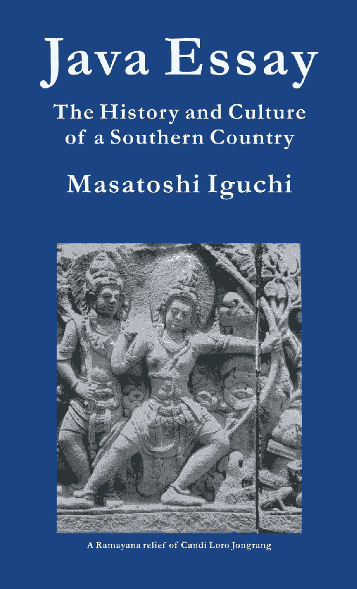

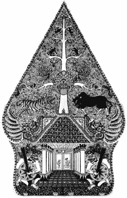


## 马尔科姆·R·麦克利（Malcolm R. Mackley）教授序言

口口正（Toshi Iguchi）撰写的《爪哇随》是他对印尼西亚从最初的兴趣到完全痴迷的结晶。他的科学训练和好奇心让他走上了发现这个国家的道路，而这个国家的历史在过去并没有得到特别充分的研究。他被古老的建筑所吸引，进而证明了早期印尼西亚文化的起源。

在阅读这些随笔时，我惊讶地发现，关于这样一个重要国家的历史竟然如此为人知。口正利用他的科学背景和对多种语言的精通，深入探讨了印尼西亚的过去，并勇敢地尝试理解不同人物、地点与遗遗迹之间的某些联系。虽然他的推测中存在一些不确定性；然而，他的文字为讨论提供了基础，或许也是后后辈证明他正确或错误的起点。

口正接受过科学家训练，并成为了一名印尼西亚的历史学家。他对这个国家的兴趣是深层次的，他作为一名学者、一个爱好者、一名科学家，而且最重要的是，作为一名通过在那个国家生活而培养出热情的人士，研究了该国的历史。

《爪哇随》的第一章是爪哇历史的摘要，这提供了关于过去两千年来不同王朝如何统治该岛不同地区的有用信息。接下来的两章涉及了贾加塔拉（Jagatara）的诞生以及随后我们今天所熟知的雅加达（Jakarta）的出现。这部分并不是以简单的事实方式叙述的，而是通过许多与该城市及其生活相关的实事和传说故事或随笔呈现的。随后，一个章节记录了整个爪哇岛古代遗迹的发现，在这里显而易见，口口正肩负着一项特殊的使命，试图通过了解是谁以及为什么建造了其中许多遗迹。随后的章节考察了印尼西亚的精神生活、神话、诗歌甚至戏剧，试图描绘出一幅过去的国家画像。

这些故事既有启发性又充满信息。书中包含了许多插图，这为这些随笔增添了活力。作为一名科学家，口正习惯于利用图表来讲述科学故事。作为一名印尼西亚的历史学家，他使用了大量的古代图画、照片和脚本来帮助读者欣赏他所讲述的故事。

我们的第一次见面是在 1996 年，当时他策划了一场以万隆为中心的“绿色聚合物研讨会”，这也是我第一次接触印尼西亚。随后，我们最初围绕对聚合物的共同科学兴趣建立的友谊不断发展，并扩大到他对历史重要性的深厚兴趣，特别是他对对印尼西亚一切事物的痴迷的欣赏。《爪哇随》是口正生活的核心部分，我非常希望读者能通过他独特的视角、风格和对这一主题的热情，了解印尼西亚的历史。

马尔科姆·R·麦克利

英国，剑桥

2014 年 5 月

## 前言

爪哇是一个岛，面积比大英国略小，或者相当于日本本岛的三分二，位于东南亚靠近赤道的南方。三十年前，我（即本文作者）正置身于自然科学的一个领域并在政府研究机构工作，第一次访问了那里。尽管只是一次为期一周的正式访问，但对于一个此前只去过相同中纬度欧洲和北美的人来说，这个世界似乎是在两个维度上发展的，事实也确实如此。不仅是因为我看到了丰富的热带自然风光，还因为我遇到了这个南方国家热情的人们，并接触了他们的本土文化。之后，我被调到万隆并在那里住了两年，也许是上帝的旨意。退休年龄到了，我获得了一个奖学金，并在波哥（Bogor）的一个研究实验室工作了三年。回到家后，尽管我获得留在国内外大学的机会，但在过去的十年里，我沉浸在在那段期间触动我的爪哇戏剧性历史和美丽文化中，主动放弃了聚合物科学。随着互联网的发展，时间让局外人能够接触到不同学科的知识。除了提供自身的二级知识外，互联网还让我找到了世界各地书店的各种新旧书籍并进行在线订。通过电子邮件，我可以随时联系印尼西亚和欧洲的朋友来寻求语言方面的帮助。退休后，我有自由访问历史遗迹并直接向专家那里学习。我特别感谢印尼西亚国家博物馆的高级展员 Sundari 女士，她慷地提供了关于爪哇历史和文化的宝贵知识，这些在书籍和文件中是无法获得的。

我的首要任务是将川侯著名的游记《贾加塔拉记》（Jagatara Kikou，原于 1931 年在日本京都共同出版社出版）的英文译本出版，即：

川侯（口口正译），《爪哇之旅》（Journeys to Java），ITB 出版社，万隆，2004 年，ISBN 979-3507-25-x

原始英文稿写得更早，当时我参加了 1996 年在万隆举行的国际科学会议的准备工作，并作为川侯黎明会的一本私人书籍出版，书名为《2 世纪 20 年代的爪哇之旅》，供外籍参会者参考。为了将其作为一本正式的书出版，文本经过了彻底修订，增加了更多脚注，并附上了从其他来源收集的当代照片集，并获得了大华川侯家族的全支持。该书的印尼语版两年后出版，由我的年轻朋友翻译，即：

川侯（Ririn Anggraeni 和 Apriyanty Isanasai 译），《爪哇之旅》（Perjalanan menoejoe Djawa），ITB 出版社，万隆，2006 年，ISBN 979-3507-87-x

我的几位读过德川著作的同事告诉我，他们对作者（一位贵族、历史学家和科学家）广博的学识和深邃的洞察力赞叹有加，并对译者提供的辅助材料（引言、注释等）表示赞赏，甚至要求我未来也写一本自己的随笔。事实上，我对当时市面上关于 Java 的书籍并不满意。

在第二次世界大战之前，曾出版过许多对普通读者友好的 Java 优秀英文书籍（例如：竹越三郎（1910 年）的《南方诸国》`A Book of Southern Countries`、小林一（1941 年）的《我眼中的荷兰东印度》`I Saw the Dutch East-Indies Like This`，以及日本德川侯爵的书，还有 Frank G. Carpenter（1928 年）的《爪哇与东印度》`Java and the East Indies`、J. F. Scheltema（1928 年）的《丰碑爪哇`Monumental Java`等），但这些书籍的内容不可避免地过时，书籍本身只能在古书市场买到。如今，虽然市上有许多特定主题的学术书籍，但对于普通读者来说，阅读许多此类书籍并在脑中理解 Java 的历史并非易事。在非专业人士编写的书书中，事实和事件很少援引权威来源，有时会导致读者产生偏见和误解。作为旅游指南，日本铁道省于 1913 年至 1927 年间编辑并出版了一系列名为《东亚官方指南：欧亚跨大陆连接（五卷）》`An Official Guide to Eastern Asia: Trans-continental connections between Europe and Asia (five volumes)`的著名书籍。虽然这些书籍现在世界书市场上以极高的溢价出售，但日本良好的传统已经消失了，因为今天制作和销售的许多指南都是这种类型：页面上精彩色图片之间填满了对未知来源内容的抄袭性描述文字。其中有一本奇特的书甚至让我怀疑出版者的眼光，名为《巴厘岛与印度尼西亚》`Bali and Indonesia`，尽管巴厘岛只是印度尼西亚共和国的一个省份。世界上也有许多旅游指南，但寻找好的指南仍需要努力。

尽管如此，我必须承认这本《爪哇随笔》（`Java Essay`）不过是一系列针对随机选择的主题的随笔集，方式较为非系统，汇集了我在爪哇生活的经验、大量书籍和文献、实地考察遗迹的结果，以及与印度尼西亚朋友及其前宗主国荷兰人的对话中获得的知识。虽然为了方便读者，书中提供了关于爪哇历史的简短介绍以及“Java”一词的词源，但我无意通过补充和扩充引言来编写教材，也没有打算在没有正式资质的情况下撰写关于爪哇历史和文化的权威学术著作。（后续章节的内容列在引言末尾。）尽管如此，由于我曾从事过其他领域研究的习惯，书中尽可能地引用了文献，并对某些事实和事件给出了自己的解释。书中图片的插入是刻意限制的，因为作者希望读者主要通过文字来了解内容。

这本书不能被归类为专著、教科书、游记或旅游指南等常见体裁，而是如书名所示，属于一种随笔。由于书的这种性质，笔者希望这本书能被广大读者阅读——从访问过或将访问爪哇的游客，到相关研究领域的学生和学者，同时希望任何批评和意见都能亲切地告知我。

这篇随笔同时用日语起草，手稿已于 2013 年由东京丸善出版有限公司旗下的丸善星球出版社早先出版。英文版中增加的几个新段落已在相应的脚注中注明。

### 致谢

在稿稿准备期间，作者非常感谢英国剑桥的 Malcolm R. Mackley 教授，他亲切帮助作者审阅并编辑了超过 130,000 字的文本，使其至少在英语表达上具有可读性。还要感谢雅加达印度尼西亚国家博物馆 Raden Ayu Ekowati Sundari 硕士、德川理英会及东京德川美术馆院长德川义（Yoshitaka Tokugawa）先生，以及所有提供建议并支持这项工作的朋友。对于本书的出版，作者特别感谢 Troubador Publishing 执行董事 Jeremy Thompson 先生及其团队成员，特别是编辑经理 Lauren Lewis 小姐，她详尽地重新编辑了全文，并认可了手稿的价值，使其在这一声誉卓著的出版社出版。

井口正俊 (Masatoshi Iguchi)

日本，东京

2014 年 5 月

### 关于作者

井口正俊博士于 1938 年出生于日本名古屋，1966 年毕业于东京工业大学研究生，获得纺织工程博士学位。直到 1999 年，他大部分时间都在日本通产省（前）的工业科学技术厅工作，从事聚合物科学领域。在职业生涯中，他曾担任英国埃塞克斯大学博士后研究员、印度尼西亚万隆“东盟-日本合作聚合物项目”负责人以及荷兰埃因霍温理工大学的访问学者。在结束政府任职后，他曾在印度尼西亚的博戈尔橡胶研究站担任访问研究员，在日本山形大学担任访问教授等，但在过去的十年里，他专注于爪哇的历史与文化。他曾获得日本高分子学会（1977 年）、日本生物科学技术与农化学会（1998 年）等奖项，并于 2008 年被皇室授予寿葵勋章。

## 注释

### 日文版

日文版的书目信息如下。

| 标题 | ジャ哇探究―南国的历史与文化 |
| :--- | :--- |
| 作者 | 井口正俊 |
| 出版社 | 丸善策划株式会社，东京 |
| 销售部 | 丸善出版株式会社，东京 |
| 出版日期 | 2013 年 10 月 10 日/初版 |
| ISBN | 978-4-86345-174-2 C0022 |

### 地语言拼写

在印尼语词汇中，即专名词，`o` 和 `a` 有时互换。虽然 `o` 和 `a` 在爪哇和巽答地区通常分别偏好，例如 Purwokerto（中爪哇的一个城镇）和 Purwaterta（西爪哇的一个城镇）、Arjuno 和 Arjuna（一位神灵的名字）、Joyoboyo 和 Jajabaya（一位古代国王的名字）等，但这一规则并非通用。书中某些这些元音的拼写遵循所引用的文献。

爪哇语和巽答语均源自**梵语，在辅音 `l` 和 `r` 上有区别，与某些东亚语言不同，但似乎存在例外，例如古代女性尊称 `Loro`（例如传奇 Jonggrang 公主）有时被拼写为 `Rara`、`Roro` 等。在书中，它们按照在所引用文献中的形式使用。

在印尼语和马来西亚语进行协调（两者均基于低地马来语）之前的 20 世纪 70 年代以前，荷兰式的拼写在印尼广泛用于元音和辅音。它们已被修改为：`oe` → `u`、`dj` → `j`、`tj` → `c` 以及 `j` → `y`。因此，旧的拼法出现在旧文献和老年人的姓名中。

至于汉字，战后日本教育中采用了笔画较少的异体字，这些字在现今仍被广泛使用。在中国大陆，20 世纪 60 年代发明了所谓的“简体字”来取代复杂的字体，并变得通用（见表所示）。尽管如此，本书仍采用繁体字，因为它们是以所引用文献中的原始形式呈现的。

| | 例 1 | 例 2 | 例 3 | 例 4 |
| :--- | :--- | :--- | :--- | :--- |
| 繁体字 | 钱 | 关 | 乐 | 国 |
| 笔画较少的异体字 | 銭 | 関 | 乐 | 国 |
| 中国的新型简体字 | 钱 | 关 | 东 | - |
| 定义 | 硬币，零钱 | 障碍，关闭 | 快乐，容易 | 国家 |

### 封面插图

普拉兰巴南湿婆罗神庙走廊墙上的罗摩衍衍浮雕之一，描绘了罗摩在为西塔公主选夫比赛中射箭，西塔公主是维德哈斯 Djanaka 国王的女儿。复制自：W. F. Stutterheim，《爪哇文明史》（Pictorial history of civilization in Java）。由 A. C. de Winter-Keen 夫人翻译，爪哇学院及 G. Kolff & Co., Weltevreden, 1926。由于腐蚀，照片中看到的雕刻清晰度今日已消失。

### 封底插图

苏丹·阿贡（Sultan Agung）和扬·彼得斯佐松·科恩（Jan Pieterszoon Coen）的皮影戏偶（Wayang dupara puppets）。由 M. Iguchi 于雅加达历史博物馆拍摄，2006 年 9 月。

### 内扉插图

甘农贡（Gunungan，塞梅鲁山的纹样）或 Kayon（生命之树），皮影戏（wayang kulit）开始时展示的偶。设计参考：`http://www.asiafinest.com/forum/lofiversion/index.php/t254123.html`

## 目录

- 马尔科·R·麦克利教授的序言
- 前言
- 注释
- 引言：爪哇简史
- 附录：爪哇编年史
- 第一章 Jagatara – 哈鲁的终点
- 雅加达地图
- 第二章 Jagatara 故事
- 第三章 古代石碑 – 塔鲁曼纳加拉的铭文
- 附录 (1)：印度教历/萨卡历
- 附录 (2)：西爪哇王国列表
- 第四章 帕恰加兰王国 – 巽达人的精神家园
- 第五章 马塔拉姆：神与佛的居住地
- 附录：罗洛宗格朗传说
- 第六章 爪哇之花——诗歌与戏剧
- 附录：贾雅比亚预言
- 参考文献
- 爪哇地图

## 引言：爪哇简史

两百年前，在《爪哇史》第一章的开头，托马斯·斯坦福德·拉斐尔斯（Thomas Stamford Raffles）写道：

> “这个被欧洲称为爪哇（Java）或 Java Major，被当地人称为`Tana`（土地）`Jawa`或`Nusa`（岛）`Jawa`的国家，是现代地理学家所巽达群岛中最大的岛之一。它有时被认为是马来群岛的一部分，构成了东方群岛的一个划分，最近这一划分被建议称为亚洲群岛。它向东延伸，略微向南，从格林尼治经度`105°`到`114°`，位于南纬`5°`到`8°`之间。它的南部和西部受到印度洋冲刷；西北部是一个名为巽达海峡的海道，将其与苏门腊隔开，某一点距离为十四英里；东南部是巴厘海峡，宽度仅为两英里，将其与同名岛屿隔开。”

本书所涉及的爪哇是指这个国家。“爪哇”一词的起源尚不清楚，尽管文献中发现一些理论。在拉斐尔斯的书中，他写道这个词可能源于`jau`（字面意思是遥远，现代印尼语中拼写为`jauh`），因为该岛屿远离大陆；或者源于`yava`（一个梵词，意为“大麦”）。在第二种理论中，`Yava`出现在古代印度史诗《罗摩衍衍》中的岛名`Yavadvipa`（或`Jawadwipa`，其中`dvipa`或`dwipa`意为岛）。`Yavana`（耶婆提）岛是来自东中国的僧侣法显从斯里兰卡返回途中遭遇事故并在那里停留了一段时间，他在游记《佛国记》（*Fo kuo chi*）中的记载应该是`Jawadwipa`的音译。在公元 879 年由诗人 Empu Satya 撰写的古爪哇语书籍《Serat Mahaparwa》（《罗摩衍衍故事》）中记载了一个有趣的故事：

> “从前，天上的神灵看到了一座长岛，与现在不同，它不分地从今天的苏门腊经过爪哇到巴厘岛，并称之为`dava`（字面意思是长）。后来，从印度派遣过去的伊斯卡国王（Aji Saka 国王）走遍了整个岛屿，承认这确实是一座长岛。与此同时，他在某些地方看到一种植物`jawawut`（小米）。因此，他根据双重含义将这座岛屿命名为爪哇（Java）。”

“马来群岛”或“马来岛屿”在拉斐尔斯的阐述中这样写，在 19 世纪有多种替代名称。例如，作为博物学家的访问该地区的阿尔弗雷德·拉塞尔·华莱莱士（Alfred Russel Wallace）在 1863 年为《伦敦皇家地理学会杂志》撰写的文章中，对这些术语及其地理定义进行了论证，并表示“印澳澳洲群岛”是他的偏好，尽管“马来群岛”被用作他 1869 年出版的名著书名。更早在 1850 年，著名的律师和民族学家詹姆斯·理查德森·罗根（James Richardson Logan）写道，他更倾向于使用“印尼西亚”（Indonesia）作为“印度岛屿”或“印度群岛”的纯地理术语，并将“印尼西亚人”（Indonesians）作为“印度群岛岛民”或“印度岛民”，这些术语随后广受欢迎，并在 1949 年印尼西亚共和国作为独立国家成立时被采用国名，继承了原荷属东印度的领土。

在莱福斯（Raffles）的书中，他使用了另一个称呼苏答腊的词 `Java Minor`，类比于称呼爪哇的 `Java Major`，无论这些简短术语在当时或此前是否常见(#part0006_split_001.html_in1fn10)。1292 年（?）从中国回途中停留在苏答腊的马可·波罗将该岛称为“爪哇小岛”（`Della piccola isola di Iava`），而将爪哇称为“爪哇岛”（`Dell’isola di Java`），并注释道后者是一个巨大的岛屿（`un’ isola grandissima`）](#part0006_split_001.html_in1fn11)。他在回到威尼斯后口述的游记——《百万游》（*Il Milione*）中这样描述了爪哇：

> “这里讲述了巨大的爪哇岛。你们必须知道，离开占榜（Chamba）王国后，向南东南航行 1500 英里即可到达名为爪哇的大岛。根据深通此事的经验水员说法，它是世界上最大的岛屿，周长约 3000 英里。它属于一位伟大的国王。他们是偶像崇拜者，不向任何人纳贡。这座岛极其富饶。他们有胡椒、豆蔻、没药、南姜、山椒、丁香，简而言之，就是能想象到的所有珍贵香料。大量的船只前往那里，许多商人在那里购买各种货物，从中获得丰厚的利润。这座岛上的财富如此，以至于世界上没有人能计算或描述它。我还要补充一点，大汗因为距离遥远以及航行途中的危险，从未能夺取它。刺桐（Zaitun）和蛮子（Manji，即南宋）的商人过去曾与该岛的贸易中获得过巨额利润，现在依然如此。世界上销售的大部分香料都来自这座岛。现在，我已告诉了你们关于这座岛的情况，将不再多言，而是继续下去。”(#part0006_split_001.html_in1fn12)


尽管该岛屿的大小可能由于缺乏准确知识而被夸大了两倍，引发了争议，且由于偏好贸易的海员传闻众不一，但对该国状况的描述几乎是真实的。爪哇曾是辛加沙里王国（Singasari Kingdom）的鼎盛时期，国家在尔塔内加拉（Kertanegara，1268–92）国王的统治下繁荣，权力延伸至外岛。他们崇拜偶像意味着他们信仰印度教。事实上，成思汗要求纳贡的使团三次遭到拒绝（参见第 6 章）。

虽然马可·波罗的记载令欧洲人惊讶，但该岛的情况及存在早已被亚洲人（即中国人）所知，正如后汉《南蛮夷传》（*Nan Man Xi Nan Yi Zhuan*）记载：“公元 131 年，来自越南海岸外的叶调王（Ya-diao）向本朝派遣了使者：皇帝赐给调便（Diao-bian）一个金印和一个紫带勋章”（#part0006_split_001.html_in1fn13）。尽管当地没有直接证据证明名为“调便”的国王或其王国的存在，但这位国王被认为是德瓦瓦尔曼一世（Dewawarman I），他从印度移民并在爪哇岛西部建立了萨拉卡纳加拉（Salakanagara），参考了《群岛王国史》（*Pustaka rajya rajya i bhumi Nusantara*）（#part0006_split_001.html_in1fn14），该书中记载了古老的传统，并在之后进行了汇编。

本书的作者（口口）现在将以对这些文化持尊重的态度，回顾此后爪哇岛上直到现代所兴衰的王国历史。

在萨拉卡纳加拉之后，出现在爪哇西部的王国是塔鲁马曼纳加拉（Tarumanagara），它留下了几块石碑作为实物证据。它建立于 4 世纪中期（公元 358 年），在第三任国王普尔纳瓦瓦尔曼（Purnawarman）统治期间最繁荣。关于当代《宋书》（*Sung Shu*）中提到的名为`呵罗单国`（`a-ro-tan`或`a-lo-tan`）的国家，学者们对此一直存疑，笔者认为这些汉字必定是恰亚鲁滕河（Ciaruteun River）“a-ru-teun”的音译，而该国正是塔鲁马曼纳加拉，其首位于位于波哥（Bogor）郊区恰姆佩亚（Ciampea）村恰亚鲁滕河岸，那里发现了两块当代的石碑和许多大型基石（参见第 3 章）。

塔鲁马曼纳加拉持续到 7 世纪（669 年），随后王国名称改为苏达（Sunda），尽管此前王室早已迁移（526）。

苏达和瓦里（Kawali）作为两个王国并存，直到 1482 年，瓦里第六任国王林加德瓦（Linggadewata）的女婿统一了这两个国家，并建立了首位于帕库万的帕恰雅王国。巴杜加被称为西里瓦吉（Siliwangi），是一位伟大的国王，他的功绩被其子苏拉维塞萨（Surawisesa）刻在白石碑上，他的事迹至今仍在苏达人中流传。

1526–7 年，该王国的外港口万丹丹（Banten）和巽达帕（Sundapa，今雅加达）曾与葡萄牙占领的马六甲贸易而繁荣，后被从爪哇中部兴起并深入爪哇东北海岸的穆斯林人攻占，导致该国失去了出海口，王国首都帕库万于 1579 年落入穆斯林手中。因此，帕恰雅成为爪哇最后一个印度教王国。尽管井里汶王国的创始人海亚特（Hydayat）是巴杜加的孙子，但从写者的观点来看，信依伊斯兰教建立的国家并非继承苏达传统的国家。

当谈及巽达（Sunda）与爪哇（Java）的关系时，就无法忘记卡瓦利国王林加布阿纳（Linggabuana，在位 1350–7）时期发生的“布巴特悲剧”。1357 年，当国王女儿迪亚·皮塔卡（Dyah Pitaloka）收到爪哇强大的马丹 ahit 王国年轻国王哈亚姆·武鲁（Hayam Wuruk）的婚约时，林加布阿纳带着公主和家族成员前往马丹 ahit 参加婚礼。他们抵达爪哇首都郊外的布巴特时，意外接到来自马丹 ahit 宰宰加加·马达（Gajah Mada）的告知，“公主将作为爪哇国王的贡品被接收，而非王后”，这与哈亚姆·武鲁王的愿望背道。林加布阿纳宣布：“我们宁愿作为`satria`（战士）战斗，也不愿受侮辱”，于是国王和所有士兵都被加加加·马达压倒性的军队杀害。皇后、公主和宫女也随死去的男士而去。这个故事被唱在史诗《坎杜·巽达》（Kidung Sunda，即巽达之歌）15 中（分别于中国 10 世纪中期和 11 世纪中期完成），记载了关于一个名为“诃陵”（Ho-ling 或 Ka-ling）国家的记载，该国“位于南海的一个岛屿上，由一位名为悉莫（Sima）的女王统治”。这个国家的存在长期以来受到学者的质疑，过去也出现过各种理论，甚至有一种认为它是三散延德王国的荒谬理论。作者倾向于解释为它是上述《群岛诸王书》（The Book of Kings in the Archipelago）中的诃陵王国，悉莫女王的血脉延伸到了三散延德王朝、桑贾亚王朝以及发生在东爪哇的甘朱鲁丹（Kanjuruhan）王朝（参见第 5 章](#part0012_split_000.html_BE6O0-eace0453ad444634b688454ed62f4eb)）。

## 向东爪哇迁移

公元 929 年，桑贾亚王朝的门普·辛多（Mpu Sindok）在布兰塔河（Brantas River）岸的默达当（Medang）开启了他的伊斯耶那王朝（Isyana Dynasty），爪哇王国的中心移到了东爪哇。关于迁移的原因，被认为是活跃的美望火山（Merapi Volcano）喷发导致的土地破坏以及与佛教徒的宗教冲突（见第 5 章](#part0012_split_000.html_BE6O0-eace0453ad444634b688454ed62f4eb)）。公元 1006 年，当阿尔兰格王子（Prince Airlangga，门普·辛多的曾孙女马亨德拉达塔公主（Mahendradatta，她已嫁给巴厘岛瓦马达德瓦家族的乌达亚纳王子）回到母家默达当与迪亚·斯拉克希米公主（Dyah Sri Laksmi）会亲时，默达当遭到三齐义袭击，国王被杀。在带着公主在森林躲避并隐姓多年后，他平定了叔父去世后陷入混乱的国家，并根据当地人的请求成为了爪哇王。阿尔兰格于 1037 年在卡胡里潘（Kahuripan，或吉德里）建立的新王国在他明智统治下繁荣，特别是通过对外贸易，国王还促进了艺术和文学。当时创作的《阿周罗那之婚》（Arjuna Wiwaha）正文被誉为众多`kakawin`中最优美的作品之一，据说是以《摩诃婆罗多》的部分为模型描写了阿尔兰格的生活。阿尔兰格的形象可以在今天的一些雕像中看到。

1041 年退休时，阿尔兰格将王国分为两个部分：西部的潘贾卢（Panjalu，吉德里）和东部的章加拉（Janggala），交给他的儿子，但由于停滞，后者在 12 世纪初被并入前者，而前者继续繁荣。吉德里王朝在第三任国王杰亚巴雅（Jayabaya，1135–57）统治时期最兴盛，正如南宋中国《岭外代答》（Lingwai daida）中所载：“爪哇在外国中仅次于波斯（Saracen）”18。在被尊奉为神化身的杰亚巴雅保护下，如爪哇文学史上最不朽的《婆罗罗大战》、《克罗申那》和《摩坛》等伟大`kakawin`得以创作。

# 爪哇的历史

## 葛吉里与辛加沙里时代

葛吉里的最后一位国王克尔塔贾亚（1185–1222）是一个残暴无行的君主，对宗教领袖怀有敌意。望加拉的前首都土马佩领主图加·阿梅通（Tunggal Ametung）也是一个压迫者，迫害不顺的僧侣并向农民征收重税。在这样的背景下，一位英雄出现了：一个名叫肯·阿洛（Ken Arok）的年轻人，他来自`sudra`，即印度教的最低阶层。他策划政变杀杀了图加·阿梅通，娶了被阿梅通掳走并为妻的肯·德德斯夫人（Ken Dedes），最终击败了葛吉里，并在今天的马兰等地建立了辛加沙里王朝，以拉贾萨国王之统治。

肯·阿洛的生活被记录在前述的编年史《帕拉顿》（Pararaton）中，故事代代相传。尽管肯·阿洛明智地统治王国（1222–47），但他被图加·阿梅通的儿子阿努萨帕提（Anusapati）杀害，后者是肯·德德斯的儿子。尽管国王屡遭暗杀，王国本身依然存在，并建造了精美的寺庙（或陵寝）。

在辛加沙里寺群中出土的般若波蜜（Prajnaparamita）像，据传是以尊贵的佛教僧侣普尔瓦（Purva）之女肯·德德斯的形象——她以完美著称——为观音菩萨（或`Guan Yin`）祈求完美智慧而塑造的。这尊像现在现藏于雅加达的国家博物馆并作为杰作向公众展示。毫不夸张地说，从作者的角度来看，这尊塑像是所有爪哇雕刻中最好的。

辛加沙里的第 5 位国王克尔塔内加拉（Kertanegara）带领国家走向繁荣，并如前所述，三次拒绝了成思汗的臣服要求，但他于 1292 年 5 月在受辛加沙里控制的葛吉里领主杰亚卡塔旺（Jayakatwang）发起的政变中被杀，后者试图复兴葛吉里王朝。杰亚卡塔旺本人于同年 11 月被成思汗派遣的一千艘帆船的元军杀死。肯·阿洛与肯·德德斯的后裔、克尔塔内加拉的女婿拉登·维查亚（Raden Wijaya）假装合作，随后进攻并击败了成思汗的军队。拉登·维查亚建立了马札帕特，该王国在 1293 年成为爪哇历史上强大的王国。

## 马札帕特时代

马札帕特的第 4 位国王哈亚·武鲁克（Hayam Wuruk）在“布巴特悲剧”后几年与其姐姐帕杜卡·索里（Paduka Sori）结婚并封为皇后。在哈亚·武鲁克的统治下，马札帕特在宰相加加·马达（Gajah Mada）的支持下得到了发展，王国的霸权涵盖了整个印度尼西亚地区，包括苏门腊、加里曼丹（婆罗洲）、苏答腊（塞兰比锡）、巴厘岛和东部岛屿以及西新几内亚，并延伸到马来半岛。

当时的爪哇状况可以从跟随哈亚·武鲁克巡视的普拉潘恰（Mpu Prapanca）所写的《爪哇记》（又称《国家史》），以及明朝参加郑和航行的马欢（Ma Huan）所著《瀛涯胜览》（`Ying ya sheng lan`, 1416）中得知，还有马札帕特首都（今天的特罗武兰）、葛吉里、帕纳塔兰等地留下的精美建筑和雕塑。

## 衰落与伊斯兰的兴起

1389 哈亚·武鲁克去世后，马札帕特由于王位继承问题以及更多伊斯教的传播逐渐衰落。《瀛涯胜览》中写道：“这个国家有三种人：来自西方国家贸易的穆斯林、从广州、泉州等地流放的中国人以及崇拜异端[印度教]的当地人”，这表明到 15 世纪初伊斯教已经广泛传播。

爪哇北岸的德马马克、杰帕拉、格雷西克和图班的领主开始皈依伊斯兰，并独立于马札帕特控制贸易。德马马克王国是爪哇第一个伊斯兰王国，由拉登·帕塔于约 1475 年建立。尽管德马马克通过与马六甲贸易而繁荣，但根据托马·皮斯（Tome Pires）的书籍，他们在 1511 年葡萄牙印度总督阿尔丰索·德·阿尔布奎尔克（Alfonso de Albuquerque）攻陷后者后失去了权力。马札帕特王国通常认为在布拉维贾亚六世（Brawijaya VI, 1478–98）统治后灭亡。那时，马札帕特的贵族带着许多爪哇书籍和文化遗产逃亡到巴厘岛，那里伊斯兰力量尚未到达。得益于运输，所有马札帕特时期之前编写的文学历史书籍保留在了巴厘岛和龙望岛（位于巴厘岛以东）。

## 马塔兰苏丹国

1584 年，马札帕特皇室后裔帕内巴汉·塞诺帕蒂（Panembahan Senopati）统一了德马马克第三任国王特伦甘纳（1522–48）去世后出现并相互竞争的小王国，并在帕让（现今日罗附近）建立了新马塔兰王国（或马塔兰苏丹国），自称苏丹。因此，爪哇的行政和文化中心回到中爪哇。第三任国王苏丹·阿贡·哈尼洛库苏（Sultan Agung Hanyrokusumo, 1613–45）是一位伟大的统治者。他征服了爪哇大部分地区（西爪哇西部和东爪哇的一部分外），并在 1628–29 年两次进攻巴达维（荷兰人 1919 年通过万丹-英国联盟建造），尽管结果无功而返。

18 世纪中期（公元 1755 年），在经历了三次继承战争后，在荷兰东印度公司（VOC）的调停下，马塔兰王国被分为两个：位于日罗的苏苏南家族和位于雅加达的苏丹家族。虽然从一方面王国分裂加强了荷兰人在爪哇的存在，但从另一方面不可否认的是，国王和贵族从军事事务中解放出来，能够专注于自身艺术和文化的发展。正是在日罗和雅加达的宫廷，皮影戏（`wayang kulit`）变得精致，真人表演的皮影戏（`wayang wong`或`wayang orang`）被创造，两种最高贵的宫廷舞蹈`selimpi`和`budoyo`诞生了。在工业艺术领域，蜡染（`batik`，爪哇本土染织布料）的设计和工艺得到了完善，正如我们今天看到的这些产品。

1744 年，荷兰东印度公司总督范·霍夫男爵（Baron van Imhoff）在帕库安（今天的波哥）建造了一座宅邸，那里是 1579 年灭亡的帕恰雅拉王国的前首都，并将该地命名为 Buitenzorg（意为“无忧村”），后来在 1870 年成为荷兰属属印度总督的官邸。

拿破仑战争在欧洲的影响延伸到了爪哇岛。1808 年，赫尔曼·威廉·丹德尔斯将军（General Herman Willem Daendels）被派遣离开法国占领的荷兰，以保卫领土免受英国攻击。他改革了巴达维亚，放弃了港口附近的堡，在向北八公里处的韦特弗勒登（Weltevreden）建造了新的市中心，并在向南 20 公里的梅斯特科内利斯（Meester Cornelis，现在的 Jatinegara）准备了防御线。他还在巴达维亚东南方向 180 公里的群山环绕的山隆盆地内建立了一座要塞城市。此外，他还下令修建了一条全长 800 公里的邮政大道，从西端的 Anyer 到东部的 Panarukan 横跨爪哇岛，被称为`De Groote Postweg`（当地称为`Jalan Pos Raya`）。

尽管丹德尔斯在两年内完成了所有这些工程，但付出了 2 万人的生命代价。他于 1811 年 5 月离职，因为由于他性格强硬，其行政工作进展并不顺利。随后是詹·威廉·詹森斯将军（General Jan Willem Janssens）面对并向英国军队投降，英国军队实际上三个月后在明托勋爵（Lord Minto）的带领下占领了爪哇。统治爪哇的是英国印度副总督斯坦姆福德·拉斐尔（Stamford Raffles），他后来创立了新加坡。尽管他的政府引入英国体系并不完全成功，但他通过自任皇家巴达维亚艺术科学学会主席，并促进了对古代爪哇王国遗迹（如罗布织佛）的研究，还撰写了巨著《爪哇史》（`The History of Java*），这些都是卓越的。

当 1815 年《维也纳和约》达成将爪哇及其属地归还荷兰时，威廉一世国王决定通过政府直接管理东印度，而不是将行政权委托给像已于 1799 年破产的前东印度公司（`VOC`）那公司。在平定迪波尼戈罗（Diponegoro）发起的叛乱——所谓的爪哇战争（`(1825-30)`）后，荷兰属东印度稳步发展，成为亚洲最繁荣的国家。虽然现在的印度尼西亚作为世界上自然资源最丰富的国家之一而闻名，但当时的经济基础是荷兰人培养的种植业。结果就是“荷兰人间接地地从爪哇获利，但也让当地人赚了钱。”

20 世纪初，在威尔赫米娜女王的命令下，实施了“伦理政策”（Ethic Policy），当地人的教育、医疗护理和福利得到了极大提升。在 1922 年的宪法中，东印度以及荷属圭亚那（苏里南）和库拉腊岛被赋予与荷兰同等的地位。

回望爪哇的长久历史，人们发现该岛上兴起和衰灭的所有王国都属于当地人，除了像`Salakanagara`和`Tarumanagara`这样早期的王国外，它们是由印度移民建立的。事实上，现今梭罗（Solo）和日惹（Yogyakarta）皇室血统可以追溯到 13 世纪的肯·阿洛（Ken Arok）和肯·德德（Ken Dedes）。历史进程中中国和穆斯林移民带来的文化和习俗被当地人吸收和同化。象征意义的是，印度教文化在伊斯兰化之后仍然保留了下来，因为`wayang`（影戏）至今仍深受爪哇人的喜爱。

有人评价说，17 世纪初在爪哇建立贸易站、并在 19 世纪初成为东印度宗主国的荷兰人，确实带来了他们的欧洲文明，但从未强加自己的文化，而是尊重甚至保护了当地的遗产。这与西班牙殖民地的情况形成了鲜明对比，例如亚洲的菲律宾，更不用说中南洲了，在那里，征服者（`conquistadors`）竭尽全力改变当地一切，甚至是当地居民的心态。

在第二次世界大战日本占领期间（`(1942 年 2 月–1945 年 8 月)`），这片土地经历了巨大的变化。在日本投降后，`1945 年 8 月 17 日`的独立宣言开启了新时代。首任总统苏加诺（`Soekarno`）引入了引导民主（`Guided Democracy`）时期。然而，`1965 年 9 月 30 日`的事件导致了对共产者的大清洗。随后苏哈托（`Suharto`）夺取权力，开启了“新秩序”（`New Order`），这带来了显著的经济增长，但最终在`1998 年`亚洲金融危机期间崩溃。

- 位于布乔加尔（Bogor）的帕查加拉（Pajajaran）石碑
- 帕查加拉创始人斯里·巴杜加（Sri Baduga）国王的成就
- 关于西里瓦西国王（Siliwangi，别名斯里·巴杜加）的多部传奇文学
- 穆斯林入侵导致帕查加拉国的灭亡
- 收藏于苏美丹拉兰博物馆（Sumedanglarang Museum）的帕查加拉珍宝
- 在西爪哇岛东部建立的加卢王国（Galuh）
- 布巴特悲剧（The Tragedy of Bubat），一位苏丹达国王及其族属在东爪哇岛马恰希特郊区被杀

# 第五章：神佛居住之地马达腊

*(8–11 世纪/中爪哇岛)*

- 三散罗王朝（Sailendra）建造的罗布齐佛及其他佛教寺庙
- 三散亚王朝（Sanjaya）建造的普兰巴南等印度教寺庙
- 其他宗教建筑
- 关于未定义的“瓠国”（Ho-ling kingdom）与三散罗/三散亚王朝之间关系的思考
- [第五章] 附录：罗若 Jong 格朗传说

# 第六章：爪哇之花——诗歌与戏剧

*(11–19 世纪/东爪哇岛与中爪哇岛)*

- 皮影戏（Wayang kulit）、爪哇本土的影戏以及各种衍生剧目
- 若干部用于皮影戏剧本的`Kakawin`诗歌
- 在东爪哇岛繁荣起来的王国及其遗迹
- 革命人物肯·阿洛克（Ken Arok）及其妻子肯·德德斯（Ken Dedes），其血脉延续至今世皇室
- 蒙古征服爪哇以及爪哇历史上最强王国马恰希特（Majapahit）的建立
- 伊斯兰教的传播与马恰希特的灭亡
- 东爪哇岛文学的盛极
- [第六章] 附录：贾查雅预言

### 引言注释

________________________


¹ T. S. Raffles, *爪哇史*, 伦敦 1817 年/重印：牛津大学出版社，新加坡 1988 年。在拿破仑战争期间，托马斯·斯坦福德·拉斐尔（Thomas Stamford Raffles）被英国东印度公司任命为爪哇及其附属地区的副督，并于 1811–15 年间留守爪哇。

² 据说计算机编程语言的名字与一个美国非正式词汇“java”有关，这源于咖啡产自爪哇岛这一事实。

³ 原版《罗摩衍那》（称为`Valmiki Ramayana`）追溯到公元前 5 至 4 世纪。9 世纪在爪哇用诗歌`kakawin`风格创作的《罗摩衍那》，据说基于 6 至 7 世纪起源的`bhatti kavya`或`ravana vadha`版本的《罗摩衍那。（参考：Kodaganallur Ramaswami Srinivasa Iyengar, *罗摩衍那的亚洲变：亚洲罗摩衍那变体国际研讨会论文：其文化、社会与人类学意义*，新德里，1981 年 1 月（Google Books））。在《罗摩衍那》的故事中，被绑走的悉塔公主（在爪哇称为 Sinta）最终被发现的岛是斯兰卡岛（Alengka）。

⁴ Purwadi, *爪哇土地的起源史*, Persada, 2004 年。伊萨卡国王通常被称为阿吉·萨卡（Aji Saka），他抵达（或去世）的年份被设定为萨卡历的元年，该历法由他创立（*见*第 15 页正文）。

⁵ 例如 Russell Jones, “Earl, Logan and Indonesia”, In *Archipel*. 第 6 卷，1973 年。93–118 页。

⁶ Alfred Russell Wallace, “关于马来亚群岛的物理地理”, 《伦敦皇家地理学会杂志》, 第 33 卷 (1863 年), 第 217-234 页。

⁷ Alfred Russel Wallace, *马来亚群岛 (1869)*, 牛津大学出版社，新加坡 1985 年。

⁸ J. R. Logan, *印度群岛记* IV. 1850 年，254 页 / 见《牛津英语词典》第二版，版本 4.0*。

⁹ “东印度”（East Indies）曾是一个地理术语，最初包括印度、远印度及海外岛屿，但后期用法限制为指代马来亚群岛。该术语与西印度群岛或中美洲岛屿相对。“东印度”（East India）则用于指 1600 年分别成立的英国和荷兰公司。

¹⁰ 就作者所知，首次出现这些词的文献是：“爪哇岛的描述以及爪哇人与中国人的风俗”，作者：Edmund Scott，编：William Foster, *亨利·米尔顿的马鹿群岛航行, 1604–1606*, Hakluyt Society（见 James R. Rush, *爪哇：旅行者选辑*, 牛津出版社 1996 年）。

¹¹ 意大利语词汇，出自：G. Pagani, *马可·波罗的百万游：13 世纪文本*, Baldelli Boni, Firenze，1827 年。

¹² 马可·波罗的旅行记，由 L. F. Benedetto 译成英文，G. Routledge & Sons 出版社，1931 年。在该版本中，意大利语`Della piccola isola di Iava`被翻译为“爪哇岛”。在日本，马可·波罗的书通常被称为《东游记》（Touhou Kenbun, *lit.*），自佐野太郎翻译以来，原标题`Il Milione`已几乎被遗忘，尽管日语名称准确代表了其内容。

¹³ 名京大学，《后汉书·南蛮列传》（The book of the Later Han, Legends of Southwestern Barbarians），`http://toyoshi.lit.nagoya.ac.jp/maruha/kanseki/houhan06.html`。

¹⁴ Atja（编），S. Ekadjati, *群岛群岛的王国著作，手稿编辑与译文 I*, 爪哇文化研究与开发部门（苏丹学），文化总局，教育文化部，1987 年。这是 18 世纪初在井井汶（Cirebon）由王萨卡塔委员会（Prince Wangsakerta Committee）编辑的三十部编史之一。

¹⁵ Wirasutisna, Haksan, *爪哇民歌 I–II*, 教育文化部，雅加达：1880 年；Claire Holt, *印度尼西亚艺术：延续与变*, 康奈大学出版社，1967 年；P. J. Zoetmulder, *Kalangwan：古爪哇文学综述*, Martinus Nijhoff, 海牙，1974 年）。原书被认为于 1550 年左右由匿名作者撰写。

¹⁶ 《世系传》（Serat Pararaton）或肯·阿洛克传（The Book of Genealogy or the Recorded Story about Ken Arok）。本书可能于 1481–1600 年间由匿名作者撰写。英文版：I. Gusti Putu Phalgunadi, *世系传：东南亚编年史*, Sundeep Prakashan，新德里，印度，1996 年。

- 爪牙大學，《舊唐書》（*Book of Tang*）卷一百九十七，列傳第一百四十七·南蠻/西南蠻，公元 945 年（舊唐書卷一百九十七・列傳第一百四十七・南蠻/西南蠻 945 AD），`http://toyoshi.lit.nagoya-u.ac.jp/maruha/kanseki/jiutangshu197.html`；
- 爪牙大學，《新唐書》（*The New Book of Tang*）卷二百二十二下，列傳第一百四十七下·南蠻下，公元 1060 年（新唐書卷二百二十二下・列傳第一百四十七下・南蠻下‹），`http://toyoshi.lit.nagoya-u.ac.jp/maruha/kanseki/xintangshu222c.html`；
- 周去非撰，嶺外代答卷二（Zhou Qufei [Ed.]. *Ling wai dai da Vol.2* [*Representative answers [about the region] beyond mountains*], 1172–78），`http://toyoshi.lit.nagoya-u.ac.jp/maruha/kanseki/lingwaidaida02-3.html`；
- 一般认为滿者伯（Majapahit）的领土涵盖了蘇門臘、加里曼丹（婆羅洲）、蘇哇、巴厘及東部島以及新幾內亞，但由于没有发现军事设施和武器遗迹，该王国被是在经济和行政上控制这些地区，而非通过武力征服（根据印度尼亞國家博物館 Ekowati Sundari 硕士的私信）；
- 爪牙大學，馬歡，《瀛涯勝覽》（*Ying yai Sheng lan*），`http://toyoshi.lit.nagoya-u.ac.jp/maruha/kanseki/yingyashenglan1.html`；
- Tome Pires, Armando Cortesao (编),*The Suma Oriental of Tome Pires and the Book of Francisco Rodriguez Volumes 1 and 2*，伦敦 Hakluyt Society，1944（Google Books）；日文版由会田由、飯塚浩二、井沢實、泉靖一、岩生成一譯：Tome Pires，《東方諸国記 (Tohoshokokuki (Daikokai Series V))》，岩波書店，1966（トメ ピレス (会田由, 飯塚浩二, 井沢実, 泉靖一, 岩生成一訳)「東方諸国記 (大航海時代叢書 V)」, 岩波書店 1966）；
- 賈提尼契約（1755 年 2 月 13 日）。1757 年，曼古尼羅家族（Mangkunegoro Family）從獨爪的蘇蘇南家族（Susuhunan Family）分出；1812 年，帕庫阿蘭家族（Paku Alam Family）從雅加加達的蘇丹家族分出；
- John C. van Dyke，《In Java and the Neighboring Islands of the Dutch East Indies》，，Charles Scribner’s Sons，紐約-倫 1929。作者写道：“此外，他们正在向国家投入数百万用于发展。他们正试图建立一个公正公平的政府和一个繁荣的殖民地。为此，他们确认了当地土地权利，引入改进的灌溉和畜牧方法，保护森林，建立当地学校和大学，建设城市、道路和橋梁，开辟新的交通路线，做了成千上萬件改善城乡的事。结果是當地人衣食住行都得到了保障，看起来很快樂，很滿足。而爪哇島是旅行者的喜悅，是所有熱帶國家中最令人愉快的。這很大程度上應功於荷蘭人。為什麼不毫不保留地說出來呢？”；
- R. B. Cribb, Audrey Kahin，《Historical Dictionary of Indonesia》，Scarecrow Press,2004；Bernard Hubertus Maria Vlekke，《Nusantara: A History of the East Indian Archipelago》，Harvard University Press, 1945。

目前的作者並不清楚荷蘭人何時正式殖民東印度的。雖然政府在 1800 年接管了`VOC`的資產，且殖民地部於 1806 年成立，但那時荷蘭正處於拿破崙法國的控制下，“爪哇及其屬地”在 1811 年至 1816 年間被英國佔領。可能是在維也納和約之後，殖民政府才在 1816 年隨著任命 Godert van Capellen 為總督開始實質運作。所謂的殖民統治可以視為 1922 年結束，此時東印度以及荷屬圭亞那和庫拉拉索在憲法上被賦予與荷蘭相同的地位。

## 引言附錄：爪哇紀年表

| 公元 | 西爪哇 | 公元 | 中爪哇與東爪哇 |
| :--- | :--- | :--- | :--- |
| | | | 78 年，印度人帶來了文明（宗教等）。其結局不詳。 |
| | | 130 年，Dewawarman 來自印度，在西爪哇建立了滿者哇。 |
| | | 358 年，Jayasing 繼承 Salakan，在西爪哇建立了滿者哇（→363）。 |
| | | 526 年，Manikmaya 是滿者哇的第 7 位國王。 |
| | | 612 年，Wretikawa 將滿者哇的首都遷至西爪哇。 |
| | | 666 年，Tarbawa 滿者哇在東爪哇建立了滿者哇（→782）。 |
| | | 674 年，Kartikeyha 逝世。 |
| | | 709 年，Sena 成為蘇魯達之王。他的妻子是中爪哇的 Sima 公主。 |
| | | 723 年，Sanjaya 成為蘇達之王，其妻子是創基者的孫女。 |
| | | c725 年，Selendra（可能來自蘇門臘）建立了滿者哇王朝。 |
| | | 732 年，Sanjaya 從西爪哇分出，娶 Sima 公主。 |
| | | 745 年，Gajayana 是 Sanjaya 的外甥兼大姐夫，在今天的馬蘭附近的東爪哇建立了滿陵。 |
| | | c752 年，Banu 是滿者哇的第 2 位國王。 |
| | | 760 年，Panakaran 是 Sanjaya 的第 2 位國王。他的妻子是滿者哇公主。778 年，開始建造卡拉山寺（完工年份不詳）。 |
| | | 782 年，Indra 是滿者哇的第 3 位國王。在他的位期間，滿杜特寺完工，開始建造婆羅迪塔寺。 |
| | | 812 年，Samaratga 是滿者哇的第 4 位國王。他的妻子是三威臘的 Tara 公主。 |
| | | 824 年，婆羅迪塔寺完工。 |
| | | 828 年，滿者哇的公主 Pramawardhani 嫁給 Sanjaya 的 Pikatan。 |
| | | 832 年，Samaratga 逝世。滿者哇王朝與 Sanjaya 合併。 |
| | | 838 年，Rakai Pikatan 登基。 |
| | | 850 年，滿者哇的王子 Bharaputra 與其姐夫 Pikatan 作戰，遷往其母國蘇門臘，並自稱滿者哇國王。 |
| | | 856 年，普羅敗南寺完工。 |
| | | 898 年，Rakai Kayuwangi（大雅巴里通）登基。記錄了皮影戲、舞蹈和詩吟誦。 |
| | | 929 年，滿者哇的 Mpu Sindok 將首都遷至東爪哇的滿中，開創了伊斯亞王朝。 |
| | | 1006 年，滿中遭遭三威臘攻擊並焚毀。從巴厘島訪問的王子 Airlangga 躲避在滿中 Lesmi 公主處。 |
| | | | 1019 年，Airlangga 起兵征服了混亂的國家，被封為爪哇王。 |

# 历史年表

| 年度 | 年份 | 事件描述 |
| :--- | :--- | :--- |
| | 1035 | 撰写了赞美阿尔兰加的史诗`Kakawin Arjunawiwaha`。 |
| | 1037 | 阿尔兰加在东爪哇西部的卡胡里潘建立了吉达里王国。他促进了文学发展。 |
| | 1135 | 杰亚巴成为吉达里第三任国王。文学繁荣。撰写了`Bharatayuddha`、`Krsnayana`、`Bhomantaka`等。 |
| | 1185 | 暴君克尔塔贾亚继位。 |
| | 1222 | 肯阿洛克杀死了图马佩的暴君通加尔·阿梅图通（现今马拉兰附近），娶了阿梅图通抢走的肯德德斯。阿洛克还征服了吉达里并开启了信义沙利王朝。 |
| | 1247 | 肯阿洛克被梅图通的遗子阿努萨帕蒂刺杀。 |
| | 1268 | 信义沙利第五任国王克尔塔内加拉。王国进入鼎盛时期。国王两次拒绝了库必汗要求成为属国的要求。 |
| | 1292 | 马可·波罗留守苏门答腊（小爪哇），听闻了大爪哇（爪哇）。回到威尼斯后，他创作了`Il Milione`。 |
| | 1292 | 5 月，受信义沙利控制的吉达里领主杰亚卡特暗杀了克尔塔内加拉。信义沙利结束。 |
| | 1292 | 11 月，库必汗派遣军队进攻爪哇。阿洛克与肯德斯的曾孙孙拉拉登·维查亚击败了汗的军队，并建立了马札帕特王国。 |
| | 1328 | 特里布亚纳·通加德维迪继位成为马札帕特第四任君主（女王）（1351 年）。潘纳塔拉兰庙得到开发。 |
| | 1333 | 卡瓦里王国从苏丹达分支。首位于东爪哇西部。 |
| | 1350 | 海亚姆·鲁克，马札帕特第四任国王。在首相加加·马达的帮助下，国家威望提升。撰写了历史/地理书籍`Desawarnana`（`Nagarakertagama`）。 |
| | 1355 | 布巴特悲剧。由卡瓦里第四任国王林加布阿纳率的王室访问马札帕特参加迪亚·皮塔洛卡公主的婚礼时，被加加·马达欺骗陷入战斗，男子阵亡，女子自杀。 |
| | 1355 | 海亚姆·鲁克请求联姻卡瓦里第四任国王林加布阿纳的女儿迪亚·皮塔洛卡公主。 |
| | 1355 | 苏拉迪帕蒂继位并保留了卡瓦里王国的状态。 |
| | 1389 | 海亚姆·鲁克去世。随后爆发了王位争夺。 |
| | 1416 | 花万在《星槎胜览》（1416 年）中对马札帕特进行了详细描述。 |
| | 1475 | 拉登·帕塔建立了第一个伊斯兰王国——德马克。 |
| | 1475 | 马札帕特王国灭亡。 |
| | 1482 | 斯里·巴杜加（别名`Siliwangi`），卡瓦里第六任国王德万尼斯卡拉的女婿，统一了西爪哇并建立了帕贾加拉王国。首位于帕库万。创作了长诗`Pujangga Manik`和许多关于西里瓦吉的故事。 |
| | 1513 | 第一艘葡萄船抵达巽达格拉帕。 |
| | 1521 | 苏拉维塞萨成为帕贾加拉第二任国王。 |
| | 1522 | 帕贾加拉–葡萄牙友好条约（为了防御穆斯林，但未履行）。 |
| | 1526 | 万丹落入法塔希拉 领导的穆斯林人手中。 |
| | 1527 | 巽达格拉帕陷落。 |
| | 1533 | 苏拉维塞萨建立了石碑（`Batu Tulis`）以纪念斯里·巴杜加。 |
| | 1552 | 斯里夫·希达亚（斯里·巴杜加的孙子，穆斯林）在井汶宣布从帕贾加拉独立。 |
| | 1579 | 帕库万陷落。帕贾加拉灭亡。室宝被运并隐藏在苏美丹格拉朗。 |
| | 1584 | 马札帕特后裔帕内巴汉·塞诺帕蒂自称苏丹，在帕让（靠近梭罗）建立了新马达兰王国。 |
| | 1595 | 第一艘荷兰船抵达万丹。 |
| | 1603 | 荷兰东印度公司（`VOC`）成立。 |
| | 1611 | `VOC`在雅加达塔建造了一座堡垒。 |
| | 1616 | 苏丹·阿贡·哈尼约克鲁库苏继位。 |
| | | 1616 | 苏丹·阿贡·哈尼约克鲁库苏继位。 |
| | 1619 | `VOC` 占领了雅加达。 |
| | 1621 | - 作为... |
| | 1722 | 雅加达的... |
| | 1740 | 华人起义。 |
| | 1743 | 华人在起义后，B（.. |
| | 1744 | 帕库武努二世迁往苏洛卡塔。 |
| | 1799 | `VOC` 解散。 |
| | 1808 | 总督赫尔曼·威廉·丹达尔抵达，由受控制的荷兰派遣。改革了雅加达，修建了横跨爪哇的大邮路。 |
| | 1810 | 战略城市万达隆建成。丹达尔被解雇，由詹·威廉·詹斯森取代。 |
| | 1811 | 敏托勋爵领导的英国军队占领爪哇。斯坦福·拉弗斯作为英国印度副督统治爪哇及周边岛屿。 |
| | 1815 | 根据维也纳和约，东印度归还给荷兰。荷兰东印度政府成立。 |
| | 1825 | 爪哇战争（迪波尼戈罗王子的起义）（→1830）。 |
| | 1901 | 根据威廉米娜女王的命令，实施了道德政策。人民的教育、医疗和福利大大提高。 |
| | 1922 | 宪法规定，东印度与荷苏里南、库拉拉索岛具有同等地位。 |


| 年份 | 事件 |
| :--- | :--- |
| 1942 | 东印度领土在大亚洲战争被日本占领（直到 1945 年 8 月 15 日日本投降）。 |
| 1945 | 8 月 17 日，印尼宣布独立（1949 年 12 月 27 日在海牙圆桌会议通过）。 |

# 第一章

## 世界——小樱的目的地

## 世界信

*红雨落在朱瑾花，*
荷兰人街的钟声在响。
*世界里的小樱潮湿又哭泣，*
远行船的锣声在回荡。

我一定是在大亚洲战争最后一天的前夕第一次听见这首歌的，尽管在那个特定的日期——`1945 年 8 月 14 日`——并没有特殊的意义。我记得当时现场弥漫着和平的氛围，为了庆祝为期三天的佛教中盆节，那仍是我家人从遭受空袭的城市撤离后的一片偏远乡村，男女年轻的村民在学校操场临时搭建的舞台上表演了业余戏剧和歌曲。这首小调歌曲那缓慢而忧伤的旋律对于一个小男孩耳朵来说是陌生的，却烙印在他的脑海中，因为那时听到的所有其他歌曲都是激昂的军歌。

当我询问叔父关于那段七五调歌词的含义时，他作为一位对村民来说学识渊博的乡绅，教导我这首歌是根据一个名叫 `Haru` 的混血女孩的故事所写的。她曾出生在长崎，根据 `德川幕府` 政府的禁教政策，被流放到了爪哇岛。尽管我在年幼的大脑中思索了这位悲剧女主角的命运，并看着相集里的“爪哇邮票”想象那个生长着棕榈树的南方岛屿景色，但我从未想过未来会去那里并在那里生活几年。在 `1980 年代`，我有几次去印度尼西亚旅行的机会，但我只被那些在工作间隙瞥到的异域风情和文化事物所吸引。

当我 `1990 年` 再次到达那里停留了一段时间，并想起远在日本 7000 公里外的家人时，关于 `Haru` 故事的记忆突然复苏了。根据我请妻子调查的《小春之歌》细节的回信，这首歌的正确标题是《长崎故事》，由 `梅木三郎` 作词，`佐山顺一` 于 `1939 年` 作曲，这首歌随后在全国范围内广传开来。在我记得的那段之后，还有三段歌词，可以翻译为：

2. 月光在彩绘玻璃上洒下苍白的光。因为她的父亲是外国人，虽尽管心中怀揣着金色的十字架，这位正值年华的女孩却满脸哀愁。
3. 夜幕降临在人行路上。在长崎的山丘上，向着 `出岛` 的离岸，母亲的灵魂正乘着草舟航行。
4. 她写的信寄往 `平户`，从数百英里之外，为什么 `贾加塔拉的小春` 没有回来？`圣克鲁斯` 的钟声在响。


《长崎故事》（歌曲）乐谱。来自 `千丛出版社` 自由图书馆的五线谱。歌词参考《全音歌谣曲全集第一卷》（`2006 年`）添加。

后来，我得知这个故事在很多书中都提到过。在他 `1910 年` 出版的游记《南方诸国记》中，这位横跨了 `明治`、`大正` 和 `昭和` 时期的著名政治家和历史学家 `竹越五三` 写下了他的感触：

> “巴达雅，`贾加塔拉` 公主所写的《贾加塔拉书信》——那是幕府时代对海外情况最有参考价值的信件——所在地。日本与这里有着深厚的渊源，‘贾加塔拉土豆’之名便起源于此，这里还产出每平方英寸价值高达数十万日元的传统蜡染布（batiks），而它现在就在我的脚下！”

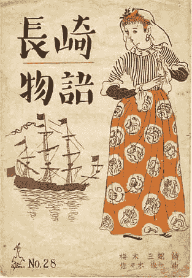

《长崎故事》乐谱封面，由 `梅木三郎` 作词，`佐山顺一` 于 `1939 年` 作曲。由长崎县 `宫川先生` 谢借。

尽管 `Haru` 既不是贵族女儿也不是领主后裔，而“贾加塔拉公主”只是这位被称为修辞学家的作者标志性的华丽辞藻，但她一定是一个美丽的混血女孩。《长崎故事》乐谱封面上由一位匿名画家描绘的肖像为我们提供了一个良好的形象。

`1921 年` 访问过同一地点的 `德川义千直` 侯爵，在他著名的旅行游记《爪哇游记》中这样写道：

> “当幕府政府在 `宽永` 15 年 9 月（`宽永` 16 年即 `公元 1633 年`）禁止基督教时，在那些不愿改教并被逐出长崎的人中，有一个名叫 `小春` 的女孩。在异国他乡流亡思念日本，她希望种植父母家乡的植物，以此怀念她再也无法回去的家园。她写了一封信请求一些种子，并通过一位荷兰船长（kabitan）寄出。这封信告诉我们她是多么孤独和怀旧。一定还有许多其他人对命运怀有怨恨，他们的骨骸埋在这片土地上。”

尽管这是一个适合被改编为 *义理*（joururi，剧性叙事）或 *浮世草*（*ukiyo-zoushi*，关于瞬息生活的插图书）的故事，但 `近松左卫门` 既没有写剧本，`原斋鹤鹤` 也没有出版过画册，不像明治复新时期的《国亲》（柯政英之战）和开国故事。`西政光`（Coxinga，中国父亲和日本母亲，生于长崎）曾对抗清朝。

Haru 信件的原件现已不存，但几封从日本被驱逐者寄来的当代信件保留了下来。尽管《长崎夜话》（`Nagasaki Night Tales`）生动地记录了如宽永十二（1630 年）“禁止出海”以及次年“蛮夷之子被驱逐”等事件，并被视为可靠的历史资料，但这封超过 3000 字、引用了大量古诗散文词句并以古典风格撰写的信件，是否真的出自一名十七岁少女之手，在西川去世后不久就被其弟子山村才助（`Saisuke Yamamura`）和著名的荷兰语学者大月玄斋（`Gentaku Ootsuki`）提出了质疑。

另一方面，上述的竹越五郎（`Yosaburo Takekoshi`）在 1926 年为一份期刊发表了名为《雅达拉公主的悲剧》的文章，内容如下所示：

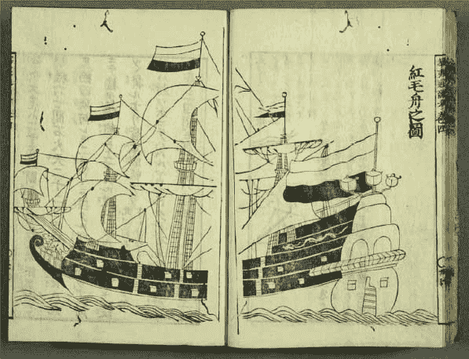

西川洋（`Nyoken Nishikawa`）书中的荷兰船。西川琼斋（`Kyurinsai Nishikawa`）编，《外迹风记》——增订版第 1-5 卷，《接述堂》，京都，1708 年。由早稻大学图书馆特谢，源自：[`archive.wul.waseda.ac.jp/kosho/i13/i13_00581/i13_00581_0004/i13_00581_0004.pdf`](http://archive.wul.waseda.ac.jp/kosho/i13/i13_00581/i13_00581_0004/i13_00581_0004.pdf)。

> “最近，有人从这种观点对[春《雅达拉信》作者]的真实性提出了质疑，认为如此精妙的信件不可能是出自一个小女孩之手，但我并不认同。首先，一位虔诚、纯粹的学者洋（`Nyoken`），他在新濑斋（`Hakuseki Arai`）之前就致力于向日本人介绍西方情况，他绝不是那种会伪造作品的人。其次，没有理由认为只有受过高等教育的学者才能写出留下深刻印象的信件。即使是一个女孩，在对家乡、家庭和朋友的极度悲伤中，也能用她的笔触（或钢笔）触动人心。第三，我的朋友古贺先生发现了一份证明‘春’存在的家族死亡登记簿。”

关于《长崎夜话》中的查询信件，岩冈（`Iwao`）教授在 1987 年的书中书中写道¹⁰：

> “关于雅达拉人物状况的详细描述以及对她在长崎的亲属的关怀应当是真实的。西川比春小 22 岁，他早前的 51 年与春的人生重叠，他一定听过这封信或亲眼见过它。他可能重写了这封信，以引起观众的兴趣。”

## 春的生活

虽然《长崎夜话》是日本关于春信息的唯一来源，但许多证明她是真实存在过的人的文件保留在荷兰方面。在明治到昭和时期，日荷关系史的先驱村上直次郎（`Naojiro Murakami`）博士在海牙国家档案馆的“布雷达号”布船船（`De Breda`，1639 年从长崎出发）的乘客名单中发现了“春”的名字，并在巴达维亚的地区档案馆发现了春的结婚证及其他一些文件¹¹。该领域的研究随后由叶井环（`Madoka Kanai`）教授、岩冈一（`Seiichi Iwao`）教授等学者继续进行。特别是岩冈教授在 1925 年至 1939 年间多次访问巴达维亚调查了大量文献，并发现了一些由春本人签署的合同和遗嘱。因此，春的人生轮廓已揭晓（见表 1）。

参考岩冈教授的研究，显然，早期竹越五郎、德川侯等人对春的评价充满了推测和假设。《长崎夜话》本身似乎存在一些错误，尽管它整体上描述了真实情况。首先，序言中提到春是由母亲亲属抚养的，暗示她是孤儿，但实际上她的母亲还人世，并和春以及另一个女儿万（`Man`，玛格丽娜）同乘同一艘船。结尾处描述春嫁给了一个中国人是不真实的，因为她的丈夫是一个名叫西蒙斯·西蒙森（`Simons Simonsen`）的年轻人，出生于长崎的欧洲父亲日本母亲，和春一样被驱逐到了巴达维亚。死亡年龄相差四五年，尽管这可能并不重要。

让我们看看《长崎故事》的话，它对这个故事的普及的影响最大。

| 日期 | 事件 |
| :--- | :--- |
| 1681 年 7 月 5 日 (天华元年) | 向日本又寄了一封信（由西蒙的遗孀小春签名）。 |
| 1692 年 5 月 20 日 (元禄五年) | 遗嘱。 |
| 1697 年 3 月 20 日 (元禄十十年) | 修订遗嘱。 |
| 1697 年 4 月 | 享寿十四岁去世。 |

摘录自：岩生成一「続・南洋日本町の研究」，岩波书，1987（Seiichi Iwao, A sequel to: The study on the Nangyang Japanese town, Iwanami-shoten 1987）。

四子四女，如果加上白石女士发现的一份洗礼证书中的孩子（白石广子「じゃがたらお春的消息」，勉诚出版，2001）。

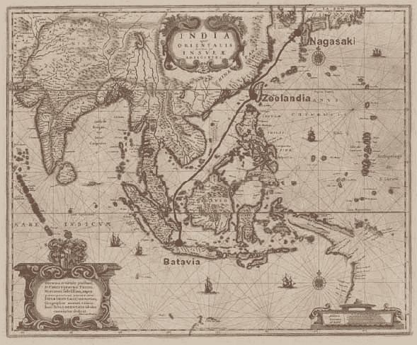

`De Breda` 号经由泽兰迪（Zeelandia）从长崎前往巴达维亚（Batavia）的海路（1639 年）。该地图采用了由亨德里克·洪丢斯（Hendrik Hondius，1597–1651，阿姆斯特丹绘制的《所谓东方印度及邻岛》（India quae orientalis dicitur, et insulae adiacentes），由澳大利亚国家图书馆提供，来自馆藏品编号 RM 174。印刷年份 1639 年与小春等其他被逐者从长崎出发的年份相吻。航线（估计）由本文作者添加。

当时贾加塔拉（Jagatara）的情况如何？自从荷兰人首次建造第一座堡垒已过去二十年，港口往来船只繁忙，城镇发展迅速，人口从 1620 年的 2000 人增加到 1632 年的 8000 人。

## 贾加塔拉的起源

让我们简单回顾一下历史。位于里汶河（Ciliwung River）河口的港口是现今雅加达的前身，自塔鲁曼纳加拉王国（Tarumanagara Kingdom）时期以来就是一个重要的港口，该王国在 4 至 8 世纪繁盛，后来被称为苏达加拉帕（Sunda Kelapa）。在 15 至 16 世纪，它是帕贾加拉拉王国（Pajajaran Kingdom，1482–1579）的主要外港，其首位于帕宽（Pakuan，现今波哥），1513 年第一艘葡萄牙船抵达此处时，开始与西方国家进行直接贸易。当时，在中爪哇崛起的穆斯林人已摧毁了马芝伯特王国，并夺取了帕贾加拉拉领土东北部的井也汶。为了防止伊斯兰力量进一步扩张，帕贾加拉拉于 1522 年与葡萄牙签署了防御条约，但在葡萄牙堡垒尚未建成之前，由法塔希拉哈（Fatahillah，别名 Faletehan）领导的穆斯林人于 1527 年进攻了苏达加拉帕，在此之前他们已占领了位于帕贾加拉拉领土西部的另一个良港——万丹（Bantam）。之后，葡萄牙人无法与内陆的帕贾加拉拉取得联系，并继续以早于 1511 年获得的马六甲（Malacca）为基地在东印度群岛活动（直到 1641 年被荷兰人夺）。帕贾加拉拉的首府帕宽落入穆斯林之手，王国于 1579 年灭亡。在 1617 年于中国明朝出版的书籍张燮的《东西洋考》卷三中，正确地写道：

> 加拉帕（Kelapa）是万丹的属地，从万丹出发半天路程即可到达。

苏达加拉帕被法塔希拉哈更名为雅加加塔（Jayakarta，字面意思是“大胜利”），或简称为雅加达（Jakarta）。雅加加塔在欧洲被误读为 Jaccatra，在日本则被演变为 Jagatara。西川如轩（Nyoken Nishikawa）为 Jagatara 使用的三个汉字（咬𠺕吧）是 Kelapa（Sunda Kelapa）的音译，在日本长期被用于称呼该城镇，甚至在 1619 年它再次更名为巴达维亚（Batavia）后，很长内仍被用来指代爪哇。

1596 年，一艘荷兰船首次抵达万丹港进入爪哇。这一事件比“秘爱号”（De Liefde）抵达日本早了四年，“秘爱号”在现大分县臼杵（Usuki）岸失事，最初 110 名船员中有 24 人幸存，包括船长雅各布·奎肯内克（Jacob Quaeckernaeck）、航海扬·约斯滕（Jan Joosten）以及出生于英国的海员威廉·亚当斯（William Adams）。扬·约斯滕以现今东京的地名“叶旭”记住，而威廉·亚当斯则以他的日本名三浦安（Anjin Miura）闻名。荷兰人首次前往东印度之旅同样艰辛，因为获得的胡椒不多，且受到了葡萄牙人的干扰，葡萄牙人早在一个世纪前就开始活跃亚洲，于 1498 年到达加尔各答并在 1511 年在马六甲建立基地。1603 年，在毛毛·范·拿骚（Prince Maurits van Nassau）亲王的授权下，荷兰人建立了东印度公司（VOC），这被认为是现代股份公司的雏形，并派遣了强大的舰队并在万丹开设了贸易行。

为了避免与万丹的英国人的冲突，他们在 1611 年在雅加加塔建造了一座新堡垒，并在那里设立了贸易中心。1619 年 2 月，英国人与万丹地方总督雅加加塔勾结攻击了荷兰人的堡垒。当时荷兰东印度公司总督扬·彼得斯·科恩（Jan Pieterszoon Coen）因预料到英国人的袭击，于去年 12 月临时撤退到香料群岛的安汶汶（Amboyna）。尽管彼得·范·布鲁克（Pieter van Broecke）竭力保卫堡垒，仍落入英国人之手。科恩于 5 月带着重新装备的舰队返回，在激烈战斗后夺回了被占的堡垒并控制了该城镇。他建造了一座新堡垒“巴达维亚堡”（Fort Batavia），并根据荷兰人的拉丁语“Bataaf”将城市也命名为巴达维亚。1628 年至 1629 年，中爪哇崛起的马打拉拉王国国王苏阿贡两次进攻巴达维亚，但成功击退了敌人，巴达维亚成为荷兰人在东印度群岛活动的据点。

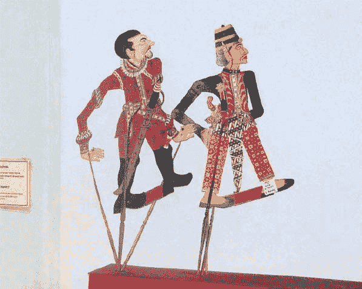

苏阿贡与扬·彼得斯·科恩的雅加塔拉皮偶。由井口光于 2006 年 9 月在雅加达历史博物馆拍摄。

左侧的板解释道：“雅加塔拉讲述了马打拉拉王国国王苏阿贡于 1628 年和 1629 年入侵由荷兰人控制的巴达维亚的故事。”雅加塔拉是一种新型皮影戏，描绘了新马打拉拉王国的历史片段。

## 日本人的移民

从 16 世纪中叶到 1639 年幕府政府颁布《锁国令》期间，有若干日本人乘坐葡萄牙船只和 `Goshuin-sen`（政府许可船只）前往东南亚，但定居在那里的人数并不多。荷兰人在 1609 年于平户开设贸易行所后，招募了日本男性来填补亚洲劳动力和军事力量的短缺，在 1613 年至 1621 年间，正式签约的移民人数多达 225 人。

当那些绕过好望角并登陆印度和东南亚沿岸的欧洲人惊讶地发现远东存在着一个高度文明的社会时，那里有许多具备读、写、算能力的文职人员，而欧洲的大多数普通人甚至不识字。在寺庙和城堡建筑中接受训练的工匠技艺优于欧洲的大师，而且，自由武士都是在战乱时代经历过实战的英勇汉子。事实上，在 `Coen` 夺回 `Jayakarta` 堡垒的军队中，除了 400 名荷兰士兵外，还有 50 名日本雇佣兵；而当同一堡垒落入英国盟友万丹的手中时，其防御力量中有 25 名日本人。确实，在 1618–1619 年，葡萄牙、西班牙和中国的船只遭到荷兰船的袭击，曾请求幕府禁止荷兰（及英国）船只运输日本军事人员。

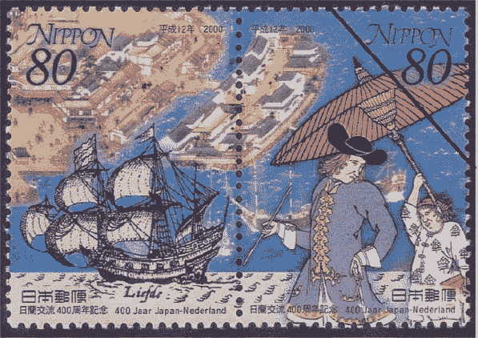

日本邮政纪念日荷通交 400 周年的纪念邮。

1600 年抵达日本的 `De Liefde` 号船，背景为 1673 年《宽永长崎屏风》中的出世岛。荷兰 `Kabitan` 带着一名爪哇仆人，出自一幅彩色木版画：《荷兰人像》，长崎绘屋，宝历时期（1751–64）。

荷兰人也招募了许多日本女性。由于当时前往遥远亚洲的航行极其危险，船队因风暴和海战损失部分船只，以及因疾病导致部分船员和乘客死亡是常便饭，因此很难期待“正常”女性（更不用说中产及以上家庭的女性）离开祖国。所有自愿来的女性都是“轻妇”，正如第一任总督 `Peter Both` 在 1612 年向 `十七绅人委员会` 请求的那样：“不要再让更多的她们[轻妇]从祖国移民了，因为那里已经有太多了，这些女性过着丑闻且毫无教益的生活，给国家带来了巨大的耻辱”。在这种情况下，男性必须在当地女性中寻找伴侣，但大多数已经信仰伊斯兰教的爪哇父母不允许他们的女儿嫁给异教徒，而嫁给葡萄牙时期产生的本土或欧亚混血天主教女性也是不被推荐的。尽管如此，宗教信仰印度教对通婚较为宽容的巴厘尼女性是理性的选择，但来自高度文明的日本的女性非常有吸引力。事实上，`Jan Pieterszoon Coen` 本人经常给平户写信，写道：“我们期待日本已婚夫妇及其孩子，以及未婚女性在适当时候抵达，如果可能，不要忘记运送未婚的日本女性[从安汶汶和班达]”等等。

## Cornelia，Cornelis van Nijenrode 的女儿

读了这样的历史后，我想起曾经在阿姆斯特丹国立博物馆（`Rijksmuseum`）看到的一幅画，它陈列在一楼主厅的中央。那是一幅家庭画像，一位荷兰绅士、他的日混妻子和三个女儿站在他们豪华的房子前。那时我只印象深刻于“那些被逐往 `Jagata` 的人中竟有这样一个嫁给荷兰人过上富生活的女孩”，但后来得知这幅画名为《Pieter Cnoll 及其家人》，由 `Jacob Coeman` 于 1665 年画就，而那位女士是 `Cornelia`，她是平户大商人（1623–33）`Cornelis van Nijenrode` 和他的日本妻子 `Surisio` 的女儿。`Cornelia` 在 1637 年去了 `Batavia`，比 `Haru` 早两年，同行的还有妹妹 `Hester`。她嫁给了 `Pieter Cnoll`，后者被升为 `Batavia` 的首席会计和港口长。在 `Pieter` 于 1672 去世四年后，她改嫁了 `Joan Bitter`，这是一个来自荷兰的新，当地人称为 `orang baru`（新移民），比她小四岁。

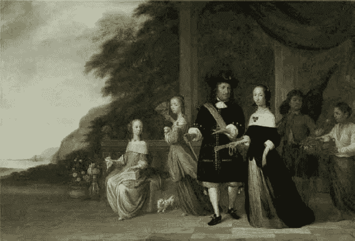

`Jacob Coeman` 1665 年画作，《Pieter Cnoll 及其家人》。

阿姆斯特丹国立博物馆：识别代码：`SK-A-4062`。由博物馆提供复制，自 [`www.rijksmuseum.nl/`](http://www.rijksmuseum.nl/)


不幸的是，他们的关系很快恶化了，因为新丈夫声称拥有`Cornelia`与其第一任丈夫积累的财产的所有权。1687 年，`Cornelia`和`Joan`乘坐不同的船只前往荷兰在法院审理此案，`Cornelia`推测于 1692 年结束了生命，正如`Leonard Blusse`所著作《蝴蝶还是螳螂？Cornelia van Nijenrode 的生平时代》（`Butterfly or Mantis? The Life and Times of Cornelia Nijenrode`）中所详细记载的那样。与画中简单的形象相反，`Cornelia`本是一个意志坚强的女性。在日文译书中，书名被改为《泼妇的斗争》（*The Struggle of Otenba*）。我得知，描述活泼且不可控女性的日本常用词“泼妇”源自荷兰语`ontembaar`，来自我在雅加达精通荷兰语并懂一点日语的朋友。尽管`Cornelia`的后半生生活凄惨，但她在失去第一任丈夫之前在`Batavia`的生活是顺遂的，正如她自己在现存的“Cornelia 的雅加达信”中所写，相比之下，`Haru`的生活则被越后良三郎和德川将军分别同情地描写为“如草木般凋零”和“怀恨而终”。参考`Iwao`教授的研究，最好想象`Haru`在`Batavia`也过过幸福的生活，只是没有回国的希望了，正如正信哲在 1996 年出版的小说《雅达的小春》（*A Novel: Jagatara O-Haru*）中无偏见地描写的那样。在白石广子于 2001 年发表的《春传说》（The Legend of Haru）中，作者假设`Haru`的生活是幸福的，并加入了自己的想象进行创作。我也想象，在抵达`Batavia`时还是梦幻少女的`Haru`和`Cornelia`都会接受命运，并勇敢地面对在新土地的新生活。

在巴达维亚，二十一岁的春嫁给了西蒙斯·西蒙森（Simons Simonsen）。他是一个年轻男子，可能出生于平户，父亲是一位乘葡萄牙船只抵达那里的意大利水手，母亲是一位日本妇女，后者和春一样曾被驱逐。尽管她在两年前失去了姐姐小曼（Man），一年后又失去了母亲，但她的婚姻生活非常顺遂，育有三子四女。丈夫曾收到过调往荷兰`VOC`（荷兰东印度公司）总部命令，但由于公司接受了他们作为亚洲人留在那里的愿望，夫妻俩留在巴达维亚。随后，西蒙斯被升为巴达维亚港口主管。虽然春在四十七岁时因病失去了丈夫，但她在那里被儿孙环绕，直到七十二岁去世，这在当时算是一个长寿。在现存的《贾加塔来信》中，有一封署名为“西蒙斯的遗孀，春”的信，其文笔平实，与《长崎夜话》中第一封优雅的信件不同，被认为是真迹。信中列有一份大量的礼物清单，如白棉布、大纹布和花纹缎子，这些是寄给她在日本的十多个亲戚；她还要求将一些白布在日本染色后寄回给她，并用她汇回的钱运一些桶日本清酒等。这证明了春在巴达维亚是非常富有的。

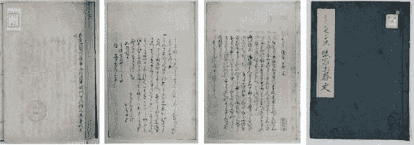

西蒙斯遗孀春的一封信。

副本取自长崎历史文化博物馆，由博物馆捐赠。从右到左依次为封面、第一页、第 11 页和第 12 页（末页）。正文结束（`p.11`）日期为 5 月 7 日，收信人为井七平（Shichibei Mine）和次郎右（Jirouyemon Mine）先生。在最后一页写着：“这是译员今村源右（Gen-yemon Imamura）持有的手抄”。从上下文判断，原件在第一页之前可能还有几段内容。

虽然包括春和科内莉亚在内的大多数日本女性都是根据他们的偏好嫁给了荷兰人，但日本男性的伴侣大多是巴厘岛和巴达维亚妇女，除了春的异母姐姐曼（Magdalena）这种罕见案例，她嫁给了日本居民中很有影响的村上武右（Buzayemon Murakami）。因此，纯日本血统在巴达维亚很少繁衍，他们的社区逐渐衰落，特别是在“红发人后裔被驱逐”之后，并在 17 世纪末几乎消失，这种情况在暹罗的大提谷和吕宋的马尼拉也发生过。[28]](#part0008_split_001.html_fn_28), [29]](#part0008_split_001.html_fn_29)

## 17 世纪的巴达维亚

春在巴达维亚生活的时光正值该市的发展时期。志里汶汶河（Ciliwung River）河口的弯曲部分被改造成笔直的大河（Kali Besar，`*lit.` 大河），城市的设计使得运河和道路像荷兰的城镇一样纵横交错。在河东岸堡垒的南方坐落着`Stadthuis`（市政厅）、一座教堂、一家医院和其他公共建筑，而西岸则是造船厂、鱼市场等。[30]](#part0008_split_001.html_fn_30)。根据岩冈教授（Prof. Iwao）发现的一份旧文献，春至少有一段时间住在河西侧的居住区。在当时安德里斯·贝克曼（Andries Beeckman）创作的画《巴达维亚堡垒（从大河西侧望去）》中可以看到城市区域尚未完全建成，许多聚集在棕榈树荫下的露天市场，一些官员在对岸城堡墙前骑马。市场周围的人形色各异，可以看到欧洲人、中国人、爪哇人以及来自周边岛屿的不同种族的人，其中也有一个看起来像日本人的男子。他们的身份和职业也各不相同。除了买卖货物的人，还有一对打着阳伞的夫妇、跳着卡卡莱莱舞（战争舞）的安汶族武士，以及一群玩着 sepa raga（土著足球）的人等。

四百年过去，巴达维亚已成为亚洲最大的现代城市之一，在印度尼西亚独立后更名为雅加达。在选取该城市历史的一些课题之前，让我们先看看春可能居住过的地方。

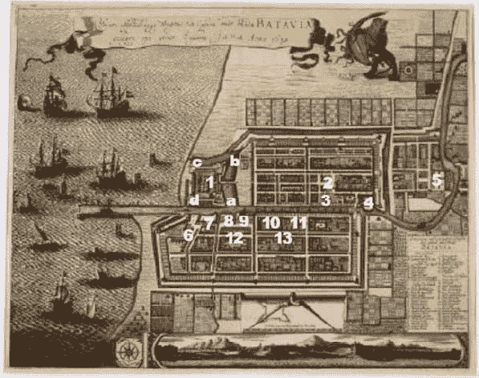

约 1652 年的巴达维亚。

地图来源：[`http://en.wikipedia.org/wiki/Jakarta`](http://en.wikipedia.org/wiki/Jakarta)（估计是由阿姆斯特丹的德·容（De Jonghe）根据其他一些类似的副本绘制的）。

注意方向，左侧指向北方。1：巴达维亚堡（a. 金刚石，b. 红宝石，c. 珍珠，d. 蓝宝石），2：`Stadhuis`（市政厅），3：新教堂，4：医院，5：总督官邸，6：广场，7：`VOC`造船厂，8：中国造船厂，9：`Pasar Ikan`（鱼市场），10：蔬菜和肉市场，11：葡萄牙教堂，12：`Jonkers Street`（西蒙斯的家就在附近），13：葡萄牙教堂（罗亚马拉卡 Roa Malaka）

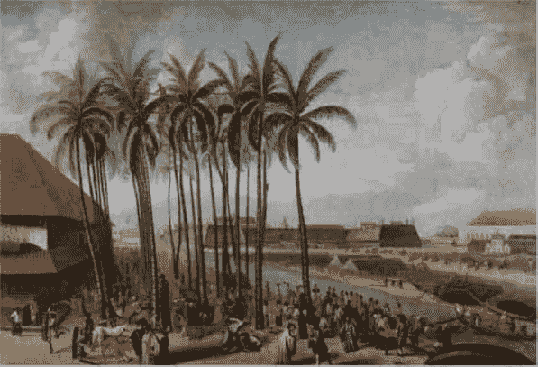

*巴达维亚堡垒*或巴达维亚城堡，从大河西侧望去，前景是`Pasar Ikan`（鱼市场）或蔬菜和肉市场，安德里斯·贝克曼作于 1656-8 年，藏于军事博物馆。

复制自[`http://nl.wikipedia.org/wiki/Andries_Beeckman`](http://nl.wikipedia.org/wiki/Andries_Beeckman)。

另一幅构图类似的画作藏于阿姆斯特丹的国家博物馆。

如果离开雅加达摩天大楼林立中心，向北走四五公里到达华人后裔聚集的格洛克（Glodok），氛围会发生变化。商店前的人道挤满了人和推车，来回穿梭的景象可能会让你想起一句老中文谚语，“肩碰车撞”。后街的购物中心建筑里满了小隔间，出售着各种电子、电脑产品和零件。这是我在住在博哥期间寻找实验室工具和需求时经常去的地方。

春的住址记录在一位名为 `Michiel Diaz Sobe` 的遗嘱中。1886 年，在该文件被发现之前，Kali Besar 西的人行道上发现了一块刻有 `Michiel T’ Sobe` 名字的墓碑，引起了历史者的兴趣。不久，这块石头被发现者阿米尼·弗朗西斯·金（Rev. Armine Francis King）带到了普拉帕坦的圣公会，并于 1911 年移至日本领事馆前院。当德川侯爵于 1921 年访问那里时，他写道：

> “领事馆前有一座墓。根据碑文，这是一位名为*Michiel T. Sobe 的日本人的墓，于 1605 年出生于长崎（庆长第 10 年），于 1663 年死于此（宽文第三年]*。从他的年龄来看，他应该是那些与*Jagatara-bumi*的运送者小春一起从长崎被流放，并在这片土地上过着委屈生活的人之一。”

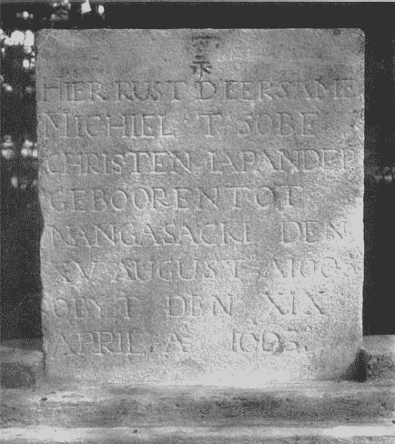

Michiel T’ Sobe 的墓碑。

出自：F. de Haan，*Oud Batavia* – *Gedenboek uitgegeven Genootschp van Kunsten en wetenschappen naar aanleiding van het driehonderdjarrig bestaan der stad 1919 (Eerste Deel)*, G.Kolff & Co., Batavia 1922。文字内容为：HIER RUST D’EERSAME MICHIEL T’SOBE CHRISTEN JAPANDER GEBOOREN TOT NANGASACKI DEN XV AUGUST °A 1605 OBYT DEN XIX APRIL A° 1663（参见文中的英文翻译。）

在由弗雷德里克·德·汉编辑并于 1925 年出版的巴达维亚 300 周年书籍《Oud Batavia》中提到：“虽然武士有姓，但 T’ Sobe 一定是一个名。Michiel 可能是一个从长崎来到巴达维亚并于 1630 年结婚的年轻人”，没有更多细节。

在日期为 1661 年 3 月 29 日的 `Michiel Diaz Sobe` 遗嘱中，描述道：

> “由于遗嘱人没有家人，他将在去世后将他所有动产、不动产、股票、债券及所有其他财产的三分之一，分别交给 Sijmon Sijmonsz（高级商人、港口主长及东印度公司特许者）、Michiel Buzayemon 和 Jan Sukezayemon，两人均为日本基督徒。此遗嘱是在河对岸 Jonker 街 Sijmonsz 先生的房子内准备的。”

Sijmon Sijmonsz 绝断不会就是春的丈夫“Simons”本人，这份文件表明 Sobe 是春的家人的密友。关于 Sobe 何时到达巴达维亚尚不清楚。他高龄时是孤身一人，尽管如果《Oud Batavia》中的描述属实的话，他可能曾结过婚。Sobe 是否对身处异国他乡感到愤恨尚未知，但他无疑是一个成功的人，因为他留下了如此巨额的财产。有趣的是，在文中德川侯爵选择了特定的汉字 `惣` 来表示 Sobe(i) 中的“so”音，这在许多音译替代方案中，是与旧文件中签名中出现的同一个汉字。当我询问作者的孙子已故的德川信信（Yoshinobu Tokugawa）先生时，他同意作者是从岩冈教授那里学到的，并在其游记于 1931 年出版时使用了这个特定的汉字，因为作者作为一名生物学家和历史学家，是一个始终追求完美的人。

墓碑在印度尼西亚独立宣言后的动荡时期消失了。由于机缘渺茫，我与一位朋友——国家博物馆的馆员 E. 女士一起访问了位于 Tanah Abang 的石刻公园博物馆（Museum Taman Prasasti）和圣公会，但没有人知道那块石头本身的情况，也没有获得任何信息。对此我非常不满意，于是准备了一份传单，上面印有那块石头的照片，以及一条关于记者有权获得报酬的消息，并在雅加达苏拉巴雅垃圾街头到处打印分发，但也没有听到任何消息。

一张由安德里斯·贝克曼（Andries Beeckman）约 1656 年绘制的“*在锁国（1639 年日本关闭国门）后留在雅加达的日本基督徒*”肖像保存至今。它是据称在十多个肖像之一，这些在他创作《巴达维亚要塞》之前被素描并安排其中的。来源文章提到，此人宗教为基督教的事实可以通过他的神职帽看出。这位具有老纯正日本面孔特征的男子穿着一件看起来类似于日本和服的衣服，脚穿一双日本草鞋，腰间插着一把日本刀，尽管确定他是一个日本居民。作品的年份约 1661 年，比 Michiel Sobe 遗嘱的时间晚了几年。

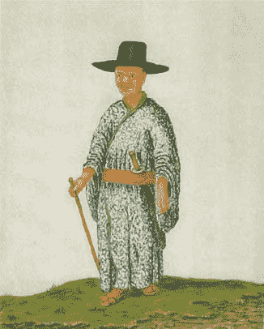

*在锁国后留在雅加达的日本基督徒*，作者：Andries Beeckman，约 1656 年。重印自：Marie-Odette Scallie, *Archipel* 54, 1998。同一论文还包括 13 幅肖像：

- 一位混血欧洲人，
- 一位中国商人，
- 一位中国工人，
- 一位中国艺术家，
- 穿着明代服的中国人，
- 一位马来人，
- 一位爪哇人，
- 一位马达人（自由奴隶后裔），
- 一位蔬菜贩，
- 一位正在捣米的妇女，
- 一位混血人士（白血病患者），
- 一位安汶武士，
- 一位 Alfour（目前定义不详）。

### 当代的巴达维亚

在大里雅河（Kali Besar）口西侧的鱼市（Pasar Ikan）区域，你会看到一座三层砖建筑。它是 1839 年位于旧东印度公司造船厂建造的一座瞭望塔，功能类似于现代机场的控制塔。位于造船厂边缘面向大海的几门古大炮，可能是防止危险船只靠近港口的准备。从现在空置的塔楼顶层，你可以看到巽达甲港的全景，码头上停泊着数百艘布吉语人的船，其中许多装满了来自加里曼丹（印度尼西亚婆罗洲岛）的木材。由于志汶河携带的泥沙淤积，巽达甲港在 19 世纪后期大型船舶出现后不再适用。随后在东五公里处的丹戎普约克（Tanjung Priok）建造了一个新港，设计参考了鹿特丹港。尽管客轮时代已经过去多年，但丹戎普约克作为爪哇岛主要的贸易港，与东爪哇苏拉巴亚的丹珍港（Tanjung Perak）并行依然繁忙。

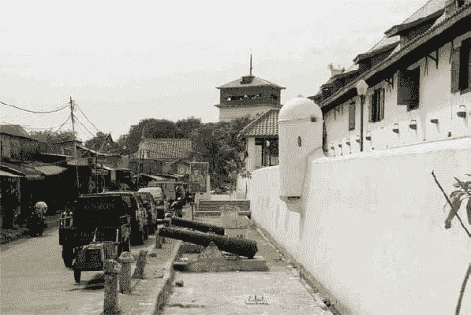

老巴达维亚地区的鱼市景观。在右侧，一处旧城墙遗迹位于旧东印度公司仓库前，现在作为海洋博物馆使用。远处可以看到巽达甲港的瞭望塔。摄影：M. Iguchi，2012 年 2 月。

在守望楼附近，仍保留着一座 `VOC` 造船厂建筑和几座旧仓库。前者已被用作餐厅，而其中一座仓库自 1997 年以来一直被用作海事博物馆。进入这座建于 1652 年、并一直到 18 世纪末不断改造和扩建的大型两层建筑，人们可能会看到由巨型柚木材锯而成的巨大木柱和横梁感到惊讶，这些木材在如今即使在丛林深处也无法寻觅。当我第一次去那里时，我想这栋建筑本身具有极高的古董价值。想象着仓库货架上摆满了肉豆蔻、胡椒、咖啡豆、茶叶和奎宁的场景，我联想到爪哇岛在古代是多么富饶。正如我在学校中学到的，在 17 世纪的欧洲，胡椒的价格重量等同于银。尽管该博物馆在一层和二楼展示的藏品（如旧船模型和旧船配件）看起来逊色于我曾访问过的海路另一端鹿特丹海事博物馆的藏品，但它们最近通过增加新展品变得更加丰富，例如一艘来自新几内亚的传统鱼船，被称为 `candik` 或 `karere`，它有一个与主船平行、间隔约三米的长浮体（外支）。

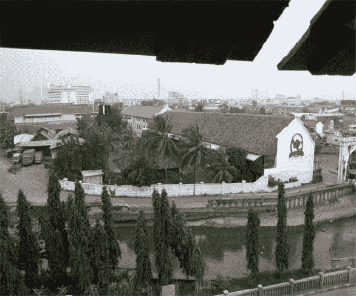

从守望楼顶层俯瞰现已作为餐厅的 `VOC` 造船厂建筑。

拍摄于 2014 年 3 月，由 T. Hirosawa 先生提供照片。

墙上的标牌一定是新的，因为上面用印尼语写着“VOC-Galangan”。

（这张照片是英文版新增的，日语版中未包含。）

在海事博物馆前，人们可以看到一段旧城墙碎片，但在河对岸已找不到旧堡垒的遗迹。根据旧地图，`巴达维亚堡`（Fort Batavia）是一种棱堡式建筑，这种结构后来在 1866 年被日本用于北海道函馆的`五棱堡`（Goryoukaku）。我有机会看到相同类型的堡垒：西爪哇省万丹（现班丹拉马）的`斯佩尔维克堡`（Fort Speelwijk）以及苏拉威西岛（塞莱伯斯）望加锡的`鹿特丹堡`（Fort Rotterdam）。虽然前者仅剩下棱堡的石结构，但后者几乎完好保存，包括其涂有白漆的石制大门、红瓦屋顶的兵营和其他设施，不同的是旗杆上飘扬的不再是荷兰三色旗，而是印尼的双色旗。想象着旧日宫廷里的士兵和百姓，我构思了旧日巴达维亚城堡的景象。尽管规模较小，但位于雅加达的马利奥波罗街、皇宫不远的`弗雷德堡堡`（`Fort Vredeburg`）也是同样的棱堡类型。尽管其内部建筑的一部分被用作纪念印尼独立的博物馆，但现在已无法感受到军事设施的氛围，因为院里的各种摊位每晚都满了人。

“钻石”是巴达维亚城堡四个堡垒之一（即钻石、珍珠、蓝宝石和红宝石），保留了名称，体现在 `Intan 路` 或 `Kota Intan`（分别意为“钻石街”或“钻石镇”）。旧堡垒的院子被平整以建造某些观光设施，北方可以看到港口的守望楼。听一位直到 1995 年都在那里住小房子的当地绅士说，一个地下室或壕沟的入口一直保留到 1997 年，我想我访问那里晚了十五年。

环绕大河（`Kali Besar`）唯一的现代建筑是`巴达维亚酒店`（`Batavia Hotel`），位于 `jalan Kali Besar Barat44–6`，于 1995 年开放。它的正面设计吸引了我，两个立柱的壁龛内各有一尊白色大理石雕像，看起来与曾存在于巴达维亚城堡南方的`阿姆斯特丹门`（`De Amsterdamse Poort`）有些相似。虽然雕塑相互对称，且与我在旧照片看到的阿姆斯特丹门上的`火星`和`密涅瓦`塑像不同，但我推测它们是模仿某些罗马神建模的。根据我在雅加达的朋友帮我查询的结果，酒店现任经理对它们的起源一无所知。在查阅书籍后，我确信那个模型正是`雅努斯`（Janus），罗马门神和万物起始之神，“一月”（January）一词便由此而来。虽然`雅努斯`通常被描绘为一个双面脸的人物，但为巴达维亚酒店工作的匿名艺术家对称地复制了身体，使其成为两个独立的雕像。仅供参考，阿姆斯特丹门的两尊雕像在 1942-45 年间被日本占领军移除并可能被毁坏，而大门本身于 1950 年被印尼政府拆除，原因是它是交通障碍。

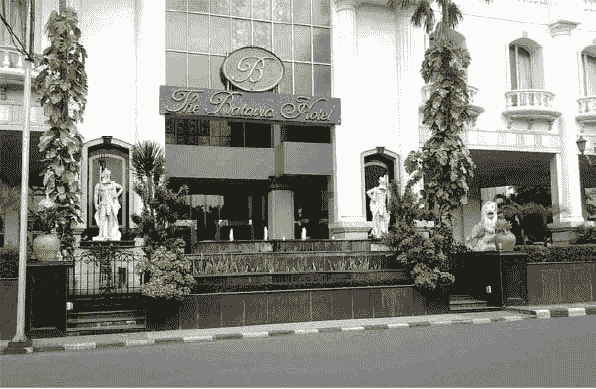

`巴达维亚酒店`的正面。由 M. Iguchi 的朋友 Ir. Arief Budhiono 拍摄，2012 年 3 月。

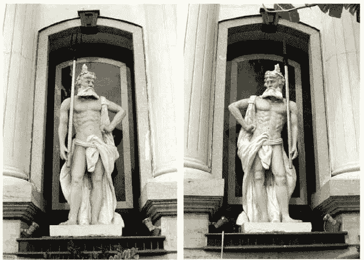

`雅努斯`的雕像。由 M. Iguchi 拍摄，2012 年 2 月。

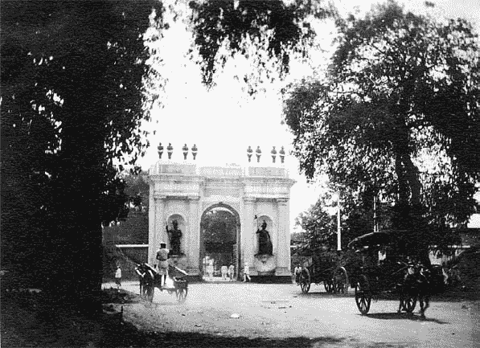

巴达维亚城堡的`阿姆斯特丹门`（1950 年拆除）。

由吉千代侯爵于 20 世纪 20 年代拍摄。

由冈川家族提供复制。

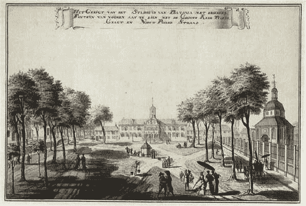

Johannes Rach 1770 年的《巴达维亚市政厅与荷兰教堂》。

复制自：Max de Bruijn 和 Bas Kist（文），*Johannes Rach 1720–83：印度尼西亚与亚洲艺术家*，印尼国家图书馆/荷兰国立博物馆。画面中心的建筑显然是“旧”市政厅，它在 1707-10 年被“新”市政厅取代，而右侧的新荷兰教堂建于 1732 年。不知道为何在这幅画中画了旧市政厅。

## 巴达维亚的发展


时间流逝，当欧洲受拿破仑·波拿巴控制时，荷兰的地位从 1795 年的联合荷兰变为巴达维亚共和国，1806 年变为路易·拿破仑加冕的荷兰王国，并于 1810 年最终并入法国。拿破仑的信徒将军赫尔曼·威廉·丹德尔斯（Herman Willem Daendels）被任命东印度总督，以抵御预期的英国入侵，并于 1806 年抵达爪哇。他执行的首项任务是改造巴达维亚。通过放弃港口附近的堡垒，他在北方 8 公里处建造了新城`韦尔雷登`，并在那里安置了一个广场，在南方 20 公里处的`米斯特·科内利斯`（Meester Cornelis，现地丁内加拉）利用旧堡垒的石材和其他材料准备了防御线。以前被称为“国王广场”（`Koningsplein`）的广场在印尼独立后更名为“独立广场”（`Medan Merdeka`），并在中间放置了独立塔。这片开放区域仍为雅加达拥挤的中心区域通风。

丹德尔斯在巴达维亚以东南方向 180 公里处还建造了一座要塞城市，位于现今万隆的山峦环绕的盆地内。他将 1810 年 5 月 10 日这一动工之日定为现今万隆市的生日。但这些还不是丹德尔斯的全部准备。1808 年，他命令在爪哇岛上修建一条长 800 公里的驿道，即`De Groote Postweg`（当地称为`Jalan Pos Raya`），连接西端的安耶（Anyer）和东端的潘纳鲁坎（Panarukan），并在一年内完工，付出了两万人的生命。尽管付出了努力，丹德尔斯仍于 1811 年 5 月卸职，因为他性格凶猛，导致行政管理并不顺利。随后是詹·威廉·詹森斯（Jan Willem Janssens）将军面对并向英国军队投降，英国军队实际上三个月后在明托勋爵（Lord Minto）带领下进入了爪哇。当 1815 年《维也纳条约》规定将爪哇及其属地归还荷兰时⁴¹，威廉一世国王决定由政府直接统治东印度，而不是将行政权托付给像以前荷兰东印度公司（VOC）那公司。因此，巴达维亚进入了一个新时代。荷兰东印度公司本身于 1799 年正式破产，但由于 18 世纪中期以来内部冲突以及股东要求的支付过额股息，公司的资产负债表早已已经开始下滑⁴²。

## 老市政厅

如果你进入这座宽约五十米、屋顶中央有一个圆顶的双层建筑，你会注意到这座建筑是由巨大的柚木柱和横梁建造的。在从入口通往后院的走廊右侧墙上挂着一块黑色大牌，上面用荷兰语用金字刻着⁴³：

> 这座政府公邸由总督约翰·范·霍恩（JOAN VAN HOORN）于 1707 年 1 月 25 日在旧建筑址上开始建造。它在总督阿布拉哈姆·范·里贝克（ABRAHAM VAN RIEBEECK）任下于 1710 年 1 月 10 日完工。

据说原建筑的设计参考了阿姆斯特丹市政厅，根据一张老照片，它似乎比现在的建筑要小。由于建筑于 1637 年建成，比哈鲁（Haru）到达早三年，她一定是在那里提交了婚姻登记表和遗嘱。现今建筑内部存放着各种与雅加达相关的遗迹，例如楼层大大厅里摆放的带玻璃门的大书架以及各种家具。在墙上展示的许多画作中，扬·彼得斯佐松·科恩（Jan Pieterszoon Coen）的肖像最为醒目。尽管印尼西亚人对这位在东印度建立荷兰势力的人持有复杂感情，但不可否认，他是为现代荷兰和东印度带来繁荣的最伟大人物之一。对我而言，令人印象深刻的是一位荷兰朋友的妻子，一位出身名门之家的女儿，静静地站着，用尊重的目光注视着那幅画。

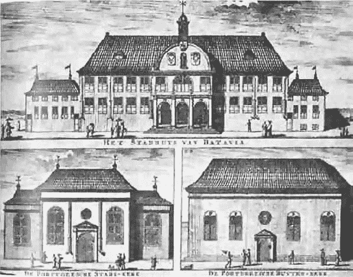

- **顶部**：1627 年建造的市政厅（`Stadthuis`）。于 1707–10 年被新建筑取代，保留至今。
- **左下角**：葡萄牙国家教堂（`Stadskerk`）。于 1808 年焚毁。
- **右下角**：葡萄牙郊区教堂（`Buitenkerk`）。现仍留存，现名为锡翁教堂（Sion Church）。

复刻自：[`en.wikipedia.org/wiki/File:Algr001disp04ill55.gif`](http://en.wikipedia.org/wiki/File:Algr001disp04ill55.gif)

## 关于巴达维亚创始人扬·彼得斯佐松·科恩的故事

尽管科恩是 1587 年出生于霍恩的纯正荷兰人，但流传着一个有趣的传说。根据 18 世纪在爪哇用爪哇语并以长诗形式写成的《萨肯德尔男爵之书》（*Serat Baron Sakhender*），科恩是一个名叫穆·詹库贡（Mur Jangkung）的人，他出生于帕贾查拉的公主坦努拉加（Tanuraga）和来自西班牙的萨肯德尔（Alexander）之兄弟苏库穆尔（Sukmul）之子。虽然获取其荷兰语译本的原件非常困难，且许多文章中的引用也是碎片化且模糊的，但有一本书书[⁴⁴](#part0008_split_001.html_fn_44)用英语详细解释了这个故事。穆·詹库贡的故事在书的第二部分。

“可能在 16 世纪中期，当由雅加加塔（Jayakarta）的普格拉南[⁴⁵](#part0008_split_001.html_fn_45)领导的伊斯兰势力侵占帕贾查拉王国（Pajajaran）领土时，一位公主逃到一座山上，在那里她被阿贾·苏卡尔西（Ajar Sukarsi）[⁴⁶](#part0008_split_001.html_fn_46)怀孕并生下一个美得惊人的女儿，名叫坦努拉加。雅加加塔的普格拉南劫持了坦努拉加，但因为她的身体构造无法与她同房。因此，她被流放到雅加达湾的一个小岛——`Pulau Putri`。井井汶（Cirebon）和马塔拉姆（Mataram）的苏丹相继夺走了她，但由于相同的原因，他们都没有成功拥有她。她被送回岛上在忧伤中生活。

在那里，苏库穆尔乘船从西班牙来到，用三门大炮[⁴⁷](#part0008_split_001.html_fn_47)买了她并带她回家。苏库穆尔与坦努拉加结婚，他们生的儿子名叫穆·詹库贡。当穆·詹库贡长大为一个著名的战士并得知自己的出身后，他决定向那些羞辱他母亲并毁她国家帕贾查拉的伊斯兰王子复仇，并带着一支十五艘战舰的舰队前往爪哇。尽管穆·詹库贡不仅受到荷兰殖民者的欢迎，还受到普格拉南的欢迎，并用从母亲那里学到的马来语与当地人融合，但他一直都在为复仇做军事准备。当他在练习时，一门大炮意外掉落在`kraton`（皇宫）的土地上，普格拉南愤怒地命令他离开雅加加塔，但他请求原谅，称这将遭受巨大的商业损失。是普格拉南本人顺应天意，搬到了山加里（Gunung Sari，位于现今雅加达边界内），以躲避荷兰人和他们的大炮。穆·詹库贡对此感到高兴，并建造了一座名为`Kuta Tai`的城堡。荷兰人进攻普格拉南，但战争陷入了僵局，因为普格拉南的弟弟普尔巴雅（Purbaja）是一位拥有超自然能力的战士加入了敌人。苏库穆尔在西班牙得知此消息后来到爪哇，向他的儿子提供了建议。当金币而不是大炮弹被射向`山加里`时，雅加加塔的士兵跑出去捡钱。随后，真正的大炮弹击中将他们击倒。顺应天意，充满恐惧的雅加加塔普格拉南退到了雅加达南方的山区，但他的军队很快离开了。他变成了一个单纯的反叛者，与当地人一起苦修，没有任何收回土地的希望。在极度悲伤中，他认为曾经出卖过苏卡尔西的女儿和帕贾查拉公主是自己的错误，并在内心自问：‘上帝对我的人生轨迹安排了什么？’并遗憾自己会被马塔拉姆的苏丹阿贡（Sultan Agung）惩罚死亡。巴达维亚的荷兰人日益壮大，开始规划建立环水城市。西里翁（`Ciliwung`）被纳入了城市之中。”

在上面的故事中，提到 Mur Jangkung 并非来自荷兰，而是来自西班牙。这是因为在描述 Sukmul 家族谱系和欧洲局势的长诗第一部分，西班牙被置于荷兰的控制之下。荷兰的首任总督是 `Nakoda`（字面意思是“船长”），他出生时就从母亲的子宫中割出来。尽管他是个孤儿，但在战斗中声名显赫，并作为商人变得富有，他娶了十二位国王的女儿为妻。这些妻子无法生育，但当 `Nakoda` 去山里向隐士 `Mintuna` 寻求帮助时，其中十一位妻子怀孕并生下了十一个儿子，这些儿子后来都成为了公司（`VOC`）的董事会成员。当时没有生孩子的妻子是来自 Ngabesah 的 `Sang Retna`（雷特娜公主）。她一直受到丈夫的冷落，被赶到厨房处分开生活，但在十四年后，她产下了一个贝壳，从中生出了双胞胎儿子——`Sukmul` 和 `Sakhender`。十四年后，`Sakhender` 被 `Mintuna` 唤去拜访后者的隐居。他几乎被隐士吃掉，但成功杀死了他。`Sakhender` 去了西班牙，受国王委托成为一名卓越的战士并与公主结婚。随后，他赢得了一场重要的战争^(48。西班牙国王是 `Nakoda` 失散多年的兄弟这一事实被揭开，王位给了 `Sakhender`。尽管西班牙在 `Sakhender` 的统治下繁荣，但过段时间后，`Sakhender` 离开西班牙前往爪哇，那里的贸易也非常发达，并将王位交给了 `Sukmul`。在爪哇，`Sakhender` 成为马塔兰苏丹的属属。

`Sakhender` 的冒险得到了魔王 `Singgunkara` 魔法力量的支持，以及几位随从，包括 `Kaseber` 和 `Shuruman`——这对兄弟几乎同时从母亲侍女产生的一颗芒果核中出生；此外还有一匹名为 `Sumbrani` 的马（据说是 `Sakhender` 的兄弟）以及一只名为 `Garuda` 的鸟（据说是 `Kaseber` 的兄弟）。事实上，这个故事让我们想起了某些《阿拉伯夜谭》。

从《Sakhender 之书》中可以推导出如下的家族树。

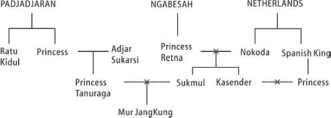

根据这份族谱^(49]，可以存在这样一个假设：拥有帕贾加拉血统的 `Mur Jangkung`（或 `Jan Pieterszoon Coen`）回到了母邦，而非征服雅加加达。这本书写成时，已经是爪哇人首次接触荷兰人的 200 年后，后者本应该熟悉关于欧洲历史的正确知识。为什么会创造这样一个不现实的故事？主要的答案可能是：“它是虚构的”。至于作者为什么要写下这样一个可能为外国人入侵提供辩护的寓言，有一种解释是，这对于爪哇人（中爪和东爪哇）来说并不重要，因为巽达之地或爪哇岛西部地区被视为异国土地^(50]。另一种说法是，自决思想作为一种政治原则，直到第一次世界大战后才在长达 2 万年的人类历史上由当时的美国总统 `Woodrow Wilson`（伍德·威尔逊）提出。

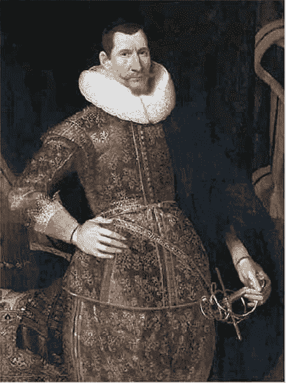

*Jan Pieterszoon Coen 的肖像*。

复制自：[`commons.wikimedia.org/`](http://commons.wikimedia.org/)

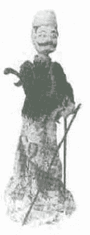

`Mur Jangkung`（`Jan Coen`）的木偶戏木偶

复制自：[`indonesia.elga.net.id/wayang/`](http://indonesia.elga.net.id/wayang/)

### 古老荷兰教堂的持久魅力

位于市政厅（`Stadthuis`）前院（`Taman Fatahillah`）左侧（西）的木偶博物馆内收藏了大量的木偶（wayang golek）和皮影戏（wayang kulit），它们不仅用于表演经典的《摩诃婆罗》和《罗摩衍》，还用于半现代剧目。虽然我在照片中看到的 `Mur Jangkung` 木偶不幸地没有找到，但那里有一对有趣的木偶：穿着军服的 `Jan Pieterszoon Coen` 和穿着传统服饰的帕贾加拉王国国王 `Prabu Siliwangi`，他们面对面立。从历史角度看，他们本没有机会见面，因为该王国在 `Coen` 到达之前的四十年就已经灭亡了。推测可能有一个虚构故事让这两位著名人物相遇，但博物馆的馆长对此并不确定。

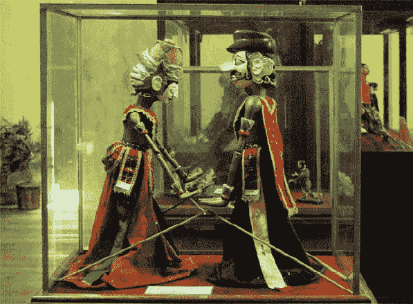

木偶戏木偶。

`Siliwangi` 国王（左）和 `J. P. Coen`（右）。

木偶博物馆，由 `M. Iguchi` 于 2007 年拍摄。

在同一栋建筑内，令我感到奇怪的是许多像墙板一样放置在底层楼走廊墙上的墓碑，其中最大的一块刻有 `Nakoda` 的铭文。正如前面提到的，这里是 `Jan Pieterszoon Coen` 教信徒聚集的，地^(51]。`Nakoda` 在受洗后皈依了新更教^(52]，并在周日参加该教堂。正如我今天看到的旧婚礼风格，在 `Haru` 的婚礼期间，宾客们聚集在新娘和新郎周围的教堂前。

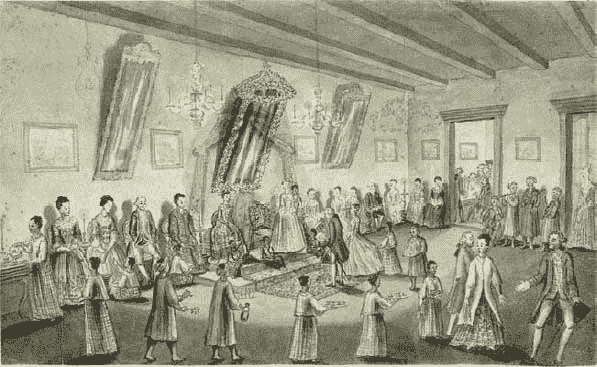

*雅加达（婚礼场景）*，由 `Jan Brandes` 创作（约 1778–85 年）。

阿姆斯特丹国家博物馆，代码：`NG-369`。由博物馆慷慨提供照片。

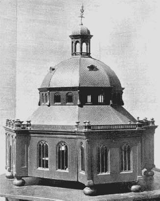

荷兰教堂模型（现位于雅加达历史博物馆）。

复制自：`F. de Hahn，《老雅加达第一部分》，`G.Kolff & Co.`，雅加达，1922 年。

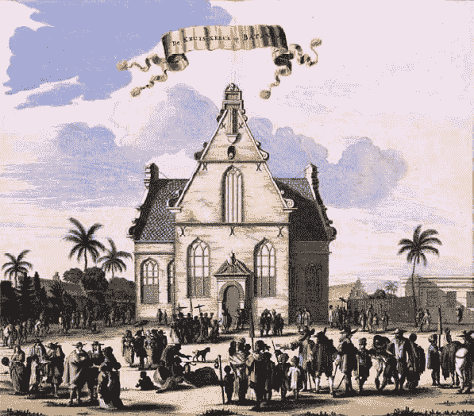

`De Kruiskerk`（十字教堂），由 `Johan Nieuhoff` 于 1682 年绘制。

复制自：[`www.onderwijsbeeldbank.geheuvannland.nl/`](http://www.onderwijsbeeldbank.geheuvannland.nl/)

根据 `Haru` 丈夫 `Simonsen` 的社会地位，我假设他们也被埋在同一个墓地，但院子里只剩下几块总督级的墓碑。虽然据说许多其他的被移到了 `Tanah Abang` 现在的 `Museum Taman Prasasti` 博物馆，但我没有找到 `Haru` 时代的墓碑。在十字教堂的原址上，加加尔派改革教堂（`Gereformeerde Kerk` 或 `Nieuwe Hollandsche Kerk`）建于 1736 年，但于 1808 年关闭。同一教派的宗教中心转移到了 1835–9 年建于新市中心 `Weltevreden` 的 `Willemskerk`（现为 `Gereja Immanuel` 或 `伊曼纽教堂`）。

[¹] 英文诗句为作者的尝试性译文。`Jagatara` 是日语中 `Jayakarta`（现今的 `雅加达`）的变体。它在欧洲被演变为 `Jaccatra`（见第 35 页正文）。“O-”是旧日本时代用于女性女性名字的常用前缀，但在现代已不再使用。

[²] 位于长崎的一个人造小岛，面积仅为 1.31 公顷。在 1639 年驱逐葡萄牙人后，该岛被用于荷兰人在 1641 年至 1859 年间作为贸易据点。

[³] 竹越与三郎，《南国记》，二酉社 1910（竹越與三郎「南國記」, 二酉社 1910）。

[⁴] 德川义亲（M. Iguchi 译），《じゃがたら紀行》，ITB Press, Bandung 2004 / 德川义亲（Ririn Anggraeni 和 Apriyanti Isanasari 译），《Perdjalanan Moenoedjoe Jawa》，Penerbit ITB 2006（徳川義親 「じゃがたら紀行」, 郷土出版社 1931（十字屋書店 1943, 中公文库 1975）。

[⁵] `Kabitan` 是葡萄牙语单词 `Capitão` 的变体，指外国商行的首领，起源于日本的葡萄牙时代（1543–1639）。该词被用于称呼荷兰首席商人（最早于 1600 年抵达），而非荷兰语单词 `Opperhoofd`。

[⁶] 西川正休（编），《长崎夜话草》，柳枝轩，京都 1720 [载：三岛才二编「南蛮稀闻账」，潮文阁 1929；西川如见《町人囊·百姓囊·长崎夜话草》，岩波文库 1942（西川正休 (編）, 「長崎夜話艸」, 柳枝軒, 京都 1720 [载：三島才二編「南蠻稀聞帳」, 潮文閣 1929; 西川如见「町人嚢・百姓嚢・长崎夜话草」, 岩波文库 1942]）。“正休”是西川如见的笔名。

[⁷] 西川如见，《町人囊·百姓囊·长崎夜话草》，岩波文库 1942（西川如见「町人嚢・百姓嚢・长崎夜话草」, 岩波文库 1942）。红毛（`Koumou`）指荷兰人，偶尔指英国人，而葡萄牙人和西班牙人被称为“南蛮”（`Nanban`）。

[⁸] 日本的雅称或诗名。

[⁹] 竹越与三郎，《实生活》，第 2，1916 年 11 月（竹越與三郎, 「實生活」 No.2, Nov. 1916）。此处引用的荒井白石是江户中期杰出的学者和官员。他曾审问乔瓦尼·巴蒂斯塔·西多蒂（Giovanni Battista Sidotti），后者是一位违反《禁教令》来到日本的意大利神父。荒井白石根据从西多蒂处获得的知识，于 1715 年编写了《西洋纪风》。古贺十郎（古贺十郎）是一位热诚的长崎洋学学者，出版了《长崎洋学史 上、下》（长崎洋学史, 上, 下），1969 年，长崎文轩社及其他书籍。

[¹⁰] 岩生成一，《续·南洋日本町的研究》，岩波书 1987（岩生成一「続・南洋日本町の研究」, 岩波書店 1987）。

[¹¹] 金井圆，《日兰交渉史的研究》，思文阁 1986（金井圓「日蘭交渉史の研究」, 思文閣 1986）。

[¹²] 藤城薰，《长崎年表》（藤城かおる「长崎年表」），[`f-makuramoto.com/01-nenpyo`](http://f-makuramoto.com/01-nenpyo)。

[¹³] “1614 年：11 座基督门教堂被毁”记载于内桥润（编）《长崎年历两面镜》（长崎年历两面鏡），1828 年。这份极其罕见的年表副本由香川大学图书馆提供支持。

[¹⁴] 建造于 1637 年，于 1638–57 年间投入使用。载重 1,050 吨，船员 300 人。[`www.vocsite.nl/schepen/detail.html?id=11501`](http://www.vocsite.nl/schepen/detail.html?id=11501)。

[¹⁵] 1662 年被郑成功攻入陷落（见第 31 页正文）。新宫正春，《泽兰贾城》，新人物来社 1989（新宫正春「ゼーランジャ城」, 新人物来社 1989）。

[¹⁶] 金井圆（脚注 11）。

[¹⁷] 中文文本：加留[Kelapa], 下港[Bantam] 到。张燮，《东西洋考卷三》，1617（張燮 「東西洋考 巻三」），[`ctext.org/wiki/pl?if=en&res=87006`](http://ctext.org/wiki/pl?if=en&res=87006)。


## 注释与参考文献

[¹⁸] 6 月 22 日被定为现今雅加达市市庆日。一些历史学家并不认同，正如报纸中 Alwi Shahab 提到的：“雅加达日期必须更改”，《雅加达邮报》（6 月 23 日 [`www.thejakartapost.com/news/2004/06/23-anniversary-date-must-be-changed`](http://www.thejakartapost.com/news/2004/06/23-anniversary-date-must-be-changed)）。

[¹⁹] 岩生成一，《续·南洋日本町的研究》，岩波书店 1987（岩生成一「続・南洋日本町の研究」, 岩波書店 1987）。在葡萄牙时代（1543–1639），`Kabitan` 是指代外国商行的首领，起源于日本的葡萄牙时代。该词被用于称呼荷兰首席商人（最早于 1600 年抵达），而非荷兰语单词 `Opperhoofd`。（注：此处为对应原文逻辑翻译）

*(注：原文第 19 处内容与第 5 处重复，已按要求处理翻译)*

³⁷ 《雅加达邮报》，《旧荷兰造船厂现成潮流咖啡馆》，《雅加达邮报》（2000 年 9 月 16 日），[`www.thejakartapost.com/news/2000/09/16/exdutch-shipyard-now-trendy-cafes.html`](http://www.thejakartapost.com/news/2000/09/16/exdutch-shipyard-now-trendy-cafes.html)

³⁸ Adolf Heuken SJ，《雅加达遗迹》，Cipta Loka Caraka，雅加达，2000 年。

³⁹ 火星是罗马的战神和农业之神，而密涅瓦是诗歌、医学、智慧、商业和艺术的女神。他们分别对应希腊神话中的阿瑞斯和雅典娜。

⁴⁰ C. Scott Littleton，《神、女神与神话》，第 6 卷，Marshall Cavendish，2005 年；Christopher Irving，《神话教义：异教神灵、女神与英雄的简史（1822 年）》，Kissinger Publishing, 2010 年。

⁴¹ 被英国占领的好望角殖民地和锡兰未归还。归还的南荷兰在 1830 年作为比利时王国独立。

⁴² Madoka Kanai，《现代日本与荷兰》，University of Air 1993 年（金井圓「近世日本とオランダ」，放送大学 1993 年）；Kozo Shinano，《荷兰东印度公司的历史》，Doubunkan-shuppan 1988 年（科野孝蔵「オランダ東インド会社の歴史」，同文馆出版 1988 年），等等。

⁴³ 荷兰语：“Dit Stad-huis is na het af-breeken van het oude begonnen den 25sten Januari A° 1707 onder de Regeeringe van den Heere Gouverneur Generael JOAN van HOORN” —— “这座市政厅在旧建筑拆除后，于 1707 年 1 月 25 日在总督约翰·范·霍恩（JOAN van HOORN）先生的执政下开工”——“En vol-bouwt onder the Regeeringe van den Heere Gouverneur Generael ABRAHAM van RIEBEECK, den 10den July A° 1710” —— “并在总督里克（ABRAHAM van RIEBEECK）先生的执政下，于 1710 年 7 月 10 日完工”。

⁴⁴ M. C. Ricklefs，《曼库库米苏丹下的雅加达 1749–1792：爪哇岛分裂史》，牛津大学出版社，伦敦 1974 年。

⁴⁵ Pangeran = 王子或领主。

⁴⁶ 一个名字“Ajar Sukaresi”出现在名为“巽达民谣”（Pantun Sunda）的巽达传统诗歌《Ciung Wanara》中，作为佩尔马纳·库苏玛（Sang Permana Kusumah，Ciung Wanara 之父）成为隐士后的圣名（*参见*第四章）。拼写非常相似，但作者不知道他是否与“Ajar Sukarsi”是同一个人。

⁴⁷ Guntur Geni, Ki Pamuk 和 Njai Setomi。他们分别被转移到马达拉姆（梭罗）、万丹和日里汶，并成为那地的宝物。

⁴⁸ 敌人可能是 Ngabesah，他是 Sukmul 本人的祖父，要求一位与英国、法国、中国等结盟的公主。在一种推测中，Ngabesah 是阿比西尼亚（埃塞俄比亚）。

⁴⁹ 女王吉杜（Ratu Kidul）是家族谱左侧帕雅加真的后裔，传说中的南海女王，她与《Sakhender 书》无关。在各种版本中，一种传统说：“斯伦根女神（Dewi Srengenge）是蒙丁拉雅·旺基（Mundinglaya Wangi [Siliwangi]）的女儿，她被逐出宫廷是因为遭受了国王二妃穆蒂亚拉（Dewi Mutiara）所用巫师的黑魔法导致的皮肤病，二妃希望她的儿子成为继承人。当斯伦根女神到达南部海岸（印度洋）并在海水中沐浴时，她的病治愈了，并获得了非凡的美貌。同时，她获得了超自然力量，成为了罗罗吉杜女王（Ratu Roro Kidul），或南海女王”（Argo）。……（注：原文此处存在大量重复文本，已按要求仅翻译核心内容）。

根据同一本书，曾有一种观点认为 `Si Jagur` 是一个男人，也被称为 `Kyai Setomo`，并且“当他与他的未婚妻在万丹（现在的万丹拉马）结婚时，爪哇将通过击败并驱逐外来势力获得独立”，尽管实际上，他们一直保持分离直到今天，即使在印度尼西亚独立六十五年后也是如此。在`万丹拉马博物馆`的前庭院里，我看到一尊名为`Ki Amuk`（或 `Ki Pamuk`）的大炮，它的尺寸和形状上与 `Kyai Setomo` 匹配，但没有加装炮槌；据《万丹苏丹国》3 提到，`Ki Amuk` 是雄性的，而雅加达的另一尊是雌性的，这与《爪哇之旅》中的描述相反。无论如何，根据 19 世纪著名的梭罗（宫廷诗人 `Ranggawarsita` 在手稿中所写并在其他地方被引用的传统，拥有男性头衔的 `Kyai Setomo` 正是那一个男人，而他的伴侣是住在梭罗的 `Nyai Setomi`。故事大致如下 4：

“从前，帕加加拉的国王在梦中看到了一件声音如雷鸣般的强大武器，命令他的 `Patih` [首相] 冒着生命去寻找它。在巨大的困境中，`Patih` 与妻子 `Nyai Setomi` 一起虔诚祈求以寻求神的帮助，并且没有露面朝朝。当收到信使报告说在 `Patih` 家中发现了两件异物时，国王冲到那里认出它们正是他在梦中看到的武器。这时，他们听到一个声音，说它们是 `Kyai Setomo` 和 `Nyai Setomi` 的化身。”

“后来，马特兰的苏丹 `Sultan Agung` 听说了这些武器，命令将它们带到王室首都`卡塔苏拉`。`Kyai Setomo` 不喜欢留在那里，一天晚上独自回了雅加达。当他到达`雅加达城堡`门前时，已经是早晨，他无法继续前行。当地人视他为神圣的大炮，称他为 `Kyai Jagur`，并供奉小纸伞；被留在马特兰并迁往新首都`苏卡尔塔` [梭罗] 的 `Nyai Setomi` 在那里并不开心，经常哭泣。她流下的泪被接在一个碗里。”

作为梭罗皇室的传宝，`Nyai Setomi` 被存放在其中一座宫殿——`Keraton Kasunanan Surakarta Hadiningrat` 开放大厅的一个大箱子里，没有暴露在公众面前。在网上找到的一张照片 5 中，可以看到一个用来接 `Nyai Setomi` 流泪的小碗被放在炮口下方的地板上，尽管大炮本身的尺寸看起来相当小，无法匹配她在雅加达的爱人大炮。在 2010 年的一份另一张照片 6 中，那是在年度清洗仪式期间透过半透明窗帘拍摄的，炮径显然与 `Kyai Setomo` 相当，有一个人头大。

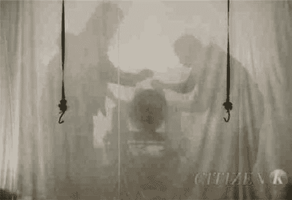

在年度清洗仪式期间拍摄的 Nyai Setomi。

KOMPAS Citizen Image 2010 年 2 月 24 日。

[`citizenimages.kompas.com/citizen/view/52937-Jamasan Maulid`](http://citizenimages.kompas.com/citizen/view/52937JamasanMaulid).

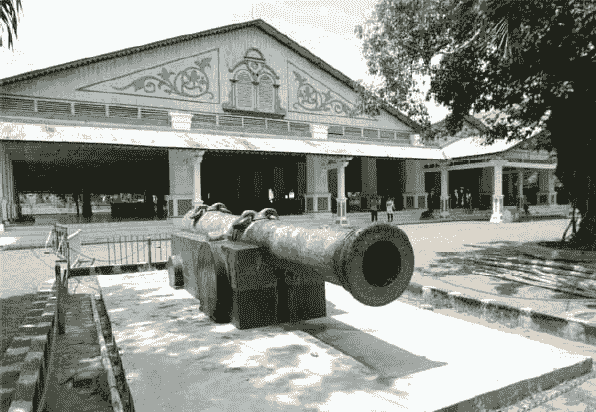

Guntur Geni，放置在 `Kraton Surakarta Hadiningrat` 前方的广场。由 M. Iguchi 拍摄，2012 年 2 月。

正如上一章提到的，`Nyai Setomi` 和 `Ki Amuk` 以及另一尊名为 `Guntur Geni` 的大炮也出现在《Sakhender 之书》中，作为 `Baron Sukmul` 从西班牙来到并获得帕加加拉皇室血统的 `Tanuraga 公主` 后给雅加达塔公主的酬劳，尽管在那个故事中 `Nyai Setomi` 的目的地不是马特兰而是日里汶。

让我们离开虚构的世界。现实中，`Kyai Setomo` 被认为是荷兰人在 1641 年进攻葡萄牙殖民马六甲期间获得的战利品 7。此外，爪哇存在的其他古董大炮也有它们自己的历史。根据 `Dr. de Graaf` 博士的一本书 8，`Nyai Setomi` 可能是 1609 年左右由葡萄牙人送给泗水苏丹的物品，随后在马特兰人占领泗水后被他们带入内陆。尽管这尊大炮曾在 1677 年布吉斯叛乱期间从宫廷（在 `Karta`）被掠夺，但在次年当马特兰-荷兰盟军收复旧首都时被夺回了。然后，它被安置在马特兰的新首都 `卡塔苏拉`。自 1746 年皇室最终迁往那里以来，它就一直保存在梭罗（Solo）。据推测 `Nyai Setomi` 这个名字源自葡萄牙属果亚的一个城镇 `St. Tome`（1510–1961），它是在那里铸造的，而 `Kyai Setomo` 的名字源自船名 `Sancta Mariam`9。也许印度尼语中称为大炮的词 `meriam` 也源于同一个词。

同一书也提到了 `Guntur Geni`。位于 `Kraton Surakarta Hadiningrat` 前方广场上是一尊巨炮，炮身长 5.3 米，直径 36 厘米。因为它的绰号 `Pancaura` 被解释为 Saka 历 1547 年。虽然这尊推测在马特兰铸造的大炮工艺并不完美，有一些裂缝和缺陷，但其爆炸声一定巨大，因此赋予了 `Guntur Geni`（字面意思是“火雷”）的名字 10。

回到雅加达，当地人有一种说法，认为不孕妇女拜访 `Si Jagur` 就能得子，因为这个名字意思是“强壮先生”或“多产”。事实上，我记得在大炮还在博物馆外时，人们会在它周围供奉花卉并焚香。在大炮炮身的背面绕着一圈铜带，上面用拉丁文浮刻着：

```
EX MEA IPSA RENATA SUM
```

我猜在这个武器上刻这句话的炮匠意图何在。对于梭罗的 `Nyai Setomi`，据说上面刻有如“噢耶稣，你是引导世人最完美的存在”之类的祈祷，并带有葡萄牙国王的符号 11。这可以被理解为炮匠真诚的愿望。

## 反叛者 Pieter Erberveld 的纪念碑

在博物馆后院的左侧（东侧），可以看到一面石墙，墙板上用荷兰语和爪哇语刻着：

> 鉴于因叛国受惩罚的 `Pieter Erberveld` 令人厌恶的记忆，从此以后，严禁在这片土地上用木头或石头建造任何建筑，或种植任何植物。
>
> 巴达维亚，1722 年 4 月 14 日 12。

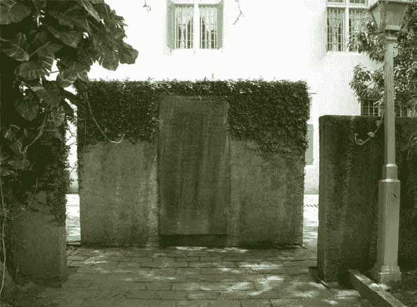

Pieter Erberveld 房屋被封的门，上面曾挂着他的头骨。雅加达历史博物馆。由 M. Iguchi 拍摄，2006 年。

这座为了纪念彼特·埃伯韦尔德（Pieter Erberveld）叛乱的纪念碑原本是他房子的一扇门，后来被水泥封死。在第二次世界大战之前，埃伯韦尔德头颅被长矛刺穿并用石膏固定，放置在门顶，曾是游客的景点。许多书中对该事件的总结写道：“彼特·埃伯韦尔德出生于六个兄弟中的幼子，父亲是一个来自德国并发家致富的富商，母亲是一位当地女性（或泰国女性）。与那些成长为得像欧洲人的哥哥们不同，彼特成了一个狂热的爪哇主义者。他与一些同谋者密谋屠杀巴达维亚（Batavia）的所有欧洲人，但阴谋被败露，他被处决了。” 细节可以在百年前由英国商人兼历史学家唐纳德·坎贝尔（Donald Campbell）撰写的《爪哇：过去与现在》¹³中找到。那段长达十页的描述非常有趣，就像剧本一样，但让我们先看大纲吧。

### 政变计划与继承之争

当彼特·埃伯韦尔德策划政变时，他可能认为作为一个普通商人之子，成为国家领导人是很困难的。这时，拉登·卡塔德里亚（Raden Kartadriya）和他来自马塔拉姆（Mataram）宫的兄弟出现了，他们野心夺权后分别成为国王和苏丹——这在正常情况下由于他们地位较低是意料之外的。彼特·埃伯韦尔德本人如果能担任爪哇最高祭司之类的职位可能就知足了。

偏离主题，自古以来，爪哇的王位继承之争非常常见。人们可能记得，在 13 世纪，辛义加萨里（Singasari）王国建立后，曾发生过三次弑君，肯·阿姆罗克（Ken Amrok）推翻了凯迪里（Kediri）国王；而在 16 世纪，马加白希特（Majapahit）因内部动乱而衰落，最终落入伊斯兰势力手中。即使是在 16 世纪建立并延续至今的新马塔拉姆王国，在 18 世纪初也发生了三场被称为“爪哇继承战争”的家族战争。1755 年，在荷兰东印度公司（VOC）的调停下，根据《甘蒂条约》，领土分为两部分：苏拉卡塔（Solo）的苏苏胡南家族和日惹（Yogyakarta）的苏丹家族。

### 迪波涅戈罗王子与爪哇战争

迪波涅戈罗王子（Prince Diponegoro）在 1825 年至 1830 年间反对荷兰人发动了所谓的爪哇战争，在印尼独立后他成为民族英雄之一，他的名字出现在许多城市的街道以及三宝垄的大学中。但他叛乱的原因不仅是他自己认为自己注定是爪哇的领导者，还由于土地权利被剥夺的贵族们的同情¹⁴。当他的父亲苏丹哈孟布沃诺三世（Sultan Hamengkubuwono III）于 1814 年去世时，王位并没有传给他，而是传给了他的异母弟弟，尽管他是苏丹的长子，因为他的母亲是一个出身低微的女性，而被任命为新苏丹的顾问。这是根据英国时期（1811–15）统治爪哇的斯坦福德·拉斐尔（Stamford Raffles）的建议安排的。当新苏丹在 1823 年早逝时，他同样再次没有机会。战争初期，迪波涅戈罗的军队利用游击战成功让荷兰人陷入窘境，但形势很快变得对他不利。当他出现进行谈判时，由于他没有放弃自称的苏丹头衔而被俘了。一位苏丹家族的后裔曾对我悄说，迪波涅戈罗在家族中被视为麻烦制造者。

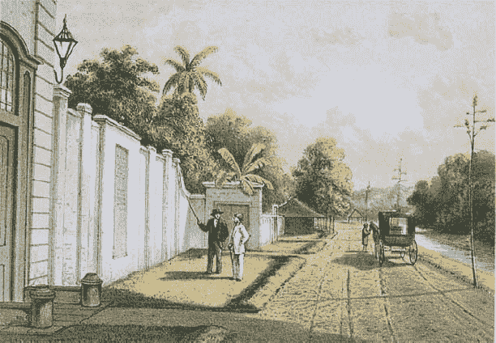

*彼特·埃伯韦尔德的房子*，Josias Cornelis Rappard，1888 年。

转载自：[`commons.wikimedia.org/wiki/File:Pieter_Eberveld.JPG`](http://commons.wikimedia.org/wiki/File:Pieter_Eberveld.JPG)。显示传奇的浮雕板位于封死的门上，顶部是埃伯韦尔德的头颅。

### 阴谋与米达

回到彼特·埃伯韦尔德的阴谋的主题，彼特未婚，但有一个继女叫米达（Meeda），她是一个血统混合的美少女，由他去世的兄弟收养。尽管彼特打算像培养当地女孩一样培养米达并让她嫁给当地男孩，但米达的心思和品味倾向于欧洲一方，她爱上了一个年轻的荷兰军官，后者通过感应意识到了这一点。

一天，当那位荷兰军官坚决访问米达的叔叔表达求婚意愿时，被彼特严厉地告知米达不能嫁给白人。尽管感到失望和愤怒，但他找到了机会见到爱人并提议私奔。当天深夜，她一直在纠结是否应该背叛叔叔投向爱人。当她在房间的廊台上发呆地向外看时，看到一些黑影穿过楼下窗透出的光亮。她担心叔叔，于是去了他的房间，但他不在，床铺当晚也没有被睡过的迹象。在走廊发现叔叔后她跟在他后面，看到他进入了一间似乎有许多客人在聚集的餐室。好奇发生了什么，她把耳朵贴在钥匙孔，眼睛盯着门缝，听见他们低语了一些可怕的话。（那是基督徒在圣经上起誓的仪式。）

米达对所见所闻感到惊恐，回到房间彻夜未眠。第二天早晨，她秘密地给爱人写了一封信告知他阴谋，请求尽可能隐瞒她叔叔作为阴谋者之一的名字。年轻军官同样感到震惊，尤其是会议是在爱人的叔叔家中举行的事实，但他不得不向上级透露了所有细节。政府毫不延误时间向马塔拉姆和其他地区的领主发出警告。在计划中的政变前夕，当彼特·埃伯韦尔德给同谋者留下最后信息“黎明前一小时准备好”时，他的房子已被政府军队包围。

米达和年轻军官的命运一直是我困惑的问题，在最近看到的一份旧基督教协会杂志中有所描述。根据一篇名为《彼特·埃伯韦尔德的叛国》的文章，米达和名叫皮特·范·德尔特（Piet van der Volt）的荷兰军官在旧荷兰归正教会结婚，政府当局与荷兰居民竞争着给予他们荣誉。书中还写道彼特·埃伯韦尔德的父亲是一个名叫卡尔（Karl）的荷兰人，母亲是一个名叫哈伦（Boenga Haroem）的爪哇女性¹⁵。

### 刑罚

坎贝尔书中引用的主要阴谋者的判决是我读过的最严酷的，对彼特·埃伯韦尔德和拉登·卡塔德里亚的裁决是：“两人将被绑在十字架上，砍掉右手，并用红热铁钳夹他们的手臂、腿部和胸部，直到肉体撕裂：将身体从下到上剖开，心脏扔掉：砍掉头颅并固定在柱子上[正如后世所见]”。作者写道：“这就是 18 世纪的惩罚”，但那时并非只有荷兰人如此残忍，例如据说日本也实行过火刑和沸刑。

关于 Erberveld 的阴谋论，还有另一种理论，认为这个故事是由荷兰当局编造的，目的是为了没收 Erberveld 的庄园。尽管这是两百年前的事，但对我来说几乎难以相信，该理论本身就被怀疑是伪造的。

皮特·埃尔伯尔德的头骨据称在 1944 年日本占领期间被从墙上拆除，但问题仍然是，为什么日本人要移除一个反抗荷兰人的符号呢？雅加达历史学家 Heuken 在书中给出的答案是“为了讨好雅加达的印尼人”，但我倾向于从不同的角度思考。也许日本占领军担心当地人会将他们视为与过去残暴荷兰人形象的重叠。


在雅加达中部的`Museum Taman Prasasti`（石刻公园博物馆）（`Tanah Abang`），确实存在一个带有头骨的 Erberveld 纪念品复制品。根据管理员的说法，它是国家独立后在原址复制，后来搬到了现在的地方。他补充说，`History Museum` 里的墙才是真品。

我想访问 Pieter Erberveld 故居的遗址，于是询问了 `National Museum` 的 E 女士。她说那里一定在 `Kampung Pecah Kulit`（`lit.` “破皮村”）附近，并让她丈夫陪同我。我们去了那个地区，那里离 `Kota` 不远，小房子密挤在狭窄的街道旁，但居民们完全不知道那个老叛徒的事，并且对他们地区那个令人厌恶的名字漠不在意，而那个名字源于一场血腥的处决。我们来到主干道 `Jalan Pangeran Jayakarta`，并进入 `Greja Sion`（西翁教堂）打听位置，一位守门人告诉我们就在街上大约两百米处。如今在 `Jalan Pangeran Jayakarta No. 9–11` 处是一间日本汽车的现代展厅，完全没有旧日的氛围，而那里曾是皮特·埃尔伯尔德的房子，后来被改造成了一间鸦片工厂，随后又变成了棕油工厂。

## 日本占领军对文化文物的破坏与田中教授的保护

日本占领军还摧毁了韦尔特沃勒登（Weltevreden）的扬·彼得斯·宗·科恩像、`阿姆斯特丹门` 龛里的火星和密尔瓦发神像（这是赫曼·威廉·丹德尔斯在改革雅加达时未触碰的巴达维亚城堡的唯一部分），以及该市许多其他荷兰纪念碑。事实上，我曾在某处读到，希腊正义女神（等同于罗马的 `Justitia`）忒弥斯雕像曾安装在 `Jakarta History Museum` 建筑的帕特农风格前屋顶上，据我个人的推测，它可能是被一个低级且未受教育的官员拆除的，他认为一个露出从肩膀到手臂皮肤的西方女性形象不符合他们没收作为办公室的建筑符号。

与此相关，在新加坡，英国殖民地的创始人斯坦福德·拉斐尔塑像被 `Prof. Tanakadate` 救下了。他在战争爆发时从法属印度支那赶那里保护这座 `Museum`，并与随后作为军队最高顾问抵达的 `Marquis Tokugawa` 合作完成保护，并在战后将其归还给英国。这两位知识分子从未允许占领军触碰文化遗产。遗憾的是，荷兰东印度群并没有这样高尚的人士。`Tomoji Abe` 和其他被招募并派往那里宣传的知识分子既没有意识也没有纪律来向军队提供适当建议。他们中的大多数人似乎在这片异国土地上享受生活，有些人大部分时间都花在了青院里。

幸运的是，爪哇岛的大学、研究机构和博物馆得到了 `Prof. Tanakadate` 的保护，他在新加坡曾担心它们的命运。他一飞到爪哇岛，就与军事当局协商不触碰这些设施，并在短时间内走遍了整个岛，从监狱中释放了荷兰学者和研究人员，让他们恢复活动。他与火山学家朋友 `Dr. van Bemmelen` 攀登中爪 `Mt. Merapi`（梅拉皮山）的记录被写在《南方文化机构的没收》中。另一个被人记忆的插曲是，来自东京帝国大学的 `Prof. T. Nakai` 和九州帝国大学的 `Prof. R. Kanehira`（他们分别担任 `Buitenzorg Botanical Garden` 园长和植物本馆长），在日军想要砍树作木材时竭力保护了花园。`Marquis Tokugawa` 和 `Prof. Tanakadate` 都曾作为日本代表团成员参加了 1929 年于 `Batavia-Bandung` 举行的第四届太平洋科学大会。

## Greja Sion

上述的 `Greja Sion`（又名“黑教堂”）由荷兰政府于 1615 年为葡萄牙奴隶建造，是雅加达的另一处珍贵历史遗产，已有 400 年未经过修缮。在教堂入口的左侧有一座简朴的坟墓，碑铭上刻着：“Hier rust de weledele heer Henric Zwaardroon, oud-Gouverneur-Generaal van Nederlands-India geboren tot Rotterdam den 26 January 1667 en overleden tot Batavia den 12 Augustus 1728”（此处安息着高贵的亨利·斯瓦德罗恩先生，荷兰属印度旧任总督，1667 年 1 月 26 日出生于鹿特丹，1728 年 8 月 12 日逝于巴达维亚）。

我意识到自己正巧走在皮特·埃尔伯尔德叛国期间（1718–25 年）在任总督的墓前，在事先不知道事实的情况下，按照基督教的方式画了十字架。后来，我得知斯瓦德罗恩在爪哇引入了咖啡种植和丝绸生产。尽管他身居总督之高位，但他宁愿被埋在贫穷的平民之中，`VOC` 的董事们赠送了一只金镶银杯。

我们在首席司祭的引导下进入教堂大厅，这是一座简单的荷兰风格建筑，没有任何华丽的装饰，尽管它本应是一座主教教堂。司祭告诉我们，由于当地天主教徒减少，该教堂教派在十年前已转为新教。

雅加达历史博物馆后院的另一个吸引游客目光的物体是一座赫尔墨斯铜像。它曾位于哈莫尼（Harmonie）一座桥的护栏上，位于从市区到现市中心的中途中；但我已经几年没有见到它，一直在想它去哪里了。在新提供的底座铭牌上刻着，雕像于公元 2000 年被移至此处。

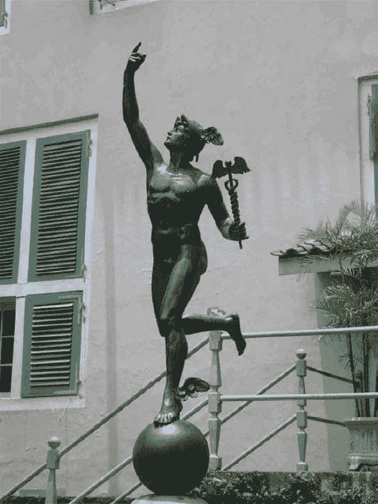

赫尔墨斯像。雅加达历史博物馆。

M.Iguchi 拍摄于 2006 年。

赫尔墨斯与罗马人的墨丘利（Mercurius）相同，是希腊神话中科学、商业、雄辩以及许多生活艺术的神。这尊雕像像许多其他像一样，手持权杖（Kerykeion），这是商业的象征，该符号曾被用于东京商学院（现东京一桥大学）的校徽。

在此，我应该补充一点，在市内仍被称为哈莫尼的地区，曾有一座名为“哈莫尼”的著名建筑，由丹德尔斯（Daendels）于 1810 年开工，并在拉斐尔（Thomas Stamford Raffles）时期于 1815 年竣工。该建筑主要是一个高层俱乐部，但也是现今国家图书馆和国家博物馆的摇篮。它也被认为是第一座由当地承包商建造的现代建筑。令人遗憾的是，这座建筑在 1985 年 4 月根据国务秘书处的命令被拆除，其目的仅仅是为了拓宽道路（马雅帕希特路 / `Jalan Majapahit`）并提供汽车停车位。事实上，在苏哈托（Soeharto）总统（1968–98 年）时期，有许多旧建筑被拆除。例如，附近著名的印度的酒店（Hotel des Indes，按法语发音为[ɔtεl dεz‿ε˜d]，因为其创始人是法国人）如今已是一个购物中心。

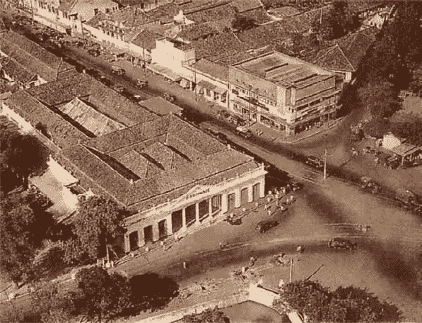

哈莫尼协会建筑，曾存在于雅加达直到 1985 年。

该照片经 KITLV 许可，由 K.Nishimi 先生提供并复制自`http://jakartan.cocolog-nifty.com/blog/2007/05/`。

## 旧监狱

在历史博物馆建筑后侧的半地下室，有几间带铁栅的牢房，里面可以看到直径 15–25 厘米的铁球，铁球上连着铁链。当该建筑作为市政厅时，这些牢房就是监狱，据说迪波戈罗王子（Prince Diponegoro）曾被关押其中之一，直到他被流放到马加锡（Macassar）。不用说，那些铁球就是脚镣锁。

在博物馆的一楼右侧，有几个房间，陈列着塔鲁马曼纳加拉（Tarumanagara）时期（4–8 世纪）的石刻铭文、帕查哈拉-葡萄牙条约（1522 年）的石碑以及其他历史遗迹。尽管它们都是复制品（原件保存在国家博物馆），但我们能够结合简洁的说明一起看到它们，这对我们来说是一件幸。塔鲁马曼纳加拉和帕查哈拉时代的历史将在其他章节进一步提到。

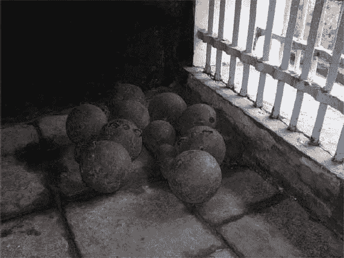

旧市政厅建筑（现雅加达历史博物馆）半地下室的一间牢房。

M.Iguchi 拍摄于 2006 年。

## 华人起义

虽然彼得·埃伯费尔德（Pieter Erberveld）的反叛在发生前被阻止了，但巴达雅在 1740 年 10 月经历了其历史上最血腥的事件——华人起义。尽管细节在许多历史书中都有记载，让我引用次年 7 月发表在《苏格兰杂志》（*The Scots Magazine*）上的一篇生动报告。

> **1740 年 10 月巴达雅华人起义的情况及对该城市的描述，根据从巴达雅寄往荷兰的信件发表。**
>
> “我不禁向各位告知我们最近遭遇的惨痛不幸，即居住在该市及周边的华人（人数超过 90,000 人）企图杀害我们每一个欧洲人，并成为爪哇岛的主人。
>
> “他们怀着此意图，以五、六千人的规模在高地地区侵扰了一段时间，并造成了大规模的屠杀、强奸、火烧和剑戮的破坏等，我们无法得知其原因。爪哇人以及被强迫协助他们的人有时会被 30 或 40 人一起带走，一次审讯 40 或 50 人：其中 200 名无法说明生计来源被送往锡里兰岛，其余能找到食物吃的人被释放。但这种有益的预防措施并没奏效；高地的暴乱每天加剧，直到政府认为派遣一支部队前往那里是恰当的：为此，范·伊姆霍夫（Van Imhoff）和范·阿尔登（Van Aarden）带着 800 名士兵出发；他们在上述高地停留了几天后，与敌人交战，将他们击溃并驱散。期间，居住在巴达雅及周边的华人做了各种准备，配备了数量足够的木制炮和其他战争物资，并挖掘了填满火药的地雷。正当这场背叛即将执行之际，上帝天佑，向我们揭示了这一切，而且还是通过五个华人，他们自发地来向政府通报了他们的同胞正在准备的血腥场景：随后，我们所有的守卫和哨所都增加了一倍，连头等货运代理也被迫全武装驻守城堡内；尽管政府当时并未意识到危险如此严重。
>
> “这种状况持续了几天后，我们在 10 月 8 日周六获得消息，我们位于翁拉斯特岛（Onrust）附近的一个哨所——夸勒（Quale）被华人袭击，所有欧洲人都被杀害，一切被焚毁：随后政府集会，命令任何华人不得开门、不得出现在街上、或在晚上点灯；违者将立即被射死。强力守卫也部署在所有的街道和要道。
>
> “当政府仍在聚集时，傍晚 7 点左右，华人点燃了乌得勒支门（Utrecht）附近的郊区，以为我们会全军出灭火；如果是那样，城内的人就会从家中冲出来，从而彻底消灭我们。但他们错了，大门一直紧闭且守卫严密。
>
> “8 点左右，政府成员两人一组接替守卫大门，以便亲自执行可能下达的命令和指令。
>
> “9 点，人数四万或五万的华人伴随着鼓、喇叭、长号和恐怖尖叫声的巨大声响进进，旨在向城内的同胞发出进攻信号；但城内的人看到我们良好的治理和秩序，并且剥夺了与兄弟会合的机会，便保持非常安静，被恐惧所占据；事实上，如果他们冒险这样做并与其他人结合，我们所有人都会被消灭，因为我们只有 3,000 多余的哨兵。”
>
> “与此同时，在城外的中国人继续用火和刀剑进行肆虐破坏。他们袭击了乌特勒支大门外的 15 名黑人守卫，同样也袭击了迪斯门（Dies-gate）外的另一组，并将他们全部杀害并消灭。他们还袭击了新门附近的 60 名守卫；但这些人防卫表现得非常英勇，导致许多中国人被杀，大门仍留在我们手中，因为它们在我们大炮的射程范围内，大炮整晚对他们进行了成功的炮击：此外，我们派出了一支由 160 名兵马组成的部队去营救哨所以及其他居住在郊区的基督徒。由于我们的誓敌内外在外，我们无法进行更有力的突围。尽管充满危险，我们凭借巨大的勇气度过了一个夜晚，发现自己身处敌阵之中。
>
> “早晨，中国人离开了郊区；随后政府举行了会议并发布命令杀死所有中国人（妇女儿童除外），因为没有其他办法确保我们内部安全，并抵御外部的大军。于是，中国人的门和房屋被用斧头和器械破开，所有男人都被拖出来并屠杀；他们的妻子和孩子全部被送往中国人医院。期间，街道、小溪和护沟很快满了尸体，在某些地方，由于屠杀惨烈，血甚至没过了脚踝。在此期间，我们在`Roemolake`河的对岸安置了一些大炮，对准中国头首的住所开火，那里有八百多名中国人：当我们攻入那里时，约 30 名妇女从那里出来，由于我们承诺不伤害她们；然而，中国头首就在他们中，试图女装逃跑；但由于他太为人所知，被发现并送往城堡。
>
> “下午，上述的范伊霍夫先生（Mess. Van Imhoff）和范阿登（Van Aarden）带着他们从高地回到城市。与此同时，即周日下午 2 点左右，整座城市陷入一片火焰：因为中国人在恐惧的驱使下点燃了自己的房子，惨惨死去；而那些出门门的人立即被我们的人杀害。
>
> “这场大火引起了巨大的混乱，尤其是妇女们，她们成群结队向城堡逃难，城外的人也是如此，因为此时城市的大大部分、特别是中国人居住的地方已化为灰烬。监狱里还有`635`名中国人被囚禁，在傍晚根据命令被处死。
>
> “在这一切混乱中，中国人的钱财和货物成了任何通过抢劫、掠夺和杀戮来肥自己自己的猎品；有些人，尤其是海员中的，已经获得了价值 9000 到 10000 荷兰银的战利品。其余中国人逃到了山里，在那里继续用火和刀剑破坏一切；然而，我们的人杀死了他们许多。
>
> “在这一切肆虐中，我们没有损失超过 200 人。目前已发布了一项大赦令，针对那些在一个月内投降的中国人，已有数百人这样做了：然而，这项大赦令不适用于他们的两位首领，相反，承诺给带回他们头颅的人赏金 1,000 荷兰银，活捉他们的人赏金 5,000；对于下等人员，死者奖励 200，活者奖励 300。这项大赦令于 11 月 22 日过期，因此所有在那时未投降的人都被视为法外之徒。
>
> “被俘的这些人供供称，他们的阴谋是成为巴达维亚和那里贸易的主人；如果他们成功了，他们将把政权的所有成员钉在桩上，切碎并食用伊霍夫（Imhoff）和泰登斯（Tedens）的尸体（他们视为国家的敌人），烧死所有老年人，将男女青年奴化，强迫巴达维亚总督和公司首席董事为中国民族首领及其妻子担任卑微的家仆。据估计有 12,000 名中国人被屠杀。”

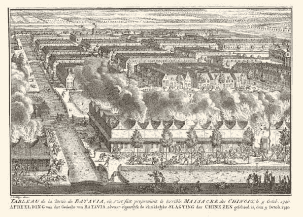

*1740 年巴达维亚屠杀中国人*，阿多尔夫·范·德·兰。

重自`https://www.rijksmuseum.nl/nl/collectie/RP-P-OB-75.356`

在欧洲人到达之前，中国人（特别是来自广东（廣东）、海南和福建（福建））就已经移民并定居在东南亚的港口城市。在荷兰人建造的巴达维亚，商业和工业方面才华的中国人处于补充人力资源的地位，被允许在`VOC`总督批准的首领带领下建立自己的社区，但随着人口的增长，他们与`VOC`政府之间产生了各种摩擦原因，他们想要成为巴达维亚的主人。事件发生后，据说位于`Ciliwung`河左（西）岸的中国人居住区被迁到了城市东南部的`Glodok`，那里大多数居民现在是中国后裔。

当时的总督是`阿德里安·瓦肯尼尔`（Adriaan Valckenier，1737–41）。他试图将屠杀案的罪名推给`van Imhoff`并将其送往荷兰，但相反，`VOC`总部认为总督负有责任并撤了他的职务，临时任命`约翰内·泰登斯`（Johannes Thedens）为总督（1741–3）。`van Imhoff`回到了巴达维亚并担任总督（1743–50）。

## 爪哇岛的铁路与道路

在当时的画面中，令人惊讶的事实是道路和运河纵横交错，甚至连圆顶的中国房屋也排列得很齐。可以说这是荷兰人喜好的城市设计，但我不禁赞叹其特色。据我所知，那里已没有留下屠杀事件的痕迹。

让我们来访问雅加达塔火车站（Jakarta Kota Railway Station）。建筑的西侧拥有独特的半圆形立面和半圆柱屋顶，那是正面，但人们可能会感到困惑，因为南侧和北侧的设计完全相同。大厅内部充满了典型的终点站氛围，类似于东京的上野站或伦敦的国王十字车站（King’s Cross Station），隔栅对面是平行排列的五个到六个站台，两侧角上有一些餐厅和纪念品店，触动着旅行的心。在高峰时段，你必须准备好在博戈尔（Bogor）、丹绒普里奥克（Tanjung Priok）及其他郊区的短途火车人潮中推挤，正如我实际上经历过几次。那是很久以前，在我短访印度尼西亚期间、住在博戈尔之前，我有几个小时等前往中爪哇的夜车，于是问了一位年轻的站长关于建筑的起源。根据他从办公室获得的一本小册，最初于 1870 年开放的车站由荷兰建筑师弗朗斯·约翰·劳维伦斯·吉塞尔尔斯（Frans Johan Louwrens Ghijsels）于 1926 年改建成现在的建筑，他在设计中试图融合西方和东方建筑风格的特点。在那时，车站名为为 `Batavia Zuid`，即南巴雅达，因为它位于巴雅达原行政区的南部，而原区巴雅达与韦尔特弗雷登（Weltevreden）、丹绒普里奥克和梅斯特·科内里斯（Meester Cornelis）共同成了大巴雅达。车站俗称为 `BEOS`，是 `Bataviasche Ooster Spoorweg Maatschappij`（巴雅达东铁路公司）的缩写，该公司首次在那里运行了火车。这个绰号今天仍然可见。当我在雅加达打车告诉司机“去车站！”，并被问回“BEOS 还是甘比（Gambir）？”，上述知识帮助我指出了正确的目的地。甘比是雅加达中心车站的名字，其原名韦尔特弗雷登已不再被接受，但 `BEOS` 则不然。尽管听不到这座城市的老名字巴雅达，但它的变体 Butawi 并没有完全过时，特别是在各省的老年人中，你可能会听到：“他去 Butawi 了。”、“Butawi（[雅加达人]）很狡猾。”等。

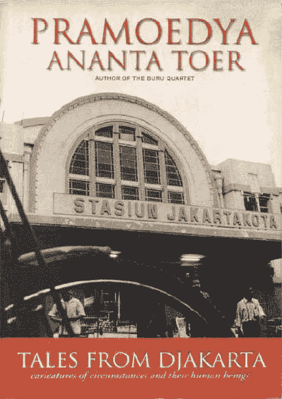

雅加达塔火车站。

普拉莫迪亚·安南塔·图尔的书籍《雅加达故事》（*Tales from Djakarta*），由 Equinox Publishing (Asia) 2000 年提供。

在爪哇岛，第一列火车于 1867 年运行在中爪哇的望葛（Semarang）和 Tangung 之间，比日本的新桥到横滨早了五年，这可能会让一些读者感到惊讶。事实上，荷兰东印度引入各种现代设施和系统早了十到十五年，而日本直到 20 世纪 20 年代才赶上（*参见*表 1）。

### 表 1 现代系统和设施的采用

| | 爪哇 | | 日本 | 年份差 |
| :--- | :--- | :--- | :--- | :--- |
| 1851 | 现代医学院（巴雅达） | 1861 | （江户） | 10 |
| 1858 | 电信（巴雅达.Buitenzorg） | 1869 | （东京–横滨） | 11 |
| 1859 | 海底电缆（爪哇岛） | 1872 | （下关–门司） | 13 |
| 1864 | 邮票 | 1871 | | 7 |
| 1867 | 铁路（望葛–Tangung） | 1872 | （新桥–横滨） | 5 |
| 1881 | 电话（巴雅达–Buitenzorg） | 1890 | （东京–横滨） | 9 |


| 1886 | 现代港（丹绒普里奥克） | 1894 | （横滨） | 8 |
| 1925 | 广播广播 | 1925 |   | 0 |
| 1928 | 航空公司（KLIM） | 1928 | （东亚航空） | 0 |

* 数据来自 H. A. van Coenen Torchiana, *Tropical Holland, An Essay on the Birth, Growth and Development of Popular Government in an Oriental Possession*, University of Chicago Press, Chicago 1921; Takashi Shiraishi, *Brochure for Pramoedya Selection Series* 2, Mekon, Tokyo 1968 白石隆，「プラムディア选集２－付录小册子」，メコン, 東京 1968)。

### 年份差

基础设施的发展要先进得多，正如德川侯爵在他的游记中所写：“汽车在平坦的道路上像箭一样奔驰，表面像惠石一样光滑。”同一时期访问爪哇并同样受到赞叹的不仅有日本的武越义三郎（Yosaburo Takekoshi）和鹤见佑介（Yusuke Tsurumi），还有一位美国旅行者弗兰克·卡珀（Frank Carpenter），他说道路质量可以与欧洲媲美。1940 年，作为通商部长访问爪哇的`阪急公司`创始人小林一三（Ichizo Kobayashi）出版了一本书名为《我所看到的荷兰东印度》（*The Dutch East Indies which I saw*）：

“就爪哇岛而言，铁路总长度为 400 公里，几乎与东海道相当。从巴雅达到泗水只需十二小时的快车速度远优于我们日本。在主要交通线上，道路是双行的，一条供牲畜，一条供马车。马车路铺了碎石，马车和牲畜路都维护良好。除了印度几条短线铁路外，邮驿是东方唯一的文明陆路旅行方式。每隔二十、三十或四十英里，旅行者就会到达一个驿，在那里总能找到供应良好的葡萄酒、啤酒、欧洲和当地蔬菜、新鲜面包以及优质禽类。”

爪哇现代道路的起点是大邮路（荷兰语为 `De Groote Post`，印尼语为 `Jalan Raya Pos`），这是丹德斯以无数人的生命为代价建造的。阿尔弗德·华莱士（Alfred Wallace）在环马来群岛期间在书中描述了溪流灌溉的肥沃田地、白色建筑和糖厂高烟等景色后写道：“道路直达几英里，两旁种满了灰土扑的罗望树。每英里都有一个小哨亭，那里站着一名警察；那里有一个木锣，通过协调信号可以极快地在传递信息。”

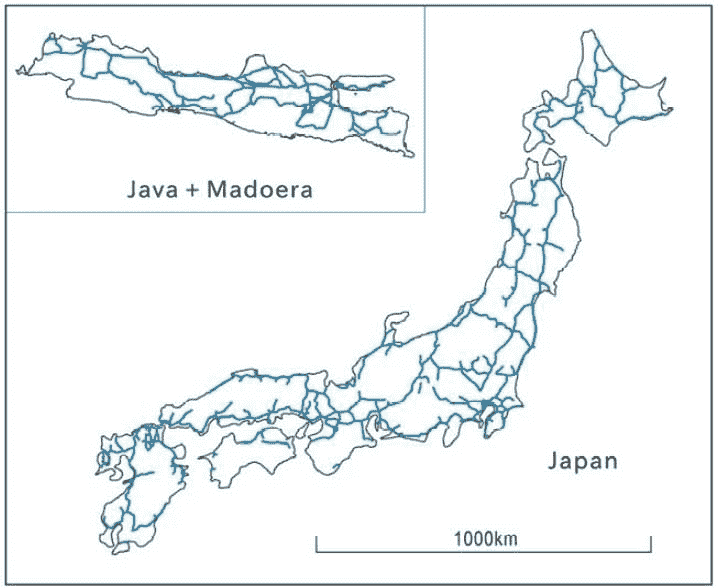

30 年代初日本和爪哇-望达的铁路系统。

爪哇-望达：重绘自*Kaart en Text, eerste Atlas van Nederlandsch-Indie Lagere School*，格罗宁根巴雅达。

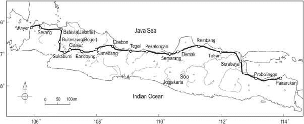

大邮路（De Groote Post）

作者绘制。

文中提到的“木锣”是所谓的“隙钟”（slit gong），这是一种中间有一条缝的圆柱形木头，通过木槌击产生声音。由于通信速度由`[声速 × 距离]` + `[敲击时间 × 传输点数量]`决定，如果假设敲击时间为 30 秒，传输点数量为 300 个，那么向 500 公里外的地方发送一条信息所需的时间仅为三小时左右。这种通信系统很可能被使用过，例如在皮特尔·埃伯贝韦尔德（Pieter Erberveld）叛乱期间，用于从巴达达（Batavia）向偏远地区发送警告。当我住在布戈尔（Bogor）时，我在万隆西侧的奇帕达特山口口（Cipadat Pass）的一家纪念品店买了一个这样的小木锣，被称为`kentungan`，并在家里用它来告知饭点等信息。

回到柯塔站（Kota Station），人们可能会奇怪为什么两个相邻站台的轨道之间分得异常宽。虽然我知道在二战前的爪哇岛曾使用两种轨距：宽轨（标准轨）用于干线，窄轨用于支线³⁹；但当我曾在万隆或其他某处听到一个从日本铁路部门派遣的年轻铁路员自豪地说，日本人在占领期间为统一爪哇的轨距系统做出了很好的工作时，我感到非常惊讶。尽管没有文献可用，但似乎他们实际上拆除了宽轨线路，并将其替换为更糟的窄轨。这在如今和平的年代令人难以置信，但正如著名的电影⁴⁰众所周知，当日本军队在泰国和缅甸之间的桂逸河上修建桥梁时，利用爪哇招募兵和荷兰、英国战俘的强迫劳动，他们不仅将机车和车厢带离爪哇，还从爪哇岛现有的铁线上剥下了铁轨⁴¹。当我有一次乘火车从雅加达（Jakarta）前往井勒汶（Cirebon）时，我注意到在某些路段，人工明显足够容纳双轨，而线路本身只有单轨。站台之间的空间异常宽的情况在其他车站，如布戈尔、万隆、日惹加达、梭罗或等地，也很常见。

位于雅加达中部的甘比尔站（Gambir Station）在 20 世纪 90 年代拆除了带有双塔钟楼设计的原建筑并重建，它完全没有昔日的迹象——那时在第四届太平洋科学大会期间曾停靠过特列车，正如普拉姆埃迪亚·安南塔·托尔（Pramoedya Ananta Toer）的小说⁴²中所描述的，独立后流浪者的徘荡等。在二楼站台上，人们可能再次注意到轨道之间过宽的空间。这是为了将来将其改为宽轨吗？尽管有一些日本资金被用于印度尼西亚铁路系统的现代化，但这很难足以弥补他们过去的罪孽。

## 国家博物馆

让我们参观位于独立广场（Independence Square）对岸默尔德卡西路（Jalan Merdeka Barat）的国家博物馆。亚洲第一座现代博物馆成立于 1778 年成立的巴达达艺术科学学会（Batavia Society for Arts and Science），目前这座带有帕特农神风格风格白色大理石建筑于 1868 年开放，是由该学会创始人之一 J. C. M. 拉德麦尔（Radermacher）捐赠建造的。入口厅有数十尊佛教和印度教神灵石像，在院子里，数百尊石制和青铜制的塑像列在展厅的檐下，环绕着广场。因此，这座博物馆通常被称为 Museum Patung，即雕塑博物馆。这些雕塑包括从中爪哇古代遗址运来的作品（那里曾在 8 世纪到 10 世纪盛过桑贾亚（Sanjaya）和夏连（Sailendra）王国），还有来自东爪哇辛加萨里（Singasari）及后续世纪的其他遗址，这些遗址在当地维护非常困难。每件作品的详细传说都用英文和印尼语标出。

在一楼的展厅里，展示了来自整个印度尼西亚群岛各地的大量收藏品，分为纺织品、石器、陶器等类别。陶瓷包括一些在中国景德镇（Ching-te-chen）和日本伊万里（Imari）制作的精美器皿，而古董武器中则传统的剑（`keris`）和矛。如果提出要求，可以在楼上的特设房间看到古代王国的金银器和各种珍宝。

在我看来，这座博物馆最显著的特征是，所有超过 19 万件收藏品完全是从印度尼西亚领土上收集的，没有任何一件是为了吸引而从海外购买的。需要注意的是，在荷兰殖民时期，他们几乎将所有的宝都安置在这里，除了少数被带往莱登大学用于研究的作品。有一次，当我在没有任何背景知识的情况下访问阿姆斯特丹的国家博物馆（Rijksmuseum）时，看到只有少数来自印尼的收藏而感到失望。

虽然在殖民时代，例如来到印度和其他亚洲领地的英国人将殖民地视为经济活动的临时场所并在退休后回家是很常见的，但许多荷兰人在毫无偏见的情况下海外领土居住了好几代。事实上，我的荷兰朋友中，有人的父亲来自南苏门答腊（Palembang），妻子出生在北塞拉西的托莫哈（Tomoha）。由于东印度群岛以及荷属圭亚那（现在的苏里南）和库拉索（Curaçao）在宪法上自 1922 以来与荷兰具有相同的地位（参见脚注 23），因此当 1941 年荷兰被德国占时，当时的总督范·塔肯博格·陶威尔（Tarda van Starkenborgh Stouwer）建议将君主所在地以及流亡政府迁往巴达达，这并未预料到次年的日本入侵；尽管这一提议没有得到温斯顿·丘吉尔（Winston Churchill，他担心年迈朱莉安娜的长途）或女王本人的同意。

我曾写过印尼西亚的大部分历史遗迹在那里，但也有例外。1871 年，当古代遗迹和文物的考古价值开始被认可时，几尊来自罗浮屠（Borobudur）的佛像被送给了访问那里的泰国国王崇（Chulalongkorn），作为对他赠送的一尊象像的回报，那尊象像被放在国家博物馆的前院，使其获得了另一个名字：Museum Gajah，即大象博物馆。众所周知，更早在 19 世纪 10 年代英国占领期间，一块记录了东爪哇盛行的艾尔兰加（Airlangga）王国皇族的石碑被斯坦福德·拉斐勒（Stamford Raffles）带到了印度，被称为“加尔答石”（Calcutta Stone）。拉斐勒收集的一千多件艺术工艺品现在由大英博物馆收藏，由他的执行人威廉·查尔斯·拉斐勒·林特（William Charles Raffles Flint）捐赠。在阿尔弗雷德·罗塞尔·华莱士（Alfred Russel Wallace）的旅行记⁴³.)

阿尔弗雷德·鲁塞尔·华莱士在东爪哇的莫乔克托获得的一尊印度教女神杜尔加浮雕。

转载自：阿尔弗雷德·鲁塞尔·华莱士，《马来群岛：奥地猩猩与天堂鸟的土地：旅行记及对人类与自然的研究》，MacMillan & Co.，伦敦，1886 年（Google 图书）。

### 爪哇人的故事

这座博物馆中收藏的具有极高古董价值的特定收藏——爪哇人化石以及在底层特殊区域展示的其他史前发现——确实令人惊叹，不禁引导人们回顾它们的发现历史 ⁴⁴, ⁴⁵。1859 年，查尔斯·达尔文在《物种起源》⁴⁶中提出了进化论，并预言“未来将发现某些人类与类人之间的中间物种化石”。1887 年，欧仁·弗朗索瓦·杜波斯（1858–1940）出生于荷兰艾斯登，他曾在阿姆斯特丹大学学习过解剖学，但对考古学有潜在兴趣，深受达尔文理论的启发，作为一名军医来到东印度群岛，放弃了大学承诺的高位。在担任医生期间，他利用空余时间在苏门答腊进行了一些挖掘，但在最初几年里并没有发现此类化石。政府被这种热情所打动，在 1890 年安排他能够专注于搜寻。他在梭罗河河岸（Bengawan Solo）的特尼尔台地带领数十人进行挖掘，这条河流后来也因同名歌曲而闻名。他在 1891 年发现了一些牙齿化石（`Trinil 1`）和一个头盖骨（`Trinil 2`，或 `Pithecanthropus 1`），并在次年发现了一个大腿骨化石（`Trinil 3`），这些都是史前人类化石，他将该物种命名为*直立猿*（*Pithecanthropus Erectus*）。他声称发现了缺失的环节，这一说法并未得到他人的认可，他们怀疑这些化石可能是类人猿也可能是人类。深受挫败的他退出了了争论。直到三十年后，在在发现发现北京人和在南非发现南方猿之后，杜波斯的发现才首次获得认可。在今天，很难想象一个政府机构（即日本文部科学省）会批准像杜波斯那样的寻宝项目。作为一名谦卑的离任科学家，我想赞美 19 世纪爪哇当地那些匿名官员的洞察力和慷慨，他们曾大胆地支持了杜波斯的冒险。

在 1910 年至 1940 年间，爪哇进行了一项广泛且大规模的调查，导致了大量化石的发现：桑格兰的梭罗人（1930–3 年）、莫乔库托的婴儿头部（1936 年）以及桑格兰的几具直立猿化石。在印度尼西亚独立后，这些研究得到了 T. 雅布教授（他后来任加加·马达大学大学长）、万隆理工学院的萨托诺教授及其同事的后续关注。尽管国家博物馆、万隆地质博物馆或其他地方向公众展示的化石标本据说是复制品，但在普通人眼中，它们看起来并不如此，因为颜色和缺陷都被精确地模仿了。

这里距离现在的雅加达（Jagatara）不远，但请允许我简要报告一下关于我访问桑格兰的经历。桑格兰地质博物馆位于梭罗河台地上的一个小村庄，距离梭罗市中心向南 30–40 分钟车程。在馆长在未提前预约的情况下热心接待了我的访问访小组并带领我们进入建筑后，我被大量的收藏品惊呆了，其中展出了一根长 4 米的巨型象牙、一块巨大的猛犸颌骨，以及与直立猿同时生活的其他动物的化石，因为我是第一次看到这些标本。其他有趣的标本还包括两块长度为 12–15 厘米的扁平红色物体，以及一个直径约 18 厘米的灰色球形石头。我能猜那两块平石是石器和制作这类工具的原料，但那块球形头的用途很难想象。在得到它可能是捕猎动物手榴的解释后，我确信使用此类工具的人（他们可能是我们遥远的祖先）并不是类人猿。史前水牛头部骨的修复正在实验室进行，通过组装化石碎片（其中许多碎片只有 5 毫米大），研究它们的颜色和形状，并用石膏填充缺陷部分，就像在试图解决一个巨大的复杂的拼图。这一定是一项艰辛的工作，但那位爪哇研究人员看起来乐在其中。

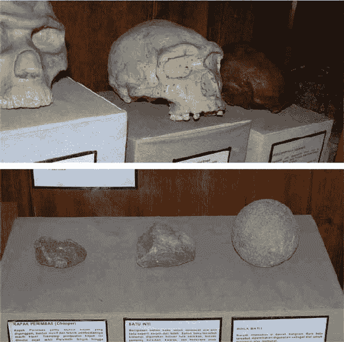

桑格兰地质博物馆的一些收藏品。

直立猿头骨（上）和石器（下）。

摄影：M. Iguchi，2006 年 9 月。

关于人类的起源，直到几十年前，我们教给我们的仍然是“多地区进化假说”，在该假说中，几百万年前起源于非洲的类人猿（南方猿）在 150 万年前进化为“直立人”，在 100 万年前扩散到整个欧亚大陆，并在每个地区继续进化为“早期人类”和“现代人类”。但所谓的“单一起源假说”于 1987 年出现，该假说认为欧亚大陆存在的所有“早期人类”都灭绝了，只有在非洲生存并进化为“现代直立人”的唯一群体在 20 万至 10 万年前扩散到其他大陆。根据基于计算机分析的后一种假说，世界上现代女性线粒体的起源可以追溯到一位在 19 万至 14 万年前生活在非洲的被称为“线粒体夏娃”的女性。

### 东川庆喜的访问

在布戈尔（Bogor）期间，我有幸拜访了已故的德川义信（Yoshinobu Tokugawa）先生，他是川德侯爵的孙子，《爪哇之旅》的作者。2001 年 1 月，他通知我将前往爪哇，这是为了对我去年 12 月圣诞卡片的回复——我在卡片中询问他是否能来爪哇追寻他祖父的足迹。由于他能出的旅行时间只有五天，而川德侯爵两次访问爪哇总共花费了五十天（七天加四十三天），因此我为制定了一份计划，让他尽可能高效地访问几个重要景点。当我去国家博物馆请求馆长接待他的访问时，馆长由于本人在指定日期在国外，便派了陶瓷部门主管 E 夫人（Mrs. E.）代表她接待了德川先生。在参观了布戈尔植物园、万隆理工学院、罗布蜀甸寺和位于日志加达附近的普兰巴南寺后，我们在国家博物馆受到了 E 夫人的接待。这是我第一次见到她，她引导客人的情景给我留下了深刻印象，那画面美得足以画成画。在那之后，她不仅成了我的朋友，还成了我尊敬的老师，教了我许多关于印度尼西亚历史和文化的知识。当我邀请她去布戈尔的家中时，她正凝神注着一张爪哇王子的肖像，那是她在一本由外国画家创作的古画书中发现的[47]。脑中突然冒出一个问题：“他是你的祖先吗？”，她稍显犹豫地回答道：“是的，他是我的祖父。”我得知她是一位拥有 Raden Ayu 头衔的公主，与日志加达苏丹家族有渊源，尽管她在日常生活中隐藏了自己的血统和头衔；而已故的德川义信先生如果不是在二战后在美国占领期间废除了日本传统的贵族制度，本该继承侯爵头衔的。我想这就是博物馆馆长在众多候选人中选择 Raden Ayu E 夫人作为代表的原因。


国家博物馆传统纺织品展厅内的已故的德川义信先生和 E 夫人。

摄影：M. Iguchi，2001 年。

在日志加达王室中，苏丹的子女分别被称为 `Putra` 和 `Putri`，第 3 至第 5 代分别被称为 `Raden Mas` 和 `Raden Ayu`，而第 6 至第 8 代分别被称为 `Raden` 和 `Rara`。尽管上述规则在梭罗（Solo）的苏苏胡南（Susuhunan）家族和其他支系的苏丹家族中被认为或模糊，但这些头衔是贵族血统的证明，持有这些头衔的绅士和女士如今在爪哇仍受到普通人的尊重，可能比西欧国家还要多。

对于“尽管印度尼西亚的国家结构是共和国，但那里是否有国王和贵族？”这个问题，我将在别处回答。

## 克里希纳与阿尔尔朱纳的大雕

在雅加达市中心，离国家博物馆不远，在独立广场（Medan Merdeka）西南角的环岛旁，矗立着一座宏伟的克里希纳与阿尔尔朱纳青铜像：前者驾着一辆由八匹马拉着的马车，后者坐在后座执弓待命。这尊塑像是由著名的巴厘岛雕塑家 I Nyoman Nuarta 先生于 1987 年创作的，他毕业于万隆理工学院艺术系。据说这八匹马代表八位神灵，在印度教哲学中象征着 `Asra Brata`（八种政治家的美德）[48]，而这也是当时的总统苏哈托所推崇的理念。我记得这尊塑像的颜色曾是白色的，因为它最初是由聚聚酯树脂制成的。由于材料风化，这尊塑像在 2003 年花费 40 亿卢比亚（约 47 万美元）用青铜重新铸造。尽管在亚洲金融危机（1997 年开始）后受损的国家经济尚未复苏之际，这笔巨额支出引发了争议，但我赞赏政府的这一行动。这尊塑像被广称为`阿尔尔朱纳维瓦哈像`（Arjunawiwaha Statue）[49]，但我并不确定原因，因为如果我没记错的话，克里希纳并没有出现在 14 世纪爪哇作为《罗摩衍那》支故事创作的诗《Kakawin Arjunawiwaha》（阿尔尔朱纳的胜利）中，而这两位英雄都出现在《婆罗罗大战》（Bharatayuddha，《摩诃婆罗罗》最后一章改编）或《摩诃婆罗罗》本身中。（古爪哇文学，见第 6 章）。

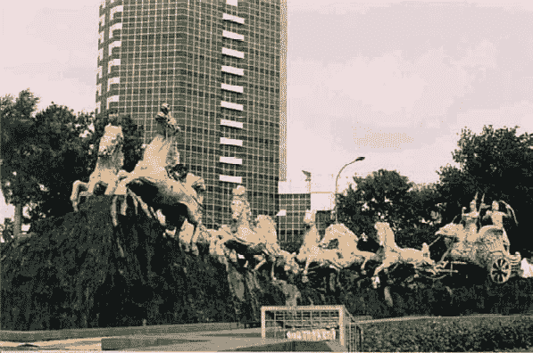

独立广场（Medan Merdeka）西南角所谓的“Arjunawijaya”。

## 雅加达的一些有趣景点

本文并非旨在旅游指南，但请让我介绍一些可能具有旧日氛围的地方。在雅加达历史博物馆（旧市政厅）前，隔着它的前院（现称为 Fataah 公园），有一家名为 `Batavia Café` 的咖啡咖啡馆，那里适合用皮尔森啤酒（Pilsener）、喜马的遗产——比星啤酒（Bir Bintang）来润喉，并在参观博物馆后享用简便的荷兰式午餐。这栋豪华的双层建筑从柱子到窗框都是用柚木制成的，我不知道它的建造年份，但无疑是美好旧日的遗产，建筑本身具有博物馆般的价值。在餐厅、走廊、楼梯等各处的柱子和墙壁上挂着许多以前影星的相框，如玛丽莲·戴德丽、玛丽莲·梦宝等其他影星，还有稀有的古风风景和人物画，但为了研究目的而观察它们，必须在脑中对它们进行分类和排序，因为它们的摆放相当随机。从菜单上的饮料列表和价格判断，晚上会有许多来自荷兰和其他欧洲国家的怀旧过去的游客，尽管我没有在晚餐时间去过那里。

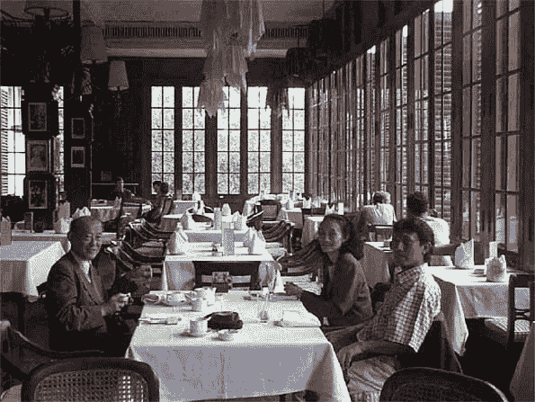

Batavia 咖啡馆（已故的德川义信先生、E 夫人、国家博物馆人士以及工业部的 A. B. 先生）。


摄影：M. Iguchi，2001 年。

在前往国家宫（Istana Negara，*字面意思*国家宫，原为荷兰总督府邸）的从科塔（旧巴达维亚）出发途中，你可以发现一家名为 `Pondok Laguna` 的餐厅，它位于“gurame”（岩鱼）霓虹灯下，地址是 `Jalan Batu Tulis Raya No. 45–47`。`Gurame` 是一种淡水鱼，形状类似于家庭鱼缸中的鱼，推测属于同一种属，但体长可达 30-40 厘米，它是巽门答族菜的典型食物，通常以 `gurame goreng`（炸岩鱼）和 `gurame bakar`（烤岩鱼）的形式供应，两者都用辣椒和香料调味。由于其白肉品质对于淡水鱼来说极佳，且没有像“ikan mas”（*字面意思*金鱼，但更像鲫鱼）那样的泥腥味，我曾特意要求只用盐烤这种鱼，这在在日本处理海鱼时很常见。结果很不错，我对那个味道相当满意。每天晚上，这家占约 200 平方米的大餐厅里都挤满了美食家，他们成群结队地享受着喜爱的菜肴，如炒牛肉甘蓝、`sapo tahu`（豆腐汤）、`capcay`（源自中文*chop suey*，杂采=混合蔬菜）、各种 `sate`（各种烤肉串）等。虽然有些辛辣的印度尼西亚菜肴不合外国人口味，但这家餐厅的味道非常精致，或者说被调整得比较温和。我认为他们的食物更应该被称为“Makanan Butawi”（巴达维亚食物）而非 Makanan Sunda（巽门答族食物）。

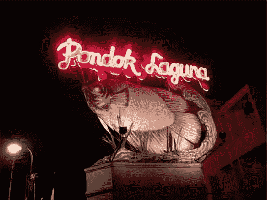

巽门答族餐厅“Pondok Laguna”的霓虹灯。

摄影：M. Iguchi，2007 年 1 月。

在位于市中心东部的 `Jalan Raden Saleh Raya No. 47`，有一家名为 `Oasis` 的餐厅。这栋奢华的柚木房屋拥有精美的吊灯和彩色玻璃，最初于 1928 年由拥有茶、橡胶和金鸡树庄园的荷兰万翁布兰登堡·范·奥尔森德（Brandenburg van Oltsende）作为私人宅邸建造，它的历史如此悠久，最后一位荷兰总督在第二次世界大战期间在此居住过一段时间。但这家餐厅在 20 世纪 70 年代开业的吸引力无疑在于他们提供的食物。尽管晚餐菜单上只有一项，但人们不必担心，因为食物 `rijsttafel` 是一顿完整的荷兰式爪哇族大餐，包括配椰子酱的煮蛋、香料烹饪牛肉、印尼式鸡咖喱、虾仁 `sate`、`tempe`（发酵大豆）、炸香蕉等。这些食物由十二名女服务员端送，他们每人端一份菜送到桌边，每份都盛在一个大盘子里，围着先放在中间的白蒸米饭。因此，尽管是套餐，但并没有进食的顺序。

这种由许多女服务员提供的上菜风格相当特别，但客人自己从桌上的碗里按喜好取菜的方式更具传统特色，因为据说 `rijsttafel`（米饭桌）起源于古代远离城镇的种植园。我曾受邀在西爪哇岛著名的 `Gunung Mass Tea Plantation` 享用过 `rijsttafel` 晚餐，在山坡上特殊的氛围中俯瞰广阔的茶园享受这场非正式晚餐。`Rijtafel` 已流传到荷兰。当我住在埃因霍温时，在 `Philips Headquarters` 附近发现了一家名为 `Jawa` 的特殊餐厅，由一位三十年前从爪哇来的男士经营。他告诉我，他每年都会回到家乡采购香料。味道极佳，比雅加达和万隆的餐厅还要好，因为凉爽的欧洲省份产出的肉类和蔬菜优于热带爪哇。

`Oasis` 餐厅地址所在的街道名为 `Raden Saleh`，这本是一位 19 世纪画家的名字，他是爪哇现代绘画的先驱，曾在欧洲呆了很久。关于 `Oasis` 建筑曾是他的住所的传闻是错误的。`Raden Saleh Mansion` 是一座建在附近的华丽罗马哥特式房屋，由他的妻子、德国富翁的女儿康斯坦西亚·冯·曼斯菲尔德（Constancia von Mansfeld）出资建造。它现在仍作为医院的一部分在使用。

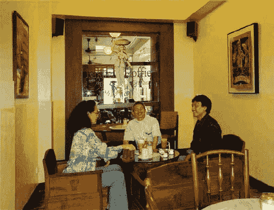

咖啡馆“Bakoel Koffie”的客房。

摄影：M. Iguchi，2007 年 2 月。

在 `Jalan Raya Raden Saleh` 的延伸段 `Jalan Raya Cikini No. 25`，有一家舒适的咖啡馆 `Bakoel Koffie`（*字面意思*篮咖啡），我的朋友 B 先生最近带着我和 E 夫妇去过那里，他说他偶然发现了一个很有趣的地方。不仅是店名的荷兰式拼写以及一个头上顶着咖啡豆篮的迷人乡村女孩标志（设计得非常契合店名并贴在每一扇窗玻璃上）给人一种美好旧日的印象。室内装饰和家具看起来都很经典。近近看，桌椅被认出是旧的，可能是从旧学校和办公室收集来的，但重新漆成了同样的深棕色。唯一的消磨时间的游戏是传统的“congklak”（跳棋），这里没有流行的电子游戏或国际象棋，尽管有些客人在笔记本电脑上工作。在屋檐下挂着一面旗帜，上面印着咖啡的历史：“1000 年：布哈拉的医生和哲学家维也纳是第一个描述咖啡药用的人……”1706 年：爪哇种植的首批咖啡样本被带回阿姆斯特丹植物园……”2001 年：由孙宗的孙辈创立在雅加达开了一家店”。墙上有一张老中国人的照片，根据老板说，他在 1878 年开始经营咖啡业务。

这家店提供的咖啡是传统的 `kopi tubruk`（土耳其咖啡），在杯中加入热水咖啡粉并搅拌。糖也是爪哇自古使用的棕糖。我假设 `kopi tubruk` 与第二次世界大战期间被罗梅尔元帅围攻的北非战略地点托布鲁克有关，但我为什么用这个地名命名这种冲泡方法还没有答案。咖啡本身味道很醇，但对于我这种偏好传统深烘、苦味的人来说稍不尽意。

### 以“Jagatara”为前缀的商品

离开这片土地，让我们考虑一下江户时代（1603-1869 年）期间或之前进入日本的带有“Jagatara”前缀的几种商品。民众中最受欢迎的是 `Jagatara-imo`（马豆薯），简称 `Jagaimo`，但经过我的一些调查，其对其到达时间的模糊性令我惊讶。互联网上有大量的点击量，但大多数是“复制的复制”。即使是日本根茎植物学会主页上的介绍——“马豆薯是 400 年前庆江时期（约 1600 年）由当时在爪哇拥有基地的荷兰人带到长崎的”——也不过传言。在大学主页上，我没有找到任何学术文章，其中包含了这样奇怪的描述：

(1) 源自新大陆的南瓜、辣椒、玉米和马豆薯等蔬菜出现在镰仓、室町或桃山时代。

# (2) 土豆引论

据传，土豆是由荷兰人在`长庆时代`（1596–1614 年）引入长崎的。有人认为它是在`长庆`第三年，即公元 1598 年的（`九州大学`和`东北大学`）。

关于（1），至少不可能包含`镰仓时代`（1185–1333 年），因为即使加上`南北朝时代`，该时代也没有持续到 1392 年以后，这比克里斯托弗·哥伦的航行早了整整百年。对于（2），荷兰人也不可能在 1598 年将它们带来，因为第一艘横跨太平洋而来的荷兰船`De Liefde`号是在两年后在九州的臼杵市岸边触没的，当时船上有船长`Jacob Quaeckernaeck`、`Jan Joosten`、`William Adams`以及其他船员。

由于前两艘从南方而来的荷兰船分别于 1609 年和 1611 年从马来半岛的`柔佛`和`丹那`出发，因此 1612 年从`八打`出发的船是第一艘来自爪哇岛的船。1614 年，`Oud Zeelandia`号船在游艇`Jaccatra`号的陪同下来自雅加达，那里是三年前建立了贸易据点⁵⁰, ⁵¹。因此，如果土豆真的是由荷兰人引入的，并在这一年被称为`Jagatara-imo`（雅加达豆）或`Jagaimo`，并非不可想象。当我寻找更直接的文献时，我了解到日本现代植物学先驱`白岩光太郎`写过一本古旧著作，名为《外来植物引入的考察》⁵²。在幸运于一家古书店找到的一本稀书副本中，书中写道：

## 雅加达豆（来自别津口）

**名称**：中文：`洋芋`（《植物图谱》），日语：`Hassho-imo`（高州芋）、`Seidayu-imo`（千布芋）、`Kinka-imo`（金芋）、`南京芋`、`Appra`（别津口）。

**历史**：野生于南美安第斯山脉。于近代某个时期到达中国。《长崎留面镜》记载`南京芋`于`天正`第四年（1576 年）到达。别名`Hassho-imo`的诞生是因为它在同一年被传到日本。它也被称为`Seidayu-imo`，是因为当地地方官`中井清平佑`为了备荒赈荒而推荐种植这种植物……

别名`Appura`是荷兰单词`Aardappel`的变体。

我曾想看《长崎历两面镜》（`Nagasaki` double-sided mirror），但由`内桥千云`于 1827 年撰写的手稿本在图书馆目录中并未找到，而一本在古书店广告的副本价格极其惊人。后来，我得知这本书也被称为《长崎历两面镜》（`Nagasaki-Nreki Ryaumen-Kagami`）⁵³。通常，“南蛮船”（字面意思是“南方蛮夷人的船”）指的是葡萄牙船，与“荷兰船”或“兰船”（荷兰船）区分开来。

一段时间后，我发现了一本名为《长崎起源》（`Nagasaki-kotohajime`）[⁵⁵](#part0009_split_001.html_fn_55)的小册，其中描述道“根据传统，土豆在`天正`第四年（1576 年）到达长崎，并种在 Todos Os Santos 的草药园里”。尽管没有给出出处，但 1576 年与《长崎历两面镜》中的年份相吻。`Todos Os Santos`是 1569 年建于长崎的一座著名的耶稣会教堂，但在 1614–1619 年间被毁了。

因此，我得出结论：土豆是 1576 年由葡萄牙船引入日本的，并获得了`Jagatara`（雅加达）这一品牌，被称为`Jagatara-imo`或`Jagaimo`。

在上述的小册中写道：“土豆由于来自马来半岛，也被称为`Barei-sho`（马铃薯）”。我有这种想法，因为自 14 世纪以来，马来半岛北部的`丹那`王国繁荣，葡萄牙船和荷兰船分别在 16 世纪和 17 世纪经常停靠。事实上，1611 年到达长崎的`Oranje`（船）和`Brack`（帆船）确实是从那里出发，但没有证据表明它们带来了土豆。据我所查，马来（Malay）在中文中的常用音译是“马来”，没有发现写作“马铃”的实例。

在《芋物》或《救荒芋物》（对备荒推荐的两样物品的研究）[⁵⁶](#part0009_split_001.html_fn_56)中，上述书籍引用由 19 世纪学者`高野长英`撰写，主要由其弟子口述。作者选取了土豆和`soba`（荞）作为备荒的有用植物，并在介绍它们的起源后，详细描述了它们的栽培和烹饪方法。

我曾有机会访问位于南苏拉威锡（塞里岛）品兰县一个小村庄的一家家庭伊提织（ikat weaving）作坊。其制作过程与日本的“絣”（kasuri）工艺相似。首先，将用于纬线的纱线水平拉伸在两根杆之间，并将不需要染色的部分用线覆盖并扎紧，因为“ikat”的原意就是“扎紧”或“系结”，在浸染前进行此处理；如果纱线需要染成两种或更多颜色，则重复此过程。随后，这些彩色的纬线将使用腰织机（back-strap handloom）按照设计的图案进行织造。女织工向展示了如何织造，自豪地说道：“织伊提织而不使图案变形是需要技巧的。”仅供参考，地区词汇“ikat”已被采用此类装饰性织物的英语单词（《牛津词典》)。


一位伊提织女妇女正在演示如何使用腰织机，手里拿着梭子。

由 M. Iguchi 拍摄于 1998 年苏拉威锡品兰。

## Jagatara-Mikan（Jagatara 橘子）

更称为 Jagatara-citron（Jagatara 柑橘）。与 Zabon 同义（《大辞林》）。

在同一部字典的“Zabon”条下，写着该词源自葡萄牙语 Zamboa。在《长崎起源》（Nagasaki Origins）中写道：“Zabon 的种子于宽文七年（1667 年）到达长崎，一位名叫露左卫 Shozayemon Ro 的译员在西山神社内种了它。”从年份判断，这种产自马来亚或东南亚的水果可能是荷兰人带入日本的。它之所以带有葡萄牙语名称，而不是当地名称“jeruk Bali”（*字面意思*为巴厘橘子）或荷兰语名称“pompelmoes”，是因为葡萄牙语自 16 世纪以来一直是亚洲的*通用语*。虽然糖渍柚（尤其是长崎产的）在日本很有名，但我曾在西爪哇万隆南方的城市索勒昂（Soreang）遇到过几乎相同的零食。这种制作方法可能是由某些中国人引入的，正如在日本的情况一样。

## 第 2 章注释

________________________

[¹] F. de Haan, *Oud Batavia* – *Gedenboek uitgegeven Genootschp van Kunsten en Wetenschappen naar aanleiding van het driehonderdjarrig bestaan der stad 1919 (Eerste Deel)*, G. Kolff & Co., Batavia 1922.

[²] 德川侯爵（M. Iguchi 译），*Journeys to Java*, ITB Press, Bandung 2004/Marquis Tokugawa (diterjemahkan oleh Ririn Anggraeni dan Apriyanti Isanasari), *Perdjalanan Moenoedjoe Jawa*, Penerbit ITB 2006 (徳川義親 「じゃがたら紀行」, 郷土出版社 1931 (十字屋書店 1943, 中公文库 1975)。

[³] C. Guillot, *The Sultanate of Banten*, Gramedia Book Publishing, Jakarta 1990.

[⁴] 根据 Nancy K. Florida 的《Javanese Literature in Surakarta Manuscripts: Manuscripts of the Mangkunagaran Palace Vol. 2》（SEAP Publications, 2000），原始来源是 Ranggowarsita（1802–73）的《Pustaka Raja Purwa Banjaransari》。虽然故事的摘要出现在许多书中，例如 Suwito Santoso 和 Kestity Pringgoharjono 的《The Centhini story: The Javanese journey of life: based on the original Serat Centhini》，Marshall Cavendish, 2006*；Adolf Heuken SJ 的《Historical sites of Jakarta, 6th Ed.*，Cipta Loka Caraka, Jakarta 2000；Geoff Bennett 的《The pepper trader: True tales of the German East Asia Squadron and the man who cast them in stone》，Equinox Publishing, 2006 等，但网络上的（下文）这篇文章看起来最全面的文章被此处采用了。“Dari Nabi Ibrahim Sampai Syailendra (From Abraham to Sailendra)”，KEMBANG-KEMBANG SALAM `http://mhariwijaya.blogspot.jp/2008_02_03_archive.html`。

[⁵] “Solo”，gimonca.com. `http://www.gimonca.com/indonesia/solo.html`

[⁶] KOMPAS Citizen Image 24 Feb 2010. `http://citizenimages.kompas.com/citizen/view/52937-JamasanMaulid`

[⁷] 例如 Peter Turner, Brendan Delahun, Paul Greenway, Chris McAsey, David Willett, *Indonesia: Lonely Planet*, Lonely Planet 1995.

[⁸] H. J. de Graaf, *Wonderlijke verhalen de Indische historie,*，Moesson, Den Haag 1981. 内容引用自“Bericht Onderwerp: De kanonnen bij Solose kraton (28 okt 2010)”，见于 `http://indonesie.actieforum.com/t3516-de-kanonnen-bij-solose-kraton`。

[⁹] “Dari Nabi Ibrahim Sampai Syailendra (From Abraham to Sailendra)”，KEMBANG-KEMBANG SALAM `http://mhariwijaya.blogspot.jp/2008_02_03_archive.html`

[¹⁰] 根据《Serat Centhini》（爪哇人的之旅），这是一部 19 世纪初的故事，Mas Cebolang 在 17 世纪上半叶 Jan Pieterszoon Coen 处听闻 Kyai Guntur 被呈献给了 Sultan Agung。

[¹¹] Indro Nursito，“Legitimasi Kekasaan Raja Mataram: Kangjeng Nyai Setomi, Meriam dari Portugis（马塔兰王权的合法性：伊提尼 Setomi，葡萄牙大炮）”，2010 年 10 月 1 日 `http://www.timlo.net/baca/4202/kangjeng-nyai/`


[²] 荷兰语原文：“Uyt een verfoeyke gedagisse teegen den gestraft landraader Pieter Erveld zal niemand vermogen te deeser plaatse te bouwen, timmeren, metselen, of planten nu ten eenigen daage. Batavia 1722 年 4 月 14 日”，源自 Tropenmuseum，“Het monument ter herinnering aan Pieter Erveld” `http://collectie.tropenmuseum.nl/default.aspx?ccid=499207&lang=` 英语译自：D. M. Campbell 的 *Java: Past and Present*, Vol. I, William Heinemann, London 1915。

[⑬] D. M. Campbell, *Java: Past and Present*, Vol. I, William Heinemann, London 1915. 作者发现了一个更早编写的几乎相同的故事：William Barrington D’Almeida 的 *Life in Java: With Sketches of the Javanese. Vol. I*, Hurst and Blackett, London 1864。可能存在共同的文献，否则 D’Almeida 的书可能是 Campbell 的来源。

17. Tomoji Abe, *The islands of fire*, Sogensha 1944 (阿部知二「火の島－ジャワ・バリ島の记」, 创元社 1944). 这位著名的英国文学学者在日本人占领期间被作为宣传员派往爪哇岛，他写道他在 1942 年 3 月 8 日看到了那个头骨，但在几个月后他回来时，它已经不在了。

18. “欧亚人”，即欧亚混血父母的后裔。

19. E. J. H. Corners, *The Marquis: A Tale of Shonan-to*, Heinemann Books (Asia) Ltd., Singapore, 1981; Yukio Togawa, *The story of Shonan-yo*, *Yomiuri* Newspaper 1990 (戸川幸夫「昭南岛物語 上・下」, 読売新聞社 1990).

20. Hiroshi Aramata, *Scientific episodes in the Great East Asia*, Chikuma-shobou 1991 (荒俣宏「大东亚科学奇譚」, 筑摩书房 1991).

21. 引言及注释见于：德川侯爵（脚注 2）。

22. Tadataka Kamiya, Kazunobu Kimura, *Writers requisitioned and sent to the south* – *War and Literature*, Sekai-shisou-sha 1996 (神谷忠孝, 木村一信「南方征用作家－战争与文学」, 世界思想社 1996).

23. Hidezo Tanakadate, *The Seizure of Southern Cultural Institutions*, Jidai-sha, Tokyo 1944 (田中馆秀三「南方文化施設の接收」, 时代社 1944); Tanakadate Hidezo’ Achievements Publishing Group, *Tanakadate Hidezo’s Achievements and Memoirs*, Sekai-Bunko, Tokyo 1975 (田中馆秀三业刊行会编「田中馆秀三—业绩与追忆」, 世界文库 1975).

24. J. Levelink, A. Mawdsley and T. Rijnberg, *Four Guided Walks: Bogor Botanic Garden*, Bogorindo Botanics, Bogor 1996.

25. 德川侯爵（脚注 2）。

26. Adolf Heuken SJ（脚注 16）。

27. “巴达维亚起义”，*The Scots Magazine Vol. 3*, July 1741 Glasgow (Google Books)。

28. 雅加达湾的千岛群岛（Pulau Seribu）之一，自巴达维亚建成以来，那里就坐落着海军基地。

29. “黑人”可能指的是来自安汶那（香料群岛）的士兵，他们被荷兰人招募并高度信任。他们获得与欧洲同僚相同的工资和食物，尽管他们的服役时间是后者的倍（Jean Demmeni (photo), Leo Haks and Paul Zach (text), *Indonesia: Images from the Past*, Times Editions 1987）。

30. “Roemolake”显然是 Roea Mallacca（或马六甲）的拼写错误。该地名仍以 Roa Malaka 之存在。

31. 在《荷兰东印度岛。国家铁路与电车局，1939 年 11 月 2 日–1940 年 5 月 1 日官方指南，铁路与电车第 28 版》中，该站的名为“巴达维亚下城”（Batavia Benedenstad）。

32. 德川侯爵（脚注 2）。

33. Yosaburo Takekoshi, *A book of southern countries*, Niyusha 1910 (竹越与三郎「南国记」, 二酉社 1910)。

34. Yusuke Tsurumi, *Nanyo-Yuuki (Pleasure around the southern ocean)* Dainihon-Yubenkai 1917 (鹤见祐辅「南洋游记」, 大日本辩会 1917)。

35. Frank G. Carpenter, *Java and the East Indies*, Doubleday, & Co., Garden City, 1926.

36. Ichizo Kobayashi, *The Dutch East Indies I saw*, Tonan-shoin 1940 (小林一三「兰印を斯たり」, 斗南书院 1940)。

37. J. W. B. Money, *Java or How to Manage a Colony (1861)*, Oxford University Press, Singapore 1985.

38. Alfred R. Wallace, *The Malay Archipelago (1869)*, Oxford University Press, Singapore 1985.

39. *Officieele Reisgids 2 Nov 1939–1 May 1940, Der Spoor en Tramwegen 28e Uitgave.*

40. 《高桥河上的桥》，大卫·李恩爵导演，哥伦比亚制影厂 1957。

41. Bill Dalton, *Indonesia Handbook 4th Ed.*, Moon Publications 1988.

42. “Gambir”，收录于 Pramoedya Ananta Toer 的《Tales from Djakarta》，Equinox Publishing (Asia) 2000。

43. Alfred R. Wallace（脚注 38）。据说该雕刻存在于萨里郡戈达尔明的的查特豪斯学校博物馆中。（阿尔弗雷德·拉塞尔塞尔网站，`wallacefund.info/who-bought-javanese-carving`）。

44. François Sémah; Anne-Marie Sémah;; Tony Djubiantono; *Ils découvert Java: il y a plus’un million’années/They discovered Java: more one million ago/Mereka menemukan pulau Jawa: lebih dari satu tahun lalu*, Pusat Penelitian Arkeologi Jakarta: Museum national d’histoire（巴黎）1990。

45. 国立科学博物馆，《Pithecanthropus 展》，读卖新闻 1996（国立科学博物馆「ピテ康プス展－いま復活する人」, 读卖新闻 1996）。

46. Charles Darwin, *The Origin of Species by means of natural selection or the preservation of favoured races in the struggle for life*, John Murray, London 1910（1859 年首版）。

47. Leo Haks and Guus Maris, *Lexicon of Foreign Artists Who Visualized Indonesia (1600–1950)*，Archipelago Press, Singapore 2000。

48. 八神的德行为：1. 因陀的仁慈；2. 湿摩的镇压一切恶的能力；3. 须罗的亲和说服智慧行为；4. 钱达的爱心；5. 巴朱的敏锐觉知与深层洞察；6. 俱罗对财富与娱乐的慷慨；7. 毗罗纳面对困难时敏锐冷酷的智力；8. 反对梵天敌人的火焰勇气和坚定决心。Asra Brata 见于 18 世纪诗人雅萨迪普拉一世写的《罗摩史》（Soemarsaid Moertono, *State and Statecraft in Old Java: A Study of the Later Mataram Period, 16th to 19th Century*, Equinox Publishing, 2009）。

49. 例如，该雕像在《雅加达邮报》的“周刊：永恒的国家梦想–4. 马像”中被介绍为“阿周罗那·维查亚战车雕像”（2012 年 5 月 18 日），`www.thejakartapost.com/news/2012/05/18/weekly-5-dreams-a-nation-immortalized`。

- Seiichi Iwao, *A sequel to: The study on the Nangyang Japanese town*, Iwanami-shoten 1987 (岩生成一「続・南洋日本町の研究」, 岩波書店 1987)。

- Noorduyn, A. Teeuw, *Three Old Sundanese Poems*, KITLV Press 2006. 参见`Chapter 4`。

- 此处制造的`ikat`织物严格来说是 `weft-ikat`（纬向锦）。使用彩色纱线作为经线的类型被称为 `warp-ikat`（经向锦），而经纬线都使用彩色线的被称为 `double ikat`（双层锦）。

# 第三章

## 古代石碑 – 塔鲁曼纳加拉铭文（Prasasti）

### 恰鲁鲁滕铭文（Prasasti of Ciaruteun）

在博哥 Salak 路与 Pangrango 路的交叉口角落，植物植物园，坐落着肯恰纳公园（Taman Kencana），这是一个面积约 100 平方米的小公园。在这片绿意环绕的环境中，公园被博哥农业大学兽医系（原兽医学院）的老校区、我曾工作的橡胶技术研究站、一排出售食品和日用品的小商店、一些老房子以及覆盖着草坪并种有花木的公园本身所环绕。因此，这个公园并不像爪哇岛许多城镇常见的“alun-alun”或镇中心广场，而是邻近居民休闲放松的场所，尽管它在普通选举期间也经常被用作投票站。

公园中央有一个宽约 4 米的石制物体，在其光滑的表面上刻有一双人类足印和一些图文字。我听说是说是古代西爪哇塔鲁曼纳加拉王国（Tarumanagara Kingdom）石碑的复制品，该王国曾兴盛于西爪哇。真实的石碑发现于博哥郊区的恰鲁鲁滕河（Ciaruteun/Aruteun River）河床上，其存在于 19 世纪 60 年代被报道。那是现代考古研究在爪哇岛刚刚开始时期，这块石头引起了当时研究者的兴趣。

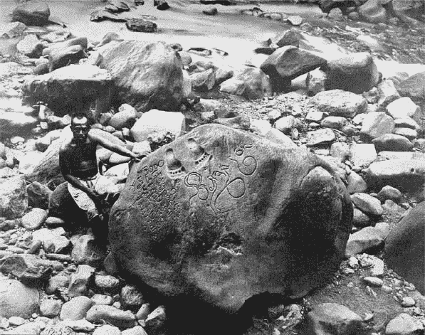

恰鲁鲁滕铭文

转载自：W. F. Stutterheim, *Pictorial history of civilization in Java*. Mrs. A. C. de Winter-Keen 译，The Java Institute and G. Kolff & Co., Weltevreden, 1926.

所刻的符号与 4 至 5 世纪兴盛于印度的帕拉罗瓦帝国（Pallava Empire）使用的符号非常相似，语言是梵语。足印右侧的大型符号意思是“塔鲁曼纳加拉的普尔纳瓦尔曼国王（King Purnawarman）”，这是早期破译的；而左侧的一串小符号则在 20 世纪 20 年代被破解。英文原文为：

```
Of the valiant lord of the earth, the illustrious Purnawarman, [who is] the ruler of the town of Taruma, [is] the pair of footprints like unto Vishnu’s.
```

这表明普尔纳瓦尔曼被视为并尊重印度教神毗（Vishnu）的化身，或具有类似神性的存在。

古代石碑在印尼语中被称为称为“prasasti”。由于在博哥附近又发现了四件该时代的铭文，分别位于雅加达东部的 Tugu，以及雅加达平原西部万丹南部 Cidanghiang，塔鲁曼纳加拉的统治范围涵盖了相当广的区域。此外，雅加达平原到处出土了大量被视为同一时代的石斧和其他石器，在同一区域还发现了几块铜板。在平原东部卡拉万（Karawan）附近发现的两尊毗奴石像证明了塔鲁曼纳加拉王国信仰印度教。

### 咖啡园铭文（Prasasti of Kebun Kopi）

让我们来看看一些相当迥不同的铭文记录。在咖啡种植园发现并于 19 世纪 60 年代报道的“咖啡园铭文”也被称为“象足铭文”（Prasasti Telapak Gajah），因为上面刻有一双象足印。上面刻着：

```
Here appeareth the pair of the (brilliant) Airawata-like elephant of the Lord of Taruma [who is] great in strength and victorious.
```

爱罗瓦塔（Airawata）是战神因陀（Indra）的坐骑白象，而牛神南迪（Nandi）是湿婆（Shiva）的坐骑，神鸟迦罗达（Garuda）是毗奴的载体，后者的名字被用作国。由于由于爪象在历史时期之前就已经灭绝，国王和追随者可能是从苏门腊带来了他们的大象。

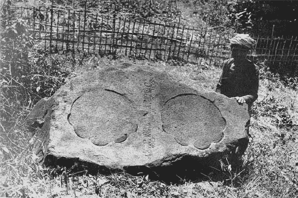

咖啡园铭文

转载自：Vogel, J. Ph., *The earliest Sanskrit inscriptions of Java*, Publicaties van Oudheidkundingen in Nederlandsch-Indie, Albrecht & Co., 1925.

### 詹布铭文（Prasasti of Jambu）

位于博哥西西 30 公里詹布（Jambu）帕西尔科昂拉克山（Pasir Koleangkak）上的一块石头自 19 世纪 50 年代起就为人知，被称为“詹布铭文”或“帕西尔科昂拉克铭文”。它有一双人类足印和两行诗句：

```
Illustrious, munificent, and true to his duty was the unequalled lord of men – the illusions Purnawarman by name – who once [ruled] at Taruma and famous famous armour (varman) was impenetrable by the darts of a multitude.
```

他的这双足印，在摧毁敌对城市方面极其敏捷，对虔诚的君主是有益的，但却是他敌人眼中之刺。

这块石碑被认为是在普尔纳瓦尔曼去世后建立的，表明这位国王也是一位卓越的战士。

### 杜古铭文（Prasasti of Tugu）

杜古铭文此前只有 10 厘米的头部露出地面，当地人还会在它侧面献花烧香。当它在 1879 年被挖掘出来时，发现它是一块高约 1 米的三角形石块，其表面刻有一首五行 100 个词的诗歌，记录了普尔纳瓦尔曼国王时期进行的水利工程。

曾由万王之王、力士古鲁（Guru）开凿的钱德拉巴加河（Chandrabhaga），在到达著名的城市后流向了海洋。在他日益增长、繁荣的统治的第二十二年，显赫的普尔纳瓦尔曼——他因繁荣和美德而闪耀，是人类统治者的装饰[*字面意为旗帜]——开凿了水质清的甘马提河（Gomati），长六千一百百二十十二弓[dhanus]，始于帕尔古纳月月初八，完成于凯提拉月月中十三。这条曾撕裂祖父和皇家圣者营地的河流，在获得婆罗门赐予的一千头牛后，重新流淌。

这段描述在某些部分具有模义性。首先，虽然 Candrabhaga 和 Gomati 可能是以印度存在的河流命名的，但尚不清楚它们实际上对应西爪哇的哪条河流。如果假设它们是石碑发现地附近的河流，那么其中一条可能被视为贝卡西河（Bekasi River），但更合理的解释是它们 Ciliwung 和 Cisadane，这两条流经现波哥尔（Bogor）地区并汇入爪哇海的主要两条河流。其次，怀疑是否可能在二十一天内挖掘出长度达 6,122 dhanus（被认为是 7 英里 [11.3 km] 或 12 英里 [22.9 km]）的河流或运河⁷。Purnawarman 与“万王之王”、祖父以及王室圣者之间的关系是模糊的⁸。

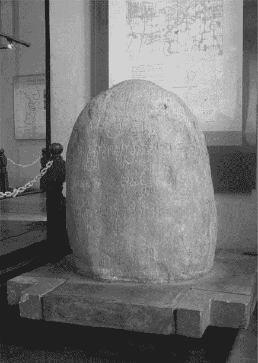

Tugu 石碑（复刻品），雅加达历史博物馆

由 M. Iguchi 许可拍摄，2006 年 9 月。

然而，记录表明，像 Purnawarman 这样的统治者曾努力治理河流（这些河流至今经常泛滥），而且 Tarumanagara 作为一个稳固的王国统治该地区。

### 古汉语文献中的记载


尽管这些石碑（prasasti）是证明 Tarumanagara 存在的唯一直接证据，但许多与该王国相关的文献显然留在了中国⁹。在后汉的一部书中《南蛮西南夷列传》中记载：“公元 131 年，越南海岸之外的叶调（Ya-diao）之王向本朝派遣使节：皇帝赐之金印和紫绶带勋”¹⁰。“叶调”被解释为 Jawadwipa（dwipa 意为岛）的音译，其国王被认为是 Salakanagara 的 Dewawarman¹¹，这是一个在 Tarumanagara 出现之前就已经存在的王国，见下文。

5 世纪初，一位来自东晋的佛教僧法显（Fa Xian）在斯里兰卡返回中国的途中，经过九十天的艰辛航行到达 Jawadwipa，在那里停留了五个月。在公元 414 年写的《佛国记》中，他写道：“那里有很多异教徒（即当地巽达人）和婆罗门，但无佛教”¹²。虽然没有明确给出该国的名称，但假设该国就是 Tarumanagara。

关于 Taruma 的更具启发性的描述发现于《宋书》（*Sung Shu*）¹³。我问了我在波哥尔的几个朋友，但西爪哇似乎没有哪个地方听起来像从中英字典里得到的“ka-ra-tan”发音。当我访问并询问雅加达的一位华印裔朋友 M 女士时，她在思考后告诉我，那个发音可能是“a-lo-tan”，或者可能是“a-ro-tan”，因为中间那个字“罗”的读音可以是“ro”，正如 Roma 被译为“罗马”。在从她家回路上，我哼着“a-lo-tan”或“a-ro-tan”，一个念头闪过脑海。那一定是 `Ci-Aruteun` 的“Aruteun”，也就是发现“Ciaruteun 石碑”（Prasasti Ciaruteun）和“Kebun Kopi 石碑”（Prasasti of Kebun Kopi）的地方！字面上，“Ci-” 只是巽达语中表示水的前缀。在 Ciaruteun，我见过几块约 50 厘米见方的大立方石，它们一定是是宫殿或某些宏伟建筑的地基，正如下文描述。如果上述解释是正确的，会导致……

萨卡纳加拉（Salakanagara），也称为 Rajatapura，在托勒密（公元 150 年）的世界地图上被标记为`Argyre`。据说它由德瓦瓦尔曼（Dewawarman）建立，他来自印度的帕拉瓦王朝，抵达爪哇岛，并与当地统治者 Aki Tirem（又名 Aki Luhur Sang-mulya）的女儿结婚。该王国首位于 Teluk Lada（现今的潘德朗县），统治了该地区超过 200 多年，直到公元 358 年，德瓦瓦尔曼八世的儿子杰亚辛哈瓦尔曼（Jayasinghawarman）在领土东部建立了塔鲁曼纳加拉（Tarumanagara），随后该王国可能作为一个区域性王国继续存在了一段时间。杰亚辛哈瓦尔曼本人是萨兰卡雅纳（Salankayana，印度帕拉瓦王朝的附属国）的大祭，但在爪哇岛避难，因为他的家乡被摩羯罗王国（Magada Kingdom）征服了。普纳瓦尔曼（Purnawarman）是他的孙子。石碑上用准确的梵文和优美的帕拉瓦文字书写 20，这一事实从他的家族背景来看是可以理解的。

据说，塔鲁曼纳加拉的创始人杰亚辛哈瓦尔曼于公元 382 年去世，安葬在戈马蒂河（Gomati River）岸；第二任国王达马亚瓦尔曼（Darmayawarman）于 396 年去世，安葬在甘德拉巴加（Candrabhaga）岸，但如前所述，具体地点未知。在普纳瓦尔曼统治期间（公元 395–434 年），王国最为繁荣，拥有 48 个属国，范围从西部的萨卡纳加拉到东部的普尔瓦林加（Purwalingga，现今中爪哇的普博林戈）或西帕马里（Cipamari，中爪哇的布雷维斯河）。公元 397 年，他在海岸附近建造了新首都孙达普拉（Sundapura），这被认为是后来的位于北雅加达的孙达凯帕（Sunda Kelapa）21。

公元 526 年，第七任国王苏里亚瓦尔曼（Suryawarman）的女婿尼基马亚（Manikmaya）在领土东部（现今万隆东部 Cicalengka 附近）的肯丹建立了一个小新王国；公元 612 年，尼基马亚的曾孙雷提肯丹尤恩（Wretikandayun）在远东地区（现今 Ciomas 附近）建立了加鲁赫王国（Galuh Kingdom）。塔鲁曼纳加拉本身在公元 650 年左右遭到基于苏门答腊的强国室兰腊的进攻并击败，变得衰落。公元 669 年，塔鲁曼纳加拉的第 12 位国王林加瓦尔曼（Linggawarman）将王国让给了他的女婿——孙达国王林加瓦尔曼，塔鲁曼纳加拉的历史就此结束。杰亚辛哈瓦尔曼家族选择爪哇作为避难地的原因是什么？除了同相同出身的德瓦瓦尔曼建立的萨卡纳加拉已经存在，以及该岛的土壤相当肥沃之外，群岛周围丰富的香料可能也具有吸引力。其中包括原产于摩鹿加群的丁香和肉豆蔻，这些地方在后几世纪被称为“香料群岛”。不言而喻，现代储存方法出现之前，亚洲香料作为欧洲肉类的防腐剂和除味剂是不可缺的，因为 15 世纪奥斯曼土耳其人切断了传统的中东贸易路线 22，迫使葡萄牙、西班牙和荷兰人探索通往亚洲的新路线。

由于杰亚辛哈瓦尔曼抵达爪哇的时间恰逢罗马帝国的黄金时代，对香料的需求一定激增，这些物品的出口对王国的财政出了巨大贡献，无论他们是否直接参与了传统上由印度人、阿拉伯人和尼基人进行的香料贸易。

爪哇的特产中，可能包括靛蓝，因为在塔鲁曼纳加拉以及西爪哇最大的河流西塔鲁姆（Citarum）中，“Tarum”的意思都是靛蓝。可能这种染料在那个时代就已经大量生产并代表他们国家的名称。事实上，在 20 世纪初合成靛蓝变得普遍之前，爪哇是世界市场上天然靛蓝的主要供应商。仅供参考，爪哇靛蓝提取自豆科植物（`Indigofera tinctoria` L），与来自蓼科或虎形菜科的日本靛蓝“Ai”（`Polygonum tinctorium`）不同。

### 海外到爪哇的移民

关于印度移民与当地苏达达人之间的关系，弗因-梅斯（Fruin-Mees）在她的书 9 中写道：“尽管来自印度的新移民在文化上优于苏达达人，但他们的特点并不是试图强迫他人采纳自己的自由艺术的人。他们可能并没有太多交往，而是与信奉祖先崇拜的苏达达人共同居住，且通婚很少见。根据他们的种姓制度 23，当地人被视为属于最低的苏德拉（Sudra）阶，但印度人并没有通过武力统治他们。苏达达人本身尚未发展到能够接受高层次的宗教和文化。”另一方面，在艾克曼（Eijkman）和斯塔尔（Stapel）编写的一本教科 24。”

当我意识到这种冲突多年后，在《Pustaka rajya rajya i bhumi Nusantara》（群岛之王之书）[26](#part0010_split_001.html_fn_26) 的现代译本中找到了答案，这本书是在万隆斯里巴杜加博物馆的小图书馆偶然发现的。书中有这样的话：“来自婆罗门（印度）来到爪哇（阿吉萨迦随从）的人有商人、官员和宗教领袖，”‘他们希望妻子孩子能在那里和平生活’，”‘来自帕拉瓦的桑德瓦瓦尔曼与爪哇西部、火岛和苏门答腊南部的居民保持友好’等。

尽管他们带着家人，但 4 世纪及更早有多少印度人移民是不确定的，但女性的数量相对较少。很难想象在塔鲁曼纳加拉十二位国王统治的 300 年里能保持纯正血统，尽管在最初的几代可能是可能的。

### 婆罗洲岛的古泰王国

在东加里曼（婆罗洲）的`Kutai-Kurtanegara Regency`，发现了约七件带有`Pallava scripts`文字的`prasasti`（碑文），这些文字与`Tarumanagara`碑文上的文字相似。碑文用梵文记载了`Martapura`或`Martadipura`的伟大国王`Mulawarman`曾向印度教神灵和祭司献了两万头牛，并举行仪式；他的父亲和祖父的名字分别为`Aswawarman`和`Kundungga`，后者是该国的创始人等。根据这些文字的特征，推测该王国比`Tarumanagara`更古老，是东印度群岛第一个王国。从名字结尾的相似性来看，皇室被认为与从印度移民而来的`Tarumanagara`人属于同一族群。该王国被广泛称为`Kutai 王国`，以 16 世纪建立的`Kutai-Kurtanegara 苏丹国`命名 27，而其原名`Martapura`即使在学术书中也罕见，更不用说教科书了。`Martapura`这个名字在日语书中从未出现。

我访问这座古王国故乡的愿望在 2007 年几乎实现，但没有机会看到遗迹。我和朋友抵达了`Tenggaron`的`Mulawarman Museum`，是在`Mulawarman University`的`Dr. Mrs. W.`开车从`Samarinda`沿着`Mahakam River`向上了一个小时。该大学也以这位伟大国王的名字命名。遗憾的是，苏丹宫那座 19 世纪的荷兰风格建筑正在装修，只能听到锤击声。被告诉我，要到达`prasasti`发现地，需要沿`Mahakam`上游航行两个昼夜。`Mrs. W.`同情地告诉我，这座博物馆馆藏的`prasasti`只是复制品，真品已被移至雅加达的`National Museum`。看着宽达`500 m`且水流充沛的`Mahakam 河`，我脑海中浮现出古王国的景象，即便身处那里也感到幸福。来自西爪哇的`Mrs. W.`对`Tarumanagara`以及`Martapura`有着丰富的知识。关于古代印度人为何来到定居在东加里曼如此遥远的地方，她说那里位于通往中国的的海上航线上，他们会将其作为贸易点。我也了解到东加里曼曾盛产黄金，而现在主要产品是木材和石油。

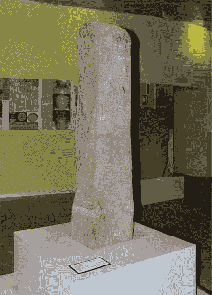

`Mulawarman 碑文`（复制品）

`印尼国家博物馆`

从`Mulawarman`时期直到 17 世纪伊斯兰王国兴起，该地区的历史完全未知。17 世纪，当`VOC`（荷兰东公司）的`Cornelis Speelman 海军`攻击望腊岛的`Gowa 王国`，`Sultan Hasanuddin`在 1667 年随着`Macassar`陷落，几千不愿投降的布吉斯人被流放到海峡对面的`Kutai`。`Kutai`苏丹热烈接待了他们，并给了他们土地，诞生了一个名为`Samarinda`（字面意思是“平等对待”）的城镇。`1668 年 1 月 21 日`被定为现今`Samarinda`市的周年纪念日。是因为这一传统，我们没有听到该地区有任何族群问题，尽管`Samarinda`的`600,000`居民不仅包括`Kutai`人和布吉人，还有来自加里曼内陆的`Dayak`和其他岛屿的民族？`Mulawarman University`部门的氛围看起来和平，没有派系冲突。

## 访问 Ciaruteun 村

本文开头提到的`Prasasti Ciaruteun`真品于 1990 年从发现河床移走，放置在附近岸边的棚子下。从`Bogor`开车一个半小时，该地点位于一个典型的西爪哇乡村，周围是香蕉和木薯地。当我和同事访问时，一位受托看守遗迹的男士亲切地引导了我们。石碑坐落在一个开放式建筑中间，周围围着铁栅，屋顶下的景观似乎与我在`Bogor`公园看到的复制品相同。当我发现石碑几部分刻有现代字母刻的日期和首字母等无关涂鸦时，我非常震惊，并意识到当局决定将其移到安全地点的原因。告示牌上写着：“损坏物品者处以一亿卢比罚款！”从这笔巨款（当时约 500 万日元）可以推测，石碑对`印尼教育文化部`有多重要。根据参与疏散工作的看守者说，整个工作完全靠人力完成，因为在植被茂密的悬崖上无法运入大型机械。由于石头重量超过十吨，10 个人花了六个月才完成，在某些情况下每天只能移动`8–10 cm`。

后来，我不经意看到了一些描述雅加达`Museum Taman Prasasti`（碑文公园博物馆）内作业过程的照片，并思考了看守者及其同事所付出的艰辛。

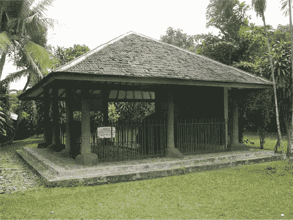

存放`Prasasti Ciaruteun`的棚子

左前方可以看到一个告示牌。`M. Iguchi`拍摄，2006 年 9 月。

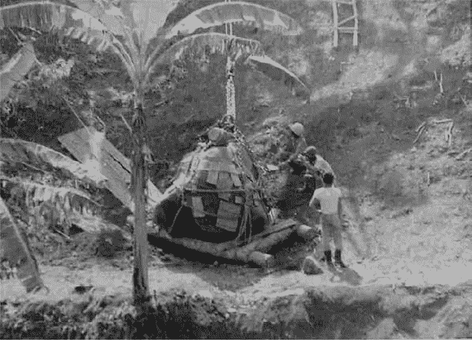

`Prasasti Ciaruteun`的疏散作业

照片由`Iguchi`经授权复用于`Museum Taman Prasasti Tanah Abang`，2006 年 9 月。

`Prasasti Telapak Gajah`（象印碑）发现于`Prasasti Ciaruteun`现场`200 metres`处。我们被告诉那里是原址，在为保护石头而建造的棚子柱子上，有同样的告示牌。在周围的田里，咖啡树已不在，被木薯植物取代，尽管这座石碑仍被称为`Prasasti Kebun Kopi`。接着，我们被带到一处地方，看到四块直径约半米的石头。其中两块嵌入地面的石头上有十几个直径`6–7 cm`的孔。我的一个年轻同事`Mrs.`笑着说：“噢，天哪！这是`congklak`！我小时候玩过。” 这种在巽达语中被称为`congklak`、爪哇语称为`Dakon`的智力游戏在印尼儿童中仍然流行。尽管另一种理论认为这种游戏的起源并非印度，而是非洲某地，但可以确定是建立`Tarumanagara`的印度人将其引入爪哇岛的。想象古人在这些石头周围玩这种游戏是很有趣。

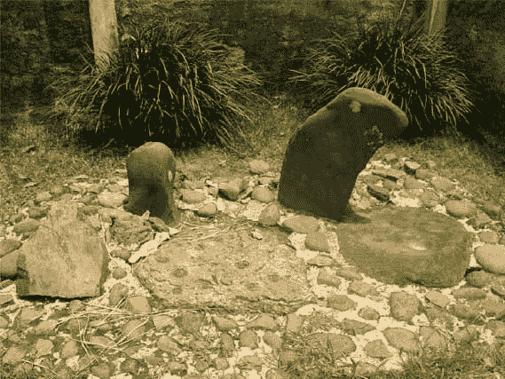

达鲁曼加时代的`congklak`游戏场

`M.Iguchi`拍摄，2006 年 9 月。

同样有趣的是几块约`50-cm`立方体的花岗岩石，其中一个表面有一个约`40 cm`宽、`5 cm`深的正方形凹槽，被放在看守者房屋的屋檐下。几块同类型的石头散落在附近的香蕉地。这些石头可能是某座建筑的基石，从适应方形凹槽的柱子尺寸判断，该建筑曾非常宏大。我思考`Purnawarman 国王`的宫殿可能就立在那里。导游告诉我们，位于`Bogor`中途的`Darmaga`村的名字可能源于`Purnawarman`的前任`Dharmawarman 国王`。


据说是达鲁曼加时代大型建筑的基石。

由 M. Iguchi 拍摄，2006 年 9 月。

在文章开头，关于位于波哥尔（Bogor）市 Kencana 公园的 Ciaruteun 刻碑复制品，我用过去式写道“那里有一块黑石……”。事实上，当我几年后再次回到该公园时，那个复制品已经不在了，一盏用于夜间照明的路灯站在了同样的位置。那里的人告诉我，这座纪念碑在几年前被移走了，但没有人人知道它的去向。我的一个朋友代表我向当地旅游局询问，他们回答说：“这座纪念碑因为阻挡通行被毁并移走了。它只是一个用玻璃纤维和树脂制成的装饰品，用来装饰公园”，这令我非常失望。无知官员对珍贵结构的破坏往往发生在任何地方，我记得这样一个案例`²⁸`：位于雅加达著名的 Harmonie 大楼于 19 世纪初由一位当地承包商建造，为了拓宽道路和提供汽车停车位而被拆毁移走。尽管我在公园附近住了三年，但我从未给纪念碑拍过照，因为我从未预料到它的消失。我不知道制作了多少个复制品，但我仍然相信它是其中之一。无论如何，正是它促使我研究爪哇古代的历史。

那些发现难以前往 Ciaruteun 村的人，可以在北雅加达的历史博物馆（位于法塔希拉广场公园 Taman Fatahillah，荷兰东印度群岛时期的市政厅）看到它的复制品，以及来自咖啡园（Kebun Kopi）、图古市（Tugu）等地的其他刻碑复制品。它们是极其精美的复制品，如果不经告知，人们会以为它们是真品。位于中雅加达默德卡路（Jalan Merdeka, Medang Meredeka Barat）的国家博物馆收藏了来自整个印度尼西亚群岛各地的历史珍宝。这座于 2006 年 11 月开馆的新建筑，其楼层设计旨在从文化、技术等角度展示其藏品。在开馆之前，我在一位博物馆馆长——朋友的介绍下参观了那里，当时一个角落正准备展示印度从库泰（Kutai）和塔鲁曼纳加拉（Tarumanagara）王国时期到现代的文字发展。我钦佩了研究这些文献的铭文学者的努力，对我非专业人士来说，这些文献看起来只是一串串奇特的符号，我假设从梵文到爪哇文字和巽达语文字的转变过程可能与日本相似，在日本，*变假名*（中间草书体日语文字）由草书体汉字诞生并演变为*平假名*（现代日语文字）。

### 波哥尔周围的气候

位于东格德山/潘朗戈山（Mt. Gede/Pangrango）与西萨拉克山（Mt. Salak）之间的山区是爪哇岛上极其多水的地区，属于热带雨林气候，因此波哥尔被称为 *Kota hujan*（雨城），年降雨量超过 2,500 毫米。根据我的经验，即使在旱季（通常为 4 月到 9 月），至少每三天一次雨；而在雨季（10 月到 3 月），一周不见阳光并不罕见。下雨几乎总是伴随着雷暴，正如《吉尼斯世界大全》记载，该城市拥有“每年雷暴天数最多”（322 次雷暴/年）`²⁹`。闪电如此剧烈，以至于植物园许多大树和路边的树经常被劈裂。即使有现代防雷设施，停电半小时也并非常事，因此蜡烛和灯笼是家中的必需品，许多办公室和酒店也配备了私人发电机。在波哥尔停留期间，我的电脑调制器曾因电话线路进入的电涌损坏过一两次，我获悉当天空布满乌云时拔掉电缆是最好的措施，因为普通的浪涌发生器是无效。随着山上和田野的降水汇入奇里翁河（Ciliwung）和西萨达尼河（Cisadane），自荷兰时期或古代塔鲁曼纳加拉王国时代以来，水土保持一直是政府的一个大问题。虽然波哥尔位于这些河流中游的损害并不严重，因为道路临时变成了急流，但含有被侵蚀火山土的浑浊泥水流向雅加达，每隔几年就会导致灾难性的洪水。


西爪哇中部的鸟视图。（视角=45°）

等高线通过 `QGIS` 地理程序结合 `SRTM 90m Digital Elevation Data`、`Srtm_58` 获得。河流和湖泊的数据通过 `Diva-GIS` 分别通过“`IDN_water_lines`”和“`IDN_water_area`”获得。

尽管如此，各种火山灰矿物质的充足水分自古以来一直是农业的福音，使爪哇岛成为世界上人口最稠密的地区。在西爪哇，格德山/潘朗戈山周围的山丘被广泛用于种植橡胶、茶和其他园林作物，以及日常消费的水果蔬菜，而肥沃的稻田在边缘平原地区发展。位于山脉以东的钦安久尔（Cianjur）以生产印度尼西亚质量最好的米而闻名，等同于日本中部的宇云沼地区.`³⁰`


热带地区没有下雪，但冰雹（当地称为 *hujan es*，冰雨）经常发生，并在电视或报纸上报道。这是我二十年前的一次经历，当时我独自开车在万隆的齐哈梅拉斯路（Jalan Cihampelas），深夜，一些路灯下闪闪发的小颗粒击中了我的汽车挡风玻璃。那时的交通很稀疏。好奇它们是什么，我停下车，捡起掌中的颗粒，最终意识到它们不是别的冰粒而已。

印度尼西亚除了石刻文外，为什么留下了文献是一个争议问题。在公元 1 世纪东汉蔡伦发明纸张之前，欧洲使用羊皮纸或羊皮作为记录材料，而印度尼西亚传统使用的载体是“lontar”。它是用蜜棕或西洋榔（*Borassus flabellifer*）的叶子制成的，方法是用药水煮、切成条状，然后用铁笔刻上字母和插画，最后用烟和油的混合物填充刻痕。这些条像遮阳帘一样捆在一起。这些材料本身在潮湿的热带气候下并非能保存世纪的类型，但它们可能被埋在西萨拉克山和东格德山/潘朗戈山火山灰形成的地层下，这些火山非常活跃且频繁喷发。因此，不仅是文献，建筑可能也被埋在地下，只有被雨水河水冲刷的石碑出现在今天人们眼中。


Lontar 文献示例。复制自：[`commons.wikimedia.org/wiki/File:Naskah_Sunda_Lontar.jpg`](http://commons.wikimedia.org/wiki/File:Naskah_Sunda_Lontar.jpg)（Aditia Gunawan 贡献）。传说这是一份老的巽达语文献，但时间未知。

## 古代的火山喷发

克拉拉托山或克拉拉托岛位于爪哇岛以西的巽他海峡，也因 1883 年一次大喷发而闻名。在发表于《自然》杂志的题为《克拉拉托早期的喷发》的文章中，Judd 教授介绍了收藏于苏丹门廷图书馆的《古王书》（*Pustaka Raja Purwa*）中的一段描述，该书记录了古代时期一次巨大的火山爆发。

> “在萨卡历 3338 年（即公元 416 年），从巴图瓦瓦拉山（现位于万丹的普洛萨里）传来了雷鸣般的巨响，随后位于现代万丹以西的卡皮山发出了类似的响声。一道冲天彻地的巨大火光从后一座山中喷涌而出；整个世界都剧烈震动，并伴随着大雨和风暴的剧烈雷鸣；然而，这大大雨不仅没有熄灭卡皮山的火喷发，反而加剧了火势。那声音极其可怕，最后，卡皮山在巨大的轰鸣声中崩碎并没入地底。海水涨起，淹没了陆地。从巴图瓦瓦拉山东部到卡穆拉山（现位于布加尔东部的格德山），向西到苏门答腊南部楠榜的拉贾巴萨山的整个地区都被海水淹没；巽他地区北部到拉贾巴萨山之间的居民被淹死并随同所有财产一同被卷走。
>
> ‘当水退去后，卡皮山和周围土地变成了海洋，爪哇岛分裂成了两部分。
>
> ‘位于苏门答腊内部的马斯库塔城变成了海洋，水质清澈，后来被称为辛卡拉湖。这就是苏门答腊和爪哇岛分离的起源’”

据说《古王书》是由 Ranggawarsita III 参考某些传统或更古老的文献写的。关于克拉拉托喷发的同样故事，在 Purwadi 教授近期著的一本书中有更详尽的记载。David Keys 在《灾难——对现代世界起源的调查》一书中，假设 6 世纪中期世界各地经历的各种灾难是由一种非凡现象引起的，并推测其发生在 535 年。作者同样参考了《南代史》中的记载，提到在公元 529 年 12 月（闰月），曾从西南方向两次听到雷声，并认为它们是克拉拉托喷发的声音。Wohletz 与 Keys 合作进行了一项模拟，假设喷发量为 200 立方公里（即 1815 年弗罗里斯岛汤波拉山的几倍），直径为 50 公里，并将克拉拉托放置在火山口，展示了一张苏门答腊和爪哇曾相连的地图。


计算机模拟显示了古代克拉拉托喷发导致岛屿的分裂。

由 K. H. Wohletz 慷慨提供，来自：[`www.ees1.lanl.gov/Wohletz/Krakatau.htm`](http://www.ees1.lanl.gov/Wohletz/Krakatau.htm)

关于喷发究竟何时发生仍然是一个悬念。

其中，Rakryan Juru Pengambat 被认为是一位官员。公元 536 年大约是 Tarumanagara 的王位从第 6 位国王 `Chandrawarman`（515–35 年）传位给第 7 位国王 `Suryawarman`（535–61 年）的时期，也是 Suryawarman 的女婿 Manikmaya 在现今万隆以东的 Kendan 建立新王国的时期（公元 516–68 年）。这表明当时发生过某种灾难，迫使政府所在地发生了迁徙，尽管当时苏丹达国王是谁以及首都所在地已完全不为人知；这并不意味着那次火山爆发规模大到足以将岛屿分裂为爪哇岛和苏门答腊岛。

在上述的《群岛之地的国王之书》中，Pulau Api（阿皮岛）被认为是存在 `Mt. Api`（阿皮山或克拉拉托火山）的岛屿。根据“西爪哇岛、阿皮岛和 Somateria 岛南部”被关联在一起这一事实，这些岛屿至少在第 2 世纪就已经彼此分离并独立了。据我所查，在同一本书中并没有发现任何暗示火山爆发的描述。

根据对巽达海峡周围沉积物的研究，曾有一项估计认为古克拉拉托火山发生于 60,000 年前，但地质学家对此似乎并不确定。

## 1883 年克拉拉托火山的爆发

1883 年克拉拉托火山的爆发本身也是一次震惊世界的自然事件，一座主峰高 813 米的岛屿被炸毁；其声音在 3,500 公里外的澳大利亚西澳珀斯以及 4,800 公里外的印度洋岛屿罗德里格斯岛也能听到。巨大的海啸淹没了爪哇岛和苏门答腊沿海地区的城镇村庄，导致数万人死亡，官方死亡人数为 36,417 人。


1883 年爆发前克拉拉托火山的草图。

（《伦敦插画报》，1886 年 9 月 9 日）。

转载自：[`alltomvetenskap.se/index.aspx?article=4474`](http://alltomvetenskap.se/index.aspx?article=4474)

在宽银幕黄金时代，有一部名为《克拉拉托火山：爪哇之东》的电影，其故事与这场灾难有关。在 DVD 上重温后，这部在数字技术出现很久以前的奥斯卡最佳视觉效果提名电影中，其拍摄的喷火和流岩的真实场景再次给我留下了深刻印象。

在 1883 年克拉拉托火山爆发时，响应科学期刊《自然》的报道，维多利亚时代的诗人杰拉德·曼利·霍普金斯（Gerald Manley Hopkins，1844–89）在给编辑的一封信中这样描述他在 1884 年 10 月 19 日傍晚在都柏林看到的日落颜色：

> 它是如此剧烈：地面附近是青铜色的；上方像桃子，或是像熟透榛果的红色。它向南方延伸。火山的“烟云”似乎变成了地球的卫星，像土星环一样，并随着相位变化，而我们现在正在见证其中生动的瞬间。

事实上，作为一名在大学（都柏林）拥有职位的诗人和学者，霍普金斯能够用文字描述日落景象，而挪威艺术家爱德华·蒙克（Edvar Munch）后来在《呐喊》（1893）中用色彩表达了这一点。


爱德华·蒙克 1893 年的作品《呐喊》

转载自：[`en.wikipedia.org/wiki/File:The_Scream.jpg`](http://en.wikipedia.org/wiki/File:The_Scream.jpg)

在许多书籍和文章中，下面的一首诗被引用为阿尔弗雷德·丁尼森勋爵的作品：

> *若是某座火峰的剧烈灰烬
>
> 被喷得如此之高，环绕全球？*
>
> *因为日复一日，在许多血红色的傍晚，*
>
> *愤怒的日落闪烁。*

它听起来“很像克拉拉托火山”，但我一直怀疑这首四行诗是否真的是这位通常写长诗的维多利亚时代桂冠诗人的完整作品。2003 年，杰夫·马修斯教授给出了答案，他热心地解决了这个问题：这实际上是一个未知人士从一首 80 行的长诗《圣特勒马科斯》中未经授权的节录，在那首诗中，诗人想象公元 400 年当修士（也被称为阿尔马基乌斯）在亚洲（现今的小亚细亚）听到了上帝的声音。

在 1883 年爆发中消失的克拉拉托火山在 2005 年再次出现，山口高 300 米。


《圣特勒马科斯》

转载自：[`alltomvetenskap.se/index.aspx?article=4474`](http://alltomvetenskap.se/index.aspx?article=4474)

让我补充关于克拉拉托火山名称的几行，它也被称为 `Krakatoa`。广泛认为它源自梵语单词，意为“蟹”的 `krakata`，在英语中……它据称源自葡萄牙语的“看到” `krakata`。

在结束本章之前，让我们回顾一下过去存在于爪哇岛的主要王国，这些王国已知于《国王之书》。

| 王国 | 时期 | 国王数量 |
| :--- | :--- | :--- |
| Salakanagara 王国 | 130–358 | 12 位国王 |
| Tarumanagara 王国 | 358–669 | 12 位国王 |
| Kendan/Galuh 王国 | 516–852 | 14 位国王 |
| Sunda 王国 | 669–1333 | 28 位国王 |
| Kawali 王国 | 1333–1482 | 6 位国王 |
| Pajajaran 王国 | 1482–1579 | 6 位国王 |

Tarumanagara 的血统从 358 年的 `Jayasingawarman` 开始，一直维持了十几个世纪，直到 1579 年 `Pajajaran` 的结束。如果我们从公元 130 年 `Salakanagara` 的建立开始计算，这段时期跨越了四个世纪。

## 第三章注释

________________________

1. `Ciaruteun`，字面意思是 `Aruteun 河`。`Ci-` 是巽他语中的前缀，意为“水”，或河流、湖泊、沼泽、湿地等。在西爪哇有很多这样的地方。

2. J. Ph. Vogel，《爪哇最早的梵文铭文》（收于 F. D. K. Bosch 编，*Publicaties van den Oudheidkundigen Dienst in Nederlandsch-Indie, Deel 1*，Albrecht & Co., Batavia 1925）。

3. Stutterheim 在 1925 年写道尚未破解（W. F. Stutterheim，（译：Mrs. A. C. de Winter-Keen），《爪哇文明图史》，The Java Institute and G. Kolff & Co., Weltevreden, 1927），但现代语言的翻译已由 Vogel（脚注 2）在同年 1925 年给出。

4. Abdurachman Surjomiharjo，《雅加达的扩张/The Growth of Jakarta》，Penerbit Djambatan, Jakarta 1977。

5. 第一尊雕像于 1959 年（1957 年？）由法国人让·波瓦斯利埃（Jean Boisselier）发现，并于次年被印度尼西亚大学的埃迪·塞迪亚瓦蒂（Edi Sedyawati）教授鉴定为 7 世纪的风格。第二尊雕像于 1975 年出土。（《雅加达邮报》，遗址讲述史前社会》，*雅加达邮报* 2007 年 2 月 27 日，[`www.southeastasianarchaeology.com/2007/02/27/sites-tell-of-prehistoric-societies-indonesia/`](http://www.southeastasianarchaeology.com/2007/02/27/sites-tell-of-prehistoric-societies-indonesia/)）。

6. 根据脚注 2 的译文，但部分不清楚之处已由作者参考以下内容进行了补全：Saleh Danasasmita，《波加尔史》（*Sejarah Bogor*），波加尔第 II 区市政政府，1983 年。

7. 印度教历中的 Phalguna（帕果月）和 Caitra（柴提月）分别对应 2 月 20 日至 3 月 21 日，以及 3 月 22 日至 4 月 20 日。*参见*附录 3.1。由于每月分为上旬（新月到满月）和下旬（从满月到新月），文中提到的时期计算为二十一天。

8. F. D. K. Bosch，《印度尼西亚考古学选集》（*Selected Studies in Indonesian Archaeology*），Martinus Nijhoff 出版社，海牙，1961 年。

9. Goto Akira，《伊斯兰世界史》（*A history of Islamic world*），放送大学 1993 年（后藤明，“イスラーム世界的历史”，放送大学教育振兴会 1993 年）。

10. 中文文本：永建六年，日南徼外葉調王便，遣使貢獻，帝賜調便，金印紫綬。[`toyoshi.lit.nagoya.ac.jp/maruha/kanseki/houhan076.html`](http://toyoshi.lit.nagoya.ac.jp/maruha/kanseki/houhan076.html)。

11. 将“叶调”（Ya-diao）对应于德瓦瓦尔曼（Dewawarman）的解释是由保罗·白寿民（Paul Pelliot, 1916）和 G·费兰（G. Ferrand, 1919）提出的（G. Coedes，《东南亚印度化国家》（*Indianized States of Southeast Asia*），夏威夷大学出版社，1968 年）。G·费兰将“便”视为瓦尔曼（Warman），将“调便”视为德瓦瓦尔曼（译者注：[W. Fruin-Mees，《爪哇史》（Geschiedenis van Java, Vol 1: Het Hindoetijdperk. Vol 2: De Mohammedaansche rijken tot de bevestiging van de macht der compagnie），Commissie voor de Volkslectuur, Weltevreden，1919 年及 1920 年 / 松冈静雄译：Madame Fruin-Mees 著《爪哇史》，岩波书，1924 年]）。栗原朋信（Tomonobu Kurihara）认为“调便”中的“调”是一个多余的字符（栗原朋信，《秦汉史的研究》，吉川弘文馆，1986 年）。千原大五郎（Daigoro Chihara）认为“叶调王便”是普尔纳瓦尔曼（Purnawarman）的理论（见于《婆罗布浮寺的建筑》（*The architecture of Borobudur*），原书房，1970 年），这一理论显然是错误的，因为时间差多达 250 年。

12. 中文文本：乃至一國名耶婆提其國外道婆羅門興盛佛法不足言。经典古籍刊行社出版，《法显传》（*The life of Faxian*），新华书店，1955 年（新华书店出版《法显传》，上海，1955 年）。

13. 中文文本：“呵羅單國治闍婆洲。元嘉七年，遣使獻金剛指鐶，赤鸚鵡鳥，天竺國白疊古貝，葉波國古貝等物。十年，呵羅單國王毗沙跋摩奉表曰：常勝天子陛下：諸佛世尊，常樂安隱，三達六通，． . . ．”。（名古屋大学，《宋书》（*Sung Shu* [*The Book of Sun*g]）卷九十七，列傳第五十七，夷蠻: 呵羅單國（*Arotan Country*），[`toyoshi.lit.nagoya.ac.jp/maruha/kanseki/songshu97.html`](http://toyoshi.lit.nagoya.ac.jp/maruha/kanseki/songshu97.html)）。

14. 在 K. Iwamoto，“三耶延德王朝与婆罗布浮寺”，载于：《东南亚——历史与文化》（*Southeast Asia* – *History and Culture*），东南亚历史学会，日本平日社，东京，1981 年（岩本薫，“Ｓａｌｅｎｄｒ王朝とBorobudur”，東南アジア学会“東南アジア‐歴史と文化”）。岩本写道，“作者认为‘呵羅單國’是三耶延德王朝（Sailendra）的音译”，并未提供任何音译解释或历史证据。这显然是错误的，主要是因为达鲁曼加拉（Tarumanagara）的鼎盛时期与其之间有 3.5 年的差异。K. Iwamoto，“三耶延德王朝与婆罗布浮寺”。Slamet Mulyana，《雅加达的发展》（*Pemekaran Kota*），Djambatan 出版社，1977 年。

15. [`id.wikipedia.org/wiki/Kerajaan_Salakanagara`](http://id.wikipedia.org/wiki/Kerajaan_Salakanagara)。

16. J. W. Judd, “克拉喀火山的早期喷发”，*Nature* 40, 1889, 365。*Pustaka Raja Purwa*（古王之书）是由巽洛西岛宫廷诗人 Ranggawarsita III 在 1860–80 年代编写的，据说是世界上最长的书。这本书收藏于苏拉卡塔（泗罗）的宫廷图书馆，不对公众开放。

17. Purwadi, *Sejarah asal-usul tanah Jawa*，Persada, 2004 [载自 Hamamdin, *Aceh Hingga Bali Membentang Dalam Satu Pulau*, 2009 年 5 月 11 日] ([`poestaka-ku.blogspot.jp/2009/05/aceh-hingga-bali-membentang-dalam-satu.html`](http://poestaka-ku.blogspot.jp/2009/05/aceh-hingga-bali-membentang-dalam-satu.html))。

18. 吉·萨卡（Aji Saka）的时代比 7 世纪伊斯兰教的出现早了六百年。虽然“苏丹”（sultan）一词主要指伊斯兰国家的主权或首领，但这个词后来被泛指代独裁者或暴君，例如英语中的“苏丹·克伦威尔”（参考 OED2）。因此，在 10 世纪的《马哈帕拉瓦》（Serat Mahaparwa）中使用这个词并不不妥。

19. David Keys, *灾难——对现代世界起源的调查*，世纪出版社，伦敦。


或许原作者指的是《南史》卷七——梁本纪中第七（“南史总目卷七, 梁本纪中第七, ‘大通元年 (西暦５۲9)閏十二月丙午, 西南有雷聲二’”）。笔者在《梁书》卷二——主二中也发现了一段记录：“公元 505 年武帝在位十一月甲午，天气晴朗，西南有电光，闻如雷声三次；公元 506 年天监五年闰十二月丙午，西南有雷声二（武帝中, 天监四年 (西暦５０５年)十一月甲午, 天晴朗, 西南有電光, 聞如雷聲三；天監五年 (西暦 506 年)閏十二月丙午, 西南有雷聲二）。”

K. H. Wohletz, “6 世纪的黑暗时代是由火山相关的气候变化引发的吗”，*EOS Trans Amer Geophys Union 2000*, 48 (81), F1305 ([`deephaven.ca/were-the-dark-ages-triggered-by-volcano-related-climate-changes-in-the-6th-century/`](http://deephaven.ca/were-the-dark-ages-triggered-by-volcano-related-climate-changes-in-the-6th-century/))。

佐和隆研编《印尼西亚的遗迹与美术》，日本放送出版协会 1973 (Ryuken Sawa (Ed.), *Historical remains and art in Indonesia*, NHK Publishing 1973)。

Saleh Danasasmita, *波哥尔史*，波哥尔特区 II 级市政府，1983。

例如：Ian W. B. Thornton, *克拉喀火山：岛屿生态系统的破坏与重组*，哈佛大学出版社，1997；Simon Winchester, *克拉喀火山：世界爆炸的日子：1883 年 8 月 27 日*，哈珀出版社，2005。

由 Bernard L. Kowalski 执导，马克西米利安·谢尔、戴安·贝克等主演，Cinerama 发行公司发行，1969 年。火山的位置特意从爪哇岛西部移到了东部。

*Nature*，1884 年 10 月 30 日，第 663 页。另见：Norman White, *霍普金斯：文学传*，牛津大学出版社，1995。

Jeff Mathews，“丁尼森、维苏湖与圣特莱马库斯” [`www.naplesldm.com/tenn`](http://www.naplesldm.com/tenn)

阿尔弗雷德·丁尼森，《桂桂诗人阿尔弗雷德·丁尼森全集》，麦米林公司，伦敦 1894 年，第 840–1 页。《圣特莱马库斯》的前 11 行如下：

若某座火山口的剧烈灰烬
被喷得如此高，环绕整个地球
那么日复一日，在许多血红色的傍晚，
在基督后四百年的夏天里，
愤怒的落日映照着十字架
在古老庙宇的的废墟上
不再对太阳神圣，却在巨大的坡上燃烧
在那人的洞穴中
那里那个用虔诚的手建造十字架的男人

Arysio Santos, *失落的大陆最终发现*，北大西洋书籍，2011。

## 第 3 章附录 (1)：印度历法/萨卡历法

印度历法是一种被称为`Vikram Samvat`的太阳历，据说是由古代印度的`Vikramaditya`创造的，元年对应公元前 58–57 年。每年从春分开始。每个月分为明亮的一半部分和黑暗的一半部分，后半部分的日期从 1 日开始。闰月置于年末。

广泛用于爪哇及其周边地区的萨卡历，源于吉·萨卡（Aji Saka）抵达的年份（或吉·萨卡去世），即公元 78 年。

印度历月份与公历的关系如下：

| 印度历 | 公历时期 |
| :--- | :--- |
| Caitra | 3 月 22 日 — 4 月 20 日 |
| Vaisakha | 4 月 21 日 — 5 月 21 日 |
| Jyaistha | 5 月 22 日 — 6 月 21 日 |
| Asadha | 6 月 22 日 — 7 月 22 日 |
| Sravana | 7 月 23 日 — 8 月 22 日 |
| Bhadra | 8 月 23 日 — 9 月 22 日 |
| Asvina | 9 月 23 日 — 10 月 22 日 |
| Kartika | 10 月 23 日 — 11 月 21 日 |
| Agrahayama | 11 月 22 日 — 12 月 21 日 |
| Pausa | 12 月 22 日 — 1 月 20 日 |
| Magha | 1 月 21 日 — 2 月 19 日 |
| Phalguna | 2 月 20 日 — 3 月 21 日 |

## 第 3 章附录 (2)：西爪哇王国

### A. 萨卡纳加拉王国 (Kerajaan Salakan)

| | |
| :--- | :--- |
| 1 Dewawarman I | 130 年 — 168 年 |
| 2 Dewawarman II | 168 年 — 195 年 |
| 3 Dewawarman III | 195 年 — 238 年 |
| 4 Dewawarman IV | 238 年 — 252 年 |
| 5 Dewawarman V | 252 年 — 276 年 |
| 6 Rani Mahisasardini Dewawarmanputri | 276 年 — 289 年 |
| 7 Dewawarman VI | 289 年 — 308 年 |
| 8 Dewawarman VII | 308 年 — 340 年 |
| 9 Khrodamuta | 340 年 |
| 10 Dewi Spatikawa Warmandewi | 340 年 — 348 年 |
| 11 Dewawarman VIII | 348 年 — 363 年 |

### B. 塔鲁曼纳加拉王国 (Kerajaan Tarumanagara)

| | |
| :--- | :--- |
| 1 Jayasinghawman Rajadirajaguru | 358 年 — 382 年 |
| 2 Rajaresi Dharmayawarman | 382 年 — 395 年 |
| 3 Purnawarman | 395 年 — 434 年 |
| 4 Wiisnuwarman | 434 年 — 455 年 |
| 5 Indrawarman | 455 年 — 515 年 |
| 6 Candrawarman | 515 年 — 535 年 |
| 7 Suryawarman | 535 年 — 561 年 |
| 8 Kretawarman | 561 年 — 628 年 |
| 9 Rajaresi Suddhawarman | 628 年 — 639 年 |
| 10 Dewamurtyatma Hariwangwawasman | 639 年 — 640 年 |
| 11 Nagajayawarman | 640 年 — 666 年 |
| 12 Linggawarman | 666 年 — 669 年 |

### C. 肯丹/加鲁赫王国 (Kerajaan Kendan/Galuh)

| | |
| :--- | :--- |
| (Kendan) 1 Resiguru Manikmaya | 516 年 — 568 年 |
| 2 Suraliman Sakti | 568 年 — 597 年 |
| 3 Kandih Rajaresi Dewaraja (Medangjati) | 597 年 — 612 年 |
| 4 Wretikayn | 612 年 — 702 年 |
| 5 Mandinyak | 702 年 — 709 年 |
| 6 Bratasen (Sena) | 709 年 — 716 年 |
| 7 Purbasora | 716 年 — 723 年 |
| 8 Sanjaya Harisdarma | 723 年 — 732 年 |
| 9 Tamperan Barmawijaya | 732 年 — 739 年 |
| 10 Manarah | 739 年 — 783 年 |
| 11 Manisri | 783 年 — 799 年 |
| 12 Tariwulan | 799 年 — 806 年 |
| 13 Welengan | 806 年 — 813 年 |
| 14 Linggabumi G1–G8: 国王居住在加鲁赫（其他不确定） |

### D. 巽达王国 (Kerajaan Sunda)

| | |
| :--- | :--- |
| 1 Maharaja tarusbawa | 669 年 — 723 年 |
| 2 Sanjaya Harisdarma | 723 年 — 732 年 |
| 3 Tamperan Barmawijaya | 732 年 — 739 年 |
| 4 Rakeyan Banga | 739 年 — 766 年 |
| 5 Rakeyan Medang Prabu Hulukujang | 766 年 — 783 年 |
| †) 在卡兰卡穆利安遗迹名单中，Manarah 的父亲 Adimurya Permata Dikusmah（732 年）被插入在 Manarah 之前（参见第 4 章）。 |
| *) 别名：Ciung Wanara |
| **) 别名：Dharmasakti, Lutung Kasarung |
| 6 Prabu Gilingwesi Rakeyan ujung Kulon (D5 的女婿) | 783 – 795 |
| 7 Pucukbumi Darmeswara (D6 的女婿) | 795 – 819 |
| 8 Prabu Gajah Kulon Rakeyan Wuwus | 819 – 891 |
| 9 Prabu Darmaraksa (D8 的姐夫) | 891 – 895 |
| 10 Vvindusakti Prabu Dewageng | 895 – 913 |
| 11 Rakeyan Kamuning Gading Prabu Pucukwesi | 913 – 916 |
| 12 Rakeyan Jayagiri Prabu Wanayasa (D11 的女婿) | 916 – 942 |
| 13 Prabu Resi Atmayadarma Hariwangsa | 942 – 954 |
| 14 Prabu Limbur Kancana (D11 的儿子) | 954 – 964 |
| 15 Prabu Munding Ganawirya | 964 – 973 |
| 16 Prabu Jayagiri Rakeyan Wulung Gadung | 973 – 989 |
| 17 Prabu Brajawisesa | 989 – 1012 |
| 18 Prabu Dewa Sanghyang | 1012 – 1019 |
| 19 Prabu Sanghyang Ageng (Situ Sanghyang s.m.) | 1019 – 1030 |
| 20 Prabu Detyamaharaja Sri Jayabupati | 1030 – 1042 |
| 21 Prabu Darmaraja (Winduraja s.m.) | 1042 – 1065 |
| 22 Prabu Langlangbumi (Kerta s.m.) | 1065 – 1155 |
| 23 Rakeyan Jayagiri Prabu Menakluhur | 1155 – 1157 |
| 24 Prabu Darmakusuma (Winduraja s.m.) | 1157 – 1175 |
| 25 Prabu Guru Darmasiksa | 1175 – 1297 |
| 26 Rakeyan Saunggalah Prabu Ragasuci (Taman s.m.) | 1297 – 1303 |
| 27 Prabu Citraganda (Tanjung s.m.) | 1303 – 1311 |
| 28 Prabu Linggadewata (kikis s.m.) | 1311 – 1333 |

### E. 卡瓦利王国 (Kerajaan Kawali/Galuh)

| | |
| :--- | :--- |
| 1 Ajiguna Linggawisesa (Kiding s.m.=D28 的女婿) | 1333 – 1340 |
| 2 Prabu Ragamulya Sang Aki Kolot | 1340 – 1350 |
| 3 Maharaja Linggabuwana (Bubat s.m.) | 1350 – 1357 |
| 4 Bunisora Suradipati (E3 的兄弟) | 1357 – 1371 |
| 5 Wastu Kancana (E3 的儿子) | 1371 – 1475 |
| 6 a. Dewaniskala (Kawali) b. Susuktunggal (Pakuan) | 1475 – 1482 1482 – 1482 |

### F. 帕加查拉王国 (Kerajaan Pajajaran)

| | |
| :--- | :--- |
| 1 Sri Baduga Maharaja (E6a 的儿子=E6b 的女婿)(在《帕加查拉王朝迁都》中的 Prabu Siliwangi) | 1482 – 1521 |
| 2 Prabu Surawisesa (Ratu Sangiang) | 1521 – 1535 |
| 3 Ratu Dewata | 1535 – 1543 |
| 4 Ratu Sakti | 1543 – 1551 |
| 5 Nilakendra Tohaan di Majaya | 1551 – 1567 |
| 6 Ragamulya Suryakancana (迁至 Pulasari) 1567 | 1551 – 1579 |

注释：

- **A**: 出自 Agus Aris Munandar, Edi Suhardi Ekajati, *Pustaka pararatwan i bhumi Jawadwipa, parwa 1, sargah 1-4*, Yayasan Pembangunan Jawa Barat, Jakarta 1991(Google Books)。
- **B**–**F**: 出自 Saleh Danasasmita, *Sejarah Bogor*, Pemerintah Daerah Kotamadya DT II Bogor, 1983
- s.m.: 死亡或安葬地

## 第 4 章

帕加查拉王国 – 巽达人的精神家园

### Batu Tulis，一座珍贵的石碑

在俯瞰西达丹河（Cisadane）的山丘上，位于波哥尔市中心南方两公里处，有一处被称为“Prasasti Batu Tulis”的古老遗迹，简称“Batu Tulis”，它与塔鲁马曼加拉的石碑不同。在当地语言中，“batu”意为“石头”，“tulis”意为“写作”，因此“Batu Tulis”为该地区命名。


Batoe Toelees 凉亭内由 Jacobus Flikkenschild 于 1812 年绘制的石板。

英国博物馆编号：1939,0311,0.5.37。经博物馆许可复制。Flikkenschild 毕业于三宝的海学院，曾是著名绘图师 H. C. Cornelius 的助理，受时任爪哇副督斯坦福德·莱斯之来到 Buitenzorg（Leo Haks, Guus Maris, *Lexicon of Foreign Artists Who Visualized Indonesia [1600*–1600]*）。

这座石碑的存在对欧洲人早已为人知，但直到 19 世纪，参考《Pustaka pararatwan》和 `VOC`（荷兰东印度公司）的记录，该遗址的历史意义才得以确立。根据考古研究，“巽达”一词最早出现在 4 世纪，既指土地（Tanah Sunda），也指巽达人（Orang Sunda）。

在 Prabu Siliwangi 统治时期，帕加查拉的领土从西部的拉贾塔普拉（Ciujung 河岸）延伸到中爪部的普瓦林加（现在的 Purbolinggo）或芝帕马利（Cipamali，布河）。该地区的精神核心与在 Batu Tulis 发现的碑文密切相连，这些碑文是古代巽达文明的见证。

加鲁王国（Galuh Kingdom）位于齐塔鲁河（Citarum River）东部，其皇权在 9 世纪中叶被苏丹达王国接管。当时前者的一位公主嫁给了后者的 Rakeyan Wuwus（或称 Prabu Gajah Kulon），但这位公主的兄弟以 Prabu Damaraksa Buana 之名继位，成为苏丹达的第 9 位君主。在随后的 300 年里，王室所在地频繁从西向东或反之移动。据说，正是在这段时期，两个地区或亚族族群的不同习俗融合在了一起⁸。

公元 1333 年，第 26 代苏丹达国王林加德瓦塔（Linggadewata）的女婿灵加维塞萨（Linggawisesa）在西爪哇部离加鲁不远的卡瓦里（Kawali）建立了一个新王国。此，卡瓦里的国王在一个多世纪的时间里同时担任苏丹达国王，因为者的地位较弱，直到 1482 年，如前所述，卡瓦里的拉图·贾亚德瓦塔（Ratu Jayadewata）统一了这两个王国，并以 Sri Baduga 马哈哈拉（Sri Baduga Maharaja）之名建立了帕加查拉王国（Pajajaran Kingdom），首位于帕库安（Pakuan）。


西爪哇王国年表（数据来源：Saleh Danasasmita, Sejarah Bogor, Pemerintah Daerah Kotamadya DT II Bogor, 1983）


苏丹达/帕加查拉时代的西爪哇

（根据《印度与世界地图》，PT Punbina, 雅加达 1985 编写）。


尽管描述苏丹达状况的文献很少，但在 1225 年南宋时期由中国人赵汝如汇编的《诸蕃志》（*Zhu fan zhi, Accounts of Various Barbarians*）中发现了一段记载：

```
在苏丹达，有一个深度六十的港口，船只频繁往来。两岸是农民的房屋，用木桩架在水上，屋顶用棕叶，地板用木板，墙用竹板。男女皆赤裸，腰间围着一块布，头发剪至半寸。在山上，他们产胡椒，比班丹的更好。在地上，他们种白瓜、甘蔗、葫芦和茄子。那里没有公正的官员，盗横行，因此外国商人很少来。⁹
```

在这一段翻译中，中文词汇“籐篾”（字面意思可能是藤藤条）被解释为“竹板”，这种材料今天仍被用于爪哇及邻近岛屿传统房屋的墙壁，具有良好的透气性，使炎热的热带气候下的房间变得非常舒适（参见第 2 章）。

Talaga Warna Mahawijaya 湖无疑就是 Telaga Warna（Talaga 是苏丹达语；Telaga 是现代印尼语），它位于格德山（Mt. Gede）南坡、峰山口之前的自然保护区内，距离布哥正南南方十公里。

住在布哥期间，我曾随一对来自马来西亚的观鸟夫妇去过一次湖，但最近在了解它的历史后又去了一次。湖泊是奇里翁河（Ciliwung）的源头之一（经布哥流向雅加达湾），呈椭圆形，东西 120 米，南北 60 米。与自然融为一体，周围雨林茂密的植被倒映在水面上，鸟鸣此起彼伏，让我忘记了这是一座五百年前由 Sri Baduga 马哈哈拉建造的人工水坝。根据一位当地男士的说法，水里生活着鱺鱼、鲤鱼和金鱼（ikan-mas），最大的鱼手臂那么大。据报道最深处深达十五米，我访问时正值雨季，水质浑浊充满了泥土和浮游物。面对我的提问，他回答说水太冷，无法生存著名的�鳞鱼（gurame）。虽然传统认为如果能看到鱼跳出水面，愿望就会实现，但我并没有机会。

Telaga Warna 是帕加查拉王子、修行者甘加曼（Bujangga Manik）在第二次旅行途中决定继续修行的地方。在 15-16 世纪的长诗《甘加曼的故事》^11 中，他写道：“随后来到大山[格德山]，那是哈里翁河的源头，帕加安的圣湖 Talaga Warna：啊，我的命运啊！我无法直接去探望父母，而是先去老师的所在地……”


Talaga Warna 湖。

M.Iguchi 拍摄，2012 年 2 月。

我是在阳光明媚的白天两次湖湖，但如果是清晨或黄昏，那里会有一种神圣的氛围。

“Pamanahrasa 出生于 Pajajaran 的 Prabu Anggalarang 王和 Umadewi 王后，长大后是一个优雅且聪明的男孩。当他九岁时，他那十五岁的同父异兄弟 Parbamenak（一位侧妃的儿子）因为嫉妒 Pamanahrasa 法定的继承权，便密谋杀害他。他邀请 Pamanahrasa 去 Sipatahunan 河，谎称他将帮助 Pamanahrasa 测试其成为未来国王的能力。第一项任务是渡过有三只白鳄栖息的河流，但 Pamanahrasa 成功地到达了对岸，因为那三只凶猛的动物不知为何互相斗死。第二项任务是依靠力量拉着藤蔓爬上 Sanghiang Kekeumbingan 山。完成任务后，Parbamenak 责怪 Pamanahrasa 认为踏足山顶是大罪，因为那里是神圣的崇拜之地。被判为奴隶后，Pamanahrasa 全身被烟灰和树脂混合物涂成黑色，名字也被改为 Siliwangi 以掩盖身份，随后他在港口被卖给了一个 nakoda [船长]。

“在 Sindangkasih [靠近现今 Purwakarta]，Ki Gedhe Sindangkasih [Sumedlarang Prabu Wangi 的第一个小弟弟] 的女儿 Ambetkasih 在一天晚上做了一个梦，梦见一个黑丑的奴隶伴着一名年轻人，对 Ambetkasih 说，如果她买下他，他就作为她的弟弟侍奉。正当她希望梦想成真时，一天女仆带来消息，一位来自 Palembang、名叫 Minadi 的 nakoda 想卖掉奴隶来支付修船的费用。Ambetkasih 没时间和父母商量，用一些柚木和一条小帆船换下了那个黑奴隶。之后，发生了一起事件，Ki Gedhe 宫的花园经常被破坏。Siliwangi 遭到怀疑，并给 Ambetkasih 带来了麻烦。

与此同时，Siliwangi 的三位侍从——即 Parwakalih、Gelap Nyawang 和 Kidang Pananjung——在寻找主人五年后，收到了 Meru Kidul 一位隐士的指示，来到 Riwahan 并到达 Kampung Kategan 住在 Kuwu Kawanda。得益于客人的耕作，村庄变得繁荣。一天，当 Kuwu 将水果蔬菜送给 Ki Gedhe 时，他的妻子对作物的质量非常满意，邀请这三位客人来修理受损的花园。他们立刻认出了所看到的黑奴隶正是他们的主人，但保守了秘密。第二天，当 Ki Gedhe、他的妻子和女儿去看修复的花园时，Siliwangi 也在那里。Ambetkasih 担心花园会再次被破坏，客人们告诉她向奴隶的身上洒水，因为患有皮肤疾病的男孩通常害怕弄湿。水一淋下，那个丑陋的男孩变成了一个英俊的年轻人，令观者大吃一眼镜。Ambetkasih 高兴地拥抱 Siliwangi，请求他成为她的弟弟。起初，Siliwangi 很犹豫，但在 Ki Gedhe 的催促下最终同意了。当这对夫妇穿上并装饰上皇家服饰时，他们看起来就像 Kamajaya 和 Rati [印度教的爱神与女神]。”

以上是故事的前半部分。最后一句显然描绘了他们婚礼的场景，正如另一个关于 Siliwangi 的故事 *Ceritera Prabu Anggalarang* (**Prabu Anggalarang 的故事**) 中提到的，这对夫妇确实结婚了，并成为了 Sumedlarang 以及后 Pakuan 的国王 13。

故事的后半部分从 Singapura14 的场景开始，Prabu Singapura 非常苦恼，因为他美丽的女儿 Ratuna Lartapa 收到了来自十八个国王的婚约，并向他的二哥 Ki Gedhe Sindangkasih 寻求建议。随后，Ambetkasih 代表 Ki Gedhe 被派往 Singapura，由 Siliwangi 陪同解决这个问题。撇开那些复杂冗长的细节不谈，Siliwangi 原本建议通过斗鸡来挑选新郎并打算担任裁判，却不可避免地卷入了游戏中，并通过击败对手获得了 Lartapa 公主。聚集在那里并仰慕 Siliwangi 的许多其他公主一致地成为了他的侧妃。

尽管 Sri Baduga 无疑是 Siliwangi 的原型，但在 *Cariosan Prabu Siliwangi* 中，场景设定和角色的起源经过了显著修改。例如：(1) 在故事中，一个名为 Pajajaran 的王国已经存在，且 Siliwangi (Panamahrasa) 在那里出生为王子，而真实的 Pajajaran 王国是后来由 Sri Baduga 本人建立的；(2) Pajajaran 王国被含蓄地写为存在于 Sumedlarang 领土内，没有标明其首都的位置；(3) 故事中 Siliwangi 父亲的名字 Prabu Anggalarang 是编史中 Kawali 第 5 代国王 Wastu Kencana 的另一个名字；(4) Sumedlarang 国王的名字 Prabu Wangi 通常是 Kawali 第三代国王 Maharaja Linggabuwana 的称号，他在 Majapahit15 被杀。

在 *Cariosan Prabu Siliwangi* 中，值得注意的是，Subanglarang 公主（Patih Mangkbumi 的女儿，Prabu Wangi 的弟弟）作为 Sri Baduga 的第二任皇后只是一个小角色；而 Kentring Manik Mayang 公主（Sunda 王国 Prabu Susuktgal 的女儿，与 Siliwangi 结婚实现了 Kawali 和 Sunda 王国的统一并建立 Pajajaran）完全没有被提及。

这个故事据传写于 17 世纪至 18 世纪交界之际，当时位于 Pakuan 的 Pajajaran 王国已经消失，爪哇海西部沿岸地区的 Banten、中爪哇的马打兰王国以及位于雅加达的 VOC（荷兰东印度公司）正在争夺霸权。尽管 Sumedlarang 成功维持了生存，但其国家地位危岌岌的。《Khazanah pantun Sunda》作者评论道，在这种情况下，Sumedlarang 的宫廷倾向于将 Sumedang 想象为辉煌 Pajajaran 王国的中心。

“故事始于这样一个场景：帕查拉兰（Pajajaran）西里旺吉国王（Prabu Siliwangi）两位王后之一的帕玛瓦蒂（Padmawati）在怀孕期间想吃名为 honje 的酸果。由于国内找不到成熟的 honje，国王的一位亲信穿梭森林到达了穆拉贝雷斯（Muara Beres），那里的亲信正在采摘同一种水果。前者的交接请求被拒绝了，因为穆拉贝雷斯的王后甘比尔·旺基（Gambir Wangi）也怀孕了。一番争执后，他们意识到两个王国源自同一个起源，于是平分那八块水果，并约定如果两个预产的孩子性别不同，他们将订婚。足期后，帕查拉兰的帕玛瓦蒂生下了一个名为蒙丁拉亚·迪·库苏玛（Mundinglaya Di Kusumah）的儿子，穆拉贝雷斯的甘比尔·旺基则生了一个名为德维·阿斯里（Dewi Asri）的女儿。

“当蒙丁拉亚·迪·库苏玛成长为一个英俊聪明的年轻人时，他却遭了西里旺吉另一位王后尼·拉拉登·曼特里（Nyi Raden Mantri）的恶意诽谤，指控他与一名年轻宫女不轨。她的儿子古鲁·甘塔甘（Guru Gantangan）年纪大得多，已经是库塔巴朗（Kutabarang）地区的行政官。在没有经过调查的情况下，蒙丁拉亚被关进了监狱。这导致了王国的一些动荡。

“一天晚上，帕玛瓦蒂梦见一只有着二十五条金色尾巴的美风筝被某个无形生物带到了她的面前。当国王召唤学者和长老并讲述妻子的梦时，一位著名的占星家解释说，那只风筝被称为萨拉卡·多马（Salaka Domas），象征着福祉与幸福，获得它的人将确保王国的繁荣永恒。他补充说，天空中的风筝由七位名为古里昂·图朱（Guriang Tujuh）的天神守护。国王召唤了他的一百五十个儿子，但没有人愿意为了风筝去这段危险的旅行。这时，帕玛瓦蒂想起了监狱中的儿子。当她的想法通过两位长期侍奉他的侍官格拉普·尼亚旺（Gelap Nyawang）和基当·帕南容（Kidang Pananjung）传达给蒙丁拉亚时，这位在狱中依然加强精神修养的他表示非常渴望承担使命。当他被释放远征时，西里旺吉国王送给他一把名为图朗·通贡（Tulang Tonggong）的克里斯剑（帕查拉兰的宝剑）。

“蒙丁拉亚在两位侍官的陪伴下前往天堂。首先，他们乘船北到达爪哇海的小岛普特里岛（Pulau Puteri），开辟通往天堂的秘密路线，从住在那里的巨人宗格朗·卡拉佩通（Jonggrang Kalapetong）那里获得了魔法力量，最终通过击败巨人实现了目标。蒙丁拉亚·迪·库苏玛飞向天空，并如预料般遇到了了古里昂·图朱。当他被勒死并摆脱了身心的束缚时，蒙丁拉亚的已故祖母维鲁·马纳盖女神（Goddess Wiru Mananggay）降临，并向体内注入生命，使他复活为一个完全具备萨拉卡·多马资格的完美男人。他回到地球，成为他随从的古里昂·图朱一直在他身边。

“在穆拉贝雷斯，他的未婚妻德维·阿斯里正处于危险之中，古鲁·甘塔甘的继子松腾·贾亚（Sunten Jaya）求婚，但蒙丁拉亚通过之前征服的宗格朗·卡拉佩通帮助救了她。在帕查拉兰，蒙丁拉亚·迪·库苏玛向西里旺吉国王展示了萨拉卡·多马，并与德维·阿斯里结婚。从此，帕查拉兰恢复了和平。”

不同版本的故事细节有显著差异。关于蒙丁拉亚入狱的原因，例如在一个版本中提到，“当古鲁·甘塔甘和他的妻子奈·马·拉特纳·登（Nyai Mas Ratna Inten）应要求抚养蒙丁拉亚时，妻子太沉迷于蒙丁拉亚·迪·库苏玛而忘记了丈夫，导致丈夫生气了”¹⁸，而在另一个版本中则是，“古鲁·甘塔甘和奈·马·拉特纳·登的继子松腾·贾亚嫉妒继父母宠爱蒙丁拉亚·迪·库苏玛”¹⁹，以此此类推。蒙丁拉亚·迪·库苏玛被认为是以帕查拉兰第二任国王苏拉维萨（Surawisesa）为原型的²⁰。这样一个故事被写在苏丹诗（Pantun Sunda）中，表明在西里旺吉（或斯里·巴杜加·马哈哈拉 Sri Baduga Maharaja）登位后，宫廷确实存在关于王位继承的争议。

## 欧洲书籍记载的帕查拉兰王国

帕查拉兰王国在某种程度上也被欧洲人记录过。斯里·巴杜加·马哈哈拉统治的时代已经是大发现时代（对于欧洲人而言），这一时代从 1498 年瓦斯科·达·伽马到达印度开始在亚洲开启，被称为葡萄牙时代。汤马·皮雷斯（Tome Pires）是一个冒险的年轻人，他放弃了在里斯本为阿尔方索王子担任药剂师的职位，后来成为首位驻大明的大使，他在 1511 年到达印度，那是葡萄牙获得马六甲的一年。第二年，他乘坐马六甲司令鲁伊·德·布里托（Rui de Brito）派遣的船只访问了爪哇和东印度群岛的其他岛屿，并写了一本书²¹。

汤马·皮雷斯本人是否踏过爪哇尚不清楚；他关于首都写道：“国王大部分时间居住的城市是巨大的代约（Dayo，指城镇或城市）。这座城市由棕榈叶和木头建成，房屋精美。据说王宫有三百三十根木柱，粗得像酒桶一样，高有五英尺[1 英尺=1.8288 米]，柱子上方是精美的框架。城市距离主港卡拉帕两日路程。国王是一位伟大的运动家和猎人。他的国家有很多鹿、猪和牛。他们随时可以进行狩猎。国王有两个妻子和一千名妾。苏丹人被说是诚实的……卡拉帕是一个华华的港口。它是所有港口中最重要的。”卡拉帕（后来被改名为雅加达塔、巴达维亚和雅加达）通过芝里汶河直接连接首都帕库万（Pakuan）。

皮雷斯列出了其他港口：万丹（Bantam，现在的望丹）、庞塘（Pontang，位于齐江河口）、丹格兰（Tangeran，现位于内陆）、苏马诺（Sumano，现位于芝曼河口的印德拉？）等。作为主要出口商品，他记录了 1000 桶优质胡椒、1000 船的酸豆、10 帆船米、大量的蔬菜、水果和肉类，以及来自本国和马尔代夫岛的男女奴隶；进口商品则是来自印度的优质织品和香水，这表明了该国的繁荣状况。皮雷斯还提到帕查拉兰王国信仰印度教，并且流行殉夫习俗，即妻子在丈夫去世后自杀。

同时代的历史学家兼官员胡安·德·巴罗斯（Joan de Barros）[²³](#part0011_split_001.html_fn_23）也留下了部巨著，他估计苏丹的总人口约为 10 万，每个每个城市约一万。

在公元 622 年先知穆罕默德创立伊斯兰后，穆斯林向西扩张到北非和巴尔干，并最终于 711 年占领了伊比利亚半岛的格拉纳达；他们也向东扩张，并在 10 世纪末之前在印度建立了自己的国家（盖兹王朝，955–1187 年）。虽然到达东印度群岛的穆斯林并非士兵而是海上商人，但他们定居马六甲和其他港口城镇并传播了自己的宗教。马可·波罗在 13 世纪末在从中国回国途中经过了苏门答腊（1292 年？），他在旅行日志²⁴中写道，小爪哇腊（即苏门答腊岛）大部分地区已经伊斯兰化，而根据海员的传闻，大爪哇腊（即爪哇腊岛）的人们还是拜物教者。事实上，当时爪哇腊有两个强大的印度教王国分别是西部的卡瓦里（Kawali）和东部的马芝帕希特（Majapahit），分别成立于 1333 年和 1293 年。然而在 15 世纪，伊斯兰教开始在爪哇腊中部和东部的沿海地区盛行，第一个伊斯兰王国于 1475 年建立于德马克，三年后征服了马芝帕希特的首都。

乔安·德·巴罗斯（Joan de Barros）在 1514 年写道：“从马六甲来到爪哇腊定居的伊斯兰商人变成了征服者，占领了该岛[北]岸的港口小镇，导致异教徒[印度教徒]无法航行。在伊斯兰教的进攻下，后者退到了岛中部东西延伸的山脉脚下的内陆。”²⁵

## 穆斯林的入侵

伊斯兰的影响的影响斯里·巴杜加·马哈拉贾（Sri Baduga Maharaja）统治期间延伸到了西爪哇腊。《Carita Parahiyangan》中的描述提到：“只要我们祖先的教导得到维护，就没有敌人，无论是士兵还是精神疾病都会降临。北、西、东将繁荣昌盛。那些感受不到家庭富足的人是学习了[外来]宗教的贪婪之。”这表明该王国领土内的许多人口已经倾向于伊斯兰教。斯里·巴杜加·马哈拉贾的第二王妃尼雅·苏班格拉兰（Nyai Subanglarang）实际上是一个在卡拉万上过伊斯兰学校的穆斯林²⁶。尽管她的儿子之一瓦兰松松桑（Walangsungsang）在成为井雷汶的苏丹后仍然尊重他的父亲，但他的儿子谢里夫·希达特（Syarif Hidayat）在 1482 年通过与德马克结盟宣布从帕加惹兰（Pajajaran）独立。斯里·巴杜加对此感到愤怒并进攻了井雷汶，但被井雷汶–德马克的联军挡挡了。尽管帕加惹兰有一千名士兵和四十头战象，但他们在海中只有六艘 150 吨级的帆船，这无法与德马克派遣的强大海军相比²⁷。

关于帕加惹兰国王与穆斯林之间的关系，有一个传说记载²⁸：

“帕加惹兰王国由其光明的国王普拉布·西里瓦基（Prabu Siliwangi）统治。普拉布·西里瓦基有一个名为基安·桑唐（Kian Santang）的儿子，是一个拥有巨大神秘力量的人。一天，基安·桑唐行水到达麦加并皈依了伊斯兰。他回到爪哇腊，化名为苏苏南·拉哈马特（Wali Sunan Rahmat）。他在那里试图让普拉布·西里瓦基皈依伊斯兰，但后者和他的一些大臣拒绝了新宗教。冲突随之发生，国王和他的宫廷逃到了爪哇岛南岸的桑昌（Sancang）森林，被基安·桑唐的追赶。为了避免与儿子战斗，普拉布·西里瓦基消失并变成了一只白虎，而他所有的追随者都变成了桑昌老虎。它们遍布整个森林，今天仍被当地渔民视为幸运的预兆。以老虎形式存在的普拉布·西里瓦基（据说仍然居住在靠近波哥（Bogor）的帕库安旧宫廷地区）继续守护着他的后裔和整个巽苏达人。”²⁹。

此此，印尼陆军著名的西里瓦基师以普拉布·西里瓦基命名，并在他们万达的驻地前放置了一尊白虎雕像作为象征。印尼万斯比万达（Persib Bandung，`lit.` 万达联）是印尼的一支强大足球球队，其标志是一个虎头，他们的主场被称为西里瓦基场（Lapangan Siliwangi）。


在上述的 1512 年旅行日志³⁰中，托姆·皮雷斯（Tome Pires）写道，井雷汶直到四十年前还是异教徒（印度教徒）的城镇，他将其放在爪哇腊章节而非巽达章节。正如他所写出的，为了防止穆斯林的进一步扩张，斯里·巴杜加·马哈拉贾曾于 1512 年和 1522 年两次派遣他的儿子苏拉维塞萨（Surawisesa）。


帕加惹兰–葡萄牙碑（真实）。

印尼国家博物馆。

2012 年 2 月与 M. Iguchi 拍摄。

半世纪后的 1687 年，一支由彼得·西皮奥·范·奥斯滕（Pieter Scipio van Ostende）领导的 `VOC` 探险队从巴达达南出发，经过了一处据说是帕加沙兰（Pajajaran）古都帕库安（Pakuan）的位于 `Mt. Salak` 西、`Mt. Gede` 东的山谷，随后第一次到达爪哇岛南岸的 Muara Ratu 湾。

范奥斯滕报告道：“从 Parung Angsana 到 Cipaku 的路很宽且铺了碎石，两旁满了榴莲树。路尽头有一个护城河，护城河之外是一个门。前方是一处废弃的石砌建筑，但由于他们不是穆斯林，探险成员未被进入进入殿。该地区由老虎守卫。那里的人口稀少。他们仍然尊重前任 `Prabu Siliwangi` 等。”这一记录表明，这座估计人口五万的旧都在王国灭亡一个世纪后已成了一座鬼城。如果老虎被驯化成看门狗那很有趣，但在 Danasasmita 教授的书中写道，那些老虎可能是居住在那里的野虎。否则，它们难道不是传说中 `Siliwangi` 及其追随者的化身吗？

范奥斯滕还写道，他告知管理员是一位贵族。他并不是帕加沙兰的后裔，而是征服那里的万丹（Banten）显贵。

三年后，`VOC` 派遣了另一支由阿多尔夫·温克（Adolf Winker）船长领导的探险队。他们在调查报告中最重要的事实是，他们进入了城堡内部，看到一块刻有八半行文字的石碑。`Winker` 看到的石碑一定就是现存的 `Batu Tulis`，最后半行是表示日期的四个单词。他还记录了在石碑附近看到了三个石像。

1703 年和 1704 年，`VOC` 高级官员亚伯拉哈姆·范·里贝克（Abraham van Riebeeck，开普敦创始人扬恩之子）亲自前往帕库安进行勘测。1709 年，在他再次成为总督后，在前往东部齐安朱（Cianjur）跨越 `Gede` 山脉的途中，他顺访了同一地点。据说他被帕库安深深吸引，因此于 1704 年在石碑附近建造了一座他称为 `Batu tulis` 的小屋，这个名字后来被该石碑和该地区采用。


博哥尔地图（由 Kota Bogor 的 C. V. Pradika 于 1995 年于雅加达制作）。

帕库安城墙轮廓，出自 S.Ekadjati，《帕加沙兰时期的巽达文化》，第 2 卷，Pustaka Jaya, 2005 年/C. M. Pleyte, 1911 年。根据 T. S. Raffles 的《爪哇史》（伦敦，1817 年，第 1 卷，重印本，牛津大学出版社，新加坡，19988 年），Salaka Domas 是一个拥有 800 根柱子的大大厅。

### 帕加沙兰的遗迹

此后，博哥尔地区几乎被遗忘了，直到 1744 年，当时的 `VOC` 总督范·霍夫男爵（Baron van Imhoff）收购了他的私人庄园并建造了一座别墅，将该地命名为 `Buitenzorg`（字面意思是“无忧村”），远离瘴气的巴达达南。

今天，城市周围几乎看不到帕加沙兰王国曾经荣煌的痕迹，除了 `Batu Tulis` 石碑外，另一个有趣的遗迹是 `Situs Purwakalih`（或 `Purwakalih Site`），这是一个约 4×3 米的遗址，位于 `Batu Tulis` 纪念南方 300 米，旁边被认为是旧城堡的大门。在这个遗址，保留着 `Winker` 记录的三个石像。根据传说，它们代表了三位为帕加沙兰国王服务的侍：`Purwa Kalih`（或 `Galih`）、`Gelap Nyawang` 和 `Kidang Pananjung`，正如第一个名字代表该遗址一样。这些雕像是那种将长窄的变质岩粗糙地刻成人形的形式，在某种程度上与日本乡村发现的老式 `dousoshin`（旅行者守护神）相似。根据我一同前往那里的朋友 E.女士说，它们最初可能是史前时代的某些石刻。在三个像中，`Parwa Kalih` 的像受损严重且缺少头部，可能是被穆斯林征服者弄坏的，而第三个像本身非常粗糙且模糊。


`Situs Purwakalih`，博哥尔。

经管理员许可，由 M. Iguchi 于 2011 年 2 月拍摄。

如上所述，这三个人物都出现在 `Cariosan Prabu Siliwangi` 中，第二个和第三个出现在 `Mundinglaya Di Kusumah` 中。尽管服务了世代国王的人已经年老，但巽达人认为他们拥有永恒的生命。

经阿姆斯特丹国家博物馆（Rijksmuseum, Amsterdam）许可，转载自该博物馆网站。上方是位于萨拉克山（右）和潘格朗戈山（左）之间的一个牧场（识别代码 `NG-400-N`）。


Batu Tulis（识别代码 `NG-400-I`）。

## 留在苏美当拉兰的帕贾加兰皇室宝

当帕宽在 1579 年落入穆斯林人之手时，帕贾加兰的贵族逃往东南方向约 150 公里外的一个属国，带着帕贾加兰的皇冠和其他传宝。苏美当拉兰的国王格鲁桑乌隆（Prabu Geusan Ulun）热烈欢迎了他们，并宣布自己将成为帕贾加兰的继承者，但直到他统治结束（1601 年），他们才能够抵御穆斯林人；在他儿子的时期，他们被中爪马腊的苏丹·阿贡贡（Sultan Agung）统治。

在以国王命名的普拉布·格鲁桑乌隆博物馆（Prabu Geusan Ulun Museum）中，收藏着几十件来自帕贾加兰的宝物，包括金皇冠、配饰、小家具、装饰帽等，以及普拉布·格鲁桑乌隆自己的克里斯剑（keris）和其他物品，全部完好如初。世世代代，苏美当的人民一定努力保护这些苏素丹遗产，以免它们落入伊斯兰征服者和爪哇人的手中。令我印象深刻的是，这种精美细腻的格栅窗和浮雕的高超工艺存在于日本安土桃桃山时代（Adzuchi-Momoyama Era）同时期，但在伊斯兰化后这一传统并没有延续。这座博物馆的建筑曾是殖民时期建造的 `Bupati`（地区长^(42)）的住所，并不华丽，但整洁有序，保留了昔日的良好氛围。


被带往并隐藏在苏美当的帕贾加兰王国皇冠及其他皇室配件的一部分。普拉布·格鲁桑乌隆博物馆收藏。经 M. Iguchi 许可拍摄，2009 年 1 月。

除了上述宝物外，还有一些家具、旧文献、一套甘美兰乐器、一辆巨大的龙形人拉马车等。其中最令我感兴趣的是三本古书，其中一本名为 `Kitab Cariosan Prabu Siliwangi（普拉布·西里瓦基的故事书）`，被标记为潘内姆巴汉王子（Prince Panenbahan，1656–1706）的遗物。这可能是该书最早的副本之一，尽管不确定它是否是最初的原稿副本。这三本书的材质类似于日本传统的纸，被称为“daluang”，是通过捣打纸桑树皮（`Broussonetia` papyrifera）的白色内皮层制成的。字母是用黑色墨水书写的。我知道 `daluang` 用于皮影戏轴剧（wayang beber^(43)），但这是第一次看到同种材质的书^(44)。第二本是关于地区历史的 `Kitab Waruga Jagat`（1675 年），也属于潘内姆巴汉王子，第三本是本带有彩色装饰的古兰经，由索埃里亚·科索苏姆·阿迪纳塔王子（Prince Soeria Koesoemah Adinata，1836–82）拥有。在 19 世纪中期现代造纸技术可能已经很普及时，传统 daluang 纸的制作技术仍然被保留，这让我深受感动。


一本写在 daluang（或树皮纸）上的 `Cariosan Prabu Siliwangi` 书（1675 年）。

潘内姆巴汉王子（Pangeran Panembahan，1656–1706）的遗物。普拉布·格鲁桑乌隆博物馆收藏。

转载自手册《普拉布·格鲁桑乌隆博物馆简介》。

## 茂加植物园的墓地

在茂加植物园，在西隆河岸的树荫下，可以发现一个约 10 平方米的小墓地，周围围着铁栅栏，里面有三座伊斯兰风格的坟。据说它们是帕贾加兰时期的墓。根据十年前有人向我展示过的小册^(45)，门内前方的一座是加鲁赫·曼卡·阿姆（Galuh Mangka Alam）女王普拉布·西里瓦基的墓，另外两座是将（Pangrima）Mbah Djepara 和宰（Patih）Eyang Baul 的墓，他们都曾侍奉帕贾加兰国王。当时没有找到其他提到这三个名字的文献。


茂加植物园的墓地。

M. Iguchi 拍摄，2007 年 10 月。按照传统，安葬着帕贾加兰王国的女王和两个随从。

我当时这样想象。虽然西里瓦基（Siliwangi）最初是给斯里·巴杜加·马哈哈拉贾（Sri Baduga Maharaja）的绰号，但也被用于同一皇室的其他国王。从国王墓并不存在这一事实来看，加鲁赫·曼阿姆的丈夫可能是另一个人，例如苏里亚肯查纳（Suryakencana），帕贾加兰的最后一位国王，他没有皈依伊斯兰教，而是与宰、将一同留在帕宽。

几年后，关于这处墓地的类似故事出现在小说中，引用一个人物的话：“说实话，那里安葬了四个人。其中一个是西里瓦基[1474–1531]，但他的墓肉眼不可见。我们面前的墓属于他的二妃，加鲁赫·曼姆。台阶上的坟墓属于 Mbah Jepara，右侧的那座属于 Eyang Baul。这些墓大约是 600 年前（1450 年代）建造的^(46)。”如果这位西里瓦基真的是斯里·巴杜加·马哈哈拉贾，那么加鲁赫·曼姆就可以被确认为是二妃尼雅·苏邦格兰（Nyai Subanglarang），她是伊斯兰教徒，且墓的风格与她相符。然而，这并不确定，因为据我检索，历史文献中并没有找到加鲁赫·曼姆的名字。

在某网络文章^(47)中，写道这三座墓曾是没有任何碑文的简陋石堆，其中一座甚至怀疑里面埋的是人还是动物，它们在 1980 年代由时任西爪哇州长阿·库纳费（Aang Kunaefi）重新安葬，他对女王和随从感到同情。

这些墓冢被认为自 1744 年范因霍夫（van Imhoff）为他的庄园购买土地之前就已经了，其中一部分被交给雷因瓦尔特（Reinwaldt），以便他在 1817 年建立植物园。事实上，这座墓地似乎并不受植物园的管理，因为在其手册和指南书中没有写任何相关的描述。无论“帕贾加哈拉（Pajajaran）宫殿曾存在于建造布滕索尔格宫（现今的博加尔宫）48。


鲁古卡甘穆利安遗址的一处告示牌，列出了国王的名字及其统治时期。

由 M. Iguchi 拍摄，2009 年 1 月。

大门内是各种品种树木和竹子组成的丛林。在路径前方约五十米处，那里像一条树隧道，是一个比网球场稍大的矩形开放空间，周围被一个矮石墙环绕。在空间的最深处有一块宽约一米、高五十厘米的白色方形石，被称为 `Pangcalikan`。根据导游介绍，这里曾是国王接见的地方，尽管它是 7-8 世纪的器物，但作为王座看起来显得有些简陋。再往前是祈祷和分娩的地方。那里还有一个有一个竖立的长石区域，推测那是一位贵族的坟墓。一个有趣的地方是洼地底部一个直径约十米的区域，据说那里是一个斗鸡坑。我了解到斗鸡在古代就很常见。尽管斗鸡是爪哇人喜爱的的游戏，但在现代由于其很高的投机性，斗鸡被禁止了。遗址东南角几百米处是齐坦杜伊河（Citanduy）和西蒙图尔河（Cimuntur）的汇合点，两条河流分别从西方和北方流。在黄色的浑浊水面上，可以看到几只游船。我意识到，面积约二十五公顷的矩形卡甘穆利安遗址北、东、南三面都被河流环绕，该地被选为皇都不仅是从交通角度，也是从防御角度考虑。


卡甘穆利安带有国王宝座的仪式场所。


齐坦杜伊河（右）和西蒙杜尔河（左）的汇合处。

由 M. Iguchi 拍摄，2009 年 1 月。

## 秋翁瓦纳拉传说

“秋翁瓦纳拉（Ciung Wanara）”是肯丹/鲁古王国第 10 位国王（鲁古甘穆利安第 8 位）的绰号，这个名字可能被放在遗址名称之前，因为它在巽达人中作为巽达文学（Pantun Sunda）的称号而流行。故事如下 50：

“当鲁古国王桑·佩尔马纳·库苏马哈（Sang Permana Kusumah）年老打算隐世时，他察觉到了阿里里亚·凯博南（Aria Kebonan）想要当国王的愿望。国王召见大臣告诉他治理国家，但不要骚扰他的两位皇后——波哈齐·纳加尼格姆（Pohaci Naganingrum）和德维·潘格尼耶普（Dewi Pangrenyep）。在他离开帕当山 51，他来到这里声称他们已经怀孕六个月，且都会是男孩。巴马·维贾亚大怒，用剑刺了苦行者。苦行者没有死，剑却断成了三段，但他明白了意图并化作了一条蛇，名为纳加·维鲁（Naga Wiru）。

“德维·潘格尼耶普生下了阿里里亚·班加（Aria Banga）。纳加尼格姆在子宫发声，警告贪婪的国王国家即将毁灭。当纳加尼格姆生下婴儿时，嫉妒的德维·潘格尼耶普用小狗换了婴儿。婴儿被放在一个蛋壳子里冲进了齐坦杜伊河，而被判死刑的母亲被忠诚的大臣救了并带到了森林。箱子被阿基（Aki）和尼尼·巴兰特朗（Nini Balangrang）在水产陷阱中发现，婴儿由这对夫妇抚养。当婴儿长大成为男孩后，他飞向天空，看到天地仍然分离，这预示着他有权继承。孩子为阿基和尼尼建立了一个村庄。

“有一天，阿基和男孩带着吹箭筒去森林打猎。当男孩看到一只鸟和一种动物并询问名字时，阿基教导他们分别被称为‘秋（ciung）’和‘瓦纳（wanara）’。于是男孩说他必须被称为秋翁瓦纳拉。从阿基那里，秋翁瓦纳拉知道了自己的身份，他是鲁古国王和皇后纳加尼格姆之儿子。

“那个和婴儿一起被发现的蛋，在纳加·维鲁的孵化下变成了一只名为西卡特（Si Kakat）的公鸡。当宫廷宣布举行斗鸡比赛时，秋翁瓦纳拉想要挑战巴马·维贾亚。后者对自己神奇公鸡西卡特的获胜充满信心，接受了秋翁瓦纳拉的挑战，并同意如果他输了，领土的西部将交给秋翁瓦纳拉。西卡特赢得了比赛，为秋翁瓦纳拉获得了王国的西部。秋翁瓦纳拉并不完全满意，因为他必须是王国的太子。有一天，他制作了一个精美的铁笼。当巴马·维贾亚和德维·潘格尼耶普来检查并刚进入门内部时，秋翁瓦纳拉立刻关上了门。看到这一幕的阿里里亚·班加请求秋翁瓦纳拉释放他们，但没有得到同意。随后他们之间爆发了激烈的战斗，最终阿里里亚·班加被秋翁瓦纳拉扔到了西马利河以东。从此，秋翁瓦纳拉和阿里里亚·班加分别统治了河流为边界的爪哇岛西部和东部。”

在 8 世纪使用铁笼听起来可能有些不现实，但通过锻造焊接法并利用自古代以来用于制作克里斯（keris）和其他武器的淬火技术，是有可能制造出口的。

### Lutung Kasarung 传说

Lutung Kasarung 是当代巽达民弹诗（Pantun Sunda）的另一个标题，它一定与 Ciung Wanara 的女婿 Manisuri（或 Dharmasakti）有关，同时也广闻名。其中一个版本像童话一样写在画册中，内容如下[53]：

“Guru Minda 是居住在 Kahyangan [天堂] 的 Dewi Sunan Ambu 女神的之子，他被化成了 `ung Kasarung` [黑猴] 并被推下人间，因为他渴望爱他的母亲。他被猎人带到了宫殿，在那里，Prabu Tana Agung 的长女 Purba Rarang 通过下毒害她的妹妹 Purba Sari 使其患上皮肤疾病并将其放逐在森林里来垄断权力。她这样做是因为当国王按照习俗准备将王交给妹妹时，她感到嫉妒。被逐出宫殿、不受 Purba Rarang 待的 Lutung Kasarung 在森林里遇到了悲极哀首的 Purba Sari，期间 Sunan Ambu 偶尔出现并给予她帮助。Purba Sari 实际上是 Prabu Tana Agung 和他的皇后所生，当时他们希望拥有一个像出现在他们床边的 Dewi Sunan Ambu 那样美丽的女儿。当 Purba Sari 在由 Sunan Ambu 的泪水形成的池塘中沐浴时，她的皮肤痊愈了，变成了一位美丽的公主。

“尽管 Purba Rarang 给妹妹留下了各种难题，但 Lutung Kasarung 一个接一个解决了它们。Purba Sari 回到了宫殿。当她一听到天堂的声音并宣布她是合法的继承人时，Lutung Kasarung 褪下外衣，变成了一个英俊的年轻人。他们明智地统治着国家，Galuh 王国在他的统治下繁荣昌。”


封面及部分插图出自：Till Dalton（插画），`Lutung Kasarung`，G. Kolff & Co., Bandung（约 1950 年）。

池水对 Purba Sari 的皮肤疾病有效这一情节，可能意味着它是周围地区存在的火山温泉水。


在各种长短不一的巽达民弹[54]中，记录在斯坦福·拉弗斯（Stamford Raffles）《爪哇史》[55]中的故事（可能是叙述的记录）非常特殊，因为它将上述两个故事联系了一起。简而言之，书中写道 `Lutung Kasarung` 是父亲 `Ciung Wanara` 给的名字，配有一件黑猴皮，而 `Lutung Kasarung` 和 `Purba Sari` 之间生的儿子是 `Silawangi`（`Siliwangi`），他成为了 `Pajajaran` 的国王，并在他的统治下走向繁荣。尽管从 9 世纪中叶 `Galuh` 的结束到 15 世纪末 `Pajajaran` 的建立之间实际上有超过 600 年的时间差，推测叙述者在这个虚构故事中通过自己的想法将这两位历史英雄联系在一起。`Lutung Kasarung` 和 `Siliwangi` 故事中的共同点之一可能是，他们都分别遇到了未来的伴侣 `Purba Sari` 和 `Ambetkasih`，且身份都隐藏着，被黑猴皮衣覆盖，或被用烟灰和树脂的黑色混合物涂抹。

拉弗斯的故事提供了关于当时社会背景的一些知识。例如：(1) 渔民在河中设置了陷阱；(2) 水稻种植得到了推广；(3) 使用了一艘巨大的船只在爪哇岛南岸航行；(4) 在 `Pakuan` 的盛宴会上表演了各种戏剧。

### Bujangga Manik 的故事

大多数巽达民弹（包括上述引用的）都是基于从 `Kendan`/`Galuh` 到 `Pajajaran` 王国时期国王和王子的故事片段，尽管是用诗歌语言编写的，但它们主要是面向公众听众的口头传述类型。这很自然，因为普通人的识字率直到 20 世纪初小学教育引入后才普及，但这并不意味着在读者数量有限的情况下没有高水平的文学诗歌。一个著名的例子是 `Bujangga Manik`，这是一首长达 1,575 行八音节长诗，推测写于 15 世纪末或 16 世纪初。简而言之，故事如下[56]：

“尽管他是 `Pakuan` 的王子，`Ameng Layaran`（别名 `Bujangga Manik`）成为了一名苦行僧，在爪哇的 `Majapahit` 各地旅行，但一次因母亲生病回到家。尽管母亲敦促他嫁给思念他的 `Ajung Laran` 公主，但他出发了另一段旅程并通过爪哇到达了巴厘。看到巴厘的人口比爪哇还要多，他回到了 `Pajajaran` 领土，游荡后，定居在 `Patuha` 山半腰[57]建立了一个圣地。他竖立了一个宝石林加（[58]），建造了几个亭子、一个厨房、一个谷场，在九年后完成了修行。在第十年，他的身体无病结束，但他的灵魂升入了美丽的天堂。”

尽管故事本身相当简单，但他的高精神境界在诗的许多部分都有提到。此外，整卷书中对各种场景进行了详细描述，特别是行程，为我提供了关于当时习俗的知识。

例如在探望母亲的场景中，母亲停止织布迎接 `Bujangga Manik` 的房间位于一座高层建筑内，装饰有七层窗帘，配备了中式柜子。她织的布是用红、蓝、黄色线染成的。根据诗中的一行，她应该是 `Siliwangi` 的姨母。当见过的 `Bujangga Manik` 的 `Jompong`（可能是一位女性属）告诉 `Ajung Laran` 公主“他非常适合你。他极其英俊，超过 `Siliwangi`，他很有智慧，会说爪哇语等”时，公主将一份载满爱意的槟盘交给了 `Bujangga Manik`，那是她精心准备的，包含了槟叶（`Piper betle`）、槟榔果（`Areca catechu`）、石灰、香檀木等，全都是极品，并覆盖着礼布。`Bujangga Manik` 在旅行期间乘坐的船（分别是从爪哇中部 `Pamalang` 到巽达，以及从巴厘）是大型帆船[59]，船员的籍贯根据其专长而异。出发时，鸣了七声炮，吹起了唢，敲了锣鼓和長，水手们唱着船歌。

关于这首诗的作者是谁仍然是一个未解决的问题。

### Cibadak 碑文

在位于布戈尔（Bogor）南方 40 公里的西巴达克（Cibadak）村发现了四块石碑，上面刻有四十行的铭文，记载了该纪念碑是在萨历 952 年卡提月白旬 12 日（格列历 1030 年 10 月 12 日）由苏丹答国王马哈拉贾·加佩德（Maharaja Gaped）建造的。根据《Pustaka rajya rajya i bhumi Nusantara》（群岛诸王之书）记载，他是苏丹答的第 20 位国王，在位于 1030 年至 1042 年。由于碑文中的告示类似于“禁止在某地区从一上游点到另一下游点的河流中捕鱼”，我个人认为这类石质纪念碑可能也放置在其他地方。由于使用的语言是古苏丹答语（Sunda Kuno），人们认为塔鲁曼纳加拉（Tarumanagara）时代的印度遗产色彩可能已经褪去，而苏丹王国已成为苏丹答人的王国⁶⁰。

在那个时期，爪哇中爪的夏延石王朝（Sailendra）和三散乍王朝（Sanjaya）繁荣，并建造了如罗布杜夏（Borobudur）和普兰巴南（Prambanan）这样宏伟的寺庙；而苏丹答的印度教王国没有留下类似的精致建筑，可能是因为他们必须频繁因洪水和火山爆发而迁都，而且没有资金建造大型建筑。

### 西爪哇的古印度教庙

西爪哇唯一剩下的印度教庙是著名的甘库亚庙（Candi Cangkuang），于 1966 年在加鲁特（Garut）郊区莱莱（Leles）村巴根迪特（Bagendit）湖边发现的⁶¹。由于附近的山坡上有温泉，该湖泊自古以来就一直是广受欢迎的度假胜地。

当德川侯（Marquis Tokugawa）在 20 世纪 20 年代访问那里时，他在游记《爪爪哇之旅⁶²》中写道，他的队伍受到了当地孩子们演奏的安格笼隆（angklung）⁶³。在龛内，有一座约 1 米高的小石像，从底部的牛头可以认出这是一尊坐在南迪（Nandi）牛身上的湿婆坐坐像，尽管面部并不清晰。这尊像一定非常古老，因为表面非常粗糙，很可能是由于风化造成的，它的腰部显然断裂并重新粘合过，但对于龛的空间来说，尺寸太小了。（以上是 2000 年 2 月的观察结果，如果我没记错，十年前我访问时龛内是空的。）因此，这里并没有人们在古老神庙和寺庙中通常感受到的那种敬畏感。周围没有其他旅游景点常见的解释历史的说明牌。回到家后，我查阅了几本书，但没有找到关于这座特定寺庙的细节。


甘库亚庙（与 K. Kajiwara 教授合影）

摄影：M. Iguchi，2000 年。


甘库亚庙内的湿婆像

摄影：M. Iguchi，2000 年。

散落的纸张是供奉的钞票。

传闻说实际留下的只有 4.7 米×4.7 米的正方形石基，估计铺设于 8 世纪，而寺庙本身是现代人设计建造的。随后我想起，这座寺庙的形状与中爪哇罗布杜夏附近的波翁庙（Candi Pawon）大致相似。然而，根据一本书⁶⁵的记载，甘库亚遗址确实存在过石质建筑，书中写道在那里发现的石块被重新用于伊斯兰墓。

最近，我得知在万隆（Bandung）以东 30 公里的西卡伦格卡（Cicalengka）附近还有另一处寺庙遗址，并前往了那里。发掘现场位于一个名为博琼门杰（Bojongmenje）的小村庄，在那里，我们受到了来自万丹（Banten）的业余历史学家 M 先生的接待，自 2002 年发现遗址以来，他一直独自工作。在占地四分之一英亩的铁丝网围圈正中间，有一个五米正方形的石基，数百块石块乱无章地堆在田地的角落和工作棚里。其中有一些刻有图案的石块，尽管由于风化已变得非常模糊。有一件特殊的物件，一个直径约 15 厘米的石球，据认为是放置在立方体上的塔顶圆球。M 先生告诉我们，那里有一尊南迪（圣牛）的小像，但出于安全考虑，它被移到了他家乡的博物馆。他感叹当局没有为他的挖掘工作提供太多支持。


在西爪哇，西卡伦格卡附近的博琼门杰村发现的寺庙地基（上）和石块（下）。

摄影：M. Iguchi，2009 年 1 月。

西卡伦格卡附近曾是肯丹王国（Kendan Kingdom）的所在地，该王国由塔鲁曼纳加拉国王苏里亚瓦曼（Suryawarman）的婿马尼克马雅（Manikmaya）于公元 516 年建立，延续了一个世纪，直到公元 612 年首都迁往加鲁赫（Galuh）。如果这座寺庙是那个时期建造的，它一定非常古老，甚至比中爪哇留下的寺庙还要老。后来，我发现一篇文章提到一种考古学观点，认为该寺庙是 7-8 世纪的产物⁶⁶。

### 布巴特悲剧

公元 1357 年，当苏丹答位于卡瓦里（Kawali）时，发生了一场在苏丹答人中被称为“布巴特悲剧”的事件。当时，位于东爪哇的满者伯夷（Majapahit）王国在哈亚姆鲁克（Hayam Wuruk）国王的统治下，在宰相加加马达（Gajah Mada）的激进服务下正处于繁盛的巅峰，统治着中东爪哇，并将领土扩张到苏门答腊、婆罗洲和其他外岛。

当哈亚姆武鲁（Hayam Wuruk）仍在单身寻找妃子时，他从画家松廷·普拉邦卡拉拉（Sungging Prabangkara）那里收到了一张绝世美女——苏丹迪亚·皮塔洛卡·西特拉雷斯米公主（Princess Dyah Pitaloka Citraresmi）的画像。哈亚姆武鲁立刻爱上了画中女子，并派遣信者前往苏丹求娶公主。苏丹人方面接受了这一提议，但一些王室成员反对在马爪没喜（Majapahit）举行婚礼，因为在当时，新郎家去女家是常有的。马哈拉贾·林加布亚纳国王（King Maharaja Linggabuana）最终表示无所谓，并带着王后德维·拉拉·辛（Queen Dewi Lara Linsing）、迪亚·皮塔洛卡和一些家族成员，以及若干大臣和皇家卫兵，率领一支由 200 艘船只和 1000 艘小船组成的大船队出发马爪没喜。出发时，他们看到海水变红，这是一个不祥的兆头，但他们离开了港口，十天后抵达了马爪没首都郊布兰塔河岸的布巴特（Bubat）。在那里，加加·马达（Gajah Mada）告诉他们（他隐藏着征服整个爪哇岛并压过国王的野心），迪亚·皮塔洛卡不是作为王后而是作为贡品，苏丹王国应成为马爪没国的附庸。

由于无法询问哈亚姆武鲁的真实意愿，且被加加·马达的军队包围，马哈拉贾·林加布亚纳国王决定作为一名战士战斗，而不是受辱。他本让王后和女儿返回苏丹，但她们坚持留在那。战斗开始后，尽管人数上处于劣势，苏丹人依然英勇。国王是一位优秀的战士，击败了许多敌人，但国王和所有苏丹男子都死在了布巴特的战场上。看到这一惨烈的景象，迪亚·皮塔洛卡、拉拉·辛王后自杀，苏丹的第二王后和大臣的妻子也相继自尽。


一位现代艺术家画的布巴特战。

由万隆的吉兰·肯科诺·努格罗霍先生提供，转载自：[`browse.deviantart.com/?qh=&section=&global=1&q=bubat`](http://browse.deviantart.com/?qh=&section=&global=1&q=bubat)。左侧、左上角和右上角分别是首相加加·马达、迪亚·皮塔洛卡公主和哈亚姆武鲁国王。艺术家刻意将某些方框留白，让读者自行推测。

哈亚姆武鲁一定真心想要娶迪亚·皮塔洛卡并与苏丹王国建立亲缘关系。他最终意识到加加·马达的背叛，倒在田野上发现的亡妻遗体旁，并发誓很快就会与她汇合，永远在一起。他派遣了一位曾在当地的巴厘岛信使作为预期中苏丹婚礼的见证，向大臣埃扬·布尼索索拉·苏拉迪帕蒂（Eyang Bunisora Suradipati）表达歉，后者是林加布亚纳国王的兄弟，在国王缺席期间负责王国。在举行仪式后，哈亚姆武鲁忧郁成疾并于不久去世。在了为期一个月七天、包含各种表演的盛大皇家葬礼后，被国王叔伯们指责的加加·马达冥想了一段时间，像身体蒸发一样消失了。

以上是一首名为`Kidung Sunda`（苏丹之歌）的诗歌摘要，该诗由一位匿名作者于公元 1550 年左右创作，现代在巴厘岛发现。书中参考了《Pararaton》（王之书）和《Carita Parahiyangan》（帕拉希扬甘故事）等书籍的描述，补充了一些人物名字和背景。作为一部文学作品，这首诗根据真实历史进行了一些修改。事实上，根据誉为最可靠的年史《Desawarnana》（也称为`Nagarakertagama`），哈亚姆武鲁一直活到了公元 1389 年，而加加·马达于 1364 年死于爪哇东部的普波林戈。关于故事的细节，有多个版本。例如，对于事件发生后加加·马达是隐退还是被国王解雇，意见不一。关于事件的起源，似乎有一种理论认为加加·马达仅仅是误解了哈亚姆武鲁面对苏丹人的意愿，但这对加加·马达来说太同情了。也有说法称加加·马达的死原因是受伤。

苏丹的位置在`Kidung Sunda`中没有找到，但一定是`Kawali`。

特鲁兰博物馆（Trowulan Museum）收藏了大量的石像、浮雕、陶瓷、金属和其他，其中一个 `Gajah Mada` 的陶像头部吸引了我的目光。我低声自语道：“他的脸看起来不是很阴险吗？”这是因为我个人的偏见吗？我在巽达（Sunda）住了几年，所以倾向于苏丹达人。当我询问博物馆主任关于布特悲剧（Tragedy of Bubat）发生地点时，他纠正了我的说法，道：“啊，布特事件！”并在我的地图上标注了一个标记。事实上，对于爪哇人来说，这可能只是发生在满者伯王国黄金时代的一个小事件。博物馆后的布特平地并没有呈现出古老战场的迹象，空气宁静，农民的房屋星星遍布，蔬菜在热带阳光下生长。在《Desawarnana》中写道，布特曾矗立着高大的建筑，田间还会举行宗教仪式和格斗比赛，但书中并没有关于布特战争的记载，因为那本书的性质是为君主写的颂歌。


特鲁兰博物馆收藏的 `Gajah Mada` 陶像头部。照片提供：Dinas Purbakala。Claire Holt 稿纸，#14-27-2648。康尔大学图书馆稀有与手稿收藏部，由图书馆谢谢复制。

### 巽达对阵爪哇

由于我反复写道“居住苏丹达人的西爪哇和居住爪哇人的中、东爪哇”，读者可能会疑惑，为什么爪哇岛上并不是所有居民都是爪哇人。事实上，当我 1990 年第一次定居在爪哇岛万隆不久后，我自己也感到非常惊讶，当时一个来我家的女学生说：“我的父母去过爪哇岛。”尽管苏丹达人和爪哇人都源于同一个南方蒙古人种，且在种族上并无区别，但自古以来他们之间很少往来，因为欧洲人清楚地区分了苏丹达人和爪哇人，甚至在 16 世纪，他们也误认为巽达和爪哇在地理上是两个独立的岛屿。尽管在荷兰管理下的统一统治已经开始了 200 年，印度尼西亚共和国也成立了 60 年，但苏丹达人仍然坚持他们与爪哇人不同，且西爪哇是巽达的本土领土。他们的意识似乎与起源不同的苏格兰人对抗英国人的意识一样强烈，甚至更胜劲 79)。


爪哇岛地图 (*Descripcao da ilha de Iaoa*) 马德里，1615 年(?)

由葡萄牙国家数字图书馆提供，复制自 [`purl.pt/1442/1/P1.html`](http://purl.pt/1442/1/P1.html)。

注意，左侧是北方，西爪哇和中爪哇之间有一水道。虽然面对爪哇海的北岸十分详细，但南岸尚未被探索。西爪哇的“Dayo”显示了托梅·皮雷斯（Tome Pires）在 1512 年提到的帕加拉让（Pajajaran）首都帕库万（Pakuan）。中爪哇“马塔拉姆”（Mataram）的位置是不准确的。根据马塔拉姆建立于 1584 年、葡萄牙-帕加拉让条约于 1522 年签署以及雅加达（Jayakarta）于 1619 年由巽达克拉帕（Sunda Kelapa）更名等事实，假设原图画于 1512-1584 年间。

如果有人问我苏丹达人和爪哇人如何互相排斥，我可能会回答：“苏丹达人认为爪哇人傲慢狡猾，而爪哇人认为苏丹达人虚荣不懂事。”至少对于苏丹达人来说，布特悲剧似乎仍然令人难忘。他们说在自由婚姻像今天这样普遍之前，曾有一种说法，不能让女儿嫁给爪哇人。托梅·皮雷斯写道：“苏丹达人和爪哇人互相竞争。苏丹达人比爪哇人勇敢。苏丹达人诚实，而爪哇人不可靠。”来自波哥和万隆的朋友第一次听到这段五百年前的评论时感到非常满意和高兴，而来自爪哇地区的人则皱着脸说：“那是偏见。”

印度尼西亚政府在独立后，从过去到现在的人物中选出国家英雄（Pahlawan Nasional），`Gajah Mada` 被选为之一，他的名字被刻在新建立的大学（雅加达的`加雅·马达大学`）以及该国许多城市的街道上，但在西爪哇完全没有。由于 `Gajah Mada` 在巽达地区非常不受欢迎，我想建议读者不要在西爪哇谈论 `Gajah Mada` 的成就。这就像日本的谚语：“不要在大阪赞美德川家康（Iyeyasu）”。对于苏丹达人来说，普拉布·西里瓦吉（Prabu Siliwangi）受欢迎得多，尽管他没有政府的认可。

那么，苏丹达人对占领了万丹（Bantam）、巽达克拉帕（Sunda Kelapa）以及西爪哇沿岸所有港口并消灭帕加拉让国的法塔希拉贯感觉如何？当我去看万丹老（Banten Lama）的遗址发掘时，一名参与工作的士兵在闲聊中告诉我：“确实，印度尼西亚的伊斯兰化是和平实现的。”对于我的问题“法塔希拉能在不流血的情况下夺这个港口吗？”，并没有得到清晰的回答。也许尽管她是一个历史学家，但她并不准备好为一个宗教传播做过贡献的人辩护，因为她从最早的记忆起就是穆斯林了。

### 文字石宫（Istana Batu Tulis）

回到我们的主题 Batu Tulis，一张旧草显示该遗址被树篱围着，并放置了一个简单的木屋来覆盖主要的石头。现在，木屋已被一座坚固的砖结构建筑取代，由一位当地女士照顾，她自豪地说，从她祖父时代起，她的家族一直负责这个遗址。帕加拉让是他们的精神家园，也是植物园墓地的守护者，尽管他们的宗教不再是印度教而是伊斯兰教。

在酸木树环绕的巴图里斯路（Jalan Batu Tulis）另一侧的一片绿意中，坐落着一座优雅的豪宅，名为“巴图里斯宫”（Istana Batu Tulis），由前总统苏卡诺建造。据说苏卡诺曾希望获得一种魔法，苏林达人至今仍相信这种力量居住在在那座石碑中。苏卡诺家族的财产不对公开放，但人们可以越过栅栏看到房子和花园。

### 茂物植物园的石碑与雕塑


让我来补充一个小话题。最近我访问植物园时，发现了一个以前错过的有趣景点，尽管我住在附近，每周或每个月都在花园里散步，但我还是错过了它。在离大门不远的一条小径旁，从拉斐勒夫人纪念碑出发，有一块平坦的石头，上面刻有一些奇怪的字符，还有南迪（`Nandi`）和毗（`Vishnu`）的雕像。告示牌用现代印尼语说明，这些刻上的文字是古苏林达语（`Sunda Kuno`），意思是“离此不远有一个湖泊”，事实上，在一百米的距离确实发现了一个湖。我起初得知这座石碑不是古代的，而是推测是由 19 世纪的弗里德里希博士建造的，或者是植物园的创始人莱因沃尔特博士建造的，但我被那个使用古文字进行铭文的幽默感逗了。关于雕塑的起源，上面写着它们是在茂物郊区恰亚普斯科巴图（`Kotabatu`）的一个旧池里发现的。根据位置，我猜测它们可能是帕查加拉（`Pajajaran`）时期的雕刻，但没有找到描述详细历史的文献。


茂物植物园的石碑以及南迪和湿婆雕塑。M. Iguchi 拍摄，2006 年。

在茂物市中心西南几公里的科巴图村，我看到那个池塘已经被变成了一个游泳池大小的矩形鱼塘，村民们正在里面钓鱼。一位老人讲述了一个传统，该地区在 19 世纪被荷兰人测量过。他提到说近年来有一些荷兰人和日本人访问过，但他没有听到任何关于考古调查的新计划。

尽管植物园是茂物非常著名的旅游景点，每年有成千上万人访问，但很少有人步行前往帕查加拉女王的墓地或是由弗里德里希博士或莱因沃尔特博士放置的纪念碑和雕塑。访问市区巴图里斯以及郊区恰姆皮亚村（`Ciampea village`）塔鲁曼纳加拉石碑的人也很少。我认为省政府或市政府应该花更多努力推广这些遗产，但对于那个最近摧毁并拆除了几十年前放置在肯雅纳公园（`Taman Kencana`）的铭碑复制品的办公室，并不能抱太大期望。茂物市纪念日 5 月 3 日是在帕库万·帕查加拉建立后（1482 年 5 月 3 日）确定的，但我从未见过写有这些传说的旗帜或告示。

## 茂物植物园的简史

偏离本章的主题，让我简要回顾一下布特滕斯尔格植物园（现为茂物植物园，或 `Kebun Raya Bogor`）的诞生与成长。尽管这个花园早已对外开放，但其建立的最初目的并不是向普通人展示稀奇植物，而是为了进行植物学研究。当在拿破仑战争期间被英国占领的东印度群于 1816 年归还荷兰时，威廉一世国王派遣了来自哈德尔韦克大学的卡斯帕·格奥尔·卡尔·莱因沃尔特博士（`Dr. Casper Georg Carl Reinwaldt`），他后来成为莱登大学的教授，前往东印度担任新总督范德卡佩拉伦男爵（`Baron van der Capellen`）的顾问，希望种植业能成为爪哇岛的关键产业，因为那里土壤肥沃，资源丰富。莱因沃尔特在 1882 年建立的齐巴达高海拔植物园水资源充足，事实上，自荷兰东印度公司（`VOC`）时代起荷兰就开始种植各种香料植物和咖啡树。在一些书中记载，莱因沃尔特在 19 世纪德国帝国成立之前，在爪哇建立了一个用于植物学研究的中心，并成为该园的第一任主任。西博在阿姆斯特丹和莱登的博物馆中，分别陈列了包括菲利普·弗朗茨·巴尔萨泽（`Philipp Franz Balthasar von Siebold`）在内的那些前往荷兰寻求机会的人。

在植物园发展的早期，约翰内斯·埃利亚斯·西曼特（`Johannes Elias Teysmann`）曾担任园丁。油榈（`Elaeis guineensis`）这种不仅在印尼重要、在整个东南亚都很重要的植物，起源于西曼特在 1848 年从西非获得的种子。用于制造人造奶油和肥皂的棕榈油可能也源自西曼特。木薯（`Manihot esculenta`）作为一种热带地区补充大米短缺的根茎类蔬菜，是莱因沃尔特在巴淡岛发现的，这种长 20 至 30 厘米的纺形根含有白色淀粉，通常通过磨碎并烤成饼来，但在西爪哇，它也被制成发酵食品，苏林达语称为 `peuyeun`，印尼语称为 `tape`。火风树（`Delonix regia`）在雨季开始时印尼各地的顶端会变成鲜艳的红色，据说是西曼特从新加坡引进的。莱因沃尔特还从南美引入了金鸡树，可以从从中提取出治疗疟疾的良药——奎宁，并在 1882 年建立的齐巴达植物园（布特滕斯尔格植物园的分院）种植了这种树，这使东印度群岛成为奎宁的主要供应商，其在世界市场的份额曾高达 75%。尽管现在可以合成同样的药物，但万井盆地仍有奎宁种植园。

同样在 19 世纪末，在上世纪成为欧洲常用饮品并作为鸦片战争潜在原因的茶叶种植在爪哇开始。虽然西博在 1824 年通过他从日本较早获得的茶植物（`Camellia sinensis`）种子并不适应当地气候，但 1878 年引入的印度茶品种（`Camellia assamica`）在西爪哇土地上生长良好，那里开发了茶园。直到今天，昆马斯（`Gunung Mas`）、齐威代（`Ciwidey`）和苏加比米（`Sukabumi`）茶园的茶叶生产依然繁盛。

Teysmann 还与他的助手 Justus Karl Hassakari 合作，对花园中的植物进行分类和重新排列。1861 年他们活动期间，阿尔弗雷德·拉塞尔·华莱士（`Alfred Russel Wallace`）访问了那里，并在他的书中写道：“这些花园无疑拥有极其丰富的热带植物，尤其是马来西亚植物，但非常缺乏高水平的规划；没有足够的人来保持地方完全整洁……”Hassakari 提议建造一座图书馆和一座标本馆，分别于 1842 年和 1844 年建成。

将布井植物园（`Buitenzorg Botanical Garden`）提升为第一热带植物研究中心的是梅尔乔尔·特鲁布（`Melchior Treub`）博士，他在 1880 年至 1909 年间担任院长。他致力于研究设施的现代化并加强基础研究，还促进了对咖啡树、甘蔗和其他植物病因及治疗方法的研究。

橡胶树（`Hevea Brasiliensis`）的故事被记载在许多书中：其种子由英国探险家亨利·威廉（`Henry Wickham`）从巴西带出，在伦敦的邱植物园发芽，并被转移到斯里兰卡、新加坡和爪哇。1876 年到达布井的首批幼苗成为了橡胶树的祖先，使印度尼西亚成为世界主要的天然橡胶生产国之一。


位于茂加植物园（`Bogor Botanical Garden`）的最老的橡胶树（`Hevea Brasiliensis`），是 1877 年到达的第一批幼苗的第二代树。由 M. Iguchi 于 2001 年 10 月拍摄。

胶胶（`Gutta percha`）曾被用于制作手工艺品和小工具，在电报发明后被发现最适合作为潜水电的绝缘覆盖层。当东南亚丛林过度砍伐导致树木枯竭面临危险时，威廉·伯克（`Willem Burck`）博士开展了育苗和种植树木的研究，并于 1888 年在苏加巴米县的 Cipetir 开辟了第一片橡胶种植园。随后，爪哇满足了全球对胶胶的需求。伯克博士发明的从树枝和叶中提取并纯化树脂的过程早在 20 世纪 20 年代所谓的“大分子理论”建立很久以前了，且这种方法至今依然有效。这种方法如此完美，以至于曾从事现代大分子研究的作者无法想象任何更好的替代方法。我相信伯克博士已经掌握了这种特性，可能还有其特殊的分子结构（现在被称为大分子或聚合物），它比普通的简单物质要大得多。


一件由胶胶制成的精美手工艺（布吉斯船），并用天然颜料上色。发现于东加里曼的三马林达（`Samarinda`），并于 2007 年 11 月由 M. Iguchi 储存在茂加橡胶技术研究站。

高尔夫球从最初的硬木球或包裹皮革的羽毛球到实心树脂球，再到包裹树脂的橡胶线球的演变很大程度上归功于胶胶，它是唯一的天然热塑性塑料。胶胶还是一种耐化学腐蚀的塑料，在 20 世纪 70 年代中期廉价合成聚烯烯出现之前，世界上所有的化学实验室都能看到氢酸容器。遗憾的是，如今胶胶的使用仅限于牙科材料。已故茂加橡胶研究站的前成员布迪米曼（`Budiman`）博士非常关注 Cipetir 具有历史意义的胶胶种植园的未来。在 2007 年由第十三种植公司组织在武贡马斯（`Gunung Mas`）举行的一场关于胶胶的会议上，苏加巴米州长承诺考虑将 Cipetir 作为文化资产保护，但从那以后我没有去过那里。

甘蔗也是最重要的庄园作物之一，由于布井缺乏生产能力，1880 年在东爪哇的帕苏亚鲁安（`Pasuruan`）建立了一个专门的研究实验室。在那里，培育出了一种既抗病又高产的卓越新种，使爪哇成为除古巴之外世界最大的糖产国。

梅尔乔尔·特鲁布博士还启动了一项客座研究员计划，并于 1884 年开放了游客实验室。1921 年从日本访问那里的德川义千（`Tokugawa Yoshichika`）侯写道：

> “为了纪念特鲁布博士而建立的实验室设备最完备，并向海外访问研究人员开放。那里有很多显微镜以及丰富的化学品、书籍和材料可供任何人使用。一位名叫博什马（`Boschma`）的外国年轻人带我到处参观。他从他正在研究的一个盒子里拿了几只青蛙。它们不是特殊的青蛙，但他他说利用它们来研究神经对刺激的反应。设施非常好，我希望我能在那里多呆一会，不受干扰地从事我的工作。”

梅尔乔尔·特鲁布博士任期间，1892 年将植物园面积扩大到 60 公顷，随后在 1927 年扩大到 87 公顷。1914 年为纪念这位伟大院长而建造、正面刻有 `Treub` 字样的新实验室仍在使用。十余个与生物、农业相关的科研机构以及位于茂加的茂加农业大学都是以植物园为核心建立的。植物园作为印度尼西亚热带植物研究中心的事实至今未 true。

## 第四章注释

________________________

¹ R. Ng. Poerbjaraka, *De Batoe-Toelis bij Buitenzorg*, Albrecht & Co., Batavia 1920.

² 破译首次由 R. H. Th. Friederich 于 1853 年完成，随后是 K. F. Holle (1869), C. M. Pleyte (1911), Perlaka (1921) 等。

³ 本文翻译归功于伊拉迪曼（`Iratius Radiman`）教授，他为作者研究了巽苏语和荷兰语文本。文中用四个字表示爪历年份最初被解释为 5、5、2、1，但碑文文字风化，第三个字也可以读作 4。爪历 1455 年（1533 年）与《Parahangan 记》等文献记载相符。（Moh. Amir Sutaarga, *Prabu Siliwangi: Atau Ratu Purana Prebu Guru Dewatana Sri Baduga Maharaja Taru Haji Di Pakwan Pajajaran 1474–1513*, P.T. Duta Rakjat, Bandung 1965; Herwig Zahorka, *The Sunda kingdoms of West Java: From Tarumanagara to Pakuan Pajajaran with the royal center of Bogor*, Yayasan Cipta Loka Caraka, 2007）。虽然目前的翻译基于 Poerjaraka 教授，但某些行可以有不同的解释。例如，“使车辆能够通过山脉”一句话被翻译为“放置石头以纪念山脉”、“铺路”或“制作山形花园”等。（例如：Adolf Heuken, *The earliest Portuguese sources for the history of Jakarta*, Cipta Loka Caraka, 2002; Hasan Djafar in, *Ekspedisi Ciliwung`, Penerbit Buku Kompas, 2009）。

Atja，*Carita Parahiyangan: Naskah Titilar Karuhun Urang Sunda*，Jajasan Kebudayaan Nusalarang, Bandung 1968。该文本（苏达语原文）由作者通过一位私人朋友提供，并由巴加拉准大学的一名学生翻译成现代印尼语。同一文本的英文译本随后上传于：[`sundanesecorner.org/2010/12/08/the-story-of-parahiyangan/`](http://sundanesecorner.org/2010/12/08/the-story-of-parahiyangan/)

在石井米雄（`Yoneo Ishii`）编辑的《印度尼西亚事典》（*`Encyclopaedia of Indonesia*`），童梦出版，东京 1991（石井米雄編「インドネシアの事典」，童梦出版 1991）关于“帕加拉准王国”（`Pajajaran Kingdom`）的解释提到：“根据苏和和爪哇的传统，以及布哥尔（`Bogor`）用苏达语书写的古爪哇文石刻记载，拉图·德瓦塔（`Ratu Dewata`）于 1333 年在此建立了首都。”这一说法是不可理解的。首先，公元 1533 年比 1333 年更合合理（脚注 3）。其次，该年份被解释为帕库安（`Pakuan`）第二任国王苏拉维塞萨（`Surawisesa`）建立石碑的年份，而非王国的建立年份（参见脚注 3）。第三，国王通常被称为斯里·巴杜加·马哈拉（`Sri Baduga Maharaja`），而拉图·德瓦塔通常指的是帕库安的第三任国王。第四，该字母是古苏达文字（`Sunda Kuno`）。

Saleh Danasasmita，，《布哥尔史》（*`Sejarah Bogor*`），布哥尔二级市政府，1983。

根据作者的假设，该地点位于恰亚鲁滕（`Ciaruteun`），即发现恰亚鲁滕石碑（`Prasasti Ciaruteun`）和甘果园石碑（`Prasasti Kebun Kopi`）的地方（参见第 3 章。

Moh. Amir Sutaarga，《普拉布·西里旺：或拉图·普拉纳·普布·德瓦塔普拉纳·斯里·巴杜加·马哈拉·塔鲁·迪·帕 ajaran》，Pustaka Jaya，雅加达 1965。在真实历史上，这对夫妇在卡瓦里（`Kawali`）加冕，其次在帕库安（`Pakuan`）。

位于井井汶（`Cirebon`）东北部的地名，而非马来半岛尖端的新加坡岛。

“Wangi”意思是“香味”。据说“Siliwangi”意思是大王普拉·旺基（`Prabu Wangi`）的继承者。关于普拉·旺基（`Prabu Linggabuana`）在东爪哇布巴特战斗中去世，请见本章后半部分。

*Carita Ratu Pakuan* “Naskah Carita Ratu Pakuan (Kropak 410)” [[`babadsunda.blogspot.com/2010/07/naskah-ratu-pakuan-kropak-410`](http://babadsunda.blogspot.com/2010/07/naskah-ratu-pakuan-kropak-410)。据说这本书是由 17 世纪末或 18 世纪初位于现加鲁特（`Garut`）山岭蒂（`Srimanganti`）的诗人 Kai Raga 所著。尽管有人认为这是*Cariosan Prabu Siliwangi*的续集（Ann Kumar, John H. McGlynn, *Illuminations: The Writing*），但这种观点未必成立，因为古首都所在地不同（在作者看来，它被认为是加瓦里（`Galali`），见 Saleh Danasasmita 书）。

加鲁和苏达的人分别被称为*orang air*（水人）和*orang gunung*（山人）。例如，前者倾向于水葬，而后者则盛行土葬。加鲁有关于鳄鱼的传说，而苏达有关于老虎的传说（脚注脚注 6）。

Ajip Rosidi，《Mundingaya di Kusumah》，Nuansa 出版社，万隆 1956/Yakob Sumarjo，《苏达文化符号》（*`Simbol-Simbol Budaya Sunda*`）：苏达民歌集（Tafsir Sunda），Kelir，万隆 2003。

Saleh Danasasmita（脚注 6）。

1. Robert Wessing，“A change in the forest: myth and history in West Java”, *Journal of Southeast Asian Studies*, 1993 年 3 月 1 日。故事的起源并未在书中出现，但据认为是 *Wawacan Prabu Kean Santang*（《基安·桑唐国王之歌》）。

2. Kian Santang 是 Nyai Subanglarang 的女儿，Walangsungsang 是她的兄弟。

3. Tome Pires（脚注 20）。

4. Heuken, SJ Adolf, *Historical Sites of Jakarta,* 第 6 版，Cipta Loka Caraka Foundation，雅加达 2000 年。

5. Jan Huygen van Linschoten, *Itinerario, voyage ofte schipvaart naer Oost Portugaels Indien*, 1696，阿姆斯特丹/ 日文版 Iwao 等：Linschote, Tohoannaiki, Iwanami Shoten 1968 (岩生成一, 渋泽元则, 中村孝志译)「东方案内记」, 岩波書店 1968)。

6. Parung Angsana 是现布哥尔北部郊区的 Tanah Baru。Cipaku 在布哥尔市也有同名。根据 Winker 的说法，路宽和距离分别为 3 米和 2.5 公里。该距离与现在的地图相符。

7. Saleh Danasasmita（脚注 6）。

8. 据说它是根据英国牛津郡的马尔伯拉公爵故邸布伦海姆宫设计的，尽管其规模要小得多。(Demetrius Charles Boulger, “Bogor – A Profile”, *Asian Review* 第 51 卷，1955 年/ Google Books)。

9. 在《Lutung Kasarung》故事中，即在斯坦福·拉斐勒斯（`Stamford Raffles`）的《爪哇答岛史》中，Gelap Nyawang 和 Kidang Pananjung 被认为是 Lutung Kasarung 的儿子（Manistri，Kendan/Galuh 的第 11 位国王，或 Dharmasakti，Karang Kamulyan 的第 9 位国王，在位公元 783–99 年）。这些侍臣是否真的像苏丹达信仰中所认为的那样，活了 600 年直到帕贾哈拉时期？


# 参考文献

10. Jakob Sumardjo, *Paham Kekuasaan Sunda 2008* 在：[`forumbebas.com/thread-22622.html`](http://forumbebas.com/thread-22622.html)

11. Ranggasutrasna (Ki Ngabei), Ranggasutrasna (Raden Ngabei), Paku Buwana IV (苏卡塔苏丹), Darusuprapta, Tim Penyadur, *Centhini, Tambangraras* – *Amongraga Jilid1*, Balai Pustaka, (1999)。（印尼语译本）。*Serat Centhini* 是一本书，讲述了 Sunan Giri Prapen 的三位兄姊妹（长子 Jayengresmi、次子 Jayengsari、女儿 Rancangkapti 以及长子和女儿后嫁的丈夫们）的旅行故事。他们在 17 世纪上半叶被马塔拉姆苏丹阿贡贡袭击时，从位于东爪哇格里克的 Giri 宫殿中逃离。他们所访问的爪哇岛各地的状况以及与他们会面的学者的对话内容被详细记录。该书于 1815 年在索罗哈皇宫编辑，共 12 卷。更多细节请参阅第 6 章附录：贾查巴亚预言（Jayabaya Prophecies）。

12. 在接下来的基于原文的节节译书中，其中一块石头被写为“平石”。Suwito Santoso, Kestity Pringgoharjono, *The Centhini story: The Javanese journey of life: based on the original Serat Centhini,* Marshall Cavendish, 2006。

13. 记录显示，Salak 山在 1780–1938 年间至少爆发了五次，1699 年爆发过一次，而 Gede 山在 1747–1957 年间爆发了 21 次（俄勒冈州立大学，“Volcano” `http://volcano.oregonstate.edu/salak` `http://volcano.oregonstate.edu/salak`）（（信息来源：T. Simkin 和 L. Siebert, *Volcanoes of the World: Geoscience Press*, 图森森，1994）。据推它们在此之前也是活跃的，尽管没有相关记录。

14. 16 世纪新教派律师兼作家 François Hotman 在著作 *Franco-Gallia: Or, an Account of the Ancient Free State of France, and Most Parts of Europe, Before the Loss of Their Liberties [1574]* 中的。[`www.gutenberg.org/files/17894/17894-h.htm`](http://www.gutenberg.org/files/17894/17894-h.htm)

15. 据说荷兰的继承制度是模仿了日本德川的家族制度（J. W. B. Money, *Java or to Manage a Colony (1861)*, 牛津大学出版社，新加坡 1985 年）。印尼独立后，bupati（地区州长）由内政部长任命。世界上，这种州长、市长和村长通过直选产生的国家相当罕见，例如伦敦市长于 2000 年首次产生。

16. 一种皮影戏的衍生形式，关于罗摩衍史的著名皮影戏（参阅第 6 章）。

17. 在 *Museum Prabu Geusan Ulun* 手册中材料被写为 Kertas（纸）。这不对，用 Daluang（皮纸）更为准确。

18. Soegiarto, Kinarti Aprilani, *Graveyard in the Botanical Gardens*, 布哥尔 1999（这本书可能是私人印刷，因为没有找到出版记录）。

19. Fadjroel Rachman，《Bulan Jingga dalam Kepala – Sebuah Novel*, Gramedia，2002。Siliwangi 王的统治时期以及文中提到的墓地的建造年份尚存疑，因为它们是小说中的描述。

20. 匿名作者关于加鲁女王之墓的“Makam Ratu Galuh”。[`www.kaskus.us/showthread.php?p=125441#post125441`](http://www.kaskus.us/showthread.php?p=125441#post125441)（2007 年 2 月 28 日）。该文章存档于[http://archive.kaskus.id/thread/40387/2840](http://archive.kaskus.id/thread/40387/2840)

21. Buitenzorg Scientific Centre,*Buitenzorg Scientific Centre (手册)*, Archipel Drukkerij en T. Boekhuis, Buitenzorg1948。具体而言，该理论被认为是基于 Suhamir 和 Salmun 的旧戏推测的（见 Saleh Danasasmita 的书，脚注 6）。

22. Saleh Danasasmita 书中的国王名单（脚注 6/第 3 章附录）中增加了三位国王：Tariwulan（799–806）、Welengan（806–13）、Lingagaumi（813–52），位于第 9 位国王之后。

23. Yakob Sum8，《Simbol-simbol artefak budaya Sunda: tafsir-tafsir pantun Sunda*, Kelir，万隆 2003。故事细节在其他版本中有所不同，例如 Andrew N. Weintraub，“Ngahudang Carita Anu Baheula (To Awaken an Ancient Story): An introduction to the stories of Pantun Sunda”,*Southeast Asia Paper No. 34*, 夏威夷大学 1991 年。在该故事中统治 Cipamari（布雷贝斯河）以东地区的 Raden Aria Banga 被认为对应于 Kamulyan 的第 5 位国王 Sanjaya，他迁往中爪哇岛并建立了真札亚王国，但时间是反倒的。

在距离海平面 885 米的格德山/潘格朗戈山东南坡，有一处名为“帕当山遗址”（Situs Gunung Padang）的地方。虽然该遗址被认为是公元前 2000 开放的圣地，但当地传说它是与普拉布·西里瓦基（Prabu Siliwangi）有关的地方。在《布贾加·马尼的故事》中，英雄在训练旅行期间访问了那里。

在《巴隆萨肯德》（Serat Baron Sakhender）中，这是一个关于 18 世纪爪罗帕加雅王国衰落后的故事，描写了一位苦行者“Ajar Sukarsi”。除了时间差异，Mundinglaya Di Kusumah 中的“Ajar Sukaresi”可能是同一个人。

Dalton（插画），《金刚猴萨隆》（Lutung Kasarung），G. Kolff & Co.，万隆，约 1950 年等。

例如：Christopher Torchia，《印尼语成语与表达：工作中的口语印尼语》，Tuttle 出版社，2007 年；Andrew N. Weintraub，“Ngahudang Carita Anu Baheula（唤醒古老故事）：巽达短诗（Pantun Sunda）故事简介，《东南亚论文集第 34 号》，夏威夷大学，1991 年。

T. S. Raffles，《爪哇史，第二卷》，伦敦，1817 年（由 John Bastin 作序的重印，牛津大学出版社，新加坡，1988 年）。

J. Noorduyn, A. Teeuw，《三首古巽达语诗歌》，KITLV 出版社，2006 年。

虽然在现万隆西南 35 公里处有一座名为帕图哈山（Gunung Patuha）的山，但林加帕永（Lingga Payung）的位置尚不明。

男性器，印度教的象征。

关于来自巴厘岛的帆船，宽度和长度分别为 8 和 25 英寻（分别为 14.6 米和 45.7 米）。

根据 P. J. Zoetmulder 在《Kalangwan：古爪哇文学综述》中的说法，在整个爪哇岛上，发现的非梵语铭文（古爪哇语）第一个例子是日期为 804 年 3 月 25 日的苏加布米碑文（Prasasti Sukabumi），发现于靠近吉达里的帕雷。注意，此苏加布米并非西爪哇的苏加布米。

加鲁特（Garut），一个位于万隆和芝亚米斯之间的城镇。

德川义亲（M.Iguchi 译），《爪哇之旅》，ITB 出版社，万隆，2004 年/ 德川义亲（由 Ririn Anggraeni 和 Apriyanti Isanasari 译），《Perdjalanan Moenoedjoe Jawa》，Penerbit ITB，2006 年（德川义亲 「じゃがたら紀行」，乡土出版社 1931（十字屋書店 1943, 中公文库 1975）。

一种竹制的击响乐器。传统的乐器只有四个音调，而现代的安格拉隆（angklung）采用了五声音阶。据说安格拉隆起源于古代的澳洲人，被称为“卡兰”（Kalang，野性魔），他们直到印度教早期才灭绝（D. M. Campbell，《爪哇：过去与现在》，第一卷，William Heinemann，伦敦，1915 年）。卡兰人的居住迹可以在《群岛诸王书》（Saleh Danasasmita，脚注 6）的描述中找到，大约在阿里萨卡（Aji Saka）抵达（公元 78 年）前后。

卡（Kara），死神阎罗（Yama）的另一个名字。

千原大郎，《印尼西亚寺庙建筑史》，NHK 出版社，1975 年（千原大郎「インドネシア寺建筑」），佐和隆研（编），《印尼的遗迹与艺术》，NHK 出版社，1973 年（佐和隆研「インドネシアの遺跡と美術」，日本放送协会 1973）。

印度尼西亚国家图书馆，“神庙图书馆：西爪哇 – 乔翁杰杰神庙”。`http://candi.pnri.go.id/temples/deskripsi-jawa_barat-bojongmenje`

这一习俗在马欢的《瀛涯胜览》中记载为：“其婚姻之礼，则男子至女家，亲三日后迎其妇……。” 名古屋大学，马欢，《瀛涯胜览》（马欢，瀛涯胜览），`http://toyoshi.lit.nagoya-u.ac.jp/maruha/kanseki/yingyasglan.html`; 马欢，《冯成锦译自中文文本；附 J. V. G. Mills 作序及附录》，Hakluy Society，1970 年。

加加·马达之誓（The Oath of Gajah Mada），也被称为帕拉帕誓（The Oath of Palapa），据说加加·马达发誓在征服整个群岛之前不吃帕拉帕（香料？）。

在印度教社会中，有一种被称为“守夫”（suttee）的习俗，妻子在丈夫去世后自杀。

Wirasutisna, Haksan，《巽达歌 I》，雅加达教育与文化部：1980 年；Claire Holt，《印尼西亚艺术：延续与变》，康奈大学出版社，1967 年；P. J. Zoetmulder，《Kalangwan：古爪哇文学综述》，Martinus Nijhoff，海牙，1974 年。

《Serat Paraton atawa Katutira Ken Angrok》（帕拉统或肯阿洛记），由匿名作者写于 1481 年和 1600 年。英文译本：I. Gustu Putu Phalgunadi，《Paraton：东南亚纪实》，Sandeep Prakashan，新德里，1996 年。

Stuart Robson（译），普拉潘卡的《Desawarnana》（国家 agama），KITLV 出版社，莱登，1995 年。这本书由 98 节和 1536 行组成，据传是由名为普拉潘卡的佛教导师写的，他跟随哈亚武鲁巡视。书中未提到布巴特战役。

例如 `http://driwancybermuseum.wordpress.com/`. ., `http://mentarisenja.wordpress.com/?s=bubat`, `http://www.wacananantara.org/6/18/galuh`

在元朝 1274 年和 1281 年进攻日本的同时，汗汗于 1280 年、1281 年和 1289 年向爪哇派遣了使节，但他的征服要求被拒绝了。1292 年，一支大海军被派遣而去，但被拉登·维查亚（Raden Wijaya）的妙计击败，他是满者伯国的创始人。（见第第六章。）

Kolam Segaran（Kolam 为池，Segaran 为海）。精确尺寸为 375 × 175 米。（Ann R. Kinney, Marijke J. Klokke, Lydia Kieven，《信仰湿婆与佛教：东爪哇的神庙艺术》，夏威夷大学出版社，2003 年）。根据一位考古学朋友介绍，这个水库在两百年后西爪哇万登丹王国建造塔西卡蒂水库时被模仿了。

[77] Alfred Russel Wallace，《马来群群岛（1869 年）》，牛津大学出版社，新加坡，1985 年。“砖石工程的极致完美令我震惊。这些砖非常精细且坚硬，棱角清晰，表面平整。它们砌得极其精确，没有肉眼可见的砂浆或水泥，却又以某种方式固定在一起，使得接缝几乎不可见，有时两个表面甚至以一种非常彻底的方式融合。我以前和以后从未见过如此精妙的砖石工程。”

[78] “重量规则：`1 Jin = 20 Liang`，`1 Liang = 20 Quian`；体积规则：`1 Shen = 10 Ge`。”中文文本：“斤秤之法, 毎斤二十兩, 毎兩十六錢, 毎錢四姑邦, ・・・。升斗之法, 截竹為升, 為一姑刺, 該中中國官升一升八合, ． ． ．。”小川博，《中国人的南方見聞録－瀛涯勝覧》，吉川弘文馆，1988 年。

[79] 从民族上来说，苏格兰人和英国人分别是凯尔特人和盎格鲁撒逊人。

[80] Eric Oey（编），《爪哇（Periplus 探险指南）》，Periplus（香港），1997 年。

[81] 后来，笔者读到过这样一段记载。在马芝帕希王国灭亡后的 15 世纪，穆斯林人很难向习惯于印度教和佛教的人们传授新宗教。在九圣（Wali Songo）会议上，一位年轻的圣徒苏南·卡里乔戈（Sunan Kalijogo）提议在他们的清真寺里放置甘兰乐，因为他们的鼓让人们对伊斯兰教教义变得充耳不闻。难道不能按照传统将甘兰乐放在鼓旁边，并采用“印佛的容器与伊斯兰的内容”这一原则吗？（Suwito Santoso, Kestity Pringgoharjono，《中廷尼故事：爪哇人的的人生之旅：基于原著《Serat Centhini》》，Marshall Cavendish，2006 年）。当时没有建造异域风情的清真寺的原因可能可以归因于这一原则。

[82] Peter Turner，《爪哇》，Lonely Planet 出版社，1999 年。

[83] 正确的拼写应为 Friederich。R. H. Th. Friederich 是一位语言学家，著有《爪哇与苏门答腊的铭文：首次破译》，巴达维亚，Lange & Co.，1857 年，以及其他书籍。

[84] 一所建立于 1648 年的著名大学。它在 1811 年法国占领期间被撤销。

[85] C. R. Boxer，《荷兰海上帝国 1600–1800》，Penguin Books–Hutchinson，伦敦，1990 年。

[86] J. Levelink, A. Mawdsley, T. Rijnberg，《四次导览漫步：波哥尔植物园》，Bogorindo Botanics，波哥尔，1996 年。

[87] Alfred R. Wallace，《马来群岛（1869 年）》，牛津大学出版社，新加坡，1985 年。

[88] 例如：中川鹤太郎，《橡胶故事》，大月书，1984 年；Henry Hobhouse，《财富的种子》，Shoemaker and Hoard，纽约，2003 年。

[89] 树胶的分子结构是聚-1,4-*反式*异戊烯，即天然橡胶（聚-1,4-*顺式*-异戊烯）的异构体。它在室温下为固体，因为其熔点为 64~65°C，而橡胶的熔点为-5~0°C。

[90] 一种以 Burck 博士命名的物种，“*Palaquium gutta burck*”产量最高且最著名。

[91] Peter Boomgaard，“热带科学的建立与瓦解：荷兰在印度尼西亚的研究，1600–2000”，于《语言、土地与民族学贡献》第 162-2/3 卷：191-217 页，2006 年。

[92] 德川侯（脚注 62。此引用是英文版新增的，日语版中未包含）。

# 第 5 章

## 神佛居住之地：摩爪腊

### 罗布浮屠的重新发现

即使是那些通常对爪哇无所谓的人，如果被问及在学校中学过的关于爪哇知识，也可能记得罗布浮屠和爪哇人。这座被评为世界顶级文化遗产之一的古迹在丛林深处隐藏了一千多年，直到 19 世纪初被重新发现。在拿破仑战争期间，爪哇被英国占领，当时担任爪哇及其附属地区督的托马斯·斯坦福德·拉斐力（Thomas Stamford Raffles）从当地居民那里听说了“塑像山”的传闻，并命令 H·科尼利斯（H. Cornelis）中校进行调查。

拉斐勒在他 1817 年出版的巨著《爪哇史》中写道：“在肯杜省的罗地区，靠近 Elo 河和 Praga 河的汇处，坐着一座 Bodo 庙，有些人认为它建于爪哇时代的六世纪，另人认为是十世纪。这是一座正方形建筑，由七排墙组成，每排随着高度的增加而减小，直到建筑顶部形成一种圆顶。在中心，坐落在山顶的最顶端是一个圆顶，直径约五十英尺；在目前残废的状态下，上部已塌陷，仅二十英尺高。周围环绕着三圈七十二座塔，每座塔内有一尊向向外的塑像，全部通过山体的石壳连接，从外面看像是一个屋顶。”


从那里向下走，你通过建筑两侧的台阶经过五道门，通往五个连续的平台，这些平台从四面环绕着山丘。支撑这些平台的墙双侧都覆盖着极其精美的雕刻，特别是作为下方平台内墙的那一侧，而在另一侧则高起形成围栏。在这些围栏的外侧，等间距分布着龛，每个龛内都坐着一个盘腿的人像，且尺寸明显大于真人；总数接近四百尊。每个龛上方都有一个小尖塔，每个龛的侧面有一个，在相邻龛之间的围栏上又有一个。设计非常规整；建筑和雕塑装饰极其华丽。浮雕表现了各种场景，显然是神话故事，执行得极具品味和技巧。这座宏伟建筑占据的整个面积边长约为六百二十英尺。

“平面图的外线轮廓虽然从远处看是一个完美的正方形，但并非完全是那样，因为每个面的中心在很大程度上向外突出许多英尺，尽可能覆盖山体锥形允许的地面：这种形状在每个平台上都能观察到。”

“整体看起来像是一座实心建筑，高度约一百英尺，不计已塌陷的约二十英尺高的中央尖塔。内部几乎完全由山体本身组成。”


*肯杜地区的罗布浮屠庙*

复制自：*Antiquarian, Architectural, and Landscape Illustrations of the History of Java* 1844/John Bastin（序言），*Plates to Raffles’s History of Java*，Oxford University Press, 1989（第二卷）。此速描由 Ir. H. C. Cornelis 绘制，他曾在 1815 年进行了首次挖掘。

这则消息震惊了世界。这比海因里希·施莱曼（Heinrich Schliemann）发现特洛伊遗迹早了三十年，而后者被认为是考古学史里程碑式时代。是谁建造了如此宏伟的建筑？又是何时建造的？我在某处读到，在欧洲人中有人认为他们对其他种族的优越感引发了如此荒谬的推测，认为这一定是亚历山大王在东征抵达此处时建造的 2，因为这对亚洲人来说几乎是不可能的。

然而，更广泛的观点是，这座寺庙是由当地人在 8 世纪至 9 世纪建造的，当时印度教佛教文化在当地繁盛，远在伊斯兰教传遍爪哇岛之前。目前，人们认为其创始人是夏连王朝的萨马拉统图加王（King Samaratungga），完工年份是公元 824 年，下文所示。

尽管莱莱斯（Raffles）的统治并非完全成功并留下了各种问题，但荷兰人在 1816 年东印度群岛归还荷兰后，对他促进爪哇古代文化研究的努力表示了赞赏，并对该处和其他遗迹进行了调查。第二次调查于 19 世纪中叶进行，随着摄影术的出现，罗布杜德变得广为人知。著名的自然学家阿尔弗雷德·拉塞尔·华莱士（Alfred Russel Wallace）在 19 世纪 60 年代访问了东印度群岛，他对罗布杜德的总结写道：“埃及金字塔上投入的人力和技巧，与完成这座位于爪哇内陆的雕刻山地寺庙所需的精力相比，就显得微不足道。”3。事实上，在参观了这两个遗址后，不仅是我本人，也有与华莱士相同的想法。埃及金字塔仅仅是石砌结构，而被莱莱斯描述为“神话性”的浮雕场景，事实证明不仅是装饰，更是悟达摩传记及其他佛经的图解说明。这种“叙事性雕塑”的传统被随后不久在普罗兰巴南平原建造的寺庙，以及 12 世纪至 15 世纪在爪哇东建造的寺庙所继承。

由于 19 世纪后期罗布杜德等古代遗迹作为文化遗产保护的理念尚未普及，当暹（现泰国）朱拉拉隆功王访问爪哇时，有几尊佛像被送给了他，并在塔顶（主塔顶）上放置了一间茶室（莱莱斯称为“中央尖塔”）供游客参观，一张现存的照片记录了这一幕。当时，罗布杜德的石块陈列仍然非常混乱且不规则。直到 20 世纪初，适当的考古研究才开始，保护的必要性也得到了提出。

第一次大规模修复是在 1907-11 年间在 Ir. van Erp 的指导下进行的，期间记录并重新排列了多达百万块、重十万吨的石块。十年后访问那里的德川侯爵（Marquis Tokugawa）在他著名的散文中写道：“每当我考虑到为了修复所花费的时间和精力时，这座佛教纪念碑看起来更加珍贵了。”4。每当我访问这里及其他古迹遗址时，都会想起这位科学家和历史学家这一意义非评论。

## 罗布杜德的建筑

寺庙的结构并非普通建筑，而是正如莱莱斯描述的那样，是一个将石块铺在被粘土覆盖的流岩山表面的物体。圆顶的中心在莱莱斯的描述中并不清晰，由三层圆形露台组成，上面的佛塔（莱莱斯称为“塔”）数量从上到下分别为 16 个、24 个和 32 个（即总共 72 个）。将圆顶本身视为一座巨大的佛塔，塔顶曾添加过一根穿有顶端环的杆子，但后来因缺乏历史证据而被移除 5。


罗布杜德横面图。

重绘自：Karl With,*Java* – *Brahmanische, Buddhistische und Eigenleige Architektur und Plastik auf Java*, Filkwang Verlag. M. B. H. Haben 1. W. 1920。作者添加了红线以指示浮雕的位置。

这种在罗布杜德的老照片中可见的环状杆子，今天在万隆的西爪哇政府办公楼上可见，这栋建筑被称为“Gedung Sate”（沙爹楼），是一座著名的荷兰-爪哇折衷风格建筑，建于 1924 年，由来自德尔夫特技术高等学校的年轻建筑师 Ir. J. Gerber 设计。在我住在万隆期间，我带领一位来自爪哇乡村的人去那里，这位饥饿的客人感到非常失望，因为他误以为 Gedung Sate 是一间提供“沙爹”（sate，一种肉串烤肉，是苏达地区的流行美食）的沙爹店。实际上，`gedung` 的意思是 `building`（建筑）。在罗布杜德寺庙，五层露台的龛数量从底部到顶部分别为 104、104、88、72 和 64，加上顶层的佛像共有 504 尊。虽然雕塑的大小和形状相似，爱好者很难区分，但它们的名称和手印（mudra）已被确定 6。


罗布杜德平面图

重绘自：Stutterheim, W. F.,*Pictorial history of civilization in Java*. A. C. Winter Translate，Java Institute and G. Kolff & Co., Weltevreden, 1926.

据说，Hartmann 在 1842 年的调查期间在中心塔内部的一个小密室里发现了一另一尊未完成的佛像，引起了当时的关注，但根据 N. J. Krom 博士的推测，这可能是为了为了策划重大发现而设计的诡计 5。

地基外墙和四条走廊侧墙上的浮雕多达 1300 尊，它们被解释为代表《佛说法一切》、《本生经》、《因缘经》等经文 7。虽然这些经文至少对我来说确实并不易读，但第一条走廊主墙板上描绘释迦生平（《佛说法一切》）的浮雕普通游客是可以理解的。它们从天上菩萨的场景开始，经过摩耶梦见白象受孕、释迦出生与成长、出家等场景，最后以他的首次说法法结束。


罗布杜德第一走廊围栏（上排）120 尊浮雕中的五个场景，展示了释迦的人生。从上到下：[No. 13] 摩耶梦见圣梦；[No. 49] 释迦展现射箭天赋；[No. 51] 释迦与优波结婚；[No. 66] 释迦离开马匹和随从进入宗教；[No. 120] 释迦在苦行后进行首次说法。出自：Miura Hidenosuke（编），*Buddhist monument Borobudur in Java: Folder 1*–*3*，Borobudur Publishing Society 1924。由德川美术博物馆提供。

# 引言

除了那些暴露出来的浮雕外，地下室墙上还出土了 120 块刻有业报场景（`Mahakarmavihanga`）的浮雕面板。这些由 J. W. Ijzerman 博士在 1885 年首次修复之前进行了挖掘和拍摄，但在寺庙建造过程中，由于为了加固上层结构而改变了原始设计，判断地下室已被土壤覆盖，因此这些石板再次被埋了回去。事实上，根据当时拍摄的照片显示，一些浮雕实际上尚未完工。

除了这些佛像和浮雕外，罗布杜udur 建筑还装饰有各种雕塑，例如印度教神话中的海洋生物摩卡拉（Makara）被放置在每段楼梯的底部；源自印度教的死神迦罗（`Kirtimukha`，梵语中意为“光荣的面容”）的头部被放在每个门楣上；墙框各处还有各种动物、鸟类和花卉的雕刻。人们不禁对设计师精妙而复杂的构思感到赞叹。

## 寺庙的特征

关于寺庙的特征，有一种普遍观点认为罗布杜udur 并不是佛塔，而是“三界”（`tridhatu`）的体现：带有隐藏浮雕的地下室是“欲界”（`Kamadhatu`），带有经文浮雕的方形平台阶是“色界”（`Rupadhatu`），而上方的圆形平台阶是“无色界”（`Arupyadhatu`）。荷兰学者、画家 W. O. J. Nieuwenkamp（1874–1950）以其对爪哇和巴厘岛精美的素描和木版画而闻名，他假设罗布杜udur 代表了一朵漂浮在水上的巨大莲花，并于 1931 年画了这样的图片。他的判断依据是某些出土文物上描绘的莲花座和围绕圆形花坛的花瓣的平面图，以及水位调查结果——显示 235 米海拔线以下的“克杜盆地”（`Kedu Basin`）曾是一个湖泊 8。尽管他的理论遭到了 Ir. van Erp 博士 9 的严厉批评，但罗布杜udur 现在的权威 Soekmono 博士 10 写道，Nieuwenkamp 的假设并不一定被拒绝，因为进一步的地质调查提供了支持他观点的证据。

将罗布杜udur 视为曼荼罗体现的理论早于 1925 年由著名的艺术评论家、东京美术学校教授大村圣海（Seigai Ōmura）提出。凭借他对佛教艺术的深厚知识，他在为三浦教授的书 11 贡献的一篇文章中写道：“罗布杜udur 既不是 `vihara`（寺院）、不是 `caitya`（塔），也不是佛塔，而是一个巨大的‘业曼荼罗’（`karma mandala`）石建筑，是四类曼荼罗之一”，“由于学者们对密教的理解不足，世人并没有意识到这一点。”遗憾的是，他的论文似乎没有引起广泛关注，直到它是用日语写的，而且是一本仅印了 200 本的非卖限量版书籍。

在 20 世纪初参与修复工作的 Krom 博士在他的巨著 12 开头写道：

```
“南无佛（Namo Buddhaya）！礼拜佛陀！没有比这些更合适的词来开启我们对这座宏伟纪念碑的描述了。这些词句曾经在罗布杜udur 的走廊和平台上回响了多少次！为了充分理解这座印度-爪哇文化中最瑰丽杰作的意义，我们必须尽可能地让自己进入那些 1100 年前在释迦族狮子——那位全知者、神圣威严的守护者脚下虔诚膜拜的人们的心灵和精神中。”
```

虽然据说当年的朝圣者是在身着僧袍的僧侣带领下攀登楼梯，在每个平台的浮雕前听经讲义，直到最后站在顶端平台时感到神清气爽，但今天我们必须雇佣一个穿便衫的导游，因为在这座荒废的宗教寺庙里已经没有僧侣了。我曾遇到过一个对佛教有深厚知识的导游，尽管他是一个穆斯林，而且会说英语、荷兰语和日语。我是在 20 世纪 80 年代中期第一次访问罗布杜udur，之后在万隆和望谷居住期间为了陪伴客人又访问了许多次，并且每次我都体验到自己下意识地念出“南无阿弥陀佛！”，内心充满了深沉的情感，尽管我在日常生活中并不虔诚。

## 罗布杜udur 的日出

著名的英国文学学者兼小说作家阿部俊（Tomoji Abe）在他的书 13

从罗布杜udur 顶部平台看到的日出。

2004 年 6 月 19 日，5:34:32


*同上*，6:05:22（印度尼西亚西部）。由口口拍摄。左侧（北）和右侧（南）的山峰分别是梅尔巴布山和梅拉皮山。在梅拉皮山峰右侧可以看到灰烬飘出。

五点半后，出现了一个让人联想起清少纳言《枕子草》开头的场景：

*春之晨，黎明——*当那渐渐变白的山脊被染红，几缕淡淡的紫红色云朵在空中漂浮*。15

此时，人们可以通过联想起《新古今歌集》中收录的纪远法的一首短歌（`tanka`）延伸对那座山的描写：

```
天空之上，
富士山之烟。
在春色晨晓的天空中轨迹。
```16

并将富士山替换为梅拉皮山，后者也是一座美丽的“konide”，即锥状复发火山。尽管爪哇岛没有中纬度国家那样的四季，只有永恒的夏天，但清晨的空气接触皮肤非常柔软，就像日本等中纬度国家的春天一样。与这些国家一个很大的不同在于，在这个低海拔国家，早晨和傍晚几乎没有晨昏光。在日出前的半小时内，天空的颜色会发生剧烈变化。博罗布udur 位于东经 110°2’、南纬 7°36’，而西印尼标准时间线设定在东经 105°，博罗布udur 的日出全年都在大约六点左右，偏差仅为几分钟，但与地轴倾角相关的日出角度或位置会有很大变化。我曾在夏至日前后，在梅拉皮山（2,930 米）和梅尔巴布山（3,142 米）之间看过一次日出，后者位于北 10 公里处，但在二月，日出却移到了梅拉皮山的南脚下。

当纪念碑周边的晨雾散去，在神圣光芒的照射下，一片棕榈林散布在平坦田野上的美景映入眼帘。南方可以看到梅诺雷山脉，据说其山脊轮廓像极了锡兰的传奇建筑师古纳纳达尔马（Gunadharma）——他设计了博罗布udur^(17)——的卧姿。特别是山脊的左侧或东侧，看起来像一个低鼻子、小下巴的男人的侧脸。向西北方向可以看到松松比山（3,371 米），它在迪延高原的背景下也看起来像远处的富士山。


从博罗布udur 寺顶层平台看到的梅诺雷山景色。由 M. Iguchi 拍摄，2009 年 5 月。


博罗布udur 寺的第一走廊（已故德川义信先生和一位导游）。由 M. Iguchi 拍摄，2001 年 2 月。

如果白天访问博罗布udur，必须从停车场穿过一排纪念品商店到达正门并买票。进入装饰有色彩鲜艳的热带花卉的草地入口后，整个寺庙的全景呈现出来。寺庙看起来像一个皇冠，人到那里就能感到舒适。到达建筑的楼梯时，由于正上方直射阳光灼烤的石头散发出热量，游客全身会汗流浃背，至于可以在石头表面煎荷包了。

据说博罗布udur 的日落呈现出一种不同的韵味，尽管我未曾见过。德川侯爵写道如下^(18：

“当我从塔的侧面望去时，红日正要落在棕榈田远方的山峦之后。那是古代佛教遗迹上的一场华丽的日落。多么宁静祥和的景象啊！日落的荣光让孤独旅行者的孤独感更加深了。”

另一位旅行者弗兰克·卡宾特（Frank Carpenter）写道，在午夜满月光的映照下，佛像被奇幻地照亮，周围环绕着深邃的山脉，那景象一定比他的描述还要奇幻^(19。

梅拉皮山周边向西延伸至肯杜盆地，向南至普兰巴南平原，向东至索洛平原，是爪哇最肥沃的土地，得益于火山不断散发的火山灰，被称为马塔兰之地（Bhumi Mataram）^(20，或“母亲之土”，自古以来就有当地人居住在此。在望加锡（Magelang）附近，博罗布udur 以北 10 公里处有提达山丘，被称为“爪哇之钉”，根据传统，它在爪哇岛漂浮在海上时固定了这个岛屿。因此，选择此地作为建造这座神圣寺庙的址是合理的。

博罗布udur 寺在当地被称为 Candi Borobudur。虽然`candi`一词源自印度教女神杜卡（Durga）的别名 Candika，以前指国王和贵族的陵墓或印度教佛教神像的寺庙^(21，但在后几世纪里，它被泛指爪哇岛伊斯兰化之前建造的古代宗教建筑。让我们在下文中使用`candis`作为其复数形式。

### 古文献中关于博罗布udur 的记载

尽管是斯坦福德·拉斐莱斯（Stamford Raffles）的《爪哇史》引起了世界上对 Candi Borobudur 的兴趣，但爪哇当地确实存在对同一座 candi 的某些描述。在一部为纪念 20 世纪后期修复工作而出版的书书中^(22，引用了两个例子。一个是《爪哇土地纪事》（*Babad Tanah Jawi*），记载了一位名叫 Ki Mas Dana 的人物曾徒反阿曼阿阿库拉特国王（King Amangkurat）但失败，于 709 年死在博罗布udur 山丘。另一个是《马塔拉姆纪事》（*Babad Mataram*），书中记载了雅加加塔的曼卡加拉王子（Mancagara）前往“千佛山”寻找一位被关在笼子里的苦修士。那位苦修士无疑是上层平台石篮塔中的佛像之一。

### 学者通过《申廷故事》访问博罗布udur

我也从 Google 图书上的简述了解到，关于博罗布udur 的一些描述存在于《申廷故事》（Serat Centhini）中，这是一本包含 17 世纪爪哇各种知识的书籍。我最近在雅加加塔的智慧公园（Taman Pintar）书市获得的副本^(23 中有一个详细的故事，其摘要如下：

“在路上，塞波拉朗（Mas Cebolang）想起了与妻子共度的幸福时光，她们就像因陀天宫里的天使。旅途中的艰辛和孤独加深了他回到她们身边享受生活的渴望。只有当来到森林时，他的心才能与鸟鸣和自然之声共鸣。由于作为伟大修行者的之子长大，他嘴间念诵着对全能者的赞美和感激。真拉阿克！真拉阿克！真拉阿克！（真主伟大！）”

他的脚步受信仰引导，直到在一个壮丽的景象面前停下，因为在他面前屹立着一座震撼的塔。尽管由于时间的侵蚀已经出现了损坏的迹象，但博罗布udur 塔自十世纪建立以来，一直能够让佛教徒和非佛教徒产生崇敬、和平与安全感。

塞波拉朗上寺庙的阶梯，检查墙上的浮雕，这些浮雕讲述了《本生故事》（Jataka stories，指前世遵循宗教指导生活后最终成佛的故事）以及在各地寻找知识和人生经历的贵族故事。当他停在一个结法印的佛像前时，他感到深受启发，那是佛陀在教导人们按照造物主的教导和引导生活。佛陀呼吁人类遵循通往涅槃的之路。”

“同样，真圣者[真主的使者]穆罕默德命令他的追随者遵循他的生活方式作为榜样，这正是《古兰》教义的体现。他的泪水充满了眼眶，流过脸颊。当太阳落山时，Mas Cebolang 决定在寺庙中过夜。随后，满月在无云的蓝天下明亮升起，美得乎完美。而在地球上，在佛像之间，当侍从们打着鼾时，Mas Cebolang 陷入了沉思。”

正如人们对一位嫁给 Sunan Giri（文化传统中著名家族）女儿的学者所期待，Mas Cebolang 对婆罗浮屠浮雕的理解恰到好处，尽管他的宗教背景是伊斯兰教。他在不损害另一种宗教神性的前提下对佛表现出深切敬畏，这可以归于爪哇人尊重祖先信仰的特质。据说，当时婆罗浮屠的状况比百年后斯坦姆福德·拉斐尔斯（Stamford Raffles）和其他访问者所观察到的要好得多。

## 婆罗浮屠名称的起源


# 婆罗浮屠的名称起源于何？

遗憾的是，在爪哇的那些文件中并没有回答这个问题的线索。除了爪哇古文字权威斯坦姆福德·拉斐尔斯推测为“大佛”外，波尔巴查卡博士（Dr. Poerbatjaraka）曾提出，“boro”意味着梵文中代表修道院的“biara”，而“budur”是大乘佛教金刚部圣地的名字，它出现在《国家甘达格》（*Nagarakertagama*或*Desawarnana*）中，这是由普普拉潘（Mpu Prapanca）于公元 1365 年创作的一部编史。后来，德·卡帕里斯教授（Prof. de Casparis）解释说，公元 842 年的碑文`Prasasti Karang Tengah`中出现的词汇“Bhumisambhara-bhudhara”意为“菩萨十地积德之山”，它是婆罗浮屠寺（Candi Borobudur）的原名。

# 中爪哇保留的寺庙

在中爪哇，保留了一些寺庙（candis），保留了它们原始的上层结构，尽管过去建造的大多数寺庙（估计数量超过 280 座）已完全消失，或仅留下了一些石块。在婆罗浮屠附近，还可以找到两座优美的寺庙：门杜特寺（Candi Mendut），其龛内供奉着大大的释迦尼佛三尊（或释迦尼佛组，即两侧各一尊侍从的释迦尼）；以及帕旺寺（Candi Pawon），它虽小但优雅可爱。在普兰巴南平原，有一群印度教寺庙被称为罗隆乔格寺（Candi Loro Jongglang，通常称为普兰巴南寺），它们的规模和宏伟程度与婆罗浮屠齐名，与佛教的卡拉桑寺（Candi Kalasan）、瑟武寺（Candi Sewu）等并列而立。在迪义高原有八座古老的印度教寺庙，翁拉山山坡的登贡松戈还有几座，尽管我没有去过后者。


**中爪哇的历史遗迹**

G (Gunung)=山，K (Kali)=河，C (Candi)=寺庙

地形图使用 DIVA-GIS 国家级数据编制。

# 门杜特寺中美丽的释迦尼佛像

门杜特寺很容易到达，因为它位于从雅加达通往婆罗浮屠的公路上东侧 2.9 公里处。在 1834 年被发现时，这座寺庙被埋在丛林中，状况为只有顶部暴露在地面上，许多石块已被附近的居民拿去盖房。经过范·埃尔普工程师（Ir. van Erp）于 1908 年的修复后，寺庙庄严地屹立在一个如足球场一样大的院落内，周围环绕着榕树和其他热带树木。在正面带有楼梯的基座上（宽 24 米、深 28 米、高 3.5 米），有一座地板面积为 13.7 平方米的巨型寺庙塔楼。装饰有小佛塔的金字塔形屋顶在过去几年中已经得到了修复，总高度为 26.4 米，而当我 2003 年访问那里时，寺庙的顶部还是平坦的。这座寺庙的整个表面都装饰有精美的雕刻。在建筑的三面外墙（即左侧、后方和右侧），有宽 3.5 米、高 2.5 米的巨大浮雕，分别描绘了八臂妙、四臂观音和四臂妙。在佛龛入口的墙上，有哈利提（Hariti，产子与儿童女神）、夜叉（Yaksha，魔战士）等优美的浮雕，其中优雅的“飞天”最令我着迷。如果你如果你看遍整座建筑，可能需要一整天的时间。

在龛内，可以看到尊高约 3 米的释迦尼佛大像，两侧分别立着高 2.5 米的观音菩萨（Avalitesvara）和金刚力菩萨（Vajrapani），因为大多数佛像（包括我在婆罗浮屠和其他地方看到的所有像）都是盘腿或直立的。我推测，雕塑这些佛像的僧侣可能受到了印度或其他地方希腊化风格的影响。释迦尼佛的手印（mudra）显然是转法印，而观音和金刚力的手印看起来分别是施愿印和触地印。


**门杜特寺中的释迦尼佛三尊**

M.Iguchi 于 2012 年 2 月拍摄。


**门杜特寺上部（从东南方向望）**

M.Iguchi 于 2007 年 2 月拍摄。

（在 2004 年 6 月的照片中，顶部尚未重建，是平坦的。）

在深色龛之外，绿色的叶子、黄色的气根和深褐色的榕树干在阳光下形成了鲜明的对比。当我第一次访问那里时，脑海中浮现出野咏子（Akiko Yosano）的一首著名的短歌。她唱道：

> *此处仓库*
>
> *庄严的佛属于另一个世界*
>
> *但多么像一位仁士*
>
> *点着夏日的盛装*

后来，我在鹤村佑介（Yusuke Tsurumi）的旧游记中发现了同样的感受，即：“如果把这个展示给天才咏子看，在门杜特就会产生‘多么像一位仁士，点着夏日的盛装’这样的句子。”

在《占提书》（Serat Centhini）中，有一些关于 Mas Cebolang 访问门杜特寺的描述。他也被这座寺庙深深打动了，在佛龛内与佛和菩萨像一同度过了夜晚。

最近，我在门杜特神庙（Candi Mendut）区域外看到一个“门杜特寺院”的标牌，并和朋友一起去那里了。那是一个舒适且现代的寺院。入口的小路两侧排列着几座高约两米的石塔，从大门望去直向前延伸，左侧和右侧坐着一座单层的小庙和一个僧舍。主僧在接到一名正在扫地的学徒的通知后来引导我们。沿着小路前方约十米处有一尊菩萨立像，由一尊罗刹叉（巨人）雕像守护，小路尽头是一座高五至六米的大塔。在左侧有一座采用传统爪哇建筑设计的小厅堂，称为`pendopo`，坐落在莲花池中央，堂内供奉有一尊白色花岗岩制成的结坐释牟尼佛像，背后有一个金色的光环，看起来相当新。根据主僧介绍，根据纪念碑上的记载，这尊佛像是日本川崎禅优寺的古诸良（Ryogen Furusho）法师于 2002 年捐赠的。他告诉我们他们的宗派是大乘佛教。他还深有感情地告诉我们，现在寺院已有了如此美丽的塑像、建筑和花园，以及六名成员，而二十年前他与一位同事开办寺院时，这里只有简陋的竹屋。面对我的提问：“你们也照顾门杜特神庙吗？”他回答道：“神庙由政府维护和清洁，但我们每年会举行几次仪式。”我想，这十年来一直没有朝圣者的释牟尼三尊一定会感到很欣慰，我在留下了一些香火钱后离开了寺院。


**门杜特寺的释牟尼佛像与主僧**

M.Iguchi 拍摄，2007 年 2 月。

佛教和印度教是从印度传入的。虽然印度人从史前时代就开始向爪哇迁移，但据说第一批移民并建立自己王国的是阿吉·萨卡（Aji Saka）及其追随者，他们大约在公元 78 年到达，定居点默当卡穆兰（Medang Kamulan）位于现在的三宝（Semarang）附近。根据传统，他们必须对抗居住在那里的、在爪哇人迁移之前就存在的尼格罗人（被他们称为“Rasaka”，即野鬼），这群人在当时仍然存在³¹。印度人引入了他们的文化和社会体系，并教授了文字（即梵文，后世纪的爪哇卡维语（Java Kawi）便由此而来），以及历法，即萨卡历（Saka Calendar），该历将阿吉·萨卡到达或去世的公元 78 年定为元年。至少对我来说，他们王国的命运是不确定的。

# 三桑亚王朝——甘加尔石碑文（Prasasti Canggal）记录

显然，爪哇存在的第一个王朝是三桑亚王朝。第一任三桑亚（Sanjaya）的名字记录在一个名为`Prasasti Canggal`的石碑上，该碑文用波拉文书写，日期为公元 732 年（萨卡历 654 年），于 1879 年早期在肯杜（Kedu）南部甘加尔的一处废弃寺庙遗址被发现。尽管其摘要被处处引用，但让我忠实地翻译一下印尼语原文³²的内容（S = 诗节）。

| S 1 | [这是为了]三桑亚国王在山上建造林伽（Linga）的纪念碑。 |
| :--- | :--- |
| S 2–6 | 礼拜湿婆主、梵天罗主和毗湿奴主。 |
| S 7 | 爪哇非常繁荣，金矿丰富，稻米产量高。在这座岛上，在昆贾拉库尼亚贾（Kunjarakunja）村居民的帮助下，建造了湿婆庙以造民乐。 |
| S 8–9 | 爪哇岛曾由萨纳（Sanna）统治，他非常睿智、行事公正、作战勇猛且对臣民慷慨。他去世时，举国哀悼，为失去保护者而悲伤。 |
| S 10–11 | 萨纳国王的继承者是他的儿子三桑亚，他被比作太阳。权力并不是直接从萨纳国王手中接过，而是通过国王的姐姐桑纳哈（Sannaha）移交的。 |
| S 12 | 国家保持了繁荣、安全与宁静。人们可以在道路中间睡觉，无需担心盗窃、抢劫或其他犯罪的发生。人们生活得非常幸福。 |

这块石碑中的昆贾拉库尼亚村被认为位于美拉匹山下肯杜盆地的斯莱曼-蒙提拉兰（Sleman-Muntilan）附近。

根据由巴里通（Balitung）国王于公元 907 年留下的名为`Prasasti Mantyasih`的铜碑，三桑亚家族的谱系始于拉图·三桑亚（Ratu Sanjaya），而巴里通本人的名字出现在最后（第八位）³³。三桑亚的名字带有王室称号`Rakai Mataram Sang Ratu Sanjaya`，因此，后世该王国被称为马拉拉姆（Mataram）王国。

# 耶延德王朝——卡拉山石碑（Prasasti Kalasan）记录

关于耶延德王朝（Sailendra），据推测存在于同一时期，记载出现在名为`Prasasti Kalasan`的石碑中，该碑发现于普兰巴南平原（Prambanan Plain）的卡拉山寺庙，这推断该王朝繁荣到能够拥有这样一座寺庙。印尼语文本的翻译如下³⁵：

| S 1 | 向阿罗罗女神祈祷，希望信徒能达成目标。 |
| :--- | :--- |
| S 2–3 | 耶延德国王的老师请求大雅·潘恰纳·潘卡兰（Dyah Pancana Panangkaran）建造卡塔。老师们的请求是建造一座罗罗女神像、一座寺庙以及几处供精通大乘戒律僧侣居住。 |
| S 4–6 | 三位税务官³⁶的知识，并遵循佛法。高贵的卡里雅·潘卡兰重复请求所有后续君主将寺庙完善至完美状态。 |

“卡塔”一定就是卡拉山寺庙，而当时耶延德王朝的统治者被认为是毗湿奴（Wisnu，又名达马图加），他曾在马来半岛的廖罗（Ligor）留下的同时代石碑中被称为³⁸“勇猛的敌人的杀手”。

维努国王（Wisnu）继任者因德拉国王的名字出现在名为`Prasasti Kelurak`的石文中，日期为公元 782 年，发现于普兰巴南平原的克鲁拉克村。碑文中提到：“Sri Sanggrama Dhananjaya（因德拉的王号）下令建造一座神圣的佛教寺庙，以供奉持有佛智慧、法（律）和僧（僧侣）的文殊像”³⁹。这座寺庙被认为是普兰巴南平原的`Candi Sewu`。

在此，我想补充一点，日本有一句谚语：“三人成智，亦能产生与文殊可比的思想。”令我羞愧的是，我从未思考过它的真正含义，但这句谚语或许可以更正为“人必须依靠三宝（佛、法、僧）才能获得文殊的智慧”，尽管在我查阅过的字典中并未发现相关记载。事实上，即使三个平庸之辈聚在一起，也无法获得文殊的智慧。

## 婆罗浮屠寺的建造

关于`Candi Borobudur`的建造，上述公元 824 年的`Prasasti Karang Tengah`中提供了一个线索。尽管这篇碑文由梵文和古爪哇语写的两部分组成且已部分损坏，但其内容已被德卡帕里斯博士解读。在第一部分用梵文写道：(1）萨马统图加（Samaratungga，统治 812–33 年）的女儿`Pramodawardhani`建造了一座`Jinalaya`（佛教寺庙），并在巳历 746 年（公元 824 年）安置了一尊美像，它光芒四射，如月亮降临人间；(2）建立一座名为`Srimad Venuvana`（圣竹林）的`Jinamandira`（佛教寺庙），有望获得完成菩萨第十阶成佛的福报，且只要神灵居住在须弥山，太阳在天空为万千居民提供光明，这座寺庙就将充满佛的功德；而在第二部分古爪哇语中读到：(3）`Rakai Patapan`与其妻子捐赠了稻田（用于寺庙），并邀请村民作为见证⁴⁰。

尽管这三座寺庙的名字在碑文中是模糊，但德卡帕里斯博士参考其他碑文记录得出：（1）`Pramodawardhani`建造的`Candi Jinalaya`是供奉因德拉国王的`Candi Pawon`；（2）`Candi Jinamandira`是萨马统图加完成的`Candi Borobudur`；（3）`Rakai Patapan`是三嘉亚王朝加鲁翁国王的另一个名字，而接受他捐赠的寺庙是因德拉国王建造的`Candi Mendut`⁴¹。

## 三嘉亚王朝与夏连德王朝

那么，三嘉亚家族和夏连德家族是什么关系呢？通过整理“巴里通名单”中的国王名字，N. J. Krom 博士提出了一种理论，认为当时爪哇岛的主要王朝是三嘉亚，但有两个来自夏连德的人统治过。然而，也有人提出了单一王朝理论，认为所有出现在`Prasasti Kalasan`、`Prasasti Kelurak`等碑文中的国王都属于同一个家族，这引发了许多争议⁴²。20 世纪 50 年代，德卡帕里斯博士广泛研究了这个问题，并发起了“双王朝理论”，即夏连德是一个独立于三嘉亚的强大家族⁴³。

后来，在 1963 年，在佩卡隆根县的索若梅尔托发现了一块暗示夏连德起源的石文⁴⁴。这篇用古马来语写成、日期为公元 725 年的碑文提到了某位湿婆信徒，名为`Dapunta Selendra`，并提到他的父亲、母亲和妻子的名字分别为`Santanu`、`Bhadrawati`和`Sampula`⁴⁵。“Selendra”一定是梵语“Sailendra”的马来语拼写，而使用古马来语暗示该家族的创始人可能来自苏门答腊。请注意，构成印度尼语基础的马来语起源于苏门答腊东部和马六甲海峡地区。

虽然德卡帕里斯博士的双王朝理论具有里程碑意义，但由另一位著名的古文字学家波尔巴查拉卡博士（Poerbatjaraka）等人提出的单一王朝理论仍受到一些研究人员的支持，因为即使在最近的出版物中，双王朝理论也受到了质疑⁴⁶。我个人倾向于接受德卡帕里斯博士的理论（*见*表 1）。

三嘉亚王朝的王位在巴里通（Rakai Balitung）之后，由`Daksa`（910–19 年）、`Dyah Wawa`（924–8 年）和`Mpu Sindok`（928–9 年）继位。公元 928 年，`Mpu Sindok`将家迁至布兰河岸，并在那里建立了新都。因此，满真王朝繁荣了几个世纪。

在萨马统加时期，夏连德不仅统治了中部，还与南亚保持联系。巴拉普特拉（Balaputra）是萨格维拉（Samaragira）之子，他是“夏连德装饰”之孙，其母亲是三佛腊国王的女儿达罗，她如达罗女神一样美丽。

## 三嘉亚与夏连德王朝的统一

根据德卡帕里斯博士⁴⁸，夏连德王朝和三嘉亚王朝在`Pramodawardhani`于公元 832 年左右嫁给`Rakai Pikatan`时实际上就已经统一了，当时她的父亲萨马统加退休了。`Pramodawardhani`的弟弟`Balutradewa`当时还是个婴儿，后来坚持在爪哇延续夏连德的血统，并反抗他的姐姐和妹夫，但最终回到了母亲的家苏门答腊的三佛腊王朝并继了该国的王位。显然，他似乎持有夏连德的头衔，因为印度那兰达的一块石文描述道，夏连德国王巴拉普特拉建造了一座寺院，孟加国王德瓦帕拉（Dewapala）捐赠了五个村庄供养。

`Rakai Pikatan`在公元 838 年继位，即在他与`Pramodawardhani`结婚后几年，并在普兰巴南建造了一群印度教寺庙，以`Candi Loro Jonggrang`为代表，其细节记载在儿子巴里通于公元 856 年设立的`Prasasti Sivagrha`中⁵⁰。`Rakai Pikatan`并未排除佛教，这一点从邻附近一座精美的佛教寺庙`Candi Plaosan`可以得知，该寺庙是由`Sri Kahulunan`（`Pramodawardhani`的王号）与其丈夫合作建造的，正如`Prasasti Sri Kahulunnan`所记载的⁵¹。

| Ratu Sanjaya (约 732–760) | Selendra (约 725?)* ? |
| :--- | :--- |
|  |  |
| Rakai Panangkaran (约 760–780) | Bhanu (约 752–775) ? |
|  |  |
| Rakai Panunggalan (约 780–800) | Vishnu (Dharmatunga) (约 775–782) |
|  |  |
| Rakai Warak (约 800–819) | Indra (Sangramadhanamjaya) (约 782–812) ? |
|  |  |
| Rakai Garung (约 819–838) | Samaratungga (约 812–832) (娶了塔拉公主，三佛齐)* ? |
|  |  |
| Rakai Pikatan (约 838–851) | Pramodawardhani (嫁给 Rakai Pikatan) |
|  | Balaputra (迁往三佛齐)* |
| Rakai Kayuwangi (约 851–882) | |
| Rakai Balitung (约 898–910)* | |

引自：G. E. Hall, *A History of South-East Asia 4th Ed*. Macmillan Education 1981.

( ): 公元纪统治时期，(*): 由作者 (M. Iguchi) 补充

### Pikatan 与 Pramodawardhani 的婚姻


关于散贾亚王朝王子 Pikatan 与三胜罗王朝公主 Pramodawardhani 婚姻的原因，我们经常看到一种观点，认为这是出于政治便利，例如，“Samaratungga 追求和平，并希望能够集中于婆罗浮屠的建造”([#part0012_split_001.html_fn_52)。根据 de Casparis 博士等人的观点([#part0012_split_001.html_fn_53)，三胜罗王朝的地位优于散贾亚王朝，后者在当时几乎是一个附属国。我想从浪漫主义的角度去想象一下，Pramodawardhani 可能爱上了服侍过她父亲的 Pikatan，而她父亲许可了这对夫妇。Pramodawardhani 一定是一个活跃的女性，因为她父亲在建造寺庙和其他事务上可能依靠她的支持。至少，她不应该是一个那种只会顺从父母、端庄谦逊地嫁给一个不符合自己品味的人公主。

## 《唐书》中神秘的皇后西玛

散贾亚王朝和三胜罗王朝在爪哇繁盛的时期正对应于中国的唐朝。在 10 世纪中期完成的《旧唐书》（或称 *Old History of the Tang Dynasty*）([#part0012_split_001.html_fn_54) 中，有一些关于位于南海岛屿上的“訶陵国”的记载。书中提到其地理位置“东邻巴厘，西为堕波丹（Dva-pa-tan），北接占罗（柬埔寨），南临海”([#part0012_split_001.html_fn_55)；该国的轮廓是“他们用硬木筑城堡，用麻榈树皮盖成多层宫殿屋顶。王坐在里面，整个地板由象牙制成”；文化习俗方面则“他们不用筷子吃饭，而是用手抓食物。他们有文字并精通历法。他们用棕花（（茎）酿酒……）”，并提到了他们曾在公元 640、768、769、815 和 818 年派遣使节，特别是公元 815 年还派遣了僧侣。在一个世纪后发布的《新唐书》（或称 *New History of the Tang Dynasty*）([#part0012_split_001.html_fn_56]) 中，增加了以下记载：“王都在闍婆（She-po）。创始人吉延（Ki-yen）从婆露伽斯（Pa-lu-ka-si）东迁。该地区有二十四小国，皆为其属。……在夏至，垂直立一根 8 尺高圭表，南侧测影长 2 英尺 4 寸（2.4 英尺）。……在上元元年间 [674–7 AD 年]，国人封了一名女性，名曰西玛。”

## 唐书中关于訶陵的记载

王都在闍婆（She-po）。创始人吉延（Ki-yen）从婆露伽斯（Pa-lu-ka-si）东迁。该地区有二十四小国，皆为其属。……在夏至，垂直立一根 8 尺高圭表，南侧测影长 2 英尺 4 寸（2.4 英尺）。……在上元元年间 [674–7 AD 年]，国人封了一名女性，名曰西玛。

## 散贾亚与三胜罗的血脉

王都在闍婆（She-po）。创始人吉延（Ki-yen）从婆露伽斯（Pa-lu-ka-si）东迁。该地区有二十四小国，皆为其属。……在夏至，垂直立一根 8 尺高圭表，南侧测影长 2 英尺 4 寸（2.4 英尺）。……在上元元年间 [674–7 AD 年]，国人封了一名女性，名曰西玛。

## 历史记录与《Pustaka Rajya Rajya》

再次研究《望加达史》（Sejarah Bogor），我发现了一些关于散贾亚王朝与訶陵（Kalinga）之间关系的记载，如下：

> “加鲁王朝（Galuh）第五任国王 Mandinyak 娶了訶陵西玛的女儿帕尔瓦蒂（Parwati）。他有一个名为 Sanna 的儿子。在 Sanna 和西玛的孙女 Sannaha 之间，下了散贾亚。散贾亚被他父亲的朋友、巽达王朝的第一位国王 Tarusabawa 纳为女婿，娶了后者的女儿特雅坎纳（Tejakancana），成为巽达王朝的第二位国王。他的生父 Sanna 在公元 716 年被同半异兄弟（同父异母）赶下王位并逃往訶陵。尽管散贾亚报了父亲之仇，并同时继位了加鲁王朝的王位（第五位），但他在公元 723 年将王位让给了儿子 Tamperan（也称为 Rakeyan Panaraban），成为北訶陵国王。他娶了南訶陵（Sambara 之地）国王 Dewasinga 的女儿 Sudiwara，他们之间下了 Panangkaran。”

遗憾，没有给出文献来源。我想起一本名为《Pustaka rajya rajya i bhumi Nusantara》（意为《群岛之地的王书》，简称为 *The Book of Kings*）([#part0012_split_001.html_fn_61)，它是 18 世纪在爪哇编写的，我在书架上拿到了它的复印本。令我惊讶的是，书中详细记载了许多关于散贾亚家族及其与訶陵关系的实。让我总结相关部分并从印尼语翻译，因为在我查阅过的书籍和文章中没有找到对这本书的直接引用。

> “在苏门答腊，三佛齐王朝在 613 纪（公元 691/692 年）已获得了霸权，并主导着其他国家。虽然三佛齐与西爪哇的巽达王朝在 607 纪（公元 686 年）由前者国王 Jayanasa 和后者国王 Tarusabawa 签署了盟约，且之间交换了使节，但他们一直嫉妒訶陵王国，那里非常肥沃富有。”
>
> “在凯灵王国（Keling Kingdom），卡特凯亚辛哈王（Prabu Kartikeyasingha）去世于马哈梅鲁山，他的妻子德维西玛（Dewi Sima）继位。该王国与中国保持友好关系，在卡特凯亚辛哈王统治时期，曾于印度 570 年（公元 648/649 年）派遣了一支由祭司和占星家组成的使团，并在印度 578 年（公元 666/667 年）派遣了另一批使节。在此之前，卡凯亚辛哈的父亲曾分别于印度 554 年（公元 652/653 年）和 562 年（公元 640/641 年）向中国派遣使节。凯灵的创始人源自南婆罗多（印度）。
>
> “德维西玛是一位优雅迷人的女性，在爪哇岛无与伦比，美得如仙女。三佛齐的者雅纳萨（Sri Jayanasa）曾爱上西玛，但他的爱情并没有实现，因为西玛对他的厌恶之情如此，以至于如果不得不嫁给这个男人，她宁愿自杀。尽管如此，者雅纳萨仍执着地接近并骚扰西玛。除了仇恨外，三佛齐国王与爪哇国王之间的宗教也不同，他们分别遵循大乘佛教和苏罗教[印度教的一个派别]。众所周知，三佛齐曾掠夺了他们征服的梅留[苏门答腊岛的一个王国]的黄金和钻石。
>
> 在印度 608 年（公元 686/697 年），三佛齐国王进攻了爪哇，但无功而返，因为中国帝国、巴库兰普拉王国、洪梅迪尼王国以及其他印度国家都支持爪哇。随后，三佛齐国王命令停靠在胆民汶和邦卡港的爪哇商船回国，并掠夺了它们的财产。此外，国王还命令海盗在海上袭击爪哇人。
>
> 巽达王国（Sunda Kingdom）不同三佛齐国王的野心，要求他冷静并重新考虑。
>
> “根据历史记载，三佛齐王国征服了地区王国桑亨胡戎（Sanghyang Hujung），并在那里建立了一个避难所。
>
> 以下是一位伟大诗人的叙述。德维·西玛和卡特凯亚辛哈有几个孩子，其中两个是德维·帕瓦蒂（女儿）和纳拉雅纳（儿子）。德维·帕瓦蒂嫁给了加鲁国王桑·曼迪尼亚克（Sang Mandiminyak），他们有一个女儿德维·桑纳哈（Dewi Sannaha）。曼迪尼亚克也娶了普瓦拉布（Pwah Rababu），并有一个儿子桑·塞纳（Sang Senna，又名桑·布塔塞纳瓦）。塞纳与桑纳哈结婚，生了一个名为拉克雅恩·桑贾亚的儿子。塞纳后来被普尔巴索拉（Purbasora）赶下王位。
>
> 桑贾亚征服了加鲁国王普尔巴索拉，并成为了加鲁国王。桑贾亚此前已经统治了印德普拉哈斯王国（Indraprahasta，现在的芝井汶）。这是因为印德普拉哈斯支持加鲁，因为普尔巴索拉的妻子是是印德普拉哈斯人的女儿，事实上，击败塞纳国王的军队正是普尔巴索拉亲自领导的印德普拉哈斯军队。在桑贾亚的进攻下，印德普拉哈斯国王普尔巴索拉及其妻子、占星家、大臣和官员均被杀。
>
> 此外，桑贾亚率军向东进，征服了爪哇中部和东部的许多王国。然后，他进攻了苏门答腊的许多国家，包括梅留、三佛齐和巴鲁。之后，他转向北方。桑贾亚的征战持续了三年。
>
> 在印度 645 年（公元 732/733 年），桑贾亚成为马达腊之地（Medang i bhumi Mataram）的默当国王。桑贾亚由其儿子潘卡拉纳（Panangkarana）继承。他的妻子是一位室连拉的女性。随后，室连拉成为了一个强大的王国。爪哇中部的土地被划分，北部和南部分别成为桑贾亚和室连拉的领土。”

西玛女王加冕的公元 674/675 年，恰好与《新唐书》中记载的上元元年（674–675 年）吻合。西爪哇史书中向中国派遣使节的年份与《旧唐书》记载的不符，但我不想争论其原因，而是推测这份在后几个世纪基于碎片记录和口头传说编辑的文献存在不可避免的错误。“Keling”、“Selendra”和“Senna”分别代表 Kalinga（凯灵）、Sailendra（室连拉）和 Sanna（塞纳），这是毫无疑问的。

桑贾亚的父母塞纳和桑纳哈都是同一父亲曼迪尼亚克的儿子和女儿，分别由不同的母亲拉布布和帕瓦蒂所生，这一点值得注意。虽然在今天同同父异妹的婚姻几乎是不可想象的，但从伦理和遗传学的角度来看，在古代日本和世界其他地区也存在此类情况。

接下来，我想检查著名的《帕拉希亚甘故事》（Carita Parahiyangan，*帕拉希亚甘的故事*），它由一位匿名作者在 16 世纪左右用棕榈叶（lantar）上书写，但我通过在万隆的朋友从一位权威人士那里获得的文本仍然是古爪哇语，我几乎无法读懂。于是，我请巴查兰大学爪哇文学系的学生将其翻译成现代印尼语，发现了一些关于塞纳生活的记载，如下：

> “普瓦·拉布是肯丹之女儿曾与马克里亚（Makria）交合，后来嫁给了里昂·瑟帕克（Riang Sempak，后者成为古隆贡国王），生了两个儿子，普尔巴索拉和德穆万。有一天，当她去加鲁时，被丈夫的弟弟曼迪尼亚克所诱惑，并在几个月后生下一个男婴。曼迪尼亚克说：‘哦，这是我的儿子！’但命令侍从将婴儿放入瓶中带到田间。当侍从离开瓶子回来时，一道光从田间照射天空，但婴儿仍然活着。他改名为桑·塞纳。塞纳在他父亲后继承了加鲁王位，但七年后被普尔巴索拉驱逐逃到了美拉比山[爪哇中部]。”

从这段描述可以看出，普尔巴索拉和塞纳是同父异母，而后者被前者驱逐是一场家族内纷。关于从塞纳到桑贾亚的权力移交，甘加尔碑文中提到的“并非直接来自塞纳国王，而是通过国王的姐姐桑纳哈”这一条款相当模糊，但现在可以相应地解释为“通过国王的侧妃桑纳哈”或“通过桑贾亚的母亲桑纳哈”。作为曼迪尼亚克正妻所生的生女，桑纳哈的地位可能比作为曼迪尼亚克弟弟私生子的塞纳要高。

在《帕拉希亚甘故事》记载的桑贾亚征服爪哇岛许多国家以及梅留和中国的事实中，有一句“他对凯灵发动战争并击败了桑三佛齐”（Sang 为尊称），这引发了我的思考。尽管根据《王书》记载，凯灵在西玛女王时期曾拒绝过三佛齐的接近，但在女王的孙辈时期，凯灵是否处于三佛齐的统治之下？

《王之书》（*The Book of Kings*）中描述道：“Panangkaran（Sanjay 之，他在父亲迁往中爪哇后出生）娶了一位山延德拉女子为妻，随后，山延德拉变成了一个强大的王国”，这说明这两个家族之间建立了婚姻关系，尽管书中并未说明这位女性是谁。这可能是帕昂卡兰在佛教寺庙的建造与维护中（可能在其他事务中）对山延德拉如此配合的原因，或者说是原因之一。

《王之书》中的“马达拉姆土地上的默当之王（Rajya Medang i bhumi Mataram）”这一短语出现在一些石碑上，为散贾亚建立的马达拉姆王国提供了另一个名字——“默当王国”。然而，由于后来的国王偶尔会迁迁（例如拉凯·皮卡塔坦迁到马姆拉蒂，迪亚·巴里通迁到波霍皮图），将“默当王国”应用于整个散贾亚王朝可能更为准确⁶⁵。

该书中的另一处描述提到中爪哇地区被分为北部和南部，分别由散贾亚和山延德拉家族共有，这可能值得注意。目前这本书是否被引用过尚不清楚；这种划分出现在印尼的中学高中通读物和教科书中⁶⁶，并伴随着事实：“虽然位于中爪哇北部翁加兰山边的贡松寺（Candi Gedung Songo）和迪恩高原的一群寺庙是由散贾亚建造的，但克杜盆地和普兰巴南平原的许多寺庙是由山延德拉建造的”。一个显著的例外是普兰巴南的一群寺庙，以洛洛宗格兰寺（Candi Lolo Jonggrang）为代表，其规模和壮丽程度与罗布浮屠寺（后文将提到）可比拟。

《波哥尔史》（*The History of Bogor*）中提到了南加林加国王德瓦辛加（Dewasinga）的女儿苏迪瓦拉（Sudiwara），散贾亚在中爪哇娶了她为妻。这一名字出现在现今马拉兰附近的丁尼约（Dinoyo）发现的一块公元 760 年的石文中。除了“王国中心位于甘朱鲁达（Kanjuruhan）”之外，书中还写道：“曾有一名为德瓦辛的公正而强大的国王。这座纪念碑是为了纪念他的儿子加雅亚纳（Gajayana）建造一座寺庙，供奉新的阿加斯提亚像以取代旧的残件。”⁶⁷。

加雅亚纳在该地区立足的事实，必然对应《新唐书》（*New Book of Tang*）中记载的“王国迁移”，而加雅亚纳本人被认为是吉阎（Ki-yen）。这两个事件——即 8 世纪后期吉阎的王国迁移和 7 世纪后期西玛女王的登基——在《新唐书》中按时间顺序倒序排列，这一点必须引起注意，因为通常认为《新唐书》中的记录经常混乱，而《旧唐书》中的则没有。

从上述文件中提取国王、王妃、王子和公主的名字，并结合《甘鲁赫纪事》（*Babad Galuh*）某些文章中发现的其他名字⁶⁸，我绘制了一张包含散贾亚家族、西玛女王家族等人的族谱图。


加雅亚纳迁往东爪哇的原因尚未定论。如果假设他是被散贾亚逐出中爪哇的（而散贾亚是其姐姐苏迪瓦拉的姐夫），那么必须回答为什么他们之间的关系会变得如此糟糕。我更倾向于认为，在那种佛教山延德拉获得权力、而散贾亚之子帕昂卡兰成为佛教支持者的情况下，加雅亚纳决定在东爪哇为印度教开开辟一片新土地。

根据《新唐书》，在加雅亚纳迁往东爪哇后，加林加似乎不断向中国派遣使节。至于为什么同一本书缺乏关于散贾亚和山延德拉王朝的记载，我只能推测是中国没有相关信息，因为没有收到外交使团。无论如何，我假设中爪哇加林伽的存在随着加雅亚纳的东迁而结束。

## 关于罗布浮屠的思考

让我们停止对这段艰难历史的回顾，回到罗布浮屠。根据石碑记录，罗布浮屠的建造被认为耗时四十二年，从 782 年因德拉王开始，到 824 年萨马统图加王（Samaratungga）完成。尽管可能邀请了来自室兰腊和印度的僧侣师，但根据寺庙装饰雕塑推断，当时的大部分是爪哇人。佛像的特征似乎描绘了爪哇男子温和圆润的面孔，浮雕上人物的外貌和姿态也描述了他们的特征。在《爪哇之行》（*Journeys to Java*）中，德川侯引用了他在东京美术学校偶然相遇的当时的助理教授三浦英之（Hidenosuke Miura）的话：“这很有趣，不是吗？这里描绘的千多年前爪哇人的生活与现在并没有太大区别。”

三浦教授的《爪哇遗迹——罗布浮屠》（*Javanese Remains – Borobedoer*）⁶⁹于 1925 年出版，包含了罗布浮屠的所有浮雕和塑像，被认为是克隆博士（Dr Krom）著作的对手。我在德川美术图书馆看到这本书时，对在寺庙首次修复十年后拍摄的浮雕清晰度感到非常惊讶。将这些照片与我们今天看到的真实雕塑相比，我们可以注意到石表面的侵蚀一直在进展。自从我第一次看到它们以来，由于酸雨的影响，其状况似乎恶化了。据说整个罗布浮屠寺庙最初覆盖着灰泥并涂了颜色。作为一名卑的聚合物化学研究人员，我在想现在是否可以使用薄薄硅胶清漆来保护它们。当我荣幸跟随已故艺术史和考古学专家德川义信（Yoshinobu Tokugawa）前往罗布浮屠时，他告诉我：“这是一个棘手的问题，因为这样做意味着会破坏物体本身。可以说，遗址被挖掘这一事实本身就是破坏的开始！”我也曾认为，现代技术为整个寺庙覆盖一个巨大的屋顶就像温布伦球场和一些棒球场那样是不可能的，但这并不符合一千多年前因德拉王和古那达玛（Gunadharma）构思的原始理念。制作遗迹的复制品是一种常见的做法，但只能适用于有限的组件，如塑像和浮雕，而不适用于整个巨大的纪念碑。毕竟，我认为照片（尤其是早期的）作为未来的记录将具有巨大的价值。凭借现在的成像技术，创建所有塑像和浮雕的三维图像或整个罗布浮屠的图像并不困难。

三浦教授书中有一段悲剧插曲：“为了出版他的新理论，手稿、照片版和其他材料被带到位于东京神田见通街的一家印刷厂，当书正准备进入装订程序时，关东大地震发生了，一切都化成了灰烬。⁷⁰”可能，手稿的一个备份副本在另一个地方是安全的。


据记载，8 世纪至 10 世纪左右的爪哇岛社会结构并非像西欧那样土地与兵役紧密相连的封建类型。在爪哇岛，国王们作为获得各项服务的回报，将土地赐给宗教机构、高级官员和皇室成员，并授予他们征税以及经营工商贸易的权利。那里不存在奴隶制度，农民有义务在农闲季节服役若干天劳役。尽管他们经常被招募为非技术劳动力修建寺庙，但他们会怀着虔诚的心态去服役。对于建造罗布杜屠和其他寺庙不可或缺的专业建筑师和雕塑家，可能免于其他职责，并形成了工匠团体。

然而，罗布杜屠的整个设计是否由传奇建筑师古纳达尔马（Gunadharma）一人构思并草拟，仍然是一个开放的问题。如果放在今天，将组织一个由百名选定的佛教学者、建筑师和艺术家组成的项目团队，并充分利用计算机图形技术准备数千张图纸。在那个连纸张尚未产出的时代，很难想象大师建筑师是如何向他的工程师和艺术家传达其设计细节的。他的员工和劳动力在长约四十年的建造期间一定发生过更替。在欧洲，许多教堂和大教堂是跨越数百年时间建成的，但与罗布杜屠相比，它们的建造被认为是许多更简单作品的延续。

作为佛教圣迹，中国的敦煌（Dunghuang）在日本声名更显，显然是因为日本 NHK 投入了巨额资金并持续播放相关电影，此外还有井上寿（Yasushi Inoue）的名著以及平山郁雄（Ikuo Hirayama）的精美素描。4 世纪至 11 世纪间位于敦煌数千个洞窟中的佛像和壁画，对于研究佛教在北方路线的传播无疑非常有价值，但所有这些遗物都是由身份不明的人偶然零星地带到那里的。当我有机会访问敦煌时，我印象深刻，从艺术价值来说，这些遗迹逊于罗布杜屠寺庙，后者是曾根据统一理念整体建造的。

## 丁延高原

在访问普兰巴南（Prambanan）之前，让我先报告一下丁延高原的情况。二十年前，我第一次去那里。从雅加达出发，我们的队伍一路向北到达通当贡（Tumanggung），向左转通过了松崩山（Sumbing）和松德罗山（Sundro）两山之间的山口，这两座山都呈现出优美的锥形。我们在沃诺索沃（Wonosowo）停留，并在一家小旅馆（losmen）过了一夜。海拔 2000 米的山上小镇非常凉冷，我不得不要一桶热水洗澡（mandi）。第二天早上，我们再次出发前往位于北 20 公里处的丁延高原，那里位于海拔 200 米以上，蜿蜒的山路比日本的箱根峠或中国著名的汉关（Hanguguan）路都要陡峭险峻得多。道路两侧的山丘开垦良好，我听说那里种植各种蔬菜被运往远远的雅加达市场。那里还有种植蘑菇的温室。当我正在思考百年前修建这条金属路面的当局的努力以及农民的辛勤劳作时，汽车已将我们带到了海拔 2200 米的丁延。这片东西宽 1 公里、南北 1.5 公里、起伏平缓的台地景色有些单调，植被相当稀疏，一些只有顶端有深绿色叶子的柏树错落而立。我听说，在旱季看到晨霜甚至薄冰并不稀奇。高原中部有一个小湖，湖水因硫磺而呈白色浑浊，这提醒我这里是一个老火山口。一个小丘上有一个实验性地热发电站，散发着白色蒸汽和硫磺味。仅供参考，印度尼西亚现在是仅次于美国的地热发电大国，而日本丰富的地热资源因各种规定很少被利用。

第二天，我们首先访问了高原北部几个印度教寺庙，名为阿尔朱纳庙（Candi Arjuna）、塞马尔庙（Candi Semar）等，这些名字是后几个世纪命名的。它们是石质建筑，基座约十平方米，高十至十五米，屋顶尚未修复。壁龛的内部是空心的，因为佛像已被移至某些博物馆。据说它们建于桑贾亚王朝（Sanjaya Dynasty）早期公元 670–730 年间，墙上的雕刻远不如后期建在爪杜盆地（Kedu Basin）和普兰巴南平原（Prambanan Plain）的寺庙精致。台地西部的塞姆巴德拉庙（Candi Sembadra）和南部的比马庙（Candi Bima）据说是 13 世纪初建造的，这表明在桑贾亚王朝迁往东爪哇后，当地领主维持了印度教，尽管这些寺庙的风格简单。

漫步在丁延高原，我真的很奇怪古人为何选择这片偏远的高地作为崇拜场所，从四个方向修建了带有数千级阶的步行径。这个地方的名字“丁延”（Dieng）源自梵语“Dihyang”，意为“神的居所”。在一部古爪哇语手稿《Tantu Panggelaran》中讲述了如下神话故事。

### 关于爪哇岛诞生的神话

“巴塔拉·古鲁（Bhatara Guru，湿神）与其妻子巴塔帕梅斯瓦里（Bhatari Parameswari，杜伽）创造了爪哇岛，并提供了丁延山（Dihyang），但岛屿在海面上漂浮。湿神命令众神从须弥部（Jambudipa，印度）搬来神山——须弥山，将其放在爪哇岛上以稳定重心。毗奴（Visnu）和梵天（Brahma）分别化身为长蛇和巨乌龟，后者背着须弥山，而前者环绕在它周围并加固定。当须弥山被放在爪哇岛西部时，岛屿失去了平衡并发生倾斜。在须弥山向东移动的过程中，山体破碎，形成了另外六座山，即康通、威利斯、坎普德、卡维、阿尔朱纳和凯穆库斯。”

须弥山又被称为米鲁山（Semeru），位于现今马马市（Malang）以东，是爪哇岛的最高峰（3666 米），它仍然是一座神山，特别是对腾格人（Tenggerese）来说，他们自马帕希特时代起一直崇拜湿神。注意，米鲁山相当于中国的须弥山（Xumishan）或日本的妙高山（Myōkō-zan）。当我向一位老朋友谈起米鲁山时（他是一位纺织工程师、日本历史学者，也是征服过世界上许多高峰的登山健将），他指出“米鲁”（Semeru）可以引向古日语中代表皇帝的词汇“Sumera”。根据他的理论，源于印度教和佛教诞生之前的古代印度哲学、意为“最高者”的梵语词“Semeru”，一定在过去的某个时候被引入日本并应用于“皇帝”。

## 普兰巴南

现在让我们去普兰巴南（Prambanan）。如果从雅加达向东北方向沿主路行驶 20 公里，一组 `Candi Loro Jonggrang` 建筑群就会像塔楼一样出现在左侧。如上所述，这些始建于 9 世纪中期的寺庙一直像 `Borobudur` 一样被埋在土壤和植被下，直到 1733 年被 `VOC` 的 C. A. Lons 报告了它们的存在。尽管曾任荷兰荷属印度岛总督（1743–50 年）并被称为 `Buitenzorg` 庄园创始者的范·霍夫男爵（Baron van Imhoff）曾于 18 世纪中期访问过那里，但第一次清理工作是在很久后的 1807 年由总督恩格尔费德（Engelveld）领导下的 Ir. H. C. Cornelis 进行。六年后看到废墟的斯坦福德·拉斐尔（Stamford Raffles）在“Chandi”标题下写道 `Lolo Jongglang`（或 Lolo Jonggrang 寺庙）：

> “它们直接位于 Brambanan 村（北侧）前方，距离可见的道路约 250 码。它们呈现出巨大的坍塌石块堆而成的土丘形状，顶部（在某些情况下覆盖）长满了各种树木和草本。在这些古老建筑目前破败的状态下，我发现很难获得关于它们原始布局、规模，甚至数量和形状的准确图纸或描述……”


*普兰巴南的大庙*

摘自：*爪哇历史中的古董、建筑与景观插图*（Antiquarian, Architectural, and Landscape Illustrations of the History of Java）1844（John Bastin 前言，*Plates to Raffles’s History of Java*, Oxford University Press, 1989）。这幅速描是由 1807 年进行清理工作的 Ir. H. C. Cornelis 绘制的。

尽管 J. W. Ijzerman 博士最终于 1885 年开始了考古调查，但这些建筑的原始形态仍然完全未知。20 世纪之交，van Erp 博士和 de Haan 博士等著名学者进行了研究，修复工作于 1937 年开始。在第二次世界大战中断后，中心区的 `Candi Siwa` 在印度尼西亚独立四年后的 1953 年得以重建。修复工作一直持续进行，直到 20 世纪 90 年代，中心区域的所有八座寺庙才被重新建成现在的形态。

进入普兰巴南考古公园大门并向前走约一百米，你会看到地面上有一些比周围地面低几米的黑色石块，并注意到过去这里曾有许多小建筑。外围区域为 222 平方米，比外围地面高约 2 米，这里曾有 224 座小寺庙（candis）环绕着面积百平方米的内院。尽管其中许多寺庙已重建为寺庙的形状，但其他只留下了基座，许多石块凄惨地随机散落在四周。穿过前门进入内院，每个人都会被以最大的湿婆神庙（Candi Siwa）为中心的巨型建筑震撼。`Candi Siwa` 的主殿高 20 米，带有一个超过 20 米的金字塔形屋顶，庄严地站在一个 34 平方米、高 5 米的基座上，因此总高度为 47 米。


从 Google Earth 看到的 `Candi Lolo Jonggrang Temple Complex` 鸟瞰图。1: 湿婆，2: 毗湿奴，3: 梵天，4: 南神牛，5: 天鹅，6: 迦罗罗，7: Apit。

寺庙名称出自：Dwi Marno Sukandar 等，*普兰巴南寺庙指南*（Guide to the Prambanan Temple），Yogya ADV 1991。

回廊（或走廊）围栏和屋顶上装饰着数百个钟形的拉那（宝物），以及整座建筑内外墙上的各种精美浮雕以及巨大的卡拉（Kala）头，我的笔触无法描写。其他七座寺庙的形状或多或少相似，也装饰满了雕塑，尽管尺寸较小。

据说这座带有尖屋顶的寺庙形象代表塞穆鲁山，但人们如何能从分散的石块中重建这样一座装饰精美、形状完美的塔楼，是我巨大的疑问。根据当时的报道，这是通过试错完成的，通过分类和研究分散的石块形状，并在地面上逐一建造各个部分。假设这等同于解决了一个巨大而复杂的三维拼图，每当我访问普兰巴南时，我不仅对最初建造这些精美寺庙的古代建筑师的工作深表敬意，也对参与重建的所有人投入的时间和精力深表敬意。


为 1937 年开始的工作而详述的 `Candi Siwa` 重建图。出自：V. R. van Romondt，“De wederopbouw van den Çiwa Tempel te Prmbanan”，*Djawa* No3, 20, 1940。

## Lolo Jonggrang 寺庙

如果从前方（东侧）的阶梯上向上走 5 米，通过顶部带有卡拉头的门，再向上走 3 米，你就会发现一个约 8 平方米的大龛，里面立着尊高 3 米、四臂的湿婆神（Lord Shiva/Mahadewa）像，被命名为 `Candi Siwa`。该像据说代表拉基·皮卡坦（Rakai Pikatan）。正因如此，它的面部看起来像人类。绕着同一座寺庙的回廊，可以在主殿的南、西、北侧找到三个较小（约 5 平方米）的龛，分别供奉马哈古（湿婆作为伟大导师的修行）、伽尼萨（湿婆之子，智慧与谨慎之神）和杜尔拉（湿婆作为毁灭形态的配偶）。杜尔拉神像被认为是罗罗·宗格朗（Loro Jonggrang）的形象，一位被化为石的传奇公主，这群寺庙因此命名为 `Candi Loro Jonggrang`。这位八臂战神杜尔拉站在南神牛（Nandi）身上，右手拉起牛尾，左手按住阿修罗（Asura）的头部，六只手臂拿着弓、箭、剑和其他武器。让我引用德川在《爪哇之旅》（Journeys to Java）中的描述：

> “也许，这座雕像是一件杰作。她的姿态并不会引导观者产生虔诚的感觉，反而相当色情。尽管它是从冰冷的石头上刻出来的，但看起来非常柔软，仿佛有温暖的血液在皮肤下流动。我，雕塑家可能希望将雕刻表现为人类，而不是女神。也许爪哇人通过他们在热带地区轻松的生活产生了自己的乐观想法，可能会将神或女神视为与人亲近的存在，而不是将他们置在遥远的地方。总之，想象一位古代艺术家用凿子创作出如此了不起的作品所需的活力精力是非常奇妙的，无论这位艺术家的动力是宗教还是对艺术的奉献。”


杜尔拉像

M. Iguchi 拍摄，2006 年 2 月。

如果湿婆像代表的是拉基·皮卡坦，那么我相信这尊杜尔拉一定是以普拉莫达瓦德尼（Pramodawardhani）为原型的，每当我访问那里，都会被她那并不算漂亮但迷人的脸庞和丰满的身材所吸引。

在环绕主厅的画廊中，人们可以看到四十七块《罗摩衍那》浮雕，它们镶嵌在护栏的内壁（参见封面的浮雕示例），以及八种神圣形态的 `Lokapalas`（世界守护者）雕刻，被放置在主厅墙壁的八面，以保护寺庙免受邪灵侵害。这些 `Lokapalas` 盘坐并摆出各种 `mudras`（手印）的事实非常有趣，我想这些可能是那些在佛教寺庙中雕刻佛像的雕塑师的形象。`Lokapala` 这个词让人联想起 `Dyah Lokapala`（或 `Mpu Lokapala`），这是 `Rakai Balitung` 的原名，他是 `Pikatan` 和 `Pramodawardhani` 之子，在他父亲退位后继了王位。这些雕像是否与这位王子有关尚不确定，至少据我所知如此。


与（已故的）德川义信（Yoshinobu Tokugawa 先生）一起走在 `Candi Siwa` 走廊的。

背景中可见 `Candi Brahma`。由 `M. Iguchi` 拍摄于 2002 年 2 月。

如果你离开主厅并从外面再次观察寺庙，你会发现在护栏外墙四周环绕着有趣的板件，板件中间是一只坐在一个小龛内面向外的狮子，两侧是被称为“普兰巴南花纹”（Prambanan motifs）的独特图案。该图案中心有一棵对称的神圣之树，上方有一对飞翔的鸟，以及多对各种动物，例如 `kinara-kinari`（人身鸟身的雄雌鸟类）、鹿、兔子、老鼠等。在主厅墙壁的上方，有精美的雕刻，如“天女三尊”（Apsara Trios）以及正在跳舞和演奏乐器的仙界生物。

`Candi Loro Jonggrang` 的雕塑作品在许多其他寺庙中显得与众不同，包括 `Candi Mendut` 和 `Candi Borobudur`。我推测，那些之前在 `Borobudur` 和其他寺庙从事雕刻的工匠可能已经提高了他们的技能，并愉快地在这座新的宏伟寺庙中再次工作。据说，作品中的杰作是“天女三尊”之一，它们“无法让任何看到他们调情姿态的人痴迷”。一个传说说，20 世纪初，一位美国富翁曾开价一亿美元，但无疑被当时的东印度群岛荷兰殖民政府拒绝了。遗憾的是，由于 `Prambanan` 的石材侵蚀像其他遗迹一样一直在进行，今天几乎无法看到一个世纪前的照片中那样清晰的雕刻了。


`Prambanan` 的 `Candi Siwa` 墙壁上部的景视图，带有 `Apsara Trio`（天女三尊，中间）、`Makara`（左上）和 `Ratuna`（右上）。


`Candi Siwa` 墙壁下部所谓的“普兰巴南花纹”示例，分别描绘了兔子（左）和狐狸（右）。

由 `M. Iguchi` 拍摄于 2012 年 2 月。

在最近访问伦敦英国博物馆期间，一件引起我强烈注意的当代雕塑作品是一尊高约 25 厘米的 `Kinari` 石像，陈列在东南亚展区，并标记为由 `Sir Stamford Raffles` 在 `Prambanan` 的 `Shiva Temple` 中收集。这特别有趣，因为我只熟悉过在寺庙墙壁浮雕中雕刻的 `Kinara` 或 `Kinari`。遗憾的是，发现这尊独立雕像的寺庙位置并未注明。在其他几件同时期的雕塑中，有一尊高约 40 厘米的 `Brahma` 像，有三个脸分别看向前、左、右方向，尽管其来源尚未知。


9 至 10 世纪爪哇岛的 `Kinari` 石像（女性人身鸟身类），源自 `Prambanan` 的 `Shiva Temple`，由 `Sir Thomas Stamford Raffles` 收集并由其执行人 `Rev. William Charles Raffles Flint` 捐赠给英国博物馆。由 `M. Iguchi` 拍摄于 2014 年 5 月。


10 世纪爪哇岛的 `Brahma` 像，由 `H. I. Daniell` 于 1861 年捐赠给英国博物馆。

由 `M. Iguchi` 拍摄于 2014 年 5 月。

在《Serat Centhini》中写道，`Mas Cebolang` 和他的四个学生在村长 `Ki Harsono` 的引导下访问了 `Prambanan`，看到了 `Prambanan` 建筑群八座寺庙以及附近的 `Candi Sewu`。对于 `Mas Cebolang` 关于为什么 `Loro Jonggrang` 雕像表面如此光滑的问题，`Ki Harsono` 回答道：“它是铜做的，不是石头的。”`Mas Cebolang` 评论道：“所有的寺都很漂亮，雕像都很奇妙。它们在某种程度上受了损，但 Loro Jonggrang 依然完好。”原始雕像真的是铜造的吗？据我所知，我们今天看到的是尊石像。

无论如何，`Mas Cebolang` 的评论告诉我们，17 世纪初的 `Prambanan` 状况依然良好，不像 200 年后由 `Ir. Cornelis` 清理寺庙时那样糟糕。读到 `Ki Harsono` 曾致力于这些寺庙的保护工作很有趣。也许尽管宗教已经从印度教变为佛教，但他会将这些寺庙视为祖先留下的重要遗产。关于寺庙龛内焚香并散发气味的事实，`Ki Harsono` 解释说许多朝圣者去那里祈求好运。Candi Loro Jonggrang 无疑是桑贾亚王朝在满达腊土地上留下的唯一大型建筑。


普兰巴南遗迹公园内的另一处值得关注的建筑是上述的`Candi Sewu`，它位于公园的北部，可以通过非轨道的电车到达，该电车在公园内部行驶。这处佛教建筑是一座规模宏大的寺庙建筑群，由经过大致修复的主殿以及许多仍处于破损状态的小建筑组成。一个有意思的物体是一对巨大的石制门神守护者（`Skt. dwarapala`），它们被描绘成罗刹叉（raksasas）形象，每个都大着大肚子，手里各持一根狼棒和一条绳索，作为对抗佛教敌人的武器。据说佛教寺庙中的守护神起源于印度的陀罗罗底，希腊神话中的赫拉克勒斯也被引入了那里。有趣的是，这位神灵在其他国家的形象有所不同，被日本雕塑家雕刻成肌肉结实的摔跤手，例如镰仓时期（1192–1333 年）的`Unkei`及其弟子，最著名的位于奈良奈良东大寺（`Todaiji Temple`）的南门。日本守护神的常用武器也是狼棒和绳索，但设计与爪哇的有所不同。


位于普兰巴南平原`Candi Plaosan`门口的一对罗刹叉像，由 9 世纪中叶的`Sri Kahulunan`（别名`Pramodhawardhani`）建造。

摄影：M. Iguchi，2008 年 6 月。


日本奈良东大寺（`Toudaiji Temple`）大南门的一对木制“牛王”（Niou）或“金刚力士”（Kongou Rikishi，字面意思是大力摔跤手）。根据记录，这对高 8.4 米的巨像是公元 1196 年由一组雕塑家在 69 天内完成的；张口像（左侧）由`Unkei`和`Kaikei`创作，闭口像（右侧）由`Joukaku`和`Tankei`创作，推测均在主雕塑家`Unkei`的指导下完成。

摄影：M. Iguchi，2014 年 9 月。

在同一个公园内，还可以看到`Candi Lumbung`和`Candi Buburuh`，但它们已处于极其破损的状态。著名的`Candi Kalasan`和`Candi Plaosan`位于考古遗迹公园之外。

## Istana Ratu Boko，石质城堡

在`Candi Loro Jonggrang`南方约三公里的山丘上，保存有`Candi Boko`的遗址，也被称为`Istana Ratu Boko`。虽然这个名字暗示是一座寺庙或宫殿，但我认为它们更像是建在山上的城堡或堡垒。从附近的停车场沿坡向前约五百米处，出现了一扇两侧有守卫室的坚固石门，在两到三公顷的内部土地上有宫殿遗迹、佛教寺庙、仪式台、浴池和其他设施。当从游客茶室向下望去时，可以看到`Candi Loro Jonggrang`的寺庙像塔一样，位于远处约 200 米外的平坦绿地上。


从火化场庙看到的`Istana Ratu Boko`大门

摄影：M. Iguchi，2012 年 2 月。

这里是三延罗王朝（Sailendra）的`Balaputradewa`王子退守的地方。由于他的姐姐`Pramodawardhani`嫁给了爪哇王朝（Sanjaya）的`Rakai Pikatan`，他对自己王朝在爪哇的灭亡感到无法接受。由于战争形势对他不利，`Balaputra`逃到了苏门答腊的室齐腊（Sriwijaya），如前所述，要么失败，要么和解。在上述`Prasasti Siwagrha`的开头写道，战争结束后，`Rakai Pikatan`对这片土地上的流血感到痛心，并为逝者的灵魂哀悼，不久后以`Jatiningrat`之名隐退。然而，没有记录显示，`Pramodawardhani`似乎留在了爪哇，没有陪同她的弟弟前往苏门答腊。

`Ratu Boko`的名字出现在《罗若宗格朗传说》中，但这个故事与涉及此事件的人员并没有关系。

据我所知，`Candi Boko`是当时爪哇唯一一座石质城堡。正如《旧唐书》中记载的“他们用硬木造城堡”，其他的城堡在热带雨林气候的影响下可能已经腐烂，即使使用的是当时大量存在的、最耐用的柚木。

## 雅拉腊王朝的衰落与王朝向东爪哇的迁移

在三爪（Sanjaya）和三延罗（Sailendra）王国衰落后，三爪王朝的`Mpu Sindok`将首都迁到了东爪哇（928 年），中爪哇的`Candi Borobudur`、`Candi Loro Jonggrang`以及其他佛塔被遗忘，掩埋在土下。尽管有人推测`Borobudur`是被害怕被穆斯林破坏的佛教徒覆盖的，但这不太可能，因为伊斯兰教在该地区的传播是在晚期 15 世纪。

关于王国向东爪哇的迁移，在二战前工作于爪哇的火山学家兼地质学家`Dr. van Bemmelen`根据地质研究提出了两个可能的原因。其一是外港被淤塞堵了。从地理上看，爪哇岛东西宽南北窄，被一条山脉纵向分割，中部没有断层。古代人们倾向于居住南部并建立王国，因为北部土地地质较年轻且频繁变动，但为了与亚洲贸易，他们必须前往北部海岸，因为印度洋的海浪不适合船只。由于通过滨罗河通往东爪哇格雷西（Gresik）的路线过长，雅拉腊（Mataram）王国越过了美拉碧（Merapi）和梅尔巴布（Merbabu）之间的山口，利用了甘江河（Kali Garang，该河源于乌干山流向现在的泗）。根据`Dr. van Bemmelen`的研究，当时爪哇的海线比现在南移了四公里，在一个小岛旁有一个良好的天然港口，该岛变成了现在的贝尔科塔（Berkota）。当时乌干山非常活跃，甘江河冲刷的大量火山灰是当时的土木工程无法清理的。

`Dr. van Bemmelen`理论中的另一个可能是美拉碧（Merapi）的火山灾害，该火山直到今天仍在频繁喷发。关于阿兰格国王遗留的`Pucangan`石刻提到的爪历 928 年（公元 1006 年）的灾难，第一位译者`Dr. Kern`假设那是战争浩劫（室齐腊的袭击），但`Dr. van Bemmelen`认为那是自然灾害，他的推测得到了`Dr. C. C. Berg`的支持。虽然`Mpu Sindok`在 928 年的迁都时间与 1006 年的石刻年份相差四分之三，但在此之前也发生过大规模火山喷发的可能性不可否认的。

让我补充一段我在书中读到的关于范贝梅伦博士（Dr. van Bemmelen）的轶事[89]。第二次世界大战期间，田中教授（Prof. H. Tanakadate）在执行另一项任务时访问西贡，听闻新加坡沦落的消息，他立即飞往新加坡，通过任命自己为馆长，保护了莱佛斯博物馆（Raffles Museum）和植物园免受日军之手，而当时距离德川侯爵（Marquis Tokugawa）作为占领军最高顾问抵达还有九个月。在爪哇被占领后不久，他赶往那里，命令恢复所有被日军占领的大学和研究机构的活动。其中一个机构就是美拉皮火山火山（Merapi Volcanic Observatory）。在紧凑的行程中，他抽出几天时间，与他的火山学家朋友范贝梅伦博士一起登了美拉皮山，这位博士是他从军事监狱中释放出来的，并与他进行了大量的科学讨论。范贝梅伦博士的观点在田中教授的书中有所介绍，但我读到的完整论文是发表在 1956 年出版的一份期刊上的。[90]。

除了范贝梅伦博士指出的地质原因外，宗教冲突可能是推动王国向东迁移的因素之一。在普拉莫迪亚·安南塔·托尔（Pramoedya Ananta Toer）的《阿洛克·德斯》（*Arok Dedes*）中，丹·延·洛盖（Reverend Dan Hyan Lohgawe）叙述道：

> “王国向东移动再向东移动的原因之一，是为了躲避瑜伽、密教和佛教的影响。主啊，请原谅我们，普班南的伟大不足以抵御邪恶的影响。加山（Kalasan）为他们提供了保护。随后，巴利通王（King Balitung）将马达拉腊向东迁移。信多普（Mpu Sindok）再次让它向东移动。在那时，东部地区仍然纯净，没有任何这些影响……”

在信多普于 928 年在默当（Medang）建立伊斯耶那王朝（Isyana Dynasty）后，印度教佛教传统被吉迪里王朝（1050–1222）和辛格萨里王朝（1222–1293）所继承，但在大型宗教纪念物的建造方面，在普班南建造罗罗宗格拉寺（Candi Loro Jonggrang）的时代是巅峰。在马芝帕希王国（Majapahit Kingdom，建立 1293 年）时期，发展了具有良好设计的精美城市，并用精密制造的砖块建造了寺庙（candis）和其他设施；传统文化成熟为爪哇文化，产生了新类型的文学作品和舞台剧，以及一些历史书籍。15 世纪，伊斯兰的马麦王国（Islamic Demak Kingdom）在爪哇中北部崛起并侵占了马芝帕希的领土，导致了后者的灭亡。直到帕内姆巴汉·塞纳帕蒂（Panembahan Senapati）成为苏丹并于 1584 年建立新马达腊王国，首位于帕江（Pajang，靠近现今的山梭）时，爪哇文化的华丽之花才开始盛放。

## 第五章注释

________________________

[1] T. S. Raffles, *The History of Java, Vol. II,* London 1817 (由 John Bastin 撰写序言的重印本，牛津大学出版社，新加坡 1988)。

[2] 在南民贡族（Minangkabau，苏门腊的一个族群）中，有一种传统（*Tambo*），他们的祖先起源于马哈拉贾·迪拉贾（Maharadja Diraja），他是伊斯坎（亚历山大帝）三个儿子之一，他乘船来到他们的土地，而他的另外两个兄弟马哈拉贾·阿里夫（Maharadja Alif）和马哈拉贾·迪拉贾（Maharadja Diradja）分别前往了位于东方的日落之地和西方之地并成为了国王。Claire Holt, *Culture and Politics in Indonesia*, Equinox Publishing 1972.

[3] Alfred R. Wallace, *The Malay Archipelago (1869)*, Oxford University Press, Singapore 1985.

[4] 德川义亲（M. Iguchi 译），*Journeys to Java*, ITB Press, Bandung 2004/德川义亲（Ririn Anggraeni 和 Apriyanti Isanasari 译），*Perdjalanan Moenoedjoe Jawa*, Penerbit ITB 2006（德川義亲 「じゃがたら紀行」，郷土出版社 1931（十字屋書店 1943, 中公文库 1975）。）。

[5] 引用自：Daigoro Chihara, *The architecture of Borobudur*, Hara-Shobo 1970（千原大五郎「ボロブ ドールの建築」，原书房 1970）。

[6] 在地下室到第三平台的主墙上，东侧=不动一切（Akshobhya）触地印，南侧=宝生（Ratnasambhava）与印，西侧=阿弥陀（Amithaba）禅定印，北侧=无缘胜（Amoghasiddhi）无畏印。在第四平台的主墙上，四面均为大日来佛（Vairocana-Buddha）说法印。在三座平台上，均在佛塔内的释迦牟尼（Shakyamuni）转法印。

[7] Mahakarmivanga（地下室 160），Lalitistara（走廊 I-主墙-顶部 120），本生经与缘起（走廊 I-主墙 底部 120，走廊 I-护栏 顶部 372，II-护栏 100），广缘经（走廊 II-主墙 128，走廊 III-主墙 88，走廊 IV-护栏 84），Bhadracari（走廊 IV-护栏 84）。（此处包含大量关于佛罗布托建筑数据的描述）。

[8] B. W. Carpenter, *New in the East*, Periplus 1997.

[9] Th. Elp, *Nieuwe kijk op den Boerdo*, Nederlands-6, December 1931。

[10] R. Soekmono, *Candi Borobudur A Monument of Mankind*, Unesco Press, Paris 1976。

[11] N. J. Krom, *Archaeological Description of Barabudur*, Martinus Nijhoff, The Hague 1927（重印本，Gyan Publishing, New Delhi 1986）。

[12] 阿部知二，*火之岛*，创元社 1944。

[13] 佛罗布托东部的一座活火山，海拔 968 米。

[14] 佛罗布托东部的一座活火山。

[15] 清少部（Sei Shonagon，约 966–1025），日本平安时代的宫廷女。英文译本自：Arthur Waley, *The Pillow Book of Sei Shonagon*, Tuttle 2011（最早由 George Allen & Unwin 出版，伦敦 1928）。

“Mataram”是一个梵语词，英语中的“mother”（母亲）便源于此。“Vande Mataram”是一首歌，由 Bankim Chandra Chattopadhyay 于 1882 年创作，并成为印度的国家歌曲（而非正式国歌），意为“噢，母亲之土地”。关于其在爪哇的起源将在下文提到。

R. Soekmono, *The Javanese Candi: Function and Meaning*, Brill, 1995.

I. G. N Anom (Ed.), *The Restoration of Borobudur*, United Nations Educational 2006.

从爪哇语译成印尼语。：Ranggasutrasna (Ki Ngabei), Ranggasutrasna (Raden Ngabei.), Paku Buwana IV (Surakarta 苏丹), Darusuprapta, 译者, *Centhini, Tambangraras* – *Amongraga Jilid-¼*, Balai Pustaka (1999)。*Serat Centhini* 讲述了 Sunan Giri Prapen 的三个孩子（两个儿子和一个女儿以及他们的配偶）的故事，当 17 世纪初，他们位于东爪哇 Giri 的宫殿被 Sultan Agung Hanyokusumo 袭击时，他们游遍爪哇。这本书于 1815 年在苏罗宫廷编纂，包含了他们访问过的各地的细节，以及在旅途中遇到的学者们的对话记录。

这段摘要出自：Suwito Santoso, Kestity Pringgoharjono, *The Centhini story: The Javanese journey of life: based on the original Serat Centhini*, Marshall Cavendish, 2006.

“Prasasti”是“历史铭文”的当地称呼。在爪哇发现的大多数 candi（神庙）都是纪念寺庙和其他建筑落成的纪念碑。

另有，R. Soekmono, *Javanese Candi* – *Function and Meaning*, Brill, Leiden 1995.

Veronique Degroot, *Candi, Space and Landscape: A Study on the Distribution, Orientation and Spatial Organization of Central Javanese Temple Remains*, Sidestone Press, 2010.

在苏罗东部的 Lawu 山（海拔 3265 米）山坡，保留着两座寺庙——Candi Sukuh 和 Candi Ceto，它们建于 15 世纪的满者哇时期。（它们将在[第 6 章]中提到）。

Akiko（1878–1942），一位热情的女性小说家兼诗人，嫁给了她的同为作家 Tekkan Yosano。原短歌内容为：“Kamakura ya, Mihotoke naredo Shakamuni (Shakyamuni) wa, Binan ni ohasu Natsukodachi kana.” 来自高德院寺首页的英文翻译：[`www.kotoku-in.jp/en/about/grounds_info.html`](http://www.kotoku-in.jp/en/about/grounds_info.html)。

Yusuke Tsurumi, *Nanyo-Yuuki* (*Pleasure travels around the southern ocean*), Dainihon-Yubenkai 1917.

Thomas S. Raffles（脚注 1）。

Sumantri, Yeni Kurniawati, *Summary of course material: Sejarah Indonesia Kuno (History of Ancient Indonesia)*, 印度尼教育大学社会科学学院, 1977 (?)。[`file.upi.edu/Direktori/FPIPS/JUR._PEND._SEJARAH/197706022003122-YENI_KURNIAWATI_SUMANTRI/Bahan_ajar_SIK.pdf`](http://file.upi.edu/Direktori/FPIPS/JUR._PEND._SEJARAH/197706022003122-YENI_KURNIAWATI_SUMANTRI/Bahan_ajar_SIK.pdf)

八个名字分别是：Sanjaya, Panangkaran, Panunggalan, Garung, Pikatan, Kayuwangi, Watuhumalang, Watukura。在公元 908 年的 `Prasasti Wanua Tengah`（比 `Prasasti Mantyasih` 的日期晚一年），于 20 世纪 80 年发现，发现了 13 个名字，其中包括 `Prasasti Mantyasih` 中的八个名字。

为了区别于 16 世纪爪哇伊斯兰化后并延续至今的“新”马达兰王国，它通常被称为“老”马达兰王国。

Slamet Muljana, *Sriwijaya*, PT LKiS Aksara, 2006。由现作者（M. I.）翻译成英文。参考书中缺少第 10 节。由于 S11-12 包含四个句子，可能是 S10-12 节的误印。


原词为`pangkur`、`tawan`和`tirip`。根据释纪 866 年（公元 944 年）的`Prasasti Muncang`中的一个从句，“[该地区]不再由由三个主要收税员`Pangkur`、`Tawan`和`Tirip`组成的税收官员小组访问……”（参考：Siti Maziyah，“Daerah otonom pada masa Kerajaan kuna: Tinjauan berdasar fungsinya”,`Paramita`第 20 卷第 2 期，2010 年 7 月）。

现作者（M. I.）不详。

这在 Ligor 铭文的 B 面有描述（公元 775 年）。在 A 面写道：“室利佛之王建造了一座名为 Trisamaya 的佛教寺”。来源：Slamet Muljana, *Sriwijaya*, PT LKiS Aksara, 2006。

由现作者（M. I.）翻译成英文。

Slamet Muljana, *Sriwijaya*, PT LKiS Aksara, 2006。

R. Soekmono（脚注 21）。

例如，Slamet Muljana, *Sriwijaya*, PT LKiS Aksara, 2006；Krom 博士认为统治的 Sailendra 人是 Panangkaran 和 Indra Sangramjaya，但前者是 Sanjaya 之子。

G. E. Hall, *A History of South-East Asia* 第 4 版，Macmillan 1981；Slamet Muljana, *Sriwijaya*, PT LKiS Aksara, 2006；Veronique Degroot, *Candi, Space and Landscape: A Study on the Distribution, Orientation and Spatial Organization of Central Javanese Temple Remains*, Sidestone Press, 2010。

Kabupaten：对应县或市的行政区。

Timothy P. Barnard, *Contesting Malayness: Malay identity across boundaries*, NUS Press, 2004。

例如，Bo-Kyung Kim, *Indefinite boundaries: Reconsidering the relationship between Borobudur and Loro Jonggrong in Central Java*, ProQuest, 2007。

R. Soekmono, J. G. de Casparis, Jacques Dumarcay, Ping Amranand, *Borobudur: Prayer in stone*, Archipelago Press, Singapore 1990。

例如，Bo-Kyung Kim, *Indefinite boundaries: Reconsidering the relationship between Borobudur and Loro Jonggrong in Central Java*, UCLA ProQuest, 2007。

Slamet Muljana, *Sriwijaya*, PT LKiS Aksara, 2006。

R. Soekmono（脚注 21）。

R. Soekmono, *Pengantar sejarah kebudayaan Indonesia 2*, Kanisius-Yogyakarta 2002。

Paul Michel Munoz, *Early Kingdoms of the Indonesian Archipelago and the Malay Peninsula*, Didier Millet, 2006。

R. Soekmono 等人（脚注 47）。

Nagoya 大学，《旧唐书》卷一百九十七・列傳第一百四十七・南蠻/西南蠻 945 年。

Dva-pa-tan 的身份尚不明确。一种理论认为它应该是“巴厘”（F. Stroliczka，见：英国及爱尔兰皇家亚洲学会海峡分会，《关于印度支那与印度群岛的杂记，第一卷*，Trubner，1887 年），但这与后者的地理位置不符。

*名古屋大学，唐书* [*《新唐书》卷二百二十二下·卷之二，列传第一百四十七下，外国二*]公元 1060 年（新唐書卷二百二十二下·列傳第一百四十七下·南蠻下），[`toyoshi.lit.nagoya-u.ac.jp/maruha/kanseki/xintangshu222c.html`](http://toyoshi.lit.nagoya-u.ac.jp/maruha/kanseki/xintangshu222c.html)。

W. P. Groeneveldt，“关于马来群岛与马六甲的记”，见：英国及爱尔兰皇家亚洲学会海峡分会，《关于印度支那与印度群岛的杂记：为皇家亚洲学会海峡分会重印。第二系列，第一卷*，Trubner，1887 年。

义净；高岳次（译），*《在印度及马来群岛实行的佛教记录（公元 671-695 年）》*，伦敦克拉伦登出版社，1896 年。译者在注释中通过以下方式获得北纬 6°8’的数据：如果假设夏至太阳光入射角为 23.5°，且纬度为`x`，则`23.5 + x = arctan (2.4/8)`。那么，`x = 6°8’`。然而，译者并不认为羯陵存在于爪哇岛之外。

例如 A. M. Sardiman，《历史 2》– *高中十一年级社会科学班*，Quadra，Bogor 2007 年（一本高中教科书）。

Saleh Danasasmita，《波加尔历史》，波加尔二级市政府，1983 年。

该源头书籍于 18 世纪由切雷汶宫廷的旺萨克尔塔王子委员会编辑，并写在叶片（棕榈叶）上。现代转抄本 Atja, Edi Suhardi Ekajati，《努桑塔拉群岛王国著作卷 I – 1》，由苏达文化研究与评估项目（苏达学），文化总局，教育与文化部，1987 年，是一本稀有的限量版，但本书作者在寻找关于西爪哇塔鲁曼纳加拉之前的历史文献时，偶然在西爪哇省立博物馆——Sri Baduga 图馆发现了它，并获得特许抄录了部分内容（译为现代印尼语的版本）。

如果马哈梅鲁山（Gunung Mahameru）被认为是今天的塞梅鲁山，那么据推羯陵曾统治爪爪哇岛东部，或者国王曾远征到那个地方。

例如，在日本，优明天皇帝娶了同父异母的姐姐安波伯诺哈希希托公主，圣德太子（574–622）便出生于他们之间。

《帕拉希雅甘故事》（Carita Parahiyangan）是一部关于苏达王国历史的叶片文献，由一位匿名作者于 16 世纪编写。源文本见于：Atja, *Carita Parahiyangan: Naskah Titilar Karuhun Urang Sunda. Jajasan Kebudajaan Nusalarang*, Bandung 1968 年。后来，其英文译本在互联网上被找到：`<sundanesecorner.org/2010/12/08/the-story-of-parahiyangan/>`。

其中一块“Medang i Bhumi Mataram”的碑文是桑古拉碑（婆历 846 年）。这块碑文也被称为“敏托石”，因为在 19 世纪初英国占领爪哇期间，它是由斯坦福·拉拉莱斯呈给敏托勋爵（Lord Minto）的（目前仍由敏托家族持有）。至于 Mamrati 和 Po Pitu，记录在以下碑文中被发现。

Nana Nurliana, Sudarini，《初中/伊斯立中学历史七级 (KTSP)》，Grasindo，等。

R. Soekmono（脚注 21）。

Sketsalaku，《Galuh Karangkulyan》，2010 年 6 月 16 日 [`sketsalaku.wordpress.com/2010/06/4/`](http://sketsalaku.wordpress.com/2010/06/4/)（加鲁赫编年史摘要）。

三浦秀助（编），《爪哇的婆罗布杜佛教纪念碑：卷 1 – 3》，婆罗布杜协会，1924 年（三浦秀助撰, 「闍婆仏蹟ボロブウル第 1-3 」,戊ロブヅウル刊行）；三浦秀助（编），《爪哇婆罗布杜佛教纪念碑的释义》（三浦秀助撰, 「闍婆佛蹟ボロ布ウル解説」， ボロブヅウル行 1925。

武田纪郎（编），《贾加塔拉故事》–《荷兰东印度岛日本人的注释》，鹤川出版（Jushiro Takeda (Ed.), *Jagatara episodes – Footnotes of Japanese in the Dutch Indies*, Tsurukawa 1968）。

R. Soekmono（脚注 21）。

Daluang，一种由树皮制成的纸，可能源自“桑树皮”。井上靖，《敦煌》，讲谈社 1959 年（Yasushi Inoue, *Dunhuang*, Koudha）。

平山郁夫，《敦煌之路》–《平山郁夫素集》，德间书，1988 年（Yukio Hirayama, *The road to Dunfuan – A sketchbook of Yukio Hirayana*, Tokuma 1988）。

田中馆秀三，《南方文化施設の接收》，时代社，东京 1944 年；田中馆秀三业绩刊行会编，《田中馆秀三 —— 业绩与追忆》，世界文库，东京 1975 年。

Rein W. van Bemmelen，“地质事件对人类历史的影响（以中爪哇为例）”，载于《荷兰皇家地质矿学会论文》（Verhandelingen van het Koninklijk Nederlands Geologisch Mijouwkundig Genootschap），地质系列，1956 年。

## 第五章附录：罗罗·宗格朗（Loro Jonggrang）传说

在本附录中，引用了两个版本的“罗罗·宗格朗传说”。第一个版本是 J. F. Scheltema 于 1912 年发表的“纪念碑式论文”中的故事，这可能是如今在旅游指南、儿童读、互联网文章等处常见文章的原始来源。在 20 世纪初的出版物中也发现过背景相似的摘要。第二个版本是最初用爪哇语口述的《普兰巴南史》（*Babad Prambanan*），更具时间顺序。英文文本是作者对 Rinkasan 先生和 Aditrijono 先生从爪哇语译印尼语的（共 54 章中的第 1-25 章进行的删节翻译（字数约为原作的三之二）。

### 1. “纪念碑爪哇”中的故事

从前，普兰巴南（Prambanan）由巨人鲁图·布科（Ratu Boko）统治，他有一个女儿宗格朗公主和一个收养的拉登·古波洛（Raden Gupolo），其父亲曾被彭廷（Pengging）国王的命令杀害。拉登·古波洛发誓报仇，假装对那位君主美丽的女儿产生爱意，请求鲁图·布科协助他将她娶为妻。双方派遣了使节并指示商谈婚事。

彭廷国王以友好的方式接待了他们，并在宫廷款待他们，但他并不想要拉登·古波洛做女婿，于是向四方派遣秘密代理，寻找并招募一名有能力抵抗和征服巨人的英雄——那些是鲁图·布科的臣民，国王对他们深感恐惧。其中一名使节在索姆宾山的山坡搜寻时，遇到了隐士达马尔·莫约（Damar Moyo），他是汲水夫首领苏门迪·佩通（Sumendi Petoong）的孩子之一。达马尔·莫约的妻子生了他两个儿子：邦多沃索（Bondowoso），一个高大强壮的汉子；以及邦邦·坎迪拉拉斯（Bambang Kandilaras），肌肉不发达但外貌更佳，性格更温和。达马尔·莫约推荐邦邦·坎迪拉拉斯正是拯救彭廷公主的人选，并已准备好承担任务，只要她的父亲考虑到巨人的失败，同意一半王国作为嫁妆给这个年轻人，另一半在他死后继承——这些条件证明了即使在那个遥远的古代，圣者也没有轻视世俗利益。

彭廷国王同意了，邦邦·坎迪拉拉斯率军进攻普兰巴南，但没有任何武器能伤害到鲁图·布科，他的咆哮声是如此可怕，那声音和气息结合在一起，足以让任何远处的人类敌人倒下，且距离远到无法分辨是人还是女人，还是巨人还是榕树。邦邦·坎迪拉拉斯逃了，回到达马尔·莫约的洞穴报告，并被命令在兄弟邦多沃索的协助下再次尝试。

他们一无获。邦邦·坎迪拉拉斯在战斗开始前就逃了，躲在一个普兰巴南军队无法追赶的山谷中；而邦多沃索的腿被鲁图·布科强大的肺部的一口气吹断了，他仓皇逃往索姆宾山寻求安全。

随后，达马尔·莫约教了他咒语，念两次就能让他变得像象一样大且重，并拥有一千头大象的力量。武装完毕的邦多沃索回到了普兰巴南，他在睡中杀死了鲁图·布科的一半战士，而另一半醒来的人在敌人的追击下撤退，告诉国王发生了什么。“谁也不准动，”他说，“我要自己搞定这件小事。”在坦基桑村（Tangkisan）附近遇到邦多沃索，他尽力咆哮、愤怒地喷气。

这是一场惨烈的战斗：房屋和花园被践踏，山脉被踢倒，愤怒的战斗者的汗水汇成了一个大池，即波维尼湖（Telaga Powini）。为了结束战斗，邦多沃索竭尽全力抓住鲁图·布科的腰部，将他推入池中，他在那里沉没溺水，在最后一次愤怒和痛苦的咆哮中令大地震动。

生命之水，由 Mboq 罗罗·宗格朗配制的长生不老药

拉登·古波洛听到动静，赶来帮助他，手里拿着几滴生命之水，只要送到唇边就能让死者复生。然而，邦邦·坎迪拉拉斯拉开弓，从他观察战斗的地方射中了拉登·古波洛手中的杯子。在混乱的*混战*中，邦多沃索还杀了拉登·古波洛并砍下他的头，将其向东扔去，变成了一座山——甘本山（Gunoong Gampeng）；但他将大脑和心脏向南方扔去，变成了另一座山——翁卡山（Gunoong Wokal）。随后（邦多沃索）击败了普兰巴南剩余的一半军队，并前往彭廷为他的兄弟索要回报。那个国家的国王高兴摆脱了巨人，履行了承诺，将美丽的女儿嫁给邦邦·坎迪拉拉斯，并任命邦多沃索为普兰巴南的总督（bupati），拥有相应的官职。

邦多沃索住在故拉登·古波洛的宫殿里，偶然见到了莫克·宗格朗（Mboq Jonggrang），并爱上了她。他向她求婚，她厌恶杀害她父亲的男人，而且对方长相也平庸，但担心直接拒绝会触怒他，于是回答愿意成为他的妻子，条件是他必须提供一份合适的嫁礼（sasrahan），不少也不少于六座凡人未见的深井式建筑，以及一千尊普兰巴南古代国王和神圣祖先、天上神灵像，都要在一个晚上内挖掘、建造并雕刻。

邦多沃索请求了父亲隐士达马尔·莫约、彭廷国王以及他的兄弟邦邦·坎迪拉拉斯的帮助，他们三人都答应了，前往普兰巴南，在索姆宾山圣者征用的下界灵体约定的夜晚前一天聚集祈祷。夜晚降临，当黑暗笼罩大地时，听到了无形的手忙于筑基、起墙和雕刻塑像的声音。凌晨三点半，六口井挖好了，六座建筑竣工，九百九十九尊塑像立在原位。

但 Mboq Loro Jonggrang 被敲击声和凿子声惊醒了来，她怀疑发生了什么，于是命令她的侍女们出去踩踏稻谷（带壳的稻米），并在噪音最响的地面撒上花朵并洒上香水。众所周知，低地区的灵体无法忍受花朵和香水的味道，因此它们不得不停下手，在恐惧中逃离了几乎完成的任务。这让邦多沃索索（Bondowoso）万分懊恼，他宣布了道咒：“既然普兰巴南的女孩们乐于戏弄一个忠诚的追求者，愿神灵让她们在成为新娘之前必须漫长等待！”⁹

说完后，他尽管抱有最后一丝希望，还是去见他的女士。她带着嘲讽的语气询问，他来此荣光是否意味着他为了测试他的爱而被赋予的任务已经完成？这彻底让他怒了，他回答道：“不，还没有完成，你要自己完成它。”这个威胁立即实现了：Loro Jonggrang 变成了一尊石像，这是最后一千尊，它结束了灵体的工作，至今在主建筑北侧的一个壁龛内依然可见。

## 2. 《普兰巴南史诗》（Babad Prambanan）的故事

## 第一章

这段《普兰巴南编年史》的记录始于晚上七点，Kamis Kliwon，Ruwah29 日，Madhangkungan 周，Wawu 年，爪哇历 1877 年¹⁰或公元 1927 年 3 月 4 日。

故事始于杰雅亚王（Jayabaya）的裔将首都从达哈（Daha）迁往彭岸（Pengging）。

杰雅亚王的血脉传给了 Jayamijaya、Jayasena 和 Kusumawicilra，在 Kusumawicilra 时期，王国所在地从达哈迁到了彭岸。Kusumawicra 国王有一个儿子名叫斯里·齐特拉索玛（Sri Citrasoma），齐特拉索玛本人有一个儿子名叫潘查德里亚（Pancadriya）。潘查德里亚有四个儿子，即德瓦马迪亚（Dewamadya）、安格德里亚（Anglingdriya）、拉登·迪帕纳塔（Raden Dipanata）和拉登·达马纳塔（Raden Darmanata）。

潘查德里亚王去世后，彭岸王位由安格德里亚继承。他娶了两个妻子，德维·辛塔（Dewi Sinta）和德维·苏梅米（Dewi Sumemi）。汤巴巴亚（Tambakbaya）被任命为`patih`（宰）。安格德里亚的兄弟迪帕纳塔被任命萨姆比（Salembi）之王。安格德里亚登基年是 964 年¹¹。

第一位皇后生下美丽的女儿（名为德维·拉拉斯蒂，Dewi Larasati，见本文后文）。尽管她收到了许多王子的婚约，但她对他们都不中意。她说希望选择一个能回答她问题（下文提到）的人作为未来的丈夫。尽管比赛在全国范围内公布，但两个月内没有能正确回答问题的人出现。国王告诉那些失败者去山里的隐士那里寻求帮助。

### 第二章

尽管如此，在六个月后仍然没有成功的候选人出现。国王担心他的女儿永远找不到丈夫。

在山中的隐居处，有一位名叫苏瓦达（Suwarda）的隐士，他拥有魔法，能够随心所欲地变形。苏坎塔大师（Resi Sukantha）希望将苏瓦达收入家族，成功让他的女儿恩丹·苏凯斯蒂（Endang Sukesti）与该隐士结婚。苏坎塔大师也有两个儿子，其中一个名叫苏凯里（Sukeli）。

苏瓦达和恩丹·苏凯斯蒂生活得很幸福，他们有两个孩子。大儿子是一个叫普图特·卡龙（Puthut Karung）的男孩，长大后像一个`raksasa`（罗魔）[¹²](#part0012_split_003.html_afn_12)一样强壮，经常练习苦行禁食。小女儿的美貌超过了她的母亲。


几年后，卡龙的祖父和父亲去世了。尽管他回了村子，但四年后随一支 400 人的魔军回了西姆哈兰山。他再次见了他的母亲和两个叔叔。之后，杰克·卡龙自封为王并得到了家族的支持。作为国王，他被称为马哈普拉布·卡龙卡拉（Mahaprabu Karungkala）。他的叔叔们苏凯里大师（Resi Sukeli）和巴埃西大师（Resi Baeksi）成为首席大臣，其他四位亲属，即 `Tumenggung Japluk`、`Tumenggung Bandawasa`、`Tumenggung Suliki` 和 `Tumenggung Pengkok`，也成为大臣。此外，另外四个人，即 `Kalababrik`、`Kalabenthong`、`Kalajamba` 和 `Kalasidhu` 被赋予了特定的职位。`patih` 的头衔交给了苏凯里的一个儿子布哈塔尔（Buhartal）。

卡龙卡拉王命令他的军领在山坡上建造一座城市，并消灭任何抵抗的人。村民的生活遭到破坏，许多居民四散。城市在短期内建成，命名为普兰巴南。在 990 年，卡龙卡拉成为普兰巴南之王。

几年后，卡龙卡拉王想娶彭岸的公主。尽管他打算礼貌地请求，但他想过如果求婚被拒绝，就使用武力。卡龙卡拉听到彭岸愿意回答问题，感到非常高兴。

那时，安格德里亚向汤巴巴亚询问了混乱状况，并命令他的军队做充分准备。普兰巴南位于彭岸南方，有五天的路程，而这个国家的建立对彭岸是一个威胁。为了进行先发制，安格德里亚根据“火未燃而先灭”的原则，率军进到了普兰巴南。

# 第三章

普兰巴南国王的大使随从到达了彭岸。他们的任务是双重的：他们希望礼貌地回答问题，但如果失败，将使用武力抓住公主。

他们被接到宫廷。在安格德里亚接待普兰巴南的大使后，公主被传来提出她的问题。共有三个：

1. 如何判断一根望木制成的棍子哪一端是根部，哪一端是顶端？
2. 如何判断一对极其相似的爪哇人鸟（Javanese Manikin）哪是公性哪是雌性？
3. 井石秤和带有“风”之绳的金桶的含义是什么？

智者苏凯里（Basukeli）并没有立即回答，而是停下来思考了一会儿。对于第一个问题，他回答说，感觉较重的一端是根部，感觉较轻的一端是原树的顶端。公主说答案是正确的。对于第二个问题，苏凯里回答说，鼻孔大而深的是雄性，鼻孔浅的是雌性鸟。这个答案也是正确的。

对于第三个问题，他认为水桶意味着进入和离开的地方，黄金意味着荣誉，而绳子意味着接吻的呼吸。第三问题的答案只有部分正确。根据公主的，井秤意味着石头，桶意味着水勺，黄金意味着失去头发的女孩，而风意味着男女接吻的呼吸。因此，普兰巴南的大使未能履行公主的要求。

### 第四章

安格德里亚王说普兰巴南国王应该放弃他的愿望并除掉大使。之后，安格德里亚王命令宰相汤巴巴亚为普兰巴南可能的攻击做好准备。

在宫殿外，使节和随从们在客栈休息。`Basukeli` 写了一封信报告战果，并递交给 `King Karungkala`，同时派遣一名信使前往 `Prambanan`。与此同时，他命令 `Baeksi`、`Kalababrik`、`Kalajarnba` 以及其他随从他的军士兵立即进攻客栈附近的村庄。村民投降了并被迫交上贡。从 `Patih Tambakbaya` 处听闻这件事后，`King Anglingdriya` 愤怒地命令军队进攻 `Prambanan`。

在 `Prambanan`，收到信的 `King Karungkala` 勃然大怒，命令 `Tumenggung Japluk` 和 `Tumenggung Bandawasa` 前去支援 `Basukeli`。

`Prambanan` 和 `Pengging` 的军队对峙并就位。

### 第五章

由 `Tumenggung Samboja`、`Kawelasa`、`Tumenggung Panggiling` 和 `Tumenggung Pengkok` 领导的 `Pengging` 士兵在骑马来到战场的 `Tumenggung Jagaraga` 协助下战斗。在那里，他面对同样骑马的 `Baeksi`。在激烈的战斗中，`Baeksi` 最终被矛刺中落马落地。`Resi Sukeli` 立即命令其他 `Prambanan` 士兵冲向 `Tumenggung Jagaraga` 和 `Pengging` 士兵。长矛和弓箭的战斗愈演愈烈。此时，`Tumenggung Japlak` 和 `Tumenggung Bandawasa` 到达。`Pengging` 一方遭受了重创，剩余的士兵从战场逃离。

`King Anglingdriya` 说他将亲自出战，但被 `Patih Tambakbaya` 拦下。国王想起 `Ki Ajar Rencasa`，邀请了这位精通魔法的人士，并告诉他局势。

### 第六章

`Ki Ajar Rencasa` 同意了 `Patih Tambakbaya` 的建议，并提出了一个想法：能够击败 `Prambanan` 军队和 `King Karungkala` 的英雄将获得 `Pengging` 公主的许身。接到寻找候选人的 `Patih Tambakbaya` 告诉 `Pengging` 的百姓，如果 `Prambanan` 士兵来进攻，就在屏障后抵抗，并在深夜于未被敌人察觉的情况下离开。

故事转到了 `Salembi`。`King Dipanata`（`King Anglingdriya` 的兄弟）有一个名为 `Dewi Nataswati` 的漂亮女儿。尽管收到了许多年轻人的求婚，国王还是拒绝了，因为他隐藏着想要娶自己长得像亡妻女儿的邪恶欲望。一天，他竟然强奸了她。尽管这是一种不正常的关系，女儿将其视为神的旨意。然后，国王命令 `path` 在全国范围内宣布他们的婚姻。结婚后没多久，`Dewi Nastawati` 怀孕并生下一个儿子。国王一家非常爱这个名为 `Raden Baka` 的儿子，希望他能成为一位超越父亲的伟大国王。

### 第七章

`Anglingdriya` 的弟弟 `Darmanata` 成了 `Sudimara` 之王，他有一个名为 `Raden Darmamaya` 的儿子。长大后，`Darmamaya` 听到他在 `Pengging` 的姐姐有一个名为 `Dewi Rarasati` 的漂亮女儿。他向父亲告别离开了 `Sudimara`，希望能回答公主的问题。

`Raden Darmamaya` 并没有直接去 `Pengging`，而是停在 `Mount Merbabu` 拜访 `Ki Ajar Rencasa` 请求帮助解决公主的问题。在前往 `Pengging` 的路上，`Raden Darmamaya` 遇见了 `Patih Tambakbaya`，在得知寻找英雄的消息后，决定去对抗 `Prambanan` 的 `raksasa` 军队。

在前往 `Prambanan` 的途中，`Patih Tambakbaya` 和 `Raden Darmamaya` 遭遇了 `Prambanan` 的士兵，并用 `Darmamaya` 的魔法消灭了他们许多。尽管 `Prambanan` 的 `Basukeli` 和 `Baeksi` 随 `Kalajamba` 和 `Kalababrik` 一起 应对并反击 `Darmamaya` 他的士兵，但 `Darmamaya` 无不可胜，杀死了许多 `Prambanan` 士兵。在这场战斗中，`Kalababrik` 和 `Kalajamba` 都丧命了。

### 第八章

在 `Pengging` 的压力下，`Prambanan` 的 `Risi Basukeli` 命令士兵撤退。`Pengging` 军队的追击持续到深夜。

`Patih Tambakbaya` 与 `Raden Darmamaya` 回到 `Pengging`，并将他带给了 `King Anglingdriya`。`King Anglingdriya` 听到胜利非常高兴，命令 `Tambakbaya` 为 `Raden Darmamaya` 和 `Dewi Rarasati` 公主准备婚礼。当 `King Anglingdriya` 召唤女儿并告诉她 `Darmamaya` 在战斗中的成就时，她并不满意，因为 `Darmamaya` 没有回答她的问题。

### 第九章

`King Anglingdriya` 听到 `Dewi Rarasati` 的不满感到很惊讶。无论如何，`Darmamaya` 由于神的旨意成功回答了公主的问题。因此，`Darmamaya` 和 `Dewi Rarasati` 幸福地结婚。

故事现在转到 `Prambanan`。`King Karungkala` 听到 `Prambanan` 士兵，尤其是 `Kalababrik` 和 `Kalajamba` 的战败非常愤怒，决定派遣 `Basukeli` 和 `Baeksi` 支援反击 `Darmamaya` 他的士兵。任务被委托给了 `Kalacinthung` 和 `Kalabenthong`。由于双方军队力量均敌，战争局势陷入僵局，战斗每天持续直到夜晚到来。

故事回到 `Salembi`。`King Dipanata` 的儿子 `Raden Baka` 已经成年但他不想结婚，因为他心中萌生对母亲 `Dewi Natawati` 的爱。他病了且不进食。不知缘情的 `King Dipanata` 为儿子感到痛苦并去世。在丈夫的责备下，`Dewi Natawati` 也去世了。`Salembi` 的百姓对这些悲剧感到悲痛。

`Salembi` 的悲剧故事传到了 `Sudimara`，皇室成员为此哀悲。在 `Sudimara`，这与 `Raden Darmamaya` 被 `Pengging` 杀死的消息重合了。

### 第十章

`King Darmanata` 无法承受失去儿子的痛苦而自杀，皇后追随丈夫而去。这是 `Dupara Era` 994 年的事件。

`King Darmanata` 死的消息传 `Pengging`。`King Anglingdriya` 对兄弟在 `Salembi` 和 `Sudimara` 的去世感到悲痛。`Sudimara` 的随从被召集，并服侍 `Sudimara` 的继承人 `Raden Darmamaya`。

`Raden Darmamaya` 与 `Dewi Rarasati` 生活幸福，妻子生下了一个名为 `Raden Bandung` 的儿子，他像 `Pringgadani` 的 `Raden Gathutkaca` 一样强壮。`Rencasa` 负责照顾孩子，确保他健康成长。这是 `Dwapra Era` 995 年的事件。

儿子出生三十五天后 `Raden Darmamaya` 请求 `King Pengging` 许可去战斗 `Prambanan`，并被赋予了四名指挥。准备好后，他骑马跟随 `Pengging` 士兵的队伍出发。他们停在 `Pokak` 基地制定作战计划。

驻在 `Malinjon` 的 `Prambanan` 士兵对 `Raden Darmamaya` 援军到达感到震惊。`Prambanan` 的 `King Karungkala` 也非常愤怒，命令士兵还击，同时 `Tumenggung Suliki` 被要求留在 `Prambanan` 看守 `Dewi Rara Jonggrang`。`King Karungkala` 自己亲自上战场面对 `Pengging`。

由 `Darmamaya` 和 `Tambakbaya` 领导的 Pengging 与由 `Sukeli` 和 `Tumenggung Pamengkok` 领导的 Prambanan 之间再次爆发了激烈的战斗。他们激烈交火。`Pamengkok` 和 `Tambakyuda` 的法力不分。当 `Pamengkok` 即将落败时，`Tambaklampir` 赶来支援。`Pamengkok` 几乎无敌，但此时 `Tumenggung Japlak` 突然赶来救援。当 `Tambakbaya` 陷入危险时，`Pamengkok` 和刚赶来的 `Japlak` 救了他。`Japlak` 被长枪刺中落马。`Basukeli` 看着士兵们被 `Tumenggung`、`Bandawasa`、`Tumenggung Kalacinthung` 和 `Tumenggung Kalabenthong` 命令下的 Pengging 军击中感到非常痛苦。Pengging–Sudimara 盟军与 Prambanan 大军之间的战斗陷入了混乱。士兵哀嚎，锣声回响。所有武器都血迹斑斑。

# 第十一章

Prambanan 士兵与 Pengging 士兵之间的战斗愈发激烈。尽管伤亡不断增加，士兵们的士气并未动摇。

只有夜色降临才能停止战斗。当 Prambanan 方因伤亡过多最终处于劣势时，`Karungkala` 本人决定参加战斗。在国王行动的激励下，Prambanan 士兵再次进攻。在 `Karungkala` 与 `Darmamaya` 的单斗中，`Karungkala` 试图用他的棒击中对手，但最终被 `Darmamaya` 的矛贯穿胸背身亡。

被国王 `Basukeli` 之死所震慑，`Baeksi` 和 Prambanan 的士兵撤退以保命。Pengging 士兵的追击持续，但在深夜停止了。Prambanan 的居民们恐惧地关上了大门。

`Rara Jonggrang` 收到了 `Karungkala` 国王去世的消息。对哥哥的去世感到震惊，她要求派遣一百士兵消灭周围的敌人，但她混乱的心被 `Resi Basukeli` 克制了。

`Basukeli` 提议寻找一位英雄，如果他成功击败 Pengging，就将允许他娶 `Jonggrang` 为妻。在离开寻找这位英雄之前，`Resi Basukeli` 命令 `Baeksi`、`Suligi`、`Pamengkok`、`Japlak` 和 `Bandawasa` 守卫 Prambanan 以防御 Pengging 的进攻。黎明当 `Basukeli` 出发时，Pengging 士兵再次移动并到达 Prambanan 城的边缘。双方士兵勇敢战斗，导致了大量损失。尽管 Pengging 大军试图夺取 Prambanan，但环绕城镇的壕沟足够坚固，可以防御城镇。傍晚，Pengging 士兵回到了基地，但没有解除封锁。

# 第十二章

Salembi 的人在寻找失踪六个月的 `Raden Baka`。当他们终于在 `Mount Kelir` 一处隐居中发现他时（他已在那里住了三个月），他们告诉他 Salembi 的国王和王后已去世，Salembi 的人民希望他加冕为王。尽管 `Raden Baka` 听到父母去世的消息感到震惊，但他表示在获得一位美丽的妻子之前他不会回家。

此时，`Resi Basukeli` 来了 `Raden Baka` 的隐居地，在问候后解释说他一直在寻找一位能够对抗 Pengging 的英雄，一旦成功击败敌人，英雄将通过娶公主 `Rara Jonggrang` 成为 Prambanan 的国王。为了吸引 `Raden Baka`，`Resi Basukeli` 讲述了 `Rara Jonggrang` 无与伦比的优雅与美丽。`Raden Baka` 接受了提议，同时向 Salembi 派出信使详细说明兵力。

# 第十三章

`Raden Baka` 骑上一匹名为 `Singan` 的棕马，而 `Resi Basukeli` 骑上一匹名为 `Layar` 的玫瑰红色马，他们在 Salembi 士兵的陪伴下前往 Prambanan。

再次试图进攻 Prambanan 的 Pengging 士兵被壕沟挡住。双方军队收集了尽可能石头作为武器，直到 `Opak River` 干涸的河床上没有一块石头。最后，Pengging 军包围了 Prambanan 镇，试图切断粮食供应。

`Raden Baka`、`Resi Basukeli` 及其随从抵达 Prambanan 领地后突破了包围线进入城镇。`Rara Jonggrang` 听到 `Basukeli` 的报告非常高兴，并承诺一旦英雄击败 Pengging 就与他结婚。

# 第十四章

事实上，`Rara Jonggrang` 被 `Raden Baka` 的长相吸引了。`Raden Baka` 在击败 Pengging 后娶 `Rara Jonggrang` 的前提下成为了 Prambanan 的统治者。

不久后，`Baka` 国王召开了全体会议询问战争情况，并从 `Patih Bubarham` 处得知 Pengging 大军由 `Raden Darmamaya` 领导，`Surasamboja`、`Surakatawang`、`Paligi`、`Tambaklampir` 和 `Tambakbaya` 协助，并且尽管他们包围了 Prambanan，但被配备了壕沟的防御所阻挡。

Pengging 士兵被命令防御壕沟，直到他们来到 `Darmata`。由于 `Rara Jonggrang` 听到 `Basukeli` 的报告非常高兴，并承诺一旦英雄击败 Pengging 就与他结婚。

事实上，`Rara Jonggrang` 被 `Raden Baka` 的长相吸引了。`Raden Baka` 在击败 Pengging 后娶 `Rara Jonggrang` 的前提下成为了 Prambanan 的统治者。

不久后，`Baka` 国王召开了全体会议询问战争情况，并从 `Patih Bubarham` 处得知 Pengging 大军由 `Raden Darmamaya` 领导，`Surasamboja`、`Surakatawang`、`Paligi`、`Tambaklampir` 和 `Tambakbaya` 协助。

Pengging 的故事转向。`Baka` 以同样的方式考虑到 `Darmamaya` 优先寻求和平的可能性，而 Prambanan 的封锁尚未解除。

# 第十五章

尽管 `Darmamaya` 命令他的士兵给 Prambanan 一个寻求解决方案的机会，但他认为如果 `Raden Baka` 被 `Rara Jonggrang` 的甜言语忘记了血缘关系，他不应该犹豫地进攻 Prambanan。

`Raden Baka` 在开始 Prambanan 生活后的故事是有趣的。当他感到无法抵抗 `Rara Jonggrang` 的美丽时，她坚持认为在 `Baka` 击败 Pengging 之前他们不接触。带着羞耻和热忱，他命令士兵准备战争，他本人决定担任总指挥。


战斗再次变得激烈。`Raden Darmamaya` 和 `Raden Baka` 各向对手展示了他们的实力。士兵的哀嚎和锣声回响，鲜血流了战场。

# 第十六章

由于 `Baka` 国王的强力进攻，许多 Pengging 士兵被杀。`Darmamaya` 决定从 Prambanan 退回到他们的 `Malinjon` 基地。

Prambanan 士兵追击敌人到 `Malinjon` 被击退，Pengging 的防御加强了。`Baka` 停止了进攻，希望 `Darmamaya` 记住他们的亲戚关系。Prambanan 士兵回到 `Gondang River` 的基地，`Baka` 自己也随从回 Prambanan。

一旦到达宫殿，`Baka` 国王见了 `Rara Jonggrang`。尽管他确实渴望身体接触，但公主并没有敞开心扉，由于 `Baka` 没有履行击败 Pengging 的条件，她关在房间里。`Baka` 在花园里采了花走向她，但徒劳无功。他无法食也无法眠。

据报道战争陷入了僵局，巴卡王（Baka）告诉士兵，只要敌人不主动进攻就停止战斗。士兵们有时间玩一会儿斗鸡。这是 997 年的事情。

当普兰巴南和彭格廷的军队在戈德汉河对峙时，普兰巴南后方的士兵正通过斗鸡来打发时间。拉拉·宗格兰（Rara Jonggrang）也很放松，玩着她最喜欢的蟋蟀。这是 998 年的情况。

Mlandhangjapalak 遭遇了不幸。他在寻找蝉时被拉登·达尔马马雅（Raden Darmamaya）俘并杀死。他违反巴卡王的指令是自作自受。这发生在 999 年。

## 第十七章

巴卡王对拉拉·宗格兰的欲望愈发强烈，但每当他表现出意图时，宗格兰就会威胁说要自杀。他的心动摇了，她的身影日日夜夜占据着他的脑海。他曾送鹌鹑和蟋蟀来吸引她，但并未被采纳。被要求去劝宗格兰接受巴卡王心愿的苏凯里（Sukeli）无法说服她。巴卡王在兴奋之余经常在花园里徘步，自言自语，仿佛宗格兰就在那里。

拉登·班登（Raden Bandung）是安格德里亚王（King Anglingdriya）的孙子，在阿贾·伦卡萨（Ajar Rencasa）的照顾下长大。他英俊健壮，在山中训练自己。十五岁时，他请求祖父加入彭格廷军队对抗普兰巴南，阿贾·伦卡萨也勉强同意了。拉登·班登领了军服。准备工作，他请求安格德里亚王为神灵庇佑，随后在十二名护卫的跟随下出发。队伍日夜奔波，在克莱普（Klepu）建立基地以准备进攻普兰巴南。

与此同时，巴卡王对拉拉·宗格兰的欲望变得无法控制。一天晚上，他闯入了她的房间，在她心烦意乱之际，他没有放过机会将她推倒。她徒劳地抵抗，让他实现了与这位女士身体接触的愿望。

## 第十八章

黎明时分，拉登·班登到达战场，面对了认为敌人来自马林琼（Malinjon）的普兰巴南士兵。战斗开始后，他的法力发挥了作用。尽管身体被刺中，但他毫发无伤并保持体力继续战斗。这场战斗中有许多普兰巴南士兵牺牲。跟在拉登·班登后的巴当图能贡（Tumenggung Batang）注意到拉登·班登走在了拉登·达尔马马雅军队的前面。拉登·达尔马马雅为儿子派了援军。

拉登·班登被班瓦萨贡（Tumenggung Bandawasa）、帕门戈克贡（Tumenggung Pamengkok）和苏基贡（Tumenggung Suliki）所压制。尽管他受到左右两侧的攻击，但他并未受伤。某一时，拉登·班瓦萨的武器被拉登·班登夺走，班瓦萨倒在地上。他的头部被踢中并毁掉。在班瓦萨死后，拉登·班登自封为拉登·班登·班瓦萨。他大声哭喊，继续与普兰巴南军队战斗。

当普兰巴南士兵包围拉登·班登·班瓦萨时，拉登·达尔马马雅赶来救儿子，并摧毁了普兰巴南军队。

在班瓦萨贡牺牲和士兵损失的报告促下，巴卡王亲自前往了战场，身后跟着一些士兵。

经过激烈战斗，巴卡王从马上跌落，他的球棒被拉登·班登·班瓦萨夺走，他在头部被踢中死亡。随着巴卡王的死亡，普兰巴南士兵丧失了斗志。幸存者逃往普兰巴南城并关上大门，害怕彭格廷的追捕。

拉登·班登·班瓦萨命令士兵停止进攻，寄希望于普兰巴南的投降。

巴卡王的死引起了普兰巴南人的恐惧。一个名叫巴埃西（Baeksi）的儿子杰克·伯丹（Jake Burdan）长期以来渴望着拉拉·宗格兰，他甘愿当逃离普兰巴南的向导，但拉拉·宗格兰坚持留在那里为守护普兰巴南而死。

早晨，普兰巴南剩余的士兵认为维持普兰巴南已不再可能，于是逃跑留下了武器。拉登·班登·班瓦萨命令士兵进入城市。普兰巴南的所有财产被没收并收集在一处。进入普兰巴南宫殿时，拉登·班登·班瓦萨看到拉拉·宗格兰的美丽，感到兴奋不已。他立刻陷入了爱河，因为拉拉·宗格兰的特征正如他长期以来想象的样子。

## 第十九章

当被问及是谁时，拉拉·宗格兰说她是死在战场上的卡龙卡拉王（King Karungkala）的妹妹。对于拉登·班登·班瓦萨的提议，她说她没有心情接受。普兰巴南的陷落是 1009 年的事件。

一整天，拉登·班登·班瓦萨都沉浸在娶拉拉·宗格兰为妻的思考中。

黄昏时分，无法抑制对拉拉·宗格兰的爱，拉登·班登·班瓦萨决定强行执行他的意愿。

为了确认拉登·班登·班瓦萨的爱是否真实，拉拉·宗格兰说她不需要黄金或钻石，而是某种可以纪念她亡父父亲苏瓦尔达大师（Resi Suwarda）的物品。如果他能在一夜内建成千座神庙（candi），明天早上她可能会成为他的妻子，否则她将自杀。

拉登·班登·班瓦萨犹豫了。发现另一个像她一样美丽的女性是不可能的，他最终决定回应她的要求。拉登·班登·班瓦萨立即命令士兵守护拉拉·宗格兰的宫殿。他来到户外祈求神灵帮助。

深夜，拉登·班登·班瓦萨开始堆石建造千座神庙，在神的帮助下，他在黎明时分几乎完成了千座神庙的建造，只差一座雕像。之所以留下一尊雕像是因为他打算在拉拉·宗格兰面前制作最后一件，但缺失一件让拉拉·宗格兰不满意。拉拉·宗格兰假装在数神庙的数量，离开了现场，在守卫移开视线时，她进入了森林。

拉登·班登·班瓦萨对拉拉·宗格兰的消失感到悲痛。他在村庄和森林中追逐。巴当图能贡给拉登·达尔马马雅派了信告知拉登·班登·班瓦萨已离开。拉登·达尔马马雅命令他的随从跟随儿子。他们在村庄和森林中寻找了半年，但没有找到拉登·班登·班瓦萨或拉拉·宗格兰的踪迹。

## 第二十章

拉登·班登·班瓦萨本人仍在寻找拉拉·宗格兰。因为儿子失，拉登·达尔马马雅昏了过去，当丈夫无意识地被带到妻子身边时，妻子感到非常忧伤。巴当图能贡和苏基贡被指派寻找拉登·班登·班瓦萨。

故事回到普兰巴南。杰克·伯丹思念着渴望已久的拉拉·宗格兰，并在村庄和森林中寻找她。他发誓一定要找到她，相信她最终会成为他的妻子。

巴当图能贡和苏基贡继续搜寻并到达了南部海岸。他们与另一支搜索队汇合回到彭格廷向拉登·达尔马马雅报告，尽管他们去过门塔兰和帕盖兰，但未能找到拉登·班登·班瓦萨。

Anglingdriya 王在听到 Raden Bandung Bandawasa 的失踪（以及 Ajar Rencasa 的去世）也感到非常悲伤。

周一，Pengging 的 Anglingdriya 王举行了一次会议并宣布他将退位，并任命他的女婿 Raden Darmamaya 为他的继任者来统治爪哇。随后，他坐到了高级随从的行列中。另外两个儿子 Suwelacala 和 Pandayanata 被赋予了职位。Sudimara 和 Salembi 的大臣被命令居住在 Pengging，一些来自 Prambanan 的随从被允许回家探望 Raden Bandung。这些是 Teteka 时代 1010 年发生的事件。

Raden Bandung Bandawasa 对 Rara Jonggrang 的搜寻无果，Prambanan 和 Pengging 士兵的努力也付之于炬。Raden Bandung Bandawasa 在心里决定回到 Prambanan，并在神庙处刻了一尊描绘 Rara Jonggrang 的石像，石像有四只手臂，站在 Andini（神牛，也称为 Nandi）之上。他面对石像向神祈祷，希望出现一口井（`sumur gumuling`，位于后方的井）。七天七夜，Raden Bandung Bandawasa 吻着 Rara Jonggrang 的像，仿佛他正与真实的 Rara Jonggrang 在一起。在满足之后，他向西南方向进入一片森林，未被其他人注意到。途中，他哀叹 Rara Jonggrang 的失踪。当他到达 Ijo 山时，面前出现了一片美丽的风景。他放弃了世界，改名为 Resi Subrata。

故事回到了 Rara Jonggrang 身上。当她沿着山坡走到北 Imagiri 的 Sokan 森林时，Baka 王所孕的孩子临产时间到了。在 Opak 河边，她生下了一个女儿并去世。尽管她的身体被水流冲走，但婴儿的哭声仍从水面上传来。

在岸边采摘蔬菜的 Randha Ruwek 听到婴儿哭声便赶过去。他在岩石上发现了一个婴儿，将她抱在怀里回了家。由于没有孩子感到非常高兴，并命名为 Rara Temon。这是 Tekeka 时代 1010 年。

Gilingwesi 的 Sindhulacala 王是 Watugunung 王的儿子，他有一个名为 Raden Sindhula 的儿子，精通超能力且看起来永远年轻。他娶舅舅 Sang Hyang Nagatatmala 的女儿 Dewi Nagawati，并四个四个：Dewi Tembini、Raden Dewatacengkar、Raden Dewatapamunah 和 Raden Dewaparunggu。563 岁时，他回到爪哇，在 Sigaluh 山隐居。

### 第二十一章

通过冥想赢得神的信任后，Raden Dewatacengkar 在父亲之后继了了位。他也拥有魔法力量。

Ulaulu 山的隐士 Resi Pancadriya 有三个孩子：Puthut Pradangga、Puthut Guntur 和 Endhang Jaeni。最后一个孩子是一个美丽的女孩，嫁给了 Raden Dewatacengkar。她对丈夫和公公都非常忠诚。丈夫是一个拥有贵族血统的英俊男子。一天，Dewi Jaeni 在切茄子时割伤了手，少许血滴落在蔬菜上。午餐时，Raden Dewatacengkar 说当天的菜非常美味，并询问妻子烹饪中是否有特别之处。Jaeni 犹豫地说道，菜里不小心混入了一点血。

Raden Dewatacengkar 告诉妻子每月煮一次人肉，并命令农村居民交出被捕的小偷。小偷的一部分肉混入菜中，另一部分被加工成干肉，专门供 Raden Dewatacengkar 用。Dewatacengkar 的公公 Resi Pancadriya 听到后大为震惊，告诉女婿停止食人，但 Dewatacengkar 并没有放弃，而是继续秘密保持这种习惯。

## 第二十二章

Dewatacengkar 的外祖父和公父 Sindhula 和 Pancadriya 再也无法忍受 Dewatacengkar 的习惯，选择了自杀。家族陷入了悲痛，但将其视为神的旨意。在他死后，Raden Dewatacengkar 自封为 Sigaluh 王，他的亲属成为他的助手。他征服了附近的村庄并镇服了居民。Dewi Jaeni 生生了一个英俊的儿子，名叫 Raden Daniswara，长得像他的父亲。Dewatacengkar 的加冕和儿子的出生是 Teteka 时代 1017 年的事件。

故事转到 Risi Baeksi 的儿子 Jake Burdan，他正在寻找 Rara Jonggrang。他来到 Sokan，看到一个在 Opak 河边打水的女孩。她像 Rara Jonggrang 一样优雅。当他正要和她说话时，女孩 Rara Temon 非常惊讶，丢下水桶逃了。Jake Burdan 试图追上却被卷入水流，但设法到达了河对岸。

半个月后，Jake Burdan 开始再次行走。（注：原文此处有大量重复句子，已按要求去重处理）

故事可以追溯到德瓦塔根卡（Dewatacengkar）。他作为西加鲁（Sigaluh）国王权力日益增长，当他的领土扩张到接近彭京（Pengging）王国时，他下令进攻了该王国。

在此之前，彭京王国在达玛玛雅（Darmamaya）的统治下一直安全繁荣。帕提·坦巴卡亚（Patih Tambakbaya）成为了一名祭，帕提（patih）的位置由杰克·根当（Jake Gendang）继承，被称为凯克兰帕提（Patih Kekeran）。当达玛玛雅从杰克·肯当那儿得知塞拉遭到了西加鲁国王德瓦塔根卡的袭击，居民不仅被迫提供食物，还被抢夺了财产和牲畜时，他愤怒地命令作战，并表示自己将亲自参与。彭京的士兵武装并骑马，看起来就像散落的`bunga setaman`（水上花）。

当彭京和西加鲁的军队对峙时，达玛玛雅国王下马冲锋，他的士兵紧随其后。随着战斗进入白热化，箭矢横飞，地上尸体遍野。战斗号角和镲、锣、鼓声交织在一起，增强了战场的氛围。暂时，形势有利于彭京。德瓦塔根卡看到此景大发雷霆。

## 第二十四章

德瓦塔根卡国王冲上战场，像头受伤的牛一样与敌人战斗。普兰巴南（Prambanan）的帕提·根当（Patih Gentang）试图击中德瓦塔根卡，但他自己从马背坠落死亡。帕提·根当的死促使达玛玛雅下马面对德瓦塔根卡。尽管单挑时双方势均敌，但达玛玛雅最终被长矛刺死。看到国王去世的彭京士兵逃回了城镇。彭京的退位国王安格林德里亚（Anglingdriya）因女婿去世而忧愤过度，去世了。当西加鲁士兵包围了彭京城时，已故达玛玛雅的两个儿子迪扬·潘达亚纳纳塔（Dyan Pandayanata）和苏韦拉卡拉（Suwelacala）在宫廷女人的陪同下逃进了森林。

早晨，在杰克·腾格（Jake Tengger）的领导下，彭京士兵向德瓦塔根卡国王投降。国王进入宫殿宣布他现在是继故达玛玛雅的彭京统治，这得到了彭京人民的接受。他任命杰克·腾格为彭京总督，并命令他在库武（Kuwu）建造一座新城。

## 第二十五章

彭京的失败和德瓦塔根卡加冕为新王是 1099 年的事件。新城的建设于 1020 年完成，城市命名为门达哈卡穆利亚安（Mendhangkamulyan）。

（下文不再出现关于普兰巴南和彭京的描述。）

## 第五章附录

________________________

¹ J. F. Scheltema, *Monumental Java*, Macmillan, London 1912 (pp.70–5).

² P. L. Narasimham, *Ancient Hindu Shrines of Java*, [In *The Theosophist,* 36, Theosophical Soc., Madras, India, 1915]; 日本帝国铁道, *An official guide to Eastern Asia: Vol. 5 East Indies, including Philippine Islands, French Indo-China, Siam, Malay Peninsula and Dutch East Indies*, Tokyo, 1917; 德川侯（M. Iguchi 译），*Journeys to Java*, ITB Press, Bandung 2004/德川侯（diterjemahkan oleh Ririn Anggraeni dan Apriyanti Isanasari），*Perdjalanan Moenoedjoe Jawa*, Penerbit ITB 2006 (徳川義親 「じゃがたら紀行」, 郷土出版社 1931 (十字屋書店 1943, 中公文库 1975).

³ *Babad Prambanan*, 由 Sugiarti 和 Aditrijono 转录并摘要，教育与文化部，教育与文化部，印尼文学与地区书籍出版项目，雅加达 1981。“Babad”对应英文的“chronicle”（编年史）。

⁴ 这有些混乱，但“that monarch”指的是“彭京国王”。

⁵ 原文中：““…Damar Moyo of the children of Sumendi Petoong”。可能是一个印刷错误。

⁶ 原文中，为*legen*。从某种棕榈树茎切口提取的汁液发酵成棕榈酒，或直接作为饮品。

⁷ 原文中：““…a gentler disposition, whom he recommended as…”

⁸ 原文中：““…a gentler disposition, whom he recommended as…”（等等，提示文本在此处有重复或错误，但我将保留所提供的内容）。

⁹ 原文中，*legen*。从某种棕榈树茎切口提取的汁液发酵成棕榈酒，或直接作为饮品。

那是 25 年前的 20 世纪 80 年代，我为了访问加加哈·马达大学而第一次前往那里，并受邀在一个周末晚上观看了“罗摩衍那芭蕾”。在没有任何预知的情况下，我被带到了一个位于普兰巴南广场（Prambanan field）的露天剧场。尽管据说表演是在月色下进行的，但由于天空云层密布，整个周围一片漆黑。在开放式剧场明亮的舞台之外，可以看到普兰巴南的几座神庙（candi），我白天去过过，它们在泛光灯的照射下显得昏暗，营造出一种梦幻的氛围。

剧场舞台的左侧是一支大约二十人的爪哇传统音乐乐队，被称为`gamelan`（甘兰），尽管从我们的观众席无法观察到乐器的细节。当低沉而缓慢的旋律序曲奏响，被称为`dalang`的剧场开始吟诵旁白时，男女舞者身着闪闪的金色配饰出现，并优雅地起舞。舞者们在动作停止时也会说自己的台词。虽然`dalang`和舞者说的是爪哇语，外国人完全无法理解，但幸运的是，坐在我们旁边、从万隆同而来的 W 女士原本是爪哇当地人，她亲切地低声向我解释场景。

## 罗摩衍那的故事

故事的主角 Rama（被认为是毗湿奴的化身）是一位勇敢的年轻王子，他头上戴着一顶精美的头盔，手里拿着一把弓，背上背着一把箭，而他的妻子`Sinta`则是一位纤细美丽的公主。在丛森林里，Rama 的兄弟`Laksmana`伤害了接近他的魔王`Rawana`的妹妹`Surpanakha`。为了报复，`Rawana`派遣了一个化身为金鹿的侍女来吸引`Sinta`，当`Rama`追逐金鹿想为`Sinta`抓住它时，伪装成婆罗门的`Rawana`绑架了`Sinta`。

当我沉浸在舞台上，想象着古印度的世界时，故事进入高潮，大雨突如其来中断了表演，最终导致剩下的芭蕾被取消。

## 关于文化遗产的讨论

在回程路上，我向 W 女士表达了我的感受并向她问了一些问题。

“按照我在学校学到的，《罗摩衍那》是一个古老的印度教故事。它对于如今国王和大多数人都是穆斯林的印尼来说，似乎并不合适，对吗？”


“不，无论起源如何，像《摩诃婆罗多》和《罗摩衍那》这样的故事在我们漫的历史中已经被爪哇化了。无论它们的真正起源在哪里，我们都把它们视作爪哇文学。”

“对我来说，舞者的服装和动作看起来与我白天看到的普兰巴南神庙浮雕上描绘的非常相似。”

“乍一看确实如此，但它们在细节上是不同的。你今晚看到的罗摩衍那芭蕾是一种舞台剧，正式名称为‘`wayan orang`’或‘`wayang wong`’，意思是‘人类表演的戏’。它发展于 16 世纪的皇室。它们与可能存在于古印度或印度教时期爪哇的艺术形式不同。在爪哇，所谓的爪哇文学诞生于 10 世纪，为了在舞台上展示它，人们发明了一种独特的影戏，我们称之为‘`wayang kulit`’。此后，它发展出了各种形式。”

### 索诺布迪约博物馆的皮影戏表演

几年后，我在雅加达皇宫（keraton）附近的索诺布迪约博物馆看到了`wayang kulit`，这种皮影戏与独特的爪哇`keris`（短刀）一起在 2003 年被列入联合国教科文组织《口头和非物质遗产杰作名录》，那里每晚都会表演影戏的短剧。

在这座具有传统爪哇风格双层屋顶的单层建筑入口处是一个约 15 平方米的大厅，中间有一个隔板，上面挂着宽 5 米、高 1.5 米的白色布帘。屏幕正上方挂着一个灯泡，屏幕左右两侧放着许多木偶，多达几十个，靠在隔板墙的底部。

这些木偶正如“`kulit`”的意思（皮革），是从水牛皮上切割出来的扁平物体，并用颜料上色，角色形状经过了显著变形。每个木偶中心都有一根杆柄，手臂的上下部分在肩膀和肘部有关节，以便通过连接在每个手尖的细杆来活动。屏幕正面是`gamelan`乐队的舞台，上面摆满了各种异域乐器。它们大部分是打击乐器，包括挂在框架上的大中小锣、带有大键的木琴和一组倒扣的碗，所有的显然都是黄铜制成的，还有几面某种程度上类似于日本传统手鼓的鼓。吹乐器和弦乐器不多，可以看到一些类似于西方竖笛的竹笛，以及类似于中国二胡的提琴。当我正在阅读宣传册时，册上用英文印着当天节目——即《罗摩衍那》片段的摘要，穿着蜡染围裙和带有棕、黑、白颜色帽子的音乐家们开始调音，几位穿着彩色蜡染方巾的女性歌手就位了。


雅加达索诺布迪约博物馆剧院的皮影戏

摄影：井口，2006 年 6 月。

隔板后面本应是观察影子的合适位置，尽管被一层薄薄布隔开，那里却是一个奇妙的不同世界。唯一的矩形屏幕在黑暗中发着光，不仅映射出皮影戏的轮廓，皮影上穿出的许多小孔也生动地投影出来。涂在皮面上的色彩在阴影中隐约可见，穿过半透明的水牛皮透出来。在这样的两个角色对话的场景中，只有影子的手在精细地移动；但一旦战斗开始，整个两个影子就在屏幕上活跃地四处奔跑，变换位置并在空中跳跃，挥动手臂攻击对手。由于影戏师（dalang）将影偶稍微移离屏幕，角色的轮廓偶尔会模糊，为影戏增添了一些效果。（当我后来再次看到皮影戏时，我想，在古代，如果投影灯不是电灯而是闪烁的油灯，那些光影场景会更加奇幻。）尽管角色的声音和爪哇语的抑调叙述无法听懂，但在长达一个半小时的表演中，我如入幻般沉浸其中。这些制作精良、但在日光下看起来相当怪异的皮制影偶，是如何产生如此生动的影子的呢？不仅是影偶和艺人的技巧，剧本和甘美兰（gamelan）音乐一定在漫长时间经过了精炼。我的兴趣变得更加深了。

那天晚的观众人数不超过二三十人，尽管门票价格显然不足以维持剧场。后来我了解到，日加加塔以及索洛的传统剧场都受到皇室的支持。博物馆建筑外有一个小作坊，展示了制作影偶的过程。根据预先画好的铅笔标记，从水牛皮上裁剪出角色形状并在上面钻出大小孔都是手工完成的，工匠旁边还放着部分上色的色块。完成一个影偶竟然需要几周时间，这令人印象深刻。当我以后再次重游那里时，我以给出的几张大钞票价格买了一个`Bima`（比摩马）⁴，虽然在印度尼西亚讨价还价是惯例，但我以此表达对工匠精湛技艺的感谢。作为参考，在雅加达街头或雅加达百货商店以中等价格作为纪念品出售的大多数影偶是用纸板制成的仿制品，挂在墙上作为爪哇记忆尚可，但不能用于影戏。

皮影戏（Wayang kulit）曾不仅在皇室流行，在普通平民中也如此，因为德川侯爵在他的《爪哇之行》⁵中曾遇到并描述过在乡村婚礼上作为吸引点举行的表演。

## 由索洛皇室举办的皮影戏

尽管机会寥乏，我幸运地看到了一场由皇室举办的皮影戏表演。在爪哇，还有另一个皇室，位于雅加达东北方向五十公里的索洛（苏卡尔塔）的苏苏南（Susuhunan），它实际上是雅加达苏丹王室的分支家族。几年前，我乘夜火车在午夜后到达索洛站，打算去参观市郊桑吉兰的爪哇人挖掘址，结果由于所有酒店意外满了，我坐出租车绕了两个小时，终于在公交站附近的一家小酒馆找到落脚处。那是因为第二天计划举行“第五届群岛宫殿节”（Festival Keraton Nusantara V），所有的苏丹随从都聚集在该座城市。

节日前夕在同一天在市政厅前的广场（alun-alun）举行，那里搭建了一个带屋顶的大舞台，看起来精美得不像是临时使用的，而且灯火通明。当皮影戏开始时，挤满广场的众多观众快乐地注视着舞台，听着影戏师的声音。当晚表演的剧目是《婆罗多耶德哈》（Bharatayuddha），这是一个关于潘达族（Pandawa）和库罗瓦族（Korawa）家族战争的悲剧故事，源自《摩诃婆罗多》（Mahabharata），用爪哇语写就，当时我对这个故事仅有部分了解。我后来读到的故事摘要如下。


在“第五届群岛宫殿节”节日前夕，在索洛市政厅前广场表演的皮影戏场景《婆罗多耶德哈》。根据皮影戏专家、本作者小朋友父亲 Djoko Wiryono 先生介绍，左侧的角色是库罗瓦族的部长森肯基尼（Sengkini），右边的两个是一个魔王和他的随从。右侧的物体是所谓的“古努加”（Gunungan）或“卡永”（Kayon）。

摄影：M. Iguchi，2006 年 9 月。

## 婆罗多耶德哈摘要

“库罗瓦族是哈斯提那国王提尔塔拉斯特拉（Dhrtarastra）的九十九个儿子，由杜瑜沙多那（Duryodana）领导；潘达族是国王弟弟潘杜（Pandu）的五个儿子，即昆提王后所生的尤迪斯提拉（Yudistira）、`Bima`（比摩马）和阿朱那（Arjuna），以及侧妃玛德里（Madri）所生的双胞胎纳库拉（Nakula）和萨德瓦（Sadewa）。由于提尔塔拉斯特拉国王盲，王国由潘杜统治。因此，这些表兄弟在叔辈和老师的共同培养下成长受教育，但由于库罗瓦族总是嫉妒并憎恨表现更优的潘达族，他们一直在相互竞争。当潘杜早逝，国王任命他的大侄子尤迪斯提拉继承王位，库罗瓦族大为愤怒并策划了消灭潘达族的策略。潘达族设法逃过一难，装成乞丐度过了一段艰苦时期。当他们回来时，库罗瓦族同意划分哈斯提那王国，将西部部分给了潘达族，他们在那里建立了首都甘马尔塔（Ngamarta）。库罗瓦族并未放弃毁灭潘达族的意图，邀请尤迪斯提拉赌博，没收了他所有的财富、王国和兄弟们的自由。

“在《婆罗多耶德哈》（《摩诃婆罗多》最后一章）开头，克里希（Krsna）代表潘达族前往库罗瓦族首都，谈判他们对部分王国的主张。尽管老国王提尔塔拉斯特拉和他的顾问表示支持，但杜瑜沙多那拒绝了它，甚至试图杀死`Krsna`，以否定和平解决的希望。两个表兄弟集团之间的婆罗多大战爆发了，激烈的战斗在库鲁战场持续了十八天。这些事件充满了悲剧色彩，表兄弟们年长的叔辈和受推崇的老师们不可避免地死亡，包括阿朱那和比摩马儿子在内的许多年轻英雄也未能幸免。在最后的对决中，由于所有阵亡战士的葬礼将随后举行（妇女们哀悼着丈夫和儿子），阿朱那杀死了`Kama`（他昆提的异母兄弟，由太阳神苏里亚所生，但在不知道自己出身的情况下站在库罗瓦族一方），比摩马杀死了杜瑜沙多那。随后为所有将士举行了葬礼。尤迪斯提拉加冕为王并在因陀普拉斯（甘马尔塔）执政。”⁶

皮影戏（wayang kulit）表演中的木偶动作看起来比雅加达的要慢且更优雅一些，正如我后来在书里读到的，“尽管雅加达的风格更为正统和保守，木偶动作更加有力、直接和简单，而苏拉卡塔风格则更加精致、细腻、优雅且复杂”⁷。我只能通过模糊地想象故事情节来观戏，因为爪哇语对我来说仍然完全听不懂。甚至陪我从万隆同行而来的朋友也说，并不是所有的词都清楚，因为这些词与她的母语巽他语有显著不同。银幕后面也挤满了人。观察了周围的情况，我意识到尽管现在观看表演的机会寥寥，但皮影戏已深深植根于爪哇人的心中。事实上，皮影戏木偶的设计形式多种多样，从室内装饰到配件以及 T 恤图案应有尽有，皮影戏经常在电视上播放，就像日本的“人偶戏”（Ningyou-joururi）一样。我听说像那天晚那样的正统皮影戏会持续整夜直到第二天早晨，但我感到有些累，于午夜左右离开了剧场。

## 皮影戏的起源与演变

皮影戏中所演的《摩诃婆罗多》（Mahabharata）和《罗摩衍那》（Ramayana）文本并非我之前所说的印度原始版本的直译。第一种名为“kakawin”（爪哇诗）的史诗类型是用具有严格格律的爪哇语编写的，是在 8 世纪至 10 世纪盛行的桑贾亚王朝巴利图王国王统治时期创作的⁸。尽管爪哇的首都很快从马塔拉姆之地迁到了爪哇岛的东部，但 kakawin 的传统在 11 世纪及之后一直被继承并应用，不仅出现在《阿朱那尼维瓦哈》（Arjunawiwaha）、《奎师那那耶》（Krsnayana/Krishnayana）等文学作品中，也出现在如《德萨瓦纳》（Desawarnana，也称《国家尔塔加玛》）这样的编年书中。

皮影戏是什么时候诞生的？最早的已知记录是在公元 907 年以巴利图王名义颁发的皇家特许状铭文中发现的。铭文中写道，当一片自由土地献给当地寺庙时，为了娱乐表演了关于比摩（Bima）故事的“mawayang”（皮影表演），并伴有了《罗摩衍那》和《摩诃婆罗多》，以及舞蹈、歌曲和滑稽表演⁹。从这篇铭文中无法清楚这种皮影是皮影（wayang kulit）还是其他形式，但根据其他证据，它被认为是前者。例如，在公元 1035 年创作的《阿朱那尼维瓦哈》的一个段落中写道：“他们（观众）哭泣并悲伤，知道这仅仅是雕刻的皮革在移动和说话”。此外，在肯德里时代（公元 1042–1222 年）由一位未知作者创作的另一部 kakawin《波曼塔卡》（Bhomantaka，波摩之死）中，有这样的句子：“他们在云中寻找遮荫，现在变得模糊不清，然后像投影在白屏幕上的皮影木偶一样再次出现，阳光充当了舞台灯”，“稻田笼罩在雾气中，仿佛隐藏在`kelir`（屏幕）之后。香蕉树轻轻晃动，像皮影木偶”等。从这些事实几乎可以确定，皮影戏最晚在 11 世纪初就已经存在¹⁰。

那么，投影木偶影子的想法是从何来的呢？有一种理论认为，爪哇的古人在万物有灵的信仰中会认为祖先的灵魂在影子中复活，并赋予他们建议和魔法力量¹¹。无论这个观点是否被人们接受，但人们普遍认为皮影戏是爪哇的本土发明。当然，也有人怀疑某种原型表演可能存在于印度并被带到了爪哇，但在印度并没有找到支持这种假说的证据。

在 15 世纪伊斯兰教在爪哇传播后，出现了一种观点认为穆斯林对皮影戏的建立做出了巨大贡献。甚至有一种违背历史事实的说法，认为皮影戏本身是由伊斯兰圣徒创造的¹² ¹³。这并不意外，因为穆斯林中有一种信仰，公元 1 世纪将文明带来爪哇的阿吉·萨卡（Aji Saka）实际上是先知穆罕默德的伙伴，他在前往爪哇途中停留在印度，而《摩诃婆罗多》、《罗摩衍那》和《阿朱那尼维瓦哈》等是由穆斯林阿吉·萨卡创作的¹⁴。

关于爪哇流传至今的高度变形的皮影角色，有一种理论认为，拉登·帕塔（Raden Patah）时期的伊斯兰圣徒吉里（Sunan Giri）为了回避对人类形象的禁令，命令制作了木偶¹⁵。无论这是否属实，值得注意的是，在阻止伊斯兰教渗透的巴厘，木偶的设计更自然、更接近人类形象，这暗示爪哇原始木偶的形式应该与巴厘看到的相似¹⁶。

## 巴厘皮影戏

眼见为实。我梦寐以求并最终看到的巴厘皮影戏非常有趣。在得知每晚在乌布（Ubud）的某处有演出后，我在市中心找到了一个名为“竹屋”（Pondok Bamboo）的小剧场。在剧场檐下的接待处，随门票发放的一份简陋单页指南中提到，皮影戏具有教学、娱乐和宗教服务的特征，并且在印度教作为主要宗教的巴厘，它通常在寺庙节、婚礼宴、生日庆祝和葬礼等场合表演。指南后面是当天场目的摘要，题为“《摩诃婆罗多》故事”。在等待表演开始时，我读到：“当潘达瓦王建造了新宫殿`Puri Kandawa Prasta`时，他邀请了奎师（Krsna）为名为`Raja Suya`的落成仪式提供建议。奎师在潘达瓦的比摩和阿朱那的陪同下出发前往邻国寻求支持。当他们到达马加王国时，国王拉·桑达（Jara Sanda）每天根据`Brata Warsa`进行人祭。他们伪装成僧侣进入宫殿试图劝国王停止这种反对湿婆教义的邪恶仪式，但由于拉·桑达不听他们的大发愤怒，他们不得不脱掉外衣。战争不可避免。在激烈的战斗后，拉·桑达被潘达瓦击败。”


巴厘皮影戏的场景。

（上方）影面，（下方）背面。由井口光（M. Iguchi）于 2012 年 2 月拍摄于巴厘乌布`Pondok Bamboo`剧场。

注意影子中的人物是左右反转的。

巴厘的`wayang kulit`（皮影戏）与爪哇版本的区别不仅在于木偶的特征和`kayon`（山形）的形状。幕和木偶的尺寸都比爪哇的要大。木偶的动作更加狂野且富有活力，幕上的影子微弱地摇动着。在后台，尽管`dalang`（皮影戏师）叙述和角色台词的方式与爪哇相同，但他本人并不亲自拿木偶，而是由坐在两侧的两位助手一个接一个递给他。投影的光源是椰子油灯，尽管也设计了辅助用电灯。`gamelan`（甘美兰）仅由两件`gambang`（大型铜制木琴）组成，由两位音乐家演奏，没有歌手，这与爪哇的全编制乐队`gamelan`不同。这一场景与我在书里看到的一幅旧画描写几乎完全相同 17。由于演出是针对游客的，`dalang`在剧中加入了一些带有刻意巴厘口音的英语即兴表演。因此，表演在轻松的气氛中一小时结束。


爪哇（左）与巴厘（右）的`wayang kulit`木偶对比。

角色都是`Bima`。图片复制自：[`tokohwayangpurwa.blogspot.jp`](http://tokohwayangpurwa.blogspot.jp)。

上述论述，是在`Panembahan Senopati`建立新马塔拉姆王国并统一了满者伯夷（Majapahit）王国灭亡后并存的小王国之后，`wayang kulit`才发展成一种复杂的风格，并发明了可活动的手臂，随后加入了诸如`Cakil`（巨人）及其同伴等角色 18。18 世纪中期，随着王室分裂为索罗（Solo）的`Susuhunan 王朝`和雅加达（Yogyakarta）的`苏丹王朝`，`wayang`在两个王室中备受推崇，并发展到了如今这种优雅的艺术境界。尽管从历史的一方面来看，公元 1755 年在三次继承战争后由`VOC`（荷兰东印度公司）调裁进行的王国分裂 19

索罗 Sriwedari 剧场的`wayang wong`演出：第一幕“Citrawangi”。舞台前低处是甘美兰乐队。

井口拍摄，2009 年 5 月。

`Citrawangi`一定源自某个故事，但我的朋友们都不熟悉。其中一个朋友去请教了加加达大学文学系的朋友，但尚未确定确切来源。作为参考，此后两晚的节目分别是`Tunjungsari`20 和`Srikandi Edan`21，分别取自新加坡加斯利（Singasari）的`Kertanegara`时期和《婆罗罗谭》。

第二次访问索罗时，`wayang wong`的节目是“Basudewa Karma”。由于我事先没有信息，像上次一样无法理解故事。回家后，我找到了一份摘要 22，并结合剧院拍摄的照片了解到，这是关于马杜拉（Madura）的`Basudewa`王子与对手战斗并最终与巴迪纳塔（Prabu Badinata）的女儿 Badrahini`公主的故事。

“当`gamelan`（甘美兰）的音调改变时，两个衣着华丽的年轻人从走廊尽头轻盈地走入视野。其中一个大约二十一、二岁，另一个只有十七到十八岁。在坐在地上祈祷了一会儿后，双手合十，低着头，随后他们抬头，随着音乐声起缓缓站起身，开始起舞。他们每个人额头上都戴着金色的鸟形头盔，半裸的上身披着类似蝴蝶翅膀的金色盔甲，腰间插着镶嵌无数宝石的`keris`（短剑），在灯光下闪闪生辉。令我印象深刻的并非他们服饰的美丽，而是这些年轻人的容貌，他们如此高贵英俊。眼角的眼影增添了他们的美感。在这些年轻人耀眼的光芒面前，即使是那些曾盖过‘宫廷三千侍女’²⁴的女舞者也显得黯然失色，正如星之于月。我看得完全入迷，像个失了魂的人，我的表情在别人看来一定很怪异。当我回过神来时，邻座的王子拍了拍我的肩膀，告诉我：‘他们是我的兄弟和儿子。’我原以为他们不是寻常人，事实上他们确实是王子。多么壮丽！两位王子表演了一场精彩的舞蹈。舞姿优雅而细腻，但当场景转换到战场时，又变得威严可怕，两个身体交错，`keris`的边缘碰撞并迸发出火花。然而，在这些动作中，优雅并未流失。表演在亮点场景结束后结束，两位年轻王子在行了一圈礼后安静地退场了。（独舞）”


索罗皇廷的 wayang wong（皮影戏）。这是苏苏南 X（Susuhunan X）在 1929 年德川侯访问索罗时，赠给德川侯的摄影之一。同一张照片也被用于德川侯（由口口 M. Iguchi 译）著作《爪哇之旅》（*Journeys to Java*，ITB Press, Bandung 2004）的封面。由大和德川家族提供。

据说，所有宫廷舞蹈中最高雅神圣的是由女性舞者表演的`serimpi`和`budoyo`，这些舞者完全是出身于贵族血统的未婚少女，直到最近，它们的表演还一直不对公众开放。我曾有机会在雅加达的一家酒店的晚会上看到`serimpi`舞蹈，但那只是两位舞者表演的仅十五分钟的简短演示版。由于我的记忆相当模糊，让我再次借用德川侯《爪哇之旅》中的段落。

“不久，`gamelan` 的声音从远处传来。一位老妇跪着从门口走进来，四位舞者扭动着身体随其后。她们优雅的步法与`noh`（能剧）相同。王子说那是 Serimpi。舞者的体态匀称，每个人都戴着点缀着香花的金冠，丝绸带缠绕在半裸的上身直到胸部水平，下半身拖地的巴提克裙，腰间围着彩色的织锦，赤脚空无一物。接着，几位扮演引导者角色的老妇也跪着走到了后面。四根柱子中间有一张细桌，上面放着四个盛满红色液体的切玻璃瓶和四个设计相同的杯子。舞者进入中心区域，分散在四个角，坐在地上双手合十。随后她们缓缓站起，安静而无声地跳舞。

“这片永恒夏天之国王宫的夜晚凉爽而宁静，仿佛我们国家清澈的秋天。


“优雅的舞者们挥动着轻盈的衣物，在荷兰灯笼下，彼此贴近或分开移动，宛如在花丛中飞舞的蝴蝶。舞蹈转变为双人舞，然后变为独舞。其中一名舞者轻声拿起杯子，她的伴侣向中倒入红色液体。她举着杯跳了一会儿，然后一了一口液体。

“舞蹈依然很安静。突然，舞者们从腰间拔出手枪，在绕了一圈后，拉动扳机同时开火，让大多数宾客大惊。然而，他们继续安静地跳舞。Serimpi 在大小时左右结束。接着，展示了九位舞者表演的 Boedojo。表演与 Serimpi 相似，但在那时，没有人被同时开火声惊吓，因为每个人都预料到了这一点……”

书中指出，“爪哇剧体现了具有深远意义的精神和文化价值；只有日本的能剧（No-gaku）可以与之相比，尽管如此，爪哇剧的主题范围更广，远不止精美的幸存者。”[²⁵ `Noh`或`Noh-gaku`是由世阿弥 true 光（1363?–1443?）在室町时代早期足利义光将军时期建立的，它在江户时代受到将军和其他家族的保护，作为武士的仪式性戏剧，并在他们的宅邸特殊场合演出。如果我要作补充的话，自古以来在皇廷推广的雅乐（`Ga-gaku`）可能属于同一范畴。”

## wayang 的发展

`wayang kulit`（皮影戏）剧场产生了各种衍生形式，形成了所谓的`wayang`世界。`wayang`一词字面意思是“影子”，已被应用于`wayang kulit`以外的其他剧目。`wayang kulit`本身传统上表演如摩罗奴门（Mahabharata）和罗摩衍那（Ramayana）等经典故事，现在被称为`wayang purwa`（意为原始 wayang），在 15-16 世纪在爪哇岛表演 Panji 故事²⁶和达马尔乌兰传奇²⁷，这些剧目被分类为`wayang gedog`；而在马达拉姆皇廷增加了表现古代国王的新剧目，即吉德里的杰雅亚，被称为`wayang madya`。此外，基于雅加达历史的皮影戏（`wayang kuluk`）和索罗（`wayang dupara`，见本封面插图）也被创造出来。迪尼戈洛王子这位爪哇战争（1825–30）英雄的活动被制作成了`Wayang Jawa`。表演如“鼠与鹿”等寓言的 wayang 也诞生了，因为我曾在名古屋德川美术博物馆的藏库（德川亚洲收藏，不公开）中见过几件动物木偶。在后的世纪里，wayang 被进一步用于天主教教学。在印尼共和国独立后，它被用于宣传五民（Pancasila，国家意识形态），尽管并不成功。尽管如此，`wayang purwa`仍然深受爪哇人喜爱，而那些新的皮影戏几乎消失了。


一套天主教皮影（Wayang Katolik）（左）和耶稣的放大图像（右）。属于索罗 Pangudi Luhur 小学。由口口 M. Iguchi 于 2012 年 2 月拍摄。（根据校长 Br. Aloysius Istiyanto, FIC 的说法，天主教皮影正式称为`Wayang wahyu`（wahyu=启示），在圣诞节和复活节期间演出。）

“Wayang kelitik”或“wayang kerucil”是一种皮偶戏，其设计与`wayang kulit`相似，但身体由木板制成并涂有鲜艳的色彩。虽然这些木偶是通过握住主轴和可活动的手臂来操纵的，但这种皮偶戏的目的并不是投影阴影，而是展示实体本身——至少在其初期是如此，这与网络文章甚至书籍中的描述相反。最近，德川侯爵（Marquis Tokugawa）于 20 世纪 20 年代在爪哇拍摄的旧 16 毫米电影胶片在德川艺术博物馆仓库的一个角被发现，在侯爵曾孙孙的介绍下，我有幸观看了这些电影。在其中的 wayang kelitik 镜头中（可能拍摄于雅加加塔），操偶师面前没有用于投影阴影的幕。无论如何，wayang kelitik 如今已不再表演了。


Wayang kelitik 木偶（来自吉吉华东南亚收藏）

由德川博物馆提供。

## Wayang golek，wayang topeng

另一种使用木偶表演的皮偶是“wayang golek”，它采用三维形象。木偶的结构由木制柱形身体组成，中间穿过一根轴以旋转固定在顶部的头部，两个从肩膀垂下的手臂则可以通过像`wayang kulit`皮偶那样的细杆来操纵。身体的上部和下部分别穿着用提染布制的 kubaya（上衣）和沙笼（围裙）。虽然 wayang golek 的起源尚不清楚，但据说从中国传来的原型最初在 17 世纪被引入爪哇北岸的伊斯兰化城镇，用于表演“梅纳克故事”（Menak Stories），随后剧目扩展涵盖了《罗摩衍那》等经典剧目。wayang golek 在西爪哇尤为流行，正如《Jagatara Tales》中所提到的那样，诸如 Mur Jangkung（Jan Pieterszoon Coen）和 Siliwangi 王等英雄的故事也被加入了了它的剧目中。尽管 wayang golek 木偶在雅加达、万隆等地的百货商店和其他商店作为纪念品大量出售，但 wayang golek 如今很少表演了。我曾在万隆的一家酒店看过一次为游客演示的约十五分钟的短表演。


Wayang golek 木偶（来自吉吉华东南亚收藏）

从木偶服装的图案来看，这些被认为是来自雅加加塔的高级作品，而非西爪哇。注意，操纵手的杆子已被移除。由德川博物馆提供。

在人类表演的皮偶戏中，有一种被称为“wayang topeng”的面具戏，它比 wayang wong 更古老，因为其主要剧目是“潘吉故事”（Panji Stories）。直到今天，这种表演在巴厘仍然幸存，尽管我没有机会看到它；而在爪哇，早已由于索洛和雅加加塔宫廷的忽视而失传了。


Wayang topeng 面具。

经许可，由 M. Iguchi 于 2012 年 2 月在巴厘岛登巴萨的巴厘博物馆拍摄。

## Wayang beber

存在另一种不同类型的皮偶戏被称为“wayang beber”，由`dalang`（皮偶师）朗读文本，同时展开竖立在两根杆之间的画卷。虽然有些人推测它的起源比`wayang kulit`更老，可以追溯到 4 世纪或 5 世纪，但人们普遍认为是在 12 世纪之后，潘吉故事、《摩诃婆罗诗》、《罗摩衍那》等故事才被采用。Wayang beber 在马真洛伯特时期一定很流行，因为它在明代随郑和远洋航行的马欢（Ma Huan）所著的《星涯胜览》（*Ying ya sheng lan*，1416 年）中有所记载，但它在后期逐渐衰落，我们只能在 20 世纪初拍摄的照片中看到它的表演场景。用于画卷的纸是一种被称为“daluang”的树皮纸，通过仔细敲击造纸树（*Broussonetia* papyrifera）的白色内皮制成，这种纸也用于书籍，但不如叶经（lontar）多。在纸浆引入之后，我最近了解到，在浅草纸张博物馆举办的一场展览上，人们尝试复制`daluang`，现场还播放了其制作过程的视频电影。


Wayang beber 场景。

## 带图的叶经

它可能更适合归类为画册而非皮偶戏，但确实存在叶经（lontar）文献，上面不仅刻有文字，还有故事插图，我们在博物馆中经常看到一些作品。叶经本身是海枣（siwalan）的叶子，在含有姜作为消毒剂的水中煮，切成条状并压平，上面刻上字母或图案，并用烟灰和油的混合物填充；这些条状像威尼斯百叶窗一样扎在一起。我在登巴萨巴厘岛国家博物馆的院子里从一个小贩那里获得了一件古董，可能是上世纪初生产的纪念品。尽管他说它是用传统方法制作的，但这套装只有八片叶子，每片叶子中间刻了一个《罗摩衍那》的场景，左右两侧分别刻有简短的爪哇语或巴厘语文本及其英文翻译。很难想象古代工匠如何坚持完成一本需要数百片甚至更多叶子的完整长篇诗（kakawin）副本。

仅供参考，海枣树的嫩果可以食用且美味的，其口感和味道与荔枝相似。

## 爪哇黎明

在这里让我们回顾爪哇王朝的历史：建造了宏伟的婆罗浮寺和普拉兰巴南寺的古马达腊王朝，在 10 世纪迁往东爪哇，直到 16 世纪后回到中爪哇，爪哇文化的灿烂花在那里盛开。

公元 929 年，桑贾亚王国的姆普·辛多克国王将首都从马达拉姆迁至布兰塔河岸（现今钟邦附近）的米丹，并开辟伊斯沙那王朝。迁徙的直接原因可能是美拉皮火山大喷发导致旧址遭到毁灭，而政治动荡、与狂热佛教徒的冲突以及建造纪念碑资源的枯竭等问题也被推测为其他原因（参见第 5 章）。

新王朝在新土地上积蓄了足够的实力，使他们能够远征苏门答腊门答腊。根据一些古文献，辛多克王的一个孙孙女马亨德拉达塔公主在巴厘嫁给了瓦马德瓦家族的乌达亚纳王子，并于公元 990 年生下了艾尔兰加加，他后来成为了爪哇岛的一位伟王。公元 1006 年，当艾尔兰加在米丹探望母亲并与其舅舅达尔马旺萨国王的女儿迪亚·斯里·拉克希米公主订婚时，城堡遭到了门答腊军队的攻击并焚毁，国王也被杀害³⁶。

艾尔兰加带着公主逃往森林以保性命，并在那里停留了约十年，直到公元 1019 年，他终于拿起武器统一了在岳父去世后支离破碎的国家，并在家族的请求下继了王位。因此，爪哇岛与巴厘岛之间的联系变得更加紧密。

公元 1037 年，艾尔兰加将首都迁至卡胡里潘（或称吉德里）并建立了一个新王国。由于印度朱罗王朝的进攻导致门答腊衰落，他获得了和平；由于灌溉系统的引入增加了水稻产量，以及通往印度和中国贸易路线的开辟，富了他的了他的国家；而废除奴隶和建立立法制度等措施为他的臣民带来了幸福。


中爪哇的历史遗迹。

由 IVA-GIS/国家级数据制作地图。缩写：G (Gunung)=山，K (Kali)=河，C (Candi)=庙。位置数据源自 Ann R. Kinney, Marijke J. Klokke, Lydia Kieven，《崇拜湿婆与佛陀：东爪哇的寺庙艺术》，夏威夷大学出版社，2003 年。

### 《阿朱那维瓦哈》：对艾尔兰加王的赞歌

艾尔兰加国王也非常关注艺术与文化。虽然据说《摩诃婆罗多》的爪哇语翻译是在其舅父达尔马旺萨时期完成的，但《阿朱那维瓦哈》（阿朱那的婚礼）被誉为众多长诗诗（kakawin）中最美的作品之一，是在艾尔兰加统治的 1035 年由宫廷诗人姆普·坎瓦创作的。故事³⁷ 简述如下：

“阿朱那奉神灵命令，击败了巨人王尼瓦塔卡瓦恰，后者曾威胁要摧毁天界。作为一名刹帝利雅[战士]³⁸，他在魔王所迷恋仙女苏普拉巴的帮助下，发现了魔王的弱点——舌尖，最终在一场激烈的战斗中杀死了进入天界的敌人。阿朱那当了七个月的国王（即地球上的七天），并与苏普拉巴和其他六位仙女度过了快乐时光，直到他回到地球。”

这个故事包含了这样的场景：“隐居在因德拉基拉山洞穴的阿朱那受到了神灵派遣的绝美仙女的诱惑，以考验阿朱那的坚定”、“阿朱那与伪装成猎人的湿婆神决斗，当他们的箭矢同时射向一头由尼瓦塔卡瓦恰派出的巨人穆尔卡化身的野猪时，箭合二为一，两人都声称功劳”等，这些内容对观众来说非常有趣。这首诗被认为是对艾尔兰加的赞歌，他的生活与《摩诃婆罗多》的部分内容重合³⁹。

位于佩南贡根山坡的 Belahan 寺庙据说于 1049 年作为艾尔兰加的纪念碑而建。我见过主石像从寺庙移至特罗乌兰博物馆。艾尔兰加被神化为毗湿奴神的化身，他骑着毗湿奴的坐骑伽罗达，双手结冥想印，散发着圣洁的光环。在信格萨里发现的另一尊艾尔兰加像（立像）现藏于雅加达的国家博物馆。虽然这第二尊像被说是代表湿婆神⁴⁰，但这位神灵持吉祥智慧印的手势在观众看来更像另一种神。


两尊艾尔兰加像的上身。

左侧：骑着伽罗达作为毗湿奴化身的艾尔兰加（特罗乌兰博物馆），转载自 Ann R. Kinney, Marijke J. Klokke, Lydia Kieven，《崇拜湿婆与佛陀：东爪哇的寺庙艺术》，夏威夷大学出版社，2003 年。

右侧：被认为是湿婆神的立像（印度国立博物馆），经 M. Iguchi 许可拍摄，2012 年 2 月。

### 爪哇文学的黄金时代

公元 1041 年，艾尔兰加将他的王国分为两个部分：西部的帕纳鲁（吉德里）和东部的章格拉，留给他的两个儿子，并隐居直到 1049 年去世，但后者治理不善陷入了停滞。在我看来，王国的分裂必须归于艾尔兰加的个人考虑，这是唯一的失策。直到 12 世纪初，帕纳鲁的杰亚瓦萨国王统一了这两个分裂的王国并建立了吉德里王朝。因此，爪哇恢复了繁荣，爪哇文学的黄金时代开启了。

在第三位国王杰亚巴雅（1135-57 年）的统治期间，诗人兄弟姆普·塞达和姆普·帕努卢创作了《婆诃婆罗大战》，这部爪哇经典文学的丰碑，以及其他一些长诗⁴¹。

虽然《婆诃婆罗大战》是《摩诃婆罗多》最后一章的改编，如前所述，在开头和结尾增加了对国王的敬意⁴²，并记录了创作年份公元 1157 年。

### 《克里希那亚》的摘要

当代诗人姆普·特里古纳创作了另一部著名的长诗《克里希那亚》，其摘要如下：

“当库达纳王国的鲁克米尼公主出于政治需要被嫁给塞迪的苏尼提国王时，克里纳收到了他婶（鲁克米尼的母亲）的一封信，‘我女儿热爱的男人除了你没有别人了，克里纳。请在太晚之前救她！’他率军乘马车来到库达纳，假装成亲戚前来庆祝，并被安置在殿外。克里纳通过一名侍女与鲁克米尼联系。在黑暗的掩护下，趁着宾客聚集，鲁克米尼伪装成尼修成功逃出宫殿。克里纳将她带上马车逃离。鲁克米尼的哥哥鲁玛在追赶，在一个避难所发现了他们，并指责克里纳不利的行为，克里纳反驳说，刹帝（战士）通过武力获得妻子是普遍接受的习俗。战斗爆发了，当鲁玛最终倒在地上毫无防备时，鲁克米尼抓住克里纳的脚，恳求他放过哥哥一命。克里纳带着新娘来到德拉瓦蒂，在那里他们不受干扰地享受了结合的快乐。鲁克米尼为他下了十个孩子。”

克里纳也是一位深受爪哇人喜爱的流行英雄，正如阿周那一样，我认识的人中也有被父母赋予这些名字的人。位于雅加达市中心默尔德卡广场（独立广场）附近的阿周那与克里纳马车像已在第 2 章。据说《火神》是潘及故事的前身，这些故事不仅在印度尼西亚传播，还传到了马来和泰国⁴⁴。

《霍马曼塔卡》是由一位未知诗人创作并献给一位匿名赞助者的史诗（kakawin），其中一些短语此前曾引用过，被认为产生于同一个吉德里时期。虽然这首长诗讲述了与克里纳战斗的霍马的悲剧性死亡，已不再在皮影戏（wayang kulit）或其他剧场表演，但它的文学质量相当高，被认为与《伊利亚特》、《哈姆莱特》和《浮士德》相媲美，作曲高超的思想贯穿于整个 1,942 节诗中。例如，在第一章中，它被庄严地吟唱着 45)：

事实上，“诗歌事务的首席法官”是那位作为爱之神化身、自身体现了美的人。

让他接受花朵膜拜，坐在莲花座上，让《爱之书》的秘密被揭开。

让他用这样的诗歌语言建造一座庙，使其成为情欲之神显现形体的体面之地，

因为在无形世界中，阿纳加加（Anangga，无形者）是那位精通寓言叙事的冥想诗人对他的称呼。

虽然爪哇一种被称为`candi`的古代寺庙通常是用于祭祀祖先和邀请神灵作为实体的石质结构，我不禁佩服诗人“用诗歌语言建造一座庙”的高尚情怀。

人们可能记得，在美丹-吉德里时期的爪哇（929–1222 年），这种精美文学盛行的时期，正值日本平安时代的中后期（约 930–1192 年），当时正是《源氏物语》、《枕子》（Makura-no-Soushi）以及各种小说和随笔相世。

在现在的吉德里市周围，几乎没有留下古代王国的遗迹，无论是`candi`或其他实体结构被埋在地下，还是它们实际上根本没有建造，我在访问期间看到的唯一例外是一个名为`Tirta Kamandanu`的遗址，据说那是杰亚巴亚王的浴场。那里有一座像城堡门的石门，门的左侧有一尊高约三米的神像像。后来我了解到那是一个名为`哈里哈拉`（Harihara）的印度教，兼具毗湿奴（Hari）和湿婆（Hara）的神性。我想，在毗湿奴派和湿婆派并存的古代吉德里，这样一个被两派崇拜的神是有必要的。在`哈里哈拉`的另一侧是甘尼萨（Ganesha）的雕刻⁴⁶，与前者背靠背。在门后的低地上有一个形状复杂的石框池塘，水面上长满了水草。对我来说，很难想象一位圣王沐浴的场景。


据说是杰亚巴亚王浴场的`Tirta Kamandanu`全景。

左右侧可见`哈里哈拉`像和石门。由 M.Iguchi 于 2009 年拍摄。

在市郊，有杰亚巴亚王的坟墓，称为`Petilasan`。在石柱环围的神庙内有一件眼球形状的艺术品，象征着王的洞力，在神庙边缘约五米处的一个角有一块简单的墓碑。这座在 20 世纪 70 年代建造的坟墓并没有给我带来任何庄严感。可能，杰亚巴亚王在日本通过所谓的“杰亚巴亚预言”而闻名（*参见本章附录，其中附有作者的注释*）。

吉德里王国在南宋中国周去非（Zhou Qufei）的《岭外代答》中有所记载⁴⁷：“爪哇是仅次于塔吉克[[萨珊人]的最富裕的国家”，它从 13 世纪末开始衰落。最后一位国王克尔塔贾雅（Kertajaya，1185–1222 年）是一个残暴残忍的人，对宗教领袖充满敌意。望加拉的前首都图马帕尔的地方官通加尔·阿梅通（Tunggal Ametung）也是一个压迫者，迫害不利僧侣并向农民征收重税。在这种情况下出现的英雄是肯·阿洛（Ken Arok），他出身于最低的种姓，成为了辛加沙里王朝的创始人。他的生平写在世纪后叶创作的历史书《并行史》（Pararaton）[48)](#part0013_split_001.html_fn_48）前半，简述如下：


# 肯·阿洛与辛加沙里王国

肯·阿洛（Ken Arok）出生于农妇妻子肯·恩多克（Ken Endok），她是被婆罗怀孕的。出生后不久被遗弃，但由于身体发出光芒被发现，并被一个名叫伦孟（Lembong）的强盗抚养。被一个名叫巴诺·萨帕兰（Bano Samparan）的赌徒收养后，他整天偷盗、赌博和奸淫，偶尔杀人。一次，他根据神启，坐在一片扇叶上逃离了追捕。在这样的生活中，他有一段时间向让（一个知识博学的村民）学习了阅读、写作、算术以及历法、科学和文学。当阿洛在神的指引下流浪时，他遇到了一个名叫桑扬·洛加维（Sang Hyang Lohgawe）的婆教大祭，后者从印度航海而来，踩着三片旋风草叶立。阿洛与洛加维一起来到图马佩尔（Tumapel），为通加尔·阿梅通（Tunggal Ametung）效力。一天，他看到佛教僧人普·普尔瓦（Mpu Purva）之女肯·德德斯（Ken Dedes）从马车上下来时，她被通加尔·阿梅通绑架并成了他的妻子。由于被洛加维教过这样的女人会给男人带来财富⁴⁹，阿洛在心中决定夺得她。他向一个名叫甘德林（Gandrin）的剑匠订了一把克里斯（剑），在约定的那天剑还没完成时，他愤怒地用那把剑刺了甘德林。最后时刻，甘德林说：“你会被这把剑杀死，你的儿子、孙子和后代，共七人也将同样被杀死。”阿洛将剑交给了战友肯布·霍约（Kebo Hijo），一天晚上，他偷走了剑并刺杀了通加尔·阿梅通。正如阿洛计划的那样，罪名被推给了肯布·霍约。娶德德斯为妻的阿洛以斯里·拉贾萨·巴哈塔拉·桑·阿穆瓦·布胡米（Sri Rajasa Bhattara Sang Amurva-bhumi）之名成为国王，建立了辛加沙里王国（Singasari Kingdom），并于公元 1222 年击败统治图马佩尔的达哈（Kediri）后，最终统治了整个东爪哇。⁵⁰


普拉莫迪亚·安南塔·托尔（Pramoedya Ananta Toer）小说《爪哇的阿洛》的封面插（Pramoedya Ananta Toer, *Arok of Java: a novel of early Indonesia*, Horizon Books 2007），图中阿洛正在指挥一场叛乱。由出版商提供。

虽然《帕拉拉吞》（Pararaton）是由历史事实的平实记录并穿插神的旨意组成的，但伟大作家普拉莫迪亚·安南塔·托尔的历史小说《爪哇的阿洛》⁵¹对于我构想人物性格和历史背景非常有用，尽管故事细节在某些部分有所不同。例如，阿洛被描绘成稀世的天才，他精通《摩诃婆罗多》和《罗衍那》的所有篇目，并说美丽的梵文；尽管他性格乖张，但总是像英国民间传说中的罗宾汉德一样站在弱者一边，而且德德斯在变化环境中的心理状态被描述得很真实。此外，普拉莫迪亚的书提供了关于当时爪哇宗教状况的知识，即湿罗门派、毗湿奴派、大乘佛教徒和密教徒之间的斗争，这些在教科书中是找不到的。根据普拉莫迪亚的说法，阿洛追求的是不同宗教信徒和谐相处的社会。

除了与德德斯生的三个儿子和一个女儿，以及与二妻乌玛（（Umang）所生的三个儿子和一个女儿外，阿洛还有一个名叫阿努萨帕蒂（Anusapati）的儿子，他是通加尔·阿梅通的死后之子，在阿洛得到德德斯之前就在德德斯的腹中了。尽管阿洛的明君统治持续了二十五年，但他于公元 1247 年被阿努萨帕蒂杀死，阿努萨帕蒂长大后通过甘德林的克里斯剑发现了自己的出生秘密，正如剑匠诅咒的那样。之后，刺杀国王的事件反复发生。继阿洛位的阿努萨帕蒂被托霍贾亚（Tohjaya）杀死，他是乌玛的儿子，注意到了父亲死因。托霍贾亚成为国王，但死于阿努萨帕蒂之子兰加乌尼（Rangawuni）造成的伤。在所有案例中，武器都是甘德林的那把克里斯。

## 蒙古入侵与满者伯夷王国的建立

在第五任国王克尔塔内加拉（Kertanegara，兰加乌尼之子）统治期间（他从 1268 年执政二十四年），辛加沙里扩大了其对苏门答腊的霸权并征服了巴厘，但在后期，该国遭遇了不幸，即元朝远征，其他其他亚洲国家在当时也经历了这种情况，例如镰仓时期的日本⁵²。当忽必汗在 1280 年、1281 年和 1289 年派遣使节并要求效忠时，克尔塔内加拉每次都拒绝了要求，并在第三次在刺伤外交官脸部后将使者送走。忽必汗愤怒地于 1292 年派遣了一支拥有 1000 艘帆船的庞大军队，但在他们 11 月抵达之前，克尔塔内加拉已于同年 5 月被杀。因此，辛加沙里灭亡了，图马佩尔落在杰卡旺（Jayakatwang）手中。维查亚联合蒙古军队进攻图马佩尔并俘获了杰卡旺。当蒙古人要求交出图马佩尔公主（克尔塔内加拉之）作为忽必汗的贡品时，维查亚的士兵关上了前后门并进攻了敌人。53

一个传说说，豆腐（现代爪哇最受欢迎的食物之一）是当时从中国引入的⁵⁴。

拉登·维查亚（Raden Wijaya）于 1293 年 11 月建立了满者伯王国（Majapahit）。他是已故克尔塔内加拉的女婿，但更重要的是他是肯·阿洛和肯·德德斯的孙，这一血脉延续到了今天的索罗和雅加加塔王室，被认为是爪哇最珍贵的。当我问来自雅加加塔的朋友：“你知道肯·阿洛和肯·德德斯是你的祖先吗？”她回答说：“不，只是历史人物。”

## 辛加沙里的遗迹，普若尼米塔

辛加沙里时期的一些遗迹留存在今天的马兰市附近，中心部分被认为是“辛加沙里建筑群”，据除了供奉克尔塔内加拉的辛加沙里庙外，还有一些佛教庙、密教建筑和其他建筑。该地区的一对罗刹石像巨大，以至于我十年前第一次去那里时感到非常吃惊。在 1936 年修复的双层辛加沙里庙中，两个分别位于两层正方的卡拉（Kala）头在雕刻水平上有所不同，上方的完工良好，而下方的未完成。此外，庙的顶部缺少金字塔形的顶。据说由于克尔塔内加拉统治的突然结束，这座庙从未完工⁵⁵。


辛加沙里时期巨大的罗刹守护神（dwarapala）像。其中一个在远方。由井口明于 2002 年 2 月拍摄。


辛戈斯萨里庙（左侧）和两个卡拉（Kala）头（右侧）

请注意，右下角的卡拉头尚未完工（*参见*节标题“辛加斯萨里遗址，波若般罗蜜佛像”下方的第一段）。

由 M. Iguchi 拍摄，2010 年 6 月。

在从这座寺庙建筑群出土的几件雕塑中，最出色的无疑是以肯·德德斯（Ken Dedes）为原型的波若般罗蜜佛（Prajnaparamita）像，它可以在雅加达国家博物馆的一个特展室看到。肯·德德斯是一位高僧僧侣的女儿，她也是一名佛教徒。我相信，创作这尊塑像的无名雕刻家一定对这位佛教圣女倾注了深切的信仰，同时也对德德斯王后（Queen Dedes）表达了诚挚的敬。德德斯王后被誉为完美的女性，她追求完美的智慧，手结“智慧印”（auspiciousness-of-wisdom mudra），并将她的形象叠加在观世音（Kwannon，慈悲女神）之上⁵⁶。这尊塑像据说在近期欧洲的展览中备受推崇和荣誉，它让观众产生了一种肯·德德斯永生的幻觉。毫无疑问，肯·阿洛克（Ken Arok）曾野心将她据为己有。在塑像面前，我认为世界上没有人能不被这位女士所迷。据我所查阅的文献，肯·德德斯在丈夫肯·阿洛克去世后的晚年是未知的。我曾想：“她难道没有剃掉头发并住在佛教尼院里，而不是遵循‘殉夫俗’（sutte，印度妇女在丈夫去世后自焚的传统）吗？”


以肯·德德斯为原型的波若般罗蜜佛像上半身。

经 M. Iguchi 特别许可拍摄，2012 年 2 月。

肯·阿洛克传说中的墓穴——盖根安根（Kagenengan）位于何处？尽管《乡村记》（*Desawarnana*，又名《国家王国》*Nagarakertagama*）记载在辛加斯萨里南方有一座精美的寺庙位于围墙内，并有一个南门⁵⁷，但该地点目前尚未确定。辛戈斯萨里庙的管理员告诉我，在卡维山（Mt. Kawi）脚下可能有一个遗址，但因为据说非常遥远，我放弃了前往。

距离辛戈斯萨里庙群约两公里处，有一个约 6 × 20 米的矩形池塘，名为瓦图格德水池（Petirtaan Watugede），位于树叶遮蔽的道路旁地面。这是一个古池，据说自肯·阿洛克时代起就，肯·德德斯曾在此沐浴。那里依然盛满了清澈的泉水。

## 马兰贡附近的庙

在马兰贡附近残存了两座庙，分别是基达尔庙（Candi Kidal）和贾戈庙（Candi Jago），分别供奉阿努萨帕提王（King Anusapati）和维努瓦德哈纳王（King Wisnuwardhana）。在市郊的一座山上有苏布拉万庙（Candi Sumbrawan），它是迄今唯一存存的纯佛塔。在其中，最吸引我的是贾戈庙。虽然主建筑只修复了一半，且阿莫伽萨（Amogapasa）⁵⁸ 某些故事的场景描绘得就像在皮影戏（wayang kulit）中一样。而且了解到，从浮雕风格特征和建筑本身的结构判断，现存的庙被认为是 14 世纪中期满爪哇国（Majapahit）时期的新建筑或重建建筑。遗憾的是，即使我用新相机重访，也无法拍好照片，因为雕刻因风化侵蚀严重。浮雕中的故事内容多样，包括印度教的《阿周那维哇哈》（Arjunawiwaha）、奎师那那（Krsnayana）和帕尔塔亚雅那（Parthayajn）⁶⁰

贾戈庙，第二阶段的一部分和第三阶段的遗迹。

浮雕展示了《摩诃婆罗多》中的一个场景，阿周那前往因德拉基拉山。由 M. Iguchi 拍摄，2010 年 6 月。


苏布拉万庙（左侧）和基达尔庙（右侧）。由 M. Iguchi 拍摄，2010 年 6 月。

虽然这些庙中大部分存的塑像已移至雅加达国家博物馆，但在 19 世纪末荷兰政府禁止历史工艺品出口之前，早期收集的一些作品散落在各地。在英国博物馆，我被一尊高约 45 厘米的玛玛基（Mamaki/Mamaki）像震撼了，这尊塑像保存完好，标签显示为集自贾戈庙⁶²。她左手持莲花，右手结出“施愿印”（varadamudra）。在其他来自东爪哇的雕塑中，有一尊甘叶神像，标签为 12 世纪的作品，尽管未标明出地⁶³。


13 世纪至 14 世纪的贾戈庙玛玛基像，来自东爪哇，1859 年购于英国博物馆。


12 世纪甘叶神像，来自东爪哇，由 Charles Millet 士于 1861 年赠给英国博物馆。

由 M. Iguchi 拍摄，2014 年 5 月。

## 满爪哇国的盛世

如上所述， 1293 年建立的满爪哇国在哈亚姆·武鲁（Hayam Wuruk）统治时期达到鼎盛，他登基时的拉贾萨内格拉拉（Rajasanegara，1350-1389 年[注：原文为 89，疑为笔误]），当时其权力范围不仅从爪哇岛（除去帕加雅拉王国所在的西部）延伸到苏门答腊、加里曼丹（婆罗洲）、苏拉威锡（西里布锡）、巴厘及东部岛屿（这些涵盖了今日印度尼西亚的领土），一直到达马来半岛。该国的财富来源是农业，其富庶在 1330 年左右在中国编写的《岛夷志略》中曾记载：

> “田地肥沃，水利充足，稻产量是他人的两倍。民不不盗物，不捡路上的落物。因此被称为‘和平之爪哇’。”⁶⁴

在他的书中，一位游过中东、印度、东印度群岛和中国的当代意大利人奥德里科（*Odoric of Pordenone*）将爪哇答描述为：“国王有七个属国。岛上人口稠稠，是所有岛屿中第二好的，那里盛产樟脑、胡椒、豆蔻、肉豆和其他许多珍贵香料……”他写道，“宫殿确实奇妙，墙壁和楼梯都镀着金银，地面铺着金砖，墙上雕刻着骑士的形象，天花板全是纯金等。这座宫殿比世界上任何一个宫殿都更富丽华精致，”并总结道，“大汗（[中国]）曾多次与这位国王交战，但这位国王总是获胜并击了他。”

尽管这类信息经常在文章中被引用，但我怀疑作者是由于亲脚踏上爪哇答，还是听从他人口言，因为对爪哇答及东印度群岛其他部分的描述非常简短且抽象，而对印度西部地区和中国某些地区的描述则详细得多，并且包含了他一定亲眼所见的事实。事实上，在仅有约 250 字的爪哇答章节中，没有任何关于城市和人民的记载，而所描述的宫殿外观却华丽得不切实际。

*Desawarnana*（又名*Nagarakertagama*）是由姆普·普拉潘卡（Mpu Prapanca）于 1365 年以 kakawin 体创作的，他曾随海亚姆·武鲁（Hayam Wuruk）巡视，它是与《帕拉拉通》（*Pararaton*）并列的两部重要史书。书中详细列出了访问地点，包括肯根南（Kagenengan）、贾亚萨（Jayasa，肯·阿洛克）的墓，以及从肯·阿洛克开始的辛瓦里（Singawari）皇室。关于肯·阿洛克的出生，书中简单写道：“[国王]显然是一个神圣的化身，被称为山山之主[湿湿婆]的非胎所生之子”，这与描述其复杂早年生活的《帕拉拉通》不同。

这本书还忽略了布巴特战役（1357 年），这无疑是海亚姆·武鲁生命中最悲剧的事件之一。在那场战争中，由于加拉··马达（Gajah Mada）企图征服苏丹王国，他与未婚妻苏丹公主迪亚·皮塔洛（Dyah Pitaloka）的婚姻未能实现，苏丹的所有成员包括国王、王后和公主都死在了布巴特战场。这种遗漏是可以被所当然的，因为这本书本身是一首赞美显赫皇室的颂歌。悲剧发生几年后，海亚姆·武鲁娶了他的表妹帕杜卡·索里（Paduka Sori）。

1389 年海亚姆·武鲁去世后，由于王位继承问题以及伊斯兰教的传播，王国逐渐衰落。虽然不清楚伊斯兰教何时进入爪哇，但最晚在 15 世纪初就已经传播，因为马欢在 1416 年的《星胜览》（*The Overall Survey of the Ocean Shores*）中写道：

> “这个国家有三种：来自西方国家的穆斯林、从广州、漳州、泉州等地流放的中国人，以及崇拜异教[印度教]的当地人。”

事实上，15 世纪中期，爪哇北岸的德马克（Demak）、杰帕拉（Jepara）、格雷西克（Gresik）和都班（Tuban）等港口城市的领主开始皈依伊斯兰教，并独立于满伯夷王国控制贸易。其中一人拉拉登·帕塔（Raden Patah）约在 1475 年左右建立了德马克王国，这是爪哇第一个伊斯兰教王国。尽管德马克通过与马六甲的贸易而繁荣，但根据托马·皮雷斯（Tome Pires）著作的记载，在 1511 年被印度总督阿尔丰索·德·阿尔布克克（Alfonso de Albuquerque）攻陷后，他们失去了权力。

满伯夷王国通常认为在布拉维贾六世（又名吉林德拉瓦达哈纳，1478–98）统治之后灭亡，在那期间，贵族带着许多爪哇书籍和文化遗产逃往巴厘岛，那里伊斯兰教的力量尚未到达。事实上，多亏了他们的努力，所有在满伯夷时期编写并流传至今的文学和历史书籍副本都在巴厘岛和洛汶岛（位于巴厘岛东部的岛屿）被发现。

作为满伯夷时期的文学作品，已知两部由姆普·坦塔拉（Mpu Tantular）在海亚姆·武鲁统治期间创作的 kakawin 诗：《阿朱那维贾雅》（Arjunawijaya*）和《苏塔索马》（Sutasoma*）。前者讲述了一个取自罗弥衍片段的简单故事，后者基于基于本生经中的佛教故事“大苏塔索马”（Maha-Sutasoma），共 562 章，在印度教主导的东爪哇地区独一无二。让我们跟随故事，尽管它可能有点长。

### 佛教故事，苏塔索马

哈斯提那的马哈凯图国王（Mahaketu）被掠夺的魔所困扰，一位婆罗告诉他，只有国王的儿子才能消灭他们。当菩萨进入王后的子胎出生为儿子时，长大后，名为苏塔索马（Sutasoma）的王子认为提升精神修养应该是首要任务，于是离开了皇宫。在一个村庄里，婆莱拉维女神（Bhairawi）出现并教他一种咒语，通过这种咒语可以消灭各种恶力和敌对力量。女神引导他前往胜鲁山（Semeru）的一处隐修处并消失。苏塔索马遇到了尊敬的塞瓦（Kesewa），请求他一同前往山顶。在途中，他们发现了一处隐修处并遇到了名为苏米特拉（Sumitra）的修士，他是苏塔索马的外舅。外舅讲述了恶王苏西洛马（Suciloma）过去。根据他的说法，尽管他的杀生曾被来到地的佛阻止，但他被湿婆赋予了无敌的力量，并获得了杰延塔卡（Jayantaka）的名字。有一天，他得到了人肉，而不是被狗吃过的食物。从那时，他喜爱人肉，被称为普鲁萨达（Porusada）。

在上山的路上，苏塔索马遭到了加贾穆卡（Gajamukha，一个象头魔）、巨蛇和一只正要吃幼崽的饥饿母虎攻击，但在神的帮助下，他说服了它们并让他们成为他的弟子。当他独自前往胜鲁山顶时，众神试图将他拉下，让他面对杰延塔（Jayanta）的恶行。苏塔索马没有被因陀派遣的仙女诱惑，即使当因陀亲自化身为一位光彩夺目的女神接近他时，他的信仰也没有动摇。

完成修行后，苏塔索马意识到自己是佛，并看到了眼前的任务。他下山后再次遇到了塞瓦。他遇到了表兄卡西国王达萨比哈（Dasabahu），并娶了后者的姐姐德拉瓦蒂（Candrawati）。苏塔索马和德拉瓦蒂意识到他们是毗卢那及其妻子洛卡纳的化身。苏塔索马带着妻子回到哈斯提那王国，达萨比哈也加入了他们。

邪恶的波鲁萨达王（Porusada）治愈了与达萨巴胡（Dasabahu）战斗时受的腿伤，他向`Kala`（死神）发誓，将俘虏一百个国王并将他们作为祭品。然而，当他完成誓愿时，`Kala`要求将`Sutasoma`作为唯一的祭品。他前往哈斯提纳（Hastina）。在哈斯提纳，尽管`Sutasoma`宁愿牺牲自己以拯救被俘的国王们，大臣们仍做好了战争准备。在战争中，波鲁萨达在初期阶段被达萨巴胡杀死了两个盟友国王，但扭转了局面追击哈斯提纳，摧毁了许多村庄。最后，`Sutasoma`在战场上面对敌人。

> “湿瓦（Siwa）释放出的火焰，但化作了`amrta`（生命之水），复活了倒地的国王们。`Sutasoma`射出了箭，但箭并没有伤害到他，因为他是佛的化身，而‘佛与湿瓦为一’”。当`Sutasoma`集中精力在`bodhyana`位置时，一件武器出现了，瞬间改变了湿瓦的愤怒。由于`Sutasoma`愿意牺牲自己，波鲁萨达放弃了念头。波鲁萨达被`Sutasoma`愿意牺牲其他国王的行为所打动，他充满了慈悲与爱。

> “`Kala`对`Sutasoma`的出现感到非常高兴。他试图刺死`Sutasoma`，但剑没有刺穿他的身体。随后`Kala`化作`naga`（龙）并开始吞噬他，当`Sutasoma`被慈悲之情包围时，他离开了哈斯提纳并接纳他为信徒。在哈斯提纳，死者们复活了，举行了庆祝活动。一段时间后，`Sutasoma`享受了和平与繁荣。他离开了地球，前往`Kala`的所在地，波鲁萨达在那里获得了神性。波鲁萨达作为`Pasupati`（死神）成为了哈斯提纳的国王。⁷²


哈斯提纳附近的遗庙。


哈斯提纳的天花板上有 `Sutasoma` 化作龙的场景。在昆隆贡（Klungkung）的绘画，源自 [`balitourism.blogspot.com/2009/kerta.html`](http://balitourism.blogspot.com/2009/kerta.html)。

佛教与印度教的混合在爪哇岛（Bali）的 `kerta-gosa` 中体现。在 `Sutasoma` 的时代，这种融合在湿瓦（Siwa）的浮雕上是扁平的。值得注意的是，`Sutasoma` 的诗句包含了‘佛与湿瓦为一’（Bhinneka Tunggal Ika，多元一体）这一理念的深刻内涵。⁷³

在 `Sutasoma` 的统治时期，哈斯提纳的死者被复活了。随后，由于 `Sutasoma` 的父亲，以 `kakawin`（史诗）形式创作了故事。⁷⁴

在爪哇岛（Java）的哈斯提纳营地，`Sutasoma` 面对了敌人。

### 满者拉王朝的衰落

虽然伊斯兰教向传遍了东南亚，但满者拉王朝的宗教并未被侵蚀。普拉莫迪亚（Pramoedya）写了关于 `Sutasoma` 的小说，描述了 `Kala` 的慈悲。⁷⁵

位于爪日近郊的遗庙。

其中一座名为 `Surowono` 的庙被认为是杰亚斯瓦达哈纳（Jayasawardhana，是哈亚姆武鲁（Hayam Wuruk）的叔舅，他统治了该地区。尽管寺庙主体未修复，但底座上的浮雕没有受到严重损坏，依然清晰。尽管与古代满真王朝（Mataram）时期的寺庙相比，这里的人物形象是扁平的，但不像现在的皮影戏（wayang）那样扭曲。如果这些形象是皮影戏的原始形态，那么关于皮影戏在几个世纪后发生剧烈变化的理论将非常有说服力。

另一座名为 `Tigowangi` 的庙据认为是维杰亚拉萨哈纳（Wijayarajasa，是哈亚姆武鲁的叔舅）的陵墓。这座庙也缺少主体，但底座的雕刻非常漂亮。后来我了解到，浮雕只描绘了一个名为《苏塔玛》的故事，它是以 `kidung`（诗）的形式创作的，这种形式与 `kakawin`（史诗）不同，也被应用于潘吉故事（Panji Stories）。虽然其中的人物取材自《摩诃婆罗罗》，但《苏塔玛》是一个爪哇本土的故事，其梗概如下⁷⁷

> “湿瓦（Siva）诅咒他通奸的妻子胡马（Huma）变成一个名为 `Durga` 的魔，并将她放逐到甘 amayu 森林的一处墓地，在那里必须以魔的形态停留十二年，直到被潘达瓦族（Pandawas）最小的儿子 `Sadewa` 释放。同时，湿瓦出于同样的原因惩罚了两个神灵西特拉纳（Citrasena）和西特朗加（Citranggada），并将他们送往同一个墓地。他们化身为名为 `Kalanjaya` 和 `Kalantaka` 的恶灵，为 `Durga` 服务并帮助潘达瓦族的宿敌库拉瓦族（Korawas）。潘达瓦族的夫人库提（Kunti）请求 `Durga` 许可她杀死这两个恶灵，作为回报，她被要求交出 `Sadewa`。库提拒绝了这一提议，但 `Sadewa` 最终被 `Durga` 的仆人抓走了。`Sadewa` 陷入了危险，但在圣者那罗达（Narada）的催促下，湿瓦以 `Sadewa` 的身体进入了那里。由于获得了魔法力量，`Sadewa` 消除了 `Durga` 的诅咒，她得以回到胡马的身份。对于她的恩人 `Sadewa`，她赐了一个新名字 `Sudamala`（*字面意思：净化污与邪恶之人*），给了他武器击败敌人，并告诉他去坦巴佩特拉（Tambapetra）的隐修院。`Sadewa` 治好了隐士的盲眼，并被许给他的两个女儿帕帕（Padapa）和索卡（Soka）。在那里，他寻找 `Sadewa` 的双胞胎兄弟萨库拉（Sakula）出现了。`Sadewa` 和 `Sakula` 分别娶了 `Padapa` 和 `Soka`。这对双胞胎来到战场，他们的哥哥正在对抗库拉瓦族，他们凭借从胡马那里获得的武器，击败了杀死大哥比马（Bima）和阿汝那（Arjuna）的恶灵 `Kalanjaya` 和 `Kalantaka`^(78 。这些恶灵从诅咒中解脱出来并被送回天堂。”

参观这些 `candis`（神庙），让我想到，尽管在古代建造这些神庙并用“文学雕塑”装饰它们的人是国王和贵族，但不仅是他们自己，平民也一定造访过这些区域并欣赏这些艺术。尽管他们不识字，但在欣赏文学雕塑时，他们或许能为自己或为孩子背诵某些诗歌的全文或部分。另一方面，我几乎无法跟上现代语言翻译中的故事情，因为原始的韵律和节奏已经丢失了。我希望能再次回到那些古老的寺庙，在每个遗址至少呆一天，即使我已经老到无法再学习古爪哇语。

正如 `第 4 章`(#part0011_split_000.html_AFM60-eace0453ad444634b688454ed62f4eb8) 所描述，在马爪伯哇（Majapahit）的前首都特罗万（Trowulan），建造 `candis` 使用的不是石块，而是尺寸精确的红砖，用于水库的内墙、浴池以及一座正在挖掘的建筑，那里被认为是 `keraton`（宫殿）。其中，巴让拉图（Bajan Ratu）的 `Gerbang`（门）让我想起了 20 世纪 80 年代修复的一座 `candi` 塔，保存完好，尽管柱墙上精美的浮雕看起来仅仅是装饰，而非文学雕塑。据我所知，只有在特罗万大量使用了砖，而在其他地方，石头仍然是主要的建筑材料。

### Panataran 神庙，马爪伯哇的国家神庙

在位于吉德里（Kediri）南方 50 公里的布塔尔（Blitar）郊区，保留着 Panataran 神庙。尽管历史记载这座庙由 1197 年吉德里王朝的斯林加国王（King Sringga）奉献，但主要工程是在马爪伯哇时期完成的，即贾亚纳加拉国王（King Jayanagara）（1309–28）、特里布霍瓦纳后（Queen Tribhuwana）（1328–50）和哈亚姆武鲁国王（King Hayam Wuruk，即 Rajasanagara）（1350–89）^(79 。正如其 `Candi Negara`（国家神庙）的地位所预期的，除了主庙外，在约 80 × 150 米的巨大区域内，还包含了许多建筑遗迹和一个浴池。这座 `candi` 由一对 `raksasa` 守护者守护，就像旧满时期（Old Mataram period）的佛教庙一样，象征着马爪伯哇国的宗教并非纯粹的印度教，而是印度教与佛教的复合体。


带有 `raksasa` 守护者的 Panataran 神庙全景。

远处中间看到的 `candi` 是“年代神庙”（Dated Temple），主庙的基座位于其后。由 M. Iguchi 拍摄于 2012 年 6 月。

尽管现在已不存在，但主庙的上部据认为是一座拥有十二层屋顶的大型塔，^(80 它的宏伟感可以从约 30 平方米的三层石质基座看出，基座周围布满了浮雕，这与满者时期（ancient Mataram period）的写实风格有所不同。

### Sadewa 的传说与浮雕

（此处原文存在重复内容，根据指令已保持翻译逻辑衔接）`Sadewa` 陷入了危险，但在圣者那罗达（Narada）的催促下，湿瓦以 `Sadewa` 的身体进入了那里。由于获得了魔法力量，`Sadewa` 消除了 `Durga` 的诅咒，她得以回到胡马的身份。对于她的恩人 `Sadewa`，她赐了一个新名字 `Sudamala`（*字面意思：净化污与邪恶之人*），给了他武器击败敌人，并告诉他去坦巴佩特拉（Tambapetra）的隐修院。`Sadewa` 治好了隐士的盲眼，并被许给他的两个女儿帕帕（Padapa）和索卡（Soka）。在那里，他寻找 `Sadewa` 的双胞胎兄弟萨库拉（Sakula）出现了。`Sadewa` 和 `Sakula` 分别娶了 `Padapa` 和 `Soka`。


顶部：二层的 K 罗耶那浮雕。

右侧：奎师那那从宫殿中带走鲁克米尼（Rukmini）并乘马逃亡。

### 建筑与观察

在 Panataran，其他让我感到奇的浮雕是关于未知故事的，它们位于类似于 `candi` 基座的结构上，描绘了这样的场景：“某位王子将信件交给鹦鹉”、“鹦鹉衔着信件飞走”、“公主接收并阅读”以及“王子与公主在亭子里拥抱，仆人们也很快乐”。聪灵的鹦鹉是否能以这种方式传递信息，而信鸽的历史可以追溯到古希腊和罗马^(81 ，它们的信件总是固定在鸟的腿或背上？这可能是因为直到日本的昭和时代，还有一种艺术能让训练过的山雀从小庙带回写好的神谕。然而，我并没有关于这个问题的可靠答案。故事本身似乎尚未确定，尽管从所谓的半球形 `Panji cap`^(82 来看，它可能属于潘及故事。


底部：Panataran 神庙露廊上两个未知故事的浮雕。

在 Panataran，即使是浴池墙这样的小型建筑也装饰有印度教和密教教故事的浮雕。


Panataran 的浴场。

墙壁上刻着一些密教故事的场景，如“牛与鳄鱼”、“狗与乌龟”等。由 M. Iguchi 拍摄，2010 年 6 月。

在布利塔尔（Blitar）附近，我还看到了一座名为 `Candi Sawentar` 的小庙和一些旧建筑的遗迹，这证明这些地区自古以来就有人居住。

## 苏加尔诺陵墓

在布利塔尔，我趁机参观了苏加尔诺墓，印度尼西亚共和国首任总统就安葬于此。在参观了收藏有已故总统各种纪念品的展厅，并穿过印度教风格的裂缝门后，我惊讶地看到墓地内随处可见数百名朝圣，尽管当时是工作日，墓地规模依然巨大。在距离大门约三百米处、具有爪哇风格三层屋顶的陵寝内，不同年龄的男女一个接一个在伊斯兰棺前祈祷，并促我加入他们。当我低声说：“这确实是 `Candi Soekarno`”时，我的朋友笑了。已故的苏加尔诺总统已经是一个传奇人物。我想，在未来的几百年里，人们会一代又一代地流传苏加尔诺的事迹。

## 位于鲁武山山坡的满真帕特晚期建筑寺庙

在位于罗梭（Solo）东部、今东爪哇与中爪哇边界的鲁武山山坡上，有两座满真帕特晚期的寺庙遗迹，据认为这些寺庙是由伊斯兰教传入爪哇岛时为了安全而逃往此地的印度教佛教徒建造的。我曾在对此了解甚少的情况下访问过它们。

其中之一是 `Candi Ceto`，建于 1468–75 年间，即 `Brawijaya V` 统治时期（别名 `Bhre Kertabumi`，满真帕特王朝倒数第二位国王）。在我们乘车通过一条穿过广阔茶园的崎岖蜿蜒的山路后，它出现在海海拔 1,400 米的斜坡上。院区前有一座印度教风格的裂缝门，显然是现代建造的⁸³。阶梯顶端有两个盖有木板屋顶的木屋，据测可能是僧院或僧侣的集会室。在上部，我看到三尊人像以及一个 `linga`（男性生殖器），它们分别被供放在简单的木质龛内。这些雕塑不像辛加沙里（Singasari）、肯迪里（Kediri）或更早满真帕特时期的精美雕刻那样艺术化，而是原始的，类似于日本乡村发现的 `Jizō`（地藏王）像。根据一位当地绅士的话，其中一尊神态庄严，另一尊头很大，分别代表神 `Siwa`（湿婆）和国王 `Brawijaya V`，但第三尊的模型则不确定。每尊塑像前都放着一个用来烧香的小碗，周围散落着一些花瓣，表明这座寺庙在严格意义上并未被废弃，仍有信徒造访。事实上，这位绅士告诉我，附近的村庄里仍有许多家庭保持着祖先的信仰，尽管他的家族并没有这样做，不像著名的腾格（Tenggerese）人那样——他们住在东爪哇布罗摩山周围，作为印度教徒一直没有皈依伊斯兰教。


顶部：`Candi Sukuh` 院区。

底部：位于路径最左侧的五块 `Sudamala` 浮雕中的两个。

2 号：墓地中威胁 `Sadewa` 的 `Durga`；3 号：在获得解放的 `Durga` 前跪下的 `Sadewa`。

由 M. Iguchi 拍摄于 2006 年 6 月。

另一座寺庙 `Candi Sukuh` 建于更早的几十年前的 1437 年，位于另一座山头上，在 `Candi Ceto` 下方约 500 处，从不同角度来看也独一无二。在两个底层平台之上的第三层平台的最内层，主结构是一座高约十米的梯形金字塔石砌建筑，前方有一组阶梯，让我想起三十年前曾访问过的墨西哥玛雅金字塔。在截平的顶部，空无一物，只有平坦平台边缘的一些雕刻，因为我后来得知，原本存在那里的 `linga` 已移至雅加达的国家博物馆。在同一层平台上，五块表面有浮雕的石板垂直并立。当时我无法辨认它们，但从拍摄的照片中，我后来意识到它们代表了 `Sudamala` 的五个场景，与 `Candi Tigowangi` 基底上刻的故事相同。在金字塔底部，有许多模仿奇特事物的雕塑和浮雕，除了入口两侧放置的 `Garuda`（罗睺）和 `Airavata`（白象）⁸⁴。近距离观察，我惊讶地发现其中许多作品展示了男女的性姿或其生殖器，这在今天的术语中会被归类为“色情”。在第一和第二平台之间的有屋顶门（现已用铁栅栏封闭）的地板，有一个 `yoni-linga`（女性和男性生殖器）的浮雕。我记得 `Candi Ceto` 的入口处也有一组模仿 `yoni-linga` 的铺石。


`Candi Ceto` 院区，阶梯之外是小龛。


龛内的四尊像。（从左到右）`Linga`, 国 `Brawijaya V` 以及他的顾问 `Sabdopalon` 和 `Nayagong`。

由 M.Iguchi 拍摄，2006 年。

如果是几十年前的日本，我曾这类种类是被禁止的。根据雅加达国家博物馆一位朋友介绍，在古代爪哇，“猪罐”的直译 `bank babi` 被意外地理解了，但我后来得知那里储钱罐的常用词是 `celengan`，词源源于 `celeng`（野猪）加上后缀 `an`，字面意思是“像猪的东西”。`Arjuniwaha` 包含了大量的描写⁸⁵，而 `Serat Centhini`（《珍提尼的故事》）⁸⁶都相形见��。

## 满真帕特时期的钱罐

最后，让我对出土自满真帕特都城（今特罗万兰）的古代陶制钱罐补充一点。当我第一次住在印度尼西亚时，曾有过一次经历：“猪罐”的直译 `bank babi` 被女佣意外地理解了，这让我很惊讶，但我后来得知那里储钱罐的常用词是 `celengan`，其词源是 `celeng`（野猪）。据传，“猪钱罐”（piggy bank）的起源于这样一个事实：在中世纪英国，人们习惯用被称为“pygg”的橙色粘土罐来存硬币，一个接到制作储钱罐订单的陶师误解了这个词，并制作了一个像猪的罐子，从那时起猪形钱罐在英国和其他地方变得常见⁸⁸。

有趣的是，这种因进食而长胖的猪，意外地在欧洲和亚洲都被采纳了。

在马爪帕特（Majapahit）古都出土的陶质钱罐。

收藏于雅加达国家博物馆。

经 M. Iguchi 许可拍摄于 2002 年 2 月。

除了上述提到的物品外，爪哇岛还有许多古代遗迹，数量之多，我余生也无法一一造访。

爪哇文化在 16 世纪末的新马特拉姆王国（New Mataram Kingdom）宫廷土地上绽放了绚丽的花朵，正如本章早期提到的那样。新马特拉姆王国最初由马爪帕特皇室后裔 `Panembahan Senopatil` 于 1584 年在今索洛（Solo）附近的帕贾让（Pajang）建立，他统一了在德马克（Demak）苏丹 `Sultan Trenggana`（在位 1521–48）去世后兴起并相互竞争的小型王国。

### 第 6 章笔记

________________________

¹ 在行政上，`Yogyakarta`（日惹卡）拥有“特别区”地位，与中爪哇政府独立，后首府位于 `Semarang`（三宝）。

² 《罗摩衍衍》始于阿约提（Ayodya）的 `Rama` 王子前往一位圣者的隐居地，为了杀死日日破坏圣者祭品的恶魔。完成使命后，`Rama` 被圣者带往维哈斯（Widehas）`Djanaka` 王的宫廷，他在射箭比赛中胜过所有竞争者，赢得了美丽的公主 `Sita`（悉塔）为妻。尽管 `Rama` 的父亲达萨拉塔（Dasarata）国王任命 `Rama` 为继承人，但他将继承权让给了同父异母，并与 `Sita` 以及弟弟 `Laksmana`（拉克什曼）一同前往森林。随后，正如文中记载，`Sita` 被绑架了。在寻找被劫走的 `Sita` 期间，`Rama` 和 `Laksmana` 遇到了一只名为 `Hanuman`（哈奴曼）的白猴，并猴猴王 `Sugiwa`。经过多次冒险，在鸟 `Sempati` 的告知下，`Hanuman` 跳过大海来到阿伦格卡（Alengka），发现 `Sita` 被囚在 `Rawana`（罗波那）的宫殿里。`Rama` 的团队通过猴子建造的堤道穿越。`Rama` 最后射杀了 `Rawana` 并救了 `Sita`。他们胜利地返回了阿约提，`Rama` 和 `Sita` 幸福结婚。《罗摩衍衍》（爪哇诗歌版）就此结束，但印度的一个版本有一个忧伤的续集。由于人们怀疑 `Sita` 在 `Rawana` 囚禁期间是否被强奸，`Rama` 将 `Sita` 放逐到森林。`Sita` 很快生下了双胞胎儿子 `Lawa` 和 `Kusa`。当 `Rama` 看到由隐士抚养的男孩时，他认出他们是自己的儿子，并后悔地请求 `Sita` 回宫，但 `Sita` 宁愿向大地女神请求接纳她并消失在大地的裂缝中。`Rama` 最终以其原型 `Wisunu`（毗奴）的身份回归天堂。（Claire Holt, *Art in Indonesia: Continuities and Change*, Cornell University Press, 1967; P. J. Zoetmulder, *Kalangwan, A Survey of Old Javanese Literature*, Martinus Nijhoff, The Hague, 1974）。

³ 也称为 `Kayon`（字面意思：树），象征着“生命之树”。

⁴ 《摩诃婆罗谭》中的人物，潘达瓦（Pandawa）家族的二儿子。

⁵ 德川义亲（M. Iguchi 译），《爪哇之行》，ITB Press, Bandung 2004/德川义亲（由 Ririn Anggraeni 和 Apriyanti Isanasari 译），《Perdjalanan Moenoedjoe Jawa》，Penerbit ITB 2006（德川义亲 「じゃがたら紀行」、郷土出版社 1931（十字屋書店 1943, 中公文库 1975）。


# 参考文献与注释

⁶ Claire Holt, *Art in Indonesia: Continuities and Change*, Cornell University Press, 1967; P. J. Zoetmulder, *Kalangwan, A Survey of Old Javanese Literature*, Martinus Nijhoff, The Hague, 1974; S. Supomo, *Bharatayuddha: An Old Javanese Poem and its Indian Sources*, International Academy of Indian Culture and Aditya Prakashan, 1993.

⁷ James R. Brandon, Pandam Curitno, Roger A. Long（摄影），*On thrones of gold: three Javanese shadow plays,* University of Hawaii Press, 1993.

⁸ 据说，《罗摩衍衍》的作者是 `Yogiswara`。根据 Nancy Florida，它创作于 `Balitung` 统治时期（898 年）。Zoetmulder 指出该故事与 856 年建造的普兰巴南（Prambanan）浮雕不同（P. J. Zoetmulder, *Kalangwan, A Survey*）。

⁹ Claire Holt, *Art in Indonesia: Continuities and Change*, Cornell University Press, 1967. 在爪哇的遗迹中被反映了（P. J. Zoetmulder, *Kalangwan, A Survey of Old Javanese Literature*）。

¹⁰ 这种说法在爪哇文学中通常被称为 `Kayon`。

¹¹ James R. Brandon, Pandam Curitno, Roger A. Long（摄影），*On thrones of gold: three Javanese shadow plays,* University of Hawaii Press, 1993.

¹² James R. Brandon, Pandam Curitno, Roger A. Long（摄影），*On thrones of gold: three Javanese shadow plays,* University of Hawaii Press, 1993.

¹³ 在许多网络文章（例如 [en.wikipedia.org/wiki/Wayang](https://en.wikipedia.org/wiki/Wayang)）中，据说德马克的创始人 `Raden Patah`（1475–1518）为了观看传统的 `wayang`（皮影戏），发明了使用木偶的方法。这种理论与 `wayang golek` 起于 17 世纪并在爪哇沿岸伊斯兰城市被采用的事实相。

¹⁴ Suwito Santoso, Kestity Pringoharjono，*The Centhini story: The Javanese journey of life: based on the original Serat Centhini*, Marshall Cavendish, 2006.

¹⁵ P. J. Zoetmulder（见脚注 10）。此外，Neil MacGregor，《A History of the World in 100 Objects》，Allen Lane, 2011。

¹⁶ Claire Holt, *Art in Indonesia: Continuities and Change*, Cornell University Press, 1967.

¹⁷ Claire Holt（见脚注 16）。

¹⁸ James R. Brandon, Pandam Curitno, Roger A. Long（摄影），*On thrones of gold: three Javanese shadow plays,* University of Hawaii Press, 1993.

¹⁹ 《吉蒂条约》（1755 年 2 月 13 日）。后来，曼昆内格罗（Mangkunegoro）家族于 1757 年从苏苏哈南（Susuhunan）家族分出，帕库阿姆（Paku Alam）家族于 1812 年从苏丹（Sultan）家族分出。因此今日爪哇有四个皇室。

²⁰ Slamet Muljana，《Tuning Sari: Romansa sejarah Singasari》，LkiS Yogyakarta, 2009.

²¹ “Cerita Wayang（皮影戏故事）” [`abimanyukerem.blogspot.jp/2010/04/cerita-wayang.html`](http://abimanyukerem.blogspot.jp/2010/04/cerita-wayang.html)。`Srikandi` 是一位成为阿周那（`Arjuna`）妻子之一的女性。

²² [`penitiwayanggamelan.blogspot.jp/2009/01/lampaha-basudewa-krama.html`](http://penitiwayanggamelan.blogspot.jp/2009/01/lampaha-basudewa-krama.html)。标题“巴苏德瓦的婚礼”是《罗罗耶衍那》中的一个章节。这段爪哇语文本是由作者的一位朋友协助翻译成印尼语的。

²³ 东川义利华（脚注 5）。

²⁴ 由白易于公元 806 年写的长诗《长恨歌》中的诗句，讲述了唐朝末代皇帝玄宗（685–762）的命运。

²⁵ Ananda K. 库马拉斯斯维，《印度与印尼艺术史》，多佛出版社, 1965 年。

²⁶ 虚构王子潘吉（Panji）的爱情冒险。虽然潘吉故事被认为起源于吉迪时期（1049–1222 年），但它们是在马爪伯逸时期以 `kidung` 而非 `kakawin` 的形式创作的（Marijke J. Klokke，《南东南亚的叙事雕塑与文学传统》，布里出版社, 2000 年）。

²⁷ 摘要。在马爪伯逸，大臣的侄子达马·乌兰（Damar Wulan）被大臣的双生胎儿子视为对手，并因诬陷被入狱。当时，布兰邦岸的国王梅纳克·丁加（Menak Jingga）因向马爪伯逸年轻的肯恰纳旺（Kencanawung）皇后求婚遭拒，对后者发动了战争。在痛苦中，皇后宣布谁杀死梅纳克·丁加并带回其首级就成为她的丈夫，但无人能完成任务。在神的启示下，她向监狱中的达马·乌兰下了命令。达马·乌兰来到梅纳克·丁特的亭阁，在两个偷走国王魔法武器的被俘公主帮助下，成功获胜并斩杀了国王。在回去途中，他遭到了表兄弟（大臣的双生胎儿子）的伏击和攻击。表兄弟们将梅纳克·丁加的首级呈给皇后，但她怀疑了发生的一切。被隐士复活的达马·乌兰及其作为前大臣的父亲赢得了与表兄弟的战斗，并成为了王后。一位从以前就爱慕达马·乌兰的大臣女儿成为了他的侧妃。（Yoe Djin Lim，《达马·乌兰的故事：印尼最著名的传奇（插图）与南海女神（Nji Lara Kidul）》，经典重印本，康奈大学图书馆, 2012 年）。据说肯恰纳旺是以特里布瓦纳·通加德维皇后（Tribhuwana Tunggadewi，在位 1328–51 年）为原型，她是拉登·维查亚之女、哈亚姆·武克的母亲，她曾与布兰邦总督打过仗（A. Budi Susanto，《Ingat (!)an：当代印尼的智慧，人民的过去》，卡尼西乌出版社, 2005 年）。如果是这样，达马·乌兰可能对应她的丈夫斯里·克尔塔瓦达哈纳（别名 Cakradhana）。

²⁸ 例如：Claire Holt，《印尼的艺术：连续性与变化》，康奈大学出版社, 1967 年。

²⁹ Arthur B. Allen，《入门木偶戏》，Wells Gardner Darton, 1952 年；Beth Osnes, Sam Gill（编），《表演：国际百科全》，ABC-CLIO, 2001 年，等。

³⁰ 电影以及侯爵的东南亚收藏将在近期向公众开放。

³¹ 先知穆罕默德叔叔阿米尔·哈姆扎的故事。这位英雄在爪哇被称为阿贡·梅纳（Agung Menak），是一个传播伊斯兰的人，但故事包含了爱情情节。

³² Beth Osnes, Sam Gill（编），《表演：国际百科全》，ABC CLIO, 2001 年。

³³ David Levinson 和 Karen Christensen（编），《现代亚洲百科全第 6 卷》，Charles Scribners & Sons, 2002 年。

³⁴ “他们有一类人，在纸上画着人、鸟、野兽、鹰或昆虫等。”

```
They have a class of men who make drawings on paper of such things as men, birds, eagles, or insects.
```

在最后一章中，作者们写道：“当奎师那和潘达瓦兄弟回到天堂，迦利时代（堕落时代）终于来临时，毗湿奴已化身（这次不是在奎师那身上，而是）化身为贾亚布亚陛下，以恢复爪哇的和平与繁荣。”

- P. J. Zoetmulder（脚注 10）。
- George Coedes, *The Indianized states of Southeast Asia*, University of Hawaii Press, 1968.
- A. Teeuw, Stuart O. Robson, *Bhomantaka: The death of Bhoma*, KITLV Press, 2005。“诗事首席法官”的字面意思是高级官员，但根据《阿尔朱那维瓦哈》、《婆罗耶育多》和《斯玛拉达哈纳》分别献给艾尔兰兰加国王、贾亚布亚国王和卡梅斯瓦拉国王的事，“诗事首席法官”可能指代一位国王。
- 一位拥有象头的知识与智慧印度神，是神 `湿婆与帕尔瓦提` 之子。
- 中文文本：「诺蕃国之富盛多宝货者, 莫如大食国, 其次闍婆国, 其次三佛齐国, 其次乃诸国耳」（在富有财宝的外国中，第一个是大食，其次是爪哇，其次是三佛齐，……）名古屋大学，周去非编。*岭外代答卷二* [*关于该地区的代表性回答*]，1172–78，`http://toyoshi.lit.nagoya-u.ac.jp/maruha/kanseki/lingwaidaida02-3.html`。
- 一本 15–16 世纪的历史书，涵盖了维持（1222–92 年）和满者王朝的历史，由 16–17 世纪的匿名作者编写（I. Gusti Putu Phalgunadi, *The Pararaton: A Study of the Southeast Asian Chronicle*, Sundeep Prakashan, New Delhi, 1996）。
- 这个传说与《萨肯德尔书》中的情节相似，书中写道：“荷兰人苏库穆尔成功娶了拥有秘密部位的帕贾加拉丹努拉公主，他们生下了穆·贾昆贡（扬·彼得佐松·科恩）。”*参见*相关章节。
- 摘自：I. Gusti Putu Phalgunadi, *The Pararaton: A Study of the Southeast Asian Chronicle*, Sundeep Prakashan, New Delhi, 1996.
- Pramoedya Ananta Toer; Max Lane（译），*Arok of Java*, Horizon Books, Singapore, 2007（原著：Pramoedya Ananta Toer, *Arok Dedes*, Hastra Mitra, Jakarta, 1999）。在这部小说中，刺杀通加尔·阿梅通的不是阿洛克，而是凯布·霍利乔。
- 元井之战（1274）和弘安之战（1281）。在两次战争之前，成汗多次派遣使节去日本使其成为属属，但他的要求被拒绝了。当时，韩国是蒙古的顺从国。在两场战争中，尽管拥有数千艘船只的蒙古韩朝盟军占领了对马岛和岐岛，并登陆九州北岸，日本军队仍成功击败并驱逐了他们。据说成汗一直到 1294 年去世都保留着入侵日本的野心。
- 维查亚行动的细节在《帕拉拉顿》中有所描述。
- Christine DuBois, Chee-Beng Tan, Sidney Mintz, *The World of Soy*, NUS Press, Singapore, 2008.
- Ann R. Kinney 等（脚注 40）。
- *般若心经*（The Heart of Great Wisdom Sutra）开头陈述道：“观世音菩萨，深行般若波蜜多时（完美智慧），照见五蕴（色、受、想、行、识皆空，故得一切苦。”波若罗蜜多（译自：H. G. Baldoquin, *Dharma, color, and culture: new voices in Buddhism*, Parallax, 2004）。
- Stuart Robson, *Desawarnana (Nagarakertagama) by Mpu Prapanca*, KITLV Press, Leiden, 1995.
- 六观音之一。
- Marijke J. Klokke, *Narrative sculpture and literary traditions in South and Southeast Asia*, Brill, 2000; Ann R. Kinney 等（脚注 40）。
- 帕提亚雅那。这是《摩诃婆罗多史》森林篇中的一个故事，讲述了“潘达瓦家族的逃亡以及阿尔朱那在因德拉基山修行之前的冒险”。
- 摘要如下：魔王昆贾尔纳纳来到天堂拜访外洛卡纳主，请求教导佛法。主先将他送往阎王那里，让他亲眼看到地狱并了解五重苦难。在地狱停留期间，昆贾尔纳纳得知大锅是为他的老友普尔纳维贾亚准备的。在回程途中，他遇到了普尔纳维贾亚并随他一起了天堂。昆贾尔纳纳在主的教导下脱离了魔性，回到马哈梅鲁山继续他的苦修。普尔纳维贾亚在主的慈悲下学习了密法，但他无法逃避惩罚；他在地狱的停留从百年缩短到了十天。普尔纳维贾亚是一个好人，回到了妻子身边。昆贾尔纳纳和普尔纳维贾亚建立了一座修行院，在苦修十二年后成为了阿罗汉（圆满者）（摘自：J. Noorduyn, A. Teeuw, *Three Old Sundanese*, 2006）。
- 贾戈寺说明板关于博物馆中玛基女神雕塑的解释，“贾戈寺是纪念辛伽沙国王毗湿奴（1268 去世）的佛教寺”可能是错误的，因为辛伽沙王国从名字上崇拜的是印度教。
- 该段落及相关图片是英文版新增的。
- 中文文本：其田膏沃，地乎衍，穀米富饶，倍于他国。民不为盗，道不拾。谚云“太平闍婆”者也。名古屋大学，《岛夷略》——“爪哇”，`http://toyoshi.lit.nagoya-u.ac.jp/maruha/kanseki/daoyizue1.html`。
- 波尔丹的奥德里克（亨利·尤爵士译），*奥德里克的游记：14 世纪圣者奥德里克的日记*，Wm. B. Eerdmans Publishing, 2001.
- 曼普·普拉潘（Stuart Robson 译），*Desawarnana (Nagarakertagama)*，KITLV, Leiden, 1995.
- 参见第 4 章，帕贾加拉王国——巽达克人的精神家园。
- 作者对中文文本的节译翻译：名古屋大学，`http://toyoshi.lit.nagoya-u.ac.jp/maruha/kanseki/yingyasglan1.html`。
- Malini Saran, Vinod C. Khanna, *The Ramayana In Indonesia*, Ravi Dayal, Delhi, 2004.
- `Tome Pires, Armando Cortesao (edit), *The Suma Oriental of Tome Pires and the Book of Francisco Rodriguez Volumes 1 and 2*, Hakluyt Society, London, 1944`（Google Books）/日译：安田佑、井口浩、伊泽泽、泉一、岩井诚：土美·皮雷斯，《Tohoshokokuki (Daikokai Series V)*，岩波书店, 1966 年。

# 故事概述

故事的本质如下：“魔王 `Dasamukha` 处处肆掠以征服世界。当他在 `纳尔马达河` 上游膜拜 `jewel linga` 时，水位上涨淹溢了河岸，迫使他逃往山顶以寻求安全。在同一条河流的入口处，在此游玩的 `Arjuna` 随他的皇后和军队，为了方便沐浴和捕鱼修筑了一座水坝。尽管 `Arjuna` 并无他意，`Dasamukha` 却发了怒并发动战争。在战斗中，`Arjuna` 俘获了魔王 `Dasamukha`。尽管他的妻子 `Citrawati` 在收到丈夫去世的假消息（脚注 71）后自杀，但在 `纳尔马达` 女神的治疗水下复活了。`Dasamukha` 在其祖父 `Pulaistya` 的恳求下获得自由并回了国。`Arjuna Sahasrabahu` 在 `Mahispati` 统治，造福了全世界，赐予礼物并推广了 `dharma`（宗教传统）。”摘自：`P. J. Zoetmulder`（脚注 10）。

(72) 摘自：`P. J. Zoetmulder`, *Kalangwan, A Survey of Old Javanese Literature*, `Martinus Nijhoff`, 海牙, 1974 年。

(73) “佛陀与 `Siva` 在本质上是不同的，他们确实不同，但如何识别呢？`Buddha` 与 `Siva`（印度教）的真理是一一的。他们可以被划分，但他们是一体。真理中不存在冲突。” 作者根据印尼语原文译自 `Abd. Moqsith Ghazali`, `Djohan Effendi`, *Merayakan kebebasan beragama: bunga rampai menyambut 70 tahun Djohan Effendi*, `Penerbit Buku Kompas`, 2009 年。试译。

(74) `P. J. Zoetmulder`（脚注 10）。

(75) `Pramoedya Ananta Toer`, *Arus Balik*, `Hasta Mitra`, 1995 年。


# 参考文献

(76) `Scherer Savitri`, “16 世纪爪哇的全球化。对 Pramoedya 著作 *Arus Balik* 的评论”，收于：*Archipel*，第 55 卷，1998 年，第 43–60 页（`http://www.persee.fr/web/revues/home/prescript/article/arch_0044-8613_1998_num_55_1_3441`）。

(77) `Ann R. Kinney` 等人（脚注 40）。

(78) 五位 `Pandawa` 兄弟分别是 `Yudistra`、`Bima`、`Arjuna`、`Sakula` 和 `Sadewa`。尽管 `Sakula` 和 `Sadewa` 不是 `Kunti` 的亲生儿子，而是由早的小妾 `Madri` 所生，但他们被 `Kunti` 像对待亲生儿子一样抚养。`Sakula` 在《摩诃婆罗多》和《婆罗耶罗大战》中被名为 `Nakula`。

(79) “国家寺庙”的地位可能对应于例如日本奈良时代（710–90 AD）的 `东大寺`（地区寺庙中心）。`Yoe Djin Lim` 所述的上述“Damar Wulan 故事”（*The Story of Damar-Wulan, the Most Popular Legend of Indonesia (Illustrated) & Lady of the South Sea (Nji Lara Kidul)*，经典重印本，`Cornell University Library` 2012 年）结尾道：“如果你访问东爪哇的布利塔尔市，你会发现一处遗迹——`Candi Panataran`——这是马札帕希特深受爱的国王和皇后（`Tribhuwana`）留下的唯一记忆。”

(80) `Ann R. Kinney`, `Marijke J. Klokke`, `Lydia Kieven`, *Worshiping Siva and Buddha: The temple art of East Java*，`University of Hawaii Press`，2003 年。

(81) `Charles Frederick Partington`, *The British cyclopaedia of natural history: Combining a scientific classification of animals, plants, and minerals*，第 3 卷，`Orr & Smith`，1837 年。

(82) 由爪哇著名的考古学家 `Dr. W. F. Stutterhein` 命名（例如 `Marijke J. Klokke`）。*Narrative of Java*，`P. J. Zoetmulder`，2000 年。

(83) 根据 `Eric Oey`，*Periplus*，1997 年。

(84) `Airavata` 一头大象是 `Indra` 的坐骑。

(85) `Stuart Robson`, *Arjunawaha*：2008 年。

(86) *见*附录。

(87) `D. H. Lawrence`, *Lady Chatterley’s Lover*，1969 年。

(88) `Paul Drake`, *What Did They Mean?: A Dictionary of Historical Terms*。

# 第 6 章：贾亚巴亚预言

## 1. 纲要

我大约二十年前读到的第一个关于贾亚巴亚的预言是：“一只白牛将来到爪哇，并停留很久；它将被一只黄猴取代，在动荡之后，爪哇将回归。”根据可靠书籍，这被寄予于 `Ratu Adil`（义君），分别对应印尼的总统 `Dionegoro`、苏加诺和苏哈特。

贾亚巴亚预言的来源是什么？它们最早出现在 19 世纪初，由 `Ronggawarsita` 编纂的《Centhini》中。

> “几天后，贾雅巴亚王在爪哇岛写下了一份预测，其中将 2100 年的跨度被分为三个每个 700 年的大时代，即起始时代、中期和终结时代，而每个大时代又分为七个每个 100 年的时期，即世纪。这一占卜得到了阿里·萨姆斯金的认可。此后，这位受尊敬的祭司回了他的祖国，由贾雅巴亚王和他的儿子太子阿米贾雅在边境送行。
>
> “贾雅巴亚带着儿子来到帕当山拜访一位隐士，阿贾尔·苏布拉塔，他是阿里·萨姆斯金在爪哇的另一位弟子。在带领客人们进入冥想室后，阿贾尔想要检查这位国王是否是毗湿奴神的真实转世，于是命令女仆呈上晚餐，菜单共有七道菜。它们分别是一片姜黄根、一盘香蕉叶盛的糕点、一碗糖芝麻粒、一片 kajar（一种苦涩且致醉的当地根茎类蔬菜）、一盘大蒜、一盘茉莉花和一盘菊花。阿贾尔一刚上菜，贾雅巴亚便拔出他的克里斯剑将其刺死。
>
> “面对震惊的阿米贾雅，贾雅巴亚说：‘儿子，太子，不要为你岳父的去世而悲伤，因为他确实触犯了皇室。他意图加速爪哇各王国的终结。阿贾尔的菜肴象征着尚未发生的事物。为了这些菜肴，帝国将会灭亡，某位祭司将成为人们尊敬的人。根据我的老师巴金达·阿里·萨姆斯金的话，他的智慧和我相当’当阿米贾雅询问菜肴与未来王国的关系时，贾雅巴亚继续说道：‘儿子，你知道的，我是毗湿奴神的化身，有责任为世界带来繁荣。在这个化身形式下，我将在现在的拉瓦帕蒂和甘加拉再次复世，之后是在吉迪里。此后我将不再在爪哇岛转世，因为这个岛屿的情况将不再是我所关注的。我将不再参与地球的福祉或破坏，我的存在将变得隐藏，仅在我的脑海中与我的老师融为一体。未来事件的发生由故阿贾尔的菜肴所象征。王国将经历七次变更，由不同的统治者统治。目前的状况遗言是留给你的后代的。’随后，贾雅巴亚解释了他时间预测的细节，从卡拉-维萨沙（统治者世纪，萨历 1201–1300 年）开始，到卡拉-苏拉萨（和平世纪，萨历 2001–2100 年）结束。”⁹

书中写道赫鲁查克拉苏丹（`Ratu Adil`）将在卡拉苏巴（宁静世纪，萨历 1801–1900 年）出现，这将在卡拉本杜（愤怒世纪，萨历 1701–1800 年）之后，但在阿米贾雅的书或其他各种可用书籍中，并没有发现关于白牛（白人）或黄猴（黄人）降临的描述。龙格瓦尔西塔三世的书几乎公众无法获得，即使可能，用爪哇语编写的作品对我来说也完全无法理解。虽然我曾希望看到《散提尼》的印尼语译本，因为在网上书店没有找不到，在博哥和万隆的图书馆也没有收藏，但有一天，我幸运地在雅加达的雅加达广场的古董市场发现了前四卷的一一套^(10。与我的问题相关的描述出现在第四卷的开头。内容如下：

> “第五时期被称为卡拉萨克提。在这一时期，宗教和国家权力开始发挥作用。人们的税收被规定以里尔银币的形式缴纳。不久后，战争爆发，国家陷入混乱。战斗在一位皮肤白皙、富有、战斗力强且装备齐全的 nakhoda[=nakoda，船长]的帮助下被平定。王国饱遭了国王儿子的破坏，这位儿子最初与其结盟，最终变成了仇敌。
>
> “第六时期被称为卡拉贾雅，或 Kuthila。在这一时期，自私的欲望占据了主导地位。贪婪者的特征很大，像猴子一样，因为那时食物非常短缺。人们被征收银币和铜里尔钱作为税。在短时间内，皇宫遭到袭击，王位被一个国王亲戚所继。不久后，灾难开始降临。许多人遭受了贫困，土地恶化，许多人生活在街道和市场上。王国遭受了黄皮肤外来人的破坏，皇旗被降下。”

据我所知，尚未出版过《散提尼》的英文（或日文）译本，因此附录末尾提供了与贾雅巴亚传统相关的全文试译文。

由于贾雅巴亚王的传统（广称为《贾雅巴亚预言》，*Jangka Jayabaya*）写于古代，难以阅读且包含模糊段落，它们在后几个世纪中，即 19 世纪末到 20 世纪初，诗人和伊斯兰学者中产生了各种解释。诸如“白牛和黄猴”的故事很可能是日本占领初期由其秘密机构或其印尼合作者伪造的，以利用贾雅巴亚王的名字来为他们的行为辩护并在中流传。

尽管如此，在《散提尼》（1815 年版）中发现的关于“白皮肤船长”的一些故事，似乎在两个世纪前的扬·皮得特斯佐恩·科恩时期就已经存在了，他是荷兰东公司的第四任总督（1619–23 年），他建造了堡垒和巴达达城。1619 年，他在报告中写道如下^(11:

> “
>
> 这些国家有一个古代的预言，说一些皮肤白皙、眼睛像猫、大鼻子像猪的人，全身包裹，甚至从手到脚，将从某个遥远的外国来到，并统治这些国家。因为他们担心我们是现在或明天统治他们的人，结果将产生持续干扰和平的普遍仇恨.”^(12


`Serat Centhini` 主要被归类为 17 世纪初三个兄弟的游记，他们曾在爪哇岛的广阔地区游历。当位于东爪哇格里西克的 Sunan Giri 家族宫殿在苏丹·阿贡·哈尼约克鲁苏莫统一爪哇战期间，受苏泗的 Raden Pekik 袭击时，Sunan Giri Prapen（公元 1548–1605 年统治）、他的第一任妻子和孩子被俘并送往马塔拉姆（Mataram）；Sunan Prapen 与妾的三个孩子从现场逃脱了。长子 Jayenresmi（苦行名 Seh Amongraga）后来娶了 Ken Tambangraras 并出发了旅程；次子 Jayengsari（或 Jayenggraga）和女儿 Rancangkapti 跟随其后，但选择了不同的路线。后来成为 Rancangkapti 丈夫的苦行 Mas Cebolang 也进行了一场漫长的旅行。在 `Serat Centhini` 中，记录了他们访问过的爪哇岛各地的场景，以及与他们遇到的许多僧侣和学者的对话，旨在向后世读者展示当时爪哇的百科全书。尽管现存的版本是 1815 年在索罗（Solo）宫廷编写的，但极有可能在 Sunan Prapen 的孩子们旅行期间撰写的原始文献或日记曾存在过。书中没有记录他们旅行日期这一事实虽然令人失望，但这也许只是我们这些现代人的过分愿望。至于书名，虽然它也被称为 `Suluk Tambangraras–Amongraga`（《Tambangraras–Amongraga 之歌》），但以 Tambangraras 的侍女命名的 `Serat Centhini` 更为常见。关于为何选择一个并非主角的女性名字作为书名，专家们早已争论不休。

`Serat Centhini` 中提到的 `Kitab Musarar`（Musarar 之书）认为是由 Sunan Giri Prapen 在 16 世纪末或 17 世纪初写的。尽管在互联网上找到的内容如闻所言难以理解，迫使我放弃了全文，但发现了诸如“船长（Nakoda）将来贸易”、“船长将参与政府。他们将富有且勇敢”等暗示白人到来的条款。如果这些预测是基于某些经验事实的暗示，那么这些白人应该是比荷兰人早一个世纪到达爪哇的葡萄牙人。至于 1619 年撰写上述报告的 Jan Pieterszoon Coen 是否知道 `Kitab Musarar`，但存在过某些提到类似预言的更旧文献的可能性是不可否认的。在 `Kitab Musarar` 中，似乎并没有出现 `Serat Centhini` 中描述的“黄皮肤外族人”这样的说法。无论来源文献是什么，这种想法可能源于对 13 世纪末成必烈汗军队入侵的记忆。只有在中日战争（1894–95）或俄日战争（1904–5）之后，爪哇人才意识到日本作为一个现代国家的存在。

让我谈谈我的个人观点。即便在太平洋战争结束六六十多年后的今天，日本仍有人说“进军东南亚的日本军队受到了当地人的欢迎。尽管日本输了，但我们帮助了那些人的独立”，这种观点至少在印尼是绝对不可接受的。日军的占领让人们陷入了深重的痛苦，并将当时亚洲最富有的国家沦为最贫穷的国家水平，这是我所认识的印尼人的共识，没有人感激日本过去的作为。印尼之所以通常对日本是一个友好国家，归于印尼人宽容的天性，正如我的一位朋友恰且诚实地说那样。即便在今天也是如此，他们感到最亲的人是荷兰人，因为在独立之前作为宗主国对国家的现代化和发展做出了贡献。

## 2. 贾雅巴雅王对爪哇的时间占卜

### 大周期

1. 初始时代，`Kali-swara`（声音之时代）1–700 Saka
在爪哇，有许多自然声音，如骚动、嘈杂、雷声和闪电，以及许多奇迹。这是因为许多生物变成了神，并降临人间成为人类。

2. 中期时代，`Kali-yoga`（黑暗时代）701–1400 Saka
地球上发生了许多变化，出现了许多岛屿。许多生物在四处徘徊，死者轮回。

3. 末期时代，`Kali-sangara`（衰落时代）1401–2100 Saka
会有大量的雨，许多河流泛滥。地球将失去状态，耗尽了感恩之心。

### 小周期

1. `Kali-swara`（声音之时代）
   - `Kala-kukila`（鸟之世纪）1–100 Saka：人们被统治。
   - `Kala-buddha`（佛之世纪）101–200 Saka：没有国王。
   - `Kala-brawa`（光之世纪）201–300 Saka：人们信奉印度教。
   - `Kala-tirta`（水之世纪）301–400 Saka：海水溢出。
   - `Kala-swabaga`（异类世纪）401–500 Saka：湖泊和泉水出现。
   - `Kala-rebawa`（繁忙世纪）501–600 Saka：爪哇的奇异现象。
   - `Kala-purwa`（起始世纪）601–700 Saka：植物生长。

2. `Kali-yoga`（黑暗时代）
   - `Kala-brata`（苦行世纪）701–800 Saka：隐士者。
   - `Kala-drawa`（门之世纪）801–900 Saka：灵感。
   - `Kala-dwapara`（神迹世纪）901–1000 Saka：发生了不可能的事。
   - `Kala-praniti`（检查世纪）1001–1100 Saka：人们学习。
   - `Kala-teteka`（移民世纪）1101–1200 Saka：来自其他国家的移民。
   - `Kala-wisesa`（统治者世纪）1201–1300 Saka：人们受到惩罚。
   - `Kala-wisaya`（诽世纪）1301–1400 Saka：人们互相诽谤。

3. `Kali-sangara`（衰落时代）
   - `Kala-jangga`（诗人世纪）1401–1500 Saka：人们追求伟大。
   - `Kala-sakti`（魔法世纪）1501–1600 Saka：人们追求超能力。
   - `Kala-jaya`（荣光世纪）1601–1700 Saka：生活的支柱。
   - `Kala-bendu`（愤怒世纪）1701–1800 Saka：争论和敌对情绪。
   - `Kala-suba`（幸福世纪）1801–1900 Saka：爪哇开始繁荣。
   - `Kala-sumbaga`（名声世纪）1901–2000 Saka：人们变得有名、聪明且伟大。
   - `Kala-surasa`（温柔世纪）2001–2100 Saka：爪哇岛将是和平、繁荣且有秩序的。许多人将是善良的。
   - `Adil`（公正之王）将降临。
   - (*)审判日将降临。

### 3. 《中提尼书》中关于贾雅比亚预言的段落（试译本）
（第 3 卷，第 312–18 页）

### 9. MAS CEBOLANG 穿过 PAJANG 并抵达了 DILAWEAN

#### 9.1 Mas Cebolang 会见了 Ki Antyanta 和 Ki Sali

内心感到非常喜悦，Ki Mas Cebolang 听取了 Ki Mastuti 的解释，并温柔地说道：“如果我前往那位逝者者朝圣（他根据马特拉姆苏丹的意愿在 Nglawean），难道不被禁止吗？被要求居住在那里的守护者是谁？”

“儿子，据我所知，探望亡者没有任何障碍，只要获得墓地守护者的许可，他名叫 `Ki Ngabdul Antyanta`，马特拉姆国王的兄长。他的弟弟 `Ki Ngabdul Julur`，也被称为 `Ki Sali`，住在 Sala 乡村担任村长。他是 Sesela 的后裔，是 `Ki Ageng Anis` 的孙子。他们都是 Pagerarga 的后裔，被称为 `jalmalim`（博学的人）。如果你愿意去 Nglawean，我会带你去那里。现在 `bedug` [一种大型悬挂式大鼓，用于发出伊斯兰祈祷开始的信号] 几快敲结束了。我们必须去 `mesjid` [清真寺] 午祷。” [255: 17–20]

Cebolang 非常高兴。“好的，请吧，我会跟在您后面。”

他们立即一起出发，在 Ki Mastuti 的带领下。当听到高亢的铜钟声时，他们到达了一条河流并进行了净礼。然后，他们一起前往清真寺。在 `Ki Antyanta` 完成“祈祷的开头”后，所有会众随其后。他们深受感动，因为这位祈祷领队者拥有高贵的见解、言辞雄辩、谈吐得体、处事一致、坚定、信守规则且具有说服力。在虔诚地赞美圣神和最后一位先知的名字后，他们握了手。Ki Mastuti 说：“啊，兄弟。你知道的，我为你带来了一位名叫 `Ki Mas Cebolang` 的客人。”

接着，他从头到尾详细说明了所有细节，并告诉了 Cebolang 想朝圣的愿望。`Ki Antyanta` 内心感到非常高兴。他观察了 Cebolang 很久，将他记在心心里。“嘿，Cbolang，这是一个非常好的愿望，但稍后，在 `tahlil` [一种赞美神的表达] 之后。先在我家里休息，像在马特拉姆一样舒适，虽然你可以去城里的爱人那里，但实际上`并不`合适。在大城市里，一切应有尽有，而这里确实是清荒凉的。”

Mas Cebolang 鞠躬道：“正如您所说，如果我过奢侈的生活，很容易变得傲，从而找不到真理。”

`Ki Ngabdul Antyanta` 笑着说：“来吧，儿子，我们先去墓地。”

接着他拉住 Cebolang 的手。`Ki Mastuti` 和四位 `santri` [伊斯兰学生]，以及恰好在此访问的 `Ki Sali Sala` 跟在后面前往位于清真寺后方的墓地。 [255: 21–27]

那里弥漫着沉香。他们开始进行 `tahlil`，持续地低声吟诵。祈祷完成后，他们离开了墓地。`Kiai Ngabdul` 带客人回到家中。大厅已经铺好了草席，菜肴也准备就绪。到达家里后，`Mas Cebolang`、`Ki Sali` 和 `Ki Mastuti` 厅下。学生们坐在前廊。菜肴端在他们面前。有烟草和槟榔，以及饮料和点心。在他们放松后，主人邀请他们道：“请，随你们的喜好抽烟或嚼槟榔。喝点水润润嗓子就行。任何点心都可以。你们完全不必感到饥饿。”

客人们聊着天，很快坐近[菜肴旁]吃了起来。`Ki Ngabdul Antyanta` 忙着上菜。草席上铺着白布。米饭香扑鼻，炸鸡、玉米菠菜和蔬菜围着中间的米饭。左右两侧有香蕉、kepel 果、星果，环绕着配菜，如各种肉类、小红葱、白蒜、黄瓜、新鲜罗勒叶、豆芽、辣椒酱和炸鸡。[255: 28–32]

准备工作完成后，他们收到了通知。`Kiai Wisma` 和三位客人，共四人，一起用餐。一切味道很好，所以他们吃得很疯狂。吃完水果后，他们回到大厅中央。有些人抽烟，另一些嚼槟榔。`Ki Mastuti` 轻轻地道歉道：“因为我饱了，而且没有事先告诉 `Nyai` [妻子]，我将回到 Mutihan。请留在这里放松。兄弟们，愿你们平安。”

他们握了手。`Ki Mastuti` 出去。就这样，这群学生得到了与他人无异的食物。[255: 33–36]

它被分为三个时代。第一个时代被称为`kali-swara`，即在现实中，声音创造的时代。长度为 700 个太阳年，或 721 个阴历年。在这个时代，出现了许多奇异的声音。世界的灵魂经常听到或看到雷鸣、喧嚣、恐惧、黑暗、咆哮的风暴和闪电。由于虔诚高贵的人们恭敬地冥想，许多神灵化身降临人间成为国王，或者有时成为婆罗门人，以拯救众生。[256: 7–11]

中世纪被称为`kali-yoga`，意味着植物的出现。其长度为 700 个太阳年，或 721 个阴历年。在这个时代，发生了自然变化。大地开裂，土壤有时散落形成了岛屿。去世的高贵者转世到了世间。[256: 12–14]

描述转变为最后一个时期，被称为`kali-sangara`，意味着重水。其长度为 700 个太阳年，或 721 个阴历年。

在那些日子，爪哇岛有许多大雨和喧嚣，时间并不适合这片土地，因为大洪水袭来，河流蜿蜒，预示着土地的祝福正在减少。人们越追求物质需求，就越放弃了对内心快乐的接纳，因为所有一生都在学习知识的人总是以自己的感知为准则。[256: 15–18]

这三个时代中的每个都被分为七个时期，被称为`sapta manggala`，意味着七个较小的时期。爪哇岛的运动已经稳定下来。每个根据太阳年计算的时期大约为一百年。在每个百年中发生的三次时间变化被称为`mangaskala`，或称为`ngayah-ngayuh`时期（同时从事两或三份工作）。事件的每个阶段为三十三年或三十四年。这就是`Jayabaya`王的占卜，他预言了人类生活的轨迹以及爪哇岛发生的一切，这些事情在发生很久以前就已经被描述过，或者还尚未被解释和定论。[256: 19–23]

现在，`kali-swara`时代被说细分为七个较小的时期。每个时期的细节如下：最早的是`kala-kukila`时期，意味着`peksi`[鸟]时期，所有人都陷入混乱，来回走去，因为混乱而像寻找栖息地的鸟。第二个被称为`kalabuddha`时期，意味着`nungkul`“臣服或服从”时期。在这个时期，许多人顺从上帝并将其赞美为崇拜神的标志。第三个被称为`kala-brawa`时期，意味着`murub`“点燃”时期。这意味着许多人贪婪，随心所行事，内心没有接纳的感觉。第四个名为`kala-tirta`时期，意味着`toya`“水”时期。有许多大雨和像海洋一样溢出的洪水。第五个时期被称为`kala-dwabara`，意味着奇异[美丽]的时期。这意味着那个时代有很多优雅的事情发生。第六个被称为`kala-swabawa`，意味着群体的时期。因此，整个世界确实处于这样一种活跃的状况。`Kala-purwa`是第七个时期，是`iwitan`“开始”时期。意思是地球各处都有许多生长的事物。[256: 24–31]

故事的主题发生了变化。`kali-yoga`时代也被分成了七个较小的时期。名字如下：第一个时期，`kala-brata`，意味着行为的时期。在这个时期，许多人`manungku`[将思想集中于目标]，通过苦行成为更好的人。第二个名字为`kala-dupara`时期，意味着走廊时期。许多人从上帝那里获得了敞开的心。第三个时期`kala-dwapara`，意味着不可能的时期，许多极不可能的事件原本就这样发生了。同样，第四个`kala-pranika`，意味着`setia`[忠诚]时期，是许多人尝试努力而不是沉默的时间。第五个时期的名字是`kala-teteka`，或`tigas`时期，许多外人从其他岛屿来到。第六个名为`kalawisesa`，意味着惩罚的时期，因为许多人受到国王权威的惩罚。第七个`kala-wisaya`是`sikara`时期，许多人互相中毁。[256: 32–39]

故事的主题再次变化。`kali-sangara`时代也被分为七个短时期。每个时期的细节如下：第一个`kalajangga`时期，意味着虚假花的时期，许多高贵的人为了伟大而行高事。第二个`kala-sekti`，意味着`kawasa`时期，许多人获得了过剩、灵巧和耐心。第三个`kala-jaya`，意味着优越的时期，更多的人行使权力变得强大。第四个`kala-bendu`是`bebendu`时期，人们意见不合，导致了外部战斗，尽管是精神上的。第五个名为`kala-suba`时期，意味着许多人发现幸福时期，每个人都知足且快乐。第六个`kala-sumbaga`是`misuwur`时期，意味着许多人获得了名声并广为人知。第七个`kala-surata`是优雅（alus）的时期，互相帮助。[256: 40–47]

(卷四，第 1-11 页)

### MAS CEBOLANG LAWEAN

### 1.1 Ki Sabaya 解释七时期术语

七王国将从`Pajajaran`王国开始一直持续到世界末。面对现实时，人们将会接受上帝的旨意。最后，我们不互相诽毁、批评或赞美他人，因为国家的轮盘在旋转。愿你们保持警觉。

第五个时期被称为 `Kala-sakti` 时代。在这一时期，宗教和国家权力开始发挥作用。人们的税收被规定以银币 `reyal` 的形式缴纳。不久后，战争将会爆发，国家将陷入混乱。战争将在一位皮肤白皙、富有、战力强劲且装备齐全的 `nakhoda`（船长）的帮助下被平定。王国将遭到国王儿子的破坏，这位儿子起初会与其结盟，最终会成为仇敌。`[257: 15–18]`

第六个时期被称为 `Kala-jaya` ，或 `Kuthila` ，自私的欲望占据主导地位。征兆将是人们巨大的欲望，就像猴子一样，因为那时食物非常短缺。人们被征收银币和铜币 `reyal` 币。在短时间内，皇宫将遭到攻击，王位由一位国王家族的亲戚继位。不久后，灾难开始降临。许多人遭受贫困，土地退化，许多人生活在街头和市场中。王国将遭受损害，遭到黄皮肤外人的入侵，王旗的降下将是一个标志。`[257: 19–23]`

第七个时期是 `Kala-bendu` 时代，也称为 `Hartati`，每个人脑子里想的只有金钱。那时，爪哇岛上将有两个王国。人们被各种形式的银币和铜币税所负担。不久后，人们的税收将增加到农作物牲畜上，即鸡、鸭、羊、牛或水牛。国家的困难越增长，正义就越丧失，导致人们变得傲慢无礼。官员们乐于诽谤且缺乏思考，国王不关注人民的需求，他们没有真正的启示。降临将是魔鬼的启示。人们的行为将改变，许多女性不再有廉耻感。关爱亲属将消失，听不到任何真消息，许多人将流离失所内心痛苦。聪明人会变得狡诈，为了远避而追随恶人，恶人会增加，街上会有许多小偷小匪。犯罪头目将安然无事，甚至变得愈发强大。在一个季节内经常会发生日食、月食、火山灰降落、地震、雷电、雨、风、暴风和暴雨。持续的战斗和动乱将存在，但敌人不会出现。内部和平无法实现。政府的控制将崩溃，没有任何指令，受人景仰的人格将消失，形成国家空虚的征兆。智人将在 `Kala-tidha` 时期迷失。没有生活的良好征兆，因为（人们）的心充满了重重障碍。`[257: 24–35]`

国王及其亲属将是聪明且光明的，首相将是完美的，大臣将性格诚实，国家领导将善良且外貌出众，但这些条件无法阻碍 `Kala-bendu` 时期的到来。这些情况甚至会加剧。会有许多令人不安的障碍，因为一个国家的人的欲望是多样的。`[257: 36–37]`

被哭声唤醒，他们的心因尴尬而悲伤。在安慰内心的同时，他们开始向错误的方向发展，受贪欲驱动想要据为己有。最终，他们的目标由于过度警觉而变得迷失。`[257: 38–39]`

`Paniti Sastra`（文学委员会）中的教义警告说，在这个被诅的时期，性格良好的人将失败。因此会对已发生的事件产生反应和关注。对于那些经历 `Gemblung` 或 `Edan`（疯狂时代）时期的人来说，内心非常不愉快且混乱。如果一个人想做疯狂的事，内心无法承受这种行为，但如果不参与，一定无法获得世俗财富并最终会挨饿。既然这是神的旨意，那些忘记（财富）的人将是幸运的，但实际上那些想起并谨慎的人更为幸运。那时，正接近 `Kala-duka` 时期的结束。王国的毁灭是因为与（国王的）妃子不和。`[257: 40–44]`

听听故事的人内心感到发抖，呼吸困难直到喉咙干枯，点头又摇头。`[257: 45)]`

Mas Cebolang 结结巴巴地问道：“`gudubilah` 时期是结束了，还是还有时间？”

Ki Sali 回答道：“不，这不是最后一个时期，还有另一个不会让心颤抖的时期。”`[257: 46–47]`

凭神的旨意，`Kala-bendu` 时期将消失，时间将改变。君主的荣光将带来爪哇岛王国的和平。愤怒将平息，痛苦将消失，因为一位隐形国王的到来。他出身尊贵，头衔为“第一位国王”，因为他在没有任何便利的情况下统治，临时统治，且王国是宁静的。这意味着没有手段的宁静并非障碍。凭神的旨意，世界将发生改变。`[258: 1–3]`

国王将是公正且仁慈的统治，没有世俗欲望。他是 `Sultan Erucakra`（阿迪尔苏丹），带着古兰经旗帜，使所有敌人臣服。敌人将消失，将没有人敢反抗。`[258: 3–5]`

国王总是会促进民生，为此，国王将限制自己的饮食，每年不超过七枚 `reyal`。每公顷（2836 米）土地的税仅为每年一枚金币。对于产出一千钱的地块，每天收一钱，免于其他税收。因此，人们的心将获得廉价食物和衣服的休息，但会有犯罪行为。罪犯将因恐惧善良仁慈的国王的诅咒而忏悔。`[258: 5–7]`

国王在 `Bumipethik` 建立了城市，邻 `Katangga` 河，位于一片开发的森林。国王血统将延续到第二代。在第三代，首都将迁往 `Katangga` 地区，然后他的儿子会被自己的欲望所害。`[258: 7–8]`

不久，将出现一位外貌并不的继任国王。他被命名为 `Asmarakingkin`。他非常帅，因此受到大众崇拜。他将在 `Kadhiri` 入位，他的第三代将迁往 `Mandura`。不久，王国将因反对情人的战争而毁灭。`[258: 8–9]`

不久将会有三个联合国王，第一位国王的首都位于 `Kapanasan` 土地，第二、三位国王分别在 `Gegelang` 和 `Tembelang`。三十年后，第三个王国将发生法律纠纷并最终毁灭，导致该地区没有国王。随后，一群摄政王将像国王一样行动，因为没有可以尊敬的人。`[258: 10–11]`

几年后，有一位来自 Nungswa Srenggi 的外国国王。他在爪哇答登基位，并在 Drekila 山的东北部发现了一个王国，位于 Candramuka 山脚下。没几年后，来自 Rum 王国的士兵来进攻攻了 Nungsa Srenggi 王。Nungsa Srenggi 王和他的士兵被击败了。[258: 11–13]

Rum 王国的官员们拥立了苏丹 Erucakra 的后裔为王，这位国王在 Opak 河以东的地区统治。这个王国非常繁荣，命名为 Amartalaya。第三代后裔统治迎来了末日，即爪哇答土地的终结时代，按照太阳年计算为两千一百年。故事到此结束。唯有上帝知晓。[258: 13–14]

Mas Cebolang 舒了一口气，随后行礼并说：“抱歉，仆人鲁莽了，不识此俗，因为仆人心中感到很沉闷。今天属于哪个时期？”

“根据我的推测，或许现在的时期就是与 Kala-sakti 时代相关的、尚未到达不确定时间（[不确定时代]）的渴求时期。总之，够了，不值得继续讨论，”Ki Sali 回答道。[258: 15–16]

Ki Antyanta 笑着说：“听了 Ki Sali 的故事，我立刻想起了先知穆罕德的话，如果出现了四十种征兆，不确定的末日就会到来。”[258: 17]

“请解释一下，这样我们之后觉得上面的故事在时间上对应，”Ki Sali 继续说道。

Mas Cebolang 听到非常高兴。[258: 18]

## 1.2 Ki Antyanta 描述了时代的各种性

先知对他的伴侣们说：“仔细观察四十种时代标志出现后将到来的末日。关于细节，你们应该知道以下点：

1. 许多用于讨论世界事务的大小清真寺。
2. 许多不履行责任任务的伊斯兰学者老师。
3. 许多忽视伊斯兰每日祷告并轻视崇拜时间的人。
4. 许多人不进行宗教施舍，因为他们认为没有法律。
5. 在斋戒月，许多人不斋戒而在公开场所进食，毫无畏惧和羞耻。[259: 1–7]
6. 许多人远离善行，从事犯罪活动。
7. 许多人在会议上公开且长时间地谈论他人的错误。
8. 许多人胆于在墓地建造房屋和类似建筑。
9. 许多男子行为像女性，佩戴金、银、丝绸，而女性却像男性。
10. 许多人没有兄弟情谊，许多人伤害他人。[259: 8–12]
11. 许多在崇拜中变得虚荣傲慢的人忘记了崇拜是一项义务，最终变得自以为自大。
12. 许多邪恶的人不相信先知的指令，却认为自己是正义的。
13. 许多证人撒谎，许多实际上目睹了事情的人声称他们不知道。
14. 许多人不全心全意，撒更多的谎，甚至违下假誓。[259: 13–16]
15. 许多人不尊重父母，许多人不想学习诵读古兰经。有许多随心所欲地学习，随时吟唱各种歌曲。
16. 许多男子受制于妻子，而妻子不尊重丈夫。
17. 许多不公正的富人仇视穷人，法庭恰恰只索要回报。
18. 许多国王残暴，动机错误，特别是掠夺人民的财富，因此没有和平。
19. 许多人因为恐惧恶人而赞美他们，但他们不喜欢赞美善良正直的人、虔诚的学者、优秀的科学家和其他人。
20. 许多人无法保管他人的财物，甚至胆于撒谎拒绝归还。[259: 17–24]
21. 许多人公开对他人的妻子或丈夫不诚实且不感到羞耻。
22. 许多人杀人并进行迫害，还有许多人施巫术。
23. 许多人饮酒或任何应该避免的致醉物品。
24. 许多人作恶事，对他人无廉耻，对上帝无畏。
25. 许多人无情毫不犹豫地夺取孤儿的钱和穷人的财产。
26. 许多人毫无顾虑和怀疑地犯罪。
27. 许多孩子在二十岁之前就有了白发。
28. 许多人考虑与行为良好的人通奸。
29. 许多人故意通奸，许多男子从事一种情爱。
30. 许多人去算命专家那里充当巫医，使用信徒使用的不寻药物，许多人受魔鬼摆布。[259: 25–34]
31. 少数人互相相爱，许多人互相敌对。
32. 在错误的季节下大雨，旱季像雨季，雨季像旱季。
33. 许多人不忠实于古兰经，古兰经甚至被用来寻找食物。
34. 斋戒月开始在周五，因此开斋节在周五。
35. 许多人作恶事而不羞耻。
36. 不良行为蔓延。[259: 35–40]
37. 有一位来自 Ngerah 的国王，名叫 Sri Ashab，非常邪恶。接着是来自 Yahman 的国王，非常强壮，名叫 Kahani。他凌驾于他人之上并征服许多人。还有一位来自 Damsik 的国王 Malnguna Ngasiah，一个脸窄长子的男子，声音很大，右眼像盲人一样。这位国王像个苦行者，对所有人慷慨，因此受到尊重。然后是没有宗教没有羞耻 Malngun Assia。这位国王杀死学者僧侣，破坏伊斯兰教。Malngun Ngasiyah 随后进攻 Rum、Sam、Ngarag 和 Karsani。[260: 1–6]那时 Rum 国由 Kapti 王统治。他出战战败并去世。上帝愤怒地降临 Malngun 王和他的士兵杀杀了他们所有人。因此，穆斯林人诞生了。[260: 6–7]

战斗异常激烈，穆斯林人被敌人击退并混乱逃散。卡拉梅斯的士兵看到敌人已经离开，便前往麦地那，旨在摧毁麦地那坟墓。`[260: 12–14]`

斯里（Sri Kes）和他的士兵非常担心，并向上帝祈求，希望那些来摧毁麦地那坟墓的士兵被消灭。多亏了上帝的恩典，卡拉梅斯的士兵全部消失了，被大地吞噬，唯独剩下为了向他们的国王报告而没死的人。

此时，凯斯王听说了敌人全灭的消息。他非常高兴，并祈祷感谢上帝的慈爱。`[260: 14–16]`

## 40. 最后也是第四十个迹象是斯里·伊玛姆·马哈迪王的统治。这一事件发生在斋月期间，在十三日、十四日和十五日发生了三次日食。

伊玛姆·马哈迪在麦加的一根柱子和亚伯拉罕之墓之间，年四十岁去世。士兵的首领是吉百里天使（Malaikat Jibril），跟在他身后的是米迦勒天使（Malaikat Mikhail）。伊玛姆·马哈迪像所莱曼先知和双尔卡奈奈（Zulkarnaen）一样登基。`[260: 17–19]`

“因此，这个故事希望足以考虑到国家的预言。希望每个人都优先关注穆罕德先知事迹和预言中提到的特性，希望所有生活在那个时代的人都能觉醒并警惕。”`[260: 20–21]`

基·安塔塔（Ki Antyanta）再次说道：“好了，我应该继续讲述另一个可以作为良好榜样的故事。在统治爪哇的内格西甘达（Ngeksiganda）国王——哈里法 Kalifatollah [受上帝祝福的王] 的统治下，值得寻找一位伙伴`^(21`。国王对来自埃及的赛德·马卡班（Sayid Markaban）非常尊重。”`[260: 21–23]`

所有听者都致意并鞠躬。马斯·塞博朗（Mas Cebolang）说：“太棒了。请您描述一下插入在书页中的主要故事好吗？”

基·安塔塔在心里想：“这个孩子，显然在各领域知识方面很擅长。他的言止贴近人心，能满足内心。”

随后，基·安塔塔微笑着温柔地说道：“你想要听关于卓越的赛德·马卡班的故事，真的很令人愉快。”`[260: 23–25]`

### 第六章 备注

¹ Bruce Grant, *Indonesia*, Melbourne University Press 1996.

² 对本文作者来说，一个令人疑问的一点是，作为中南美本土植物的玉米，不可能存在于 13 世纪的爪哇，即在克里斯多夫·哥伦布探险很久。参见 Herman J. Viola 和 Carolyn Margolis, *Seeds of Change: Five Hundred Years Since Columbus*, Smithsonian, 1991, 等。

³ 所谓的爪哇战争（1825–30 年）。

⁴ Nancy Florida, *Writing Traditions in Colonial Java: The Question of Islam*; in Sarah C. Humphreys, *Cultures of Scholarship*, University of Michigan Press, 1997; Nancy K. Florida, *Introduction and manuscripts of the Karaton Surakarta: Javanese literature in Surakarta manuscripts* Vol. 1, Cornell University SEAP Publications, 1993; Kamajaya, *Kebudayaan Jawa, perpaduannya dengan Islam*, Ikatan Penerbit Indonesia, Cabang Yogyakarta 1995, 等。在 K. Tsuchiya, T. Kato, S. Fukai (Ed.), *Indonesia Encyclopaedia*, Dohosha Publishing), 1991 (土屋 健治, 深見 純生, 加藤 剛 (编), 「印度尼西亚的事典 \|_{ 同朋社出版) 中，“贾雅巴亚传统”条目下提到：“由贾雅巴亚王命 Mpu Sedah 和 Mpu Banuru 撰写的《婆罗罗耶战》包含了被称为‘贾雅巴亚预言’的预言，并在后期产生了多个版本”，这对于本文作者来说难以理解。首先，《婆罗罗耶战》是关于潘达瓦家族和库罗瓦家族战争的史诗。

⁵ Kamajaya, *Kebudayaan Jawa, perpaduannya dengan Islam,* Ikatan Penerbit Indonesia, Cabang Yogyakarta 1995.

⁶ 鲁姆历（Rum Year）的定义对作者而言是未知的。

⁷ 根据传统，Ajar Subrata 是 Mpu Sedah 之子，他被贾雅巴亚王处决。

⁸ 鲁姆历（Rum Year）的定义对作者而言是未知的。

⁹ 鲁姆历（Rum Year）的定义对作者而言是未知的。

¹⁰ 鲁姆历（Rum Year）的定义对作者而言是未知的。

¹¹ 鲁姆历（Rum Year）的定义对作者而言是未知的。

¹² 鲁姆历（Rum Year）的定义对作者而言是未知的。

¹³ 鲁姆历（Rum Year）的定义对作者而言是未知的。

¹⁴ 鲁姆历（Rum Year）的定义对作者而言是未知的。

¹⁵ 鲁姆历（Rum Year）的定义对作者而言是未知的。

¹⁶ 鲁姆历（Rum Year）的定义对作者而言是未知的。

[17] 出自：Kamajaya，《爪哇文化及其与伊斯兰的融合》，Ikatan Penerbit, 雅万加尔塔分部，1995 年。

[18] 来源：Ranggasutrasna（Ki Ngabei），Ranggasutrasna（Raden Ngabei.），Paku Buwana IV（苏拉卡尔塔苏丹），Darusuprapta，编纂小组，《Centhini, Tambangraras-Amongraga》第 3 卷，Balai Pustaka（1994），第 4 卷，Balai Pustaka（1999）印尼语版。

[19] 难以理解。原文：“给在城城里的爱人，但实际上是 sangling（sangli 意为‘不合适’？）”。

[20] 难以理解。原文：“那些学者们是王最伟大的善行”。

[21] 难以理解。原文：“寻找一位伴侣是好的”。

# 参考文献

按作者或第一作者的姓氏字母排序。

### 图书

1 Taufik Abdullah, Sharon Siddique，《东南亚的伊斯兰与社会》，东南亚研究院，1986 年（Google Books）。

2 Tomoji Abe，《火之岛》，Sogensha 1944 年（阿部知二《火之岛－爪哇·巴厘岛之记》，创元社 1944 年）。

3 Arthur B. Allen，《初学者皮戏》，Wells Gardner Darton 1952 年。

4 I. G. N. Anom（编），《罗布柱塔的修复》，联合国教科文组织 2006 年。

5 Andjar Any，《贾雅巴亚、Ranggawarsita 与 Sabodpalan》，Aneka Ilumu, 望加拉玛 1989 年。

6 Hiroshi Aramata，《大东亚科学奇谭》，筑摩书房 1991 年（荒俣宏《大东亚科学奇谭》，筑摩书房 1991 年）。

7 Atja，《帕拉希亚扬山故事：松达人祖先留下的文献》，Jajasan Kebudajaan Nusalarang, 万隆隆 1968 年（16 世纪晚期编纂西爪哇的历史故事）。

8 Atja（编）S. Ekadjati，《群岛诸王之宝书：手稿编辑与译文第 1 卷》，松达文化研究与评估部门（松达学），文化部总司，教育与文化部，1987 年（系列书籍中的第 1 卷，标题可译为 18 世纪早期编的“群岛诸王之书”）。

9 Timothy P. Barnard，《争论中的马来性：跨越边界的马来人身份》，NUS Press, 2004 年。

10 William Barrington D’Almeida，《爪哇生活：附爪哇人速写》，Hurst and Blackett, 伦敦 1864 年。

11 Geoff Bennett，《胡椒商人：德国东亚舰队的真实故事以及那位将这些故事刻在石头上的人》，Equinox Publishing, 2006 年。

12 Leonard Blussé，《奇异的公司：VOC 巴达维亚的中国定民、混血女女性与荷兰人 (KITLV Verhandelingen Ser No, 122)》，Foris, 乌得勒支 1988 年 / 栗原福也译文《VIII 蝴蝶还是螳螂？康妮莉亚·范·尼耶罗德的生平时代》：Leonard Blussé，《奥特姆巴之战》，平凡社, 1998 年（レオナルド・ブリュッセイ（栗原福也译）《おてんばコルネリアの闘い》，平凡社 1998 年）。

13 Peter Boomgaard，“热带科学的建立与瓦解：荷兰在印度尼西亚的研究，1600–2000”，《语言、土地与民族学》第 162 卷，第 2/3 期，第 191-217 页，KITLV, 2006 年。

14 F. D. K. Bosch，《印度尼西亚考古选辑》，Martinus Nijhoff, 海牙牙 1961 年。

15 C. R. Boxer，《荷兰海上帝国 1600–1800》，Penguin Books–Hutchinson, 伦敦 1990 年。

16 James R. Brandon, Pandam Curitno, Roger A. Long（摄影），《金座之上：三场爪哇皮影戏》，夏威夷大学出版社 1993 年。

17 Buitenzorg Scientific Centre，《Buitenzorg 群岛印刷与书店》，1948 年。

18 D. M. Campbell，《爪哇：过去与现在，第 1 卷，第 2 卷》，William Heinemann 1915 年。

19 B. W. Carpenter，《W. O. Nieuwenkamp：巴厘岛的首位艺术家》，Periplus, 1997 年。

20 Frank G. Carpenter，《爪哇与东印度》，Doubleday & Scott Co., Garden City, 1926 年。

21 D. Chihara，《东南亚的印度教佛教建筑》，Brill Academic Publishers, 1996 年。

22 Daigoro Chihara，《印度尼西亚神庙与寺院建筑史》，NHK 出版 1975 年（千原五郎《印尼神庙与寺院建筑史》，NHK 出版）。

23 Daigoro Chihara，《罗布柱塔的建筑》，NHK 出版（注：此处原文与 22 项重复，按要求翻译）。

24 Amanda Clara，《从望葛到梅毛克的民间故事》，Pustaka Widyama, 2008 年。

25 Classic Book，《法显记》，Xinfua 1955 年。

26 Ananda K. Coomwamy，《印度艺术史》，Dover 1965 年。

27 Michael Cooper，《跨越边界的欧洲报告》，加州大学出版社。

28 E. J. Corners，《印度尼西亚历史》，G. Press, 1981 年。

29 R. B. Cribb, Audrey In，《印度尼西亚词典》，Scarecrow Press, 2004 年。

30 Saleh Danasita，《印度尼西亚历史》，Pemerintah Daerah Kotamadya, 1983 年。

31 Bill Dalton，《印度尼西亚手册》，Moon Publications。

32 Till Dalton，《Lutung Kasar》，G. Hill & Co., 1950 年。

33 Charles Darwin，《物种起源》，John Murray, 1859 年（第一版）。

34 Joan de Barros，《亚洲历史》，Iwan-Shoten, 1953 年。

35 J. G. Casparis，《印度尼西亚古文字》，Brill, 1975 年。

36 H. J. de Graaf，《印尼历史》，Moesson, 1981 年。

37 F. de Haan，《巴达维亚百年》，G. Kolff, 1919 年。

38 V. Degroot，《罗布柱：空间与景观》，Sidestone Press, 2010 年。

39 Jean Demmeni（摄影），Leo Haks（文本），印度尼西亚：影像》，Times Editions, 1987 年。

40 G. Pagani，《马可·波罗游游记》，Boni, 1827 年（第一卷）。

41 Hasan Djafar，“齐里瓦石器时代”，Penerbit Buku Kompas, 2009 年。

42 Paul Drake，《什么意思？历史与谱系术语》，Heritage Books, 2004 年。

43 Christine DuBois, Chee-Beng Tan, Sidney Mintz，《豆的世界》，NUS Press, 2008 年。

44 Dutch East Indies，《国家铁路与电车官方旅行指南》，1939 年 11 月 2 日至 1940 年 5 月 1 日，第 28 版。

45 A. J. Eijkman, F. W. Stapel，《荷兰属印度教科书》，第 9 版，格罗宁根-巴达维亚, 1939 年。

46 Nancy K. Florida，《殖民爪哇的写作传统：伊斯兰问题》，密歇根大学出版社，1997 年。

47 Nancy K. Florida，《苏拉卡塔手稿：曼昆纳加拉宫的手稿》第 2 卷，SEAP Publications, 2000 年。

48 Nancy K. Florida，《苏拉卡塔皇宫手稿：爪哇文学手稿》，SEAP Publications, 1993 年。

49 William Foster（编），亨利·米德顿的马鲁古岛航行，1604–1606》，Hakluyt Society, 伦敦 1943 年。

50 James J. Fox（编），《印度尼西亚遗产第 9 卷：宗教与仪式》，Periplus, 新加坡 1998 年。

51 W. Fruin-Mees, *Geschiedenis van Java, Vol 1: Het Hindoetijdperk. Vol 2: De Mohammedaansche rijken tot de bevestiging van de macht der compagnie*, Commissie voor de Volkslectuur, Weltevreden 1919 & 1920 / 松冈静雄日文译版：Madame Fruin-Mees, History of Java, Iwanami Publishing 1924 (フロイン・メース夫人著・松岡 静雄訳「爪哇史」, 岩波書店 1924).

52 George Coedes, *The Indianized states of Southeast Asia*, University of Hawaii Press, 1968.

53 Abd. Moqsith Ghazali, Djohan Effendi, *Merayakan kebebasan beragama: bunga rampai menyambut 70 tahun Djohan Effendi*, Penerbit Buku Kompas 2009 (庆祝宗教自由：纪念 Djohan Effendi 70 周年的文集)。

54 Akira Goto, *A history of Islamic world*, University of Air 1993 (後藤明、「イスラーム世界の歴史」, 放送大学教育振興会 1993).

55 Bruce Grant, *Indonesia*, Melbourne University Press 1996.

56 C. Guillot, *The Sultanate of Banten*, Gramedia Book Publishing, Jakarta 1990.

57 Leo Haks and Guus Maris, *Lexicon of Foreign Artists Who Visualized Indonesia (1600*–1950),* Archipelago Press, Singapore 2000.

58 G. E. Hall, *A History of South-East Asia 4th Ed*. Macmillan Education 1981.

59 Adolf Heuken SJ, *Historical Sites of Jakarta,* 6th Ed, Cipta Loka Caraca, Jakarta 2000.

60 Adolf Heuken, *The earliest Portuguese sources for the history of Jakarta*, Cipta Loka Caraka, 2002.

61 Ikuo Hirayama, *Hirayama on the Silk Road*, Japan Information and Culture Center/Embassy of Japan 1991, and other books.

62 Yukio Hirayama, *The road to Dunfuan* – *A sketchbook of Yukio Hirayana*, Tokuma-shoten 1988 (平山郁夫「敦煌への道－平山郁夫素描集」, 徳間書店 1988).

63 Henry Hobhouse, *Seeds of Wealth*, Shoemaker and Hoard, New York 2003.

64 Claire Holt, *Art in Indonesia: Continuities and Change*, Cornell University Press, 1967.

65 Claire Holt, *Culture and Politics in Indonesia*, Equinox Publishing 1972.

66 François Hotman, [In, *Franco-Gallia: Or, an Account of the Ancient Free State of France, and Most Other Parts of Europe, Before the Loss of Their Liberties*, T. Goodwin, London, 1574 (Google Books)].

67 Ma Huan (translated by J. V. G. Mills), Ying-yai Sheng-lan: *The Overall Survey of the Ocean’s Shores* [1433], Hakluyt Soc., 1970.

68 Imperial Japanese Government Railways, *An official guide to Eastern Asia: Vol. 5 East Indies, including Philippine Islands, French Indo-China, Siam, Malay Peninsula and Dutch East Indies*, Tokyo, 1917.

69 Yasushi Inoue, *Dunghuang*, Koudansha 1959 (井上靖「敦煌」, 講談社 1959).

70 Christopher Irving, *A Catechism of Mythology: Being a Compendious History of the Heathen Gods, Goddesses, and Heroes (1822),* Kissinger Publishing 2010.

71 Yoneo Ishii (Ed.), *Encyclopaedia of Indonesia*, Domu-shuppan, Tokyo 1991(石井米雄編「インドネシアの事典」, 童夢出版 1991).

72 I Tsing; J. Takakusu (trans.), *A Record of the Buddhist Religion as Practised in India and the Malay Archipelago (A. D. 671*–695),* Clarendon Press, London, 1896.

73 K. Iwamoto, “Sailendra Dynasty and Borobudur”, [In: *Southeast Asia* – *History and Culture*, Society of South East Asia History, Heibonsha, Tokyo] 1981 (岩本薫, “ＳａｉｌｅｎＤｒＡ王朝とＣａｎＤｉ Ｂｏｒｏｋｕｄｕｒ”, 東南アジア史学会「東南アジア‐歴史と文化」，平凡社).

74 Seiichi Iwao, *A sequel to: The study on the Nangyang Japanese town*, Iwanami-shoten 1987 (岩生成一「続・南洋日本町の研究」, 岩波書店 1987).

75 Seiichi Iwao, *Licensed ships and Japanese town*, Shibundou 1962 (岩生成一「朱印船と日本町」，至文堂 1962).

76 Kodaganallur Ramaswami Srinivasa Iyengar, *Asian Variations in Ramayana: Papers Presented at the International Seminar on Variations in Ramayana in Asia: Their Cultural, Social and Anthropological Significance*, New Delhi, January 1981 (Google Books).

77 Roy E. Jordaan (Ed.), *In Praise of Prambanan*, KITLV Press, Leiden 1996.

78 J. W. Judd, “The earlier eruptions of Krakatau”, *Nature* 40 1889, 365.

79 Kamajaya, *Kebudayaan Jawa, perpaduannya dengan Islam*, Ikatan Penerbit Indonesia 1995 (爪哇文化及其伊斯兰的融合)。

80 Tadataka Kamiya, Kazunobu Kimura, *Writers requisitioned and sent to the south* – *War and Literature*, Sekai-shisou-sha 1996 (神谷忠孝, 木村一信南方作家－文學).

81 Madoka Kanai, *A study on the history of Japan–Holland*, Shibunkaku 1986 (金井圓「日蘭交渉史」，思文閣).

82 Madoka Kanai, *Modern Japan and Holland*, University of Air 1993.

83 Hideaki Kase, *Merdeka*, Kyobundo2001 (加瀬英明「ムルデカ」，教文堂).

84 David Keys, *Catastrophe–An investigation into the Modern World*, Century,1999.

85 Bo Kyung Kim, *Indefinite boundaries: Reconsidering the relationship between Borobudur and Loro Jonggr in Central Java,* ProQuest2007.

86 Ann R. Kinney, Marijke J. Klokke, Lydia Kieven, *Worshiping Siva and Buddha: The temple art of East Java*, University of Hawaii,2003.

87 Marijke J. Klokke, *Narrative sculpture and literary traditions in South and Asia*, Brill,2000.

88 Ichizo Kobayashi, *The Dutch East Indies saw*, Tonansoin1940 (小林一三蘭，「斗南書院).

89 N. H. Krom, *Archaeological Description of Barobudur*, Martinus Nijhoff, The Hague 1927 (Reprint: Gyan Publishing House,1986).

90 Ann Kumar, John H. McGlynn, *Illuminations: The Writing Traditions of Indonesia*, Weatherhill1996.

91 Tomonobu Kurihara, *Study on history of Qin and Han*, Yoshikawa-koukan1986 (栗原朋「秦漢史」).

92 D. H. Lawrence, *Chatterley’s Lover*, Penguin Books,1969.

93 J. Levelink, A. Mawdsley, Rijnberg, *Four Guided Walks: Bogor*, Bogorindo1996.

94 David Levinson and Karen Christensen (Ed.), *Encyclopedia of Modern Asia vol. 6*, Charles Scribner & Sons,2002.

95 Yoe Djin Lim, *The Story of Damar-Wulan, the Most Popular Legend of Indonesia (Illustrated) & Lady of the South Sea (Nji Kidul)*, Classic University Library2012.

96 C. Scott Littleton, *Gods, Goddesses, and Mythology*, Vol. 6, Marshall Cavendish,2005.

97 J. R. Logan, *Indian Archipelago* IV.1850, 254 [In, *Oxford English Dictionary, 2nd Edition, Version 4.0*].

98 Neil MacGregor, *A History of the World in 100 Objects*, Allen Lane2011.

99 Tetsusi Masanobu, *Nobel-Jagatara Oharu*, San-ichi-shobo 1996 (正延哲士「小説じゃがたら」, 三一書房).

100 Johannes Jacobus Meinsma, J. W. G. van Haarst, *De Opkomst van Nederlandsch gezag in Oost Indie*, M. Nijhoff1869.

101 Hidenosuke Miura (Ed.), *Buddhist monument Borobudur in Java: Folder 1–3*, Borobudur Publishing Society1924 (三浦秀之撰, 「闍婆仏蹟ボブヅウル第 1-3」，ボロブゥル会).

102 Hidenosuke Miura (Ed.), *An interpretation of Buddhist monument Borobudur in Java*, Borobudur Publishing Society1925 (三浦秀之撰, 「闍婆仏蹟ボブヅウル解説」，ボロブゥル会).

103 Soemarsaid Moertono, *State and Statecraft in Old Java: A Study of the Later Mataram Period, 16th to 19th Century*, Equinox Publishing,2009.

104 J. W. B. Money, *Java or How to Manage a Colony (1861),* Oxford University Press, Singapore1985.

105 Slamet Muljana, *Dari Holotan ke Jayakarta*, Yayasan Idayu, Jakarta1980 (从霍洛丹到雅加达)。

106 Slamet Muljana, *Sriwijaya*, PT LKiS Pelangi Aksara,2006 (世纪).

107 Slamet Muljana, *Tunjung Sari: Romansa sejarah Singasari*, LkiS Yogyakarta 2009 (Tunjung Sari：辛加里历史的传奇)。

108 Agus Aris Munandar, Edi Suhardi Ekajati, *Pustaka pararatwan i bhumi Jawadwipa, parwa 1, sargah 1-4*, Yayasan Pembangunan Jawa Barat, Jakarta1991 (Google Books)。

109 Paul Michel Munoz, *Early Kingdoms of the Indonesian Archipelago and the Malay Peninsula*, Didier Millet,2006.

110 Tsurutato Nakagawa, *A story of rubber*, Ootsuki-shoten 1984 (中川鶴太郎「ゴム物語」大月書店,1984).

111 P. L. Narasimham, *Ancient Hindu Shrines of Java*, [In *The Theosophist,* 36, Theosophical Soc., Madras, India,1915].

112 National Science Museum, *Exposition of Pithecanthropus* – *Java Man revived*, *Yomiuri* Newspaper 1996 (国立科学博物館「ピテカントロプス展－いま復活するジャワ原人」，読売新聞社 1996).

113 西川求林齋 (輯), 「増補華夷通商考」 卷之 1-5, 甘節堂, 京都 1708 (*Accounts on Foreign Trades* – Enlarged edition Vol. 1-5, Kansetsudō, Kyoto 1708),[`archive.wul.waseda.ac.jp/kosho/i13/i13_00581/i13_00581_0004/i13_00581_0004.pdf`](http://archive.wul.waseda.ac.jp/kosho/i13/i13_00581/i13_00581_0004/i13_00581_0004.pdf); 西川如見著, 飯島忠夫 西川忠幸校, 「訂日本水土考・水土解辯・増補華夷通商考」, 岩波書店 1944。“求林斋”是西川如见的佛教法名后缀。

114 西川正休 (編), 「長崎夜話艸」, 柳枝軒, 京都 1720 [In: 三島才二編「南蠻稀聞帳」, 潮文閣 1929; 西川如見「町人嚢・百姓嚢・長崎夜話草」，岩波文庫 1942] (*Seikyu Nishikawa (Ed.), *Nagasaki Night Tales*, Ryushiken, Kyoto 1720 [In: S. Mishima (Ed.), Nanban-Kibun Cho, Chobunkaku, 1929; Nyoken Nishikawa, Chonin-bukuro, Hyakusho-bukuro, Nagasaaki Night Tales, Iwanami Paterback 1942]。“正休”是西川如见的笔名。

115 J. Noorduyn, A. Teeuw, *三首古苏门答丹诗*, KITLV Press 2006.

116 Nana Nurliana, Sudarini, *初中学 SMP/MTs 七级历史 (KTSP)**, Grasindo (一本高中历史教科书)。

117 E. Oey, A. Cherian (编), J. Miksic (正文), *婆罗浮屠：佛的黄金故事*, Periplus 1990.

118 Eric Oey (编), *爪哇 (Periplus 探险指南)**, Periplus (HK) 1997.

119 小川博「中国人的南方見聞録－瀛涯勝覧」，吉川弘文館 1988 (*Expeditions of the Chinese to the south* – *Ying-yai Sheng-lan*, Yoshikawa-koubunkan 1988)

120 大村西崖「ボロブヅウルは曼荼羅なり」 [三浦秀之助「闍婆佛蹟ボロブヅウル解説 (本論・第拾一章) 」，ボロブヅウル刋行會 1925] (Seigai Ōmura, “Borobudur is a mandala”, [Hidenosuke Miura (Ed.), *An interpretation of Buddhist monument Borobudur in Java (Main Part-Chapter 11),* Borobudur Publishing Society 1925])。

121 Beth Osnes, Sam Gill (编), *表演：国际百科全书*, ABC-CLIO 2001.

122 Norman G. Owen, *现代东南亚的崛起：新历史*, University of Hawaii Press, 2005.

123 太平洋科学协会, *第四届太平洋科学大会论文集 1929 年 爪哇*, 第 1–4 卷。

124 公益財団法人紙の博物館「展示:新石器时代から花開いたアジアの樹皮紙 Beaten Bark Paper の美」, 19.6.2010–04.7.2010 (Paper Museum, *Exposition: The beauty of beaten bark papers manufactured ever since the New Stone Age*, 19 June–4 July 2010)。

125 Charles Frederick Partington, *英国自然史百科全书：动物、植物和矿物的科学分类合集。第 3 卷*, Orr & Smith 1837.

126 I. Gusti Putu Phalgunadi (译自爪哇语原文), *帕拉拉东：东南亚编年史研究*, Sundeep Prakashan, New Delhi, India, 1996.

127 Tome Pires, Armando Cortesao (编), *托马·皮雷斯的东方纪与弗朗西斯科·罗德里格斯的书 第 1 卷和第 2 卷*, Hakluyt Society, 伦敦, 1944 (Google Books)/会田由、饭塚浩二、井泽实、泉靖一、岩岩一 译：托马·皮雷斯，《东方诸国记 (大航海时代丛)》，岩波書店 1966 (トメ ピレス (会田由, 飯塚浩二, 井沢実, 泉靖一訳 「東方諸国記 (大航海時代叢) \|_{ 岩波書店 1966)。

128 R. Ng. Poerjaraka, *De Batoe-Toelis bij Buitenz*, Albrecht & Co., 达 1919。

129 R. Ng. Poerjaraka, *印尼历史 第一卷*, 1952 (In: A. Surjomjo, *爪哇的发展*, Penerbit Jakarta)。

130 Marco Polo, Aldo Ricci, Luigi Foscolo (编), *马可·波罗游记*, 佛兰, 1999。

131 Odoric of Pordenone (Henry Yule 译), *奥多里克的游记：14 世纪*, 佛兰, 2008。

132 Purwadi, *爪哇的起源*, Persada, 2004 (In: Hamam, *苏门答腊*, [`poestaku.blogspot.com/2009/aceh-bali-membang.html`](http://poestaku.blogspot.com/2009/aceh-bali-membang.html) 2009 年亚欣-巴厘扩张))。

133 Fadjro Rosman, *爪哇的橙色*, 2002 (Thomas Stamford Raffles 史记, 爪哇)。

134 Thomas Stamford Raffles, *爪哇史*, 伦敦出版社, 1917 (西川·斯坦福德·拉斐尔斯，《爪哇史》，)。

135 V. R. Romond, *爪哇的重建*, 1940 (Jawa, 爪哇)。

136 M. C. Ricklefs, *爪哇雅记*, Oxford University Press, 1974.

137 Stuart Robson, *阿朱那瓦哈*, Brill, 2008。

138 Stuart Robson (编), *曼普·坎瓦游记*, 1995 (Mpu Kanwa, Nyoken Nishikawa)。

139 Nyoken Nishikawa, *东方诸国记*, 莱登出版社, 1995。

140 Ajip Rosidi, *长崎夜话*, Penerbit Nuansa, 1956。

141 James R. Rush, *爪哇选集*, Oxford University Press, 1996.

142 Herwig Zahorka, *西爪哇巽达王国*, Yayasan Cipta Loka, 2007。

143 Arysio Santos, *失落的大陆*, North Atlantic Books, 2011.

144 Suwito Santoso, *中提尼故事*, Marshall Cavendish, 2006.

145 Malini Saran, Vinod C. Khanna, *印尼的罗摩衍衍*, Ravi Dayal Delhi, 2004.

146 A. M. Sardiman, *历史 2*, Quadra, Bogor, 2007。

147 佐藤常雄他编,《日本农书全集 70·学者的农书二》，1966。

148 佐和隆研 (编), *印度尼西亚的迹与艺术*, 日本放送出版协会 1973。

149 Marie-Odette Scall, “一个被遗忘的奇事：保罗侯爵在荷兰旅行中的绘图集”, Archipel 54, 1998。

150 J. F. Scheltema, *纪念碑式的爪哇*, Macmillan, 1912.

151 P. L. Schuerleer, M. J. Klokke, *古代印度尼西亚青铜器：国立博物馆展览目录*, Academic Pub, 1988.

152 François Sémah; Anne-Marie Sémah; Tony Djubiantono, *他们发现了爪哇：在一百多万年前 = 他们发现了爪哇： hơn 一百万年前*, 印度考古研究中心 I : 法国立历史博物馆 (巴黎) 1990.

162 W. F. Stutterheim (Mrs. A. C. de Winter-Keen 译)，《爪哇文明图史》(Pictorial history of civilization in Java), The Java Institute and G. Kolff & Co., Weltevreden, 1927.

163 R. Rio Sudibyoprono, Suwandono, Dhanisworo, Mudjijono, *古爪影剧全书*(Ensiklopedi wayang purwa), Balai Pustaka, 1991 (Encyclopaedia of wayang purwa).

164 Srima Sugiarti 和 Aditrijono (译及摘要)，《普兰巴南纪史》(Babad Prambanan), 雅文化部, Jakarta 1981 (Prambanan Chronicle).

165 Sumantri, Yeni Kurniawati, *课程材料摘要：古印度尼西亚史*(Summary of course material: Sejarah Indonesia Kuno), 印度教育大学社会科学学院, 1977(?)。

166 Yakob Sumarjo, *巽达诗歌宝库*(Khazanah pantun Sunda), Kelir, Bandung 2006 (Treasure of Pantun Sunda).

167 Yakob Sumarjo, *巽达文化遗产符号：巽达诗歌诠释*(Simbol-Simbol Artefak Budaya Sunda: Tafsir-Tafsir Pantun Sunda), Kelir, Bandung 2003 (The symbol of Sundanese cultural artifacts: Interpretation of Pantung Sunda).

168 S. Supomo, 《罗罗耶那大战：古爪哇诗及其印度来源》(Bharatayuddha, An Old Javanese Poem and its Indian Sources), 印度文化国际学院与 Aditya Prakashan, 1993.

169 Abdrurrachman Surjomihardjo, 《雅加达扩张》(Pemekaran Kota Jakarta/The Growth of Jakarta), Penerbit Djambatan, Jakarta 1977.

170 A. Budi Susanto, 《记忆：印尼西亚的过去与现在》(Ingat(!) an: hikmat Indonesia masa kini), *hikmah masa lalu rakyat*, Kanisius, 2005 (Memories: The wisdom of Indonesia’s past and present).

171 Moh. Amir Sutaarga, 《西里瓦吉王：或普拉纳普布古鲁德瓦普拉纳斯里巴苏加马哈拉贾塔吉迪帕爪万帕雅 ajaran 1474–1513》，P. T. Duta Rakjat, Bandung 1965 (Study notes on King Siliwangi).

172 Raharjo Suwandi, 《追求正义：一位当代爪哇圣人的千年愿景》(A quest for justice: The millenary aspirations of a contemporary Javanese wali), KITLV Press, 2000.

173 武田重四郎 (编)，《恰加拉闲话——荷兰属东印度日本人的足迹》(Jagatara episodes – Footnotes of Japanese in the Dutch East Indies), Tsurukawa-insatshujo 1968 (武田重四郎編「ジャガタラ閑話－蘭印時代邦人の足跡」, つるかわ印刷所 1968).

174 竹越与三郎, 《南国记》(A book of southern countries), Niyusha 1910 (竹越與三郎「南國記」, 二酉社 1910).

175 田中馆秀三, 《南方文化设施接收》(The Seizure of Southern Cultural Institutions), Jidai-sha, Tokyo 1944 (田中館秀三「南方文化施設の接收」, 時代社 1944).

176 田中馆秀三业绩刊行会编，《田中馆秀三—业绩与追忆》(Tanakadate Hidezo’s Achievements and Memoirs), Sekai-Bunko, Tokyo 1975 (田中館秀三业績刊行会編「田中館秀三—业績与追憶」, 世界文库 1975).

177 A. Teeuw, Stuart O. Robson, 《波曼塔卡：波摩之死》(Bhomantaka: The death of Bhoma), KITLV Press 2005.

178 阿尔弗雷德勋爵丁尼森, 《桂桂诗人阿尔弗雷德勋爵丁尼森作品集》(The Works of Alfred Lord Tennyson Poet Laureate), Macmillan and Co., London 1894.

179 Ian W. B. Thornton, 《喀拉喀托：岛屿生态系统的毁灭与重组》(Krakatau: The destruction and reassembly of an island ecosystem), Harvard University Press, 1997.

180 普拉莫迪亚·阿南塔托尔，《阿洛克与肯德斯》(Arok Dedes), Hasta Mitra, 1999/Max Lane 译，《爪哇阿洛克》(Arok of Java), Horizon Books 2007 (A story of Ken Arok and Ken Dedes).

181 普拉莫迪亚·阿南塔托尔，《回流》(Arus Balik), Hasta Mitra 1995 [Reverse current].

182 普拉莫迪亚·阿南塔托尔，《雅加达故事》(Tales from Djakarta), Equinox Publishing (Asia) 2000.

183 户川幸夫, 《昭南岛故事 上·下》(The story of Shonan-yo), 《读卖新闻》1990 (戸川幸夫「昭南岛物語 上·下」, 読売新聞社 1990).

184 德川义亲 (M. Iguchi 译)，《爪哇之行》(Journeys to Java), ITB Press, Bandung 2004/德川义亲 (Ririn Anggraeni 和 Apriyanti Isanasari 译)，《爪哇之行》(Perdjalanan Moenoedjoe Jawa), Penerbit ITB 2006 (徳川義親「じゃがたら紀行」, 郷土出版社 1931, 1975).

185 Christopher Torchia, 《印尼语成语与表达：工作中的口语印尼语》(Indonesian Idioms and Expressions: Colloquial Indonesian at Work), 2007.

186 K. Tsuchiya, T. Kato, S. Fukai (编), 《印尼西亚》(Indonesia), Dohosha, 1991 (土屋健治, 深见茂 (编), Indonesia 的事典, 同朋舍).

187 鹤见祐辅, 《南洋记》(Nanyo-Yuuki (Pleasure around southern ocean)), Dainihon-Yubenkai 1917 (鹤见祐辅「南洋记」, 大日本會).

188 Peter Turner, 《爪哇》(Java), Lonely Planet, 1999.

189 Peter Turner, Brendan Delahunty, James Willett, 《印尼西亚》(Indonesia: Lonely Planet), Lonely Planet, 1995.

190 打桥云 (编), 《长崎年面》(Double-sided mirror of Nagasaki), 1828 (打桥云「长崎年面」, 文政十一).

191 H. A. van Coenen, 《热带荷兰：东方殖民地政府的诞生与发展》(Tropical Holland, An Essay on the Birth, Growth and Development of Popular Government in Oriental Possession), 1921.

192 John C. van Dyke, 《爪哇与荷兰属印度比邻岛屿》(Java and the Neighboring Islands of Dutch Indies), Scribner’s Sons, 1929.

193 Jan Huygen van Linschoten, 《前往葡萄印度航程》(Itinerario, ofte schipvaart na Portugaels Indien), 1696/渋泽元则 译，《东南海记》(Tohoiki), Iwanami Shoten 1968 (岩生成一, 渋泽元则译「东南海记」).

194 Herman J. Viola 和 Carolyn Margolis, 《变化的种子：哥伦布发现百年》(Seeds of Change: Five Hundred Years Since Columbus), Smithsonian, 1991.

195 Bernard Hubertus Maria Vlekke, 《群岛：东印度群岛史》(Nusantara: A history of the East Indian archipelago), Harvard University Press, 1945.

196 J. Ph. Vogel, 《爪哇最早梵文铭》(The Earliest Sanskrit Inscriptions of Java) (收录于 F. D. K. Bosch 编，《Publicaties van Oudkundigen Dienst in Nederlands-Indie, 第一部 1925).

197 和田正彦, 《现代东南亚》(Southeast Asia in the Modern Age), University of Air 1991 (和田正彦「近现代的东南亚」, 放送大学振兴会).

198 Arthur Waley, 《枕草子》(The Pillow Book of Sei Shagon), Tuttle, 2011 (First published by George Allen & Unwin, 1928).

199 Alfred R. Wallace, 《马来群岛》(The Malay Archipelago (1869)), Oxford University Press, Singapore 1985.

200 Andrew N. Weintraub, 《唤醒古事：巽达诗歌介绍》(Ngahudang Carita Anu Baheula (To awaken an ancient story : An introduction to the stories of Pantun Sunda), *Southeast Asia Paper No. 34*, University of Hawaii at Manoa 1991.

201 Robert Wessing, 《森林的变化：西爪哇的神话与历史》(A change in the forest: myth and history in West Java), *Journal of Southeast Asian Studies*, 1 March 1993.

202 Barbara A. West, 《亚洲与大洋洲人民百科》，Facts on File 2008.

203 Norman White, 《霍普金斯传》(Hopkins: A literary biography), Oxford University Press, 1995.

204 Argo Wikanjati, 《13 城的真实鬼魂故事》(Kumpulan Kisah Nyata Hantu di 13 Kota), Penerbit Narasi 2010.

205 Simon Winchester, 《喀拉喀托：世界爆炸的一天》(Krakatoa: The Day the World Exploded: August 27, 1883), Harper Perennial, 2005.

206 Karl With, 《爪哇——爪哇的婆罗门、佛教及本土建筑与雕塑》(Java – Brahmanische, Buddhistische und Eigenliche Architektur und Plastik auf Java), Filkwang Verlag 1920.

207 Haksan Wirasutisna, 《巽达之歌 I-II》(Kidung Sunda I-II), Departmen Pendidikan dan Kebudayaan Jakarta: 1980 (Kidung Sunda, or the song of the Bubat Tragedy).

208 Ying-yai sheng-lan, 《海洋岸线总览》(The overall survey of the ocean’s shores’ [1433]/Feng Ch’eng-Chuin 校勘中文文本；J. V. G. Mills 撰写序、注及附录), Hakluyt Society, Cambridge 1970.

209 嘉村国男, 《长崎起源》(Nagasaki Origins), Nagasaki-Bunkensha 1990 (嘉村国男「ながさきことは」).

210 K. Zandvliet 等，《荷兰与亚洲的相遇 1600–1950》(The Dutch Encounter with Asia 1600–1950), Rijksmuseum Amsterdam – Waanders Publisher, Zwolle 2003.

211 周去非，《岭外代答》(Lingwai daida (Representative Answers about Foreign Countries), 1172–78 (周去非「岭外代答」)).

212 P. J. Zoetmulder, 《加兰万：古爪哇文学综述》(Kalangwan, A Survey of Old Javanese Literature), Martinus Nijhoff, The Hague 1974.

213 Hendrick Zwaardecroon, 《贾夫纳帕姆委员会指南》(Memoir for the Guidance of the Council of Jaffnapatam, 1697) (Sophia Pieters 译，R. G. Anthonisz 序，Gerrit de Heere 注), H. C. Cottle, Ceylon 1911 (Gutenberg eBook).

### 期刊

1 Demetri Charles Boulger, “波哥——概况”(Bogor – A Profile), 《亚洲评论》第 51 卷, 1955.

2 Nancy K. Florida, 《印尼西亚》(Indonesia), 第 53 期, 1992 年 4 月 (第 20–32 页)，出版于：康奈大学东南亚计划出版部。

3 W. P. Groeneveldt, 《关于马来群岛与马六甲笔记》(Notes on the Malay Archipelago and Malacca), [收录于英国及爱尔兰皇家亚洲学会海峡支部，《关于中南亚与印度群岛的杂记：为皇家亚洲学会海峡支部重印。第二系列》，第一卷, Trubner, 1887].

4 Russell Jones, 《埃尔爵、洛根与印尼西亚》(Earl, Logan and Indonesia), [收录于《Archipel》第 6 卷，1973. 93–118 页]。

5 Roy E. Jordaan,“普拉姆巴南婆瓦庙的苏里雅与奈尔塔”，收于 *Bijdragen tot de taal-, land- en volkenkunde* 第 148 卷，1992 年。

6 A. F. King 牧师,“巴达雅的一座纪念 17 世纪日本基督徒的墓碑”，*日本亚洲学会会报* (Transactions of the Asiatic Society of Japan) 第 XVII 卷，白云社，东京，1889 年，第 79–101 页（Google Books）。

7 Siti Maziyah,“古马达拉姆王国时期的自治地区：基于地位与功能的审视”，*Paramita* 第 20 卷，第 2 期，2010 年 7 月（古马达拉姆时期的自治地区）。

8 Ralf Munson,“皮得·埃尔伯韦尔德的背叛”，《青年导师（浸米复信徒杂志）》第 83 卷，第 48 期，1935 年 11 月 26 日。

9 J. Noorduyn,“布容加·马尼克的爪哇之行：源自古苏丹语文献的地形数据”，*Bijdragen tot de Taal-, Land- en Volkenkunde* 第 138 卷，第 4 期，莱顿，1982 年。

10 Jonathan Rigg,《前往普罗波林哥的旅行》，收于 *印度群岛与东亚杂志*（J. R. Logan 编），新加坡，第 II 卷，1848 年，537 页（Google Books）。

11 Savitri Scherer,“16 世纪爪哇的全球化：对普拉莫迪亚《回流》(*Arus Balik*) 的评述”，收于 *Archipel* 第 55 卷，1998 年。第 43–60 页。[`www.persee.fr/web/revues/home/prescript/article/arch_0044-8613_1998_num_55_1_3441`](http://www.persee.fr/web/revues/home/prescript/article/arch_0044-8613_1998_num_55_1_3441)。

12 Yosaburo Takekoshi,《实生活》(Jisseikatsu)，第 2 期，1916 年 11 月（竹越与三郎，“实生活」No. 2，1916 年 11 月）。

13 苏格兰杂志,“巴达雅的起义”，*苏格兰杂志* (The Scots Magazine) 第 3 卷，1741 年 7 月，格拉斯哥（Google Books）。

14 Rein W van Bemmelen,“地质事件对人类历史的影响（以中爪爪哇为例）”，*荷兰皇家地质矿业学会论文* (Verhandelingen van het Koninklijk Nederlands Geologisch Mijnbouwkundig Genootschap)，地质系列，20–36 页，1956 年。

15 Th. van Elp,“纽坎对婆罗布屠的新视角”，*荷兰属东印度旧闻* (Nederlandsch-Indie Oud Nieuw)，第 16 卷，第 8 期，1931 年 12 月。

16 Alfred Russell Wallace,“论马来群岛的物理特征”，*伦敦皇家学会杂志* (Journal of the Royal Society of London) 第 33 卷（1863 年），第 217-234 页。

17 K. H. Wohletz,“6 世纪的黑暗时代是由火山相关的气候变化引发的吗？”*地球空间科学学报* (EOS Trans Geophys) 2000 年，48(81)，[`deephaven.ca/the-dark-ages-triggered-by-volcano-related-climate-changes-in-6th-century/`](http://deephaven.ca/the-dark-ages-triggered-by-volcano-related-climate-changes-in-6th-century/)。

## 报纸

1. KOMPAS Citizen，2010 年 2 月 24 日。[`citizenimages.kompas.com/citizen/view/52937-Jamulid`](http://citizenimages.kompas.com/citizen/view/52937-Jamulid)

2. 雅加达邮报 (The Jakarta Post)，“旧荷兰船厂现成潮流地”，*雅加达邮报*（2000 年 9 月 16 日），[`www.thejakartapost.com/news/2000/09/16/exdutch-shipyard-now-cafes.html`](http://www.thejakartapost.com/news/2000/09/16/exdutch-shipyard-now-cafes.html)

3. 雅加达邮报 (The Jakarta Post)，“雅加达纪念日必须更改：历史学家表示”，*雅加达邮报*（2004 年 6 月 23 日），[`www.thejakartapost.com/news/2004/06/23/jakarta-anniversary-date-must-be-changed-historian.html`](http://www.thejakartapost.com/news/2004/06/23/jakarta-anniversary-date-must-be-changed-historian.html)

4. 雅加达邮报 (The Jakarta Post)，“遗址讲述了史前社会”，*雅加达邮报*（2007 年 2 月 27 日），[`www.southeastasianarchaeology.com/2007/02/27/sites-tell-of-prehistoric-societies-indonesia/`](http://www.southeastasianarchaeology.com/2007/02/27/sites-tell-of-prehistoric-societies-indonesia/)

5. 雅加达邮报 (The Jakarta Post)，“每周五：永恒的国家梦想——4. 马像”，*雅加达邮报*（2012 年 5 月 18 日），[`www.thejakartapost.com/news/2012/05/18/weekly-5-a-nation-immortalized`](http://www.thejakartapost.com/news/2012/05/18/weekly-5-a-nation-immortalized)

## 册子

1. 地图 (Mapa)，《荷兰属印度印度学校的地图与文字》(Kaart en Tekst, Nederlands-Indie voor de Indishe School)，格罗宁根-巴达雅，1938 年。

2. 普拉布桑博物馆 (Museum Prabu Geusan)，Prabu Geusan 简介。

3. 白石隆 (Takashi Shiraishi，“普拉莫迪亚选集册子”(Brochure for Pramoedya Selection)，梅康，东京，1998 年。

## 网站

1. 藤城织尔 (Kaoru Fujishiro)，长崎年表。[`f-makuramoto.com/01-nenpyo/`](http://f-makuramoto.com/01-nenpyo/)

2. 杰夫·马修斯 (Jeff Mathews)，“狄尼松与特勒马修斯”(Tennyson, St. Telemachus)，[`www.naplesldm.com/tenn.html`](http://www.naplesldm.com/tenn.html)

3. 名古屋大学 (Nagoya University)，《夷略》(Dao Yi Zhi [An Account on Foreign Countries])——爪哇，[`toyoshi.lit.nagoya-u.ac.jp/maruha/kanseki/daoyhilue.html`](http://toyoshi.lit.nagoya-u.ac.jp/maruha/kanseki/daoyhilue.html)

4. 名古屋大学 (Nagoya University)，《后汉书》卷十六，《南西南夷传》(The book of the Later Han, South-western Barbarians)，[`toyoshi.lit.nagoya-u.ac.jp/maruha/kanseki/houhan076.html`](http://toyoshi.lit.nagoya-u.ac.jp/maruha/kanseki/houhan076.html)

5. 名古屋大学 (Nagoya University)，《旧唐书》(Jiu Tang Shu [Book of Tang]) 第 197 卷，南蛮，945 年，[`toyoshi.lit.nagoya-u.ac.jp/maruha/kanseki/jiutangshu197`](http://toyoshi.lit.nagoya-u.ac.jp/maruha/kanseki/jiutangshu197)

6. 名古屋大学 (Nagoya University)，马欢 (Ma Huan)，《瀛涯胜览》(Ying yai lan)，[`toyoshi.lit.nagoya-u.ac.jp/maruha/kanseki/yingyasglan.html`](http://toyoshi.lit.nagoya-u.ac.jp/maruha/kanseki/yingyasglan.html)

7. 名古屋大学 (Nagoya University)，《宋书》(Sung Shu [The Book of Sun]) 第 97 卷，列第五十七，夷罗单 (Arotan Country)，[`toyoshi.lit.nagoya-u.ac.jp/maruha/kanseki/songshu097`](http://toyoshi.lit.nagoya-u.ac.jp/maruha/kanseki/songshu097)

8. 名古屋大学 (Nagoya University)，《新唐书》(Tang Shu [The New Book of Tang]) 第 222 卷上下，列第四十七下，南蛮下，100 年，[`toyoshi.lit.nagoya-u.ac.jp/maruha/kanseki/xintangshu222c`](http://toyoshi.lit.nagoya-u.ac.jp/maruha/kanseki/xintangshu222c)

9. 名古屋大学 (Nagoya University)，周去非（编）。《岭外答》卷二(Ling wai dai Vol.2 [Representative answers about the mountains])1172–78，[`toyoshi.lit.nagoya-u.ac.jp/maruha/kanseki/lingwaida02-3`](http://toyoshi.lit.nagoya-u.ac.jp/maruha/kanseki/lingwaida02-3)

10. 名古屋大学 (Nagoya University)，《诸蕃志》(Zhu fan zhi [Accounts of Various Barbarians]) 卷上，爪哇国 (Sunda Country),[`toyoshi.lit.nagoya-u.ac.jp/maruha/kanseki/zhufanzhi1`](http://toyoshi.lit.nagoya-u.ac.jp/maruha/kanseki/zhufanzhi1)

16. Jakob Sumardjo, *Paham Kekuasaan Sunda 2008* [`forumbebas.com/thread-22622.html`](http://forumbebas.com/thread-22622.html)。

17. 阿尔弗雷·拉塞尔·华莱士网站，[`wallacefund.info/who-bought-wallaces-javanese-carving`](http://wallacefund.info/who-bought-wallaces-javanese-carving)。

18. 亚洲博物馆（Troppenmuseum），“纪念巴达维彼得·埃贝尔菲尔碑” [`collectie.tropenmuseum.nl/default.aspx?ccid=499207&lang=`](http://collectie.tropenmuseum.nl/default.aspx?ccid=499207&lang=)。

19. 张燮，“东西洋考 卷三”，1617（張燮 「东西洋考 卷三 西洋列国考 巻三」1617），[`ctext.org/wiki.pl?if=en&res=87006`](http://ctext.org/wiki.pl?if=en&res=87006)。

20. “从易伯拉罕到三耶延德拉（From Abraham to Sailendra）”，KEMBANG-KEMBANG SALAM，[`mhariwijaya.blogspot.jp/2008_02_03_archive.html`](http://mhariwijaya.blogspot.jp/2008_02_03_archive.html)。

21. “Basudewa Krama（Basudewa 的婚姻）” [`penitiwayanggamelan.blogspot.jp/2009/01/lampaha-basudewa-krama.html`](http://penitiwayanggamelan.blogspot.jp/2009/01/lampaha-basudewa-krama.html)。

22. “帕库安女王故事稿（Naskah Carita Ratu Pakuan，Kropak 410))” [`babadsunda.blogspot.com/2010/07/naskah-carita-ratu-pakuan-kropak-410.html`](http://babadsunda.blogspot.com/2010/07/naskah-carita-ratu-pakuan-kropak-410.html)。

23. “皮影戏故事（A Wayang Story）” [`abimanyukerem.blogspot.jp/2010/04/cerita-wayang.html`](http://abimanyukerem.blogspot.jp/2010/04/cerita-wayang.html)。

24. “通往努散塔拉荣耀的小径：对祖先精神遗嘱的深度调查，《贾耶布亚秘密密书》（Footpath toward the Jayanese Archiperago: Surgical survey of an ancestor’s spiritual testament, Book of Musarar Jayabaya）”， [`nurahmad.wordpress.com/wasiat-nusantara/kitab-musarar-jayabaya/`](http://nurahmad.wordpress.com/wasiat-nusantara/kitab-musarar-jayabaya/)。

25. “加鲁赫女王墓（Makam Ratu Galuh）”，由匿名作者关于加鲁赫女王之墓的文章。[`www.kaskus.us/showthread.php?p=12544441#post12544441`](http://www.kaskus.us/showthread.php?p=12544441#post12544441)（2007 年 2 月 28 日）。该文章已存档于 [`archive.kaskus.co.id/thread/4033287/2840`](http://archive.kaskus.co.id/thread/4033287/2840)。

26. “日本铁路系统（1936 年）。[`www.rtri.or.jp/museum-rosen/rosen.html`](http://www.rtri.or.jp/museum-rosen/rosen.html)。

27. “梭罗（Solo）”，gimonca.com。 [`www.gimonca.com/indonesia/solo.html`](http://www.gimonca.com/indonesia/solo.html)

28. “Tantu Panggelaran：古代爪哇答岛的起源（Tantu Panggelaran The Creation of Java Island in Ancient Times）” [`id.wikipedia.org/wiki/Pembicaraan:Tantu_Panggelaran`](http://id.wikipedia.org/wiki/Pembicaraan:Tantu_Panggelaran)。

## 爪哇答岛


