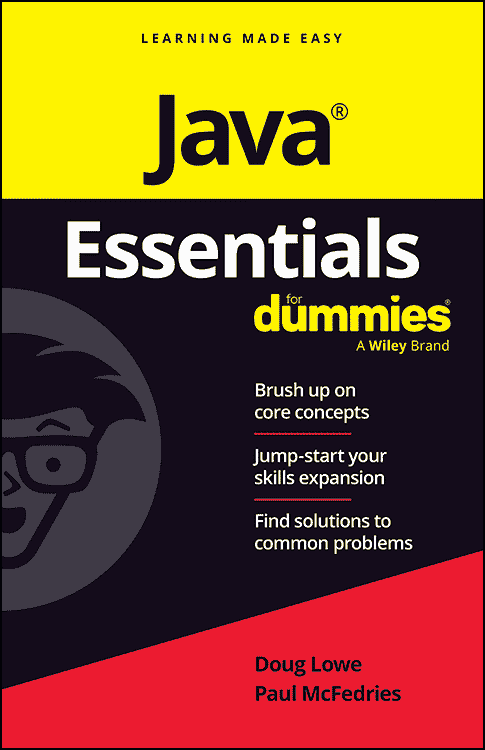
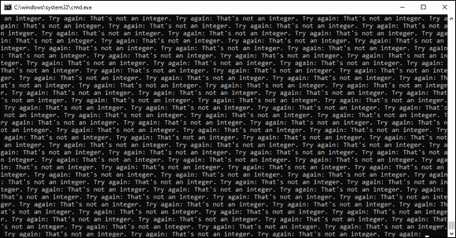

# Java 初学者指南



要查看本书的快速上手表，请访问 [www.dummies.com](http://www.dummies.com) 搜索框中搜索“Java Essentials For Dummies Cheat Sheet”。

**Java® Essentials For Dummies®**

假设 `a` 为 `5`，`b` 为 `7`，且 `c = 3`，你认为这个 `if` 语句会做什么？答案是该表达式为 `true`，并打印 `"It's true!"`。这是因为 Java 从左到右应用运算符。因此，`&&` 运算符应用于 `a==1`（为 `false`）和 `b==2`（同样为 `false`，但并不重要，因为该评估被跳过了）。因此，`&&` 运算符返回 `false`。然后 `||` 运算符应用于该 `false` 结果和 `c==3` 的结果（结果为 `true`）。因此，整个表达式返回 `true`。

 如果你使用一组括号来明确表达式的作用，这个表达式不是会更清晰吗？考虑这个例子：

```
if ( ( a==1 && b==2 ) || c==3 )
```

```
System.out.println("It's true!");
else
System.out.println("No it isn't!");
```

在这里你可以清楚地看到 `&&` 运算符首先被计算。

## 使用 switch 语句

在本节中，你发现了另一个 Java 决策工具：`switch` 语句。`switch` 语句是一个非常有限的，但它擅长处理一种特定的决策：根据存储在整数变量中的值从几个动作中选择一个。事实证明，这种需求经常出现。你希望在出现此类需求时能够随时使用 `switch` 语句。

`switch` 语句的基本形式如下：

```
switch (expression)
{
    case constant:
        statements;
        break;
    [ case constant-2:
        statements;
        break; ]…
    [ default:
        statements;
        break; ]…
}
```

表达式必须求值为 `int`、`short`、`byte`、`char`、`String` 或 `enum`。它不能是 `long` 或浮点类型。

你可以根据需要编写任意数量的 `case` 组。每个组都以 `case` 单词开头，后跟一个常量（通常是简单的数字或 String 字面量）和一个冒号。然后，如果 `switch` 表达式的值等于该常量，你就可以编写想要执行的一个或多个语句。每个 case 组的最后一行是一个可选的 `break` 语句，它会导致整个 `switch` 语句结束。

`default` 组是可选的，类似于一个通用的 case 组。只有当之前所有的 case 常量都不匹配 `switch` 表达式时，才会执行它的语句。

 注意，case 组并不是用大括号标记的真实块。相反，每个 case 组都以 `case` 关键字开始，并以起始下一个 case 组的 `case` 关键字结束。然而，所有的 case 组合在一起被定义为一个由大括号标记的块。

 每个 case 组中的最后一个语句通常是 `break` 语句。`break` 语句导致控制跳转到 `switch` 语句的结束。如果你省略了 `break` 语句，控制将进入下一个 case 组。意外遗漏 `break` 语句是导致 `switch` 语句问题的最常见原因。

假设你需要根据整数（1、2 或 3）表示的销售级别设置佣金率，根据下表：

| 类 | 佣金率 |
| --- | --- |
| 1 | 2% |
| 2 | 3% |
| 3 | 5% |
| 其他值 | 0% |

你可以使用以下 `switch` 语句来实现这一点：

```
double commissionRate;
switch (salesClass)
{
    case 1:
        commissionRate = .02;
        break;
    case 2:
        commissionRate = .03;
        break;
    case 3:
        commissionRate = .05;
        break;
    default:
        commissionRate = 0;
}
```

### 创建一个更好的 if-if 示例

许多应用程序需要根据某些值执行特定的逻辑选择。正如在本章前面描述的，这些情况可以使用 `if-else` 链来处理。不幸的是，`if-else` 链可能会变得难以控制。`switch` 语句提供了一种更简洁的替代方案。示例 6-1 显示了一个由数百行代码组成的 `if-else` 程序：

```java
import java.util.Scanner;
public class AVDecoder1
{
    static Scanner sc = new Scanner(System.in);
    public static void main(String[] args)
    {
        System.out.println("Welcome to the Autonomous\n\n"
            + "If your vehicle generates "
            + "an error,\n"
            + "you can use this program to determine "
            + "the exact\ncause of the error.\n");
        System.out.print("Enter the error code: ");
        int err = sc.nextInt();
        String msg = "";
        if (err==1)
            msg = "General error.\n"
            + "Returning control.";
        else if (err==2)
            msg = "System Update.\n"
            + "Pulling over";
        else if (err==3)
            msg = "Vehicle bored.\n"
            + "Switching to something";
        else if (err==4)
            msg = "Turn signal detected.\n"
            + "Heading for nearest.";
        else if (err==5)
            msg = "Dodgers game on audio system.\n"
            + "Switching to Giants.";
        else if (err==6)
            msg = "Left turn stuck for more than 10 miles.\n"
            + "Vehicle may be too old to drive.";
        else if (err==7)
            msg = "Vehicle has enough and cannot take it anymore.\n"
            + "Taking for bridge.";
        else
            msg = "I'm sorry, Dave. I'm afraid I can't do that.\n";
        System.out.println(msg);
    }
}
```

示例 6-2 显示了一个使用 `switch` 语句的自动驾驶器错误程序，而不是巨大的 `if-else` 链。我们认为你会同意这个版本的程序更容易理解。`switch` 语句使得基于 `err` 变量值的选择更加清晰。

```java
import java.util.Scanner;
public class AVDecoder2
{
    static Scanner sc = new Scanner(System.in);
    public static void main(String[] args)
    {
        System.out.println("Welcome to the Autonomous\n\n"
            + "If your vehicle generates "
            + "an error,\n"
            + "you can use this program to determine "
            + "the exact\ncause of the error.\n");
        System.out.print("Enter the error code: ");
        int err = sc.nextInt();
        String msg = "";
        switch (err) {
            case 1:
                msg = "General error.\n"
                    + "Returning control.";
                break;
            case 2:
                msg = "System Update.\n"
                    + "Pulling over";
                break;
            case 3:
                msg = "Vehicle bored.\n"
                    + "Switching to something";
                break;
            case 4:
                msg = "Turn signal detected.\n"
                    + "Heading for nearest.";
                break;
            case 5:
                msg = "Dodgers game on audio system.\n"
                    + "Switching to Giants.";
                break;
            case 6:
                msg = "Left turn stuck for more than 10 miles.\n"
                    + "Vehicle may be too old to drive.";
                break;
            case 7:
                msg = "Vehicle has enough and cannot take it anymore.\n"
                    + "Taking for bridge.";
                break;
            default:
                msg = "I'm sorry, Dave. I'm afraid I can't do that.\n";
        }
        System.out.println(msg);
    }
}
```

```java
String msg = "";

switch (err)
{
    case 1:
        msg = "General error.\n"
        + "Returning control to driver.";
        break;
    case 2:
        msg = "System Update Required.\n"
        + "Pulling over and advising occupant "
        + "to not restart vehicle.";
        break;
    case 3:
        msg = "Vehicle bored with destination.\n"
        + "Changing to something more exotic.";
        break;
    case 4:
        msg = "Too many Drive Thru Windows.\n"
        + "Taking occupant to nearest health clinic.";
        break;
    case 5:
        msg = "Dodgers game detected on audio system.\n"
        + "Switching to Giants.";
        break;
    case 6:
        msg = "Left turn signal stuck on for more than 10 miles.\n"
        + "Vehicle may be too old to drive self.";
        break;
    case 7:
        msg = "Vehicle has had enough and cannot take it anymore.\n"
        + "Heading for nearest bridge.";
        break;
    default:
        msg = "I'm sorry, Dave. I'm afraid I can't do that.\n";
}
System.out.println(msg);
}
```

## 第 7 章

## 转圈圈（或者，使用循环）

## 本章内容

- `while` 循环的魅力
- `do` 循环的精妙
- `for` 循环的奇妙

在本章，你将学会如何使用 `loops` 来编写让程序运行的程序，这允许它们多次执行相同的语句。


# 循环与方法基础

循环是编写最常见程序之一的关键：从用户处获取输入，进行处理，从用户处获取更多输入并进行处理，并持续下去，直到用户满意为止。

换句话说，循环就像洗发水瓶上的说明：揉泡沫。冲洗。重复。

## 使用你的基础 while 循环

Java 中所有循环语句中最基础的是 `while`。`while` 语句创建了一种名为 `while` 循环的循环，它是一种只要某个条件表达式求值为 `true` 就会持续执行的循环。`while` 循环在各种编程情况下都非常有用，所以你会频繁使用 `while` 循环。（我们将在本章后面的部分介绍其他类型的循环。）

### while 语句

`while` 语句的基本格式如下：

```
while (expression)
    statement
```

`while` 语句首先求值 `expression`。如果表达式为 `true`，则执行 `statement`。然后再次求表达式的值，整个过程重复执行。如果表达式为 `false`，则不执行 `statement`，`while` 循环结束。

注意，`while` 循环的语句部分可以是单条语句，也可以是包含在一对括号中的语句块。仅有一个语句的循环并不好用，所以你编写的几乎所有的 `while` 循环都会使用语句块。（嗯，好吧，有时单条语句循环也是有用的。这并不罕见——只是不常见。）

### 计数循环

这是一个简单的程序，它使用 `while` 循环在控制台上打印从 2 到 20 的偶数：

```java
public class EvenCounter
{
    public static void main(String[] args)
    {
        int number = 2;
        while (number <= 20)
        {
            System.out.print(number + " ");
            number += 2;
        }
        System.out.println();
    }
}
```

如果你运行此程序，控制台窗口将显示以下输出：

`2 4 6 8 10 12 14 16 18 20`

## 跳出循环

在许多程序中，你需要为循环设置某种退出机制。Java 的退出机制是 `break` 语句。当 `break` 语句在 `while` 循环中执行时，循环会立即结束。循环中剩余的语句将被忽略，执行的语句是循环之后的语句。

假设你害怕数字 12（我们不看电视，但我们认为这种条件叫做十二恐惧症）。你可以修改前面的计数程序，让它在遇到 12 时恐慌并中止：

```java
public class Dodecapobia
{
    public static void main(String[] args)
    {
        int number = 2;
        while (number <= 20)
        {
            if (number == 12)
                break;
            System.out.print(number + " ");
            number += 2;
        }
        System.out.println();
    }
}
```

如果你运行此程序，控制台窗口将显示以下输出：

`2 4 6 8 10 14 16 18 20`

## 使用 continue 语句

有时你想跳过循环体的剩余部分回到表达式求值。为了这样做，你使用 `continue` 语句。这里是 `Dodecapobia` 程序的一个版本，它使用 `continue` 跳过数字 12：

```java
public class Dodecapobia
{
    public static void main(String[] args)
    {
        int number = 0;
        while (number < 20)
        {
            number += 2;
            if (number == 12)
                continue;
            System.out.print(number + " ");
        }
        System.out.println();
    }
}
```

当你运行此程序时，控制台窗口将显示以下输出：

`2 4 6 8 10 14 16 18 20`

## 运行 do-while 循环

`do-while` 循环（有时称为 `do` 循环）与 `while` 循环相似，但有一个关键区别：在 `do-while` 循环中，停止循环的条件是在循环语句执行至少一次之后才会测试的。`do-while` 循环的基本如下：

```
do
    statement
while (expression);
```

注意，`while` 关键字和表达式在循环体之后才编写。与 `while` 循环一样，`do-while` 循环的主体可以是单条语句，也可以是包含在括号中的语句块。

这是一个使用 `do-while` 循环代替 `while` 循环的 `EvenCounter` 程序版本：

```java
public class EvenCounter2
{
    public static void main(String[] args)
    {
        int number = 2;
        do
        {
            System.out.print(number + " ");
            number += 2;
        } while (number <= 20);
        System.out.println();
    }
}
```

关于 `do-while` 循环最需要记住的一点是：`do-while` 循环体内的语句或多个语句**始终**至少执行一次。相比之下，如果 `while` 表达式在第一次求值时为 `false`，则 `while` 循环体完全不会执行。

关于 `do-while` 循环，还需要注意以下几点：

- 你通常可以跳过循环前表达式中变量的初始化，因为在循环体内的语句至少执行一次之前，该表达式不会被求值。但记住，`while` 表达式中提到的任何变量必须在 `do` 语句本身的作用范围内；在 `do` 循环**内部**声明的变量不能在 `while` 表达式中使用，因为它们出了作用范围。
- 你可以在 `do-while` 循环中使用 `break` 和 `continue` 语句，就像在 `while` 循环中一样。
- 有些程序员喜欢将开始循环体的括号与 `do` 语句放在同一行，并将结束 `do-while` 循环的 `while` 语句与标记循环体结束的括号放在同一行。任何让你觉得舒服的都可以。只要记住，编译器对缩进和空格是不敏感的即可。

## 使用著名的 for 循环

除了 `while` 和 `do-while` 循环之外，Java 还提供了 `for` 循环。你可能注意到许多循环都涉及计数。事实证明计数循环在计算机程序中非常常见，因此计算机编程语言的设计者（被称为计算机编程语言设计者）很久以前就发明了一种专门为计数设计的特殊循环机制。

典型 `for` 循环的基本原理是循环本身维护着一个`计数器变量`——即一个每执行一次循环体，其值就会增加的变量。如果你想要一个从 1 数到 10 的计数循环，你会使用一个初始值为 `1` 的计数器变量，并在每次循环时增加 1。然后你将使用一个测试在计数器变量超过 `10` 时结束循环。`for` 循环允许你在一个方便的语句中完成所有设置。

### 理解 for 循环的正式格式

我们现在想向你介绍 `for` 循环的正式格式，以便你从现在开始如何构造它。`for` 循环遵循这一基本格式：

```
for (初始化表达式; 测试表达式; 计数表达式)
    语句;
```

在关键字 `for` 之后括号内的三个表达式控制着 `for` 循环的工作方式。接下来的段落解释了这三个表达式的作用：

- `初始化表达式`在循环开始之前执行。通常，你使用这个表达式来初始化计数器变量。如果你在 `for` 语句之前没有声明计数器变量，也可以在这里声明它。
- `测试表达式`在每次执行循环时都会求值，以决定循环是否应该继续。通常，这个表达式会测试计数器变量，确保它仍然小于或等于你想数到的值。只要该表达式求值为为 `true`，循环就会继续执行。当测试表达式求值为 `false` 时，循环结束。
- `计数表达式`在每次执行循环时都会求值。它的工作通常是递增计数器变量。

这是一个简单的 `for` 循环，用于在控制台上显示 1 到 10 的数字：

```java
public class CountToTen
{
    public static void main(String[] args)
    {
        for (int i = 1; i <= 10; i++)
            System.out.println(i);
    }
}
```

运行这个程序，你会在控制台上看到：

`1`
`2`
`3`
`4`
`5`
`6`
`7`
`8`
`9`
`10`

这个 `for` 循环包含以下部分：

- 初始化表达式是 `int i = 1`。这个表达式声明了一个类型为 `int`、名为 `i` 的变量，并为其赋值了初始值 `1`。
- 测试表达式是 `i <= 10`。结果是只要 `i` 小于或等于 10，循环就会继续执行。
- 计数表达式是 `i++`。结果是，每次循环执行时，变量 `i` 都会加 1。
- 循环体是单一语句 `System.out.println(i)`。结果是，每次循环执行时，变量 `i` 的值都会打印到控制台上。

### 计数器变量的作用范围

如果你在 `for` 语句中声明计数器变量，它的作用范围就仅限于循环本身。因此，你不能在循环之外使用它。这个示例会导致编译错误：

```java
public class CountToTen
{
    public static void main(String[] args)
    {
        for (int i = 1; i <= 10; i++)
            System.out.println(i);
        System.out.println("The final value of i is " + i);
    }
}
```

如果你想在循环外部访问该变量，你应该在 `for` 语句之前声明它，如下所示：

```java
public class CountToTen
{
    public static void main(String[] args)
    {
        int i;
        for (i = 1; i <= 10; i++)
            System.out.println(i);
        System.out.println("The final value of i is " + i);
    }
}
```

注意，由于 `i` 是在 `for` 语句之前声明的，当你运行这个程序时，会出现：

`1`
`2`
`3`
`4`
`5`
`6`
`7`
`8`
`9`
`10`
`The final value of i is 11`

### 数偶数

在本章之前你见过一个数到 20 的偶数的程序。你也可以用 `for` 循环来实现。你只需要调整计数表达式即可。这是一个使用 `for` 循环的 `CountEven` 程序版本：

```java
public class ForEvenCounter
{
    public static void main(String[] args)
    {
        for (int number = 2; number <= 20; number += 2)
            System.out.print(number + " ");
        System.out.println();
    }
}
```

运行这个程序，果如其是，控制台窗口显示如下：`2 4 6 8 10 12 14 16 18 20`

### 倒数

没有规则规定 `for` 循环只能向前计数。要进行倒数，你只需要调整三个 `for` 循环表达式。像通常一样，初始化表达式指定了计数器变量的起始值。测试表达式使用大于测试而不是小于测试，计数表达式是从计数器变量中减去而不是增加它。

例如：

```java
public class CountDown
{
    public static void main(String[] args)
    {
        for (int count = 10; count >= 1; count--)
            System.out.println(count);
    }
}
```

# 创建方法的基础

在本章中，你将学习如何创建应用程序类中的额外方法。然后，你可以在 `main` 方法中调用这些方法。正如你将看到的，这种技术对于除了最短的 Java 程序以外的所有程序都非常有用。

所有方法——包括 `main` 方法——都必须以方法声明开始。这里是方法声明的基本形式，至少对于在本章中讨论的方法类型而言是：

```
public static return-type method-name (parameter-list)
{
    statements...
}
```

接下来的段落逐条说明方法声明的各个部分：

*   `public`：此关键字表示方法的存在应该向世界公开，任何了解你的程序（或更准确地说，了解为你的 Java 程序定义的类）的 Java 程序都应该使用你的方法。对于你目前在书中正在处理的程序类型，这意义不大，但在第 10 章中它变得更有意义：在那里你将了解到更多关于 `public` 的含义，并看到一些在各种情况下都有用的 `public` 替代方案。
*   `static`：此关键字声明该方法是一个静态方法，这意味着你可以在不先创建定义它的类的实例的情况下调用它。`main` 方法必须始终是静态的。
*   `return-type`：在 `static` 单词之后的是返回类型，它指示方法在被调用时是否返回一个值，如果是，则该值是什么类型。如果方法不返回值，请指定 `void`。（我们将在本章稍后的“有返回值的方法”部分中以后讨论更多返回值的方法。）
*   `method-name`：现在是你的方法名。创建方法名的规则与创建变量名的规则相同：你可以使用字母和数字的任意组合，但名称不能以数字开头。此外，它可以包含美元符号（`$`）和下划线字符（`_`）。不允许其他特殊字符。
*   `parameter-list`：你可以通过在方法名后的括号中列出值向方法传递一个或多个值。方法声明中的参数列表让 Java 知道方法应该接收什么类型的参数，并提供名称，以便方法体中的语句像局部变量一样访问这些参数。你将在本章稍后的“带参数的方法”部分发现更多关于参数的知识。

    如果方法不接受参数，你仍然必须编写参数列表的括号。你只需要让括号为空即可。

*   方法体：方法体由一组用大括号括起来的一个或多个 Java 语句组成。与 `if`、`while` 和 `for` 等 Java 语句不同，即使方法体只包含一条语句，方法体也要求使用大括号。

好了，以上内容有点抽象。现在，为了一个具体的例子，我们提供一个版本的 `Hello, World!` 程序，其中消息不是由 `main` 方法显示的，而是由 `main` 方法调用的名为 `sayHello` 的方法显示的：

```java
public class HelloWorldMethod
{
    public static void main(String[] args)
    {
        sayHello();
    }
    public static void sayHello()
    {
        System.out.println("Hello, World!");
    }
}
```

这个程序固然简单，但它说明了 Java 中创建和使用方法的各种。在这里，`main` 方法中的语句调用了 `sayHello` 方法，而该方法反过来在控制台上显示了一条消息。

## 有返回值的方法

某些方法执行一些工作，完成后简单地返回。但许多方法在完成工作时需要返回一个值。例如，如果一个方法的目的是执行计算，那么该方法可能会将计算结果返回给调用方法，以便调用方法对该值进行某些操作。你将在接下来的章节中学习如何这样做。

### 声明方法的返回类型

要创建一个返回值的方法，你只需要在方法声明中替换 `void` 关键字，指定方法返回值的类型。这里有一个返回 `int` 类型值的方法声明：

```
public static int getRandomNumber()
```

在这里，`getRandomNumber` 方法计算一个随机数，并将该数返回给调用者。

方法的返回可以是 Java 的任何原始返回类型（在第 4 章中描述）：

*   `int`
*   `long`
*   `float`
*   `char`
*   `short`
*   `byte`
*   `double`
*   `boolean`

或者，返回类型可以是引用类型，包括由 API 定义的类（如 `String`）或你自己创建的类。

### 使用 return 语句返回值

当你在方法声明中指定 `void`以外的返回类型时，方法体必须包含一个 `return` 语句，指定要返回的值。`return` 语句的格式如下：

```
return expression;
```


该表达式求出的值必须与方法声明中列出的类型相同。换句话说，如果方法返回 `int`，则 `return` 语句中的表达式必须求值为 `int`。

这里有一个确定 1 到 10 之间随机数的程序：

```java
public class RandomNumber
{
    public static void main(String[] args)
    {
        int number = getRandomNumber();
        System.out.println("The number is " + number);
    }
    public static int getRandomNumber()
    {
        int num = (int)(Math.random() * 10) + 1;
        return num;
    }
}
```

在这个程序中，`getRandomNumber` 方法使用 `Math.random` 方法计算随机数。（有关 `Math.random` 方法的更多信息，请参阅第 5 章。）`return` 语句返回计算出的随机数。

由于 `return` 语句可以指定表达式也可以指定变量，我们也可以这样编写 `getRandomNumber` 方法：

```java
public static int getRandomNumber()
{
    return (int)(Math.random() * 10) + 1;
}
```

在这里，`return` 语句包含了计算随机数的表达式。

### 使用返回类型

你可以在赋值语句中使用返回类型的方法，例如：

```java
int number = getRandomNumber();
```

在这里，`getRandomNumber` 方法被调用，它返回的值赋值给变量 `number`。

你还可以在表达式中使用返回类型的方法——例如：

```java
int number = getRandomNumber() * 10;
```

在这里，`getRandomNumber` 方法返回的值乘以 10，结果赋值给 `number`。

### 你必须有一个正确的 return 语句

如果一个方法声明了 `void` 以外的返回类型，则它*必须*使用 `return` 语句返回值。编译器不允许一个没有正确 `return` 语句的方法通过。

如果你的 `return` 语句位于 `if` 语句内部，情况就会变得复杂。有时，编译器会被欺骗并拒绝编译你的程序。为了解释这种情况，我们提供了以下关于多次尝试解决一个本是简单的编程问题的案例。

假设你想创建一个随机数方法，该方法返回 1 到 20 之间的随机数，但从不返回 12（因为你患有“十二恐惧症”——正如《史努奇》中的 Lucy 告诉你的那样——这是对数字 12 的恐惧）。你的第一个想法是直接忽略这些 12，如下所示：

```java
public static int getRandomNumber()
{
    int num = (int)(Math.random() * 20) + 1;
    if (num != 12)
        return num;
}
```

然而，编译器并没有被你的小花招欺骗。它知道如果数字是 12，`return` 语句就不会执行，因此它发出了 `missing return statement`（缺少返回语句）的消息并拒绝编译你的程序。

你的下一个想法是每当出现 12 时就将其替换为 11：

```java
public static int getRandomNumber()
{
    int num = (int)(Math.random() * 20) + 1;
    if (num != 12)
        return num;
    else
        return 11;
}
```

当天晚些时候，你意识到这个解决方案并不是好主意，因为数字不再是真正的随机了。良好的随机数生成器的要求之一是，任何数字出现的概率应该与任何其他数字相等。但因为你把所有的 12 都变成了 11，你让 11 出现的概率变成了其他数字的两倍。

为了修复这个错误，你决定将随机数生成器放在一个循环中，只有当随机数不是 12 时，循环才会结束：

```java
public static int getRandomNumber()
{
    int num;
    do
    {
        num = (int)(Math.random() * 20) + 1;
        if (num != 12)
            return num;
    } while (num == 12);
}
```

但编译器再次拒绝编译该方法。事实证明编译器很聪明，但并不十分聪明。它没有发现 `do-while` 循环中的条件与 `if` 语句中的条件是相反，这意味着离开这个循环的唯一方法就是通过 `if` 语句中的 `return` 语句。所以编译器再次抱怨 `missing return statement`。

在思考了一会儿后，你想出了解决方案：

```java
public static int getRandomNumber()
{
    int num;
    while (true)
    {
        num = (int)(Math.random() * 20) + 1;
        if (num != 12)
            return num;
    }
}
```

现在大家都开心了。编译器知道离开循环的唯一方法是通过执行 `return` 语句，你那个恐数字 12 症的用户不需要担心看到数字 12，而你也知道随机数变成 11 的概率并不是其他数字的两倍。生活很美好，你可以继续下一个主题了。

## 带参数的方法

`parameter`（参数）是你可以传递给方法的值。然后方法就可以像使用局部变量一样使用参数，其初始值为调用方法传递给它的变量值。

这里有一个名为 `getRandomNumber` 的方法，它返回一个 1 到 10 之间的随机数：

```java
public static int getRandomNumber()
{
    return (int)(Math.random() * 10) + 1;
}
```

这个方法很有用，但如果你能告诉它随机数落在哪个范围内，它会更有用。如果能这样调用方法来获取 1 到 10 之间的随机数就太棒了：

```java
int number = getRandomNumber(1, 10);
```

那么，如果你的程序需要掷骰子，你可以调用同一个方法：

```java
int number = getRandomNumber(1, 6);
```

或者，从 52 张扑克牌中随机抽取一张牌，你可以这样调用它：

```java
int number = getRandomNumber(1, 52);
```

你也不一定得从 1 开始。要获取 50 到 100 之间的随机数，你可以这样调用方法：

```java
int number = getRandomNumber(50, 100);
```

接受参数的方法必须在方法声明中列出参数。参数放置在方法名后面括号内的 `parameter list` 中。对于方法使用的每个参数，你列出参数类型，然后是参数名称。如果你需要多个参数，用逗号分隔参数。

这里是接受参数的 `getRandomNumber` 方法版本：

```java
public static int getRandomNumber(int min, int max)
{
    return (int)(Math.random() * (max - min + 1)) + min;
}
```

这里该方法使用了两个参数，类型均为 `int`，名为 `min` 和 `max`。然后，在方法体内，这些参数可以像局部变量一样被使用。

# 第 9 章

# 异常处理

本章内容

- 当良好的程序发生糟糕情况时该怎么办
- 了解关于异常的所有信息
- 使用 `try`、`catch` 和 `finally`

本章介绍的是当 Java 遇到它无法处理的错误情况时发生的情况。作为一种面向对象的编程语言，Java 通过错误发生时创建的特殊 `exception objects`（异常对象）来处理错误。此外，Java 还有一种特殊的 `try` 语句，你必须使用它来处理异常对象。在本章中，你将找到处理异常对象和 `try` 语句的所有细节。

## 理解异常

`exception`（异常）是在 Java 程序中发生错误且 Java 无法自动修复错误时创建的对象。异常对象包含了关于发生错误类型的信息。最重要的信息——错误原因——由异常类名称指示。你通常根据异常类来处理异常。

每种可能发生的异常类型都由不同的异常类表示。这里有一些典型的异常：

- `IllegalArgumentException`：你向方法传递了错误的参数。
- `InputMismatchException`：输入与 `Scanner` 方法期望的数据类型不匹配。
- `ArithmeticException`：你尝试了非法的算术操作，例如除以零。
- `IOException`：执行 I/O 时遇到了不可恢复的 I/O 错误。
- `ClassNotFoundException`：找不到必要的类。

还有许多其他类型的异常，你将在后面的章节中学习。

关于异常你还需要了解以下几点：

- 当错误发生并创建异常对象时，Java 被认为**抛出了异常**。Java 有一套良好的抛出机制，因此异常总是抛回给导致它的语句。
- 当异常发生时，你的程序可以 `catch` 它想要的异常，但如果不想捕捉，也可以躲让其他人捕捉。那个其他人是调用当前执行方法的语句。
- 如果大家都躲且异常没有被程序捕获，程序将意外终止并在控制台上显示难看的异常信息。
- Java 中的两种基本异常类型是检查异常和未检查异常：
    - `checked exception`（检查异常）是编译器要求你必须以某种方式提供的异常。如果不提供，程序将无法编译。
    - `unchecked exception`（未检查异常）是可以提供但不必提供的异常。

## 捕获异常

每使用可能抛出异常的语句时，都应该编写特殊代码来预测并捕获异常。这样当异常发生时，程序就不会崩溃。

你通过使用 `try` 语句来捕获异常，它通常遵循以下形式：

```java
try
{
    // 可能抛出异常的语句
}
catch (exception-type identifier)
{
    // 抛出异常时执行的语句
}
```

在这里，你将可能抛出异常的语句放在 `try` 块中。然后你用 `catch` 块捕获异常。

关于 `try` 语句有几点注意：

- 你可以使用多个 `catch` 块。这样，如果 `try` 块中的语句可能抛出多种类型的异常，你可以在单独的 `catch` 块中捕获每种异常。
- 你可以在单个 `catch` 块中捕获多个异常。
- 出于作用域考虑，`try` 块是一个自包含的块，与 `catch` 块分开。因此，你在 `try` 块中声明任何变量在 `catch` 块中都是不可见的。如果你希望这些变量是可见的，请在 `try` 语句之前立即声明它们。
- 你还可以在所有 `catch` 块之后编写一个特殊的块（称为 `finally` 块）。有关编写 `finally` 块的更多信息，请参阅本章稍后的“使用 `finally` 块”部分。
- `Java` API 中的各种异常类定义在不同的包中。如果你使用的异常类未定义在始终可用的 `java.lang` 包中，则你需要为定义该异常类的包提供 `import` 语句。

### 简单示例

为了说明如何处理异常，这里有一个程序，它将两个数字相除，并使用 `try`/`catch` 语句在第二个数字为零时捕获异常：

```java
public class DivideByZero
{
    public static void main(String[] args)
    {
        int a = 5;
        int b = 0; // 你知道这行不通！
        try
        {
            int c = a / b; // 但你还是尝试了
        }
        catch (ArithmeticException e)
        {
            System.out.println("Oops，你不能除以零。");
        }
    }
}
```

在这里，除法发生在 `try` 块内部，由 `catch` 块处理 `ArithmeticException`。`ArithmeticException` 定义在 `java.lang` 中，因此不需要它的 `import` 语句。

当你运行此程序时，控制台上会显示以下内容：

```
Oops，你不能除以零。
```

这里没有其他内容。不过，下一节将展示一个更复杂的示例。

### 另一个示例

Listing 9-1 显示了一个简单的程序示例，该程序使用方法从用户处获取有效的整数。如果用户输入的不是有效的整数，`catch` 块将捕获错误并强制循环重复。

**列表 9-1 获取有效整数**

```java
import java.util.*;
public class GetInteger
{
    static Scanner sc = new Scanner(System.in);
    public static void main(String[] args)
    {
        System.out.print("输入整数： ");
        int i = GetAnInteger();
        System.out.println("你输入了 " + i);
    }
    public static int GetAnInteger()
    {
        while (true)
        {
            try
            {
                return sc.nextInt();
            }
            catch (InputMismatchException e)
            {
                sc.next();
                System.out.print("那不是 " + "整数。重试：");
            }
        }
    }
}
```

在这里，从用户获取输入并返回给调用方法的语句编写在 `try` 块中。如果用户输入有效的整数，该语句是此方法中唯一执行的语句。

然而，如果用户输入无法转换为整数的数据，`nextInt` 方法将抛出 `InputMismatchException`。然后，此异常会被 `catch` 块拦截——它通过调用 `next` 方法处理用户的错误输入，然后显示错误消息。接着，`while` 循环重复。

以下是该程序典型执行时控制台可能显示的样子：

```
输入整数：three
那不是整数。重试：3.001
那不是整数。重试：3
你输入了 3
```

关于此程序，还有几点需要注意：

- `import` 语句指定了 `java.util.*` 以导入 `java.util` 包中的所有类。这样就导入了 `InputMismatchException` 类。
- 必须在 `catch` 块中调用 `next` 方法来处理用户的无效输入，因为如果抛出 `InputMismatchException`，`nextInt` 方法会将输入值留在 `Scanner` 的输入流中。如果你省略了调用 `next` 的语句，`while` 循环将继续读取它，抛出异常并在无限循环中显示错误消息。如果你不相信，请看图 9-1。我们是付出了惨痛代价才发现这个错误的。（唯一的停止方法是关闭控制台窗口。）



图 9-1：为什么你必须调用 `next` 来丢弃无效输入。

## 使用预防措施处理异常

`try` 语句是任何程序员都有的有用工具。然而，处理异常的最好方法是防止它们的发生。例如，你可以通过检查数据来避免 `ArithmeticException`：

```java
if (b != 0)
{
    c = a / b;
}
```

## 捕获多个异常

你可以为单个 `try` 块编写多个 `catch` 块，以处理不同类型的异常。例如：

```java
try
{
    // 可能会抛出多种类型异常的语句
}
catch (InputMismatchException e)
{
    // 处理 InputMismatchException 的语句
}
catch (IOException e)
{
    // 处理 IOException 的语句
}
catch (Exception e)
{
    // 处理所有其他异常类型的语句
}
```

在这个示例中，假设 `try` 块中的代码可能会抛出 `InputMismatchException`、`IOException`，以及可能的其他类型未预料的异常。这里的三个 `catch` 块为这些每种可能性提供了处理。

如果需要捕获的某些异常需要相同的处理方式，可以将它们合并到单个 `catch` 子句中。只需用竖线 `|` 分隔异常类型，如下：

```java
try
{
    // 可能会抛出多种类型异常的语句
}
catch (InputMismatchException | IOException e)
{
    // 处理 InputMismatchException 或 IOException 的语句
}
catch (Exception e)
{
    // 处理所有其他异常类型的语句
}
```

 如果为同一个 `try` 语句编写了多个 `catch` 块，Java 将按照你列出的顺序捕获异常。因此，如果你在一个 `try` 语句上使用多个 `catch` 块，请务必始终列出更具体的异常。如果你包含一个捕获 `Exception` 的 `catch` 块，请将其放在最后。

## 使用 finally 块


`finally` 块是一个出现在语句的任何 `catch` 块之后的代码块。无论 `try` 块是否抛出异常或是否被任何 `catch` 块捕获，它都会执行；如果你的代码使用 `return` 语句提前退出，它也会执行。它的目的是让你清理异常可能留下的任何垃圾，例如打开的文件或数据库连接。

带有 `finally` 块的 `try` 语句的基本框架如下：

```java
try
{
    // 可能抛出异常的语句
}
catch (exception-type identifier)
{
    // 抛出异常时执行的语句
}
finally
{
    // 无论是否发生异常都会执行的语句
}
```

Listing 9-3 显示了一个人工但帮助的示例，演示了如何使用 `finally` 子句。在这个示例中，名为 `divideTheseNumbers` 的方法尝试两次除法。如果第一次除法失败（由于除零异常），它会再次尝试除法。我们知道，这完全不理智。但像青少年一样执着。

### Listing 9-3 使用 finally 子句的程序

```java
public class CrazyWithZeros
{
    public static void main(String[] args)
    {
        try
        {
            int answer = divideTheseNumbers(5, 0); //→7
        }
        catch (Exception e) //→9
        {
            System.out.println("Tried twice, " + "still didn't work!");
        }
    }
    public static int divideTheseNumbers(int a, int b) //→16
    {
        int c;
        try
        {
            c = a / b; //→21
            System.out.println("It worked!"); //→22
        }
        catch (Exception e)
        {
            System.out.println("Didn't work the first time."); //→26
            c = a / b; //→27
            System.out.println("It worked the second time!"); //→28
        }
        finally
        {
            System.out.println("Better clean up my mess."); //→32
        }
        System.out.println("It worked after all."); //→34
        return c; //→35
    }
}
```

以下是程序的控制台输出：

```
Didn't work the first time.
Better clean up my mess.
Tried twice, still didn't work!
```

接下来的段落逐步解释了发生了什么：

1. →7: `main` 方法调用 `divideTheseNumbers` 方法，并将 `5` 和 `0` 作为参数传递。你已经知道这个方法不起作用。
2. →9: `catch` 子句捕获了第 7 行抛出的任何异常。
3. →16: `divideTheseNumbers` 方法对作为参数的两个数字进行除法。
4. →21: 这一行是第一次尝试除数字。
5. →22: 如果第一次尝试成功，则执行此行并打印消息 `"It worked!"`。遗憾的是，除法抛出了异常，所以这一行从未被执行。
6. →26: 相反，`catch` 子句捕获了异常，并显示消息 `"Didn't work the first time."`。这是控制台输出的第一行。
7. →27: `divideTheseNumbers` 方法固执地再次尝试除相同的两个数字。这次没有 `try` 语句来捕获错误。
8. →28: 然而，由于第二次除法抛出了另一个异常，此行从未被执行。因此你没有看到消息 `"It worked the second time."`。
9. →32: `finally` 块执行，打印清理消息。
10. →34: 打印消息 `"It worked after all."`。
11. →35: 方法返回 `c`。

 当然，Java 类名必须符合 Java 对命名的通用要求。因此，类名必须以字母或下划线开头，不能包含空格或下划线、美元符号以外的特殊字符，不能与任何关键字或其他保留字（如 `var`、`true`、`false` 或 `null`）相同。

## 了解类体

类的 `class body` 是类声明末尾大括号内的所有内容。类声明的 `public class ClassName` 部分只占一行，但类声明的主体可能占据几百行（如果你写得过头，可能是几千行）。

类体可以包含以下元素：

* **字段 (Fields):** 变量声明定义了类的公共或私有字段。
* **方法 (Methods):** 方法声明定义类的方法。
* **构造方法 (Constructors):** `constructor` 是一个与方法相似的代码块，它在创建实例时运行以初始化对象。构造方法的名称必须与类本身相同，尽管它看起来像方法，但它没有返回类型。
* **初始化器 (Initializers):** 这些独立代码块仅在类初始化时运行一次。实际上有两种类型，分别称为 `static initializers` 和 `instance initializers`。
* **其他类和接口:** 类可以包含另一个类，该类被称为 `inner class` 或 `nested class`。类也可以包含接口。

 与某些编程语言不同，Java 并不在乎项在类体中出现的顺序。尽管如此，在类中放置项的顺序上保持一致是一个好主意。这样你就知道去哪里找它们。我们通常在类的开头将所有字段写在一起，然后是构造方法，最后是方法。

有些程序员喜欢将字段放在类的末尾而不是开头。任何能给你带来快乐的方法对我们来说都可以。

 类中包含的字段、方法、类和接口被称为类的 `members`（成员）。构造方法和初始化器不被视为成员。

## 了解类所在的位置

公共类必须写在一个与类名相同且扩展名为 `java` 的源文件中。例如，一个名为 `Greeter` 的公共类必须存放在名为 `Greeter.java` 的文件中。

因此，你不能在同一个文件中放置两个公共类。以下源文件（命名为 `DiceGame.java`）无法编译：

```java
public class DiceGame
{
    public static void main(String[] args)
    {
        Dice d = new Dice();
        d.roll();
    }
}
public class Dice
{
    public void roll()
    {
        // 掷骰子的代码写在这里
    }
}
```

编译器会抛出消息，指示 `Dice` 是一个公共类，必须在名为 `Dice.java` 的文件中声明。

这个问题有两个可能的解决方案。第一个是从 `Dice` 类中移除 `public` 关键字：

```java
public class DiceGame
{
    public static void main(String[] args)
    {
        Dice d = new Dice();
        d.roll();
    }
}
class Dice
{
    public void roll()
    {
        // 掷骰子的代码写在这里
    }
}
```

编译器会乐意地接受这个程序。

 当你在单个源文件中编写多个类时，Java 仍然会为每个类创建一个单独类文件。因此，当你编译 `DiceGame.java` 文件时，Java 编译器会创建两个类文件：`DiceGame.class` 和 `Dice.class`。

对于较小的程序，移除类的 `public` 关键字是可以的，但它的局限性是 `Dice` 类仅对 `DiceGame.java` 文件中定义的类可见。如果你希望 `Dice` 类更广泛可用，请选择第二种解决方案：将其带有 `public` 关键字存放在名为 `Dice.java` 的独立文件中。

 如果你打算创建一个包含多个公共类的应用程序，请为该应用程序创建一个单独文件夹。然后将应用程序的所有类文件保存到此文件夹中。如果你将类文件一起放在同一个文件夹中，Java 编译器就能找到它们。如果你将它们放在不同的文件夹中，你可能需要调整 `ClassPath` 环境变量来帮助编译器找到这些类。

## 使用成员

类的 `members` 是在类体中定义的字段和方法。（从技术上讲，类内部定义的类和接口也是成员。不过，我们在这书中书中讨论它们，所以你可以忽略它们。）

接下来的章节将描述在类中使用字段和方法的基础知识。

### 理解字段

`field` 是定义在类体中、类任何方法之外的变量。字段对类的所有方法都可见。此外，如果字段指定了 `public` 关键字，则该字段在类外可见。如果你不想让字段在类外可见，请改用 `private` 关键字。

字段的定义方式与其他任何 Java 变量相同，但它也可以有一个修饰符来指定字段的可见性——即其他类是否可以访问你定义的类的字段。目前，我们只使用两种基础的可见性：public 和 private。关于可见性的更完整讨论，请参见本章后面的“可见性”。

要创建一个供其他类访问的公共字段，使用 `public` 修饰符：

```java
public int trajectory = 0;
public String name;
public Player;
```

要创建一个私有字段，用 `private` 代替 `public`：

```java
private int x_position = 0;
private int y_position = 0;
private String error_message = "";
```

字段还可以被声明为 `final`：

```java
public final int MAX_SCORE = 1000;
```

`final` 字段的值在初始化后无法更改。**注意：** 将 `final` 字段命名为全大写是一种习惯，但并非强制要求。

### 理解实例方法

你通过第 8 章描述的技术为类定义方法。要声明一个供类用户使用的方法，在方法声明中添加 `public` 关键字：

```java
public boolean isActive()
{
    return this.isActive;
}
```

要创建一个在类内部可以使用但在类外不可见的私有方法，使用 `private` 关键字：

```java
private void calculateLunarTrajectory()
{
    // 获取计算出的轨迹的代码
}
```

### 理解可见性

在前面的章节中，我们提到字段和方法都可以使用 `public` 或 `private` 关键字来指示字段或方法是否可以从类外访问。这被称为字段或方法的 `visibility`（可见性）。

实际上你有四种可以使用的可见性级别：

* `private`: 适用于对任何其他类都见的字段——也就是说，完全属于类内部的字段。
* `public`: 适用于所有其他 Java 类（包括当前包之外的类）都可见的字段。
* `protected`: 适用于仅对当前类的子类可见的字段——也就是说，对子类或内部类可见。
* `package-private`: 适用于对当前包内任何其他类都可见的字段。（注意 Java 中没有 `package-private` 关键字；如果你没有指定 `private`、`public` 或 `protected`，那就是默认可见性。）

所有具有 `public` 访问权限的成员组合有时被称为类的 `public interface`（公共接口）。这些成员是其他对象与由你的类创建的对象进行通信的唯一手段。因此，请仔细考虑你的类声明了哪些公共字段和方法。（再次，我们在这里使用的 `interface` 一词是泛义的，不要与 Java 中名为 `interface` 的特定特性相混淆。）

`expose`（暴露）一词有时被用来描述创建公共字段和方法。例如，如果一个类有一个名为 `isActive` 的公共方法，你可以说该类暴露了 `isActive` 方法。这仅仅意味着该方法对其他类可用。

 你可以在类内部使用私有字段和方法——但不能从其他类使用。私有字段和方法提供了实现细节，这些细节对你类的运行可能至关重要，但不应该被暴露给外部世界。私有字段和方法有时被称为 `internal members`（内部成员），因为它们只能在类内部可用。

## 使用 Getter 和 Setter (Getters and Setters)

面向对象编程的基本目标之一是将类的实现细节隐藏在类内部，同时仔细控制类的哪些方面被暴露到外部。这通常被称为 `encapsulation`（封装）。作为一个一般原则，你应该尽可能向外部隐藏你的实现细节。

实现这一点的一种方法是避免创建公共字段。相反，将你的字段设为私有。然后，通过向类添加特殊的 `accessors`（访问器）特殊方法，选择性地授予对这些字段包含的数据的访问权限。

访问器有两种类型。`get` 访问器（也称为 getter）是获取字段值的方法，而 `set` 访问器（setter）是设置字段值的方法。这些方法通常分别命名为 `getFieldName` 和 `setFieldName`。例如，如果字段名为 `count`， getter 和 setter 方法分别命名为 `getCount` 和 `setCount`。

 对于 `boolean` 值，通常使用 `isFieldName` 作为 getter 方法的名字。例如，如果字段名为 `Enabled`，则对应的 getter 方法将命名为 `isEnabled`。

这是一个类，它使用名为 `Health` 的私有字段来指示游戏程序中玩家的健康状况：

```java
public class Player
{
  private int health;
  public int getHealth()
  {
    return health;
  }
  public void setHealth(int h)
  {
    health = h;
  }
}
```

在这里，`health` 字段本身被声明为 `private`，因此不能被直接访问。相反，它只能通过 `getHealth` 和 `setHealth` 方法访问。

使用访问器而不是简单的公共字段来创建类有几个优点：

* 你可以通过提供 `get` 访问器但不提供 `set` 访问器来创建一个只读属性。这样，其他类就可以获取属性值——但不能更改它。
* 与其将属性值存储在私有字段中，你可以在每次调用 `get` 访问器方法时计算它。假设你有一个名为 `Order` 的类，它包含了名为 `unitPrice` 和 `quantityOrdered` 的字段。该类可能还包含一个像这样的 `getOrderTotal` 方法：

```java
public double getOrderTotal()
{
  return unitPrice * quantityOrdered;
}
```

在这里，`get` 访问器不是返回类字段的值，而是计算出要返回的值。

* 你可以通过在属性 `set` 访问器中验证数据来保护类免受错误数据的影响，如果传递给方法的是无效数据，则忽略或抛出异常。假设你有一个名为 `Health` 的 `int` 属性的 `set` 访问器，其值范围从 `0` 到 `100`。这里有一个防止 `Health` 属性出现错误的 `set` 访问器：

```java
public void setHealth(int h)
{
  if (h >= 0 && h <= 100)
  {
    health = h;
  }
  else
  {
    // 忽略无效数据或抛出异常
  }
}
```

在这里，如果 `Health` 属性的值超出范围，该 `set` 访问器可以防止 `Health` 属性出现错误。

## 创建构造函数 (Creating Constructors)

构造函数是在创建类实例时执行的代码块。在许多方面，构造函数与方法相似，但有几点不同：

* 构造函数没有返回类型。
* 构造函数的名称必须与类相同。
* 与方法不同，构造函数不被视为成员。（有关继承的内容将在第 11 章讨论。）
* 在调用 `new` 关键字时调用构造函数。

这是编写构造函数的基本格式：

```java
public ClassName(parameter-list)
{
  statements...
}
```

`public` 关键字表示其他类可以访问该构造函数。这通常是你想要的，尽管构造可以在遇到无法恢复的情况时抛出异常。（有关抛出异常的更多信息，请参见第 9 章。）

### 创建基本构造函数 (Creating basic constructors)


编写构造函数最常见的原因是在创建对象时为字段提供初始值。假设你有一个名为 `Actor` 的类，它拥有字段 `firstName` 和 `lastName`。你可以为 `Actor` 类创建一个构造函数：

```java
public Actor(String first, String last)
{
  firstName = first;
  lastName = last;
}
```

然后通过调用此构造函数创建 `Actor` 类的实例：

```java
Actor a = new Actor("Arnold", "Schwarzenegger");
```

创建一个新的 `Actor` 对象。

就像方法一样，构造函数也可以被重载。也就是说，你可以为类提供多个构造函数，只要每个构造函数都有唯一的签名。这里是 `Actor` 类的另一个构造函数：

```java
public Actor(String first, String last, boolean good)
{
  firstName = first;
  lastName = last;
  goodActor = good;
}
```

此构造函数允许你根据演员名称之外的信息创建 `Actor` 对象：

```java
Actor a = new Actor("Arnold", "Schwarzenegger", false);
```

### 创建默认构造函数

我们是在看《警网》长大的。我们还能听到 Joe Friday 为某些罪犯宣读权利：“你在审问期间有权获得律师。如果你需要律师但付不起费用，将免费为你指定律师。”

Java 构造函数就像这样。每个类都有权拥有构造函数。如果你不提供构造函数，Java 会免费为你指定一个。这个免费构造函数被称为 `default constructor`（默认构造函数）。它不接受任何参数也不执行操作，但它允许你的类被实例化。

因此，以下两个类是相同的：

```java
public class Class1
{
  public Class1() { }
}
```

```java
public class Class1 { }
```

在第一个示例中，类显式声明了一个不接受任何参数且其体内没有语句的构造函数。在第二个示例中，Java 创建了一个默认构造函数，其工作方式与第一个示例所示的构造函数完全一样。

 如果你在类中声明了任何构造函数，则将不会创建默认构造函数。因此，如果你声明了一个接受参数的构造函数，但仍然希望有一个空构造函数（无参数且无方法体），你必须为该类显式声明一个空构造函数。

下面的示例可以说明这一点：

```java
public class BadActorApp
{
    public static void main(String[] args)
    {
        Actor a = new Actor(); // error：无法编译
    }
}
class Actor
{
    private String lastName;
    private String firstName;
    private boolean goodActor;
    public Actor(String last, String first)
    {
        lastName = last;
        firstName = first;
    }
    public Actor(String last, String first, boolean good)
    {
        lastName = last;
        firstName = first;
        goodActor = good;
    }
}
```

该程序无法编译，因为它没有为 `Actor` 类显式提供默认构造函数；由于它提供了其他构造函数，所以不会自动生成默认构造函数。

### 调用其他构造函数

构造函数可以通过使用特殊关键字 `this` 作为方法调用来调用同一类的另一个构造函数。这种技术在你有多个相互构建的构造函数时非常常用。

考虑下面这个类：

```java
public class Actor
{
    private String lastName;
    private String firstName;
    private boolean goodActor;
    public Actor(String last, String first)
    {
        lastName = last;
        firstName = first;
    }
    public Actor(String last, String first, boolean good)
    {
        this(last, first);
        goodActor = good;
    }
}
```

在这里，第二个构造函数调用第一个构造函数来设置 `lastName` 和 `firstName` 字段。然后它设置了 `goodActor` 字段。这样编写构造函数是有帮助的，因为避免了重复代码。

在使用 `this` 关键字作为构造函数调用时，你有几个限制：

- 你只能在构造函数的第一个语句中调用另一个构造函数。因此，以下代码无法编译：

```java
public Actor(String last, String first, boolean good)
{
    goodActor = good;
    this(last, first); // error：无法编译
}
```

如果你尝试编译带有此构造函数的类，你会收到一条消息，显示 `call to this must be first statement in constructor`。

- 每个构造函数只能调用另一个构造函数，但你可以对构造函数进行链式调用。如果一个类有三个构造函数，第一个构造函数可以调用第二个，而第二个又可以调用第三个。

- 你不能创建构造函数相互调用的循环。这是一个无法编译的类：

```java
class CrazyClass
{
    private String firstString;
    private String secondString;
    public CrazyClass(String first, String second)
    {
        this(first);
        secondString = second;
    }
    public CrazyClass(String first)
    {
        this(first, "DEFAULT"); // error：无法编译
    }
}
```

第一个构造函数开始调用第二个构造函数，而第二个构造函数又调用第一个构造函数。编译器抱怨该错误是 `recursive constructor invocation`（递归构造函数调用），并礼貌地拒绝编译该类。

## 第 11 章：使用子类与继承

## 本章内容

- 解释继承
- 创建子类
- 使用 `protected` 访问权限
- 创建 `final` 类

一个 Java 类可以基于另一个类。这时，该类就像父类的孩子：它继承了父类所有的特征，包括好的和坏的。父类所有可见的字段和方法都会传递给子类。子类可以直接使用这些字段或方法，也可以重写它们以提供它们自己的版本。此外，子类还可以添加自己的字段或方法。

在本章中，你将发现这种魔法是如何运作的，以及创建和使用继承其他类的 Java 类的基础。你还会发现一些帮助你充分利用继承的高技巧。

## 介绍继承

“继承”（inheritance）一词会让人想到几种非计算机的含义：

- 孩子从父母那里继承特征。
- 孩子也可以从父母那里继承行为。正如人们所说，果不离树。
- 当某人去世时，他们的继承人获得他们的财产。其中一些是好东西，但另一些可能不是。
- 你可以继承权利，也可以继承财产。你可能因为父母是该国家的公民而成为该国家的公民。

在 Java 中，继承是指面向对象编程的一项特性，它允许你创建派自其他类的类。基于另一个类的类被称为继承了另一个类。被继承的类称为 `parent class`（父类）、`base class`（基类）或 `superclass`（超类）。继承的类称为 `child class`（子类）、`derived class`（派生类）或 `subclass`。

 `subclass` 和 `superclass` 似乎是 Java 大师们首选的术语。所以，如果你想看起来很专业，请使用这些术语。此外，注意 `subclass` 一词也可以用作动词。例如，当你创建一个继承基类的子类时，你正在对基类进行 `subclass` 操作。

关于继承，你需要了解以下几点：

- 派生类自动拥有基类的所有行为和属性。因此，如果你需要创建多个描述具有共同特征但不完全相同的类，你可以创建一个定义所有共同特征的基类。
- 派生类可以通过定义自己的方法和字段来为其继承的基类添加特征。这是派生类区分于基类的一种方式。
- 派生类还可以更改基类提供的行为。基类可以提供所有派生它的类都有一个名为 `play` 的方法（例如），但每个类都可以自由提供该方法的自己的实现。在这种情况下，任何扩展基类的类都可以提供 `play` 方法的自己的实现。

 继承最适用于“是一种”（is-a-type-of）的关系。这里有一些例子：纸牌牌是一种游戏；卡车是一种车辆；发票是一种交易。在每种情况下，特定类型的对象都是更广泛的特定类型。

接下来的章节将提供更多示例来说明这些观点。

### 摩托车、火车与汽车

继承通常用现实世界的物体（如汽车和摩托车或鸟和爬行动）来解释。考虑各种车辆。汽车和摩托车是两种不同的车辆。如果你正在编写表示车辆的软件，可以从创建一个名为 `Vehicle` 的类开始，描述所有类型共有的特征，例如轮子、驾驶员、携带乘客以及执行驾驶、停止、转弯和碰撞等操作的能力。

摩托车是一种进一步细化 `Vehicle` 类的车辆。`Motorcycle` 类继承 `Vehicle` 类，因此它拥有轮子、驾驶员、可能的乘客以及驾驶、停止、转弯和碰撞的能力。此外，它还有区别于其他类型车辆的特征，例如两个轮子和用于转向控制的手把。

汽车也是一种车辆。`Car` 类将继承 `Vehicle` 类，因此它也将拥有轮子；一个驾驶员（通常情况下）；可能还有一些乘客；以及行驶、停止、转弯和碰撞的能力。此外，它还有自己的一些特征，例如四个轮子、方向盘、安全带和安全气囊，以及可选的自动变速箱。

### 游戏玩法

由于你不太可能去编写一个模拟汽车、摩托车和其他车辆的程序，让我们来看一个更常见的例子：游戏。假设你想开发一系列像《人生游戏》（Life）、《对不起》（Sorry!）和《大富翁》（Monopoly）这样的桌游。大多数桌游都有某些共同特征：

* 它们都有一个游戏板，上面有玩家占据的位置。
* 它们都有由棋子代表的玩家。
* 游戏由每个玩家轮流进行。当游戏开始时，它会一直持续，直到有人获胜。（如果你不信我们，可以问问那些试图在获胜前停止《忌闷》（Jumanji）游戏的孩子。）

每种特定类型的游戏都有这些基本特征，但增加了自己的特征。《人生游戏》增加了金钱、保险保单、配偶、孩子以及游戏板中间一个华的转盘。《对不起》有可以通过抽取来决定每次移动的卡牌，以及其他玩家无法攻击你的安全区域。《大富翁》有决定移动的骰子、机会和社区基金卡、房产、房屋、酒店和钱。

如果你为这些游戏设计类，你可能会创建一个通用的 `BoardGame` 类，定义所有桌游共有的基本特征，然后将其作为代表特定桌游的类的基类，例如 `LifeGame`、`SorryGame` 和 `MonopolyGame`。

### 业务示例

如果车辆或游戏还不能让观点足够清楚，这里有一个来自商业世界的例子。假设你正在设计一个工资系统，并且正在编写代表员工的类。你意识到工资单包括两类员工：薪制员工和时薪员工。因此，你决定创建两个类，并合理地命名为 `SalariedEmployee`（薪制员工）和 `HourlyEmployee`（时薪员工）。

你很快发现，这两个类执行的大部分工作是相同的。这两类员工都有姓名、地址、社会安全号码、年度薪资总额、预扣税额等。

员工的类型之间也有重要的区别。最明显的一点是薪制员工有年薪，而时薪员工有小时薪资率。此外，时薪员工有每周变化的时间表，而薪制员工可能拥有不向时薪员工提供的福利计划。

因此，你决定创建三个类而不是两个。一个名为 `Employee`（员工）的类处理两类员工共有的所有特征；然后该类就成为 `SalariedEmployee` 和 `HourlyEmployee` 类的基类。这些类提供了区分薪制员工和时薪员工的额外特征。

### 继承层次结构

继承最重要的方面之一是，派生自基类的类反过来被用作另一个派生类的基类。因此，你可以使用继承来形成类的层次结构。

你已经看到 `Employee` 类如何被用作基类创建两种类型的子类：用于薪制员工的 `SalariedEmployee` 类和用于时薪员工的 `HourlyEmployee` 类。假设薪制员工分为两类：管理人员和销售人员。那么，你可以将 `SalariedEmployee` 类作为另外两个类的基类：`Manager`（经理）和 `SalesPerson`（销售人员）。

因此，`Manager` 是 `SalariedEmployee` 的一种类型。因为 `SalariedEmployee` 是 `Employee` 的一种类型，所以 `Manager` 也是 `Employee` 的一种类型。

### 创建子类

创建子类的基本步骤非常简单：你只需要在子类的声明中使用 `extends` 关键字。继承基类的类的类声明的基本格式如下：

```java
public class ClassName extends BaseClass
{
    // 类体放在这里
}
```

假设你有一个名为 `Ball`（球）的类，它定义了一个基础球，你想创建一个名为 `BouncingBall`（跳球）的子类，增加弹跳的能力：

```java
public class BouncingBall extends Ball
{
  // 为基础 Ball 对象添加弹跳能力的方法和字段：
  public void bounce()
  {
    // bounce 方法
  }
}
```

在这里，我们创建一个名为 `BouncingBall` 的类，它扩展了 `Ball` 类。（`Extends` 是 Java 中表示*继承*的单词。）

子类自动拥有它继承的类的所有方法和字段。因此，如果 `Ball` 类有名为 `size`（尺寸）和 `weight`（重量）的字段，`BouncingBall` 类也有这些字段。同样，如果 `Ball` 类有一个名为 `throw`（抛掷）的方法，`BouncingBall` 类也会获得该方法。

你需要了解一些重要的细节以正确地使用继承：

* 子类继承其基类中的所有可见成员。然而，构造函数*不*被视为成员。结果是，子类*不*继承其基类的构造函数。而且，子类不会继承对它不可见的成员（即 `private` 私有成员）。
* 你可以通过在子类中声明一个具有相同签名的新成员来*重写*（override）方法。欲需更多信息，请参见下一节。
* 一种称为 `protected` 的特殊可见性会隐藏包外类的字段和方法，但使它们对子类以及包内的其他类可用。欲需更多信息，请参见该节。
* 你可以为子类添加具有任何可见性的更多方法或字段。例如，本节所示的 `BouncingBall` 类增加了公共方法 `bounce`。

### 方法重写

如果子类声明了一个与基类公共方法签名相同的方法，则子类版本的方法就*重写*了基类版本的方法。这种技术允许你修改基类的行为以适应子类的需求。

假设你有一个名为 `Game` 的基类，它有一个名为 `play` 的方法。基类没有代表任何游戏，它实现了这个方法：

```java
public class Game
{
    public void play()
    {
    }
}
```

然后你声明一个名为 `Chess` 的类，它扩展了 `Game` 类但为 `play` 方法提供了实现：

```java
public class Chess extends Game
{
  public void play()
  {
    System.out.println("我放弃了。你赢了.");
  }
}
```

在这里，当你调用 `Chess` 对象的 `play` 方法时，游戏宣布放弃。（我们本打算为这个示例提供一个完整的象棋程序实现，但这会让章节变得数百页。因此我们选择了更简单的版本。）

注意，要重写方法必须满足几个条件：

* 类必须扩展定义你要重写的方法的类。
* 方法必须对子类可见——你不能重写 `private` 方法。
* 子类中的方法必须与基类中的方法具有相同的签名。也就是说，方法的名称、参数类型和返回类型必须相同。（实际上，返回类型可以是父类方法返回类型的更具体的变体。例如，你可以用一个返回 `Circle` 的方法来重写一个返回 `Shape` 的方法，因为 `Circle` 是 `Shape` 的子类型。这种类型的重写被称为*协变返回类型*（covariant return type）。）
* 被重写的方法不能降低其所覆盖方法的可见性。你可以增加可见性，但不能降低它。

## 保护你的成员变量

你已经熟悉 `public` 和 `private` 关键字，它们用于指示类成员是否对类外部可见。当你继承一个类时，父类的所有 `public` 成员对子类可见，但 `private` 成员不可见。


# Java 提供了第三种可见性选项：`protected`

Java 提供了第三种可见性选项，这在创建子类时非常有用：`protected`。具有 `protected` 可见性的成员对子类和同一个包中的类可见，但对包之外的类**不**可见。考虑这个示例：

```java
public class Ball
{
  private double weight;
  protected double getWeight()
  {
    return this.weight;
  }
  protected void setWeight(double weight)
  {
    this.weight = weight;
  }
}

public class BaseballBall extends Ball
{
  public BaseballBall()
  {
    setWeight(5.125);
  }
}
```

在这里，`getWeight` 和 `setWeight` 方法被声明为 `protected` 访问，这意味着它们在子类 `BaseballBall` 中可见。然而，这些方法对于没有扩展 `Ball` 的类是不可见的。

## 在子类中使用 `this` 和 `super` 关键字

`this` 关键字提供了一种引用当前对象实例的方法。它通常用于区分局部变量或参数与同名的类字段。例如：

```java
public class Ball
{
  private int velocity;
  public void setVelocity(int velocity)
  {
    this.velocity = velocity;
  }
}
```

在这里，`this` 关键字表示赋值语句左侧引用的 `velocity` 变量是名为 `velocity` 的类字段，而不是同名的参数。

但如果你需要引用属于基类的字段或方法怎么办？要做到这一点，你需使用 `super` 关键字。它的工作方式与 `this` 类似，但引用的是基类的实例，而不是当前类的实例。

考虑这两个类：

```java
public class Ball
{
  public void hit()
  {
    System.out.println("You hit it a mile!");
  }
}

class BaseballBall extends Ball
{
  public void hit()
  {
    System.out.println("You tore the cover off!");
    super.hit();
  }
}
```

在这里，`BaseballBall` 类中的 `hit` 方法调用了其基类对象的 `hit` 方法。因此，如果你调用 `BaseballBall` 对象的 `hit` 方法，控制台上将显示以下两行：

```
You tore the cover off!
You hit it a mile!
```

你可以在子类的构造函数中使用 `super` 关键字来显式地调用父类的构造函数。更多信息请参见下一节。

## 理解继承和构造函数

当你创建一个子类的实例时，Java 在执行子类构造函数之前会自动调用基类的默认构造函数。考虑以下类：

```java
public class Ball
{
  public Ball()
  {
    System.out.println("Hello from the Ball constructor");
  }
}

public class BaseballBall extends Ball
{
  public BaseballBall()
  {
    System.out.println("Hello from the BaseballBall constructor");
  }
}
```

如果你创建一个 `BaseballBall` 类的实例，控制台上将显示以下两行：

```
Hello from the Ball constructor
Hello from the BaseballBall constructor
```

如果你愿意，可以使用 `super` 关键字从子类显式地调用基类构造函数。由于 Java 会自动为你调用无参构造函数，你这么做的唯一理由是为了调用带参数的基类构造函数。这里是 `Ball` 和 `BaseballBall` 类的版本，其中 `BaseballBall` 构造函数调用了带参数的 `Ball` 构造函数：

```java
public class Ball
{
  private double weight;
  public Ball(double weight)
  {
    this.weight = weight;
  }
}

public class BaseballBall extends Ball
{
  public BaseballBall()
  {
    super(5.125);
  }
}
```

在这里，`BaseballBall` 构造函数调用 `Ball` 构造函数为球提供默认重量。

 处理父类构造函数时，你需要遵守一些规则和规定：

- 如果你使用 `super` 调用父类构造函数，必须在构造函数的第一条语句中这样做。
-  如果你没有显式调用 `super`，编译器会插入对基类无参构造函数的调用。在这种情况下，基类必须有一个无参构造函数。如果基类没有无参构造函数，编译器将拒绝编译程序。
- 如果父类本身也是子类，则其父类的构造函数的调用方式相同。这会一直持续到继承层次结构的顶部，即 `Object` 类，因为它没有父类。

## 使用 `final` 关键字

Java 有一个 `final` 关键字，具有三个用途。当你对变量使用 `final` 时，它会创建一个常量，其值在初始化后无法更改。常量将在第 4 章中介绍，因此我们在这里不描述 `final` 关键字的这种用法。`final` 的另外两个用途是创建最终方法和最终类。

### 最终方法

*最终方法*是不能被子类重写的方法。要创建最终方法，只需将 `final` 关键字添加到方法声明中。例如：

```java
public class SpaceShip
{
  int velocity = 0;
  public final int getVelocity()
  {
    return this.velocity;
  }
}
```

在这里，`getVelocity` 方法被声明为 `final`。因此，任何使用 `SpaceShip` 作为基类的类都不能重写 `getVelocity` 方法。如果尝试，编译器会发出错误 `overridden method is final`。

### 最终类

*最终类*是一个不能作为基类的类。要声明一个类为最终类，只需将 `final` 关键字添加到类声明中：

```java
public final class BaseballBall extends Ball
{
  // BaseballBall 类的成员放在这里
}
```

那么没有人可以使用 `BaseballBall` 类作为基类。

当你声明一个类为最终的时，它的所有方法也都被视为最终的。当你考虑到这个问题时，这是合理的。因为你不能将最终类作为基类，所以没有任何类可能处于可以重写任何方法的位置。

# 数组

索引数字写在变量名后面并括在括号中。因此，如果变量名为 `x`，你可以使用像 `x[5]` 这样的表达式来访问特定元素。

 你可能认为 `x[5]` 是数组中的第五个元素。但索引号从第一个元素开始为零，因此 `x[5]` 实际上指的是第六个元素。这个小细节是处理数组时产生问题的主要原因之一——特别是如果你在一个数组从 1 开始而不是从 0 开始索引的语言中学习数组编程时。因此，在 Java 中，请习惯从 0 开始计数，而不是从 1 开始。

数组的真正威力来自于一个简单的事实：你可以使用变量甚至一个完整的表达式作为数组索引。因此（例如），你不是编写 `x[5]` 来引用特定的数组元素，而是编写 `x[i]` 来引用索引变量 `i` 所指示的元素。在本章中，你会看到大量索引变量的示例。

在进入创建和使用数组的细节之前，这里有几个关于数组的小知识供你思考：

*   尽管数组没有对应的类文件，但数组仍然是一个对象。你可以通过使用不带索引的数组变量名来对数组对象整体进行引用，而不是数组的特定元素。因此，如果 `x[5]` 指的是数组的一个元素，那么 `x` 指的就是数组本身。
*   数组具有固定长度，该长度在创建数组时设置。这个长度决定了数组中可以存储元素的数量。你在任何数组上可以使用的最大索引值是数组长度减 1。因此，如果你创建一个包含十个元素的数组，你可以使用从 `0` 到 `9` 的索引值。
*   在创建数组后，你无法更改数组的长度。
*   你可以通过数组变量的 `length` 字段访问数组的长度。例如，`x.length` 返回数组 `x` 的长度。

## 创建数组

在创建数组之前，你必须声明一个引用该数组的变量。这个**变量声明**应该指示数组存储的元素类型，后面紧跟一组空括号，如下所示：

```java
String[] names;
```

这里声明了一个名为 `names` 的变量。它的类型是 `String` 对象的数组。

 这两个语句的效果完全相同。大多数 Java 程序员倾向于将括号放在类型上，而不是变量名上。

该语句本身并没有创建数组；它只是声明了一个可以引用数组的变量。你实际上可以通过两种方式创建数组：

*   使用 `new` 关键字后跟数组类型，这次在括号内填充数字以指示数组可以容纳多少元素。例如：

    ```java
    String[] names;
    names = new String[10];
    ```

    在这里，创建了一个可以容纳十个 `String` 对象的数组。该数组中的每个字符串都被初始化为空字符串。

*   像任何其他变量一样，你可以将声明和创建合并为一条语句：

    ```java
    String[] names = new String[10];
    ```

    在一条语句中声明了数组变量并创建了数组。

*   使用一种特殊的快捷方式，让你一次性创建数组并为其填充值：

    ```java
    String[] names = {"One", "Two", "Three"};
    ```

 如果你在此编译时不知道数组需要多少个元素，可以使用变量或表达式作为数组长度。这里有一个方法的例子，它将玩家名称存储在字符串数组中。它首先询问用户团队中有多少位玩家。然后创建一个正确大小的数组：

```java
System.out.print("How many players? ");
int count = sc.nextInt(); // sc 是一个 Scanner
String[] players = new String[count];
```

## 初始化数组

初始化数组中值的一种方法是简单地逐个赋值：

```java
String[] days = new String[7];
days[0] = "Sunday";
days[1] = "Monday";
days[2] = "Tuesday";
days[3] = "Wednesday";
days[4] = "Thursday";
days[5] = "Friday";
days[6] = "Saturday";
```

Java 有一种简便的方法创建数组并用值初始化：

```java
String[] days = { "Sunday", "Monday", "Tuesday",
"Wednesday", "Thursday",
"Friday", "Saturday" };
```

在这里，要给数组的每个元素都列在**数组初始化器**中。这里是一个 `int` 数组的初始化器示例：

```java
int[] primes = { 2, 3, 5, 7, 11, 13, 17 };
```

**注意：** 使用初始化器创建的数组长度由初始化器中列出的值数量决定。

初始化器的另一种编码方式是：

```java
int[] primes = new int[] { 2, 3, 5, 7, 11, 13, 17 };
```

要使用这种类型的初始化器，你使用 `new` 关键字后跟数组类型和一组括号。

## 使用 for 循环处理数组

处理数组的常用方法之一是使用 `for` 循环。事实上，`for` 循环是为了处理数组而发明的。这里有一个创建一个 100 个数字数组的 `for` 循环，范围从 `1` 到 `100`：

```java
int[] numbers = new int[100];
for (int i = 0; i < 100; i++)
    numbers[i] = (int)(Math.random() * 100) + 1;
```

这是一个用用户输入的字符串填充数组的循环：

```java
Scanner sc = new Scanner();
int count = 5;
String[] players = new String[count];
for (int i = 0; i < count; i++)
{
    System.out.print("Enter player name: ");
    players[i] = sc.nextLine(); // sc 是一个 Scanner
}
```

前面的示例假设长度在执行之前已存储在变量中。如果你没有数组长度，可以从数组的 `length` 获取：

```java
for (int i = 0; i < players.length; i++)
    System.out.println(players[i]);
```

### 使用数组解决问题

偶尔，数组和 `for` 循环可以帮你解决孩子的作业。我们曾帮助一个女儿完成过一道很难的数学作业。题目陈述如下：

> Bobo（这些题目总有一个叫 Bobo 的角色）周六访问当地中学，发现学校所有的 1000 个储物柜都整齐地关着。于是从学校的一端开始打开所有的。然后回到起点关闭每隔一个储物柜（第 2、4、6 号……）。然后回到起点，经过每第三个储物柜：如果它是开着的，就关上它；如果它是关着的，就打开它。然后他经过每第四个、每五个储物柜，以此类推。他一直这样做，走了 100 次走廊，打开又关闭。最后他感到无聊回家了。学校的 1000 个储物柜中还有几个是开着的？是哪些？

天哪！

这个问题提出了一个挑战，但也是学习 `for` 循环和数组的绝佳机会。我们写了一个小程序，设置了一个包含 1000 个布尔值的数组。每个值代表一个储物柜：`true`表示开启，`false`表示关闭。该程序使用一对嵌套的 `for` 循环进行计算。

然而，储物柜的编号为 1 到 1000，但数组的元素编号为 `0` 到 `999`，所以这种差异会导致问题。

我们的解决方案是创建一个包含 1001 个元素的数组并忽略第一个。这样，索引就能与储物柜编号良好地对应起来。

完成的程序出现在列表 12-1 中。

#### 列表 12-1 经典的储物柜问题

```java
public class BoboAndTheLockers
{
    public static void main(String[] args)
    {
        // true = 打开; false = 关闭
        boolean[] lockers = new boolean[1001];
        // 关闭所有的柜子
        for (int i = 1; i <= 1000; i++)
            lockers[i] = false;
        for (int skip = 1; skip <= 1000; skip++)
        {
            System.out.println("Bobo is changing every " + skip + " lockers.");
            for (int locker = skip; locker <= 1000; locker += skip)
                lockers[locker] = !lockers[locker];
        }
        System.out.println("Bobo is bored" + " now so he's going home.");
        // 计算并列出打开的柜子
        String list = "";
        int openCount = 0;
        for (int i = 1; i <= 1000; i++)
            if (lockers[i])
            {
                openCount++;
                list += i + " ";
            }
        System.out.println("Bobo left " + openCount + " lockers open.");
        System.out.println("The open lockers are: " + list);
    }
}
```

以下是程序的工作亮点：

1.  **→6**: 这一行设置了一个包含 1,001 个元素的布尔数组。我们创建的元素数量比需要的多一个，这样就可以忽略元素 `0`。
2.  **→9**: 这个 `for` 循环关闭了所有的储物柜。这一步并不是真的必要的，因为布尔值会初始化为 `false`，但显式地初始化是一个良好的习惯。


3. **→11**: 该循环的每次迭代都代表穿过走廊并打开或关闭储物柜的完整过程。`skip` 变量代表 Bobo 在每次行程中跳过多少个储物柜。他首先处理每一个柜子，然后是每第二个，然后是每三个。所以这个循环简单地从 1 计数到 1,000。

4. **→15**: 该循环的每次迭代代表在穿过走廊途中停在一个储物柜前。`for` 语句中的第三表达式（下一行）将 `skip` 变量加到索引变量，以便 Bobo 可以在每次穿过走廊时访问每 *n* 个储物柜。

5. **→16**: 该语句使用非运算符 (`!`) 来反转每个储物柜的状态。因此，如果柜是打开的（`true`），它会被设置为关闭（`false`），反之亦然。

6. **→23**: 另一个 `for` 循环遍历所有的储物柜并统计打开的。它还将每个打开的柜的编号添加到字符串的末尾，以便打印所有打开的储物柜。

此程序产生了超过 1,000 行输出，但只有最后几行是重要的。它们如下：

```
Bobo is bored now so he's going home.
Bobo left 31 lockers open.
The open lockers are: 1 4 9 16 25 36 49 64 81 100 121 144 169 196 225 256 289 324 361 400 441 484 529 576 625 676 729 784 841 900 961
```

所以，答案是：31 个储物柜被留在打开状态。

 顺便问一下，你注意到留打开的柜子编号都是完全平方数吗？或者 31 是平方小于 1,000 的最大数字？

### 使用增强型 for 循环

你通常可以通过使用一种称为*增强型 for 循环*的特殊循环类型来消除在 `for` 循环中处理索引的繁琐工作。增强型 `for` 循环通常被称为 `for-each` 循环，因为它们会自动检索可迭代对象中的每个元素。使用 `for-each` 循环消除了创建和初始化索引、增加索引、测试数组中的最后一个项以及使用索引访问每个数组项的需求。

当与数组配合使用时，增强型 `for` 循环具有以下格式：

```java
for (type identifier : array)
{
    Statements...
}
```

`type` 标识数组中元素的类型，`identifier` 为访问每个元素的局部变量提供名称。冒号运算符（通常读作“in”）后面紧跟着的是你想要处理的数组的名称。

这是一个示例：

```java
String[] days = { "Sunday", "Monday", "Tuesday", "Wednesday", "Thursday", "Friday", "Saturday" };
for (String day : days)
{
    System.out.println(day);
}
```

### 在方法中使用数组

你可以将数组作为参数传递给方法。你已经在熟悉的 `main` 方法中见过此了：

```java
public static void main(String[] args)
```

这是一个创建并返回 `String` 数组的静态方法：

```java
public static String[] getOfWeek()
{
    String[] days = { "Sunday", "Monday", "Tuesday", "Wednesday", "Thursday", "Friday", "Saturday" };
    return days;
}
```

这是一个打印任何 `String` 数组内容的、每行一个字符串的静态方法：

```java
public static void printStringArray(String[] strings)
{
    for (String s : strings)
        System.out.println(s);
}
```

最后，这些是调用上述方法的代码行：

`String[] days = getOfWeek();`

### 使用变长参数

*Varargs* 提供了一种方便的方法来创建一个接受变数量参数的方法。当你使用变长参数时，方法签名中的最后一个参数使用省略号表示调用者可以提供一个或多个该类型的参数。

这是一个示例：

```java
public static void PrintSomeWords(String... words)
{
    for (String word : words)
        System.out.println(word);
}
```

在这里，`PrintSomeWords` 方法指定调用者可以传递任意数量的 String 参数（包括零），这些参数将被收集到一个名为 `words` 的数组中。

这里有一段使用不同数量参数调用 `PrintSomeWords` 方法的代码以证明这一点：

`PrintSomeWords();` `PrintSomeWords("I");` `PrintSomeWords("Am", "Not");` `PrintSomeWords("Throwing", "Away", "My", "Shot");`

生成的控制台输出如下：

```
I
Am
Not
Throwing
Away
My
Shot
```

关于使用变长参数的一个重要注意事项是，变长参数必须始终是参数列表中的最后一个参数。考虑到这一点是合理的，否则如果最后一个参数以外的任何参数具有变数量，编译器将无法跟踪参数。因此，以下代码无法编译：

```java
public static void PrintSomeWords(String head, String... words, string tail)
{
}
```

你会收到一个警告，显示：“变长参数必须是最后一个参数。”

### 使用二维数组

数组的元素可以是你想要的任何类型的对象，包括另一个数组。在后一种情况下，你有一个*二维数组*，有时称为*数组的数组*。

二维数组通常用于以行和列的形式跟踪数据，就像电子表格的工作方式一样。假设你正在编写一个程序，跟踪公司五年的销售额（2022 年至 2026 年），且数据按四个销售区域（北、南、东、西）进行细分。你可以创建 20 个独立的变量，命名为 `sales2022North`、`sales2022South`、`sales2022East` 等。但那样会有点繁琐。

另一种方法，你可以创建一个包含 20 个元素的数组，如下所示：

```java
double[] sales = new sales[20];
```

但这时，你该如何组织这个数组中的数据，以便知道每个元素对应的年份和销售区域呢？

使用二维数组，你可以创建一个每个年份对应一个元素的数组。其中的每个元素反过来又是另一个数组，每个区域对应一个元素。

将二维数组想象成表格或电子表格是很常见的，如下所示：

| 年份 | 北 | 南 | 东 | 西 |
| --- | --- | --- | --- | --- |
| 2022 | 23,853 | 22,838 | 36,483 | 31,352 |
| 2023 | 25,483 | 22,943 | 38,274 | 33,294 |
| 2024 | 24,872 | 23,049 | 39,002 | 36,888 |
| 2025 | 28,492 | 23,784 | 42,374 | 39,573 |
| 2026 | 31,932 | 23,732 | 42,943 | 41,734 |

### 创建二维数组

要为这些销售数据声明二维数组，你只需要列出两个空括号，如下：

```java
double sales[][];
```

这里 `sales` 是一个 `double` 类型的二维数组。换句话说，`sales` 是一个 `double` 数组的数组。

要创建该数组，你使用 `new` 关键字并为每组括号提供长度，如示例所示：

```java
sales = new double[5][4];
```

这里，第一个维度指定 `sales` 数组有五个元素。该数组代表表格中的行。第二个维度指定这些元素中的每一个元素都是一个具有四个元素的 `double` 类型数组。该数组代表表格中的列。

 这里的关键处需要掌握的关键点是：一个实例是第一个数组的，而第一个数组中的每个元素对应一个第二个数组的独立实例。因此，此语句实际上创建了五个各包含四个元素的 `double` 数组。然后，这五个数组被用作第一个数组的元素。

注意，和一维数组一样，你可以在一个语句中声明并创建二维数组，如下：

```java
double[][] sales = new double[5][4];
```

在这里，`sales` 数组在一个语句中完成了声明和创建。

### 访问二维数组元素

要访问二维数组的元素，你需要使用两个索引。此语句设置了 2022 年北地区的销售额：

```java
sales[0][0] = 23853.0;
```

正如你所想象的，通过硬编码每个索引值来访问二维数组中的数据可能会非常繁琐。难怪通常使用 `for` 循环来代替。接这段代码使用 `for` 循环将 `sales` 数组的内容打印到控制台，并用制表符分隔。每年单独打印一行，年份位于行开头。此外，在打印销售数据之前，会打印出一行销售区域的标题。代码如下：

```java
NumberFormat cf = NumberFormat.getCurrencyInstance();
System.out.println("\tNorth\t\tSouth\t\tEast\t\tWest");
int year = 2022;
for (int y = 0; y < 5; y++)
{
    System.out.print(year + "\t");
    for (int region = 0; region < 4; region++)
    {
        System.out.print(cf.format(sales[y][region]));
        System.out.print("\t");
    }
    year++;
    System.out.println();
}
```

假设 `sales` 数组已经初始化，这段代码会在控制台上产生以下输出：

```
North South East West
2022 $23,853.00 $22,838.00 $36,483.00 $31,352.00
2023 $25,483.00 $22,943.00 $38,274.00 $33,294.00
2024 $24,872.00 $23,049.00 $39,002.00 $36,888.00
2025 $28,492.00 $23,784.00 $42,374.00 $39,573.00
2026 $31,932.00 $23,732.00 $42,943.00 $41,734.00
```

 访问二维数组每个索引的 `for` 循环顺序至关重要！之前的示例是按每年列出销售额，按列排列。你可以通过反转 `for` 循环的顺序来按每个区域列出销售额，按行排列：

```java
for (int region = 0; region < 4; region++)
{
    for (int y = 0; y < 5; y++)
    {
        System.out.print(cf.format(sales[y][region]));
        System.out.print(" ");
    }
    System.out.println();
}
```

在这里，外层循环索引区域，内层循环索引年份：

```
$23,853.00 $25,483.00 $24,872.00 $28,492.00 $31,932.00
$22,838.00 $22,943.00 $23,049.00 $23,784.00 $23,732.00
$36,483.00 $38,274.00 $39,002.00 $42,374.00 $42,943.00
$31,352.00 $33,294.00 $36,888.00 $39,573.00 $41,734.00
```

### 初始化二维数组

通过在大括号内编码数组来初始化的方法也适用于二维数组。你只需要记住主数组的每个元素都是另一个数组。因此，你需要嵌套初始化器。以下是初始化 `sales` 数组的示例：

```java
double[][] sales = {
    {23853.0, 22838.0, 36483.0, 31352.0}, // 2022
    {25483.0, 22943.0, 38274.0, 33294.0}, // 2023
    {24872.0, 23049.0, 39002.0, 36888.0}, // 2024
    {28492.0, 23784.0, 42374.0, 39573.0}, // 2025
    {31932.0, 23732.0, 42943.0, 41734.0}  // 2026
};
```

在这里我们在每行末尾添加了注释，说明该行初始化的年份。注意整个初始化器的左括号位于第二行开头，关闭整个初始化器的右括号位于最后一行。每年的初始化包含在自己的括号中。

### 使用锯齿数组（Jagged Arrays）

当你使用如 `new int[5][3]` 的表达式创建数组时，你指定主数组的每个元素实际上都是具有三个元素的 `int` 类型数组。然而，Java 允许你创建二维数组，其中主数组每个元素的长度不同。这有时被称为*锯齿数组*（jagged array），因为数组并没有形成整齐的矩形。相反，它的边缘是锯齿状的。

假设你需要跟踪四个团队，每个团队由二三个人组成。团队如下：

| 团队 | 成员 |
| --- | --- |
| A | Henry Blake, Johnny Mulcahy |
| B | Benjamin Pierce, John McIntyre, Jonathan Tuttle |
| C | Margaret Houlihan, Frank Burns |
| D | Max Klinger, Radar O’Reilly, Igor Straminsky |

以下代码为这些团队创建一个锯齿数组：

```java
String[][] teams = {
    {"Henry Blake", "Johnny Mulcahy"},
    {"Benjamin Pierce", "John McIntyre", "Jonathan Tuttle"},
    {"Margaret Houlihan", "Frank Burns"},
    {"Max Klinger", "Radar O'Reilly", "Igor Straminsky"}
};
```

每个嵌套数组初始化器表示每个子数组字符串的数量。第一个子数组有两个字符串，第二个三个，以此类推。

你可以使用嵌套的 `for` 循环来访问锯齿数组中的单个元素。对于主数组的每个元素，你可以使用 `length` 属性来确定该元素子数组中有多少项。例如：

```java
for (int i = 0; i < teams.length; i++)
{
    for (int j = 0; j < teams[i].length; j++)
    {
        System.out.println(teams[i][j]);
    }
    System.out.println();
}
```

注意每个子数组的长度是通过表达式 `teams[i].length`确定的。这个 `for` 循环每行打印一个名字，团队之间留有一个空行，如下：

```
Margaret Houlihan
Frank Burns
Max Klinger
Radar O'Reilly
Igor Straminsky
Henry Blake
Johnny Mulcahy
Benjamin Pierce
John McIntyre
Jonathan Tuttle
```

如果你不想自己费心跟踪索引，可以使用增强型 `for` 循环，让 Java 来帮你处理索引。例如：

```java
for (String[] team : teams)
{
    for (String player : team)
    {
        System.out.println(player);
        System.out.println();
    }
}
```

在这里，第一个增强 `for` 语句指定变量 `team` 的类型为 `String[]`。结果是，循环的每个周期都会将 `team` 设置为主数组 `teams` 中的其中一个子数组。然后，第二个增强 `for` 循环会访问每个子数组中的单独字符串。

## 第 13 章 让 Java 编码更简单的十种技巧

## 本章内容概要

- 从命令行编译和运行 Java 程序
- 从用户处获取输入
- 学习更多 Java 运算符
- 字符串比较、嵌套循环及更多

Java 是一个庞大且繁杂的语言，我们在之前的章节中已经力求展现它的全貌。但若要对 Java 提供一个全面的介绍，那将是一本比这本书大十倍的书，而且谁有时间或耐心去读这样的一部巨著呢？这本书的目标仅仅是给你提供 Java 的核心内容，现在我们已经非常接近这个目标了。剩下的就是带你学习一些技巧，这些技巧会让你的 Java 编码过程更轻松，让你的 Java 程序更高效。

## 从命令行编译 Java 程序

你可以通过使用 `javac` 命令从命令提示符中编译程序。然而，在此之前，你需要一个要编译的程序。按照以下步骤操作：

1. 使用任何文本编辑器（记事本即可），在文件中输入以下文本，并将其保存为 `HelloApp.java`：


```java
public class HelloApp
{
    public static void main(String[] args)
    {
        System.out.println("Hello, World!");
    }
}
```

2. 将文件保存到你喜欢的任何目录。

3. 打开命令提示符，使用 `cd` 命令切换到保存程序文件的目录，然后输入命令 `javac HelloApp.java`。

该命令编译程序（`javac`）并创建一个名为 `HelloApp.class` 的类文件。

## 从命令行运行 Java 程序

当你成功编译一个 Java 程序后，可以通过输入 `java` 命令后跟包含 `main` 方法的类名来运行该程序。例如，运行 `HelloApp` 程序请输入此命令：

```
C:\java\samples>java HelloApp
```

程序通过显示消息 "Hello, World!" 响应。

## 数值数据的类型转换

你有时需要将一种类型的数值数据转换为另一种类型。你可能需要将一个 `double` 值转换为整数，反之亦然。某些转换可以自动完成；另一些则使用一种称为“强制转换”（casting）的技术完成。

要将原始值从一种类型转换为另一种类型，你使用强制转换运算符，它仅仅是将原始类型的名称放在括号中，并放在要转换的值之前。例如：

```java
double pi = 3.1314;
int iPi;
iPi = (int) pi;
```

## 使用 System.out 打印数据

标准输出是一个旨在屏幕上显示文本输出的流。当你在 Windows 下运行 Java 程序时，会打开一个特殊的控制台窗口，标准输出流连接到该窗口。然后发送到标准输出的任何文本都会显示在该窗口中。每个 Java 程序通过 `System` 类的 `System.out` 字段都可以使用此流。

`System.out` 是 `PrintStream` 类的实例，该类定义了用于将数据写入控制台的 `print` 和 `println` 方法。`print` 和 `println` 方法唯一的区别在于 `println` 方法在输出末尾添加一个换行符，因此下一次调用 `print` 或 `println` 的输出将从新行开始。

由于 `print` 方法不会开启新行，当你想要在同一行打印两个或多个项目时，`print` 方法非常有用。这里有一个例子：

```java
int i = 64;
int j = 23;
System.out.print(i);
System.out.print(" and ");
System.out.println(j);
```

这些行代码产生的控制台输出为：

`64 and 23`

## 使用 JOptionPane 类获取输入

`JOptionPane` 类显示一个简单的对话框以获取用户的文本输入。然后，你可以使用原始类型包装类的 `parse` 方法将用户输入的文本转换为相应的原始类型。

尽管 `JOptionPane` 类有很多方法，但获取简单文本输入唯一需要用的是 `showInputDialog` 方法。该方法使用单个参数，指定显示在对话框中的提示消息。它返回一个字符串值，然后你可以将其解析为正确的类型。

`JOptionPane` 类是 `javax.swing` 包的一部分，因此你需要在任何使用该类的程序的开头添加 `import javax.swing.JOptionPane` 语句。

这里是一个使用 `JOptionPane` 获取整数的简单程序：

```java
import javax.swing.JOptionPane;
public class DialogApp
{
    public static void main(String[] args)
    {
        String s;
        s = JOptionPane.showInputDialog("Enter an integer:");
        int x = Integer.parseInt(s);
        System.out.println("You entered " + x + ".");
    }
}
```

## 使用一元加运算符和减法运算符

一元加和减运算符允许你改变操作数的符号。一元减运算符并不一定让操作数变成负值。相反，它改变操作数现有的任何符号。因此，如果操作数的初始值为正值，一元运算符会将其变为负值。但如果操作数的初始值为负值，一元运算符会将其变为正值。以下示例说明了这一点：

```java
int a = 5; // a 是 5
int b = -a; // b 是 -5
int c = -b; // c 是 +5
```

## 使用递增和递减运算符

计算机编程中最常见的操作之一是给变量加 1 或减 1。给变量加 1 称为递增变量。减 1 称为递减变量。递增变量的传统方法是这样的：

```java
a = a + 1;
```

在这里，计算表达式 `a + 1`，并将结果赋值给变量 `a`。

Java 提供了一种更简单的方法来执行这种计算：递增（`++`）和递减（`--`）运算符。因此，要递增变量 `a`，你可以写：

```java
a++;
```

注意可以在赋值语句中使用递增或递减运算符。这里有一个例子：

```java
int a = 5;
int b = a--; // b 被设置为 5，a 设置为 4
```

当执行第二条语句时，先赋值，所以 b 被设置为 5。然后，a 减了 1。

## 使用条件运算符

Java 有一种特殊的运算符称为条件运算符，它旨在消除某些情况下对 `if` 语句的需求。使用条件运算符的标准格式如下：

`boolean-expression` `?` `expression-1` `:` `expression-2`

首先计算布尔表达式。如果它的结果为 `true`，则计算 `expression-1`，该表达式的结果变为整个表达式的结果。如果表达式为 `false`，则计算 `expression-2`，并使用其结果。

假设你想在总销售额小于 $10,000 时给整数变量 `salesTier` 赋值 `0`，在销售额为 $10,000 或更多时赋值为 `1`。你可以通过此语句实现：

```java
int salesTier = salesTotal < 10000.0 ? 0 : 1;
```

## 字符串比较

测试字符串是否等于给定值的正确方法是使用 `String` 类的 `equals` 方法：

```java
if (answer.equals("Yes"))
    System.out.println("The answer is Yes.");
```

这种方法实际上是将变量引用的字符串对象的值与你作为参数传递的字符串进行比较，并返回一个布尔结果，以指示字符串具有相同的值。

`String` 类还有另一个方法 `equalsIgnoreCase`，它也用于比较字符串。它比较字符串但忽略大小写。

## 嵌套循环

`嵌套循环`是一个完全包含在另一个循环内部的循环。内部的循环被称为`内层循环`，外部的循环被称为`外层循环`。

为了演示嵌套的基础知识，这里有一个使用对嵌套 `for` 循环的简单程序：

```java
public class NestedLoop
{
    public static void main(String[] args)
    {
        for(int x = 1; x < 10; x++)
        {
            for (int y = 1; y < 10; y++)
                System.out.print(x + "-" + y + " ");
            System.out.println();
        }
    }
}
```

该程序由两个 `for` 循环组成。外层循环使用 `x` 作为其计数变量，内层循环使用 `y`。外层循环每执行一次，内层循环就会执行 10 次，并打印一行显示每次通过内层循环时 `x` 和 `y` 的值。当内层循环结束时，调用不带参数的 `System.out.println` 会强制换行，从而开始新的一行。然后外层循环循环，打印下一行。

当你运行此程序时，控制台会显示以下文本：

```
1-1 1-2 1-3 1-4 1-5 1-6 1-7 1-8 1-9
2-1 2-2 2-3 2-4 2-5 2-6 2-7 2-8 2-9
3-1 3-2 3-3 3-4 3-5 3-6 3-7 3-8 3-9
4-1 4-2 4-3 4-4 4-5 4-6 4-7 4-8 4-9
5-1 5-2 5-3 5-4 5-5 5-6 5-7 5-8 5-9
6-1 6-2 6-3 6-4 6-5 6-6 6-7 6-8 6-9
7-1 7-2 7-3 7-4 7-5 7-6 7-7 7-8 7-9
8-1 8-2 8-3 8-4 8-5 8-6 8-7 8-8 8-9
9-1 9-2 9-3 9-4 9-5 9-6 9-7 9-8 9-9
```

## 索引

***

### 符号

*   `&`（与）运算符，87–88
*   `*/`（星号和斜杠）注释语法，29
*   `{`（大括号），19–20, 26–27
*   `}`（右大括号），20, 26–27
*   `&&`（逻辑与）运算符，87–88
*   `||`（逻辑或）运算符，88–89
*   `--`（递减）运算符，63–64, 183
*   `==`（双等号）运算符，80
*   `--enable-preview`，12–13
*   `=`（等号），32
*   `>`（大于）运算符，80
*   `>=`（大于等于）运算符，80
*   `++`（递增）运算符，63–64, 183
*   `<`（小于）运算符，80
*   `<=`（小于等于）运算符，80
*   `-`（减号）运算符，181
*   `!`（非）运算符，85–87, 167
*   `!=`（不等于）运算符，80
*   `|`（或）运算符，88–89
*   `π`（PI 常量），66
*   `+`（加号），57–59, 182
*   `?`（问号）运算符，183–184
*   `--release`，12–13
*   `;`（分号），20, 25
*   `/*`（斜杠和星号）注释语法，29
*   `//`（双斜杠）注释语法，28–29
*   `(String args)` 参数，20
*   `^`（异或）运算符，86

### A

*   `abs` 方法，67–68
*   算术
    *   `ArithmeticException`，122
    *   运算符，63–64
*   数组
    *   创建，163–164
    *   初始化，164–165
    *   锯齿数组，176–178
    *   与 `for` 循环，165–166, 177–178
    *   方法，使用，170–171
    *   概述，161–162
    *   二维数组
        *   访问元素，174–175
        *   创建，173–174
        *   初始化，176
        *   锯齿数组，176–178
        *   概述，172–173
    *   变长参数，171–172

### B

*   基类，148
*   `bin` 文件夹，5
*   块
    *   catch，123
    *   `finally`，130–132
    *   概述，26–27
*   Boolean
    *   数据类型，53–54
    *   表达式，使用，79–81
    *   运算符
        *   `!`（非），85–87, 167
        *   `&`（与），87–88
        *   `&&`（逻辑与），87–88
        *   `^`（异或），86
        *   `|`（或），88–89
        *   `||`（逻辑或），88–89
        *   组合，89–91
*   `break` 语句，101–102

### C

*   驼峰命名法，33
*   强制类型转换，180
*   catch 块，123
*   `ct` 方法，67–68
*   `ceil` 方法，73–74
*   `char` 数据类型，53–54
*   检型异常，122
*   子类，148
*   类
    *   基类，148
    *   子类，148
    *   构造函数
        *   调用，145
        *   创建，142
        *   定义，145
        *   异常，142
        *   子类，156
*   声明，33
*   定义，30
*   派生，148
*   元素，135–135
*   `Exception`，128
*   final，159
*   get 方法，140–141
*   `Greeter`，34
*   `HelloApp`，32–33
*   继承
    *   示例，149–150
    *   层次结构，151
    *   概述，147–151
    *   子类和，156–158
*   导入，36–37
*   实例方法和，138
*   `JOptionPane`，35–36, 181
*   关键字和，18
*   命名，134
*   NumberFormat，75
*   面向对象编程和，30
*   从对象创建，31–32
*   `private`，138–139
*   `public`
    *   `HelloApp` 程序，18
    *   方法的可见性，112, 138–139
*   `Scanner`，127–128
*   setter (设置方法)，140–141
*   源文件和，135–137
*   子类
    *   构造函数和，156–158
    *   继承和，156–158
    *   方法重写，152–154
    *   概览，151–152
    *   保护成员，154–155
    *   `super` 关键字在，155–158
    *   `this` 关键字在，155–156
*   变量
    *   声明，41–42
    *   字段，137–138
*   可见性，138–139
*   包装类 (wrapper)，54
*   `ClassNotFoundException`，122
*   命令行提示符
    *   从命令行编译程序，179–180
    *   使用...确认 Java 版本，9
    *   从命令行运行程序，180
*   命令
    *   `java`，180
    *   `javac`，15, 179–180
*   注释
    *   行尾注释，28–29
    *   概览，28–29
    *   传统注释，29
*   编译程序
    *   通过命令行，179–180
    *   快捷键，14
    *   在线工具，3–4
    *   运算符和，87
    *   TextPad，15–16
*   复合赋值运算符，65
*   复合表达式，85
*   条件运算符，183–184
*   `conf` 文件夹，5
*   配置 TextPad，12–13
*   常量
    *   `Math` 类和，66–67
    *   概览，47–48
*   构造函数
    *   调用，145–146
    *   创建，142–145
    *   定义，55, 135
    *   异常和，142
    *   子类和，156–158
*   `continue` 语句，102–103
*   字符串字符串，58–60
*   计数表达式，105–106
*   计数器变量，105, 107–108
*   协变返回类型，153

### D

*   数据类型
    *   枚举 (enum)，95
    *   基本类型
        *   `Boolean` 类型，53–54
        *   `char` 类型，52–53
        *   定义，49
        *   浮点型类型，51–52
        *   整数型，49–51, 64
        *   概览，48–49
        *   值类型，49
        *   包装类，54
    *   提升转换 (promoting)，50
    *   引用
        *   定义，49
        *   概览，54–56
        *   字符串，56–60, 184
    *   声明语句，24
*   声明
    *   类，133–134
    *   方法，111–113
    *   方法的返回类型，113–114
    *   字符串，57
    *   变量
        *   类变量，41–42
        *   实例变量，42–43
        *   局部变量，43–45
        *   语句中的多个，41
        *   静态变量，41–42
    *   默认构造函数，143–144
    *   派生类，148
    *   `divideNumbers` 方法，130–132
    *   除法 (算术和复合赋值运算符)，63–65
    *   `do` 循环，103–105
    *   `double` 值，40, 64, 70, 72–73
    *   `do-while` 循环，103–105, 117


# 索引

## 下载

* `JDK`，4–8
* `TextPad`，11–13

## E

* `E` 常量，66
* `else-if` 语句
    * 概览，84–85
    * `switch` 语句和，93–97
* 封装，140
* 行尾注释，28–29
* 增强型 `for` 循环，169–170
* 枚举数据类型，95
* 环境变量，6–8
* 错误信息
    * 关键字，22–23
    * `main` 方法，43–44
    * 概览，15
* 转义序列，53
* `Exception` 类，128
* 异常
    * `ArithmeticException`，122
    * 检查异常 (checked)，122
    * `ClassNotFoundException`，122
    * 代码，124–126
    * 构造函数和，142
    * `Exception` 类和，128–130
    * `finally` 块，130–132
    * `IllegalArgumentException`，122
    * `InputMismatchException`，122
    * `IOException`，122
    * 查找，122
    * 概览，127–128
    * `try` 语句和，128–130
    * 未检查异常 (unchecked)，122
* `exp` 方法，67–68
* 表达式
    * Boolean，79–81
    * 复合，85
    * 计数，105–106
    * 初始化，105–106
    * 语句和，24
    * 测试，105–106
* `extends` 关键字，151–152

## F

* 字段
    * `System.out` 输出数据，181
    * 类中的字段，137–138
* final 的类，159
* `final` 关键字，158–159
* final 的方法，158–159
* final 变量，47–48
* `finally` 块，130–132
* 标志，`--enable-preview` 和 `--release`，12–13
* 浮点型数据类型，51–52
* `floor` 方法，73–74
* 文件夹，Java Development Kit，5–6
* `for` 循环
    * 数组，165–166，177–178
    * 计数变量和，105，107–108
    * 计数数字，108–109
    * 增强型，169–170
    * 嵌套，184–185
    * 概览，105–109
    * 二维数组，174–175
* 增强型 `for-each` 循环，169–170
* `format` 方法，76
* 函数
    * 数学，67–69
* 舍入，72–75

## G

* `get` 访问器，140
* `getCurrencyInstance` 方法，76
* `getNumberInstance` 方法，76
* `getPercentInstance` 方法，76
* `getRandomNumber` 方法
    * 在赋值语句中，115–116
    * 声明返回类型，113–114
    * 参数和，118–119
    * `return` 语句，114–118
* getters（类），140–141

## H

* `hasNextInt` 方法，127–128
* `HelloApp` 程序
    * `Greeter` 类和，34–36
    * 概述，18–21
    * 运行，16
* 层层结构，继承，151
* `hypot` 方法，67–68

## I

* 标识符
    * 创建，27–28
    * `main` 方法和，19
    * 命名和，18–19
* `if` 语句，24–25
    * 定义，79
    * 概述，82–85
* `if-else` 语句，83
* `IllegalArgumentException`，121
* `import` 语句，36–37，75
* `include` 文件夹，5
* 继承
    * 示例，149–150
    * 层层结构，151
    * 概述，147–151
    * 子类和，156–158
* 初始化
    * 数组，164–165
    * 表达式，105–106
    * 概述，46–47
    * 字符串，57
    * 变量
        * 使用赋值语句，46
        * 使用初始化器，46–47
        * 概述，45–47
        * 跳过，104
* 内层循环，184–185
* `InputMismatchException`，122
* 安装
    * `JDK`，5
    * `TextPad`，1–13
* 实例，声明变量，42–43
* 实例方法，138
* 整数数据类型
    * 算术算符，64
    * 概述，49–51
* `IOException`，122

## J

* 锯齿数组，176–178
* `java` 命令，180
* Java 开发工具包 (JDK)
    * 确认版本，8–9
    * 下载，4–8
    * 文件夹，5–6
    * 安装，5
    * `JAVA_HOME` 配置，6–8
    * 概述，3–4
    * `Path` 变量，6–8
* Java 虚拟机 (JVM)，21
* `JAVA_HOME` 变量，6–8
* `javac` 命令，15，179–180
* JDoodle 编译器
* JDK (Java Development Kit)
    * 确认版本，8–9
    * 下载，4–8
    * 文件夹，5–6
    * 安装，5
    * `JAVA_HOME` 配置，6–8
    * 概述，3–4
    * `Path` 变量，6–8
* `jmods` 文件夹，6
* `JOptionPane` 类，35–36，181–182
* JVM (Java 虚拟机)，21

## K

* 键盘快捷键
    * 编译程序，15
    * 运行程序，16
* 关键字
    * 类，18
    * 错误信息，22–23
    * `extends`，151–152
    * `final`，158–159
    * `new`，31
    * 概述，21–23
    * `private`，139
    * `protected`，139，153–154
    * `public`
        * `HelloApp` 程序，18
        * 方法的可见性，112，138–139
    * `static`，112
    * `super`，155–158
    * `this`，146，155–156
    * `void`，19

## L

* `legal` 文件夹，6
* `lib` 文件夹，6
* 换行，空白，26
* 局部，声明变量，43–45
* `log` 方法，68
* `log10` 方法，68
* 逻辑算符
    * `!` (非)，85–87，167–168
    * `&` (与)，87–88
    * `&&` (逻辑与)，87–88
    * `^` (异或)，86
    * `|` (或)，88–89
    * `||` (逻辑或)，88–89
    * 组合，89–91

## M

* `main` 方法
    * 错误信息，43–44
    * 标识符和，19
* 括号特性，14
* `Math` 类
    * 数学函数，67–69
    * 概述，65–66
    * 创建随机数，70–72
    * 舍入函数，72–75
    * 使用常量，66–67
* 数学函数，67–69
* `max` 方法，68
* 成员，保护，154–155
* 方法
    * `abs`，67–68
    * `cbrt`，67–68
    * `ceil`，73–74
    * 定义，19
    * `divideTheseNumbers`，130–132
    * `exp`，67–68
    * `final`，158–159
    * `floor`，73–74
    * `format`，76
    * `get` 访问器，140
    * `getCurrencyInstance`，76
    * `getNumberInstance`，76
    * `getPercentInstance`，76
    * `getRandomNumber`
        * 声明返回类型，113–114
        * 参数和，118–119
        * `return` 语句，114–118
    * `hasNextInt`，127–128
    * `HelloApp` 程序，19
    * `hypot`，67–68
    * 实例，138
    * `log`，68
    * `log10`，68
    * `main` 方法
        * 错误信息，43–44
        * 标识符和，19
    * `max`，68
    * `min`，68
    * 重写，152–154
    * 概述，111–113
    * 参数和，118–119
    * `parse`，59–60
    * 向...传递数据，20
    * `pow`，68
    * `print`，181
    * `println`，20，181
    * `PrintSomeWords`，171–172
    * `private`，138–139，153
    * `public` 关键字
        * `HelloApp` 程序，18
        * 方法的可见性，112，138–139
    * `random`，68–69，70
    * `randomInt`，71
    * 返回值
        * 在赋值语句中，115–116
        * 声明返回类型，113–114
        * 概述，113
        * `return` 语句，114–118
    * `rint`，73–74
    * `round`，73–74
    * `set` 访问器，140
    * `setMaximumFractionDigits`，75–76
    * `setMinimumFractionDigits`，75–76
    * `showInputDialog`，181–182
    * `signum`，68–69
    * `sqrt`，68–69
    * `static` 关键字
        * `main` 方法和，19
        * 与面向对象编程和，30–31
    * `toString`，59
    * 与数组一起，170–171
    * 可变长度参数和，171–172
* `min` 方法，68
* 乘法（算术运算符和复合赋值运算符），63–65

## N

* 命名、标识符和，18–19
* `new` 关键字，31
* `Notepad`，4
* `NumberFormat` 类，75
* 数字
    * 数据类型转换，180
    * 使用循环计数，100，108–109
    * 创建随机数，70–72
    * 格式化，75–77

## O

* 面向对象编程
    * 类以及
        * 从...创建对象，31–32
        * 定义，30
        * `Greeter` 类，34
        * `HelloApp2` 类，32–36
        * 概述，30
    * `HelloApp` 对比 `HelloApp2`，34–36
    * 对象以及
        * 定义，30
        * 概述，30
        * 使用...的程序，32
    * 概述，29
    * `static` 方法，30–31
* 对象
    * 定义，30
* 异常
    * 代码示例，124–126
    * 与 `Exception` 类，128–130
    * `finally` 块，130–132
    * 定位，122–126
    * 概述，121–122
    * 与 `try` 语句，127–128
* 与面向对象编程和，30
* 使用...的程序，32
* 状态，30
* `System.out`，20
* 操作数，63
* 运算符
    * `--`（自减），183
    * `-`（减），181
    * `?`（问号），183–184
    * `+`（加），57–59，182
    * `++`（自增），63–64，183
    * `<`（小于），80
    * `<=`（小于或等于），80
    * `>`（大于），80
    * `>=`（大于或等于），80
    * 算术，63–64
    * 数字类型转换，180
    * 复合赋值，65
    * 定义，63
    * 逻辑
        * `!`（非），85–87，167–168
        * `&`（与），87
        * `&&`（逻辑与），87–88
        * `^`（异或），86
        * `|`（或），88
        * `||`（逻辑或），88–89
        * 关系，80
* Programiz 编译器，4
* 外层循环，184

## P

* `package` 关键字，139
* `packages`，36
* `parameter` 列表，118–119
* `parent` 类，148
* `parse` 方法，59–60
* `Path` 变量，6
* `PI` 常量，66
* `pow` 方法，68
* 原始数据
    * `Boolean` 类型，53
    * `char` 类型，52
    * 定义，49
    * 浮点数类型，51
    * 整数类型，49
    * 概述，48
    * 引用类型，54
    * 包装类，54
* `print` 方法，181
* `println` 方法
    * `HelloApp` 程序，20
    * 向控制台写入数据，181
* `PrintSomeWords` 方法，171–172
* `private` 方法，138–139，153
* 程序
    * 从命令行编译，179–180
    * 快捷键，15
    * 在线工具，3
    * 运算符和，87
    * TextPad，15–16

## 引用数据类型

* 定义，49
* 概览，54–56
* 字符串
    * 组合，57–58
    * 比较，184
    * 转换，58–60
    * 声明，57

## 关系运算符

* `!=` (不等于)，80
* `<` (小于)，80
* `<=` (小于或等于)，80
* `==` (双重等号)，80
* `>` (大于)，80
* `>=` (大于或等于)，80

* 余数（算术运算符和复合赋值运算符），63–65
* `return` 语句，114–118
* `rint` 方法，73–74
* `round` 方法，73–74

## 运行程序

* 从命令行，180
* 概览，15–16

## S

* `Scanner` 类，127–128
* `set` 访问器，140
* `setMaximumFractionDigits` 方法，75–76
* `setMinimumFractionDigits` 方法，75–76
* setters（类），140–141
* `showInputDialog` 方法，181–182
* `signum` 方法，68–69
* 源文件
    * 类以及，135–137


# 索引

## 符号

- `;` (分号) 语法，20, 25

## A

- 赋值
    - 定义，24
    - 使用...初始化，46
    - 使用...返回值，115–116

## B

- `break`，101–102

## C

- `continue`，102–103
- 常量
    - `Math` 类和，66–67
    - 概述，47–48

## D

- 声明
    - 在中声明多个变量，41
    - 概览，24
- `double` 值
    - 算术运算符，64

## E

- `else-if`
    - 概览，84–85
    - 与 `switch` 语句，93–97
- 表达式，24

## H

- `HelloApp` 程序，20

## I

- `if`
    - 定义，79
    - 概览，24–25, 82–85
- `if-else`，83
- `import`
    - 格式化数字，75
    - 概览，36–37
- 嵌套，84
- 概览，24–26

## R

- `return`，114–118
- 返回
    - 在赋值语句中，115–116
    - 声明返回类型，113–114
    - 概述，113
    - `return` 语句，114–118
    - 可变参数，171–172

## S

- `static` 关键字在方法中的作用，112
- `static` 方法
    - 与 `main` 方法，19
    - 与面向对象编程，30
- static 变量，41
- static 字符串
    - 组合，57–58
    - 比较，184
    - 转换，58–60
    - 声明，57
- 子类
    - 构造函数，156–158
    - 继承以及，156–158
    - 重写方法，152–154
    - 概览，151–152
    - 保护成员，154–155
    - 方法中的 `super` 关键字，155–157
    - 方法中的 `this` 关键字，155–156
- 减法（算术运算符和复合赋值运算符），63–65
- `super` 关键字，155–158
- 超类，148
- `switch` 语句
    - 定义，79
    - 与 `else-if` 语句，93–97
    - 概览，91–93
- 语法
    - `!=` (不等于)运算符，80
    - `*/` (星号和斜杠)，29
    - `/*` (斜杠和星号)，29
    - `//` (斜杠)，28–29
    - `;` (分号)，20, 25
    - `?` (问号)运算符，183–184
    - `^` (异或)，86
    - `{` (大括号)，19–20, 26–27
    - `}` (右大括号)，20, 26–27
    - `+` (加号)，57–59, 182
    - `=` (等号)，32
    - 算术运算符，62–63
    - 复合赋值运算符，64
    - 转义序列，53
    - 逻辑运算符
        - `!` (非)，85–87
        - `!` (非)，167–168
        - `&` (与)，87–88
        - `&&` (逻辑与)，87–88
        - `|` (或)，88–89
        - `||` (逻辑或)，88–89
    - 关系运算符
        - `<` (大于)，80
        - `<=` (大于等于)，80
        - `==` (双重等号)，80
        - `>` (小于)，80
        - `>=` (小于等于)，80
- `System.out` 字段，181
- `System.out` 对象，20
- `sqrt` 方法，68–69

## T

- 制表符（空白字符），26
- 测试表达式，105–106
- TextPad
    - 编译程序，15–16
    - 下载，11
    - 编辑源文件，13–14
    - 功能，14
    - 安装，11
    - 键盘快捷键，14
    - 概览，3, 11
    - 运行程序，16
    - 查找文本，14
    - 在中查找错误，15–16
- `this` 关键字
    - 在构造函数调用中的限制，146
    - 在子类中的用法，155–156
- `toString` 方法，59
- 传统注释，29
- `try` 语句，127–130
- 二维数组
    - 访问元素，174–175
    - 创建，173–174
    - 初始化，176
    - 锯齿形数组，176–178
    - 概览，172–173

## U

- 未检查异常，122
- UTF-16 Unicode 编码方案，53

## V

- 值数据类型，49
- 创建随机数，70
- 声明变量，40
- 舍入函数，72–73
- 变量
    - 计数器，105, 107–108
    - 声明
        - 数组，163
        - 类，41–42
        - 实例，42–43
        - 局部，43–45
        - 语句中的多个，41
        - 静态，41–42
    - 字段，137–138
    - final，47–48
    - 初始化
        - 使用赋值语句，46
        - 使用初始化器，46–47
        - 概述，45–47
    - `JAVA_HOME`，6–8
    - 概述，39–40
    - `Path`，6–8
    - 范围，60–62
- Visual Basic 编程语言，25
- `void` 关键字，19

## W

- `while` 循环
    - 数字与，100–101
    - 概述，99–101
    - 空格，25–26
- 包装类数据类型，54
- 空格（空白字符），26
- 对象的状态，30
- 语句
    - 组合，24
    - 类型，24–25
    - 空白以及，25–26
- 在 TextPad 中编辑，13–14

# 作者简介

**Doug Lowe:** 自 Java 发明者还在读高中以来，Doug 就一直在编写计算机编程书籍了。他写过关于 COBOL、FORTRAN、ASP.NET、Visual Basic、IBM 主机、中型系统、PC、Web 编程的书籍，可能还有几本他早已遗忘了。他是 40 多本“傻傻类”（*For Dummies*）系列书籍的作者，其中包括第 12 版《傻傻学网络》(Networking For Dummies)、第 8 版《傻傻网络合集》(Networking All-in-One For Dummies)、Office 2021 版《傻傻学 PowerPoint》以及第 3 版《傻傻学电子学合集》（这些书籍均由 Wiley 出版）。他住在加利福尼亚州弗雷斯诺，这是一个阳光的美国式城市，那里的格言是“请让它下雨吧！”。

**Paul McFedries:** Paul 是一位技术作家，他每天都在编写像你手里拿着的这本书一样的书。事实上，Paul 编写了超过 100 本此类书籍，全球销量超过四百万册。Paul 的著作包括《傻傻学 HTML 和 CSS》(HTML and CSS Essentials For Dummies) 和《傻傻学 JavaScript 要素》(JavaScript Essentials For Dummies)。Paul 欢迎大家访问他的个人网站 [`https://paulmcfedries.com`](https://paulmcfedries.com/)，或者在 X 上关注他（[`www.x.com/paulmcf`](http://www.x.com/paulmcf)）或在 Facebook 上关注他（[`www.facebook.com/PaulMcFedries`](https://www.facebook.com/PaulMcFedries)）。

# 献词

**Doug:** 给我美丽的妻子 Kristen Gearhart。

**Paul:** 给 Karen，我的小龙虾。

# 作者致谢

仅仅因为你在封面上只看到我们的名字，并不意味着这本书是两个人的表演。远非如此。确实，我们编写了此书的文字并截取了屏幕，但这些仅代表了构成“书”的一部分。其余部分得益于 Wiley 编辑、图形和制作团队的奉献，他们辛勤工作，将我们的文字和图像转化为一本真正的书。

我们对 Wiley 的每一位让这本书成为可能的人表示衷心的感谢，但我们想向直接合作的人表示特别感谢：执行编辑 `Lindsay Berg` 和编辑 `Elizabeth Kuball`。

# 出版方致谢

**执行编辑：** `Lindsay Berg`

**编辑：** `Elizabeth Kuball`

**校对：** `Debbye Butler`

**制作编辑：** `Tamiladharaj`

**封面设计与图像：** `Wiley`

# 随身携带傻傻系列丛！


访问我们的[网站](http://www.dummies.com)


在 Facebook 上关注我们](https://www.facebook.com/fordummies)


在 Twitter 上关注我们](https://www.twitter.com/fordummies)


在 YouTube 上观看我们](https://www.youtube.com/user/fordummies)


在 LinkedIn 上加入我们](https://www.linkedin.com/groups?home=&gid=322994&trk=anet_ug_hm)


在 Pinterest 上收藏我们](https://pinterest.com/fordummies/)


订阅我们的[通讯邮件](http://www.dummies.com/go/newsletter)


创建你自己的[傻傻书封面](http://covers.dummies.com/)


# WILEY 用户许可协议

访问 [www.wiley.com/go/eula](http://www.wiley.com/go/eula) 获取 Wiley 的电子书 EULA。
