# Java 核心基础第 1 卷：编程基础

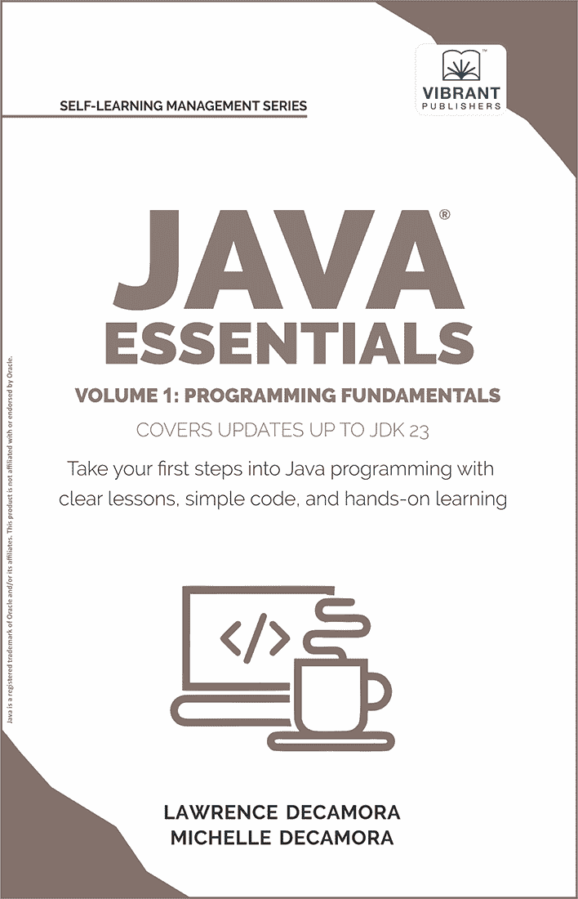

# 为您提供的专属在线资源

作为我们尊贵的读者，您购买此书已包含了访问专属在线资源的权限，这些资源旨在增强您的学习体验。这些资源可以在我们的网站 [www.vibrantpublishers.com](http://www.vibrantpublishers.com) 下载，其目的是帮助您有效地应用 Java® 概念。

本书的在线资源包括以下内容：

1. 书中使用的 Java 代码
2. 额外的编码任务

## 为什么这些在线资源很有价值

* **实际应用**：提供的可下载代码便于进行测试和使用。
* **增强学习体验**：额外的编码任务将提供手操作经验，并帮助您在实际场景中应用从书中学到的知识。

## 如何获取您的在线资源

1. **访问网站**：前往 [www.vibrantpublishers.com](http://www.vibrantpublishers.com)
2. **找到您的书籍**：通过“Shop（商店）”菜单导航至书籍的产品页面，或在搜索栏中搜索书名。
3. **请求资源**：滚动到“Request Sample Book/Online Resource（请求样书/在线资源）”部分。
4. **输入详细信息**：输入您的首选邮箱 ID，并选择“Online Resource（在线资源）”作为资源类型。最后，选择“用户类型”并提交请求。
5. **检查您的收件箱**：资源将直接发送到您的邮箱。

或者，如需快速访问：只需扫描下方二维码直接进入产品页面，并填写所需详情请求在线资源。


[`bit.ly/jv1-slm`](https://bit.ly/jv1-slm)

祝学习愉快！

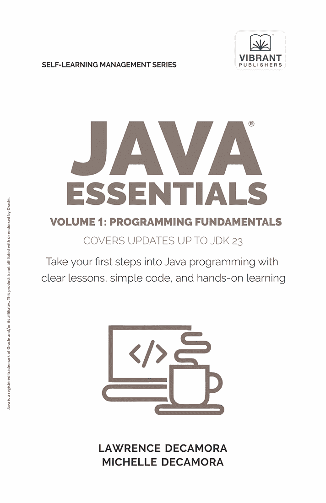

版权 © 2025，由 Vibrant Publishers LLC, USA 版留所有权利。未经出版者许可，不得以任何形式或通过手段复制或分发出版物，或将其存储在数据库或检索系统中。

由 Vibrant Publishers LLC, USA 出版 [www.vibrantpublishers.com](http://www.vibrantpublishers.com)

平装本 ISBN 13: 978-1-63651-502-1

电子书 ISBN 13: 978-1-63651-503-8

硬装本 ISBN 13: 978-1-63651-504-5

美国国会图书号: 2025939620

本出版物旨在就其涵盖的主题提供准确且权威的信息。作者在编写本书时已尽一切努力确保信息的准确性。然而，书中的信息按“现状”出售，不提供任何明示或暗示的保证。作者或出版者对本书直接或间接引起或声称引起的任何损害不承担负责。

本出版物中提到的所有商标和注册商标均为其各自所有者的财产，包括但不限于 Java 和 Oracle。这些商标仅用于编辑和教育目的，无侵犯任何商标权的意图。本出版物是独立的，未获得任何商标所有者的授权、认可或批准。

所有来自 Oracle 产品的截图版权 © Oracle Corporation 和/或其关联公司。经许可使用。

NetBeans 集成开发环境 (IDE) 的截图是根据 Apache License 2.0 的条款再复制的，仅用于教育和插说明目的。

Vibrant Publishers 的书籍提供销售促销的特殊批量折扣，或用于企业培训计划。如需更多信息，请致邮至 bulkorders@vibrantpublishers.com

请将反馈/纠正（技术、语法或拼写错误）发送至 spellerrors@vibrantpublishers.com

Vibrant 以多种印刷和电子格式以及按需打印的形式出版。本书标准印刷版中包含的部分材料可能未包含在按需打印的电子书中。要访问 Vibrant Publishers 的完整目录，请访问 [www.vibrantpublishers.com](http://www.vibrantpublishers.com)

# 自学型管理系列

| 标题 | 平装本 ISBN |
| --- | --- |
| **商业与创业** | |
| 商务沟通核心 | 9781636511634 |
| 商业伦理核心 | 9781636513324 |
| 商业法核心 | 9781636511702 |
| 商业计划核心 | 9781636511214 |
| 商业策略核心 | 9781949395778 |
| 创业核心 | 9781636511603 |
| 国际商务核心 | 9781636513294 |
| 管理学原理核心 | 9781636511542 |
| **计算机科学与技术** | |
| 区块链核心 | 9781636513003 |
| 网络安全核心 | 9781636513003 |
| 机器学习核心 | 9781636513775 |
| Python 核心 | 97816365129 |
| **数据数据科学** | |
| 商业数据分析核心 | 978163651415 |
| 商业智能核心 | 978163651362 |
| 数据分析核心 | 978163651184 |
| **财务素养与经济学** | |
| 成本会计核心 | 978163651030 |
| 财务会计核心 | 978163651072 |
| 财务管理核心 | 978163651009 |
| 宏观经济学核心 | 978163651181 |
| 微观经济学核心 | 978163651153 |
| 个人财务核心 | 978163651849 |
| **多样性、公平与包容性** | |
| 职场多样性核心 | 978163651122 |
| 人力资源分析核心 | 978163651037 |
| 人力资源管理核心 | 9781949395839 |
| 组织行为核心 | 978163651230 |
| 组织发展核心 | 978163651148 |
| **领导力与个人发展** | |
| 决策制定核心 | 9781636510026 |
| 包容性领导力核心 | 9781636514765 |
| 印度转型之路：领导力 | 9781636512273 |
| 时间管理核心 | 9781636511665 |
| **现代营销与销售** | |
| 消费者行为核心 | 9781636513263 |
| 数字营销核心 | 9781949395747 |
| 营销管理核心 | 9781636511788 |
| 市场调研核心 | 9781636513744 |
| 现代广告核心 | 9781636514857 |
| 销售管理核心 | 9781636510743 |
| 服务营销核心 | 9781636511733 |
| 社交媒体营销核心 | 9781636512181 |
| **运营管理** | |
| 敏捷开发核心 | 9781636510057 |
| 运营与供应链管理核心 | 9781949395242 |
| 产品管理核心 | 9781636514796 |
| 项目管理核心 | 9781636510712 |
| 利益者参与核心 | 9781636511511 |

# 作者简介

Lawrence G. Decamora III 博士，是一位卓越的计算机科学教育者、作者和行业人士，在软件开发和学术领域拥有丰富经验。他持有太阳认证 Java 程序员 (SCJP) 和甲骨文认证 Java 程序员 (OCPJP) 等声誉证书，在信息技术领域做出了重大贡献。

Decamora 博士二十多年来一直是计算机科学、信息系统和信息技术领域的敬业教师。他曾在圣托马斯大学、德拉莱尔圣本尼迪克学院和马普亚理工学院等知名机构任教。他的学术领导工作包括担任代 ITE 项目主任和学术负责人，指导了无数学生和有志的 IT 专业人士。

在行业内，Decamora 博士曾与 Sun Microsystems Philippines、Phoenix One 和 ActiveLearning Inc. 等领先机构合作，提供 Java 培训和软件开发解决方案。他的专业知识涵盖 Java 编程、企业级应用和 Web 技术。

除了教学之外，Decamora 博士还是备受期待的演讲者和培训师，曾举办过 Java 编程、软件工程和新兴技术的研讨会和工作坊。他对知识分享的热情体现在通过实用的见解和现实应用赋能学习者的承诺中。

这本书证明了他让各水平的学习者都能轻松上手 Java 的心血。通过清晰的解释和实操示例，Decamora 博士继续激励和引导下一代开发者。


**Michelle C. Decamora**（麻省理工学院）是一位敬业的教育者和丰富的 IT 专业人士，热衷通过知识和实践学习赋能学生。她拥有信息技术硕士学位和丰富的教学经验，在计算机教育领域做出了巨大贡献。

Michelle 曾在多家知名机构担任信息技术教师，包括 CIIT 艺术与技术学院和圣本尼德莱萨尔学院。她对学术卓越的追求延伸至教室之外，此前曾在 Malabon 的系统技术学院（STI）担任学术主管和负责人等领导职务，在那里她监督教职员工、开发课程并确保学术质量。

Michelle 在数据库管理、Java 编程和应用开发方面的专业知识使她对 IT 的理论和实践方面都有全面的理解。

除了教学工作外，Michelle 还参加了许多专项培训计划，包括 IBM DB2 学术培训、带色彩渲染的 AutoCAD 以及高级 Macromedia Flash 应用开发。她对持续学习的执着赢得了广泛认可，包括 DB2 数据库和应用基础的 IBM 认证学术助理。

作为本书的合著者，Michelle 分享了丰富的知识和实战见解，引导学习者开启 Java 编程之旅。她合作式的教学方法和对促进学生成长的热情使成为这一教育资源不可或缺的贡献者。

# 专家如何评价这本书！

Lawrence Decamora 编写了一本结构极其良好的 Java 编程入门书籍，在拥挤的编程教科书中脱颖而出。作为一名教育工作者，这本书从基础概念到实际应用的周全递进给我留下了深刻印象。

这本书的独特价值之处在于其“边学边练”的哲学。Lawrence 并没有用抽象的理论淹没初学者，而是引导读者通过实践经验逐步建立信心。引入 `JShell` 进行交互式学习是神来之笔，反映了现代教学的最佳实践。

书涵盖范围非常全面——从跨多个操作系统的 `JDK` 安装到控制结构、数组和字符串处理等核心编程概念——为学生奠定了坚实的基础。每一章的构建都非常仔细，配有练习、测验和编码任务，确保了概念不仅仅是被背诵，而是被真正理解。

Lawrence 对现实编程实践（包括调试技术和编码规范）的强调，为学生从事实际开发工作做了准备，而不仅仅是学术练习。清晰的写作风格和逻辑进展使得复杂的概念对初学者来说易懂，同时保持了深度学习所需的深度。

这一卷为第二卷中涵盖的高级主题奠定了基础，对于教育机构和自学者来说都是极佳的选择。

– David Smith，Silicon Valley High School, Inc. 执行官

作为一个近距离观察过 Lawrence 教学风格的人（特别是我们一起为 `LearningWhilePracticing` 制作按需 Java 课程时），我对这本书如此清晰、结构化且在教学法上如此强大并不感到意外。同样的清晰度和实践思维完美地转化到了纸面上。解释精确且不晦涩，节奏感也恰到好处。概念逐渐引入，每一章都在前一章的基础上逻辑地构建。在每个章节末尾加入章节总结、测验和编码任务是强化学习的绝佳方式。

结构非常棒。从安装 `JDK` 到理解数组，内容准确涵盖了初学者获得信心所需的全部内容。它还超越了简单的“Hello World”基础，包含了至关重要的现实世界元素，如调试、`JShell`、`Scanner` 类和字符串处理——同时保持了内容的易读性。关于 Java 控制结构和原始数据类型的章节真的非常引颖。它们在理论和应用之间取得了完美的平衡，特别是在强调编码规范和可读性方面。此外，“边学边练”的方法不仅是一种哲学——它植根于书的基因之中。

– Joe Ghalbouni，Learning While Practicing 创始人

# 目录

- 0 下载、安装和配置 Java 开发工具包 (JDK)
    - 0.1 我从哪里获取 Java 开发工具包 (JDK)?
    - 0.2 下载正确的 JDK
    - 0.3 在 Mac OS 上安装 JDK
    - 0.4 为 Windows 环境安装 JDK
    - 0.5 为 Linux 环境安装 JDK
    - 章节总结
    - 测验
    - JDK 任务
- 1 你的第一个 Java 程序
    - 1.1 Java 的核心特性
    - 1.2 Java 的三种变体
    - 1.3 JDK vs. JRE
    - 1.4 Java 环境 (JRE)
    - 1.5 垃圾回收器
    - 1.6 Java 处理安全时执行的三项任务
    - 章节总结
    - 测验
    - 进一步思考
- 2 编写你的第一个 Java 程序
    - 2.1 “HelloWorld”:你的 Java
    - 2.2 `System.out.println()` 方法
    - 2.3 编译错误与运行时错误
    - 2.4 介绍 JShell
    - 章节总结
    - 测验
    - 编码任务
- 3 用户输入、标识符、关键字和原始数据类型
    - 3.1 三种 Java 注
    - 3.2 分号、块和空白符
    - 3.3 Java 标识符
    - 3.4 Java 关键字
    - 3.5 Java 语言编码规范
    - 3.6 原始数据类型
    - 3.7 `Math` 类
    - 3.8 `Scanner` 类
    - 章节总结
    - 测验
    - 编码任务
- 4 Java 操作符
    - 4.1 Java 操作符简介
    - 4.2 优先级
    - 章节总结
    - 测验
    - 编码任务
- 5 Java 控制结构
    - 5.1 Java 控制结构简介
    - 5.2 `if` 条件语句及其变体
    - 5.3 `switch-case` 及其变体
    - 5.4 `while` 语句
    - 5.5 `do-while` 语句
    - 5.6 `for` 循环
    - 5.7 `break` 语句……再次
    - 5.8 `continue` 语句
    - 5.9 标签 `break` 和 `continue`
    - 章节总结
    - 测验
    - 编码任务
- 6 String, StringBuffer 和 StringBuilder
    - 6.1 `String` 类
    - 6.2 常用 `String` 方法
    - 6.3 `StringBuffer` 和 `StringBuilder` 类
    - 章节总结
    - 测验
    - 编码任务
- 7 数组
    - 7.1 数组简介
    - 7.2 数组限制
    - 7.3 增强型 `for` 循环
    - 7.4 数组复制
    - 7.5 命令行参数
    - 7.6 数组的数组（二维数组）
    - 章节总结
    - 测验
    - 编码任务
- 术表

# 前言

欢迎阅读 *Java Essentials Volume 1: Programming Fundamentals*，这本书专为那些几乎没有经验就进入 Java 世界的人士精心编写的。无论你是一个有抱负的开发者、自学学者、大一新生，还是渴望学习世界上最强大且多功能的编程语言之一的高中生，这本书都是为你设计的。

二十年来，Java 一直保持着其作为可靠通用语言的声誉——驱动着 Web 服务器、企业级软件、移动应用程序甚至嵌入式设备。Java 之所以脱颖而出，不仅是因为它的面向对象结构，还因为其对可读性、可靠性和移植性的强调。这些正是让 Java 成为任何学习编程者的理想首语言的品质。

本书首先将带你完成为操作系统下载、安装和配置 Java 开发包（`JDK`）的实际步骤。从那里开始，你将学习语言的基础——编写第一个程序、使用基础语法、理解原始数据类型、处理用户输入，并探索控制结构、操作符、字符串和数组等核心主题。

每一章都经过精心设计，在前一章的基础上，整合了理论、带注释的代码示例、实践练习和复习题，以强化你的学习。你还会遇到真实世界的编程实践，例如调试编译时和运行时错误、遵循 Java 编码规范，甚至使用 `JShell` 等工具进行交互式学习和实验。

本书与众不同之处在于它的教学哲学：*在实践中学习*。每个主题都是逐渐引入的，并通过即时应用进行强化，确保概念不仅仅是被记忆，而是被理解。随着你完成每一章，你将在编写简洁、逻辑清晰且结构良好的 Java 程序方面更有信心。

第一卷为更高级的 Java 主题奠定了基础，这些主题将在第二卷中探讨。在本书结束时，你将获得坚实的基础，为学习面向对象设计、异常处理、文件 I/O、集合和 GUI 编程等主题做好准备——这些都将在 *Java Essentials Volume 2: Object-Oriented Programming and Beyond* 中涵盖。

感谢选择这本书开启你的 Java 旅程。让我们一起开启第一杯 Java 咖啡吧——一次写一行代码开始。

编码愉快！

Michelle C. Decamora, 麻省理工学院

Lawrence G. Decamora III, 博士

# 图书介绍

*Java Essentials Volume 1: Programming Fundamentals* 是两部系列的第一部分，旨在向新程序员介绍 Java 编程语言的基础。无论你是学生、有抱负的开发者，还是仅仅对编码好奇的人，本卷都将以清晰且对初学者友好的方式带你了解 Java 的核心构建模块。

在本卷中，我们首先引导你完成为不同操作系统下载、安装和配置 Java 开发包（`JDK`）的过程。随后，你将编写第一个 Java 程序，探索语言的结构和语法，并学习如何处理用户输入。我们涵盖了 Java 的原始数据类型、操作符、控制结构，甚至深入探讨了字符串和数组——这些对于任何 Java 程序员来说都是关键的概念。


我们的目标是确保你通过实践方法和实际示例在 Java 上建立坚实的基础。每一章都建立在前章的基础上，创建一个平滑且逻辑清晰的学习曲线。

虽然本卷涵盖了广泛的入门主题，但 Java 是一门巨大的语言，还有更多值得探索。《Java Essentials Volume 2: Object-Oriented Programming and Beyond》将接在本书之后。在第二卷中，我们将探索面向对象编程、异常处理、文件操作、图形用户界面（GUI）以及更多将加深你理解的内容。

感谢选择这本书作为你的学习伙伴。我们很高兴你加入这段旅程，并希望你喜欢编写第一行 Java 代码！

让我们开始吧！

# 谁能从这本书中受益？

本书为完全的初学者编写——不需要任何先前的编程经验。如果你从未写过任何代码，《Java Volume 1: Programming Fundamentals》是完美的起点。它采用一种温和、结构化的方法向你介绍 Java，使其易于理解，并有真实示例支持。

以下是一些能从书中受益最多的读者：

- 想要将 Java 作为第一门编程语言学习的有抱负的软件开发者。
- 对编码好奇并想按自己的节奏探索 Java 的自学者和爱好者。
- 寻求转型进入科技行业并寻求编程概念坚实基础的职业转行者。
- 想要为初学者教授 Java 提供清晰且结构化资源的高中或大学教育者。
- 来自其他领域（如网络、工程或 IT 支持）并希望获得编码技能以补充现有知识的技术专业人士。
- 参加了介绍性编程课程的学生，他们需要一个全面的、对初学者友好的 Java 参考。

无论你是在自学、在教室里还是作为培训计划的一部分阅读这本书，它都旨在帮助你像程序员一样思考。示例、练习和解释都是为了让学习体验尽可能亲切和实用。

如果你准备好构建你的第一个 Java 应用程序并理解代码背后的逻辑，那么这本书就适合你。

本书旨在帮助你从零开始学习 Java 编程。内容的组织方式支持循序渐进、通过实践来掌握这门语言。以下是充分利用每个章节的方法：

### 1. 从基础开始

从第 0 章开始，该章节将引导你下载并安装适用于你操作系统的 Java 开发工具包 (`JDK`)。这确保了你的环境从一开始就准备好进行编码。

### 2. 在做中学学习

每个章节循序渐进地引入概念，并提供示例帮助你练习刚刚学的内容。务必亲自输入并运行示例代码——通过实验，理解会得更快！

### 3. 参考核心概念

在整本书中，请关注以下特性：

- 高效编码和调试技巧
- 解释逐行逻辑的代码拆解
- 常见陷阱，帮助你避免典型的初学者错误
- 形象的类比，帮助将抽象概念与实际场景联系

### 4. 经常练习

练习是编程的关键。在进入下一个章节之前，尝试完成每个章节末尾的练习。你还可以通过修改代码示例并观察效果来不断尝试。你也可以尝试回答每个章节末尾的多选题，帮助自己评估所学内容。

### 5. 将其作为快速参考

一旦完成一个章节，可以在需要复习时随时重新查看。章节结构清晰，易于找到特定主题，如原始数据类型、循环或 `Scanner` 类。

### 6. 在第 2 卷中进一步探索

本卷侧重于 Java 的基础构建模块。当你准备好进入更高级的主题（如面向对象编程、异常处理、文件 I/O 和 GUI）时，请通过《Java Essentials 第 2 卷：面向对象编程及拓展》继续你的学习之旅。

### 7. 不要急躁

Java 是一门强大的语言，有许多概念需要掌握。为每个主题留出时间。重温困难章节，寻求说明并经常练习。学习编码就像学习一种新语言——通过经常接触和使用，它会变得更容易。

### 8. 保持好奇心

编程不仅关乎语法，也关乎解决问题。不要只是硬记——去探索事物为什么是这样工作的。使用 `API 文档` 等外部文档，并在遇到瓶颈时与在线社区互动。

# 第 0 章

## 下载、安装和配置 Java 开发工具包 (JDK)

 学习目标

- 知道哪里下载 Java 开发工具包 (`JDK`)
- 安装并配置 `JDK`
- 下载并安装你的文本编辑器
- 使用 `Java Compiler` 编译示例代码
- 运行示例代码

在 Java 中，计数通常从零开始，因此我们的章节也从零开始是有意义的。第 0 章标记了真正的开始：在调用第一个方法之前的准备。本章将概述学习 Java 所需的关键软件——`JDK`。你将知道在哪里获取该软件，以及如何在特定的计算机（无论是 Windows 机器、Mac OS X 还是 Linux 机器）上安装和配置它。

### 0.1 我从哪里获取 Java 开发工具包 (JDK)

要下载 Java 开发工具包 (`JDK`)，你可以使用搜索字符串 `jdk <version> download` 在互联网上搜索。假设你想安装 JDK 8 版本，那么可以搜索 `jdk 8 download`。本书涵盖了最高 JDK 23，但如果你想安装最新版本，只需在 Google 搜索标签中输入 `jdk download` 即可。

对于初学者来说，最好使用最新的 `JDK`，但对于使用旧电脑的用户，如果你的操作系统仍使用 32 位架构（例如 Windows XP），则应该下载 JDK 1.8。查看图 0.1 和 0.2 来了解 Google 搜索结果的样子。

图 0.1 待下载最新 JDK 安装程序的 Google 截图

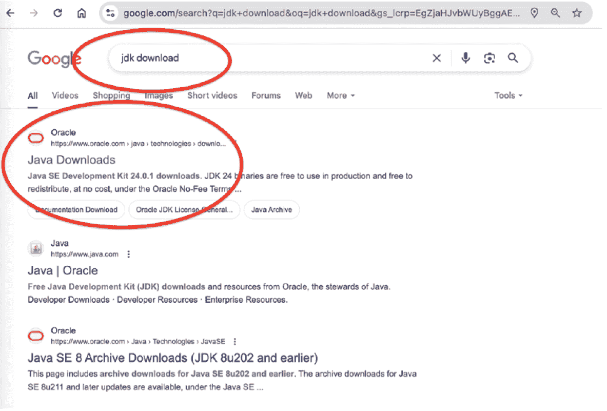

图 0.2 待下载特定 JDK 安装程序的 Google 截图 - JDK 1.8 安装程序

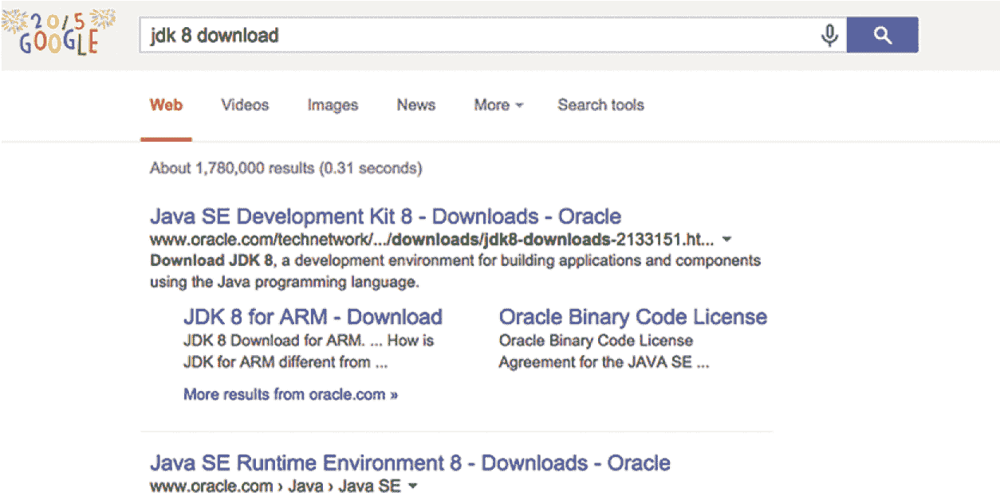

Google 和 Google 标志是 Google LLC 的商标。

点击你在结果列表中看到的 Oracle® 软件链接，它会将你重定向到 Oracle 网站上的下载页面。

对于旧版本的 `JDK`，你可能会被要求在 Oracle 开发者网站上注册。如果你想下载归档版本的 `JDK`，可能会被要求接受许可协议。你需要勾选 `Accept License Agreement`（接受许可协议）复选框以继续下载 `JDK`。

图 0.3 Oracle 二进制代码许可协议

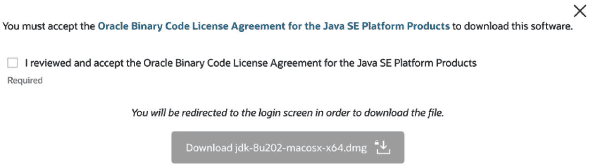

### 0.2 为你的机器下载正确的 JDK

点击复选框同意许可协议后，下一步是为你的机器选择正确的安装程序。`JDK` 安装程序列表遵循特定模式，这有助于帮助你选择正确的安装程序。在下方页面上，你可以选择 Linux OS、Mac OS 或 Windows OS 的安装程序。

图 0.4 JDK 安装程序列表

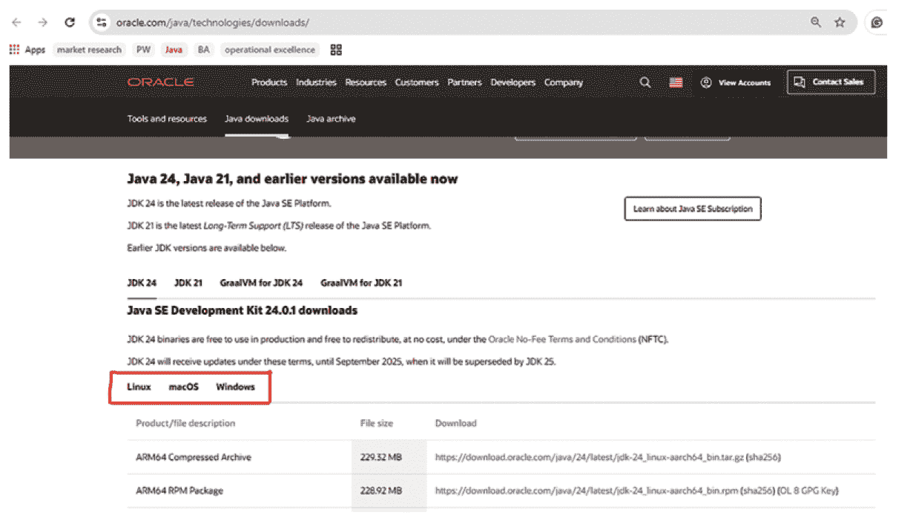

### 0.3 在 Mac OS 中安装 JDK

在安装 `JDK` 之前，你需要检查 Mac OS 的硬件要求。你可以将 `JDK` 安装在任何 Intel 电脑（如 iMac, MacBook Air, MacBook Pro）或较新的 Apple Silicon（M1, M2, M3, M4）。

要了解你使用的 Mac OS 版本，点击屏幕左上角的 Apple 图标，然后进入“关于本机”菜单。你将看到 Mac OS 版本以及处理器类型（判断是 Intel 还是 Apple Silicon）。

在了解 Mac OS 版本后，你还需要确保拥有管理员权限才能安装 `JDK`。如果你没有安装 Mac OS，可以使用互联网上名为 *soylatte* 的 `JDK` 补丁版本，或者升级你的系统。

当你具备所有条件后，现在可以开始安装 `JDK`。安装 Java 开发工具包 (`JDK`) 时，Java 运行时 (`JRE`) 和 JavaFX SDK 会安装到标准目录结构中。

根据处理器，下载的文件具有以下名称之一：

- 对于 AMD 处理器，你的 `JDK` 安装程序名为 `jdk-versionuupdate-macosx-amd64.dmg`。
- 对于 Intel 处理器，你的 `JDK` 安装程序名为 `jdk-versionuupdate-macosx-x64.dmg`。
- 对于 JDK 8 更新 25，安装程序文件名可能为：`jdk-8u25-macosx-amd64.dmg`（AMD）和 `jdk-8u25-macosx-x64.dmg`（Intel）。

从浏览器的下载窗口或文件浏览器，你现在可以双击 `.dmg` 文件启动安装程序。一个访达窗口将出现，包含一个打开的盒子图标和 `.pkg` 文件名。

图 0.5 包含 JDK .pkg 文件的 Mac OS 访达窗口

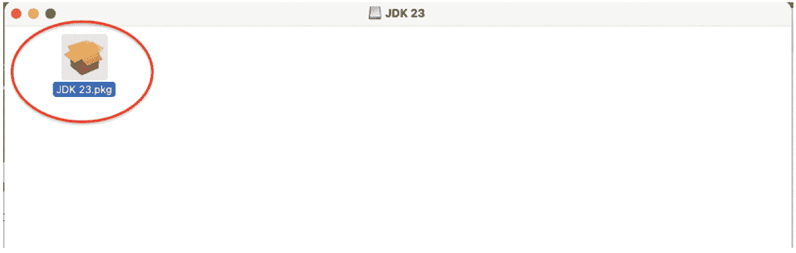

双击包图标启动安装程序。安装程序显示“简介界面”。只需按照说明点击“继续”并使用所有建议默认值。

图 0.6 Mac OS JDK 安装向导

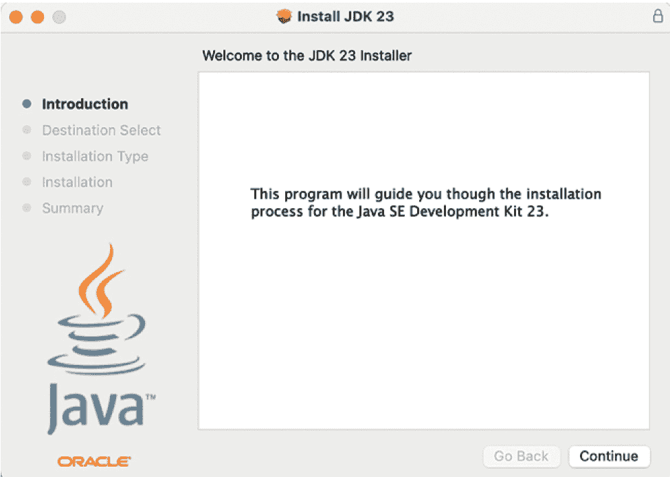

随后会出现“选择位置”窗口。只需使用安装向导的默认建议并点击“继续”即可。

图 0.7 JDK 安装向导 - 选择位置部分

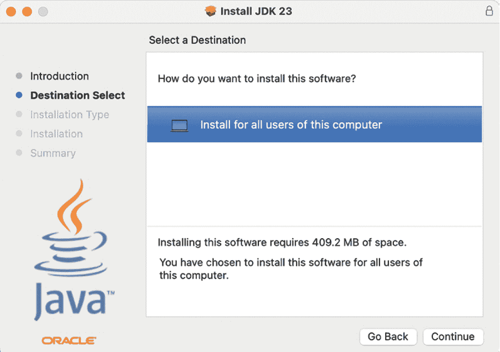

弹出一个窗口，显示消息“安装程序正在尝试安装新软件”。你可以输入密码允许继续，或者使用你已注册的指纹（这将自动输入管理员登录名和密码），然后点击 `Install Software` 继续安装过程。

图 0.8 使用密码或 Touch ID 继续安装向导

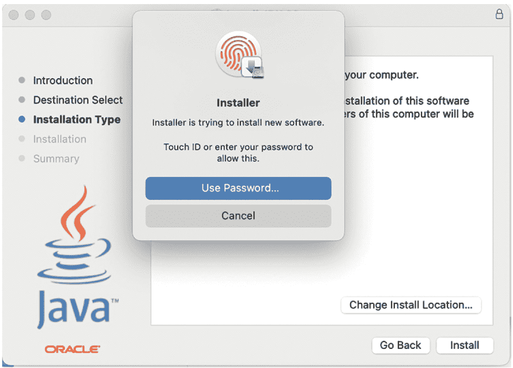

软件将进行安装，完成后会弹出一个确认窗口。

图 0.9 安装成功

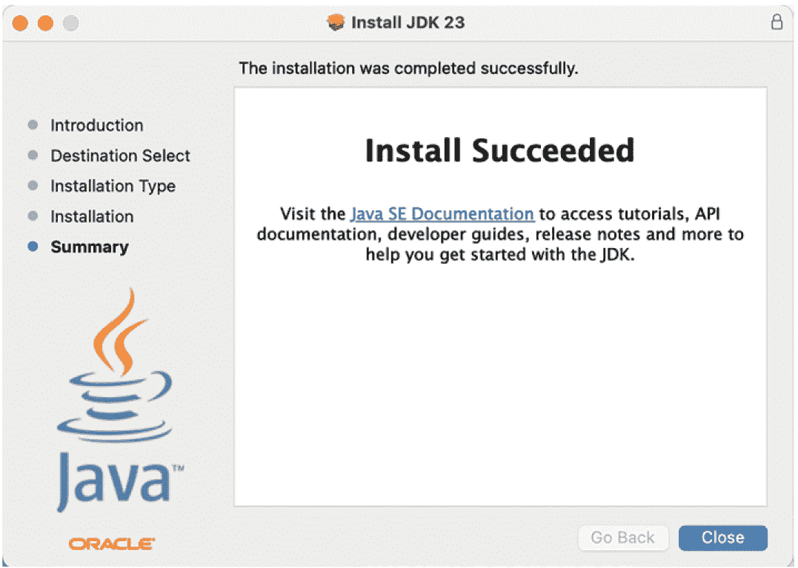

安装过程完成后，系统会询问你是否希望将安装程序保留在磁盘上，或者将其移动到废纸篓并在稍后永久删除。通过这样做，你可以节省磁盘空间。

图 0.10 JDK 安装程序 - 保留或移动到废纸篓

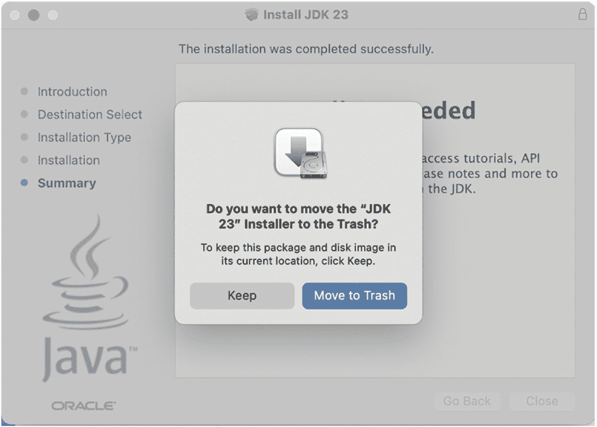

要测试你的编译器并检查编译器的版本，请在终端窗口中输入（不包含 % 符号）：`javac -version`。

图 0.11 Mac OS Finder 窗口 - 检查 javac 命令

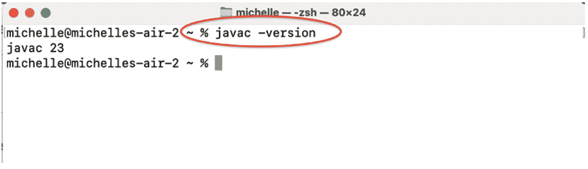

要测试你的 Java 运行时命令，请输入（不包含 %）：`java -version`。

图 0.12 Mac OS Finder 窗口 - 检查 Java 命令

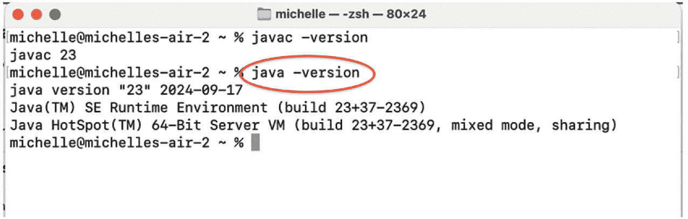

这两个命令都将显示 Java 编译器和 Java 运行环境的版本。在 Mac OS 环境下安装 `JDK` 应该非常简单。在大多数情况下，它很少或不需要配置。

## 0.4 为你的 Windows 操作系统安装 JDK

按照以下步骤为你的 Windows 操作系统安装 `JDK`。

### 0.4.1 检查 Windows 操作系统的 JDK

要检查 Windows 系统是否已预安装了 `JDK`，请尝试按下 Windows 键并输入 `CMD` 来打开命令提示符。在命令提示符中，如下所示在提示符处输入 `javac`。

图 0.13 Windows 命令提示符 - 检查 javac 命令

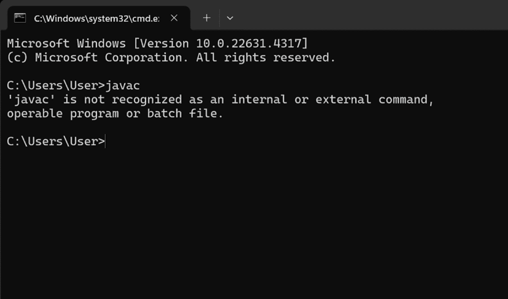

如果显示无法识别 `javac` 命令，那么你可能需要在 Windows 系统上启动 `JDK` 的下载、安装和配置过程。

### 0.4.2 下载适用于 Windows 操作系统的 JDK

在 Google 上搜索：`JDK download`，如下图所示。

图 0.14 待下载的最新 JDK 安装程序的 Google 截图

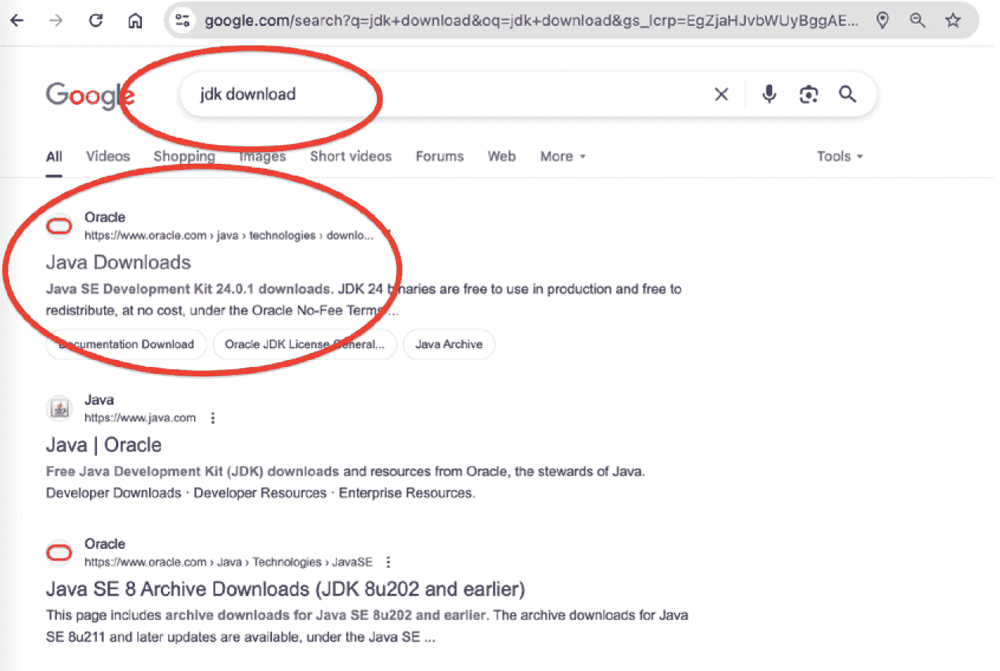

Google 和 Google Logo 是 Google LLC 的商标。

点击与你的搜索相关的第一个 Oracle 网站链接。最好从源头（官方 Oracle 网站）获取 `JDK`。

图 0.15 Windows 系统可用的 JDK 安装程序

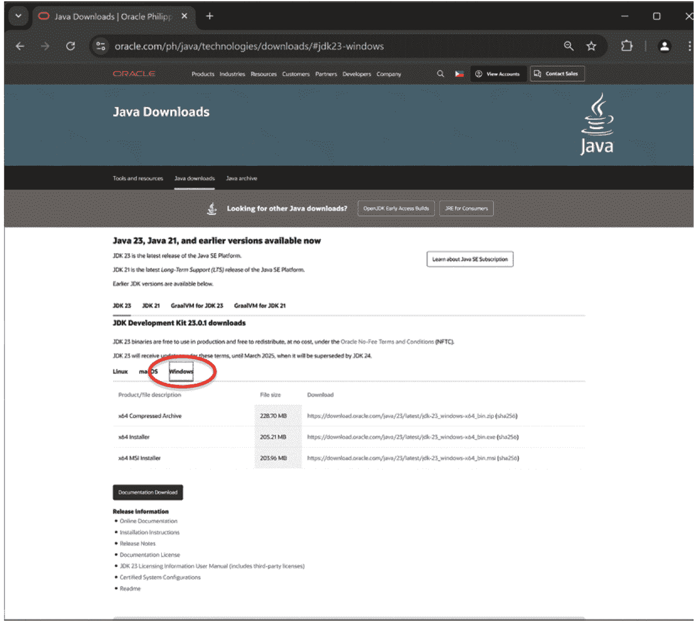

从选项（Linux, Mac OS, Windows）中选择 `Windows`。如果你使用的是基于 Intel 的机器，请选择 `x64 Installer`。下载的安装程序将保存在 Downloads 文件夹中，如下所示。

图 0.16 Downloads 文件夹内的 JDK 23 Windows 安装程序

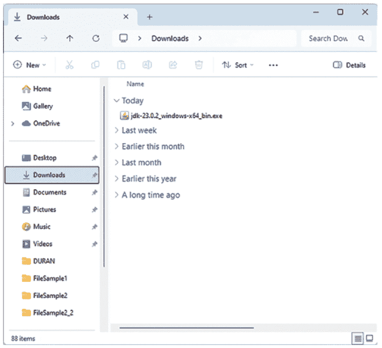

### 0.4.3 在 Windows 操作系统中安装 JDK

下载好 `JDK` 后，请确保你拥有在 Microsoft Windows 上安装 `JDK` 的管理员权限。你可以通过双击安装程序来启动安装过程。这将启动 `JDK` 安装向导，如下所示。

图 0.17 JDK 23 Windows 安装程序安装向导

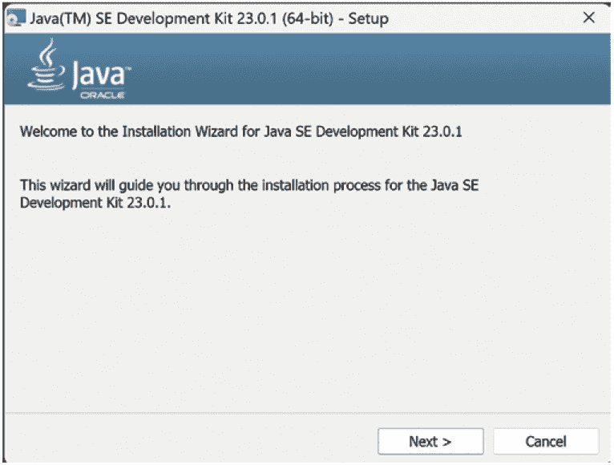

如果这是你第一次安装 `JDK`，最好按照安装向导提供的默认值，一直点击 `Next` 直到安装完成。安装完成后，你可以检查 `Program Files\Java` 文件夹，你会发现创建了一个 `jdk-<version>` 文件夹。在这种情况下，由于我们安装的是 JDK 23，你将看到 `jdk-23` 文件夹。

### 0.4.4 为 Windows 系统配置 JDK

安装成功后，下一步是在你的 Windows 操作系统上配置以下环境变量。这些是以下环境变量：`CLASSPATH`、`JAVA_HOME` 和 `Path`。

Windows 系统中的 `CLASSPATH` 是一个环境变量，告诉 Java 虚拟机 (`JVM`) 和 Java 编译器在运行 Java 程序时去哪里查找自定义类和包。它指定了包含应用程序所需的编译 Java 类的目录或 JAR 文件。要开始设置环境变量，打开资源管理器并右键点击左侧面板上的 `此电脑`。

图 0.18 资源管理器

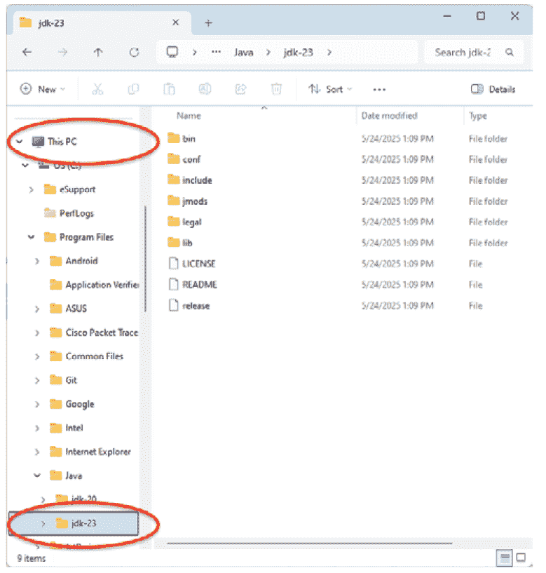

选择 `Properties`（属性）选项。这将打开你 Windows 环境的 `System Properties`（系统属性），如下所示。

图 0.19 属性窗口

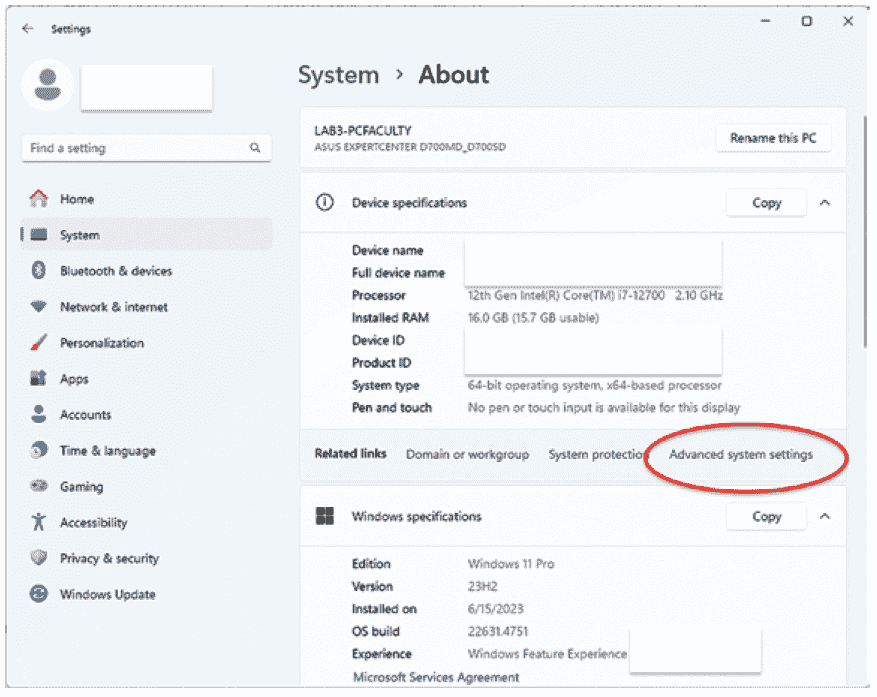

选择 `Advanced system settings`（高级系统设置）。

图 0.20 系统属性窗口

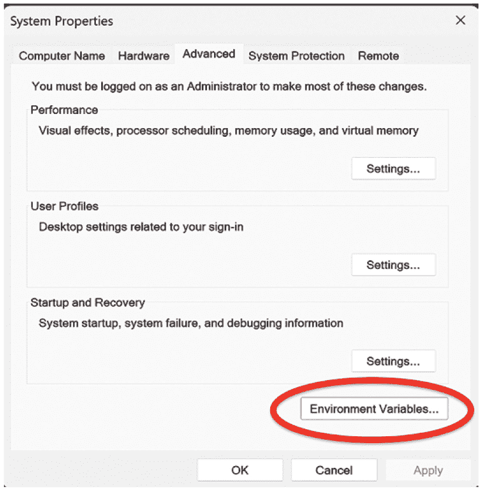

选择 `Environment Variables`（环境变量）。

图 0.21 环境变量窗口

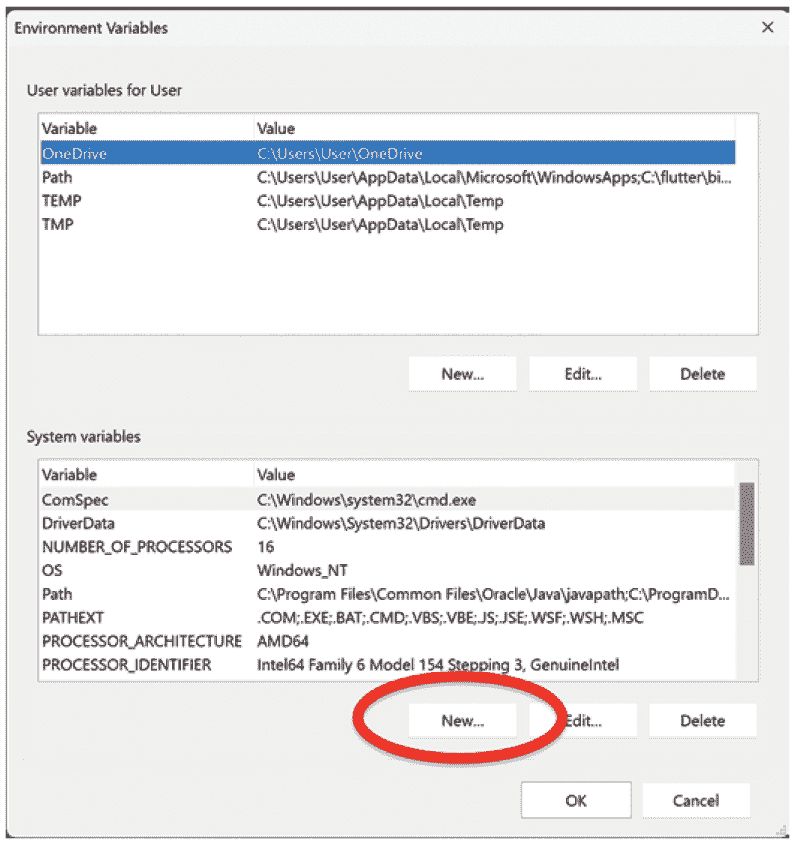

点击 `System variables`（系统变量）下的 `New…` 按钮，这样就可以开始添加如 `CLASSPATH` 和 `JAVA_HOME` 等新环境变量。

在 `Variable Name`（变量名）中输入：`CLASSPATH`，然后在 `Variable Value`（变量值）中输入 `.`（仅有点），如下所示。点击 OK 关闭窗口。

图 0.22 环境变量窗口 - 输入 CLASSPATH

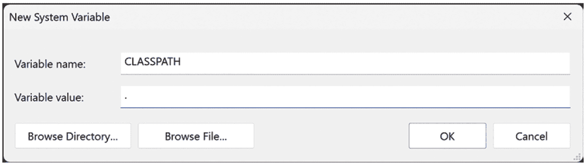

接下来，我们将设置 `JAVA_HOME`。按照相同的步骤，在系统变量下点击 `New…` 按钮，添加 `JAVA_HOME`，如下所示。

图 0.23 环境变量窗口 - 输入 JAVA_HOME

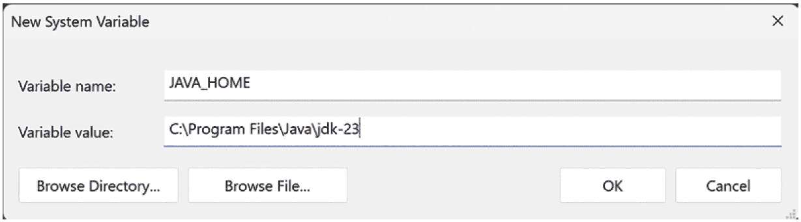

为了减少输入任何值错误的可能性，最好从源处复制它。

图 0.24 资源管理器 - Java 文件夹

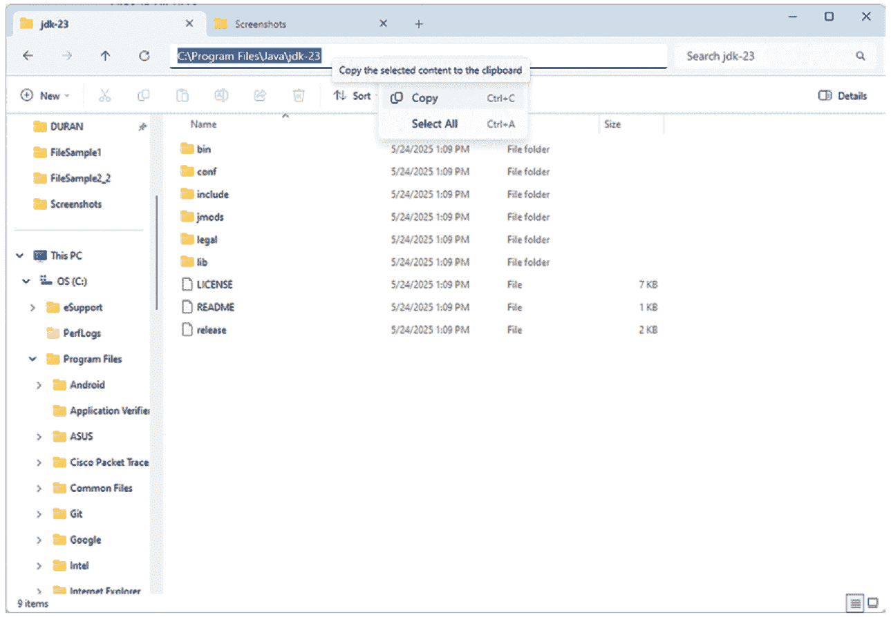

设置 `CLASSPATH` 和 `JAVA_HOME` 后，是时候编辑 `Path` 了。

这次，在系统变量下，不要选择 `New…`，而是选择 `Edit…`。这将打开环境变量窗口，如下所示。点击窗口左侧的 `New` 按钮，然后输入内容：`%JAVA_HOME%\bin`。确保你输入的文本中没有额外的空格。之后，按 OK 关闭窗口。

图 0.25 环境变量 - 编辑 Path

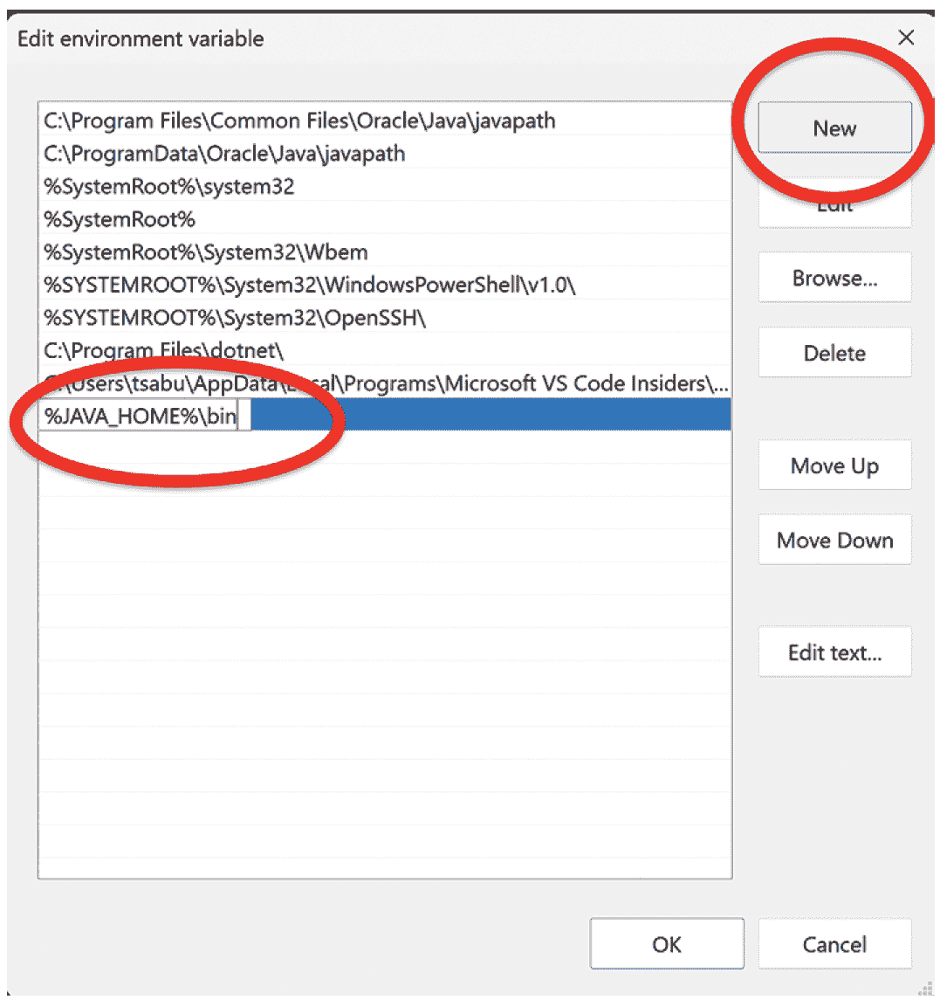

`%JAVA_HOME%\bin` 是 Windows 中用于引用 Java 安装目录下 bin 目录的路径表示。

- `%JAVA_HOME%`：这是一个指向 Java 开发工具包 (`JDK`) 安装根目录的环境变量。它通常包含 Java 安装路径（例如 `C:\Program Files\Java\jdk-23`）。
- `bin`：Java 安装目录下的 bin 文件夹包含重要的 Java 可执行文件，如 `java`（Java 运行时）、`javac`（Java 编译器）以及其他工具如 `jshell`。

### 0.4.5 在你的 Windows 上测试 JDK

关闭所有现有的命令提示符；你不需要它们。你需要打开一个新的，以便在 Windows 操作系统上新添加的环境变量生效。让我们打开一个新的命令提示符并如下所示输入 `javac -version`。

图 0.26 命令提示符 - 检查 javac 命令

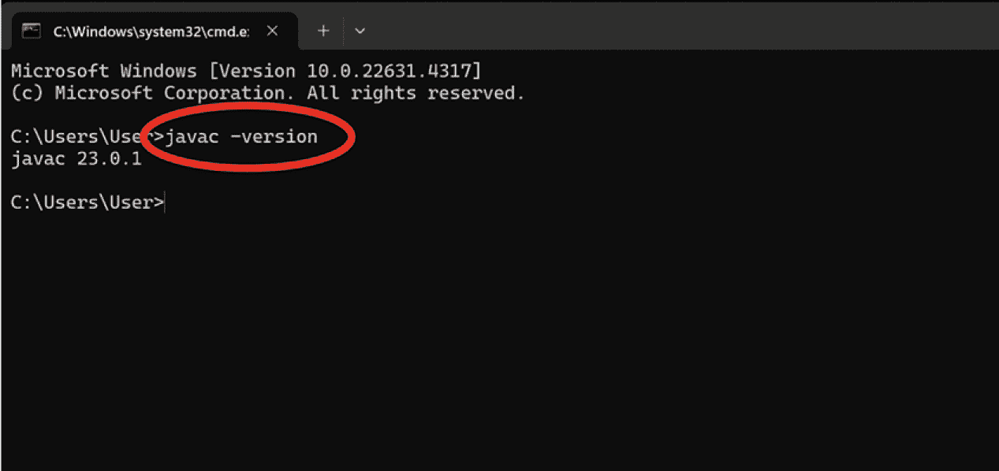

这将显示你的编译器工作正常，且你的 Java 编译器版本为 23。接下来，输入 `java -version` 来测试你的 Java 运行环境，如下所示。

图 0.27 命令提示符 - 测试 Java 命令

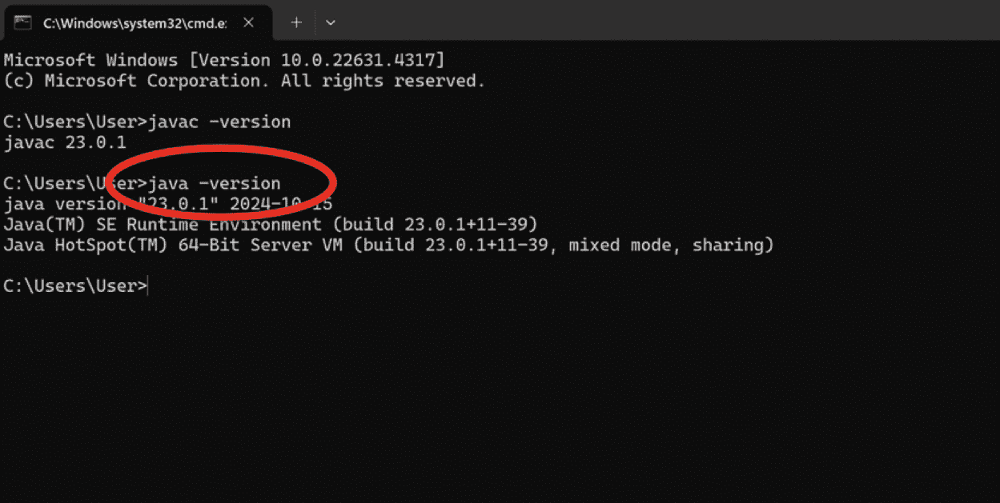

# 0.5 Linux 环境 JDK 安装器

在 Linux 运行环境中，有两种用户：root 用户（超级用户）和普通用户。root 用户可以访问 Linux 机器上的所有文件夹，而普通用户仅可以访问自己的家目录。了解你拥有什么种类型的用户账户将帮助你决定下载哪种类型的 `JDK` Linux 安装器。

你有两种文件类型可供选择：`*.tar.gz` 文件（归包二进制文件）或 `*.rpm` 文件（Red Hat 软件包管理器文件）。对于使用 Linux 发行版的 Intel 机器，还有一种特殊的安装程序。以下是可用的 Linux 安装器列表。

图 0.28 Oracle 官网 - Linux JDK 安装器

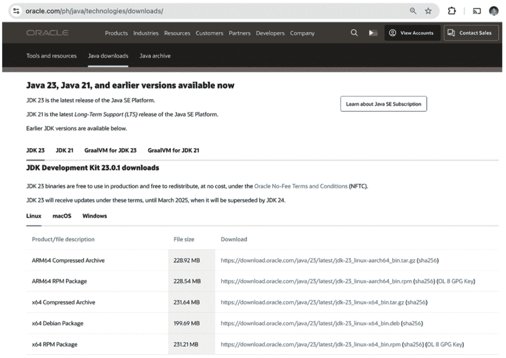

### 0.5.1 归包二进制文件 (*.tar.gz)

归包二进制文件适用于任何种类型的用户，包括普通用户和 root 用户。使用归包文件，你可以自定义解压文件的位置。选择好位置后，可以通过输入以下命令开始解压过程：

```
tar zxvf jdk-<version>u<update>-linux-x64.tar.gz
```


假设你想将 JDK 提取到家目录下，以下是实际命令的示例，假设安装程序是 JDK 23。

```bash
cd <ENTER>
tar zxvf jdk-23_linux-x64_bin.tar.gz <ENTER>
```

第一条命令确保你当前的工作目录是家目录，第二条命令将 JDK 提取到家目录下。

此外，通过 `tar` 命令，你可以在家目录内解压该安装器。

下一步是通过编辑 `.profile` 文件来配置你的 JDK。你可以使用 `vi` 编辑器或任何文本编辑器来编辑 `.profile` 文件。

添加以下行：

```bash
JAVA_HOME=~/jdk-23
export JAVA_HOME
PATH=$JAVA_HOME/bin:$PATH
export PATH
```

保存你的 `.profile`。

在机器上注销并重新登录。

### 0.5.2 RedHat 软件包管理器 (RPM) 文件

RPM 文件供 root 用户用于软件包安装。你可以下载扩展名为 `*.rpm` 的 JDK 安装器。

下载文件后，你需要使用 `su` 命令以 root 用户身份登录。以下是示例命令。

```bash
su –
<Type in your root password>#
```

以 root 登录后，你现在可以执行 `rpm` 命令开始安装软件包。

```bash
rpm -Uvh jdk-23_linux_x64_bin.rpm <ENTER>
```

安装完成后，你可以从 root 用户注销回到普通用户，操作即完成。不需要重启机器。请记住，安装器名称中包含 x64 值的安装器是用于 Intel 处理器的。对于其他类型的处理器，你可以使用 ARM64 安装器。

 章节总结 (#07_Contents.xhtml_chhead7)

- 有不同种类型的计算机运行着不同类型的操作系统。第一个关键步骤是了解你操作系统的类型，然后在 Google 上搜索以找到要安装的正确 JDK。
- 对于 64 位操作系统，建议使用最新版本的 JDK。
- 对于较旧的操作系统，你可以使用 JDK 8，它可以服务于任何 32 位的 Windows 或 Linux 操作系统。
- 一旦你正确安装并配置了 JDK，你需要通过输入 `javac -version` 来了解 Java 编译器的版本，输入 `java -version` 来了解运行时环境的版本。
- 理想情况下，你的编译器 (`javac`) 和运行时 (`java`) 使用相同的版本更好，但如果由于某些原因它们版本不一致，请确保你的 `javac` 版本低于你的 `java` 版本。

 测试题 (#07_Contents.xhtml_chhead8)

1. 下列哪项**不是**一个操作系统？

   a. Windows
   b. Linux
   c. MacOSX
   d. JDK

2. 下列哪种说法是**不正确**的？

   a. 对于 Mac OS，不需要安装 JDK，所有 Mac OS 版本都预装了 JDK。
   b. 对于较旧的操作系统，JDK 8 是最好的 JDK 版本，因为它仍然提供 32 位和 64 位版本。
   c. 对于现代操作系统，最好使用最新版本的 JDK。
   d. 要获取最新版本的 JDK，只需在 Google 上搜索“JDK download”即可。

3. 想要了解 Java 编译器的版本，命令是：

   a. `javac -version`
   b. `javac -v`
   c. `compiler -v`
   d. `java compiler -v`

4. 想要了解 Java 运行时环境的版本，命令是：

   a. `java -runtime`
   b. `java -r`
   c. `java -version`
   d. `java -run`

5. dmg 类型的安装器适用于什么操作系统？

   a. Windows
   b. Linux
   c. MacOSX
   d. 任何操作系统

6. exe 类型的安装器适用于什么操作系统？

   a. Windows
   b. Linux
   c. MacOSX
   d. 任何操作系统

7. tar.gz 类型的安装器适用于什么操作系统？

   a. Windows
   b. Linux
   c. MacOSX
   d. 任何操作系统

8. Linux rpm 文件安装器也是 Linux 机器的另一种类型的安装器。rpm 代表什么？

   a. 每分钟转数
   b. 每分钟旋转数
   c. RedHat 软件包管理器
   d. 每分钟恢复数

9. 下列哪种说法是**不正确**的？

   a. Linux 安装器最好由 root 用户使用。
   b. 最好知道 CLASATH, JAVA_HOME。
   c. 安装使用 tar.gz。
   d. Mac OS。

10. 下列哪种说法是**不正确**的？

    a. JDK 可以运行。
    b. Windows 的安装过程。
    c. 安装过程是相同的。
    d. Mac OS 文件。

答案：

1 – d | 2 – a | 3 – a | 4 – c | 5 – c
6 – a | 7 – b | 8 – c | 9 – d | 10 – b

Java 是一种面向对象的编程语言。面向对象编程（OOP）是一种通过将代码组织成“对象”来编写程序的方法，这些对象代表现实世界中的事物，如汽车、人或银行账户。每个对象都包含 `data`（属性）和 `behaviors`（方法），它们定义了对象是什么以及它可以做什么。这种方法使得代码更容易理解、重用和维护。

面向对象编程语言支持三个主要特性：`Encapsulation`（封装）、`Inheritance`（继承）和 `Polymorphism`（多态）。

1. `Encapsulation`（封装）：允许你保护数据免受直接访问。它还提供了一个公共接口，通过在更新值之前检查赋值值的正确性，确保数据的可访问性并保护其状态。它还允许你创建稍后在代码中调用的方法，这些方法的用户或调用者不需要担心方法是如何实现的。在获取信息时，用户只需要调用 `getter` 方法；而在更改对象的值或状态时，用户只需要调用 `setter` 方法。我们所说的这些 `setter` 和 `getter` 方法负责访问和更新类中免受任何直接访问的私有变量。

2. `Inheritance`（继承）：另一方面，它是重用对象的方法，继承已经创建的内容，并允许在现有基础上编写新增的方法和属性。这一实用的特性允许程序员重用已经编写过的代码，而无需重写代码并产生冗余。重用代码可以通过消除重复代码使你的应用程序运行得更快。

3. `Polymorphism`（多态）：另一种过程，它允许通过具有特定的声明类类型并实现子类型（子类）的方法，在运行时更改方法的实现，也称为虚方法调用（VMI）。关于类和 `VMI` 的讨论将在 *Java Essentials Volume 2: Object-Oriented Programming and Beyond* 中进行。

一种面向对象的编程语言必须具备这三个主要特性。我们需要这些特性是为了能够创建模式模拟现实世界对象（如日期和按钮）的程序，以及创建我们可以重用的代码。

这些对象可能与其他对象进行交互，例如 `Student` 对象可以与 `Teacher` 对象进行交互。面向对象编程的另一个特点是其重用代码的能力，不仅通过通过继承，还通过创建独立的代码（松耦合代码）。你可以创建一个在特定项目中使用的对象并在另一个项目中重用它。例如，如果你在桌面应用程序中使用了一个 `Student` 对象，你也可以在 Web 应用程序重用同一个对象。

这是另一个例子。在银行应用程序中，你编写了在 `Customer` 类中表示银行客户名称的代码。这个 `Customer` 类可以重用在与该银行项目相关的其他应用程序中。假设你有一个 `Order` 和 `Purchasing System`。你不需要重新发明轮或重写 `Customer` 类代码。你可以做的是在 `Banking System` 和 `Order and Purchasing Systems` 中同时重用它们。

### 1.1.2 Java 是简单的

Java 的大部分格式基于 `C` 和 `C++`，所以如果你是 `C` 或 `C++` 程序员，迁移到 `Java` 将非常容易。`C`、`C++` 和 `Java` 共享几乎所有的编程格式。

Java 让 `C` 和 `C++` 程序员更容易吸收指针的概念。`Java` 使用引用的概念代替指针。这些主题将在后文中讨论。

### 1.1.3 Java 是健壮的

Java 是一种严谨的语言。它能有效地处理错误和异常，使其具有高度的可靠性。

### 1.1.4 Java 是多线程的

Java 应用程序可以并发运行多个线程。这允许应用程序同时执行多个任务，例如在处理图形用户界面的同时更新数据库。Java 21 引入了 *Virtual Threads*（虚拟线程）——这是一项极大地简化创建和管理线程任务的突破性特性。

在旧版本中，每个线程直接绑定到操作系统（OS）线程，这意味着创建成千上万并发线程是非常消耗资源的。通过 Java 21 的虚拟线程，Java 应用程序现在可以创建数百万个不绑定操作系统线程的轻量级线程。这些虚拟线程由 Java 虚拟机（JVM）本身管理。

### 1.1.5 Java 感知网络

Java 编程语言的创建是为了让该语言的用户能够编写可以通过大多数类型网络共享信息的应用程序。Java 程序员可以编写运行在大多数类型网络上的客户端-服务器应用程序。

### 1.1.6 Java 确保跨平台兼容性

Java 可以运行在大多数流行的平台上。这一特性对于许多投资了微型计算机、大型主机甚至桌面级电脑等硬件的客户来说非常有价值。他们不希望在在使用另一套标准时舍弃这些投资。

Java 的优点之一是，一旦你完成了编译和归档，它就具有了在大多数平台上运行的能力。一旦你编译了源文件（`*.java`），它会生成一个编译后的文件（`*.class`），其中包含你的 Java 字节码。然后，你可以让你的 `*.class` 文件在任何平台上的任何 Java 运行时运行。在大多数情况下，单个 Java 源文件可以产生多个类文件。在这种情况下，管理多个类文件并将其交付给客户非常困难。这时 JAR 文件就派上用场了。JAR 代表 `J`ava `AR`chive（Java 存档）。它允许将相关的类组合在一起形成一个名为 JAR 文件的单个归档文件。

与多个分散的类文件相比，拥有单个 JAR 文件将允许用户更容易地执行和管理程序。

如图 1.2 所示，Java 源文件（`*.java`）被编译成字节码（`*.class`），然后可以打包成 `*.jar` 文件并由 Java 虚拟机（JVM）执行。由于 JVM 可用于 Windows、Mac OS、Linux OS 和 Solaris 等各种平台，因此同一个 Java 程序可以在所有这些系统上无缝运行，展示了 Java 的跨平台能力。

### 图 1.2 Java 虚拟机的跨平台图

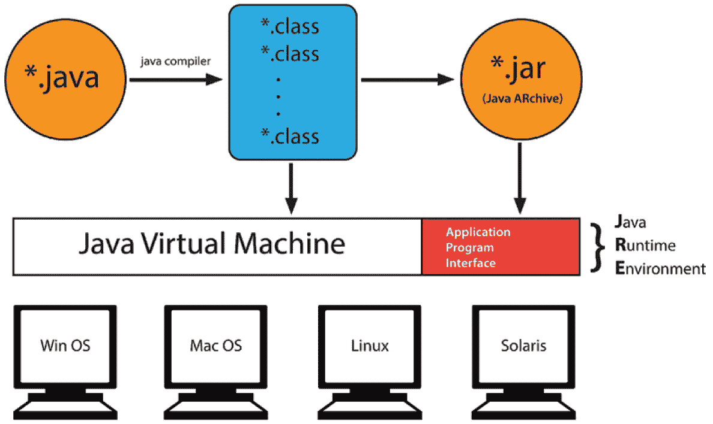

假设你在 Windows 操作系统中编写了源文件。然后你对其进行了编译和测试。你使用 Java 编写的这个基于 Windows 的应用程序已经使用了一两年。然后购买了另一套硬件设备，但这次使用的是更好的操作系统，比如 Linux OS。你还能继续使用你基于 Windows 的 Java 应用程序吗？答案是肯定的！你只需要在 Linux 机器上安装所需的 Java 运行时环境，然后！你以前在 Windows 上运行的 Java 应用程序也可以在你的 Linux 机器上运行。

### 1.1.7 Java 是安全的

Java 是安全的，因为它们运行在 Java 虚拟机（JVM）之上。JVM 是你的 Java 运行时环境（JRE）的组件之一，允许你在你的平台上运行 Java 字节码。Java 字节码包含在你的类文件和 JAR 文件中。一旦安装了 JRE，一切就绪了。你现在可以在你的机器上运行 Java 应用程序。

你的 JVM 解释编译后的 Java 代码（`*.class`）并运行它。你的 JVM 位于你的操作系统之上并充当它的边界；这意味着运行的 Java 应用程序无法执行任何未经边界设置者（即你的 JVM）批准的破坏性操作。拥有这一额外层意味着你的 Java 应用程序与底层操作系统没有直接附着或直接接触；它在到达你的操作系统之前需要经过一系列层级。因此，无论你在 JVM 之上运行什么事务（即你的 Java 应用），你的底层操作系统都无法直接访问它。Java 不允许直接访问内存；这使得意外引用属于其他程序或内核的内存变得不可能。

图 1.3 显示了从服务器发送的 Java 应用程序（历史上，是嵌入在网页中的小程序）如何由于 Java 虚拟机（JVM）的安全设计而被阻止在客户端执行。JVM 充当 Java 应用程序与底层操作系统之间的边界，防止对系统内存的直接访问和未经授权的操作，通过要求所有操作通过受控层来增强安全性。

### 图 1.3 应用程序未直接安装在操作系统层级

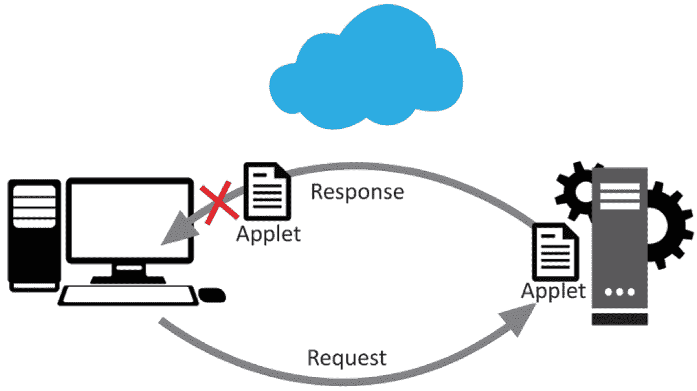

此外，Java SE 拥有一套自己的 API（应用程序接口），允许程序员使用由 Java 开发者社区预创建的代码和类。它也是 JRE 的组成部分。Java 安全技术包括工具、常用安全算法的实现、机制和协议。Java 安全 API 涵盖了广泛领域，包括密码学、公钥基础设施、安全通信、身份验证和访问控制。它还为用户或管理员提供了一套安全管理应用程序的工具。

### 1.1.8 Java 支持 GUI

使用 Java，你还可以创建图形用户界面（GUI）应用程序，这使用户可以使用按钮、窗口、文本框和其他在创建用户界面时可以使用的图形对象。Java 基础类库（JFC）是 Java 用于构建可移植 GUI 应用程序的最流行的图形框架之一。JFC 由抽象窗口工具包（AWT）、Swing 和 Java 2D 组成，它们结合可以产生可以在大多数类型操作系统上运行的 GUI。

### 图 1.4 简单 GUI 记事本的示例输出

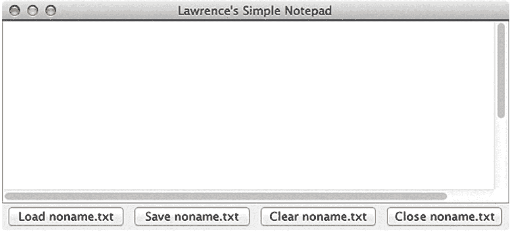

在 JFC 中，你可以自定义 GUI 应用程序的外观和感受，它有广泛的 GUI 组件供你选择。在图 1.4 提供的示例 GUI 记事本图像中，你可以看到我可以创建一个简单的 GUI 记事本应用程序，Java 也支持这种程序。

JavaFX 是一个基于 Java 构建的用于桌面、移动和嵌入式系统的下一代客户端应用程序平台。

### 1.1.9 Java 是免费的

Java 开发工具包（JDK）和 Java 运行时环境（JRE）安装程序可以从 Oracle 网站免费下载，无需费用。个人和学术用途是免费的。

## 1.2 Java 的三种口味

“Java 的三种口味”术语指的是 Java 的三个主要版本，每种版本都为不同的开发环境定制。

这些每个版本都有独特的用途，确保 Java 可以应用于广泛的开发场景，从简单的桌面应用程序到复杂的企业系统和嵌入式设备。

### 图 1.5 Java 技术家族

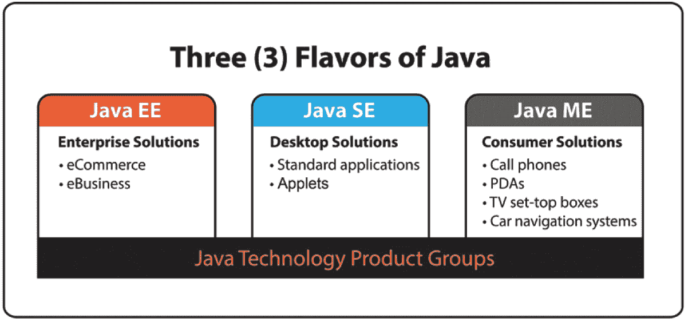

在过去，曾是 J2ME、J2SE 和 J2EE，但从 6.0 版本开始，Sun Microsystems（Java 技术的原始开发者，现由 Oracle 公司所有）决定将其技术重新命名为 Java SE、Java EE 和 Java ME。让我们详细查看这三种技术。

### 1.2.1 Java SE（标准版）

Java SE 包含用于创建 applet 和/或桌面应用程序的标准类库。它是所有基于 Java 技术的核心。Applet 从 JDK 9 开始被废弃。

### 1.2.2 Java EE（企业版）

Java EE 是一个框架，允许开发者使用供应商无关的技术来开发其企业应用程序。Java EE 使用标准库和其他扩展的 API（应用程序编程接口）来构建和部署这些应用程序，它通常使用浏览器作为客户端，并可供多个并发用户使用。Java EE 是广泛使用的服务器端编程平台，提供了部署基于在应用程序服务器上的模块化组件的容错、多层、分布式 Java 技术应用程序的功能。

### 1.2.3 Java ME（微型版）

另一方面，Java ME 是 Java SE 标准库的精简版本；它专为用于小型设备的嵌入式系统设计。目标设备范围从工业控制设备到手机、平板电脑、电视顶盒以及其他嵌入式设备。

Java ME 是 Java 的轻量级版本，专门为资源有限的设备（如手机、嵌入式系统和 IoT（物联网）设备）定制。它提供了 Java SE 的子集，并为较小设备增加了 API，使其成为在内存、处理能力和屏幕尺寸受限的系统上开发应用的理想选择。

图 1.6 显示了 Java ME、Java SE 和 Java EE 之间是如何相互作用的。

### 图 1.6 各 Java 技术版本的关系

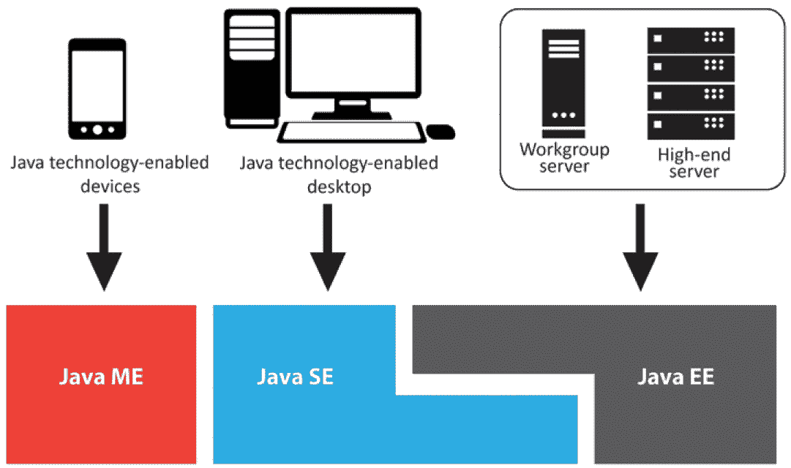

Java EE（现在被称为 Jakarta EE）构建在 Java SE 之上，专为大规模、分布式、多层级应用设计。它包含了 Java SE 的所有内容，并增加了强大的 API，用于构建 Web 服务、处理 servlet 和 JSP、管理企业 Bean (`EJB`)，以及使用 `JPA`（Java 持久化 API）和 `JMS`（Java 消息服务）等技术。Java EE 通常用于企业环境中的 Web 应用和后端服务。

图 1.7 显示了 Java SE（有时称为 Core Java）与 Java EE 之间的关系。

### 图 1.7 Java SE 和 Java EE 的关系

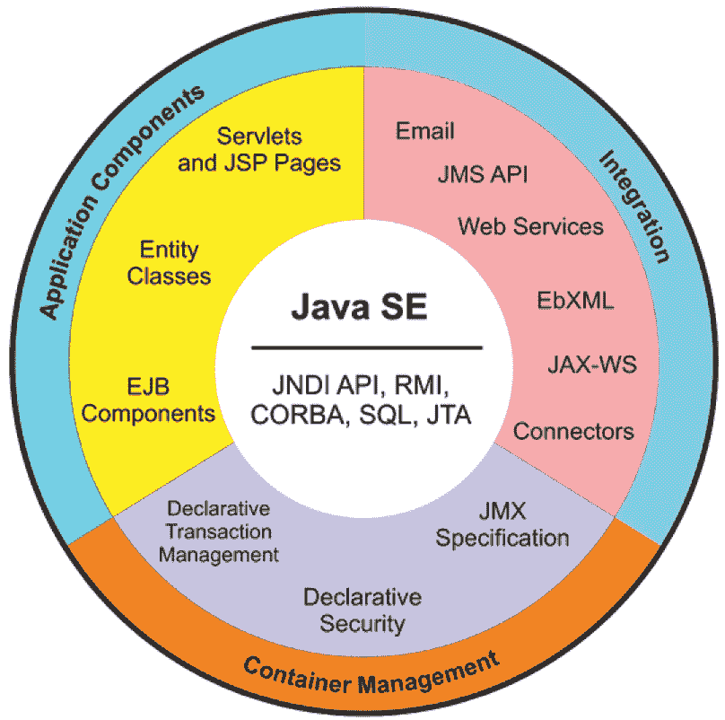

## 1.3 JDK 与 JRE

JDK，或 Java 开发包，是所有 Java 开发者都应该在机器上安装的程序。它包含了 Java 编译器、Java-Doc 创建器、实用软件、性能分析器以及你的 Java 运行环境 (`JRE`)。

### 图 1.8 JDK 和 JRE 的关系

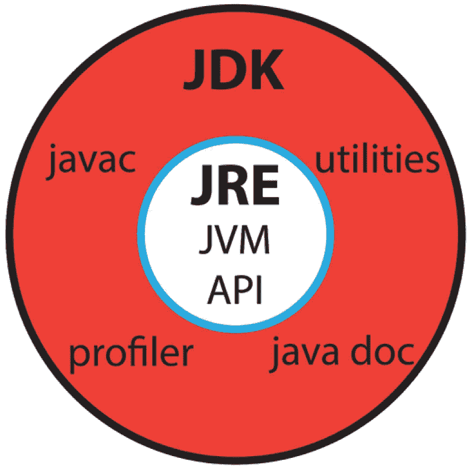

JRE，或 Java 运行环境，是 Java 技术应用程序用户需要安装的解释器。顾名思义，它包含了本质的核心库和其他组件。它还包含了你的 Java 虚拟机接口 (`JVM`) 和你的应用程序编程接口 (`API`)。它是普通用户为了使用和运行基于 Java 的应用程序可能安装的最小配置。它不支持开发，但对于执行编译后的 Java 程序已经足够。接下来的章节将详细介绍 JRE。


## 1.4 Java 运行环境 (JRE)

Java 运行环境包含两个主要组件：

1. Java 虚拟机 (`JVM`)
2. 应用程序编程接口 (`API`)

在其他编程语言中，`API` 可以被认为是一组预创建的代码或库，允许程序员或开发者复用并扩展其功能。

每当你运行一个应用程序时，你都在执行 Java 运行环境。这意味着你实际上是在操作系统之上启动了 `JVM`，以便你的有效 `*.class` 文件现在可以被解释了。另一方面，你的 `API` 提供了程序在运行时所需的所有标准库。访问此标准 `API` 的方式在所有平台上都是相同的。

在下载你的 `JRE` 之前，你需要先知道你正在使用什么类型的操作系统。每个操作系统都有唯一的 `JRE`，但这些 `JRE` 的 `API` 实现是相同的。

### 1.4.1 Java 虚拟机 (JVM)

顾其名，Java 虚拟机是一种用于读取 Java 字节码的虚拟机。该虚拟机位于操作系统之上并解释编译后的 Java 应用。

Java 虚拟机（也称为 `JVM`）可以读取编译后的字节码，这些字节码嵌入在你的 `*.class` 文件或 `*.jar` 文件（`JAR` 是 Java 档的缩写）中。你的 Java 字节码确保了你运行的 `*.class` 文件来自有效的编译过程。

`JVM` 还可以进行自定义。某些公司倾向于定制自己的 `JVM`；Oracle 软件允许这样做，只要该 `JVM` 的实现可以运行任何有效的 `*.class` 文件并获得 Oracle 软件的批准。

编译器检查对象的大部分类型，但代码中仍有一些部分应该在运行时进行检查。这使得 Java 具有动态性，能够在运行时检查和评估形式和类型。

`JVM` 可以在多个运行环境中执行。你只需要为你的操作系统下载正确的 Java 运行环境 (`JRE`) 即可。

## 1.5 垃圾回收器

垃圾回收是在程序运行期间释放程序不再需要的内存空间的过程。在某些其他编程语言中，编写释放内存的代码是程序员的工作。

垃圾回收或内存释放是垃圾回收器的工作。垃圾回收器 (`GC`) 是一个系统级线程，在 `JRE` 运行期间一直会在后台运行。`GC` 跟踪并监控内存中创建的对象；如果对象不再被引用或不再使用，它现在就准备好进行垃圾回收了。在操作系统的信号下，`GC` 运行并清理对象占据的内存空间，从而释放其他对象以后可以使用的资源。

图 1.9 垃圾回收器 (GC)

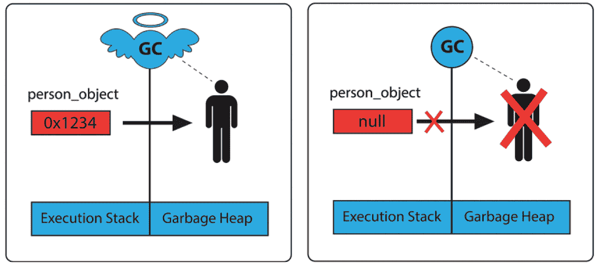

`GC` 的实现在不同平台上有所不同。由于它是一个系统级线程，操作系统的线程调度程序决定了 `GC` 何时运行。你可以通过执行 `System.gc()` 方法将 `GC` 设置为可运行，但此方法调用并没有强制 `GC` 运行，它只是让处于可运行状态。

可运行状态是线程处于就绪的状态；并不意味着它正在运行。

## 1.6 Java 处理代码安全执行的三项任务

Java 通过三个关键步骤确保代码安全：

1. 类加载：仅从受信任源加载代码，以防止授权或有害代码运行
2. 字节码验证：检查代码的违规情况或错误
3. 解释：解释器通过在受控环境中管理来安全地运行代码

### 1.6.1 类加载

类加载器加载应用程序所需的所有类。它通过将本地文件系统（FAT, UFS, NTFS, ZFS）的类与从网络资源导入的类空间分开增加了安全性。由于类加载器的存在，Java 运行环境不需要了解文件系统。这限制了恶意软件或脚本渗透你的机器，因为本地类总是先加载。在所有类加载之后，内存布局紧随其后。

### 1.6.2 字节码验证

你的 Java 源文件 (`*.java`) 编译后将生成一个包含 Java 字节码的类文件 (`*.class`)。

`JVM` 让你的类文件通过字节码验证器，以确保你编译的 Java 代码符合 Oracle 软件设置的 JVM 规范。它还确保你的类文件是有效 Java 编译的产物。

字节码验证器确保你的代码遵守 JVM 规范，并且通过检查常见的导致不可预测行为或有时导致数据损坏编程错误，防止违反系统完整性。字节码验证器正在检查的这些行为包括数组限制、未初始化引用的使用以及代码中可能发生的非法数据转换（例如指针值到整数值以及反之）。

JVM 在执行之前会验证所有字节码；这种验证由三类检查组成：

1. 变量总是被初始化的，且引用始终具有正确的类型。
2. 条件和控制结构跳转到有效的语句位置。
3. 对私有或包私有数据及方法的访问是控制的。

前两个检查主要发生在类加载并达到使用条件时发生的实际验证步骤，而第三个检查是在动态完成的，即当另一个类访问已加载类的变量和方法时进行的。

### 1.6.3 解释

在将本地类加载到内存并验证其是否为有效的类文件后，下一步是解释类文件。运行时发生在对有效类文件的解释过程中。如果在运行时发现不规则之处，就会在该期间发生 `RuntimeException`。关于 `RuntimeException` 将将在 *Java Essentials Volume 2: Object-Oriented Programming and Beyond* 的独立章节中讨论。

在本章中，你探索了定义 Java 编程语言并使其成为全球许多开发者首选的本质特性。你学习了 Java 以其平台无关性、面向对象的方法和自动内存管理而闻名。你还熟悉了 Java 的三个核心版本——`Java SE`、`Jakarta EE`（原 `Java EE`）和 `Java ME`，它们旨在支持从桌面应用到企业和移动解决方案的所有内容。你现在理解了包含开发工具的 `JDK` 与提供执行 Java 应用所需的运行时环境的 `JRE` 之间的区别。此外，你发现了 `Java Garbage Collector`（Java 垃圾回收器）自动内存内存，并学习了 Java 如何通过验证字节码、控制类加载以及提供安全的运行时环境来维护安全性。这些基础概念为后续章节的深层探索奠定了基础。


* Java 是一种健壮的、平台无关的面向对象的语言，广泛应用于现代软件开发。
* Java 有三个主版本：`Java SE`（标准版）、`Jakarta EE` 和 `Java ME`（微型版），每个版本都有特定的开发需求。
* Java 开发工具包 (`JDK`) 提供了编译和运行 Java 代码的工具，而 Java 运行时环境 (`JRE`) 包含了运行 Java 程序所需的环境。
* Java 中的 `Garbage Collector`（垃圾回收器）会自动回收未使用的内存，允许开发者更多地关注应用程序逻辑。
* Java 通过字节码验证、类加载器和安全执行环境（沙箱）等功能强制执行代码安全。


1. 下列哪项不是 Java 的特性？
   a. 依赖平台
   **b. 面向对象**
   c. 安全的
   d. 健壮

2. 哪种 Java 版本通常用于构建网络和企业级应用程序？
   a. `Java SE`
   b. `Java ME`
   c. `Java EE`
   d. `Java FX`

3. Java 开发工具包 (`JDK`) 的主要目的是什么？
   **a. 浏览 Java 文档**
   b. 仅运行编译后的 Java 程序
   c. 开发、编译和运行 Java 应用程序
   d. 管理系统驱动程序

4. Java 运行时环境 (`JRE`) 包含什么？
   a. 文本编辑器
   b. 编译器和调试器
   c. 仅包含运行 Java 程序所需的 Java 虚拟机 (`JVM`) 和库
   d. 源代码文件

5. 哪个 Java 组件会自动回收未使用对象的内存？
   a. 字节码解释器
   **b. Garbage Collector**
   c. ClassLoader
   d. JVM Loader

6. Java 类加载器的主要职责之一是什么？
   a. 执行 main 方法
   b. 加密数据
   **c. 在运行时将类加载到内存中**
   d. 运行编译器

7. Java 通过使用什么实现了平台无关性？
   a. 源代码共享
   b. 原生机器码
   **c. 由 `JVM` 解释的字节码**
   d. 虚拟文件夹

8. Java 中的“沙箱”（sandboxing）术指的是什么？
   a. 数据可视化技术
   b. 用于编译代码的虚拟空间
   **c. 用于运行潜在不安全代码的安全环境**
   d. 内存分配方法

9. 下列哪项是使用 `Java ME` 的理由？
   a. 开发 Web 服务器
   b. 编写桌面 GUI
   **c. 创建移动或嵌入式设备应用**
   d. 构建企业服务

10. `.java` 文件被编译为：
    a. 可执行文件 (`.exe`)
    **b. 字节码 (`.class`)**
    c. HTML 文件
    d. 汇编代码

答案

| 1 **a** | 2 **c** | 3 **c** | 4 **c** | 5 **b** |
| 6 **c** | 7 **c** | 8 **c** | 9 **c** | 10 **b** |


1. 你认为为什么 Java 的平台无关性使其成为当今世界上最广泛使用的编程语言之一？考虑这一特性如何影响软件分发、更新和兼容性。
2. 在三个 Java 版本 (`SE`, `EE`, `ME`) 中，你认为自己在未来的项目中使用最多的是哪一个？为什么？反思一下你感兴趣开发的应用程序类型。
3. 通过 `Garbage Collector` 实现自动内存管理在哪些方面简化了初学者和专业人士的编程？思考这如何影响你在编写和测试代码时的注意力。
4. `JDK` 和 `JRE` 之间的区别如何帮助你理解 Java 中开发与执行的角色？考虑你作为一名程序员的工作流。
5. 在哪些现实场景中，Java 的内置安全功能（如类加载器、字节码验证和沙箱）可能是重要的？考虑一些 Web 应用、银行软件或移动应用。

## 第 2 章 编写你的程序


* 编写并运行第一个显示信息的 Java 程序。
* 使用 `System.out.print()` 和 `System.out.println()` 语句打印输出。
* 使用 `+` 运算符组合单词和值。
* 使用转义字符（如换行的 `\n` 和制表的 `\t`）为输出添加特殊格式。
* 理解并修复常见的编译和运行时错误。
* 使用 Java 的交互式工具 JShell 探索并练习 Java 代码。
* 学习基础语法规则，如分号、大小写敏感和类的结构。

欢迎来到学习 Java 的第一步！在本章中，你将学习如何编写并运行一个显示文本的简单 Java 程序。你将接触 `System.out.print()` 和 `System.out.println()` 语句，这是 Java 显示输出的标准方式。你还将发现如何使用 `+` 运算符组合文本和变量，以及如何使用转义字符格式化输出。在此过程中，你将学习识别并修复编译或执行期间可能发生的错误。最后，你将获得 JShell 的实践体验，这是一种让你快速尝试代码并查看效果的交互式工具。在本章结束时，你将能够自信地编写简单的 Java 程序。

### 2.1 “HelloWorld”：你的第一个 Java 应用

欢迎来到你的 Java 实践！在本节中，你将学习如何创建一个名为 `HelloWorld.java` 的简单程序。该程序将在控制台显示“Hello, World”。你将使用基础文本编辑器和终端来编写、保存、编译和执行代码。开始之前，打开一个基础文本编辑器并输入你的第一个 Java 程序。

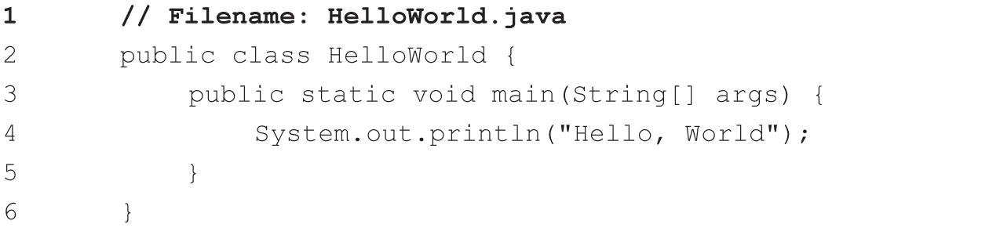

此程序将被保存为 `HelloWorld.java`，其目的是在屏幕上显示一条简单的消息。在 Java 中，每个应用程序都从类定义开始。对于我们的示例，我们在第 2 行使用代码 `public class HelloWorld` 声明了一个名为 `HelloWorld` 的类。在这个类内部，我们定义了程序的入口点，即 `main` 方法。该方法的正确格式是第 3 行的 `public static void main(String[] args)`，它必须按照所示内容完全编写，因为 Java 是区分大小写的。

以下是第 3 行的解析：`public static void main(String[] args)`

* `public` 意味着你的方法可以在任何地方被访问。
* `static` 是一种修饰符，意味着你的方法不属于类的特定实例，而是专属所有权归类所有。
* `void` 是 `main` 方法的返回类型。它意味着 `main` 方法不返回任何类型的值。
* `main` 是方法名。然而，`main` 方法是一种特殊类型的方法，告诉 Java 这是你应用程序的起点。所有 Java 应用程序都从 `main` 方法开始执行，其方法签名应该是 `public static void main(String[] args)`。
* `String[] args`，这位于你的 `main` 方法的参数列表中。这意味着你的 `main` 方法应该接受一个 `String` 对象数组作为其参数。这也可以重写为 `String args[]`，本质上，两种形式是相同的。

在 `main` 方法内部，我们在第 4 行包含了一个使用 `System.out.println("Hello, World");` 向控制台打印文本的语句。此行代码指示 Java 运行时按照编写的内容显示“Hello, World”字样。Java 中的每个语句都以分号结束，因此请务必包含它。至此，你现在有了一个完整的 Java 程序，准备好保存、编译和执行。


1. 你的 `public` 类名应与你的文件名相同。
2. 你的 `.java` 文件中只能有一个 `public` 类。此外，一对大括号 `{ }` 代表一个作用域。它用于将相关的程序段分组。它可以用于控制结构、方法和类。
3. 在你的 Java 代码中，左大括号（`{`）和右大括号（`}`）的数量相等。
4. 任何 Java 应用程序的执行始终从你的 `main` 方法开始。你的 `main` 方法的签名应该是：

```
public static void main(String[] args)
```

5. Java 中的所有内容都是区分大小写的

Java 是一种区分大小写的语言，这意味着像 `Main`、`main` 和 `MAIN` 标识符被认为是完全不同的。这适用于类名、方法名和变量名。因此，文件名与类名完全匹配（包括大小写字母）是关重要的。例如，如果你的类声明为 `public class HelloWorld`，那么文件名必须是 `HelloWorld.java`。如果大小写不匹配，编译器将生成一个错误，指示 `public` 类必须在具有对应名称文件中声明。此外，Java 程序需要正确的语法。语句必须以分号结束，且引号、括号和大括号必须始终成对出现。未能遵守这些基本规则将在编译期间产生语法错误。

### 2.1.1 保存你的程序

一旦你写好了程序，下一步是正确地保存它。最佳实践是创建一个专用文件夹来组织你的 Java 源代码文件。使用终端窗口（如果你使用的是 Mac 电脑或 Linux 电脑）或命令提示符（如果你使用的是任何 Windows 电脑），你可以通过输入 `mkdir javacodes` 创建名为 `javacodes` 的文件夹，然后使用 `cd javacodes` 命令进入该目录。

图 2.1 Mac OS 电脑终端窗口截图

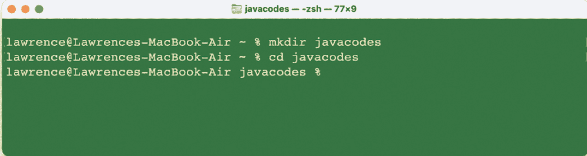

之后，返回你的文本编辑器并将你的 Java 文件保存在此文件夹中。确保文件名与类名完全匹配并以 `.java` 扩展结尾。在这种情况下，由于类名为 `HelloWorld`，文件必须命名为 `HelloWorld.java`。使用不同的名称或大小写保存会导致编译错误。保存后，你可以通过 `ls` 命令（在 UNIX 系统或 Mac OS 上）或 Windows `dir` 列出文件夹内容来验证文件是否存在。

图 2.2 Mac OS 电脑上使用 `ls` 命令的终端窗口截图

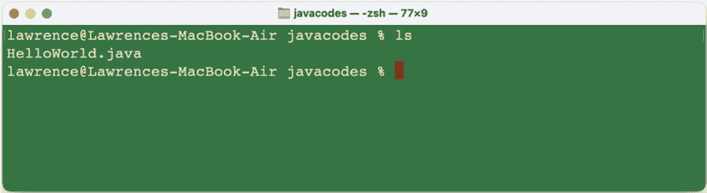

要编译你的 Java 源代码，打开终端并使用 `javac` 命令，它代表“Java compile”。


要编译你的 Java 源代码，打开终端并使用 `javac` 命令，它代表“Java compile”。


要编译你的 Java 源代码，打开终端并使用 `javac` 命令，它代表“Java compile”。

图 2.3 Mac OS 电脑终端窗口截图


图 2.4 Mac OS 电脑终端窗口截图


恭喜你——你刚刚创建了第一个应用程序！

编译错误发生在代码中存在错误导致程序无法成功编译时，例如缺少分号或语法错误。运行时错误发生在程序成功编译后，但在运行过程中崩溃或表现出异常行为，例如整数除以零或访问无效的数组位置。

### 2.3.1 常见的编译错误

本节讨论了初学者经常遇到的编译错误。考虑以下示例编译错误：

```
HelloWorld.java:5: cannot resolve symbol
symbol : method printl (java.lang.String)
location: class java.io.PrintStream
System.out.printl("Hello, Java World");
^
```

`println()` 方法的类型输入错误。以下是导致此类编译错误的几种方式：

1. **类名和文件命名**：你的 Java 源文件名称必须与 `public class` 的名称相同。如果没有正确遵循这一规则，你将得到类似下面的编译错误：

```
TestHelloWord.java:7: public class TestHelloWorld must be defined in a file called "TestHelloWorld.java"
```

2. **Java 源文件中 public 类的数量**：一个 Java 源文件中只能有一个 `public class`。如果你声明了多个 `public` 顶层类，将会遇到类似的编译错误。你可以在 Java 源文件中定义多个类，只要其中只有一个类被声明为 `public`，且该 Java 源文件的文件名与该 `public class` 的名称一致即可。

一旦遇到这些编译错误，你需要编辑代码、保存并重新编译。在修复所有编译错误后，你现在就可以运行你的示例应用程序了。

`javac` 命令位于安装的 Java 开发工具包（JDK）目录下的 `\bin` 子目录下。你必须更新你的环境变量，包含 `javac` 可执行文件的路径。如果 `javac` 命令无法工作，请参考第 0 章。

### 2.3.2 常见的运行时错误

在顺利编译后，现在是时候运行你的示例应用程序了。在运行时，你可能会遇到一些错误。以下是一些常见的运行时错误示例：

1. **找不到类 TestHelloWorld**

如果你尝试运行一个不存在的文件或尝试运行一个拼写错误的文件，就会发生这种运行时错误。文件名的拼写必须与 `filename.class` 文件一致。

2. **线程 "main" 中的异常 java.lang.NoSuchMethodError: main**

这意味着你的 `main` 方法声明错误。你的 `main` 方法必须是 `public` 的，并且应该是 `static` 的，且返回类型必须为 `void`，方法名也应该是 `main`，并必须接受一个 `String` 对象数组作为参数列表。

发生这种运行时错误的另一个可能原因是：你尝试运行一个没有包含 `public static void main(String[] args)` 方法的类文件。`main` 方法是应用程序执行的入口，因此当你尝试运行 Java 程序时，它必须存在。

从 Java 11 (JEP 330) 开始，引入了“启动单文件源代码程序”功能。它允许使用 `java` 启动器直接执行 Java 源文件，而无需事先显式地使用 `javac` 进行编译。

与其将你的 `.java` 文件编译为 `.class` 文件然后运行 `.class` 文件，你不如使用 `java` 命令直接执行 `.java` 文件。

当你使用源文件调用 `java` 时，启动器会自动在内存中编译代码然后执行它。这避免了在磁盘上创建中间的 `.class` 文件。

该要求是：源文件必须包含一个带有 `public static void main(String[] args)` 方法的顶层类，该方法作为执行的入口点。

现在可以执行此命令：

```
java HelloWorld.java
```

这将进行内存中编译并直接运行源代码，而不会创建外部的 `.class` 文件。

Java 21 引入了另一个酷功能，称为“简化入口点”。在 Java 的早期版本中，每个程序都需要完整的类声明和特定的 main 方法签名：

```
public static void main(String[] args)
```

该方法作为任何 Java 应用程序的标准入口点，必须放置在类内部。虽然这种结构非常强大，但它引入了大量的模板代码——特别是对于编写“Hello, World!”等简单程序的初学者来说。

从 Java 21 开始，名为“未命名类和实例 main 方法”（通过 JEP 445 引入）的新预览功能允许你编写更简单的 Java 程序，而不需要显式的类或完整的静态方法声明。例如：

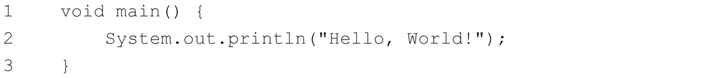

在这个版本中，没有 `public`，没有 `static`，也没有类名——只有逻辑。这极大地降低了复杂性，帮助新学习者关注编程概念而非语言结构。

要编译并运行这个简化版本，必须在编译和执行期间都使用 `--enable-preview` 标志：

编译时：

```
javac --enable-preview --release <jdkVer> HelloWorld.java
javac --enable-preview --release 21 HelloWorld.java
```

运行时：

```
java --enable-preview HelloWorld
```

Java 21 中的这一增强（预计在未来的 JDK 23 和 JDK 24 版本中也会出现）标志着向让 Java 更易于上手的重要一步，特别是在教育环境和初学者阶段。

对于较新的 JDK 版本，可以直接编译和运行，无需 `--enable-preview --release 21`。

以下是表格总结：

| Java 版本 | 代码 | 编译/运行行为 |
| --- | --- | --- |
| Java 8 | 完整的类和静态 | 必须 javac 后 java |
| Java 11 | 源代码 | 可以 java HelloWorld.java |
| Java 21 | 只有 main() | java --enable-preview |

## 2.4 JShell 简介

Java 9 的重大进展之一是引入了 JShell，这是一种让语言探索更具交互性的命令行工具。在 JShell 之前，运行即使简单的 Java 代码都需要设置整个类，然后进行编译和执行。这为快速测试代码片段带来了障碍。JShell 通过启用读取-评估-打印循环（REPL）环境让用户可以执行 Java 代码片段。

### 2.4.1 什么是 JShell？

JShell 是 Java 9 引入的 REPL（读取-评估-打印循环）工具，允许交互式执行 Java 代码，而无需编写完整的类或方法。它提供了一个控制台，可以逐条执行语句或表达式。这使得 JShell 在原型设计、调试和探索 Java 代码时非常有用。

本质上，JShell 是让 Java 与 Python、Ruby 或 Scala 等许多其他语言提供的 REPL 工具保持一致。它的主要目的是为了实验、学习和验证代码片段。

### 2.4.2 它有什么用？

JShell 的主要用途是提供一个精简的环境，让开发者快速：

- **测试代码片段**：JShell 是尝试短代码段的好地方，无论是探索新 API 的行为、测试算法还是验证语言特性。
- **学习和教学 Java**：JShell 是初学者交互式学习 Java 的极佳工具。教师和学习者可以实时执行代码，在获得即时反馈的同时探索语言。
- **调试小部分代码**：开发者无需在整个应用程序中嵌入调试打印语句，可以直接在 `JShell` 中测试较小的逻辑部分。
- **原型设计**：`JShell` 有助于快速构建小功能的原型，而无需创建完整项目的开销。

JShell 的 REPL（读取-执行-打印-循环）特性消除了编写样板代码、编译和运行程序的需要。它可以帮助你关注核心逻辑，鼓励实验和学习。

### 2.4.3 如何使用 JShell

启动 `JShell` 非常简单。安装 JDK 9 或更高版本后，只需打开终端或命令提示符并输入：

```bash
jshell <ENTER>
```

图 2.5 Jshell 示例用法

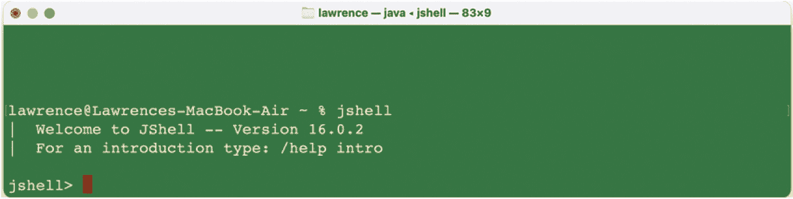

此命令启动 JShell 环境，你将看到一个提示符（`jshell>`），你可以在此处开始输入 Java 代码。

例如，要执行一个简单的算术运算，你可以输入：

```
5 + 10 <ENTER>
```

图 2.6 带有表达式求值的 Jshell 示例用法

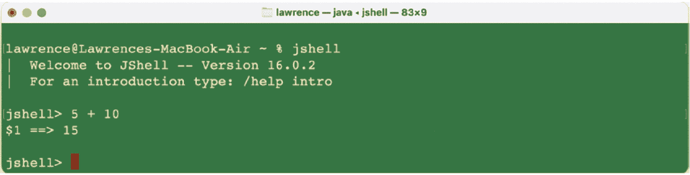

JShell 会立即求值表达式并打印结果。同样，你可以声明变量、编写方法，甚至定义类：

图 2.7 带有方法声明和使用的 Jshell 示例用法

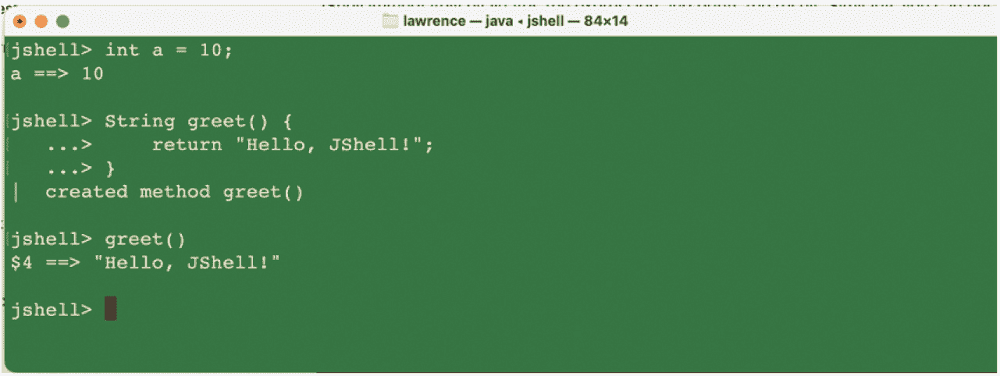

你可以看到方法 `greet()` 被定义并立即调用，而无需编译类或创建 main 方法。

JShell 还可以根据需要导入类和库，因此你可以交互式地探索第三方库。例如，你可以使用 JShell 轻松地导入如 `java.util.Scanner` 等工具类，或从其他包导入你自己的类。

若要退出 JShell，你需要在 `JShell` 提示符中输入 `/ex`。从那里，你将收到来自 `JShell` 的再见消息，并返回到操作系统的提示符。

图 2.8 退出 Jshell

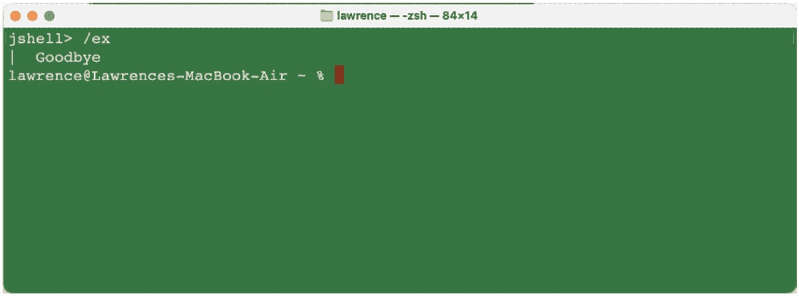

到此时，你已经编写了第一个 Java 程序，学会了如何正确保存它，使用 `javac` 命令对其编译，并使用 `java` 命令执行了它。在此过程中，你还学会了如何识别和修复常见错误，包括编译问题和运行时问题。你已经看到类名与文件名匹配、遵循 Java 严格的语法规则以及提供格式正确的 main 方法是多么重要。你还被介绍了用于打印输出的 `System.out.print()` 和 `System.out.println()` 语句。这些基础技能对于所有 Java 程序员来说都是本质的，当你进入更高级的主题时，它们将继续让你受益。


- 在创建 Java 源代码时，记住 `public class` 名称应该与你的文件名相同。
- 加号（`+`）运算符是一个重载运算符；根据其周围操作数的类型，它可以用于字符串拼接，也可以用于加法。
- 错误是程序员生活中正常的一部分。如果遇到一系列编译错误，请务必关注第一个错误，对其进行调试，然后保存代码并重新编译。始终关注第一个编译错误，因为后续的错误通常是回声错误（连锁错误）。
- `JShell` 是 Java 生态系统中强大的补充，对于想要交互式探索语言的开发者和学习者特别有益。通过消除初始设置和样板代码，`JShell` 允许你专注于理解和实验 Java 概念。无论是在测试一小段代码、调试特定逻辑，还是向新观众教授 Java，`JShell` 都能让过程变得更加顺畅直观。


1. 下述哪个说法是不正确的？

a. `javac`（Java 编译器）是 Java 运行环境（JRE）的一部分
b. Java 运行环境是你安装的一份软件，让用户运行基于 Java 的应用程序
c. Java 虚拟机（JVM）是 Java 运行环境的一部分。
d. Java 开发包（JDK）是你需要安装的软件，以便用户编写和运行基于 Java 的应用程序。

2. 假定如下类声明：

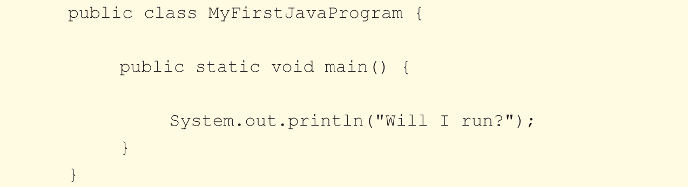


下述哪个说法是正确的？

a. 代码将编译并运行，输出为：Will I run?

b. 代码不会编译

c. 代码将编译，但不会运行。

d. 代码将编译并运行且无输出。

3. 假定如下类声明：

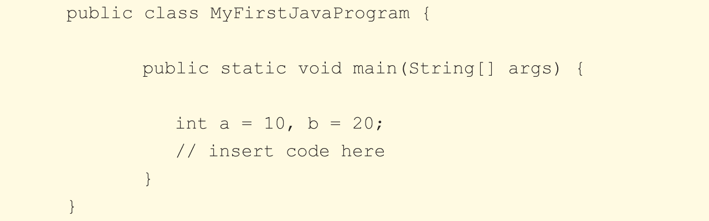

下列代码中哪一个不会导致程序打印输出：`a = 10`, `b = 20`

a. `System.out.print ("a = 10" , "b = 20");`

b. `System.out.print ("a = " + a + ", b = " + b);`

c. `System.out.print ("a = " + 10 + ", b = " + 20);`

d. `System.out.print ("a = 10, b = 20");`

4. 查看下面的代码片段：

```
System.out.print("Java");
System.out.print("Programming");
System.out.print("is");
System.out.print("Fun");
```

假设该片段在有效的 Java 代码内部，输出是什么？

a. Java is Fun

b. Java Programming

c. JavaProgrammingis

d. Java

Programming

is

Fun

5. 在编译期间遇到错误时，你应该怎么做？

a. 关注所有错误以

b. 忽略这些错误。

c. 随机猜测这些错误的解决方案

d. 调试第一个错误，然后保存代码并重新编译，如果还有错误的话。

6. 输出什么？

```
System.out.println(5 + 10 + "xyz");
```

a. 510xyz

b. 15xyz

c. 无输出；

7. 为什么下面的语句会导致编译错误？

```java
System.out.println("Will I be
```

a. 代码将编译并打印：Will be?

b. 代码将编译但不会运行，因为

c.会导致运行时错误。

8. 关于 (`+`) 运算符，下列哪个说法是不正确的？

a. (`+`) 运算符是一个重载运算符；它可以用于数值的拼接。

b. 如果操作数都是数值，`+` 运算符作为加法运算符。

c. 如果操作数都是布尔值，`+` 运算符将两个值并置。

d. 如果操作数都是字符串值，`+` 运算符将拼接两个值。

9. 假定如下代码：

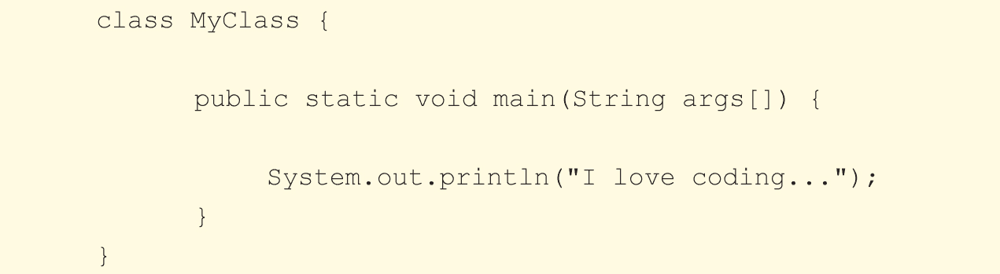

该代码保存为 Hello.java。下哪个说法是正确的？

a. Java 源代码 Hello.java 将编译并产生类文件 Class.class

b. 代码不会编译，因为类名与文件名不同。

c. 代码不会编译，因为 main 方法的参数错误；参数应该是 `String[] args` 而不是 `String args[]`

d. 因为 Java 源代码中缺少注释而不会编译。

10. 以下哪个是正确的？

a. 左大括号 `{` 的数量应该与右大括号 `}` 的数量相等。

b. 在 Java 源代码中，允许有多个类，但允许一个 public 类。

c. Java 源代码中的 public 类必须与文件名匹配。

d. 所有 Java 源代码必须有一个 public 类。

答案

| 1 **– a** | 2 **–c** | 3 **–a** | 4 **–c** | 5 **–d** |

| 6 **–b** | 7 **–b** | 8 **–c** | 9 **–a** | 10 **–d** |

## 编程问题 1

创建名为 `TriangleVer1.java` 和 `TriangleVer2.java` 的 Java 程序。

两个代码都应该显示相同的输出，即一个四层星号组成的三角形：


对于 `TriangleVer1.java`，你可以使用几个 `System.out.println()` 方法。

但对于 `TriangleVer2.java`，尝试只使用一个（1）`System.out.println()` 方法。

探索使用 `'\n'`、`'\t'` 和空格来格式化你的三角形。

## 编码题 2

编写一个名为 `HelloFormatted.java` 的 Java 程序，仅使用一个 `System.out.println()` 配合 `'\t'`（制表符）和 `'\n'`（换行）转义字符向控制台打印以下消息：

**预期输出：**

Hello, World!

Welcome to Java Programming.

这是你的第一个 Java 类。

## 编码题 3

以下代码包含三个错误。重写该程序使其能够编译并成功运行，显示出预期的输出。将类命名为 `FixMe.java`。

**带有错误的代码：**

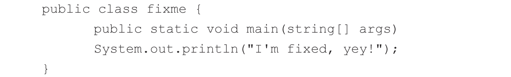

**预期输出：**

I'm fixed, yey!

 更多练习，变得更好！

# 第 3 章

## 用户输入、标识符、关键字和原始数据类型

 核心学习目标

- Java 注释的三类型
- 分号、代码块和空格
- Java 标识符和关键字
- Java 编程语言编码规范
- 原始数据类型
- `Math` 类和 `Scanner` 类

在本章中，我们将深入研究 Java 语法和结构的基石元素，这些元素对于编写清晰且高效的代码至关重要。理解如何使用 `Scanner` 类接受用户输入以及代码中各种形式的 Java 注释，将有助于提高代码的可读性和可维护性。我们还将探索良好的编码和命名规范的重要性，这有助于提升你编程实践的整体质量。此外，你将了解 Java 中可用的原始数据类型，使你能够为变量和操作选择最合适的类型。最后，我们将介绍 Java 标准库提供的 `Math` 类的内置方法，这些方法可以增强你的数学计算和整体编程体验。

### 3.1 三种 Java 注释

现在，让我们谈谈 Java 中的注释。注释用于为你未来的自己或你的同事留下信息，这样当你几天、几个月或几年后再次查看代码时，就不需要重新追溯代码逻辑。在 Java 编程语言中，我们有三种类型的注释：单行注释、多行注释和 Java 文档注释（Javadoc）。

1. **单行注释**：单行注释用于注释掉单行代码。你用一对双斜杠符号开始。双斜杠之后的所有文本都会被视为注释。

```java
// Single Line Comment
```

2. **多行注释**：我们还有多行注释。多行注释用于注释掉多行代码。你用正斜杠（`/`）后跟星号（`*`）符号开始，然后用星号（`*`）后跟正斜杠（`/`）来结束它。

```java
/*
Multi Line Comment
*/
```

你在这些多行注释内部找到的所有文本都被视为注释。假设你有一段代码为了测试目的想要移除；你不需要立即删除它。相反，你只需要用多行注释将其括起来，这样当你需要这些代码时，只需移除周围的注释，而无需重新输入该代码块。

3. **Java 文档注释**：Java 文档注释也称为 javadoc 注释，用于在你的源代码中记录或放置 Java 文档。以下是编写 Javadoc 注释的方法：

```java
/**
Java Documentation Comment
*/
```

这种类型的注释用于描述该结构的内容。它通常放置在类声明、属性声明或方法声明上方，以描述该构造的功能。在编写完应用程序并放入适当的 Javadoc 注释后，你现在创建一个 HTML 文件，该文件与 Java API 文档非常相似，可以在浏览器中启动并查看。

可以通过此链接访问 Java 23 API 文档：[`docs.oracle.com/en/java/javase/23/docs/api/index.html`](https://docs.oracle.com/en/java/javase/23/docs/api/index.html)。（本书的在线资源部分也提供了该链接）。随后你可以在任何 IDE（如 NetBeans IDE）中创建你自己的 Java 文档。这里是 NetBeans 项目的示例截图：

图 3.1 显示了一个名为 `JavaDocSampleProj` 的 NetBeans 项目示例，包含名为 `model` 和 `test` 的两个包。`Person.java` 放在 `model` 包下，而 `TestPerson.java` 类放在 `test` 包下。两个源码都包含描述类和方法的 JavaDoc 注释。

图 3.1 NetBeans 项目截图


图 3.2 显示了如何在 NetBeans IDE 中通过右键点击项目并从选项列表中选择“Generate Javadoc”（生成 Javadoc）来生成 Java 文档注释。这将让 NetBeans IDE 遍历所有的 Java 源码，读取所有 Java 源码中的 Javadoc 注释。

目前，`javadoc` 工具尚未完全支持如 `unnamed classes` 等预览特性，即使在 `JDK 21` 中也是如此。因此，在使用这些新的 Java 源格式时，如果你打算从它们生成 Javadoc，建议将需要文档的代码保留在传统的命名类中。

如果你的代码使用了模块（`Java 9` 中引入），你也可以包含特定模块的标记，例如：

```
javadoc --module-path mods -d docs my.module.name
```

## 3.2 分号、块和空白区域

### 1. 分号

Java 使用分号作为语言信号，表示语句的结束。删除分号会告诉 Java 编译器，代码的下一行是当前行的延续。这是 `C`、`C++` 和 `Java` 等编程语言的通用规则。其他编程语言如 `Python`、`Ruby` 或 `Visual Basic` 则不需要分号。因此，如果你有使用不同语言的编程背景，在结束一个语句时，请务必在 `Java` 中包含分号。

```
int x = a + b
+ c + d;
```

等同于：

```
int x = a + b + c + d;
```

### 2. 块

块（也称为作用域）用于将相关的语句分组。我们使用大括号 `{ }` 来表示一个块。大括号通常用于类、方法和控制结构，如 `if-else`、`while` 循环、`for` 循环等。

拥有块也意味着变量的作用域。

考虑以下代码片段：


给定的代码片段会在第 16 行产生编译错误，因为重复声明了在第 12 行定义的变量 `x`。在代码特定的作用域内，你只能声明一次变量。第 12 行定义的变量 `x` 在 `doSomething()` 方法的作用域内，因此在第 16 行声明另一个变量 `x` 会导致该变量 `x` 的重复声明。

但如果我们这样重写：


该示例代码片段的编译将是正常的。第 16 行声明的变量 `x` 的生命周期仅存在于 `if` 大括号内（第 14 行到第 17 行之间），并在第 17 行之后被销毁。因此，第 18 行声明的变量 `x` 是有效的，因为它被视为一个新的声明，不存在重复。

### 3. 空白区域

这些是代码中的空格、制表符和回车键（或换行符）。`Java` 会忽略空白区域，这意味着 `Java` 中允许任意数量的空白区域。空白区域通常用于格式化，以便你的代码在普通读者眼中具有良好的可读性。例如，给定的示例代码：

```
for (int i = 0; i < 3; i++) { System.out.println(i); }
```

等同于：


两段代码是相同的，但它们都不美观。第一种占据了单行代码。它可以运行，但你的同事、团队成员或任何看到你代码的人都不会欣赏你的编写方式。

第二种版本更好。它使用了制表符和空格，使代码更易读，因为你可以立即识别出起始大括号的配对以及内部的代码。

## 3.3 Java 标识符

标识符用于“标识”某些东西。我们使用名称或标识符来标识变量、方法、类、常量值、文件名和其他编码元素。可以将其看作是一个标签，帮助程序员和计算机引用程序的特定部分。本质上，它们是用于分配给各种组件的可自定义名称，以使代码具有可读性和逻辑性。

在 `Java` 中创建标识符需要遵循特定规则，以确保它们是有效的且能被编译器识别。这些规则包括：

1. **以字母或下划线开头**：标识符必须以字母（`A-Z` 或 `a-z`）、下划线（`_`）或美元符号（`$`）开头。不能以数字开头。

2. **仅使用允许的字符**：标识符可以包含字母、数字（`0-9`）、下划线美元符号，但不能包含空格或特殊符号如 图`、`#` 或 `!`。

3. **避免保留关键字**：`Java` 保留作为关键字的单词（如 `int` 或 `class`）不能作为标识符。

4. **考虑大小写敏感**：`Java` 标识符区分大小写，因此 `MyVar` 和 `myvar` 将被视为两个不同的标识符。

5. **无长度限制**：虽然 `Java` 没有规定长度限制，但标识符应该简洁且具有描述性，以获得更好的可读性。

以下是有效的 `Java` 标识符示例：

`Int`、`$$$`、`___`、`basic_pay`、`OverTime`、`getTaxPayer`、`thisIsAVeryLooooongVariableName`

以下是非效的 `Java` 标识符示例：

`int`、`123`、`---`、`gross-Pay`、`over time pay`

尽管编译器没有强制，但在专业的 Java 开发中广泛采用了以下约定：

- 类名：PascalCase（例如 `StudentInfo`）
- 方法和变量名：camelCase（例如 `calculateSum`、`studentAge`）
- 常量：UPPER_CASE_WITH_UNDERSCORES（例如 `MAX_VALUE`）
- 避免使用 `$` 或 `_` 除非是生成的代码或旧代码库

## 3.4 Java 关键字

关键字是 `Java` 中具有预定义含义和用途的特殊保留字。它们形成了核心语法和结构，引导代码的编写。它们不能作为变量、方法或其他标识符的名称，因为它们对于 `Java` 执行循环、定义类或处理类型等任务至关重要。

### 表 3.1 后期版本添加的 Java 关键字

| # | 关键字 | Java 版本 | 注释 |
|---|---|---|---|
| 1 | abstract | 8 | 修饰 |
| 2 | assert | 8 | 调试 |
| 3 | boolean | 8 | 布尔类型 |
| 4 | break | 8 | 控制流 |
| 5 | byte | 8 | 字节类型 |
| 6 | case | 8 | 分支 |
| 7 | catch | 8 | 异常处理 |
| 8 | char | 8 | 字符类型 |
| 9 | class | 8 | 类声明 |
| 10 | const | 8 | 仅保留 |
| 11 | continue | 8 | 循环控制 |
| 12 | default | 8 | 接口/分支 |
| 13 | do | 8 | 循环 |
| 14 | double | 8 | 双精度浮点 |
| 15 | else | 8 | 条件 |
| 16 | enum | 8 | 枚举类型 |
| 17 | extends | 8 | 继承 |
| 18 | final | 8 | 常量/修饰 |
| 19 | finally | 8 | 异常清理 |
| 20 | float | 8 | 浮点类型 |
| 21 | for | 8 | 循环 |
| 22 | goto | 8 | 仅保留 |
| 23 | if | 8 | 条件 |
| 24 | implements | 8 | 实现接口 |
| 25 | import | 8 | 包使用 |
| 26 | instanceof | 8 | 类型检查 |
| 27 | int | 8 | 整数类型 |
| 28 | interface | 8 | 接口 |
| 29 | long | 8 | 原始类型 |
| 30 | native | 8 | 原生方法 |
| 31 | new | 8 | 对象创建 |
| 32 | package | 8 | 声明包 |
| 33 | private | 8 | 访问控制 |
| 34 | protected | 8 | 访问控制 |
| 35 | public | 8 | 访问控制 |
| 36 | return | 8 | 方法返回 |
| 37 | short | 8 | 原始类型 |
| 38 | static | 8 | 类成员 |
| 39 | strictfp | 8 | 浮点数 |
| 40 | super | 8 | 父类引用 |
| 41 | switch | 8 | 条件判断 |


| 42 | `synchronized` | sk | sk | sk | sk | sk | sk | sk | 线程控制 |
| 43 | `this` | sk | sk | sk | sk | sk | sk | sk | 对象引用 |
| 44 | `throw` | sk | sk | sk | sk | sk | sk | sk | 抛出异常 |
| 45 | `throws` | sk | sk | sk | sk | sk | sk | sk | 异常声明 |
| 46 | `transient` | sk | sk | sk | sk | sk | sk | sk | 序列化 |
| 47 | `try` | sk | sk | sk | sk | sk | sk | sk | 异常块 |
| 48 | `void` | sk | sk | sk | sk | sk | sk | sk | 方法返回类型 |
| 49 | `volatile` | sk | sk | sk | sk | sk | sk | sk | 线程可见性 |
| 50 | `while` | sk | sk | sk | sk | sk | sk | sk | 循环 |
| 51 | `var` | | | p | sk | sk | sk | sk | 受限标识符 |
| 52 | `_` | | k | k | k | k | k | k | 保留关键字 |
| 53 | `yield` | | | | k | sk | sk | sk | Switch 表达式 |
| 54 | `record` | | | | p | k | sk | sk | 数据类 |
| 55 | `sealed` | | | | | p | k | sk | 密封类 |
| 56 | `non-sealed` | | | | | p | k | sk | 密封类子类型 |
| 57 | `permits` | | | | | p | k | sk | 允许的子类 |

图例：

- `sk` = 标准关键字
- `r` = 保留但未使用
- `p` = 在早期版本中作为预览引入
- `k` = 在该版本中变为保留或关键字

对于 `null`、`true` 和 `false`，它们**不是** Java 关键字。它们是“字面量值”。

字面量值是你可以赋值给变量的值。`null` 值可以赋值给引用数据类型变量，而 `true` 和 `false` 是 `boolean` 变量的可能取值。

### 3.4.1 两个特殊关键字

`const` 和 `goto` 关键字被视为“特殊关键字”。这些是 Java 关键字，但不允许在编码中使用。Java 编程语言中没有这些关键字的实现，但 Java 的创建者决定将它们视为保留关键字，以便在未来的 Java 版本或其他类似技术中，`const` 和 `goto` 可能不再被使用。

## 3.5 Java 编程语言编码规范

### 3.5.1 包

包名通常使用小写字母，通常是你的应用程序的反向 URL。正如我们在上一章中讨论的，包的布局通常是你的目录结构。这是一个包的示例：

`com.myapp.domain;`

### 3.5.2 类、接口和枚举类型

对于类、接口和枚举类型，我们通常使用 CLC，或“大写-小写-大写”命名法。标识符名称以大写字母开头，后跟小写字母。如果有后续单词，则将该后续单词的首字母大写。以下是一些类、接口和枚举类型的名称示例：

`TestPerson`, `Flyer`, `BankAccount`, `MonthsOfTheYear`

### 3.5.3 方法和变量

方法名示例：

`getName()`, `setName()`, `addButton()`

变量名示例：

`name`, `age`, `finalGrade`

方法和变量使用驼峰命名命名法（camelback）。C/C++ 开发者通常使用驼峰命名法来编写方法和变量。

八种原始数据类型可以进一步分类如下：

### 1. 整数数据类型

这些类型包含整数值，可能包含负值和正值，以及零（`0`）。以下是整数数据类型的类型：

a. `byte` – 一个 8 位数据类型，合法值范围可能是 -2⁷ 到 +2⁷-1 或 -128 到 +127 之间。

b. `short` – 一个 16 位数据类型，合法值范围可能是 -2¹⁵ 到 +2¹⁵-1 或 -32,768 到 +32,767 之间。

c. `int` – 一个 32 位数据类型，合法值范围可能是 -2³¹ 到 +2³¹-1 或 -2,147,483,648 到 2,147,483,647 之间。

d. `long` – 一个 64 位数据类型，合法值范围可能是 -2⁶³ 到 +2⁶³-1 或 -9,223,372,036,854,775,808 到 -9,223,372,036,854,775,807 之间。

表 3.2 整数数据类型的内存大小

| 长度 | 名称或类型 | 范围 |
| --- | --- | --- |
| 8 bits | `byte` | -2⁷ to 2⁷-1 |
| 16 bits | `short` | -2¹⁵ to 2¹⁵-1 |
| 32 bits | `int` | -2³¹ to 2³¹-1 |
| 64 bits | `long` | -2⁶³ to 2⁶³-1 |

在这四个中，`int` 是默认的整数数据类型。这意味着如果你看到一个没有声明的整数值（无论是负值还是正值），可以安全地假设它是一个 `int`。

默认的数字格式是十进制（decimal）。对于其他数字格式，必须遵循以下语法：


 注意

Java SE 7 及更高版本提供了以下新增功能：

- 下划线（`_`）现在可以作为 Java SE 7 字面量值的一部分。
- Java SE 7 还引入了二进制（base 2）格式。可以通过在一系列二进制数（1 和 0）前加上缀 `0B` 或 `0b` 来编写二进制值，例如 `0b0100`。

### 2. 浮点型

对于小数值，你有两种数据类型。你有 `float` 数据类型和 `double`。

a. `float` – 32 位

`1.23f`, `-5.14F`

b. `double` – 64 位

`3.14`, `5.10D`, `-0.012d`, `1.23456e-2`

表 3.3 浮点型数据类型的内存大小

| 长度 | 名称或类型 |
| --- | --- |
| 32 bits | `float` |
| 64 bits | `double` |

`double` 数据类型是小数的默认数据类型，这意味着如果你看到一个没有数据类型声明的小数值，可以安全地假设它是一个 `double` 值。`double` 数据类型占用 64 位内存空间，而 `float` 仅占用 32 位内存空间。小数值末尾必须包含大写的‘F’或小写的‘f’作为后缀。

表 3.4 浮点型值的示例


`double` 值也可以包含 'D' 或 'd' 作为后缀。虽然不是必须的，但如果你只是出于可读性目的而声明它，仍然可以将其放在那里。

### 3. 文本类型

文本数据类型用于存储单个 16 位的 Unicode 字符，使其能够表示各种语言的广泛符号、字母和数字，而不只是 ASCII 集合。

a. `char` – 16 位

`'a'`, `'\t'`, `'\u0061'`

声明字符有三种方法，但无论哪种方法，`char` 必须置在一对单引号内。你可以在单引号内放入任何 Unicode 值、转义序列字符或 Unicode 表示法来表示字符值。Unicode 表示法以前字符 `\u` 加上十六进制数字。

表 3.5 `char` 值的示例表示


### 4. 逻辑类型

它用于表示真或假值。这种类型对于程序中的决策至关重要，特别是在条件和控制结构中。

a. `boolean`

`boolean` 原始数据类型只有两个可能的值；它可以是真或假值。新手的一个常见错误（特别是当他们有 C 语言背景时）是认为 `boolean` 数据类型有一个数值等值。

看这段代码片段：

```java
boolean doorIsOpen = false;

// 我想打开门
doorIsOpen++; // incompatible types
```

你不能将 `doorIsOpen` 的值加 1。在 C 等其他编程语言中，`boolean` 数据类型被声明为 `int` 并可以递增或减少。在 Java 中，要切换 `boolean` 值，我们可以使用 `boolean` 取反运算符（`!`），它可以将真值变为假值，反之亦然。这是正确的版本：

```java
boolean doorIsOpen = false;
```

通过在代码开头导入 `java.util.Scanner`，就可以访问 `Scanner` 类。一旦导入，你就可以创建一个 `Scanner` 对象来读取输入。例如，`sc.next()` 用于获取单个单词输入，而 `sc.nextLine()` 处理整行文本，适用于读取带有空格的名称。对于数值输入（如 `age`），`sc.nextInt()` 方法是理想的选择，你可以使用 `System.out.println()` 轻松地显示结果。在输入处理完成后，重要的是使用 `sc.close()` 关闭 `Scanner` 对象以防止资源泄漏。以下是一个简单的 Java 程序示例，该程序读取用户的姓名和年龄，并打印一条包含其明年年龄（增加一岁）的消息。


- Java 注释有三种（3 种）类型：
  - 单行注释 (`//`)
  - 多行注释 (`/* */`)
  - Javadoc（Java 文档）注释 (`/** */`)

- 分号用于结束表达式或 Java 语句。

- 块（Blocks）是成对的大括号 (`{ }`)，用于表示类、方法体或控制结构的体。

- 空格（White spaces）指的是空格、制表符和回车键。它们在你的 Java 源码中无关，但用于提高代码的可读性。

- Java 标识符（Identifiers）用于标识类、方法和变量。

- 目前有 57 个 Java 关键字。

- 有两个未使用的特殊关键字。`const` 和 `goto`即使在未来的 Java 版本中也无法使用。

- Java 编程语言中有八 种原始数据类型：`byte`、`short`、`int`、`long`、`float`、`double`、`char` 和 `boolean`。

- `Math` 类包含了常用的数学方法，如用于三角函数、四舍五入和计算指数的方法。

- `Scanner` 类是 Java 中接受用户输入的多种方法之一。它也是最简单且首选的方法，因为它允许用户接受预格式化的输入。


1. 下列哪项**不是**原始数据类型（Primitive Data Type）？
   a. `String`
   b. `double`
   c. `int`
   d. `char`

2. 如果你想将一个数字赋值给 `long` 类型的变量，要在数字末尾加上什么符号？
   a. `F`
   b. `L`
   c. `D`
   d. `X`

3. 什么让 `double` 不同于 `int`？
   a. `double` 不能有小数值
   b. `double` 和 `int` 之间没有区别
   c. `double` 不能为负数
   d. `double` 可以有小数值

4. 四种整数数据类型（`byte`、`short`、`int` 和 `long`）之间的区别是什么？
   a. 它们占据不同的内存空间（位）。这意味着它们可以表示的值范围不同。
   b. 某些不能更改
   c. 只有部分可以表示小数
   d. 某些不能表示负数

5. 如果你打算在代码中使用 `Scanner` 类，**必须**存在哪种导入语句？
   a. `import java.lang.Scanner;`
   b. `import java.awt.Scanner;`
   c. `import java.io.Scanner;`
   d. `import java.util.Scanner;`

6. 下列哪项**不是** Java 注释？
   a. `/** This is a comment */`
   b. `/* This is a comment */`
   c. `// This is a comment`
   d. `# This is a comment`

7. 下列哪项**不是** Java 关键字？
   a. `goto`
   b. `null`
   c. `const`
   d. `public`

8. 你正在创建一个表示手机手机的类。根据 Java 编码规范，你将如何声明一个代表手机对象的公有类？
   a. `public class mobile phone {}`
   b. `public class mobilePhone {}`
   c. `public class MobilePhone {}`
   d. `public class MOBILEPHONE {}`

9. 语句 `System.out.println(Math.floor(-3.1));` 的输出是什么？
   a. -3
   b. -4
   c. -4.0
   d. -3.0

10. 每部手机都有一个手机号。你被要求编写一段代码，其中包含一个代表 `long` 类型手机号的变量。你将如何使用正确的编码规范声明该变量？
    a. `long MobilePhoneNumber;`
    b. `long mobile_phone_number;`
    c. `long mobilePhoneNumber;`
    d. `long mobilePhoneNumberL;`

**答案**

| 1 – a | 2 – b | 3 – d | 4 – a | 5 – d |
| 6 – d | 7 – b | 8 – c | 9 – c | 10 – c |


### 编码任务 1

根据下表，使用相应的数据类型和初始值声明以下变量。

| 变量名 | 数据类型 | 初始值 |
| --- | --- | --- |
| discounted price | float | 75.89 |
| final grade | double | 1.25 |
| gender | char | f |
| full name | string | Michelle Decora |
| number of levels | byte | 20 |
| is logged in | boolean | true |
| birth year | int | 1988 |

### 编码任务 2

创建一个 Java 程序，要求用户输入两个值。显示其中较大的值。使用 `Math` 中的 `max()` 方法。

### 编码任务 3：带有注释的欢迎幅

**问题：**

编写一个 Java 程序，使用正确的注释、分号和块打印一个简单的欢迎幅。该程序应演示所有类型的注释：单行、多行和 Javadoc。

**要求：**

- 使用三种注释
- 正确格式化分号和块
- 使用一致的命名

**预期输出：**

```
====================
欢迎来到 Java！
让我们开始编码吧！
====================
```

### 编码任务 4：使用原始数据类型的基础数学计算

**问题：**

编写一个程序，使用原始类型声明圆半径，计算面积和周长并显示。使用 `Math` 类访问 `Math.PI`。你的程序还应该要求输入半径（整数），并使用正确的数据类型。

**要求：**

- 使用适当的数据类型（`double`、`int`）
- 在适当的地方使用常量并参考 Java 文档

**预期输出：**

```
输入半径值：5
面积：78.54
周长：31.42
```

*(假设半径 = 5，面积 = π * r²，周长 = 2 * π * r)*

### 编码任务 5：使用 Scanner 进行用户输入和类型转换

**问题：**

创建一个程序，要求用户输入姓名和年龄。然后，显示个性化的问候语以及他们的月龄。此任务演示了 `Scanner` 类的使用和基础算术。

**要求：**

- 导入并使用 `Scanner` 类获取用户输入
- 从用户处读取 `String` 和 `int` 值
- 计算月龄（`age * 12`）
- 遵循 Java 标识符命名规范

**预期输出（示例运行）：**

```
输入姓名：Danielle
输入年龄：20
你好，Danielle！你大约 240 个月大了。
```

 多加练习，进步！

本章节的额外编码任务可以在随书提供的专属在线资源中找到。

- 通过正确应用运算符优先级规则，预测复杂表达式的结果。
- 调试与运算符误用或对优先级的误解相关的常见逻辑错误。
- 有效使用括号来控制或明确表达式中的操作顺序。

在本章中，你将探索 Java 中提供的全方位运算符，从基础的算术运算和赋值到逻辑运算符和位操作等更高级的结构。你不仅将学习每个运算符是如何单独工作的，还将学习多个运算符在单个表达式内部是如何相互作用的。核心重点是理解 Java 的运算符优先级——决定操作求值顺序的规则。误解优先级是常见的 Bug 来源，因此本章将帮助你牢掌握 Java 如何解释表达式。在本章结束时，你将能够编写更简洁、更准确的代码，并自信地理解复杂表达式的微妙行为。

## 4.1 Java 运算符

`Table 4.1` 显示了 Java 运算符的完整列表顶行的优先级高于底部的行。

### 表 4.1 Java 运算符列表

| 运算符 | 结合性 |
| --- | --- |


# Java 运算符优先级与详解

## 运算符优先级表

| 运算符 | 结合性 |
| :--- | :--- |
| `(<data_type>)` `[]` `.` `!` `~` 一元`+` 一元`-` `++` `--` | 从左到右 |
| `*` `/` `%` | 从左到右 |
| `+` `-` | 从左到右 |
| `<<` `>>` `>>>` | 从左到右 |
| `<` `>` `<=` `>=` `instanceof` | 从左到右 |
| `==` `!=` | 从左到右 |
| `&` | 从左到右 |
| `^` | 从左到右 |
| `|` | 从左到右 |
| `&&` | 从左到右 |
| `||` | 从左到右 |
| `<boolean_exp> ? <value_if_true> : <value_if_false>` | 从右到左 |
| `=` `+=` `-=` `*=` `/=` `%=` `<<=` `>>=` `>>>=` `&=` `^=` `|=` | 从右到左 |

---

让我们讨论每个运算符是如何工作的。

### 1. 转换运算符 `(<data_type>)`

Java 中的数据类型转换是指将一种数据类型转换为另一种数据类型。这样做是为了使数据与特定操作兼容，或匹配给定语境下预期的数据类型。转换可以应用于原始数据类型，也可以应用于引用类型。在本节中，我们首先将讨论原始类型的转换。引用数据类型的转换将在该系列的第二卷中讨论。

数据类型转换是将值从一种数据类型转换为另一种数据类型的过程，即扩展或缩小其声明的数据类型。转换有两种方式：可以隐式地，也可以显式地进行。隐式转换意味着让 Java 为你执行自动转换。而在显式转换中，由你来编写或规定应该如何进行转换。

隐式转换遵循某些规则。它遵循 `Figure 4.1` 所示的层次结构。

**图 4.1 原始数据类型层次结构**


这意味着，一旦原始变量经历了隐式转换，它就会按照数据类型层次结构进行提升（或降级）。例如，`byte` 可以被转换为 `int`。

这里有一个例子：


如果你仔细观察，可能会看到以下错误：


注意错误类型了吗？它说是 `possible loss of precision`（可能丢失精度），这意味着这是一个与原始转换相关的错误。如果忽略它，可能会丢失精度。发生错误是因为在 Java 中，算术运算（如加法 `b1 + b2`）即使操作数被声明为 `byte`，也会自动提升或向上转型为 `int`。在第 5 行和第 6 行中，`b1` 和 `b2` 都被声明为 `byte`。然而，当到达第 7 行时，导致了错误，因为在第 7 行进行加法之前，`b1` 和 `b2` 已经隐式地（自动）转换。此时，你实际上是在将两个 `int` 相加并尝试将它们存储在 `byte` 中。Java 在任何数学运算中（在本例中为加法运算）都会隐式地将 `byte` 提升为 `int`；因此，发生了“可能丢失精度”的错误。

所以，而不是按照以下方式：

```java
byte b3 = b1 + b2;
```

而应该这样做：

```java
byte b3 = (byte)(b1 + b2);
```

尝试重新编译并运行这段代码，你应该不再会有问题了。

显式转换应用在 `byte b3 = (byte) (b1 + b2)` 中。显式转换需要人工干预，因为涉及将较大的数据类型转换为较小的数据类型。由于存在丢失信息或精度的可能性，你必须显式指定想要转换的类型。

这里发生的情况是 `b1` 和 `b2` 被声明为 `byte`，在你通过算术运算符合并两个变量之前，它们需要处于默认数据类型中。这意味着在 `b1` 加到 `b2` 之前，作为 `byte` 的 `b1` 将自动向上转型为 `int`。之后，`b2` 也会遵循相同的模式。只有当 `b1` 和 `b2` 都是 `int` 类型时，你才能将它们的值相加。

结论，Java 中的数据类型转换是一个基本概念。在运算中（特别是在较小和较大的类型之间）理解隐式和显式转换至关重要，以避免像“丢失精度”之类的错误，这涉及 `byte`、`short` 或 `int`。

### 2. 索引运算符 `[]`

在 Java 中，`[]` 用于访问数组中的特定元素。例如，如果你有一个数组：

```java
int[] numbers = {10, 20, 30};
```

你可以使用 `numbers[1]` 获取第二个元素，返回 `20`。

### 3. 点运算符 `.`

点运算符用于调用对象的成员。假设有一个 `Person`：

```java
Person p = new Person();
```


在下面的示例中使用点运算符调用方法。

### 4. 布尔非运算符 `!`

该运算符用于否定（或取反）布尔值。这是一个代码片段。

```java
boolean isOpen = true;
System.out.println(!isOpen);
```

输出：

```
false
```

### 5. 按位取反运算符 `~`

在许多计算场景中，理解小数是如何用二进制表示的是非常重要的。这对于处理位操作、设置或清除标记以及理解数据如何存储在内存中特别有用。例如，假设我们要取反数字的特定位或只需观察其二进制表示。为了做到这一点，我们首先需要将十进制转换为二进制。

首先，将十进制转换为等二进制值。在十进制（底 10）格式下，你有：

1357

在二进制（底 2）格式下，你有：


`~1357` 将取反所有的二进制位，所有的 1 变成 0，所有的 0 变成 1。


取反所有二进制位后，将它们转换回十进制格式。

`~1357 = -1358`

### 6. 前置/后置自增运算符 `++`

该运算符将变量的值加 1，唯一的区别在于时机。前置自增 `++a` 先增加值，然后你可以使用增加后的值；而后置自增 `a++` 则允许你先使用原始值，在使用原始值之后再将其加 1。

```java
int a = 0, b = 0;
System.out.println("a = " + ++a);
System.out.println("b = " + b++);
System.out.println("a = " + a);
System.out.println("b = " + b);
```

输出：

```
a = 1
b = 0
a = 1
b = 1
```

### 7. 前置/后置自减运算符 `--`

该运算符将变量的值减去 1。与 `++` 运算符类似，区别在于执行的时机。前减 `--a` 会先减小值，然后你再使用减小后的值；而后减 `a--` 则允许你先使用原始值，在使用原始值之后再将其减去 1。例如：

```java
int a = 0, b = 0;
System.out.println("a = " + --a);
System.out.println("b = " + b--);
System.out.println("a = " + a);
System.out.println("b = " + b);
```

将给你如下输出：

```
a = -1
b = 0
a = -1
b = -1
```

### 8. 一元加 `+` 和一元减 `-` 运算符

这些运算符用于表示正值或负值。

例如：

```java
int x = +5;
int y = -5;
```

### 9. 乘法 `*` 运算符

用于获取两个表达式的乘积。例如：

```java
int num1 = 10;
int num2 = 3;
int num3 = num1 * num2;
System.out.println("Num3: " + num3);
```

将给你如下输出：

```
Num3: 30
```

### 10. 除法 `/` 运算符

用于获取两个数字的商。例如：

```java
int num1 = 10;
int num2 = 3;
int num3 = num1 / num2;
System.out.println("Num3: " + num3);
```

将给你如下输出：

```
Num3: 3
```

为什么这里的输出是 `Num3: 3` 呢？我们预期的输出应该是 `Num3: 3.333` 对吧？

让我们检查 `num1` 和 `num2` 的给定值，它们分别是 10 和 3。由于分子和分母都是整数值，结果也将是一个整数值。因此，如果你想获得精确的 double 输出，你的操作数之一必须是 double。考虑这个例子：

```java
int num1 = 10;
int num2 = 3;
double num3 = (double)num1 / num2;
System.out.println("Num3: " + num3);
```

因此，这里的输出将是：

```
Num3: 3.3333333333333335
```

现在，这就是精确的 double 值。

在行 `double num3 = (double)num1 / num2` 中，`num1` 被显式强制转换为 double，使得操作 `(double)num1 / num2` 结果产生一个 double 值。

### 11. 取模 `%` 运算符

它用于获取两个数字的余数。它可以应用于任何数值型原始数据类型。例如：

```java
int num1 = 10;
int num2 = 3;
int num3 = num1 % num2;
System.out.println("Num3: " + num3);
```

将给你如下输出：

```
Num3: 1
```

如果两个操作数都是 double 值呢？我们还能使用取模运算符吗？在 Java 中，肯定的，我们可以这样做，这与其他编程语言（如 C 和 C++）不同。例如：

```java
double num1 = 2.5;
double num2 = 1.0;
double num3 = num1 % num2;
System.out.println("Num3: " + num3);
```

将给你这个输出：

```
Num3: 0.5
```

### 12. 加法/字符串拼接 `+` 运算符

`+` 运算符用于获取两个操作数的和。它也可以用于拼接字符串。因此，它是重载运算符的示例（即根据给定的操作数可能具有两个或多个功能的运算符）。

加法运算符的使用示例：

```java
int num1 = 10;
int num2 = 3;
int num3 = num1 + num2;
System.out.println("Num3: " + num3);
```

输出是：

```
Num3: 13
```

拼接运算符的示例：

```java
String a = "abc";
int b = 10;
String c = a + b;
System.out.println(c);
```

输出是：

```
abc10
```

### 13. 减法 `-` 运算符

减法运算符用于获取两个操作数的差。

```java
int num1 = 10;
int num2 = 3;
int num3 = num1 - num2;
System.out.println("Num3: " + num3);
```

将给你如下输出：

```
Num3 = 7
```

### 14. 左移 `<<` 运算符

左移运算符将根据指示的值将所有有效位向左移动。考虑给定的值：

```java
int x = 5;
System.out.println(x << 2);
```

`x` 的二进制值将向左移动 2 个二进制位，给我们的输出是 20。

### 15. 右移 `>>` 运算符

该运算符将所有有效位向右移动。

```java
int x = 5;
System.out.println(x >> 2);
```

这会给你输出 1。你必须向右移动所有有效位；超出边界位会被丢弃。

### 16. 无符号右移 `>>>` 运算符

与之前的两个运算符（左移和右移）不同，无符号右移是 Java 特有的。它的工作方式如下：

```java
int x = 5;
System.out.println(x >>> 2);
```

由于 `x` 被声明为 `int`，我们将使用 32 位。然后，使用无符号右移将所有有效位向右移动 2 位。答案是 1。

那么，右移 `>>` 和无符号右移 `>>>` 运算符的区别是什么？区别在于对负数的处理。在 Java 中，负二进制数使用补码表示。这种方法保留了最左侧位作为符号位，0 表示正，1 表示负。要计算数的补码，你需要反转所有位（将 0 变为 1，反之亦然），然后反转后的值加 1。这种方法允许简单的二进制算术运算，消除了对单独减法操作的需求。它让 Java 能够用相同的指令处理负值。例如：

```java
int x = -5;
System.out.println(x >> 2);
System.out.println(x >>> 2);
```

注意连符号位也移动了，因此得名无符号右移。

### 17. 关系（比较）运算符

学习 Java 中的关系运算符是至关重要的，因为它们构成了编程决策的基础。这些运算符比较两个值并确定它们之间的关系，例如一个值是否大于、小于、等于或不等于另一个值。这些比较的结果是布尔值（true 或 false），它们用于控制程序的执行流。

例如：

```java
int a = 10;
int b = 20;
System.out.println(a < b); // true
System.out.println(a > b); // false
System.out.println(a == b); // false
```

-   关系运算符帮助我们编写条件语句（`if`、`else if`、`while` 等），这允许程序根据输入或条件动态做出响应。
-   它们在实现循环时至关重要，循环的持续取决于是否满足了特定条件。

一个简单的例子是检查用户的年龄是否超过 18 岁，以确定他们是否有权投票：


如果没有关系运算符，将无法编写能够适应各种条件的程序，因此它们是 Java 编程的基础部分。

小于 `<`、大于 `>`、小于或等于 `<=`、大于或等于 `>=` 以及 `instanceof` 运算符都用于测试操作数之间的值关系。上述所有运算符都将返回一个布尔值。`instanceof` 运算符将在本书的第二卷中进行更详细的讨论。

### 18. 等于 `==` 和不等于 `!=` 运算符

在 Java 中，当需要比较两个值时，可以使用关系运算符。常用的两种是“完全等于” `==` 运算符和“不等于” `!=` 运算符。

`==` 运算符检查两个值是否相同。如果它们相等，则返回 `true`；否则，返回 `false`。

相反，`!=` 运算符检查两个值是否不同。如果值不等，则返回 `true`；如果相同，则返回 `false`。

这些运算符通常用于 `if` 语句等决策结构中，根据比较结果控制程序的执行流。

### 19. 按位与 `&` 运算符

学习 Java 中的按位运算符是非常重要的，因为它们允许我们在位级别上操纵数据，这在需要高性能、低级操作或对数据进行精确控制的场景中至关重要。

此示例演示了如何在 Java 中使用按位与 `&` 运算符通过检查二进制表示的最低位（LSB）来判断一个数字是偶数还是奇数：

-   如果 LSB 为 0，则该数为偶数。
-   如果 LSB 为 1，则该数为奇数。

我们可以通过执行 `num & 1` 来使用按位与 `&` 运算符进行此检查。如果结果为 0，则该数为偶数；否则为奇数。


解释：

-   7 的二进制表示为 `0111`。
-   执行 `7 & 1` 的结果为 `0001`，因为只比较了 LSB。
-   由于结果不是 0，程序得出结论 7 是奇数。

这是一种在不使用取模 `%` 的情况下检查奇偶数的快速且高效的方法。

考虑另一个按位与 `&` 运行的例子。

```java
int x = 13, y = 9;
System.out.println(x & y);
```

输出：`9`

要执行按位与 `&` 运算，我们首先将每个操作数转换为其二进制表示，然后比较两个二进制数中每一对对应的位。规则非常简单：只有当被比较的**两个**位均为 1 时，结果位才为 1；否则，结果位为 0。

让我们用这个例子来详细拆解：

`x = 1101`（十进制为 13）

`y = 1001`（十进制为 9）

现在，应用按位与操作：


以下是逐位的工作原理：

-   `1 & 1 = 1`
-   `1 & 0 = 0`
-   `0 & 0 = 0`
-   `1 & 1 = 1`

因此，结果是 `1001`，十进制为 9。

按位与操作比较操作数的每一位，并仅在两个原始位均为 1 的位置保留 1。在这种情况下，`1101 & 1001` 的结果是 `1001`，即十进制的 9。

### 20. 按位或 `|` 运算符

与按位与 `&` 运算符一样，Java 中的按位或运算符 `|` 同样非常有用，因为它允许我们直接在位级别上执行操纵数据的操作，从而对数据的处理或存储方式进行更精确控制。

按位或 `|` 运算符还可以用于在管理权限或标志位等情况下组合多个条件。通过组合多个位，你可以高效地同时表示并检查多个条件。

在 UNIX 文件系统中，有文件权限，我们可以使用按位或 `|` 运算符来组合权限。


在这里，`userPermissions` 将同时启用读取和写入权限。

考虑另一个按位或 `|` 运行的例子。

```java
int x = 13, y = 9;
System.out.println(x | y);
```

要执行按位或 `|` 运算，我们首先将每个操作数转换为二进制形式，然后比较每一对对应的位。“或”运算的规则非常直观：如果被比较的位中至少有一个为 1，则结果位即为 1；否则，结果为 0。

让我们用这个例子来详细拆解：


`x = 1101`（十进制为 13）

`y = 1001`（十进制为 9）

现在，应用位按或操作：


让我们逐位通过：

- `1 | 1 = 1`
- `1 | 0 = 1`
- `0 | 0 = 0`
- `1 | 1 = 1`

因此，结果是二进制 `1101`，十进制为 13。

位按或操作比较两个操作数的每一位，并在至少有一个位为 1 的位置产生 1。在这种情况下，`1101 | 1001` 得到 `1101`，即十进制的 13，这说明或运算保留了两个操作数所有的 1。

## 21. 位异或 (^) 运算符

与位按与 (`&`) 运算符和位按或 (`|`) 运算符一样，Java 中的位异或运算符 (`^`) 也非常重要，因为它为执行涉及翻转或切换二进制数中特定位的操作提供了强大的工具。在需要以标准算术或逻辑运算符无法比较或更改位的情况下，异或非常有用。

异或的一个巧妙用法是在不使用临时变量的情况下交换两个值。通过对两个数字进行两次异或，你可以交换它们的值。

示例：不使用临时变量交换值。

```java
int x = 5, y = 10;
x = x ^ y;
y = x ^ y;
x = x ^ y;
```

将输出如下：

```
false
a = 5b = 11
```

该运算符始终会评估两个条件，即使第一个条件已经是假。这就是为什么在第一个示例中，`++b` 仍然被执行，并增加了 `b` 的值。

## 短路与运算符 (&&)

```java
int a = 5, b = 10;
System.out.println((a < 5) && (++b != 10));
System.out.println("a = " + a + "\tb = " + b);
```

将输出如下：

```
false
a = 5b = 10
```

该运算符更智能——它只在第一个条件为真时才评估第二个条件。如果第一个条件为假，它会完全跳过第二个条件。这就是为什么在第二个示例中，`++b` 没有被执行，`b` 保持不变。

总结来说，当你始终希望评估两边时，请使用 `&`。当你想要为了性能或避免副作用而跳过不必要的评估时，请使用 `&&`。

## 23. 逻辑或运算符 (|) 与 短路或运算符 (||)

另一方面，`||` 运算符是一个短路或运算符，用于评估两个布尔表达式。如果条件中至少有一个为真，它将返回真，并利用了短路评估，这意味着如果第一个表达式为真，则第二个表达式将不再被评估；而逻辑或运算符 `|` 无论结果如何都会评估两个表达式。

### 逻辑或运算符 (|)

```java
int a = 5, b = 10;
System.out.println((a <= 5) | (++b != 10));
System.out.println("a = " + a + "\tb = " + b);
```

将输出如下：

```
true
a = 5b = 11
```

该运算符始终评估表达式的两个边，即使第一个条件已经是真。在我们的示例中，由于 `a <= 5` 为真，Java 仍然执行了 `++b`，将 `b` 从 `10` 增加到 `11`。

### 短路或运算符 (||)

```java
int a = 5, b = 10;
System.out.println((a <= 5) || (++b != 10));
System.out.println("a = " + a + "\tb = " + b);
```

将输出如下：

```
true
a = 5b = 10
```

该运算符仅在第一个条件为假时才评估第二个条件。由于 `a <= 5` 已经是真，Java 跳过了第二个条件，因此 `++b` 未被执行，`b` 保持为 `10`。

总结来说，当你无论第一个结果如何都希望运行两边时，请使用 `|`。当你希望在第一个条件已经足够确定结果时跳过第二部分时，请使用 `||`。

## 24. 三元运算符 (e1 ? e2 : e3)

三元运算符可以替代简单的 if-else 语句，将在下一章讨论，包括它所有的变体。

考虑以下示例代码段：


让我们使用三元运算符重写这段代码段。

```java
System.out.println((quiz >= 70) ? "Pass" : "Fail");
```

## 25. 简写运算符

简写运算符用于替代 Java 赋值运算符。

### 表 4.2 完整形式与简写运算符列表

| 完整形式运算符 | 等价简写运算符 |
| --- | --- |
| a = a * 2 | a *= 2 |
| a = a / 2 | a /= 2 |
| a = a % 2 | a %= 2 |
| a = a + 2 | a += 2 |
| a = a - 2 | a -= 2 |
| a = a << 2 | a <<= 2 |
| a = a >> 2 | a >>= 2 |
| a = a >>> 2 | a >>>= 2 |
| a = a & 2 | a &= 2 |
| a = a ^ 2 | a ^= 2 |
| a = a | 2 | a |= 2 |

## 4.2 优先级

你刚刚看到的运算符列表在执行时遵循一套特定的规则。这些规则就是我们所说的“优先级”。这些规则将确保，一旦你在特定的表达式或语句中使用这组运算符，它将首先执行一组运算符，然后是另一组，最后是另一组。

图 4.1: Java 运算符列表中列出的运算符顺序也显示了优先级。列在顶部的运算符比底行的具有更高的优先级。

这里有一个涉及多个运算符的示例：`++` 递增、`/` 除法、`+` 加法和 `=` 赋值运算符。

假设你有以下代码段：


一旦在有效的 Java 文件中执行，你应该得到输出：`7`。

在上面的代码段中，第 2 行的表达式计算 `x` 的值。操作顺序（或优先级）规定除法发生在加法之前。

预递增运算符 `++c` 将 `c` 从 `4` 增加到 `5`。

接下来，评估 `b / c`，即 `10 / 5`，得到 `2`。

最后，执行加法：`a + 2`。


```java
int a = 2 + 10 / 5;
int c = 4;
++c;
int b = 10 / c;
```

d. ^^

9. 哪个运算符具有从右到左结合性？

a. `+`
b. `*`
c. `=`
d. `<`

10. 确保表达式中特定操作顺序的最佳方法是什么？

a. 使用更短的表达式
b. 添加更多运算符
c. 使用括号
d. 删除空格

### 答案

| 1 – b | 2 – c | 3 – b | 4 – c | 5 – b |
| 6 – c | 7 – b | 8 – b | 9 – c | 10 – c |


### 编程任务 1

- 声明并初始化三个 `int` 变量：`a = 10`, `b = 5` 和 `c = 2`。
- 计算并打印以下表达式的结果：`a + b * c - b / c`。
- 在不使用括号的情况下演示对运算符优先级的理解。
- 然后使用括号重写该表达式以改变结果并打印新结果。你必须弄清楚在给定方程何处放置括号以获得指定的输出。

**预期输出：**

不带括号的结果: 19

带括号的结果: 7

### 编程任务 2

- 要求用户输入两个整数值。
- 使用逻辑与 (`&&`) 和逻辑或 (`||`) 运算符来完成：
    - 检查两个数字是否都是偶数
    - 或者检查是否至少有一个数字大于 50
- 根据条件打印恰当的消息。

**预期输出：**

Enter first number: 24 <ENTER>

Enter second number: 55 <ENTER>

Both numbers are even: false

At least one number is greater than 50: true

### 编程任务 3

**要求：**

- 要求用户输入测试分数（整数）。
- 使用三元运算符来分配结果消息：
    - 如果 `score` 为 75 或以上，则显示“Passed”
    - 否则显示“Failed”
- 打印分配的消息。

**预期输出 1：**

Enter score: 82 <ENTER>

Result: Passed

**预期输出 2：**

Enter score: 71 <ENTER>

Result: Failed

### 编程任务 4

**要求：**

- 声明一个整数变量 `counter = 10`。
- 按顺序应用以下复合赋值：
  ```
  counter += 5;
  counter *= 2;
  counter -= 4;
  ```
- 打印 `counter` 的最终值。

**预期输出：**

Final value of counter: 26

### 编程任务 5

**要求：**

- 声明两个整数变量：`x = 6` 和 `y = 3`；
- 执行并打印以下位操作的结果：
  ```
  x & y
  x | y
  x ^ y
  ```
- 包含注释以解释每个结果在二进制中的含义。

**预期输出：**

x & y = 2 // 110 & 011 = 010

x | y = 7 // 110 | 011 = 111

x ^ y = 5 // 110 ^ 011 = 101

![Images/more.png] 多练习，多进步！

本章的额外编程任务可在随书的专属在线资源中找到。

# 第 5 章

Java 控制结构

![Images/obj.png] 核心学习目标

- 使用 `if`、`if-else` 和 `if-else-if` 条件来控制 Java 程序的逻辑流。
- 有效应用 `switch-case` 语句，包括 `break` 和 `default` 情况的使用，作为复杂 `if` 链的替代方案。
- 实现不同类型的循环 —— `while`、`do-while` 和 `for` —— 根据条件重复执行代码。
- 使用 `break` 和 `continue` 语句控制循环执行流。
- 理解并应用标签 `break` 和标签 `continue` 语句，用于嵌套循环控制和复杂流场景。

控制结构是任何编程语言中决策和重复的骨干，Java 提供了一套丰富的工具来管理程序。在本章中，你将学习如何通过 `if`、`if-else` 和 `switch-case` 语句使用条件逻辑引导程序的行为。

## 5.1 Java 控制结构简介

为了根据某些条件、逻辑和流程控制程序流，我们需要使用 Java 控制结构。在本章中，我们将讨论其中五个：`if-condition`、`switch-case`、`do-while`、`while` 和 `for` 循环。

`if-condition` 用于测试给定条件并根据结果执行语句块。

`switch-case` 语句是根据变量值进行分支的语句，被称为 `case` 常量。

`do-while` 循环在检查结果时持续执行语句块。

`while` 语句在执行语句块之前检查条件。如果条件产生假值，则跳过语句块。

`for` 循环也是一种循环结构，适用于你知道需要执行语句的确切次数的情况。下面将对每种控制结构进行详细讨论。

## 5.2 if 语句

### 5.2.1 简单 if 语句

简单 `if` 语句的语法如下：


### 5.2.2 嵌套 if 语句

嵌套 if 条件是指位于另一个 if 条件内部的 if 条件。尝试分析以下给定的语法：


如上例所示，在代码中添加空格（空格、制表符和回车键）无疑会提高代码的可读性。

首先评估 `outer-if-condition`，如果它返回真值，则执行 `outer-if-block`，在该作用域内，你将遇到 `inner-if-condition`。如果 `inner-if-condition` 也返回真值，那么 `inner-if-block` 也会被执行。如果任何条件返回假值，则预期将执行对应的 `else` 语句。在每个 `if` 块和 `else` 块中提供缩进可以提高代码的可读性。


在这个示例中，语句 1 和 2 返回真值；因此，语句 3 将执行。但更显而易见的问题是：我将如何知道哪个 `else` 语句与哪个 `if` 连接的？

答案是……`else` 与 `if` 匹配规则是：`else` 总是引用最近的 `if`，且该 `if` 未关联另一个 `else` 子句。

考虑以下内容：


你如何知道哪个 `else` 子句对应哪个 `if` 语句？根据规则，“一个 `else` 总是引用最近的未关联另一个 `else` 子句的 `if`”。因此，`else` 子句与第 2 行对应。

无论缩进如何，规则保持不变。


语句 3 仍然对应语句 2。一旦你对它们进行了分组，关联关系发生变化，就像在这个示例中：


现在 `else` 语句对应语句 1。

当编译器看到一个 `else` 语句时，它会与离它最近且尚未关联 `else` 的之前的 `if` 语句配对。这一规则有助于避免嵌套条件语句中的歧义。


第二个 `if (x < 10)` 是离 `else` 最近的 `if`。`else` 与 `if (x < 10)` 配对，因为第一个 `if (x > 10)` 已经关闭，不影响配对。当 `x = 5` 时，输出为：“x is less than 10”（来自第二个 `if`），因为该条件为真。`else` 被忽略，因为它只在 `if (x < 10)` 为假时运行。

这条规则在处理嵌套或复杂的条件逻辑时尤为重要。如果你不显式地使用大括号 `{}`，可能很难确定哪个 `if` 和哪个 `else` 配对。为了避免混淆，良好的做法是始终使用大括号（即使是单语句块），或者使用正确的缩进。


`else` 与最近的未匹配的 `if` 配对，即 `if (y > 5)`。

当 `y = 15` 时，条件 `y < 10` 为假，因此内部的 `if` 和 `else` 被完全跳过，没有输出。

通过理解这一规则，你可以在 Java 中编写更具预测性和更准确的 if-else 结构。

### 5.2.3 if - else - if 梯形

`if - else - if` 梯形如下：


条件从上到下评估。编译器测试每个条件，直到找到真条件。如果找到了真条件，则剩余的条件将被跳过。如果没有真条件，则执行 `else-block`。

这里是一个 `if - else - if` 梯形的示例：


## 5.3 switch-case 及其变体

### 5.3.1 switch-case 语句

`switch` 是 Java 中的一种多分支决策语句，用于测试常量列表。当找到匹配项时，会执行语句块。`switch` 语句的一般形式为：


其中如果没有找到匹配项，则执行 `default` 语句。`default` 是可选的，如果不存在，则当所有匹配失败时不执行任何操作。当找到匹配项时，执行与该 `case` 关联的语句，直到遇到 `break` 语句，或者（在 `default` 情况或如果没有 `default` 则最后一个 case）遇到 `switch` 语句的结束。`break` 语句也是可选的。如果没有 `break` 语句，代码将继续执行下一个 `case(s)`，即使它们不匹配，这被称为“穿透”（fall-through）行为。这可能导致意外的结果，即本应该执行一个 case 块时执行了多个。

请参考表 5.1 了解可用于 `switch-case` 语句的 Java 数据类型。

#### 表 5.1 switch-case 语句的数据类型列表

| 允许 | byte, short, int, char, enum, String |
| 不允许 | boolean, float, double, long, reference types |

这是一个使用 `switch-case` 语句的示例代码。


注意有十个 `case` 选择可选。如果变量 `number` 的值为 0 到 9 以外的值，则执行 `default` 语句。在所有 `case` 常量都失败且不存在 `default` 语句的情况下，则没有语句将执行。

关于 `switch-case` 有几点重要的内容需要了解：

1. `switch` 与 `if` 的区别在于，`switch` 只能测试相等性，而 `if` 可以评估关系式或逻辑表达式。

使用 `if` 条件：


2. 同一个 `switch` 中的没有两个 `case` 常量具有相同的值。让我们考虑一下：


3. 只有 `byte, short, int, char, enum` 或 `String` 数据类型可以用于 `switch-case` 语句。整型值必须在其各自类型的范围内。`boolean, double, float, long 和引用数据类型不能作为 case 常量。

#### 具有公共语句的 Cases

这些是具有公共语句块但具有不同 `case` 常量的 `switch-case` 语句：


此示例代码将测试大小写字母，但将有一个共同的语句。

从 Java 7 开始，引入了一个新功能。你现在可以在 `case` 语句中使用 `String` 字面量值。考虑以下代码段：


此代码段仅适用于 Java `7` 或更高版本，如果你使用更早的版本，将导致编译错误。

## 5.3.3 Java 13 和 Java 14 的语言增强

随着新版本 Java 的推出，一组新的语言特性也随之引入。在 Java 13 和 Java 14 中，`switch-case` 引入了多种语言增强。这些原本是 Java 12 中的预览特性，但从 Java 13 起变为永久特性。

如果我们想返回一个月的天数，可以使用 Java 13 之前一直使用的结构。


在 Java 13 中，箭头运算符（`->`）作为 `switch` 语句的新功能被引入。它简化了语法，允许代码更加简洁且更具表现力。通过这种方式，`case` 可以返回值或执行多条语句，而不需要 `break` 来防止穿透（fall-through），这减少了常见错误并使代码更容易阅读和维护。


使用箭头运算符（`->`），你还可以从 `switch-case` 语句中为变量赋值。

在 Java 13 之前，我们必须这样做：


从 Java 13 开始，我们现在可以将其转换为新的、更短的 `switch-case` 结构，该结构使用箭头运算符立即将 `switch-case` 的结果赋值给变量。


使用箭头运算符（`->`）的另一种方法是将其放在 `println()` 方法内部。


所有这些 Java 13 新语言特性都称为“预览”（preview）特性，它们在编译和运行时需要额外的选项。在编译包含这些新特性的 Java 源时，必须包含 `--enable-preview` 和 `-source 13` 作为编译选项，并在运行时选项中使用 `--enable-preview`。

编译命令：

```
javac --enable-preview -source 13 SwitchUpdates.java
```

运行命令：

```
java --enable-preview SwitchUpdates
```

然而，从 Java 14 及以上版本开始不再需要编译选项 `--enable-preview -source 13` 和运行时选项 `--enable-preview`，因为它们已成为永久特性。

## 5.4 while 语句

重复操作是我们需要计算机的原因之一。当需要频繁执行大量数据时，拥有一个用于频繁执行的控制机制是非常方便的。这就是为什么我们有 `while` 语句。它让我们能够在重复执行大量指令时进行控制。

`while` 语句的一般形式为：


在执行 `statement block`（语句块）之前，首先评估条件。如果条件返回真值（true），则执行 `statement block`。但如果条件返回假值（false），则编译器将跳过语句块，并执行序列中的后续语句。这里有一个例子：


通过这个程序段，它将不断将 `i` 的值加 1，直到 `while` 语句的条件返回假值。循环第一次执行时，值为 `sum = 0 + 1`，第二次通过循环后，`sum` 的值为 `1 + 2`，然后第三次，`sum` 将是 `2 + 3` 等，只要条件 `i <= 10` 返回真值，就会一直持续下去。

## 5.5 do-while 语句

`do-while` 语句被认为是 `while` 语句的一种变体。其一般形式如下：


首先执行语句块，然后评估条件。如果条件返回真值，将再次执行 `do-while` 循环中的第一条语句。语句块将持续执行，直到条件返回假值。

这是一个使用 `do-while` 语句的程序段示例：


如所示，首先执行语句块，然后检查条件。与 `while` 语句不同，Java 先检查条件，如果条件为真，则执行 `statement block`。

### while 和 do-while 语句的区别

如果 `do-while` 语句只是 `while` 语句的变体，那么区别在哪里呢？

在 `while` 语句中，在执行语句块之前首先检查条件，而在 `do-while` 中不同，你先执行语句，然后再测试条件。在 `do-while` 语句中，无论给定条件的结果如何，语句块都至少执行一次。

在处理 `while` 或 `do-while` 循环时，务必确保循环有一个有效的退出条件。忘记更新循环变量或编写一个始终为真的条件会导致无限循环，这将使你的程序无休止运行并可能导致系统崩溃或终端冻结。

这是一个不当做法的示例：


在上面的示例中，条件 `counter < 5` 将始终为真，因为 `counter` 在循环内部从未被更新。这导致了无限循环。

## 5.6 for 循环

`for` 循环允许在达到特定条件前执行一组指令。`for` 循环的一般形式为：


`for` 语句有三个表达式：`expr1` 初始化并声明将使用的变量，`expr2` 是决定循环是否执行的布尔表达式，`expr3` 每次循环时增加或递减变量。所有三个表达式都是可选的。


在此程序段中，`i` 初始化为 `1`。由于 `i` 小于 `5`，调用 `System.out.println()`，并且 `i` 加 1。这个过程一直重复直到 `i` 大于 `5`，此时循环终止。在这个例子中，`i` 是每次循环都会检查的循环变量。

输出将是：

i 的值: 1

i 的值: 2

i 的值: 3

i 的值: 4

i 的值: 5

`for` 循环中的三个表达式是可选的。如果没有这三个表达式，括号内必须保留两个分号；这将导致无限循环。

```
for ( ; ; )
```

停止无限循环唯一的方法是通过异常终止程序，按下控制中断（CTRL + C）。

## 5.7 break 语句

`break` 语句不仅用于 `switch-case`，还用于 `for`、`do-while` 和 `while` 语句。如果在任何循环结构内部遇到 `break` 语句，将跳过语句块的剩余部分，并执行语句块之后的语句。这里有一个例子：


控制变量 `i` 初始化为 `1`，应该执行 `5` 次（从 `1` 到 `5`），但在循环内部，第 1 行有一个 `if` 条件测试了控制变量 `i`。当 `i` 变为 `3` 时，将跳过第 2 行以及循环的剩余部分，从而执行第 3 行，即语句块之后的后续语句。因此输出将是：

1

2

循环之外

## 5.8 continue 语句

`continue` 语句仅用于 `for`、`do-while` 和 `while` 循环等循环结构。它允许你提前终止当前循环体，并将程序控制返回到循环开头进行下一次迭代。让我们来看一个类似的示例：


在这个示例中，输出将是：

1

2

4

5

退出循环

控制变量 `i` 初始化为 1。然后执行循环体，从而打印 `i` 的初始值，即 1。循环将从 1 计数到 5，但在 `for` 循环内部存在一个 `if` 条件。当 `i` 等于 3 时，执行 `continue` 语句，从而将程序控制权返回到第 1 条语句，在该处 `i` 再次增加到 4，从而跳过第 2 条语句。当 `i` 变为 5 时，打印 `i` 的最后一个值（即 5），然后将其再次增加到 6，循环结束，从而打印第 4 条语句。

`break` 和 `continue` 语句用于所有类型的循环。然而，`break` 语句也可以用于 `switch-case` 语句。请参考下表。

### 表 5.2 `break` 和 `continue` 语句的控制结构列表

| | if-else | switch-case | while | do-while | for |
| --- | --- | --- | --- | --- | --- |
| break | X | ✔ | ✔ | ✔ | ✔ |
| continue | X | X | ✔ | ✔ | ✔ |

只有当所述条件位于循环结构内部时，你才能在 `if` 条件内部使用 `break` 和 `continue` 语句。

## 5.9 标签 break 和 continue

假设你有一个如下所示的嵌套循环：


在内部循环的第 1 条语句中遇到了 `break` 语句。这将允许你跳出内部循环并继续执行到第 2 条语句。

但如果你想在内部循环内部时不仅跳出内部循环，还跳出外部循环呢？在这种情况下，我们将使用如下所示的标签 `break`：


在这个示例中，第 1 条语句将外部 `for` 循环标记为 `outerLoop`，第 2 条语句将内部 `for` 循环标记为 `innerLoop`。第 3 条语句中的 `break outerLoop` 允许你跳出最外层循环；因此，一旦遇到，执行将直接跳转到第 5 条语句。

如果第 3 条语句改为 `break` 而不是原始示例中的 `break outerLoop`，则该语句等同于 `break innerLoop`，它允许你只跳出内部循环，之后执行第 4 条语句。

如果我们有标签 break，那么也有标签 continue。实现方式相同。查看以下示例代码：


在内部循环中，遇到了第 3 条语句，它允许你继续执行外部循环，但如果将第 3 条语句替换为 `continue` 或 `continue innerLoop`（两者相同），将只会跳过内部循环中的其他语句并继续执行到第 2 条语句。这里有一个代码片段：


该代码段被放在有效的 Java 源文件中时，将打印：

1, 3

1, 2

当 `i` 和 `j` 的值相等时，它将跳出外部循环。

在本章中，你学习了 Java 控制结构如何控制程序的执行流。你探索了如何使用 `if`、`if-else`、`嵌套 if` 和 `if-else-if` 等条件语句来根据逻辑条件做出决策。你还研究了 `switch-case` 语句作为处理多个检查的结构化替代方案，包括其在 Java 语言中的所有语法。本章还向你介绍了 Java 的核心结构——`while`、`do-while` 和 `for` 循环——允许代码块重复执行。此外，你学习了如何使用 `break` 和 `continue` 中断或跳过循环部分，以及标签 `break` 和 `continue` 语句如何管理嵌套循环的流。掌握这些控制结构对于构建响应、逻辑且动态的程序至关重要。

## 总结

- Java 控制结构允许你的程序根据动态条件做出决策并重复任务。
- `if`、`if-else` 和 `if-else-if` 语句允许根据布尔表达式条件执行代码。
- `switch-case` 结构为长 `if` 链提供了一种更整洁的替代方案，特别是当检查单个变量的多个值时。
- Java 支持三种主要类型的循环——`while`、`do-while` 和 `for`——每种用于在特定条件下重复代码块。
- `break`、`continue` 及其变体对循环执行提供了细粒度的控制，特别是在嵌套循环场景下。

## 测验

1. 下列数据类型不允许在 `switch-case` 结构中使用？

a. `byte`
b. `boolean`
c. `int`
d. `short`

2. 给定代码片段：


输出将是什么？

a. `0369`
b. `369`
c. `036912`
d. `36912`

3. 给定代码片段：


打印了什么？

a. `couple`
b. `few`
c. `several`
d. `many`

4. 给定代码片段：


下列选项中哪一个填入空格后，将打印值 `true` 作为输出？

a. `true`
b. `false`
c. `true`
d. `false`

5. 给定代码片段：


打印了什么？

a. `1, 3`
b. `1, 2`
c. `2, 3`
d. `2, 3`

6. 给定代码片段：


打印了什么？

a. `1, 3`
b. `1, 2`
c. `2, 3`
d. `2, 3`

## 第 6 章 String 对象

在本章中，我们将探索 `String` 对象，它代表字符序列，是 Java 中最常用的对象之一。我们将深入研究各种 `String` 方法，这些方法允许对字符串数据进行操纵和处理，例如拼接、比较和子字符串提取。此外，我们还将比较 `StringBuffer` 和 `StringBuilder` 类，它们都提供了 `String` 对象的可变替代方案。虽然两者都用于修改字符串内容，但 `StringBuffer` 是线程安全的且经过同步的，而 `StringBuilder` 速度更快但没有同步，因此它非常适用于单线程环境。

## 6.1 String 类

字符串是字符值（如 "abc"）的表示。现在注意，我们需要将这些字面值包含在一对双引号内。在其他语言中，使用一对单引号包裹 `String` 字面量可能是可行的，但在 Java 中不可行。

我们有几种方法来创建 `String` 对象。我们可以使用 API 文档中 `String` 类提供的构造函数之一，也可以进行直接赋值。

字符串是常量；一旦创建，其值就无法更改，而 `StringBuffer` 和 `StringBuilder` 支持可变的 `String`，这基本上意味着它们是可以被改变的。

例如：

```
String str = "abc";
```

等同于：

```java
char data[] = {'a', 'b', 'c'};
String str = new String(data);
```

### 6.1.1 String 数据类型的用途

`String` 数据类型用于字符字符串，如名称、地址、电话号码等。

示例：

"Lawrence"

"Java Programming"

"1234567890"

### 6.1.2 字符串位置 vs. 长度

在 Java 中，`String` 中的每个字符都有一个位置，也称为索引，第一个字符从 0 开始。这意味着 `String` 的最后一个字符位于位置 `length - 1` 处。

`length()` 方法返回 `String` 中字符的总数，从 1 开始（而不是 0）。这有时会困扰初学者，因为位置从 0 开始，但 `length` 从 1 开始计数。

让我们以名称 `LAWRENCE` 为例：

索引（位置）：0 1 2 3 4 5 6 7


# 字符串索引与长度

字符：L A W R E N C E

长度计数：1 2 3 4 5 6 7 8

* 第一个字符 `L` 位于位置 0。
* 最后一个字符 `E` 位于位置 7，但它是 `String` 中的第 8 个字符。
* `LAWRENCE` 的 `length()` 是 8，但最大的有效索引是 7。

这里的关键点如下：

* 位置（索引）从 0 开始。
* `Length`（长度）从 1 开始计数，并等于 `String` 中字符的数量。
* `String` 中的最后一个有效位置始终是 `length - 1`。

理解这些概念对于子字符串提取、字符比较和对 `String` 进行迭代等任务至关重要。索引有助于指定精确位置，而 `length` 确保你知道边界，防止出现如 `StringIndexOutOfBoundsException` 的错误。

在 Java 中，空格、空白字符、标点符号和其他特殊符号都被视为单个字符。这意味着它们是 `String` 的一部分，并贡献了它的长度。

## 示例

```java
System.out.println("Congratulations! " + " You passed this subject.");
```

`System.out.println()` 内部的 `String` 是一个 `String` 常量。在输出语句中，可以使用 `+` 运算符拼接 `String` 常量和数字。一旦将数字与另一个 `String` 值拼接在一起，该数字会自动转换为 `String`。

## 示例

```java
int grade = 70;
System.out.println("Your grade is " + grade);
```

# 6.2 常用 String 方法

`String` 类包含了检查序列中单个字符、比较字符串、搜索字符串、提取子字符串以及创建一个所有字符都转换为大写或小写的 `String` 副本的方法。通用的 `String` 方法有：

* `substring()`
* `length()`
* `charAt()`
* `concat()`
* `replace()`
* `toLowerCase()`
* `toUpperCase()`
* `equals()`
* `equalsIgnoreCase()`
* `compareTo()`
* `trim()`
* `split()`

## 1. `substring()` 方法

它用于提取 `String` 对象的局部。

### 示例 1

```java
String country = "Philippines";
System.out.println(country.substring(3));
```

**输出：**

`lippines`

Java 中的 `substring()` 方法用于从特定索引开始提取 `String` 的部分。例如，在代码中：

```java
String country = "Philippines";
System.out.println(country.substring(3));
```

方法调用 `country.substring(3)` 通知 Java 从索引 3 开始提取字符并持续到 `String` 的末尾。由于 Java 使用从零索引，索引 3 对应于 `Philippines` 中的字符 `l`。因此，输出是 `lippines`，它包含了从 `l` 开始的所有字符。当你想要移除或跳过 `String` 开头的特定数量的字符或提取其特定部分时，此方法特别有用。

### 示例 2

```java
String country = "Philippines";
System.out.println(country.substring(0));
```

**输出：**

`Philippines`

```java
String country = "Philippines";
System.out.println(country.substring(1));
```

**输出：**

`ilippines`

### 示例 3

```java
String country = "Philippines";
System.out.println(country.substring(0));
```

**输出：**

`Philippines`

```java
String country = "Philippines";
System.out.println(country.substring(1));
```

**输出：**

`ilippines`


# 6. String 类与字符串处理

在本章中，我们将探索 `String` 对象，它代表字符序列，是 Java 中最常用的对象之一。我们将深入研究各种 `String` 方法，这些方法允许对字符串数据进行操纵和处理，例如拼接、比较和子字符串提取。此外，我们将比较 `StringBuffer` 和 `StringBuilder` 类，它们都提供了 `String` 对象的可变替代方案。虽然两者都用于修改字符串内容，但 `StringBuffer` 是线程安全的且经过同步的，而 `StringBuilder` 速度更快但没有同步，因此它非常适用于单线程环境。

## 6.1 String 类

字符串是字符值（如 `"abc"`）的表示。现在注意，我们需要将这些字面值包含在一对双引号内。在其他语言中，使用单引号包裹 `String` 字面量可能是可行的，但在 Java 中不可行。

我们有几种方法来创建 `String` 对象。我们可以使用 API 文档中 `String` 类提供的构造函数之一，也可以进行直接赋值。

字符串是常量；一旦创建，其值就无法更改，而 `StringBuffer` 和 `StringBuilder` 支持可变的 `String`，这基本上意味着它们是可以被改变的。

例如：

```java
String str = "abc";
```

等同于：

```java
char data[] = {'a', 'b', 'c'};
String str = new String(data);
```

### 6.1.1 String 数据类型的用途

`String` 数据类型用于字符字符串，如名称、地址、电话号码等。

示例：
* `"Lawrence"`
* `"Java Programming"`
* `"1234567890"`

### 6.1.2 字符串位置 vs. 长度

在 Java 中，`String` 中的每个字符都有一个位置，也称为索引，第一个字符从 0 开始。这意味着 `String` 的最后一个字符位于位置 `length - 1` 处。

`length()` 方法返回 `String` 中字符的总数，从 1 开始（而不是 0）。这有时会困扰初学者，因为位置从 0 开始，但 `length` 从 1 开始计数。

让我们以名称 `LAWRENCE` 为例：

| 索引（位置） | 0 | 1 | 2 | 3 | 4 | 5 | 6 | 7 |
| :--- | :---: | :---: | :---: | :---: | :---: | :---: | :---: | :---: |
| 字符 | L | A | W | R | E | N | C | E |
| 长度计数 | 1 | 2 | 3 | 4 | 5 | 6 | 7 | 8 |

* 第一个字符 `'L'` 位于位置 0。
* 最后一个字符 `'E'` 位于位置 7，但它是 `String` 中的第 8 个字符。
* `"LAWRENCE"` 的 `length()` 是 8，但最大的有效索引是 7。

这里的关键点如下：

* 位置（索引）从 0 开始。
* `Length`（长度）从 1 开始计数，并等于 `String` 中字符的数量。
* `String` 中的最后一个有效位置始终是 `length - 1`。

理解这些概念对于子字符串提取、字符比较和对 `String` 进行迭代等任务至关重要。索引有助于指定精确位置，而 `length` 确保你知道边界，防止出现如 `StringIndexOutOfBoundsException` 的错误。

在 Java 中，空格、空白字符、标点符号和其他特殊符号都被视为单个字符。这意味着它们是 `String` 的一部分，并贡献了它的长度。

示例：

```java
System.out.println("Congratulations! " + " You passed this subject.");
```

`System.out.println()` 内部的 `String` 是一个 `String` 常量。在输出语句中，可以使用 `+` 运算符拼接 `String` 常量和数字。一旦将数字与另一个 `String` 值拼接在一起，该数字会自动转换为 `String`。

示例：

```java
int grade = 70;
System.out.println("Your grade is " + grade);
```

## 6.2 常用 String 方法

`String` 类包含了检查序列中单个字符、比较字符串、搜索字符串、提取子字符串以及创建一个所有字符都转换为大写或小写的 `String` 副本的方法。通用的 `String` 方法有：

* `substring()`
* `length()`
* `charAt()`
* `concat()`
* `replace()`
* `toLowerCase()`
* `toUpperCase()`
* `equals()`
* `equalsIgnoreCase()`
* `compareTo()`
* `trim()`
* `split()`

### 6.2.1 `substring()` 方法

它用于提取 `String` 对象的局部。

**示例 1：**

```java
String country = "Philippines";
System.out.println(country.substring(3));
```

**输出：**
`lippines`

Java 中的 `substring()` 方法用于从特定索引开始提取 `String` 的部分。例如，在代码中：

```java
String country = "Philippines";
System.out.println(country.substring(3));
```

方法调用 `country.substring(3)` 通知 Java 从索引 3 开始提取字符并持续到 `String` 的末尾。由于 Java 使用从零索引，索引 3 对应于 `"Philippines"` 中的字符 `'l'`。因此，输出是 `"lippines"`，它包含了从 `'l'` 开始的所有字符。此方法在当你想要移除或跳过 `String` 开头的特定数量的字符或提取其特定部分时，特别有用。

**示例 2：**

```java
String country = "Philippines";
System.out.println(country.substring(3));
```


在本章中，我们将探索 `String` 对象，它代表字符序列，是 Java 中最常用的对象之一。我们将深入研究各种 `String` 方法，这些方法允许对字符串数据进行操纵和处理，例如拼接、比较和子字符串提取。此外，我们将比较 `StringBuffer` 和 `StringBuilder` 类，它们都提供了 `String` 对象的可变替代方案。虽然两者都用于修改字符串内容，但 `StringBuffer` 是线程安全的且经过同步的，而 `StringBuilder` 速度更快但没有同步，因此它非常适用于单线程环境。

## 6.1 String 类

字符串是字符值（如 "abc"）的表示。现在注意，我们需要将这些字面值包含在一对双引号内。在其他语言中，使用单引号包裹 `String` 字面量可能是可行的，但在 Java 中不可行。

我们有几种方法来创建 `String` 对象。我们可以使用 API 文档中 `String` 类提供的构造函数之一，也可以进行直接赋值。

字符串是常量；一旦创建，其值就无法更改，而 `StringBuffer` 和 `StringBuilder` 支持可变的 `String`，这基本上意味着它们是可以被改变的。

例如：

```java
String str = "abc";
```

等同于：

```java
char data[] = {'a', 'b', 'c'};
String str = new String(data);
```

### 6.1.1 String 数据类型的用途

`String` 数据类型用于字符字符串，如名称、地址、电话号码等。

示例：
"Lawrence"
"Java Programming"
"1234567890"

### 6.1.2 字符串位置 vs. 长度

在 Java 中，`String` 中的每个字符都有一个位置，也称为索引，第一个字符从 0 开始。这意味着 `String` 的最后一个字符位于位置 `length - 1` 处。

`length()` 方法返回 `String` 中字符的总数，从 1 开始（而不是 0）。这有时会困扰初学者，因为位置从 0 开始，但 `length` 从 1 开始计数。

让我们以名称 `LAWRENCE` 为例：

索引（位置）：0 1 2 3 4 5 6 7
字符：L A W R E N C E
长度计数：1 2 3 4 5 6 7 8

* 第一个字符 'L' 位于位置 0。
* 最后一个字符 'E' 位于位置 7，但它是 `String` 中的第 8 个字符。
* "LAWRENCE" 的 `length()` 是 8，但最大的有效索引是 7。

这里的关键点如下：

* 位置（索引）从 0 开始。
* `Length`（长度）从 1 开始计数，并等于 `String` 中字符的数量。
* `String` 中的最后一个有效位置始终是 `length - 1`。

理解这些概念对于子字符串提取、字符比较和对 `String` 进行迭代等任务至关重要。索引有助于指定精确位置，而 `length` 确保你知道边界，防止出现如 `StringIndexOutOfBoundsException` 的错误。

在 Java 中，空格、空白字符、标点符号和其他特殊符号都被视为单个字符。这意味着它们是 `String` 的一部分，并贡献了它的长度。

示例：

```java
System.out.println("Congratulations! " + " You passed this subject.");
```

`System.out.println()` 内部的 `String` 是一个 `String` 常量。在输出语句中，可以使用 `+` 运算符拼接 `String` 常量和数字。一旦将数字与另一个 `String` 值拼接在一起，该数字会自动转换为 `String`。

示例：

```java
int grade = 70;
System.out.println("Your grade is " + grade);
```

## 6.2 常用 String 方法

`String` 类包含了检查序列中单个字符、比较字符串、搜索字符串、提取子字符串以及创建一个所有字符都转换为大写或小写的 `String` 副本的方法。通用的 `String` 方法有：

* `substring()`
* `length()`
* `charAt()`
* `concat()`
* `replace()`
* `toLowerCase()`
* `toUpperCase()`
* `equals()`
* `equalsIgnoreCase()`
* `compareTo()`
* `trim()`
* `split()`

### 1. `substring()` 方法

它用于提取 `String` 对象的局部。

**示例 1：**

```java
String country = "Philippines";
System.out.println(country.substring(3));
```

**输出：**
`lippines`

Java 中的 `substring()` 方法用于从特定索引开始提取 `String` 的部分。例如，在代码中：

```java
String country = "Philippines";
System.out.println(country.substring(3));
```

方法调用 `country.substring(3)` 通知 Java 从索引 3 开始提取字符并持续到 `String` 的末尾。由于 Java 使用从零索引，索引 3 对应于 "Philippines" 中的字符 'l'。因此，输出是 "lippines"，它包含了从 'l' 开始的所有字符。此方法在当你想要移除或跳过 `String` 开头的特定数量的字符或提取其特定部分时，特别有用。


方法调用 `country.substring(3)` 通知 Java 从索引 3 开始提取字符并持续到 `String` 的末尾。由于 Java 使用从零索引，索引 3 对应于 "Philippines" 中的字符 'l'。因此，输出是 "lippines"，它包含了从 'l' 开始的所有字符。此方法在当你想要移除或跳过 `String` 开头的特定数量的字符或提取其特定部分时，特别有用。

它类似于 `equals` 方法，但对字符串进行字典序比较。这允许根据字符的顺序对两个字符串进行比较，类似于字典顺序。“字典序”（lexicographically）指的是根据 Unicode 字符集中字符顺序比较字符串的方式。这与字典中的字母顺序相似，但由于 Java 使用 Unicode 进行字符编码，它也考虑了数字和特殊字符。

```java
```


String a = "Peter";

String b = "Peter";

System.out.println(a.compareTo(b));

```
输出：
0
```

- 如果 `a` 和 `b` 相等，值为 0
- 如果 `a` 小于 `b`，值为负数
- 如果 `a` 在 `b` 之后，值为正数

该方法从字符串的开始逐个比较每个字符，使用 Unicode 值来确定哪个字符靠前。如果一个字符串中的字符大于另一个字符串中的对应字符，它将返回一个正值。如果它们相等，则继续比较下一个字符。如果所有字符都匹配，方法返回零。

## 10. `trim()` 方法

它用于移除空白字符。

```java
String a = " Lawrence ";

System.out.println(a);

System.out.println(a.trim());
```

**输出：**
Lawrence
Lawrence

## 11. `split()` 方法

根据给定标记符的匹配项分割此字符串。


**输出：**
aaa
bbb
ccc

## 6.2.1 文本块

文本块是 Java 13 和 Java 14 作为预览特性引入的新功能。它允许将不同行中的多个字符串值组合在一起，并由由三个双引号（`"""`）组成的分隔符进行分组。

分隔符（`"""`）用于允许双引号（`"`）字符在无需转义的情况下出现。它还将文本块与字符串字面量区分开来。文本块是多行字符串字面量，避免了大多数转义序列的需求，并自动格式化字符串值以便于格式。

考虑以下代码片段：


**输出：**
str1: Hello
Aloha
Hi
str2: Hello
Aloha
Hi

比较 str1 和 str2: true

第 5 到 9 行显示了文本块的使用。`str1` 和 `str2` 的值在打印时产生相同的输出，在第 15 行和第 16 行比较时将将返回 true 值。

由于文本块在 Java 13 和 14 中仅为“预览”特性，编译器需要编译选项 `--enable-preview` 以允许编译器访问预览特性，随后使用 `-source 13` 来指定编译器的版本。

假设代码片段位于名为 `TextBlock.java` 的有效 Java 源代码中，编译方式如下：

```bash
javac --enable-preview -source 13 TextBlocks.java
```

在成功编译 Java 源代码后，还需要虚拟机（VM）选项 `--enable-preview`。要运行，你必须输入此命令：

```bash
java --enable-preview TextBlocks
```

从 Java 15 及以上版本开始，你将不再需要编译选项 `--enable-preview -source 13` 和运行时选项 `--enable-preview`。

## 6.3 StringBuffer 和 StringBuilder 类

### 6.3.1 StringBuffer

`StringBuffer` 是一个可变的字符序列，与普通的 `String` 对象不同，它允许修改。它可以通过各种方法更改长度和内容，在处理动态文本时非常灵活。此外，`StringBuffer` 是线程安全的，确保多个线程可以对其进行操作而不会引起同步问题。

`StringBuffers` 对于多线程使用是安全的。在必要时对方法进行了同步处理，以便对任何特定实例上的所有操作都将按照某种串行顺序执行，且该顺序与涉及的每个线程执行的方法调用顺序一致。

`StringBuffer` 的主要操作是 `append` 和 `insert` 方法，这些方法经过重载以接受任何类型的数据。每个方法都会有效地将给定的表达式转换为 `String`，然后将该 `String` 的字符附加或插入到 `StringBuffer` 中。`append` 方法始终将这些字符添加到缓冲区的末尾；`insert` 方法则在指定点处添加字符。

`append()` 方法同时属于 `StringBuffer` 和 `StringBuilder` 类，而 `concat()` 方法属于 `String` 类。

### 6.3.2 StringBuilder

`StringBuilder` 是一个可变的字符序列。该类提供了与 `StringBuffer` 兼容的 API，但不保证同步。该类被设计用于在单线程使用 `StringBuffer` 的地方作为 `StringBuffer` 的无缝替换（通常情况下如此）。在可能的情况下，建议使用此类代替 `StringBuffer`，因为它在大多数实现中速度更快。

`StringBuilder` 的主要操作是 `append` 和 `insert` 方法，这些方法也经过了重载以接受任何类型的数据。每个方法都会有效地将给定的表达式转换为 `String`，然后将该 `String` 的字符附加或插入到 `StringBuilder` 中。`append` 方法始终将这些字符添加到构建器的末尾，与 `StringBuffer` 相同；`insert` 方法在指定点处添加字符，也与 `StringBuffer` 相同。

### 6.3.3 StringBuffer 的 `append()` 和 `insert()` 方法

**示例 1：**

```java
StringBuffer sb = new StringBuffer("abc");

sb.append("def");

System.out.println(sb);
```

**输出：**
abcdef

**示例 2：**

```java
StringBuffer sb = new StringBuffer("abc");

sb.insert(1, "def");

System.out.println(sb);
```

**输出：**
adefbc

这些方法对 `StringBuffer` 和 `StringBuilder` 对象具有相同的效果。要获取 `String`、`StringBuffer` 和 `StringBuilder` 的完整方法列表，最好查阅 API。

## 总结

在 Java 中，`String`、`StringBuffer` 和 `StringBuilder` 是用于字符序列的类。以下是三者的共同点：

- 这三个类都属于 `java.lang` 包，这意味着它们会被导入到每个 Java 程序中
- 它们用于创建和操作字符序列。
- 三者都实现了 `CharSequence` 接口，这意味着它们提供了访问字符序列的标准方法。
- 它们都提供了基本的字符串操作，例如：
    - 长度：`length()`
    - 字符访问：`charAt(int index)`
    - 子字符串提取：`substring(int beginIndex, int endIndex)`

区别如下：

- `String` 是不可变的：一旦创建了 `String` 对象就无法更改。对 `String` 的任何修改都会创建一个新的 `String` 对象。
- `StringBuffer` 和 `StringBuilder` 是可变的：它们可以在创建后进行修改而无需创建新对象。这使得它们在频繁修改字符串的情况下更加高效。
- 字符串拼接通过 `+` 运算符或 `concat()` 方法完成，这会创建一个新的 `String` 对象。
- 字符串文本块在 Java 13 和 14 中也被引入，使用了分隔符（`"""`）三双引号。
- 对于 `StringBuffer` 和 `StringBuilder` 类，它们提供了 `append()` 和 `insert()` 方法来修改现有字符串，使拼接更高效。
- `StringBuffer` 是线程安全的：它的所有方法都是同步的，这使得它在多线程环境中使用是安全的，但由于同步开销可能会较慢。
- `String` 是不可变的，因此本质上是线程安全的。
- `StringBuilder` 不是线程安全的，应在单线程上下文中使用。

## 验

1. 给定两个字符串：

```java
String s1 = new String("I love ");

String s2 = new String("Java Programming");
```

下面哪种语句**不会**产生输出：

I love Java Programming

a. `System.out.println(s1 + s2);`

b. `System.out.println(s1 + "" + s2);`

c. `System.out.println("s1" + "s2");`

d. `System.out.println(s1.concat(s2));`

## 2. 给定 String 声明：

```java
String s1 = new String("JAVA");

String s2 = new String("java");
```

下面哪个述句的输出结果为 true？

a. `System.out.println(s1 == s2);`

b. `System.out.println(s1.equals(s2));`

c. `System.out.println(s1.toUpperCase().equals(s2));`

d. `System.out.println(s1.equalsIgnoreCase(s2));`

## 3. 给定 String 声明：

```java
String str = "Java";
```

我们应该使用哪个方法来打印输出：
JAVA

a. `System.out.println(str.toUpperCase());`

b. `System.out.println(str.UpperCase());`

c. `System.out.println(str.toCapitalLetters());`

d. `System.out.println(s.toUpperCase());`

## 4. 关于 String，下面哪一项是不正确的？

a. 在 Java 编程语言中，Strings 是对象。

b. Strings 是用一对单引号 (' ') 包围的字符序列。

c. Strings 在 Java 编程中被广泛使用。

d. Strings 是用一对双引号 (" ") 包围的字符序列。

## 5. 下面哪一项是不正确的？

a. `String`、`StringBuffer` 和 `StringBuilder` 是同一组

b. `String` 对象是不可变的。

c. `StringBuffer` 和 `StringBuilder` 具有完全相同的方法集。

d. `StringBuffer` 和 `StringBuilder` 是 `String` 对象的可变版本。

## 6. 你使用什么符号来连接 String 值？

a. `=`

b. `+`

c. `#`

d. `$`

## 7. 下面哪个述句在变量 `String str` 中存储值 "I love coding" 时会导致错误？

a. `String str = I love coding;`

b. `String str = new String("I love coding");`

c. `String str = new String(new StringBuffer("I love coding"));`

d. `String str = new String(new StringBuilder("I love coding"));`

## 8. 给定声明：

```java
String s = "Java";
```

我们如何获取 String `s` 的第一个字符？

a. `s.atChar(1)`

b. `s.atChar(0)`

c. `s.charAt(1)`

d. `s.charAt(0)`

## 9. 给定代码声明：

```java
StringBuffer sb = new StringBuffer("java");
```

下面哪个独立的述句**不会**打印输出“java”（不带双引号）。请使用 Java API 文档查看 `StringBuffer` 类中的 `reverse()` 方法。

a. `System.out.println(sb.reverse().reverse().reverse());`

b. `System.out.println(sb.reverse().reverse().reverse().reverse());`

c. `System.out.println(sb.substring(0));`

d. `System.out.println(sb.substring(0, sb.length()));`

## 10. 给定代码片段：

```java
String s1 = "I love";

String s2 = "Java ";

String s3 = "Coding";

System.out.println(s1.indexOf('o') + s2.indexOf('a') + s3.indexOf('l'));
```

使用 Java API 文档，查看 `String` 类中的 `indexOf()` 方法。给定代码片段的输出将是什么？

a. 3

b. 5

c. 7

d. 10

## 答案

| 1 – c | 2 – d | 3 – a | 4 – b | 5 – a |
| 6 – b | 7 – a | 8 – d | 9 – a | 10 – a |


## 编码任务 1

创建一个 Java 程序，要求用户输入全名——名字后跟一个空格，然后是姓。为了简单起见，我们假设一个人只有一个名字和一个姓。一旦接受了全名，使用不同的格式显示全名。新格式应为 `<姓>, <逗号和空格> <名>`。

**示例输出 1：**

输入全名：
Steve Rogers

新格式：
Rogers, Steve

**示例输出 2：**

输入全名：
Peter Parker

新格式：
Parker, Peter

**示例输出 3：**

输入全名：
Tony Stark

新格式：
Stark, Tony

## 编码任务 2

编写一个 Java 程序，接收两个字符串作为输入并检查输入字符串是否为回文。如果字符串正读和反读都一样，则它就是回文。例如，“radar”和“level”都是回文。

## 编码任务 3

创建一个 Java 程序，要求用户输入一个 String 值。确定并打印以下：

* 原始输入字符串
* String 的最后一个字符
* String 长度
* 字符类型（最后一个字符）——它是元音、辅音、数字还是符号？

**示例 IO 1：**

输入一个 String 值：I love Java<ENTER>
String: I love Java
最后一个字符: a
长度: 11
字符类型: 元音

**示例 IO 2：**

输入一个 String 值：C++ <ENTER>
String: C++
最后一个字符: +
长度: 3
字符类型: 符号

在创建数组时，它们会被分配初始值。图 7.1 显示了各种数据类型及其初始值的列表。

### 图 7.1 每种数据类型的默认值列表

| 变量 | 值 |
| --- | --- |
| `byte` | `0` |
| `short` | `0` |
| `int` | `0` |
| `long` | `0L` |
| `float` | `0.0F` |
| `double` | `0.0D` |
| `char` | `'\u0000'` |
| `boolean` | `false` |
| 所有引用类型 | `null` |

让我们来看这个例子：


看第 6 行。创建了一个整数数组，但该数组没有被初始化。尽管如此，由于它是整数数组，每个元素都会被赋值为零，因为零（`0`）是 `int` 数组每个元素的默认值。当代码循环 `for` 循环体时，它将带我们输出：

`intArray[ 0 ] = 0` 的值
`intArray[ 1 ] = 0` 的值
`intArray[ 2 ] = 0` 的值
`intArray[ 3 ] = 0` 的值
`intArray[ 4 ] = 0` 的值

为什么数组 `intArray` 的值是 0 呢？因为所有数组在创建时都会自动初始化。

## 7.2 数组限制

所有数组都从索引 0 开始。让我们来看这个例子：


代码段声明并初始化了一个名为 `coffee` 的 `String` 对象一维数组，它包含一个咖啡名称列表。在 Java 中，数组用于在单个变量中存储相同数据类型的多个值。这里，数组 `coffee` 被初始化了四个字符串元素："Barako", "Espresso", "Java" 和 "Mocha chino"。每个元素都自动分配了一个从 0 开始的索引，这意味着 "Barako" 位于索引 0，“Espresso" 位于索引 1，依此类推。

这种类型的数组用于存储和访问一组固定的相关数据项（例如菜单选项或产品名称），可以在循环或条件结构中使用索引访问进行操作。

### 图 7.2 每个数组索引的 String 取值列表


数组 `coffee[]` 的索引从 0 开始，到 3 结束。所以，如果你想访问 Java，可以这样做：

```java
System.out.println ("I love " + coffee[2]);
```


这将给你带来如下所示输出：

I love Java

在不知道数组确切元素数量的情况下，如何访问数组的最后一个元素呢？由于 Java 中的数组是对象，它们有一个 `length` 属性，可以返回数组的实际长度。

在 Java 中，`.length` 是数组中一个用于确定元素数量的属性。它提供了数组的大小，即它包含多少个槽位，无论这些槽位是否持有有意义的数据。这在处理数组时特别有用，因为它们的大小在创建时就是固定的，不能动态更改。

这里是使用 `.length` 的示例：


**输出：**

我今天喝的咖啡数量：4

在这个示例中，`.length` 返回 4，是因为 `numbers` 数组中有四个元素。

你可以通过以下方式访问 `coffee` 数组的最后一个元素：

```java
System.out.println ("My last coffee for the day is a "
+ coffee[coffee.length-1]);
```

输出将是：

我今天的最后一杯咖啡是 Mocha chino

`coffee.length` 返回数组 `coffee` 中的元素数量，即 4。因此，我们需要使用 `coffee.length-1` 来访问 `coffee` 数组的最后一个元素。如果没有这个 -1，它将抛出 `ArrayIndexOutOfBoundsException`。这意味着你正尝试访问超出数组边界的元素（在本例中即超出了 0 到 3 的范围）。

但我如何打印 `coffee` 数组的所有元素呢？

这很简单。你可以使用 `for` 循环或任何类型的循环来为你完成。


输出将如下：

咖啡爱好者的选择是：

Barako
Espresso
Java
Mocha chino

使用整数变量 `i` 作为索引，你可以从第一个元素到最后一个元素 `coffee.length-1` 访问 `coffee` 数组的所有元素。

现在快喝并享受你的咖啡吧！

## 7.3 增强型 for 循环

Java 中的增强型 for 循环也称为“for-each”循环，提供了一种遍历集合、数组或类似数据结构中元素的简化方法。它的语法结构消除了手动管理索引变量的需求。以下是其语法的分解：


上一个示例中创建的 `for` 循环可以重写：


在这个示例中，`String c` 获取 `coffee` 数组中的每个值，循环体处理每个值而不需要像传统的 `for` 循环那样需要显式索引。

增强型 for 循环在 Java SE 版本 5 中引入，也称为 for-each 循环。增强型 for 循环主要为集合创建的，但也可以用于数组。两者之间明显的区别是，在传统的 `for` 循环中，你可以访问控制变量；但在增强型 for 循环中，你不能。

## 7.4 复制数组

如果你需要将一个数组的元素放入另一个数组，有一个方便的方法。我们可以使用 `System.arraycopy()`。

Java 中的 `System.arraycopy()` 方法是 `System` 类提供的一个实用程序，用于从一个数组复制元素到另一个数组。它允许精确控制复制哪些元素以及它们放置在目标数组的什么位置。

其语法工作方式如下：

```java
System.arraycopy(sourceArray, sourcePosition, destinationArray, destinationPosition, length);
```

- `sourceArray` 是从从中复制元素的数组。
- `sourcePosition` 是源数组中的起始索引。
- `destinationArray` 是将元素粘贴的目标数组。
- `destinationPosition` 是目标数组中放置复制元素的起始索引。
- `length` 指要复制的元素数量。

这里有一个示例：


编译并运行后，将得到如下输出：


在第 7 行 `System.arraycopy(orig, 0, temp, 0, orig.length);` 中，我们需要向 `System.arraycopy()` 方法传递五个参数。第一个参数是 `orig` 数组，然后是源数组的起始位置，第三个参数是 `temp` 数组，第四个参数是目标数组的起始位置，最后一个参数是待复制元素的数量。

```bash
java CommandLineArgs1 one "two two" three
```

文件名之后的 `Strings` 是命令行参数，它们被传递给 `main` 方法的 `String` 类型参数数组。每个 `String` 都是 `args[]` 数组中的一个元素。你只需要用空格分隔每个 `String` 即可。但如果你想在 `String` 内部包含空格，可以使用一对双引号将其括起来，就像我们处理参数 "two two" 时所做的那样。执行后，你将得到以下输出：

one

two two

three

在这个例子中你看到了什么问题？

如果我想传递少于三个参数呢？或者说，传递多于三个参数呢？

```bash
java CommandLineArgs1 one "two two" three four five
```

你将得到相同的输出：

one

two two

three

在显示命令行中元素数量方面，你的代码并不够动态。它无法适应前三个元素之外的其他 `String` 值。

参数列表的数量不是动态接收的。我们需要重写代码，使其能够接受通过命令行传递的任意数量的元素：


使用 `args.length` 允许你访问数组的大小，通过在 `for` 循环中使用它，你可以编写一个从第一个元素迭代到最后一个元素的循环。

但使用增强 for 循环（enhanced for loop），也可以这样重写。


在这个例子中，我们必须记住，当我们通过命令行传递参数时，传递的是 `String` 值，即使我们传递的是整数或其他数据类型。按照规则，所有通过命令行传递的参数值都是 `Strings`，因为你的 `main` 方法只能接收 `String` 值的数组。

所以，假设我们通过命令行传递整数值，然后计算这些整数值的和和平均值。我们该如何做呢？

考虑这段代码：


当我们使用以下命令行值编译并运行此代码时，你将得到以下输出：

```bash
java CommandLineArgs4 1 22 3 4 5 6 7
```

Sum: 48

Ave: 6.857142857142857

正如你在第 8 行所示，我们使用 `Integer` 类中的方法 `Integer.parseInt(arg)` 将 `String` 参数值转换为其等效整数。在 `String` 值被解析后，现在就可以用于任何数学运算，包括加法。

## 7.6 数组的数组（二维数组）

`Java` 中的二维数组就像一个具有行和列的表格。你可以将其想象为“数组的数组”。二维数组中的每个元素都通过两个索引来访问：一个用于行，一个用于列。你可以拥有一个矩形的“普通”二维数组，也可以是非矩形的数组。

### 7.6.1 矩形二维数组

让我们先看一眼“普通”二维数组。考虑这个例子：


在这个例子中：

* `numbers[0][0]` 指向 10 – 这是第 0 行第 0 列的元素。
* `numbers[0][1]` 指向 20 – 这是第 0 行第 1 列的元素。
* `numbers[0][2]` 指向 30 – 这是第 0 行第 2 列的元素。
* `numbers[1][0]` 指向 40 – 这是第 1 行第 0 列的元素。
* `numbers[1][1]` 指向 50 – 这是第 1 行第 1 列的元素。
* `numbers[1][2]` 指向 60 – 这是第 1 行第 2 列的元素。

你可以这样可视化该数组：

Row 0 → [10] [20] [30]

Row 1 → [40] [50] [60]

每个元素通过其行索引、后跟其列索引来访问，语法为：`numbers[row][column]`。

记住数组索引始终从 0 开始，即使是二维数组也是如此。

这里是我们可以使用二维数组的其他实际示例：

1. **电子表格或表格**

   想象像 `Microsoft Excel` 或 `Google Sheets` 这样的程序。电子表格中的每个单元格都可以通过行和列识别。同样，二维数组允许你使用两个索引来存储和访问数据。

   **示例：**

   

   * `grades[0][0]` 是 “Matthew”（第 0 行，第 0 列）
   * `grades[0][1]` 是 “85”（第 0 行，第 1 列）

   这在存储学生姓名及其分数，或任何以行列结构化的数据时非常有用。

2. **游戏棋盘（例如国际象棋、井井棋）**

   涉及网格的游戏是二维数组的完美用例。例如，国际象棋盘上的每个方格都可以用行和列来表示。

   **示例：**

   

   你可以通过扫描行、列或对角线来轻松检查胜者。

3. **图像或像素**

   在数字图像中，每个像素都可以被视为网格上带有颜色值的微小方格。你可以用二维数组来表示它，每个单元格存储一个颜色值。

   **示例：**

   

   这可以用于图像处理、过滤器。

4. **座位图**

   在教室、剧院或飞机上，座位按行和列排列。

   **示例：**

   

   这允许你的程序管理预订。

二维数组是建模现实世界布局的一种多功能结构。对于 Java 初学者来说，掌握二维数组为解决更复杂的问题开启了大门。

你也可以创建并声明带有默认值的二维数组。

```java
int[][] arr2d = new int[3][4];
```

我们将使用内存图来可视化数组是如何结构化的。

图 7.3 二维数组内存分配


所有元素都初始化为零 (0)，因为它是 `int` 的默认值。

也可以通过这种方式声明并初始化多维数组：


图 7.4 带有值的二维数组内存分配


看看这个例子：


这是一个具有 3 行 4 列的乘法表示例。正如你所注意到的，所有列中的数据类型都是相同的。当你编译并运行它时，其输出如下：


### 7.6.2 非矩形数组

由于允许声明数组的数组，你也可以创建非矩形的数组数组。这意味着你可以这样声明数组：


正如你所注意到的，`irregularArray[0]` 只能包含 3 个整数值，而 `irregularArray[1]` 可以包含 5 个整数值。即使是非矩形数组，在创建时仍会分配相应的默认值。

图 7.5 带有默认值的非矩形数组


以下是声明非矩形数组时常见的错误：

**错误语法示例：**


这段代码会导致编译错误，因为在不正确使用 `new` 关键字的情况下，你不能直接将一个值块 ({...}) 赋值给已经初始化的数组引用。

**修正后的版本：**


或者你想一步到位：

```java
int[][] jaggedArray = new int[3][];

jaggedArray[0] = new int[]{1, 2};

jaggedArray[1] = new int[]{3, 4, 5};

jaggedArray[2] = new int[]{6};
```

在 Java 中，数组是存储相同数据类型固定大小元素集合的最基本且最直观的数据结构之一。当数组被创建时，其元素将根据其数据类型自动初始化为默认值。数组的大小可以通过 `.length` 属性确定，这对于控制循环执行和避免索引错误非常有用。Java 提供了多种高效处理数组的技术。增强型 for 循环为遍历数组元素提供了一种更简洁、可读更高的方法。此外，`System.arraycopy()` 方法简化了数组之间数据拷贝的任务。

Java 还允许使用命令行参数，这些参数作为字符串数组传递给 `main` 方法，提供了接收输入的另一种方式。

此外，Java 支持一维数组和二维数组。二维数组被实现为一维数组的数组，允许创建矩形和非矩形（锯齿）数组结构。

 章节总结](#07_Contents.xhtml_chhead73)

- 数组是大多数编程语言（包括 Java）中最简单的数据结构。
- 数组在创建时具有初始值。
- 数组限制可以使用 `.length` 属性确定。
- 增强型 for 循环可以作为遍历数组的替代方法。
- `System.arraycopy()` 方法是拷贝数组内容的最简单方法。
- 命令行参数是 Java 中接受字符串值的另一种方式。
- 二维数组被处理为一维数组的数组。
- 矩形和非矩形数组都是 Java 的特性。

 测验题](#07_Contents.xhtml_chhead74)

1. 关于 Java 数组，以下哪种描述是**不正确**的？

a. Java 数组一旦创建，就会有一个固定的大小。你可以通过调用 `.length` 属性获取数组的大小。
b. 数组中的元素通过非负整数索引访问。
c. 数组元素使用从 `0` 到 `n-1` 的整数索引（包含边界）进行引用。
d. 获取数组的元素个数，我们可以使用 `size()` 方法。

2. 如果我有一个包含 10 个元素的数组，索引值的合法范围是什么？

a. `1` 到 `10`
b. `0` 到 `9`
c. `0` 到 `10`
d. 索引取决于数组的数据类型

3. 给定数组声明：

```java
int[] myArray = {10, 20, 30, 40, 50};
```

选择获取数组大小的正确方法。

a. `myArray[].length`
b. `myArray.size`
c. `myArray[].size`
d. `myArray.length`

4. 给定代码段：

```java
int sum = 0;

int[] myArray = {10, 20, 30, 40, 50};
```

我们应该使用哪种增强 for 循环来计算数组所有元素的和？

a. `for (int n : myArray) sum =+ n;`
b. `for (myArray : n) sum += n;`
c. `for (int n : myArray) sum += n;`
d. `for (int n : myArray[]) sum += n;`

5. 给定类 `MyCode` 的代码体：

]

给定 `CommandLine` 参数调用：

```bash
java MyCode 10 20 30
```

输出将是什么？

a. `102030`
b. `60`
c. `10 20 30`
d. 运行时会发生 `ArrayIndexOutOfBoundsException`。

6. 考虑以下示例代码段：

]

给定命令行参数，执行文件 `MyJavaCode`：

```bash
java MyJavaCode apple "bike bike" cat <ENTER>
```

运行期间输出是什么？

a. 运行时会发生错误。
b. `applebikecat`
c. `applebikebike`
d. `applebike bikecat`

7. 如果我有一个包含 100 个元素的数组，索引值的合法范围是什么？

a. `0` 到 `99`
b. `1` 到 `99`
c. `1` 到 `100`
d. 取值取决于操作系统。

8. 给定以下数组声明，哪一种是声明数组的**错误**方式？

a. `char ch[][] = new char[2][3];`
b. `int[] a[] = new int[][2];`
c. `boolean [] bool [] = new boolean[1][];`
d. `byte[][] b = new byte[10][20];`

9. 给定声明：

```java
int[][] jaggedArr = {{1, 2}, {3, 4, 5}, {6, 7, 8, 9}};
```


以下哪个选项将打印最短数组的大小？

a. `System.out.println(jaggedArr[2].length);`
b. `System.out.println(jaggedArr[1].length);`
c. `System.out.println(jaggedArr[0].length);`
d. `System.out.println(jaggedArr[3].length);`

10. 给定以下代码，输出将是什么？

![img/img-238.jpg]

a. `3`
b. `1`
c. `5`
d. `7`

答案

| 1 – d | 2 – b | 3 – d | 4 – c | 5 – a |
| --- | --- | --- | --- | --- |
| 6 – d | 7 – a | 8 – b | 9 – c | 10 – a |

# 垃圾回收器

一种回收不再使用的对象所占内存的自动内存管理过程。

# HelloWorld

传统的第一个程序，通过输出 `Hello, World!` 来演示基础语法。

# 标识符

用于标识变量、方法、类和其他用户定义元素的名称。

# if 条件

一种控制结构，当指定条件为真时执行一个代码块。

# Java

一种高级的、基于类的、面向对象的编程语言，以其跨平台移植性和安全性著称。

# Java 开发工具包 (JDK)

用于开发 Java 应用程序的软件开发包，包含 `JRE`、编译器和工具。

# Java 关键字

Java 中的保留字，在语言语法中具有预定义的含义。

# Java 运算符

对变量和值执行操作的符号（例如 `+`、`-`、`*`、`/`）。

# Java 技术版本

Java 平台的变体，例如 `Java SE`、`Java EE` 和 `Java ME`。

# JSHELL

Java 9 引入的一种命令行工具，用于交互式地快速运行 Java 代码段。

# JRE (Java 运行环境)

`JDK` 的一部分，允许 Java 应用程序运行，但不包含开发工具。

# 标签 break / continue

`break` / `continue` 的特殊形式，在用于嵌套循环时会影响外层循环。

# Linux JDK 安装程序

在 Linux 操作系统上安装 `JDK` 的过程或软件。

# Math 类

Java 的一个工具类，提供了数学函数，如三角函数、四舍五入和幂。

# Mac OS X JDK 安装程序

在 macOS 系统上安装 `JDK` 的过程或软件。

# 非矩形数组

也称为锯齿数组；行长度不一的二维数组。

# 优先级

决定表达式中运算符计算顺序的规则。

# 基本数据类型

Java 中的基本数据类型，如 `int`、`char`、`boolean`、`double` 等。

# 运行时错误

在程序执行期间发生的错误，例如除以零。

# Scanner 类

一种用于从各种输入源（包括键盘）获取用户输入的类。

# 分号

用于在 Java 中结束语句的符号。

# String 类

表示字符序列，广泛用于文本处理。

# String 方法

用于操作和分析字符串的内置函数。

# StringBuffer 类

一种线程安全的可变字符序列。

# StringBuilder 类

与 `StringBuffer` 类似但未经过同步，在单线程环境下提供更好的性能。

# switch-case 语句

一种控制结构，根据变量的值从多个选项中执行一个代码块。

# System.out.println()

用于向控制台输出内容并换行的方法。

# 二维数组

参见数组的数组。

# 用户输入

用户在运行时提供的数据，通常使用 `Scanner` 类收集。

# 变量

用于存储数据值的容器。

# 空格

不可见的字符（空格、制表符、换行符），有助于分离代码中的标记，但会被编译器忽略。

# while 循环

一种只要条件保持为真就会重复执行代码块的控制结构。

![img/back_cover.jpg]

---

1. 所有语法和搜索模式均使用不同的字体编写，以便于理解。↩︎
