# Java 核心基础卷 2：面向对象编程及进阶

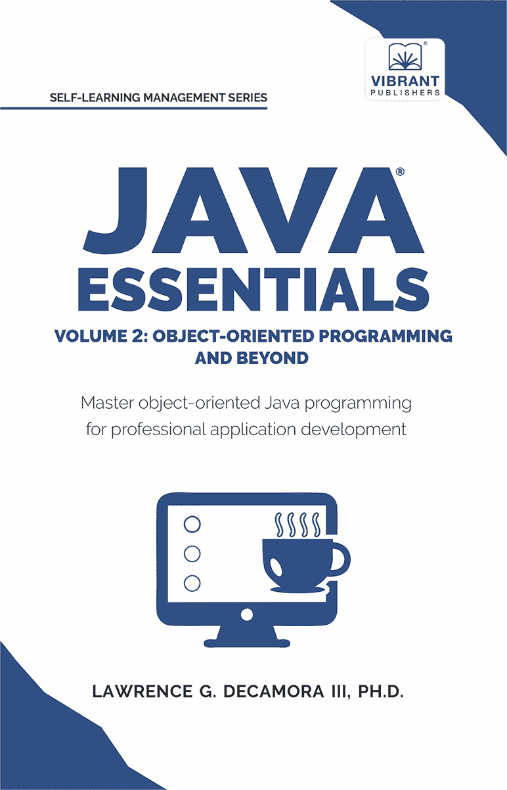

作为我们尊贵的读者，您购买本书已包含了访问增强您学习体验的专属在线资源的权限。这些资源可以从我们的网站 [www.vibrantpublishers.com](http://www.vibrantpublishers.com) 下载，其创建旨在帮助您有效地应用 Java® 概念。

本书的在线资源包括以下内容：

1. 书中使用的 Java 代码
2. 额外的编程任务

## 为什么这些在线资源具有价值：

* **实际应用**：提供的可下载代码便于进行测试和使用。
* **增强学习体验**：额外的编程任务将提供实践经验，并帮助您在实际场景中应用从书中学到的知识。

## 如何获取您的在线资源：

1. **访问网站**：访问 [www.vibrantpublishers.com](http://www.vibrantpublishers.com)。
2. **找到您的书籍**：通过“Shop（商店）”菜单进入书籍的产品页，或在搜索栏中搜索书名。
3. **请求资源**：滚动到“Request Sample Book/Online Resource（请求样书/在线资源）”部分。
4. **输入您的详情**：输入您首选的邮箱并选择“Online Resource（在线资源）”作为资源类型。最后，选择“user type（用户类型）”并提交请求。
5. **检查收件箱**：资源将直接发送到您的邮箱。

或者，为了快速访问：只需扫描下方二维码进入产品页，填写所需详情请求在线资源。


祝学习愉快！

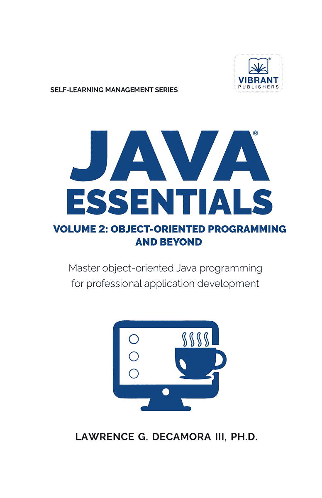

| 标题 | 平装本* ISBN |
| :--- | :--- |
| **商业与创业** | |
| 商务沟通要义 | 9781636511634 |
| 商业伦理要义 | 9781636513324 |
| 商业法要义 | 9781636511702 |
| 商业计划要义 | 9781636511214 |
| 商业策略要义 | 9781636511778 |
| 创业要义 | 9781636511603 |
| 国际商务要义 | 9781636513294 |
| 管理原理要义 | 9781636511542 |
| **计算机科学与技术** | |
| 区块链要义 | 9781636513003 |
| 网络安全要义 | 9781636514888 |
| 机器学习要义 | 9781636513775 |
| Python 要义 | 9781636512938 |
| **商业数据科学** | |
| 商务分析要义 | 9781636514154 |
| 商业智能要义 | 9781636513362 |
| 数据分析要义 | 9781636511184 |
| **数据素养** | |
| 成本会计要义 | 9781636511030 |
| 财务会计要义 | 9781636510972 |
| 财务管理要义 | 9781636511009 |
| 宏观经济学 | 9781636511818 |
| 微观经济学 | 9781636511513 |
| 个人财务要义 | 9781636514796 |
| 经济学原理 | 9781636512334 |
| 多样性、公平与包容 | 9781636511122 |
| **人力资源管理** | |
| HR | 9781636510347 |
| HR 分析 | |
| 组织行为 | 9781636511733 |
| 组织发展 | 9781636512181 |
| 组织成功 | 9781636510057 |
| **领导力** | |
| 领导力 | 9781636514765 |
| 领导力的重要性 | 9781636512273 |
| 印度转型之路 | 9781636510316 |
| 时间管理 | 9781636511665 |
| **现代营销** | |
| 数字化营销 | 9781636513263 |
| 社交媒体 | 9781949395747 |
| 营销管理 | 9781636511788 |
| 市场研究 | 9781636513744 |
| 现代广告 | 9781636514857 |
| 销售 | 9781636510743 |
| 销售管理 | 9781636511733 |
| **运营** | |
| 敏捷 | 9781636510057 |
| 运营与供应链 | 9781949395242 |
| 产品管理 | 9781636514796 |
| 项目管理 | 9781636510712 |
| 利益相关者参与 | 9781636511511 |

在行业内，Decamora 博士曾与 Sun Microsystems Philippines、Phoenix One Knowledge Solutions Inc. 以及 ActiveLearning Inc. 等领先机构合作，提供 `Java` 培训和软件开发解决方案。他的专业领域涵盖 `Java` 编程、企业应用和 Web 技术。

除了教学，Decamora 博士还是一位备受欢迎的演讲者和培训师，曾举办过关于 `Java` 编程、软件工程和新兴技术的研讨会和工作坊。他对知识共享的热情体现在他通过实践见解和现实应用赋能学习者的承诺中。

这本书证明了他致力于让各个水平的学习者都能掌握 `Java` 的投入。通过清晰的解释和实战示例，Decamora 博士继续激励并指导下一代开发者。

# 专家如何评价这本书！

## Java Essentials Volume 2

`Java Essentials Volume 2` 是一本编写精良的教材，为每一章设定了清晰的学习目标。它通过清晰、代码良好的示例引导学生学习。我支持这种对设计和工程的关注，而非仅仅是“编程”。

– John McManus，博士
计算机科学副教授
Randolph-Macon College

我曾对初创公司和大型组织中各个级别的工程师进行面试、技术评估、指导并共同工作，我见证了时间的推移，偏离核心 `Java` 最佳实践是多么容易。这本书是基础知识的价值参考，也是跟上现代语言特性的有力指南，受益于职业生涯各个阶段的开发者。

– Shay Brennan-Kelly
首席软件工程师

终于，有一本既尊重我的经验又挑战我安于现状的 `Java` 书。对话式的流程让你保持投入，出其意料的练习让你保持严谨，而深度则让你流连忘返。这是正确的技术写作典范。

– Dineshotham Kumar K
软件工程师
Candescent Technologies

## 2 面向对象概念简介

### 2.1 对象 vs 类

### 2.2 对象实例化

#### 局限性与不良实践：

* 当影响可读性时不要使用：`var x = someMethod();` // x 存储了什么？`String userName = someMethod();` // 清晰且显式
* 不能在未初始化的情况下使用 `var`：`var total;` // 错误：无法推断类型；`var total = 0;` // OK
* 它不能用于方法参数或返回类型：`public void print(var name) {}` // 不允许；`public var getName() { return "Alice"; }` // 不允许

#### 使用 var 的用处

* 减少代码冗余性
* 在某些情况下提高可读性

在 Java 10 中，引入了 `var` 关键字，通过允许编译器从赋值右侧的值推断变量类型，从而简化局部变量的声明。这一特性并没有让 Java 变成动态类型语言；类型仍然在编译时确定。使用 `var` 时，最好在能够提高代码清晰度的地方使用，而不是仅仅让代码变短。此外，用 `var` 声明的变量必须在声明时初始化。

下面是一个完整的 Java 程序中使用 `var` 关键字的示例：

```java
public class VarExample {
    public static void main(String[] args) {
        // 使用 var 声明局部变量
        // 推断为 String
        var message = "Hello, Java 10 and beyond!";

        // 推断为 int
        var number = 42;

        // 推断为 double
        var pi = 3.14159;

        // 推断为 boolean
        var isJavaFun = true;

        // 打印变量
        System.out.println(message);
        System.out.println("Number: " + number);
        System.out.println("Pi: " + pi);
        System.out.println("Is Java fun? " + isJavaFun);

        // 在循环中使用 var
        var fruits = new String[] { "Apple", "Banana", "Cherry" };
        for (var fruit : fruits) {
            System.out.println("Fruit: " + fruit);
        }

        // var 推断对象
        var person = new Person("Lawrence", 25);
        person.introduce();
    }
}

// 一个简单的类
class Person {
    private String name;
    private int age;

    Person(String name, int age) {
        this.name = name;
        this.age = age;
    }

    void introduce() {
        System.out.println("Hi, I’m " + name + " and I’m " + age + " years old.");
    }
}
```

```
水果：苹果
水果：香蕉
水果：樱桃
你好，我是 Lawrence，我今年 25 岁。
```

 **注意事项**

* `var` 让代码更短且更易于读，同时仍保持类型安全。
* 你可以在方法、循环和代码块中使用 `var`。
* 你不能写 `var x;` 或 `var y = null;`，因为编译器将不知道类型。
* `var` 并不意味着 Java 是动态类型语言——一旦类型被推断，它就被固定了。

 **章节总结**

* 原始数据类型是 Java 提供的基本数据类型。它们直接在内存中存储简单值，并且不是对象。
* 引用数据类型包括对象和数组。它们存储指向实际数据的引用（内存地址），而不是数据本身。示例包括类的实例、接口和数组。
* 用户自定义类是由程序员创建的，用于表示自定义数据类型。这些是引用数据类型，因为这些类的变量持有指向从类创建的对象的引用，而不是对象数据本身。
* 当你将一个引用变量赋值给另一个变量时，两个变量都指向内存中的同一个对象。通过其中一个引用修改对象将会在通过另一个引用访问时反映出来。
* 在 Java 中，方法参数始终是通过值传递的。对于原始数据类型，传递的是实际值。对于引用数据类型，传递的是引用（内存地址），而不是对象本身。
* 局部变量作用域：局部变量的作用域被限制在声明它的代码块（例如方法或循环）中。不能在该代码块之外访问。
* `this` 引用是 Java 中的一个关键字，用于实例方法或构造函数内部，指向当前对象。它可以帮助区分实例变量和同名的参数、调用其他构造函数，并返回当前对象实例。

 **单选题**

1. 下列哪项被认为是引用数据类型？
   a. `String`
   b. `int`
   c. `boolean`
   d. `char`

2. 你在 API 文档中找到的类称什么？
   a. 引用数据类型
   b. 原始数据类型
   c. `Integer` 类型
   d. 普通数据类型

3. 给定下面的示例代码：
   ```java
   public class Main{
       private int m = 100;
       public Main(int m) {
           this.m = m;
       }
       public static void main(String args[]) {
           Main myMain = new Main(200);
           System.out.print(myMain.m);
       }
   }
   ```
   输出将是什么？
   a. 100
   b. 200
   c. 300
   d. 500

4. 关于 `this` 关键字，以下哪一个陈述**不正确**的？
   a. 你可以在实例方法或构造函数内部通过 `this` 引用当前对象的任何成员。
   b. 在构造函数内部，你也可以使用 `this` 关键字调用同一类中的另一个构造函数。
   c. `this` 关键字可以作为对类的引用。
   d. 在实例方法或构造函数内部，`this` 是指向当前对象的引用——即正在调用其方法或构造函数的对象。

5. 关于引用数据类型，以下哪一个陈述**不正确**的？
   a. 引用数据类型扩展了所有原始数据类型。
   b. 引用变量包含对象的地址而不是对象本身。
   c. 对象的地址是由操作系统在对象实例化阶段（通常称为创建阶段）分配的。
   d. 引用数据类型的值是内存地址，可以硬编码在你的 Java 代码中。

6. 假设存在一个有效的类 `Person`，它有一个接受 2 个参数的构造函数，即 `String name` 和 `int age`，并且提供了 `getName()` 方法。考虑下面的代码段：
   ```java
   Person p1 = new Person("Lawrence", 20); // 1
   String str = p1; // 2
   String name = p1.getName(); // 3
   ```
   下列哪一个陈述**不正确**的？
   a. 第 1 行将从 `Person` 类实例化对象 `p1`。
   b. 第 2 行会导致错误。
   c. 第 3 行将获取人对象的名称。
   d. 三行代码都能正常编译并运行。

7. 给定下面的方法：
   ```java
   public void doStuff(int x) {
       int y;
   }
   ```
   关于给定方法中声明的局部变量，以下哪一个是**不正确**的？
   a. 一旦 `doStuff()` 方法结束，局部变量 `x` 和 `y` 将从内存中删除。
   b. 局部变量 `y` 的初始值为 0。
   c. 当正确调用 `doStuff()` 方法时，局部变量 `x` 将具有传递它的值。
   d. 局部变量 `y` 在使用之前应该先初始化。

8. 下列哪项**不是**引用数据类型？
   a. `float`
   b. `Button`
   c. `Person`
   d. `String`

9. 以下哪一个陈述**不正确**？
   a. 变量的值与其数据类型有关。
   b. 如果变量是引用类型，则你传递引用类型。
   c. 所有变量无论类型如何、无论作用域如何，定义的初始值。
   d. 当你将对象传递给方法时，传递的是内存地址。

10. 下列哪项是引用数据类型？
    a. `byte`
    b. `char`
    c. `float`
    d. `Person`

**单选题答案**

| 1 - a | 2 - a | 3 - b | 4 - c | 5 - d |
| 6 - d | 7 - b | 8 - a | 9 - c | 10 - d |

 **编程任务**

**目标：**

编写一个 Java 程序，展示你对原始数据类型、引用数据类型、自定义类、引用赋值、值传递、局部变量作用域以及 `this` 引用的理解。

**要求：**

1. 创建一个名为 `Person` 的自定义类：
   定义 `Person` 类及其以下属性：`String name` 和 `int age`。
   在 `Person` 类中包含以下方法：
   * 构造函数接受 `String name` 和 `int age` 初始化 `name` 和 `age` 属性。
   * `updateAge()` 方法接受 `Person` 对象和一个 `int` 值，以更新传递的 `person` 对象的 `age`。
   * `incrementAge()` 方法增加当前 `person` 的 `age` 并返回更新后的 `person` 对象。
   * `displayInfo()` 方法打印 `person` 的 `name` 和 `age`。

2. 主程序：
   * 创建一个 `Person` 对象，并按照构造函数所述初始化名称和年龄值。
   * 将 `Person` 对象传递给方法，使用 `updateAge()` 更新其年龄。
   * 使用 `incrementAge()` 增加 `Person` 对象的年龄并赋值给一个新的引用变量。
   * 演示更改引用变量和局部变量作用域对 `Person` 对象的影响。
   * 在 `Person` 类内部使用 `this` 关键字来实现方法复用。

在 Java 编程世界，理解面向对象的原则对于编写健壮、可重用且易维护的代码至关重要。本章通过引入定义 Java 应用设计和结构的核心概念，为面向对象编程（OOP）奠定了基础。你将学习类和对象之间的区别、如何创建和使用它们，以及封装如何帮助保护内部数据。本章还涵盖了构造函数——包括默认构造函数的规则——以及实例方法和静态方法之间的区别。最后，我们将探索 Java 源文件的组织方式、包（packages）和导入（imports）的工作原理，以及如何使用 JAR 文件、清单文件（manifest files）和 Java API 文档打包并记录你的应用程序。

## 2.1 对象与类


### 2.1.1 什么是对象？

对象是任何真实存在。它们可以是概念性的或物理的。你周围现在的任何东西都是对象：椅子、桌子、书籍，甚至是你的纸张。但对象不仅限于我们周围的实体。当你使用桌面应用程序或你喜欢的文字处理器时，你也能看到其中的对象。按钮、工具栏，甚至是工作区域或对话框都是对象。物理对象可以是实体的或无形的，可见的，如 `Button` 和 `String`，以及不可见的，如数据库连接和网络连接。

对象也可以是概念性的。概念对象是那些不可见但以意义方式存在的对象。这类对象也很有用，它们也代表了一组数据。概念对象的示例包括错误（errors）、异常（exceptions）、数据库连接、网络连接、触发事件等。我们将在单独的章节讨论错误、异常和事件。现在，理解这些都是概念对象的示例就很重要。

### 2.1.2 什么是类？

类是对象的蓝图。它是数据属性和方法（也称为行为）的声明，每个对象在每次被实例化时都会拥有这些。“实例化”（instantiate）一词与“创建”（to create）是同义词。因此，每当你实例化一个对象时，你实际上是从一个类创建了一个对象，该对象将存储在堆内存中（Java 在运行时动态地存储对象和实例变量，允许在程序执行期间灵活地管理内存）。你几乎可以从一个类中创建无限数量的对象。每个对象都有自己的标识。这意味着，无论一个对象中发生什么变化，其他对象都不会受到影响。

在旧版本的 Java（Java 7 及更早版本）中，对象始终存储在堆中，而类元数据（关于类、方法等的信息）保留在堆的一个特殊部分，称为 PermGen（永久代）。

从 Java 8 开始，删除了 PermGen 区域。对象仍然存储在堆中，但类元数据现在存储在 Metaspace（元空间）中，它位于原生内存（堆之外）。这一变化有助于避免以前发生在 PermGen 中的内存问题。

在较新的 JVM 中，编译器还可以优化非常短命的对象，使它们不会总是进入堆——有时它们可能被变量替换或临时存储在栈上。但从程序员的角度来看，你可以认为对象始终存活在堆中。

这里有一个清晰的对比表格来总结 Java 内存结构：Java 7 对比 Java 8+。

**表 2.1 Java 内存结构对比**

| 内存区域 | Java 7 及更早版本 | Java 8 及以后 |
| :--- | :--- | :--- |
| 堆 (Heap) | 存储所有对象 | 存储所有对象（无变化） |
| 栈 (Stack) | 存储方法调用、局部变量和引用。 | 与 Java 7 相同（无变化） |
| 永久代 (PermGen) | 存储类元数据（类定义、方法、静态变量等） | 在 Java 8 中删除 |
| 元空间 (Metaspace) | 不可用 | 取代 PermGen；在原生内存中存储类元数据 |
| 垃圾回收器 (GC) | 清理堆和 PermGen | 清理堆和元空间（如果需要） |

**图 2.1** 显示类与对象之间关系的图表

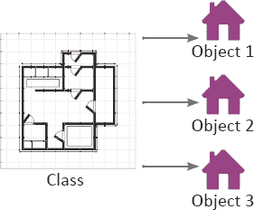

在本书中，我们将使用几种类型的 UML（统一建模语言）图来图形化地表示若干构图。在图 2.2 的示例中，我们使用了一个 UML 类图，它将描述类的结构。其他类型的 UML 图包括 UML 包图、UML 状态图等。

考虑图 2.2 中的示例。

**图 2.2** Person 类的 UML 图

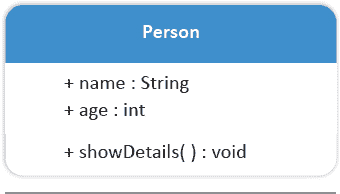

此 UML 将具有以下对应的 Java 类等效代码：

```java
public class Person
{
    public String name;
    public int age;
    public void showDetails() {...}
}
```

在给定的 UML 图中，顶部部分（灰色）包含类名，第二部分（白色）包含类中的属性或变量，第三部分（黑色）包含类中的方法。至于它们的访问权限，加号 (`+`) 表示公有（public），而在本章的后半部分，你还会看到减号 (`-`) 符号，它用于声明某些内容为私有（private）。公有和私有访问修饰符将在稍后进行更详细的讨论。

## 2.2 对象实例化

Java 中的对象实例化是从类创建对象的过程。你使用 `new` 关键字连同类名和括号来调用它的构造函数，从而初始化对象。这创建了一个新的实例，你可以使用它来访问类的方法和属性。

让我们创建两个对象。

```java
Person p1 = new Person();
Person p2 = new Person();
```

这意味着 `p1` 和 `p2` 是处理两个不同对象的引用变量。由于你现在有两个对象（`p1` 和 `p2`），每个对象都拥有自己的 `name` 和 `age` 属性，以及 `showDetails()` 方法。如果你想访问成员（member 是属性和方法的另一个术语），可以使用点 (`.`) 符号。

例如，你想分别为 `p1` 和 `p2` 对象分配名称：

```java
p1.name = "Lawrence";
p2.name = "Walter";
```

现在，让我们为它们分配年龄：

```java
p1.age = 20;
p2.age = 5;
```

我们到为止所做的是为 `p1` 和 `p2` 的属性赋值。现在让我们打印它们的值：

```java
System.out.println(p1.name + " at age " + p1.age);
System.out.println(p2.name + " at age " + p2.age);
```

这将给我们输出：

```
Lawrence at age 20
Walter at age 5
```

## 2.3 封装 - 即数据隐藏与实现

封装通过保持数据私有并仅允许直接访问来保护数据。在 Java 中，你可以使用 `private` 关键字限制对变量的直接访问，因此无法从类外部对其进行更改。为了允许安全的访问或更改，你使用公共方法（如 getter 和 setter），它们可以在更新私有变量之前检查或验证值。这确保了你的数据有效且安全。

这个类声明有什么问题？

**图 2.3** 带有公共变量的 Person 类的 UML 图

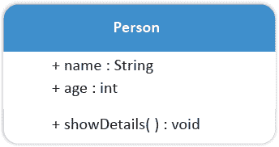

如果我们这样做呢？

```java
Person p1 = new Person();
Person p2 = new Person();

p1.name = "Lawrence";
p2.name = "Walter";

p1.age = 20;
p2.age = -5;
```

会有程序问题吗？编译器会在第 14 行有问题吗？不会。这段代码可以编译并运行。编译器在第 14 行不会有任何问题，因为赋值给 `p2.age` 的值 -5 是一个有效的整数值。这段代码唯一的问题是它代表了一个不现实的对象。

Java 被认为是一种面向对象的编程语言，这意味着它具有模拟现实世界对象行为的能力。在这种情况下，一个人的年龄不能为负值。在我们的现实世界中，一个人的年龄必须大于等于零。

那么，我们该如何解决这个问题呢？这就是封装发挥用场的地方。封装是一种面向对象的特性，它可以隐藏或保护数据免受直接访问。因此，我们不再将所有属性声明为 `public`，而是可以将它们声明为 `private`，以禁用其他类对属性的直接访问。封装通过限制其可访问性来保护你的数据。

**图 2.4** 带有私有变量的 `Person` 类 UML 图

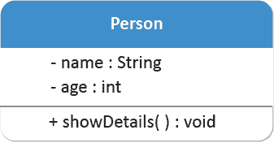

现在，`name` 和 `age` 属性被声明为 `private`，这意味着这些属性只能在 `Person` 类内部访问，而不能在该类外部访问（包括 `TestPerson` 类）。

如果尝试再次为 `name` 和 `age` 赋值会怎样？我们现在会遇到编译错误，因为 `name` 和 `age` 属性被声明为 `private`，这意味着不允许从类外部直接访问它们。

```
10 p1.name = "Lawrence";//编译错误
11 p2.name = "Walter";//编译错误
13 p1.age = 20;//编译错误
14 p2.age = -5;//编译错误
```

`private` 变量的可访问性仅限于声明该变量的同一个类。因此，如果我们将 `name` 和 `age` 属性声明为 `private`，我们应该如何为它们赋值并从它们获取值呢？

解决方案是提供一个公开可访问并允许访问私有数据的方法；这就是一对“setters”（设置）和“getters”（获取）上场的地方。

Setters 和 getters 是用于创建 `JavaBeans` 的约定。它们也被用于为 `name` 和 `age` 属性赋值，并可以提供验证检查。

`Java Bean` 只是一个 `POJO`——普通 Java 对象（Plain Old Java Object），这是一个封装良好的类的约定术语。`JavaBeans` 等同于企业 Java Beans (`EJB`)。`EJBs` 是 Java EE 程序的业务组件，超出了我们的讨论范围。

`JavaBeans` 是 Java 中可重用的软件组件，遵循某些规则，使得它们在不同的程序中易使用。一个关键规则是 `Java Bean` 必须具有 `private` 变量（字段），并提供 `public` 方法来访问或修改这些变量，这些被称为“getters”和“setters”。getters 允许你读取变量的值，而 setters 允许你更改它。这种结构确保了 bean 内部的数据可以在应用程序的不同部分得到安全且一致地管理。

这是一个 `Java Bean` 的示例。

**图 2.5** Java Bean 类 `Person` 的 UML 图

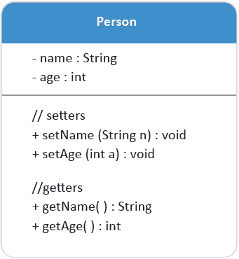

翻译成 Java 代码，它看起来像这样：

```java
// Person.java
public class Person {
    private String name;
    private int age;

    // setters
    public void setName(String n) {
        name = n;
    }
    public void setAge(int a) {
        if (a >= 0)
            age = a;
        else
            age = 0;
    }

    // getters
    public String getName() {
        return name;
    }
    public int getAge() {
        return age;
    }
}
```

在修改后的 `Person` 类中，你会注意到，即使你尝试使用 `p2.age = -5` 直接为人的年龄赋值负值，这也是不可能的；将会发生编译错误。从不同类直接传递到 `private` 变量的所有值都是不被允许的。通过提供 `public` setters，现在传递给 `private` 变量的所有值都将被强制通过 `public` setters 传递。这样，你现在可以在 `public` setters 内部进行验证检查。所有传递的值都可以被直接检查或赋值。

让我们看看修改后的 `TestPerson` 类。

```java
// TestPerson.java
public class TestPerson {
    public static void main(String[] args) {
        Person p1 = new Person();
        Person p2 = new Person();

        // 赋值名称
        p1.setName("Lawrence");
        p2.setName("Walter");

        // 赋值年龄
        p1.setAge(30);
        p2.setAge(-5);

        System.out.println(p1.getName() + " is " + p1.getAge() + " years old.");
        System.out.println(p2.getName() + " is " + p2.getAge() + " years old.");
    }
}
```

在第 10 行和第 11 行，以及第 14 行和第 15 行，用于 `name` 和 `age` 的值现在被强制通过 `public` setters。因此，`Person` 类可以对这些值执行验证检查。

在获取 `name` 和 `age` 的值时，我们现在被迫调用 `public` getters。

```java
System.out.println(p1.getName() + " is " + p1.getAge() + " years old.");
System.out.println(p2.getName() + " is " + p2.getAge() + " years old.");
```

`public` getters 是旨在返回值的方法。在第 17 行和第 18 行调用时，分别返回一个 `String` 值和一个 `integer` 值。`p1.getName()` 返回一个 `String` 值，而 `p1.getAge()` 返回一个 `integer` 值，该值将通过 `System.out.println()` 方法打印。getters 的返回值可以打印到屏幕上，也可以存储在变量中。一旦编译并执行，它将输出：

```
Lawrence at age 30
Walter at age 0
```

## 2.4 构造函数

构造函数是一种与类名相同的构造结构。构造函数没有任何类型，甚至没有 `void`。

这是一个示例：

```java
public class Person {
    public Person (String n, int a) {
        name = n;
        age = a;
    }
}
```

创建 `Person` 对象时，你这样调用构造函数：

```java
Person p1 = new Person("Lawrence", 20);
Person p2 = new Person("Walter", 18);
Person p3 = new Person();//编译错误
```

### 默认构造函数规则

“每个类至少有一个构造函数；如果编写者没有构造函数，Java 将提供默认的无参数空体构造函数。”例如：

```java
public class MyClass {
}
```

这个类包含构造函数吗？答案是肯定的。这是因为默认构造函数。这就是为什么我们可以从这个类实例化对象的原因。给定的类在编译后实际上看起来像这样：

```java
public class MyClass {
    // 这是默认构造函数
    public MyClass() {
        // 此处无内容
    }
}
```

从这个类创建一个对象：

```java
MyClass mc = new MyClass();
```

## 2.5 方法

方法用于创建一个子程序，该子程序可以从主方法或另一个方法中调用任意次数。方法可以在传递值或不传递值的情况下执行；这些值被称为参数，有时也称为参数列表。

以下是在 Java 中声明方法的语法：

```
<modifiers> <return_type> methodName(<parameter_list>)
{
    // method body
}
```

常用的修饰符可以是以下任意一个：

- `public` / `private` / `protected`
- `static` / `abstract` / `final`

`return_type` 可以是任何数据类型，甚至是 `void`。

`methodName` 可以是任何有效的标识符。

`parameter_list` 可以是任何变量和值对。在调用实例方法时，必须先创建一个对象。实例方法通过创建的对象进行调用。给定的实例方法调用示例：

```
p1.setName("Lawrence");
System.out.println(p1.getName());
int nameLength = p1.getName().length();
```

实例变量和方法属于一个对象，并通过该对象进行使用。要访问它们，你首先需要使用 `new` 关键字创建该类的对象。然后，你可以使用对象的名称后接点（`.`）来调用其方法或访问其变量。

而静态方法通过类名进行调用。

```java
String strNum = "100";
int num = Integer.parseInt(strNum);
```

`Integer` 类位于 `java.lang` 包下，并有一个静态方法 `parseInt()`，它可以接受一个 `String` 格式的整数并返回一个 `int` 值。由于 `parseInt()` 方法是静态的，我们通过类名调用该方法：`Integer.parseInt(strNum)`。

## 2.6 Java 源文件布局

只需记住 P-I-C 即可，它代表 Package（包）—Import（导入）—Classes（类）。Java 源文件的这些部分都是可选的。每个部分可以包含以下数量的语句：

- `package` -> 0 或 1 句语句
- `import` -> 0 到多个
- `classes` -> 0 到多个

一个 Java 源代码可以有多个类，但只允许有一个公共类（public class）。一旦声明了公共类，你的 Java 源代码文件名必须与该公共类匹配。

### 2.6.1 Java package 语句

Java 中的包指的是子目录。一个包可以包含类或子包。以**图 2.6**中的图为例。

**图 2.6** 包包图

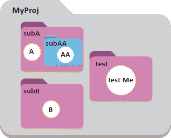

我们将 `MyProj` 作为一个包，在 `MyProj` 内部我们有三个子包，即：`subA`、`subB` 和 `test`。在 `subA` 内部，我们有一个子包 `subAA`。


包内部也可以包含类。包 `subA` 包含 `A.class`，`subAA` 包含 `AA.class`，包 `subB` 包含 `B.class`，包 `test` 包含 `TestMe.class`，作为我们的测试类。

在使用包时，我们还需要注意以下规则：

1. 包的基本语法如下：
   `package <top_level_pkg_name>[.<sub_pkg_name>]*;`
   示例：
   `package subA.subAA;`

2. 包的声明只能放在 Java 源文件的开头。

3. 每个源文件只允许一个 (1) 包声明。

4. 在没有包语句的情况下，生成的类文件将放在默认包中（当前工作目录）。

5. 包语句之间必须用点 (`.`) 分隔，以确保子目录的表示平台无关。

### 2.6.2 import 语句

Import 语句用于告诉编译器哪里找到应用程序将使用的需要的类。有两个包不需要任何 import 语句：

1. 当前工作目录以及；
2. `java.lang.*` 包。

上述包中的类不需要任何 import 语句声明。然而，位于其他包中的类必须使用 import 语句进行声明。这是一个示例：

```
1 import java.util.ArrayList;
2 import java.io.*;
3 import subA.subAA.AA;
```

第 1 行表示可以在 `java.util` 包内访问 `ArrayList` 类，而第 2 行表示 `java.io` 包下的所有类都可以使用。星号 (`*`) 表示所有类，而第 3 行表示此应用程序正在使用类 `AA`，它位于 `subA.subAA` 包下。

综上所述，这是一个示例。这是 `TestMe.java` 源文件：

```
1 package test;
2
3 import subA.*;
4 import subA.subAA.AA;
5 //import subB.B;
6
7 public class TestMe {
8
9 public static void main(String[] args) {
10
11 A obj = new A();
12
13 }
```

| 特性 | 包 (Packages)：按功能组织类（例如 `test`, `utils`）。 | 模块 (Modules)：保持整个包结构并定义清晰的边界。 |
| :--- | :--- | :--- |
| 可可见性 | 包中的类可以被任何其他代码导入。 | 模块可以只导出想要共享的包并隐藏其他包。 |
| 依赖关系 | 没有直接的方法说明需要哪些包。 | `module-info.java` 可以声明需要哪些其他模块。 |
| 引入版本 | 自 Java 早期起可用。 | 在 Java 9 中作为 Project Jigsaw 的一部分引入。 |
| 示例 | `package test;` → 将 test 内部的类分组。 | `module myapp { exports test; }` → 定义一个名为 `myapp` 的模块并导出 `test` 包。 |

包用于将类组织到文件夹中，以便将相关的代码以整洁且结构化的方式组合在一起。从 Java 9 开始，模块作为一种更大的构建块被引入——它们允许你将多个包组合为一个单元，并控制你的代码中哪些部分可以被其他模块访问。简而言之，包有助于组织类，而模块有助于组织包。

## 2.8 JAR (Java Archive) 文件

一个复杂的应用程序通常由一组类文件组成，而不仅仅是一个类文件。当这些类文件需要交付给客户时，我们需要将它们放入一个名为 JAR 文件或 Java 归档文件的文件。这个 JAR 文件代表了一组共同工作的类。

考虑之前提供的目录结构。成功编译后，生成的类文件被放在 `classes` 文件夹下。

图 2.8 项目部分目录结构，classes 文件夹

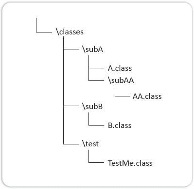

这些位于 `classes` 文件夹下的类文件现在可以归档了。类文件的归档可以使用 JDK 安装带的 `jar` 工具完成。

创建 Jar 文件有两种方法。

### 1. 不使用清单文件 (manifest file)

创建：

```bash
jar cvf <JarFile.jar> <Files>
```

即

```bash
jar cvf MyJar1.jar *
```

运行：

```bash
java -cp <JarFile.jar> <fullyQualifiedName>
```

即

```bash
java -cp MyJar1.jar test.TestMe
```

### 2. 使用清单文件，也称为可执行 Jar 文件。

创建：

```bash
jar cvfm <JarFile.jar> <manifestFile> <Files>
```

即

```bash
jar cvfm MyJar2.jar manif.txt *
```

运行：

```bash
java -jar <JarFile.jar>
```

即

```bash
java -jar MyJar2.jar
```

## 2.9 清单文件 (Manifest File)

清单文件是归档文件使用的一种配置文件。所有的 JAR 文件都包含一个清单文件。如果 JAR 文件的创建者没有包含自己的清单文件，则始终存在一个默认的 `MANIFEST.MF` 文件，其中包含默认配置。通过放入自己版本的清单文件，你可以自定义它的行为并覆盖 JAR 文件内部的默认清单文件。

清单文件有四个部分。

`<Main-Class tag/s><separator><value><ENTERKEY>`

清单文件看起来如下：

```
Manifest-Version: 1.0
Main-Class: test.TestMe
```

务必在最后一行之后添加一个换行符，以便在运行时，Java 虚拟机可以读取该行输入。如果你的清单文件中缺少 `ENTER KEY` 字符，`JVM` 将其视为无效的清单文件，因为它无法读取其内容。

对于大多数 IDE，清单文件也是自动创建的。你只需要编辑它并在 `Main-Class` 标签中包含测试类的全限定名。如果你想让 JAR 文件成为可执行（可运行）的 JAR 文件，这是必须的。

## 2.10 Java API 文档

正如《Java 核心技术 卷》中所述，Java 运行环境 (JRE) 由两个主要部分组成：

1. Java 虚拟机 (JVM) 和
2. 应用程序接口 (API)

要了解你 API 内部的类，可以在 Oracle® 网站下载 API 文档。

你也可以通过 URL 在线访问 API 文档：

`http://docs.oracle.com/javase/<javaSEversion>/docs/api/index.html`

示例：

`https://docs.oracle.com/javase/23/docs/api/index.html`

注意：书中附带的在线资源也提供了链接。

图 2.9 Java 23 API 文档页面

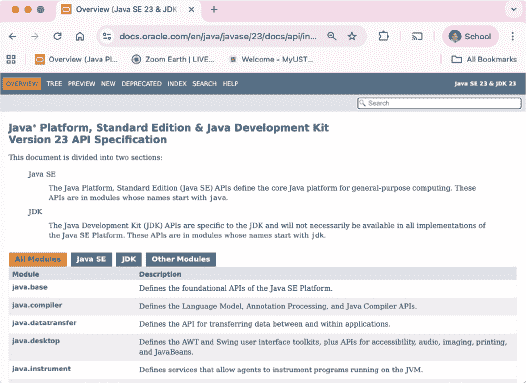

源：`https://docs.oracle.com/en/java/javase/23/docs/api/index.html`

尝试使用屏幕右上角的搜索栏并输入类名，例如 `String`。你应该能看到关于该类的说明、构造函数以及该类的方法。


## 总结

在本章中，我们讨论了以下内容：

- 对象可以是物理或概念实体，代表现实世界中的物品。模块包括类和包。UML 图（如类图和状态图）用于视觉化地表示这些结构。

- 构造方法是一种特殊方法，其名称与类名相同且没有返回类型。每个类至少有一个；如果程序员没有定义，Java 会提供一个默认的无参构造方法。

- Java 方法是重用的代码块，可以在 `main` 方法或其他方法中调用，可以传递或不传递值（参数）。方法可以有各种访问修饰符，并可以是实例方法（需要对象）或静态方法（直接通过类名调用）。

- Java 源代码布局可以有一个包声明，也可以没有。对于导入语句，可以有多个也可以没有。对于类，可以有多个非公共类或一个包含多个非公共类的类。包、导入语句和类声明都是可选的。如果存在，它们的顺序必须从包开始，然后是导入语句，最后是类列表。

- 一个复杂的应用程序通常由一组类文件组成，而不仅仅是一个类文件。当这些类文件需要交付给客户时，我们需要将它们放入一个名为 JAR 文件或 Java 归档文件的文件。这个 JAR 文件代表了一组共同工作的类。


## 选择题

1. 哪个术语指的是与类名相同并用于实例化（创建）对象的特殊构造？

a. 类

b. 方法

c. 构造方法

d. 垃圾回收

2. 关于静态方法，以下哪项是正确的？

a. 你可以通过类名访问静态方法。

b. 你必须先实例化对象才能访问静态方法。

c. 你只能通过对象的名称访问静态方法。

d. 你不能重载静态方法。

### 3. 在下面的 Java 代码段中：

```java
int myMethod(){
    int myNumber = 12;
    return myNumber;
}
```

该方法的返回类型是什么？

a. `int`

b. `void`

c. `myMethod`

d. `none`

### 4. 下列陈述中哪一项是不正确的？

a. 如果方法的返回类型是 `int`，那么你传递给方法参数的值也必须是 `int`。

b. 方法可以返回 `int`，同时也可以具有不同的参数类型。

c. 如果一个方法**不返回**任何值，则其返回类型应该是 `void` 类型。

d. 如果方法的返回类型是 `int`，则方法内部必须包含一个 `return` 语句并返回一个 `int` 类型的值。

### 5. 下面四个选项中有三个是狗对象的属性；哪一个是方法？

a. `age`

b. `bark()`

c. `color`

d. `breed`

### 6. 你编写了一个名为 `Animal` 的类，它包含以下内容：

```java
public void eat() {}
public void breath() {}
public void sleep() {}
```

你如何称类类的类的内容？

a. `comments`

b. `attributes`

c. `constructors`

d. `methods`

### 7. 假定如下类声明：

```java
public class Person {
    Person(String name){}
    Person(String name, int age) {}
}
```

下列哪个操作会导致创建 `Person` 类实例时发生错误？

a. `Person p = new Person("Lawrence", 20);`

b. `Person p = new Person();`

c. `Person p = new Person("Percy");`

d. `Person p = new Person("Jerry", 25);`

### 8. 选项中有三个对象和一个类；哪一个选项是类？

a. `iPhone X`

b. `Nokia 3310`

c. `Samsung Galaxy`

d. `Smartphone`

### 9. 假定创建 `Student` 对象的代码行：

```java
Student aStudent = new Student();
```

创建 `Student` 对象时使用了以下哪个运算符？

a. `Student`

b. `=`

c. `aStudent`

d. `new`

### 10. Java API 文档提供了什么？

a. 用于编写 Java 代码的集成开发环境 (IDE)

b. 关于 Java 关键字语法和用法的详细信息

c. Java 平台提供的类和方法的描述及用法

d. 用于学习 Java 的教程和代码示例

## 多项选择题答案页

| 1 – c | 2 – a | 3 – a | 4 – a | 5 – b |
| 6 – d | 7 – b | 8 – d | 9 – d | 10 – c |


## 编码任务

#### 编码任务 1：完成 Student 类

给定 `Student` 类的部分代码，它包含 3 个属性：`name`、`studentNumber` 和 `course`。

你需要提供 setter 方法和 getter 方法，以及一个缺失了体的构造函数体。

你还需要实现 `showStudentInformation()` 方法，以便一旦调用它，它应该显示 `Student` 对象的名称、`studentNumber` 和 `course`。

```java
// 这是 Student.java 的代码
// 请补全代码
public class Student {
    private String name;
    private int studentNumber;
    private String course;

    // 这是构造函数 #1 -
    // 不需要在此处添加任何内容
    public Student() {
    }

    // 这是构造函数 #2 -
    // 你必须提供此构造函数的体
    public Student(String name, int studentNumber, String course) {
        // 完善此构造函数的体
    }

    // 将你的 setters 放在这里
    // 将你的 getters 放在这里
    public void showStudentInformation() {
        // 此方法应该显示学生的
        // 名称、studentNumber 和课程
        // 对象。
    }
}
```

```java
// 这是 TestStudent.java 的代码 -
// 请补全代码
public class TestStudent {
    public static void main(String args[]) {
        Student s1 = new Student("Lawrence", 1111, "Computer Science");
        Student s2 = new Student();
        Student s3 = new Student();

        // 设置 s2 的属性
        // 分配一个名称，studentNumber 和 course
        // 设置 s3 的属性
        // 打印 s1 的信息
        s1.showStudentInformation();
        // 打印 s2 的信息
        // 调用 getter 方法
        // 打印 s3 的信息
        // 调用 showStudentInformation() 方法
    }
}
```

#### 编码任务 2：创建并使用简单类

指令：

1. 创建一个名为 `Book` 的类，包含以下私有字段：
   - `String title`
   - `String author`
   - `int yearPublished`

2. 添加一个初始化所有三个字段的构造函数。

3. 为每个字段提供公共 getter 和 setter 方法。

4. 添加一个名为 `displayInfo()` 的实例方法，按格式打印书籍详情：`"Title: <title>, Author: <author>, Year: <yearPublished>"`

5. 在 `main` 方法中实例化 `Book` 对象，使用 setter 修改数据，并调用 `displayInfo()`。

#### 编码任务 3：使用静态方法探索结构

目标：练习静态方法、包语句和结构。

指令：

1. 创建一个名为 `utilities` 的包。

2. 在 `utilities` 包内部定义一个 `MathHelper` 类，包含：
   - 一个静态方法 `square(int number)` 返回数字的平方。
   - 一个静态方法 `isEven(int number)` 如果数字为偶数则返回 true，否则返回 false。

3. 创建另一个名为 `mainapp` 的包。

4. 在 `mainapp` 中创建一个 `MainProgram` 类，其包含一个 `main` 方法：
   - 导入并使用 `MathHelper` 类。
   - 调用 `MathHelper` 的两个方法。
   - 打印结果。

假设你目前是一个 `Employee` 对象。作为一名 `Employee`，你拥有以下属性：`name`、`salary`、`birthDate` 以及一个可以显示你所有信息的方法，我们称其为 `getDetails()`。

```java
public class Employee {
    public String name = "";
    public double salary;
    public Date birthDate;
    public String getDetails() {...}
}
```

在大多数情况下，`Managers` 也是 `Employees`。`Employees` 和 `Managers` 都有各自的名字、工资和出生日期。在这些属性之上，`Managers` 还有他们负责管理和运行的部门。

图 3.2 Manager 类

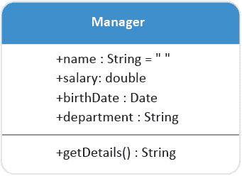


```java
public class Manager {
    public String name = "";
    public double salary;
    public Date birthDate;
    public String department;
    public String getDetails() {...}
}
```

这种情况非常需要继承。继承是一种通过扩展现有的类来成为其超类（又称父类）来重用类的方法。在我们的示例中，`Manager` 类继承了 `Employee` 类，这意味着 `Employee` 类拥有的任何东西，`Manager` 类也拥有。

图 3.3 Employee 和 Manager 类

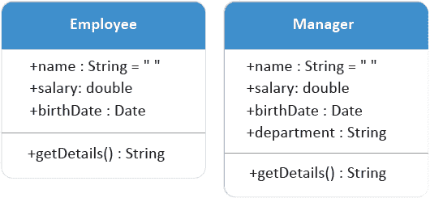

## 3.3 “是（is-a）”关系

在所有的继承案例中，父类和子类之间都存在明显的“是（is-a）”关系。在 Java 中，“is-a”关系意味着子类是其超类的特定类型。它暗示了一个层级连接，子类从超类继承特征和行为。

对于 Java 技术，我们将使用 `superclass`（超类）和 `subclass`（子类）这两个术语。`Manager` 和 `Employee` 类就是“is-a”关系的例子。每个经理都是员工。这种“is-a”关系是展示继承的一种方式。

以下是如何定义继承自 `Employee` 类的 `Manager` 类。你使用 Java 关键字 `extends` 来表示继承。

以下是应用继承的语法：

```java
class <SubClass> extends <SuperClass> {
    // 添加的字段、构造函数和方法
}
```

要在 `Employee` 和 `Manager` 类中应用给定语法，我们可以这样写继承关系：

```java
class Manager extends Employee {
    // 添加的字段、构造函数和方法
}
```

这显示 `Manager` 类是子类，而 `Employee` 类是超类，如果我们对这两个类都应用“is-a”关系，我们可以说一个 `Manager` “是一个” `Employee`。

图 3.4 继承 Employee 类的 Manager 类

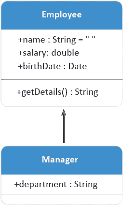

```java
// Employee.java
public class Employee {
    public String name = "";
    public double salary;
    public Date birthDate;
    public String getDetails() {...}
}

// Manager.java
public class Manager extends Employee {
    public String department;
}
```

“is-a”关系不仅限于直接子类；它可以向层级结构的更深处延伸。

## 3.4 单继承

在 Java 编程语言中，我们只能实现单继承，这意味着你只能继承自一个超类（父类）。虽然这没有限制超类只能有一个子类，但它可以拥有多个子类。

请注意[图 3.5]中的类 UML 图。每个类都只有一个超类。在这个 UML 中，你还会注意到一个超类有多个子类，例如 `Employee` 类有几个直接子类，如 `Manager`、`Engineer` 和 `Secretary`，而 `Director` 类是 `Manager` 类的子类，`Manager` 类又是 `Employee` 类的子类。因此，应用“is-a”关系，我们可以说 `Director` “是一个” `Manager`。说 `Director` “是一个” `Employee` 也是正确的。`Director` 可能不是 `Employee` 类的直接子类，但它仍然属于同一个层级，所以 `Director` 也是一个 `Employee`。

图 3.5 单继承层级示例

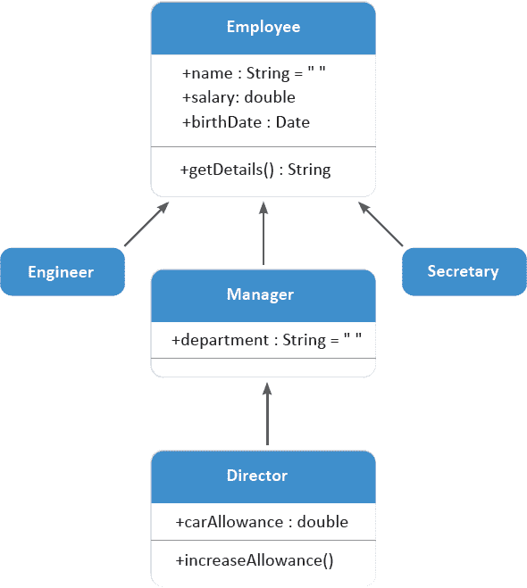

在 C++ 和其他面向对象的编程语言中，允许多继承，但 Java 不允许。这引出了问题：Java 是否劣于 C++？答案是“否定的”。多继承有几个缺点。以[图 3.6] 为例。

图 3.6 多继承概念

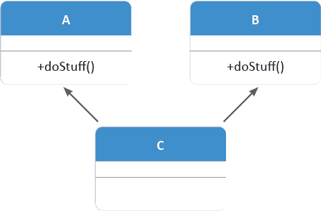

假设类 `A` 和类 `B` 都是父类，并且都有一个名为 `doStuff()` 的公共方法，该方法包含两个不同的方法实现。另一个名为类 `C` 的类是类 `A` 和类 `B` 的子类。

类 `C` 将继承哪个 `doStuff()` 方法？`doStuff()` 方法在两个父类都存在。这导致了类 `C` 应该继承哪个 `doStuff()` 方法的问题，它应该继承来自类 `A` 的 `doStuff()` 还是类 `B` 的？这是多继承中可能发生的一个问题。在 Java 中，我们可以通过使用接口来模拟多继承。

## 3.5 访问修饰符

访问修饰符用于类、方法和字段。它告诉编译器权限范围。Java 中有四种访问修饰符。表 3.1 给出了这些修饰符的摘要。

表 3.1 访问修饰符

| 访问修饰符 | 同一类 | 同一包 | 任何地方 |
| :--- | :--- | :--- | :--- |
| `private` | 是 | 否 | 否 |
| `default` | 是 | 是 | 否 |
| `protected` | 是 | 是 | 是 |
| `public` | 是 | 是 | 是 |

一旦内部类、方法或变量被声明为 `private`，其访问范围将仅限制在声明它的类内部。顶层类不允许为 `private`。如果没有使用任何访问修饰符，则意味着你正在使用 `default` 访问修饰符，它将访问范围限制在声明它的类内部以及同一包内。

相反，`protected` 访问修饰符允许访问范围限制在同一类、同一包内或子类中（即使它们在不同的包中）。使用 `protected` 修饰符的结构无法在同一包之外或非子类中访问。

最后，`public` 访问修饰符可以在任何地方访问。它具有通用访问权限。顶层类只能具有 `default` 或 `public` 访问权限。内部类、变量和方法可以使用上述任何访问修饰符。

## 3.6 方法重写

在某些情况下，当你从超类继承了一个方法，但你发现继承的方法并不足以完成子类所需的职责。为了解决这个困境，你可以重写你继承的方法。

```java
public String department;

@Override
public String getDetails() {
    return "Name: " + name +
           "\nSalary: " + salary +
           "\nDepartment: " + department;
}
```

在这个示例中，`Manager` 类的 `getDetails()` 方法重写了 `Employee` 类的 `getDetails()` 方法。这是因为 `Manager` 的 `getDetails()` 方法应该提供比继承自父类的 `getDetails()` 方法更多的信息。

## 3.7 方法重写的规则

在提供的源代码中，我们可以说 `Manager` 类的 `getDetails()` 方法是重写方法。在重写方法时，需要遵守一些规则。

1. 重写方法必须具有相同的名称。
   - 例如，在给出的示例中，`Employee` 类和 `Manager` 类都有 `getDetails()` 方法。

2. 重写方法必须具有相同的参数列表。
   - 在此示例中，`Employee` 和 `Manager` 类的 `getDetails()` 方法都有空参数列表。

3. 重写方法的返回类型可以是相同的。
   - 在此示例中，`Employee` 和 `Manager` 类的 `getDetails()` 方法的返回类型都是 `String` 对象。

4. 重写方法的访问权限不能降低。
   - 在 `Employee` 类中，`getDetails()` 方法被声明为 `public`；这意味着子类的 `getDetails()` 方法也必须声明为 `public`。

5. 重写方法的返回类型可以是父类方法返回类型的子类。
   - 在此示例中，`getDetails()` 方法的返回类型为 `String` 类型，且 `String` 类没有子类。

假设 `getDetails()` 方法返回一个非 final 对象（例如，一个非 String 对象），那么重写的 `getDetails()` 方法可以有不同的返回类型。这里是方法重写的另一种替代方案，以强调规则 #5：

```java
// Employee.java
public class Employee {
    // . . .
    public Employee getDetails() {
        // returns Employee object...
    }
}

// Manager.java
public class Manager extends Employee {
    // . . .
    @Override
    public Manager getDetails() {
        // returns a Manager object
    }
}
```

子类可以使用与父类方法不同的方法实现来修改继承方法的实现，但它必须具有相同的名称、相同的参数列表和返回类型。但对于 Java 5.0 及更高版本，重写方法的返回类型可以是父类方法返回类型的子类。此外，重写方法的访问修饰符不能降低。

## 3.8 super 关键字

在大多数情况下，重写方法会产生冗余，这是一种糟糕的编程实践。代码中的冗余会在重命名或重构代码时增加代码问题，从而减慢开发和调试时间，还会降低运行速度。

为了最大限度地减少冗余问题，我们可以使用 `super` 关键字。`super` 关键字在类中用于引用其父类的成员数据——包括属性和方法。该行为不必在直接父类中；它可以在层次结构中更高的地方。

以下是 `Employee` 和 `Manager` 类的示例代码，它们的 `getDetails()` 方法中存在冗余。

```java
// Employee.java
public class Employee {
    public String name = "";
    public double salary;
    public Date birthDate;
    public String getDetails() {
        return "Name: " + name +
               "\nSalary: " + salary;
    }
}

// Manager.java
public class Manager extends Employee {
    public String department;
    @Override
    public String getDetails() {
        return "Name: " + name + // redundant! Bad.
               "\nSalary: " + salary + // redundant! Bad.
               "\nDepartment: " + department;
    }
}
```

这里是 `Employee` 和 `Manager` 代码的修订版本：

```java
// Employee.java
public class Employee {
    public String name = "";
    public double salary;
    public Date birthDate;
    public String getDetails() {
        return "Name: " + name +
               "\nSalary: " + salary;
    }
}

// Manager.java
public class Manager extends Employee {
    public String department;
    @Override
    public String getDetails() {
        return super.getDetails() + // this is better.
               "\nDepartment: " + department;
    }
}
```

在 `Manager` 类的第 5 行，我们使用 `super.getDetails()` 来调用 `Employee` 类的 `getDetails()` 方法，而不是复制第 6 行和第 7 行，这允许我们消除代码冗余。

## 3.9 方法重载

在大多数面向对象的编程语言中，我们可以声明具有相同名称、不同参数列表和不同方法实现的方法。这种语言特性被称为方法重载。

图 3.7 Java API 文档截图 - `PrintStream` 类方法摘要

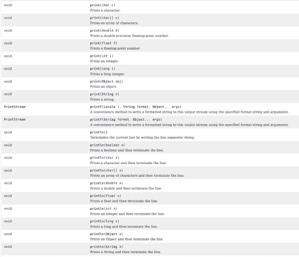

来源：[`docs.oracle.com/en/java/javase/23/docs/api/java.base/java/io/PrintStream.html`](https://docs.oracle.com/en/java/javase/23/docs/api/java.base/java/io/PrintStream.html)

在 Java API 文档中，大多数类都有许多重载方法。例如，在图 3.7 中，如果你查看 `java.io` 包下的 `PrintStream` 类，你会注意到 `print()` 和 `println()` 方法有多个声明，它们具有不同的参数值。因为这些 `print()` 和 `println()` 方法是重载方法，可以适应任何需要打印的数据。

重载方法可以在同一个类中或同一个类层次中声明。这种特性使我们能够方便地编写和调用具有不同参数的方法。

## 3.10 方法重载的规则

如果你想编写自己的重载方法，可能需要考虑以下规则：

1. 所有重载方法必须具有相同的名称。
2. 所有重载方法必须具有不同的参数列表。
3. 对于返回类型，所有重载方法可以相同，也可以不相同。

在下面的示例代码中，我们创建了 `sum()` 方法的多个版本，用于计算作为参数的所有整数的和。这里有一个显示方法重载的示例代码：

```java
public class Overloading1 {
    public static void main(String[] args){
        System.out.println(sum(10, 20));
        System.out.println(sum(10, 20, 30));
        System.out.println(sum(10, 20, 30, 40));
    }

    public static int sum(int num1, int num2) {
        return num1 + num2;
    }

    public static int sum(int num1, int num2, int num3) {
        return num1 + num2 + num3;
    }

    public static int sum(int num1, int num2, int num3, int num4) {
        return num1 + num2 + num3 + num4;
    }
}
```

在这个示例中，我们看到 `sum` 方法有多个声明，它们都可以在第 9 行、13 行和第 17 行看到。

如果用户随后需要累加 2、3 或 4 个整数值，我们只需要调用 `sum()` 方法并将整数值作为参数传递进去即可。所有声明的 `sum()` 方法都会接受传递给它的 `int` 值，并计算总和，然后返回所有传递参数的整数和。唯一的局限性是，给定代码中的 `sum()` 方法只能接受 2、3 或 4 个 `int` 值。为每种数量的 `int` 值编写一个方法是不切实际的。

为了克服这种局限性，Java SE 5.0 引入了一个新的语言特性，它被称为 var-args（可变长度参数）。这意味着现在可以向 var-args 方法传递任意数量的参数。

每一种新的的语言特性都伴随着一些规则。以下是声明 var-args 方法的规则：

### 1. 每个方法只能有一个 var-args。

正确示例：

```java
protected void doStuff(double… args){}
public static void main(String… args){}
public void doSomething(int… args){}
```

错误示例：

```java
protected void doStuff(double… arg1, int… args2){}
// Java 不允许在单个方法中使用多个可变长度参数。
// 只允许一个可变长度参数，且该参数必须是最后一个参数。

public static void main(String… args[]){}
// 语法错误地结合了可变长度 (...)
// 和数组符号 ([])。

public void doSomething(int[] args…){}
// 将可变长度 (...) 放在数组
// 之后是错误的。正确的方法是 int... args。
```

### 2. 如果有多个参数，var-arg 参数必须是参数列表中的最后一个参数。

正确示例：

```java
protected void doStuff(String str, Object… args){}
public void doSomething(char ch, int… args){}
```

错误示例：


```java
protected void doSomething(double... arg1, int args2) {}
// 可变长度 (...) 必须是方法签名中的
// 最后一个参数。在这里，double... arg1
// 被错误地放置在 int args2 之前。

public void doStuff(String param1, char... param2, int param3) {}
// 类似的问题，char... param2 应该是
// 最终参数，但后面有一个 int 参数。
// 可变长度参数只能出现在末尾。
```

这是一个使用 var-args 的示例代码：

```java
public class Overloading2 {
    public static void main(String[] args) {
        System.out.println(sum(10, 20));
        System.out.println(sum(10, 20, 30));
        System.out.println(sum(10, 20, 30, 40));
        System.out.println(sum(1.0, 2.0, 3.0, 4.0));
    }
    public static int sum(int... num) {
        int total = 0;
        for (int n : num) {
            total += n;
        }
        return total;
    }
    public static int sum(double... num) {
        double total = 0;
        for (double n : num) {
            total += n;
        }
        return total;
    }
}
```

在第 10 行中，参数列表现在使用了 var-args 符号。`sum()` 方法现在可以在 `sum()` 方法中接受任意数量的 `int` 值。它现在可以接受 2 个、3 个、4 个、10 个数字甚至一百个数字。在 `sum()` 方法接收到所有 `int` 值后，这些值在 `sum()` 方法内部将被处理为一个 `int` 数组。还有第 20 行，我们可以在 `sum()` 方法中接受任意数量的 `double` 值。

调用 var-args 方法的一个常见错误是传递了数组值。通常，它们接受原始数据类型，并在 var-args 方法内部读取值时隐式地将其转换为数组，正如第 12 行所示，那里使用了增强 for 循环来遍历这些值。

### 3. 继承与构造函数

我们提到过继承是一种允许你将方法和变量传递给子类的特性。对于方法和变量确实如此，但对于构造函数则不然。在 Java 中，构造函数是不被继承的。考虑以下：

```java
class A {
    A() {
        System.out.println("A");
    }
}
class B extends A {
    B() {
        System.out.println("B");
    }
}
class C extends B {
    C() {
        System.out.println("C");
    }
}
public class ConstructorChaining {
    public static void main(String[] args) {
        C c = new C();
    }
}
```

在实例化类 `C` 的对象后，你会发现输出是：

A

B

C

输出给人一种父类构造函数被继承的印象；然而，事实并非如此。关于继承和构造函数有一条规则：构造函数不被继承，但它们是链式的。我们称之为“构造函数链”（constructor-chain）。

上面的示例在编译后后通过在每个构造函数的第一行插入 `super()` 关键字进行了转换。以下是给定代码的更新版本。在这个版本中，Java 已经做了一些更改：

```java
class A extends Object {
    A() {
        super();
        System.out.println("A");
    }
}
class B extends A {
    B() {
        super();
        System.out.println("B");
    }
}
class C extends B {
    C() {
        super();
        System.out.println("C");
    }
}
public class ConstructorChaining {
    public static void main(String[] args) {
        C c = new C();
    }
}
```

一旦编译并运行，它的输出将是：

A

B

C

这段代码的输出与之前相同。注意第 5、13 和 21 行。`super()` 关键字被插入到了每个构造函数的第一行。根据规则，如果构造函数没有调用 `this()` 或 `super()`，Java 会在构造函数的第一行添加一个默认的 `super()` 调用，正如你在第 5、13 和 21 行所示。`super()` 的调用允许当前构造函数调用父类的构造函数。这就是“构造函数链”术语的由来。至于之前的更改呢？如果一个类没有继承任何父类，它会自动继承 `Object` 类，它是所有类类的根。

### 4. 构造函数重载

在第 2 章中，我们讨论了构造函数。我们说构造函数是类似于方法的结构，并且像方法一样，构造函数也可以被重载。这里有一个演示构造函数重载的示例代码：

```java
public class Employee {
    private String name;
    private MyDate birthDate;
    private double salary;
    private static final double BASE_SALARY = 15000.00;

    // 构造函数
    Employee(String name, double salary, MyDate DoB) {
        this.name = name;
        this.salary = salary;
        this.birthDate = DoB;
    }

    public Employee(String name, double salary) {
        this(name, salary, null);
    }

    public Employee(String name, MyDate DoB) {
        this(name, BASE_SALARY, DoB);
    }

    public String getDetails() {
        return "Name: " + name + "\nSalary: " + salary + "\nBirth Date: " + birthDate;
    }
}
```

对于所有构造函数，使用 `this()` 或 `super()` 是可选的。`this()` 调用实际上是对同类构造函数或同一类内构造函数的调用，而 `super()` 调用则是对父类构造函数的调用。

对于所有构造函数，使用 `this()` 或 `super()` 是可选的。`this()` 的调用实际上是对同类中另一个构造函数或同类构造函数的调用，而 `super()` 的调用是对父类构造函数的调用。

如果使用了 `this()` 调用或 `super()` 调用，它们必须被放置在构造函数的第一行。将它们放在其他地方会导致编译错误。但如果这两者都没有使用，则会在构造函数的第一行放置一个默认的 `super()` 调用。

这里是 `Manager` 类，它演示了对 `super()` 的调用。

```java
// Manager.java
public class Manager extends Employee {
    private String dept;

    public Manager(String name, double salary, String dept) {
        super(name, salary);
        this.dept = dept;
    }
    /* 此代码将失败。
       将有一个默认的 super() 调用 */
    public Manager(String dept) {
        this.dept = dept;
    } 
    // 额外的 Manager 代码...
}
```

在 `Manager` 类的第 7 行，对 `super()` 的调用将 `name` 和 `salary` 值传递给 `Employee` 类中的构造函数。这将允许你复用 `Employee` 类中的一个构造函数，从而消除了代码中出现冗的可能性。

至于 `Manager` 类的第 12 行，它会导致一个错误，因为构造函数的第一行没有对 `this()` 或 `super()` 的调用，因此 Java 会在构造函数的第一行放置一个 `super()` 调用，告诉它在其父类（在本例中为 `Employee` 类）中寻找一个没有任何参数的构造函数来运行。

## 3.13 Object 类

`Object` 类所有类的根。无论它是 API 中预写的类还是用户定义的类，所有的类都是 `Object` 类的子类。

正因为这些特性，`Object` 类中的所有方法都由所有类隐式继承，因此没有需要使用 "extends Object"。方法如 `equals()`、`hashCode()` 和 `toString()` 方法。

考虑 `Person` 类。

```java
// Person.java
public class Person extends Object {
    private String name;
    private int age;

    public Person(String name, int age) {
        this.name = name;
        this.age = age;
    }
    // getters
    public String getName() {
        return name;
    }
    public int getAge() {
        return age;
    }
}
```

由于 `Person` 类是一个用户定义的类，因此仍然没有 `equals()`、`hashCode()` 和 `toString()` 方法的用户定义实现。这些方法的当前实现是继承自 `Object` 类的。

在 Java 中，使用 `==` 运算符和 `.equals()` 方法比较对象可能会产生不同的结果。默认情况下，它们的行为是相同的。`equals()` 方法继承自 `Object` 类，并根据 `==` 操作进行比较。`==` 运算符检查两个对象引用是否指向同一个内存位置，而 `.equals()` 方法通常用于比较对象的内容或逻辑上的相等性。在创建用户定义的类时，通常通常会重写 `equals()` 方法。

在 Java 中，使用 `==` 运算符和 `.equals()` 方法比较对象可能会产生不同的结果。`==` 运算符检查两个对象引用是否指向同一个内存位置，而 `.equals()` 方法通常用于比较对象的内容或逻辑上的相等性。以下代码通过创建两个具有相同属性的 `Person` 对象并使用两种方法比较它们来演示这一概念。

考虑下面给定的代码，它创建了两个 `Person` 对象 `p1` 和 `p2`，并使用两种方法对它们进行比较。

```java
Person p1 = new Person("Lawrence", 30);
Person p2 = new Person("Lawrence", 30);
System.out.println(p1 == p2);
System.out.println(p1.equals(p2));
```

```java
13    System.out.println(p2.hashCode());
15    System.out.println(p1);
16    System.out.println(p2.toString());
```

如果我们编译并运行这段代码，我们将会得到以下输出：

```
false
true
2314851
2314851
Lawrence, at age 30
Lawrence, at age 30
```

输出的前两行：

```
false
true
```

根据 `Person.java` 中 `equals()` 方法的实现，这些是 `TestPerson.java` 代码第 9 行和第 10 行的输出。

```java
9     System.out.println(p1 == p2);
10    System.out.println(p1.equals(p2));
```

由于 `Person` 类中 `hashCode()` 的实现，`p1` 和 `p2` 的 `hashCode()` 值现在是相同的。

至于 `toString()` 方法，如果你希望你的对象使用你偏好的格式打印，可以重写 `Object` 类的 `toString()` 方法。

 章节总结

## 章节总结

- 讨论了`继承`，它是面向对象编程（OOP）的基支柱之一。这促进了代码的重用。

- `Classes`、`superclasses` 和 `subclasses` 是在讨论继承概念时应该了解的重要概念。在其他 OOP 中，可以使用某些术语来代替，例如父类和子类。但在 Java 中，我们使用 `superclass` 和 `subclass` 术语。

- “is-a”关系是软件工程中使用的另一个术语。在某些情况下，我们使用“...的子类”或“派生自”术语。

- `Java` 在其他面向对象编程语言中是独特的，因为它使用了单继承的概念。然而，我们将在第 5 章“其他类特性”中讨论如何在 Java 中使用多重继承的想法。

- 在第二章中，我们引入了 `public` 和 `private` 访问修饰符来解释封装的概念，在本章中，我们讨论了所有的四个访问修饰符。

- Java 中的方法重写发生在子类提供其父类中已定义的方法的特定实现时。这允许子类在保持相同方法签名的同时，自定义或完全替换该方法的行为。本章讨论了五条方法重写规则。

- `super` 关键字用于子类内部，以引用其直接父类。它可以被用于调用父类的构造函数、访问父类方法或访问父类字段，从而允许子类继承并利用其父类的功能。

- 方法重载（在其他资源中有时称为方法重载）允许一个类拥有多个同名但参数不同的方法。通过允许根据传递的参数的数量或类型以不同的方式调用方法，提供了灵活性，提高了了同一类内代码的可读性和可重用性。我们在本章中还讨论了方法重载的规则。

- 在 Java 中，继承和构造函数之间密切相关，但有不同的角色。当子类被实例化时，它的构造函数会隐式或显式地调用其父类的构造函数，以确保被继承字段的正确初始化。这通常使用 `super` 关键字完成，如果用于调用父类构造函数，则它必须是子类构造函数的第一条语句。我们在本章中还查看了 `super()` 的用法和 `this()` 的用法。

- Java 中的构造函数重载允许类拥有多个具有不同参数列表的构造函数。这为创建具有各种初始状态的对象提供了灵活性，因为每个构造函数都可以根据对象创建期间传递的参数执行不同的初始化任务。

- 还讨论了作为所有类根的 `Object` 类。还建议在你创建自己的类时，最好在你自己的用户定义类中重写 `toString()`、`equals()` 和 `hashCode()` 方法。

 多选题

### 多选题

1. 关于构造函数，以下哪项是**不正确**的？

a. 我们重载构造函数。

b. 我们可以重用构造函数。

c. 我们可以链式调用构造函数。

d. 我们可以从父类继承构造函数。

2. 考虑以下代码：

```java
class MyClass {
    MyClass(String str1, String str2) {
        System.out.print("Java ");
    }
    MyClass(String s1, String s2) {
        System.out.print("Oracle ");
    }
    public static void main(String args[]) {
        new MyClass("Java", "Oracle");
    }
}
```

如果编译代码会发生什么？

a. 代码将编译并运行，并显示：Java Oracle

b. 代码将导致编译错误，因为构造函数是相同的。

c. 代码将编译并运行，并显示：Java.

d. 代码将编译并运行，并显示：Oracle.

3. 给定以下类：


```java
class A {
    public void printInfo() {
        System.out.print("A");
    }
}
class B extends A {
    public void printInfo() {
        System.out.print("B");
    }
}
class Test {
    public static void main(String args[]) {
        A a = new A();
        B b = new B();
        a.printInfo();
        b.printInfo();
    }
}
```

编译并运行代码的输出是什么？

a. AB

b. A

c. B

d. 编译错误

4. 在子类中，哪个方法可以重写？

a. toString

b. equals

c. hashCode

d. extends

5. 关于继承关系，以下哪项是**不正确**的？

a. 类只能继承一个父类。

b. 类可以拥有多个父类。

c. 所有的方法都可以被重写。

d. 类可以拥有多个子类。

6. 关于方法重写，以下哪项是**不正确**的？

a. 在没有调用 `this()` 和 `super()` 的情况下，Java 会自动在构造函数的第一行插入 `super()` 调用。

b. `super()` 调用用于调用父类的构造函数。

c. 构造函数不能重载。

d. `this()` 调用用于调用当前类的构造函数。

7. 给以下两个类，`Person` 类和 `Employee` 类：

```java
class Person {
    private String name;
}
class Employee extends Person {
    private double salary;
    public static void main(String[] args) {
        Employee e = new Employee(); // 1
        e.name = "Peter Parker"; // 2
        e.salary = 1234.56; // 3
        System.out.println("Peter Parker has a salary of: " + e.salary); // 4
    }
}
```

哪一行会导致编译错误？

a. 第 1 行会导致编译错误。

b. 第 2 行会导致编译错误。

c. 第 3 行会导致编译错误。

d. 第 4 行会导致编译错误。

8. 关于构造函数链式调用，以下哪项是**不正确**的？

a. 在没有调用 `this()` 和调用 `super()` 的情况下，Java 会自动在构造函数的第一行插入 `super()` 调用。

b. `super()` 调用用于调用父类的构造函数。

c. 构造函数可以重载。

d. `this()` 调用用于调用当前类的构造函数。

9. 哪种访问修饰符可以限制在同一类、同包和相同继承树内的访问权限？

a. `private`

b. `<default>`

c. `protected`

d. `public`

### 多选题答案

| 1 – d | 2 – b | 3 – a | 4 – a | 5 – a |

| 6 – a | 7 – b | 8 – b | 9 – c | 10 – c |

 编程任务

# 第 4 章：多态

## 核心学习目标

- 学习多态概念
- 虚方法调用
- 异构数组
- 带有多态参数的方法
- `instanceof` 运算符
- 对象类型转换

本章将介绍多态概念，这是面向对象编程（OOP）的核心特性之一，它允许将不同类的对象视为同一个公共父类的实例。我们将探索虚方法调用如何在运行时实现动态方法解析，从而增强代码的灵活性。你将学习如何处理异构数组以及使用接受多态参数的方法，扩展函数能够处理的范围。此外，我们还将介绍用于类型检查的 `instanceof` 运算符，以及如何在继承体系中使用对象类型转换在不同类型之间进行转换。

## 4.1 多态概念简介

多态源于两个希腊语单词：“poly”意为“多”，“morph”意为“形式”。因此，多态从字面上的意思就是“具有多种形式”。在 Java 中，对象本身是非多态的，持有该对象的引用变量才是多态的。这意味着在 Java 中，对象只是从类中创建的特定实体，就像根据蓝图制造的汽车一样。该对象本身是不灵活的——它就是那个样子。

然而，引用变量（指向对象的变量）是可以灵活的。如果引用变量是父类类型，它可以指向属于该家族的不同类型的对象（例如，一个 `Vehicle` 变量指向 `Car` 或 `Bike`）。这被称为多态——即一种引用类型表示不同对象类型的能力。把它想象成一个可以控制不同设备的通用遥控器。遥控器就像引用变量，而设备（电视、空调、DVD 播放器）就像对象。

在本章的示例中，我将使用 `Employee` 类，引用不同类型的“员工”，如经理、总监、工程师和秘书。让我们考虑图 4.1 所示层次结构。

### 图 4.1 单继承示例


以下是多态用法的一个示例：

```java
Employee e = new Manager(); // 允许
e.department = "Sales"; // 非法
e.getDetails(); // 
```

将 `Manager` 实例存储为 `Employee` 类型利用了多态性，允许无论角色如何都统一处理员工。由于 `Manager` 是 `Employee` 的子类，它继承了基本特征。这在需要统一管理员工类型的场景中特别有用，例如在工资系统中。

## 编码任务 2：实现简单继承

**目标：** 通过创建具有共同行为和特定行为的类基础层次结构，理解并应用继承。

**指令：**

### A. 创建基类 Animal

- **字段：**
  - `name (String)`：动物的名字。
  - `age (int)`：动物的年龄。

- **构造函数：** 初始化 `name` 和 `age`。

- **方法：**
  - `makeSound()`：一个打印（"Some generic sound"）的方法。
  - `displayInfo()`：一个打印动物名字和年龄的方法。

### B. 创建一个扩展 Animal 的子类 Dog

- **构造函数：** 调用父类构造函数以初始化 `name` 和 `age`。

- **方法：**
  - 重写 `makeSound()` 方法以打印 "Woof! Woof!"。
  - 添加一个方法 `fetch()`，打印 "Fetching the ball!"。

### C. 创建另一个扩展 Animal 的子类 Cat

- **构造函数：** 调用父类构造函数以初始化 `name` 和 `age`。

- **方法：**
  - 重写 `makeSound()` 方法以打印 "Meow! Meow! Meow!"。
  - 添加一个方法 `purr()`，打印 "Purring softly!"。

### D. 创建带有 main 方法的 TestAnimal 类

实例化 `Dog` 和 `Cat` 的对象。调用它们的方法来演示每个类的行为。

```java
public class TestAnimal {
    public static void main(String[] args) {
        Dog myDog = new Dog("Buddy", 3);
        Cat myCat = new Cat("Whiskers", 2);
        myDog.displayInfo();
        myDog.makeSound();
        myDog.fetch();
        myCat.displayInfo();
        myCat.makeSound();
        myCat.purr();
    }
}
```

**预期输出：**

```
Name: Buddy, Age: 3
Woof! Woof!
Fetching the ball!
Name: Whiskers, Age: 2
Meow! Meow! Meow!
Purring softly!
```

根据带有属性列表和构造函数的 UML 图，编写该 UML 图的类版本并将其保存为 `Student.java`。除了 `Student.java` 之外，你还需要创建一个名为 `TestStudent.java` 的对应测试类，其中包含 `main` 方法。

**Student**

- `- name: String`
- `- studentId: int`
- `- course: String`
- `+ Student(String name, int studentId, String course)`
- `+ getters()`
- `+ toString()`
- `+ equals()`
- `+ hashCode()`

在 `main` 方法中，你需要创建两个名为 `s1` 和 `s2` 的 `Student` 对象。为两个对象提供相同的 `name`、`studentId` 和 `course`以便测试 `equals()` 和 `hashCode()` 方法。同样重写 `toString()` 方法以打印对象的标识。提供 setter 和 getter 方法。

考虑以下代码段：

```java
5     Employee e = new Manager();
6                 ....
7     System.out.println(e.getDetails());
```

在第 7 行，调用了 `getDetails()` 方法，该方法在 `Employee` 和 `Manager` 类中都存在。`Employee` 类声明了一个 `getDetails()` 方法，而 `Manager` 类继承了它（并可能对其进行了重写）。

在运行时，将执行的 `getDetails()` 方法是与对象相关联的那个。在这个示例中，将运行的 `getDetails()` 方法是 `Manager` 类下声明的版本。这个过程被称为虚方法调用（VMI）。

`Employee` 类对 `getDetails()` 方法的实现将返回对象的名称和工资的 `String` 表示，而 `Manager` 类的 `getDetails()` 方法实现将返回更多内容。它可以返回一个 `Manager` 对象的名称、工资的 `String` 表示，以及部门值。

这种多态行为允许方法实现在运行时发生变化。方法名必须是声明类的成员——在这种情况下，`Employee` 类在编译时被检查。而在运行时，`getDetails()` 方法的实现将来自实例化的对象，在例中，它来自 `Manager` 类。

这里是一个包含额外方法的可用代码，可以更好地演示多态性。源代码 `Employee.java` 包含了所有三个类：`Employee` 类、`Manager` 类和 `Director` 类。

```java
class Employee {
    String name;
    double salary;
    public String getDetails() {
        return "Name: " + name +
                  "\nSalary: " + salary;
    }
    public void work() {
            System.out.println("Work work work...");
    }
}
class Manager extends Employee {
    String department;
    public String getDetails() {
        return super.getDetails() +
                  "\nDepartment: " + department;
    }
    public void callMeeting() {
            System.out.println("Call Department Meeting..");
    }
}
class Director extends Manager {
    double carAllowance;
    public String getDetails() {
        return super.getDetails() +
                  "\nCar Allowance: " + carAllowance;
    }
    public void playGolf() {
            System.out.println("Play Golf..");
    }
}
```

结合 `Employee.java`，我们还有 `TestEmployee.java`。以下是代码：

```java
public class TestEmployee {
    public static void main(String[] args)    {
         Employee e = new Employee();
         Employee m = new Manager();
         Employee d = new Director();
     
         doEmployeeStuff(e);      //一个 Employee 对象
         // doEmployeeStuff(m);      //一个 Manager 对象
         // doEmployeeStuff(d);      //一个 Director 对象
    }

    public static void doEmployeeStuff(Employee e)
    {
        e.work();
        if (e instanceof Director)
        {
            Director d = (Director) e;
            d.callMeeting();
            d.playGolf();
        }
        else if (e instanceof Manager)
        {
            Manager m = (Manager) e;
            m.callMeeting();
        }
    }
}
```

如果 `doEmployeeStuff()` 方法接收第 7 行的 `Employee` 对象，输出将是：

`Work work...`

如果使用第 8 行的 `doEmployeeStuff(m)` 更改为 `Manager` 对象，输出将是：

`Work work...`

`Call Department Meeting..`

如果使用第 9 行的 `doEmployeeStuff(d)` 更改为 `Director` 对象，输出将是：

`Work work...`

`Call Department Meeting..`

`Play Golf..`

## 4.3 异构数组

在大多数编程语言中，数组本质上通常是同质的。同质数组始终具有相同类型的元素值。考虑这个代表我们喜喜咖啡的 `String` 对象数组。这是一个同质数组的示例。

`String coffee[] = {"Espresso", "Java", "Mochachino"};`

通过多态性，异构数组也是可能的。考虑之前图 4.1 中的层次结构。假设你有一个名为 `staff[]` 的 `Employee` 对象数组，你的老板希望你显示所有员工对象的详细信息，这些不同的员工对象，如 `Director`、`Manager`、`Employee` 和 `Engineer` 对象。

考虑此代码段：

```java
// 声明一个名为 staff 的 Employees 数组
// 演示异构数组
Employee staff[] = new Employee[5];
//  staff[] 的每个元素都可以被
// 分配不同类型的 Employee 对象。
// 通过多态，只要对象类型
// 是 Employee 类的子类，这就是可能的
staff[0] = new Manager();
staff[1] = new Director ();
staff[2] = new Employee();
staff[3] = new Secretary();
staff[4] = new Engineer();
for (int i = 0; i < staff.length; i++)
{
    System.out.println(staff[i].getDetails());
}
```

这段示例代码通过调用每个对象的 `getDetails()` 方法来显示所有员工的详细信息。每当循环迭代，变量 `i` 从 0 开始增加，语句 `staff[i].getDetails()` 返回的值取决于 `staff[i]` 指向的对象。


如果 `i = 0`，`staff[0]` 指向 `Manager` 对象，它将返回 `Manager` 对象的名称、工资和部门信息。

如果 `i = 1`，`staff[1]` 指向 `Director` 对象，并返回名称、工资、部门以及 `carAllowance` 信息。

如果 `i = 2`，`staff[2]` 指向 `Employee` 对象；因此返回名称和工资。

这是 Java 中虚方法调用的区域。

## 4.4 多态参数方法

在 Java 中演示多态性的另一种方法是声明带有多态参数的方法。此功能允许你创建一个可以接受参数数据类型子类中任何类型的方法。

考虑图 4.2 中的 UML 图，它显示了 `Animal` 类的层次结构。

图 4.2 Animal 类类的单继承示例

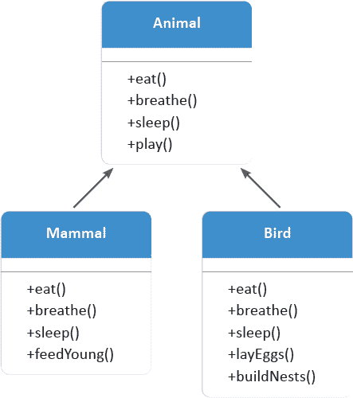

`Animal` 类有两个子类：`Mammal` 和 `Bird`。每个子类都有独特的方法。对于 `Mammal` 类，它有 `feedYoung()`，而 `Bird` 类有一组方法 `layEggs()` 和 `buildNests()`。这里是 `Animal`、`Mammal` 和 `Bird` 的示例代码：

```java
class Animal {
    void eat() {
        System.out.println("Eat");
    }
    void breathe() {
        System.out.println("Breathe");
    }
    void sleep() {
        System.out.println("Sleep");
    }
    void play() {
        System.out.println("Have fun.");
    }
}

class Mammal extends Animal {
    @Override
    void eat() {
        System.out.println("Mammal Eats");
    }
    @Override
    void breathe() {
        System.out.println("Mammal Breathe");
    }
    @Override
    void sleep() {
        System.out.println("Mammal Sleeps");
    }
    // 自己的哺乳动物方法
    void feedYoung() {
        System.out.println("Feed Young");
    }
}

class Bird extends Animal {
    @Override
    void eat() {
        System.out.println("Bird Eats");
    }
    @Override
    void breathe() {
        System.out.println("Bird Breathe");
    }
    @Override
    void sleep() {
        System.out.println("Bird Sleeps");
    }
}
```

```java
// my birdly methods
public void layEggs() {
    System.out.println("Lay Eggs");
}

public void buildNest() {
        System.out.println("Build Nests");
    }
```

这里是一个演示如何在方法中使用多态参数的示例代码：

```java
// TestAnimal.java
public class TestAnimal

    public static void main(String[] args) {
        Mammal dog = new Mammal();
        Bird eagle = new Bird();

        doAnimalStuff(dog);
        doAnimalStuff(eagle);
    }

    public static void doAnimalStuff(Animal a) {
        a.eat();
        a.breathe();
        a.sleep();
        a.play();

        if (a instanceof Mammal) {
            Mammal m = (Mammal)a;
            m.feedYoung();
        } else if (a instanceof Bird) {
            Bird b = (Bird) a;
            b.layEggs();
            b.buildNest();
        }
    }
}
```

在第 9 行和第 10 行中，`doAnimalStuff()` 方法传递了一个狗对象和一个老鹰对象。

9 `doAnimalStuff(dog);`

10 `doAnimalStuff(eagle);`

代码 `TestAnimal.java` 的第 12 行，方法 `doAnimalStuff(Animal a)` 接受任何类型的 `Animal` 对象作为其参数。你可以在该方法中传递一个 `Mammal` 对象或 `Bird` 对象。只要你传递的对象是 `Animal` 类的子类，这都是可能的。在这种情况下，`Mammal` 和 `Bird` 类都是 `Animal` 类的子类。这是一个如何使用多态参数的示例。

## 4.5 instanceof 运算符

`instanceof` 运算符可以测试赋值给引用变量的是什么类型的对象。

根据第 19 行和第 24 行，`instanceof` 运算符被用于 `if-else` 或 `if-else-if` 链中，以测试变量 `a` 是否被赋值为特定数据类型的对象。

在这种情况下，第 19 行正在测试赋值给变量 `a` 的对象是否是 `Mammal` 类的实例。而在第 24 行，变量 `a` 正在被测试检查它是否被赋值为从 `Bird` 类实例化的对象。

使用 `instanceof` 运算符，如果传递的参数是所测试某个类的“实例”，它将返回 `true` 或 `false`。

```java
if (a instanceof Mammal) {
    // ...
} else if (a instanceof Bird) {
    // ...
}
```

`instanceof` 运算符是一种关系运算符，产生一个布尔值。

### 4.5.1 使用 instanceof 进行模式匹配 (JDK 14 及更高版本)

Java 中的 `instanceof` 运算符用于检查对象是否属于特定类型。在 JDK 14 之前，每当使用 `instanceof` 时，通常需要紧跟一个显式的强制转换。这使得代码变得更长且更难以阅读。

旧方法（Java 14 之前）：

```java
if (obj instanceof String) {
    String text = (String) obj; // 手动转换
    System.out.println(text.toLowerCase());
}
```

从 JDK 14 开始（并在 JDK 16 中最终确定），Java 引入了对 `instanceof` 的模式匹配。此功能允许你在一步操作中检查类型并将结果赋值给变量。该变量会自动进行强制转换，你可以直接使用它。

新方法（JDK 14+）：

```java
if (obj instanceof String text) {
    System.out.println(text.toLowerCase());
}
```

在这里，`text` 被称为模式变量。如果条件为真，Java 在 `if` 块内部将其处理为正确的类型。

为什么这样更好？

- 代码更少：不需要单独的强制转换。

- 意图更清晰：类型检查和变量创建在同一个地方完成完成。

- 错误更少：减少了运行时发生强制转换错误的概率。

这是一个匹配 `String` 的示例：

```java
Object data = "Pattern Matching in Java";
if (data instanceof String str) {
    System.out.println("Length: " + str.length());
}
```

如果 `data` 是一个 `String`，`str` 将被创建并可以直接使用，无需任何强制转换。

这是另一个一个匹配自定义类的示例：

```java
if (shape instanceof Circle c) {
    System.out.println("Radius: " + c.getRadius());
}
```

如果 `shape` 是一个 `Circle`，`c` 可以直接访问它的方法和字段。`instanceof` 的模式匹配使得 Java 中的类型检查变得更加简洁、可读且安全，特别是在处理复杂的对象层次结构时。

我们还可以将模式匹配和逻辑运算符结合在一起使用：

```java
Object obj = "Hello Java";
if (obj instanceof String s && s.length() > 5) {
    System.out.println("String 's' is longer than" + "5 characters: " + s);
}
```

在这种情况下，类型模式为 `obj instanceof String s`。在确定 `obj` 是否为 `String` 实例之后，它将 `obj` 绑定到类型为 `String` 的新变量 `s`。然后，该类型检查使用 `&&`（短路与）运算符与新绑定的变量 `s` 的条件（`s.length() > 5`）相结合。这使得以更简洁的方式对对象执行类型检查和其他操作成为可能。

## 4.6 对象的强制转换

第 14 行到第 17 行使用了虚方法调用，因为这些方法的实现取决于引用变量 `a` 当前拥有的对象类型。

由于使用 `Animal` 引用类型，无法访问 `Mammal` 和 `Bird` 类独有的方法。为了访问 `Mammal` 类的 `feedYoung()` 方法以及 `Bird` 类的 `buildNest()` 和 `layEggs()` 方法，我们需要执行式对象强制转换。

`Animal a` 引用变量可以强制转换为 `Mammal` 或 `Bird` 对象，或者 `Animal` 的任何子类。但为了良好的编程习惯，在强制转换之前，最好先使用 `instanceof` 运算符测试引用数据类型，以避免在运行时出现 `ClassCastException`。对象强制转换参见第 21 行和第 26 行。

```java
a.eat();
a.breathe();
a.sleep();
a.play();

if (a instanceof Mammal m) {
    m.feedYoung();
} else if (a instanceof Bird) {
    // ...
    b.layEggs();
    b.buildNest();
}
```

在对对象应用类型转换之前，应该先对引用变量进行测试，以防止运行时问题。这就是为什么使用 `if-else` 语句和 `instanceof` 运算符检查对象类型被认为是一种良好的代码习惯。

Java 中的 `instanceof` 运算符用于检查一个对象是否是特定类的实例，或者是否实现了某个接口。它允许在执行特定于类型的操作之前，通过验证对象的类型来确保安全的类型转换。

Java 中的对象转换（Casting）允许你将父类类型的对象引用转换为子类类型，从而访问子类特有的方法和字段。这种类型转换需要显式语法，并且必须使用 `instanceof` 运算符进行验证，以确保对象确实是目标子类的实例，从而避免遇到 `ClassCastException`。

 多选题

1. **给定类声明：**

```java
class Person {
    String name;
}

class Employee extends Person {
    double salary;
}
```

下列哪条语句（独立调用时）会导致编译错误？

a. `Person p = new Employee();`

b. `Employee e = new Person();`

c. `Employee e = new Employee();`

d. `Person p = new Person();`

2. **为了判断是否可以将对象传递给方法的参数，我们应该寻找哪种类关系？**

a. 'just-a'

b. 'is-a'

c. 'has-a'

d. 'but-a'

3. **考虑以下类声明：**

```java
class Person {}
class Employee extends Person {}
class Manager extends Employee {}
class Director extends Manager {}
```

下列哪个声明是无效的？

a. `Employee d = new Director();`

b. `Manager m = new Person();`

c. `Person p = new Manager();`

d. `Manager md = new Director();`

4. **下列哪条语句代表了从子类构造函数调用父类构造函数的有效格式？**

a. `subclass(name, score);`

b. `extends(name, score);`

c. `super(name, score);`

d. `superclass(name, score);`

5. **如果 `jrStudent` 是 `Student` 的对象，下列哪个语句为 true？**

a. `instanceof Student = jrStudent`

b. `Student = instanceof jrStudent`

c. `jrStudent instanceof Student`

d. `Student instanceof jrStudent`

6. **给定下方代码，提供了行号供参考。**

```java
1. class SuperClass {
2.     SuperClass doStuff(int x) {
3.         return new SuperClass();
4.     }
5. }
6.
7. class SubClass extends SuperClass {
8. // 在此处插入代码
9. }
```

以及四个声明：

`SubClass doStuff(int x) { return new SubClass(); }`

`SubClass doStuff(int x) { return new SuperClass(); }`

`SuperClass doStuff(int x) { return new SubClass(); }`

`SuperClass doStuff(int y) { return new SuperClass(); }`

在第 8 行独立插入给定的声明中，有多少个允许代码编译？

a. 1

b. 2

c. 3

d. 4

7. **关于多态（Polymorphism），以下哪项描述是正确的？**

a. 多态是指通过声明私有访问权限的变量并创建公共方法来设置和获取私有变量的值，从而从用户处隐藏实现细节的过程。

b. 多态是将数据（变量）和作用于数据的代码（方法）封装成一个单一单元的机制。

c. 多态允许我们复用父类的属性和方法。

d. 多态使用来自父类或当前类中的方法来执行不同的任务。这允许我们以不同的方式执行单一操作。

8. **考虑包含方法 `togglePower()` 的类 `Device`。`Device` 类有一个子类 `Tablet`，该类拥有 `browse()` 方法。`SmartPhone` 类有一个方法 `makeCall()`，并且是 `Device` 类的子类。下列哪个描述是不正确的？**

a. `SmartPhone "is-a" Tablet`

b. `SmartPhone "is-a" Device`

c. `Tablet "is-a" Device`

d. `Tablet "has-a" togglePower()`

9. **考虑类 `Employee`，它有一个子类 `Manager`，而 `Director` 类又是 `Manager` 的子类。下列哪个对象实例化是不允许的？**

a. 使用 `Manager` 对象实例的 `Director d` 引用类型。

b. 使用 `Manager` 对象实例的 `Employee e` 引用类型。

c. 使用 `Director` 对象实例的 `Employee e` 引用类型。

d. 使用 `Director` 对象实例的 `Manager m` 引用类型。

10. **给定：**


```java
class A {
    public void printMe() {
        System.out.println("Class A");
    }
}

class B extends A {
    public void printMe() {
        System.out.println("Class B");
    }
}

class C extends B {
    public void printMe() {
        System.out.println("Class C");
    }
}

public class TestClass {
    public static void doSomething(A a) {
        a.printMe();
    }
    public static void main(String[] args) {
        B b = new B();
        C c = new C();
        doSomething(b);
        doSomething(c);
    }
}
```

输出是什么？

a. Class B, Class C

b. Class A, Class B

c. Class A, Class C

d. Class C, Class B

**多选题答案键**

| 1: b | 2: b | 3: b | 4: c | 5: c | 6: c | 7: d | 8: a | 9: a | 10: c |
| :--- | :--- | :--- | :--- | :--- | :--- | :--- | :--- | :--- | :--- |

- 编写一个 `printAnimalSound` 方法，接收一个 `Animal` 引用作为参数并调用 `makeSound` 方法。
- 创建一个 `Animal` 对象的列表，包含 `Dog`、`Cat` 和 `Bird` 的实例。
- 遍历列表并对每种动物调用 `printAnimalSound` 方法。
- 练习的这部分已经为你提供。

代码结构：

```java
// A. 创建基类 Animal:
// 基类
class Animal {
    // 在此处编写代码
}

// B. 创建子类 Dog, Cat 和 Bird:
// 子类 Dog
class Dog extends Animal {
    // 在此处编写代码
}

// 子类 Cat
class Cat extends Animal {
    // 在此处编写代码
}

// 子类 Bird
class Bird extends Animal {
    // 在此处编写代码
}

// C. 演示多态:
// 用于演示多态的主类
public class AnimalKingdom {
    public static void printAnimalSound(Animal a) {
        a.makeSound();
    }

    public static void main(String[] args) {
        Animal[] animals = { new Dog(), new Cat(), new Bird() };
        for (Animal animal : animals) {
            printAnimalSound(animal);
            animal.move();
        }
    }
}
```

任务：

- 按照描述实现 `Animal`、`Dog`、`Cat` 和 `Bird` 类。
- 实现 `printAnimalSound` 方法以演示多态。
- 创建一个 `Animal` 对象的数组并用 `Dog`、`Cat` 和 `Bird` 的实例填充。
- 遍历数组，对每种动物调用 `printAnimalSound` 方法和 `move` 方法，以演示多态和方法重写。

预期输出：

```
Bark
Dog is running
Meow
Cat is pouncing
Chirp
Bird is flying
```

# 第 5 章

# 其他类特性


## 核心学习目标

- 理解并使用静态成员、包装类和静态导入。
- 将 `final` 关键字应用于变量、方法和类。
- 定义并使用枚举（enums）来表示一组预定义的常量。
- 声明并实现抽象类和抽象方法。
- 利用接口，包括静态方法和默认方法。
- 实现函数接口并使用 lambda 表达式来简化代码。

本章探索了重要且特殊的 Java 关键字和概念，这些概念增强了代码的结构、功能和灵活性。我们将重温 `static` 关键字——理解静态变量和方法如何在类级别运行——并查看它们在 `Math` 和 `System` 等类中的作用。我们还将涵盖包装类和静态导入，并深入探讨 `final`、`abstract`、`enum` 和 `record` 等关键的面向对象结构。此外，你将学习 Java 8 如何为接口引入强大的功能——包括静态方法、默认方法和函数接口——这允许你简化代码并以更灵活、可重用的方式实现行为。本章最后探讨了 lambda 表达式如何实现更简洁的函数式编程风格，使你的 Java 代码更自适应且优雅。

## 5.1 重温 static 关键字

`static` 关键字在 Java 编程语言中用于允许你声明一个结构（变量或方法）的单一副本，并让该副本由类拥有，而不是由每个实例对象拥有多个副本。

图 5.1 显示类与对象之间关系的图

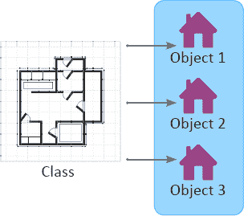

在这个类比中，你可以看到类由蓝图表示，而房子代表该类的每个对象的实例。绿色的草坪可以被解释为所有对象实例共享的静态变量。

`static` 关键字只能用于属性、方法和内部类。顶层类不能被声明为静态。

一旦属性、方法或内部类被声明为 `static`，意味着该结构的所有权将归类所有，而不是任何任何对象的实例。即使你创建了该类的多个实例，静态变量仍然只有一个副本。

考虑以下示例：

```java
// StaticExample1.java
public class StaticExample1 {
    public static int counter = 0;
    private int serialNumber;

    public StaticExample1() {
        counter++;
        serialNumber = counter;
    }

    public static void main(String[] args) {
        System.out.println("Creating the first object: ");
        StaticExample1 se1 = new StaticExample1();
        System.out.println("Creating the second object: ");
        StaticExample1 se2 = new StaticExample1();

        System.out.println("A total of " + counter + " objects were created.");
    }
}
```

在第 2 行，我们将变量 `counter` 声明为 `static`，而在第 3 行，`serialNumber` 是非静态的。（注：原文说 `serialNumber` 在第 3 行，但代码显示第 3 行是 `serialNumber`，第 2 行是 `counter`）。

## 5.2 如何访问静态变量或静态方法？

`static` 关键字在 Java 编程语言中允许你声明一个结构（变量或方法）的单一副本，并让该副本由类拥有，而不是由每个实例对象拥有多个副本。

## 5.3 Math 类和 System 类

`Math` 和 `System` 类是使用 `static` 的示例。

```java
import static <pkg_list>.<class_name>.<member_name>;
```

或者

```java
import static <pkg_list>.<class_name>.*;
```

例如，我们可以这样重写上一个例子。

```java
1 import static java.lang.Math.*;
2 import static java.lang.System.out;
3 . . .
7 out.println(PI);
8 out.println(max(20,30));
```

在第 1 行中，你导入了 `Math` 类的所有静态成员，因此每次调用 `Math` 类内部的静态成员时，只需要直接调用变量或方法，而无需类名，就像第 7 行和第 8 行一样。

在第 2 行中，你只导入了 `System` 类中的一个静态成员，即静态成员 `out`。这意味着静态成员 `out` 可以在不需要 `System` 类名的情况下访问。因此，如果你想访问 `System` 类中的其他静态成员（如 `System.gc()` 或 `System.exit()`），仍然需要使用类名来访问它们。

```java
2 import static java.lang.System.out;
3 . . .
8 out.println("This is how you print a message..");
9 System.err.println("This is an error message..");
10 . . .
18 System.arraycopy(src, 0, dest, 0, src.length);
19 . . .
28 System.exit(0);
```

## 5.5 包装类 (Wrapper Classes)

包装类是所有 Java 原始数据类型的等价类。它们位于 `java.lang` 包中，用于创建原始值的对象表示。包装类很容易记忆：它们全都是完整拼写出来的单词，且首字母大大写。

表 5.1 包装类与原始数据类型

| 包装类 | 原始数据类型 |
| --- | --- |
| Boolean | boolean |
| Byte | byte |
| Character | char |
| Double | double |
| Float | float |
| Integer | int |
| Long | long |
| Short | short |

### 5.5.1 我们如何使用包装类？

```java
7 int num = 100;
8 Integer i = new Integer(num);// box-in
9 Integer j = new Integer(200);// box-in
10 int num2 = j.intValue();// box-out
```

装箱（Box-in）和拆箱（box-out）指的是原始数据类型与其对应的包装类对象之间的自动转换。当像 `int`、`double` 或 `char` 的原始类型转换为匹配的包装类（如 `Integer`、`Double` 或 `Character`）时，发生装箱。相反，拆箱是将包装类对象转换回其原始类型。例如，将 `int` 值赋给 `Integer` 对象是装箱操作，而从 `Integer` 对象获取原始 `int` 是拆箱操作。从 Java 1.5 开始，引入了自动装箱（autoboxing）和自动拆箱（unboxing）来自动处理这些转换，使得代码更易读、易写。

在这个示例中，我们声明了一个值为 100 的 `int` 原始数据类型，在第 8 行中，我们创建了一个对象值为 100 的 `Integer` 引用变量 `i`。在第 9 行中，我们还声明了一个值为 200 的 `Integer` 对象 `j`。

这个语句是合法的吗？

```java
11 int sum = i + j;// 这在 Java 1.4 中是非法的
// 以及更早的版本
```

在 Java 1.4 及更早版本中，第 11 行是不允许的。因为 `i` 和 `j` 是引用变量，它们包含了所代表的 `Integer` 对象的引用值（或地址）。它们不包含原始原始值，而是包含 `Integer` 对象的内存地址。

但从 Java SE 5 到当前版本，引入了名为自动装箱（AutoBox-In）和自动拆箱（AutoBox-Out）的功能，允许我们将原始值赋给包装类引用变量。

通过应用自动装箱和拆箱功能，给定的代码可以这样重写：

```java
7 int num = 100;
8 Integer i = num;// 自动装箱
9 Integer j = 200;// 自动装箱
10 int num2 = j;// 自动拆箱
11 int sum = i + j;// 自动拆箱
```

然而，从 Java 9 开始，这些构造函数被废弃，并最终被强烈建议不要使用。原因是：构造函数总是会创建一个新对象，即使已经存在具有相同值的对象。这会浪费内存并影响性能。

相反，开发者被鼓励使用 `valueOf()` 等工厂方法或依赖自动装箱。这两种方法都能尽可能重用现有的缓存对象。

## 5.6 final 关键字

`final` 关键字可以用于属性、方法和类。

声明为 `final` 的类不能被子类。这意味着继承 `final` 类将导致编译错误。

```java
public class MyString extends String {
}
```

对于属性，一旦声明为 `final`，就不能更改它们。它们被视为常量。第一种是初始化常量。例如：

```java
public static final double SALES_VAT = 12;
```

`SALES_VAT` 不再是一个变量；它现在是一个常量。声明为 `final` 的方法不能被重写。

第二种常量是空白 final 变量（blank final variables）。空白 final 变量是没有分配任何初始值的常量声明。使用空白 final 变量的规则非常简单：

1. 空白 final 变量的值只能赋值一次。一旦赋值，你就不能更改它的值。
2. 必须在构造函数的体内为空白 final 变量赋值。否则，如果你没有为空白 final 变量赋值，将无法创建对象。

考虑这段示例代码。

```java
// Student.java
public class Student {
    private final int studentNumber;

    public Student() {
        studentNumber = generateStudentNumber();
    }

    private int generateStudentNumber () {
        // 用于生成
        // 每个创建的学生学号的代码
    }
}
```

`record` 关键字在 Java 14 中作为“预览性特性”引入，并在 Java 16 中作为固定特性包含。`record` 关键字用于一个意图仅拥有在构造函数设置的 final 变量的类。

在 Java 14 之前，我们可以使用以下代码：


```java
// TestPoint.java
final class Point {
    public final int x;
    public final int y;

    public Point(int x, int y) {
        this.x = x;
        this.y = y;
    }

    public boolean equals(Object obj) {
        boolean result = false;
        if (obj != null && obj instanceof Point) {
            Point p = (Point)obj;
            if (this.x == p.x && this.y == p.y) {
                result = true;
            }
        }
        return result;
    }

    public int hashCode() {
        return x ^ y;
    }

    public String toString() {
        return this.getClass().getName() +
            "[x=" + this.x + ", y=" + this.y + "]";
    }
}

public class TestPoint {
    public static void main(String[] args) {
        Point p1 = new Point(0, 0);
        Point p2 = new Point(10, 20);
        Point p3 = new Point(10, 20);

        System.out.println("Point 1 is at: " + p1.x + " and " + p1.y);
        System.out.println("Point 2 is at: " + p2.x + " and " + p2.y);
        System.out.println("Point 3 is at: " + p3.x + " and " + p3.y);

        System.out.println(p1);
        System.out.println(p2.toString());
        System.out.println(p3);

        System.out.println("Comparing p1 and p2: " + p1.equals(p2));
        System.out.println("Comparing p2 and p3: " + p2.equals(p3));
    }
}
```

这段 Java 14 之前的代码可以编译并运行，输出如下：

```
Point 1 is at: 0 and 0
Point 2 is at: 10 and 20
Point 3 is at: 10 and 20
[x=0, y=0]
[x=10, y=20]
[x=10, y=20]
Comparing p1 and p2: false
Comparing p2 and p3: true
```

由于 `Point` 是一个用户定义的类，因此需要从 `Object` 类重写 `equals()` 和 `toString()` 方法。从 Java 14 开始，我们可以使用 `record` 特性编写相同的代码，它会隐式地重写来自 `Object` 类的 `equals()` 和 `toString()` 方法实现。这个版本更短且更容易编写。

```java
// TestPoint.java
record Point(int x, int y) { }

class TestPoint {
    public static void main(String[] args) {
        Point p1 = new Point(0, 0);
        Point p2 = new Point(10, 20);
        Point p3 = new Point(10, 20);

        System.out.println("Point 1 is at: " + p1.x() + " and " + p1.y());
        System.out.println("Point 2 is at: " + p2.x() + " and " + p2.y());
        System.out.println("Point 3 is at: " + p3.x() + " and " + p3.y());

        System.out.println(p1);
        System.out.println(p2.toString());
        System.out.println(p3);

        System.out.println("Comparing p1 and p2: " + p1.equals(p2));
        System.out.println("Comparing p2 and p3: " + p2.equals(p3));
    }
}
```

此版本可以使用 `--enable-preview` 和 `-source` 选项进行编译。使用 Java 14 编译：

```bash
javac --enable-preview -source 14 TestPoint.java
```

成功编译后，我们通过 Java 14 执行程序，并在执行期间使用虚拟机选项 `--enable-preview`：

```bash
java --enable-preview TestPoint
```

执行时，这是预期的输出：

```
Point 1 is at: 0 and 0
Point 2 is at: 10 and 20
Point 3 is at: 10 and 20
[x=0, y=0]
[x=10, y=20]
[x=10, y=20]
Comparing p1 and p2: false
Comparing p2 and p3: true
```

请注意，Java 14 的代码比 Java 14 之前的代码要短得多。然而，输出是相同的。使用 Java 16 及更高版本进行编译，可以直接编译：

```bash
javac TestPoint.java
```

## 5.8 `enum` 关键字

在 Java 1.5 发布之前，枚举（enumeration）的概念已经存在，但 Java 有的是另一种处理方式。`enum` 关键字用于定义一种称为枚举的特殊数据类型，它表示一组固定的常量，例如星期几或方向。

```java
class InnerPlanets {
    public static final int MERCURY = 0;
    public static final int VENUS = 1;
    public static final int EARTH = 2;
    public static final int MARS = 3;

    public static void main(String[] args) {
        for (int i = 0; i < 4; i++) {
            switch (i) {
                case MERCURY: System.out.println("Mercury"); break;
                case VENUS: System.out.println("Venus"); break;
                case EARTH: System.out.println("Earth"); break;
                case MARS: System.out.println("Mars"); break;
                default: System.out.println("Other planets");
            }
        }
    }
}
```

`enum` 开始作为一种新语言特性引入，允许声明一组常量值。可以使用 `enums` 的示例包括：星期、每天的小时、月份，甚至是扑克牌的花色和点。这些示例总有一组固定的值。`enum` 内部声明的所有值都是常量，因此通常全大写写。它允许以描述性的方式声明一组值。这里是使用 `enum` 的示例代码：

```java
// InnerPlanets.java
enum InnerPlanets {
    MERCURY, VENUS, EARTH, MARS;
}

// TestInnerPlanets.java
class TestInnerPlanets {
    public static void main(String[] args) {
        for (InnerPlanets planets : InnerPlanets.values()) {
            switch (planets) {
                case MERCURY: System.out.println("Mercury"); break;
                case VENUS: System.out.println("Venus"); break;
                case EARTH: System.out.println("Earth"); break;
                case MARS: System.out.println("Mars"); break;
            }
        }
    }
}
```

在旧的枚举中，编译时没有进行类型安全检查。通过这个 Java 5 特性，它限制了编译时检查的值范围，从而消除了 `switch` 中 `default` 语句的需求。枚举类型也可以在类内部声明，例如所示：

```java
// TestInnerPlanets.java
class TestInnerPlanets {
    enum InnerPlanets {
        MERCURY, VENUS, EARTH, MARS;
    }

    public static void main(String[] args) {
        System.out.println("Our home planet: " + InnerPlanets.EARTH);
    }
}
```

## `abstract` 关键字

`abstract` 关键字只能用于类和方法。`abstract` 关键字意味着“没有具体的实现”；因此，抽象方法在其方法体中没有任何实现，只有方法签名。按照规则，如果一个类包含抽象方法，则该类本身也必须声明为抽象类。

如果一个类被声明为 `abstract`，则你无法从抽象类实例化对象。抽象类充当模板，强制其子类重写那些在所有动物子类中都应该存在的方法。在我们的示例中，抽象类 `Animal` 包含了既抽象方法和非抽象方法，这些方法必须在所有类型的动物对象中存在。所有动物都会进食、呼吸和睡眠，但这些方法的实现方式不同于每种类型的动物。因此，我们将 `eat()`、`breathe()` 和 `sleep()` 方法声明为抽象方法，强制 `Animal` 类的所有子类都拥有这些方法的具体实现。另一方面，`play()` 方法是非抽象方法，并且具有具体的实现（也称为方法体）。重写 `play()` 方法是可选的，并不是强制要求的，因为它是一个非抽象方法。

### 图 5.2 抽象类 Animal 类图

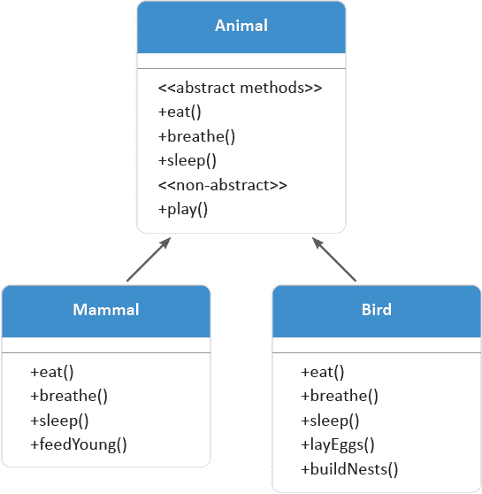

考虑给定的 UML。`Animal` 类具有抽象方法。因此，`Animal` 类的所有子类必须重写父类 `Animal` 的所有抽象方法。

以下是上述 UML 的等效 Java 代码。

```java
// Animal.java
public abstract class Animal {
    // 抽象方法
    public abstract void eat();
    public abstract void breathe();
    public abstract void sleep();

    // 非抽象方法
    public void play() {
        System.out.println("Have fun.");
    }
}
```

第 4、5 和 6 行是抽象方法的声明。它们内部没有任何方法体，并以分号（`;`）结束。

抽象类 `Animal` 了所有类型动物对象的模板。如果你声明了一个类型为 `Animal` 的类（`Animal` 类的子类），该类必须重写 `Animal` 类的所有抽象方法，否则该类最终也将变成一个抽象类，因为它继承了所有的抽象方法。

这里是 `Mammal` 类和 `Bird` 类。

```java
// Mammal.java
public class Mammal extends Animal {
    // 重写所有抽象方法
    public void eat() {
        System.out.println("Mammal Eats");
    }
    public void breathe() {
        System.out.println("Mammal Breathe");
    }
    public void sleep() {
        System.out.println("Mammal Sleeps");
    }

    // Mammal 特有的方法
    public void feedYoung() {
        System.out.println("Feed Young");
    }
}
```

```java
// Bird.java
public class Bird extends Animal {
    // 重写所有抽象方法
    public void eat() {
        System.out.println("Bird Eats");
    }
    public void breathe() {
        System.out.println("Bird Breathe");
    }
    public void sleep() {
        System.out.println("Bird Sleeps");
    }

    // 我自己的鸟类方法
    public void layEggs() {
        System.out.println("Lay Eggs");
    }
    public void buildNest() {
        System.out.println("Build Nests");
    }
}
```

这是我们的测试类。

```java
// TestAnimal.java
public class TestAnimal {
    public static void main(String[] args) {
        // 无法从抽象类
        // 实例化对象
        // Animal a = new Animal();
        Mammal dog = new Mammal();
        Bird eagle = new Bird();
        doAnimal(dog);
        doAnimal(eagle);
    }
    public static void doAnimal(Animal a) {
        if (a instanceof Mammal m) {
            m.eat();
            m.breathe();
            m.sleep();
            m.play();
            m.feedYoung();
        } else if (a instanceof Bird b) {
            b.eat();
            b.breathe();
            b.sleep();
            b.play();
            b.layEggs();
            b.buildNest();
        }
    }
}
```

但这个测试类写得并不好；有很多冗余。第 17 到 20 行和第 25 到 28 行是冗余的。为了消除代码中的冗余，让我们通过将重复的方法调用移动到父类来重构代码。例如，由于 `Mammal` 和 `Bird` 都扩展了 `Animal` 类，并且 `Animal` 拥有 `eat()`、`breathe()` 和 `play()` 等方法，你可以直接在 `Animal` 引用上调用这些方法，而无需进行特定类型的转换。

考虑修改后的测试类：


```java
// TestAnimal2.java
public class TestAnimal2 {
    public static void main(String[] args) {
        Mammal dog = new Mammal();
        Bird eagle = new Bird();
        doAnimal(dog);
        doAnimal(eagle);
    }
    public static void doAnimal(Animal a) {
        a.eat();
        a.breathe();
        a.sleep();
        a.play();
        if (a instanceof Mammal m) {
            m.feedYoung();
        } else if (a instanceof Bird b) {
            b.layEggs();
            b.buildNest();
        }
    }
}
```

现在没有冗余了，代码更加整洁。第 11 到 14 行调用 `Bird` 和 `Mammal` 的方法现在通过 `Animal` 引用调用了一次。

## 5.10 接口

在 Java 中，接口用于定义一个约定或一组类必须实现的方法。它们允许你指定不同类共享的行为，即使这些类没有共同父类。这使得无关类能够提供一致的功能，确保了代码的活性。通过使用接口，开发者可以编写更具重用性和可维护的代码，因为它将“做什么”与“如何做”分开，专注于定义操作而不规定具体的实现细节。接口允许你指定类必须实现的方法，而不规定这些方法的执行方式，使不同的类提供自己的特定实现。接口中的所有方法都是抽象的，应该由实现类重写，和抽象类一样，我们不能使用 `new` 关键字实例化接口，因为接口不是“具体类”。这对于设计松耦合和模块化的系统特别有用，因为接口定义了类可以做什么，而不是如何做。

### 图 5.3 Java 接口图

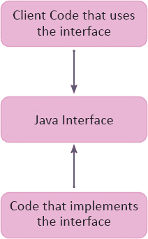

接口也可以包含变量，但一旦声明变量，它会自动转换为 `public static final` 变量。这些变量现在被视为常量，这意味着我们不能更改接口中变量的值。实现该接口的所有类都将继承这些常量。考虑以下接口集合：

```java
interface I1 { double pi = 3.14; }
interface I2 { public double pi = 3.14; }
interface I3 { static double pi = 3.14; }
interface I4 { final double pi = 3.14; }
interface I5 { public static double pi = 3.14; }
interface I6 { static final double pi = 3.14; }
interface I7 { public final double pi = 3.14; }
```

所有的接口都声明了变量 `pi`，其结果为：

`public static final double pi = 3.14;`

任何继承 `pi` 的类都无法更改其值，因为它本质上是一个常量。

要声明接口，我们使用以下语法：

```java
<modifier> interface <name> [extends <superInterface>*]
{
    <member_variables>*
    <member_methods>*
}
```

请注意，接口不能拥有构造函数。拥有构造函数是没有意义的，因为我们无法从接口创建对象。接口还可以扩展其他接口。在需要扩展多个接口的情况下，需要用逗号分隔被继承的接口。

```java
interface I1 { public void doStuff(); }

interface I2 { public void doSomething(); }

interface I3 extends I1, I2 {
    public void doSomethingElse();
}
```

### 图 5.4 FlyingObject 接口

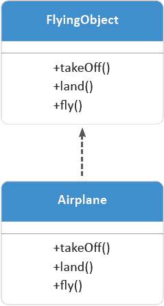

`FlyingObject` 接口由 `Airplane` 类实现，该类重写了接口中的 `takeOff()`、`land()` 和 `fly()` 方法。

使用接口的语法如下：

```java
<modifier> class <name> [extends <superclass>]
           [implements <interface>
           [,<interface>]*]
{
    <member_declaration>*
}
```

```java
// FlyingObject 接口: FlyingObject.java
public interface FlyingObject {
    public void takeOff();
    public void land();
    public void fly();
}
```

```java
// 实现 FlyingObject 的 Airplane 类: Airplane.java
public class Airplane implements FlyingObject {
    public void takeOff() {
        // 增加速度
        // 起起起落架
    }
    public void fly() {
        // 保持这些引擎运行
    }
    public void land() {
        // 降低襟翼
        // 减速
    }
}
```

接口还可以用于模拟多继承，允许类实现多个接口，或者在扩展类的同时实现接口。

考虑下方的图，`Bird` 类扩展了 `Animal` 类同时实现了 `FlyingObject` 接口。由于 `FlyingObject` 接口中的所有方法都是抽象方法，`Bird` 类需要重写 `takeOff()`、`land()` 和 `fly()` 方法。抽象类 `Animal` 也是如此，`Bird` 类也应该重写抽象方法 `eat()`、`breathe()` 和 `sleep()`。对于 `play()` 方法，重写它是可选的，因为它是一个具体方法而不是抽象方法。此外，`Bird` 类还可以声明自己特有的方法，这些方法仅在 `Bird` 对象中存在，如 `feedYoung()` 和 `buildNest()`。

### 图 5.5 在 Java 中用于多继承的 FlyingObject 接口

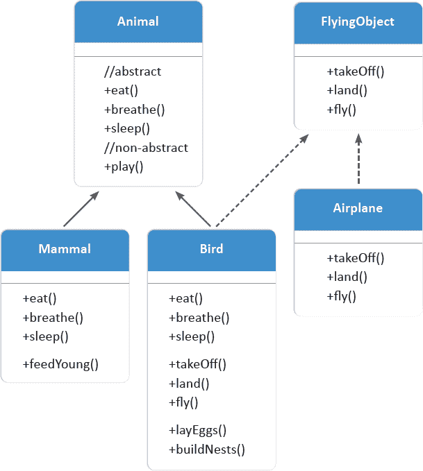

`Bird` 类现在将拥有代码：

```java
// Bird.java
public class Bird extends Animal implements FlyingObject {
    // 重写所有抽象方法
    public void eat() {
        System.out.println("Eats");
    }
    public void breathe() {
        System.out.println("Breathes");
    }
    public void sleep() {
        System.out.println("Sleeps");
    }
    // 我自己的方法
    public void layEggs() {
        System.out.println("Lay Eggs");
    }
    public void buildNest() {
        System.out.println("Nests");
    }
    // 重写 FlyingObject 接口中的所有方法
    public void takeOff() {
        // 扇动翅膀
    }
    public void fly() {
        // 扇动...翱翔
    }
    public void land() {
        // 准备降落
    }
}
```

在 Java 8 中，引入了一组新的语言特性。Java 8 中的接口现在可以拥有 `default` 方法和 `static` 方法。此外，还引入了函数式接口（`FunctionalInterfaces`）的概念以及 lambda 运算符 `->`。

## 5.11 接口默认方法

在 Java 8 之前，接口中的所有方法都是抽象方法。这意味着一旦类实现了一个接口，该接口的所有方法都应该由实现类进行重写。从 Java 8 开始，接口中现在可以包含 `default` 方法。这一功能允许开发者创建一个可扩展的接口，即一个在更新时不会导致实现类出现出现错误的接口。

考虑以下 Java 8 之前的代码：

```java
// Animal.java
public interface Animal {
    public void eat();
    public void sleep();
    public void breathe();
}

// Mammal.java
public class Mammal implements Animal {
    @Override
    public void eat() {
        // 此处有一些代码
    }
    @Override
    public void sleep() {
        // 此处有一些代码
    }
    @Override
    public void breathe() {
        // 此处有一些代码
    }
}
```

这段代码可以编译，目前看起来也良好，但如果我们通过添加另一个方法来更新 `Animal` 接口会怎样？那么 `Mammal` 类将产生编译错误，抱怨 `Animal` 接口中新添加的方法未被重写。

为了解决扩展性问题，可以在 `Animal` 接口中添加一个 `default` 方法，这样在更新 `Animal` 接口后，实现类的 `Mammal` 类就不会有任何编译错误。

```java
// Animal.java
public interface Animal {
    public void eat();
    public void sleep();
    public void breathe();
    default void play() {
        System.out.println("Animal is fun.");
    }
}

// Mammal.java
public class Mammal implements Animal {
    @Override
    public void eat() {
        // 此处有一些代码
    }
    @Override
    public void sleep() {
        // 此处有一些代码
    }
    @Override
    public void breathe() {
        // 此处有一些代码
    }
}
```

接口中的默认方法隐式为 `public` 或默认。不允许使用 `protected` 访问修饰符。如果在实现类中重写了默认方法，它仍然可以使用 `InterfaceName.super.defaultMethod()` 语法调用父接口中的默认方法。

考虑示例：

```java
// DefaultInterface.java
interface MyInterface {
    public void sayHi();
    default void myGreeting() {
        System.out.println("Hello world.");
    }
}

public class DefaultInterface implements MyInterface {
    @Override
    public void sayHi(){
        System.out.println("Hi");
    }

    @Override
    public void myGreeting() {
        MyInterface.super.myGreeting();
        System.out.println("Overriding default method.");
    }

    public static void main(String args[]) {
        DefaultInterface di = new DefaultInterface();
        di.sayHi();
        di.myGreeting();
    }
}
```

`Java` 接口的优势之一是能够模拟多重继承，而不会出现实现父类中同时存在的方法时带来的缺陷。

如果同一个类实现的两个接口中存在两个相同的默认方法，在这种情况下，可以使用 `InterfaceName.super.defaultMethod()` 语法。

```java
interface MyInterface1 {
    public default void myDefaultGreeting() {
        System.out.println("Inside MyInterface 1");
    }
}

interface MyInterface2 {
    public default void myDefaultGreeting() {
        System.out.println("Inside MyInterface 2");
    }
}

public class DefaultInterfaceMultipleInheritance implements MyInterface1, MyInterface2 {
    // overriding default method myDefaultGreeting()
    @Override
    public void myDefaultGreeting() {
        // calling the method in MyInterface1
        MyInterface1.super.myDefaultGreeting();

        // calling the method in MyInterface2
        MyInterface2.super.myDefaultGreeting();

        System.out.println("Overriding the " + "default method.");
    }

    public static void main(String args[]) {
        DefaultInterfaceMultipleInheritance di = new DefaultInterfaceMultipleInheritance();
        di.myDefaultGreeting();
    }
}
```

执行时，我们将得到以下输出：

```
Inside MyInterface 1
Inside MyInterface 2
Overriding the default method.
```

## 5.13 接口静态方法

自 `Java 8` 起，接口除了声明公共和抽象方法外，还可以声明静态方法。这些是在接口内部声明的具有实际方法体并声明为静态的方法。由于这些是静态方法，它们可以通过接口的名称进行调用。以下是一个接口静态方法的示例：

```java
// MyInterface.java
public interface MyInterface {
    // a public abstract method
    public void doStuff();

    // a static method
    public static void doSomething() {
        System.out.println("Inside doSomething..");
    }
}
```

为了测试给定的静态方法，这里有一个测试类的示例：

```java
public class StaticInterface implements MyInterface {
    @Override
    public void doStuff() {
        System.out.println("Inside doStuff..");
    }

    public static void main(String[] args) {
        StaticInterface si = new StaticInterface();
        si.doStuff();
        MyInterface.doSomething();
    }
}
```

输出将是：

```
Inside doStuff..
Inside doSomething..
```

静态方法用于在接口内部声明工具方法或辅助方法。它们是声明处接口的一部分，只能通过接口名称调用方法（例如 `MyInterface.doSomething()`）使用。

## 5.14 接口中的私有方法 (JDK 9)

接口中的私有方法允许你在同一个接口的默认方法和静态方法之间共享代码，而无需将这些辅助方法暴露给实现类。

这是一个示例：


```java
// MyInterface.java
public interface MyInterface {
    // A public abstract method
    void doStuff();

    // A static method
    static void doSomething() {
        System.out.println("Inside doSomething..");
        logCommon();
    }

    // A default method
    default void doMore() {
        System.out.println("Inside doMore..");
        logCommon();
    }

    // A private helper method (JDK 9+)
    private static void logCommon() {
        System.out.println("[LOG] This is a private " + "helper inside the interface.");
    }
}

// StaticInterface.java
public class StaticInterface implements MyInterface {
    @Override
    public void doStuff() {
        System.out.println("Inside doStuff..");
    }

    public static void main(String[] args) {
        StaticInterface si = new StaticInterface();
        si.doStuff();
        si.doMore();
        MyInterface.doSomething();
    }
}
```

在此代码中，接口 `MyInterface` 展示了如何使用私有方法支持接口内部的代码复用（这是 `JDK 9` 中添加的功能）。接口定义了三种方法：抽象方法 (`doStuff()`)、静态方法 (`doSomething()`) 和默认方法 (`doMore()`)。静态方法和默认方法都调用了私有辅助方法 `logCommon()`，该方法会打印日志消息。这个私有方法对实现类 (`StaticInterface`) 不可见，但它允许在 `doSomething()` 和 `doMore()` 之间共享公共逻辑，而无需重复代码。在 `main` 方法中，创建了一个 `StaticInterface` 的对象。调用 `si.doStuff()` 运行类自身的实现，而 `si.doMore()` 执行接口中定义的默认方法。同时，`MyInterface.doSomething()` 运行接口的静态方法。默认方法和静态方法都成功复用了来自私有方法的隐藏代码，展示了接口中的私有方法如何改进代码组织和可维护性。

## 5.15 密封类 (JDK 17+)

从 `JDK 17` 开始，`Java` 将密封类（和接口）以及 `instanceof` 模式匹配作为标准功能支持。当这两个特性结合使用时，你的代码将变得：

- 更具可读性
- 更安全（得益于详尽的类型检查）
- 更整洁，通常消除了对 `final` 子句的需求

这种组合改进了我们对受限层次结构建模，特别是在特定领域的设计（如形状、操作或事件）。

### 什么是密封类？

密封类或接口允许你严格定义哪些类可以扩展或实现它。

```java
sealed interface Shape permits Circle, Rectangle {}
```

这告诉编译器只有 `Circle` 和 `Rectangle` 被允许实现 `Shape` 接口。没有其他类可以实现 `Shape`，这有助于编译器更好地对程序进行推理。

这里是完整的代码：

```java
// Main.java
sealed interface Shapes permits Circle, Rectangle {}

final class Circle implements Shapes {
    int radius = 3;
}

final class Rectangle implements Shapes {
    int width = 4, height = 6;
}

public class Main {
    public static void describeShape(Shapes shape) {
        if (shape instanceof Circle c) {
            System.out.println("Circle with radius " + c.radius);
        } else if (shape instanceof Rectangle r) {
            System.out.println("Rectangle of " + r.width + " x " + r.height);
        }
    }

    public static void main(String[] args) {
        describeShape(new Circle());
        describeShape(new Rectangle());
    }
}
```

因为编译器知道 `Shape` 的所有可能的子类型，它可以验证完备性。这意味着如果逻辑中缺失了任何子类型，编译器都可以向你发出警告——就像对枚举（enums）使用 `switch` 语句的工作一样。

### 为什么这很有用？

- 编译时安全：编译器知道所有允许的子类型，因此它可以捕获缺失的情况。
- 更好的可读性：更少的类型转换和更清晰的控制流。
- 提高可维护性：添加新的允许子类将导致模式匹配中出现编译错误，直到对其进行处理为止。

所有允许的子类必须是 `final` 或 `sealed`。

## 5.16 函数式接口与 Lambda (->) 运算符

函数式接口本质上是一个只声明了一个抽象方法的接口。在接口声明之上，放置了 `@FunctionalInterface` 注解，用来指示该接口旨在作为函数式接口。

注解是元数据的形式，可以提供有关代码的额外信息，而不影响其行为。注解可以用于向编译器提供指令、定义配置，或在运行时处理期间提供帮助。在这个示例中，`@FunctionalInterface` 注解告诉编译器该接口仅包含一个方法，使其成为一个 `FunctionalInterface`。

```java
@FunctionalInterface
interface Greeter {
    public void sayHello(String name);
}
```

重要的是，函数式接口应该只有一个抽象方法，它也可以具有任意数量的默认方法（default methods）。标准 API 中也可以找到函数式接口，例如 `Runnable`、`Comparable` 和 `ItemListener` 接口。这些接口只有一个抽象方法，因此被认为是函数式接口。

使用 lambda `(->)` 运算符，我们可以轻松地提供方法的实现，而无需创建任何额外的类。考虑此示例：

```java
// LambdaExample.java
@FunctionalInterface
interface Greeter {
    public void sayHello(String name);
}

public class LambdaExample {
    public static void main(String args[]) {
        Greeter g = (name) ->
            System.out.println("Hello " + name + "!");
        g.sayHello("Lawrence");
    }
}
```

这个示例将值 "Lawrence" 传递给方法 `sayHello` 并将其显示。

我们还可以使用 lambda `(->)` 运算符指向整个代码块。如果有两个或多个语句需要执行，则需要一对闭合的大括号 `{ }`。

```java
Greeter g = (name) -> {
    System.out.print("Hello ");
    System.out.println(name);
};
g.sayHello("Lawrence");
```

具有多个参数和返回类型的方法可以通过 lambda `(->)` 运算符调用。

```java
// LambdaAnotherExample.java
@FunctionalInterface
interface Greeter {
    public String afterBirthday(String name, int age);
}

public class LambdaAnotherExample {
    public static void main(String args[]) {
        Greeter g = (name, age) -> {
            return name + ", next year you will be " + (age + 1) + " years old.";
        };
        System.out.println(g.afterBirthday("Joe", 30));
    }
}
```

这将带我们得到输出：

`Joe, next year you will be 31 years old.`

 **章节总结**

- Java 中的 `enum` 关键字用于定义一组命名常量，代表固定值的集合。
- Java 中的 `abstract` 关键字用于定义无法实例化或直接实现的类和方法。
- 在 Java 中，`interface` 关键字用于声明一个约定，允许类实现某些方法而不指定它们应该如何实现。接口允许多重继承的概念。
- 在 Java 8 中，接口中引入 `default` 方法允许在接口内部包含方法实现，提供了一种在破坏现有实现的情况下添加新功能的方法。
- Java 8 的另一个语言特性更新是接口现在可以包含 `static` 方法，这些是属于接口本身而非任何实现类的工具方法。
- 函数式接口（Functional Interface）是一个包含恰好一个抽象方法的接口。它们用于将函数表示为对象。Java 中的 lambda `(->)` 运算符用于快速、简洁地定义匿名函数，使得在不需要冗长的匿名内部类的情况下更容易实现 `Functional Interfaces`。这种组合使得 Java 能够更具表达力的函数式风格编程。

 **多选题**

1. 给定以下代码段：

```java
class MyString extends String {
    // some codes here
}
```

`String` 类是一个 `final` 类。关于此代码段，以下陈述哪一个**不正确**？

a. 此代码将通过编译并继承 `String` 类的所有内容。
b. `MyString` 类可以继承任何类，只要它不是一个 `final` 类。
c. `String` 类是一个 `final` 类，因此不能被继承。
d. `MyString` 类将导致编译错误。

2. 关于抽象类（abstract classes），以下哪项陈述是**不正确**的？

a. 你可以声明一个顶层的 `final` 抽象类。
b. 你可以声明一个只包含抽象方法的抽象类。
c. 抽象类不能被实例化。
d. 你可以声明一个包含普通（非抽象）方法的抽象类。

3. 声明一个不返回内容且可以在任何地方访问的抽象方法 `eat()` 的正确方式是哪个？

a. `public abstract void eat();`
b. `public abstract Object eat() { return null; }`
c. `public abstract void eat() { }`
d. `public abstract void eat() { return null; }`

4. 假定以下接口代码：

```java
public interface MyInterface {
    public abstract void doSomething();// 1
    public void doOtherThing() { }// 2
    public int returnAnIntMethod();// 3
    public void doNothing();// 4
}
```

代码的哪行会导致编译错误？

a. 第 1 行会导致编译错误。
b. 第 2 行会导致编译错误。
c. 第 3 行会导致编译错误。
d. 第 4 行会导致编译错误。
e. 整个代码没有错误。

5. 假定以下代码：

```java
interface Flyable {}
class Bird implements Flyable {}
class PetBird extends Bird {}
```

以下哪个声明会导致编译错误？

a. `Bird bb = new Bird();`
b. `Bird bf = new Flyable();`
c. `PetBird pp = new PetBird();`
d. `Flyable fp = new PetBird();`

6. 遵循 Java 命名规范，哪种声明常量 String `birthday` 最合适？

a. `final String birth_day = "June 1, 2000";`
b. `final String birthDay = "June 1, 2000";`
c. `final String BIRTHDAY = "June 1, 2000";`
d. `final String BirthDay = "June 1, 2000";`

7. 你称呼内部应该只有一个方法的接口为什么什么？

a. 单例接口 (Singleton Interface)
b. 单接口 (Mono Interface)
c. 唯一接口 (Singular Interface)
d. 函数式接口 (Functional Interface)

8. 给定以下常量，哪一个不适合声明为枚举（`enum`）？

a. 年份：一月到十二月
b. 花牌：方片、红桃、黑桃、梅花
c. 星期：星期一到星期日
d. 你的朋友的名字：Lawrence, Percy, Jerry 和 Eric

9. 假定以下声明所有不同咖啡尺寸的代码，你如何将值赋值给变量 `size`？

```java
enum CoffeeSize {
    SHORT, TALL, GRANDE, VENTI
};

class Coffee {
    CoffeeSize size;
}

public class CoffeeTest1 {
    public static void main(String args[]) {
        Coffee drink = new Coffee();
        // 在此处插入代码
        System.out.println(drink.size);
    }
}
```

以下哪个代码插入 `main` 方法的注释中后，将使代码正常运行？

a. `drink.size = SHORT;`
b. `drink.size = CoffeeSize.0;`
c. `drink.size = Coffee.SHORT;`
d. `drink.size = CoffeeSize.SHORT;`

10. 以下哪项**不是**一个包装类（Wrapper Class）？

a. Boolean
b. Character
c. String
d. Integer

**多选题答案页**

| 1 – a | 2 – a | 3 – a | 4 – b | 5 – b |
| 6 – c | 7 – d | 8 – d | 9 – d | 10 – c |

## 编码任务

### 编码任务 1：形状 (Shapes)

创建一个程序，通过命令行接收数值输入。根据输入的数量，程序将决定它是哪种形状。命令行中的所有输入都应该是大于 0 的整数值。对于单个输入，它是圆形的；对于两个输入，它是正方形或矩形；对于三个输入，它是三角形。程序将显示形状类型、细节、周长和面积。确保你遵循给定的 UML 图。

注意：

`length > width`

你需要根据给定的 UML 创建以下类：

`Shapes.java`, `Circle.java`, `Rectangle.java`, `Square.java` 和 `Triangle.java`。你还被要求创建一个名为 `TestShapes.java` 的测试类，其中包含 `main` 方法，该方法将被编译并运行，且应通过命令行接收值。

以下是运行输出示例：

**运行示例 1：**

```text
java TestShapes 15
```

Type: Circle
Radius: 15
Perimeter: 94.2
Area: 706.5

**运行示例 2：**

```text
java TestShapes 12 24
```

Type: Rectangle
Length: 24
Perimeter: 72
Area: 288

**运行示例 3：**

```text
java TestShapes 24 12
```

Type: Rectangle
Length: 24
Perimeter: 72
Area: 288

**运行示例 4：**

```text
java TestShapes 12 12
```

Type: Square
Side: 12
Perimeter: 48
Area: 144

**运行示例 5：**


`java TestShapes 9 15 12`

Type: Triangle

Side1: 9

Side2: 15

Side3: 12

Perimeter: 36

Area: 54

### 编码任务 2：抽象类与接口

目标：

此任务旨在测试学生对 Java 中 `abstract` 关键字和接口的理解。学生需要设计并实现一个模拟不同类型内容的内容管理系统 (CMS)。

要求：

#### 抽象类：Content

创建一个名为 `Content` 的抽象类，包含：

- 两个属性：`title` (String) 和 `author` (String)。
- 一个初始化 `title` 和 `author` 的构造函数。
- 两个抽象方法：
    - `void displayInfo()` - 该方法由子类实现以显示内容信息。
    - `Double calculateReadingTime()` - 该方法由子类实现以计算预计消耗时间。
- 一个具体方法：
    - `void publish()` - 该方法应打印内容已发布的消息。

#### 接口

创建两个接口：

- `Readable`：定义方法 `void read()`，该方法由可以阅读的内容类型实现。
- `Watchable`：定义方法 `void watch()`，该方法由可以观看的内容类型实现。

#### 内容的类

##### Article

该类继承 `Content` 并实现 `Readable` 接口。

- 添加一个属性 `wordCount` (int)。
- 实现 `displayInfo()` 方法，显示 `title`、`author` 和 `wordCount`。
- 实现 `calculateReadingTime()` 方法，根据每分钟 200 字的平均阅读速度计算阅读时间。
- 实现 `read()` 方法，打印正在阅读文章的消息。

##### Video

该类继承 `Content` 并实现 `Watchable` 接口。

- 添加一个属性 `duration` (double)，表示视频时长（单位：分钟）。
- 实现 `displayInfo()` 方法，显示 `title`、`author` 和 `duration`。
- 实现 `calculateReadingTime()` 方法，返回时长（因为消耗视频的时间就是其时长）。
- 实现 `watch()` 方法，打印正在观看视频的消息。

##### Podcast

该类继承 `Content` 并同时实现 `Readable` 和 `Watchable` 接口。

- 添加属性 `duration` (double) 和 `transcript` (boolean)，表示是否有转稿。
- 实现 `displayInfo()` 方法，显示 `title`、`author`、`duration` 以及是否有转稿。
- 实现 `calculateReadingTime()` 方法，根据时长（如果观看的话）或根据字数（如果转稿可用，则假设一个固定的字数）来计算时间。
- 根据播客是否有转稿，实现对应的 `read()` 和 `watch()` 方法。

#### Main 方法要求

- 在 `main` 方法中，创建 `Article`、`Video` 和 `Podcast` 的实例。
- 使用 `displayInfo()` 显示它们的信息。
- 根据需要演示调用 `read()` 或 `watch()` 方法。
- 发布每种内容类型。

#### 示例输出

```
Article: "Learn Java The Right Way", by Dr. Lawrence Decamora
Word Count: 1200
Estimated Reading Time: 6.0 minutes
Reading Article: "Learn Java The Right Way"
Publishing content: Learn Java The Right Way

Video: "Java Tutorial", by Michelle Decamora
Duration: 30.0 minutes
Estimated Watching Time: 30.0 minutes
Watching Video: "Java Tutorial"
Publishing content: Java Tutorial

Podcast: "Java Basics", by John Doe
Duration: 20.0 minutes
Transcript Available: true
Estimated Reading Time: 5.0 minutes
Reading Podcast: "Java Basics"
Watching Podcast: "Java Basics"
Publishing content: Java Basics
```

# 第 6 章：异常与断言


## 核心学习目标

- 区分 Java 中的异常（exceptions）和错误（errors）。
- 使用 `try-catch` 和 `finally` 块优雅地处理异常。
- 利用多个 `catch` 块和参数化 `try` 来处理不同的异常类型。
- 应用“处理或声明”（handle-or-declare）规则并在遵守异常条件的同时重写方法。
- 为特定的应用程序场景创建自定义 `Exception` 子类。
- 在开发过程中通过断言检查（assertion checks）验证假设和不变性。

在 Java 编程中，构建健壮可靠的应用程序对于提供流畅无中断的用户体验至关重要。为了实现这一点，Java 提供了强大的机制——异常和断言——帮助你优雅地处理意外情况并验证代码的假设。异常处理允许你响应问题（如无效输入或资源不可用），而不会导致应用程序崩溃，从而使你的代码更具韧性，并且更容易调试和维护。另一方面，断言在开发期间提供了额外的安全保障，允许你检查条件和不变性，以帮助及早发现 Bug 并避免未来的问题。在本章中，我们将探索 Java 中的 `Exception` 和 `Error` 层次结构、`try-catch` 块、`finally` 和 `throw` 的工作原理、何时以及如何创建自定义异常，以及如何有效使用断言来产生更可靠、健壮的代码。

## 6.1 异常类与错误类

`Exception` 是代码序列在编译时或运行时出现的异常状态的对象的化表示。`Exception` 对象处理意外情况，如网络失败、文件名拼写错误或缺失、打印机突然离线等。`Exception` 类是 `Throwable` 类的子类，表示可以被捕获和处理的错误。

`Error` 类是 `Throwable` 类的子类，代表 Java 运行时环境中的严重问题，应用程序通常不进行处理。

异常可以分为两类：编译时可能遇到的检查异常（checked exception）和运行时可能遇到的非检查异常（unchecked exception）。非检查异常通常被称为 `RuntimeException`。

### 6.1.1 为什么我们需要异常处理？

以下是需要异常处理的原因：

1. 告知用户（用通俗的话说）程序崩溃期间发生了什么。
2. 允许用户在程序崩溃期间保存所有（如果不是大部分）未保存的数据。
3. 允许用户优雅地退出程序。

让我们看看如果抛出异常且未处理，程序崩溃会什么样。这里有一个名为 `AddArgs1.java` 的示例代码，它通过命令行接收整数值，将其相加并显示和。

```java
// AddArgs1.java
1 public class AddArgs1 {
2
3     public static void main(String[] args) {
4
5             int sum = 0;
6             for (String arg : args) {
7
8                     sum += Integer.parseInt(arg);
9             }
10            System.out.println("Sum: " + sum);
11    }
12 }
```

通过命令行的运行时执行：

```bash
java AddArgs1 10 20 30 40
Sum: 100
```

输出看起来良好，因为通过命令行传递的值都是整数。现在让我们尝试另一次运行时。这次，我们在命令行中包含非整数值。

```bash
java AddArgs1 10 2.2 thirty 40
Exception in thread "main" java.lang.NumberFormatException: For input string: "2.2" at java.lang.NumberFormatException.forInputString(Unknown Source)
    at java.lang.Integer.parseInt(Unknown Source)
    at java.lang.Integer.parseInt(Unknown Source)
    at AddArgs1.main(AddArgs1.java:8)
```

当抛出异常且未处理时，会出现一个堆栈跟踪（stack trace）。堆栈跟踪告诉用户有关抛出异常的信息。堆栈跟踪的最后一行是：

`at AddArgs1.main(AddArgs1.java:8)`

这意味着异常源于源代码 `AddArgs1.java` 的第 8 行，位于 `main` 方法中。

## 6.2 Java 的方法：调用栈机制

如果一个方法无法以通常的方式完成任务，Java 允许它有一个替代的退出路径。它并不试图从发生异常对象的方法返回值，而是“抛出”一个封装了错误信息的对象。然后 Java 开始寻找可以处理该错误的处理程序。

下面的代码片段展示了调用栈机制的过程：

```java
// SomeClass.java
1 public class SomeClass {
2
4     public static void main(String[] args) {
5
6             // 将抛出未处理的异常
7
8             // 从 15 行开始，这将导致
9             // 程序的异常终止
10            method1();
11    }
12    public static void method1() {
13
14            // 这将抛出
15            method2();
16    }
17    public static void method2() throws Exception {
18
19            // 这一行 21 将抛出
20            // Exception 对象到第 15 行
21            throw new Exception();
22    }
23 }
```

可能的输出是：

```
Exception in thread "main" java.lang.Exception
at SomeClass.method2(SomeClass.java:21)
at SomeClass.method1(SomeClass.java:15)
at SomeClass.main(SomeClass.java:9)
```


如果一个方法无法以通常的方式完成任务，Java 允许它有一个替代的退出路径。它并不试图从发生异常对象的方法返回值，而是“抛出”一个封装了错误信息的对象。然后 Java 开始寻找可以处理该错误的处理程序。

下面的代码片段展示了调用栈机制的过程：

```java
// SomeClass.java
1 public class SomeClass {
2
4     public static void main(String[] args) {
5
6             // 将抛出未处理的异常
7
8             // 从 15 行开始，这将导致
9             // 程序的异常终止
10            method1();
11    }
12    public static void method1() {
13
14            // 这将抛出
15            method2();
16    }
17    public static void method2() throws Exception {
18
19            // 这一行 21 将抛出
20            // Exception 对象到第 15 行
21            throw new Exception();
22    }
Wait,, the the numbers:
23 }
```

可能的输出是：

```
Exception in thread "main" java.lang.Exception
at SomeClass.method2(SomeClass.java:21)
at SomeClass.method1(SomeClass.java:15)
at SomeClass.main(SomeClass.java:9)
```

所有 Java 应用程序总是从 `main` 方法开始。在 `main` 方法内部，第 9 行，`method1()` 被调用；而在 `method1()` 中第 15 行，`method2()` 被调用。然而，在 `method2()` 的第 21 行，抛出了未处理的异常。`method2()` 内部抛出的未处理异常对象将抛回给调用它的方法 `method1()`。由于 `method1()` 中没有 `try-catch` 块来处理它，它将退出并从栈中移除。由于 `method1()` 内部抛出的异常对象仍未处理，它将被抛回到第 9 行的 `main` 方法。最后，在 `main` 方法中，一旦异常对象仍未处理，就会发生异常终止，打印出堆栈跟踪。

图 6.1 显示调用栈机制流程的图像

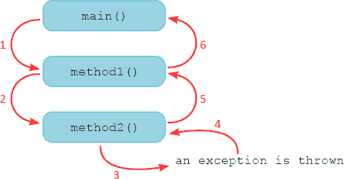

这里是 Java 调用栈机制的清晰解释，结合了图 6.1 和示例代码 `SomeClass.java`。

图像中的数字与方法调用和异常传播流程直接对应：

### 步骤 1 — 首先调用 `main()`

Java 虚拟机从 `main()` 开始执行。

### 步骤 2 — `main()` 调用 `method1()`

栈增加一个 `method1()` 的新栈帧。

### 步骤 3 — `method1()` 然后调用 `method2()`

栈再次增加另一个 `method2()` 的栈帧。

### 步骤 4 — 在 `method2()` 内部抛出异常

`throw new Exception()`

### 步骤 5 — 异常返回到 `method1()`

`method1()` 没有 `try-catch` 块来处理它；因此，它退出并从栈中移除。

```java
// 此处未捕获异常
```

### 步骤 6 — 异常到达 `main()`

* `Exception` 在 `main()` 中也没有被处理。
* 因此，`main` 栈帧退出，程序异常终止。

```java
// 此处同样未捕获异常
```

图 6.1 展示了这一流程——从 `main()` (1) 开始，然后是 `method1()` (2)，然后是 `method2()` (3)，接着抛出一个 `Exception` (4)，堆栈开始向上回溯 (5 和 6)。

这是另一个视觉化流程。

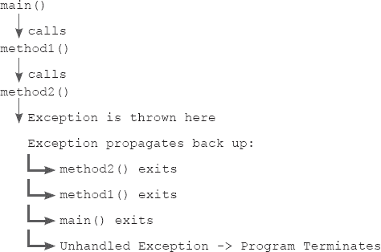

用于异常处理或异常声明的五个关键字是：

* `try`
* `catch`
* `finally`
* `throw`
* `throws`

## 6.3 异常处理块的通用语法

下面的语法演示了在 Java 中使用 `try-catch-finally` 块处理异常的结构化方法。`try` 块包含可能抛出异常的代码，允许你在程序执行期间监控并捕获潜在错误。每个 `catch` 块设计用于处理特定类型的异常（`ExceptionType1`、`ExceptionType2` 等），使程序在发生异常时能够恢复或提供有意义的错误信息。每个 `catch` 块中的 `exOb`（异常对象）参数代表异常对象，提供了访问错误的方法和详细信息。`finally` 块包含无论是否抛出或处理异常都会执行的代码，确保清理操作（如关闭资源）始终发生。这种结构在维护应用程序稳定性的同时确保了健壮的错误管理。

```java
try {
    // 用于监控错误的代码块或
    // 可能导致异常的语句
}
catch(ExceptionType1 exOb) {
    // 针对 ExceptionType1 的异常处理程序和/或
    // 处理异常对象的语句
}
catch(ExceptionType2 exOb) {
    // 针对 ExceptionType2 的异常处理程序和/或
    // 处理异常对象的语句
}
finally {
    // 即使没有发生异常也会执行的代码块
}
```

### 6.3.1 try–catch 块

`try-catch` 块是 Java 处理 `Exception` 对象的方式。这里是添加命令行参数的修订代码：

```java
// AddArgs2.java
public class AddArgs2 {
    public static void main(String[] args) {
        try {
            int sum = 0;
            for (String arg : args) {
                sum += Integer.parseInt(arg);
            }
            System.out.println("Sum: " + sum);
        }
        catch(NumberFormatException nfe) {
            System.err.println("其中一个值" + " 不是整数。");
        }
    }
}
```

在第 5 到第 13 行，你有一个 `try` 块，它作为一个测试区域。每行代码都会执行，如果发生异常，我们将移动到 `catch` 块。如果发生 `Exception`，第 14 到 18 行的 `catch` 块将运行。但如果 `try` 块中的代码运行顺畅，则 `catch` 块不会执行。

```bash
java AddArgs2 10 2.2 thirty 40
```

```
其中一个值不是整数。
```

这段代码 (`AddArgs2.java`) 是上一个版本 (`AddArgs1.java`) 的改进版本。但这种场景的问题在于 `try` 块。整个 `main` 方法的体部都被放置在 `try` 块中。不建议将数千行代码和方法调用放在单个 `try` 块中。这与其说是为了运行时，不如说是为了编写整洁、聚焦的代码，以便更容易识别异常可能发生的地方。虽然仅仅使用 `try` 块的开销极小，但如果实际上抛出了异常，性能影响将变得明显。更好的方法是将有问题的行或几行代码放入 `try` 块中，而不是包含 `main` 方法的整个体。以下是一个改进版本：

```java
// AddArgs3.java
public class AddArgs3 {
    public static void main(String[] args) {
        int sum = 0;
        for (String arg : args) {
            try {
                sum += Integer.parseInt(arg);
            }
            catch(NumberFormatException nfe) {
                System.err.println(arg + " 不是整数，将不会" + " 包含在总和中 ");
            }
        }
        System.out.println("Sum: " + sum);
    }
}
```

```bash
java AddArgs3 10 2.2 thirty 40
```

```
2.2 不是整数，将不会包含在总和中
thirty 不是整数，将不会包含在总和中
Sum: 50
```

### 6.3.2 finally 块

`finally` 块是一个可选的代码块，通常放置最后一个 `catch` 块之后。`finally` 块包含无论是否存在异常对象都会执行的代码，例如关闭文件或网络连接等资源。它确保始终执行重要的清理操作，从而维护资源完整性并防止潜在的资源泄漏。这里有一个演示使用 `finally` 块的示例代码。

```java
try {
    startFaucet();
    waterLawn();
}
catch (PipeException bpe) {
    logProblem(bpe);
}
finally {
    stopFaucet();
}
```

我们有一个 `try` 块、一个 `catch` 块和一个 `finally` 块。现在，`finally` 块的放置通常位于最后一个 `catch` 块之后。当代码片段执行时，你首先进入 `try` 块并调用 `startFaucet()` 和 `waterLawn()`。

假设 `startFaucet()` 和 `waterLawn()` 之间没有发生异常，`catch` 块将不会运行。接下来，它将执行 `finally` 块。在另一种情况下，这次在 `startFaucet()` 和 `waterLawn()` 之间抛出了异常，假设管道损坏（由 `PipeException` 表示），`catch` 块将使用 `bpe` 捕获该异常，并调用 `logProblem()`。

如果在 `catch` 块中放置 `return`，代码流会发生什么？它还会调用 `finally` 块吗？

```java
public class TestFinally1 {
    public static void main(String[] args) {
        System.out.println("Inside main method..");
        doStuff();
        System.out.println("After doStuff()...");
    }

    public static void doStuff() {
        try {
            System.out.println("Inside try block..");
            throw new Exception();
        }
        catch(Exception e) {
            System.out.println("Exception caught..");
            return;
        }
        finally {
            System.out.println("Inside finally block..");
        }
    }
}
```

如果你编译并运行上述代码，它将给你输出：

```
Inside main method..
Inside try block..
Exception caught..
Inside finally block..
After doStuff()...
```

在示例代码中，花一点时间分析为什么得到这个输出。记住，如果存在 `finally` 块，它无论如何都会运行。在这种情况下，在第 21 行的 `return` 语句之前，`finally` 块得以运行。这里是另一个例子：

```java
public class TestFinally2 {
    public static void main(String[] args) {
        System.out.println("Enter the for loop..");
        for (int i = 1; i <= 5; i++) {
            try {
                if (i == 2) {
                    break;
                }
                System.out.println("i = " + i);
            }
            catch(Exception e) {
                System.out.println("inside catch block..");
            }
            finally {
                System.out.println("inside the finally block..");
            }
        }
        System.out.println("after the loop..");
    }
}
```

如果你编译并运行此代码，将得到以下输出：

```
Enter the loop..
i = 1
inside the finally block..
inside the finally block..
after the loop..
```

在第 10 行，你在 `for` 循环中调用了 `break` 语句。我们知道一旦在循环中遇到 `break` 语句，就会结束循环。事实确实如此，但正如你所看到的，有一个 `finally` 块。无论什么，我们必须执行 `finally` 块。因此，在我们退出 `for` 循环之前，必须先运行 `finally` 块。

Java 中的 `finally` 块通常无论 `try` 或 `catch` 块中发生了什么都会执行。然而，在某些情况下它可能不会运行。一种常见的情况是在 `try` 或 `catch` 块中调用了 `System.exit(0);` 方法，导致 `JVM` 立即终止。另一种情况是程序由于致命错误（例如内存不足或遇到严重的系统级故障）而崩溃，这阻止了 `finally` 块的执行。

当调用 `System.exit()` 时，`finally` 可能不执行的特定场景：

```java
try {
    System.exit(0);
} catch (Exception e) {
    // ...
} finally {
    // 这不会执行
}
```

`JVM` 立即退出，`finally` 没有机会执行。

## 6.4 Java 中的异常层次

在 Java 中，异常是派自 `Throwable` 类的实例。

图 6.2 Java 异常层次

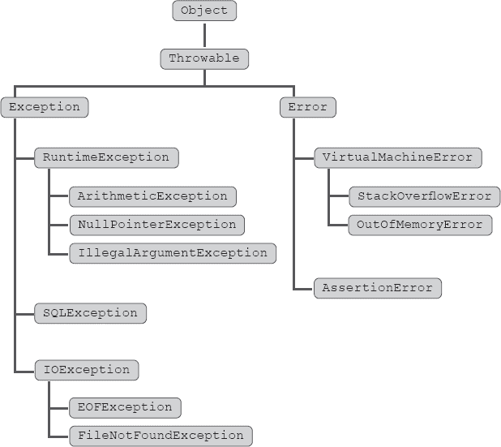

### 表 6.1 常用异常及其描述

| 异常名称 | 描述 |
| --- | --- |
| `NullPointerException` | 当应用程序尝试访问空对象的方法或字段时抛出。 |
| `ArrayIndexOutOfBoundsException` | 使用非法索引访问数组时抛出。 |
| `ArithmeticException` | 发生非法算术运算（如除以零）时抛出。 |
| `ClassCastException` | 当对象转换为其不是实例的子类时抛出。 |
| `IOException` | 当 I/O 操作失败或中断（如文件读写错误）时抛出。 |
| `FileNotFoundException` | 当尝试打开不存在的文件时抛出的 `IOException` 的子类。 |
| `NumberFormatException` | 当将字符串转换为数字类型时格式无效时抛出。 |
| `IllegalArgumentException` | 方法接收无效参数时抛出。 |
| `InterruptedException` | 当线程在睡眠、等待或暂停时被中断时抛出。 |
| `SQLException` | 表示与数据库访问或其他 SQL 相关的问题。 |

## 6.5 catch 块中的多个异常

在 Java 7 之前，如果你需要捕获不同类型的 `Exception` 对象并进行相同的错误管理，你会这样做：

```java
try {
    // 抛出异常对象的代码
}
catch(IOException ex) {
    logProblem(ex);
}
catch(SQLException ex) {
    logProblem(ex);
}
```

在 Java 7 中，可以在单个 `catch` 块中捕获多个 `Exception` 对象：

```java
try {
    // 抛出异常对象的代码
}
catch(IOException | SQLException ex) {
    logProblem(ex);
}
```

在示例代码中，如果 `try` 块抛出 `IOException` 或 `SQLException` 对象，任何一个都由同一个 `catch` 块捕获。与第一个相比，这段代码更短、更简洁。

## 6.6 参数化 try 块（资源管理器）


从 Java SE7 开始，`try` 块现在可以拥有资源。这些资源是在执行后需要关闭的对象。任何实现 `java.lang.AutoCloseable` 接口的对象（包括所有实现 `java.io.Closeable` 接口的对象类型）都可以作为参数传递给 `try` 块。

这是 Java SE7 之前未实现参数化 `try` 块的代码：

```java
1 import java.io.*;
2 public class SampleIO {
3
4     public static void main(String[] args) {
5     
6         try {
7         
8                 BufferedReader in =
9                             new BufferedReader(new
10                                     InputStreamReader(System.in));
11                               System.out.println("What is your name?");
12                               String name = in.readLine();
13                               System.out.println("How old are you?");
14                               int age = Integer.parseInt(in.readLine());
15                               System.out.println("Hello " + name +
16                                     ", next you will be " + (age + 1)
17                                     + " years old.");
18                               in.close();
19     }
20         catch(IOException ioe) {
21
22             System.err.println("An exception occurred.");
23     }
24 }
25 }
```

在第 8 行，我们看到 `BufferedReader` 对象在代码的其他部分被创建并使用，但在第 18 行 `try` 块结束时，`in` 对象被关闭了。

以下是包含 Java SE 7 try-with-resources 代码：

```java
1 import java.io.*;
2 public class SampleIO2 {
3
4     public static void main(String[] args)
5         throws IOException {
6     
7         try(BufferedReader in = new BufferedReader(new
8                             InputStreamReader(System.in))) {
9             
10                               System.out.println("What is your name?");
11                               String name = in.readLine();
12                               System.out.println("How old are you?");
13                               int age = Integer.parseInt(in.readLine());
14                               System.out.println("Hello " + name +
15                                     ", next you will be " + (age + 1)
16                                     + " years old.");
17     }
18 }
19 }
```

注意在第 7 和第 8 行，你有一个带有参数的 `try` 块。在 `try` 块参数中声明的 `BufferedReader` 对象被视为资源，并在第 17 行 `try` 块结束后会自动关闭。不需要调用 `in.close()` 方法，因为在参数化 `try` 块中声明的所有资源只要是 `AutoCloseable` 对象，都会被关闭。这减少了发生内存泄漏的风险。

## 6.7 处理或声明规则

处理 `Exception` 对象有两种方法：你既可以处理它，也可以声明它。处理 `Exception` 对象意味着你可以像我们一直以来的那样使用 `try-catch-finally` 块。

另一方面，声明 `Exception` 对象通过使用 `throws` 关键字提供了一种全新的新方法。声明 `Exception` 对象的示例方法：

```java
void doStuff() throws IOException {}
void someMethod() throws SQLException, IOException {}
```

这是一个声明 `Exception` 对象的示例代码。

声明 `Exception` 仅用于检查异常（checked exceptions），并且在方法签名后使用 `throws` 关键字，就像第 6 行一样。这相当于签一份豁免书，允许检查异常通过编译过程。另一方面，`RuntimeException` 对象或未检查异常（unchecked exceptions）不应该声明；而是根据需要处理 `RuntimeException` 对象。如果声明了异常并在运行时发生，仍然会发生异常终止。在大多数情况下，`Exception` 的声明只在软件开发阶段进行，并在软件质量保证测试期间逐渐转换为已处理的异常。

## 6.8 改进的 final 或有效 final 变量重新抛出 (JDK 11+)

从 JDK 11 开始，编译器在捕获的异常为有效 final（effectively final）时，允许更灵活地重新抛出异常。这允许在不需要显式类型转换的情况下重新抛出异常，提高了可读性。例如：

```java
try {
    // risky operation
} catch (IOException | SQLException e) {
    throw e; // 不需要显式转换
}
```

在之前的版本中，开发者需要将 `e` 转换为通用的父类，这使得代码变得混乱并引入了不必要的冗余。

以下是 final 变量重新抛出功能改进前后的示例。

### JDK 11 之前：

```java
public class BeforeJDK11 {
    public static void main(String[] args)
               throws Exception {
        try {
            processData(null);
        } catch (Exception e) {
            // 需要一个新变量来重新抛出
            Exception ex = new Exception("Updated" +
                                " message: " + e.getMessage());
            throw ex;
        }
    }

    static void processData(String input) throws Exception {
        if (input == null) {
            throw new Exception("Input cannot be null!");
        }
    }
}
```

### JDK 11 之后：

```java
public class AfterJDK11 {
    public static void main(String[] args) throws Exception {
        try {
            processData(null);
        } catch (Exception e) {
            // 赋值并重新抛出同一个变量
            e = new Exception("Updated message: " +
            e.getMessage());
            throw e; // JDK 11+ 允许
        }
    }

    static void processData(String input)
                           throws Exception {
        if (input == null) {
            throw new Exception("Input cannot be null!");
        }
    }
}
```

在 JDK 11 之前，你无法在不单独变量或将其标记为 final 的情况下重新赋值并抛出同一个变量。这种改进使得异常处理更加灵活，代码更易维护。

在 JDK 11+ 中，你不再需要为了重新抛出更新后的异常而创建第二个变量。这使得你的代码更短、更容易读。

## 6.9 方法重写与异常的规则

考虑 [图 6.3]。

图 6.3 带有异常的方法重写

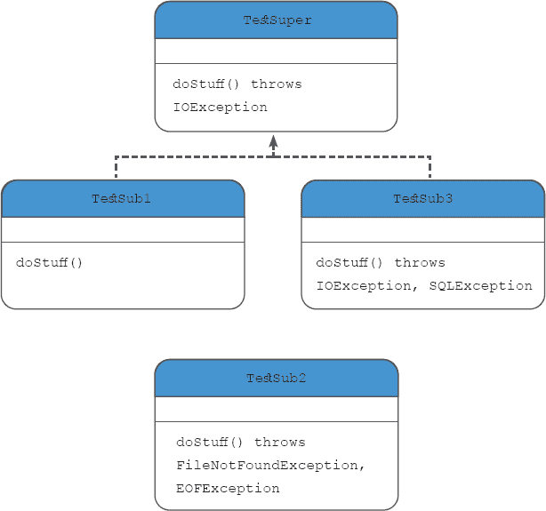

让我们分为三种情况：

- 情况 1：`TestSuper` 和 `TestSub1` 的关系：在这一继承关系中，一切正常。它将编译并运行，因为父类 `TestSuper` 声明了 `IOException`，而子类 `TestSub1` 没有声明异常。这是可以接受的。

- 情况 2：`TestSuper` 和 `TestSub2` 的关系：这也是可以接受的。在父类 `TestSuper` 中有 `IOException`，而子类 `TestSub2` 声明了两个异常：`FileNotFoundException` 和 `EOFException`。这是可以接受的，因为 `FileNotFoundException` 和 `EOFException` 都是 `IOException` 的子类。

- 情况 3：`TestSuper` 和 `TestSub3` 的关系：这种关系会导致错误。在父类 `TestSuper` 中声明了 `IOException`，而子类 `TestSub3` 声明了两个异常：`IOException` 和 `SQLException`。`IOException` 是允许的，因为它已经在父类中声明过了。然而，`SQLException` 是导致错误的原因，因为它不是 `IOException` 的子类。

## 6.10 创建你的异常

创建你自己的对象只需创建一个扩展 `Exception` 的类。由于我们既有检查异常也有未检查异常（RuntimeExceptionRuntimeException），让我们看看如何创建检查异常和未检查异常。

创建自己的检查异常：通过这个示例，你刚刚创建了一个名为 `BadTastingFoodException` 的新类。现在，让我们使用它。

```java
class BadTastingFoodException extends Exception {
    // 你可以留空这部分，或者调用 Exception 类
    // 的构造函数来传递 String 消息
}

class MyException {
    static boolean candy = false;
    static boolean sourBall = true;

    public static void main(String[] args) {
        try {
            System.out.println("Inside try block of " + " candy.");
            isSour(candy);
        } catch (BadTastingFoodException btfe) {
            System.out.println("Inside catch block " + "of candy.");
        }
        try {
            System.out.println("Inside try block " + " of sourBall.");
            isSour(sourBall);
        } catch (BadTastingFoodException btfe) {
            System.out.println("Inside catch block " + " of sourBall.");
        }
    }

    private static void isSour(boolean taste)
                           throws BadTastingFoodException {
        if (taste)
            throw new BadTastingFoodException();
    }
}
```

示例输出：

```
Inside try block of  candy.
Inside catch block  of candy.
Inside try block  of sourBall.
Inside catch block  of sourBall.
```

## 6.11 创建你的未检查 RuntimeException

至于创建自己的未检查异常，你必须扩展 `RuntimeException` 类。这是一个示例：

```java
import java.util.Scanner;

class LoginException extends RuntimeException {
    // 未检查异常
}

public class MyOtherException {
    static String username = "admin";
    static String password = "password";

    public static void main(String[] args) {
        // try-with-resources 确保 Scanner
        // 自动关闭
        try (Scanner s = new Scanner(System.in)) {
            System.out.println("Enter your username: ");
            String uname = s.nextLine();
            System.out.println("Enter your password: ");
            String pword = s.nextLine();

            if (uname.equals(username) && pword.equals(password)){
                System.out.println("Access Granted");
            } else {
                throw new LoginException();
            }
        } catch (LoginException ae) {
            System.err.println("Incorrect username / password");
        }
    }
}
```

正如你所看到的，`LoginException` 类被视为未检查异常因为它扩展了 `RuntimeException` 类。这意味着编译器在编译期间看不到这种类型的异常。这也意味着处理此类异常类的最佳方法是使用 `try-catch-block`，而不仅仅是使用 `throws` 关键字。

断言（Assertions）用于检查程序员的假设。Java 中的断言是验证程序员对代码在执行过程中特定点行为的假设的关键工具。通过直接在代码中嵌入断言检查，开发者可以在开发过程的早期主动识别并解决错误，确保程序逻辑符合预期条件。断言检查可以通过编程方式放置在代码中，但其是否执行取决于运行时的配置。断言可以在两种模式下运行：启用或禁用。当启用时（使用 `-ea` 或 `-enableassertions` 标志），将会评估断言条件，如果评估失败，则会抛出 `AssertionError`。当禁用时（默认情况），JVM 将忽略断言且不产生影响。这种灵活性使得断言可以在开发期间用于调试，而不影响生产环境的性能，成为构建更可靠、无错误代码的强大方法。

## 6.12.1 assert 关键字的语法

`assert <boolean_expression> ;`

`assert <boolean_expression> : <detail_expression> ;`

如果你想自定义显示的消息，可以自定义 `<detail_expression>` 部分。如果 `<boolean_expression>` 返回 `false` 值，它将抛出 `AssertionError`。

这里有一个示例代码：


```java
1 // TestAssert.java
public class TestAssert {
    public static void main(String[] args) {
        int hour = Integer.parseInt(args[0]);
        int mins = Integer.parseInt(args[1]);

        assert hour > 0 && hour < 24 :
                "Invalid hour value";
        assert mins > 0 && mins < 60 :
                "Invalid mins value";

        System.out.println(hour + ":" + mins);
    }
}
```

示例输出：

```
java TestAssert 15 30
15:30
```

这里是另一个：

```
java TestAssert 15 300
15:300
```

注意这种不一致性了吗？第二个参数（`300`）应该导致一个错误。为什么运行时没有错误呢？

Java 1.4 的行为与 Java 1.5 及更高版本不同，如表 6.2 所示。

### 表 6.2 Java 1.4 和 Java 1.5 中的默认断言设置

| | 编译时 | 运行时 |
| :--- | :--- | :--- |
| Java 1.4 | `javac -source 1.4 Filename.java` | 默认行为：启用；禁用：`java -da Filename` |
| Java 1.5 and 1.6 | `java Filename.java` | 默认行为：禁用；启用：`java -ea Filename` |

在最后一个运行时示例中，没有出现错误是因为使用的运行时环境是 Java 1.5 或以上版本。这意味着在程序执行或运行时，代码中的断言检查被禁用了，从而忽略了断言检查。如果你想启用断言检查，你可能需要这样重新运行你的应用程序：

```bash
java -ea TestAssert 15 300
```

```
Exception in thread "main" java.lang.AssertionError: Invalid mins value
at TestAssert.main(TestAssert.java:9)
```

通过将 `-ea` 或 `-enableassertions` 作为虚拟机（VM）选项，你实际上是在运行时启用了应用程序的断言检查。

此外，你需要注意错误消息显示的是这是一个 `AssertionError` 而不是 `Exception`，因此，你需要重新检查或重新验证你的条件、假设或输入值。

## 6.12.2 断言支持和 Unicode 输出（JDK 13+）

从 JDK 13 开始，断言还可以在错误消息中正确显示 Unicode 字符，这意味着你其中包含符号、表情符号或其他语言的文本。尽管 `assert` 关键字保持不变，但由于控制台输出中更好的 Unicode 处理以及跨 IDE 的工具支持，使用断言的整体体验得到了改进。这使得在开发期间调试非英语或富符号的消息更加可靠。

```java
1 public class UnicodeAssertionExample {
    public static void main(String[] args) {
        int score = 45;

        // 此断言使用了 Unicode 符号
        assert score >= 50 :
            " Score too low! 최소 점수는 50 입니다.";
        // ("최소 점수는 50입니다"
        // 在韩语中意为“最低分为 50 分”)

        System.out.println(score);
    }
}
```

以下是你应该这样运行它的：

```bash
java -ea UnicodeAssertionExample
```

* 在 Java 中创建你自己的异常，你需要编写一个继承自 `Exception` 类（用于受检异常）或 `RuntimeException` 类（用于非检查异常）的新类。这个自定义的异常类可以包含额外的构造函数和方法，以提供针对你应用程序需求的特定错误细节或行为，也可以仅仅是一个空类。

* 在重写方法时，重写方法不能声明抛出比被重写方法更多或更广泛的检查异常。然而，它可以声明更少或更窄的检查异常，或任意数量的非检查异常，以确保子类与父类的异常处理预期保持一致。

* Java 中的 `assert` 关键字用于创建断言，断言是一种测试代码中假设的语句，通常用于调试。如果断言为假，则会抛出 `AssertionError`，允许开发者在开发期间检测并纠正逻辑错误。

### 多选题

1. 下列情况可能会导致 `Exception`，但 ________ 除。

   a. `JVM` 内存耗尽。
   b. 向服务器发送文件时，连接被中断。
   c. 尝试将一个整数除以整数 `0`。
   d. 尝试访问一个写错误的文件。

2. 你如何创建你自己的 `Exception`？

   a. 创建 `throws new Exception()` 构造函数调用
   b. 创建一个类并继承 `Exception` 类
   c. `throw an Exception object`
   d. `throw an IOException object`

3. 当你创建一个自定义异常时，你创建了一个继承自 `java.lang` 包中 `Exception`类的类。你正在创建哪种类型的 `Exception` 类？

   a. 你正在创建一个 `RuntimeException`。
   b. 你正在创建一个非检查异常。
   c. 异常类型异，取决于你正在使用的操作系统。
   d. 你正在创建一个受检异常。

4. 填空：如果你的程序崩溃，Java 将把 ____________ 打印到终端、输出控制台或 `cmd.com` 窗口（`cmd` 窗口），它会告诉你错误发生时正在执行的方法列表。

   a. 编译错误信息
   b. 编译日志
   c. 堆栈跟踪 (stack trace)
   d. `VM` 日志

5. 给定以下代码：

```java
class TestAssert {
    public static void main(String [] args) {
        assert(false): "more info ";
        System.out.println("after assert ");
    }
}
```

以下哪个陈述是 true 的？

   a. 命令行调用 `java TestAssert` 将产生输出 `more info`
   b. 命令行调用 `java TestAssert` 将产生输出 `after assert`
   c. 命令行调用 `java TestAssert` 将产生输出 `more info after assert`
   d. 命令行调用 `java TestAssert` 将产生输出 `after the assert more info`

6. 下列关键字中**没有**用于异常处理的是？

   a. `try`
   b. `break`
   c. `catch`
   d. `finally`

7. 哪个关键字用于声明 `Exception`？

   a. `try`
   b. `throw`
   c. `throws`
   d. `catch`

8. `________` 关键字用于手动导致抛出一个异常对象。

   a. `try`
   b. `catch`
   c. `throw`
   d. `throws`

9. 在创建你自己的异常时，你需要创建一个继承自 `________` 的类。这种用户定义的异常被认为是非检查异常。

   a. `Object`
   b. `Throwable`
   c. `Exception`
   d. `RuntimeException`

10. 下面哪个代码段在开启断言的情况下执行时会抛出 `AssertionError`？

    a. `assert(false);`
    b. `assert(true);`
    c. `assert(false || true);`
    d. `assert(assert);`

### 多选题答案页

| 1 – a | 2 – b | 3 – d | 4 – c | 5 – b |
| 6 – b | 7 – c | 8 – c | 9 – d | 10 – a |

### 编程任务

#### 编程任务 1

你需要重新访问 第 5 章 中的编程任务 #1：`Shapes`，并考虑为以下场景添加异常处理：

* 如果任何参数包含负值，则抛出 `IllegalArgumentException`。
* 如果参数列表超过三个值或完全没有值，则抛出 `IllegalArgumentException`。
* 如果任何输入值包含 `String`，则抛出 `NumberFormatException`。

这里是新的运行时输出示例：

示例输出 #1:

```bash
java TestShapes -15 <ENTER>
A negative value was passed.
An IllegalArgumentException is caught.
```

示例输出 #2:

```bash
java TestShapes <ENTER>
Pass one to three values via command line.
An IllegalArgumentException is caught.
```

示例输出 #3:

```bash
java TestShapes 10 20 30 40 <ENTER>
Limit your arguments to a maximum of 3 values.
An IllegalArgumentException is caught.
```

示例输出 #4:

```bash
java TestShapes 10 test 20 <ENTER>
An argument contains a String value.
A NumberFormatException is caught.
```

#### 编程任务 2

勾股定理是最著名的数学原理之一。它断言直角三角形中两条直边的平方和等于最长边（即斜边）的平方。这可以表示为：`a2 + b2 = c2`，其中 `a` 和 `b` 是两条直边的长度，而 `c` 是斜边的长度。

你的任务是完成提供的 Java 代码，允许用户输入两个数值 `a` 和 `b`。然后程序应该计算并显示斜边 `c` 的长度。例如，如果用户输入 `a = 3` 且 `b = 4`，程序 应输出 `c = 5.0`。

在你的代码中加入异常处理：

* 如果用户输入负值，则抛出 `IllegalArgumentException`。
* 如果用户输入非数值值，则抛出 `NumberFormatException`。
* 确保这些异常被捕获，并向用户显示清晰且信息量丰富的消息。

此外，在每行代码后添加注释，以描述其目的和功能。

## 第 7 章 I/O 流

流（Stream）被定义为从源到目的地或汇点的数据流。源（`source`）流启动数据流，而目的地（`destination`，即 `sink`）则终止数据流。源也称为输入流，汇点也称为输出流。源和汇点都是节点流（node streams），也称为端点。这些流可以在数据输入输出之前之前之后进行打开和关闭。

有不同类型的节点，例如文件节点、内存节点、管道或线程间（`pipe`）节点。

### 7.2 基础流类

Java 维护了两组流：字节流和字符流，它们都有各自的输入和输出流类。

#### 表 7.1 基础流类 - 字节流与字符流

| 流 | 字节流 | 字符流 |
| :--- | :--- | :--- |
| 源流 | `InputStream` | `Reader` |
| 汇点流 | `OutputStream` | `Writer` |

### 7.3 流中的数据

`java.io` 包下有一些类允许将字节流转换为 Unicode 文本或字符流，反之亦然。`Reader` 和 `Writer` 类处理 Unicode 文本，而字节流处理原始字节数据。

对于每种节点，无论是文件、内存数组还是网络连接，都有特定的 Java 类设计用于处理其输入和输出流。

这意味着，当你想要从特定的数据源（如计算机硬盘硬盘上的文件或某块内存）读取或向其写入数据时，Java 提供了一个专门的类来实现这一操作。

某些类直接与字节流工作（处理原始二进制数据），而另一些类则与字符流工作（处理 Unicode 文本）。

例如，`FileInputStream` 和 `FileOutputStream` 用于从文件中读取和写入字节，而 `FileReader` 和 `FileWriter` 则专为读取和写入字符数据而设计。

这让你能够根据特定需求选择最合适的工具，并更容易以高效、方便且可靠的方式执行 I/O 操作。表 7.2 列出了常见的节点流类。

#### 表 7.2 示例节点流 - 字节流与字符流

| 类型 | 字节流 | 字符流 |
| :--- | :--- | :--- |
| 文件 | `FileInputStream` `FileOutputStream` | `FileReader` `FileWriter` |
| 内存数组 | `ByteArrayInputStream` `ByteArrayOutputStream` | `CharArrayReader` `CharArrayWriter` |
| 内存字符串 | N/A | `StringReader` `StringWriter` |
| 管道 | `PipedInputStream` `PipedOutputStream` | `PipedReader` `PipedWriter` |

此表提供了一些 Java 节点流，用于输入和输出操作。节点流直接从各种数据源读取或写入数据，如文件、内存数组（指在程序运行时临时存储数据的内存块）或管道（这是 Java 程序两个部分之间直接通信的方式——它像一根管子，允许数据从一侧（输出）流向另一侧（输入））。

字节流类中的大多数方法也存在于字符流类中。这就是为什么在大多数情况下，字节流可以完成的任何功能字符流也可以完成。这两种流之间的唯一区别在于它们处理的字符类型。字节流可以处理非文本文本或压缩的数据，而字符流可以处理基于文本的或未压缩的数据。字节流可以处理的示例文件类型包括 JPG、PDF、MP3、AVI 等。对于字符流，我们有 txt、html、css、xml、js、csv 以及其他未编译的源码，如 py、cpp 和 java 文件。

### 7.4 I/O 流链

图 7.1 显示，可以将数据从字节流转换并传递到字符流，反之亦然，以便 JVM 以 Unicode 格式处理上述数据，然后它可以返回变为非 Unicode 数据，用于存储、显示、流传输或进一步处理。

#### 图 7.1 I/O 流链

```
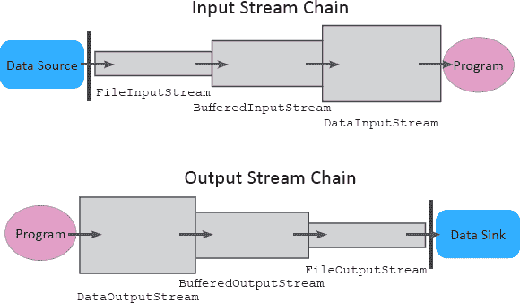
```

这种场景的一个示例是从键盘接受键值。Java 1.0 使用的字符编码是 ASCII（美国信息交换标准代码）。它使用 7 位编码 128 个字符，包括英文字母、数字和一些控制字符。通常，这些字符都出现在标准键盘上。1997 年 Java 1.1 发布时，主要变化之一是字符编码。它从 ASCII 更改为 Unicode 以满足国际化支持的需求，允许包含英语字母以外的其他字符。Unicode 是一个全面的标准，可以使用不同的编码形式（UTF-8、UTF-16、UTF-32）编码超过 110 万个字符。它涵盖了各种语言、符号和表情符号，与 ASCII 相比提供了更广泛的全球支持。因此，当我们从 ASCII 格式的键盘输入时，它将通过管道或转换为 Unicode，以便 JVM 可以进行处理。

### 7.5 Java I/O

Java I/O（输入和输出）提供了一组类和方法，用于从各种数据源（如文件、内存和网络连接）读取数据以及写入数据。它同时支持用于处理二进制数据的字节流和用于管理文本数据的字符流，使其对于不同类型的输入输出具有通用性。

### 7.6 通过键盘读取

从标准输入读取使用一个名为 `System.in` 的预定义对象。`System.in` 是一个默认打开并准备好提供数据的输入流。通常，我们使用此代码段设置输入：`BufferedReader(new InputStreamReader(System.in))`。

然后，你可以使用 `BufferedReader` 下的 `readLine()` 方法从标准设备读取行输入。

示例程序：

```java
import java.io.*;
public class KeyboardInput {
    public static void main(String[] args) throws IOException {
        BufferedReader br = new BufferedReader(new InputStreamReader(System.in));
        System.out.println("输入文本并按 Ctrl + D 或 Ctrl + Z 结束.");
        String str = br.readLine();
        while(str != null) {
            System.out.println("Read: " + str);
            str = br.readLine();
        }
        br.close();
    }
}
```

在 Windows 命令行提示符中，Ctrl + Z 等于空字符，而在 Unix / Linux / Mac OS 终端窗口中，那等于 Ctrl + D。在给定的代码中，需要空字符来终止循环。


### 7.6.1 String 到原始数据类型的转换

在开发过程中，我们经常会遇到需要将存储为字符串的值转换为原始数据类型以便进行计算或逻辑处理的情况。在 Java 中处理数据时，将字符串转换为数值和布尔类型是至关重要的。以下是将 `String` 值转换为不同数值和布尔类型的几种方法。

#### 1. String 到整数类型的转换

要将表示整数的 `String` 转换为 `byte`、`short`、`int` 或 `long` 等整数数据类型，可以使用包装类相应的解析（parse）方法。请参考以下代码：

```java
String strNum = "100";

byte b = Byte.parseByte(strNum); // 转换为 byte
short s = Short.parseShort(strNum); // 转换为 short
int i = Integer.parseInt(strNum); // 转换为 int
long lNum = Long.parseLong(strNum); // 转换为 long
```

当处理字符串形式的输入（例如用户输入或文件数据）并需进行数值处理时，这些方法特别有用。

#### 2. String 到浮点类型的转换

表示小数的字符串可以使用对应的方法转换为 `float` 或 `double`。请查看下面的代码段：

```java
String sNum = "1.1";

float f = Float.parseFloat(sNum); // 转换为 float
double d = Double.parseDouble(sNum); // 转换为 double
```

这些转换允许对带有小数部分的数字进行精确处理，例如在科学或金融应用中进行计算。

#### 3. String 到布尔类型的转换

处理存储为字符串的逻辑数据时，`Boolean.parseBoolean()` 方法可以将字符串转换为布尔值。如果字符串等于 `"true"`（不区分大小写），该方法返回 `true`；对于任何其他值返回 `false`：

```java
String str = "true";
boolean b = Boolean.parseBoolean(str); // 转换为 boolean
```

这对于处理表示为字符串的标记或开关非常有用，例如配置设置或用户偏好。

通过理解这些转换，开发者可以无缝地将字符串输入转换为适当的数据类型，实现准确高效的计算。

### 7.6.2 使用 java.util.Scanner 类接受格式化输入 – 重温 Scanner 类

从 Java 5.0 版本开始，现在可以使用 `java.util` 包下的 `Scanner` 类来接受格式化输入。可以使用你的 `Scanner` 对象从任何数据源接受格式化输入。

下面是一个使用 `Scanner` 类接受输入的示例代码。文件名为 `ScannerExample.java`。

```java
import java.util.Scanner;

public class ScannerExample {
    public static void main(String[] args) {
        Scanner s = new Scanner(System.in);
        System.out.println("What is your name?");
        String name = s.nextLine();

        System.out.println("How old are you?");
        int age = s.nextInt();

        System.out.println("Enter your GPA: ");
        double gpa = s.nextDouble();

        System.out.println("Hello " + name
        + ", next year you'll be "
        + (age + 1) + " years old." + "\nGPA is: " + gpa);
        s.close();
    }
}
```

运行时输出将：

```
What is your name?
Lawrence
How old are you?
21
Enter your GPA:
1.75
Hello Lawrence, next year you'll be 22 years old.
GPA is: 1.75
```

`Scanner` 类拥有允许格式化输入的方法，如图 7.2 所示。

图 7.2 Scanner 方法

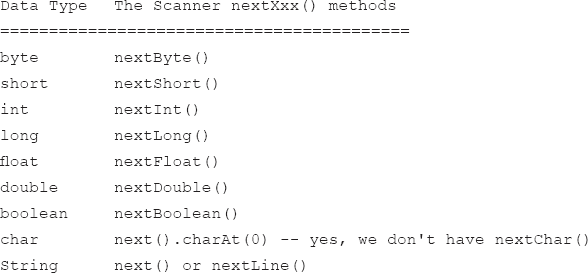

### 7.6.3 使用 String.format() 方法显示格式化输出

在 Java 1.4 的时代，需要几行代码才能按照你想要格式化输出。然而，自 Java 5.0 出生以来，格式化输出从未如此简单。通过使用 `String.format()` 或 `System.out.printf()` 方法，你可以使用这些方法来格式化输出。

常见的格式化代码列在表 7.3 中。

表 7.3 String 格式说明

| 代码 | 说明 |
| --- | --- |
| %s | 将参数格式化为 `String`，通常通过调用对象的 `toString()` 方法。 |
| %d %o %x | 将整数格式化为十进制、八进制或十六进制值 |
| %f %g | 格式化浮点值，`%g` 使用科学计数法 |
| %n | 在字符串或流中插入换行符。 |
| %% | 在字符串或流中插入 `%` 字符。 |

这是一个示例：

```java
import java.io.*;
import java.util.Scanner;

public class DisplayAverage {
    public static void main(String[] args) throws IOException {
        Scanner s = new Scanner(System.in);
        System.out.println("Enter first number: ");
        int first = s.nextInt();
        System.out.println("Enter second number: ");
        int second = s.nextInt();

        double quotient = (double)first / second;
        System.out.printf("The average is %.2f\n", quotient);
        s.close();
    }
}
```

### 7.7 File 类常用方法

| 方法 | 描述 |
| :--- | :--- |
| `String getParent()` | 返回文件或目录的父目录。 |
| `long lastModified()` | 显示文件的最后修改时间戳。 |
| `long length()` | 显示以字节为单位的文件大小。 |
| `boolean renameTo(File newName)` | 将文件重命名为指定的新名称。 |
| `boolean delete()` | 删除文件或目录。 |
| `boolean mkdir()` | 创建新目录。 |
| `String[] list()` | 列出目录内文件和目录的名称。 |
| `boolean exists()` | 检查文件或目录是否存在。 |
| `boolean canWrite()` | 验证文件是否可写。 |
| `boolean canRead()` | 验证文件是否可读。 |
| `boolean isFile()` | 测试所指的文件是否为普通文件。 |
| `boolean isDirectory()` | 检查路径是否为目录。 |
| `boolean isAbsolute()` | 确认路径是否为绝对路径。 |
| `boolean isHidden()` | 检查文件或目录是否隐藏。 |

### 7.8 从文件中读取输入

到目前为止，所有的输入都是通过键盘完成的，键盘恰是标准输入设备。这允许程序直接从用户处读取数据。然而，在某些情况下，程序需要从文件接收输入。应用程序可以对文件进行读取和写入。

负责从文件中读取数据的类是 `FileReader` 类：

```java
BufferedReader br = new BufferedReader(new FileReader(myFile));
```

`br` 是一个引用变量名，而 `myFile` 是将读取数据的文件。

Java 文件输入程序：

```java
// ReadFile.java
import java.io.*;
public class ReadFile {
    public static void main(String[] args) {
        File myFile = new File(args[0]);
        try {
            BufferedReader br = new BufferedReader(new FileReader(myFile));
            String str;
            while ((str = br.readLine()) != null) {
                System.out.println("Read: " + str);
            }
            br.close();
        } catch (FileNotFoundException fnfe) {
            System.out.println("File Not Found " + myFile);
        } catch (IOException ioe) {
            System.out.println("IOException");
        }
    }
}
```

该程序将要求用户在命令行输入文件名（`args[0]`），然后程序将打开该文件。如果文件存在，它将读取每一行文本并在屏幕上显示文件的所有内容。如果文件不存在，将抛出 `FileNotFoundException`。

### 7.9 向文件中写入输入

为了实现文件的写入能力，我们使用 `FileWriter` 类和 `PrintWriter` 类。

```java
PrintWriter out = new PrintWriter(new FileWriter(myFile));
```

* `out` 是一个引用变量，将流输出到指定的文件。
* `myFile` 是存储输入 `String` 的文件名。

Java 文件输出程序：

```java
// WriteFile.java
import java.io.*;
public class WriteFile {
    public static void main(String[] args) {
        File myFile = new File(args[0]);
        try {
            BufferedReader bf = new BufferedReader(new InputStreamReader(System.in));
            // 这允许实际向文件写入。
            PrintWriter out = new PrintWriter(new FileWriter(myFile));

            String s;
            while ((s = bf.readLine()) != null) {
                out.println(s);
            }
            out.close();
            bf.close();
        } catch (FileNotFoundException fnfe) {
            System.out.println("File Not Found " + myFile);
        } catch (IOException ioe) {
            System.out.println("IOException");
        }
    }
}
```

## 测验题

### 6. 如果你要在代码中使用 `Scanner` 类，必须包含哪一个导入语句？

a. `import java.util.Scanner;`

b. `import java.lang.Scanner;`

c. `import java.awt.Scanner;`

d. `import java.io.Scanner;`

### 7. 使用 `Scanner` 类接收用户输入时，如果用户没有为变量的数据类型输入正确的值，将抛出什么类型的 `Exception` 异常对象？

a. `InputMismatchException`

b. `NumberFormatException`

c. `IOException`

d. `IllegalArgumentException`

### 8. 如果你计划同时使用 `BufferedReader` 和 `InputStreamReader`，你应该导入哪个包？

a. `java.io` 包

b. `java.lang` 包

c. `java.awt` 包

d. `java.util` 包

### 9. `InputStreamReader` 类有一个名为 _______ 的方法，它可以释放与它相关的任何系统资源。

a. `release()`

b. `disconnect()`

c. `close()`

d. `stop()`

### 10. `java.io` 包下哪个类被用于获取文本文件的读取权限？

a. `FileInputStream`

b. `File`

c. `FileReader`

d. `FileInputStreamReader`

## 多选题答案页

| 1 – d | 2 – d | 3 – c | 4 – b | 5 – b |
| 6 – a | 7 – a | 8 – a | 9 – c | 10 – c |


## 编码任务

### 编码任务 1：用户名与密码

创建一个 Java 程序，读取名为 `userList.txt` 的文本文件。该文件名应通过命令行传递。该文件包含一个用户名和密码的列表。奇数行包含用户名，偶数行包含前行用户名对应的密码。以下是 `userList.txt` 中 `String` 列表的示例内容：

| 行号 | 内容 |
| --- | --- |
| 1 | user1 |
| 2 | password1 |
| 3 | user2 |
| 4 | password2 |
| 5 | user3 |
| 6 | password3 |

一旦在文件 `userList.txt` 中读取了 `String` 值，你将创建名为 `usernames.txt` 和 `password.txt` 的两个文本文件。`usernames.txt` 文件包含所有位于奇数行的用户名，而密码将写入 `password.txt` 文件中。不需要输出消息，但如果能提供代码已成功运行的确认会更好。你判断代码是否运行的唯一方法是当 `usernames.txt` 和 `password.txt` 都包含了正确的 `String` 值。

`usernames.txt` 应包含以下内容：

```
user1
user2
user3
```

`password.txt` 应包含以下内容：

```
password1
password2
password3
```

### 编码任务 2：Java 文件 IO

#### 目标

编写一个 Java 程序，从一个文本文件读取数据，处理数据，并将处理后的数据写入另一个文本文件。

#### 练习详情

**输入文件**

你将获得一个名为 `input.txt` 的文本文件，其中包含多行数据。假设该文件格式如下，每行代表一个记录（包含姓名、年龄和城市）：

```
Alice,30,New York
Bob,25,Los Angeles
Charlie,35,Chicago
```

你需要读取这些数据，筛选年龄大于 28 岁的记录，并将这些姓名和城市写入名为 `output.txt` 的文件中。

**任务 1：读取文件**

使用 `BufferedReader` 读取 `input.txt` 的内容。

**任务 2：处理数据**

处理读取到的数据，筛选年龄大于 28 岁的记录。

**任务 3：写入新文件**

使用 `BufferedWriter` 或 `FileWriter` 将处理结果写入 `output.txt`。

**任务 4：处理异常**

使用 `try-catch` 块处理可能出现的 `IOException` 异常。

**任务 5：关闭资源**

在操作完成后，确保通过 `close()` 方法关闭流。

**任务 6：显示结果**

在控制台输出处理后的数据以进行验证。

# 第 8 章：Java 集合与泛型简介


## 本章学习目标

- 理解 `Collection` 接口在 Java 中的作用
- 区分 `Set`、`List` 和 `Map` 之间的区别
- 学习如何使用 `Iterator` 迭代器遍历元素
- 熟悉泛型 `Generics` 以及类型安全的集合
- 利用菱操作符 `<>` 简化实例化
- 开发根据问题选择合适集合的技能


# 本章将介绍 Java 集合框架（Collections Framework）

这是一组用于高效存储、检索和操作对象的类和接口。在这里你将学习主要的集合类型——`Set`、`List` 和 `Map`——以及它们如何解决不同的问题。

## 8.1 Collection 接口

`Collection` 接口是层次结构中的根接口。它代表一组被称为元素的对象。

有些集合允许重复元素，而有些不允许。有些是有序的，有些则不是。Java 工具包没有提供任何直接实现。它只提供了更具体的子接口，如 `Set` 和 `List`。该接口通常用于传递和操作集合，当需要通用性时。

在考虑这些接口的实现类时，`Set` 有如 `HashSet` 和 `TreeSet` 等显著的实现。对于 `List`，常见的实现包括 `Vector`、`ArrayList` 和 `LinkedList`。

回到 `Collection` 的基本概念，它代表一组被称为“元素”的对象。这个概念与数组有些相似，数组也是表示一组元素的对象。然而，区别在于它们所能包含的元素的灵活性和类型。`Collection` 只能持有对象，而数组既可以包含一组对象，也可以包含一组原始类型值。例如，你可以拥有一个对象数组（如 `String` 或 `Student` 对象的数组），也可以拥有一个原始类型数组（如 `int` 或 `boolean` 数组）。要将原始类型数组转换为对象集合，就需要用到包装类。

另一个关键区别在于它们的内存管理和线程安全性。现代集合不是自动线程安全的，尽管某些集合（如同步列表，synchronized lists）提供了线程安全性。与数组相比，线程安全的集合在内存使用上往往更重，而数组不是线程安全的，因此更轻量。这种线程安全性允许集合被多个并发用户共享，而数组通常用于单用户场景。

考虑像 Facebook 这样的社交媒体平台例子：你会把朋友称为一个集合，而不是一个朋友的数组。将朋友视为集合而不是数组更为合适，因为集合（如 Java 中的 `List` 或 `Set`）提供了灵活且动态的存储，允许轻松地添加或删除朋友，而没有预定义大小的限制。与数组不同，集合更适合处理现实世界中的数据，在这些数据中，元素的数量可能会变化，并且通常需要搜索或排序等操作。

每当你通过好友请求时，你就将他们添加到你的朋友集合中。你朋友集合的大小会动态增加。同样，当你从集合中删除某个好友时，你就将他们从集合中移除，每删除一个好友，你的朋友数量就会动态减少。相反，数组的大小在创建时就是固定的；其大小不能动态变化。

此外，集合是可变的；它们随着你添加更多元素而增大，随着移除元素而缩小。相比之下，数组的长度是固定的——一旦数组被创建，其大小在整个生命周期内都保持不变。

表 8.1 列出了集合与数组之间的主要区别。

### 表 8.1 集合对比数组

| 集合 | 数组 |
| --- | --- |
| 表示一组对象的单一对象，称为其元素。 | 表示一组对象或原始值的单一对象。 |
| 部分集合是线程安全的，如果是同步的则很重。 | 不是线程安全的，轻量级。 |
| 可变，`Collection` 对象可以根据你向集合内部添加或删除对象而变大或变小。 | 长度在创建数组对象时已固定。 |
| 使用 `.size()` 方法检查 `Collection` 内部元素的数量。 | 使用属性 `.length` 检查数组的大小。 |

## 8.2 Set 接口

让我们深入研究 `Collection` 接口的一个子接口，即 `Set` 接口。`Set` 接口设计用于存储一组无序的元素，这意味着元素的顺序是不保证的。

`Set` 的基本特征之一是禁止重复元素。这意味着 `Set` 中的每个元素都是唯一的。如果你尝试添加重复元素，只有第一个实例会被保留，而随后的重复元素将被忽略。

此外，`Set` 最多允许一个 `null` 元素。为了说明这一点，考虑下方的示例代码。在这里，我们声明了一个 `Set` 对象，并用 `HashSet` 实例化，它是 `Set` 接口最常用的实现之一。从第 6 行到第 12 行，各种对象被添加到 `Set` 中，包括一些重复。这些重复对象不会触发任何运行时错误。相反，每个对象的第一次出现会被存储在 `Set` 中。当打印 `Set` 时，只会显示唯一的元素，因为重复元素会被自动排除。

这是一个保存为 `SetExample.java` 的示例文件。

```java
import java.util.*;

public class SetExample {
    public static void main(String[] args) {
        Set set = new HashSet();

        set.add("Lawrence");
        set.add(100);
        set.add(false);
        set.add("java");
        set.add("java");
        set.add("Lawrence");
        set.add(3.0);

        System.out.println(set);
    }
}
```

如果你直接使用 `javac` 命令编译给定代码，你将收到一个通知：

```
javac SetExample.java <ENTER>
```

注意：`SetExample.java` 使用了未检查或不安全的的操作。

注意：使用 `-Xlint:unchecked` 重新编译查看详情。

要使用选项显示编译警告，我们使用此命令：

```bash
javac -Xlint:unchecked SetExample.java <ENTER>
```

使用 `-Xlint:unchecked` 编译选项将显示以下内容：

```
SetExample.java:6: warning: [unchecked] unchecked call
to add(E) as a member of the raw type
    set.add("Lawrence");
    ^
  where E is a type-variable:
    E extends Object in interface Set
SetExample.java:7: warning: [unchecked] unchecked call
to add(E) as a member of the raw type
    set.add(100);
    ^
  where E is a type-variable:
    E extends Object in interface Set
SetExample.java:8: warning: [unchecked] unchecked call
to add(E) as a member of the raw type
    set.add(false);
    ^
  where E is a type-variable:
    E extends Object in interface Set
SetExample.java:9: warning: [unchecked] unchecked call
to add(E) as a member of the raw type
    set.add("java");
    ^
  where E is a type-variable:
    E extends Object in interface Set
SetExample.java:10: warning: [unchecked] unchecked call
to add(E) as a member of the raw type
    set.add("java");
    ^
  where E is a type-variable:
    E extends Object in interface Set
SetExample.java:11: warning: [unchecked] unchecked call
to add(E) as a member of the raw type
    set.add("Lawrence");
    ^
  where E is a type-variable:
    E extends Object in interface Set
SetExample.java:12: warning: [unchecked] unchecked call
to add(E) as a member of the raw type
    set.add(3.0);
    ^
  where E is a type-variable:
    E extends Object in interface Set
7 warnings
```

警告只是警告，它们不是错误。因此，我们仍然可以使用以下命令运行它们：

```bash
java SetExample <ENTER>
```

运行时输出：

```
[java, 100, false, Lawrence, 3.0]
```

在编译和运行 `SetExample.java` 后，我们注意到一个编译警告，这在初始示例中很常见，因为还没有使用 Java 泛型（Generics）。虽然这些警告不是错误，但通常的做法是认真对待它们。

在这个示例中，尽管向 `Set` 添加了七个对象，但打印 `Set` 时只有五个唯一元素。请注意，“java" 和 "Lawrence" 字符串只出现了一次，尽管在第 9 行和第 10 行添加了 "java"，第 6 行和第 11 行添加了字符串 "Lawrence"。Java 中的 `HashSet` 是一种存储唯一元素的集合，并提供了使用哈希表进行添加、删除和搜索项目的高效操作。它不维护元素的特定顺序，并会自动消除重复。这种行为源于继承自 `Collection` 接口的 `add()` 方法，该方法返回一个布尔值。如果尝试添加重复元素，该方法简单地返回 `false`，表示元素未被添加。

## 8.3 List 接口

现在让我们来检查 `List` 接口，并理解它与 `Set` 接口的区别。与 `Set` 不同，`List` 表示一个有序集合，这意味着元素添加的顺序会被保留。`List` 接口允许用户对每个元素的插入位置进行精确控制。你可以通过索引位置访问元素，甚至在列表中搜索特定的元素。此外，`List` 接口允许重复元素，使得存在重复项成为可能。这里有一个保存为 `ListExample.java` 的示例代码。

```java
import java.util.*;

public class ListExample {
    public static void main(String[] args) {
        List list = new ArrayList();

        list.add("Lawrence");
        list.add(100);
        list.add(false);
        list.add("java");
        list.add("java");
        list.add("Lawrence");
        list.add(3.0);

        System.out.println(list);
    }
}
```

运行时输出：

```
[Lawrence, 100, false, java, java, Lawrence, 3.0]
```

与上一个示例中的代码一样，你会遇到类似的编译警告。我们将在本章节后面讨论 Java 泛型（Generics）概念时消除该警告。

考虑第 4 行的代码段，我们在那里使用 `ArrayList` 实现声明了一个 `List` 对象。有多种 `List` 实现可用，包括 `ArrayList`、`Vector` 和 `LinkedList`。`ArrayList` 类似于数组。在第 6 行到第 12 行，我们向列表添加了多个对象——总共七个，包括一些重复。

这些重复项无问题地被添加到列表中，当我们在第 14 行打印列表时，输出显示了元素添加的顺序被保留了。第一个添加的对象是字符串 "Lawrence"，最后一个是双精度值 3.0，这在输出中得到了反映。

为了更好地理解 `Set` 和 `List` 之间的区别，让我们来看一个涉及 `Set` 的代码示例，特别是 `HashSet`，它是 `Set` 的类实现之一。我们向集合中添加了几个对象并打印结果。

当执行 `SetExample` 代码时，只打印了五个对象，尽管添加了七个。这是因为如之前讨论过的，`Set` 接口不允许重复。当检测到重复项时，`add()` 方法返回 `false`，因此，这些元素不会被再次添加。此外，`Set` 中的元素顺序不会被保留，正如 "Lawrence" 是先添加的，但先检索到 "java" 所证明的那样。

相比之下，当我们对相同的对象使用 `List`（特别是 `ArrayList`）时，输出反映了所有七个元素按它们添加的顺序。在编译并运行 `ListExample.java` 后，我们观察到列表如预期地维护了元素的顺序。

那么，你什么时候应该使用 `Set`，什么时候应该使用 `List` 呢？

如果元素的排列不重要，并且你想确保所有元素都是唯一的，那么 `Set` 是合适的。例如，如果你在跟踪一组同学，而他们进入房间的顺序不需要保留，那么 `Set` 就会很合适。

另一方面，如果元素的顺序很重要，`List` 是更好的选择。例如，在制作购物清单时，物品的顺序可能反映优先级（例如在购买洗衣用品之前购买食品），此时 `List` 是理想的，并且允许重复项。

要总结 `Set` 和 `List` 的区别，你可以查阅表 8.2。

### 表 8.2 Set 和 List 接口的比较

| 特性 | Set | List |
| --- | --- | --- |
| 顺序 | 无序元素 | 有序元素 |
| 重复项 | 不允许（每个元素必须是唯一的） | 允许（你可以拥有同一元素的多个副本） |
| 索引访问 | 不支持（无法通过索引检索） | 支持（可以通过索引检索、插入或删除） |
| 实现示例 | HashSet, TreeSet | ArrayList, LinkedList, Vector |
| 主要用途 | 留唯一元素 | 保留顺序或允许重复 |
| 性能 | 搜索速度快 | |

## 8.4 Map 接口

`Map` 是一种用于存储键值对的数据结构，通过称为“键”（key）的唯一标识符进行访问。在 `java.util` 包中，你会找到 `Set` 和 `List` 接口，`Map` 并不是其中之一。`Map` 由对 K 和 V 组成。在创建 `Map` 时，你需要使用菱操作符 `<>` 指定类型。相比之下，对于 `Map`，`HashMap` 是实现之一。`HashMap` 不保证条目的顺序，但它非常快。在下面的代码中，我们将演示 `Map` 的用法。给定文件保存为：`MapExample.java`。

```java
import java.util.*;

public class MapExample {
    public static void main(String[] args) {
        Map map = new HashMap<>();

        map.put("one", "uno");
        map.put("two", "dos");
        map.put("three", "tres");

        System.out.println("Original Map Values: ");
        System.out.println(map);

        // 覆盖之前的赋值
        map.put("three", "trois");

        System.out.println("Updated Map Values: ");
        System.out.println(map);

        // 返回键的集合
        Set set1 = map.keySet();
        System.out.println(set1);

        // 返回值的集合
        Collection collection = map.values();
        System.out.println(collection);

        // 返回键值对映射的集合
        Set set2 = map.entrySet();
        System.out.println(set2);

        System.out.println(set1 + "\n" + collection + "\n" + set2);
    }
}
```

运行时输出：

```
Original Map Values:
{one=uno, two=dos, three=tres}

Updated Map Values:
{one=uno, two=dos, three=trois}

[one, two, three]

[uno, dos, tres]

[one=uno, two=dos, three=trois]
```

与 `Set` 或 `List` 不同（在其中你会使用 `add()` 方法插入元素），在 `Map` 中，你使用 `put()` 方法。该方法插入一对对象——其中一个作为键（key），另一个作为值（value）。在这个示例中，键和值都是字符串。

例如，键 `"one"` 关联值 `"uno"`，`"two"` 关联 `"dos"`，`"three"` 关联 `"tres"`。使用 `System.out.println(map);` 打印原始的 `Map` 值时，你将会在运行时输出中看到键值对。


然而，如果你使用已有的键插入另一个键值对，例如用新值 `"teen"` 关联 `"three"`，它将覆盖与该键关联的旧值。这意味着键值对 `"three", "teen"` 将替换 map 中的键值对 `"three", "tres"`。

编译并运行 `MapExample.java` 后，尽管有关于未使用菱形操作符或泛型的警告，原始 map 将显示 `{one=uno, two=dos, three=tres}`，更新后的 map 将显示 `{one=uno, two=dos, three=teen}`。

需要注意的是，`Map` 中的键对象必须是唯一的。要检索键，可以使用 `keySet()` 方法，它返回 map 中所有键的集合。由于 `Map` 中的键和值都是对象，因此无法直接添加原始类型。但是，从 Java 5 开始，自动装箱（autoboxing）允许将原始值自动转换为对应的包装类等。

在操作 `Map` 时，每个条目（键值对）被视为一个条目集（entry set）进行，可以使用 `entrySet()` 方法检索。打印如 `Map`、`Set` 或 `List` 等对象通常会用方括号（`[]`）显示元素。

如果你想自定义打印这些元素的方式——例如，以特定格式仅打印键——你可以对集合进行迭代。迭代可以通过两种方式进行：正向或反向，取决于所需的结果。为了实现这一点，我们必须讨论 `Iterator` 接口的概念。

## 8.5 Iterator 迭代器接口

我们已经讨论了 `Set`、`List` 和 `Map` 接口，以及如何使用 `System.out.println()` 等方法从这些集合中添加和打印对象。在打印这些对象时，它们通常显示在方括号（`[]`）内。

然而，如果你想以不同的格式输出，或者如果你需要在遍历集合时执行计算并将值存储在其他处，可以使用 `Iterator` 或 `ListIterator` 接口。

图 8.2 Iterator 和 ListIterator 接口

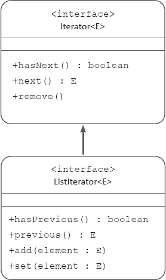

`Iterator` 是用于循环遍历集合（如 `ArrayList` 或 `HashSet`）的对象。“迭代”（iterating）一词指的是循环，迭代器仅支持正向迭代。这使得 `Iterator` 接口非常适用于不维护特定顺序的 `Set` 集合。

对于 `List` 集合，可以使用 `ListIterator` 接口。列表维护了元素的顺序，因此 `ListIterator` 允许你正向和反向遍历列表。

让我们考虑一个例子。在我们的代码中，有一个在之前的示例中使用过的 `Person` 类。该类有两个属性：`name` 和 `age`。它还包含一个构造函数、getter 方法（`getName()` 和 `getAge()`）、一个 `toString()` 方法、一个 `equals()` 方法和一个 `hashCode()` 方法。

```java
public class Person {
    private String name;
    private int age;

    public Person(String name, int age) {
        this.name = name;
        this.age = age;
    }

    // getters
    public String getName() {
        return name;
    }
    public int getAge() {
        return age;
    }

    // toString method
    public String toString() {
        return getName() + ", at age " + getAge();
    }

    // equals and hashCode method
    public boolean equals(Object obj) {
        boolean result = false;

        if (obj != null && obj instanceof Person ) {
            Person p = (Person) obj;
            if (this.getName().equals(p.getName())
             && this.getAge() == p.getAge()) {
                result = true;
            }
        }
        return result;
    }

    public int hashCode() {
        return getName().hashCode() ^ getAge();
    }
}
```

在我们的测试类中，我们实例化五个 `Person` 对象。我们将创建一个实现为 `HashSet` 的集合 `myFriends`，并添加这些 `Person` 对象。由于 `HashSet` 不保证顺序，当我们使用 `System.out.println(myFriends);` 打印集合时，元素的顺序可能与添加它们的顺序不同。此外，输出将被封装在方括号中。这里是我们的测试类 `TestPerson.java` 的代码。

```java
import java.util.*;

public class TestPerson {
    public static void main(String[] args) {
        int sum = 0;

        Person p1 = new Person("Edwin", 20);
        Person p2 = new Person("Percy", 30);
        Person p3 = new Person("Ericson", 24);
        Person p4 = new Person("Jerry", 18);
        Person p5 = new Person("Lesley", 27);

        Set myFriends = new HashSet();

        myFriends.add(p1);
        myFriends.add(p2);
        myFriends.add(p3);
        myFriends.add(p4);
        myFriends.add(p5);

        System.out.println(myFriends);
    }
}
```

运行时输出：

`[Edwin, at age 20, Lesley, at age 27, Percy, at age 30, Jerry, at age 18, Ericson, at age 24]`

如果我们想单独打印每个朋友的信息，并计算该组的平均年龄，可以使用 `Iterator` 接口。由于我们正在处理 `Set`，因此可以使用迭代器。

它的工作原理如下：

- 我们使用 `myFriends.iterator()` 创建一个迭代器。`iterator()` 方法定义在 `Set` 接口中并返回一个迭代器对象。
- 迭代器提供三个主要方法：`hasNext()`、`next()` 和 `remove()`。这些方法帮助我们循环遍历集合。
- 我们使用 `while` 循环来遍历集合。条件 `it.hasNext()` 检查是否有更多元素待处理。如果为真，我们通过 `it.next()` 获取下一个元素。
- 如果需要，我们可以通过适当的类型转换将检索到的元素存储在变量中（例如 `Person` 对象）。
- 为了计算平均年龄，我们使用 `p.getAge()` 计算所有 `Person` 对象的年龄总和，然后除以通过 `myFriends.size()` 获取的元素总数。下面是我们的测试类 `TestPerson.java` 的更新版本，这次使用了 `Iterator` 对象。

```java
import java.util.*;

public class TestPerson {
    public static void main(String[] args) {
        int sum = 0;

        Person p1 = new Person("Edwin", 20);
        Person p2 = new Person("Percy", 30);
        Person p3 = new Person("Ericson", 24);
        Person p4 = new Person("Jerry", 18);
        Person p5 = new Person("Lesley", 27);

        Set myFriends = new HashSet();

        myFriends.add(p1);
        myFriends.add(p2);
        myFriends.add(p3);
        myFriends.add(p4);
        myFriends.add(p5);

        Iterator it = myFriends.iterator();
        while (it.hasNext()) {
            Person p = (Person) it.next();
            System.out.println(p);
            sum += p.getAge();
        }

        System.out.println("Sum: " + sum);
        double averageAge = (double)sum/myFriends.size();
        System.out.println("Average age of my Friends: " + averageAge);
    }
}
```

最后，我们编译并运行修改后的 `TestPerson.java`。输出将显示每个朋友的细节，并显示平均年龄。

运行时输出：

Edwin, at age 20

Lesley, at age 27

Percy, at age 30

Jerry, at age 18

Ericson, at age 24

Sum: 119

Average age of my Friends: 23.8

这种方法允许我们遍历集合中的每个元素，执行平均值等计算，并以自定义格式显示结果。

## 8.6 泛型框架简介

当我们编译 Java 源代码时，在编译 `MapExample.java` 文件时经常会看到类似下面的编译警告：

注意：`MapExample.java` 使用了未检查或不安全的操作。

注意：使用 `-Xlint:unchecked` 重新编译查看详情。

这些警告出现是因为我们可能在没有泛型的情况下使用了集合框架。那么，泛型框架究竟是什么？我们如何使用它来消除这些警告呢？

泛型框架是在 Java 5 中引入的，它提供了一种参数类型的方法，这种类型被称为元素（elements）。如果你查看任何集合接口或类的 Java API 文档，你会注意到一个带有类型参数的菱形运算符（`<>`），例如 `E`（代表元素）。集合的子接口也是如此。对于 `Map`，我们不使用 `E`，而是使用 `K` 和 `V` 来表示键值对。

泛型减少了在集合中添加或检索对象时所需的代码量。例如，在之前的示例中，当我们使用 `iterator` 从集合中检索对象时，我们必须对返回的对象进行强制类型转换，因为 `next()` 方法返回的是通用 `Object` 类型。

通过使用泛型，我们引入了编译时类型安全，允许编译器在编译期间捕获无效类型。这同时也消除了显式类型转换的需要。让我们看看使用泛型的新版本循环是如何工作的。请参考下面的代码第 26 到 31 行。

你可以在集合声明中声明泛型。例如，在 `Set` 声明中，你可以使用菱形运算符（`<>`）指定它只接受 `Person` 对象。声明的左侧和右侧都应该指定 `Person` 类型。这确保了只有 `Person` 对象可以添加到 `Set` 中。如果你尝试添加非 `Person` 对象（例如 `String`），将导致编译错误。此错误有助于确保只有正确的类型被添加到集合中，而且它在编译期间出现，使其更容易调试。查看下方代码中注释的第 20 行；使用该行会导致错误。

让我们重新回到测试类 `TestPerson.java`，但这次它使用了菱形运算符（`<>`）。

```java
1  import java.util.*;
2
3  public class TestPerson {
4  public static void main(String[] args) {
5      int sum = 0;
6
7      Person p1 = new Person("Edwin", 20);
8      Person p2 = new Person("Percy", 30);
9      Person p3 = new Person("Ericson", 24);
10     Person p4 = new Person("Jerry", 18);
11     Person p5 = new Person("Lesley", 27);
12
13     Set<Person> myFriends = new HashSet<Person>();
14
15     myFriends.add(p1);
16     myFriends.add(p2);
17     myFriends.add(p3);
18     myFriends.add(p4);
19     myFriends.add(p5);
20     // myFriends.add("My other friend.."); //! error
21
22     // System.out.println(myFriends);
23
24     Iterator<Person> it = myFriends.iterator();
25
26     while(it.hasNext()) {
28             Person p = it.next();
29             System.out.println(p);
30             sum += p.getAge();
31     }
32
33     System.out.println("Sum: " + sum);
34     double averageAge =
35                 (double) sum / myFriends.size();
36     System.out.println("Average age of my Friends: "
37                 + averageAge);
38 }
39 }
```

此外，你可以使用增强 for 循环（也称为 "for-each" 循环）来遍历集合。增强 for 循环专门设计用于集合和数组使用。它由两部分组成：第一部分是一个临时对象（例如 `Person p`），第二部分是集合（`myFriends`）。该循环会自动从集合中检索每个 `Person` 对象，使代码更加简洁。

尝试通过更改测试类 `TestPerson.java` 的第 21 到 31 行，使用下面的代码片段来增强 for 循环。它应该仍然可以工作，并且会给你相同的输出。

```java
for (Person p : myFriends) {
    System.out.println(p);
    sum += p.getAge();
}
```

## 8.7 菱形运算符 (<>)

在 Java 7 中，引入了一种名为菱形运算符（`<>`）的新特性以减少冗余。在此之前，你通常需要在左侧和右侧指定类型。例如，在声明 `Set` 或 `List` 时，你需要指定类型：

```java
Set<Person> myFriends = new HashSet<Person>();
```

然而，使用菱形运算符，编译器会从左侧推断类型。这也适用于 `Map` 对象：

```java
Map<String, Integer> myMap = new HashMap<String, Integer>();
```

这种方法允许编译器从左侧推断类型。让我们来看一个例子：

```java
Set<Person> myFriends = new HashSet<>();
```

在这里，我们声明了 `Set` 将包含 `Person` 对象，但由于菱形运算符，我们不再需要在右侧重复 `Person` 类型。如果我们保存、编译并运行代码，将获得之前相同的输出，但语法更简洁。

## 8.8 不变集合的工厂方法 (JDK 9)

在 JDK 9 中，`List`、`Set` 和 `Map` 接口引入了新的工厂方法 `of()` 和 `copyOf()` 来创建不变集合。这些方法使得创建固定集合变得简单和简洁。例如：

```java
List<String> names = List.of("Alice", "Bob", "Charlie");
Set<Integer> numbers = Set.of(1, 2, 3);
Map<Integer, String> idToName = Map.of(1, "Apple", 2, "Banana");
```

这种方式创建的集合是不变的，如果你尝试修改它们，将抛出 `UnsupportedOperationException`。这对于创建常量或传递不更改的数据特别有用。

## 8.9 使用 var 回顾局部变量类型推断 (JDK 10)

让我们重新回顾第一章讨论过的 JDK 10 `var` 关键字。`var` 关键字允许编译器推断变量类型，在使用泛型集合时可以提高代码的可读性。当类型从右侧显而易见时，这种方法特别有用：


```java
var names = List.of("Jane", "John", "Doe");
var idMap = new HashMap<Integer, String>();
```

然而，开发者应该谨慎使用 `var` 以保持可读性，特别是在复杂的声明中。

## 8.10 Collectors.toUnmodifiableList/Set/Map (JDK 10)

在 JDK 10 中，Java 引入了新的收集器方法，可以直接从流（streams）中创建只读集合。这些是 `Collectors.toUnmodifiableList()`、`Collectors.toUnmodifiableSet()` 和 `Collectors.toUnmodifiableMap()` 方法。

在此之前，你通常会将元素收集到一个普通集合中，然后使用 `Collections.unmodifiableList()` 或类似方法对其进行封装。现在，你只需一步即可生成不可修改的集合，使代码更加简洁且更不容易出错。不可修改的集合在创建后无法被更改，任何添加、删除或更新元素的尝试都会导致 `UnsupportedOperationException`。当你希望确保 `stream` 操作的结果保持一致，并且不会在程序的其他地方被无意中修改时，这种方法非常有用。

以下是演示这些新方法的示例代码：

```java
import java.util.List;
import java.util.Set;
import java.util.Map;
import java.util.stream.Collectors;
import java.util.stream.Stream;

public class UnmodifiableCollectorsExample {
    public static void main(String[] args) {
        // 不可修改列表
        List<String> names =
            Stream.of("Alice", "Bob", "Charlie")
                .collect(Collectors.toUnmodifiableList());
        System.out.println("List: " + names);

        // 不可修改集合
        // 重复元素移除
        Set<Integer> numbers = Stream.of(1, 2, 3, 3)
            .collect(Collectors.toUnmodifiableSet());
        System.out.println("Set: " + numbers);

        // 不可修改映射
        Map<Integer, String> idNameMap =
            Stream.of("A", "B", "C")
                .collect(Collectors.toUnmodifiableMap(
                    String::length, // key：字符串长度
                    value -> value // value：字符串本身
                ));
        System.out.println("Map: " + idNameMap);

        // 尝试修改将抛出异常
        // 取消注释以查看 UnsupportedOperationException
        // names.add("David");
    }
}
```

在此示例中，`stream` 元素直接收集到不可修改的集合中，无需额外的封装步骤。这不仅减少了样板代码，而且在收集点处强制执行了不可变性，使你的数据免受无意修改的影响。

## 8.11 有序集合 (JDK 21)

在 JDK 21 中，Java 引入了 `SequencedCollection` 接口，它为处理具有定义遍历顺序的集合提供了一种一致的方法——这意味着元素存储在特定的序列中。这些新接口包括 `SequencedCollection`、`SequencedSet` 和 `SequencedMap`。它们扩展了现有的集合类型，并添加了方法，以便于访问第一个和最后一个元素，并能反序遍历集合。在此功能出现之前，你必须依赖不同的特定集合方法或手动迭代来完成这些任务，而这些任务在不同类型之间可能有所不同。通过有序集合，你可以编写出对于列表、集合或保持顺序的映射工作方式相同的代码，提高了可读性和一致性。

```java
import java.util.SequencedCollection;
import java.util.ArrayList;

public class SequencedCollectionExample {
    public static void main(String[] args) {
        // 创建一个有序集合
        // (ArrayList 实现了 SequencedCollection)
        SequencedCollection<String> fruits = new ArrayList<>();
        fruits.add("Apple");
        fruits.add("Banana");
        fruits.add("Cherry");

        // 访问第一个和最后一个元素
        System.out.println("First fruit: " + fruits.getFirst());
        System.out.println("Last fruit: " + fruits.getLast());

        // 反序迭代
        System.out.println("Fruits in reverse:");
        for (String fruit : fruits.reversed()) {
            System.out.println(fruit);
        }
    }
}
```

执行后的输出如下：

```
First fruit: Apple
Last fruit: Cherry
Fruits in reverse:
Cherry
Banana
Apple
```

在此示例中，我们使用 `getFirst()` 和 `getLast()` 来快速检索第一个和最后一个元素，并使用 `reversed()` 从末尾到开始循环列表——这一切无需编写额外的逻辑。此功能使得处理不同集合类型的有序集合更加简单且一致。这些在较新 JDK 版本中引入的增强功能构建在集合框架（Collections Framework）和泛型（Generics）的坚实基础之上。它们促进了不可变性、简洁性和更安全的类型处理，允许开发者编写更具表现力且易于维护的代码。

## 章节总结

- `Collection` 接口是 Java 集合层次结构的根，代表一组被称为元素的对象的组，并作为 `Set` 和 `List` 等更具体的子接口的基础。虽然 Java 开发工具包（JDK）没有提供此接口的直接实现，但它被广泛用于以最大的通用性传递和操作集合。

- Java 中的 `Collection` 对象是集合框架（Collections Framework）的一部分，提供了列表、集合和队列等动态数据结构，这些结构的大小可以增大或缩小，并提供了各种操作元素的方法。相比之下，`Arrays` 是固定大小的并存储特定类型的元素，与集合相比提供的内置方法较少。

- Java 中的 `Set` 接口设计用于存储一组无序的、唯一的元素，禁止重复且最多允许一个 `null` 元素。当向 `Set` 添加重复元素时，只保留第一次出现的内容，后续的重复元素会被忽略。

- `List` 接口表示一种有序集合，元素的序列被予以维护，允许重复并能够通过索引访问，这与存储无序、唯一元素且不允许重复的 `Set` 接口不同。在比较使用 `List` 和 `Set` 的示例时，`List`（例如 `ArrayList`）保留插入顺序并包含所有元素，而 `Set`（例如 `HashSet`）则排除重复且不保证顺序。

- `Map` 是另一种数据结构，它以键值对的形式存储元素，每个键（K）都关联一个对应的值（V），允许根据键进行高效检索。与 `Set` 和 `List` 接口使用单个类型参数（E）表示元素不同，`Map` 接口使用两个类型参数（K 和 `V`）来定义它所持有的键和值的类型。

- `Set`、`List` 和 `Map` 接口允许添加和打印集合的对象，通常显示在方括号（[]）中。为了在遍历集合时格式化输出或进行计算，可以使用 `Iterator` 接口进行正向迭代（特别是对于无序的 `Set`），或使用 `ListIterator` 接口对 `List` 进行双向迭代。

- 泛型（Generics）框架极大提高了 Java 集合框架的实用性和安全性。它消除了获取对象时的强制转换，确保了编译时的类型安全，并允许代码更加简洁易读。通过在集合中声明特定类型，可以创建同质集合并避免与类型匹配相关的运行时错误。

- Java SE7 引入的钻石操作符 `<>` 简化了泛型框架的使用，允许编译器从声明中推断集合的类型，消除了在赋值语句两侧重复类型的类型。这一功能减少了冗余并增强了代码的可读性，例如 `Set<Person> mySet = new HashSet<>();`，这种情况下不再需要两次指定 `Person` 类型。

### 多选题

1. 给定定的 main 方法：

```java
public static void main(String[] args) {
    Set<Object> s = new HashSet<Object>();
    s.add("java");
    s.add(new String("java"));
    System.out.println(s);
}
```

假设 `main` 方法位于有效的 Java 源文件中，且所有必要的 import 语句均已提供。以下叙述哪个是**正确**的？

a. 代码将编译并运行，并将打印 `"java"` 作为输出。

b. 代码将编译并运行，并将打印两次 `"java"`。

c. 代码将无法编译，因为 `Set` 不允许添加重复的对象。

d. 代码将无法编译，但会抛出 `RuntimeException`

2. `Set` 和 `List` 之间的主要区别是什么？

a. `List` 维护顺序，而 `Set` 确保唯一性

b. 两者都维护元素顺序

c. 两者都允许重复元素

d. `Set` 允许重复元素，而 `List` 不允许

3. 下列哪个陈述**不正确**？

a. `Map` 中的对象可以有重复的键。

b. `set` 中的对象都是唯一的。

c. `list` 内部的对象是有序的，并且包含重复项。

d. 只要是键值对，你就可以 `Map` 内部添加对象。

4. 我们可以在哪个包中找到 `Collection` 接口？

a. `java.io` 包

b. `java.util` 包

c. `java.awt` 包

d. `java.lang` 包

5. 数组的哪些特征使其与集合不同？

a. 数组只能持有对象

b. 数组是线程安全的

c. 数组可以动态地增长和缩小

d. 数组一旦创建，大小就固定

6. 关于 `Set` 接口的述哪个陈述是正确的？

a. `Set` 允许重复元素，但不允许 null 元素。

b. `Set` 维护元素插入时的顺序。

c. `Set` 不允许重复元素，且最多允许一个 null 元素。

d. `Set` 可以包含重复的键但唯一的值。

7. 下述代码段的输出是什么？

```java
Set<String> mySet = new HashSet<>();
mySet.add("apple");
mySet.add("banana");
mySet.add("apple");
System.out.println(mySet.size());
```

a. 1

b. 2

c. 3

d. 编译错误

8. 考虑以下代码段。哪个陈述是正确的？

```java
Set<Integer> numbers = new HashSet<>();
numbers.add(3);
numbers.add(1);
numbers.add(2);
numbers.add(null);
System.out.println(numbers);
```

a. 代码将编译并运行且无错误，`HashSet` 将包含 `[null, 1, 2, 3]`。

b. 代码将编译，但在运行时会抛出 `NullPointerException`。

c. 由于向 `HashSet` 添加了 null，代码将无法编译。

d. 代码将编译并运行，但 `HashSet` 将忽略 null 值。

9. 关于 `List` 接口的述陈述哪个是**错误**的？

a. `List` 允许重复元素。

b. `List` 接口继承 `Collection` 接口。

c. `List` 维护元素插入的顺序。

d. `List` 提供了一个方法可以在不使用任何额外数据结构的情况下反序检索元素。

10. 给定下面的代码段，输出是什么？可以查看 API 文档以了解如何使用 `ArrayList` 方法。

```java
List<String> list = new ArrayList<>();
list.add("A");
list.add("B");
list.add("C");
list.set(1, "D");
list.add(1, "E");
System.out.println(list);
```

a. `[A, B, D, C]`

b. `[A, D, E, C]`

c. `[A, E, D, C]`

d. `[A, E, B, D, C]`

## 多选题答案键

| 1 – a | 2 – a | 3 – a | 4 – b | 5 – d |
| 6 – c | 7 – b | 8 – a | 9 – d | 10 – c |


# 任务

## 任务 1：使用 Java Collections 的图书管理系统

#### 任务概述：

设计并实现一个基础图书管理系统，能够存储、管理和检索有关书籍的信息。你将利用 Java Collections 来处理书籍的存储和操作。系统中的每本书都应该有一个唯一标识符、标题、作者和体派。

#### 任务分解：

**1. 创建 Book 类：**

创建一个具有以下属性的 `Book` 类：

- `String title`
- `String author`
- `String isbn` (每本书的唯一标识符)
- `String genre`

- 实现构造函数、访问器方法、修改器方法以及 `toString()` 方法以便方便显示书籍信息。

**2. 创建 Library 类：**

使用 `Set<Book>` 来维护书籍集合，确保集合中不存在两本 `ISBN` 相同的书籍。

实现以下方法：

- `void addBook(Book book)`：向图书馆添加一本新书。
- `Book searchByISBN(String isbn)`：根据 `ISBN` 检索书籍。如果未找到书籍则返回 `null`。
- `List<Book> searchByAuthor(String author)`：返回指定作者的书籍列表。
- `List<Book> searchByGenre(String genre)`：返回指定体派的书籍列表。
- `void removeBook(String isbn)`：根据 `ISBN` 从图书馆中移除书籍。
- `void displayBooks()`：显示图书馆中所有的书籍。

**3. Main 类：**

在 `main` 方法中演示图书馆的功能：

- 添加几本书书。
- 按 `ISBN` 搜索。
- 按作者或体派搜索。
- 移除书籍。
- 使用 `Iterator` 显示所有书籍。

**额外指南：**

- 确保系统不允许存在重复的 `ISBN`。
- 处理边界情况，例如搜索不存在的 `ISBN`。

## 任务 2：简单登录应用

#### 任务概述：

创建一个 Java 程序，从名为 `userList.txt` 的文件读取用户凭据。文件名应通过命令行传递。文件包含用户名和密码。奇数行是用户名，偶数行是密码。使用 `HashMap` 访问用户名和密码。

#### `userList.txt` 示例：

| 行号 | 内容 |
| :--- | :--- |
| 1 | user1 |
| 2 | password1 |
| 3 | user2 |
| 4 | password2 |
| 5 | user3 |
| 6 | password3 |

#### 要求：

- 从 `userList.txt` 读取条目。
- 将它们存储在 `HashMap` 中。
- 提示用户输入用户名和密码。

#### 示例运行 1：

```
java Login userList.txt
Enter username: user1
Enter password: password1
Access Granted
```

#### 示例运行 2：

```
java Login userList.txt
Enter username: someValue
Enter password: somePassword
Access Denied
```

随着 Java 的演进，引入了被称为 `Swing` 的第二代用户界面工具包，提供了更高级的功能和灵活性。除了 `AWT` 和 `Swing`，Java 现在还提供了 `JavaFX`，这是另一个用于创建丰富用户界面的强大工具包。然而，对于本文讨论，我们将关注 `AWT`。


首先，让我们回顾一个基本概念：在 Java 中，`Object` 类是所有类层次结构的根。`Object` 的子类之一是 `Component` 类，它代表用户界面中可以交互的任何视觉元素。组件的示例包括按钮、标签、复选框、选择框、列表框甚至容器。

## 图 9.1 AWT 类层次结构

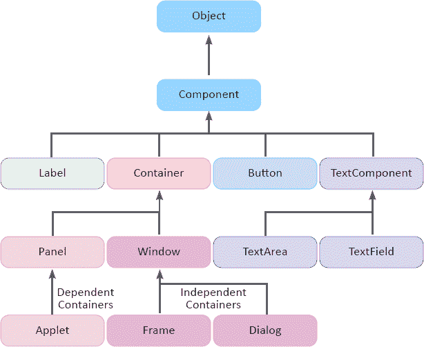

`图 9.1` 展示了 Java 抽象窗口工具包 (`AWT`) 的类层次结构。层次结构的顶端是 `Object` 类，所有的 `AWT` 组件都继承自它。`Component` 类作为所有图形 UI 元素的根，例如 `Button`、`Label`、`Checkbox`、`Choice` 和 `List`。这些都是单独的用户界面组件。

`Container` 类也继承自 `Component`，它可以包含其他组件和容器，这对于创建复杂的 UI 布局至关重要。`Container` 分为两种主要类型：

*   基于窗口的容器，例如 `Frame` 和 `Dialog`，它们是独立的容器，不需要嵌入到另一个 UI 组件中。
*   基于面板的容器，例如 `Panel` 和 `Applet`，它们是依赖容器，必须添加到窗口或另一个容器中才能显示。

该层次结构展示了 `AWT` 如何组织可重用和可扩展的 UI 组件，用于在 Java 中构建图形用户界面。

在其中，`Container` 类格为重要，因为它允许你在内部持有并组织其他组件。例如，你可以将一个按钮放在容器内部。`Container` 类的两个常用子类是 `Window` 和 `Panel`。

`Window` 是一种可以独立存在的容器类型。一旦创建了窗口，它就可以独立运行，不需要任何其他容器。相反，`Panel` 也是一种容器，但不能独立存在。它必须放置在另一个容器（如窗口或 applet）内部才能正常工作。

例如，你可以创建一个 `Frame`（窗口的一种类型）并单独启动它。然而，如果你创建一个 `Panel`，它将不会独立运行。相反，它需要被添加到帧或另一个容器中。

`AWT` 中的每个容器都带有一个默认布局管理器，用于控制其内部组件的排列方式。

同样值得注意的是，在 Java 1.1 中引入的 `Applet` 类仅支持到 Java 8。从 Java 9 开始，`Applet` 类被弃用，并且到 Java 17，它们已被完全移除。

现在，让我们仔细观察一下 `AWT` 包。它包含了许多你在构建 GUI 时经常会用到的接口和类。例如，`Button` 类允许你创建可点击的按钮，而 `Checkbox` 类允许你创建可选择的复选框。如前所述，`Frame` 类用于创建可以独立的窗口组件。通过有效理解和利用这些组件及容器，你将能够在 Java 中创建功能齐全且用户友好的图形界面。

## 9.2 构建 GUI 应用时需要考虑的事项

在探索了 `java.awt` 包后（该包包含了构建 Java 图形用户界面 (GUI) 应用的关键类），让我们来探索这三个大类：组件、容器和布局管理器。

1. **组件 (Components)** 是你应用程序的视觉元素，如按钮、帧、对话框、文本区域和文本字段。这些是用户直接交互的应用程序部分。
2. **容器 (Containers)** 是一种特殊的组件。与其他组件一样，它们是视觉元素，但它们的主要目的是在内部持有并组织其他组件。容器的示例包括帧和面板。
3. **布局管理器 (Layout managers)** 决定了组件在容器内的排列方式。它们控制容器内部组件的位置和大小，确保你的应用程序界面组织良好且易于使用。

### 9.2.1 Frame 类

让我们深入研究 `Frame` 类，它是 Java 中创建图形用户界面 (GUI) 的基础部分。帧（Frame）是一个顶级窗口，包含边框和标题栏，使其成为可以包含其他 GUI 组件的容器。

默认情况下，帧使用名为 `BorderLayout` 的布局管理器。但是，你可以轻松地更改此布局管理器以满足你的需求，稍后我们将探索如何这样做。帧是可以调整大小的，这意味着你可以通过窗口的角来调整其尺寸。

现在，让我们看一个演示如何使用帧创建简单 GUI 的示例代码。首先，看讨论末尾提供的源代码，该文件保存为 `SampleFrame.java`。在提供的源代码中，我们必须导入必要的包，即位于第 1 行的 `java.awt`。

在示例代码中，声明了一个 `Frame` 对象，并在第 9 行到第 12 行定义了构造函数和方法。这种方法是构建 GUI 应用的最佳实践。首先，你声明所有的组件和容器。然后，在构造函数中初始化它们，就像提供的代码中一样。最后，你定义方法来管理这些组件的行为。

在 `startApp()` 方法中（这是一个用户自定义方法），我们设置了帧的属性。例如，我们将背景颜色设置为黄色，并设置帧的大小为 200 像素宽和 200 像素高。

```java
26 }
27 } // end of code
```

这里是 `SampleFrame.java` 的运行时输出：

图 9.2 `SampleFrame.java` 的运行时输出


Java 中的 Frame（帧）是容器，但其他其他容器，例如 Panel（面板）。Panel 提供了一个可以让你在其放置其他组件的空间，但与 Frame 不同，它们不能独立启动。Panel 必须添加到另一个容器（如 frame）中。

在下一个示例中，我们将同时创建一个 frame 和 panel。我们将 frame 的大小设置为 400x200 像素，并将其背景颜色设置为黄色。我们还创建了一个大小为 100x100 像素且背景为紫色的 panel。使用 `add()` 方法将 panel 放在 frame 中。

`setBackground()` 方法用于更改容器的背景颜色，可以使用定义的颜色（如 `Color.YELLOW`）或通过指定 RGB 值使用自定义颜色。对于红、绿、蓝每个分量，RGB 值的范围都是 0 到 255。

如果你想禁用默认布局管理器（对于 frame 来说是 `BorderLayout`），可以调用 `setLayout(null)` 来禁用布局管理器。然后，你可以手动在 frame 内部定位组件。

这里有一个创建一个基础 frame 和 panel 的简单示例代码。下面的源代码保存为 `PanelInsideAFrame.java`。

```java
import java.awt.*;

public class PanelInsideAFrame {
    private Frame f;
    private Panel p;

    public PanelInsideAFrame() {
        f = new Frame("Panel in a Frame");
        p = new Panel();
    }

    public void startApp() {
        f.setSize(400, 200);
        f.setBackground(Color.YELLOW);

        p.setSize(100, 100);
        p.setBackground(new Color(255, 0, 255));

        // frame won't be using any layout managers -> null
        f.setLayout(null);
        f.add(p);
        f.setVisible(true);
    }

    public static void main(String args[]) {
        PanelInsideAFrame pan = new PanelInsideAFrame();
        pan.startApp();
    }
} // end of code
```

尝试自己运行这段代码，并尝试更改 frame 的大小和背景颜色。你也可以使用 RGB 分量 0 到 255 之间的值来调整 panel 的大小和颜色。

[图 9.3] 显示了文件 `PanelInsideAFrame.java` 的运行时输出。

图 9.3 `PanelInsideAFrame.java` 的运行时输出

## 9.3 Java 布局管理器

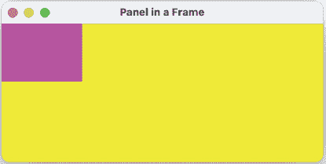

让我们讨论一下布局管理器，它们是 Java 中用于在容器内排列和定位组件的工具。这些管理器帮助控制组件在屏幕上的显示方式。

对于更复杂的布局，你可以嵌套容器，这意味着将一个容器放在另一个容器内部，从而让你创建自定义的布局。在 `java.awt` 包中，有五种主要的布局管理器：`FlowLayout`、`BorderLayout`、`GridLayout`、`CardLayout` 和 `GridBagLayout`。此外，`Swing` 包提供了两个布局管理器：`BoxLayout` 和 `SpringLayout`。

### 9.3.1 FlowLayout 管理器

让我们从理解 `FlowLayout` 布局管理器的工作原理开始。`FlowLayout` 将组件按行排列，就像文本行中的单词一样。默认情况下，它将按钮或类似的组件在水平方向上排列，直到空间耗尽，此时它会移动到下一行。这些行的对齐方式可以使用 `LEFT`、`RIGHT`、`LEADING` 和 `TRAILING` 等属性进行调整。

这里有一个示例来说明这一点。假设你有四个按钮。使用 `FlowLayout`，如果两个按钮可以放入第一行，那么第三个按钮将移动到下一行，依此类推。如果你调整窗口（容器）的大小，按钮将自动调整自己以适应新大小。

下面是一个演示使用 `FlowLayout` 的示例代码：文件名为 `FlowLayoutExample.java`。

```java
import java.awt.*;

public class FlowLayoutExample {
    // 属性
    private Frame f;
    private Button addBtn, subBtn, mulBtn, divBtn;

    // 构造函数
    public FlowLayoutExample() {
        f = new Frame("Flow Layout");
        addBtn = new Button("+");
        subBtn = new Button("-");
        mulBtn = new Button("*");
        divBtn = new Button("/");
    }

    // 方法
    public void startApp() {
        // 设置 FlowLayout 为布局管理器
        f.setLayout(new FlowLayout());
        f.add(addBtn);
        f.add(subBtn);
        f.add(mulBtn);
        f.add(divBtn);
        f.setSize(200, 200);
        f.setVisible(true);
    }

    public static void main(String[] args) {
        FlowLayoutExample example = new FlowLayoutExample();
        example.startApp();
    }
}
```

当我们尝试编译并运行这段代码时，将得到下面的输出。尝试水平和垂直调整 frame 的大小，观察按钮如何在 frame 内重新对齐。下面的图片显示了 `Frame` 在调整大小后的不同版本。

图 9.4 FlowLayout 示例输出 1

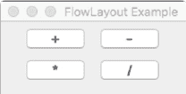

图 9.5 FlowLayout 示例输出 2


图 9.6 FlowLayout 示例输出 3


在这段代码中，我们创建了一个 frame 和四个按钮。每个按钮都标有数学运算符：加、减、乘、除。在声明并初始化 frame 和按钮后，我们将 frame 的布局设置为 `FlowLayout`，使用 `f.setLayout(new FlowLayout())`。如果你调整窗口，你会注意到按钮会自动重新定位。FlowLayout 还允许你指定布局内组件的对齐方式。默认情况下是对中对齐，但你可以在设置布局时传递不同的对齐方式，例如 `FlowLayout.LEFT` 或 `FlowLayout.RIGHT`。这是 `java.awt` 包提供的布局管理器的一个例子，它让你预览布局管理器在组织 GUI 组件时有多强大和灵活。

### 9.3.2 BorderLayout 管理器

我们将探讨的下一个 Java frame 使用的默认布局管理器是 `BorderLayout`。该布局管理器将容器分为五个区域：`NORTH`、`SOUTH`、`EAST`、`WEST` 和 `CENTER`。在 `BorderLayout` 中排列组件时，每个区域只能包含一个组件，并且每个区域都通过其相应的常量指定（例如 `BorderLayout.NORTH`、`BorderLayout.SOUTH` 等）。

如果你在添加组件时没有指定区域，它将被放置在 `CENTER` 区域。该区域是默认区域，也是唯一可以同时水平和垂直扩展的区域。`NORTH` 和 `SOUTH` 区域的组件只在水平方向调整，而 `EAST` 和 `WEST` 区域只在垂直方向调整。

图 9.7 BorderLayout 

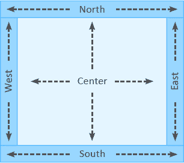

让我们来看一个例子。假设我们有一个五个按钮的 frame：北部按钮 (`bNorth`)、南部按钮 (`bSouth`)、中心按钮 (`bCenter`)、西部按钮 (`bWest`) 和东部按钮 (`bEast`)。在我们的类构造函数中，我们将首先创建 frame 和按钮。

这里有一个带有文件名的示例代码：`BorderLayoutExample.java`。

```java
import java.awt.*;

public class BorderLayoutExample
{
    private Frame f;
    private Button bNorth, bSouth, bCenter, bWest, bEast;

    public BorderLayoutExample() {
        f = new Frame("BorderLayout Example");

        bNorth = new Button("North");
        bSouth = new Button("South");
        bCenter = new Button("Center");
        bWest = new Button("West");
        bEast = new Button("East");
    }

    public void startApp()
    {
        // frames 默认使用 BorderLayout 布局，
        // 不需要更改 Frame f 的 
        // 布局管理器；

        f.add(bNorth, BorderLayout.NORTH);
        f.add(bSouth, BorderLayout.SOUTH);
        f.add(bCenter, BorderLayout.CENTER);
        f.add(bWest, BorderLayout.WEST);
        f.add(bEast, BorderLayout.EAST);

        f.setSize(400, 200);
        f.setVisible(true);
    }

    public static void main(String args[])
    {
        BorderLayoutExample be = new BorderLayoutExample();
        be.startApp();
    }
}
```

接下来，我们使用一个方法（暂称为 `startApp()`）来设置我们的窗口。由于 `BorderLayout` 是窗口默认的布局管理器，因此我们不需要像上一个示例那样调用 `setLayout()` 方法。相反，我们可以直接将按钮添加到窗口中，并确保指定它们的位置。

如果你在添加按钮时忘记指定区域，所有按钮将堆叠在 `CENTER` 区域中，且只有最后一个添加的按钮是可见的。为了避免这种情况，请务必为每个按钮指定正确的区域。

运行此代码时，你将看到一个包含五个按钮的窗口，每个按钮位于五个区域之一。如果你在水平方向调整窗口，只有 `NORTH`、`CENTER` 和 `SOUTH` 区域的按钮会调整大小。如果你在垂直方向调整窗口，只有 `WEST`、`CENTER` 和 `EAST` 区域的按钮会调整大小。`NORTH` 和 `SOUTH` 区域的按钮在垂直调整窗口大不会改变大小。

图 9.8 `BorderLayoutExample.java` 运行输出

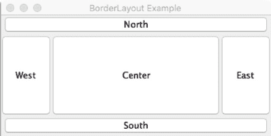

### 9.3.3 GridLayout 布局管理器

`GridLayout` 布局管理器以矩形网格的形式排列容器内的组件。容器被分为等大小的单元格，每个单元格放置一个组件。当容器调整大小时，其内部的所有组件都保持等大，并调整以适应新尺寸。

例如，假设你有六个按钮，并将它们放置在一个使用 `GridLayout` 的窗口中。无论你如何调整窗口，所有六个按钮都会等比例大小以适应窗口。这使得 `GridLayout` 成为构建扫雷游戏或计算器等应用程序的理想选择，因为这些程序需要一致的按钮网格。

现在，让我们保存为 `GridLayoutExample.java` 的示例代码。在这个示例中，我们有一个窗口和六个按钮。在构造函数内部，我们创建了窗口和这六个按钮。


```java
import java.awt.*;

public class GridLayoutExample
{
    private Frame f;
    private Button b1, b2, b3, b4, b5, b6;

    public GridLayoutExample()
    {
        f = new Frame("GridLayout");
        b1 = new Button("B1");
        b2 = new Button("B2");
        b3 = new Button("B3");
        b4 = new Button("B4");
        b5 = new Button("B5");
        b6 = new Button("B6");
    }

    public void startApp()
    {
        // 设置我们 Frame f 的布局管理器；
        f.setLayout(new GridLayout(3, 2));

        // 将所有按钮放入窗口中，
        // 从左到右
        // 从上到下
        f.add(b1);
        f.add(b2);
        f.add(b3);
        f.add(b4);
        f.add(b5);
        f.add(b6);

        f.pack();
        f.setVisible(true);
    }

    public static void main(String args[])
    {
        GridLayoutExample ge = new GridLayoutExample();
        ge.startApp();
    }
}
```

默认情况下，窗口使用 `BorderLayout`，因此我们需要通过调用窗口的 `setLayout()` 方法将其设置为 `new GridLayout()`。在创建 `GridLayout` 时，可以向其构造函数传递两个或四个整数值。在代码的第 23 行，`f.setLayout(new GridLayout(3, 2))` 创建了一个具有 3 行 2 列的网格。

## 2. 定义类和变量

接下来，创建一个名为 `SimpleCalculator` 的类，并为框架、标签、文本框和按钮定义必要的变量。

图 9.13 `SimpleCalculator.java` 使用的容器和组件列表。

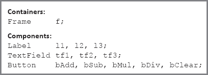

```java
public class SimpleCalculator {
    private Frame f;
    private Label l1, l2, l3;
    private TextField tf1, tf2, tf3;
    private Button bAdd, bSub, bMul, bDiv, bClear;
    // 函数
    public SimpleCalculator() {
        // 初始化写在这里
    }
    // 启动应用程序的方法
    public void startApp() {
        // 启动应用的代码
    }
    public static void main(String[] args) {
        SimpleCalculator sc = new SimpleCalculator();
        sc.startApp();
    }
}
```

## 3. 初始化组件

在构造函数内部，初始化框架和组件。

`f = new Frame("My First GUI App");`

`l1 = new Label("First:");`

`l2 = new Label("Second:");`

`l3 = new Label("Result:");`

`tf1 = new TextField("0.0", 15);`

`tf2 = new TextField("0.0", 15);`

`tf3 = new TextField("0.0", 15);`

`bAdd = new Button("+");`

`bSub = new Button("-");`

`bMul = new Button("*");`

`bDiv = new Button("/");`

`bClear = new Button("C");`

## 4. 使用面板进行布局

创建四个面板来存放你的组件。

`Panel p1 = new Panel();`

`Panel p2 = new Panel();`

`Panel p3 = new Panel();`

`Panel p4 = new Panel();`

图 9.14 将所有组件组合在一起。

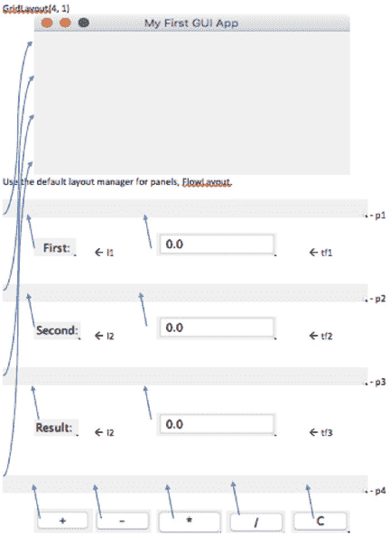

向每个面板添加组件。

`p1.add(l1);`

`p1.add(tf1);`

`p2.add(l2);`

`p2.add(tf2);`

`p3.add(l3);`

`p3.add(tf3);`

`p4.add(bAdd);`

`p4.add(bSub);`

`p4.add(bMul);`

`p4.add(bDiv);`

`p4.add(bClear);`

## 5. 设置布局并将面板添加到框架

为框架设置布局并添加面板。

`f.setLayout(new GridLayout(4, 1));`

`f.add(p1);`

`f.add(p2);`

`f.add(p3);`

`f.add(p4);`

## 6. 显示框架

最后，打包框架并使其可见。

当编译并运行这段代码时，你将看到一个带有标签、文本框和整齐排列按钮的简单用户界面。框架会自动调整大小以适应组件。然而，请注意，此计算器目前只显示 UI；它还没有执行任何计算或对按钮点击做出响应。在下一章中，我们将讨论事件处理技术，这将使我们能够响应按钮点击以执行计算。

这里是最终组合后的代码：

```java
import java.awt.*;
public class SimpleCalculator
{
    // 容器
    private Frame f;
    private Panel p1, p2, p3, p4;

    // 组件
    private Label l1, l2, l3;
    private TextField tf1, tf2, tf3;
    private Button bAdd, bSub, bMul, bDiv, bClear;

    public SimpleCalculator()
    {
        // 容器
        f = new Frame("My First GUI App");

        p1 = new Panel();
        p2 = new Panel();
        p3 = new Panel();
        p4 = new Panel();

        // 组件
        l1 = new Label("First:");
        l2 = new Label("Second:");
        l3 = new Label("Result:");

        tf1 = new TextField("0.0", 15);
        tf2 = new TextField("0.0", 15);
        tf3 = new TextField("0.0", 15);

        bAdd = new Button("+");
        bSub = new Button("-");
        bMul = new Button("*");
        bDiv = new Button("/");
        bClear = new Button("C");
    }

    public void startApp()
    {
        // 使用默认管理器用于
        // 所有面板，使用 FlowLayout。
        p1.add(l1);
        p1.add(tf1);

        p2.add(l2);
        p2.add(tf2);

        p3.add(l3);
        p3.add(tf3);

        p4.add(bAdd);
        p4.add(bSub);
        p4.add(bMul);
        p4.add(bDiv);
        p4.add(bClear);

        // 更改我们 Frame f 的布局管理器；
        // 使用 GridLayout(4, 1);
        f.setLayout(new GridLayout(4, 1));

        f.add(p1);
        f.add(p2);
        f.add(p3);
        f.add(p4);

        f.pack();
        f.setVisible(true);
    }

    public static void main(String[] args) {
        SimpleCalculator sc = new SimpleCalculator();
        sc.startApp();
    }
}
```

编译并运行此代码，你将看到如下输出：

图 9.15 运行时输出。

## 总结

- 框架（`Frame`）是 GUI 应用程序的窗口，而 面板（`Panel`）是用于组织组件的容器。
- 布局管理器（`Layout Managers`）控制组件在容器中的排列方式和大小。
- 通过嵌套不同的面板，可以创建复杂的界面。
- `AWT` 提供了多种布局选项。

## 选择题

1. 如何更改容器的布局管理器？

   a. 使用 `setLayout()` 方法

   b. 创建后，无法更改布局管理器

   c. 使用 `setLayoutManager()` 方法

   d. 使用 `updateLayout()` 方法

2. 如何使用 `FlowLayout` 指明组件的位置？

   a. `FlowLayout` 将自动放置组件

   b. 向 `add()` 方法传递 `X/Y` 参数

   c. 分配行/列引用

   d. 指定区域：`North`, `South`, `East`, `West`

3. 下述代码最好描述了程序的外观？

```java
import java.awt.*;
public class FlowAp extends Frame{
    public static void main(String args[]){ {
        FlowAp fa=new FlowAp();
        fa.setSize(400,300);
        fa.setVisible(true);
    }
    FlowAp(){
        add(new Button("One"));
        add(new Button("Two"));
        add(new Button("Three"));
        add(new Button("Four"));
    }
}
```

   a. 框架边缘各有一个标记为 One 到 Four 的按钮

   b. 框架中心有一个标记为 Four 的大按钮

   c. 按钮从上到下排列 Four

   d. 运行时错误，未设置 `LayoutManager`

4. 此代码运行时最接近的外观是？

```java
import java.awt.*;
public class ComplexLayout extends Frame{
    public static void main(String args[]){
        ComplexLayout cl = new ComplexLayout();
    }
    ComplexLayout(){
        Panel p = new Panel();
        p.setBackground(Color.pink);
        p.add(new Button("One"));
        p.add(new Button("Two"));
        p.add(new Button("Three"));
        add("South", p);
        setLayout(new FlowLayout());
        setSize(300,300);
        setVisible(true);
    }
}
```

   a. 按钮将不会显示

   b. 只有标记为 Three 的按钮占据整个框架

   c. 按钮将在框架底部从左到右排列

   d. 按钮将从 `Frame` 顶部从左到右运行

5. 当你尝试编译并运行以下代码时，将显示什么？

```java
import java.awt.*;

public class MyButton extends Frame{
    public static void main(String argv[]){
        MyButton myButton = new MyButton();
    }
    MyButton(){
        Button helloButton = new Button("Hello");
        Button byeButton = new Button("Bye");
        add(helloButton);
        add(byeButton);
        setSize(300,300);
        setVisible(true);
    }
}
```

a. 一个按钮占据整个框架，显示 Hello

b. 框架顶部有两个按钮，一个显示 Hello，另一个显示 Bye

c. 一个按钮占据整个框架，显示 Bye

d. 两个按钮并排占据整个框架，Hello 在左侧，Bye 在右侧

6. 如果你想使用 `GridLayout` 类，应该导入以下哪个包？

a. `java.awt.event.*;`

b. `java.awt.*;`

c. `java.awt.events.*;`

d. `javax.swing.*;`

7. 给定以下代码：

```java
import java.awt.*;

public class MyFrame extends Frame{
    public static void main(String argv[]){
        MyFrame m = new MyFrame();
        m.setSize(300,200);
        m.setVisible(true);
    }
}
```

如何将框架表面的颜色设置为粉色？

a. `s.setColor(PINK);`

b. `s.setBackground(Color.pink);`

c. `s.Background(pink);`

d. `s.color = Color.pink;`

8. 下列布局管理器中，哪个不是 `java.awt` 包的一部分？

a. `FlowLayout`

b. `GridLayout`

c. `BoxLayout`

d. `CardLayout`

9. 下列哪个是 `Container` 对象？

a. `TextField`

b. `Button`

c. `TextArea`

d. `Frame`

10. 在构建 GUI 应用时，以下哪项是**不需要**的？

a. `Components`

b. `Containers`

c. `Layout Managers`

d. `File`

### 多选择答案键

| 1 – a | 2 – a | 3 – b | 4 – d | 5 – c |
| 6 – b | 7 – b | 8 – c | 9 – d | 10 – d |

 编码任务

● 创建一个 Java 程序，要求用户输入 0 到 255 之间的四个 (4) 个整数。这些数值代表原色 (R) 红色、(G) 绿色、(B) 蓝色和 (A) Alpha ——颜色的透明度。

● 这些值应在文本字段中输入。

● 你需要提供一个“COMPUTE”（计算）`Button`，根据四个文本字段中输入的值来计算颜色。

● `frame` 的下半部分应提供一个面板，用于根据四个文本字段的值显示计算出的颜色。检查 `java.awt.Color` 类构造函数的 API，使其接受四个 (4) 个 `RGBA`（红色、绿色、蓝色和 Alpha）值。

以下是指定的输出格式：

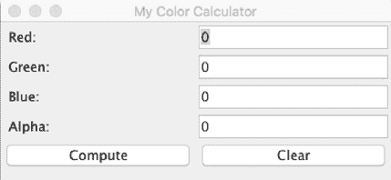

# 第 10 章

# 事件处理技术

 主要学习目标

● 理解 Java GUI 应用中事件处理的基本原理

● 探索委托事件模型及其组件：事件源和监听器

● 学习如何实现监听器接口以响应各种用户操作

● 发现如何使用适配器类（adapter classes）、内部类和匿名类来简化事件处理

● 使用 lambda 表达式编写更简洁、更易读的事件处理代码

● 通过 Java 事件处理技术构建一个简单的计算器，应用你所学习的知识

本章深入探讨了 Java 事件处理技术的核心原理，为管理图形应用程序中的用户交互提供了坚实的基础。你将从探索委托事件模型开始，在该模型中，事件源将事件处理委托给监听器——从而实现更整洁、模块化的代码。


我们将涵盖事件处理的基础知识，并研究使用监听器接口响应事件的不同方式，以及通过适配器类、内部类和匿名类实现的简化策略。这些技术将帮助你根据点击按钮、鼠标移动或按键等用户操作来控制程序的行为。

为了使你的方法更加现代化，还将引入 lambda 表达式，它允许编写更简洁、更易读的事件处理逻辑。在本章结束，你将通过构建一个简单的计算器来应用所学，获得设计交互式、事件驱动型 Java 应用的实践经验。

## 10.1 事件处理基础

让我们深入学习 Java 事件处理的基础。事件仅仅是描述动作或发生情况的对象，例如点击按钮、移动鼠标。


在该模型中，事件源是一个组件（例如按钮），它负责产生事件。监听器是一个想要响应事件的对象。为了做到这一点，监听器必须实现一个特定的接口。每当事件发生时，该监听器就会注册到事件源上。这种设置支持一对多的关系，允许事件源通知监听器。通过将事件生成与其处理分离，委托模型促进了更整洁、模块化的设计。

例如，在文档中，点击加粗按钮或使用快捷键 `CTRL-B` 都会触发事件。事件处理器是设计用于管理事件并执行预期行为的方法。因此，点击加粗按钮或按下 `CTRL-B` 都会触发同一个事件处理器来使文本加粗。

你界面中的各种组件可以产生不同类型的事件。为了更好地理解这些交互，你可以探索 `java.awt` 包，你将在其中找到处理事件所需的类和接口。对于各种类型的交互，存在不同类型的事件，如 `ActionEvent`、`AdjustmentEvent` 和 `FocusEvent`。

每个事件都封装在一个事件对象中，Java 的 `java.util.EventObject` 类是所有事件对象的父类，其子类包括 `ActionEvent` 和 `WindowEvent`。

图 10.2 展示了 Java 中的事件委托模型。当用户与组件交互时（例如在图形用户界面 (GUI) 中点击按钮）——会生成一个事件，在这种情况下具体是一个 `ActionEvent`。该事件并不是由按钮本身处理，而是被委托给一个或多个实现了 `actionPerformed(ActionEvent e)` 方法的外部事件处理器。这些处理器包含了响应用户操作的逻辑。这种模型实现了 GUI 与事件处理逻辑之间的清晰分离，允许不同的类或方法根据其注册的方式，以多种方式处理同一个事件。

图 10.2 事件委托模型

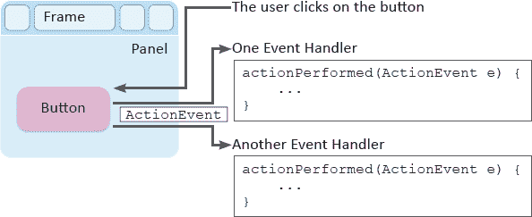

这是你的 GUI 源代码，保存为：`MyGUI.java`

```java
// MyGUI.java
import java.awt.*;

public class MyGUI
{
    private Frame f;
    private Button b;

    public MyGUI()
    {
        f = new Frame("Delegation Event Model");
        b = new Button("Click me!");
    }

    public void startApp()
    {
        f.add(b);
        f.pack();
        f.setVisible(true);

        // register your event handler
        // this is event registration #1
        b.addActionListener(new MyEvent());

        // this is event registration #2
        b.addActionListener(new MyEventToo());
    }

    public static void main(String args[])
    {
        MyGUI m = new MyGUI();
        m.startApp();
    }
}
```

这是你的事件处理器的源代码，保存为：`MyEvent.java`。该文件在 `MyGUI.java` 的第 24 行被注册。

```java
// MyEvent.java
import java.awt.event.*;

public class MyEvent implements ActionListener {
    public void actionPerformed(ActionEvent e) {
        System.out.println("I was clicked!");
    }
}
```

这是我们第二个事件处理器的另一个源代码，保存为：`MyEventToo.java`。该文件在 `MyGUI.java` 的第 27 行被注册。

```java
// MyEventToo.java
import java.awt.event.*;
public class MyEventToo implements ActionListener {
    public void actionPerformed(ActionEvent e) {
        System.out.println("I was piggy!");
    }
}
```

你可以根据需要创建许多事件处理器，只要你将它们注册到你的 GUI 组件中，它们就能正常工作。

### 10.2.2 监听器的使用

监听器是接口。如果你还记得这些规则，一旦你实现了一个接口，你就必须重写接口中的方法。表 10.1 显示了 `java.awt.event` 包中常用的接口。

#### 表 10.1 `java.awt.event` 包下的监听器

| 类别 | 接口 | 方法 |
| :--- | :--- | :--- |
| Action | `ActionListener` | `actionPerformed(ActionEvent)` |
| Item | `ItemListener` | `itemState(ItemEvent)` |
| Mouse | `MouseListener` | `pressed(MouseEvent)`, `released(MouseEvent)`, `entered(MouseEvent)`, `exited(MouseEvent)`, `clicked(MouseEvent)` |
| Mouse | `MouseMotionListener` | `mouseDragged(MouseEvent)`, `mouseMoved(MouseEvent)` |
| Key | `KeyListener` | `keyPressed(KeyEvent)`, `keyReleased(KeyEvent)`, `keyTyped(KeyEvent)` |
| Focus | `FocusListener` | `focusGained(FocusEvent)`, `focusLost(FocusEvent)` |
| Adjustment | `AdjustmentListener` | `adjustmentChanged(AdjustmentEvent)` |
| Component | `ComponentListener` | `componentMoved(ComponentEvent)`, `hidden(ComponentEvent)`, `resized(ComponentEvent)`, `shown(ComponentEvent)` |
| Window | `WindowListener` | `windowClosing(WindowEvent)`, `opened(WindowEvent)`, `iconified(WindowEvent)`, `deiconified(WindowEvent)`, `closed(WindowEvent)`, `activated(WindowEvent)`, `deactivated(WindowEvent)` |
| Container | `ContainerListener` | `componentAdded(ContainerEvent)`, `componentRemoved(ContainerEvent)` |
| Text | `TextListener` | `textValueChanged(TextEvent)` |

完整的集合始终可以在 API 文档中看到。这是一个使用监听器的示例代码。使用的文件名为 `MultiListeners.java`。

```java
// MultiListeners.java
import java.awt.*;
import java.awt.event.*;

public class MultiListeners implements MouseListener, MouseMotionListener {
    private Frame f;
    private TextField tf;
    private Label label;

    public MultiListeners() {
        f = new Frame("I have Two listeners example");
        tf = new TextField(30);
        label = new Label("Click and drag the mouse");
    }

    public void startApp() {
        f.add(label, BorderLayout.NORTH);
        f.add(tf, BorderLayout.SOUTH);

        f.setSize(300, 200);
        f.setVisible(true);

        // event handler registration
        f.addMouseMotionListener(this);
        f.addMouseListener(this);
    }

    // The event handlers
    public void mouseDragged(MouseEvent e) { 
        String s = "Mouse dragging: X = " + e.getX() + " Y = " + e.getY();
        tf.setText(s);
    }

    public void mouseEntered(MouseEvent e) {
        String s = "Mighty Mouse is coming...";
        tf.setText(s);
    }

    public void mouseExited(MouseEvent e) {
        String s = "The mouse has left the building";
        tf.setText(s);
    }

    // Unused handlers need to be overridden
    public void mouseMoved(MouseEvent e) {}
    public void mousePressed(MouseEvent e) {}
    public void mouseClicked(MouseEvent e) {}
    public void mouseReleased(MouseEvent e) {}

    public static void main(String args[]) {
        MultiListeners ml = new MultiListeners();
        ml.startApp();
    }
}
```

正如第 5 行的实现声明所示，此示例代码同时实现了 `MouseListener` 和 `MouseMotionListener` 接口。由于实现了这些接口，我们必须重写所有的方法。即使这些方法没有使用，仍然需要重写。

### 10.2.3 适配器类的使用

在某些情况下，使用适配器类比监听器更好。并不是所有的监听器都有对应的适配器类。只有包含两个或更多方法的监听器才有对应的适配器类。例如，如果你实现了 `WindowListener`，即使你只需要一个方法，也需要重写所有七个方法。在这种情况下，使用 `WindowAdapter` 更好。

以下是一个使用名为 `SampleAdapter.java` 文件的适配器类的示例代码：

```java
// SampleAdapter.java
import java.awt.*;
import java.awt.event.*;

public class SampleAdapter extends WindowAdapter
{
    private Frame f;
    private TextField tf;
    private Label label;

    public SampleAdapter()
    {
        f = new Frame("A sample adapter code");
        tf = new TextField(30);
        label = new Label("You can quit this app");
    }

    public void startApp()
    {
        f.add(label, BorderLayout.NORTH);
        f.add(tf, BorderLayout.SOUTH);

        f.setSize(300, 200);
        f.setVisible(true);

        f.addWindowListener(this);
    }

    public void windowClosing(WindowEvent we)
    {
        System.exit(0);
    }

    public static void main(String args[])
    {
        SampleAdapter sa = new SampleAdapter();
        sa.startApp();
    }
}
```

这是代码 `SampleAdapter.java` 的输出：

图 10.3 运行 `SampleAdapter.java` 代码的截图

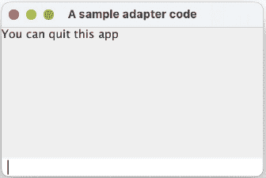

由于适配器类是一个抽象类，我们必须使用 `extends` 关键字，这有时会成为使用适配器类的缺点。第 28 到 31 行是唯一需要的，因为你只需要在 `WindowAdapter` 类中重写一个方法。

表 10.2 显示了 `java.awt.event` 包中的适配器类列表。

| 类别 | 适配器类 | 方法 |
| --- | --- | --- |
| 鼠标 | `MouseAdapter` | `mousePressed(MouseEvent)` |
| | | `mouseReleased(MouseEvent)` |
| | | `mouseEntered(MouseEvent)` |
| | | `mouseExited(MouseEvent)` |
| | | `mouseClicked(MouseEvent)` |
| 鼠标移动 | `MouseMotionAdapter` | `mouseDragged(MouseEvent)` |
| | | `mouseMoved(MouseEvent)` |
| 键盘 | `KeyAdapter` | `keyPressed(KeyEvent)` |
| | | `keyReleased(KeyEvent)` |
| | | `keyTyped(KeyEvent)` |
| 焦点 | `FocusAdapter` | `focusGained(FocusEvent)` |
| | | `focusLost(FocusEvent)` |
| 组件 | `ComponentAdapter` | `componentMoved(ComponentEvent)` |
| | | `componentHidden(ComponentEvent)` |
| | | `componentResized(ComponentEvent)` |
| | | `componentShown(ComponentEvent)` |
| 窗口 | `WindowAdapter` | `windowClosing(WindowEvent)` |
| | | `windowOpened(WindowEvent)` |
| | | `windowIconified(WindowEvent)` |
| | | `windowDeiconified(WindowEvent)` |
| | | `windowClosed(WindowEvent)` |
| | | `windowActivated(WindowEvent)` |
| | | `windowDeactivated(WindowEvent)` |
| 容器 | `ContainerAdapter` | `componentAdded(ContainerEvent)` |
| | | `componentRemoved(ContainerEvent)` |

### 10.2.4 内部类

内部类的目的是创建紧耦合的组件。对于 GUI 应用程序，它用于将 UI 代码和事件处理代码组合在单个代码库。


在 AWT GUI 应用程序中，内部类常用于事件处理，因为它允许事件监听器访问外部类的方法和字段，而不需要额外的引用。这使得代码更有组织且更易管理。通过将事件处理程序定义为内部类，事件处理逻辑保持封装在主类中，减少了杂乱并提高了可读性。此外，由于内部类可以访问其所在类的私有成员，它简化了与 UI 组件的交互。例如，如果点击按钮需要更新标签或更改另一个组件的状态，内部类可以直接完成此操作而不需要额外的方法或引用。这种方法让事件处理代码与它管理的组件保持接近，使应用程序更结构化、更具维护性。

在 AWT 应用程序中使用内部类进行事件处理可以使代码更整洁、更有组织。内部类可以直接访问外部类的变量和方法，这意味着你不需要传递额外的参数来操作组件。这减少了样板代码量，并使事件处理逻辑更易理解和维护。此外，由于内部类与外部类绑定，它可以专门用于处理该特定实例的事件，将相关代码放在一起。

以下是我们如何在构建 GUI 应用程序时实现内部类。

```java
public class SimpleCalculator implements ActionListener
{
    ...
    private class MyCloseButtonHandler extends WindowAdapter
    {
        public void windowClosing(WindowEvent we)
        {
            System.exit(0);
        }
    }
    ...
}
```

### 10.2.5 匿名类

匿名类允许你动态创建对象而不给它们正式的名称。这些对象作为事件处理器，不需要单独的类引用。一旦事件处理程序执行，匿名对象会被丢弃，有助于节省内存并提高性能。

这种方法在构建高效的移动或桌面应用程序时特别有用，最小化内存占用是确保流畅运行性能的关键。通过减少活动对象的数量，系统可以运行得更高效。

使用匿名类的通用语法如下：

```java
// 匿名类的语法
ClassOrInterface obj = new ClassOrInterface() {
    // 在此处重写方法或添加代码
};
```

以下是在你的 GUI 应用程序中实现匿名类的示例。

```java
// SampleClassImplementation.java
import java.awt.*;
import java.awt.event.*;

public class SampleClassImplementation {
    private Frame f;
    private TextField tf;
    private Label label;

    public SampleClassImplementation() {
        f = new Frame("A sample code");
        tf = new TextField(30);
        label = new Label("You can quit this app");
    }

    public void startApp() {
        f.add(label, BorderLayout.NORTH);
        f.add(tf, BorderLayout.SOUTH);
        f.setSize(300, 200);
        f.setVisible(true);

        // 使用匿名类进行事件处理
        f.addWindowListener(new WindowAdapter() {
            public void windowClosing(WindowEvent we) {
                System.exit(0);
            }
        });
    }

    public static void main(String args[]) {
        SampleClassImplementation saci = new SampleClassImplementation();
        saci.startApp();
    }
}
```

正如你在代码 `SampleClassImplementation.java` 中看到的，我们在第 23 到 28 行中使用了匿名类声明。

### 10.2.6 Lambda 表达式的使用

Lambda 表达式允许将无命名的函数作为参数传递给方法。与匿名类相比，它提供了一种更整洁、简洁的处理事件的方式，使得事件处理变得更简单易读。

使用 Lambda 表达式的通用语法如下：

```java
component.addEventListener(event -> {
    // 处理事件的代码
});
```

这里有两个示例，针对单个语句：

```java
b.addActionListener(e -> System.out.println("Handled by " + "Lambda Expression"));
```

这是针对多个语句的：

```java
b.addActionListener(e -> {
    System.out.println("My Event Handler");
    System.out.println("Handled by " + "Lambda Expression");
});
```

## 10.3 使用事件处理程序构建 SimpleCalculator 应用程序

让我们在 `main()` 方法之前添加这段代码。`actionPerformed()` 方法将通过调用 `getSource()` 方法来确定点击了哪个按钮。一旦我们知道了事件的源（按钮），我们就可以执行相应的操作，无论是对文本框中输入的数字进行加法、减法、乘法还是除法。

是实际代码：

### SimpleCalculator.java

```java
import java.awt.*;
import java.awt.event.*;

public class SimpleCalculator implements ActionListener {
    // 容器
    private Frame f;
    private Panel p1, p2, p3, p4;

    // 组件
    private Label l1, l2, l3;
    private TextField tf1, tf2, tf3;
    private Button bAdd, bSub, bMul, bDiv, bClear;

    public SimpleCalculator() {
        // 窗口和面板
        f = new Frame("Simple Calculator");

        p1 = new Panel();
        p2 = new Panel();
        p3 = new Panel();
        p4 = new Panel();

        // 标签和文本框
        l1 = new Label("First Number: ");
        l2 = new Label("Second Number: ");
        l3 = new Label("Result: ");

        tf1 = new TextField("0.0", 15);
        tf2 = new TextField("0.0", 15);
        tf3 = new TextField("0.0", 15);

        // 按钮
        bAdd = new Button("+");
        bSub = new Button("-");
        bMul = new Button("*");
        bDiv = new Button("/");
        bClear = new Button("C");
    }

    public void startApp() {
        // 布局设置
        p1.add(l1);
        p1.add(tf1);
        p2.add(l2);
        p2.add(tf2);
        p3.add(l3);
        p3.add(tf3);
        p4.add(bAdd);
        p4.add(bSub);
        p4.add(bMul);
        p4.add(bDiv);
        p4.add(bClear);

        f.setLayout(new GridLayout(4, 1));
        f.add(p1);
        f.add(p2);
        f.add(p3);
        f.add(p4);
        f.pack();
        f.setVisible(true);

        // 为按钮注册监听器
        bAdd.addActionListener(this);
        bSub.addActionListener(this);
        bMul.addActionListener(this);
        bDiv.addActionListener(this);
        bClear.addActionListener(this);
        f.addWindowListener(new MyCloseHandler());
    }

    // 点击事件处理程序
    public void actionPerformed(ActionEvent e) {
        Object source = e.getSource();
        double num1 = 0.0, num2 = 0.0, num3 = 0.0;

        if (!tf1.getText().isEmpty() && !tf2.getText().isEmpty()) {
            num1 = Double.parseDouble(tf1.getText());
            num2 = Double.parseDouble(tf2.getText());

            if (source == bAdd) {
                num3 = num1 + num2;
            } else if (source == bSub) {
                num3 = num1 - num2;
            } else if (source == bMul) {
                num3 = num1 * num2;
            } else if (source == bDiv) {
                num3 = num1 / num2;
            } else if (source == bClear) {
                tf1.setText("0.0");
                tf2.setText("0.0");
                tf3.setText("0.0");
            }
            tf3.setText(String.valueOf(num3));
        }
    }

    // 窗口关闭处理程序
    private class MyCloseHandler extends WindowAdapter {
        public void windowClosing(WindowEvent we) {
            System.exit(0);
        }
    }

    public static void main(String[] args) {
        SimpleCalculator sc = new SimpleCalculator();
        sc.startApp();
    }
}
```

（注：原文包含行号且 main 方法被部分截断；我根据标准的 Java 模式重构了逻辑结构）。

这应该为你提供一个具有正常事件处理的运行时环境。图 10.4 显示了我们的 `SimpleCalculator` 程序的示例截图。

### 图 10.4 SimpleCalculator 程序

## 章节总结

- Java 中的事件处理涉及诸如按钮点击、鼠标移动或快捷键等交互，这些交互被捕获为事件并绑定到称为“事件源”的特定组件。每个事件都会触发一个方法，即“事件处理程序”，该方法执行所需的操作，以确保在不同类型的用户交互中行为的一致性。

- 有多种不同的事件处理技术，即委托模型、使用监听器接口、使用适配器类、内部类、匿名类以及使用 Lambda 表达式。

### 单选择题

1. 当你尝试编译并运行这段代码时，会发生什么？

```java
import java.awt.*;
import java.awt.event.*;
public class MyWindowClosing extends Frame implements WindowListener{
    public static void main(String args[]){
        MyWindowClosing mwc = new MyWindowClosing();
    }
    public void windowClosing(WindowEvent we){
        System.exit(0);
    }
    public void MyWindowClosing(){
        setSize(300,300);
        setVisible(true);
    }
}
```

a. 编译错误

b. 运行时无输出

c. 运行时错误

d. 编译通过

2. 如果你需要使用事件处理的类，需要导入哪个包？

a. `javax.events` 包

b. `java.awt` 包

c. `javax.event` 包

d. `java.event` 包

3. 下列哪个不会产生事件对象？

a. 点击按钮

b. 查看窗口内容

c. 在文本区域中输入

d. 按回键

4. 下列哪个是 `java.event` 包中的一个抽象类？

a. `ActionListener`

b. `MouseListener`

c. `MouseAdapter`

d. `MouseListener`

5. 用户与组件之间的交互对象称为什么？

a. 适配器类

b. 监听器

c. 事件处理器

d. 事件

6. 关于事件处理器，以下哪项是正确的？

a. 事件处理器代表用户与组件之间的交互。

b. 事件处理器是在事件发生时被调用的方法。

c. 事件处理器向所有监听器发送事件。

d. 事件处理器始终位于 GUI 组件所在的代码中。

7. 如果你想为多个 GUI 组件复用事件处理器，应该哪种策略？

a. 扩展适配器类

b. 使用匿名类

c. 将事件处理器委托到不同的代码

d. 使用内部类

8. 代码段应该使用哪个关键字？

```java
private class MyEventHandler ________ WindowAdapter {
    // 一代码
}
```

a. `extends`

b. `implements`

c. `overload`

d. `override`

9. 使用 Lambda 表达式作为事件处理技术时，你应该使用以下哪个运算符？

a. `->`

b. `=>`

c. `-=>`

d. `==>`

10. 下列哪个不是一个监听器接口？

a. `MouseListener`

b. `MouseAdapter`

c. `MouseMotionListener`

d. `ActionListener`

### 选择题答案

| 1 - a | 2 - d | 3 - b | 4 - c | 5 - d |

| 6 - b | 7 - c | 8 - a | 9 - a | 10 - b |

### 编程任务

#### 编程任务 1：我的颜色器（带事件处理器）

复习第 9 章的编程任务。为你的颜色器提供所需的功能。它应该接受用户在相应文本框中输入的（红、绿、蓝、Alpha）值。红色、绿色和蓝色是原色，而 Alpha 代表颜色的透明度。它控制颜色应该有多不透明或透明。红、绿、蓝和 Alpha 值的范围从 0 到 255。如果 Alpha 值为 0，则意味着完全透明（完全视），），255 则意味着完全不透明（无透明度）。

捕获文本字段中输入的无效值。如果用户输入以下任何内容，则抛出异常：

- 负值
- 超出 0 到 255 范围的值
- 非整数值
- 空文本字段。

使用来自四个文本字段的计算值更新 `Panel` 的背景颜色。你可能想查看 API 中 `Color` 类的构造函数，可以在那里传递四个整数值来实例化颜色。

以下是示例输出：

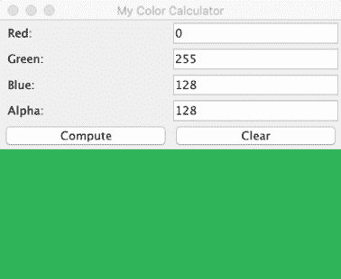

# 第 11 章：构建 Swing 桌面应用程序


## 核心学习目标

- 理解 Java GUI 开发中 `AWT` 和 `Swing` 之间的主要区别
- 学习如何将 `AWT` 转换为基于 Swing 的应用程序
- 探索常用的 Swing 组件，例如 `JCheckBox`、`JRadioButton`、`JComboBox`、`JList` 和 `JLabel`
- 获得使用 Swing 设计图形用户界面的实践经验
- 学习如何将你的 Swing 应用程序打包并发布为 Java Archive (JAR) 文件


在最后一章中，我们将探讨 `AWT` 和 `Swing` 之间的关键区别，重点关注 Swing 如何为构建 Java 图形界面提供更灵活、现代的方法。虽然 `AWT` 为 GUI 开发奠定了基础，但 `Swing` 通过更丰富的组件集和对外观（look and feel）更好的控制对其进行了增强。你将学习如何将现有的基于 `AWT` 的应用程序转换为基于 Swing 的应用程序，解锁更高级的功能并改进视觉设计。我们还将仔细查看几个常用的 Swing 组件——例如 `JCheckBox`、`JRadioButton`、`JComboBox`、`JList` 和 `JLabel`——并查看它们如何增强用户交互。最后，本章将引导你将 Swing 应用程序打包成 Java Archive (JAR) 文件，使其易跨平台共享、运行或部署。完成本章后，你将准备好使用 Swing 设计、构建和发布全功能的 Java 桌面应用程序。

## 11.1 AWT vs. Swing

Java `AWT`（抽象窗口工具包）和 `Swing` 都用于构建 Java 图形用户界面 (GUI)，但它们之间存在关键区别。

`Swing` 是 Java 基金类 (JFC) 的一部分，并构建在 `AWT` 之上。虽然 `AWT` 依赖于原生操作系统组件，但 `Swing` 提供了轻量级、跨平台的组件，它们在所有操作系统上的外观都是相同的。

在 `AWT` 中，像 `Frame` 和 `Button` 这样的组件与平台绑定，这意味着它们的显示取决于你使用的是 Windows、macOS 还是 Linux。相反，`Swing` 组件如 `JFrame` 和 `JButton` 在不同平台上看起来一致，因为它们不依赖于原生操作系统。

图 11.1 适用于 Solaris 和 Windows 系统的 AWT 示例帧

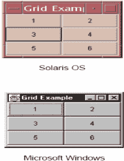

图 11.2 Swing 示例帧

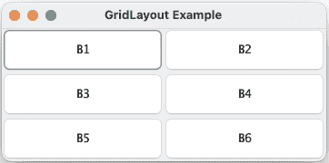

`Swing` 增加了更多功能和灵活性。它提供了额外的组件，如 `JRadioButton`、`JComboBox`、`JCheckBox` 和 `JLabel`，这些在 `AWT` 中是不用的。`Swing` 还支持可插件外观（pluggable look-and-feel），这意味着你可以自定义组件的外观，这是 `AWT` 不支持的。

另一个关键区别是，`AWT` 组件通常占用内存较大且运行速度较慢，而 `Swing` 组件是轻量级的，性能更好。`Swing` 还遵循 MVC（模型-视图-控制器）设计模式，而 `AWT` 不支持。

总结来说，`AWT` 提供基本的、依赖平台的组件，而 `Swing` 提供了一组更丰富、更灵活且跨平台的组件。`Swing` 也在 Java 1.2 中被引入以取代 `AWT` 包。

## 11.2 将你的 AWT 应用转换为基于 Swing 的应用

在本节中，我们将重点关注将 `AWT`（抽象窗口工具包）应用程序转换为基于 Swing 的基础应用程序。为了实现这一点，在我们的简单计算器应用程序中导入 `javax.swing` 包是关键的。

简单回顾一下，原始计算器应用程序使用了各种 `AWT` 组件，包括面板、帧、标签、文本字段和按钮。它还包含了 `AWT` 事件包来管理事件处理，例如使用 `ActionListener` 响应按钮点击，或实现关闭按钮处理程序，使用户按下 Command+Q（macOS）或 Alt+F4（Windows）时允许应用程序关闭。这构成了一个功能完整的 `AWT` 应用程序。

这是原始的 `SimpleCalculator.java` 源代码：

```java
// SimpleCalculator.java
import java.awt.*;
import java.awt.event.*;

public class SimpleCalculator implements ActionListener
{
    // 容器
    private Frame f;
    private Panel p1, p2, p3, p4;

    // 组件
    private Label l1, l2, l3;
    private TextField tf1, tf2, tf3;
    private Button bAdd, bSub, bDiv, bClear;

    public SimpleCalculator()
    {
        // 容器
        f = new Frame("First GUI");
        p1 = new Panel();
        p2 = new Panel();
        p3 = new Panel();
        p4 = new Panel();

        // 组件
        l1 = new Label("First: ");
        l2 = new Label("Second: ");
        l3 = new Label("Result: ");
        tf1 = new TextField("0");
        tf2 = new TextField("0");
        tf3 = new TextField("0");
        bAdd = new Button("+");
        bSub = new Button("-");
        bDiv = new Button("*");
        bClear = new Button("C");
    }

    public void startApp()
    {
        // 为所有面板使用默认布局管理器，FlowLayout。
        p1.add(l1);
        p1.add(tf1);

        p2.add(l2);
        p2.add(tf2);

        p3.add(l3);
        p3.add(tf3);

        p4.add(bAdd);
        p4.add(bSub);
        p4.add(bDiv);
        p4.add(bClear);

        // 更改我们帧的布局管理器；GridLayout(4, 1)
        f.setLayout(new GridLayout(4, 1));
        f.add(p1);
        f.add(p2);
        f.add(p3);
        f.add(p4);

        f.pack();
        f.setVisible(true);

        // 为你的 UI (源) 注册事件处理器
        bAdd.addActionListener(this);
        bSub.addActionListener(this);
        bMul.addActionListener(this);
        bDiv.addActionListener(this);
        bClear.addActionListener(this);
        f.addWindowListener(new MyCloseHandler());
    }

    // 事件处理器
    public void actionPerformed(ActionEvent e)
    {
        Object source = e.getSource();
        double num1 = 0.0, num2 = 0.0, num3 = 0.0;

        if (tf1.getText() != null && tf2.getText() != null) {
            num1 = Double.parseDouble(tf1.getText());
            num2 = Double.parseDouble(tf2.getText());

            if (source == bAdd)
            {
                num3 = num1 + num2;
            } else if (source == bSub)
            {
                num3 = num1 - num2;
            } else if (source == bMul)
            {
                num3 = num1 * num2;
            } else if (source == bDiv)
            {
                num3 = num1 / num2;
            } else if (source == bClear)
            {
                tf1.setText("0.0");
                tf2.setText("0.0");
                tf3.setText("0.0");
            }
        } else {} // 什么都不做

        tf3.setText("" + num3);
    }
}

private class MyCloseHandler extends WindowAdapter {
}
```

```java
    public void windowClosing(WindowEvent we)
    {
        System.exit(0);
    }
}

    public static void main(String args[])
    {
        SimpleCalculator sc = new SimpleCalculator();
        sc.startApp();
    }
}
```

要将应用程序转换为 Swing，我们首先将为应用程序声明一个包（package）。尽管在准备创建 JAR 文件时包含包声明是建议的，但如果并不立即需要 JAR 文件，那么在这一阶段并不是严格必要的。

接下来，我们将通过为每个 AWT 组件和容器添加 "J" 前缀，将它们转换为对应的 Swing 组件。例如，我们将使用 `JFrame`、`JPanel`、`JLabel`、`JTextField` 和 `JButton` 来代替它们对应的 AWT 变体。然而，布局管理器（layout managers）将保持不变。例如，`GridLayout` 不应该带有 "J" 前缀，因为没有专门的 Swing 特有布局管理器。

为了更好地说明 AWT 和 Swing 之间的区别，可以对同一代码的两个版本进行比较。在 Windows 机器上运行 AWT 版本时，按钮和其他 UI 元素的视觉效果与其对应的 Swing 版本相比较差。Swing 提供了更精细的外观，并具有可自定义的功能（如背景颜色），提供了更现代的视觉和感受。虽然在 macOS 上的外观差异是细微的，但在 Windows 上这种区别更为明显。

图 11.3 AWT 版本与 Swing 版本的运行时对比

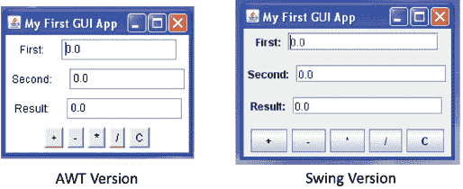

为了启动我们计算器应用程序的转换，我们从修改组件和容器的声明开始，在声明中以及构造函数（即实例化组件和容器的地方）在适当的位置添加 "J" 前缀。这把它们转换为基于 Swing 的组件。重要的是，不应对布局管理器进行任何更改，因为 Swing 并没有提供自己的版本。

关于关闭按钮处理器，有一个保留现有功能的选项，也可以将其修改为使用 Swing 的框架方法（frame method）来关闭。一旦保存更改，我们可以编译代码（使用 `javac SimpleCalculator.java`），应用程序现在将作为一个基于 Swing 的组件运行。

虽然整体外观与 AWT 版本相似，但使用 Swing 提供了增强的功能，且 UI 元素（如按钮）现在应该按预期工作，包括“清空”和“关闭”按钮。

这里是 SimpleCalculator App 更新后的 Swing 版本：

```java
// SimpleCalculator.java - 更新后的 Swing 版本
import java.awt.*;
import java.awt.event.*;
import javax.swing.*;

public class SimpleCalculator implements ActionListener
{
    // 容器
    private JFrame f;
    private JPanel p1, p2, p3, p4;

    // 组件
    private JLabel l1, l2, l3;
    private JTextField tf1, tf2, tf3;
    private JButton bAdd, bSub, bMul, bDiv, bClear;

    public SimpleCalculator()
    {
        // 容器
        f = new JFrame("My First GUI App");

        p1 = new JPanel();
        p2 = new JPanel();
        p3 = new JPanel();
        p4 = new JPanel();

        // 组件
        l1 = new JLabel("First: ");
        l2 = new JLabel("Second: ");
        l3 = new JLabel("Result: ");
        tf1 = new JTextField(10);
        tf2 = new JTextField(10);
        tf3 = new JTextField(10);
        bAdd = new JButton("+");
        bSub = new JButton("-");
        bMul = new JButton("*");
        bDiv = new JButton("/");
        bClear = new JButton("Clear");

        p1.add(l1);
        p1.add(tf1);
        p2.add(l2);
        p2.add(tf2);
        p3.add(l3);
        p3.add(tf3);
        p4.add(bAdd);
        p4.add(bSub);
        p4.add(bMul);
        p4.add(bDiv);
        p4.add(bClear);

        f.setLayout(new GridLayout(4, 1));
        f.add(p1);
        f.add(p2);
        f.add(p3);
        f.add(p4);

        bAdd.addActionListener(this);
        bSub.addActionListener(this);
        bMul.addActionListener(this);
        bDiv.addActionListener(this);
        bClear.addActionListener(this);

        f.setDefaultCloseOperation(JFrame.EXIT_ON_CLOSE);
        f.pack();
        f.setVisible(true);
    }

    public void actionPerformed(ActionEvent e)
    {
        // 逻辑实现略
    }
}
```

## 11.3 Swing 组件

### 11.3.1 JCheckBox：RGBCheckBox.java

Java 中的 `JCheckBox` 类是 `Swing` 包的一部分，提供了在图形用户界面中创建复选框的方法。用户可以选择或取消选择。与单选按钮不同，多个复选框可以同时选中。

在下面的 `RGBCheckBox.java` 示例中，我们将使用 Swing 组件创建一个包含红、绿、蓝三个复选框的简单图形界面。我们还会添加了一个“点击这里”的按钮。

#### 代码解析

1. 导入：程序开始导入 `java.awt.*` 和 `javax.swing.*`，它们提供了创建 GUI 组件和处理布局所需的类，`java.awt` 包对于布局管理器是必要的。

```java
import java.awt.*;
import javax.swing.*;
```

2. 类声明：`RGBCheckBox` 类被声明为一个公共类。在这个类内部，我们定义了构成 UI 的 `JFrame`、`JButton` 和 `JCheckBox` 组件的私有字段。

```java
public class RGBCheckBox {
    private JFrame f;
    private JButton b;
    private JCheckBox red, green, blue;
```

3. 构造函数：构造函数 `RGBCheckBox()` 初始化了 `JFrame` 和 `JButton` 对象，并创建了三个复选框：红、绿、蓝。这些组件将是用户界面的一部分。


```java
public RGBCheckBox() {
    f = new JFrame("JCheckBox Example");
    b = new JButton("Click Me!");
    red = new JCheckBox(" Red ");
    green = new JCheckBox(" Green ");
    blue = new JCheckBox(" Blue ");
}
```

### 4. `startApp()` 方法

`startApp()` 方法配置了框架的布局，它使用具有 4 行 1 列的 `GridLayout` 来垂直显示复选框和按钮。使用 `setSelected(true)` 方法用于预选红色和蓝色的复选框。

`setLayout(new GridLayout(4, 1))` 确保组件被排列在四行中。

`f.add()` 方法按照所需的顺序将组件添加到框架中。

`f.setBounds(100, 100, 300, 200)` 设定窗口左上角的位置 `(100,100)` 及其尺寸 `(300x200)`。

`f.setVisible(true)` 让窗口对用户可见。

```java
public void startApp() {
    f.setLayout(new GridLayout(4, 1));
    red.setSelected(true);
    blue.setSelected(true);
    f.add(red);
    f.add(green);
    f.add(blue);
    f.add(b);
    f.setBounds(100, 100, 300, 200);
    f.setVisible(true);
}
```

### 5. `main` 方法

`main` 方法作为程序的入口点。它创建了 `RGBCheckBox` 类的一个实例并调用 `startApp()` 方法来显示 UI。

```java
public static void main(String args[]) {
    RGBCheckBox rgb = new RGBCheckBox();
    rgb.startApp();
}
```

# 代码工作原理

当程序运行时，会出现一个带有三个复选框的窗口：红色、绿色和蓝色。红色和蓝色复选框被预选中。用户可以勾选或取消这些框的任何组合。

还会显示一个标记为“Click Me!”的按钮，尽管它目前没有实现功能。未来的扩展可能包括为按钮和复选框添加事件监听器，以便在点击时执行操作。

## 图 11.4 RGBCheckBox 运行时

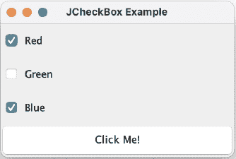

## 关键点

- `JCheckBox` 是 Swing 框架的一部分，它继承了父类的许多方法，允许进行广泛的定制。

- `setBounds()` 方法用于对窗口进行定位和调整大小，对其布局提供了更多控制。

这个简单的示例演示了如何使用 Java 中的 Swing 组件创建一个带有多个复选框的基础 GUI。你可以通过添加事件处理来进一步扩展，使 UI 具有交互性。

## 这里是完整的源代码：

### RGBCheckBox.java

```java
import java.awt.*;
import javax.swing.*;

public class RGBCheckBox {
    private JFrame f;
    private JButton b;
    private JCheckBox red, green, blue;

    public RGBCheckBox() {
        f = new JFrame("JCheckBox Example");
        b = new JButton("Click Me!");
        red = new JCheckBox(" Red ");
        green = new JCheckBox(" Green ");
        blue = new JCheckBox(" Blue ");
    }

    public void startApp() {
        f.setLayout(new GridLayout(4, 1));
        red.setSelected(true);
        blue.setSelected(true);
        f.add(red);
        f.add(green);
        f.add(blue);
        f.add(b);
        f.setBounds(100, 100, 300, 200);
        f.setVisible(true);
    }

    public static void main(String args[]) {
        RGBCheckBox rgb = new RGBCheckBox();
        rgb.startApp();
    }
}
```

# 运行说明

1. 将此代码保存为名为 `RGBCheckBox.java` 的文件。

2. 使用 `javac RGBCheckBox.java` 编译代码。

3. 使用 `java RGBCheckBox` 运行程序。

当你运行时，将出现一个带有三个复选框（红色、绿色和蓝色）的窗口，红色和蓝色被预选，并还有一个“Click Me!”按钮。

### RGBRadioButton.java

在解释中，我们将分解如何使用 `JRadioButton` 组件创建一个基础 Swing 应用程序，展示单选按钮和复选框之间的区别。

## 单选按钮与复选框的关键区别

- **单选按钮 (Radio buttons)**：允许用户一次只选择一个选项。当你选择一个单选按钮时，同一组中之前选中的任何按钮都会取消选择。

- **复选框 (`JCheckBox`)**：允许用户选择多个选项。你可以独立地选择或取消选择多个选项。

## 代码分解

### 1. 类和导入语句

我们首先导入必要的包：

```java
import java.awt.*; // 用于 GridLayout 和其他布局管理器
import javax.swing.*; // 用于 JFrame, JButton
```

### 2. 创建主类

在这种情况下，类名为 `RGBRadioButton`：

```java
public class RGBRadioButton {
    // 声明组件：JFrame, JButton 和 JRadioButton
    private JFrame f;
    private JButton b;
    private JRadioButton red, green, blue;

    // 初始化组件的构造函数
    public RGBRadioButton() {
        f = new JFrame("RGBRadioButton Example");
        red = new JRadioButton(" Red "); // 红色
        green = new JRadioButton(" Green "); // 绿色
        blue = new JRadioButton(" Blue "); // 蓝色
        b = new JButton("Click Me!"); // 按钮
    }
}
```

### 3. `startApp` 方法

该方法设置布局并将组件（单选按钮、按钮等）添加到框架中：

```java
public void startApp() {
    // 设置 4 行 1 列的 GridLayout 以垂直排列组件
    f.setLayout(new GridLayout(4, 1));
    // 默认情况下，红色单选按钮会被选中
    red.setSelected(true);
    // 将单选按钮添加到框架以便在 UI 中显示
    f.add(red);
    f.add(green);
    f.add(blue);
    // 将单选按钮分组以确保一次只能选择一个
    ButtonGroup colorGroup = new ButtonGroup();
    // 将红色、绿色和蓝色按钮添加到组中
    colorGroup.add(red);
    colorGroup.add(green);
    colorGroup.add(blue);
    // 将 "Click Me!" 按钮添加到框架
    f.add(b);
    // 设置框架的大小和位置
    f.setBounds(200, 200, 300, 200);
    // 使框架可见
    f.setVisible(true);
}
```

在 Swing 中，即使点击了窗口上的关闭按钮，应用程序可能也不会完全终止，除非添加特定的代码来处理窗口关闭。默认行为是，除非另有指定，否则窗口只会隐藏而退出。

以下是完整的 Java 源代码，文件名：`RGBRadioButton.java`

```java
import java.awt.*;
import javax.swing.*;

public class RGBRadioButton {
    private JFrame f;
    private JButton b;
    private JRadioButton red, green, blue;

    public RGBRadioButton() {
        f = new JFrame("RGBJRadioButton Example");
        red = new JRadioButton(" Red ");
        green = new JRadioButton(" Green ");
        blue = new JRadioButton(" Blue ");
        b = new JButton("Click Me!");
    }

    public void startApp() {
        f.setLayout(new GridLayout(4, 1));
        red.setSelected(true);
        f.add(red);
        f.add(green);
        f.add(blue);

        ButtonGroup colorGroup = new ButtonGroup();
        colorGroup.add(red);
        colorGroup.add(green);
        colorGroup.add(blue);
        f.add(b);
        f.setBounds(200, 200, 300, 200);
        f.setVisible(true);
    }

    public static void main(String args[]) {
        RGBRadioButton rgb = new RGBRadioButton();
        rgb.startApp();
    }
}
```

### 11.3.3 `JComboBox`: JComboBoxExample.java

Java 中的 `JComboBox` 是一种 Swing 组件，允许用户从下拉列表中选择项目。它既可以是一个不可编辑的列表（用户从预定义值中选择），也可以是一个可编辑的列表（用户也可以输入自己的内容）。该组件结合了按钮和文本字段的功能，为用户提供了一种灵活的输入方式。

在这个示例中，我们将介绍如何创建一个基础的 `JComboBox`，向其填充值，并实现事件处理，以便当用户选择选项时，能够更新标签以反映所选的值。

#### 代码中使用的组件

* `JFrame`：承载应用程序所有组件的窗口或容器。

* `JButton`：一个可以触发事件的可点击按钮。

* `JComboBox`：包含供用户选择的选项的下拉列表。

* `JLabel`：根据用户操作显示消息的标签。

* `String Array`：包含颜色列表的数组，这些颜色将显示在 `JComboBox` 中。

#### 代码解析

**1. 类的声明**

`JComboBoxExample` 类开始声明用于表示 `JFrame`、`JButton`、`JComboBox` 和 `JLabel` 的私有变量，这些变量将用于整个应用程序。

```java
private JFrame f;
private JButton b;
private JComboBox<String> cb;
private JLabel label;
private String colorList[];
```

* `f` 代表帧窗口。

* `b` 是标记为 "Show" 的按钮。

* `cb` 是包含选项的 `JComboBox`。

* `label` 将显示所选的颜色。

* `colorList` 保存预定义的值。

**2. 构造函数**

构造函数初始化 GUI（图形用户界面）的所有组件。它创建了帧、按钮和标签，同时使用 `setBounds()` 方法分配位置，该方法定义了它们的位置和大小。

```java
public JComboBoxExample() {
    f = new JFrame("JComboBox List");
    label = new JLabel();
    colorList = new String[] {"Red", "Green", "Blue", "Yellow", "Purple"};
    cb = new JComboBox<>(colorList);
    cb.setBounds(50, 100, 90, 20);
    label.setHorizontalAlignment(JLabel.CENTER);
    label.setSize(400, 100);
    b = new JButton("Show");
    b.setBounds(200, 100, 75, 20);
}
```

* 创建了一个标题为 "JComboBox List" 的新 `JFrame`。

* `JLabel` 居中对齐并设置了其大小。

* `JComboBox` 使用 `colorList` 数组填充。

* 创建了标记为 "Show" 的 `JButton`。

**3. 启动应用程序**

`startApp()` 方法负责将组件添加到帧中并使帧可见。

```java
public void startApp() {
    f.setLayout(null); // 不使用布局管理器，因此使用 setBounds 手动设置位置。
    f.add(cb); // 将 JComboBox 添加到帧中。
    f.add(label); // 将标签添加到帧中。
    f.add(b); // 将按钮添加到帧中。
    f.setSize(350, 350); // 设置帧的大小。
    f.setVisible(true); // 使帧可见。
}
```

该方法通过调用 `f.setLayout(null)` 禁用了默认布局管理器，允许对组件进行手动定位。

**4. 按钮的事件处理**

为了使按钮具有功能，添加了一个 `ActionListener`。当按钮被点击时，从 `JComboBox` 中获取被选项目并显示在 `JLabel` 中。

```java
b.addActionListener(new ActionListener() {
    public void actionPerformed(ActionEvent ae) {
        String str = "My Color List: " + cb.getItemAt(cb.getSelectedIndex());
        label.setText(str); // 使用选择的颜色更新标签。
    }
});
```

* `ActionListener` 监听按钮点击。

* 当按钮被点击时，使用 `cb.getSelectedIndex()` 获取 `JComboBox` 中的选值并将其设置在标签中。

* 标签文本更新为所选的颜色名称。

**5. `main` 方法**

`main` 方法创建 `JComboBoxExample` 类的实例并通过调用 `startApp()` 启动应用程序。

```java
public static void main(String args[]) {
    JComboBoxExample jcbe = new JComboBoxExample();
    jcbe.startApp();
}
```

#### 行为

当应用程序运行时：

* 出现一个带有 `JComboBox` 的窗口。用户可以从下拉列表中进行选择。

* 点击 "Show" 按钮后，选中的颜色将显示在标签上。

为了方便，这里是完整的代码：`JComboBoxExample.java`。

### 11.3.4 `JList`: RGBJList.java

`JList` 用于显示项目列表，用户从中选择一个或多个元素。通过 `JList`，你可以灵活地启用单选或多选，允许用户一次选择多个项目。

要创建一个 `JList`，必须有一个“列表模型（list model）”，它作为你想在 `JList` 中显示的元素的容器。你可以将列表模型想象成数据持有者，而 `JList` 则作为显示这些项目的视觉界面。

在提供的示例代码中，创建了一个名为 `RGBJList` 的类。该类声明了一个框架（`JFrame`）和一个标签（`JLabel`），用于显示颜色选项列表。首先实例化框架并设置为使用 `FlowLayout`，这有助于将组件从左到右排列，类似于段落中的文本。


在 `startApp()` 方法中，创建了一个 `DefaultListModel` 来存储列表数据。该模型的类型为 `String`，意味着它将存储一组表示颜色名称的字符串值。使用 `addElement()` 方法将诸如“Red（红色）”、“Green（绿色）”和“Blue（蓝色）”等项添加到模型中。

一旦在列表模型中填充了这些颜色，就会创建一个新的 `JList` 并将其与模型关联。这种连接确保了 `JList`（代码中的 `colorList`）将显示来自列表模型的各个项。默认情况下，使用 `setSelectedIndex(0)` 方法预选了列表中的第一项（索引 0，“Red”）。

接下来，使用 `JLabel` 来显示一些文本（“Colors:”）。标签和 `JList` 都被添加到框架中，并使用 `setBounds(200, 200, 300, 200)` 设置框架的大小和位置，该方法指定了框架在像素中的位置和大小。

最后，通过 `setVisible(true)` 方法使框架可见，允许应用程序窗口显示给用户。

当你运行代码时，你将看到一个颜色选项列表（“Red”、“Green”和“Blue”）。由于调用了 `setSelectedIndex(0)`，初始状态下“Red”是被选中的。用户可以点击任何颜色进行选择。他们还可以通过按住 `Shift` 或 `Command` (Mac) / `Control` (Windows) 键并点击额外的颜色来完成多项选择。

以下是保存为 `RGBJList.java` 的示例代码：

```java
// RGBJList.java

import java.awt.*;
import javax.swing.*;

public class RGBJList {
    private JFrame f;
    private JLabel label;

    public RGBJList() {
        f = new JFrame("JList Color Example");
    }

    public void startApp() {
        f.setLayout(new FlowLayout());
        DefaultListModel<String> listModel =
            new DefaultListModel<>();
        listModel.addElement("Red");
        listModel.addElement("Green");
        listModel.addElement("Blue");

        JList<String> colorList = new JList<>();
        colorList.setModel(listModel);
        colorList.setSelectedIndex(0);
        label = new JLabel();
        label.setText("Colors: ");
        f.add(label);
        f.add(colorList);
        f.setBounds(200, 200, 300, 200);
        f.setVisible(true);
    }

    public static void main(String args[]) {
        RGBJList rgb = new RGBJList();
        rgb.startApp();
    }
}
```

这里是完整的代码：`CounterApp.java`

```java
// CounterApp.java
import java.awt.*;
import java.awt.event.*;
import javax.swing.*;

public class CounterApp implements ActionListener {
    private JFrame f;
    private Panel pan;
    private JLabel l1, l2, l3;
    private JButton button;
    private static int counter = 0;

    public CounterApp() {
        f = new JFrame("My Counter App");
        pan = new Panel();
        pan.setBackground(Color.BLACK);
        l1 = new JLabel("0");
        l1.setFont(new Font("Serif", Font.BOLD, 100));
        l2 = new JLabel("0");
        l2.setFont(new Font("Serif", Font.BOLD, 100));
        l3 = new JLabel("0");
        l3.setFont(new Font("Serif", Font.BOLD, 100));
        button = new JButton("Click Me!");
    }

    public void startApp() {
        l3.setOpaque(true);
        l1.setForeground(Color.WHITE);
        l2.setForeground(Color.WHITE);
        l3.setForeground(Color.BLACK);
        pan.setLayout(new GridLayout(1, 3));
        pan.add(l1);
        pan.add(l2);
        pan.add(l3);
        f.add(pan, BorderLayout.CENTER);
        f.add(button, BorderLayout.SOUTH);
        f.pack();
        f.setVisible(true);
        f.setDefaultCloseOperation(JFrame.EXIT_ON_CLOSE);
        // 注册事件处理器
        button.addActionListener(this);
    }

    public void actionPerformed(ActionEvent ae) {
        counter = Integer.parseInt(l1.getText() + l2.getText() + l3.getText());
        counter++;
        int hund = counter / 100;
        int temp = counter % 100;
        int tens = temp / 10;
        int ones = temp % 10;
        l1.setText("" + hund);
        l2.setText("" + tens);
        l3.setText("" + ones);
    }

    public static void main(String[] args[]) {
        CounterApp counterApp = new CounterApp();
        counterApp.startApp();
    }
}
```

# 将你的应用程序打包为 Java 存档 (JAR) 文件

## JAR 文件概述

JAR 代表 Java Archive（Java 存档），是一种用于在单个文件中分发应用程序或库的文件格式。与 ZIP 文件类似，JAR 文件将多个文件打包在一起，但它是专门为 Java 相关文件（如 `.class` 文件、资源和元数据）设计的。JAR 文件使得跨平台分发 Java 程序及其相关文件变得简单。JAR 文件有两种常见类型：

- 普通 JAR 文件：打包了 Java 类和资源，但没有指定主类。
- 可执行的 JAR 文件：包含一个 `MANIFEST.MF` 文件，其中声明了主类，使得 JAR 文件可以直接执行。

## 创建 JAR 文件的分步指南

### 设置基础项目

在创建 JAR 文件之前，你需要组织你的项目文件。假设你正在使用以下目录结构：

- `src/`：包含你的源代码（`.java` 文件）。
- `classes/`：这是存储编译后的 `.class` 文件的地方。
- `dist/`：这是打包后存储 JAR 文件的地方。

### 在你的 Java 文件中添加包声明

在将你的应用程序转换为 JAR 文件时，至关重要的是确保 Java 类是包的一部分。例如，如果你的 `SimpleCalculator.java` 文件位于 `src/demo/` 文件夹中，你的源代码应该在文件开头包含以下包声明：

```java
package demo;
```

包声明应该反映你的项目文件夹结构。包含你的 `.java` 文件的文件夹（在本例中为 `demo/`）应该是包名。

### 编译 Java 源代码（命令行）

要编译源代码，请打开终端并导航到项目的 `src/` 目录。以下命令将编译 `SimpleCalculator.java` 文件：

```bash
javac -d ../classes demo/SimpleCalculator.java
```

解释：

- `javac`：Java 编译器命令。
- `-d ../classes`：指定编译后的 `.class` 文件的输出目录（在本例中为 `classes/` 文件夹）。
- `demo/SimpleCalculator.java`：要编译的源文件路径。

编译完成后，`classes/` 文件夹将如下所示。

### 创建普通 JAR 文件（命令行）

现在你已经有了编译后的 `.class` 文件，可以创建一个普通 JAR 文件（不带清单文件）。从 `classes/` 目录运行以下命令：

```bash
jar cvf MyApp.jar demo/
```

解释：

- `jar`：用于创建或管理 JAR 文件的命令。
- `cvf`：用于创建 JAR 文件的选项：
    - `c`：创建新 JAR
    - `v`：详细输出（可选，用于在创建期间显示详情）
    - `f`：指定 JAR 文件的文件名
- `MyApp.jar`：生成的 JAR 文件名
- `demo/`：包含要加入 JAR 的 `.class` 文件的文件夹。

此命令将在 `classes/` 目录下创建一个名为 `MyApp.jar` 的文件，其中包含 `demo/` 文件夹的内容。

### 运行普通 JAR 文件（命令行）

由于你现在已经有了编译后的 `.class` 文件，要运行它，你需要指定路径和全限定类名：

```bash
java -cp MyApp.jar demo.SimpleCalculator
```

解释：

- `java`：Java 运行命令。
- `-cp MyApp.jar`：指定 JAR 文件作为类路径。
- `demo.SimpleCalculator`：类的全限定类名。

### 创建可执行的 JAR 文件

可执行的 JAR 文件包含一个 `MANIFEST.MF` 文件，指定了运行 JAR 时执行的主类。以下是创建方法：

#### 第一步：创建清单文件

在 `classes/` 目录下创建一个名为 `manifest.txt` 的文件，内容如下：

```
Main-Class: demo.SimpleCalculator
```

**注意**：确保文件末尾有一个空行。这是清单格式的要求。

#### 第二步：创建可执行 JAR

使用以下命令带清单创建 JAR 文件：

```bash
jar cvfm MyAppExecutable.jar manifest.txt demo/
```

解释：

- `cvfm`：`m` 用于指定清单文件。
- `MyAppExecutable.jar`：生成的可执行 JAR 文件。
- `manifest.txt`：清单文件的路径。
- `demo/`：包含编译后的 `.class` 文件的文件夹。

#### 第三步：运行可执行 JAR 文件

创建可执行 JAR 后，你可以简单地通过使用 `java -jar` 命令来运行：

```bash
java -jar MyAppExecutable.jar
```

由于 `MANIFEST.MF` 文件包含了 `Main-Class` 条目；你不需要指定类名或类路径。

## 使用 NetBeans IDE 创建 JAR 文件

如果你使用 NetBeans 等 IDE，创建 JAR 文件的过程会更加简单。

### 第一步：在 NetBeans 中创建 Java 项目

1. 打开 NetBeans 并新建项目（File > New Project）。
2. 选择 `Java with Ant` 作为项目类型，并为项目命名为 `SwingDesktopAppProject`。
3. 在项目设置期间确保取消勾选“Create Main Class”，因为你稍后会手动添加类。

### 第二步：添加源代码和包

1. 在项目窗口中，右键点击 `Source Packages` 并选择 `New > Java Class`。
2. 创建一个名为 `demo` 的包以及名为 `SimpleCalculator` 的类（与之前相同）。
3. 将计算器的 Java 代码添加到 `SimpleCalculator.java` 文件中，包括包声明。

### 第三步：运行并测试你的应用程序

1. 在项目选项卡中，右键点击 `SimpleCalculator.java` 并选择 `Run File`。
2. NetBeans 将编译并运行你的应用程序。你应该能看到计算器在运行。

### 第四步：在 NetBeans 中创建可执行 JAR

1. 添加 `Main-Class` 声明：进入 `NetBeans` 中的 `Files` 标签页。打开项目文件夹下的 `manifest.mf` 文件。
2. 在 `manifest.mf` 文件中添加以下条目：

```
Main-Class: demo.SimpleCalculator
```

确保该条目之后有一个空行。

3. 构建项目：在 `Projects` 标签页中右键点击你的项目，并选择 `Clean and Build`。这将编译你的项目并将其打包成 `JAR` 文件。
4. 找到 JAR 文件：可执行的 `JAR` 文件将位于项目目录的 `dist/` 文件夹中。

### 步骤 5：运行可执行的 JAR

你可以通过在终端中进入 `dist/` 文件夹并使用以下命令运行 `JAR` 文件：

```bash
java -jar SwingDesktopAppProject.jar
```

通过上述步骤，你可以使用命令行或像 `NetBeans` 这样的 IDE 创建普通 JAR 和可执行 JAR 文件。这两种 JAR 文件之间的关键区别在于是否存在包含有 `Main-Class` 声明的 `MANIFEST.MF` 文件，这允许你无需显式指定类路径或主类即可运行 JAR 文件。


## 章节总结

- `Java AWT` 和 `Swing` 都用于构建 GUI，但 `AWT` 依赖于原生操作系统组件，使其具有平台依赖性；而 `Swing` 提供了轻量级、平台无关组件，在不同平台上看起来保持一致。`Swing` 还提供了更多功能，例如额外的组件以及对可定制外观和感觉的支持，并且遵循 MVC 设计模式，与 `AWT` 不同。
- 本课重点在于通过导入 `javax.swing` 包将基于 `AWT` 的计算器应用程序转换为基于 `Swing` 的应用程序。这种转换涉及将 `AWT` 组件（如 `Frame` 和 `Button`）替换为相应的 `Swing` 组件（如 `JFrame` 和 `JButton`），同时保留相同的布局管理器和事件处理。尽管两个版本的功能相似，但 `Swing` 提供了增强的视觉吸引力和平台独立的 UI 特性，这在 Windows 系统上尤为明显。
- `JAR`（Java 存档）文件用于将 Java 应用程序或库打包到单个文件中，以便分发。主要有两种类型：普通 JAR（打包了类文件但未指定主类）和可执行 JAR（包含一个有 `Main-Class` 声明的清单文件，以便直接执行）。你可以通过编译 Java 代码、将其组织到目录并使用 `jar` 命令来创建 JAR 文件。或者，像 `NetBeans` 这样的 IDE 可以简化这一过程，自动打包你的项目并为可执行 JAR 创建必要的清单文件。


## 单选题

1. 如果你想使用 `Swing` 框架，应该导入哪个包？

   a. `javax.swing` 包
   b. `java.swing` 包
   c. `java.awt` 包
   d. `java.awt.swing` 包

2. 下列哪项**不是**我们可以导入的有效 GUI / 事件包？

   a. `javax.swing.*;`
   b. `java.swing.*;`
   c. `java.awt.*;`
   d. `java.awt.event.*;`

3. 你正计划创建一个可执行的 JAR 文件，你的测试类位于 `classes\myFolder\MyTestClass.class`。你当前的文件夹（当前工作目录）在 `classes\` 下。假设你在相同文件夹（`classes`）中有一个名为 `manif.mf` 的正确清单文件，以下哪个命令允许你创建一个可执行的 JAR 文件？

   a. `jar cvfm MyJar.jar manif.mf`
   b. `jar cvf MyJar.jar manif.mf`


c. `jar cvf MyJar.jar *`

d. `jar cvfm MyJar.jar manif.mf *`

4. 你创建了一个名为 `MyJar.jar` 的不可执行 JAR 文件。测试类位于 `classes\myFolder\MyTestClass.class`。你在 `classes` 文件夹内部创建了 JAR 文件。以下哪个命令是运行 JAR 文件的正确方法？

a. `java -jar myFolder.MyTestClass`

b. `jar MyJar.jar myFolder.MyTestClass`

c. `java -cp MyJar.jar myFolder.MyTestClass`

d. `java -jar MyJar.jar`

5. JAR 代表什么？

a. `Java Archive Resource`

b. `Java Application Resource`

c. `Java Automatic Resource`

d. `Java ARchive`

6. 你称那个包含 JAR 文件中打包信息的特殊文件为什么？

a. `class file`

b. `manifest file`

c. `Java Source File`

d. `Executable File`

7. 关于 `Swing`，以下哪项是**错误**的？

a. 与 `AWT` 不同，`Java Swing` 提供了一系列平台无关且轻量级的组件。

b. `Swing` 包构建在 `AWT（抽象窗口工具包）之上。

c. 你可以在 `javax.swing` 包下找到 `Frame`、`Button` 和 `Label` 类。

d. `Java Swing` 包是 Java 基础类 (JFC) 的一部分，用于创建窗口应用程序。

8. 哪个 `Swing` 组件是单选按钮的实现，可以选择或取消选择某项，并与 `ButtonGroup` 对象一起使用创建一个一次只能选择一个按钮组？

a. `JComboBox`

b. `JCheckbox`

c. `JRadioButton`

d. `JList`

9. 哪个 `Swing` 组件显示对象列表并允许用户选择一个或多个项目？这还需要一个 `ListModel` 来维护用户可以选择的列表内容？

a. `JList`

b. `JRadioButton`

c. `JComboBox`

d. `JCheckbox`

10. 关于 `Swing` 组件，以下哪项是**错误**的？

a. `Swing` 组件是平台无关的。

b. `Swing` 提供的组件比 `AWT` 少。

c. `Swing` 组件是轻量级组件。

d. `Swing` 支持插件式外观和感觉组件。

### 单选题答案

| 1 – a | 2 – b | 3 – d | 4 – c | 5 – d |
| :--- | :--- | :--- | :--- | :--- |
| 6 – b | 7 – c | 8 – c | 9 – a | 10 – b |

 编程任务

- 回习 15 章的编程任务：我的颜色计算器（带事件处理器），并将你的 `AWT` 颜色计算器转换为 `Swing 应用程序`。

- 为你的颜色计算器创建一个可执行的 JAR 文件，这样当你双击 JAR 文件时，它将启动你的颜色计算器。

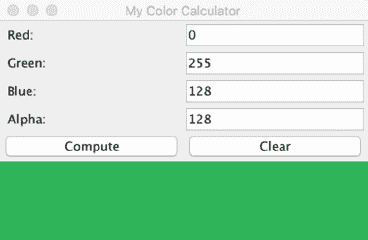

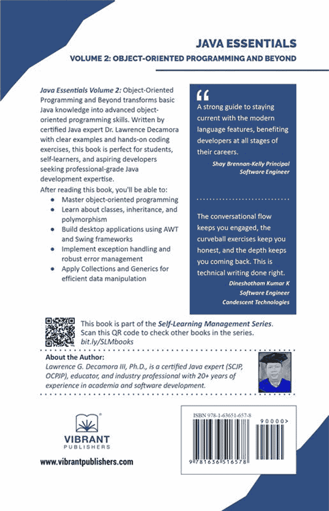
