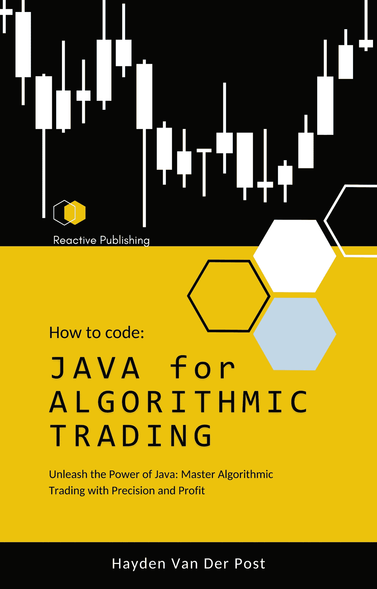

# Java 算法交易：解锁 Java 力量：精准盈利算法交易实战




“市場の波は無限に続くが、アルゴリズムはその波を乗りこなす舟となる。”

“The waves of the market are endless, but an algorithm becomes the vessel that navigates them.”

## 序言

欢迎阅读《Java 算法交易》，这本书将带你探讨交易算法、安全通信、加密和反欺诈的精细世界，而这一切都将通过多功能且稳健的编程语言 `Java` 来实现。本书旨在为那些不仅对金融市场的动态充满热情，而且对彻底改变现代交易的技术进步感兴趣的读者提供不可或缺的资源。

算法交易的旅程既迷人又复杂，需要金融敏锐度、编程技能以及对安全性不懈追求的承诺。本书的目标正是探索这些学科的交汇点，为高级用户提供设计、实施和高效安全地执行交易策略所需的知识和工具。

算法交易极大地改变了金融市场的格局，引入了以前无法实现的高精密度、速度和效率。`Java` 凭借其面向对象的特性、高性能和强大的安全特性，已成为编写能够在实时市场中运行的稳健交易算法的理想语言。然而，这些算法的强大也带来了维护高安全标准的挑战，以保护敏感数据和金融资产免受无处不在的网络攻击和欺诈威胁。

本书面向于已经对 `Java` 编程有坚实理解并对金融市场有浓厚兴趣的高级用户。它也适用于那些希望深化算法交易知识、增强创建安全高效交易解决方案方面技能的专业人士。在计算机科学或金融领域、立志于这一交叉领域专耕细作的学生，也将发现本指南是极具价值的。

在整个章节中，我们将深入探讨算法交易的核心原理，探索保护交易机密和敏感信息至关重要的加密和安全通信的复杂性，并讨论防止欺诈的策略。每个概念都将配有实际示例、案例研究和 `Java` 代码段，以说明所述理论知识在现实世界中的应用。

我们的目标是赋予你——读者能力，让你不仅能够构思和开发自己的交易算法，而且在对安全的坚定不移的承诺下完成。我们将引导你了解技术的最新进展和行业最佳实践，使你能够站在这一获利领域的前沿。

当我们共同开启这段旅程时，我们邀请你带着好奇心、分析性思维以及对技术和金融的热情。《Java 算法交易：现代指南快速课程》不仅仅是一本书；它是在当今数字时代掌握算法交易艺术与科学的阶石。

让旅程开始吧。

## 第 1 章：Java 算法交易简介

算法交易的黎明将技术的快速进步与古老的市场交易实践相结合，创造出一种彻底改变金融市场的协同效应。计算能力与交易策略之间这种复杂的舞蹈，不仅让金融市场的准入变得民主化，还显著提高了交易活动的效率和复杂性。

算法交易的起源可以追溯到 20 世纪 70 年代电子交易平台的引入。这些平台通过提供数字基础设施，使得交易可以在不需要亲临交易大厅的情况下快速执行，从而为算法交易的发展奠定了基础。成立于 1971 年的 `NASDAQ` 是世界上首个电子股票市场，象征着向交易未来的重要跨越。

当我们进入 20 世纪 80 年代时，金融市场见证了计算机驱动交易策略的出现。这些早期的算法交易形式按今天的标准来看是非常原始的，通常基于简单的数学模型，并在性能比今天智能手机还弱的计算机上执行。尽管非常简单，但这些策略标志着交易新纪元的开始，决策可以在以前无法想象的速度和规模上做出并执行。

20 世纪 90 年代和 21 世纪初见证了技术进步的快速加速及其在金融市场中的应用。互联网时代开启了前所未有的连接水平，允许交易者和算法能够实时访问市场数据。这一时期还见证了更复杂的算法交易策略的发展，包括统计套利和高频交易 (`HFT`)。这些策略利用日益增长的计算能力来分析海量数据集，并在毫秒级速度执行交易，从市场的微小价格差异中获取利润。

`Java` 由 Sun Microsystems 于 1995 年引入，它在算法交易的演变中发挥了关键作用。其平台无关的特性、强大的安全特性以及高效处理大量交易的能力，使 `Java` 成为开发交易平台和算法的首选编程语言。通过提供稳定且可扩展的环境，`Java` 使金融业能够开发出适应快速变化的市场动态的复杂算法交易系统。

2008 年的金融危机是算法交易的一个转折点。在危机之后，全球各监管机构加强了对金融市场的审查，导致实施了旨在增加透明度和降低系统性风险的新规章。算法交易策略，特别是高频交易，受到了广泛关注，引发了对其对市场稳定性和完整性影响的重新评估。这一时期见证了算法交易实践的精炼，并更加强调风险管理和合规性。

如今，算法交易是金融生态系统中不可或缺的一部分，算法负责了全球市场大部分比例的交易。人工智能和机器学习的持续进步正在进一步推测可能的边界，允许算法从市场数据中学习、适应新环境并执行日益复杂的策略。

算法交易的历史演变是人类追求效率和创新的见证。从电子交易的早期阶段到如今复杂的算法，这段历程标志着技术及其在金融市场中应用的不断进步。当我们展望未来时，显而易见的是，算法交易的演变远未结束，新技术有望进一步改变金融交易的格局。

随着我们对本书的深入探讨，我们将探索 `Java` 在塑造算法交易未来方面的复杂技术细节和革命性影响，确保读者具备所需的知识和技能，以驾驭并为这一动态且不断发展的领域做出贡献。

### 从传统交易到算法交易的转变

从传统交易到算法交易的转型标志着金融市场的一次关键演变，这种转变驱动力来自于对交易操作中效率、速度和精度的不懈追求。这种转型并非一蹴而就的，而是一个由技术进步、市场动态变化以及金融工具日益复杂化所推动的渐进过程。

在传统交易范式中，人类经纪人和交易员是主要的参与者，依靠电话、传真机和在交易大厅的临场来执行交易。这种方法在当时是有效的，但充满了局限性。交易执行速度较慢，信息不对称现象严重，而且与交易成本成本高得多。人类因素虽然无价，但它为交易决策引入了主观性和情感偏见，往往导致效率低下。

20 世纪后期电子交易的出现开始挑战现状，为最终演变成算法交易奠定了基础。诸如 `NASDAQ` 等电子交易平台引入了以前所未有的效率和透明度。交易可以更快速地执行，获取市场数据的途径变得更加民主化，为更广泛的参与者提供了公平的竞争环境。

然而，真正的游戏规则改变者是复杂的计算算法的引入及随后的采用，这些算法能够分析海量数据并根据预定义的标准执行交易，无需人工干预。算法交易利用计算机的力量实时执行复杂的数学模型，以以前无法想象的速度识别机会并执行交易。

算法交易最显著的优势之一是能够最大限度地减少人类情感对交易决策的影响。算法根据逻辑、预设的标准运行，消除了可能不利于决策过程的情绪偏见。此外，算法交易显著降低了交易成本，因为对传统经纪人的需求减少了，而且交易执行更加高效。

向算法交易的转变还受到新监管框架引入的加速，这些框架旨在增加市场的透明度和公平性。这些法规，例如欧盟的《金融工具市场指令》（`MiFID`），鼓励采用能够确保符合这些新规则的电子交易系统，进一步将算法交易融入到金融市场的结构中。

`Java` 凭借其稳健、安全且多功能的计算环境，成为开发算法交易平台的一项关键工具。它处理高吞吐量、低延迟任务的能力使其成为创建需要实时数据分析和超快速执行能力的复杂交易算法的理想语言。`Java` 的平台无关性允许开发跨不同操作系统和环境运行的交易平台，进一步增强了它对金融机构和交易员的吸引力。

从传统交易到算法交易的转变并非没有挑战。对市场稳定性的担忧、系统性风险的可能以及高频交易的伦理影响，引发了监管机构、市场参与者和公众之间的激烈辩论。尽管如此，算法交易的益处，如提高市场效率、降低交易成本和市场准入的民主化，巩固了其作为现代金融市场基石的地位。

### 技术如何塑造市场

技术对金融市场的深远影响是革命性且无处不在的，它重塑了交易、市场分析以及全球金融平台整体可用性的格局。当我们深入研究这一转型的细微差别时，认识到技术如何作为全球范围内变革、民主化和金融交易加速的催化剂是至关重要的。

这场技术革命的核心是向数字化和自动化系统的转型，这极大地提高了市场运营的速度和效率。从电子交易平台的出现到驱动当今高频交易的复杂算法，技术从根本上改变了市场参与者在日益复杂的生态系统中互动、竞争和获得成功的方式。

电子交易平台的引入是这一技术演变中的第一个重要一步。它标志着从传统的公开喊价系统（`open outcry systems`，即面对面进行交易）向虚拟环境的转变，在虚拟环境中，点击按钮即可执行交易。这种转变不仅加速了交易节奏，还引入了以前无法实现的精确度和效率。

随着计算能力的增强，交易算法的复杂性和能力也随之增加。这些复杂的程序开始承担更重要的角色，分析海量数据以对买卖证券做出瞬时决策。算法交易最大限度地减少了交易执行的延迟，在一个毫秒可能等同于数百万利润或损失的世界里，这是一个关键因素。

技术在金融市场全球化方面也发挥了关键作用。来自世界不同地区的交易员和投资者现在可以相对轻松地参与数千英里外的市场。这种互连性导致了更具整合性的全球金融体系，世界上一个地区的事件可以瞬间影响地球另一端的市场。

也许技术对市场最显著的影响之一是交易的民主化。先进的交易平台和工具不再是机构投资者和大型金融机构的专属领域。零售交易者现在可以获得强大的分析工具、实时数据以及通过个人设备执行交易的能力，平衡了竞争环境并向更广泛的观众开放了市场。

`Java` 在这一技术演变中发挥了重要作用，为金融应用程序提供了一个稳健、安全且灵活的平台。它的平台无关性意味着 `Java` 可以在世界任何地方的设备上运行，这对在全球范围内运营金融机构是不可或缺的。此外，`Java` 内置的安全功能确保了交易的安全进行以及数据免受未经授权访问的保护，这在监管严格的金融行业中是一个至关重要的考虑因素。

实时处理和分析数据的能力是技术产生深远影响的另一个领域。`Java` 强大的计算能力使其能够以闪电速度处理复杂的金融数据，允许交易员和分析师根据最新的市场趋势做出更明智的决策。

技术与金融市场之间的协同效应创造了一个比以往任何时候都更高效、更易访问且更动态的环境。`Java` 凭借其无与伦比的通用性和性能，在这种转型中发挥了核心作用，推动了驱动市场向前发展的应用程序和平台。随着技术的不断演进，金融交易的格局也将随之演变，为全球市场参与者带来新的机遇和挑战。

### Java 在金融工程中的角色

`Java` 稳健的面向对象架构巩固了其作为现代金融应用骨干的地位。它的平台无关性确保了用 `Java` 编写的应用可以无缝部署在各种环境中，从高性能服务器机房到日常桌面，这对于全球金融业务的分布式特性是一个至关重要的特征。

在瞬息万变的金融世界中，毫秒即可决定交易的成败，`Java` 的可扩展性和性能是无价的。金融工程师利用 `Java` 构建可扩展的交易平台，能够处理每秒数百万次的交易，确保这些系统能够随着市场需求增长而不损害性能。

安全在金融工程中是至关重要的，对敏感数据的保护和交易完整性的维护不言而喻。`Java` 全面的安全套件包括其稳健的加密库和安全执行环境，为开发能够抵御当今数字格局中各种威胁的应用程序提供了坚实的基础。

`Java` 强大的计算能力促进了实时数据处理和分析，使金融工程师能够开发分析海量市场数据流的系统。通过 `Java` 的并发特性，这些系统可以同时执行多个复杂的分析，为交易员和决策者提供明智决策至关重要的及时见解。

`Java` 的灵活性和广泛的库生态系统允许金融工程师根据其建模需求精确定制应用程序。无论是使用蒙特卡洛模拟进行衍生品定价，还是使用遗传算法优化资产配置，`Java` 都提供了高效实现这些复杂模型所需的工具和框架。

金融业的特点是依赖于遗留系统，这往往为集成和现代化努力带来挑战。`Java` 的互操作性特性（包括与原生代码和其他编程语言接口的能力）使其成为将新应用程序与现有系统集成的理想选择，从而增强而非中断业务连续性。

展望未来，随着行业接受区块链和人工智能（`AI`）等新兴技术，`Java` 在金融工程中的作用将进一步扩大。`Java` 的适应性使其非常适合将这些新技术整合到金融系统中，为更安全、高效和创新的金融应用铺平道路。

`Java` 在金融工程中能力的证明是其在高频交易（`HFT`）平台中的广泛应用。这些平台以闪电速度执行交易，依赖 `Java` 的性能、可靠性以及实时处理和分析大量数据的能力。`Java` 的网络编程能力还促进了交易员与交易所之间交易订单和数据的快速传输，进一步增强了 `HFT` 操作的效率。

`Java` 在金融工程中的角色既是基础性的，也是变革性的，它为当前的创新提供了技术支撑，并提供了适应未来发展的灵活性。它的贡献跨越了从金融应用的核心方面（包括性能、安全、可扩展性）到实时分析和 `AI` 集成的前沿领域。随着金融业的不断演进，`Java` 在塑造其未来的作用仍然是不可否认的核心，推动金融工程的能力推向新的高度。

### 使用 Java 进行金融工程的关键概念和术语

`Java` 在金融工程中的卓越之处在于其面向对象的编程范式。`OOP` 将现实世界的实体建模为软件对象，使其成为模拟市场和工具的理想选择。理解类、继承、多态和封装对于创建高效、可扩展且可维护的金融应用至关重要。

#### Java 虚拟机 (JVM)

`JVM` 是 `Java` 开发中的核心概念，作为一个抽象计算机器，使 `Java` 能够在任何设备或操作系统上运行。对于金融工程师而言，`JVM` 的平台无关性意味着开发的算法和模型可以部署在各种计算环境中，从执行高频交易的服务器到提供实时市场分析的移动设备。

#### 并发

并发指的是 `Java` 同时执行若干计算的能力，这对于必须处理大量数据或以闪电速度执行多次交易的金融应用来说是一个重要特性。理解 `Java` 的并发工具（包括线程、执行器和锁）对于构建响应且高效的金融工程应用至关重要。

#### 垃圾回收

`Java` 的垃圾回收机制自动管理内存分配和释放，减轻了开发者手动内存管理的负担。在金融工程中，这意味着可以将更多精力放在开发复杂的金融模型上，而不必担心潜在的内存泄漏或其他内存相关问题。

#### APIs 和金融数据

应用程序接口（`APIs`）对于访问金融数据至关重要，金融数据是任何交易或分析应用的命脉。`Java` 为基于 HTTP 的 `APIs`、`WebSockets` 以及其他协议强大的支持，能够与数据源、交易平台和其他金融服务无缝集成。

#### 高频交易 (HFT) 和低延迟

在 `HFT` 中，决策是在几分之一秒内做出的，低延迟至关重要。`Java` 的即时编译（`JIT`）编译器和高性能网络能力使其适用于开发低延迟交易系统。理解 `Java` 如何优化性能和降低延迟，可以成为 `HFT` 和其他时间敏感型金融操作的显著优势。

#### 大数据与机器学习

金融领域数据的爆炸使得有必要使用大数据框架和机器学习算法来提取见解并建立预测模型。`Java` 与 `Apache Hadoop` 和 `Apache Spark` 等大数据技术兼容，且如 `Deeplearning4j` 等库将机器学习能力引入 `Java` 应用程序，为金融工程的创新提供了巨大的潜力。

#### 区块链

区块链技术在金融工程中变得越来越重要，因为它在安全、透明度和效率方面的意义。`Java` 开发者可以利用 `Hyperledger Fabric` 等框架构建区块链应用程序，为解决欺诈检测、智能合约和资产追踪等问题提供新方法。

### 金融工具与模型

对金融工具——股票、债券、衍生品（期权、期货）和货币——的深入了解，对于金融工程师来说是不可或缺的。此外，理解模型（`Black-Scholes`、`Binomial Trees`）、风险管理技术（`Value at Risk`、条件风险 `Conditional Value at Risk`）以及投资组合优化方法对于开发复杂的金融应用至关重要。

这些对核心概念和术语的全面概述，为使用 Java 精通金融工程奠定了基础。通过理解这些基本原理，读者将更好地深入更高级的主题和应用，释放 Java 在金融工程实践中的全部潜力。

#### 算法交易常用术语的定义

### 高频交易 (HFT)

高频交易是算法交易的一种特殊形式，其特点是极高的速度、高周转率和高订单/成交比。`HFT` 利用复杂的算法在几分之一秒的时间内执行订单，利用市场中细微的价差获利。`HFT` 的本质在于其能够快速分析传入的数据，并在市场状况变化之前执行订单。

#### 量化策略

量化策略（通常被称为“量化策略”）利用数学模型和计算算法来识别交易机会。这些策略基于对金融数据的量化分析，旨在根据统计模式预测价格走势。从预测模型的构建到交易执行，量化策略涵盖了广泛的技术，包括均值回归、趋势跟踪和套利。

#### 算法交易

算法交易涉及使用算法来自动化交易过程，在交易所自动做出买卖金融工具的决策，无需人工干预。

#### 市场流动性

市场流动性是指在不影响价格的情况下买卖某种资产的难易程度。

#### 延迟

在交易语境下，`延迟`是指从订单发出到市场执行之间的时间延迟。

### 套利

套利是指利用不同市场之间资产的价格差异来获利的行为。

#### 回测

回测是一种通过历史数据来测试交易策略有效性的方法。

#### 机器学习

机器学习在交易中是指人工智能（`AI`）的应用，用于提升对市场的预测能力。

#### 订单簿

`订单簿` 是买卖订单的实时列表，提供了市场的价格深度信息。

#### 滑点

滑点是指预期交易价格与实际执行价格之间的差异，这通常发生在市场波动剧烈的时期。

理解这些核心术语对于任何参与或进入算法交易领域的人来说至关重要。它们构成了这一动态领域的基础。当我们深入研究 Java 的复杂概念和方法时，这些概念将成为基础。

### 理解市场动态

市场动态的核心在于供需这两股力量。正如治理自然世界的物理规律一样，这些力量驱动着股票、债券和其他金融工具的价格。简单来说，当需求大于供应时，价格上涨；反之，当供应超过需求时，价格下跌。算法交易算法仔细分析供需，利用这些数据预测未来的价格走势。

#### 市场情绪

市场情绪是指投资者对特定证券或整个金融市场的态度。它是投资者直觉、传言、新闻和报告的复杂结合，会影响市场趋势。情绪分析作为机器学习的一个新兴领域，专注于从新闻文章和社交媒体等文本数据源中衡量情绪，允许交易者在市场变化进行预测。

#### 经济指标

经济指标是提供经济状况洞察的统计数据。它们包括 GDP 增长率、就业人数、通胀和消费支出等指标。这些指标对市场动态有深远影响，因为它们影响投资信心，进而影响投资决策。算法交易策略通常会将经济指标纳入其模型，以完善对市场方向的预测。

#### 市场参与者


# 金融市场动态与算法交易基础

## 市场参与者

金融市场是由多样化的参与者构成的，包括个人零售交易者、机构投资者、对冲基金和政府实体。每个群体都有自己的策略、目标和影响力，贡献了市场动态的复杂性。理解这些参与者的行为和潜在影响对于算法交易者至关重要，因为这有助于预测市场波动并识别交易机会。

## 地缘政治事件

地缘政治事件（如选举、贸易战和国际冲突）会对金融市场产生直接且深刻的影响。此类事件通常会引入不确定性，导致市场波动。能够迅速适应新信息或根据历史数据预测结果的算法交易算法可以从这些事件引发的市场波动中获利。

## 市场流动性与波动

流动性和波动是影响市场动态的两个属性。流动性是指在市场上不影响价格的情况下买卖资产的易易程度。波动是指证券价格在给定收益范围内增加或下降的速率。算法交易在波动中生存，因为它为套利和其他交易策略提供了机会。

理解市场动态对于开发有效的算法交易策略至关重要。通过掌握供需关系、市场情绪、经济指标以及各种市场参与者的角色，交易者可以更好地预测价格走势并更高效地执行交易。此外，关注地缘政治事件并分析市场流动性和波动性，可以在竞争激烈的交易世界中提供额外的优势。当我们深入研究 `Java` 算法交易时，这些概念将成为更高级策略的基石，使交易者能够应对瞬息变化的金融市场。

# 交易的生命周期

## 启动

交易的旅程始于启动阶段，在这里，市场参与者根据研究、分析或算法交易系统的输出决定买卖某项金融工具。对于算法交易者来说，这一决策通常由基于 `Java` 的交易算法生成，该算法分析市场状况、预测未来价格走势并识别潜在的交易机会。

## 下单

一旦做出交易决策，下一步就是下单。这涉及到向市场发送订单，指定要交易的金融工具、数量以及执行交易的价格。在算法交易中，这一过程是自动化的，并以高速执行，以捕捉转瞬即逝的市场机会。`Java` 应用通过 `APIs` 与交易平台和交易所对接，以实现无缝下单。

## 撮合

订单发出后，将进入市场的订单簿，并在那里与对手匹配。这种匹配可以在交易所进行，也可以通过场外交易（`OTC`）市场。交易所使用各种算法根据价格和时间优先原则撮合买卖订单。这些算法的效率对于确保交易公平及时地执行至关重要。

## 执行

一旦找到匹配项，交易就会执行。这一阶段标志着买卖双方达成协议按指定价格交换金融工具。在算法交易中，执行阶段至关重要，因为即使是毫秒级的差异也可能影响交易结果。`Java` 的健壮性和速度使其成为开发需要高性能执行能力系统的理想语言。

## 清算

执行后，交易将进入清算阶段。清算涉及计算双方（买方和卖方）的义务，以确保交易的正确结算。这一过程降低了对方违背交易义务的风险。中央清算机构（`CCPs`）通常为交易所交易工具提供此类清算服务，提供了额外的安全保障。

## 结算

交易生命周期的最后阶段是结算。在这里，金融工具的所有权从卖方转移给买方，相应的资金由买方支付给卖方。结算过程取决于交易工具的类型，但通常涉及通过安全系统转移证券和资金。在基于 `Java` 的算法交易背景下，确保结算处理的准确及时至关重要，这需要与银行和清算系统进行复杂的集成。

交易生命周期是一个复杂的过程，涉及多个阶段，每个阶段对于交易的成功执行和结算都至关重要。对于算法交易者来说，理解每个阶段都是必不可少的，因为它指导了策略和系统的开发。`Java` 拥有丰富的库和框架生态系统，提供了一个健壮平台，用于实现能够应对从启动到结算复杂交易生命周期系统。当我们进一步进入 `Java` 算法交易的世界时，交易生命周期的知识将成为基础支柱，能够创建复杂、安全且高效的交易解决方案。

# 优势与挑战

## 优势

1. **精准与快速**：`Java` 强大的计算能力有助于以无与伦比的速度执行交易，这在高风险的金融市场中是一个关键因素，因为毫秒可能等同于巨大的利润空间。算法系统可以迅速分析海量数据集，根据复杂的算法执行交易决策，并在市场低效消失前利用它们。

2. **消除情绪化交易**：算法交易最显著的优势之一是能够消除情绪化决策。算法根据预定义的标准运行，不受恐惧或贪婪的影响，从而增强了交易活动的一致性和纪律性。

3. **回测能力**：`Java` 丰富的生态系统（包括复杂的库和框架）使交易者能够使用历史数据对其策略进行严谨的回测。这对于评估策略的可行性不可或缺，允许交易者在投入真实市场承担资金风险之前完善其方法。

4. **多样化与可扩展性**：算法交易促进了在不同市场和工具上同时运行多种策略。这种多样化潜力，结合 `Java` 的可扩展性，可以有效降低风险并利用更广泛的机会。

## 挑战

1. **市场波动性**：虽然算法交易旨在利用市场波动，但不可预测的经济事件可能触发极端波动，导致潜在损失。如果算法不能迅速适应突发市场变化，可能会陷入不利交易的循环中。

2. **过拟合**：在设计交易算法时，过拟合风险很大。过度适应历史数据的模型在市场条件多变且不可预测的真实世界交易中可能会失败。在模型的适应性和特殊性之间取得平衡是一项微妙的挑战。

3. **基础设施与维护成本**：运行具有所需速度和可靠性的复杂交易算法所需的设施可能非常昂贵。此外，持续监控和定期对交易算法进行更新，以适应不断变化的市场动态，需要持续的投入。

4. **监管合规**：应对复杂的金融监管网络是一项艰巨的挑战。监管框架在不同管辖区之间异，且处于不断演变中，要求算法交易平台保持敏捷并符合合规。

5. **安全风险**：与任何数字活动一样，算法交易容易受到网络威胁。确保交易平台的安全并保护敏感的金融数据至关重要，这需要健壮的加密技术和安全的编码实践。

进军算法交易，特别是通过 `Java`，提供了一个极具吸引力的构想，充满了精准、快速和高效的潜力。然而，它同时也引入了一系列挑战，要求我们在风险管理和遵守监管合规方面保持警惕、适应性和主动性。当交易者在这一复杂领域中穿行时，理解内在优势与挑战之间的微妙平衡将对于充分利用算法交易的潜力至关重要。通过这种探索，交易者不仅具备了运营成功的工具，还具备了应对不断变化的金融格局的洞察力。

# 算法交易中的速度与效率

算法交易基于以高速度和高效率执行交易的能力。`Java` 凭借其高性能的 `JIT`（即时编译）编译器和强大的多线程能力，成为开发算法交易平台的灯塔之选。这些平台能够分析海量数据，做出瞬时决策，并在毫秒内执行交易。这种效率不仅体现在执行速度上，还体现在最大限度地减少滑点——即交易预期价格与执行价格之间的差异。

市场影响是指交易订单对金融工具市场价格的影响。大额订单，特别是在流动性较低的市场中，可能会显著改变价格，并可能对交易者产生不利影响。高频交易策略虽然效率高，但如果管理不当，可能会加剧市场影响。这种悖论在于交易的速度：在追求最佳入场和离场点的同时，大额交易的行为本身可能会导致市场偏离这些点位。

## 平衡速度、效率与市场影响

`Java` 算法交易的核心不仅在于达到极快的速度，更在于以一种能够最小化不利市场影响的方式来实现。这涉及以下几种策略：

1. **订单拆分**：实现算法将大额订单分解为更小的、对市场干扰较小的数据包。采用 `VWAP`（成交量加权平均价格）和 `TWAP`（时间加权平均价格）等技术将交易分布在时间内，无缝融入市场活动中，而不会引起显著的价格波动。

2. **隐形与冰山订单**：现代交易算法通常包含隐藏意图交易总量的功能。例如，冰山订单只显示订单的一小部分，大部分“隐藏”在表面之下，从而减轻市场影响。

3. **自适应策略**：算法日益配备了 `AI` 和机器学习能力，允许它们根据对市场状况的实时分析调整交易行为。通过预测潜在的市场影响，它们可以相应调整订单大小和执行策略。

4. **降低延迟**：在 `Java` 原有能力之外，算法平台通常投资于技术基础设施（如托管服务器），以进一步降低延迟。这确保订单在市场状况发生变化之前以预定价格执行，从而平衡速度与市场影响。

速度、效率与市场影响之间的平衡是一场复杂的舞蹈，充满了挑战，但对于精通此的人来说也充满了机会。`Java` 在构建复杂的算法交易平台方面的实力为应对这一格局提供了强大的工具包。通过利用先进的订单执行策略、拥抱适应性并最小化延迟，交易者可以利用速度和效率的优势，减轻不可避免的市场影响。这种平衡不是静态的，而是一种动态平衡，随着市场的节奏和技术的不断进步而不断演变。最终，算法交易的目标超越了单纯的速度；它关乎策略性地与市场的涨落保持和谐，确保效率和市场影响不是对立的力量，而是成功交易策略的互补方面。

# 过拟合的挑战

当交易算法过度拟合历史市场数据时，就会发生过拟合，以至于变得异常复杂，将噪声视为信号。这种现象导致模型在过去的数据上表现出色，但在预测未来市场波动时却表现不佳。在基于 `Java` 的算法交易背景下，过拟合类似于工匠过度打磨透镜，如此专注于消除每一个缺陷，以至于透镜扭曲了它本想要清晰的图像。

## 识别基于 Java 模型的过拟合

过拟合的识别始于严谨的回测，这是交易算法开发的基础。`Java` 为针对历史市场数据模拟策略提供了稳健的环境，但同时也对解释方法提出了严谨的要求。过拟合的关键指标包括：

- 在训练数据上表现异常，但在样本外测试中性能明显下降。
- 算法根据肉眼无法察觉的模糊模式做出决策，表明依赖于市场“噪声”。
- 复杂度不断增加，但预测准确性没有成比例的提高。

## 缓解过拟合：策略与解决方案

对抗过拟合需要一种多方面的方法，将技术严谨性与策略抑制相结合。以下是针对基于 `Java` 的算法交易系统定制的策略：

1. **简化与正则化**：从运行良好的简单模型开始，仅当能产生实质改进时才增加复杂度。正则化技术（如 `Lasso` 和 `Ridge` 回归）可以集成到 `Java` 模型中以惩罚过度复杂的策略。

2. **交叉验证**：采用 `k-fold cross-validation` 技术，将数据集分为 `k` 个子集，在 `k-1` 个子集上训练模型并在剩余子集上进行验证。该过程对每个子集进行迭代，确保了模型在不同数据段的稳健性。

3. **前进验证分析**：不再仅仅依赖历史回测，而是实施前进验证分析，让模型在新的、未见的数据上不断重新训练和测试。这种方法有助于确保模型对变化市场状况的适应性。

4. **剪枝与特征选择**：使用算法和技术仅为模型选择最相关的特征（市场指标），减少考虑无关数据点的风险。例如，决策树剪枝可以在 `Java` 中高效执行，消除对模型预测能力贡献较小的分支。

5. **样本外测试**：分配部分数据作为完全未见过的测试集，仅在模型定型后才对其进行评估。这项最终测试为模型在实盘交易中可能如何表现提供了最清晰的指示。

算法交易中过拟合的挑战类似于穿过危险的海峡——过于靠近复杂性的岸边，模型可能会在无效的岩石上撞毁；转向过于偏向简单，模型则可能会错失驱动市场运动的洋流。这里概述的策略，特别是在 `Java` 稳健灵活的环境中实施时，为算法交易者提供了航行这些水域所需的导航工具。通过承认过拟合是一项根本挑战，并对模型开发采取严谨、知情的方法，交易者可以利用 `Java` 的力量创建预测性、稳健且有效的交易算法。

# 监管考量

算法交易由于其以超越人类能力的速度和数量执行交易的能力，受到严格的监管审查。全球范围内的监管机构，从美国的证券交易委员会（`SEC`）到欧盟的欧洲证券和市场管理局（`ESMA`），都制定了框架，以确保算法交易的兴起不会损害市场诚信或导致不当波动。

对于 `Java` 开发者和交易员来说，理解这些法规至关重要。关键的监管指令通常围绕透明度、风险管理和公平的市场准入展开。例如，欧洲的《金融工具市场指令》（`MiFID II`）要求从事算法交易的机构向监管机构提供其交易算法和风险控制的详细说明。

## Java 系统的合规性要求

在 `Java` 算法交易系统领域，合规性需要多管齐下的方法。这不仅仅关乎遵守法律条文，更要将这些法规的精神嵌入到交易系统的架构中。这包括：

- **盘前控制**：实现相关机制以确保订单不超过预定义的阈值，且交易不会以错误价格执行。在 `Java` 中，这可以通过发送交易执行命令之前进行严谨的条件检查来实现。

- **实时监控**：建立系统以实时监控交易活动，标记潜在的市场滥用模式或对市场平衡的意外干扰。`Java` 的并发工具对于开发能够进行此类实时分析和响应的系统具有重要的作用。

- **盘后分析**：进行彻底的盘后分析，以确保交易是在监管参数内执行的，并识别任何对市场行为规则的无意违规。`Java` 强大的数据处理能力使其成为筛选海量数据集以提取有意义洞见的理想选择。

- **记录保存**：维护所有交易活动的详细日志，包括订单提交、取消、修改和执行。基于 `Java` 的数据库管理系统和日志框架可以促进稳健的记录实践。

## 应对监管要求的策略

应对复杂的监管要求迷宫不仅需要技术熟练，还需要战略远见。以下几种策略可以帮助这项工作：

1. **从一开始进行监管对齐**：将监管考量纳入算法的设计阶段，而不是在开发后事后添加合规措施。这种主动的方法可以最大限度地减少昂贵的重构或监管失误的风险。

2. **持续合规教育**：关注法规变化并理解其对算法交易业务的影响。这种持续教育可以通过基于 `Java` 的合规培训模块或自动合规更新提供支持。

3. **将合规性转化为竞争优势**：不要将合规视为负担，而应将其视为增强交易平台可靠性和声誉的机会。稳健的合规框架可以成为竞争市场中的关键差异化因素。

算法交易中的监管考量是市场完整性和投资者保护的关键支柱。对于 `Java` 开发者和交易员来说，挑战不仅在于遵守这些法规，还在于利用 `Java` 的能力将合规无缝地集成到交易算法的架构中。通过拥抱合规文化，并将遵守法规视为算法交易精神不可或缺的一部分，交易员可以从容地应对监管格局，确保他们的策略不仅产生收益，还为金融市场的有序运行做出贡献。

# 第 2 章：搭建你的 Java 开发环境

`Java` 的版本命名方案已经演变，导致了潜在的混淆。最初，版本标记为“1.”后跟一个次版本号，例如 `JDK 1.7`（也称为 `Java 7`）。在 `Java 8` 之后，Oracle 采用了新的编号方案，去掉了“1.”前缀，并直接进入顺序版本号，例如 `Java 9`、`Java 10` 等。理解这一演变对开发者至关重要，特别是在处理遗留系统或将现有平台迁移到新 `Java` 版本时。

## 需要考虑的因素

1. **性能增强**：`Java` 的每个后续版本都旨在提高性能。对于算法交易系统而言，毫秒级的优势可以转化为重大的财务结果，新版本提供的性能增强极具吸引力。

2. **安全更新**：安全在金融应用中至关重要。较新版本的 `Java` 接收更频繁的安全更新，以防范可能被恶意实体利用的漏洞。

3. **功能集**：每个新的 `Java` 版本引入了可以简化开发并增强功能的特性。例如，`Java 8` 带来了 Lambda 表达式和 `Stream API`，显著改进了开发者处理集合和并发的方式。

4. **长期支持 (LTS)**：Oracle 为某些版本提供长期支持，使得它们成为需要长开发周期和长期稳定性的应用程序的优选。截至本文写作时，`Java 8` 和 `Java 11` 是 `LTS` 版本，接收长期的更新和支持。

5. **兼容性**：与第三方库、框架以及现有代码库的兼容性是一个关键考虑因素。某些 `Java` 版本可能会引入与旧库不兼容的更改，或者需要进行大量的代码修改。

## 做出选择

决策过程涉及在利用最新技术进展与确保系统稳定性之间取得微妙平衡。以下是选择正确 `Java` 版本的步骤方法：

1. **评估应用需求**：从理解你交易系统的具体需求开始。它是否依赖于仅最新 `Java` 版本才提供的尖端特性，还是需要与旧的金融系统集成？

2. **评估第三方兼容性**：调查关键第三方库和工具与不同 `Java` 版本的兼容性。选择一个不受你系统关键组件支持的版本可能会导致巨大的开发障碍。

3. **考虑开发和运行环境**：确保所选的 `Java` 版本受开发和生产环境的支持。这包括与 `IDE`、构建工具、应用服务器和云平台的兼容性。

4. **风险与收益分析**：权衡新功能和性能提升带来的收益，与迁移风险及潜在不兼容带来的风险。例如，`Java 9` 中引入的模块系统在模块化和性能方面具有显著优势，但需要对依赖关系和潜在的重构进行仔细评估。

5. **长期策略**：将 `Java` 版本的选择与你交易平台的长期战略保持一致。对于稳定性和扩展支持至关重要的系统，`LTS` 版本可能合适；而最新版本可能适用于优先考虑尖端功能和性能的平台。

为算法交易系统选择正确的 `Java` 版本是一个多维度的决策，影响着平台的性能、安全性和可维护性。通过考虑所讨论的因素并采取系统的方法进行决策，开发者可以选择最符合系统需求和长期目标的 `Java` 版本。这一战略性选择确保了交易平台不仅能够充分利用 `Java` 的能力，而且在瞬息变化的金融市场世界中保持稳健和响应。

## Java SE 与 Java EE 概述

### Java SE

`Java SE` 是 `Java` 平台的基石，提供了任何 `Java` 应用程序所依赖的核心功能。它包含了用于开发 `Java` 应用程序的 `Java Development Kit` (`JDK`)、用于运行应用程序的 `Java Runtime Environment` (`JRE`)，以及涵盖数学、网络传输、数据结构和并发机制等核心领域的海量库。

#### Java SE 的核心特性

1. **可移植性与多功能性**：`Java SE` 应用程序可以在无需修改的情况下无缝在不同操作系统上运行，遵循 `WORA`（一次编写，随处运行）原则。这使得 `Java SE` 成为需要跨平台兼容性的交易系统的灵活基础。

2. **性能**：多年来，`Java SE` 在性能方面得到了显著增强，特别是在 `JIT`（即时编译）编译和垃圾回收方面，使其在面对金融计算的严苛需求时极高效。

3. **并发工具**：`Java SE` 提供了健壮的并发库，便于开发高性能、多线程的交易机器人，这些机器人能够处理并发数据流并执行并发交易策略。

### Java EE：用于高级应用程序的企业级特性


# Java EE 在 Java SE 基础上的扩展与算法交易系统开发

## Java EE 的核心特性

1. **分布式计算**：Java EE 擅长构建跨网络运行的分布式交易应用程序，满足需要在不同系统节点之间进行实时数据交换和处理的复杂算法需求。

2. **可扩展性**：凭借对集群和负载均衡的内置支持，Java EE 为需要水平扩展的应用程序定制，使交易平台能够高效处理不断增长的交易量。

3. **企业服务集成**：Java EE 为集成各种企业服务提供了强力支持，例如用于可靠消息传递的 `JMS` (`Java Message Service`)、用于数据库操作的 `JPA` (`Java Persistence API`) 以及用于管理事务的 `JTA` (`Java Transaction API`)，这对于需要可靠数据持久性和事务完整性的复杂交易系统至关重要。

## 在 Java SE 和 Java EE 之间选择

算法交易平台在 Java SE 和 Java EE 之间的选择取决于应用程序的具体需求：

- **Java SE** 通常优用于开发独立或客户端应用程序，在这些情况下对环境的直接控制至关重要，且应用程序的复杂性不需要引入企业级功能的开销。

- **Java EE** 是需要健壮企业级能力的服务端应用程序的首选，特别是对于那些要求可扩展、分布式架构并需要与其他企业系统和服务进行深度集成的交易系统。

## 算法交易系统中的集成

在算法交易的背景下，Java SE 和 Java EE 承担着不同的角色：

- **Java SE** 可以是开发核心交易引擎、算法和决策组件的理想选择，利用其性能和广泛的标准库。

- **Java EE** 非常适用于交易平台更广泛的生态系统，处理订单管理、风险分析以及与外部数据源和服务的连接等方面，利用其企业级能力。

Java SE 和 Java EE 之间的选择应根据正在开发的算法交易系统的特定需求。Java SE 为构建核心交易逻辑提供了坚实且高效的基础，而 Java EE 则提供了构建可扩展、分布式和面向服务的交易平台所必需的企业级能力。理解每个版本的优势和用例，允许开发人员构建出健壮、高效且可扩展的算法交易解决方案。

## 与交易系统的兼容性

Java 在金融工程中的普遍吸引力源于其健壮性、平台无关性以及支持广泛金融应用的全面生态系统。然而，Java 与交易系统之间的亲和力超越了这些通用属性，深入到了性能、互操作性和可扩展性的领域。

### 性能兼容性

1. **即时编译 (JIT) 编译**：Java 的 `JIT` 编译确保交易算法的关键部分在运行时得到优化，从而提高了执行速度。这一特性对于降低延迟至关重要，在交易系统中，毫秒就能决定交易的成败。

2. **垃圾回收 (GC) 调优**：Java 允许对垃圾回收过程进行精调，使开发者能够根据交易系统的特定需求优化内存管理。适当的 `GC` 调优可以缓解交易期间潜在的延迟，确保性能稳定。

### 与金融数据格式的互操作性

1. **标准库和 API**：Java 海量的标准库和 API 促进了与多种金融数据格式和通信协议无缝集成。无论是用于订单消息的 `FIX` (`Financial Information eXchange`)，还是用于市场数据馈送的专用 API，Java 都为数据交换提供了强大的解决方案。

2. **外部库和集成工具**：除了标准库外，Java 生态系统拥有丰富的第三方库和集成工具，这进一步增强了其与交易系统的互操作性。这些工具简化了各种数据流的消费和处理，对于实时分析和决策至关重要。

### 可扩展性与分布式计算

1. **水平扩展性**：Java 架构与分布式计算模型的兼容性使得交易系统能够在机器集群上进行水平扩展。这种可扩展性对于支持不断增长的数据量和用户负载至关重要，确保了交易平台保持响应和可靠。

2. **微服务架构**：通过 `Spring Boot` 等 Java 框架采用的微服务架构允许将交易系统分解为独立部署的服务。这种方法增强了模块化，简化了维护，并支持根据需求对组件进行动态扩展。

### 安全与合规

1. **安全通信**：通过对 `SSL/TLS` 的内置支持和健壮的加密库，Java 确保交易系统组件与外部实体之间的通信是安全的。这种保护对于保护敏感金融交易和个人数据至关重要，符合监管要求。

2. **审计与合规工具**：Java 生态系统包含了协助日志、监控和审计系统活动的工具和库。这些能力对于合规性至关重要，使交易平台能够提供透明的审计追踪和对交易活动的实时监控。

Java 与交易系统之间的共生关系源于 Java 对金融交易环境复杂需求的适应性。兼容性考虑——涵盖性能、互操作性、可扩展性和安全性——构成了将 Java 集成到尖端交易平台开发的基石。通过利用 Java 在这些领域的能力，开发者可以构建出既高效稳健，又具有扩展性并符合金融行业严苛标准的交易系统。这种协调性使得交易平台能够在快速节奏、数据驱动的算法交易世界中蓬勃发展，确保它们始终处于金融科技创新的前沿。

## 性能考量

Java 的演进与各个应用领域的需求高度契合，包括需求严苛的算法交易领域。充分发挥 Java 巨大潜力的关键在于理解并应用特定于交易系统的性能优化技术。

### 低延迟执行

1. **实时 Java (RTJ)**：利用 `Real-Time Java` 规范可以显著降低交易应用程序的延迟。`RTJ` 通过提供实时线程和实时垃圾回收等特性，提供了一个可预测的执行环境，确保高优先级的交易任务以最小延迟执行。

2. **非阻塞算法**：在交易系统的关键部分实现非阻塞算法可以提高吞吐量并降低延迟。Java 的 `Concurrency API` 包含了若干非阻塞数据结构和算法，有助于在没有线程锁开销的情况下进行并发处理。

### 高效内存管理

1. **堆外内存**：利用堆外内存存储可以在标准 Java 堆空间之外管理大数据集，从而提高 Java 应用程序的性能。这种方法减少了垃圾回收的停顿，使得在交易高峰期间获得更一致的性能水平。

2. **自定义垃圾回收策略**：Java 提供了多种针对不同场景的垃圾回收器，如 `G1`、`ZGC` 和 `Shenandoah`。为交易系统选择并调整合适的垃圾回收器可以减少停顿时间并优化吞吐量。

### 优化 Java 虚拟机 (JVM) 设置

1. **JVM 调优**：仔细调整 `JVM` 设置可以带来巨大的性能提升。与堆大小、栈大小以及 `JIT` 编译阈值相关的参数可以根据应用的特定需求进行调整，确保资源的优化利用。

2. **分析与监控工具**：使用 `JVM` 分析和监控工具允许开发者深入了解应用程序的性能特征。诸如 `JProfiler`、`VisualVM` 和 `Java Mission Control` 等工具可以识别瓶颈、内存泄漏和低效率代码路径，一旦解决这些问题，就能显著增强系统性能。

### 并发与并行

1. **利用多核处理器**：设计交易系统以充分利用多核处理器可以极大地提高其效率。Java 的 `Fork/Join Framework` 和并行流（parallel streams）促进了并行算法开发，能够同时执行多个任务，缩短整体处理时间。

2. **异步处理**：对非关键操作采用异步处理模式允许交易系统保持响应。Java 的 `CompletableFuture` 和如 `RxJava` 类的响应式编程库为组合异步、事件驱动的程序提供了强大的抽象。

在用 Java 开发算法交易系统时，应对其固有的性能考量需要一种多方面的方法，重点关注低延迟执行、高效内存管理、`JVM` 优化以及并发性的利用。通过细致地处理这些因素，开发者可以打造出在金融市场速度和波动面前依然保持稳健的 Java 交易平台。此类优化的系统不仅确保了竞争优势，还有助于金融市场的稳定性和完整性，强化了 Java 在算法交易领域作为核心技术的地位。

## 基于 Java 的算法交易系统的核心工具与库

任何开发项目的基石——集成开发环境（IDE），为编写、编辑、编译和调试代码提供了一个统一的环境。对于 Java 开发者来说，`IntelliJ IDEA`、`Eclipse` 和 `NetBeans` 等 IDE 为 Java 开发提供了全面的支持，包括用于版本控制集成、代码分析和性能分析等额外功能的生态系统。这些 IDE 通过提供智能代码补全、重构工具以及与 `Maven` 和 `Gradle` 等构建自动化工具的无缝集成，提高了效率，这对于管理复杂交易应用中的依赖和自动化构建过程至关重要。

构建自动化工具，特别是 `Maven` 和 `Gradle`，在管理项目依赖、自动化构建过程和确保构建的可重复性方面起着至关重要的作用。`Maven` 采用约定优于配置的方法，简化了 Java 项目的设置和管理。相反，`Gradle` 通过其基于 `Groovy` 的 `DSL` 提供了灵活性和扩展性，特别适用于多项目构建。两种工具都能与流行的 IDE 无缝集成，对于维护项目一致性是不可或缺的，尤其是在具有复杂依赖关系的算法交易平台项目中。

算法交易严重依赖数学模型和数值分析。Java 提供了多个用于计算的库，例如 `Apache Commons Math`，它提供了丰富的数学和统计函数集合，包括优化、分析和线性代数子程序。另一个著名的库是 `JScience`，它为科学计算提供了一个全面的框架，包括金融数学。这些库对于实现支撑交易策略的定量模型至关重要。

实时市场数据和执行交易的能力是算法交易的基础。`XChange` 等库提供了统一的 API 与各种加密货币交易所交互，而 `Interactive Brokers Java API` 则允许在全球 120 多个市场交易包括股票、期权和期货在内的多种资产。这些 API 抽象了直接集成交易所的复杂性，为程序化访问市场数据和执行交易提供了一种便捷的方法。

回测是开发和完善交易策略的基石，允许开发者针对历史数据对其算法进行测试。`JBacktest` 等库提供了在 Java 中回测交易策略的设施，为其历史性能和潜在弱点提供见解。这对于在将算法部署到实时市场环境之前验证其有效性至关重要。

### 用于 Java 算法交易的 IDE

**IntelliJ IDEA** 以其复杂的代码智能、健壮性以及广泛的插件支持而脱颖而出，成为 Java 开发者（尤其是从事算法交易平台的开发者）的首选。它强大的静态代码分析和符合人体工程学的设计提升了更高效的编码体验。IntelliJ IDEA 高级重构工具允许开发者维护整洁的代码库，这对于交易软件开发典型的快速迭代周期至关重要。该 IDE 与 `Maven` 和 `Gradle` 等构建自动化工具的无缝集成简化了依赖管理和构建过程，而其对版本控制系统的支持则简化了开发团队之间的协作。

**Eclipse** 凭借其开源背景，提供了一个高度自定义的环境，可以根据特定的开发需求进行定制，包括算法交易的需求。其庞大的插件市场确保了开发者能够访问金融应用开发所需的工具和框架，包括用于复杂事件处理（`CEP`）和量化金融的工具。Eclipse 强大的社区支持和全面的文档使其成为需要灵活且可扩展平台的开发者的可靠之选。此外，Eclipse 的性能工具平台（`PTP`）对于分析和调试性能关键的交易应用具有工具性作用，确保它们满足金融市场严格的延迟要求。

**NetBeans** 以其简单易用而闻名，提供了一个简洁且直观的界面，非常适合进入算法交易领域的新开发者。尽管设计简单，但 NetBeans 并没有在功能上做妥协。它提供了优秀的项目管理工具、健壮的调试器和高效的代码编辑功能，支持流畅的开发工作流。其内置性能分析器是优化交易算法性能的特别有价值的工具，确保它们以必要的速度和效率运行。该平台对 `Maven` 和 `Gradle` 的原生支持通过简化项目设置和依赖管理进一步增强了它的吸引力。

虽然 **Visual Studio Code** 并不是 Java 专用 IDE，但由于其轻量级、多功能以及强大的编辑和调试功能，它在 Java 开发者（包括算法交易领域的开发者）中赢得了普及。它的 Java 扩展包（包含来自 `Red Hat`、`Debugger for Java` 和 `Test Runner/Debugger` 的支持）将 Visual Studio Code 变为一个强大的 Java 开发环境。它对多种编程语言和技术的卓越支持，使其成为跨平台和多语言项目的理想选择，而这在金融交易的多样生态系统中非常常见。

为开发基于 Java 的算法交易系统选择 IDE 是至关重要的，它不仅影响开发体验，还影响交易平台的性能和可靠性。IntelliJ IDEA、`Eclipse`、`NetBeans` 和 `Visual Studio Code` 分别提供了独特的优势，满足了算法交易开发的不同方面，从深层代码分析到性能优化以及广泛的自定义选项。开发者在选择 IDE 时必须考虑其特定的项目需求、团队偏好以及交易应用的关键性能特征，以确保他们利用现有的最佳工具构建安全、高效且高性能的交易系统。

### 用于 Java 算法交易中数值计算的库

**Apache Commons Math** 是一个轻量级、自包含的数学和统计组件库，解决了 Java 编程语言未涵盖的最常见问题。该库提供了大量的数学函数，这些函数对于金融分析至关重要，例如优化、回归和矩阵运算。它易于集成且对数学算法有全面的覆盖，使其成为依赖精确计算和统计分析来做出明智交易决策的算法交易员必不可少的工具。

**`JSci`** 是一组为科学计算设计的 Java 包。该库涵盖了广泛的功能，包括小波变换、复数和统计操作，这些在处理金融数据时都是基础性的。`JSci` 对性能和准确性的重视使其成为开发高频交易系统的开发者的首选，在这些系统中，在不牺牲精度的情况下快速处理海量数据的能力至关重要。

**`Colt`** 提供了一组用于 Java 高性能科学和技术计算的开源库。它因在数值计算、线性代数和变换方法方面的强大能力而备受推崇。`Colt` 在处理大规模计算问题方面表现出色，并针对高性能进行了优化，使其成为处理速度和数据处理能力至关重要的算法交易应用的理想选择。

**`JAMA`** 是一个用于 Java 的基础线性代数包，专门为开发者提供用于矩阵计算和数学求解的工具。它为特征值、矩阵分解以及量化和算法交易所需的其他关键操作提供了解决方案。该库专注于简单和高效，没有不必要的复杂性开销，这使其对于构建需要健壮数学计算的交易算法特别有用。

在机器学习和人工智能在算法交易中日益关键的时代，`Deeplearning4j` 成为一个强大的 Java 库。它专门用于深度学习算法（包括但不限于神经网络），并设计用于业务环境以进行快速原型设计和快速迭代周期。`Deeplearning4j` 通过复杂算法处理和分析大型数据集的能力，使其成为创建预测市场趋势和优化交易策略的预测模型的强大工具。

本文讨论的库是开发基于 Java 的算法交易系统不可或缺的一部分，每个库都贡献了独特的能力，增强了金融应用的健壮性、效率和准确性。从 Apache Commons Math 的全面数学函数到 `Deeplearning4j` 的高级机器学习算法，这些库为开发者提供了应对算法交易复杂挑战所需的工具。随着金融市场的不断演进，利用这些库的计算能力对于开发能够适应并利用市场动态的创新交易策略将至关重要。

### 用于 Java 算法交易中市场数据和经纪商集成的 API

`APIs` 是算法交易中的枢纽，允许软件应用程序之间进行无缝通信。在金融交易背景下，`APIs` 作为了通道，交易算法可以通过它访问实时市场数据、提交交易订单并在不同的经纪账户之间管理投资组合。正确选择和集成这些 `APIs` 对于开发一个既具有韧性又能适应市场波动的交易系统至关重要。

#### 市场数据 API 与经纪商集成

市场数据 API 为算法交易系统提供了血液，提供算法用于做出明智决策的实时或历史数据。市场数据 API 的一个典型示例是 `Interactive Brokers API`，它允许访问大量的市场数据，包括股票价格、外汇汇率和大宗商品。基于 Java 的交易系统可以利用 `Interactive Brokers API` 接入海量数据池，分析趋势，并根据复杂的策略执行交易。

此外，`Alpha Vantage API` 是开发者另一个非常有价值的工具，提供了关于股票、外汇和加密货币的历史及实时数据免费 API。它的简单性和易用性使其成为那些希望将全面的市场数据整合到其交易算法中的 Java 开发者的首选。

为了让交易算法执行交易，它必须与经纪商平台集成。这就是经纪商集成 API 发挥作用的地方，它允许自动化交易系统下单、检查账户余额并管理交易。`OANDA API` 是外汇和差价合约（CFD）交易的强大工具，提供了详细的文档，使 Java 开发者能够将其交易算法顺利集成到 `OANDA` 的交易引擎中。

另一个极具价值的资源是 `FIX 协议`，这是一种专门为证券交易实时电子交换开发的标准体系。`FIX 协议` 允许交易算法与经纪商系统直接通信，为执行交易、获取交易确认和管理订单提供稳健的框架。利用 `QuickFIX/J` 库的 Java 可以实现 `FIX 协议`，实现与多个经纪商和交易平台的高水平集成。

Java 开发者拥有大量的库和工具，这些工具有助于开发具有市场数据和经纪商集成能力的交易系统。例如 `XChange` 等库提供了一个统一的 `API` 来与各种加密货币交易所交互，而 `JForex SDK` 则为在 `Dukascopy Bank` 的 `JForex` 平台上开发自定义交易策略提供了框架。

在将 API 集成到基于 Java 的交易系统时，开发者必须专注于处理延迟并确保系统的健壮性。高效的错误处理、速率限制和连接韧性是必须考虑的关键方面，以确保交易系统在不同的市场条件下保持功能正常且响应迅速。

市场数据和经纪商集成 API 是开发基于 Java 的算法交易系统的基础元素。它们不仅提供了交易所需的必要数据和执行能力，还提供了开发定制和复杂交易策略的灵活性。通过利用这些 API，开发者可以构建强大且高效的交易系统，能够以精确和敏捷应对金融市场的复杂性。从数据获取到交易执行的历程通过 API 的战略性使用得到了简化，标志着向自动化交易未来的跨越。

## 编写你的第一个 Java 交易机器人


在深入代码之前，建立一个稳健的开发环境至关重要。确保你的系统中安装了最新版本的 Java 开发工具包（`JDK`），以及你喜欢的集成开发环境（`IDE`），例如 `IntelliJ IDEA` 或 `Eclipse`。这些工具为编写、测试和调试你的 Java 提供了基础。

正如之前在第 0.23 节讨论的，访问实时市场数据对于做出明智的交易决策至关重要。对于你的第一个交易机器人，考虑集成一个简单且文档良好的市场数据 `API`，例如 `Alpha Vantage` 或 `Interactive Brokers API`。从注册 `API key` 开始，并探索文档以了解如何查询市场数据。

在 Java 中，你可以使用 `Unirest` 或 `OkHttp` 等库向这些 API 发送 `HTTP` 请求。从获取你感兴趣的交易的少数工具或证券的实时价格数据开始。例如，获取 `AAPL`（苹果公司）的当前价格并解析 `JSON` 响应以提取必要信息。

有了触手可及的市场数据，下一步是实现你交易机器人的核心逻辑。可以开始的简单策略可以是移动平均线交叉，即当短期平均线向上交叉长期平均线时买入资产，当其向下交叉时卖出。

通过从你选择的市场数据 `API` 获取的历史价格数据计算移动平均线，从而实现这一逻辑。Java 稳健的标准库集有助于处理此类任务所需的数据结构和数学计算。

你交易机器人的不可或缺的一部分是通过经纪商自动执行交易的能力。利用经纪商集成 `API`（例如用于外汇交易的 `OANDA API`），验证你的机器人以代表你执行操作。此过程通常涉及通过经纪商账户生成 `API token`，并使用它对下单的 `API` 请求进行验证。

从实现根据你的交易逻辑下买卖单的功能开始。确保包含错误处理，以优雅地处理网络故障或 `API` 限制等问题。此外，最初进行模拟交易至关重要，可以通过经纪商提供的纸交易功能，或者简单地记录意图执行但不执行交易，来测试你机器人的决策能力。

将你开发的组件组合成一个凝聚的应用程序，该程序监控市场价格，根据你预定义的逻辑做出交易决策，并通过你的经纪商执行交易。你机器人的简单结构可能涉及一个主循环，按间隔检查交易信号并在满足条件时执行交易。

在让你的机器人使用真钱交易之前，在模拟环境中或使用小金额进行大量测试，以确保其运行符合预期。调试任何问题并根据性能完善你的交易策略。记住，金融市场是不可预测的，没有任何策略能保证成功，但彻底的测试有助于降低风险。

编写第一个 Java 交易机器人是一个雄心勃勃且回报丰厚的项目，它将编程技能与金融敏锐度相结合。从设置开发环境、集成市场数据、开发交易逻辑到执行交易，这段历程为更复杂的交易算法奠定了基础。随着经验的增加，不断完善你的机器人，尝试不同的策略，并始终考虑健健的错误处理和风险管理，以成功应对算法交易的动态格局。

## 简单机器人的结构

简单机器人的结构可以分为几个核心组件，每个组件负责机器人运行的一个特定方面。这些包括：

### 1. 数据处理器

任何交易机器人的核心是处理和分析市场数据的能力。数据处理器负责连接市场数据 `API`、获取实时或历史数据并为分析做好准备。它充当机器人的感官，持续监控市场状况。

```java
import java.net.HttpURLConnection;
import java.net.URL;
import java.io.BufferedReader;
import java.io.InputStreamReader;
import java.io.IOException;

public class DataHandler {
    // 从 API 获取市场数据的示例方法
    public String fetchMarketData(String urlString) {
        StringBuilder result = new StringBuilder();
        try {
            URL url = new URL(urlString);
            HttpURLConnection conn = (HttpURLConnection) url.openConnection();
            conn.setRequestMethod("GET");

            try (BufferedReader reader = new BufferedReader(new InputStreamReader(conn.getInputStream()))) {
                String line;
                while ((line = reader.readLine()) != null) {
                    result.append(line);
                }
            }
        } catch (IOException e) {
            e.printStackTrace();
            return null; // 或更优雅地处理错误
        }

        return result.toString();
    }

    // 处理获取数据的示例方法
    public void processData(String data) {
        // 在此处，你将对数据进行解析和分析
        // 这高度取决于数据格式和你的交易策略
        System.out.println("Processing data: " + data);
        // 示例：解析 JSON、分析趋势、计算指标等。
    }

    public static void main(String[] args) {
        DataHandler handler = new DataHandler();
        // 示例 URL - 替换为你正在使用的实际 API 端点
        String apiUrl = "http://example.com/marketdata";
        // 获取市场数据
        String marketData = handler.fetchMarketData(apiUrl);
        if (marketData != null) {
            // 处理获取的市场数据
            handler.processData(marketData);
        } else {
            System.out.println("Failed to fetch market data.");
        }
    }
}
```

### 2. 策略模块

该模块包含了机器人的决策逻辑。它解释由数据处理器提供的数据，应用预定义的算法来识别交易机会。对于简单的机器人，这可以是实现移动平均线交叉，也可以使用更复杂的模式识别算法来识别买入或卖出信号。

```java
public class StrategyModule {
    // 计算移动平均线 (SMA) 方法
    public static double calculateSMA(double[] prices, int period) {
        double sum = 0.0;
        for (int i = 0; i < period; i++) {
            sum += prices[i];
        }
        return sum / period;
    }

    // 检查短期和长期 SMA 之间交叉的方法
    // 如果是看多交叉则返回 "buy"，如果是看空交叉则返回 "sell"，否则返回 "hold"
    public static String checkForCrossover(double[] shortTermPrices, double[] longTermPrices) {
        double shortTermSMA = calculateSMA(shortTermPrices, shortTermPrices.length);
        double longTermSMA = calculateSMA(longTermPrices, longTermPrices.length);
        // 假设最后一个索引是最新的价格
        double previousShortTermSMA = calculateSMA(shortTermPrices, shortTermPrices.length - 1);
        double previousLongTermSMA = calculateSMA(longTermPrices, longTermPrices.length - 1);

        // 检查交叉
        if (previousShortTermSMA <= previousLongTermSMA && shortTermSMA > longTermSMA) {
            return "buy"; // 看多交叉
        } else if (previousShortTermSMA >= previousLongTermSMA && shortTermSMA < longTermSMA) {
            return "sell"; // 看空交叉
        } else {
            return "hold"; // 无明显信号
        }
    }

    public static void main(String[] args) {
        // 示例用法
        double[] shortTermPrices = {1.2, 1.3, 1.4, 1.5, 1.6}; // 示例短期价格
        double[] longTermPrices = {1.1, 1.2, 1.3, 1.4, 1.5}; // 示例长期价格
        String decision = checkForCrossover(shortTermPrices, longTermPrices);
        System.out.println("Trading decision: " + decision);
    }
}
```

### 3. 订单执行管理器

一旦识别出交易机会，策略模块就会与订单执行管理器通信。该组件的任务是与经纪商的 `API` 接口以下单买卖订单。它处理交易执行的逻辑工作，包括订单类型（例如：市价、限价）、数量，并确保交易在用户设置或策略要求的参数内执行。

```java
public class OrderExecutionManager {
    // 执行交易的方法
    public void executeTrade(String symbol, String tradeType, double quantity) {
        System.out.println("Executing trade: " + tradeType + " " + quantity + " units of " + symbol);
        // 在此处你将与你的经纪商 API 集成
        // 为了简单见，我们只是打印交易详情
        // 在实际场景中，你将使用经纪商 API 下单，如下所示：
        // placeOrder(symbol, tradeType, quantity);
        // API 调用结果占位符
        boolean isSuccess = true; // 模拟成功的 API 调用
        if (isSuccess) {
            System.out.println("Trade executed successfully for " + symbol);
        } else {
            System.out.println("Failed to execute trade for " + symbol);
        }
    }

    // 可用于通过经纪商 API 下单的示例方法
    // 这是一个占位符，需要根据特定 API 的要求实现
    private void placeOrder(String symbol, String tradeType, double quantity) {
        // 此处 API 集成代码
        // 这将涉及向经纪商 API 端点设置 HTTP 请求
        // 带有必要的身份验证、标头和用于下单的体数据。
    }

    public static void main(String[] args) {
        OrderExecutionManager manager = new OrderExecutionManager();
        // 示例交易信息
        String symbol = "AAPL"; // 股票
        String tradeType = "buy"; // 交易类型
        double quantity = 10; // 数量
        // 执行交易
        manager.executeTrade(symbol, tradeType, quantity);
    }
}
```

### 4. 日志与监控

为了持续评估和排故障，交易机器人包含了日志和监控系统。该组件记录了机器人的活动、市场状况和执行结果。

```java
import java.util.logging.Logger;
import java.util.logging.Level;
import java.util.logging.FileHandler;
import java.util.logging.SimpleFormatter;

public class BotLogger {
    private static Logger logger = Logger.getLogger("BotLogger");
    private static FileHandler fileHandler;

    static {
        try {
            // 初始化 FileHandler 将日志到文件
            fileHandler = new FileHandler("TradingBot.log", true);
            logger.addHandler(fileHandler);
            SimpleFormatter formatter = new SimpleFormatter();
            fileHandler.setFormatter(formatter);
            // 设置你想记录的级别
            logger.setLevel(Level.ALL);
        } catch (Exception e) {
            logger.log(Level.SEVERE, "初始化日志文件", e);
        }
    }

    // 记录信息消息的方法
    public static void logInfo(String message) {
        logger.log(Level.INFO, message);
    }

    // 记录错误消息的方法
    public static void logError(String message, Throwable thrown) {
        logger.log(Level.SEVERE, message, thrown);
    }

    // 示例用法
    public static void main(String[] args) {
        // 记录简单的信息消息
        BotLogger.logInfo("机器人成功启动");
        // 记录模拟交易执行
        BotLogger.logInfo("正在执行交易：买入 100 股 AAPL");
        // 模拟错误
        try {
            throw new Exception("模拟错误");
        } catch (Exception e) {
            BotLogger.logError("发生错误", e);
        }
    }
}
```

## 连接组件

交易机器人的效能在于其组件之间的无缝衔接。这种协调通过一个运行的控制器或主循环来实现。控制器启动数据处理器来获取并预处理数据，然后将其传递给策略模块。一旦识别出交易信号，策略模块将与订单执行管理器通信以下单，同时风险管理模块确保该操作符合机器人的风险参数。

与此同时，日志与监控组件并行运行，创建机器人决策、市场状况和执行结果的详细记录。这种持续循环允许交易机器人自主运行，根据市场变化进行调整并根据其编程策略执行交易。

## 使用 Java 构建简单的交易机器人

在 Java 中构建简单的交易机器人涉及利用该语言处理 `HTTP` 请求、`JSON` 解析和数学计算的稳健库和工具。以下是该过程的高级概述：

### 交易机器人开发

1. **设置**：初始化你的 Java 项目并包含必要的库，例如用于 `API` 请求的 `Unirest` 以及用于 `JSON` 解析的 `Jackson` 或 `Gson`。

2. **开发核心组件**：通过创建连接到你所选市场数据 `API` 并获取数据的函数，来实现数据处理器。构建具有基础交易逻辑的策略模块，并设置订单执行管理器以与经纪商的 `API` 接口。

3. **集成风险管理**：在机器人中定义清晰的风险管理协议，包括止损和止盈机制。

4. **实现日志记录**：利用 Java 的日志框架来监控机器人的运行和性能。

5. **主循环**：设计中央控制器来协调所有组件的运行，确保它们和谐工作，以做出并执行交易决策。


简单交易机器人的结构为涉足更复杂的算法交易解决方案提供了必要的底层理解。通过全面理解每个组件的作用及其相互连接的方式，开发者可以打造出高效、健壮且可能具有获利能力的交易机器人。这种基础架构提供了一个可扩展的蓝图，鼓励在算法交易领域进行进一步的探索和创新。

### 理解模拟账户的重要性

模拟交易账户模拟了真实的交易环境，而没有亏损的风险。对于初学者和经验丰富的交易员来说，它都是实验不同策略、理解市场动态以及熟悉交易平台界面的价值工具。对于算法交易，它提供了一个沙箱环境来验证编写到机器人中的逻辑，确保其在真实市场条件下按预期运行。

第一步是选择提供兼容 API 交易的强大模拟账户设施的经纪商。许多经纪商免费提供这些模拟账户，具有实时市场数据，并镜像其真实交易平台的完整功能。选择一个支持 `Java` API 的经纪商对于实现无缝集成过程至关重要。确保经纪商的 API 文档是详尽的，为如何通过你的机器人连接和执行交易提供清晰指导。

### 设置 Java 环境

一旦你选择了经纪商，下一步是设置连接模拟账户的 Java 开发环境。此设置涉及：

1. **API 密钥**：在经纪商平台上注册 API 访问。这通常涉及创建账户并导航到设置找到 API 密钥生成选项。这些密钥对于通过经纪商服务器对交易机器人进行身份验证至关重要。
2. **Java 库**：根据经纪商的 API，你可能需要在项目中包含特定的 Java 库来处理 HTTP 请求、JSON 解析和用于实时数据的 WebSocket 连接。交易机器人通常使用如 `OkHttp` 用于 HTTP 请求以及 `Jackson` 用于 JSON 处理的库。
3. **经纪商 API 文档**：熟悉经纪商的 API 文档。特别关注身份验证、市场数据访问和订单执行部分。这些文档将提供你的 `Java` 代码将交互的 API 端点。

### 建立连接

将你的交易机器人连接到模拟账户涉及几个用 `Java` 代码步骤：

1. **身份验证**：使用从经纪商获取的 API 密钥验证你的交易机器人。这通常涉及向身份验证端点发送请求并处理响应，响应通常包含后续请求的会话令牌。
2. **获取市场数据**：实现 `Java` 函数连接到市场数据端点。这将允许你的机器人接收实时或历史数据，对于做出明智交易决策至关重要。
3. **订单模拟**：编写 `Java` 代码模拟订单执行。这涉及将交易订单发送到经纪商的模拟系统并接收确认。确保你的机器人可以处理不同的订单类型（例如市价单、限价单），并能解释来自经纪商 API 的响应。
4. **监控与日志**：结合监控和日志功能，以跟踪机器人与模拟账户的交互。这对于调试和优化你的机器人性能至关重要。

### 最佳实践与提示

- **频率限制**：注意经纪商 API 实施的频率限制，以避免被节流或临时封禁。
- **错误处理**：实现健壮的错误处理，以优雅管理网络故障或意外 API 变化等问题。
- **反馈循环**：使用模拟账户为交易机器人的持续改进创建反馈循环。分析已执行交易，完善策略并根据性能调整参数。

将基于 `Java` 的交易机器人连接到模拟交易账户是开发和完善你的算法交易策略的关键步骤。这一过程不仅让你能够在一个无风险的环境中测试机器人，还深化了你对算法交易的技术和市场层面的理解。通过勤奋的练习、持续的学习和渐进的改进，你可以利用 `Java` 的力量开发出在金融市场动态世界中有效运行的复杂机器人。

### 实现基础交易策略

基础交易策略是一组引导交易决策的标准和规则。它可能涉及移动平均线等简单指标，或价格波动中更复杂的模式。目标很明确：识别潜在利润大于亏损风险的机会。出于我们的目的，我们将实现一种基于移动平均线的策略，这种策略因其简单有效而广受欢迎。

### 准备 Java 环境

为了让我们的交易策略活起来，我们从设置为金融计算定制的 Java 环境开始：

1. **包含金融库**：整合 `Java` 库，如用于数据可视化的 `JFreeChart` 和用于技术分析的 `TA-Lib`。这些库为我们的项目增加了金融计算能力和数据的图形表示，对于策略开发和分析至关重要。
2. **数据处理**：高效管理市场数据至关重要。利用 Java 的集合框架（例如 `ArrayLists`、`HashMaps`）存储历史价格数据和指标值，以便在策略执行期间快速访问和操作。

### 策略逻辑开发

交易机器人的核心是它的策略逻辑，在这种情况下依赖于移动平均线。策略涉及：

1. **计算移动平均线**：使用 `TA-Lib` 为感兴趣的资产计算两个移动平均线——短期（例如 10 天）和长期（例如 50 天）移动平均线。这些平均值平滑了特定时期的价格数据，使趋势更容易被发现。
2. **信号生成**：交易信号产生于这两个移动平均线的交互。当短期移动平均线交叉到长期平均线上方时，触发买入信号，表明上升趋势。相反，当短期移动平均线交叉到长期平均线下方时，启动卖出信号，指示下降趋势。

### 交易执行模拟

策略逻辑到位后，下一步跃是在模拟账户内模拟交易执行：

1. **连接交易 API**：利用经纪商的 `Java` API 将你的机器人连接到模拟交易账户，确保它能够发送和接收交易订单。
2. **实现交易逻辑**：将信号生成逻辑嵌入机器人中，允许它根据移动平均线的行为自主执行买入或卖出订单。确保你的机器人还可以设置止损和止盈水平以管理风险。

### 回测

在实盘之前，针对历史数据对您的策略进行回测，以评估其可行性。Java 强大的计算能力允许进行广泛的回测，在此您可以对策略的性能进行细致的评估和优化。

### 最佳实践与注意事项

- **风险管理**：实施严格的风险管理措施。即使是基础策略也不应忽视防范下行风险的重要性。
- **持续优化**：市场状况在演变，您的策略也应如此。利用从回测和实模拟中获得的见解来微调策略参数。
- **性能监控**：使用 `JFreeChart` 开发一个仪表板来实时监控策略的性能。这种视觉反馈对于尽早发现问题并做出明智调整具有极高价值。

在 `Java` 中实现基础交易策略既是一门艺术，也是一门科学。它要求对金融市场的深刻理解、对编程的扎实掌握，以及对持续改进的坚定承诺。通过从像移动平均线这样简单而有效的策略开始，我们为开发更复杂、更微妙的交易算法奠定了坚实的基础。通过严谨的测试、分析和完善，我们基于 `Java` 的交易机器人正朝着以精准和敏捷应对金融市场的目标前进，准备好在瞬息万变的算法交易格局中捕捉机会。

## 第 3 章：理解金融市场

市场结构指的是为了管理金融交易而建立的系统、规则和标准。它是交易世界的骨干，决定了订单如何被处理、匹配和执行。这种结构旨在确保流动性、透明度和公平性，在降低交易成本的同时效率最大化。

### 市场类型

金融市场大致可以分为几类，每种类型都有特定的用途，并满足不同的交易需求和策略：

1. **股票市场**：买卖上市公司股票的地方。股市通常被视为金融市场的心脏，国家经济健康状况的晴雨表。
2. **债券市场**：专注于政府和公司债券的交易，该市场对于需要资金实体和寻求稳定收入的投资者至关重要。
3. **外汇市场 (Forex)**：涵盖按当前或确定价格买入、卖出和交换货币的所有方面。它是交易量最大的市场，在全球范围内 24/7 运行。
4. **衍生品市场**：交易基于基础资产价值的合约，如期货、期权和掉期。该市场允许对价格波动进行对冲或投机。
5. **大宗商品市场**：交换原材料或初产品的地方。这些分为硬商品（如黄金和石油）和软商品（如咖啡和糖）。

### 市场参与者

每个市场都由各种参与者组成，每个人都扮演着不同的角色：

- **零售投资者**：代表自己交易的个人，通常具有交易量小的特点。
- **机构投资者**：如养老基金、共同基金和保险公司等实体，交易量大，对市场波动产生显著影响。
- **做市商**：通过随时准备买卖证券来为市场提供流动性的公司或个人。
- **监管机构**：政府或独立机构，确保市场高效、透明和公平地运行，保护投资者利益。

### 交易场所

交易发生的场所已经发生了显著的演变：

- **交易所**：证券上市和交易的中心化平台，例如纽约证券交易所 (`NYSE`) 或伦敦证券交易所 (`LSE`)。
- **场外交易 (OTC)**：这是一种去中心化的市场，参与者在双方之间直接交易，不受交易所监督，通常用于未在交易所上市的工具。
- **电子交易平台**：先进技术催生了电子交易平台，能够高效匹配买卖订单，而无需物理交易大厅。

### 技术对市场结构的影响

技术极大地重塑了市场结构，提高了交易的速度、效率和可访问性。算法交易和高频交易 (`HFT`) 策略的出现引入了新的复杂维度，挑战监管机构和参与者适应快速变化的环境。

市场结构是全球金融生态系统中动态且至关重要的组成。对于任何希望有效应对市场的人来说，理解它至关重要。从股市繁忙的交易厅到外汇市场的数字世界，金融市场的结构决定了资本在全球的流动，影响着经济、行业和个人财务结果。随着技术的不断演进，这些市场的结构也将随之演变，为交易员、投资者和监管机构带来新的挑战和机会。

### 股票：权益市场

从本质上说，股市是交易公司股票的公共领域，是买卖公司所有权的地方。这是一个平台，创业梦想与投资者寻求参与公司未来利润和增长的愿望交织在一起。股票市场分为一级市场和二级市场。一级市场处理首次公募 (`IPOs`) 中的新股发行，而二级市场则促进现有股票的交易。该市场的估值受到多种因素的影响，从公司的财务表现和行业健康到更广泛的经济指标和地缘政治事件。

进军期货市场等于进入了一个今天交易未来的世界。期货合约是标准的协议，规定在特定的未来日期以预先价格买卖特定的大宗商品或金融工具。该市场具有双重目的；它允许参与者对他们所交易的商品或资产的价格波动进行对冲，从而提供了一种风险管理机制。同时，它为投机活动提供了一个平台，交易员对基础资产的价格波动进行赌注，从波动中获利。期货市场在价格发现方面至关重要，反映了对资产未来价格的集体预期。

外汇，或外汇市场，是一个全球性的货币交易去中心化竞技场。它是全球最大的金融市场，其每日交易量超过了所有其他市场的总和。外汇市场涵盖按约定价格将一种货币交换另一种货币，使国际贸易和投资成为可能。参与者从中央银行、商业银行、金融机构到个人零售交易员。外汇市场每天运行 24 小时，分为全球三个主要的交易时段——亚洲、欧洲和北美时段。该市场的价格受利率、经济指标、地缘政治风险和市场情绪的影响。

这些市场——股票、期货和外汇——每一个都为金融部门的蓝图贡献了独特的价值。`Stock Market` 反映了市场对公司和经济的总体信心；`Futures Market` 作为未来价格预期的晴雨表；而 `Forex Market` 则强调了全球贸易和经济实力的动态变化。它们共同提供了全球金融健康状况的全面概览，为投资者和交易者提供了资本增长、对冲和投机性交易的各种机会。

对股票、期货和外汇市场的探索揭示了一个复杂而又迷人的世界。每个市场都有自己的一套规则、行为模式和参与者，对全球经济基础设施起着至关重要的作用。对于任何希望成功应对金融版图的人来说，理解这些市场至关重要，无论是为了投资、对冲还是投机。随着我们进入数字交易和全球互联互通的时代，这些市场的演变将继续，并受到技术进步、监管变化以及全球经济范式转变的影响。

### 交易所市场

交易所交易市场，或简单称为“交易所”，是买卖股票、债券、期货和期权等金融工具的集中化平台。这些市场在严格的监管下运行，提供了高水平的透明度、流动性和标准化。著名的例子包括 `New York Stock Exchange`（`NYSE`）、`London Stock Exchange`（`LSE`）和东京交易所（`TSE`）。

交易所的特点是它们能够在受监管的环境中促进交易，在这种环境中，价格公开透明，交易以有序的方式执行。这种透明度确保了所有市场参与者都能获得相同的信息，营造了公平的竞争环境。此外，交易所实施了严格的上市要求，确保只有符合特定财务、治理和伦理标准的公司才能进行交易。这种审查为投资者提供了额外的安全保障，防止了欺诈并维护了市场完整性。

### 场外市场 (OTC)

与交易所的结构化环境不同，场外市场提供了一个去中心化的平台，允许双方之间直接进行金融工具交易，而无需交易所的中间介入。`OTC` 市场促进了股票、债券、衍生品和货币的交易，其中 `forex` 市场是最突出的例子。该市场的特点是其灵活性，允许创建和交易定制的金融工具，以满足交易者和机构的特定需求。

`OTC` 市场的监管较于其交易所交易对手较少，在交易中提供了更高的隐私性和保密性。然而，这是以透明度降低和交易对手风险增加为代价的，因为没有中央结算机构来保证交易。尽管存在这些风险，`OTC` 市场在金融系统中发挥着至关重要的作用，为那些可能不符合正式交易所严格上市要求的证券提供流动性，或为寻求对冲独特风险的方提供服务。

### 交易所与场外市场的相互作用

交易所与 `OTC` 市场之间的关系并非二元对立，而是一种满足市场参与者多样化需求的动态相互作用。虽然交易所为标准化产品的交易提供了安全且透明的环境，但 `OTC` 市场则提供了灵活性，以适应更具专业性的交易和工具。

这种双重市场结构使投资者能够应对广泛的金融产品，选择最适合其交易策略、风险承受能力和投资目标的平台。例如，机构级投资者可能会利用 `OTC` 市场进行大宗交易，受益于其提供的保密性和定制化服务；而个人投资者则可能更倾向于交易所交易工具的安全性和易得性。

交易所和 `OTC` 市场是全球金融基础设施的基础组成部分，每个在促进金融工具交易方面都扮演着不同的角色。交易所带来了透明度、流动性和监管的益处，而 `OTC` 市场则提供了灵活性、定制性和保密性。理解这些市场的细微差别对于金融版图的参与者至关重要，使他们能够做出明智决策并有效管理风险。随着金融市场的不断演变，交易所与 `OTC` 市场之间的协同将一直是全球经济运行不可或缺的一部分，适应不断变化的金融世界中出现的新挑战和机遇。

### 做市商与流动性

做市商是随时准备买卖证券的公司或个人，他们通过确保交易者在没有直接买方或卖方的情况下也能执行交易，为市场提供关键服务。他们从差价（证券买入和卖出价格之间的差）获利。这看起来是一个平凡的角色，但它是保持市场复杂机制顺畅运行的润滑油。

在交易所交易环境中，例如 `New York Stock Exchange`，做市商通常被称为“专家”。这些实体具有双重角色：通过撮合市场上的买卖订单促进交易，并通过利用其证券库存进行买卖来提供流动性。

流动性是指资产在市场中不显著影响其价格的情况下被买入或卖出的难易程度。高流动性等同于高活动量，意味着资产可以以极小的价格波动快速买卖。对于寻求进入或退出头寸而不对市场价格产生重大影响的交易者和投资者来说，这是至关重要的。

做市商通过准备介入并承担交易的反方来贡献流动性，确保连续流动。他们的存在降低了交易成本和价格波动，使证券对投资者更有吸引力，并促进了市场的平稳运行。

考虑股票市场中的一种场景：突然的消息增加了对特定股票的需求。如果没有做市商，买单的激增可能由于买卖之间的暂时失衡导致股票价格大幅波动。做市商预判了这种情况，维持着股票库存并提供必要的供应来满足增加的需求，从而抑制了潜在的价格飙升并对市场稳定做出贡献。

在 `OTC` 市场中，交易不是通过中央交易所促进，而是直接在双方之间进行，做市商发挥着更为关键的作用。他们确保了那些可能由于碎片化或流动性不足而无法进行高效交易市场的流动性。`OTC` 市场的灵活性和谈判能力使做市商能够以平衡风险的方式管理差价，同时提供必要的流动性。

虽然做市商的角色至关重要，但也并非没有挑战。做市商承担着巨大的风险，特别是在波动巨大的市场中，证券价格可能会朝着其头寸的反方向移动。买入和卖出价格之间的差价并不总是补偿持有证券库存的风险，特别是在快速变化或交易稀少的市场中。

此外，技术的进步和高频交易（`HFT`）的兴起为做市的角色引入了新的动态。高频交易公司利用算法可以在更短的时间尺度上充当做市商，提供流动性并收窄差价，但由于其执行交易的速度和量，也可能加剧价格波动。

做市商是金融市场中无名的英雄，他们提供了确保市场平稳运行的流动性。他们平衡风险、提供连续报价以及维持某种价格稳定的能力，在交易所和场外交易（`OTC`）市场都是不可或缺的。随着金融市场的不断演变，做市商的角色及其采用的策略也会不断调整，但他们对市场流动性和效率的基础贡献将始终是市场动态的基石。

### 金融工具：市场的基石

股票（通常称为 equities 或 shares）代表了对公司的所有权。购买股票的投资者成为股东，并参与公司的利润，可能通过分红和股价增值来获得收益。股票的魅力在于其对资本增长和收入的双重承诺，使其成为投资组合的基石。股票的表现通常反映了公司的财务状况、市场地位以及更广泛的经济环境，使其成为金融市场中充满活力但波动剧烈的板块。

与股票相比，债证券代表投资者向借款人（通常是公司或政府）提供的贷款。债券作为债证券的典型形式，封装了这种借贷关系，承诺在指定的到期日偿还本金，并定期支付利息。与依赖于不确定性和潜力的股票不同，债证券植根于对收益的保证，吸引了寻求定期收入和较低风险的人群。然而，这些工具并非对风险完全免疫，它们受到利率变动、发行人信用状况和通货膨胀趋势的影响。

衍生品是复杂的金融工具，其价值源于股票、债券、大宗商品或市场指数等基础资产。它们主要用于对冲风险或对未来价格走势进行投机。期货、期权、掉期和远期是衍生品的主要类型，每种都有独特的特征和应用。例如，期权赋予了买入或卖出资产的权利而非义务，提供了灵活性和杠杆。衍生品可以放大收益，但也会放大损失，这要求对市场和风险管理有细致的理解。

外汇（Forex）市场是货币交易的竞技场，对国际贸易和投资至关重要。外汇交易涉及同时买入一种货币并卖出另一种货币，旨在从汇率变化中获利。这是一个特点是高流动性的市场，每天 24 小时运行，提供了投机和对冲汇率风险的机会。

不同金融工具之间的相互作用证明了全球金融市场的互联性。例如，股票市场的波动会通过其与利率的反向关系影响债券价格。同样，衍生品被用于对冲股票市场和债市的潜在损失。外汇市场在全球贸易和投资中发挥着关键作用，影响着其他金融工具运作的经济格局。

理解金融工具类似于掌握金融市场的词汇。每种工具根据其独特的特征和风险概况，服务于特定的目的，从提供增长潜力到提供稳定性和收入不全。金融工具的选择取决于投资者的投资目标、风险承受能力和市场展望。随着金融市场的演变，这些工具也随之演进，以适应投资者和全球经济不断的需求。精通金融工具不仅是一项学术追求，更是在这个复杂动态的投资世界中行之有效的实际需要。

### 股票、债券、衍生品：深度概述


从本质上说，股票是公司所有权的份额，与其公司的命运直接相连。当你购买股票时，你买买了公司的一部分，包括在公司事务上投票的权利以及通过分红分享未来利润的份额。股票股的价值反映了公司当前和预期的表现，使其成为一种动态且有时具有波动性的投资。

股票的魅力在于其获得巨大回报的潜力。从历史来看，股票在长期内的表现优于大多数其他形式的投资，尽管风险更高。股票市场是认知、情绪和经济指标的战场，投资者在此竞争以预测并从公司的未来表现中获利。

### 债券：承诺中的稳定性

债券代表了投资者向发行人（可能是公司、市政当局或政府）的贷款。作为资本的回，发行人承诺在指定的到期日偿还本金，并定期支付利息（即票息）。债券的波动性通常比股票小，提供了更稳定的收入流，这对风险厌恶型投资者以及在产生收益的同时寻求保护资本的人具有吸引力。

债券市场庞大且多样，工具从安全的政府证券到高收益、高风险的公司债应有尽。理解涉及的风险（包括信用风险和利率风险）对于债券投资者至关重要。

### 衍生品：金融创新的引擎

衍生品是金融合同，其价值源于基础实体（如资产、指数或利率）的表现。它们可用于多种目的，包括对冲、投机、杠杆或获得原本无法进入的市场或资产的权限。

1. **期货合约**：一种标准的法律协议，约定在未来的特定时间以预先价格买入或卖出资产。这些合约在交易所交易，通常用于大宗商品或货币。

2. **期权**：期权赋予持有者在特定日期之前或当天以指定价格（行权价）买入（看涨期权）或卖出（看跌期权）基础资产的权利，而非义务。它们是对冲和投机交易的流行手段。

3. **掉期**：双方之间的私人协议，根据预先安排的公式交换未来的现金流。它们可用于对冲利率变化、汇率波动和其他风险。

### 相互作用与策略

理解股票、债券和衍生品之间的相互作用对于制定平衡的投资策略至关重要。例如，担心股票市场可能下跌的投资者可能会使用期权等衍生品进行保护。同时，债券可用于平衡投资组合，提供稳定的收入并降低整体波动性。

这些工具的战略性使用可以增强投资组合的表现、管理风险并利用市场机会。然而，衍生品（以及较小程度的股票和债券）的复杂性和内在风险要求需要深入的理解和谨慎的方法。

股票、债券和衍生品是金融市场的基本组成部分，每种在投资策略中扮演着不同的角色。股票提供增长潜力，债券提供稳定性，而衍生品则提供了对冲和投机的工具。了解这些工具、其市场行为以及如何协同使用它们，对于任何旨在有效驾驭金融市场的投资者来说都是至关重要的。随着我们的进行，我们将进一步探讨这些工具的细微差别，并为它们在复杂的投资管理图谱中的最佳应用提供见解。

### 定价与估值基础

估值是确定资产预期未来现金流现值的过程。这一基本适用于适用于金融工具领域，尽管每个类别都有其独特的细微差别和复杂性。

1. **股票估值**：股票估值取决于对公司未来收益的预测，并使用折现率将其回到现在，折现率反映了这些收益的风险性。技术从关注公司向股东支付股利的折现模型（`DDM`）到更全面的方法，如现金流折现分析（`DCF`），后者考虑了公司预期产生的所有现金流。

2. **债券估值**：债券的估值相对简单，很大程度上是因为未来的现金流（`coupons`和本金回收）是预先知的。这些现金流按债券到期收益率（`YTM`）折现后的现值即为债券价格。信用风险、到期时间和利率环境等因素在影响这一估值方面起着关键的作用。

3. **衍生品估值**：衍生品的价值源于基础资产的价格波动。用于为期权的 `Black-Scholes` 模型或`二项模型`考虑了多种因素，包括基础资产的当前价格、衍生品的行权价、距离到期的时间、基础资产的波动性以及无风险利率。

### 理解市场动态

市场价格是供需的交点，是买卖双方对价值的感知在此汇合。然而，内在价值——源自估值模型的“真实”价值——与市场价格并不总是一致，这导致了盈利（或亏）的机会。

- **价格与价值**：证券市场价格与其内在价值之间的差异是投资者旨在获利的地方，即买入低估资产并卖出高估资产。

- **市场效率**：有效市场假说认为，在任何给定时刻，价格都充分反映了所有可用信息。尽管存在争议，但该理论构成了持续战胜市场的挑战基础，因为任何影响资产价值的新信息都会迅速反映在其价格中。

### 投资策略中的实际应用

理解估值对于制定投资策略至关重要。例如，价值投资者寻找价格低于其内在价值的股票，希望市场能随着时间的推移进行修正。相反，增长型投资者可能会优先考虑未来收益增长潜力巨大的公司，即使它们目前在传统指标上被高估。

投资组合管理也高度依赖估值，引导资产配置以实现风险与收益的平衡。成熟的投资者可能会进一步使用期权来对潜在的下行风险，这些期权的权金价格基于衍生品估值模型。

定价和估值的框架与方法是投资者工具箱中不可或缺的工具，它们提供了评估和驾驭广阔多元金融工具景观的视角。虽然估值原则广泛适用，但具体的应用需要仔细考虑每种工具的独特特征和市场背景。掌握这些概念使投资者能够制定出敏捷应对市场动态、优化组合表现并实现财务目标的策略。

这种对定价和估值基础的探索为深入研究每类金融工具奠定了基础，为全面理解它们在构建良好的投资组合中的作用和潜力铺平了道路。

### 杠杆及其影响

杠杆通过借入资金投资资产来实现，预期投资的收入或资本利得将超过借贷成本。投资总价值与实际投入权益的比例被称为杠杆率。例如，融资融购买资产是股票交易中一种常见的杠杆形式，允许投资者购买比其资本原本允许更多的股票。

1. **融资交易**：涉及从经纪商处借入资金购买股票，实际上允许投资者持有比投资金额更大的仓位。投资者需要维持最低保证金，如果价值低于此水平，则可能面临追加保证金通知。

2. **衍生品**：期权和期货本质上是杠杆产品，以资产价格的一小部分即可获得基础资产价格波动的敞口。这些工具可以放大收益，也可以放大损失，使其成为战略性交易的强有力工具。

3. **杠杆 ETF**：旨在放大基础指数收益的交易基金。这些基金使用金融衍生品和债务来实现其目标，并受到每日重置的影响，导致复合效应。

### 杠杆在金融市场中的影响

杠杆的影响渗透到个人投资组合和更广泛的市场中：

- **组合表现**：杠杆可以显著增强投资组合的表现，提供比无杠杆头寸更高的投资回报。然而，硬币面是损失的放大，这会迅速侵蚀资本。

- **市场波动性**：市场中高水平的杠杆会导致波动性增加。在市场压力时期，杠杆仓位可能需要迅速平仓，加剧价格波动并可能导致流动性危机。

- **系统性风险**：金融机构和市场的互通性意味着过度杠杆会带来系统性风险，2008 年金融危机就证明了这一点。监管机构密切监测金融机构的杠杆率以减轻此类风险。

### 管理杠杆风险

在使用杠杆时，有效的风险管理优先：

1. **风险评估与管理**：投资者必须进行彻底的风险评估，考虑到潜在损失，特别是在波动市场中。设置止损订单和维持足够的保证金水平有助于管理风险。

2. **多元化**：虽然杠杆可以增强收益，跨资产类别和杠杆策略的多元化有助于分散风险。

3. **合规性**：遵守监管要求并理解每个市场的杠杆限制对于合规和风险管理至关重要。

杠杆是投资者武器库中一种强大的工具，它能够将财务回报提升到传统投资方法无法企及的高度。然而，使用时必须保持谨慎，因为巨大损失的潜在风险无处不在。对于任何希望在现代金融市场复杂领域行的投资者来说，理解杠杆的机制、其对市场和投资组合的影响以及缓解相关风险的策略至关重要。通过审的应用和严密的风险管理，杠杆可以成为实现投资目标的催化剂，尽管这是一个高度警惕并对其潜在后果保持尊重的框架。

# 市场数据分析

市场数据涵盖了广泛的信息——从价格（包括开价、收盘价、最高价和最低价）到成交量以及买卖价差。这些数据不是静态的；它是市场情绪、经济因素和市场参与者集体行动的动态反映。在 `Java` 中，处理此类数据涉及实时数据处理和历史数据分析的结合，后者允许我们识别可能影响未来市场走向的模式和趋势。

```java
// Example of a simple Java class to fetch historical market data

public class MarketDataFetcher {

    private String symbol;
    private LocalDate startDate;
    private LocalDate endDate;

    public MarketDataFetcher(String symbol, LocalDate startDate, LocalDate endDate) {
        this.symbol = symbol;
        this.startDate = startDate;
        this.endDate = endDate;
    }

    public void fetch() {
        // Implementation for fetching data from a financial market data API
    }

}
```

### 市场数据分析技术

在 `Java` 中对市场数据的分析可以通过多种视角进行；其中两种主要的视角是技术分析和定量分析。

1. **技术分析**：这种方法涉及对过去市场数据（主要是价格和成交）的研究，以预测未来的价格走势。可以使用 `JFreeChart` 等 Java 库来这些这些数据可视化，帮助识别支撑位和阻力位、趋势线以及各种图表形态。

```java
// Example of using JFreeChart for plotting a simple price chart

TimeSeries series = new TimeSeries("Price");
// Assume loadData() populates the series with historical price data
loadData(series);
TimeSeriesCollection dataSet = new TimeSeriesCollection(series);
JFreeChart chart = ChartFactory.createTimeSeriesChart("Historical Prices", "Date", "Price", dataSet);
```

2. **定量分析**：这种方法利用统计和数学模型来理解并预测行为。在 `Java` 中，这可能涉及使用 `Apache Commons Math` 等库执行复杂计算，包括相关系数、回归分析以及更复杂的机器学习算法。

```java
// Example of calculating a simple moving average using Apache Commons Math

public double[] calculateSMA(double[] prices, int windowSize) {
    double[] sma = new double[prices.length - windowSize + 1];
    for (int i = 0; i < sma.length; i++) {
        sma[i] = StatUtils.mean(Arrays.copyOfRange(prices, i, i + windowSize));
    }
    return sma;
}
```

虽然市场数据分析可以揭示潜在的交易机会，但它充满了挑战。其中首要挑战是数据质量。市场数据可能包含异常或错误，确保其纯洁性至关重要。另一个挑战是金融市场中的“噪声”可能会掩盖底层趋势的随机或无关信息。克服这些需要严密的数据验证和过滤技术。

此外，数据的海量和速度（特别是在高频交易（HFT）场景下）要求 `Java` 应用在性能和扩展性上进行优化。并行处理、内存计算和采用高效数据结构等技术变得至关重要。

市场数据分析是一门跨越艺术与科学世界的学科。通过 `Java` 这一工具，金融工程师可以构建解决方案，从海量数据中筛选并提取可操作的见解。正如我们示例看到的，无论是通过精心构建 `MarketDataFetcher`、对价格走势进行图形化绘图，还是定量分析的统计严谨性，`Java` 都为应对复杂的市场提供了多功能的基础。市场数据分析之旅是金融洞察力与技术实力协同作用的证明，既充满挑战又有回报。

#### 历史数据：市场纪实

历史数据是金融市场的档案，封装了随时间变化的价格、成交量和其他市场指标。它是交易者和分析师建立模型预测未来市场行为的基础。在 `Java` 中，管理和分析历史数据既复杂又全面，涉及处理跨越数甚至几十年的庞数据集。

考虑这段 `Java` 代码，它说明了将历史股票价格加载到数据分析框架的过程：

```java
import java.util.List;
import java.io.BufferedReader;
import java.io.FileReader;
import java.util.ArrayList;

public class HistoricalDataLoader {

    public List<StockPrice> loadCSV(String filePath) {
        List<StockPrice> prices = new ArrayList<>();
        try (BufferedReader br = new BufferedReader(new FileReader(filePath))) {
            String line;
            while ((line = br.readLine()) != null) {
                String[] values = line.split(",");
                StockPrice price = new StockPrice(values[0], Double.parseDouble(values[1]), Double.parseDouble(values[2]),
                        Double.parseDouble(values[3]), Double.parseDouble(values[4]), Long.parseLong(values[5]));
                prices.add(price);
            }
        } catch (Exception e) {
            e.printStackTrace();
        }
        return prices;
    }
}
```

这段代码体现了历史数据分析的第一步：数据加载。为了简洁，此处未显示 `StockPrice` 类，它通常封装日期、开价、最高价、最低价、收盘价和量等属性。

`Java` 中的历史数据分析可能涉及复杂的计算，例如计算移动平均线、波动率，或应用机器学习算法根据过去模式预测未来趋势。

#### 实时数据：市场的脉动

虽然历史数据提供了后视镜视角，但实时数据代表了市场的现场心跳。它包含了反映当前市场状况的流数据，包括价格点、订单流和新闻更新。实时数据对于依赖即时市场行动的策略（如高频交易 HFT 或事件驱动策略）至关重要。

在 `Java` 中处理实时数据需要与历史数据不同的工具和技术。它通常涉及订阅市场数据提供者的数据馈，并高效地处理这些流式数据以做出及时决策。

```java
public class RealTimeDataListener implements MarketDataListener {

    @Override
    public void onPriceUpdate(PriceUpdate update) {
        System.out.println("Received price update: " + update);
        // 在此处实现基于实时数据的策略逻辑
    }

    @Override
    public void onOrderBookUpdate(OrderBookUpdate update) {
        System.out.println("Received order book update: " + update);
        // 进一步处理
    }

    // 其他实时数据处理方法...
}
```

这个简单的示例演示了 `Java` 类如何实现接口以监听实时市场数据更新。实际的交易逻辑将取决于所实现的交易策略的具体细节。

最强力的算法交易策略通常源于历史数据与实时数据的融合。历史数据为理解市场动态和策略回测奠定了基础，而实时数据则允许交易者在真实市场执行这些策略，并根据形势的演变进行调整。

例如，一个基于 `Java` 的交易系统可能会使用历史数据来识别盈利的交易模式或异常。随后，它可以利用实时数据在出现符合模式的条件时触发交易，并不断适应市场的节奏。

对历史数据和实时数据的双重分析构成了算法交易的骨干，每种类型在交易者的策略武器库中都发挥着独特的作用。通过 `Java`，交易者利用其剖析这些数据流的力量，构建出既能分析过去以预测未来，又能精准响应正在发生的现状的算法。这段通过数据分析的旅程不仅凸显了所需的技术实力，还强调了将数据织入金融决策织锦之中的艺术性。

#### 量化分析基础

量化分析涉及将数学和统计模型应用于金融数据，旨在预测市场波动并识别交易机会。它超越了传统的交易直觉，依赖数值数据来做出明智决策。在 `Java` 的语文中，这意味着利用该语言健壮的计算能力来高效地执行复杂的分析和算法。

### Java 中的构建模块

`Java` 为量化分析提供了一个多功能平台，得益于其丰富的库和框架，这些库促进了数值计算、数据处理和机器学习。用于数据可视化的 `JFreeChart` 和用于机器学习的 `WEKA` 等库发挥着至关重要的作用。下面演示了如何使用 `Java` 计算移动平均，这是量化分析中的一个基础概念：


```java
import java.util.LinkedList;
import java.util.Queue;

public class MovingAverageCalculator {
    private final Queue<Double> window = new LinkedList<>();
    private final int period;
    private double sum = 0;

    public MovingAverageCalculator(int period) {
        this.period = period;
    }

    public double next(double val) {
        sum += val;
        window.add(val);
        if (window.size() > period) {
            sum -= window.remove();
        }
        return sum / window.size();
    }
}
```

这段代码段强调了简单移动平均线（`SMA`）的计算，它通常用于交易中平滑价格数据并识别趋势。

## 在策略开发中的应用

量化分析是构建算法交易策略的基石。例如，一个基于 `Java` 的交易系统可能会采用量化模型执行配对交易，这种策略涉及识别两个在历史上存在相关的证券。当相关性偏离特定阈值时，系统会启动交易，预期相关性将回归其均值。此类策略的实现需要对历史数据分析、相关性计算和实时监控进行深度研究——而这一切都通过 `Java` 的计算能力得以实现。

## 集成实时数据

虽然历史数据为策略开发提供了基础，但实时数据驱动了这些策略在真实市场中的执行。为算法交易设计的 `Java` 应用程序接入实时数据馈，应用量化模型做出毫秒级的决策。实时数据与量化分析的这种整合对于依赖快速执行的策略（如高频交易 `HFT`）至关重要。

尽管具有这些优势，量化分析并非没有挑战。对历史数据进行模型过拟合、未能考虑到黑鹅事件以及处理海量数据集的计算需求都是重要的考量因素。`Java` 开发人员必须熟练地应对这些挑战，采用交叉验证、稳健回测和高效数据管理等技术来构建具有韧性的交易算法。

量化分析是算法交易的关键组成部分，将原始数据转化为机会的马赛克。通过 `Java`，交易者和开发者掌握了发现模式、预测市场波动并精准执行策略的工具。随着我们深入进入数据驱动交易的时代，量化分析与 `Java` 能力的融合将继续开启金融策略开发的新边疆，为在复杂的金融市场中航行的人们提供灯塔。

## 使用 Java 进行数据可视化

`Java` 的生态系统提供了许多面向数据可视化的库，每个库都有其独特的功能和应用。如 `JFreeChart`、`XChart` 和 `JavaFX Charts` 等库有助于创建各种图表，包括折线图、柱状图、散点图和时间序列图。这些工具在绘制金融指标、价格波动和市场趋势方面发挥作用，从而为数据提供了图形叙事。

### 实践示例：使用 JFreeChart 可视化股票数据

为了说明 `Java` 在交易数据可视化中的实际应用，考虑使用 `JFreeChart` 绘制股票价格随时间变化的波动的任务。以下示例演示了如何创建一个简单的时间序列图：

```java
import org.jfree.chart.ChartFactory;
import org.jfree.chart.ChartPanel;
import org.jfree.chart.JFreeChart;
import org.jfree.chart.plot.XYPlot;
import org.jfree.data.time.Day;
import org.jfree.data.time.TimeSeries;
import org.jfree.data.time.TimeSeriesCollection;
import javax.swing.JFrame;
import java.awt.BorderLayout;

public class StockPriceChart {
    public static void displayChart() {
        TimeSeries series = new TimeSeries("Stock Price");
        series.add(new Day(1, 1, 2020), 50);
        series.add(new Day(2, 1, 2020), 53);
        series.add(new Day(3, 1, 2020), 49);

        TimeSeriesCollection dataset = new TimeSeriesCollection();
        dataset.addSeries(series);

        JFreeChart chart = ChartFactory.createTimeSeriesChart(
            "Stock Price Over Time",
            "Date",
            "Price",
            dataset,
            false,
            true,
            false);

        JFrame frame = new JFrame("Chart Example");
        frame.setDefaultCloseOperation(JFrame.EXIT_ON_CLOSE);
        frame.setLayout(new BorderLayout(0, 5));
        frame.add(new ChartPanel(chart), BorderLayout.CENTER);
        frame.pack();
        frame.setLocationRelativeTo(null);
        frame.setVisible(true);
    }

    public static void main(String[] args) {
        javax.swing.SwingUtilities.invokeLater(StockPriceChart::displayChart);
    }
}
```

这段代码段创建了一个简单的应用程序，执行后将显示一个代表三天股票价格波动的图表。该示例特意简化，以强调将数据可视化集成到专注于金融分析的 Java 应用程序中的易用性。

## 金融分析中的优势

将数据可视化集成到 Java 交易应用具有多种优势：

1. **增强清晰度**：可视化为金融数据中复杂模式和趋势提供了清晰、直观的理解，而这些在表格数据可能会被忽略。

2. **交互式分析**：许多 Java 可视化库支持交互功能（如缩放和工具提示），允许用户深入探索数据。

3. **策略决策支持**：图表和图形是支持策略决策（如交易中的入场和退出点）的重要工具。

4. **实时数据表示**：凭借 Java 的能力，可以实现实时更新的动态数据可视化系统，为交易者提供实时的洞察。

虽然 Java 为数据可视化提供了强大的解决方案，但开发者必须应对各种挑战，例如实时数据流的性能优化，以及选择合适的可视化技术以准确地传达预期的见解。此外，数据的视觉化呈现不应掩盖所描绘信息的准确性和相关性。

Java 中的数据可视化不仅仅是简单的形式表现；它是一种叙事工具，能够生动地讲述金融市场的故事。通过利用 Java 的可视化库，开发者和交易员可以共同揭示数据中隐藏的模式，为明智的交易策略和稳健的分析铺平道路。随着我们继续探索 Java 与算法交易之间的协同作用，有效的数据可视化在解读金融市场复杂性方面的作用仍然至关重要。

## 第 4 章：基础策略

趋势跟踪是一种反应型策略，它并不试图预测未来的价格走势，而是对当前的市场方向做出反应。采用这种策略的交易者寻求在趋势出现时识别并利用它们，尽可能长时间地持有，一旦出现明显的反转迹象便退出立场。

### 在 Java 中实现趋势跟踪

Java 的多功能和稳健性使其成为开发复杂算法交易系统的理想选择，这些系统可以高效处理海量市场数据以识别新兴的趋势。以下概述了使用 Java 实现趋势跟踪策略的基本结构：

```java
import org.jfree.chart.ChartFactory;
import org.jfree.chart.ChartPanel;
import org.jfree.chart.JFreeChart;
import org.jfree.chart.plot.PlotOrientation;
import org.jfree.data.category.DefaultCategoryDataset;

public class TrendFollowingStrategy {
    public static void main(String[] args) {
        DefaultCategoryDataset dataset = new DefaultCategoryDataset();
        // Example data points
        dataset.addValue(200, "Price", "January");
        dataset.addValue(195, "Price", "February");
        dataset.addValue(198, "Price", "March");
        dataset.addValue(205, "Price", "April");
        // Continuation of adding data points
        JFreeChart lineChart = ChartFactory.createLineChart(
            "Market Trend",
            "Time",
            "Price",
            dataset,
            PlotOrientation.VERTICAL,
            true,true,false);
        ChartPanel chartPanel = new ChartPanel(lineChart);
        chartPanel.setPreferredSize(new java.awt.Dimension(560, 367));
        // Setting up the frame to display the chart
    }
}
```

这个简单的 Java 应用演示了可视化市场数据的第一步——通过绘制随时间变化的价格走势，这是趋势跟踪中不可或缺的一部分。Java 的真正威力体现在实时数据馈送、复杂数据分析算法以及执行机制的整合上，这些对于成功的趋势跟踪策略至关重要。

#### 使用 Java 进行趋势跟踪的优势

1. **可扩展性**：Java 处理海量数据集的能力适用于分析跨多个时间范围和市场的趋势的策略。

2. **集成性**：可以与各种数据源和交易平台轻松集成，允许数据的无缝流动和交易的顺畅执行。

3. **性能**：Java 的高性能（特别是在执行速度方面）对于需要对市场变化做出快速响应的策略至关重要。

然而，趋势跟踪并非没有挑战。其中关键之一是该策略在缺乏明确方向的市场中容易产生虚假信号，导致潜在损失。此外，趋势跟踪需要纪律的风险管理方法，因为趋势可能会意外反转。

#### 实际示例：使用移动平均线识别趋势

识别趋势的常用方法是使用移动平均线，这种技术可以在 Java 中优雅地实现。通过计算和分析不同期间的移动平均线，交易员可以根据这些平均线的交叉检测潜在的入场点。

```java
public class MovingAverages {
    public static double calculateSimpleMovingAverage(double[] prices, int period) {
        double sum = 0.0;
        for(int i = 0; i < period; i++) {
            sum += prices[i];
        }
        return sum / period;
    }
    // Additional functions to calculate and compare moving averages
}
```

此函数代表了一个更大系统的构建模块，该系统将包含实时数据处理和自动化交易功能。

## 使用技术指标识别趋势

在算法交易的世界里，通过技术指标识别市场趋势是预测潜在价格走势的关键策略。这种方法深根于对过去市场数据的分析，旨在识别可以指导未来交易决策的模式。Java 的计算能力为部署这些指标提供了稳健的平台，有助于对市场动态产生更细致的理解。

### 技术指标在趋势分析中的作用

技术指标充当交易员在广阔金融市场海洋中的导航指南针。它们是基于证券或合约的价格、成交量或未平仓量的数学计算。通过应用这些指标，交易员可以客观地评估市场趋势的强度、方向、波动性和动力。

### 识别趋势的关键技术指标

1. **移动平均线 (MA)**：最广泛使用的指标之一，移动平均线平滑价格数据以创建一条流动的线，使其更容易识别趋势的方向。短期移动平均线上穿长期移动平均线可能预示着上升趋势，反之亦然。

2. **相对强度指数 (RSI)**：RSI 衡量近期价格变化的幅度以评估过买或过卖情况。RSI 高于 70 通常表示证券过买，而 RSI 低于 30 则暗示处于过卖状态。

3. **移动平均线收敛扩张散 (MACD)**：该指标通过短期和长期移动平均线的收敛和发散提供趋势动力和方向的见解。MACD 线穿过信号线可能预示买入信号，而向下穿过则预示卖出信号。

### 在 Java 中实现技术指标

在 Java 中实现技术指标需要系统化的数据管理和算法开发方法。以下是用 Java 计算简单移动平均线 (`SMA`) 的简化示例，为更复杂的趋势分析策略提供了基础模块。

```java
public class SimpleMovingAverage {
    public static double[] calculateSMA(double[] prices, int period) {
        double[] sma = new double[prices.length - period + 1];
        for(int i = 0; i < sma.length; i++) {
            double sum = 0.0;
            for(int j = i; j < i + period; j++) {
                sum += prices[j];
            }
            sma[i] = sum / period;
        }
        return sma;
    }
}
```

这个基础示例为整合能够处理实时数据并根据识别出的趋势执行交易的更复杂分析工具奠定了基础。

#### 实际应用：结合指标以提高准确性

在实践中，依赖单一的技术指标可能会导致误导性信号。一种更稳健的策略涉及结合多个指标来确认趋势信号。例如，算法可以使用 `SMA` 来确定趋势方向，使用 `RSI` 来避开超买或超卖状态，并在执行交易前使用 `MACD` 来确认趋势动量。Java 管理复杂计算和工作流的能力使其非常适合将这些多样化的指标整合进一个统一的交易策略中。

虽然技术指标是强大的工具，但它们并非无懈可击。虚假信号随处可见的，而且滞后指标可能会导致错失机会。算法交易者必须采用严谨的回测和优化过程来完善他们的策略，确保考虑了异常情况和市场噪音。Java 广泛的库和框架支持这些过程，使交易者能够开发、测试和部署有效的趋势跟踪算法。

通过技术指标识别市场趋势是算法交易的基石。Java 凭借其丰富的特性和库，为开发和实现这些指标提供了理想的环境。通过结合各种技术指标并利用 Java 的能力，交易者可以创建复杂的算法，增强他们识别和利用市场趋势的能力，为做出明智且具有战略性的交易决策铺平道路。

## 均线交叉

移动平均线交叉是算法交易策略库中的核心组成部分，特别是对于那些关注趋势识别和动量的策略。这种技术涉及两条移动平均线：短周期移动平均线（通常被视为“快线”）和长周期移动平均线（“慢线”）。这两线的交点是交易者密切观察的，因为它们信号着潜在的买入或卖出机会。Java 凭借其多功能的计算环境，处理复杂计算和数据处理任务的高效率，成为实现和执行此类策略的首选方案。

均线交叉策略的核心假设在于其简单性：它信号了趋势方向的潜在变化。当快线穿过慢线之上时，它表示看涨信号，暗示现在可能是买入的好时机。相反，当快线穿过慢线之下时，它描述了一个看空信号，暗示了潜在的卖点。

### 使用的移动平均线类型

1. **简单移动平均线 (`SMA`)**：`SMA` 是给定时期内一组价格的算术平均值，提供了价格运动的平滑视图。

2. **指数移动平均线 (`EMA`)**：`EMA` 给近期价格赋予更高的权重，因此对价格变化的反应比 `SMA` 更快。

### Java 实现示例

在 Java 中实现均线交叉策略需要访问历史价格数据。一旦获取数据，算法会计算快线和慢线，然后确定这些平均线相交叉的点。

下面是一个简化的 Java 示例，展示了如何计算 `SMA` 值，这是在识别交叉之前的基础步骤。


```java
public class MovingAveragesCrossover {

    // 计算简单移动平均线的方法
    public static double[] calculateSMA(double[] prices, int period) {
        double[] sma = new double[prices.length - period + 1];
        for(int i = 0; i < sma.length; i++) {
            double sum = 0.0;
            for(int j = i; j < i + period; j++) {
                sum += prices[j];
            }
            sma[i] = sum / period;
        }
        return sma;
    }

    // 检测交叉的占位方法（简化的概念示例）
    public static void detectCrossovers(double[] fastSMA, double[] slowSMA) {
        // 检测交叉点的逻辑
        // 这可能涉及遍历两个数组，并识别 fastSMA 穿过 slowSMA 之上或之下的点
    }

    public static void main(String[] args) {
        // 示例：获取历史价格数据并计算移动平均线
        // 注意：此步将涉及实际的数据获取和处理，为了简单起见在此省略
        double[] prices = { ... }; // 数据的占位符
        int fastPeriod = 10; // 快 SMA 的示例周期
        int slowPeriod = 20; // 慢 SMA 的示例周期
        double[] fastSMA = calculateSMA(prices, fastPeriod);
        double[] slowSMA = calculateSMA(prices, slowPeriod);
        detectCrossovers(fastSMA, slowSMA);
        // 根据交叉检测处理交易信号的进一步逻辑
    }
}
```

### 实际应用与考虑

虽然均线交叉策略非常直观，但其有效性取决于所选的快线和慢线周期。较短周期可能导致更频繁的交叉和潜在的虚假信号，而长周期可能会滞后于巨大的市场波动。因此，算法交易者经常跨各种周期和市场条件对其策略进行回测，以微调他们的方法。

此外，虽然交叉策略可以作为趋势跟踪的强大工具，但将其与其他指标或风险管理策略相结合，以减少虚假信号或市场波动带来的潜在损失至关重要。

均线交叉策略提供了一种识别潜在趋势反转的系统化方法，为买卖提供了清晰的信号。Java 的稳健性和灵活性使其成为开发和执行此类算法交易策略的理想平台。通过利用 Java 的能力，交易者可以自动化交易决策，在利用均线交叉带来的机会的同时，管理金融市场固有的风险。

### 动量策略

动量策略在算法交易领域占据着关重要的角色，利用市场趋势的惯性来预测未来的价格走势。动量策略本质在于“高买高卖”这一格言，这种哲学与低买高卖的传统智慧形成对比。Java 凭借其强大的处理能力，是执行基于动量的策略的高效媒介，便于根据检测到的动量信号进行实时分析和交易执行。

动量交易策略由于市场趋势的持续性而繁荣。其前提是观察到处于价格上涨的资产将继续上涨，反之，处于下行轨迹的资产可能会持续下跌。该策略的成功取决于尽早识别这些趋势并及时交易，以利用短期价格加速。

#### 识别动量

1. **变化率 (`ROC`):** `ROC` 指标衡量当前价格与若干周期前价格之间的百分比变化。它是一个直接的动量指标，通过比较当前价格和过去价格提供动量的定量。

2. **相对强度指数 (`RSI`):** `RSI` 是一种动量震器，通过衡量方向价格运动的速度和幅度来评估超买或超卖状态。当 `RSI` 超过 70 时，资产被认为超买（可能触顶）；当它跌破 30 时，则被超卖（可能触底）。

在 Java 中实现动量策略涉及创建计算 `ROC` 或 `RSI` 等动量指标的函数。这里是一个展示如何计算变化率 (`ROC`) 指标的概念性示例。

```java
public class MomentumStrategy {

  // Method to calculate Rate of Change (ROC)
  public static double[] calculateROC(double[] prices, int period) {
    double[] roc = new double[prices.length - period];
    for (int i = period; i < prices.length; i++) {
      double priceNow = prices[i];
      double priceThen = prices[i - period];
      roc[i - period] = ((priceNow - priceThen) / priceThen) * 100;
    }
    return roc;
  }

  // Placeholder method for trading signals based on momentum (conceptual example)
  public static void generateTradingSignals(double[] roc) {
    // Logic to generate trading signals based on ROC values
    // For example, a signal to buy could be generated when ROC moves above a certain threshold
  }

  public static void main(String[] args) {
    // Example: Fetch historical price data for momentum calculation
    // Note: Actual data fetching and handling not depicted for simplicity
    double[] prices = { ... }; // Placeholder for price data
    int period = 14; // Common period for calculating ROC
    double[] roc = calculateROC(prices, period);
    generateTradingSignals(roc);
    // Further logic to execute trades based on generated signals
  }
}
```

### 策略优化与风险管理

动量策略效用最大化的在于针对各种市场状况和时间框架进行优化和严谨的回测。这确保了策略参数针对资产的价格行为进行了精细调整，从而降低了虚假信号的风险。

此外，引入风险管理技术（如止损订单和仓位控制）至关重要。这些措施可以防止重大损失，特别是在动量可能迅速变化的剧波动市场中。

动量策略以从持续市场趋势中获利的理念为基础，是量化交易中不可或缺的一部分。Java 的计算能力允许交易者实现复杂的算法，从而精确地识别动量并快速执行交易。通过将这些策略与稳健的风险管理实践相结合，交易者可以应对市场的复杂性，利用动量的力量来实现盈利性成果。

### 均值回归

作为量化交易的核心策略之一，均值回归代表了一种基础性方法。它与动量策略不同，其基于价格和收益最终会回归到其长期平均水平或均值的原理。这种策略在基于 Java 的交易系统中极为具有吸引力，因为该语言的精确性、速度和可靠性能够实现复杂的统计模型，以识别并利用金融市场中的均值回归模式。

均值回归基于这样一个前提：高低价格是暂时的，证券价格往往随着时间的推移向平均价格移动。这一概念不仅适用于单股，还适用于指数、货币和大宗商品。在此背景下，均值可以被理解为价格趋向的平衡点，为交易者提供了通过预测价格回落获的机会。

### 识别均值回归机会

1. **标准差 (`Standard Deviation`):** 这种统计指标用于量化一组数据点的变异或离散程度。在均值回归中，交易者寻找近期表现显著偏离其历史平均值的证券，期望这些偏差会回归均值。

2. **布林带 (`Bollinger Bands`):** 一种常用的技术分析工具，由移动平均线以及两个交易带（位于平均线之上和下方）组成，这两个交易带距离平均线若干个标准差距离。该工具对于识别超买或超卖状态特别有用。

#### 均值回归指标的 Java 实现

在 Java 中构建均值回归策略涉及开发能够识别资产价格何时显著偏离其历史平均值的算法。以下是一个简化示例，说明了如何在 Java 中计算布林带，这是识别均值回归机会的核心组件。

```java
public class MeanReversionStrategy {

  // Method to calculate moving average
  public static double calculateMovingAverage(double[] prices, int period) {
    double sum = 0.0;
    for (int i = 0; i < period; i++) {
      sum += prices[i];
    }
    return sum / period;
  }

  // Method to calculate Bollinger Bands
  public static double[][] calculateBollingerBands(double[] prices, int period, double stdDevMultiplier) {
    double[] movingAverages = new double[prices.length];
    double[][] bands = new double[2][prices.length];
    for (int i = period - 1; i < prices.length; i++) {
      double[] subset = Arrays.copyOfRange(prices, i - period + 1, i + 1);
      movingAverages[i] = calculateMovingAverage(subset, period);
      double stdDev = calculateStandardDeviation(subset, movingAverages[i]);
      bands[0][i] = movingAverages[i] + stdDev * stdDevMultiplier; // Upper band
      bands[1][i] = movingAverages[i] - stdDev * stdDevMultiplier; // Lower band
    }
    return bands;
  }

  // Placeholder method for standard deviation calculation (conceptual example)
  public static double calculateStandardDeviation(double[] subset, double mean) {
    double sum = 0.0;
    for (double price : subset) {
      sum += Math.pow(price - mean, 2);
    }
    return Math.sqrt(sum / subset.length);
  }

  public static void main(String[] args) {
    double[] prices = { ... }; // Placeholder for price data
    int period = 20; // Common period for Bollinger Bands
    double stdDevMultiplier = 2; // Common multiplier for standard deviations
    double[][] bollingerBands = calculateBollingerBands(prices, period, stdDevMultiplier);
    // Further logic to generate trading signals based on Bollinger Bands
  }
}
```

### 策略优化与风险管理

优化均值回归策略涉及调整移动平均的回顾期和布林带的宽度，以匹配资产的波动性和交易行为。进行广泛的回测以确定在最大化利润的同时最小化风险的最佳设置。

均值回归策略中的风险管理涉及设置严格的止损订单，以防止均值回归未按预期发生。此外，仓位规模应根据资产的波动性进行调整，以确保潜在损失不会超过预设的风险承受水平。

#### 均值回归的统计基础

均值回归理论植根于观点：证券价格受到临时波动的影响，随着时间的推移，它们往往会回归其历史均值。这种现象可以在不同时间框架下的股票、债券、大宗商品和货币定价模型中观察到。

1. **大数定律**: 该定律假设，随着样本量的增加，其均值将越来越接近整个总体的平均值。在金融市场背景下，这意味着我们分析的数据点（例如每日收盘价）越多，我们就越接近理解资产的真实平均价格。

2. **中心极限定理**: 该定理指出，当样本量足够大时，无论总体分布如何，样本均值的分布都趋向于正态分布。它是假设的基础，即价格波动随时间推移将围绕均值呈现正态分布，使得偏离均值的概率变得可计算且可预测。

#### 实证证据与局限性

实证研究对于金融市场中的均值回归提供了不一致的结果，证据往往随不同市场和时间段而异。例如，多个国家的长期股市数据显示出均值回归的倾向，特别是在经历极端上涨或下跌运行的市场中。

然而，均值回归策略并非没有限制和挑战：

- 短期波动：虽然资产在长期内可能会回归均值，但短期波动可能导致大幅偏离均值，为交易者带来风险和机会。

- 结构性突破：经济、政治或公司事件可能导致结构性突破，改变资产回归的均值水平。

#### 使用 Java 进行均值回归建模

在交易策略中实现均值回归理论需要健壮的统计分析和实时数据处理能力。Java 凭借其高性能计算能力，允许开发高效分析海量数据集的复杂均值回归模型。以下是一个示例，展示了如何使用 Java 进行均值回归建模：

```java
public class MeanReversionModel {

    // 检测潜在均值回归资产的方法
    public static boolean isMeanReverting(double[] prices) {
        // Hurst 指数计算的占位符
        double hurstExponent = calculateHurstExponent(prices);
        // Hurst 指数接近 0.5 意味着均值回归序列
        return hurstExponent < 0.5;
    }

    // Hurst 指数计算的占位方法（概念示例）
    public static double calculateHurstExponent(double[] prices) {
        // Hurst 指数计算的实现
        // 这是一个涉及时间序列分析的复杂统计计算
        return 0.45; // 为了演示而简化
    }

    public static void main(String[] args) {
        double[] prices = { ... }; // 价格数据的占位符
        if (isMeanReverting(prices)) {
            System.out.println("该资产显示出均值回归特征.");
        } else {
            System.out.println("该资产未显示均值回归特征。");
        }
    }
}
```

金融市场均值回归背后的理论由坚实的统计学原理支撑，为识别潜在交易机会提供了预测框架。尽管存在某些局限性，但在 Java 计算优势的支持下，均值回归策略的应用可以提供一种纪律性的交易方法。通过对这些模型进行严格测试和验证，交易者可以完善策略，增强利用资产价格均值回归特性的能力。

### 布林带与均值回归

布林带是由 John Bollinger 在 20 世纪 80 年代开发的强大技术分析工具。由于能够识别潜在的市场转折点和波动性，它们在包括股票、外汇和商品在内的各种金融市场中得到了广泛应用。当与均值回归理论相结合时，布林带为识别预计资产价格将回归均值的交易机会提供了一个战略框架。

#### 布林带简介

布林带由三条线组成：中带，通常是收盘价的简单移动平均线（`SMA`）；以及两条位于中带上下两个标准差之外的外带，一条在上方，一条在下方。上下带之间的距离反映了市场波动性；带带越宽，市场波动越剧烈。

**核心组件：**

- 中带：收盘价的 20 日 `SMA`。
- 上带：中带 + (2 × 价格标准差)。
- 下带：中带 - (2 × 价格标准差)。

### 布林带与均值回归：概念上的协同

在均值回归策略中使用布林带的本质在于它们能够信号资产价格何时偏离其移动平均线过远，从而预示着潜在的反转点。具体而言，价格触碰或突破下带意味着该资产可能被超卖，并可能回归均值（中带）。相反，价格处于或高于上带则信号该资产可能被超买，可能导致向下的均值回归。


### Java 实现：布林带计算

为了在 Java 中于均值回归策略中操作布林带，需要根据历史价格数据计算带带，并识别价格何时越过这些带。以下 Java 代码段插示了计算布林带和检测潜在均值回归信号的简化方法：

```java
public class BollingerBands {

    public static double[] calculateSMA(double[] prices, int period) {
        double[] sma = new double[prices.length];
        double sum = 0;
        for (int i = 0; i < prices.length; i++) {
            sum += prices[i];
            if (i >= period - 1) {
                sma[i] = sum / period;
                sum -= prices[i - (period - 1)];
            }
        }
        return sma;
    }

    public static double calculateStandardDeviation(double[] prices, double mean) {
        double variance = 0;
        for (double price : prices) {
            variance += Math.pow(price - mean, 2);
        }
        return Math.sqrt(variance / prices.length);
    }

    public static void printBollingerBands(double[] prices, int period) {
        double[] sma = calculateSMA(prices, period);
        for (int i = period - 1; i < prices.length; i++) {
            double sd = calculateStandardDeviation(Arrays.copyOfRange(prices, i - period + 1, i + 1), sma[i]);
            double upperBand = sma[i] + (2 * sd);
            double lowerBand = sma[i] - (2 * sd);
            System.out.println("日期: " + (i + 1) + " - 上带: " + upperBand + ", 下带: " + lowerBand);
        }
    }

    public static void main(String[] args) {
        double[] prices = { /* 历史价格数据 */ };
        int period = 20; // 布林带常用周期
        printBollingerBands(prices, period);
    }
}
```

该 Java 实现作为一个基础框架，通过分析价格与布林带的交互来识别潜在的均值回归机会。

## 交易策略考量

在将布林带与均值回归策略结合时，交易者必须考虑其他因素，包括：

- 市场背景：不应盲目执行布林带产生的任何信号。市场背景和额外的指标有助于验证潜在交易。
- 风险管理：根据波动性和个人风险承受能力建立止损订单和仓位大小。
- 回测：在历史数据对策略进行严格回测，以确保其有效性和对不同市场状况的适应性。

布林带与均值回归策略的融合，在 Java 计算能力的支持下为交易者提供了一种利用市场失衡的精密方法。

## 在 Java 中实现均值回归

### 实现的先决条件

在深入编码之前，必须先建立先决条件：

- Java 开发环境：确保你的机器上已安装 Java，并配备了首选的集成开发环境（IDE），如 `IntelliJ IDEA` 或 `Eclipse`。
- 市场数据源：获取历史和实时市场数据至关重要。这可以通过金融数据提供者或交易平台提供的 API 实现。
- 交易账户：在提供 API 订单执行的经纪商处开通模拟或实盘交易账户。

### 第一步：获取市场数据

第一步涉及获取历史价格数据，这对于计算平均价格和检测偏差至关重要。假设可以访问市场数据 API，以下 Java 代码段演示了如何请求并接收价格数据：

```java
import java.net.HttpURLConnection;
import java.net.URL;
import java.util.Scanner;

public class MarketDataFetcher {
    public static String getMarketData(String requestURL) {
        try {
            URL url = new URL(requestURL);
            HttpURLConnection conn = (HttpURLConnection) url.openConnection();
            conn.setRequestMethod("GET");
            conn.connect();
            int responseCode = conn.getResponseCode();
            if (responseCode != 200) {
                throw new RuntimeException("HttpResponseCode: " + responseCode);
            } else {
                StringBuilder inline = new StringBuilder();
                Scanner scanner = new Scanner(url.openStream());
                while (scanner.hasNext()) {
                    inline.append(scanner.nextLine());
                }
                scanner.close();
                return inline.toString();
            }
        } catch (Exception e) {
            e.printStackTrace();
            return null;
        }
    }
}
```

该方法以 `String` 形式获取市场数据。你需要根据数据提供者返回的数据格式（例如 `JSON` 或 `XML`）解析此字符串。

### 第二步：计算移动平均线

均值回归策略的核心是识别价格何时显著偏离平均值（移动平均线）。以下代码为给定的价格集合计算简单移动平均线：

```java
public class MovingAverageCalculator {
    public static double calculateSimpleMovingAverage(double[] prices, int period) {
        if (prices.length < period) {
            throw new IllegalArgumentException("Not enough data");
        }
        double sum = 0;
        for (int i = 0; i < period; i++) {
            sum += prices[i];
        }
        return sum / period;
    }
}
```

### 第三步：检测均值回归机会

计算出移动平均线后，下一步是识别当前价格何时显著低于或高于此平均值——这分别信号着买入或卖出机会。这一决策过程可以封装如下：

```java
public class MeanReversionStrategy {
    public static void evaluatePosition(double currentPrice, double movingAverage) {
        double threshold = movingAverage * 0.05; // 为了简单起见设置 5% 阈值
        if (currentPrice < movingAverage - threshold) {
            System.out.println("检测到买入机会.");
            // 执行买单的代码
        } else if (currentPrice > movingAverage + threshold) {
            System.out.println("检测到卖出机会.");
            // 执行卖单的代码
        } else {
            System.out.println("没有明显机会。持仓。");
        }
    }
}
```

### 第四步：执行交易

执行交易涉及与经纪商的 API 交互。这一步在不同经纪商之间差异很大，但通常涉及发送一个经过身份验证的安全 HTTP 请求，并指定订单详情。正确处理响应以确认订单执行并管理错误或拒绝至关重要。

### 整合组件

最后一步是整合各个组件：获取数据、分析均值回归机会，并根据这些见解执行交易。这一过程可以通过主类来调度，根据市场开放时间和波动时段定期间隔安排执行这些操作。

在 Java 中实现均值回归策略封装了获取市场数据、计算统计指标、根据这些指标识别交易机会以及执行交易。这个基础框架提供了一个起点。交易者应该考虑加入额外的元素，如风险管理、在各种市场条件下的深度回测以及对监管要求的合规性，以完善并调整策略以适应实盘交易环境。

## 套利机会

套利在市场失灵性中生存。这些失灵性可能源于各种因素，包括市场流动性的差异、地理差异或跨交易所价格调整的延迟。对于算法交易者来说，套利的精髓在于精确、速度和复杂性——这些属性完美契合 Java 的能力。

### 套利机会类型

- **空间套利**：利用地理位置分离的市场之间的价格差异。例如，在纽约证券交易所 (`NYSE`) 以较低价格买入某只股票，并在伦敦证券交易所 (`LSE`) 以较高价格卖出。
- **时间套利**：利用发生在同一市场但不同时间的价格差异。
- **统计套利**：涉及复杂的数学模型，用以识别相关证券之间的价格差异。

### 在 Java 中实现套利检测

为了捕捉套利机会，必须构建一个能够进行实时数据分析和即时执行的系统。以下是一个概念性概述：

```java
import java.util.HashMap;
import java.util.Map;

public class ArbitrageFinder {
    private MarketDataFetcher fetcher;
    private TradeExecutor executor;

    public ArbitrageFinder(MarketDataFetcher fetcher, TradeExecutor executor) {
        this.fetcher = fetcher;
        this.executor = executor;
    }

    public void detectAndExecute() {
        Map<String, Double> pricesNYSE = fetcher.fetchPrices("NYSE");
        Map<String, Double> pricesLSE = fetcher.fetchPrices("LSE");
        for (String stock : pricesNYSE.keySet()) {
            if (pricesLSE.containsKey(stock)) {
                double priceNYSE = pricesNYSE.get(stock);
                double priceLSE = pricesLSE.get(stock);
                if (priceNYSE < priceLSE) {
                    executor.executeTrade(new TradeOrder(stock, "BUY", priceNYSE, "NYSE"));
                    executor.executeTrade(new TradeOrder(stock, "SELL", priceLSE, "LSE"));
                    System.out.println("已执行套利：" + stock);
                }
            }
        }
    }
}
```

在这个简化场景中，`ArbitrageFinder` 类负责检测并执行 `NYSE` 和 `LSE` 之间的套利机会。它依赖 `MarketDataFetcher` 获取两个交易所的实时价格数据，并依赖 `TradeExecutor` 执行买卖单。

### 套利交易的挑战

虽然套利的概念看起来很简单，但其执行充满了挑战，特别是在竞争异常激烈的市场中，机会会在毫秒内消逝：

- **速度**：对极低延迟执行系统的需求。
- **数据准确性**：对高质量、实时数据馈的必要性。
- **运营成本**：考虑可能侵蚀利润空间的交易费用。
- **监管限制**：应对可能影响跨司法管辖区套利策略的法律法规。

### 案例研究：外汇市场的三角套利

外汇市场套利的一个实际案例是三角套利，它涉及三种货币及其相应的汇率。该策略利用了这些汇率定价中的低效性。Java 的并发和数值计算能力使其成为实现能够检测并执行这些转瞬即逝机会的算法的理想选择。

套利是算法交易中一个迷人入胜的领域，体现了通过技术和数学精确性对无风险利润的追求。在 `Java` 中实现成功的套利策略不仅需要对市场动态有深刻理解，还需要具备设计和执行比竞争对手运行更快的高度优化代码的能力。随着市场的演变和变得更加高效，对套利机会的猎是一个动态且充满挑战的领域，不断推动算法交易技术的边界。

### 理解套利

套利利用了不同市场之间或同一市场内不同形式的相同或相似金融工具之间的价格差异。典型的套利者是市场中警觉的哨兵，随时准备好根据这些差异采取行动以获取利润。套利的基石是“一价定律”，该定律假设在有效市场中，相同的商品应该以相同的价格出售。从这个意义上说，套利是推动市场向高效发展的动力。

## 执行套利的关键组件

1. **市场监控**：持续监控市场对于识别潜在的套利机会至关重要。这涉及到实时分析市场数据馈，`Java` 的高性能 I/O 能力特别适合这项任务。
2. **执行速度**：在数字交易时代，几分之一秒就意味着利润与亏损的区别。实现多线程 `Java` 应用可以提供必要的并发性，以最小的延迟处理并对信息做出。
3. **风险评估**：并非所有的套利机会都是平等的。它们伴随着不同程度的风险，从可能抵消利润的交易成本，到套利者无法同时平仓时产生的市场风险。可以利用 `Java` 强大的库来实时建模和评估这些风险。

### 实际示例：跨货币套利

考虑涉及 `USD`（美元）、`EUR`（欧元）和 `GBP`（英镑）的跨货币套利场景。假设观察到以下汇率：

- `USD/EUR = 0.85`
- `EUR/GBP = 1.10`
- `GBP/USD = 1.25`

套利者可能从 100 万 `USD` 开始，以 `0.85` 的比例将其转换为 `EUR`（得到 117.6 万 `EUR`），然后以 `1.10` 将 `EUR` 兑换为 `GBP`（产生 106.9 万 `GBP`），最后以 `1.25` 将 `GBP` 转换回 `USD`。这一轮往返将产生 133.6 万 `USD`，在扣除交易成本前获得利润。

### 使用 Java 实现自动化

为了自动化此类策略，可以编写一个 `Java` 程序来：

1. 从金融 API 获取实时货币汇率。
2. 计算跨不同货币对的套利机会可能产生的潜在利润。
3. 在检测到盈利机会时执行交易，并考虑手续费。

代码示例：

```java
public class CurrencyArbitrage {
    public static void main(String[] args) {
        CurrencyRates rates = new CurrencyRatesFetcher().fetch();
        ArbitrageCalculator calc = new ArbitrageCalculator(rates);
        ArbitrageOpportunity opportunity = calc.findOpportunity();
        if (opportunity.isProfitable()) {
            new TradeExecutor().execute(opportunity);
        }
    }
}
```

这段简化的代码概述了识别和利用套利机会行动的过程。它强调了 `Java` 将复杂的金融计算与实时市场操作无缝整合的能力。


# 理解套利

理解套利正如在市场的嘈杂声中寻找和谐的艺术。它不仅需要分析性思维，还需要技术专长来构建能够应对快速变化的金融格局的系统。`Java` 凭借其全面的生态系统和面向性能的架构，成为利用套利机会的强大盟友。随着我们继续探索算法交易的深度，显而易见，金融直觉与技术创新的融合是该领域成功的基石。

## 套利策略类型

**空间套利**（Spatial arbitrage），或地理套利，利用了同一资产在不同位置的价格差异。这种类型的套利在商品市场中非常普遍，由于运输成本或当地供需失衡等因素，实物商品在不同地理地区可能有不同的价格。

一个用于空间套利的 `Java` 程序可能涉及跟踪不同交易所商品价格的 API，并在考虑入运输和其他物流成本后计算潜在利润。通过利用 `Java` 的网络能力，交易者可以自动化跨地理区域识别和执行盈利交易的过程。

**时空套利**（Temporal arbitrage）利用了金融工具定价中的时间差。它通常涉及带有期货合约或期权的资产，其标的资产的价格可能与其期货价格不匹配。

利用 `Java` 的并发 API，时空套利策略可以同时监控资产及其衍生合约的实时价格，并在价格差异出现时执行交易。多线程的使用允许高效的实时数据处理和交易执行。

**统计套利**（Statistical arbitrage）是一种更复杂的方法，依赖数学模型来识别价格差异。它通常涉及配对交易（pairs trading），即当两个在历史上相关的证券之间的关系偏离常态时，以反向的方向进行交易。

### Java 实现洞察

在 `Java` 中实现统计套利策略需要使用如 `JSci`（一个用于 `Java` 的科学 API）等库来进行复杂的数学计算和数据分析。交易者可以开发模型分析历史相关性数据，并在检测到异常时执行交易，这一切都在基于 `Java` 的生态系统内完成。

**三角套利**（Triangular arbitrage）在外汇市场中很常见。它涉及三种货币和三个交易所，利用货币汇率中的不有效性。该策略包括将初始货币转换为第二种货币，将第二种货币转换为第三种货币，最后将第三种货币转换回初始货币，目标是在汇率有利于交易的情况下获得无风险利润。

为了使三角套利自动化，`Java` 应用程序可以连接到外汇市场 API 获取实时汇率。使用算法计算不同货币循环的潜在盈利能力，在识别出盈利机会时执行系列交易，充分利用 `Java` 强大的 HTTP 和 API 处理功能。

**风险套利**（Risk Arbitrage）通常与合并和收购场景相关，围绕利用合并或收购公司之间的价格差异展开。交易者对收购的成功或失败进行赌注，并此买卖股票。

基于 `Java` 的风险套利策略将涉及使用文本分析库监控新闻和财务报告，以评估合并和收购的可能性。通过集成金融数据 API，系统可以根据不断变化的公司格局的实时分析自动调整交易头寸。

在精准执行套利策略的过程中，`Java` 成为了一个强有力的盟友，它提供了速度、可靠性以及有利于金融计算的庞大生态系统。本节探讨了如何使用 `Java` 执行套利策略的实际操作，突出了其在处理复杂计算、实时数据处理以及极低延迟执行交易的能力。通过说明性示例，我们揭示了 `Java` 如何作为部署高效套利策略的骨干，使其能够对市场机会做出快速反应。

## 稳健的基础设施组件

稳健的基础设施对于执行套利策略至关重要。`Java` 的网络能力和多线程设施是此类设置的基石。执行框架通常涉及以下组件：

- **数据采集模块**：该模块利用 `Java` 的网络能力连接到金融数据 API，获取不同交易所的实时市场数据。用于 HTML 解析的 `JSoup` 库和用于实时数据流的 `Java WebSocket API` 在此过程中起着至关重要的作用。
- **分析引擎**：利用 `Java` 强大的计算库（例如用于统计分析的 `Apache Commons Math` 和用于科学计算的 `JSci`），该引擎处理收集到的数据以识别套利机会。得益于 `Java` 的 `Concurrent API`，引擎能够并行评估各种套利策略，确保不会因为计算瓶颈而错过任何机会。
- **交易执行模块**：一旦发现机会，交易执行模块就会介入。该模块利用 `Java` 的 `HTTPClient` 进行 RESTful 通信，或使用 `JMS`（Java Messaging Service）进行可靠的消息传递，连接经纪商 API 执行交易。事务的完整性和速度在这里是核心，`Java` 通过其稳健的异常处理和高效的 I/O 操作确保了这两点。

## 现实案例：实现三角套利

让我们深入探讨在 `Java` 中实现三角套利策略的实际示例。该策略涉及三种货币，例如 `USD`、`EUR` 和 `GBP`。目标是从 `USD` 开始，将其转换为 `EUR`，然后转换为 `GBP`，最后返回 `USD`，目标是由于有利的汇率使得最终获得的 `USD` 比开始时更多。

1. **数据采集**：我们使用 `Java` 的 `HttpClient` 连接到外汇 API，并获取 `USD/EUR`、`EUR/GBP` 和 `GBP/USD` 的实时汇率。
2. **机会检测**：使用 `Java` 的 `BigDecimal` 类进行精确算术计算，计算执行三角套利的潜在利润。这涉及将固定金额的 `USD` 转换为 `EUR`，然后转换为 `GBP`，最后返回 `USD`，并考虑交易手续费。
3. **执行交易**：一旦识别出获利机会，将使用 `Java` 的 `HTTPClient` 或 WebSockets 库为货币转换的每一步向经纪商 API 发送订单。整个交易序列必须快速执行，以避免因汇率波动而错失机会。
4. **监控与风险管理**：同时，另一个线程会监控交易的执行状态以及预期利润的任何滑点。它使用 `Java` 的 `ExecutorService` 来管理处理交易执行、监控以及在部分交易执行或执行失败时的回退方案的线程。

## 使用 Java 的优势

- **速度与效率**：`Java` 在高级便利性和低级控制之间取得了平衡，使得编写能够快速执行交易的高效代码成为可能。
- **稳健的库**：`Java` 的生态系统为数学计算、数据处理和网络通信提供了大量库，这对于套利策略的实现至关重要。
- **并发计算**：`Java` 的高级并发框架允许对数据分析和交易执行进行并行处理，这是捕捉瞬即逝的套利机会的关键要求。
- **跨平台兼容性**：`Java` 应用程序可以在任何支持 Java 虚拟机（`JVM`）的设备上运行，确保套利策略不受限于特定的硬件或操作系统。

使用 `Java` 执行套利策略证明了该语言在处理金融计算需求方面的实力。通过其稳健的库、并发支持和高效的执行能力，`Java` 赋予交易员以前所未有的速度和准确性探索并利用套利机会。随着市场的演变和新套利策略的出现，`Java` 的适应性和丰富的特性集确保了它始终处于金融工程工具的前沿，准备应对未来交易格局的挑战。

# 第 5 章：高级交易算法

## 机器学习在交易中的应用概述

交易中的机器学习旨在利用计算算法根据历史数据预测未来的市场走向。与严重依赖人类直觉和经验的传统分析不同，ML 算法能够惊人的速度处理海量数据，识别出即使是经验最丰富的交易员也可能忽略的细微模式和相关性。这种能力能够开发预测模型，以显著提高准确度预测市场趋势、波动性和价格波动。

机器学习在交易中的应用涵盖了各种策略，从高频交易到长期投资决策。神经网络、决策树和强化学习等算法已在交易员工具箱中占有一席，每种算法在分析市场数据方面都提供独特的优势。例如，神经网络擅于识别数据中复杂的非线性关系，使其对价格预测模型特别有价值。同时，强化学习算法可以根据实时市场反馈动态调整交易策略，在不断变化的市场条件下优化性能。

任何基于 ML 的交易策略的有效性本质上取决于其所消耗数据的质量和数量。金融市场产生大量类型的数据，包括价格数据、成交量数据、新闻馈送和社交媒体情感。机器学习算法在这些多样性中蓬勃发展，利用它们构建反映市场多方面特征的综合模型。然而，数据预处理——清洗、归一化和结构化数据的挑战仍然是一项关键任务。准确的模型需要高质量的数据，而预处理阶段对于确保输入数据的代表性和可靠性至关重要。

虽然机器学习在交易中的潜力巨大，但并非没有挑战。过拟合仍然是一个长期存在的问题，模型可能会过度拟合历史数据，导致在未见数据上失去预测能力。这要求在模型复杂性和泛化能力之间进行精细的平衡，通常通过交叉验证和正则化等技术来实现。

此外，金融市场的动态性质意味着必须不断更新和完善模型以适应新的市场状况。这需要一个稳健的基础设施用于模型的训练、测试和部署，强调了计算资源在机器学习驱动的交易策略中的重要性。

`Java` 凭借其稳健的生态系统和面向性能的架构，为在交易系统中实现机器学习提供了一个极具吸引力的选择。它的强类型、面向对象的特性以及丰富的库和框架（如 `Deeplearning4j` 和 `MOA`（海量在线分析）），促进了复杂 ML 模型的开发、测试和部署。此外，`Java` 的平台独立性和可扩展性使其非常适合处理交易领域特有的高量、高速度数据。

机器学习代表了交易领域的前沿，为解码市场的复杂性提供了工具和技术。它从数据中学习并适应新信息的能力，使其成为交易者武器库中不可或缺的资产。随着技术的进步和计算资源变得更加易用，机器学习在交易系统中的整合将不断加深，为更创新、更高效且有效的交易策略铺平道路。通过细致的数据分析和 ML 算法的战略性应用，交易者可以开启市场洞察的新维度，强化机器学习在未来交易中不可动摇的作用。

### 机器学习在交易中的应用概述

机器学习在交易中引人注目的应用之一是预测分析。交易者和金融机构利用 `ML` 模型来预测市场走势并识别潜在的投资机会。这些模型分析历史数据，包括价格波动、交易量，甚至是经济指标或地缘政治事件等外部因素，以预测未来趋势。在 `ML` 处理能力的增强下，时间序列分析和回归模型的应用使得对市场行为进行细致的理解和预测成为可能。

`ML` 通过引入可以随时间学习和适应的策略，从根本上改变了算法交易。传统的算法策略遵循基于历史数据的预定义规则。相比之下，启用 `ML` 的系统能够动态地演进其策略，在消费更多数据时改进其决策过程。这种适应性增强了交易策略的效率和盈利能力，使其能够更有效地利用市场状况。如强化学习等技术处于前沿，使算法能够以类似于试错学习的方式做出交易决策，不断完善其方法以实现收益最大化。

风险管理是另一个机器学习应用取得重大进展的关键领域。通过采用复杂的 `ML` 模型，交易者和机构可以更准确地量化和管理与其交易活动相关的风险。这些模型可以分析海量数据集，以识别隐藏的风险以及不同市场变量之间微妙的关联，而这些关联在其他情况下可能是无法察觉的。此外，`ML` 算法可以协助开发更有效的对冲策略，从而减少潜在损失并增强金融投资组合的整体稳定性。

大数据的到来使交易者能够将市场情绪纳入决策，这得益于 `ML` 处理和分析来自社交媒体、新闻文章和财务报告等各种来源的结构化数据的能力。情感分析算法可以衡量市场情绪，为交易者提供有关公众情绪可能如何影响市场趋势的见解。这些信息是无价的，因为情绪往往驱动短期市场波动，允许交易者在预期这些波动时占据有利位置。

机器学习在识别欺诈活动和确保监管合规方面也起着关键作用。`ML` 算法可以检测指示欺诈行为的异常模式，例如异常的交易量或非典型的交易模式，这些是人类难以发现的。此外，这些算法通过自动监控交易的可疑活动并确保交易实践符合法律标准，帮助交易平台和金融机构遵守不断变化的监管要求。

机器学习在交易中的应用既多样又具有变革性。通过利用 `ML` 的力量，交易策略变得更具适应性，风险管理更加精确，整个交易生态系统也更加高效安全。随着机器学习技术的不断演进，它在交易中的应用无疑将扩大，进一步巩固 `ML` 作为现代金融市场基石的地位。交易的未来在于挖掘机器学习的潜力，不仅是为了预测市场变化，还为了创新定义未来金融行业的新交易范式。

## 交易中的预测建模技术

预测建模的基础是传统的统计方法，例如线性回归、逻辑回归和 `ARIMA`（自回归积分移动平均）模型。长期以来，这些技术一直帮助分析师根据历史数据预测未来的市场价格和趋势。例如，线性回归擅长识别自变量（如经济指标）与因变量（如股票价格）之间的线性关系，为金融预测提供了一个简单而强力的工具。

机器学习的出现为预测建模引入了新的范式，超越了传统统计方法的局限性。决策树、支持向量机和神经网络等算法提供了一种更细致的预测方法，能够对数据中复杂的非线性关系进行建模。特别是神经网络，因其处理大量信息并识别人类分析师或简单模型可能忽略的模式的能力而脱颖而出。

机器学习中最有效的策略之一是集成方法，它通过结合多个模型的预测来提高准确性。`Random Forests`（随机森林）和 `Gradient Boosting Machines`（梯度提升机器）等技术通过部署大量的决策树，通过考虑不同的视角来做出更可靠的预测。这些方法在金融市场已被证明特别有用，因为多个模型的集体智慧往往优于任何单一预测者的见解。

时间序列分析在金融交易中至关重要，因为数据点之间存在顺序依赖关系。专门为时间序列预测设计的模型例如 `LSTM`（长短期记忆）网络（循环神经网络的一个子集）已取得了显著的成功。`LSTM` 网络可以学习并记忆长序列数据中的模式，使其特别适用于过去价格行为影响未来走势的市场。这种能力使交易者能够以更高的信心预测未来价格。

来自新闻文章、社交媒体和财务报告的数据激增，开启了在预测建模中使用 `Natural Language Processing`（自然语言处理，`NLP`）进行情感分析的时代。通过分析市场新闻和社交媒体讨论背后的情绪，`NLP` 模型可以预测公众认知可能如何影响市场波动。这种方法为预测建模增加了一个定性维度，允许交易者衡量市场情绪对资产价格的影响。

定量模型还利用数学和统计技术来预测价格走势，通常结合了技术分析的要素。这些模型通过分析历史交易数据（如价格波动和成交量）中的模式来预测未来的市场行为。移动平均线、震荡指标和统计套利策略等技术均属于此类，它们为交易者提供了基于历史模式的系统化预测方法。

交易中的预测建模是一个不断发展的领域，新的技术和模型不断涌现，不断挑战并增强传统方法。统计分析、机器学习和定量策略的融合为金融预测创造了一个多层次的格局，为交易者提供了一系列工具来应对市场的复杂性。随着技术的进步，预测模型的复杂性和准确性也将不断提高，预示着金融交易创新新纪元的到来。

### 在 Java 中实现机器学习模型

在 Java 中发挥机器学习力量的第一步是搭建合适的开发环境。Java 提供了多种库和工具来促进 ML 模型的开发，例如 `Deeplearning4j`、`Weka` 和 `MOA`。这些库包含了大量用于数据预处理、分类、回归和聚类的算法，对于希望在策略中利用机器学习的交易者来说，这些是无价的资源。

1. `Deeplearning4j (DL4J)`：主要专注于深度学习，`DL4J` 是一个用于 Java 和 Scala 的开源分布式深度学习库。将 `DL4J` 与 Java 集成可以开发复杂的神经网络模型，这些模型可以从海量金融数据中学习并做出准确预测。
2. `Weka`：`Weka` 是一个用于数据挖掘任务的机器学习算法集。它包含了数据预处理、分类、回归、聚类和可视化的工具，是探索机器学习的交易者的多功能选择。`Weka` 的 GUI 也让那些不太熟悉编程的人能够上手。
3. `MOA (Massive Online Analysis)`：`MOA` 是一个从大数据流中进行在线学习的框架。它对于处理实时数据的算法交易者特别有用，他们需要能够快速适应新信息的模型。

## 在 Java 中开发简单的机器学习模型

为了说明如何在 Java 中实现机器学习，让我们使用 `DL4J` 开发一个简单的线性回归模型。该模型将根据历史数据预测未来的股票价格。

1. **数据收集与预处理**：最初，收集并预处理历史股价数据。预处理可能涉及数据归一化、处理缺失值以及将数据转换为适合模型训练的格式。
2. **模型创建**：使用 `DL4J` 定义一个线性回归模型。这涉及指定模型的架构，包括输入节点数（对应于数据集的特征）和输出节点（预测的股票价格）。
3. **模型训练**：在历史数据的子集上对模型训练，使其学习输入特征与目标变量（股票价格）之间的关系。在训练期间，会调整模型的参数以最小化预测误差。
4. **评估与测试**：模型训练完成后，将在一个单独的测试数据集上评估其性能。这一步对于评估模型对新的、未见数据的泛化能力至关重要。
5. **部署**：最后一步是将训练好的模型部署到实时交易环境中，使其能够进行实时预测。这需要将模型与交易平台集成，并确保其能够访问实时市场数据。

#### 挑战与考量

虽然 Java 提供了实现机器学习模型的稳健工具，但开发者必须应对几项挑战：

- **数据质量与可用性**：机器学习模型的准确性很大程度上取决于数据的质量和粒度。获取可靠且全面的金融数据至关重要。
- **计算资源**：训练复杂的模型（尤其是深度学习模型）可能会消耗大量的计算资源。确保你有必要的硬件或云资源。
- **模型复杂性**：虽然更复杂的模型可以捕捉数据中复杂的模式，但它们也有过拟合的风险。平衡复杂性和泛化能力是关键。
- **延迟**：在高频交易（HFT）中，预测速度至关重要。Java 开发者必须优化其 ML 模型和代码以降低延迟。

在 Java 中实现机器学习模型代表了稳健编程能力与尖端预测分析的结合，为算法交易者提供了前所未有的市场分析和预测工具。通过仔细选择工具、努力开发模型以及持续评估，交易者可以利用机器学习的预测能力来驱动策略决策，并在金融市场中获得竞争优势。

## 高频交易 (HFT) 策略

高频交易利用高级算法以极高的速度执行大量订单。这些策略基于定量模型，识别出细微的价格差异或可用于获利的市场无效性。高频交易的精髓在于其对市场数据的反应速度以及执行订单的速度。

`Java` 凭借其高性能计算能力，在开发和部署这些 HFT 策略中起着至关重要的作用。该语言提供了大量的库和框架，专门用于满足 HFT 系统的低延迟和高吞吐需求。

### 高频交易中的关键策略

1. **做市**：该策略涉及持续买卖证券以向市场提供流动性。`Java` 的并发和线程机制能够开发出做市算法，这些算法可以以最小的延迟同时管理多个订单。
2. **统计套利**：这涉及利用两个或多个证券之间的统计性定价错误。`Java` 稳健的数学库和框架有助于对历史价格数据进行分析并在检测到差异时执行交易。


### 3. 事件驱动策略
这些策略利用由计划事件或新闻发布引起的价格波动。`Java` 的网络能力及其实时处理流数据的能力允许交易者监控新闻源并根据预定义的标准执行交易。

### 4. 延迟套利
该策略利用不同交易所或交易平台之间的延迟差异。`Java` 的高性能网络 API 对组播套字的支持对于开发能够快速识别并利用这些套利机会的系统至关重要。

#### 使用 Java 实现 HFT 策略
在 `Java` 中实现高频策略涉及从数据获取到策略执行等关键步骤：

1. **数据获取**：第一步是获取实时市场数据，`Java` 通过专门为快速数据传输设计的网络能力和协议来实现这一点。
2. **策略开发**：`Java` 强大的计算框架允许使用历史数据对 HFT 策略进行模拟和回测。这一阶段对于识别潜在问题和优化策略性能至关重要。
3. **执行系统**：随后，将策略集成到稳健的执行系统中，该系统能够以最小的延迟处理大量订单。`Java` 进的并发模型和即时编译（`JIT`）确保了执行系统既快又可靠。

## 4. 风险管理
任何高频交易（HFT）策略的核心都是一个全面的风险管理系统。`Java` 提供了开发复杂算法所需的工具，能够实时监控并降低风险，确保交易处于预定义的风险参数范围内。

实施 HFT 策略面临着自身的挑战，特别是在最小化延迟和管理计算复杂度方面。`Java` 开发者必须不断优化其代码库和基础设施以确保顶级性能。诸如堆外内存管理、垃圾回收调优以及利用低延迟网络硬件等技术，对于在 HFT 高速的世界中保持竞争优势至关重要。

高频交易策略代表了金融与尖端技术的交汇点，在这里，毫秒之差可能意味着利润与亏损。使用 `Java` 实现这些策略允许交易者利用这种专为高性能和可靠性而设计的语言。通过细致的设计、严密的测试和持续的优化，`Java` 开发者可以创建出能够在金融交易最高水平进行竞争的 HFT 系统。

#### 高频交易 (HFT) 基础
从最基础的层面，HFT 是一种自动化交易平台，它利用强大的计算机程序以人类交易者无法企及的速度处理大量订单。HFT 公司采用的策略围绕着快速执行大量交易展开，利用仅存在几秒甚至几毫秒的微小价格差异获利。

#### HFT 基础设施
高频交易的基础是稳健的设施，该设施旨在最小化延迟——即在发出传输指令后数据传输开始之前的延迟。该基础设施的关键组件包括：

1. **超快速网络**：HFT 需要一个能够处理高速数据馈和订单执行的数据传输骨干。公司投资于来自交易所的直接数据馈，并利用先进的网络技术来确保数据的最快传输。
2. **复杂的算法**：HFT 的核心在于其算法，这些算法旨在检测跨交易所和资产的价格波动和差异。这些算法的开发基于对市场变化的深刻理解，并不断进行以适应变化的市场状况。
3. **低延迟硬件**：除了软件之外，HFT 还依赖于为速度设计的专用硬件。这包括定制的服务器和处理器芯片，它们物理位置上尽可能靠近交易所服务器，以缩短传输时间。
4. **托管服务**：许多 HFT 公司使用交易所提供的托管服务，将其服务器放在与交易所系统相同的数据中心，以进一步最小化延迟。

#### Java 在 HFT 中的角色
`Java` 凭借其可移植性、可管理性和性能特性被广泛应用于开发 HFT 系统。虽然在历史上，由于对垃圾回收暂停的担忧，它并非首选，但 `Java Virtual Machine (JVM)` 的进步以及低延迟 `Java` 框架的开发使其成为 HFT 基础设施中极具竞争力的选择。`Java` 在 HFT 开发中的优势包括：

1. **并发工具**：`Java` 提供了丰富的并发 API，这对于开发 HFT 所需的多线程应用至关重要，在 HFT 中，管理并发数据流是关键。
2. **网络编程**：`Java` 健壮的网络 API 促进了高速数据通信系统的开发，允许 HFT 平台快速处理市场数据馈并执行交易。
3. **生态系统和工具**：`Java` 生态系统提供了大量的开发工具、库和框架，可以利用它们来构建、测试和优化 HFT 策略，包括用于数学计算和数据分析的工具。
4. **垃圾回收调优**：随着 `JVM` 的进步，`Java` 现在提供了调优和控制垃圾回收的方法以最小化减少停顿，解决了 HFT 中的关键延迟问题之一。

了解高频交易的基础揭示了一个毫秒必关重要的世界，交易系统的效率和速度可以显著影响其盈利能力。`Java` 在这一领域的角色已经演变，证明了它可以满足 HFT 在速度、可靠性和可扩展性方面的严苛要求。随着技术的不断进步，`Java` 与 HFT 的交汇可能会加深，推向金融交易技术可能的边界。

# 延迟在高频交易 (HFT) 中的作用
延迟是指启动与完成之间的延迟。在 HFT 中，由于决策在毫秒甚至更短的时间内做出并执行，微小的延迟就决定了盈利与机会。因此，减少延迟对于 HFT 公司至关重要。

## 延迟的来源
HFT 中的延迟可能源于多个多个来源：

1. **网络延迟**：数据从交易者系统传输到交易所服务器的时间。
2. **处理延迟**：交易系统内部的延迟，包括算法分析市场数据做出决策所需的时间。
3. **执行延迟**：交易所收到订单后处理并完成的时间。

## 最小化延迟的策略
HFT 公司采用多种策略在每一个环节最小化延迟，例如：

1. **硬件加速**：利用专用硬件，包括 `FPGAs (Field Programmable Gate Arrays)` 和定制处理器，直接在硬件上执行算法，绕过传统的软件路径。
2. **直接市场接入 (DMA)**：绕过传统的经纪中间环节直接连接交易所交易系统，减少网络延迟。
3. **托管**：如前所述，将交易系统放在与交易所相同的数据中心，以减少数据传输的距离，从而减少网络延迟。

## Java 在延迟管理中的整合作用
`Java` 在管理 HFT 系统延迟方面的作用是微妙的。该语言的高特性及其支持低延迟编程使其成为开发 HFT 平台的可选择。有利于延迟管理的 `Java` 特性包括：

1. **实时 Java 规范**：通过提供实时系统开发指南，允许创建具有预测延迟的 `Java` 系统。
2. **高性能 Java 库**：许多库针对低延迟操作进行了优化，包括用于堆外内存管理的库，通过跳过垃圾回收器手动管理内存分配和释放。
3. **JVM 调优**：先进的 `Java Virtual Machine (JVM)` 调优选项允许开发者优化运行时并以最小化停顿的方式管理垃圾回收，从而减少处理延迟。

## 延迟作为竞争优势
在高风险的 HFT 世界中，延迟不仅是一个技术挑战；它是一个关键的竞争优势。公司在追求最低延迟的竞争中不断创新，认识到即使是微小的改进随着时间的推移也能带来巨大的收益。这种坚持的追求推动了技术的进步，并塑造了 HFT 公司的策略和基础设施选择。

延迟在高频交易中的作用不不言而喻。它既是该领域的一项基础挑战，也是创新的关键驱动力。随着技术的演进，最小化延迟的战斗仍在持续，其中 `Java` 在开发推交易速度和效率边界的前沿解决方案方面发挥着重要作用。高频交易的未来在于技术的持续优化，以实现近乎瞬时的交易能力，而 `Java` 不断演化的生态系统为降低延迟的突破提供了广阔的途径。

# 构建低延迟 Java 应用
在高频交易（HFT）这一竞争激烈的竞技场中追求霸地位，构建低延迟的 `Java` 应用是一项核心任务。本节旨在分析构建 `Java` 应用时涉及的细节，这些应用不仅要在速度上脱颖而出，还要保持高频交易运营至关重要的稳健性和可靠性。通过将先进方法与 `Java` 多功能的生态系统相结合，开发者可以打造出能够以瞬时速度执行交易的应用，从而在波动的市场环境中捕捉那些转瞬即逝的机会。

## 低延迟的架构基础
任何低延迟 `Java` 应用的核心在于其架构的完整性。选择正确的架构至关重要，因为它决定了应用的整体响应和吞吐量。例如，微服务架构在模块化和可扩展性方面可以提供显著优势，这对于快速适应变化的市场状况至关重要。然而，这是以服务间通信带来的网络延迟为代价的。相反，单体架构由于本地调用可能更快，但从长远来看，可能会面临复杂性和扩展性问题。

1. **微服务架构**：强调审慎部署微服务，考虑模块化与额外网络延迟之间的平衡。
2. **事件驱动架构 (EDA)**：利用事件触发和在解耦服务之间进行通信，减少对可能增加延迟的同步操作的需求。

## Java 性能调优
调优 `Java` 虚拟机 (`JVM`) 是最小化延迟的关键步骤。对垃圾回收（GC）策略、堆大小和线程模型的调整会对性能产生深远影响。

1. **垃圾回收优化**：选择正确的 GC 算法并调整其参数以减少停顿时间，例如使用为高性能应用程序设计的垃圾优先 (`G1`) 收集器。
2. **即时编译 (JIT) 编译器增强**：利用 `JIT` 编译器动态优化代码执行，从而提高应用关键部分的执行速度。
3. **堆外内存管理**：利用堆外内存存储大型数据集或频繁访问的对象可以显著减少 GC 开销，因为堆外内存不受 GC 影响。

#### 利用高性能库和框架
`Java` 生态系统拥有许多旨在提升性能的库和框架。对于低延迟应用，选择能够最小化不必要的开销并提供高效数据处理的库至关重要。

1. **Disruptor 框架**：一种超高性能的线程间消息库，提供了一种在不需要锁的情况下在线程间交换数据的机制，显著降低了延迟。
2. **Agrona**：提供了针对高性能计算优化的数据结构和实用方法，包括堆外内存管理解决方案。

## 网络与 I/O 策略
网络延迟可能是高频交易应用中的重大瓶颈。实现高效的 I/O 操作并优化网络通信对于最小化这种延迟至关重要。

1. **非阻塞 I/O**：利用 `Java` 的 `NIO`（非阻塞 I/O）包可以实现可扩展的网络应用程序，能够处理数千个并发连接，而没有每个连接一个线程开销。
2. **TCP 调优**：调整 TCP 栈配置以最小化延迟，例如减少 TCP 确认延迟 (`TCP_NODELAY`)，可以获得更快的消息处理速度。

#### 测试与优化
严密的测试对于确保实现低延迟目标至关重要。性能测试应在密切模拟真实交易环境的情况下进行，以准确评估应用的延迟特性。

1. **微基准测试**：使用 `JMH` (Java Microbenchmark Harness) 等工具对代码的关键部分进行精确的基准测试，识别并优化性能瓶颈。
2. **负载测试**：模拟海量的市场数据，以测试应用在压力下保持低延迟的能力。

为高频交易构建低延迟 `Java` 应用是一个复杂的过程，需要周全的规划、优化和测试。通过利用 `Java` 强大的生态系统，结合策略性的架构决策和性能调优，开发者可以打造出在竞争异常激烈的高频交易领域保持韧性的应用，在这个领域，每一微秒都关乎交易卓越。`Java` 技术的持续演进预示着低延迟交易应用的进一步进步，为金融领域的速度、效率和可靠性立了新标杆。

### 投资组合优化
投资组合优化的基础源于哈里·马科维茨在 20 世纪 50 年代引入的现代投资组合理论（MPT）。MPT 假设投资者可以构建多个资产组合，在给定风险水平下收益最大化。该理论强调了多元化的重要以及风险与收益之间的权衡。

1. **有效边界**：MPT 的核心概念，有效边界代表了一组最优组合，它们在定义的风险水平下提供最高预期收益，或在给定的预期收益水平下提供最低风险。`Java` 的数学库和框架有助于有效边界的计算，使投资者能够做出明智的决策。
2. **资本资产定价模型 (CAPM)**：CAPM 在 MPT 的基础上进一步引入了系统性风险的概念以及资产预期收益与其 Beta 值之间的关系。`Java` 应用可以利用 `CAPM` 确定资产的预期收益，从而优化投资组合的整体风险收益特征。

## 在 Java 中实现投资组合优化
`Java` 处理复杂计算、大数据集和并发处理的能力使其成为开发投资组合优化算法的理想选择。

1. **数据收集与处理**：第一步是收集考虑资产的历史价格数据、股息和其他相关的财务指标。利用 `Java` 的 I/O 和网络能力，开发者可以高效从财务数据库和 API 获取海量数据。
2. **协方差矩阵计算**：投资组合优化的一个基本部分是计算协方差矩阵，它衡量了资产收益之间的相关性。`Java` 的并发 API 可以通过并行计算加速这一计算密集型任务，从而更有效地处理大型投资组合。
3. **优化算法**：投资组合优化的核心在于解决优化问题，目标是找到在给定风险水平下使投资组合预期收益最大的资产权重，或反之。`Java` 提供了多个数值库，如 `Apache Commons Math`，它们提供了用于高效解决此问题的优化算法（例如线性规划、二次规划）。

# 4. 模拟与回测
在实盘交易中实施优化后的投资组合之前，在历史市场条件下模拟其性能至关重要。`Java` 的健壮性允许构建广泛的回测框架，这些框架可以模拟投资组合的性能，并纳入交易成本、市场影响和其他现实世界的限制条件。

## 案例研究：实现简单的投资组合优化器
为了说明这一过程，请考虑一个用 `Java` 构建的基础投资组合优化器示例。该优化器使用历史股票数据计算协方差矩阵，并应用 `Apache Commons Math` 库中的二次规划求解器来寻找有效前沿上的最优资产权重。

程序首先获取一组股票的历史价格数据。然后计算每日收益率，接着计算协方差矩阵。使用 `CAPM` 模型估算每只股票的预期收益率。最后，应用二次规划求解器找到在目标收益下使方差（风险）最小化的投资组合配置方案。

这个简单的案例研究强调了如何利用 `Java` 构建复杂的金融模型，而这些模型为投资组合管理中的决策过程提供了支持。通过利用 `Java` 的性能和丰富的库生态系统，金融工程师可以创建健健的投资组合优化工具，以满足投资者的细致需求。

投资优化是一个动态且复杂的领域，极大受益于 `Java` 的计算能力及其用于数值计算和优化的库生态系统。随着金融市场的演变和新资产类的出现，`Java` 的灵活性可扩展性确保了它处于金融工程技术进步的前沿。通过应用现代投资组合理论和计算金融技术，`Java` 开发者可以构建复杂的模型，使投资者通过优化的风险调整收益来实现财务目标。

## 现代投资组合理论 (MPT)
`MPT` 是多元化的概念，其基于这样一个假设：不同类型的投资对相同的市场力量反应不同。通过在各种资产类别之间实现投资组合多元化，投资者理论上可以降低投资组合的整体风险，而不按比例降低其预期收益。

1. **风险与收益**：`MPT` 为风险与收益之间的关系引入了量化方法。它假设任何投资的风险都可以通过其收益的波动性来衡量，通常使用标准差进行量化。而收益则通过其预期未来收益的平均值来衡量。
2. **有效前沿**：`MPT` 的核心是有效前沿，它是图上的一条双曲线，代表了在给定风险水平下预期收益最大、或在给定预期收益水平下风险最小的投资组合集合。位于此边界上的投资组合被认为是“有效的”的，因为没有其他投资组合可以在相同风险下提供更高的收益，或在相同收益下提供更低的风险。

#### MPT 的实际实现
在实践中，`MPT` 为资产配置过程提供了一种结构化的方法，指导如何实现投资多元化以达到最优投资组合构建。

1. **资产配置**：`MPT` 通过建议构成投资组合的各资产类别比例来指导资产配置。这涉及确定投资组合中每个资产的权重，使得整个投资组合符合投资者的风险承受和收益目标。
2. **投资组合构建**：利用资产收益和波动性的历史数据，投资者可以构建资产收益的协方差矩阵，这是识别有效投资组合配置的关键输入。

## Java 在 MPT 实现中的作用
`Java` 作为一种编程语言的健壮性和多功能性使其成为实现基于 `MPT` 的复杂金融模型的卓越选择。它丰富的库和框架促进了高效、可扩展的投资组合管理工具的开发。

1. **数值计算**：`Java` 对高性能数值计算的支持允许对协方差矩阵、投资组合方差以及识别有效前沿上投资组合所需的优化进行高效计算。
2. **模拟与可视化**：`Java` 的图形处理能力能够对有效前沿上的各种投资组合场景进行模拟和可视化。这有助于投资者通过视觉化比较不同投资组合配置的风险-收益特征做出明智决策。
3. **可扩展性**：`Java` 应用程序的可扩展性允许分析涵盖广泛资产的海量数据集，使得将 `MPT` 原应用于大型多元化投资组合成为可能。

## 示例说明：Java 中的 MPT 投资组合分析器
考虑一个用 `Java` 开发的工具，允许投资者输入一组资产及其历史收益。该工具计算这些资产的预期收益、波动性和协方差矩阵。通过应用优化算法，它识别出构成有效前沿的有效投资组合集合。

投资者可以使用此工具指定他们的风险承受能力，工具将推荐位于有效前沿上的最优投资组合配置，在符合投资者偏好的同时平衡风险与收益之间的权衡。

现代投资组合理论代表了投资组合管理的革命性方法，为投资艺术引入了严谨的数学框架。`Java` 凭借其在数据处理、数值计算和图形可视化方面的强大能力，为实现基于 `MPT` 的金融模型提供了一个强大的平台。通过利用 `MPT` 的原理和 `Java` 的技术实力，投资者和金融工程师可以优化投资组合配置，在追求财务目标的过程中做出平衡风险与收益的明智决策。

## 风险与收益分析
风险与收益分析涉及评估投资的潜在回报与为了获得这些回报而承担的风险。其核心在于认识到，更高的潜在收益通常伴随着更高水平的风险。

1. **定义风险**：在投资语境下，风险通常与收益的不确定性相关。这种不确定性可能源于多种来源，包括市场波动、经济波动、政治不稳定或公司特定事件。从量化角度来看，风险通常衡量为收益的标准差，为投资的波动性提供了指标。
2. **衡量收益**：另一方面，收益代表投资在特定期间的收益或亏损。它通常以投资初始值的百分比表示。收益可以通过收入（如股息或利息）或资本增值来实现。

## 风险与收益计算中的 Java
利用 `Java` 进行风险和收益分析允许投资者采用复杂的计算技术来模拟和预测投资结果。以下强调了 `Java` 在促进这些分析中的作用：

1. **蒙特卡洛模拟**：`Java` 可用于实施蒙特卡洛模拟，通过模拟广泛的可能投资结果提供了一种评估风险的强大方法。该技术涉及根据历史数据生成可能收益率的随机样本，并计算相应的投资组合结果。

### 2. 历史波动率分析
`Java` 程序可以分析历史收益率数据以计算不同资产的波动率。通过评估历史收益率的标准差，投资者可以衡量与每个资产相关的风险，从而做出更明智的投资决策。

### 3. 相关性与多元化
理解不同资产之间的相关性对于组合多元化至关重要。`Java` 应用可以计算相关系数，以识别独立运行或相互对的资产，有助于构建能够降低风险的多元化投资组合。

## 实际应用：Java 风险与收益分析器


考虑一个基于 Java 的应用程序，用于对资产组合进行风险和收益分析。该程序输入每种资产的历史收益率数据，并计算关键指标，包括平均收益率、标准差以及资产之间的相关系数。利用这些指标，该程序采用优化算法建议组合配置，以便在给定的风险容忍水平下实现收益最大化。

该工具说明了如何利用 Java 的计算能力，在实际场景中应用风险和收益分析的理论原理。通过自动化复杂计算并提供潜在投资结果的可视化，Java 使投资者能够做出符合其风险容忍度和收益目标的数据驱动决策。

风险和收益分析构成了金融决策的基石，提供了一个框架来评估投资选择中潜在回报与风险之间的权衡。通过 Java 的应用，这种分析的计算方面得到了显著增强，为投资者提供了复杂的工具，用于建模、模拟和优化其投资策略。随着我们进一步进入数字时代，以 Java 为代表的金融理论与计算技术的整合将继续彻底改变投资管理的格局，实现更细致、更明智的决策过程。

## Java 投资组合优化技术

组合优化是一个战略性过程，旨在选择最佳资产组合，以便在给定的风险水平下收益最大化，或者在给定的预期收益水平下风险最小化。这一过程的核心是“有效前沿”（Efficient Frontier）概念，它代表了一组在定义风险水平下提供最高预期收益的投资组合。

1. **目标函数**：组合优化是目标函数，旨在最大化或最小化特定指标（例如夏普比率、方差）。该函数受约束条件，如预算限制（总投资额必须等于可用资金）和边界限制（组合中资产的权重）。

2. **优化算法**：可以采用各种优化算法来解决组合优化问题，包括二次规划、蒙特卡洛模拟和遗传算法。算法的选择会显著影响优化过程的效率和效果。

### 用于投资组合优化的 Java 框架

由于强大的计算能力和丰富的库生态系统，Java 为开发投资组合优化工具提供了一个稳健且多功能的平台。以下是使用 Java 实现基础组合优化系统的方法：

1. **数据收集与处理**：第一步涉及收集所考虑资产的历史收益率数据。Java 的网络功能有助于从金融数据库中检索数据，而其强大的数据处理框架（如 `Apache Commons Math`）有助于金融数据的分析和处理。

2. **定义优化问题**：利用 Java，我们可以为优化问题定义目标函数和约束条件。像 `ojAlgo` 或 `Apache Commons Math` 等库提供了数学和优化功能，可以有效地对这些组件建模。

3. **实现优化算法**：Java 的并发和多线程特性允许高效实现复杂的优化算法。例如，均值方差优化的核心二次规划问题可以使用 `JOptimizer` 等专用库来解决。

## 实际实现：在 Java 中构建组合优化器

考虑一个基于历史收益率数据优化股票组合的 Java 程序。该程序采用均值方差优化来寻找最佳资产权重。以下是涉及步骤的简化概述：

1. **数据检索**：程序使用类似 `Alpha Vantage` 的 API 获取预定义股票的历史价格数据。

2. **预期收益和协方差矩阵计算**：程序使用 `Apache Commons Math` 计算每只股票的预期收益和收益的协方差矩阵。

3. **优化**：程序随后使用 `JOptimizer` 解决优化问题，通过相应调整目标函数来考虑投资者的风险容忍。

4. **输出**：将最佳资产权重显示给投资者，以及预期组合收益和波动率等关键指标。

组合优化是现代投资策略的关键元素，使投资者能够根据个人偏好做出平衡风险与收益的明智决策。通过 Java，实现复杂的组合优化技术变得触及，为应对金融市场的复杂性提供了可扩展且高效的手段。利用 Java 的计算能力，投资者可以使用科学方法构建投资组合，并在过程中优化其财务成果。

## 第 6 章：理解风险

从广义上讲，风险是指与投资未来结果相关的不确定性。它是损失的可能，也可以被视为投资预期收益的方差。

1. **市场风险**：这种风险产生于金融市场的波动，也被称为系统性风险。它是所有投资中固有的，无法通过多元化来消除。市场风险因素包括利率、汇率和通货膨胀等。

2. **信用风险**：信用风险是指借款人可能无法履行其合同义务，从而影响贷款人的收益。这是固定收益投资的一个重要关注点。

3. **流动性风险**：涉及资产转换为现金的难易程度，且不会显著影响其价格。高流动性风险意味着很难在不遭受损失的情况下出售资产。

4. **运营风险**：涉及由于公司运营内部故障引起的风险，包括流程故障、系统不完善或人为错误。

### 使用 Java 量化风险

Java 的计算能力和丰富的库使其成为量化风险的理想平台。多个 Java 库（如 `JQuantLib`）专为金融计算设计，用于建模和分析各种风险。

1. **风险价值 (VaR)**：VaR 是一种广泛使用的风险衡量标准，用于估计在正常市场条件下，以特定的置信水平，投资组合在给定时间段内可能面临的最大潜在损失。Java 可用于执行 VaR 所需的复杂计算，结合历史数据和统计方法。

### 条件风险价值 (CVaR)

CVaR，又称预期损失（Expected Shortfall），更进一步，它不仅估计了潜在损失，还估计了超过 VaR 阈值后的预期损失。在 Java 中实现 CVaR 计算可以进行更全面的风险评估，并考虑到尾部风险。

### 蒙特卡洛模拟

Java 处理海量计算任务的能力使其非常适合运行蒙特卡洛模拟。这些模拟被用于对由于随机变量干预而难以预测的过程中不同结果的概率进行建模，从而提供可能结果的分布，并作为风险的衡量。

### 通过多元化管理风险

管理投资风险的基本策略之一是多元化。通过持有多种不相关的投资，投资者可以减少单项投资波动带来的影响。Java 应用可以通过分析资产的历史性能数据，来确定其相关性和波动性，从而帮助创建多元化投资组合，并指导资产配置以使组合的整体风险降最低。

理解和管理风险对于实现投资目标至关重要。量化风险和制定策略时涉及的复杂性需要强大的计算工具。Java 凭借其稳健的库和功能，为开发能够分析、建模和缓解风险的应用提供了坚实的基础。通过基于 Java 的工具和算法，投资者可以对其投资组合的风险特征获得更深入的了解，并做出明智决策，以保护投资不受金融预测的影响。

## 交易风险类型

市场风险，也称为系统性风险，是指由于影响整个市场或资产类别的因素而导致损失的可能性。这种风险受到地缘政治事件、经济衰退或利率变化的影响。市场风险存在于所有交易活动中，仅通过多元化无法缓解。对于交易者来说，监控市场情绪和宏观经济指标以预测和管理市场风险至关重要。

1. **股票风险**：涉及股票市场的投资以及股票价格波动的潜在可能性。

2. **利率风险**：涉及利率变化对债券和其他计息证券价格的影响。

3. **汇率风险**：源于汇率变化对外币投资的影响。

4. **大宗商品风险**：与石油、黄金或农产品等商品的价格变化有关。

### 信用风险

信用风险，或交易对手风险，发生在交易中的一方可能无法履行财务义务时，导致另一方遭受损失。在交易中，这种风险在场外交易（OTC）衍生品市场和固定收益证券中为普遍。为了管理信用风险，交易者通常会评估交易对手的信誉，或选择带有抵押要求的合同。

### 流动性风险

流动性风险是指在不对资产价格产生重大影响的情况下无法快速买卖资产的风险。高流动性风险可能导致平仓困难，并在市场波动剧烈期间加剧损失。交易者通过在流动性更好的市场或资产中进行交易，并将投资组合的一部分保留为现金或现金等价物来管理流动性风险。

### 运营风险

运营风险是指由于内部流程、人员、系统不完善或失败以及外部事件导致的损失风险。这包括欺诈、法律风险以及由于交易故障或系统失败导致的损失。有效的内部控制、严格的合规性以及稳健的 IT 系统对于最小化运营风险至关重要。

### 滑点风险

滑点发生在交易的预期价格与执行价格之间存在差异时。它通常发生在高波动时期，或在流动性较薄的市场中下大额订单时。交易者可以通过使用限价单而非市价单来缓解滑点风险，从而为交易指定允许的最大价格。

### 心理风险

心理风险涉及影响交易决策的情绪和心理挑战。恐惧、贪婪和过度自信可能导致糟糕的决策，例如追逐亏损或在单笔交易中承担过大风险。开发纪律性的交易策略并保持情绪控制是管理心理风险的关键。

在金融市场中交易本质上是有风险的，各种类型的风险影响着潜在的收益和亏损。通过理解这些风险——市场、信用、流动性、运营、滑点和心理风险——交易者可以制定全面的风险管理策略。实施监控和缓解这些风险的工具和技术对于保护投资和实现长期交易成功关键。通过对风险管理原则的仔细分析和应用，交易者可以更有效地应对复杂的市场环境。

### 衡量风险：风险价值 (VaR)

风险价值 (VaR) 是一种统计技术，用于衡量和量化特定时间范围内公司、投资组合或头寸的金融风险水平。从本质上说，VaR 为市场风险提供了清晰、简洁的衡量。它回答了这个问题：“在特定时期内、特定置信水平下，我最坏情况的损失是多少？”

例如，在 1 天内、95% 置信水平下的 VaR 指标为 100 万美元，意味着有 95% 的概率投资组合在一天内的损失不超过 100 万美元。

#### 计算方法

1. **历史模拟法**：这种方法涉及分析历史收益以确定潜在的未来损失。它假设历史可能会重复，并使用实际的历史波动来估计 VaR。虽然方法简单且不需要对价格分布做出假设，但可能无法准确捕捉未来的市场状况。

2. **方差协方差法**：也称为参数法，它假设资产收益呈正态分布。使用组合收益的均值和方差计算 VaR。这种方法在计算上效率很高，但对于不符合正态分布的资产可能不准确。

3. **蒙特卡洛模拟**：该技术利用计算机算法，根据投资组合资产的历史波动性和相关性，模拟资产价格各种可能的未来路径。蒙特卡洛方法非常灵活，可以适应非线性风险和非正态分布，但计算量巨大。

#### 在风险管理中的应用

VaR 能够提供单一数字来总结组合价值的潜在损失，已成为风险管理中的重要工具。金融机构利用 VaR 来：

- 更高效地分配资本。
- 确定资本调整后的收益。
- 设置风险限额并监控这些限额的执行情况。

#### VaR 的局限性

虽然 VaR 是很有价值的工具，但并非没有批评和局限性。一个关键局限是它没有规定超过 VaR 阈值的潜在损失的大小。VaR 告诉我们在特定置信水平下的最大预期损失，但实际损失可能会高得多。此外，VaR 假设市场状况正常，可能无法完全捕捉极端波动期间的风险。

#### 增强 VaR：条件风险价值 (CVaR)

条件风险价值，或称预期缺口（ES），通过计算超过 VaR 阈值的预期损失，解决了 VaR 的主要局限性之一。`CVaR` 为尾部风险提供了更全面的视角，对最坏情况下损失的严重程度提供了见解。

风险价值（VaR）已成为风险管理中的一项基本衡量标准，为特定时期内的最大潜在损失提供了量化估计。尽管存在局限性，但当与其他风险指标结合使用并辅以稳健的风险管理实践时，`VaR` 是投资组合和风险经理工具箱中的关键工具。有效理解并应用 VaR 可以实现更好的风险调整后决策和财务规划。

### Java 中的压力测试与回测

金融市场的严谨性迫使交易员和金融工程师必须为突发状况做好准备。在旨在测试交易算法稳健性的工具箱中，压力测试和回测因其在动荡市场条件下指明方向方面的关键作用而脱颖而出。Java 凭借其强大的库和框架，为精确且高效地进行这些测试提供了肥沃土壤。

#### 深入研究压力测试

压力测试涉及模拟极端市场状况，以评估交易策略在严重市场冲击下的表现。这类似于让你的交易算法接受火的考验，以衡量其韧性。Java 以其强大的计算能力而闻名，成为实现压力测试框架的理想语言。

首先要定义压力测试场景，这些场景可能包括市场突然崩溃、波动率飙升或流动性枯竭。利用 Java 的并发 API，可以在不同线程中模拟这些场景，模拟同时影响各种资产的多维度危机。可以利用 `JUnit` 等库来断言算法在压力下的性能，确保其符合预定义的风险阈值。

#### 回测的艺术

另一方面，回测则是拨回时间拨针，允许交易员根据历史数据测试其策略。它回答了一个关键问题：如果该策略在过去曾实施过，它的表现会如何？Java 凭借其丰富的数据处理和数学计算库生态系统，在回测方面表现出色。

`Apache Commons Math` 提供了一系列对于回测至关重要的统计分析工具。结合历史价格数据（可能通过来自金融数据提供者的 API 获取），可以遍历历史市场状况以评估策略的历史表现。`JFreeChart` 是另一个 Java 库，可用于可视化策略随时间变化的性能，从而更容易识别表现不佳或面临风险的时期。

#### 在 Java 中集成压力测试与回测

在 Java 开发环境中集成压力测试和回测，涉及建立一个协调的框架，使两种测试都能高效执行。可以使用 `Maven` 或 `Gradle` 来管理依赖项，例如数据处理库、数学计算库和单元测试框架。这种设置确保了所有必要的工具对开发者都随手可用。

为了简化流程，可以开发一个 Java 应用程序，通过金融数据 API 接口以获取历史数据，在数据上应用交易策略，并模拟压力测试场景。该程序随后可以生成详细说明策略性能和韧性的综合报告。

## 实际示例：在 Java 中实现一个简单的回测器

想象一个简单的移动平均线交叉策略。用 Java 编写的回测器将加载股票的历史数据，并计算两个不同时间窗口（例如 50 天和 200 天）的移动平均线。当较短的移动平均线上穿较长的线时，发出买入信号；当发生反向交叉时，产生卖出信号。

Java 代码将遍历历史数据，标记买入和卖出点，并计算产生的利润或亏损。利用 Java 的流 API，回测器可以高效处理大型数据集，而 `Apache Commons Math` 则辅助计算关键性能指标，如夏普比率或最大回撤，为策略的风险调整后收益提供见解。

压力测试和回测对于开发稳健的交易算法是不可或缺的。Java 凭借其全面的库和工具集，为实现这些测试提供了强大的平台。通过严谨地应用压力测试和回测，开发者可以对其交易策略充满信心，并掌握在历史和假设的未来市场条件下表现的知识。通过对这些方法的细致应用，理论策略性能与现实世界韧性之间的桥梁被稳固建立起来，确保交易算法能够抵抗金融市场的反复变化。

### 合规与监管要求

在金融市场的迷宫中，交易的速度仅与交易本身的复杂性相匹配，合规和监管要求正成为市场诚信赖以生存的基石。算法交易不断演变的格局使得监管框架也必须进行同步演进，以确保创新速度不会快于维护市场公平和防止金融犯罪的机制。

Java 凭借其稳健的架构和在金融工程中的广泛应用，处于满足这些监管要求的前沿。该语言固有的安全特性，结合丰富的库和框架生态系统，为开发以合规为中心的应用程序提供了肥沃土壤。此外，Java 的平台独立性允许监管技术（RegTech）在全球金融基础设施中无缝部署，确保合规报告的一致性和可靠性。

应对复杂的金融法规网络的第一步是理解关键参与者及其职责。英国的金融行为监管局（`FCA`）、美国的证券交易委员会（`SEC`）以及欧盟的证券市场管理局（`ESMA`）等组织各有一套规则和指南，监管着市场。欧洲的《金融工具市场指令 II》（MiFID II）、美国的《多德-弗兰克法案》以及针对数据隐私的《通用数据保护条例》（GDPR）对算法交易有特定影响。

针对这些法规设计的 Java 系统包含了交易报告、实时市场滥用监控和全面的数据加密等功能，以保护个人信息。通过使用 Java 的安全网络通信（包括 `SSL/TLS` 协议），交易平台可以确保数据传输的机密性和完整性，这是满足合规标准的关键组成部分。在 Java 环境中实现合规检查涉及多个关键组件。首先，使用 Java 的并发 API 可以确保实时处理海量交易数据，在出现潜在合规问题时进行标记。利用 `Apache Kafka` 等库可以对交易数据进行高效流处理，便于快速分析和报告。

#### 全球交易法规概述

全球金融市场是由各种监管环境构成的马赛克，每个环境由其独特的历史、经济和政治背景所塑造。在美国，证券交易委员会（`SEC`）和商品期货交易委员会（`CFTC`）领导着监管框架，专注于全面报告、市场透明度和投资者保护。跨越大西洋，欧洲通过《金融工具市场指令》（`MiFID II`）和《欧洲市场基础设施条例》（`EMIR`）应对监管挑战，这些法规强调市场效率、竞争以及减少系统性风险。

亚洲凭借其蓬勃发展的金融市场，呈现出万化的监管方法。日本的金融厅（`FSA`）强调了市场完整性和投资者保护的重要性，而香港的证券期货事务委员会（`SFC`）则优先考虑风险管理和运营稳健性。与此同时，处于不同监管阶段的新兴市场正努力使其框架与全球标准接轨，以吸引国际投资并促进市场发展。

#### 协调化努力与挑战

鉴于金融市场的全球性，监管协调对于减轻监管套利风险至关重要。监管套利是指市场参与者利用不同司法管辖区之间的差异来规避严格的规定。诸如银行监管的巴塞尔协议，以及国际证券监管委员会组织（`IOSCO`）的证券监管原则等倡议，证明了全球在促进金融监管协调和一致性方面的努力。

然而，协调化的道路充满挑战。在适应当地市场条件与与国际标准之间取得平衡是非常微妙的。此外，技术创新驱动的金融市场快速演变，需要敏捷且适应性监管响应，而这在不同司法管辖区之间很难以一致的方式实现。

#### Java 在应对复杂监管中的作用

对于算法交易平台而言，应对这一复杂的监管格局需要高度的灵活性适应性。`Java` 凭借其跨平台能力和强大的安全特性，成为这一领域不可或缺的工具。`Java` 的架构允许开发能够轻松适应不同监管要求的交易平台。其强大的加密库和安全协议确保了敏感数据的保护，这是监管合规的一个关键方面。

此外，`Java` 广泛的库生态系统促进了合规解决方案的集成，例如自动化合规报告、交易活动的实时监控以及风险管理策略的实施。利用这些库快速响应监管变化或进入新市场的能力，为基于 `Java` 的交易平台提供了战略优势。

其次，`Java` 的数据库连接（`JDBC`）允许交易信息的安全存储和检索，这对于审计追踪和历史合规验证至关重要。使用 `Java Persistence API`（`JPA`）和 `Hibernate` 可以简化跨数据库系统管理监管数据的复杂性。

最后，集成使用 `Java` 机器学习库（如 `Deeplearning4j`）开发的机器学习模型可以协助识别指示市场操纵或内幕交易的模式，从而实现主动合规措施。


在技术实现之外，在组织内部培养合规文化是至关重要的。这包括对开发者和交易员进行最新监管进展的定期培训，并将合规考虑嵌入到基于 `Java` 的交易系统的软件开发生命周期（`SDLC`）中。诸如 `SonarQube` 工具可用于静态代码分析，确保代码库从一开始就遵循安全和合规的最佳实践。

算法交易与监管合规之间复杂的舞蹈，是在 `Java` 提供的稳健框架内编排的。随着金融市场的不断演变，监管格局也将不断变化，需要持续的警惕和适应。`Java` 的灵活性、安全特性和丰富的生态系统使其成为应对当今金融市场复杂监管要求的不可或缺的盟友。通过利用 `Java` 的能力，交易平台不仅可以确保合规，还能通过对遵守监管承诺带来的运营效率和信任获得竞争优势。

## 前瞻视角

随着市场继续全球化和数字化，监管的作用将变得更加重要。全球交易法规的未来可能会看到进一步的协调努力，特别是在数字货币、网络安全和跨境交易实践等领域。对于基于 `Java` 的交易平台的开发者和运营者来说，跟上这些变化不仅是合规问题，更是决定其在全球市场中成功的战略性要求。

全球交易法规的格局既动态又多样。对于那些执于基于 `Java` 的算法交易平台掌舵的人来说，理解这一格局至关重要。这不仅关乎遵守规则，更在于利用 `Java` 的能力在这个复杂的监管框架内导航、适应并繁荣，从而确保不仅是合规，还有竞争优势和市场完整性。

### 在 Java 中实现合规检查

任何合规导向系统的基石都是一个坚固的框架，清晰地概述了遵守特定法规所需的检查与平衡。在 `Java` 中，这始于设计一种灵活的架构，以轻松适应不断变化的全球交易法规格局。利用 `Java` 的面向对象原则，开发者可以创建模块化组件，以封装特定的合规功能，例如交易监控、报告义务和风险管理。

1. **交易监控**：实现实时监控交易活动的类，利用 `Java` 的并发特性处理高吞吐量的市场数据。通过采用复杂的事件处理（`CEP`）引擎，检测可能指示市场操纵或内幕交易的模式。

2. **报告义务**：开发自动生成和提交监管报告的模块。使用 `Java` 的网络功能将这些报告安全传输到相关机构，确保它们符合要求的格式和期限。

3. **风险管理**：构建风险模型以评估交易对各种金融风险的暴露情况。利用 `Java` 的数学库计算风险价值（`VaR`）等指标，并在不同的市场场景下进行压力测试。

### 利用 Java 库实现合规

`Java` 库丰富的生态系统在简化合规检查的实现方面起着关键作用。诸如处理实时数据流的 `Apache Kafka` 或用于业务规则管理的 `Drools` 等库，可以显著缩短开发时间，同时增强合规系统的稳健性。

- `Apache Kafka`：促进高效处理高量市场数据流，对于实时交易监控和监测至关重要。

- `Drools`：提供了一个定义和执行业务规则的强大框架，允许将监管要求动态应用于交易活动中。

合规模块与核心交易系统的无缝集成至关重要，这确保了合规检查实时进行且不会影响交易操作。`Java` 与其他技术的互操作性意味着，这些合规模块可以轻松集成到现有的交易平台中，无论其底层技术栈如何。

利用 `Java` 的网络编程能力，合规模块可以订阅交易系统发布的交易事件，并以极低的延迟执行必要的检查。如果检测到合规问题，系统可以自动采取纠正措施，例如标记交易进行审查、生成告警，或者在严重情况下停止交易活动。

### 持续合规：适应监管变化

金融法规的动态性质要求合规系统能够快速适应新规则和修订案。`Java` 的灵活性以及其更新和部署的便利性，使其成为开发需要频繁修改的系统的极佳选择。通过将监管规则抽象为可配置的参数或外部规则文件，`Java` 应用可以进行更新以反映新法规，而无需进行大量的代码更改。

在 `Java` 中实现合规检查结合了可靠性、安全性和灵活性，使其在追求监管合规的金融交易平台中成为无与伦比的工具。通过利用 `Java` 的能力，开发者可以构建一个全面的合规框架，不仅能满足当前的监管需求，还能随时适应未来的变化，确保全球市场交易活动的完整性和健壮性。

### 在基于 Java 的交易系统中确保数据隐私与保护

加密将可读数据转换为编码格式，只有使用正确的密钥才能解密，它是数据隐私的支柱。`Java` 在其密码学体系（Cryptography Architecture）中提供了全面的 API，使开发者能够轻松地使用高级加密算法。

1. **对称加密**：利用 `Java` 加密扩展（`JCE`）进行 `AES` 加密，适用于快速加密大量数据。对称密钥比其非对称对应更快，适用于交易系统中的实时数据处理。

2. **非对称加密**：利用 `RSA` 算法对敏感的配置详情进行加密，例如 `API` 密钥和外部服务凭据。非对称加密虽然速度较慢，但为不需要频繁访问的数据提供了额外的安全层级。

### 安全存储：守卫金库

存储敏感数据（无论是静态存储还是传输中数据）都需要严格的安全措施以防止未经授权的访问。`Java` 的安全存储机制确保数据即使被访问，如果没有正确的解密密钥，仍然是无法理解的。

- **静态安全数据**：使用 `Java` 的 `File I/O` 操作结合加密流来实现文件加密。对于存储在数据库中的敏感信息，使用列级加密来直接保护数据库中的单个数据元素。

- **传输中安全数据**：对于交易系统与外部服务（包括市场数据馈和订单执行系统）之间的所有数据交换，采用 `SSL/TLS` 协议。`Java` 安全套字扩展（`JSSE`）便于通过网络套字安全传输数据，确保完整性和机密性。

### 访问控制：谁持有密钥？

访问控制对于限制授权人员和系统访问数据至关重要。在基于 `Java` 的交易系统中，实施细粒度的访问控制可以确保每个组件根据其角色和需求，只能访问必要的数据。

1. **基于角色的访问控制 (RBAC)**：在您的交易系统中定义角色（例如交易员、管理员或系统组件），并根据最小权限原则分配权限。`Java` 的安全框架支持 `RBAC`，允许在运行时执行访问控制。

2. **身份验证与授权**：使用 `OAuth2` 保护 `API` 端点和服务接口，利用如 `Spring Security` 等 `Java` 库来实现稳健的身份验证和授权机制。这确保对系统的每个请求都经过身份验证和授权，防止未经授权的数据访问。

### 定期审计与合规

持续审计和遵守合规标准对于维护数据隐私和保护是必须的。基于 `Java` 的系统应该对所有敏感数据的访问包含日志记录和审计追踪，允许对潜在的安全漏洞进行监控和分析。

- **日志记录**：使用 `Log4J` 或 `SLF4J` 等日志框架捕获访问日志，包括时间戳、访问实体和访问的具体数据。确保日志被安全存储，并定期对可疑活动进行分析。

- **合规**：定期审查和更新数据保护实践，以符合 `GDPR`、`SOX` 或 `MiFID II` 等监管要求。`Java` 的适应性以及集成第三方合规工具的便利性有助于对这些法规的持续遵守。

保护数据隐私是设计和开发基于 `Java` 的算法交易系统的首要考虑问题。通过加密、安全存储、访问控制和定期的合规审计，开发者可以增强系统，以防止未经授权的访问和潜在的数据泄露。通过将这些安全措施嵌入交易系统的架构中，组织可以保护其业务的完整性和数据的机密性，在数字交易领域建立信任和可靠性。

## 在基于 Java 的交易系统中开发风险管理框架

开发风险管理框架的第一步是识别潜在风险。这些风险范围从市场风险（如市场价格波动）到运营风险（包括系统故障和网络安全威胁）不等。

- **市场风险分析**：利用 `Java` 执行统计分析，例如蒙特卡洛模拟或风险价值（`VaR`）计算，以评估市场风险。`Apache Commons Math` 等库提供了必要的算法和数学函数，以促进此类分析。

- **运营风险评估**：部署基于 `Java` 的工具监控系统性能并检测指示运营风险的异常。使用 `Log4J` 等框架实现日志记录和跟踪，配置为标记意外的系统行为，这可能意味着潜在的运营问题。

### 量化风险：指标与模型

在识别风险之后，下一阶段是对风险进行量化。这一步对于理解每个风险的潜在影响以及确定风险缓解策略的优先级至关重要。

1. **风险价值 (VaR)**：`VaR` 是金融领域广泛认可的风险指标。在 `Java` 中实现 `VaR` 计算，利用历史市场数据分析估计在特定时间范围内的最大潜在损失。`Apache Commons Math` 和 `JSci`（适用于 `Java` 的科学 API）提供了可以用于这些计算的功能。

2. **压力测试**：除了 `VaR` 之外，在 `Java` 中进行压力测试场景可以通过模拟极端市场情况帮助发现漏洞。这涉及调整历史数据或市场假设以反映不利的情况，并评估交易系统的响应。

### 风险缓解：策略与实施

风险缓解涉及应用策略以减少对识别风险的暴露。在基于 `Java` 的交易系统中，可以通过多元化、对冲和使用限价单等策略来实现。

- `多元化`：在 `Java` 中实现优化投资组合多元化的算法，减少系统对单一市场波动的风险。利用如 `ojAlgo` 等线性规划库来解决优化问题，以识别理想的投资组合配置。

- `对冲`：开发 `Java` 程式以计算并执行对冲策略，利用衍生品来抵消资产持仓中的潜在损失。如 `JQuantLib` 等金融工具定价库对于评估和实施此类策略具有关重要的作用。

### 监控与审查：一个持续的过程

风险管理是一个动态过程，需要持续监控和定期审查，以适应新的风险和市场状况。

- `实时监控`：利用 `Java` 构建实时监控仪表板，显示关键风险指标 (`KRIs`)，以便在突破阈值时做出立即响应。`WebSocket` API 可以将实时数据更新推送到这些仪表板上，确保实时的可见性。

- `定期审查周期`：建立风险管理框架的计划审查，使用基于 `Java` 的调度服务（如 `Quartz Scheduler`）来自动化审查提醒。这些审查应评估风险缓解策略的有效性，并根据最近的性能和市场发展进行调整。

在基于 `Java` 的交易系统中开发风险管理框架需要一种结构化的方法：识别风险、量化其潜在影响、实施缓解策略以及建立持续的监控和审查机制。通过利用 `Java` 的计算能力及其库和框架生态系统，交易系统可以在风险和收益之间取得平衡，以知智的信心和战略远见航行金融市场。这一基础不仅防止了损失，还符合在定义的风险参数下实现收益最大化的总体目标，确保交易系统在面对市场不确定性时的韧性和适应性。

### 在基于 Java 的算法交易系统中识别风险因素

市场风险（或称系统性风险）包含了由于金融市场价格和利率波动导致的损失风险。识别市场风险因素涉及分析历史数据以预测未来的价格走势和波动性。基于 `Java` 的解决方案利用如 `JFreeChart` 等数据可视化库，可以通过提供对过去市场行为模式的洞察来促进此类分析。

1. `价格波动`：可以使用 `Java` 程序解析并分析股票、货币和大商品的历史价格数据，识别可能对交易策略构成风险的波动模式。

2. `利率变化`：利率波动对资产价格的影响可能是巨大的。`Java` 的 `BigDecimal` 类允许对此类影响进行精确计算，有助于评估利率风险。

### 运营风险因素：阿喀琉斯之踵

运营风险与内部流程、系统故障或影响交易的外部事件有关。`Java` 在处理系统操作方面的稳健性使其成为识别和管理这些风险的理想选择。

1. `系统故障`：利用 `Java` 的异常处理和日志功能（结合 `SLF4J` 或 `Log4J2`），交易系统可以实时检测并警告人员系统故障或失效。

2. `网络安全威胁`：`Java` 的安全编码实践以及加密和安全数据传输的 API（如 `Java Cryptography Architecture`）对于识别漏洞和防止网络攻击至关重要。

### 流动性风险因素：市场的波动波动

流动性风险涉及实体可能无法快速地变现资产而无法到期履行财务义务的风险。识别流动性风险需要分析市场深度和订单簿数据，这些任务是 `Java` 的并发和集合框架所擅长的。

1. `市场深度分析`：利用 `Java` 分析订单簿数据有助于理解市场在不产生显著价格变化的情况下吸收大额订单的能力，从而评估流动性风险。

2. `资产特异性`：某些资产可能天生带有较高的流动性风险。`Java` 处理复杂数据结构的能力可以帮助根据流动性特征对资产进行分类。

### 信用风险因素：对手的困境

信用风险是由于对手未能履行义务而导致的损失风险。在算法交易背景下，这可能涉及经纪商或清算所的故障。`Java` 的网络和 API 能力允许对敞口进行实时监控。

1. `经纪商评估`：实现基于 `Java` 的应用程序来监控和评估经纪商及清算所的信用状况，有助于识别与之相关的信用风险因素。

2. `敞口限制`：可以设计 `Java` 系统来自动计算对各种对手的敞口，确保不超出限制，从而管理信用风险。

在基于 `Java` 的算法交易系统中识别风险因素需要一种综合方法，考虑市场、运营、流动性和信用风险等。`Java` 广泛的库生态系统及其处理海量数据集的能力使其成为风险识别过程中不可比拟的工具。通过系统地识别这些风险因素，交易员和开发人员可以更好地装备他们的交易系统，以应对复杂且往往动动的金融市场。这一基础性步骤为后续开发缓解和管理这些风险的策略奠定了基础，增强了算法交易系统在面对不确定性时的韧性和可靠性。

### 基于 Java 的算法交易系统的风险缓解策略

基于 `Java` 的算法交易中的风险缓解取决于高级策略的应用，旨在最大限度地减少风险并保护投资免受前一节识别的众多风险。本部分探讨了用于应对市场、运营、流动性和信用风险的全面策略，强调了 `Java` 在有效执行这些策略中的作用。

#### 市场风险缓解：利用 Java 的计算力量

为了应对市场风险，多元化和对冲是关重要的。`Java` 处理和分析大型数据集的能力使其成为实施这些策略的理想工具。

1. `多元化`：采用 `Java` 的多线程并发特性允许同时对不同资产类别进行分析，确保投资组合平衡，能够承受市场波动。

2. `对冲`：`Java` 在金融计算方面的精确性能够开发抵消潜在损失的对冲算法。实施此类算法交易衍生品作为标的资产价格变化的保险，可以通过 `Java` 复杂的数值库进行有效管理。

#### 运营风险缓解：用 Java 增强系统完整性

运营风险通过冗余、稳健的错误处理和网络安全措施来缓解。`Java` 的架构通过其强大的异常处理机制和安全特性支持这些工作。

1. `系统冗余`：`Java` 的网络能力有助于创建分布式系统，确保即使发生组件故障，交易操作也能持续进行。利用如 `Akka` 等框架可以通过基于 Actor 的并发来增强韧性。

2. `增强安全协议`：实施 `Java` 的高级安全特性，包括用于加密通信的 `SSL/TLS` 和用于安全系统访问的 `JAAS`，可以增强交易平台抵御网络威胁的能力，从而降低运营风险。

#### 流动性风险缓解：利用 Java 确保流动性

为了应对流动性风险，策略侧重于实时市场分析和自适应交易机制。`Java` 的快速执行和实时处理能力在这些场景中至关重要。

1. **实时市场分析**：利用 `Java` 开发监控流动性指标的系统（例如 `bid-ask spread` 和 `market depth`），有助于决策何时执行大额交易，以最大限度地减少对市场的影响。

2. **自适应算法**：设计基于 `Java` 的交易算法，根据当前的市场流动性状况自动调整订单规模和执行策略有助于缓解流动性风险的负面影响。

#### 信用风险缓解：通过透明度建立信任

缓解信用风险涉及对对手的仔细筛选以及对信用敞口的实时监控。`Java` 健壮的数据处理能力通过促进对对手可靠性和敞口水平的分析，支持了这些工作。

1. **对手选择**：开发 `Java` 工具，根据历史表现和当前财务状况自动对对手的信用状况进行分析，有助于最大限度地降低信用风险。

2. **敞口监控**：使用 `Java` 创建仪表板，实时显示对各种对手的信用敞口，允许对任何违反预设阈值的行为做出快速响应，确保敞口保持在可控范围内。

在基于 `Java` 的算法交易系统中，风险的缓解涵盖了广泛的策略，每种策略都针对特定类型的风险量身定制。`Java` 的多功能、速度和广泛的库生态系统使其在开发和实施这些策略时成为无比拟的资产。通过仔细的计划和 `Java` 高级特性的应用，交易者可以显著减少其风险敞口，为更安全、更成功的交易铺平道路。随着金融市场的不断演进，风险缓解策略也将随之发展，而 `Java` 将始终处于技术与金融这种动态互动的前沿。

### 将风险管理集成到交易算法中

将风险管理集成到交易算法的第一步是建立系统的框架。该框架应该能够识别、评估并确定风险的优先级，随后应用资源来最小程度地减少、控制和监控意外事件的影响，或最大限度地实现机会。

1. **风险识别**：利用 `Java` 在数据处理方面的卓越能力分析历史和实时市场数据，识别可能影响交易结果的潜在风险因素。

2. **风险评估**：实施 `Java` 的高级数学和统计库以量化风险水平。这涉及开发计算不利事件发生概率及其对交易结果潜在影响的算法。

3. **风险排序**：根据评估的严重和概率对风险进行排序。`Java` 的排序和数据结构化能力能够对风险进行分类，将注意力集中在最需要解决的问题上。

#### 在算法中嵌入风险控制

在识别、评估并确定风险优先级后，下一阶段涉及将特定的风险控制嵌入交易算法中。`Java` 在编写复杂逻辑方面的灵活性有助于这些控制措施的实现：

1. **动态仓位定价**：修改算法根据当前的波动性和流动性状况调整交易规模，确保仓位大小保持在风险承受能力范围内。`Java` 在算术运算中的精度确保了仓位计算的准确性。

2. **止损和止盈订单**：将止损和止盈参数直接集成到交易逻辑中，允许算法在满足某些预定义的市场条件时自动关闭仓位。这种自动执行减轻了潜在损失并确保了利润。

3. **投资组合多元化**：增强算法以跨多个资产类别自动实现投资多元化，减少单一市场表现不佳的影响。`Java` 的面向对象编程能力允许高效管理多元化的投资组合。

4. **实时风险监控**：将实时风险监控纳入算法中，利用 `Java` 的并发和多线程特性同时跟踪各种风险指标。这允许根据新出现的风险立即调整交易策略。

#### 持续改进的反馈循环

将风险管理集成到交易算法中不是一次性任务，而是一个持续的过程。建立反馈循环，定期审查和优化算法性能以及风险管理效能至关重要。

1. **性能审查**：利用 `Java` 的 I/O 能力记录交易活动和结果，便于对算法性能以及集成风险管理策略的有效性进行彻底分析。


## 算法优化与风险策略适应

### 算法优化
根据性能审查完善并优化算法的风险管理部分。Java 丰富的开发工具生态支持算法修改的快速迭代和测试。

### 风险策略适应
随着市场条件的演变，风险管理策略也应随之改变。算法的设计应该根据市场动态的变化调整其风险参数，确保对交易结果的持续保护和优化。

将风险管理无缝集成到交易算法中代表了金融洞察力和软件工程实力的深度结合。在此领域利用 Java 的全面功能和能力不仅增强了算法交易策略的稳健性和弹性，还对实现可持续的交易成功做出了重大贡献。通过周密的计划、持续的监控和敏捷的适应，交易者可以在 Java 算法的支持下应对金融市场的复杂性，这些算法在风险管理方面与在追求利润方面一样保持警觉。

## 第 7 章：密码学基础

加密将可读的数据（称为明文）转换为不可读的格式（称为密文）。只有拥有正确密钥的人才能将此密文解密回原始形式。在算法交易中，加密起着多个关键作用：

1. **保护敏感数据**：从个人客户信息到策略性交易算法，加密确保敏感数据保持机密，仅对有权访问的人可见。
2. **确保金融交易安全**：每笔交易都是信任的基石，都受到加密安全性的保护，确保交易的完整性和真实性不受损害。
3. **维护合规性**：遵守全球金融法规需要稳健的加密协议，以保护数据隐私并防止未经授权的访问。

### 对称加密与非对称加密

加密技术大致分为对称加密和非对称加密，它们在基于 Java 开发的算法交易平台中具有独特的优势和应用。

#### 对称加密与非对称加密：Java 交易系统中的安全双支柱

加密是将可理解数据转换为加密格式的炼金术，只有使用正确的密钥才能解密。在风险极高、数据即权力货币的量化交易领域，加密的作用超越了单纯的机密性。它维护了交易的完整性，防止欺诈，并确保符合严格的监管条例。

#### 对称加密：速度与简单的平衡

对称加密是两者中较老的，其特点是使用单一密钥进行加密和解密。这种单一密钥模式是一把双刃剑，它提供了极快的速度和操作简单性，但需要严格的密钥管理协议来降低未经授权访问的风险。

1. **运行机制**：对称加密的核心是诸如 `AES`（高级加密标准）、`DES`（数据加密标准）及其类算法的运用。这些算法在快速转换大量数据方面表现出色，成为交易系统内部数据保护的中坚。
2. **在交易系统中的应用**：对称加密的威力在保护海量交易记录和内部通信方面大放异彩。它的效率确保即使是交易平台特有的海量数据也能被快速加密，使其对窥探者无遁形。
3. **密钥管理挑战**：对称加密的阿喀琉斯之踵在于其密钥管理。锁定数据宝箱的同一个密钥也必须解锁它。在交易的分布式系统中，数据跨越多个节点，密钥的安全分发和存储变得至关重要。

#### 非对称加密：交易所的守护者

非对称加密是较新的，通过其双密钥机制为加密传奇引入了新的转折。该系统使用公钥加密、使用私钥解密，这种范式彻底改变了在可能受损的通道上进行安全数据交换的方式。

1. **机制与优势**：非对称加密算法（如 `RSA`，Rivest-Shamir-Adleman）依赖于数学复杂性来提供防篡改的安全性。这种方法不仅有助于数据加密，还支持数字签名和安全密钥交换，这些都是交易可信赖的基石。
2. **在安全通信中的角色**：非对称模型擅长在不安全的网络上建立安全通道。在交易系统中，它允许在客户端与服务器之间或交易伙伴之间加密传输的订单和敏感信息，确保机密性和真实性不可侵犯。
3. **挑战与考虑**：非对称加密的强度——其数学基础也是它的弱点。这些操作的计算强度（特别是在大规模下）构成了性能挑战。因此，它的应用通常被留给密钥或信息安全交换优于速度需求的场景。

#### 在 Java 中实现加密

Java 提供了一个健壮且灵活的加密架构，使加密技术无缝集成到交易算法中。关键步骤包括：

1. **选择正确的加密库**：`Java Cryptography Architecture` (JCA) 和 `Java Cryptography Extension` (JCE) 是基础性组件，提供了广泛的加密算法和工具。
2. **密钥管理**：安全的密钥生成、存储和交换至关重要。Java 的 `KeyStore` 类为加密密钥提供了一个安全仓库，而 `Diffie-Hellman` 等协议则实现了安全的密钥交换。
3. **加密与解密**：利用 Java 的 `Cipher` 类，开发者可以实现对称和非对称加密技术。该类提供了加密和解密数据的功能，确保即使数据被拦截，在没有正确密钥的情况下无法解密。
4. **安全哈希算法 (SHA)**：除了加密，Java 还支持多种哈希算法（如 `SHA-256`），这对于创建唯一数据指纹至关重要。哈希验证数据完整性，确保信息在传输过程中没有篡改。

#### 交易系统加密的最佳实践

1. **定期密钥轮换**：通过定期更换加密密钥来增强安全性，降低随时间推移密钥破解的风险。
2. **使用硬件安全模块 (HSMs)**：为了增加安全性，使用 `HSMs` 在服务器环境之外生成、存储和管理加密密钥。`HSMs` 为密钥提供了强化保护层，对于高风险交易环境至关重要。
3. **全面的安全审计**：定期对加密实现进行漏洞审计。关注最新的加密标准和威胁，确保交易平台的加密协议坚不可摧。

量化交易的世界充满了潜在的网络威胁，但通过对加密技术的严谨应用，这些数字堡垒依然安全。Java 凭借对加密的全面支持，提供了必要的工具和框架，将高级加密方法集成到交易平台，确保每笔交易都是安全和信任的证明。当我们应对金融技术的复杂性时，加密仍然是我们坚定不移的哨兵，在对安全、透明和高效交易操作的不懈追求中，守护着数据完整性和隐私。

#### 在 Java 交易系统中协调双重力量

Java 凭借其丰富的加密生态系统，为在交易平台中实现对称和非对称加密提供了肥沃土壤。`Java Cryptography Architecture` (JCA) 和 `Java Cryptography Extension` (JCE) 为加密、密钥管理和安全通信提供了全面的框架。

1. **策略性部署**：艺术在于将每种加密类型部署在各自的优势上。对称加密因其速度快而保护内部数据和批量交易。非对称加密尽管有计算需求，但被留用于建立安全通信通道和安全交换密钥。
2. **统一密钥管理**：Java 平台可以利用 `Hardware Security Modules` (`HSMs`) 和安全密钥管理协议来解决两种加密类型固有的挑战。这些实践确保了作为加密枢纽的密钥受到最高安全标准的保护。
3. **性能优化**：Java 多功能的库和工具，加之其强大的社区支持，为优化非对称操作的性能提供了途径，使其即使在高风险、高频交易环境中也具有可行性。

在广阔且令人眩晕的算法交易世界中，对称加密和非对称加密是守卫门的双重守护者，各司其职。Java 作为许多交易平台的基石，提供了工具和范式，能够有效利用这些强大的加密形式。通过理解并应用加密的双重力量，开发者可以确保其交易平台不仅是效率和速度的堡垒，更是不可攻破的安全堡垒。

### 公钥基础设施 (PKI)：Java 交易系统的信任支柱

PKI 是一种利用非对称加密来创建安全、经过验证且可审计的数字通信的架构框架。其核心使命是为数字领域的每个参与者——交易实体、软件模块甚至服务——提供不可伪造的数字身份，类似于网络交易世界中的护照。

1. **PKI 组件**：PKI 的结构由数字证书、`Certificate Authorities` (`CAs`)、`Registration Authorities` (`RAs`) 以及公钥分发系统组成。这些组件共同确保了每个数字实体都能经过明确的身份验证，任何交换的数据都能被安全加密。
2. **数字证书**：类似于数字护照，证书将公钥与实体的身份绑定，并通过受信任的 `CA` 进行验证。在交易系统中，这些证书为交易参与方（从经纪商到自动交易机器人）的真实性提供担保。
3. **证书机构**：`CAs` 是颁发、吊销和管理数字证书的可信实体。它们是维护 PKI 信任结构的支柱，确保每个证书都真实代表其所声称的实体。
4. **注册机构**：`RAs` 在 `CAs` 下运行，负责验证请求证书的实体。它们充当门禁角色，确保信任门槛的维持。

## Java 交易平台中的 PKI：安全的交响乐

Java 凭借其内在的安全特性和广泛的密码库，是交易平台中实现 PKI 的肥沃土壤。`Java Secure Socket Extension` (`JSSE`) 为安全通信提供了稳健的框架，与 PKI 结合形成了抵御未经授权访问和数据泄露的强大屏障。

1. **安全通信通道**：使用 PKI，基于 Java 的交易系统可以建立 `SSL/TLS` 隧道进行加密数据交换。这确保了传输的每一比特金融数据（无论是交易订单还是市场数据）都受到窃听者和篡改者的防护。
2. **身份验证与不可否认性**：PKI 通过其数字证书，允许交易平台确定性地验证每个参与者的身份。此外，数字签名支撑了不可否认性，确保交易一旦启动就无法被任何一方否认。
3. **信任自动化**：在算法交易的高速自动化世界中，PKI 自动化了信任过程。基于 Java 的平台可以编程地验证证书、管理证书的吊销和更新，从而维持信任操作的无缝流。

## 克服挑战：优化 PKI 性能

尽管 PKI 是数字信任的基石，但它在高频交易环境中的实现面临着挑战，特别是在性能和扩展性方面。

1. **性能调优**：利用 Java 的加密优化并选择高效算法可以减轻 PKI 操作的性能开销，确保安全性不会以牺牲延迟为代价。
2. **扩展性与管理**：随着交易平台的增长，管理无数数字证书的生命周期变得异常艰巨。由 Java 强大的编程能力支持的自动化管理解决方案可以简化这些过程，确保可扩展性不损害安全性。
3. **混合方法**：在某些场景下，将 PKI 与其他安全机制（如硬件安全模块 `HSMs`）结合，可以提供安全与性能的最佳平衡，满足交易平台的特定需求。

公钥基础设施不仅是一个框架，更是基于 Java 的算法交易系统中信任与安全的脊梁。通过将身份、验证和加密嵌入交易平台的数字织面中，PKI 确保了金融市场能够以完整性和机密性运行。利用 Java 的加密生态系统，开发者和金融工程师可以构建出安全与性能和谐共处的交易平台，为信任不可篡改、交易无缝的未来铺平道路。

## 在 Java 中实现 SSL/TLS：安全连接的实用指南

### SSL/TLS 协议：确保安全通信

`SSL` 和 `TLS` 是旨在在计算机网络上提供安全通信的加密协议。虽然 `SSL` 是前身，但 `TLS` 是其更安全、更新的版本。两种协议都使用非对称和对称加密的组合来保护连接，但由于其改进的安全特性，目前主要使用的是 `TLS`。

1. **用于身份验证的非对称加密**：过程始于非对称加密，利用公钥和私钥对对涉及的双方进行身份验证。这确保了交易平台与其通信的金融机构确实是它们所声称的。
2. **用于数据传输的对称加密**：一旦身份验证确认，对称加密将接管数据传输。这种加密使用单一的共享密钥，能够实现更快、更高效资源的安全通信，适用于高频交易环境。

### 在 Java 中实现 SSL/TLS

Java 凭借其全面的 API 和广泛的库支持，为实现 `SSL/TLS` 提供了稳健的环境。`Java Secure Socket Extension` (`JSSE`) 是一个专门用于将 `SSL/TLS` 集成到 Java 应用程序中的包。

1. **Java KeyStore (JKS)**：第一步涉及创建一个 `Java KeyStore`，这是一个安全证书（公钥/私钥）仓库。这些证书对于建立安全连接的 `SSL/TLS` 握手过程至关重要。利用 `JDK` 自带的 `keytool` 工具，可以创建和管理 `KeyStore`。
2. **创建安全的服务器和客户端 Socket**：Java 的 `SSLSocketFactory` 和 `SSLServerSocketFactory` 类分别允许创建安全的客户端和服务器 socket。这些 socket 会自动处理 `SSL/TLS` 握手的复杂性，确保数据的安全传输。
3. **SSLContext 配置**：为了更精细地控制 `SSL/TLS` 过程，Java 提供了 `SSLContext` 类。通过指定协议（例如 `TLSv1.3`）并使用 `KeyManagers` 和 `TrustManagers` 初始化上下文，开发者可以配置安全过程各个方面，包括使用哪些加密套件以及如何验证证书链。
4. **建立连接**：一旦设置并配置了安全 socket，建立连接就像从客户端发起连接并在服务器端接受它一样简单。底层的 `SSL/TLS` 机制会透明地处理数据的加密和解密。

### 处理常见陷阱

虽然在 Java 中实现 `SSL/TLS` 是一个流程化的过程，但开发者可能会遇到挑战：

1. **证书问题**：证书问题（例如过期、不受信任或域名不匹配）非常常见。确保证书有效并正确导入 `KeyStore` 中至关重要。
2. **加密套件不匹配**：客户端与服务器支持的加密套件之间的兼容性问题会导致连接失败。通过配置两端的 `SSLContext` 使用兼容的加密套件可以解决这些问题。
3. **性能考虑**：尽管 SSL/TLS 加密会增加开销，但使用会话恢复（session resumption）并选择高效的加密套件可以减轻对性能的影响，这对于维持算法交易所需的速度至关重要。

使用 SSL/TLS 保护 Java 交易平台是维护交易世界中金融交易和数据完整性的必要步骤。通过遵循概述的步骤并注意潜在的陷阱，开发者可以确保其平台能够抵御拦截和篡改尝试。随着数字交易领域的不断演进，此类协议的实现仍然是追求安全、可信交易环境的基石。

## 加密协议：安全算法交易的骨干

加密协议是利用数学算法来保护数字通信的方法。它们涵盖了广泛的功能，从建立安全连接（如之前讨论过的 SSL/TLS）到验证交易中参与方的身份。

### 密钥交换算法

任何加密协议的核心都是双方之间交换密钥的方法。诸如 `Diffie-Hellman` 或 `RSA` 等协议允许即使在不安全的通道上也能安全地共享密钥。在算法交易中，这确保即使是金融交易的初步步骤也能免受窥视。

### 数字签名与证书

消息的完整性和真实性在交易中至关重要。加密协议利用数字签名来验证消息未被更改过，并且确实源自声称的发送者。同样，由证书颁发机构（CA）发布的数字证书证明了加密过程中使用的公钥的有效性，作为相关实体的真实性徽章。

### 安全哈希算法 (SHA)

加密协议的另一个基石是哈希——将数据转换为固定大小的字符字符串，该字符串作为该数据的单向签名。采用 `SHA` 的协议确保了对传输数据的任何改动都是可检测的，这是维护交易事务完整性的关键特性。

## 在 Java 中的实现：强化交易生态系统

Java 架构为将加密协议集成到交易平台提供了强有力的支持。`java.security` 包同 `JCA`（Java 加密体系）提供了实现上述加密基础知识所需的工具。

### 密钥交换实现

Java 通过其 `KeyAgreement` 类支持多种密钥交换算法。例如，开发者可以在其交易平台中实现 `Diffie-Hellman` 密钥交换，为后续通信提供安全通道。

### 利用数字签名

通过利用 Java 中的 `Signature` 类，开发者可以将数字签名功能集成到其平台中。这使得交易系统能够验证消息的真实性和完整性，在执行涉及巨额金融交易的交易任务时，这是一项关键功能。

### 整合 SHA

Java 的 `MessageDigest` 类允许将 `SHA` 轻松集成到平台中，为数据生成唯一的哈希值提供了方法。这对于确认接收到的数据与发送的数据完全一致且未被未经授权的篡改具有极高价值。

## 应对挑战与确保最佳安全性

虽然加密协议显著增强了安全性，但它们在算法交易系统中的实现面临挑战。性能开销、加密合规性的复杂性以及不断演变的网络威胁格局要求采取警觉且自适应的方法。

### 平衡安全与性能

加密操作（特别是在高频交易期间）可能会引入延迟。对加密实现进行分析和优化、选择正确的算法以及使用硬件加速是缓解此影响的策略。

### 合规性与最新实践

遵循加密领域的最新标准和最佳实践至关重要。针对新漏洞定期更新加密协议和库，可以确保交易平台免受新兴威胁的侵害。

### 教育与培训

鉴于加密系统的复杂性，对开发者进行持续的教育和培训是必不可少的。对加密原理的深入理解使团队能够有效地实现这些协议，并在漏洞被利用之前识别出潜在的安全缺陷。

将加密协议细致地集成到基于 Java 的算法交易平台中不仅是一项增强，更是一种必须。作为保护大量金融数据流的生命线，这些协议防御了网络入侵可能带来的严重后果。通过仔细选择和实现安全的密钥交换机制、数字签名和哈希算法，开发者可以增强其交易系统以应对数字时代无处不在的威胁，确保金融交易的神圣性。

## 理解哈希与数字签名：数据完整性与身份验证的支柱

哈希是一种加密过程，将任何数据转换为唯一的、固定大小的字符字符串，作为该数据的数字指纹。与加密不同，哈希是单向函数——在计算上无法逆转该过程并从哈希值中恢复原始数据。

### 在算法交易中的作用

在算法交易世界中，哈希确保每一个数据（无论是交易订单还是金融报告）从发送者到接收者都保持其完整性。通过比较传输和接收数据的哈希值，交易系统可以立即验证数据是否在传输过程中被更改。

### Java 实现

Java 的 `MessageDigest` 类是 Java 加密体系（JCA）的一部分，它促进了各种哈希算法的实现，包括 `SHA-256`。开发者可以使用此类生成数据的哈希值，确保交易过程每一步的完整性。


```java
import java.security.MessageDigest;
import java.security.NoSuchAlgorithmException;

public class HashGenerator {
    public static String generateHash(String data) throws NoSuchAlgorithmException {
        MessageDigest digest = MessageDigest.getInstance("SHA-256");
        byte[] hash = digest.digest(data.getBytes());
        StringBuilder hexString = new StringBuilder();
        for (byte b : hash) {
            String hex = Integer.toHexString(0xff & b);
            if (hex.length() == 1) hexString.append('0');
            hexString.append(hex);
        }
        return hexString.toString();
    }
}
```

# 数字签名：确保身份验证与不可否认性

数字签名类似于物理签名，但是数字格式的。它们不仅验证发送者的身份，还确保发送者无法否认其发送消息的真实性——这一属性被称为不可否认性。

## 1. 机制

数字签名结合了私钥和公钥加密。发送者用其私钥对文档进行签名，接收者使用发送者的公钥验证签名。如果数字签名匹配，则证明文档在签名后未被更改，并且确实源自声称的发送者。

## 2. 在交易系统中的应用

算法交易中金融交易和订单的完整性可以通过数字签名来确保。通过对交易订单签名，交易实体可以验证身份并承诺交易，从而消除争议并增强交易生态系统的信任。

## 3. Java 的方法

Java 提供了 `Signature` 类用于创建和验证数字签名。该类支持多种算法，允许开发者实现符合其特定安全要求的数字签名。

```java
import java.security.*;

public class DigitalSignatureExample {

    public static KeyPair generateKeyPair() throws NoSuchAlgorithmException {
        KeyPairGenerator generator = KeyPairGenerator.getInstance("RSA");
        generator.initialize(2048);
        return generator.genKeyPair();
    }

    public static byte[] signData(byte[] data, PrivateKey privateKey) throws NoSuchAlgorithmException, InvalidKeyException, SignatureException {
        Signature signer = Signature.getInstance("SHA256withRSA");
        signer.initSign(privateKey);
        signer.update(data);
        return signer.sign();
    }

    public static boolean verifySignature(byte[] data, byte[] signature, PublicKey publicKey) throws NoSuchAlgorithmException, InvalidKeyException, SignatureException {
        Signature verifier = Signature.getInstance("SHA256withRSA");
        verifier.initVerify(publicKey);
        verifier.update(data);
        return verifier.verify(signature);
    }
}
```

在基于 Java 的算法交易平台，哈希与数字签名的结合不仅是技术要求，更是构建和维护信任的基础元素。哈希维护了数据的神圣性，而数字签名则赋予了交易真实性和可追溯性。它们共同营造了一个环境，使得高并发、高风险的交易能够安全、可靠且无争议地进行，确保了不仅是单笔交易，更是整个金融市场的完整性。

# 安全密钥交换算法：加密通信的基石

安全算法交易的根本在于交易平台进行机密通信的能力。这正是安全密钥交换算法大显身手。它们协调加密密钥的安全共享，这些密钥用于加密和解密消息，从而在交易实体之间实现安全的对话。

## 1. 确保交易通信的机密性

如果没有安全的密钥交换机制，交易订单、财务报告和市场策略等敏感信息可能会被拦截和利用，导致可能灾难性的财务后果。

## 2. 建立信任

这些算法对于在交易双方之间建立信任至关重要。知道通信通道是安全的，实体就更有可能参与高价值交易。

# 安全密钥交换机制概览

最著名的安全密钥交换算法之一是迪菲-赫尔曼（Diffie-Hellman）密钥交换。它允许双方在不安全的通道上共享秘密密钥，而无需共享过任何秘密内容。该密钥随后可以用于对称加密，这对于保障交易系统中的通信安全至关重要。

## 1. 实践中的 Diffie-Hellman 密钥交换

Diffie-Hellman 算法的魅力之处在于其简单和优雅。它允许双方通过交换公开共享的数据来生成共享秘密密钥，而无需传输密钥本身。

## 2. Java 实现

Java 健壮的加密架构通过其 `KeyAgreement` 类支持 Diffie-Hellman 以及其他交换机制的实现。这促进了安全交易平台的开发，在这些平台上，机密性和数据完整性是最关键的。

```java
import javax.crypto.KeyAgreement;
import javax.crypto.interfaces.DHPublicKey;
import javax.crypto.spec.DHParameterSpec;
import java.security.*;
import java.security.spec.X509EncodedKeySpec;

public class DiffieHellmanExample {

    public static void executeKeyExchange() throws Exception {
        // 初始化并生成密钥对
        KeyPairGenerator keyPairGenerator = KeyPairGenerator.getInstance("DH");
        keyPairGenerator.initialize(2048);
        KeyPair keyPair = keyPairGenerator.generateKeyPair();

        // 使用接收到的公钥生成相同的密钥对
        byte[] receivedPublicKey = keyPair.getPublic().getEncoded(); // 这将从对方接收
        KeyFactory keyFactory = KeyFactory.getInstance("DH");
        X509EncodedKeySpec x509KeySpec = new X509EncodedKeySpec(receivedPublicKey);
        PublicKey anotherPublicKey = keyFactory.generatePublic(x509KeySpec);
        DHParameterSpec dhParamSpec = ((DHPublicKey) anotherPublicKey).getParams();
        keyPairGenerator.initialize(dhParamSpec);
        KeyPair anotherKeyPair = keyPairGenerator.generateKeyPair();

        // 执行密钥协商
        KeyAgreement keyAgreement = KeyAgreement.getInstance("DH");
        keyAgreement.init(keyPair.getPrivate());
        keyAgreement.doPhase(anotherPublicKey, true);
        byte[] sharedSecret = keyAgreement.generateSecret();
        System.out.println("Shared secret: " + java.util.Arrays.toString(sharedSecret));
    }
}
```

# 安全密钥交换的精髓：超越 Diffie-Hellman

虽然 Diffie-Hellman 至关重要，但加密领域还有丰富的其他安全密钥交换算法，例如椭圆曲线迪菲-赫尔曼（ECDH），它提供了类似的功能，但具有更小的密钥尺寸和更高计算效率。这使得它在性能和速度至关重要的环境（例如高频交易平台）中特别具有吸引力。

## 1. 适配 Java 环境

Java 的加密扩展（JCE）为实现各种安全密钥交换算法（包括 ECDH）提供了一个灵活的框架，为开发者提供了构建高安全性、高性能交易平台的工具。

在算法交易这一高风险领域中，每笔交易的安全性取决于底层通信通道的强度。安全密钥交换算法是这种安全性的支柱，确保了每一条消息、每笔交易和每一个敏感数据片段都受到机密性和完整性的保护。通过在 Java 加密框架内熟练应用这些算法，开发者可以构建出不仅是效率和性能典范，更是坚不可摧的安全堡垒的交易平台。

# Java 加密库：释放安全编码的力量

Java 以其在安全性和移植性方面的长期声誉，通过 Java 加密架构（JCA）和 Java 加密扩展（JCE）提供了丰富的加密生态系统。这些框架提供了一个安全基础，封装了从基础消息摘要算法到复杂的加密和交换协议的各种加密操作。

## 1. Java 加密架构 (JCA)

一种基于提供者的架构，允许对加密进行灵活且可扩展的方法。它包括了用于安全随机数生成、消息摘要、签名和证书管理的 API。

## 2. Java 加密扩展 (JCE)

JCA 的扩展，提供了加密、密钥生成与协商以及消息认证码（MAC）算法的 API。它对于在基于 Java 的交易平台上实现先进的加密解决方案至关重要。

# 重点关注的 Java 加密库

- **Bouncy Castle**: 在标准的 `JCA/JCE` 之外，`Bouncy Castle` 是 Java 第三方加密库领域的重量级选手。它扩展了 Java 原生框架的功能，为 `JCA` 和 `JCE` 提供了一套全面的轻量级加密 API。从高级加密标准 (`AES`) 和 `GnuPG` 加密，到椭圆曲线和后量子加密，`Bouncy Castle` 提供了许多金融交易安全至关重要的加密操作。

```java
import org.bouncycastle.jce.provider.BouncyCastleProvider;
import java.security.Security;

public class BouncyCastleExample {
    static {
        Security.addProvider(new BouncyCastleProvider());
    }

    public static void showcaseEncryption() {
        // 这是一个占位符，用于说明如何添加 Bouncy Castle 作为 provider
        // 实际加密解密逻辑将利用 Bouncy Castle APIs
        System.out.println("Bouncy Castle provider added successfully.");
    }
}
```

- **Apache Commons Codec**: 虽然不是专门的加密库，但 `Apache Commons Codec` 简化了编码和解码算法（如 `Base64` 和 `Hex`）的实现，这些算法通常与加密操作配合使用。它在加密过程中格式化和处理数据起着至关重要的作用。

- **Google Tink**: 由 Google 主导，Tink 的设计理念是让加密变得简单且安全。它提供了简单的 API，抽象了加密操作的复杂性，降低了误用和漏洞的风险。`Tink` 与 Java 无缝集成，确保加密实践既稳健又对开发者友好，这对于快速变化的交易环境是一个至关重要的特性。

# 将加密集成到交易算法中

加密在交易算法中的应用是多方面的。从保护传输和存储中的数据到验证交易请求，加密是开发安全交易平台不可或缺的工具。Java 的加密库使开发者能够实现以下功能：

1. **安全通信通道**：利用 `SSL/TLS` 协议在交易机器人和金融交易所之间进行加密数据交换。

2. **数据完整性检查**：利用哈希算法和数字签名确保数据在传输过程中未被篡改。

3. **身份验证与授权**：实现安全的身份验证机制以控制对交易系统和数据的访问。

4. **安全存储**：对存储在数据库或文件中的敏感信息进行加密，防止数据泄露。

Java 加密库与算法交易平台复杂需求的交汇，构成了应对不断演变的网络威胁的强大防御。通过勤奋应用这些加密工具，开发者可以确保金融数据的机密性、完整性和可用性，开启一个安全、高效且可靠的交易平台的新时代。Java 凭借其全面的加密库，正处于这场革命的前沿，提供了必要的工具以自信且专业的方法应对金融加密的复杂性。

# 安全通信通道

金融市场不仅是买卖方的集合，更是复杂的网络，数据、订单和确认在这里以惊人的速度交织。在这里，Java 脱颖而出成为支柱，提供了稳健的框架和库，能够处理安全传输的严苛要求。算法交易中安全通信的基础在于对称和非对称加密技术的应用，并辅以复杂的加密协议，以保护数据免受窥视。

加密是安全通信的基石，它将可读数据转换为不可破解的文本。Java 的加密架构作为其广泛标准库的一部分，提供了一套全面的工具来实现对称加密（加密和解密使用同一密钥）和非对称加密（涉及公私钥对）。对于延迟至关重要的算法交易，选择对称还是非对称加密，取决于传输不同类型数据所需的速度与安全级别之间的权衡。

## 在 Java 中实现 SSL/TLS

安全套接层 (`SSL`) 及其继任者传输层安全 (`TLS`) 是为网络通信提供端到端安全的协议。Java 通过其安全套接扩展 (`JSSE`) 框架支持 `SSL/TLS`，允许开发者轻松将安全通信能力整合到他们的交易中。该过程涉及在客户端和服务器之间建立安全的套接字连接，确保了交换数据的完整性、机密性和身份验证。

仅加密是不够的；确保数据在传输过程中未被篡改以及验证参与方的身份至关重要。这就是数字签名和证书发挥作用的地方。Java 提供了丰富的 API 来创建和验证数字签名，确保每份数据都能通过身份验证。此外，通过利用公钥基础设施 (`PKI`)，交易平台可以建立信任的身份验证链，显著降低身份冒充或中间人攻击的风险。

实时市场数据的消耗和交易订单的执行需要安全可靠的 API。Java 对 Web 服务技术有广泛支持，允许开发可以使用 `OAuth2` 安全的 RESTful API，确保只有授权的客户端才能访问这些服务。此外，数据加密结合安全的令牌身份验证，确保了每个请求和响应周期既安全高效，满足了算法交易的高速需求。

为算法交易开发安全通信通道是一项多方面的工程，结合了加密、安全协议、数据完整性和身份验证机制。Java 凭借其全面的加密库和对安全网络通信的支持，处于实现这些能力的前沿。当我们在数字时代应对金融交易安全的复杂性时，Java 在构建韧性、高效且防欺诈的交易平台方面的作用变得愈发明显。在接下来的章节中，我们将探索实现这些安全通信通道的实践方面，为读者强化其基于 Java 的交易解决方案提供分步指南。

## 为交易构建安全 API

安全 API 开发的旅程始于坚固的架构基础。以模块化为特征的微服务架构在增强 API 安全方面起着至关重要的作用。它允许将 API 功能分离到不同的服务中，每个服务都独立运行。这种方法不仅减小了攻击面，还便于更好地控制访问权限，使得恶意实体更难破坏整个系统。

此外，为所有入站和出站 API 流量采用网关可以充当额外的安全层。该网关可以强制 `SSL/TLS` 加密、验证请求并限制访问速率以缓解拒绝服务攻击。对于 Java 开发者来说，利用 `Spring Cloud Gateway` 等框架可以显著简化这些网关的实现，与更广泛的 Java 生态系统无缝集成。

加密技术是安全 API 通信的核心。如前节所述，SSL/TLS 协议保护了客户端与服务器之间传输数据的安全。然而，在为算法交易设计 API 时，开发者还必须关注静态数据的安全。这涉及到使用 Java 加密架构（`JCA`）和加密扩展（`JCE`）对存储在数据库或日志中的敏感数据进行加密。这些工具为实现加密、密钥生成和安全随机数生成提供了全面的工具包。

对于 API 而言，采用基于令牌的身份验证（例如 JSON Web Tokens，`JWT`）提供了一种确保只有授权用户才能访问 API 的健壮方法。Java 开发者可以使用 `JJWT` 等库来创建和验证 `JWTs`，并包含指定用户权利和权限的声明（claims），进一步增强安全性。

# API 安全最佳实践

在 API 开发中采用最佳实践对于强化安全措施至关重要。其中一项实践是最小权限原则，该原则规定用户或系统应仅具有执行其功能所需的最低访问级别（或权限）。通过细致的访问控制和权限管理应用这一原则，可以显著降低未经授权访问数据的风险。


另一个实践是定期对 API 进行漏洞审计和测试。如 `OWASP ZAP` 等工具可以提供安全威胁的自动化扫描，而手动渗透测试可以发现更微妙的缺陷。Java 生态系统支持将这些工具集成到开发生命周期中，确保持续的安全评估。

此外，保持所有组件为最新版本对于防止针对已知漏洞的利用至关重要。这包括 Java 开发工具包（`JDK`）、所有库和依赖项以及操作系统。能够向开发者提醒更新和安全补丁的自动化依赖管理工具在维护安全的 API 环境方面具有不可估的价值。

# 安全编码与错误处理

安全编码实践对于防止由编码错误导致的漏洞至关重要。Java 开发者应该遵循安全编码标准，例如 `OWASP` 或 `CERT Oracle Java Coding Standard` 提供的标准，以减轻与注入攻击、不当身份验证和敏感数据泄露相关的风险。

同样重要的是安全的错误处理。API 的设计应该返回通用的错误信息，而不泄露底层基础设施或数据的细节。在内部记录这些错误，同时仅向最终用户提供必要信息，有助于防止可能被攻击者利用的信息泄露。

# 静态和传输中数据的加密

在高度数字化的算法交易世界中，金融数据的神圣性和机密性不言而喻。当我们深入探讨保护交易技术前沿的细微差别时，会遇到数据最脆弱的两个关键节点：处于静态时和处于传输中时。确保这两个阶段的数据都经过加密，对于构建一个不仅能够抵御网络威胁冲击，还能维护金融交易完整性的交易系统至关重要。

数据从一个点到另一个点的旅程通常通过互联网的迷宫，使其暴露在无数漏洞之中。传输过程中的拦截或窃听可能导致毁灭性的机密破坏。为了保护数据免受此类漏洞影响，传输加密是强制性的。安全套接层（`SSL`）及其继任传输层安全（`TLS`）是该领域的堡垒。这些协议将数据封装在加密封中，确保即使被拦截，数据对未经授权的实体仍然是不可密的。

Java 开发者可以使用 `SSL/TLS API`，它提供了一套全面的工具来实现这些加密协议。通过利用 `javax.net.ssl` 包，开发者可以创建安全的套接连接，从而确保在客户端和服务器之间传输的所有数据都经过加密。开发者必须强制强加密套件并定期更新其 SSL/TLS 库，以防范新出现的威胁，这是至关重要的。

传输加密保护移动中的数据，而静态加密关注存储在服务器、数据库或任何存储设备中的数据。这里的目标是让数据在没有相应解密密钥的情况下不可。这就是 Java 加密架构（`JCA`）和 Java 加密扩展（`JCE`）发挥作用的地方，它们提供了保护存储数据的健壮加密库。

利用高级加密标准（`AES`）等算法处理静态数据，Java 开发者可以确保敏感信息（无论是存储的交易订单、个人客户信息还是交易记录）保持安全。实现涉及在存储之前对数据进行加密并在检索时解密，加密密钥与加密数据分开进行安全管理和存储。

有效加密（无论是传输中还是静态）的核心在于对加密密钥的健壮管理。加密数据的强度取决于其密钥的安全性。密钥管理系统（`KMS`）起着关键作用，提供加密密钥的安全存储、密钥生成和生命周期管理。Java 提供了与 `KMS` 解决方案集成的接口，允许算法自动处理密钥轮换，从而增强安全性并符合监管标准。

# 实现最佳实践

为了确保静态和传输中数据的有效加密，遵循最佳实践是必须的。这包括：

- 对传输数据强制执行 `TLS 1.2` 或更高版本，以利用最新的安全协议。
- 对静态数据加密使用至少 256 位密钥的 `AES`，确保健壮的加密强度。
- 使用硬件安全模块（`HSMs`）进行高安全性密钥管理，特别是针对敏感金融数据。
- 定期审计和更新加密算法及库，减轻新兴威胁带来的漏洞。
- 实施访问控制和身份验证措施，限制对加密数据和加密密钥的访问。

在不断变化的网络威胁背景下，静态和传输中数据的加密是保护算法交易系统的核心。通过仔细实施这些加密机制并遵循最佳实践，Java 开发者可以打造如堡垒般的交易平台，维护金融数据和交易的神圣性。随着本书的深入，这里建立的原则将成为安全、高效且韧性的交易系统架构蓝图中的基石。

# 安全通信最佳实践

安全通信的核心在于实现健壮的加密协议。SSL/TLS 协议是传输中数据安全的金标准，提供了一个敏感信息可以安全传输的通道。为了有效利用这些协议，必须：

- 始终使用最新版本的 `TLS` 以确保最高安全标准。
- 配置服务器和客户端禁用旧版本的 `SSL/TLS`，这些版本容易受到 `POODLE` 和 `Heartbleed` 等攻击的影响。
- 优先考虑服务器加密套件排序，以利用服务器支持的最强加密套件。

# 证书与公钥基础设施 (PKI) 管理

证书在建立可靠的通信通道方面起着至关重要的作用。它们验证参与方的的身份，确保数据在预期的实体之间交换。关键实践包括：

- 实施严谨的证书验证流程以防止中间人攻击。
- 使用受信任且声誉良好的证书机构（`CAs`）。
- 定期更新和管理证书以避免过期，因为过期可能导致通信通道不安全。

## 安全 API 开发

API 是算法交易平台中不同软件组件和系统相互交互的通道。确保这些 API 的安全至关重要。关键考虑因素包括：

- 身份验证与授权：确保只有经过身份验证的用户才能访问 API，且仅限于其权限允许的范围。
- 频率限制：通过限制用户在给定时间内向 API 发送的请求次数，防止滥用并确保可用性。
- 输入验证：验证所有输入以防止 SQL 注入、跨站脚本（`XSS`）以及其他注入攻击。
- 加密：所有 API 通信均使用 `HTTPS` 以保护传输中的数据。

## 定期安全评估与渗透测试

网络威胁格局在不断演变。定期的评估和测试对于领先于潜在漏洞至关重要。在这这方面的实践包括：

- 进行渗透测试，在攻击者利用漏洞之前识别并修复漏洞。
- 实施自动化工具对代码库进行持续的安全评估。
- 紧跟所用技术的最新安全公告和补丁。

## 安全数据处理与隐私

确保数据在传输中和静态状态下的机密性和完整性不仅仅是加密。它涵盖了全面的数据处理实践：

- 数据最小化：仅收集和保留预期目的所需的数据，以减少潜在数据泄露的影响。
- 安全文件传输：使用 `SFTP` 或 `SCP` 等安全文件传输协议进行内部数据传输。
- 数据匿名化：在可能的情况下对数据进行匿名以保护敏感信息，特别是在用于测试或开发目的时。

## 员工教育与意识

人为因素往往是安全链中最弱的环节。教育团队成员安全通信实践的重要性至关重要。这种教育应该涵盖：

- 识别钓鱼和社交工程攻击。
- 安全密码实践和双重认证的使用。
- 定期软件更新和补丁管理的重要性。

确保基于 `Java` 的算法交易平台内的安全通信需要一种多方面的方法，结合技术解决方案、最佳实践和持续警惕。通过遵循上述指南，开发者和操作人员可以加强平台抵御数字世界无处不在的威胁，从而保护他们的业务、客户以及整个金融市场的完整性。这种基础安全不仅保护了资产，还建立了信任——这种货币与市场上交易的任何货币一样有价值。

# 第 8 章：保护你的交易机器人

身份验证是验证用户或系统身份的过程，是安全访问控制的前提。在基于 `Java` 的交易平台中，这涉及几个层：

- 凭据验证：最传统的身份验证形式涉及验证用户名和密码等凭据。`Java` 的安全框架支持强哈希算法来安全地存储密码。实施加盐和哈希技术至关重要，使用 `PBKDF2`、`bcrypt` 或 `Argon2` 等算法来降低与密码存储相关的风险。
- 多因素身份认证（`MFA`）：鉴于金融交易的高风险，`MFA` 增加了一个至关重要的安全层。这可能涉及用户知道的（密码）、用户拥有的（移动设备）和用户特征（生物识别验证）的组合。`Java` 可以通过 API 与 `MFA` 服务集成以提供这种增强的安全功能。
- 公钥基础设施体系（`PKI`）：对于自动化交易系统和机器人，`PKI` 提供了一种强大的身份验证机制。通过交换公钥并使用私钥对交易签名，基于 `Java` 的平台可以确保命令和交易仅由经过验证的实体执行。

## 授权：资源和操作控制

一旦建立了身份验证，授权决定了验证实体可以访问的资源和操作。在基于 `Java` 的交易平台中，有效的授权对于执行访问控制以及确保用户和系统在指定的边界内运行关键。

- 基于角色的访问控制（`RBAC`）：该方法涉及为用户分配角色并向这些角色授予权限。`Java` 的安全架构支持 `RBAC`，允许对经过验证的用户允许的操作进行细粒度控制。例如，“交易员”角色可能有执行交易的权限，而“审计员”角色可能只能查看交易。
- 基于属性的访问控制（`ABAC`）：`ABAC` 提供了一种更具动态且感知上下文的授权方法。通过评估属性（如时间、位置或交易大小），基于 `Java` 的平台可以应用适应每个请求上下文的策略，为管理权限提供了一种复杂的机制。

## 在 Java 中实现身份验证与授权

`Java` 提供了丰富的库和框架来实现身份验证和授权机制。例如，`Spring Security` 是一个强大且可定制的身份验证和授权框架。它支持广泛的身份验证方法，包括基于表单和基于 `JWT` 的身份验证，同时对通过表达式、方法安全和领域对象安全的授权提供全面支持。

对于交易平台，集成这些机制涉及：

- 配置身份验证提供者：定义如何对用户身份验证，无论是通过内存用户详情、数据库身份验证还是针对交易机器人的自定义身份验证提供者。
- 保护端点和服务：利用 `Spring Security` 的配置保护 REST 端点、服务和 websocket。这可能包括指定需要身份验证的 URL 模式以及访问它们所需的角色。
- 用于无状态的 `JWT`：在交易这种高事务的环境中，`JWT` 提供了一种无状态解决方案来管理会话并授权请求。这涉及在身份验证成功后生成 `JWT` 并在每次请求时验证此令牌。

身份验证和授权是基于 `Java` 的算法交易平台架构的基础支柱。通过仔细实现这些机制，开发者可以保护平台不受授权的访问和操作，从而保护其处理的资产和数据。根据金融交易的独特需求明智选择策略和技术，可以确保这些平台能够安全高效地运行，尊重用户对它们的信任。

## 在 Java 中实现 OAuth2 以实现交易平台的安全 API 访问

`OAuth2` 提供了一种授权框架，允许第三方应用程序代表资源所有者对 Web 服务器资源进行有限访问。它通过发放令牌——特别是访问令牌和刷新令牌——来实现这一点，这些令牌随后被用于促进 API 请求。

- 访问令牌：授予临时访问服务器权限的短期令牌。
- 刷新令牌（Refresh Tokens）：用于获取新的访问令牌，而无需重新输入资源所有者的凭据。

在基于 Java 的交易平台语境下，`OAuth2` 有助于在交易机器人、外部数据源和金融市场之间安全地管理 API 访问。

# 逐步实施指南

在 Java 环境中实现 OAuth2 需要仔细的规划和执行。以下步骤概述了该过程，说明了如何保护交易平台的 API 访问安全。

1. **选择 OAuth2 框架**：多个 Java 库支持 OAuth2，例如 `Spring Security OAuth2`、`Apache Oltu` 和 `Pac4j`。由于其广泛的文档和社区支持，强烈推荐使用 `Spring Security OAuth2`。
2. **设置授权服务器**：授权服务器是 OAuth2 架构中的核心组件。它负责发布令牌并验证令牌。在 Spring 环境中，这涉及配置 `AuthorizationServerConfigurerAdapter` 来定义客户端详情、令牌服务和安全限制。
3. **配置资源服务器**：资源服务器托管受保护的资源，仅可通过 OAuth2 令牌访问。配置包括建立安全策略和规则，规定经过验证的用户或系统可以和不能访问的内容。
4. **实现客户端凭据**：对于交易机器人和自动化系统，客户端凭据（client credentials）授权类型非常合适，因为它允许应用程序使用自己的凭据而非冒充用户来获取访问令牌。对于需要自动访问市场数据或执行交易的过程至关重要。
5. **保护 API 端点**：通过 OAuth2，可以使用访问令牌保护 API 端点。配置资源服务器验证这些令牌，以确保只有经过验证和授权的请求才能与 API 交互。
6. **刷新访问令牌**：实现使用刷新令牌自动刷新访问令牌的逻辑，确保无需手动重新认证即可不中断地访问 API。

## 实际示例：在 Java 交易机器人中集成 OAuth2

考虑一个需要访问金融数据 API 的 Java 交易机器人。使用 `Spring Security OAuth2`，该机器人作为客户端注册到授权服务器，获取客户端凭据（`client ID` 和 `client secret`）。然后使用这些凭据向授权服务器请求访问令牌。

```java
String accessTokenUri = "https://authorization-server.com/oauth/token";
RestTemplate restTemplate = new RestTemplate();
HttpHeaders headers = new HttpHeaders();
headers.setBasicAuth(clientId, clientSecret);
MultiValueMap<String, String> requestBody = new LinkedMultiValueMap<>();
requestBody.add("grant_type", "client_credentials");
HttpEntity<MultiValueMap<String, String>> request = new HttpEntity<>(requestBody, headers);
ResponseEntity<OAuth2AccessToken> response = restTemplate.postForEntity(accessTokenUri, request, OAuth2AccessToken.class);
OAuth2AccessToken accessToken = response.getBody();
```

有了访问令牌，机器人就可以安全地从 API 请求市场数据，确保每个请求都根据平台安全策略经过验证和授权。

在基于 Java 的交易平台实现 OAuth2 增强了 API 访问安全性，实现了交易机器人、外部 API 以及交易生态系统组件组件的安全通信。通过遵循上述步骤并利用 OAuth2 框架，开发者可以确保其平台在快速节奏的算法交易世界中保持最高标准的安全性、可靠性和效率。

# 用于 Java 交易系统 API 安全的 JWT

JWT 是一种用于表示双方之间声明的紧凑 URL 安全方法，它以紧凑且自包含的方式编码 JSON 对象。这种数字令牌确保了跨网络的安全数据传输和身份验证，使其算法交易系统 API 安全中不可或缺的工具。

- **JWT 结构**：JWT 令牌由三部分组成——头部（Header）、负载（Payload）和签名（Signature）。头部指定令牌类型和签名算法。负载包含声明，即关于实体（通常是用户）的陈述和额外数据。签名确保令牌未被篡改。
- **在交易系统中的优势**：JWT 以 JSON 对象形式在双方之间安全传输信息的能力，使其在需要对 API 访问进行安全高效身份验证的交易平台中尤为有用。

## 在 Java 中实现 JWT：逐步方法

将 JWT 集成到基于 Java 的交易系统涉及几个关键步骤，每一步对于确保交易平台 API 的安全高效运行至关重要。

1. **选择 JWT 库**：来自 Auth0 的 `java-jwt` 或来自 JBoss 的 `jjwt` 等库为在 Java 中创建和验证 JWT 提供了全面的支持。选择最符合项目要求的库。
2. **生成并签名令牌**：当用户或交易机器人身份验证通过时，实现生成 JWT 的逻辑。使用强签名密钥并选择合适的算法（如 `HS256` 或 `RS256`）对令牌进行签名。

```java
import io.jsonwebtoken.Jwts;
import io.jsonwebtoken.SignatureAlgorithm;

String key = "secretKey"; // 使用安全的方法生成和存储密钥密钥。
String token = Jwts.builder().setId("uniqueId").setSubject("user/botId")
.signWith(SignatureAlgorithm.HS256, key.getBytes()).compact();
```

3. **验证和解析令牌**：确保每个 API 请求都包含有效的 JWT。在 Java 应用中实现中间件或拦截器来验证令牌签名并解析令牌以提取必要的细节。

```java
import io.jsonwebtoken.Claims;
import io.jsonwebtoken.Jwts;

try {
    Claims claims = Jwts.parser().setSigningKey(key.getBytes()).parseClaimsJws(token).getBody();
    // 验证成功后继续请求
} catch (Exception e) {
    // 处理令牌验证失败
}
```

4. **管理令牌过期**：JWT 包含过期（`exp`）声明，规定了令牌在此之后不再有效。实现处理令牌过期的逻辑，在需要时提示重新认证或刷新令牌。

## 实际示例：保护市场获取 API

考虑一种基于 Java 的交易机器人需要从安全 API 获取市场数据的场景。在身份验证成功后，机器人获得 JWT，然后将其包含在 API 请求头中访问市场数据。

```java
HttpHeaders headers = new HttpHeaders();
headers.set("Authorization", "Bearer " + token); // 包含 JWT 令牌
HttpEntity<String> entity = new HttpEntity<>(headers);
RestTemplate restTemplate = new RestTemplate();
ResponseEntity<String> response = restTemplate.exchange("https://api.marketdata.com/data", HttpMethod.GET, entity, String.class);
```


通过在请求中包含 JWT，API 可以验证人的身份和权限，确保敏感的市场数据仅供经过验证的实体访问。

在不断演变的金融科技版图中，由于安全性至关重要，在基于 Java 的交易系统中采用 `JWT` 进行 API 安全管理，是实现安全、高效且具韧性的交易操作的战略性步骤。

## 用于安全交易平台的 Java 访问控制机制

Java 的访问控制机制建立在封装和细粒度权限原则的基础上，为安全应用程序开发提供了多方面的方法。这些机制（包括修饰符、权限和安全管理器）构成了 Java 安全模型的基石。

### 1. 类成员的修饰符

Java 利用 `private`、`protected`、`public` 和默认（包级私有）等访问修饰符来控制对类、方法和变量的访问。这种细粒度允许开发者精确定义交易平台生态系统中谁可以访问什么内容。

```java
public class MarketData {
    private String privateData; // 仅在同类内访问

    protected void protectedMethod() {
        // 在同一包或子类中可访问
    }
}
```

### 2. Java 安全管理器

通过 `SecurityManager` 定义安全策略，应用程序可以实施细粒度的安全策略，控制代码可以执行和不能执行的操作。这对于操作必须严格监管的交易平台来说尤为重要。

```java
System.setSecurityManager(new SecurityManager());
```

### 3. Java 身份验证与授权服务 (JAAS)

`JAAS` 通过增加认证和授权扩展了 Java 的安全能力。它允许交易平台验证用户和机器凭据，确保只有授权实体才能执行某些操作。

#### 实现基于角色的访问控制 (RBAC)

基于角色的访问控制 (RBAC) 是管理交易平台用户及其访问权限的有效模型。Java 中的 RBAC 可以通过使用 `JAAS` 进行认证，并辅以逻辑结构来管理角色和权限。

- **定义角色和权限**：首先定义交易平台内的各种角色，例如 `Trader`（交易员）、`Analyst`（分析师）或 `Admin`（管理员），并为这些角色分配权限。权限范围从读取市场数据到执行交易或访问敏感财务报告不等。

```java
public enum Role {
    TRADER, ANALYST, ADMIN;
}

public class Permission {
    private final Set<Role> allowedRoles;

    public Permission(Set<Role> allowedRoles) {
        this.allowedRoles = allowedRoles;
    }

    public boolean isAllowed(Role role) {
        return allowedRoles.contains(role);
    }
}
```

- **关联用户与角色**：实现逻辑将已认证的用户与其相应的角色关联，从而确定他们在平台上可以执行的操作。

```java
public class User {
    private final String username;
    private final Role role;

    public User(String username, Role role) {
        this.username = username;
        this.role = role;
    }
    // 为了简洁省略了 Getters
}
```

- **强制执行权限**：在执行任何敏感操作之前，检查用户的角色是否允许执行该操作，从而有效实施访问控制。

```java
public boolean canUserAccess(User user, Permission permission) {
    return permission.isAllowed(user.getRole());
}
```

## 使用访问令牌保护 API

除了内部访问控制机制外，保护 API 端点的安全也至关重要。利用访问令牌（最好是上一节讨论的 `JWTs`）来管理和验证 API 请求。这确保了每个请求都是经过授权的，并符合交易平台定义的访问控制。

Java 访问控制机制为保护算法交易平台提供了稳健的框架，确保只有经过认证和授权的实体才能访问并执行操作。通过利用修饰符、Java `SecurityManager`、`JAAS` 并实现 `RBAC`，开发者可以构建安全、高效且可靠的交易系统。结合安全的 API 策略，这些机制形成了安全算法交易环境的基石，保护金融交易和敏感数据免受未经授权的访问潜在网络威胁的侵害。

通过努力应用这些访问控制范式，Java 开发者可以确保他们的交易平台不仅运行无缺，而且在快速节奏的金融科技世界中成为安全可靠性的典范。

## 交易系统中的安全漏洞：识别与缓解风险

1. **注入漏洞**：SQL 注入、命令注入和其他形式的注入攻击可以操纵交易平台的操作，导致对敏感数据的未经授权访问，甚至糟糕地获得对交易逻辑的控制。

2. **身份验证破解**：认证过程中的漏洞允许攻击者伪装成合法用户，获得对系统功能或用户账户的未经授权访问。

3. **敏感数据泄露**：对交易秘密、个人信息和财务数据等敏感数据的保护机制不足可能导致灾难性的泄露。

4. **XML 外部实体 (XXE)**：配置不当的 XML 解析器可能被用于执行 XXE 攻击，导致数据泄露、拒绝服务 (DoS) 或服务端请求伪造。

5. **访问控制失效**：访问控制机制的失败会导致对功能的未经授权访问，允许攻击者查看敏感文件、修改用户数据或更改访问权限。

6. **安全配置错误**：配置错误的服务器、框架、库或平台可能成为网络攻击者的敞开门，为他们提供未经授权的访问或敏感信息。

7. **跨站脚本 (XSS)**：XSS 漏洞可以被利用在毫无防备的用户浏览器中执行恶意脚本，劫持用户会话或将用户重定向到恶意网站。

8. **不可信数据的序列化**：不安全的序列化可能导致远程代码执行、重放攻击、注入攻击和权限提升攻击。

### 缓解策略与最佳实践

- **输入验证与清理**：实施严格的输入验证和清理以阻止注入攻击。利用预编译语句和参数化查询来防止 SQL 注入。

```java
public class InputValidator {
    public static boolean isValidInput(String input) {
        // 实现验证逻辑
        return !input.isEmpty() && input.matches("^[a-zA-Z0-9]*$");
    }
}
```

- **认证与会话管理**：通过采用多因素认证加强认证机制，确保密码的安全存储（使用盐和哈希），并安全管理会话以防止劫持。

- **敏感数据加密**：使用强加密实践对存储和传输中的敏感数据进行加密。对传输数据使用 `TLS`，对存储数据使用健壮的算法。

- **实施访问控制检查**：确保访问控制机制是稳健的，默认拒绝，并遵循最小权限原则。

```java
public class AccessController {
    public boolean hasAccess(User user, Resource resource) {
        // 检查角色和资源访问要求
        return user.getRole().hasPermission(resource.getRequiredPermission());
    }
}
```

- **定期安全审计与代码审查**：进行彻底的安全审计和代码审查，识别并修复配置错误、漏洞和代码缺陷。

- **安全序列化**：避免对不可信源进行反序列化。如果需要反序列化，请通过验证和清理输入数据，并使用设计用于缓解序列化漏洞的安全库来确保操作安全。

- **跨站脚本防护**：实施内容安全策略 (CSP) 头部并对输出进行清理以防止 XSS 攻击。使用设计上即可自动转义 XSS 的框架。

- **持续监控与告警**：建立监控和告警系统，以检测并警报指示安全漏洞或漏洞利用的异常活动。

在安全漏洞的雷区中穿行需要警惕性、远见性以及主动的安全立场。通过了解困扰交易平台的常见漏洞并遵循缓解最佳实践，开发者可以加强其基于 Java 的交易系统，抵御数字世界中潜伏的无数威胁。通往安全交易平台的道路是持续的，需要定期的更新、教育以及组织内部的安全意识文化。通过共同努力，可以建立并维护一个安全堡垒，保护交易操作的完整性和用户的信任。

## 交易系统的常见安全威胁：深度解析数字地下世界

1. **钓鱼攻击**：网络威胁中最具隐蔽性的形式之一，钓鱼攻击通常针对金融机构的员工，旨在窃取登录凭据。攻击者设计电子邮件和网站模仿合法来源，诱骗受害者泄露敏感信息。

2. **分布式拒绝服务 (DDoS) 攻击**：DDoS 攻击通过大量请求淹没交易平台，使系统过载并无法运行。由此导致的停机不仅会导致损失，还可能侵蚀客户的信任。

3. **中间人攻击 (MitM) 攻击**：在 MitM 攻击中，黑客在双方不知情的情况下拦截并更改双方（例如交易平台与其用户）之间的通信。这可能导致财务数据被盗和未经授权的交易。

4. **高级持续性威胁 (APT)**：APT 是长期且有针对性的网络攻击，攻击者渗透网络以长期窃取数据或中断操作。交易平台拥有丰富的金融数据，是此类间谍活动的首要目标。

5. **勒索软件**：通过加密数据并要求付款以释放，勒索软件攻击可以瘫痪交易平台。除了直接的中断，它们还可能导致长期的声誉损害。

6. **内部威胁**：并非所有威胁都来自外部；有时，危险源于内部。拥有关键系统的员工可能会滥用权限获取个人利益或造成伤害。

## 对金融市场的涟漪效应

这些威胁的影响不仅局限于直接受害者。例如，对主要交易平台的成功攻击可能导致市场恐慌，引发影响全球市场的快速抛售。此外，敏感市场数据的丢失可能被用于操纵市场，侵蚀其赖以建立的公平和透明的基础原则。

```java
public class SecurityThreatResponseSimulator {

    public static void simulateDDoSResponse() {
        // Implement DDoS mitigation strategies
    }

    public static void simulateRansomwareResponse() {
        // Implement ransomware response and data recovery procedures
    }

    public static void simulateInsiderThreatDetection() {
        // Implement insider threat detection mechanisms
    }
}
```

### 加强防御：一种主动方法

针对这些威胁，交易平台必须采用多层安全策略，包括技术解决方案和以人为中心的方法。加密、定期的安全审计、实时监控以及使用安全编码实践构成了稳健防御系统的技术骨干。同样重要的是在员工中培养安全意识文化，确保他们接受过训练，以识别并响应潜在威胁。

交易系统面临的网络安全威胁格局复杂且不断演变。通过了解这些威胁的本质及其对金融市场的潜在影响，交易平台可以更好地准备以防御和响应网络攻击。这种主动的立场不仅保护了平台本身，还有助于更广泛的金融市场的稳定和完整。通过勤奋、创新和对安全的承诺，交易社区可以信心地应对数字时代，保护其运营和客户免受网络阴影中无数的威胁。

## 渗透测试与漏洞评估：确保交易平台的韧性

渗透测试（或 pen testing）是针对您的计算机系统的模拟网络攻击，以检查是否存在可利用的漏洞。在交易平台的背景下，该过程涉及道德黑客采用敌者的心态和策略，以发现系统中的弱点。这些测试可以分为三类：

1. **黑盒测试**：道德黑客对网络基础设施没有任何预先了解。这模拟了来自外部人员的攻击。

2. **白盒测试**：道德黑客对被测试系统有完全了解，模拟了内部威胁或攻击者已获得详细信息的情况。

3. **灰盒测试**：两种方法的结合，测试者对系统有部分了解，类似于拥有部分信息的人进行的攻击。

```java
public class PenTestSimulator {

    public void simulateBlackBoxTest() {
        // Simulate an external attack with no prior knowledge of the system
    }

    public void simulateWhiteBoxTest() {
        // Simulate an insider threat with complete system knowledge
    }
}
```

## 漏洞评估流程

虽然渗透测试侧重于利用漏洞，但漏洞评估是对安全弱点的全面审查，通过识别、量化并优先处理（或排序）系统中的漏洞。漏洞评估使用的工具扫描交易平台的基础、软件和数据处理方法，以检测已知漏洞签名。目标不仅是发现漏洞，而是对它们进行分类并建议修复措施。

## 弥合测试与行动之间的差距

识别漏洞后的关键阶段是修复过程。这涉及：

1. **漏洞排序**：并非所有漏洞都处于相同的风险水平。通过考虑对交易平台的潜在影响和被利用的可能性等因素，来优先考虑修复工作。

2. **补丁管理**：定期更新软件以修复已知漏洞是基础。这可能包括更新交易平台的核心软件、第三方插件或依赖项。

3. **安全增强**：除了补丁，可能还对交易平台进行架构更改以增强安全性。例如，划分网络以限制攻击在系统内部的传播。

```java
public class VulnerabilityManagementSystem {

    public void prioritizeVulnerabilities() {
        // Analyze and prioritize vulnerabilities based on their potential impact
    }

    public void managePatches() {
        // Keep track of and implement necessary software patches
    }
}
```

## 通过持续改进赋能平台

渗透测试和漏洞评估不是一次性的任务，而是安全改进持续循环的一部分。随着新漏洞的发现以及网络威胁格局的演变，交易平台必须保持警惕，持续测试并更新其防御，以防止潜在的违规。

通过彻底的渗透测试和漏洞评估，可以显著增强交易平台安全态势的稳健性。通过主动识别并缓解漏洞，平台不仅可以保护其运营完整性和客户资产，还可以在竞争激烈且依赖信任的金融市场中维护其声誉。在网络威胁不断演变的数字时代，这些实践是在维护安全、可靠且具有韧性的交易基础设施的道路上不可或缺的工具。

# Java 中的安全编码实践：固化算法交易平台

最常见的攻击向量之一是通过恶意输入。输入验证是一种防御性编码实践，其中平台接收到的每项输入在未被证明无害之前，都被视为具有潜在危害的。在 Java 中，这涉及到在处理之前对所有输入数据进行严格的检查和清理，确保只允许格式正确的数据通过。

```java
public class InputValidator {
    public static boolean isValidInput(String inputData) {
        // 实现基于正则表达式的校验以检查恶意模式
        return inputData.matches("safeRegex");
    }
}
```

### 利用预编译语句（Prepared Statements）进行数据库交互

SQL 注入可能会破坏交易平台数据的完整性。Java 通过在 `JDBC` 中使用 `PreparedStatement` 来缓解这种风险。`PreparedStatement` 预编译 SQL 查询语句，将数据与代码分离，这使得攻击者无法通过操作输入来修改查询意图。

```java
public void insertRecord(String user, String data) {
    String query = "INSERT INTO records (user, data) VALUES (?, ?)";
    try (PreparedStatement stmt = connection.prepareStatement(query)) {
        stmt.setString(1, user);
        stmt.setString(2, data);
        stmt.executeUpdate();
    } catch (SQLException e) {
        // 处理异常
    }
}
```

### 采用最小权限原则

最小权限原则（`PoLP`）规定代码的操作应以执行其任务所需的最小权限集运行。在 Java 中，这可能涉及以最小必要的权限运行应用程序，或确保第三方库和依赖项的权限不会超过其需求。这通过限制攻击者可以做的事情，最大限度地减少安全泄露的潜在损害。

## 确保安全的会话管理

在算法交易平台，会话管理对于识别和验证用户至关重要。Java 中的安全会话管理涉及使用强加密算法生成唯一的会话标识符、实现会话超时机制，并确保会话令牌被安全地存储和传输。

```java
HttpSession session = request.getSession(true);
session.setMaxInactiveInterval(30*60); // 30 分钟会话超时
```

### 定期代码审查和安全审计

安全编码实践极大受益于人为因素。定期的代码审查和安全审计对于识别和缓解自动化工具可能遗漏的漏洞至关重要。同行评审还可以在开发团队中培养安全文化，促进最佳实践和知识共享。

### 利用 Java 框架的安全功能


Java 提供了许多以安全为考虑设计的框架和库。利用这些工具可以显著增强交易平台的安全性。例如，使用 `Spring Security` 可以为身份验证、授权以及防止常见漏洞提供全面的安全服务。

```java
@Configuration
@EnableWebSecurity
public class SecurityConfig extends WebSecurityConfigurerAdapter {
    @Override
    protected void configure(HttpSecurity http) throws Exception {
        http
            .authorizeRequests()
            .antMatchers("/", "/home").permitAll()
            .anyRequest().authenticated()
            .and()
            .formLogin()
            .loginPage("/login")
            .permitAll()
            .and()
            .logout()
            .permitAll();
    }
}
```

在 Java 中采用安全编码实践是算法交易平台完整性和韧性的基石。通过严格应用输入验证、预编译语句、最小权限原则、安全会话管理、定期代码审查并利用 Java 的安全功能，开发者可以显著降低安全漏洞的风险，确保对潜在网络威胁的稳健防御。通过这些实践，平台不仅保护了其运营资产，还维护了用户的信任和信心，而这在金融领域是无价之宝。

# Java 中的安全数据存储：为算法交易平台构建“要德堡堡”

Java 安全数据存储的核心是加密——这是一个将信息转换为代码以防止未经授权访问的过程。Java 提供了一个强大的加密框架 `JCA`（Java 加密体系），它为开发者提供了许多加密算法来保护数据。例如，`AES`（高级加密标准）因其在速度和安全性之间的平衡而被广泛推荐。

```java
import javax.crypto.Cipher;
import javax.crypto.KeyGenerator;
import javax.crypto.SecretKey;
import javax.crypto.spec.SecretKeySpec;

public class AESEncryption {
    public static SecretKeySpec setKey(String myKey) {
        // 创建密钥
    }
    public static byte[] encrypt(String strToEncrypt, SecretKeySpec secretKey) {
        // 加密数据
    }
    public static String decrypt(byte[] strToDecrypt, SecretKeySpec secretKey) {
        // 解密数据
    }
}
```

## 静态数据与传输中数据

数据安全不是单一的整体，而是一个光谱，`data-at-rest`（存储数据）和 `data-in-transit`（传输中数据）是其两个主要方面。对于 `data-at-rest`，Java 提供了如文件加密和安全数据库连接等机制。对于 `data-in-transit`，`SSL/TLS` 协议确保了在客户端和服务器之间移动的数据保持加密且完好无损。

不可变数据存储是一种创新方法，数据一旦写入，就无法被更改或删除。这一概念通过 Java 的文件处理和数据库管理功能实现，可以显著增强历史交易数据的安全性，使其几乎不可篡改。

### 基于角色的访问控制 (RBAC)

`RBAC` 是一种将系统访问限制为授权用户的方法。对于算法交易平台而言，这至关重要，因为不同级别的数据敏感性需要不同的访问权限。Java 的安全框架（如 `Spring Security`）便于实现 `RBAC` 的实现，确保用户只能访问与其角色相关的数据。

```java
@Configuration
@EnableGlobalMethodSecurity(prePostEnabled = true)
public class SecurityConfiguration extends WebSecurityConfigurerAdapter {
    @Override
    protected void configure(HttpSecurity http) throws Exception {
        http // 配置 RBAC 策略
    }
}
```

### 定期安全评估

安全存储不是一项“一劳永逸”的操作。持续的安全评估对于适应新威胁至关重要。Java 的生态系统支持各种漏洞扫描和渗透测试工具，这些工具可以集成到开发生命周期中，以确保持续的安全合规。

### 利用云存储解决方案

云端提供了先进的安全功能，可用于存储敏感的交易数据。Java 与云服务 API 的兼容性允许开发者集成安全的云存储解决方案，并从自动加密、多因素身份验证和高级威胁检测等功能中受益。

Java 中的安全数据存储是一项多面的工程，它结合了先进的加密方法、策略性的数据处理实践以及持续的安全评估，为算法交易平台的数据构建起一道堡垒。通过优先考虑数据安全，平台可以保护其资产、维护投资者信任，并符合严格的监管标准。通往无与伦比的数据安全的道路仍在进行中，但通过 Java，开发者拥有了坚实的基础，可以在此构建安全算法交易的未来。

# Java 中的敏感数据加密：深度解析金融信息保护

要真正理解加密敏感数据的精髓，必须首先理解处于安全领域前沿的加密标准。Java 拥有一套全面的 API 和库，支持广泛的加密标准，从如 `AES`（高级加密标准）等对称加密算法到如 `RSA`（里斯特-沙米尔-阿德曼）等非对称算法。每种算法都有其应用场景，`AES` 因其在加密静态数据时的快速速度和安全性而受到青睐，而 `RSA` 则凭借其公私钥基础设施在安全数据传输中起着至关重要的作用。

```java
import java.security.KeyPair;
import java.security.KeyPairGenerator;
import java.security.PrivateKey;
import java.security.PublicKey;

public class RSAEncryption {

    public static KeyPair generateKeyPair() throws Exception {
        // Generate RSA key pair
    }

    public static byte[] encrypt(PublicKey publicKey, String message) throws Exception {
        // Encrypt data using public key
    }

    public static String decrypt(PrivateKey privateKey, byte[] encrypted) throws Exception {
        // Decrypt data using private key
    }
}
```

### 加密实现的要点

在 Java 中实现数据加密不仅仅是选择一种加密算法。它涉及到对最佳实践的全面理解，例如密钥管理、加密模式（如 `CBC`、`GCM`）和填充方案。例如，适当的密钥管理至关重要；必须安全地生成、存储和轮换密钥，以降低泄露的风险。

此外，开发者必须确保使用最新的且符合最新安全标准的加密类库和组件。这可能涉及利用 Java 的加密扩展 (`JCE`) 来实现高级加密功能，并关注 Java 社区发布的最新安全公告和更新。

### 加密实践：真实世界场景

考虑一个处理大量敏感金融数据（包括个人投资者信息和专有交易算法）的算法交易平台。在这里，加密是数据安全的关键。敏感数据在存储到数据库之前将使用 `AES` 进行加密，交易平台与外部系统之间传输的任何数据都将使用 `RSA` 进行加密，确保即使数据被拦截，它们仍然是不可读且安全的。

```java
public class DataSecurityManager {

    private static final PublicKey publicKey = // Obtain public key
    private static final PrivateKey privateKey = // Obtain private key

    public static void storeSensitiveData(String data) {
        // Encrypt data with AES and store in database
    }

    public static String transmitSensitiveData(String data) throws Exception {
        // Encrypt data with RSA and transmit
    }
}
```

## 跨越加密：整体数据保护

虽然加密在保护敏感数据方面至关重要，但它只是全面数据安全策略的一个组成部分。有效的数据保护还涉及采用访问控制、安全编码实践和定期安全审计等技术。这关乎营造一种渗透到平台开发和运行每一个方面的安全文化。

在 Java 中加密敏感数据是一个复杂的过程，要求对加密算法、密钥管理实践和安全标准有深入的理解。通过勤奋应用这些原则，开发者可以加强其算法交易平台抵御数据泄露和网络威胁的能力，从而保护金融市场命脉的金融信息。在数据泄露屡可见的时代，稳健的加密不仅是一种最佳实践，更是保护敏感金融数据追求中的关键盾牌。

### Java 中的安全数据库访问：为金融数据建立固化的网关

Java 数据库连接 (`JDBC`) 是 Java 应用程序与数据库交互的骨干。然而，`JDBC` 的默认配置可能没有算法交易等敏感操作所需的安全措施。为 `JDBC` 连接启用 `SSL`（安全套接层）或 `TLS`（传输层安全）至关重要。这确保了 Java 应用程序与数据库之间传输的数据是加密的，为敏感数据流创建一个安全的隧道。

```java
String url = "jdbc:postgresql://localhost:5432/tradingdb?ssl=true&sslmode=require";
Properties props = new Properties();
props.setProperty("user", "trader");
props.setProperty("password", "tradingpassword");
props.setProperty("ssl", "true");
Connection conn = DriverManager.getConnection(url, props);
```

#### 基于角色的访问控制 (RBAC)

在安全数据库访问的世界，并非所有用户都应该拥有相同的权限。实施基于角色的访问控制 (`RBAC`) 对于定义和限制不同用户或服务可以执行的数据库操作至关重要。对于交易平台，这可能意味着将敏感交易算法和财务报告的访问限制在组织内的特定角色，从而最大限度地减少内部威胁和意外暴露的风险。

#### 数据库连接池与安全

虽然连接池是提高数据库操作性能的常用做法，但它对安全也有影响。安全地配置连接池对于防止敏感信息通过连接元数据泄露至关重要。使用支持加密凭据和安全默认连接池库可以显著降低未经授权访问数据库的风险。

```java
HikariConfig config = new HikariConfig();
config.setJdbcUrl("jdbc:postgresql://localhost/tradingdb");
config.setUsername("secureuser");
config.setPassword("securepassword");
config.addDataSourceProperty("cachePrepStmts", "true");
config.addDataSourceProperty("prepStmtCacheSize", "250");
config.addDataSourceProperty("prepStmtCacheSqlLimit", "2048");
config.addDataSourceProperty("useSSL", "true");
HikariDataSource ds = new HikariDataSource(config);
```

#### 审计与监控数据库访问

建立稳健的审计和监控系统对于检测和响应未经授权的数据库活动至关重要。通过对所有数据库访问尝试、修改和查询保留详细日志，管理员可以识别异常模式并采取行动。此外，集成实时监控和告警系统可以通过对潜在泄露提供即时通知来增强安全态势。

#### 数据库交互的安全编码实践

数据库访问的安全性在很大程度上取决于 Java 应用程序开发过程中遵循的实践。SQL 注入仍然是顶级安全风险之一，攻击者利用应用程序输入验证机制中的漏洞来执行恶意的 SQL 命令。利用预编译语句和存储过程，并结合严格的输入验证，可以防御此类漏洞。

```java
PreparedStatement stmt = conn.prepareStatement("SELECT * FROM trades WHERE trader_id = ?");
stmt.setString(1, traderId);
ResultSet rs = stmt.executeQuery();
```

在基于 Java 的算法交易平台中，确保数据库访问的安全涉及一项综合策略，涵盖安全通信协议、访问控制机制、安全编码实践以及警密的监控。通过实施这些层层安全防护，开发者和管理员可以创建一个安全环境，保护敏感的金融数据免受外部和内部威胁的侵害。确保数据库访问的安全不仅关乎部署正确的技术，更在于培养一种渗透到管理和访问金融数据每个方面面的安全文化。

### 数据保护法与合规性：在基于 Java 的交易平台中应对法律框架

在应对合规景观时，第一步是理解没有一种通用的方法。不同的司法管辖区颁布的法律反映了它们对数据保护的独特见解。例如，欧盟的《通用数据保护条例》（`GDPR`）为数据隐私设定了高标准，影响任何处理欧盟公民数据的交易平台，无论该平台的物理位于何处。同样，美国拥有联邦和州法律的碎片化，包括《加州消费者隐私法案》（`CCPA`），每种法律都有其的要求和处罚措施。

#### Java 与 GDPR 合规

对于 Java 开发者来说，确保 `GDPR` 合规意味着在交易平台中融入“设计安全且默认安全”的数据保护。这涉及几项关键实践：

- **数据最小化**：仅收集预期交易或分析绝对必需的数据，从而降低平台的责任。

- **同意书管理**：实施相关机制，以获取、管理并记录用户对数据处理活动的同意。

- **数据主体权利**：促进用户访问、纠正和删除其数据的权利，以及对数据处理提出异议的能力。

实施这些原则既需要技术措施（例如尽可能对数据进行匿名化的编码实践），也需要程序性措施（例如定期审计和任命数据保护官 `DPO`）。

```java
// 简单的知情同意管理系统示例

public class ConsentManager {
    private final Map<String, Boolean> userConsents = new ConcurrentHashMap<>();

    public void setUserConsent(String userId, boolean consent) {
        userConsents.put(userId, consent);
    }

    public boolean getUserConsent(String userId) {
        return userConsents.getOrDefault(userId, false);
    }
}
```

## Java 在确保跨管辖区合规中的作用

Java 的跨平台特性使其成为开发跨不同司法管辖区交易平台的理想选择。为了适应各种数据保护法，Java 应用可以利用旨在简化合规的框架和库。例如，`Apache Shiro` 和 `Spring Security` 框架提供了支持身份验证、授权和会话管理的功能，这些对于保护用户数据和确保合规至关重要。

此外，Java 强大的日志记录和审计能力在得到适当利用时可以协助记录数据处理活动，这是许多数据保护法的要求。通过利用 `Log4j` 或 `SLF4J` 等内置日志框架，开发者可以创建记录数据访问和修改的完整审计追踪。

### 合规性是一个持续的过程

合规性不是一次性的成就，而是一个持续的过程。法律在演变，对数据安全的威胁也是如此。基于 Java 的平台必须实施持续合规监控的机制，并定期更新数据保护措施。这包括跟进法律变化、进行定期的风险评估并在必要时更新平台。

对于基于 Java 的算法交易平台，应对数据保护法和合规性是运营的关键方面。通过理解法律格局、从底层实施合规措施并采取持续改进的理念，开发者不仅可以保护敏感的金融数据，还能赢得用户和监管机构的信任。在金融世界中，数据既是货币也是商品，这种信任是无价的。

## 第 9 章：构建韧性系统

算法交易系统的稳健性不仅仅是一个功能——它是一个基石。当我们深入研究容错能力和冗余的世界时，在基于 Java 的交易系统语境下理解这些概念是关键的。Java 凭借其丰富的生态系统和稳固的可靠性，为构建不仅能够抵抗扰动还能确保交易操作连续性和完整性的系统提供了肥沃土壤。

### 容错性：优雅恢复的艺术

容错性是指系统在某一个多个组件故障时继续有效运行的能力。在算法交易这一高风险领域中，停机可能等同于巨大的财务损失，因此将容错机制整合到系统的 DNA 中是不可妥协的。Java 提供了几种增强容错能力的机制：


- **异常处理**：Java 健壮的异常处理框架允许开发者预测潜在的故障点，并在不导致系统崩溃的情况下优雅地管理意外情况。通过在代码中策略性地使用 `try-catch` 块，系统可以捕获异常、记录日志以便分析，并按照预定义的恢复策略继续。

- **微服务架构**：Java 与微服务架构的兼容性意味着交易系统的组件可以被隔离并独立管理。当某个服务发生故障时，其他服务继续不受影响，从而减少整个系统范围的停机时间。这种架构还便于根据需要快速替换或扩展单个服务。

### 冗余：安全网

冗余本质上涉及复制系统的关键组件或功能，以确保在主组件故障时有备份准备就绪接管。在基于 Java 的交易系统中，冗余可以在多个层级实现：

- **数据冗余**：确保所有关键的交易数据（包括市场数据馈送、订单簿和交易日志）都跨多个数据库或存储系统中进行复制。Java 的 `JDBC` API 结合数据库复制工具可以用于同步不同位置的数据，确保不会有单点故障损害数据完整性。

- **服务冗余**：部署关键服务的多个实例，特别是涉及订单执行、市场数据处理和风险管理的服务。Java 企业版 (`Java EE`) 平台提供了集群和负载均衡功能，便于将服务实例分布在不同的服务器上。这种设置不仅提供了冗余，还提高了系统的整体性能和可扩展性。

- **网络冗余**：实施冗余的通信通道以连接交易所、数据提供商和其他其他关键外部系统。Java 网络 API 支持建立多个网络路径，确保即使某条路径不可用，系统也能保持连接。

### 实施冗余与容错：Java 示例

考虑一个采用微服务架构的 Java 交易机器人。该机器人设计用于根据实时市场数据执行交易。为了增强容错能力，每个微服务（例如 `MarketDataProcessor` 和 `TradeExecutor`）都被封装在 `try-catch` 块中，以处理任何意外异常。此外，这些服务部署在多台服务器上（使用 `Docker` 容器进行隔离），并由负载均衡器均匀地分配入的请求。

为了确保数据冗余，机器人使用分布式数据库系统，交易记录在三个不同的位置进行复制。Java 的 `JDBC API` 被配置为数据库连接池，以便高效地管理跨副本的连接。

在网络冗余方面，机器人维护了两个单独的 `API keys` 用于连接到交易所的数据馈送。如果主密钥出现连接性问题，Java 的 `networking API` 会自动切换到备用密钥。

在瞬息万变的算法交易世界，交易系统应对故障的韧性至关重要。通过利用 Java 丰富的特性和库，开发者可以构建出既能经受时间考验，又能在面对挑战时适应并茁壮发展的交易平台。容错和冗余不仅仅是技术考量，更是对系统寿命和可靠性的战略投资，确保交易操作能够抵御金融市场不可预测的波动。

### 基于 Java 的交易系统高可用性策略

实现高可用性的有效策略之一是通过实现集群环境。集群涉及将多个服务器分组，使它们作为一个单一系统协同工作。基于 Java 的交易系统从集群中受益匪浅，因为它能够将负载分布到多个节点上。

- **负载均衡**：Java 对跨集群环境负载均衡的支持确保了入的请求得到高效分布，防止任何单个节点成为瓶颈。这不仅增强了系统性能，还确保在节点发生故障时，负载会被无缝重定向到其他节点，从而维持系统的可用性。

- **会话复制**：在集群环境中，会话复制至关重要。它确保会话数据跨集群中的不同节点进行复制。对于交易系统而言，这意味着即使用户连接的节点故障，其会话也不会丢失，从而提供无缝的交易体验。

#### 数据库镜像：确保数据完整性与可用性

数据库镜像是一种在多台机器上维护数据库副本的技术，确保在发生硬件故障或数据损坏时有即时的回退方案。对于高度依赖实时数据的 Java 交易系统来说，采用数据库镜像是一种确保关键交易和市场数据始终可用的策略。

- **实时复制**：利用 Java 的 `JDBC API` 结合数据库复制解决方案可以实现实时数据镜像。这种设置确保所有交易和市场数据更新都能瞬时反映在所有数据库镜像中，最大限度地减少了数据丢失的风险。

#### 组件解耦：隔离与独立的策略

解耦系统组件是一种设计策略，可增强基于 Java 的交易系统的容错和可用性。通过确保单个组件之间松耦合且能够独立运行，系统增强了其抵抗故障的能力。

- **微服务架构**：采用微服务架构允许交易系统拆分为更小、更易于管理的服务。每个服务都是独立的，可以在不影响其他服务的情况下进行部署、更新或扩展。这种架构风格本质上具有韧性，因为单个服务的故障不会导致整个系统的崩溃。

- **消息队列**：实现消息队列是解耦组件的有效策略。基于 Java 的交易系统可以使用消息中间件，以确保不同服务之间的通信是异步且可靠的。这不仅提高了系统的响应速度，还确保了如果某个组件临时不可用，消息将进入队列，并在服务恢复后进行处理。

#### 定期健康检查与自动转移机制

实施定期健康检查对于预防性识别系统内的潜在故障点至关重要。基于 Java 的交易系统可以使用健康检查框架来监控各种系统指标，包括内存使用率、CPU 负载和响应时间。

- **自动转移**：结合健康检查，自动转移机制确保如果检测到某个组件不健康，流量会自动路由到健康实例。这可以通过管理系统组件状态的编排工具来实现，在无需人工干预的情况下替换或重启故障实例，从而确保高可用性。

基于 Java 的交易系统实现高可用性的策略是确保这些平台能够应对金融市场波动和严苛需求的基础。通过利用集群、数据库镜像、组件解耦以及实施带有自动转移的稳健健康检查，开发者可以创建出韧性、高效且高的交易系统。这些策略不仅防止了潜在故障，还提供了无缝且可靠的交易体验，这对于维护金融市场的信任和完整性至关重要。

### 在 Java 交易系统中实现切换机制

在深入探讨具体的实现细节之前，理解引导切换策略的底层概念至关重要：

- **主备切换 (Active-Passive Failover)**：这是最常见的切换机制，备用系统在主系统故障之前保持空闲。发生故障后，备用系统被激活。虽然这确保了备份系统始终可用，但由于备用系统在故障发生前保持空闲，并没有有效利用资源。

- **主主切换 (Active-Active Failover)**：相比之下，主主切换涉及并行运行两个或多个组件。如果一个组件故障，其他组件继续运行并接管故障组件的负载。这种方法最大化了资源利用，并提供了更高程度的冗余。

#### 用于切换实现的 Java 技术

在基于 Java 的交易系统中实现切换机制需要利用各种促进高性的 Java 技术和框架：

- **Apache ZooKeeper**：`ZooKeeper` 可以管理和协调分布式系统，包括切换过程的编排。通过使用 `ZooKeeper`，基于 Java 的交易系统可以监控组件健康，并在组件故障时自动触发切换操作。

- **Spring Cloud**：`Spring Cloud` 为构建分布式和弹性 Java 应用提供了工具。它提供了服务发现、断路器和集中配置等模式，这些对于实现切换机制至关重要。`Spring Cloud` 的服务发现机制允许服务相互查找和通信，从而实现动态切换策略。

### 设计切换策略

在为基于 Java 的交易系统设计切换策略时，需要考虑以下因素：

#### 交易系统中的故障转移机制

- **状态管理**：在交易系统中，在故障转移期间维持状态至关重要。实现有状态的故障转移机制可以确保在发生故障时，新的活动组件能够访问交易操作的当前状态。`Java` 的序列化机制可以持久化状态信息并将其传输到备用系统。

- **数据复制**：主系统和备用系统之间的实时数据复制确保了故障转移系统可以在不丢失数据的情况下接操作。利用 `Java` 的网络能力，系统可以实现数据复制策略，使备用系统与最新的交易数据保持同步。

- **故障场景测试**：在模拟故障条件下进行严密的测试对于确保故障转移机制的可靠性至关重要。基于 `Java` 的测试框架（如 `JUnit` 和 `TestNG`）可以自动测试故障转移逻辑，包括切换触发器和故障后的系统完整性。

#### 实现自动化故障转移

自动化故障转移是缩短机时间的关键。自动化监控工具可以实时检测系统故障，并在无需人工干预的情况下启动故障转移程序。`Java management extensions` (`JMX`) 可用于构建自定义监控解决方案，跟踪系统性能和健康指标，并在超出定义的阈值时触发故障转移序列。

在基于 `Java` 的交易系统中实现故障转移机制是一项复杂但本质的任务，它是这些平台韧性和可靠性的基础。通过理解故障转移概念并利用 `Java` 丰富的技术框架生态系统，开发者可以设计并实现稳健的故障转移策略。这些策略确保交易操作能够承受系统故障，维持连续运行并防止因停机导致的潜在财务损失。

### Java 交易系统中的数据备份与灾难恢复

数据备份是任何灾难恢复计划的基石。在基于 `Java` 的交易系统环境中，它涉及创建交易数据、配置和系统状态的，以便在数据损坏或丢失时进行恢复。关键考虑因素包括：

- **增量与全量备份**：增量备份保存自上次备份以来的变化，节省存储空间并缩短备份时间。全量备份虽然消耗存储，但提供了特定点数据的完整快照。结合两种方法的策略可以优化资源使用和恢复速度。

- **自动化备份系统**：利用 `Java` 的调度 API（如 `java.util.Timer` 和 `java.util.concurrent.ScheduledExecutorService`）可以实现备份过程的自动化。自动备份确保数据被持续备份而无需人工干预，降低了因疏忽导致的数据丢失的风险。

- **安全存储解决方案**：备份应存储在安全的远程位置，以防止物理灾难。云存储服务凭借其 `Java SDKs` 提供了扩展、安全且可访问的备份存储选项。使用 `Java` 的加密 API 对备份数据进行加密，进一步确保数据在传输和存储期间的安全性。

#### 灾难恢复策略

灾难恢复涵盖了灾难后恢复关键系统功能的程序和政策。对于基于 `Java` 的交易系统，灾难恢复规划涉及：

- **冗余系统设计**：在地理位置不同的地点实现冗余系统，确保如果一个系统受到物理灾难影响，另一个系统可以以最小中断接管。`Java` 的网络能力促进了主系统与冗余系统之间的同步。

- **快速恢复协议**：灾难恢复的目标不仅是恢复数据，而且要快速恢复并尽量减少交易中断。这需要预定义的恢复协议，详细说明逐步恢复过程，从启动系统快照到恢复数据和系统状态。`Java` 健壮的异常处理和日志机制在诊断问题和触发适当恢复措施方面起着关键性作用。

- **持续测试与改进**：灾难恢复策略不是一成不变的；它们必须随着系统和潜在威胁格局而演变。定期测试恢复程序——使用 `Java` 的单元测试框架如 `JUnit` 来模拟灾难场景——可以确保恢复过程有效高效。这些测试的反馈为灾难恢复计划的持续改进提供了支持。

数据备份和灾难恢复是维护基于 `Java` 的交易系统完整性和连续性的不可或缺的。通过利用 `Java` 处理、安全数据处理和网络通信的能力，开发者可以创建稳健的备份和灾难恢复策略。这些策略确保即使面对不可预见的灾难，交易系统也能迅速恢复并继续运行，将对财务结果和客户信任的影响降至最低。

### Java 交易平台中的监控与日志

基于 `Java` 的交易系统的监控超越了对系统健康的简单监督；它涵盖了性能跟踪、交易完整性验证和异常检测。有效监控的架构基础整合了几个关键组件：

- **JMX (Java Management Extensions)**：`Java` 监控能力的核心是 `JMX`，这项技术提供了一种标准方法，用于监控和管理 `Java Virtual Machine` (`JVM`) 内的资源。通过 `JMX`，开发者可以访问丰富的指标，包括内存使用、线程数和自定义性能指标，这些对于调优和维护交易平台关重要。

- **微服务与分布式系统监控**：现代交易平台通常利用微服务架构来实现扩展性和灵活性。监控此类分布式系统需要一种全面的方法，采用如 `Spring Boot Actuator` 等工具进行跨服务的健康检查和指标收集。结合集中式日志解决方案（如 `ELK Stack` (`Elasticsearch`、`Logstash` 和 `Kibana`)），开发者可以获得系统健康和性能的全视图。

#### 策略性日志实践

日志记录看似简单，但在基于 `Java` 的交易平台中起着多重角色。它有助于调试，为合规提供审计轨迹，并有助于异常检测和取证分析。实施策略性日志实践涉及：

- **日志级别与粒度**：有效的日志策略区分日志级别（`ERROR`、`WARN`、`INFO`、`DEBUG`、`TRACE`）以分类日志消息的重要性。对日志详细程度的粒度控制（通过配置文件实现）允许根据运行上下文动态调整日志输出，从而优化性能并将关注重大事件。

- **结构化日志**：采用结构化日志格式（如 `JSON`）有利于日志数据的自动分析。结合日志聚合工具时，结构化日志提供了强大的查询能力，使更容易从海量日志数据中提取可操作的见解。

- **安全与隐私考虑**：在交易背景下，日志可能包含敏感信息。实施日志脱敏和加密可以确保敏感数据在传输和存储期间均得到保护。此外，遵守数据保留策略对于符合金融法规和隐私法律至关重要。

#### 实现监控与日志框架

在 Java 交易平台中监控和日志的实际实施结合了开源和私有工具：

### 基于 Java 的交易平台系统监控与日志工具

Java 环境中的监控工具从原生实用程序到复杂的第三方解决方案，每种工具都有独特的优势：

- **VisualVM**：`VisualVM` 随 JDK Bundle，是一个强大且免费的工具，可提供 Java 应用程序性能的全面概述。它允许开发者监控 CPU 和内存使用情况、查看线程转储，甚至对性能进行实时剖析——这些对于诊断交易算法或基础设施中的问题至关重要。

- **Prometheus** 和 **Grafana**：这对组合在指标监控和可视化方面表现优异。`Prometheus` 凭借其高效的时间序列数据库和强大的查询语言，擅长指标的收集和存储。`Grafana` 配合使用，通过具有洞察力的仪表板将这些指标可视化，提供系统健康的实时视图。它们结合在一起使交易平台能够以无与伦比的粒度监控从交易延迟到系统吞吐量的所有关键性能指标。

#### 日志工具术语表

另一方面，日志工具提供了系统运行的叙述，记录了从例行操作到关键错误的所有内容：

- **Logback** 和 **SLF4J**：`Logback` 作为一个健壮的日志框架，配合 Java 日志门面 (`SLF4J`) 作为抽象层，提供了灵活的日志架构。这种组合便于在不同级别（如 `INFO`、`DEBUG` 和 `ERROR`）进行详细记录，这对于追踪任何异常或系统故障的根源至关重要。

- **ELK Stack**：`ELK Stack`——用于搜索和分析的 `Elasticsearch`、用于日志解析和接入的 `Logstash` 以及用于可视化的 `Kibana`——创建了一个强大的日志生态系统。它擅长聚合来自不同来源的日志，将其处理为一致结构并实现深度分析查询。对于交易平台而言，这意味着具有实时筛选日志、检测模式或异常并对潜在威胁或系统效率低下做出敏捷响应的能力。

#### 集成监控与日志工具

将这些工具集成到基于 Java 的交易平台需要一种策略方法，并根据金融交易的特定需求进行定制：

- **自定义指标与告警**：除了通用系统指标，交易平台从跟踪领域特定指标（如订单执行延迟或滑点率）中获益。`Prometheus` 等工具允许定义自定义指标，通过 `Grafana` 可视化后，可以为平台性能和市场动态提供可操作的见解。

- **日志聚合与分析**：鉴于交易平台生成的日志量巨大，`ELK Stack` 聚合和分析日志的能力变得不可或缺。通过针对金融交易特定日志格式设置 `Logstash` 流水线，平台可以提取有意义的见，从跟踪交易流到识别瓶颈。

实施健壮的监控和日志框架对于基于 Java 的交易平台的运行至关重要。通过策略规划以及使用先进的工具和协议，这些系统不仅实现了操作透明化，还具备了应对故障和异常的韧性。通过不断完善这些实践，交易平台可以确保自己始终处于技术可靠性的前沿，准备应对金融市场不断变化的挑战。

在基于 Java 的算法交易世界中，监控与日志工具的汇聚形成了平台运行完整性和战略洞力的枢纽。通过明智地选择和集成这些工具，开发者和操作人员可以实现对系统健康、性能和安全的全景视图。这反过来使他们能够预测问题、精准响应并持续优化平台，以在动态且高要求的金融交易世界中脱颖而出。

# 基于 Java 的交易平台日志文件安全漏洞分析

#### 日志分析方法论

分析日志文件以检测安全漏洞的过程涉及几种复杂的方法论，每种方法旨在从数据中提取特定类型的智能：

- **模式识别**：安全日志分析涉及识别指示潜在安全事件的模式或异常。这可能从暗示暴力破解攻击的重复登录失败，到可能指示企图操纵市场的异常交易订单模式，不一而足。

- **启发式分析**：除了简单的模式识别，启发式分析采用更复杂的算法来检测异常。它涉及根据典型的平台行为设置启发式规则，从而标记可能指示安全疑虑的偏差，例如订单取消的意外激增。

- **关联分析**：这种方法涉及关联不同日志文件和数据源的事件，以识别协同的攻击模式。例如，将登录尝试与交易订单模式关联，可能会揭示被盗账户正用于欺诈交易。

#### 日志文件分析工具

多种工具和框架提高了基于 Java 的交易平台日志文件分析的效率和有效性：

- **Splunk**：`Splunk` 擅长摄取大量日志数据进行解析并提供强大的搜索功能。其实时处理能力允许立即检测潜在的安全漏洞，实现快速响应。

- **Apache Kafka 与 ELK Stack 集成**：在高吞吐交易环境中，可以使用 `Apache Kafka` 高效流传输日志数据，然后使用 `ELK Stack` 进行进行处理和可视化。这种组合支持大规模的实时日志分析，对于在安全漏洞发生时进行检测和缓解至关重要。

- **自定义 Java 工具与库**：对于高度定制的交易平台，利用 Java 广泛的生态系统开发用于日志分析的专用工具，可以提供精确满足特定安全要求的定制解决方案。如 `Log4j 2` 等库提供了实现自定义日志级别、格式和目的的灵活性，这对于构建细致的日志分析框架具有重要作用。

#### 实施主动安全措施

分析日志文件以安全漏洞的最终目标不仅是对事件做出反应，而是预测并防止它们：


# 基于 Java 的交易系统中的告警与应急响应

对日志文件进行细致分析以检测安全漏洞是维护 Java 交易平台完整性和信任性的基石。通过采用先进的方法并利用强大的工具，这些平台可以将日志数据转化为战略资产——强化防御、增强运营感知，并保护金融市场免受每日面临的无数网络威胁。通过勤勉、创新和对日志分析实践的持续改进，可以维护我们数字交易场的神圣。

## 基于 Java 的交易平台中的告警机制

有效的告警机制是数字时代的预警系统，旨在检测并标记可能指示安全漏洞的异常。以下是它们在 Java 交易平台中的结构方式：

- **实时监控**：利用 Java 的高性能并发特性，交易平台可以对交易模式、用户行为和系统性能指标进行实时监控。这允许立即检测偏离既定标准的异常活动。
- **可自定义告警阈值**：鉴于交易策略和成交波动的多样性，告警配置并非一成不变。Java 的灵活性允许开发自定义的告警阈值，并可以根据特定的资产类别、市场状况或用户配置进行调整。
- **与通知服务集成**：一旦检测到异常，平台必须立即通知相关人员。这涉及基于 Java 的系统与电子邮件、短信和其他通知服务的集成，确保告警在正确的时间将正确的信息传给正确的人。

## 实施应急响应协议

告警触发的瞬间，时钟就开始计时。结构化、快速且协调的响应对于减轻安全漏洞的影响至关重要。以下是 Java 平台如何优化其应急响应：

- **自动分级**：利用 Java 强大的处理能力，交易平台可以实现自动分级系统，根据严重程度、类型和潜在影响对事件进行分类。这确保了高优先级威胁立即升级，而低优先级异常则进入队列等待审查。
- **应急响应团队 (IRT)**：专业的 IRT 对于处理复杂的安全事件至关重要。这些团队在基于 Java 的协作与分析工具的支持下，遵循预定义的协议进行调查、控制和修复漏洞。Java 的灵活性允许定制这些工具，以适应交易平台独特的运营和安全需求。
- **事后分析与学习**：事件解决后，基于 Java 的平台可以对漏洞进行全面分析，重点攻击向量、被利用的漏洞以及响应的有效性。这种事后分析对于完善告警阈值、更新响应协议和培训人员至关重要，从而增强平台对未来威胁的韧性。
- **合规性与报告**：基于 Java 的交易平台运行在监管环境中，这通常要求立即向当局报告事件。通过自动化生成和提交报告，平台在确保合规性的同时释放资源专注于事件解决。

基于 Java 的交易系统中告警和应急响应框架的架构体现了防备未的原则。通过利用 Java 在实时监控、自定义告警和自动应急响应方面的强大能力，这些平台随时应对数字交易领域固有的网络安全挑战。通过在事后分析和不断演变的威胁格局的基础上持续完善这些框架，基于 Java 的交易平台不仅有望抵御网络攻击者的入侵，而且在每次遭遇后变得更加强大和安全。

## 基于 Java 的交易平台中的持续安全评估

网络安全中的“左移”概念强调在软件开发生命周期 (`SDLC`) 早期集成安全考虑。对于基于 Java 的交易平台，这意味着：

- **安全代码审查**：利用自动化工具和专家分析来检查 Java 代码中的漏洞。这包括检查 `OWASP Top 10` 中概述的常见安全缺陷，如 SQL 注入和跨站脚本 (`XSS`)，这些在交易背景下可能特别有害。
- **依赖项扫描**：Java 应用通常依赖大量的第三方库和框架。持续扫描这些依赖项的已知漏洞至关重要，利用可以与 `Maven` 或 `Gradle` 等 Java 构建管理器集成的工具来实现流程自动化。

### 动态应用安全测试 (DAST)

虽然静态分析提供了对静态代码中潜在安全缺陷的洞察，但 DAST 方法是在应用程序运行时测试，模拟真实的攻击场景。对于基于 Java 的交易平台，DAST 可以发现此类问题：

- **会话管理缺陷**：确保会话令牌被安全管理，避免平台暴露于会话劫持或固定攻击。
- **API 安全**：鉴于市场数据馈送、订单执行和其他功能高度依赖 API，DAST 可以识别 API 安全中的配置错误或缺陷，这些缺陷可能导致数据泄露或未经授权的交易活动。

### 渗透测试

除了自动化工具，手动渗透测试提供了对平台安全态的细致检查。对 Java 和金融交易系统有深入理解的道德黑客试图突破平台防御，识别自动化系统可能会忽略的漏洞。这包括：

- **业务逻辑错误**：每个交易平台特有的这些错误通常只能通过人类测试人员的创造性和探索性方法来识别。
- **内部威胁模拟**：评估平台应对已验证用户恶意行为的韧性，这在金融系统中是一个特别切的威胁。

## 合规性与法规遵循

持续安全评估还涉及确保交易平台符合相关的金融法规和网络安全标准。这包括：

- **自动化合规检查**：实施持续监控对 `PCI DSS`（用于支付处理）和 `GDPR`（用于数据保护）等标准的遵循情况，并在必要时调整配置以保持合规。
- **定期安全审计**：聘请第三方审计师对平台的安全合规状态进行全面审查，为持续安全评估实践的有效性提供外部视角。

## 与应急响应集成

日志分析不是孤立的；它必须与更广泛的应急响应协议集成。这包括自动升级程序、取证分析能力以及与网络和应用层安全措施的紧密集成。

# 反馈循环

- **反馈**：鼓励建立透明的环境，使安全疑虑能够被及时提出和解决，确保安全评估是一个持续且协作的过程。

在基于 Java 的交易平台中，持续的安全评估是一项多面的策略，涵盖了自动化工具、手动测试技术、合规性以及主动的安全文化。通过将这些实践嵌入到 `SDLC` 和运行流程中，交易平台可以保护其系统免受数字金融市场特有的复杂且不断演变的威胁。

## 将安全性集成到基于 Java 的算法交易平台的 CI/CD 流水线中

自动化是将安全性集成到 `CI/CD` 流水线的关键。对于基于 Java 的交易平台，这意味着：

- **静态应用安全测试 (SAST)**：专门为 Java 代码设计的工具会在每次提交时分析源代码，在代码合并到主分支之前识别潜在的漏洞。`SAST` 工具可以捕获诸如错误处理不当或不安全的数据传输方法等问题。
- **软件成分分析 (SCA)**：鉴于 Java 对库和框架的广泛使用，`SCA` 工具会在每次构建时自动扫描依赖项的已知漏洞。这对于捕获平台所依赖的外部代码中的安全问题至关重要。

## 生产环境之前的动态分析

在部署之前，动态分析工具会在预环境中对应用程序进行攻击。这包括：

- **容器扫描**：由于许多 Java 应用现在已容器化，扫描容器的漏洞变得至关重要。这涉及检查应用层和底层容器镜像的缺陷。
- **交互式应用安全测试 (IAST)**：`IAST` 工具配合自动化测试工作，分析运行中的应用程序的安全问题。它们在识别静态分析可能忽略的运行时漏洞（如身份验证问题或运行时不安全的数据处理）方面特别有效。

## 部署流水线中的安全关

为了确保只部署安全代码，在 `CI/CD` 流水线中实现了安全关。如果检测到关键漏洞，这些安全关将停止部署过程，要求立即处理。对于基于 Java 的交易平台，这可能意味着：

- **基于阈值的安全关**：为可接受的风险水平设置预定义的阈值。例如，不允许部署高危或严重的漏洞。此阈值可以根据平台的特定风险偏好进行调整。
- **手动审核流程**：对于需要专家判断的复杂漏洞，该过程可以包含由安全专家进行手动审核的步骤。这对于涉及金融交易系统独特复杂业务逻辑的漏洞特别相关。

## 集成合规检查

监管合规是金融软件开发不可忽视的方面。将自动化合规检查集成到 `CI/CD` 流水线中可以确保平台在每个阶段都符合相关的金融法规和网络安全标准。这包括：

- **自动化报告**：在每次部署时生成合规报告，记录已执行的安全检查及其结果。这简化了审计流程并证明了对监管要求的遵守。
- **监管扫描**：专门检查是否符合金融行业标准（例如欧洲的 `MiFID II` 和美国的 `SEC` 规章）的工具可以集成到流水线，确保每次发布都符合最新的监管指南。

## 安全反馈循环

将安全性集成到 `CI/CD` 流水线的关键组成部分是建立反馈循环。开发人员收到安全问题的即时反馈，培养安全意识和学习的文化。这包括：

- **与开发工具集成**：安全工具应与开发环境无缝集成，为开发者在不离开首选 `IDE`（集成开发环境）的情况下提供即时的、可操作的见解。
- **持续学习**：根据 `CI/CD` 流水线中的最新安全发现定期更新培训模块，鼓励持续改进并帮助开发者领先于新出现的威胁。

将安全性集成到 `CI/CD` 流水线是开发和维护基于 Java 的算法交易平台的基础元素。通过自动化安全检查、强制安全关、确保合规性以及培养持续的安全意识文化，交易平台可以实现高水平的安全性，这种安全性用以保护金融资产并在日益数字化的交易环境中保持信任。这种主动且集成的方法不仅降低了风险，还简化了开发过程，能够快速部署安全、合规且高效的交易解决方案。

## 用于基于 Java 的算法交易平台的自动化安全扫描工具

`SAST` 工具对于早期检测 Java 代码库中的潜在漏洞至关重要。它们通过审查源代码来识别安全缺陷，而无需执行程序。这对于算法交易平台特别有利，因为即使是最细微的疏忽也可能导致重大的财务影响。在选择 Java 的 `SAST` 工具时，关键考虑因素包括：

- 语言兼容性：确保工具对 Java 及其相关的框架和库有稳健的支持。
- 集成能力：工具应与现有的开发和 `CI/CD` 工具无缝集成，为开发者提供即时反馈。
- 自定义：能够自定义规则和策略以适应交易平台的特定安全需求。

### 动态应用安全测试 (DAST) 工具

虽然 `SAST` 工具分析静态代码，但 `DAST` 工具评估运行状态下的应用程序，模拟攻击者的行为。这对于识别会话管理缺陷或 SQL 注入等漏洞至关重要，这些漏洞可能无法通过静态分析发现。基于 Java 的交易平台的有效 `DAST` 工具应提供：

- 实时扫描：能够在应用程序与各种组件和外部系统交互时进行实时扫描。
- 全面报告：详细的报告，不仅指出漏洞，还提供修复指南。
- 自动扫描调度：灵活地在低流量期间安排扫描，以最小化对交易活动的影响。

### 软件成分分析 (SCA) 工具

鉴于 Java 应用对开源库和框架的依赖，`SCA` 工具在管理第三方组件风险方面起着至关重要的作用。这些工具扫描项目依赖项的已知漏洞、许可问题和过时组件。对于算法交易平台，`SCA` 工具的核心功能包括：

- 持续监控：能够在新漏洞公布时持续监控项目的依赖项。
- 依赖树分析：对依赖树进行详细分析，以识别可能引入漏洞的间接依赖项。
- 与软件仓库集成：直接与软件仓库和构建工具集成，自动化更新漏洞依赖项的过程。

### 交互式应用安全测试 (IAST) 工具

`IAST` 工具结合了 `SAST` 和 `DAST` 的优点，通过对应用程序进行插桩提供实时安全测试。这使得能够检测特定于应用程序逻辑和运行时环境的复杂漏洞。对于基于 Java 的平台，`IAST` 工具在识别以下方面特别有效：

- **身份验证与授权缺陷**：安全控制实现中的问题，可能允许未经授权的访问敏感交易数据。
- **业务逻辑漏洞**：应用程序逻辑中的细微缺陷，这些缺陷可能被利用来操纵交易操作。

## 实施策略

为了最大化这些自动化安全扫描工具的效益，交易平台应该采用全面的实施方法：

- **早期集成**：在开发周期的早期集成安全工具，在漏洞升级之前识别并解决它们。
- **自动化告警**：配置工具在检测到漏洞时自动向相关团队告警，确保及时采取行动。
- **持续学习**：利用安全扫描获得的洞察来指导开发者培训，培养安全意识和最佳实践的文化。

自动化安全扫描工具是基于 Java 的算法交易平台安全态势的基础。通过将 `SAST`、`DAST`、`SCA` 和 `IAST` 工具仔细选择并集成到开发和部署过程中，平台可以实现高水平的安全保障。这种主动方法不仅保护了金融资产和客户数据，而且在竞争性的金融市场环境中维护了交易平台的完整性和信誉。

## 基于 Java 的算法交易平台中的定期安全审计与合规检查

安全审计是对组织信息系统进行全面评估，衡量其对一套既定标准的遵从程度。对于基于 Java 的算法交易平台，这些标准不仅涵盖技术方面，还涵盖运营和业务流程。定期安全审计的目标包括：

- **识别漏洞**：发现任何可能被恶意实体利用的安全缺陷。
- **评估风险水平**：评估已识别漏洞对交易平台运营和资产的潜在影响。
- **验证合规性**：确保平台遵守所有相关的金融和数据保护法规，例如 `GDPR`、`SOX` 或 `MiFID II`。

### 合规检查：信任的支柱

合规检查同样重要，它确保交易平台在管理金融市场的法律和监管框架内运行。这些检查有助于防止金融诈骗、保护投资者利益并维护市场完整性。合规检查的关键组件包括：

- **数据保护**：确保按照数据保护法安全地处理、存储和传输敏感的客户数据。
- **市场行为规则**：验证遵守旨在防止市场操纵、内幕交易和其他不合道德行为的法规。
- **记录保存**：维护准确且完整的交易活动记录，以满足监管机构的审计要求。

### 执行审计和合规检查的最佳实践

实施严谨且有效的审计和合规计划涉及多项最佳实践，并针对基于 Java 的算法交易平台的独特环境进行了定制：

- **定期计划**：建立定期的审计和合规检查计划，与金融市场的动态性质和网络威胁的快速演变保持一致。
- **全面范围**：将交易平台的所有方面纳入审计范围，从底层的 `Java` 代码库到第三方库、基础设施和运营程序。
- **专业知识**：聘请在 `Java` 安全、金融法规以及算法交易平台特定需求方面具有专业知识的人士。
- **自动化工具**：利用自动化工具进行持续监控和合规检查，并辅以人工专家分析以进行深度审查。
- **可操作报告**：根据审计和合规检查产生清晰的、可操作的报告，列出已识别的漏洞、合规差距以及建议的补救步骤。

## 通过审计和合规检查进行持续改进

定期安全审计和合规检查的最终目标不仅是识别和修复漏洞，而是培养一种持续改进的文化。通过系统地处理这些过程的结果，交易平台可以增强其安全态势，降低运营风险，并在用户和监管机构之间建立信任。

定期安全审计和合规检查是基于 Java 的算法交易平台成功和可持续性的基础。它们是识别漏洞、评估风险、确保监管合规并最终营造安全、可信交易环境的关键工具。通过遵循最佳实践并拥抱持续改进的哲学，平台可以自信和诚信地应对金融市场的复杂格局。

# 第 10 章：测试与优化

回测涉及使用历史数据模拟交易策略以预测其潜在的成功率。这种分析工具对于识别可能盈利的策略与不可行的策略区分至关重要。`Java` 凭借其强大的库和计算能力，为开发复杂的回测框架提供了理想平台。

## Java 中的策略实施

`Java` 的生态系统提供了许多专为金融应用程序（包括回测）设计的库和工具。一个典型的 `Java` 回测框架可能会利用：

- **历史数据处理**：利用如 `JFreeChart` 等库进行数据可视化，利用 `Apache Commons Math` 进行统计分析，以管理和分析历史市场数据。
- **策略开发**：在 `Java` 中编写交易算法，采用面向对象的原则封装策略并便于修改。
- **性能指标**：计算关键性能指标 (KPI)，如夏普比率 (`Sharpe Ratio`)、最大回撤 (`Maximum Drawdown`) 和投资回报率 (`ROI`)，以评估策略的有效性。

## Java 回测分步指南

1. **数据搜集**：收集与策略相关的历史市场数据。这些数据可以包括价格波动、成交量和其他市场指标。
2. **策略定义**：将交易策略编码为 `Java`，将交易逻辑转换为可执行的指令。这涉及定义入场和出口点、仓位大小和风险管理规则。
3. **执行模拟**：针对历史数据运行策略。这模拟了在数据时间线上根据策略规则买卖资产。
4. **性能分析**：使用净利润、胜率百分比和回撤等指标评估策略性能。`Java` 中的工具和库可以实现这种分析自动化，提供详细的报告和可视化。
5. **优化**：根据性能分析精炼策略。这可能涉及调整参数或修改交易逻辑。`Java` 的灵活性和丰富的生态系统促进了快速迭代和测试。

## 有效回测的微妙考虑因素

- **避免过拟合**：确保策略不会过度适应历史数据，这会导致在实际市场中表现不佳。可以在 `Java` 中实现交叉验证等技术来缓解过拟合。
- **市场影响与滑点**：在模拟中纳入关于市场影响和滑点的真实假设。Java 的精度和性能允许以高细节程度对这些因素进行建模。
- **全数据集**：使用多样且全面的历史数据在各种市场条件下进行策略测试。Java 高效处理大型数据集的能力在这一领域具有优势。

回测是算法交易策略开发中不可或缺的阶段，它能提供对策略历史表现和未来潜在成功的深度见解。Java 凭借其丰富的库和工具，已成为实现、测试和优化这些策略的稳健环境。通过遵循回测的最佳实践，交易者可以显著增强其算法交易尝试的可靠性和盈利能力，利用 Java 的能力以自信和精准度应对金融市场的复杂性。

## 选择合适的框架

在 Java 中选择回测框架取决于几个因素——易用性、灵活性、性能以及社区支持程度。一些主流的 Java 框架包括：

- `JBacktest`：以用户友好的界面和详尽的文档而闻名，`JBacktest` 是初学者和资深交易者的首选。它的简单性并没有牺牲性能，提供了详细的分析和可视化工具。
- `QuantConnect Lean`：尽管主要基于 C#，但 `QuantConnect Lean` 提供了 Java 封装器，允许 Java 开发者利用其强大的回测能力。它支持高频交易策略并提供云端回测，使其成为严肃交易策略开发者的多功能选择。
- `AlgoTrader`：这是一款机构级算法交易软件，同时提供回测功能和实盘交易功能。`AlgoTrader` 支持复杂的策略和资产类别，适用于专业交易者和金融机构。

## 集成与使用

将回测框架集成到交易策略开发过程中涉及几个关键步骤：

1. **框架搭建**：从在你的 Java 开发环境中设置所选的框架开始。这可能涉及下载库、配置依赖项以及建立一个能够适应框架要求的项目结构。


## 数据集成

将框架连接到历史数据源。许多框架对常见的数据提供提供内置支持，但你可能也需要针对特定的数据格式或来源实现自定义适配器。

## 策略实现

在框架的限制和规范内编写交易策略。这通常涉及扩展框架提供的某些基类或实现特定的接口。

## 执行回测

运行回测过程，该过程针对历史数据对策略进行模拟。框架处理模拟交易、跟踪性能和生成报告的复杂细节。

## 分析与完善

利用框架提供的分析和可视化工具来分析回测结果。识别改进领域并相应地完善策略。

## 高级功能

除了基础回测，Java 框架通常提供可以显著增强策略开发的高级功能：

- **参数优化**：用于优化策略参数以实现性能指标最大化的自动化工具。
- **风险管理模块**：在回测过程中建模和模拟各种风险管理策略的功能。
- **多资产支持**：回测跨多个资产类别策略的能力，提供对组合策略更真实的模拟。
- **分布式计算**：某些框架支持分布式回测，允许对大型数据集或复杂策略进行并行回测，显著缩短计算时间。

Java 回测框架领域丰富且多样，满足了从爱好者交易者到专业金融机构的广泛需求。有效利用这些框架的关键在于理解它们的能力，将其无缝集成到策略开发过程中，并利用其高级功能来完善和优化交易策略。通过正确的框架，Java 开发者可以提升其算法交易策略，结合稳健的分析和优化工具，在竞争激烈的金融交易世界中开辟成功之路。

## 分析回测结果：解读成功指标

在使用上述 Java 框架进行细致回测后，接下来的阶段涉及深入分析回测结果。这种分析至关重要，因为它揭示了所研究交易策略的有效性、可行性以及潜在风险。在这里，我们穿过分析回测结果的迷宫，阐明关键指标并解读这些模拟提供的细微反馈。

交易策略的有效性并非由单一指标概括。相反，一系列性能指标为策略行为的各个方面提供了见解。其中，以下指标至关重要：

- **净利润**：回测期间的总利润减去总亏损。它提供了策略盈利能力的高级视角。
- **夏普比率**：风险调整收益的衡量标准。它量化了策略每单位风险（波动率）所带来的超额收益。较高的 `Sharpe ratio` 表明风险回报平衡越优。
- **最大回撤**：账户价值从峰值到谷底的最大跌幅。这一指标对于理解执行策略的潜在风险和心理负担至关重要。
- **胜率**：盈利交易占总交易的百分比。虽然这是一个重要指标，但应结合风险回报率进行评估，因为如果亏损交易的损失远大于盈利交易的利润，高胜率可能是误导性的。
- **盈利因子**：总利润与总亏损的比率。盈利因子大于 1 表示策略是盈利，而小于 1 的值则意味着亏损。

### 细粒度数据分析

除了这些核心数据外，对回测结果进行细粒度分析可以发现更深层的见解：

- **逐笔检查**：审查每笔交易可以帮助识别模式，例如导致亏损的特定市场状况或策略表现异常的时间段。
- **市场状况分析**：评估策略在不同市场阶段（牛市、熊市、横盘）的性能，可以揭示其适应性和潜在弱点。
- **风险分布**：分析收益和回撤的分布可以提供有关策略风险特征的见解，有助于确定策略是否符合交易者的风险承受能力。

### 结果视觉化

可视化工具在分析过程中起着至关重要的作用。图表和图形能够更直观地理解策略随时间的表现。关键可视化包括：

- **资金曲线**：绘制策略随时间变化的账户价值图，提供增长和回撤期的视觉化表示。
- **回撤图**：突出显示回撤的时间和程度，便于进行风险的视觉评估。
- **利润分布**：交易结果的直方图可以揭示策略倾向于小获胜、大额亏损或反之，从而为其风险回报特征提供见解。

### 迭代完善

分析回测结果的最终目标是精炼交易策略。从分析中获得的洞察应当指导对策略参数、风险管理规则、甚至是基础逻辑进行调整。这种回测、分析和精炼的迭代过程，对于开发稳健且盈利的交易策略至关重要。

分析回测结果是开发基于 Java 的算法交易策略过程中的关键节点。通过细致地检查全面的性能指标、进行细粒度的数据分析并利用可视化工具，交易者可以从其回测中提取出可操作的见解。这种严谨的分析过程为策略的迭代精炼奠定了基础，使其向优化性能迈进，并符合交易者的风险和收益预期。通过这种纪律的方法，交易策略开发的奥秘艺术被揭开了神秘纱，为在金融市场中做出明智决策和展现战略实力铺平了道路。

## 避免曲线拟合与过拟合：稳健策略之路

当交易策略过于复杂、与历史数据拟合得过紧密，将噪声误认为是信号时，就会发生曲线拟合。这种过度优化会导致模型在训练数据上表现优异，但无法泛化到新的、未见过的数据上。

过拟合是一个密切相关的概念，它涉及创建一个交易模型，该模型学习训练数据集中的细节和噪声，以至于对模型在新数据上的性能产生负面影响。这类似于背诵考试答案，而不是理解背后的原理。

### 缓解策略

与曲线拟合和过拟合的战斗在多个前线进行，采用了多种旨在创建更具适应性和韧性的交易策略的策略。

- **简化**：从实现预期结果的最简单模型开始。可以逐步增加复杂度，但前提是这种增加证明能够提高样本外性能。
- **交叉验证**：利用交叉验证技术，例如向前分析或 `k-fold cross-validation`（k 折交叉验证）。这些方法涉及将历史数据分为多个训练集和测试集，确保策略在多个未见过的数据集上进行测试。
- **正则化**：可以应用 `Lasso`（`L1 regularization`）和 `Ridge`（`L2 regularization`）等技术，来惩罚过度复杂的模型，有效抑制对噪声的拟合。
- **稳健性检查**：在不同的市场环境、资产类别和时间段下测试策略。仅在特定市场环境下有效的策略很可能是过拟的。
- **样本外测试**：保留部分模型在开发阶段从未见过的数据（样本外数据）。模型在这些数据上的表现更准确地代表了策略在现实世界中的可能表现。

## 在 Java 中的实际实现

Java 凭借其丰富的库和工具生态系统，有助于这些缓解策略的实现。例如，可以使用 `Weka` 或 `Deeplearning4j` 等库来简化交叉验证的实现，这些库提供了模型评估和验证的内置函数。

考虑下面的伪代码片段，它展示了 Java 中简单的交叉验证过程：

```java
// Java 中交叉验证的伪代码

DataSplitter splitter = new DataSplitter(data);

Model model = new TradingModel();

for (DataSplit split : splitter.getKFoldSplits(5)) {
    model.train(split.getTrainingData());
    PerformanceMetrics metrics = model.test(split.getTestingData());
    System.out.println("Performance on test set: " + metrics.getNetProfit());
}

// 评估所有折的平均性能
System.out.println("Average performance: " + splitter.evaluateAveragePerformance());
```

此片段概述了将数据集分为训练集和测试集、对这些集合迭代以训练和测试模型，然后在不同数据段上评估模型性能的过程。

在算法交易的背景下，曲线拟合和过拟合的危险再强调也不为过。通过遵循模型简单性原则、采用严谨的验证技术并利用 Java 的功能，开发者可以避开这些陷阱。最终目标是设计出不仅在回测场景中有效，而且具有韧性和适应性、能够在不断变化的金融市场织锦中蓬勃发展的交易策略。通过对这些策略的审慎考虑和应用，创建稳健、泛化良好的交易模型不仅是愿望，而且完全可以实现。

## 模拟交易测试

模拟交易测试（通常称为虚拟或模拟交易）提供了一个动态平台，可以在无风险的环境中实施交易策略。这些模拟使用真实的市场数据来模拟交易策略在真实市场中运行的条件。模拟交易的本质在于，它能够在不面临财务损失威胁的情况下，为策略的性能、可行性和可能需要的调整提供有价值的见解。

Java 凭借其稳健的框架和广泛的库支持，成为开发复杂的模拟交易测试的强大工具。其平台无关的特性确保了模拟可以轻松在不同的环境中运行，从而有利于更广泛的测试范围。此外，Java 处理数值计算、数据分析和图形用户界面（`GUI`）开发的文档完备库，使其成为构建详细模拟环境的理想选择。

### 实现模拟

在 Java 中开发模拟交易测试涉及几个关键步骤，必须细致执行以确保模拟的保真度。

1. **市场数据集成**：第一步是将实时或历史市场数据集成到模拟中。这是通过使用 `APIs` 实现的。Java 的网络能力允许无缝摄取，使模拟能够准确反映当前的市场状况。
2. **策略实现**：模拟的核心在于准确实现交易策略。这涉及将策略逻辑转换为 Java 代码，确保算法按照预期方式对市场数据做出反应。Java 面向对象的范式有助于创建模块化和可重用的代码，便于对不同策略变体进行调整和测试。
3. **执行与监控**：策略到位后，模拟开始根据算法指标执行交易。Java 的并发工具在此阶段至关重要，使模拟能够实时处理并响应市场数据。可能使用 Java 的 `Swing` 或 `JavaFX` 库开发的监控工具提供了一个视觉界面，用于跟踪模拟的性能，为策略的有效性提供即时反馈。
4. **分析与优化**：模拟结束后，重点转向分析结果。可以利用 Java 稳健的数据分析库进行计算，评估策略的盈利能力、风险指标和其他性能指标。这一阶段对于识别潜在改进至关重要，可以在策略进入真实市场之前对其进行精炼。

### 模拟交易测试的优势

模拟交易的益处不仅限于降低风险。它们提供了一个用于实验的沙盒环境，允许交易者在不同的市场条件下探索其策略的复杂性。此外，模拟还作为一种教育工具，增强了交易者对市场动态以及各种因素对交易性能影响的理解。

尽管具有这些益处，模拟盘交易并非没有挑战。实盘交易中普遍存在的情感和心理因素的缺失，可能会导致对策略实盘表现的过度估计。此外，模拟环境可能无法完美复制市场状况，例如流动性问题和订单滑点。因此，虽然模拟盘交易是策略开发中不可或缺的一步，但它应该被视为全面准备过程的一部分，而不是成功的确定性预测。

模拟交易代表了算法交易策略从构思到实盘执行之旅中的关键节点。通过熟练地使用 `Java`，交易者可以构建详细、准确的模拟，从而对其策略的潜力提供深度见解。这些模拟虽然没有局限性，但它们是算法交易者武器库中不可或缺的工具，为构建成功且风险管理的交易策略奠定了基础。

## 模拟实时交易

实时交易模拟是模拟盘交易与实盘部署之间的桥梁。这些模拟旨在引入实盘交易中会遇到但在基础模拟盘场景中往往缺失的元素。其关键因素包括市场影响、交易成本，以及影响交易决策的情感和心理因素。

`Java` 凭借其丰富的库和强大的计算能力，为开发完善的实时交易模拟提供了完美的工具包。实时处理海量数据的能力，结合 `Java` 的网络编程能力，允许将实时市场数据馈取集成到模拟环境中。这种集成对于复制真实世界交易中特征的快速波动和市场动态至关重要。

### 实时模拟的关键特征

1. **市场影响与滑点**：模拟必须考虑交易订单对市场产生的影响。这包括模拟滑点——即交易的预期价格与实际执行价格之间的差异。`Java` 在计算上的精确和速度使得模拟能够根据模拟的订单流调整价格，从而对市场影响进行真实的描绘。
2. **交易成本**：实时模拟包含了交易成本，包括经纪人费用和税费，这些成本会显著影响策略的盈利能力。通过准确计入这些成本，基于 `Java` 的模拟提供了对策略净性能更准确的评估。
3. **情感和心理因素**：虽然难以量化，但交易中的心理方面可以通过随机事件或场景进行模拟，这些场景测试策略（以及交易者）对压力、不确定性和市场快速变化的韧性。`Java` 创建复杂事件驱动场景的能力使得将这些元素引入模拟成为可能。

## 在 Java 中实现实时交易模拟

创建实时交易模拟涉及几个步骤，每一步都利用了 `Java` 的能力来增强模拟的真实性和有效性。

1. **与实时数据馈取集成**：利用 `Java` 的网络 API 连接到实时市场数据馈取，确保模拟反映当前的市场状况。
2. **真实的订单执行**：实现模拟订单执行的算法，包括对流动性的考虑以及根据订单大小和市场状况计算滑点。
3. **性能监控**：利用 `Java` 的图形用户界面（GUI）库（如 `Swing` 或 `JavaFX`）开发显示实时性能指标的仪表盘，允许交易者监控模拟进度并根据需要调整参数。
4. **压力测试**：设计将交易策略置于极端市场条件的场景，测试其韧性以及风险管理协议的有效性。

## 前行之路：从模拟到实盘交易

模拟实时交易是开发稳健算法交易策略不可或缺的一步。它提供了一个关键的测试平台，使策略暴露于实盘市场的复杂性和挑战，而无需承担财务风险。`Java` 强大的功能使其成为开发这些模拟的理想平台，提供了精炼和验证交易策略所需的真实性、灵活性和性能。

从本质上说，实时交易模拟代表了算法策略的最终练兵场。通过在该环境中进行细致的测试、分析和完善，交易者可以获得转为实盘交易所需的信心和经验证据。从这些模拟中获得的见解是无价的，它们提供了对策略潜在性能和金融市场动态本质更深层次的理解。

## 根据模拟结果调整策略

模拟后分析不仅仅是对盈亏数字的检查；它是对交易策略在各种市场条件下性能的复杂细致探索。`Java` 凭借其强大的处理能力，能够对模拟数据进行详细分析，识别策略性能中的模式、优缺点和异常情况。

1. **性能指标分析**：利用 `Java` 计算并分析关键性能指标（KPI），例如 `夏普比率`（Sharpe Ratio）、`最大回撤`（Maximum Drawdown）和 `利润因子`（Profit Factor）。这些指标为策略的风险后收益、市场低迷期间的韧性以及整体盈利能力提供了量化衡量。
2. **市场条件相关性**：分析不同的市场条件如何影响策略性能。`Java` 处理大型数据集的能力允许根据市场波动、趋势和其他相关因素对模拟结果进行细分，从而为这些条件如何影响交易结果提供见解。
3. **订单执行见解**：深入研究模拟订单执行的细节，以理解滑点和交易成本的影响。这种分析有助于识别是否需要调整订单执行逻辑以更好地模拟真实情况并降低成本。

### 基于见解的策略调整

从分析阶段获得的见解指导了精炼交易策略所需的策略调整。`Java` 作为编程语言的通用性促进了这些调整，提供了一套丰富的用于数值计算、数据处理和机器学习的库。

1. **算法优化**：利用 `Java` 的数学库精调算法参数，以更高的回报和更低的风险为目标。这可能涉及调整入出场信号的阈值，或增强头寸定价和风险管理的逻辑。
2. **机器学习增强**：应用 `Java` 的机器学习库将预测模型纳入交易策略中。这些模型可以通过根据历史数据预测市场运动，并识别传统分析无法发现的隐藏模式，来增强决策。
3. **压力测试修订**：基于模拟过程中压力测试的洞察，修订风险管理协议以更好地应对极端市场状况。这可能涉及实施动态止损机制，或根据波动率预测调整杠杆。

#### 实施与重新测试调整

在完成策略调整后，修订后的策略将经历另一轮实时交易模拟。这种迭代过程确保了每项改进在模拟市场条件下都经过了验证，并反映了金融交易系统持续改进的生命周期。

1. **重新模拟**：在一系列新的实时交易模拟中部署调整后的策略，密切监控性能指标并在必要时进行进一步调整。
2. **性能基准测试**：将修订策略的性能与原始模拟结果进行比较。在 `Java` 计算库的帮助下，这一基准测试过程对于量化调整至关重要。
3. **最终验证**：通过全面的最终评估，确保策略已准备好进行实盘。这不仅涉及对性能指标的重新评估，还需确认策略符合交易者的风险承受能力和投资目标。

基于模拟结果调整交易策略的过程概括了算法交易适应性以及对优化的持续追求的本质。利用 `Java` 的计算和分析能力，交易者可以将他们的算法完善到极高的精度，为在不可预测的实盘交易领域中成功部署铺平道路。这种模拟、分析、调整和验证的迭代循环是开发稳健、高效且盈利交易策略的基石，确保它们对不断变化的金融市场格局保持动态和响应能力。

### 真实市场条件的重要性

模拟中的真实市场条件不仅是一种偏好，更是准确评估交易策略稳健性的必要条件。金融市场是一个复杂的生态系统，受经济公告、市场情绪和意外全球事件等一系列因素的影响。`Java` 凭借其丰富的库生态系统，提供了高保真模拟这些条件的工具，允许交易者将策略沉浸在密切反映真实市场变化特性的虚拟环境中。

1. **经济新闻影响**：模拟经济新闻发布的影响需要细致的方法来模拟市场反应。`Java` 与用于实时新闻推送和历史数据的 `APIs` 连接的能力允许交易者将新闻发布前后观察到的波动激增和方向性移动整合到模拟中。
2. **市场情绪分析**：将市场情绪引入模拟中增加了另一层真实性。利用 `Java` 的自然语言处理 (`NLP`) 库，交易者可以分析新闻文章、社交媒体动态和财务报告以衡量情绪，调整模拟参数以反映这种情绪可能引入看涨或看空偏差。
3. **流动性考量**：资产的流动性在交易执行和滑点中起着至关重要的作用。通过 `Java`，交易者可以模拟一天不同时段或应对特定事件的流动性变化，确保策略性能在真实的执行条件下经过测试。

### 连接理论与实践

交易策略的理论优化与其实际应用之间的桥梁建立在真实市场模拟的基础之上。这些模拟越准确地反映真实市场状况，策略的性能指标就越可靠。

1. **迭代完善**：真实市场条件的使用促进了迭代完善过程。通过在高度保真市场模拟的背景下不断调整和重新测试策略，交易者可以逐步增强策略的稳健性和适应性。
2. **真实条件下的风险管理**：真实模拟在测试策略风险管理协议方面起着至关重要的作用。`Java` 的计算能力能够对极端市场场景进行建模，测试策略对市场崩溃、闪崩和其他尾部事件的防御。
3. **对市场动态的适应性**：能够适应不断变化的市场动态策略是不可或缺的。包含真实市场条件的模拟允许交易者评估策略在各种市场环境中表现，确保其生命力和盈利能力。

将真实市场条件嵌入交易模拟的必要性无论如何强调都不为过。它是将理论策略炼变为坚韧、自适应且盈利的交易工具的熔炉。`Java` 在这一努力中是强大的盟友，提供了模拟金融市场无数细微差别所需的计算严谨性和灵活性。通过勤奋应用这些原则，交易者可以打造出不仅在受控模拟环境中蓬勃发展，还能以自信和成功应对实盘交易波涛汹涌的策略。

### 优化技术


# 算法交易优化的核心

算法交易优化的核心是在最小化风险和回撤的同时，寻求效率和利润最大化。其目标是在给定历史市场数据的情况下，识别策略运行的最优参数集。`Java` 凭借其精确和敏捷，使交易者能够执行复杂的优化算法，筛选海量数据集，识别模式并据此校准策略。

## 1. 参数优化

策略优化的基石是对输入参数的微调。`Java` 的并发 `APIs` 促进了多个参数集的并行处理，极大地减少了穷举搜索方法所需的时间。遗传算法、模拟退火和梯度下降等技术用于夏普比率、总回报和最大回撤等性能指标的指导下高效遍历参数空间。

## 2. 策略多样化

除了调整参数外，优化还扩展到策略的多样化。利用 `Java` 的面向对象能力，交易者可以开发模块化架构，其中不同的策略作为可以组合或独立部署的组件。这种方法允许根据变化的市场状况动态调整策略组合，有效分散风险并在各个市场细分领域捕捉机会。

## 3. 风险调整后收益优化

优化精髓的核心不仅是收益最大化，而是对风险调整后收益的优化。`Java` 的数值库（如 `Apache Commons Math`）能够对风险-收益概况进行复杂的分析。蒙特卡洛模拟和 `VaR` (`Value at Risk`) 计算等技术对于评估策略的风险调整后性能至关重要，允许交易者在潜在收益和相关风险之间取得平衡。

## 在 Java 中实现优化

在 `Java` 中实现优化技术涉及一种将理论模型与实际执行相结合的系统方法。该过程始于定义目标函数，这些函数封装了优化的目标，无论是收益最大化、风险最小化还是实现特定的风险-收益权衡。

### Java 中的优化库

1. **优化库**：`Java` 生态系统拥有丰富的库，可以促进各种优化任务。诸如 `JOptimizer`、`Apache Commons Math` 和 `MOEA Framework` 等库分别为数值优化、进化算法和多目标优化提供了强有力的工具。这些库为构建针对特定交易策略的自定义优化流水线提供了基础组件。

2. **回测框架**：优化过程中的一个关键环节是回测，通过在历史数据上测试优化后的策略，来衡量其性能。基于 `Java` 的回测框架（如 `JBacktest` 和 `QuantLib`）允许交易者在广泛的市场条件下模拟策略的执行，为其策略的可行性和稳健性提供宝贵的见解。

3. **实时调整与学习**：在瞬息变化的金融市场中，静态优化是不够的。以机器学习算法为支撑的自适应优化方法允许策略进行实时进化。`Java` 对机器学习库（如 `Deeplearning4j`）的支持促进了自适应机制的引入，这些机制能够从市场数据中不断学习，动态调整策略参数以增强性能。

算法交易中的优化既是一门艺术，也是一门科学，需要在数学严谨性与战略远瞻性之间取得微妙平衡。通过 `Java` 强大的计算能力和广泛的库生态系统，交易者能够开启这段优化之旅，利用数据、技术和创新，打造出不仅盈利而且在市场变幻莫测中具有韧性的交易策略。这种对优化的持续追求，证明了金融市场不断演变的本质，也反映了算法交易领域对卓越境界的不懈追求。

# 参数优化

深入探讨算法交易的核心，参数优化成为一个能够显著提升交易策略性能的枢纽。本节详细阐述了 `Java` 如何凭借其丰富的库资源和计算效率，在寻求交易参数最优配置的过程中成为不可或缺的助手。通过 `Java`，交易者可以应对复杂的金融市场格局，其策略不仅是反应性的，更是主动的，能够以极高的灵活性适应市场动态。

## 解密参数优化的复杂性

算法交易中的参数优化是一个系统化的过程，涉及对交易算法依赖的各种输入进行校准。这些参数可能从简单的阈值（如移动平均周期）到定义风险管理规则或出场标准的复杂结构。其目标是精炼这些输入，以提高策略在盈利能力、风险管理和一致性方面的表现。

### 探索参数空间

算法交易中参数空间之广大可能令人生畏。`Java` 处理复杂数据结构和执行高速计算的能力允许交易者彻底探索这一空间。利用 `Java` 的并发机制和并行流（`parallel streams`），交易者可以加速搜索过程，评估成千上万种参数组合以识别最有前景的候选方案。

### 评估指标

参数优化的核心在于评估参数集性能的标准。`Java` 方便了计算各种指标，从净利润、回撤等传统指标到更细致的衡量标准，如 `Calmar ratio`（卡玛率）和索提诺比率（Sortino ratio）。通过利用 `Java` 的数学库，交易者可以根据其特定的风险承受能力和交易目标实现自定义评估指标。

### 优化算法

优化算法的选择在高效导航参数空间中起着至关重要的作用。`Java` 的灵活性支持多种方法，从穷举网格搜索到粒子群优化和差分进化等更复杂的方法。这些通过 `Java` 生态系统实现的算法，使交易者能够在无需详尽搜索的情况下找到最优参数集。

## 使用 Java 进行实际实现

为了使参数优化落地，交易者利用了 `Java` 生态系统，该系统包含了简化优化过程的开发环境、库和框架。

### 使用 Java 开发工具

如 `IntelliJ IDEA` 和 `Eclipse` 等集成开发环境（IDE）为 `Java` 开发提供了全面的支持，包括调试工具和性能分析。这些 IDE 提高了开发和测试优化算法的效率。

### 利用 Java 库

如 `JSci`（Java 科学库）和之前提到的 `Apache Commons Math` 等库为交易者提供了一套强大的数值计算和优化工具。这些库减少了从零实现复杂算法的需求，为各种优化任务提供了预构建函数。

### 回测与前测

参数优化的一个重要步骤是通过回测和前测验证优化参数的性能。基于 `Java` 的测框架允许交易者模拟策略在历史上的表现，为其提供有效性和稳健性的见解。同样，在实时市场数据（模拟环境）上进行前测有助于评估优化参数的现实适用性。

## 应对挑战与最佳实践

虽然参数优化有望提升交易性能，但它也带来了挑战，例如“曲线拟合”（`curve fitting`），即策略过度拟合历史数据，导致在未来的市场条件下失去效力。为了缓解这一点，交易者采用了样本外测试（`out-of-sample testing`）和交叉验证等技术，利用 `Java` 的能力高效地实现这些方法论。

此外，严谨的优化方法——关注现实目标并承认预测准确性的局限性——确保了参数优化成为一种强大的工具，而非误导性的指南。通过 `Java`，交易者可以采用系统且严谨的方法进行参数优化，将他们的交易策略从直觉世界提升到科学精密水平。

参数优化是算法交易的一个关键方面，要求对细节的关注、对市场动态的深度理解以及计算能力。`Java` 凭借其全面的生态系统和性能能力，成为旨在将策略完善至完美的交易者而言的宝贵资源。通过细致的优化过程，交易者可以充分挖掘算法的潜力，以不仅稳健、盈利且能适应不断变化的市场策略航纵金融市场。

# 策略多元化的哲学基础

策略多元化基于“不要把所有鸡蛋放在同一个篮子里”的格言。在算法交易的语境下，这意味着同时应用多种交易策略来分散风险并提高潜在收益。多元化不仅仅是部署各种策略，更关乎智能地组合互不相关的策略，确保当一种策略表现不佳时，另一种策略可能表现优异。

## Java 在促进多元化中的作用

1. `Java` 的面向对象特性和其强大的生态系统在构建多元化交易系统方面发挥着关键作用。`Java` 允许创建模块化策略，这些策略可以独立或组合地进行开发、测试和实现。该语言丰富的库和框架支持了从统计分析到机器学习的各个领域，为交易者提供了构建多元化策略组合所需的工具。

2. **设计不相关的策略**：挑战在于识别并开发对相同市场信号产生不同反应的策略。`Java` 在数据分析和机器学习方面的能力使交易者能够分析历史市场数据，识别模式，并构建能够利用市场行为各个方面的策略。通过 `Java` 的机器学习库执行聚类分析和主成分分析等技术，可以发现市场变量之间隐藏的关系，引导具有内在多元化的策略的开发。

## 使用 Java 实现策略多元化

策略多元化的实际实施涉及多个阶段，从策略的构想到现实世界的应用。`Java` 在这段旅程中如一盏灯塔，提供了所需的灵活性和分析深度。

### 针对相关性和性能的回测

多元化的关键在于理解策略如何随时间相互作用。`Java` 的回测框架允许交易者在历史数据上模拟运行多个策略。通过分析策略收益之间的相关性，交易者可以衡量多元化程度并相应调整其策略组合。

### 动态策略配置

多元化不是一个静态过程；它需要根据市场状况和策略性能进行持续调整。`Java` 处理实时数据馈送和执行复杂数学模型的灵活性使交易者能够实现动态配置算法。这些算法调整组合中每个策略的权重，优化风险与收益之间的平衡。

### 多元化组合中的风险管理

有效的多元化还涉及复杂的风险管理技术，以确保组合的风险水平保持在可接受范围内。`Java` 财务金融库使得交易者能够实施先进的风险管理策略，例如风险价值 (`VaR`) 和条件风险价值 (`CVaR`)，为组合风险提供量化评估。

## 规避陷阱并采用最佳实践

虽然策略多元化提供了增强性能和降低风险的途径，但它带来了挑战，例如过度多元化，即增加策略会导致收益递减或复杂性增加，而没有成比例的收益。交易者必须谨慎地运用 `Java` 的分析能力，确保每种策略都为组合增加独特价值。

此外，市场动态的持续演变要求敏捷的多元化方法。利用 `Java` 快速开发和测试的能力，交易者可以定期审查和更新他们的策略组合，确保他们的多元化方法与变化的市场状况保持一致。

总之，策略多元化体现了算法交易的一种复杂方法，不仅需要广泛的交易策略库，还需要对这些策略如何相互作用有深入理解。通过 `Java`，交易者配备了无与伦比的工具箱，用于构建、测试和实施多元化交易策略，使他们能够构建不仅具有韧性，而且能够在全球金融市场中蓬勃发展的组合。通过勤奋的应用和持续的改进，在 `Java` 稳健框架的支持下，策略多元化成为追求卓越交易的强大盟友。

# 风险调整收益优化

风险调整收益是引导投资者比较投资策略效率的灯塔，它不仅考虑了收益，还考虑了为获得这些收益而承担的风险。这一概念超越了仅关注收益的简单视野，将交易者推入一个多维空间，其中风险是一个同样重要的轴线。

## 夏普比率 - 风险调整指标的先锋

关于风险调整收益的讨论的核心是夏普比率，这是一种用于量化投资收益相对于其风险的指标。夏普比率越高，在相同风险水平下的投资回报越好。`Java` 凭借其执行复杂计算和算法的实力，使交易者能够实时计算夏普比率，为策略性能提供动态衡量。

## 其他指标 - 探索众神

除了夏普比率，Sortino 比率和 `Alpha` 等指标也处于中心地位，每种指标都为风险调整性能评估增加了新的维度。`Java` 丰富的数学库和函数促进了这些指标的计算，允许交易者从多个风险视角绘制其策略效率的完整蓝图。

## 用于优化风险调整收益的策略校准

优化风险调整收益的道路充满挑战，不仅需要识别正确的指标，还需要校准策略以与这些指标对齐。`Java` 在这一努力中成为一座灯塔，引导交易者穿过策略优化的风暴大海。

### 算法策略调整

`Java` 贡献的核心在于其能够根据实时风险调整性能指标自动调整交易策略。通过 `Java`，可以设计算法来动态调整交易参数——例如仓位大小、入场和出口点以及杠杆——以响应风险调整收益指标的变化，确保策略无论市场波动如何都能保持优化状态。

### 优化中的机器学习与人工智能

得益 `Java` 对机器学习和人工智能的支持，交易者可以利用预测模型预测各种市场状况下的潜在策略性能。这些预测随后可以用于主动调整策略，根据预期的市场波动优化风险调整收益。

## 风险调整收益优化的最佳实践

优化风险调整收益不是一个设置好就不再管的过程；它需要警惕、敏捷和适应的意愿。以下是最佳实践，结合 `Java` 的能力可以将风险调整收益优化的艺术推向新的高度。

1. **持续回测**：利用 `Java` 的回测框架，交易者应该持续针对历史数据测试其策略，确保他们的风险调整收益优化在各种市场场景下有效。

2. **多元化与相关性分析**：通过使用 `Java` 分析不同资产和策略之间的相关性，交易者可以以优化风险调整收益的方式实现组合多元化，通过不相关资产使风险最小。

3. **实时监控与调整**：金融市场的动态要求对风险调整指标进行实时监控。`Java` 处理和分析高频数据的能力确保交易者可以随时调整策略，敏捷应对突发市场变化。

风险调整后收益优化是算法交易领域的成就巅峰，为应对复杂的金融市场提供了指路之星。通过 `Java`，交易者配备了一系列复杂的工具和方法论，这些工具不仅能够达到而且能够超越这一巅峰。通过勤奋的应用、持续的学习以及对风险管理的坚定承诺，交易者可以利用 `Java` 的能力获得卓越的风险调整后收益，在算法交易格局的版图中树立成功的新标杆。

# 第 11 章：部署你的交易机器人

向实盘交易的跨越绝非易事。它需要细致的准备，交易策略和技术栈的每一个方面都必须经过审查和优化。`Java` 凭借其稳健性和多功能性，在这个准备阶段是无价的盟友。

## 环境一致性

确保 `Java` 开发环境与实盘交易环境镜像至关重要。`Java` 版本的差异、库依赖的不同或配置设置的变化，都可能导致策略在实盘部署时出现意外的行为。实现一致性可以最大限度地减少此类差异对交易性能的影响。

## 策略微调

过渡阶段是根据详尽的回测和模拟交易中获得的洞察来微调交易策略的绝佳机会。调整可能涉及精炼交易算法参数、改进入场和出口逻辑或增强风险管理协议。`Java` 快速开发和测试的能力促进了这一微调过程，使交易者能够快速高效地迭代。

## 技术清单

成功的实盘交易转型建立在全面的技术清单之上，该清单确保所有系统已准备就绪。此清单涵盖了几个关键领域：

1. **连接与执行**：验证与市场数据馈和执行平台的无缝连接。`Java` 应用程序必须经过充分测试，确保其能够与经纪商 API 连接并交互，且不会产生延迟或数据完整性问题。

2. **实时数据处理**：策略必须能够处理实时数据馈，高效地处理它们以做出及时的交易决策。这涉及到确保 `Java` 的垃圾回收和内存管理经过优化，以防止策略执行过程中出现延迟或暂停。

3. **错误处理与恢复**：必须建立稳健的错误处理机制以应对意外的市场事件或系统故障。这些机制应使 `Java` 交易应用程序能够优雅地恢复，减少停机时间并防止意外头寸的累积。

4. **日志与监控**：全面的日志记录和实时监控能力对于跟踪交易策略性能和诊断问题至关重要。利用 `Java` 的日志框架和监控工具可以提供系统运行的可可见性，并在必要时促进及时干预。

除了技术准备之外，转向实盘交易还意味着重大的心理转变。风险是真实的，决策的影响是即时且切实的。培养一种平衡了实盘交易的兴奋感与风险管理纪律的心态至关重要。交易者必须培养抵御市场起伏的韧性，对长期交易目标保持坚定专注。

实盘交易的初始阶段是学习和适应的时期。这是一个理论知识和模拟经验受到考验时期，通过直接接触市场学习宝贵的教训。在这个阶段，从小规模开始是关键的，随着对系统性能信心的增加逐渐扩大规模。持续监控以及根据实盘市场反馈对策略进行迭代的准备，是成功度过这一阶段的关键。

向实盘交易的转型代表了算法交易策略演变的门户。这是一个将技术严谨性与对市场动态微妙理解相结合的过程，并以 `Java` 的自适应能力为强化。通过详尽的准备、全面的技术清单以及适应学习和适应的心态来对待这一转型，交易者可以充满信心地迈向实盘交易，为金融市场这一动态竞技场中的成功铺平道路。

## 准备实盘交易

准备实盘交易的基石是对交易策略进行细密的优化和验证。它涉及微调策略参数以适应实盘市场的微妙动态。`Java` 稳健的生态系统提供了一系列工具用于严格的测试和模拟，使交易者能够：

1. **回测**：利用历史数据测试策略的效力，确保它是稳健的并能适应各种市场状况。`Java` 的并发模型促进了在大量数据集上的高效回测，允许进行更复杂、更细粒度的分析。

2. **前测**：在模拟的实盘环境中运行策略，用实时数据衡量其性能。这一步对于识别回测期间可能未发现的任何差异至关重要。

3. **风险管理完善**：利用 `Java` 的数学和统计库来增强风险管理协议，确保策略保持最佳的风险收益比并遵守预定义的风险阈值。

## 基础设施稳健性

确保交易基础设施的稳健性是迫在眉睫的。这包括验证基于 `Java` 的交易平台在实盘市场条件下的稳定性能。关键考虑因素包括：

1. **延迟测试**：评估系统对市场数据和订单执行的响应时间。对于速度是竞争优势的策略来说，低延迟至关重要。

2. **负载测试**：模拟各种操作负载，确保平台能够处理大量数据和交易而不降低性能。

3. **故障转移机制**：实施稳健的故障转移系统，以确保系统故障时交易操作的连续性。`Java` 的异常处理和多线程能力对于创建韧性交易系统具有重要作用。

## 监管合规与安全

在进入实盘交易世界之前，理解并遵守监管要求是必须的。这涉及确保交易活动符合金融监管机构规定的法律标准。`Java` 的安全框架和合规库可以协助：

1. **实施加密**：传输敏感数据的安全通信通道，利用 `Java` 的加密扩展。

2. **数据保护**：确保根据隐私法存储和处理客户数据，使用 `Java` 的安全 API。

3. **审计追踪**：创建所有交易活动的全面日志，这对于监管合规和监控至关重要。

## 心理准备

转向实盘交易不仅是技术上的飞跃，也是心理上的飞跃。交易者必须培养一种纪律的心态，在压力下做出理性的决策。建立应对市场波动韧性对于维持长期交易生涯至关重要。

准备实盘交易的最后一步是根据清单对所有系统和策略进行全面审查，该清单包括：

- 策略优化和验证结果。
- 基础设施和系统稳健性测试。
- 合规性监管与安全措施。
- 心理准备与风险承受能力评估。

这种周密的准备，在 `Java` 强大功能的支撑下，为交易者提供了应对实盘交易复杂性的信心。通过采取纪律性且信息充分的准备方法，交易者可以在降低潜在风险的同时，利用实盘市场提供的机会。

# 实盘环境中的风险管理

在实盘环境中进行高效风险管理的第一步是开发动态风险模型。这些模型由 `Java` 的计算能力驱动，旨在实时适应市场变化。它们涵盖：

1. `风险价值 (VaR)`：利用 `Java` 的统计库计算 `VaR`，为交易者提供在正常市场条件下，在特定时间段内潜在损失的估值。

2. `压力测试`：模拟极端市场状况，以理解在市场动荡期间交易策略和资本可能受到影响。`Java` 处理大型数据集的能力允许对各种压力情景进行模拟。

3. `流动性风险评估`：评估资产在快速交易且不引起显著价格波动的能力。`Java` 对复杂算法的高效执行有助于分析市场深度并估计冲击成本。

# 实时监控与告警


# 实盘交易风险管理的基石是建立实时监控系统

该系统构建在 `Java` 健壮的网络和并发框架之上，持续跟踪市场和投资组合指标，标记任何可能预示新兴风险的异常。其功能包括：

1. **自动告警**：为投资组合指标（回撤、敞口水平等）配置阈值，超过这些阈值将触发自动告警。`Java` 的事件驱动编程模型促进了这种实时响应能力。

2. **仪表板可视化**：采用 `JavaFX` 或类似的库创建动态实时仪表板，以便一目监控关键风险指标。

3. **订单管理安全网**：实施最大订单限制、每日亏损限制和自动熔断开关，防止系统故障导致不可挽回的损失。`Java` 的异常处理机制确保了这些安全网在任何情况下都是可靠的。

# 自适应杠杆与敞口控制

杠杆会放大收益和损失，因此其管理在实盘交易环境中至关重要。自适应杠杆模型可以根据实时波动性和投资组合性能指标自动调整，从而降低灾难性损失的风险。`Java` 的数学库能够实时计算最优杠杆率，并考虑历史波动性、相关性分散收益以及当前市场状况。

# 与交易策略的集成

风险管理并非孤立的组件，而是与交易策略本身深度集成。这种集成确保了风险参数能够根据策略表现和市场状况进行动态调整。使用 `Java`，交易者可以：

1. **将风险规则嵌入交易逻辑**：将风险管理规则直接纳入交易算法中，确保执行的每笔交易都符合预定义的风险参数。

2. **实时策略调整**：利用 `Java` 开发机制，根据实时风险评估对头寸进行加减，优化风险与收益之间的平衡。

# 监管合规与报告

最后，在实盘环境中，遵守监管要求和及时报告会对风险管理产生重大影响。利用 `Java` 的安全数据处理和报告功能，确保符合金融法规，包括向相关机构及时报告风险和敞口。

当我们穿过实盘交易的复杂性前行时，基于 `Java` 的风险管理系统的复杂性和适应性证明了其不可或缺性。通过采用这些先进的风险管理实践，交易者不仅可以保护自己的资本，还能在竞争激烈的金融市场中增强其战略优势。

# 订单执行机制

算法交易中的订单执行远非一个单一过程。它涉及一系列步骤，每一步对交易策略的结果都至关重要。这些步骤包括订单生成、路由和最终执行。`Java` 的多功能生态系统提供系列工具和库，例如用于高效消息队列的 `JMS (Java Message Service)` 和用于 FIX 协议通信的 `QuickFIX/J`，确保与经纪商和交易所的无缝集成。

1. **订单生成**：这是起点，位于基于 `Java` 算法中的交易逻辑决定订单的具体细节——即买卖的“什么”和“多少”。利用 `Java` 在执行数学模型方面的精确性，允许进行细致的决策过程，对市场状况和交易者的战略目标均敏感。

2. **订单路由**：一旦生成订单，它必须进入市场。订单路由涉及选择向交易所或 `ECN (电子通讯网络)` 提交订单的最佳路径和方法。`Java` 的网络能力确保了这一过程不仅快速而且安全，最大限度地减少了延迟以及拦截或延迟的风险。

3. **执行**：最后一步，订单与市场交互。执行可以是即时的或有条件的，取决于订单类型（市价、限价、止损等）。`Java` 的并发处理能力允许同时监控多个订单的执行，确保每笔订单都在最佳可能的条件下执行。

# 智能订单路由 (SOR)

在当今碎片化的市场环境中，智能订单路由已成为有效执行的基石。`SOR` 系统利用 `Java` 的高性能计算和实时数据处理能力，分析跨场所的可用流动性，以优化执行速度、价格并最小化滑点的方式来路由订单。

在 `Java` 中实现 `SOR` 涉及复杂的算法，这些算法可以实时处理大量变量。这些算法考虑订单簿深度、交易成本甚至执行概率等因素，确保每笔订单在任何时刻都能找到最有利的条件。

# 算法执行策略

除了简单地向市场发送订单，`Java` 还允许开发复杂的算法执行策略，这可以显著提升性能。示例包括：

1. **TWAP (时间加权平均价格)**：该策略寻求在指定时间范围内执行订单，目标是匹配平均价格。`Java` 的调度和定时 API 有助于对订单片进行精确定时，确保遵循 `TWAP` 策略。

2. **VWAP (成交量加权平均价格)**：与 `TWAP` 类似，但订单执行根据市场量分布进行定制。`Java` 实时处理高量市场数据的能力允许动态调整订单片，以与当前市场量模式对齐。

3. **冰山订单**：大订单被拆分为较小的、对市场影响较小的尺寸，`Java` 的数据结构高效地管理根据市场状况和策略参数释放的隐藏订单队列。

# 处理市场反馈

订单执行中一个经常被忽视的方面是反馈循环。市场对订单执行的响应可以为市场状况和执行策略的效率提供宝贵的见解。`Java` 的事件驱动编程模型和对数据分析的广泛支持使得开发反馈机制成为可能，这些机制根据实时市场反馈动态调整策略，从而增强交易系统的适应性和智能化。

订单执行机制的领域是理论与实践的交汇点，战略愿景在此接受严酷市场现实的考验。在这种背景下，`Java` 成为一个无价的盟友，提供了所需的工具、性能和灵活性，以精确且敏捷应对订单执行的复杂性。随着我们进一步深入算法交易的世界，基于 `Java` 的执行机制的演进不断为效率、性能和战略复杂性树立新的基准。

# 监控与维护

有效的系统监控不仅限于对系统健康和性能的简单监视；它是金融市场高风险环境中运营完整性和策略有效性的枢纽。利用 `Java` 健壮的生态系统，交易员和开发者可以实施全面的监控解决方案，为交易系统的各个方面提供实时洞察，包括但不限于性能指标、错误日志记录和交易跟踪。

1. **性能指标**：任何算法交易系统的关键在于其快速高效地执行策略的能力。`Java` 管理扩展 (`JMX`) 提供了一种用于管理和监控对象、设备和服务等资源的标准方法。通过利用 `JMX`，开发者可以获得 `JVM` 性能的细粒度可见性，包括内存使用、线程数量和垃圾回收，从而实现主动优化和调整。

2. **错误日志记录与异常处理**：意外的错误和异常可能会危及交易操作，因此健壮的错误日志记录和异常处理必不可少。`Java` 的日志 API 以及如 `Log4j` 等框架允许配置详细的日志策略，确保所有错误都能被系统地记录、分类并告警，以便快速解决。

3. **交易跟踪**：在高交易量环境中，每笔交易都关重要。`Java` 提供了强大的 API 来跟踪交易流，能够识别并分析失败或缓慢的交易。这种能力对于诊断可能影响交易结果的问题以及确保符合监管要求至关重要。

# 维护：可靠性的支柱

金融市场的动态特性要求交易系统不仅要被监控，还需要定期进行维护和更新，以适应新的市场状况、监管变化和技术进步。在这种背景下，`Java` 的平台无关性及其丰富的开发工具生态系统在促进交易系统的持续改进和维护方面发挥着至关重要的作用。

1. **代码重构与优化**：定期的代码审查和重构对于维护交易系统代码库的效率和可读性至关重要。`Java` 面对对象的特性有助于模块化设计，能够更容易地更新和优化系统组件以获得更好的性能和扩展性。

2. **依赖管理与安全更新**：`Maven` 和 `Gradle` 等依赖管理工具简化了 `Java` 应用所依赖库和框架的管理过程，包括安全补丁和更新无缝集成。这对于保护交易系统不受漏洞攻击并确保其使用性能最高、安全的依赖版本至关重要。

3. **自动化测试与持续集成/持续部署 (CI/CD)**：`Java` 中的自动化测试框架（如 `JUnit`）能够对新代码进行严格测试，确保其符合功能需求且不引入回归。结合 CI/CD 流水线，这些实践确保了更改可以安全高效地发布到生产环境，最大限度地减少停机时间并维护交易系统的运营完整性。

监控和维护学科是 `Java` 算法交易系统成功和长寿的基础。通过勤奋应用 `Java` 广泛的监控能力并遵循系统维护的最佳实践，开发者可以确保他们的交易平台不仅能经受时间的考验，而且始终处于技术和运营卓越的尖端。随着金融市场的不断演变，用于引导市场的策略和技术也将随之演进，而 `Java` 仍然是现代算法交易解决方案大厦的基石。

# 实时监控工具

实时监控工具是算法交易追求卓越运营的先锋。它们为监控交易系统在任何时刻发生的无数活动提供了“眼睛”和“耳朵”，提供具有即时性的洞察，这种即时性对于明智决策和快速干预至关重要。

1. **VisualVM**：在 `Java` 平台提供的工具箱中，`VisualVM` 以其设计的用于实时性能和健康监控的全套功能脱颖而出。它为开发者和系统管理员提供了一个统一界面，查看运行在 `Java` 虚拟机 (`JVM`) 上的 `Java` 程序的详细指标，包括堆内存使用、线程活动和 CPU 分析，且都是实时的。该工具对于定位可能损害交易操作的性能瓶颈和内存泄漏是无价的。

2. **JConsole**：`Java` 生态系统中的另一个整合工具 `JConsole` 利用 `Java` 管理扩展 (`JMX`) 提供 `Java` 应用程序性能和资源消耗的实时视图。通过将 `JConsole` 连接到运行中的 `JVM`，用户可以监控内存使用、线程数量和类加载等关键指标，这些对于维护系统的响应能力至关重要。

3. **Elastic Stack (ELK)**：在分析和可视化实时数据方面，由 `Elasticsearch`、`Logstash` 和 `Kibana` (`ELK`) 组成的 Elastic Stack 为处理算法交易系统产生的高速、海量数据提供了强大的解决方案。`Elasticsearch` 作为搜索和分析引擎运行，`Logstash` 作为数据处理流水线，`Kibana` 作为可视化工具。它们共同工作，实现了实时日志和性能指标的聚合、分析和可视化，促进了快速诊断和洞察的产生。

4. **Prometheus 和 Grafana**：对于那些寻求更具可定制性和开源方法的人，使用 `Prometheus` 进行指标收集和告警，结合 `Grafana` 进行分析和可视化的这种组合，提供了一种强大且灵活的实时监控解决方案。`Prometheus` 的多维数据模型和强大的查询语言允许从 `Java` 应用收集时间序列数据，而 `Grafana` 提供了复杂的可视化能力来让这些指标生动化，使交易员和工程师能够对出现的问题或机会做出快速反应。

# 实时监控的战略必要性

在算法交易的高频旋涡中，毫秒之差可能决定利润还是损失，实时监控的作用超越了运营需求，成为一种战略上的必要性。它使交易平台能够在激烈竞争且不断变化的市场环境中保持优势，确保不仅是生存，更是繁荣。

实时监控工具凭借提供即时洞察和警报的能力，使交易平台能够：

- 在问题升级为系统性危机之前对其进行检测和缓解。

- 持续优化系统性能和效率。

- 以敏捷且充满信心的态度适应市场变化。

- 通过细致的交易跟踪和审计维护监管合规性。

在基于 `Java` 的算法交易平台中，集成并有效利用实时监控工具代表了对平台长期生存、可靠性和竞争优势的一项关键投资。通过利用这些工具的力量，交易系统可以实现无与伦比的运营洞察、韧性和战略前瞻性，确保它们不仅能够正常运行，而且处于最佳位置，以有效利用数字交易前沿的机遇与挑战。

# 维护和更新您的机器人

## 日常诊断与健康检查

机器人维护的核心在于定期对其运行健康状况和性能进行评估。这涉及监控关键指标，例如执行延迟、交易成功率和错误率，以识别任何性能下降或故障的迹象。利用 `Java` 健壮的日志框架和用于应用程序管理与监控的 `JMX`，开发者可以设置自动警报来标记任何异常情况，以便及时干预。

## 性能优化

市场在演变，您的机器人效率也应如此。性能调优是一个持续的过程，要求开发者分析执行时间、资源利用率和吞吐量。`Java` 生态系统的原生分析工具（如 `YourKit` 或 `JProfiler`）可以帮助识别瓶颈，无论是代码、`JVM` 还是系统架构中的，从而对机器人性能进行持续优化。

## 代码重构

随着新功能的添加和现有功能的增强，代码库可能会变得复杂且难以管理。定期的重构对于提高代码可读性、降低复杂性和增强可维护性是必要的。在 `DRY`（不要重复自己）和 `KISS`（保持简单）等原则的指导下，可以确保机器人的代码保持组织、高效且可扩展。

# 战略更新：适应市场脉搏

## 纳入市场反馈

来自交易执行结果和对比性能指标形式的来自主动和被动反馈是无价的。它为机器人如何微调或适应变化的市场状况提供了直接洞察。实现一个分析此类数据的反馈循环，可以对交易算法进行战略调整，确保它们与市场动态保持一致。

## 功能增强与扩展

引入新的交易策略或增强现有策略对于保持机器人的竞争优势至关重要。这可能涉及集成更复杂的机器学习模型进行预测性分析，或者扩展机器人交易的资产类别。`Java` 广泛的生态系统（包括用于数值计算和机器学习的库，如 `Deeplearning4j`）促进了您的机器人能力的无缝扩展和增强。

## 监管合规

金融市场受到严格监管，合规性可能会发生变化。紧跟这些变化并据此更新您的交易机器人以避免任何法律问题至关重要。这可能涉及更新交易报告机制、修改交易行为以符合新规则，或实施额外的安全措施。`Java` 的网络和安全 API 提供了必要的工具，确保您的机器人符合所有监管标准。

## 安全更新

在数字时代，安全至关重要。定期更新您的机器人以修补已知漏洞并防范新出现的威胁是关键的。这包括保持所有依赖项为最新版本，定期审查和更新访问控制，以及对传输中和静态的数据进行加密。`Java` 强大的安全特性和定期更新为构建和维护安全的交易机器人提供了坚实的基础。

算法交易机器人的旅程是一个不断演化的过程。在金融市场瞬息万变的环境中，维护和更新不仅是为了修复损坏的部分，更是一种为了适应和增长的主动策略。利用 `Java` 的力量和灵活性，开发者可以确保他们的交易机器人不仅能够生存，而且蓬勃发展，将市场挑战转化为创新和成功的机遇。

# 处理不可预见的市场事件

## 场景分析与压力测试

主动的方法涉及设想一系列不利的市场场景，并针对这些场景对机器人进行压力测试以评估其响应。`Java` 的并发工具和健壮的计算库能够模拟极端市场状况（从高波动到流动性枯竭），从而为潜在的漏洞提供宝贵的洞察。

## 动态风险管理

在机器人中引入动态风险管理算法可以显著减轻市场冲击的影响。这些算法根据预定义的风险阈值和波动指标实时调整交易参数。`Java` 的 `ExecutorService` 接口和 `CompletableFuture` 可以高效地协调这些复杂的并发操作，确保及时执行。

## 实时市场监控

在机器人内部开发一个专门监控实时新闻和社交媒体馈送的模块，可以为潜在的市场波动事件提供早期预警。利用 `Java` 强大的网络和 I/O API，以及 `NLP`（自然语言处理）库，可以让您的机器人解析海量信息流并对市场情绪做出快速反应。

# 面对波动时的自适应策略

## 波动自适应交易

在高波动时期，交易策略需要调整。实施动态调整交易激进性的波动过滤器可以保护机器人免受异常市场波动的影响。使用 `Java` 的数学库计算历史和隐含波动率，可以对这些过滤器进行精确调优，实时优化交易执行策略。

## 流动性管理

意外事件通常会导致市场流动性的快速变化。通过算法实时评估流动性并相应调整订单大小和执行速度来增强机器人，可以防止滑点和对市场产生不利影响。`Java` 的 `Stream API` 及其并行处理能力能够高效分析市场深度数据，以准确衡量流动性水平。

## 用于异常检测的机器学习

集成经过训练的机器学习模型以在市场异常完全显现之前识别模式，可以提供关键的优势。`Java` 与 `TensorFlow` 和 `Deeplearning4j` 等机器学习平台的集成，能够开发预测性模型来预见性调整交易策略，从而减少损失。

# 确保持续运行

## 故障安全机制

实施健壮的故障安全机制，根据特定触发器自动停止交易或切换到保守模式至关重要。`Java` 的异常处理和健壮的日志框架确保了这些机制能够可靠地触发，保护资产不受不可预测的市场螺旋的影响。

## 快速响应团队

尽管有自动化，人工监督的价值不言而喻。建立一个在检测到异常时准备手动干预的快速响应团队，可以防止灾难性损失。利用 `Java` 的网络能力立即向团队成员报警潜在问题，可以确保人类知识能够补充自动安全措施。

处理不可预见的市场事件需要远见性、技术和适应能力的结合。通过为基于 `Java` 的交易机器人配备预测、检测和响应市场异常的机制，开发者可以加固其交易策略，以抵御不可预见的风险。最终目标不仅仅是在变幻莫测的市场中生存下来，而是要在其中适应并繁荣发展，利用 `Java` 强大的生态系统来构建既有韧性又具动态的机器人。

# 扩展您的交易业务

在金融世界的磨炼中，交易业务的可扩展性不仅是一种优势，更是必要条件。这种可扩展性的核心在于 `Java` 健壮且多功能的特性，这种语言在面对要求严苛且不断变化的算法交易格局时，已证明了其不可或缺的。当我们深入研究扩展交易业务的复杂细节时，我们开启的不仅是一场扩张之旅，更是一场精炼与效率的之旅。

`Java` 的内在优势——平台无关性、健壮的 API 支持和成熟的生态系统——使其成为开发可扩展交易解决方案的理想人选。这不仅关乎处理增加的交易量，更关乎如何以韧性和效率来处理，从而能够适应市场波动和技术进步而绝不失误。

1. **扩展到多个市场**：跨不同市场扩展业务的决定既是机会也是挑战。`Java` 的跨平台特性允许与各种市场数据馈送、交易协议和监管环境进行无缝集成。通过利用 `Java` 强大的网络和并发 API，交易平台可以保持高吞吐量和低延迟，这是在不同市场中成功的关键特质。

2. **增加交易量**：随着交易量的激增，对高效数据处理和执行的需求变得至关重要。`Java` 的高级特性，如 `Stream API`、并发工具类和垃圾回收机制，设计用于轻松处理大型数据集和高并发的并行操作。此外，`Java` 的即时编译 (`JIT`) 确保了性能得到实时优化，并根据交易算法在运行时的特定需求进行调整。

3. **确保系统的可扩展性与可靠性**：扩展交易业务的基石是系统在不损害可靠性的情况下增长的能力。`Java` 健壮的生态系统提供了大量的库和框架来支持分布式计算，例如用于消息流的 `Apache Kafka` 和用于微服务架构的 `Spring Boot`。这些工具允许交易平台高效地分配负载，确保性能瓶颈降至最低并将系统韧性最大化。


## 4. 案例研究：一个基于 Java 的交易机器人的之旅

考虑一个从在单一市场执行简单策略开始的交易机器人。随着其算法变得日益复杂，且成功引起了大型机构的关注，机器人的基础设施需要进化。利用 `Java` 的可扩展性特性，开发者过渡到微服务架构，允许机器人策略的每个组件独立扩展。他们集成了 `Kafka` 用于实时数据处理，并使用 `Java` 的并发特性使决策过程并行化，成功地将机器人扩展到跨多个市场运行，并处理了比原始设计大出一个数量级的交易。

## 5. 与市场共同演进

金融市场是一个不断变动的实体，受创新驱动并受新技术颠覆。`Java` 对向后兼容的承诺确保了交易平台可以演进而无需担心过时，而其活跃的社区提供了持续的改进和更新。这种稳定与创新的双重保障，使 `Java` 成为交易业务可扩展扩张的支柱。

扩展您的交易业务是一项多层工程，需要一个能够支持增长、确保性能并适应变化的基础。`Java` 提供了这一基础，提供了扩展您的交易能力所需的工具、技术和生态系统。展望未来，`Java` 与算法交易的交汇点是潜力的灯塔，引导我们走向一个可扩展性、效率和创新汇聚的地平线。

## 扩展到多个市场

在算法交易不断演变的格局中，将业务扩展到多个市场不仅是一种增长策略，更是您的交易系统适应性和复杂性的证明。这种扩展在多样化和潜在收益方面前景广阔，但也引入了一系列复杂的挑战和考量。应对这一扩展的核心是 `Java`，它具有创建多功能、高性能交易平台无比拟的能力，这些平台能够在各种市场环境中蓬勃发展。

`Java` 最具吸引力的属性之一是其跨市场兼容性，对于渴望在全球金融格局中运营的交易平台来说，这是一项基本功能。这种兼容性基于 `Java` 的平台无关性，确保用 `Java` 编写的应用程序无需修改即可无缝运行在任何操作系统上。在进入新市场时，这种灵活性至关重要，因为每个市场都有其独特的监管、技术和业务框架。

### 1. 使用 Java 适应市场特定性

不同的市场在数据交换、交易执行和合规报告方面可能有不同的协议。`Java` 广泛的标准库及其丰富的第三方库生态系统允许快速适应这些特定性要求。例如，像 `QuickFIX/J` 这样的库为 `FIX` 协议提供了健壮的支持，该协议是金融交易中广泛采用的消息标准，使得基于 `Java` 的平台能够与全球各地的交易所系统快速集成。

### 2. 应对监管格局

每个市场都在独特的监管框架下运行，对数据隐私、交易报告和市场行为等领域有严格的合规要求。`Java` 的安全特性（包括先进的加密和安全通信协议）为交易平台配备了工具，使其能够直接满足这些监管要求。此外，`Java` 的注解和反射机制可以用于实现动态合规检查，确保交易策略在不同司法管辖区内处于法律范围内。

### 3. 优化全球交易的性能

高性能执行是不可妥协的，特别是在同时处理多个市场时。`Java` 的即时编译 (`JIT`) 编译器、垃圾回收器以及如 `ForkJoinPool` 等并发框架对于优化交易算法的性能至关重要。这些特性使得市场数据的有效处理、交易的及时执行以及可扩展的实时分析成为可能，确保在所有运营市场中延迟最低且吞吐量最大化。

### 4. 市场扩展的战略考量

扩展到新市场的决定应由对市场状况的全面分析指导，包括流动性、波动性和竞争格局。`Java` 在数据分析和机器学习方面的能力（通过 `Deeplearning4j` 等库实现）可以为这些因素提供极具价值的见解，为市场进入和运营的战略决策提供支持。

## 5. 实际示例：基于 Java 的套利系统

考虑一个旨在利用不同加密货币交易所之间价格差异的套利系统。利用 `Java` 的网络能力和并发编程特性，该系统可以实时监控位于不同地区的交易所价格。当它识别出有利的套利机会时，它会在这些交易所执行同步交易，利用价格差获利。这种尝试凸显了 `Java` 能够精准且高效地驱动复杂的多市场交易策略的能力。

将您的交易业务扩展到新市场是实现交易策略全方位潜力的胆大举措。`Java` 凭借其全面的功能集、稳健的性能和全球兼容性，成为此类扩展的关键技术。通过利用 `Java` 的能力，交易平台可以信赖地应对全球市场的复杂性，将扩展的挑战转化为创新和利润的机会。

当您考虑拓宽交易视野时，让 `Java` 成为您策略的基石，用其可靠、多功能且以性能为导向的架构，引导您进入新市场的之旅。

## 增加交易量

接受增加交易量的挑战，如同在河流急流中航行；这需要敏捷性、精确性以及对推动交易平台前进的技术“桨”拥有坚定的掌控。在算法交易的世界里，毫秒之差就能决定盈亏，高效处理不断增长的交易量的能力不仅是一种优势，更是必要的。在这里，`Java` 稳健的架构及其在处理高吞吐量数据方面的实力脱颖而出，说明了它在扩展交易业务规模中的不可或缺性。

### 使用 Java 掌握吞吐量

`Java` 以可靠性、可扩展性和性能为核心的设计原则，使其能够熟练地应对随市场扩张带来的交易量增长。其多线程能力、高级内存管理和优化执行时间线的汇合，构成了构建和扩展高交易交易系统的基石。

#### 1. 并发与并行性

`Java` 提升交易吞吐量能力的核心在于其复杂的并发框架。通过利用 `java.util.concurrent` 包，开发者可以构建交易机器人，能够并发处理海量市场数据、执行多个交易订单并进行实时风险评估。例如，`ForkJoinPool` 类允许递归任务分解，使交易系统能够将复杂的、大量的任务分解为更小的、易于管理的子任务并并行执行，从而高效处理。

#### 2. 垃圾回收优化

`Java` 的垃圾回收（GC）机制经过多年的精细完善，在确保交易量增加不会损害系统性能方面发挥着关键作用。通过选择合适的 GC 算法——无论是面向吞吐量的 Parallel GC、低延迟的 G1 GC，用于近零停顿的 Z Garbage Collector——交易平台都可以优化内存管理，即使在大量交易的压力下也能维持高吞吐率。

#### 3. JVM 性能调优

`Java` 虚拟机（JVM）提供了许多可以校准以增强性能的选项。调整 JVM 设置以优化堆大小、线程栈和 JIT 编译，可以显著降低延迟并增加处理高交易量的能力。这种精细的调优确保了基于 `Java` 的交易系统在扩展以适应全球市场参与时，仍能保持敏捷和响应迅速。

#### 4. 实时数据处理框架

`Java` 的生态系统充斥着旨在实时处理流式数据的库和框架。`Apache Kafka` 和 `Apache Storm` 等框架与 `Java` 应用无缝集成，促进了实时市场数据的快速摄取、处理和分析。这种能力对于开发能够瞬间适应市场条件的交易算法至关重要，能够精确地处理和执行更大量的交易。

#### 5. 案例研究：使用微服务扩展

考虑一个开始将其业务拆分为微服务的交易平台，每个微服务都使用 `Java` 构建，并设计用于处理订单匹配、风险管理和市场数据分析等特定任务。这种微服务架构结合 `Docker` 等容器化技术，使平台能够水平扩展，随着交易量的增长增加更多的处理能力。这种方法不仅增强了系统管理更大规模的能力，还提高了健壮性和容错能力，因为每个微服务都可以独立地扩展和维护。

扩展交易业务以承受增加的交易量的之旅充满挑战，从确保毫秒级执行速度到维护数据完整性和系统稳定性，无处不在。`Java` 凭借其用于高性能计算的全面工具箱，成为这项事业的枢纽。它促进并发处理、优化内存使用以及利用实时数据处理框架的能力，使交易平台在不断增长的交易量面前不仅能够生存，而且蓬勃发展。

本质上，随着您的交易策略在全球舞台展开，采用 `Java` 可扩展、高效且稳健的架构将有助于充分挖掘交易量增加的潜力，驱动您的平台迈向成功和创新的未知领域。

## 确保系统的可扩展性和可靠性

利用 `Java` 稳健的生态系统，交易平台可以构建可扩展的基础设施，这不仅满足当前需求，还能预测未来的增长。这涉及向分布式系统的战略转型，在分布式系统中，服务是解耦的并以促进弹性和容错的方式进行编排的。

### 1. 微服务架构

从单体系统转向基于微服务的架构是增强可扩展性的核心策略。每个微服务封装了特定的业务功能，独立运行，但在生态系统内紧密地通信。`Java` 的 `Spring Boot` 和 `MicroProfile` 是促进微服务开发的典型框架，为服务发现、配置管理和负载均衡提供了开箱即用的支持。

### 2. 使用 Kubernetes 进行弹性扩展

`Kubernetes` 是一个开源容器编排系统，它通过提供自动扩展、部署和管理的框架，与 `Java` 的微服务形成互补。通过将 `Java` 应用容器化并将其部署在 `Kubernetes` 上，交易平台可以实现水平扩展——根据负载的变化动态调整资源，无需人工干预。

## 通过韧性确保可靠性

可扩展性与可靠性是密不可分的；一个能够扩展但在压力下崩溃的平台将成为负担。`Java` 生态系统提供了一系列工具和模式，用于构建能够承受故障和异常的韧性系统。

### 1. 断路器模式

断路器模式防止系统执行可能失败的操作，从而避免分布式环境中的级联故障。如 `Resilience4j` 等 `Java` 库提供了该模式的现成实现，允许应用程序快速检测故障并优雅地降级功能。

### 2. 舱壁模式

受船舶水密隔的启发，舱壁模式将应用程序的元素隔离到不同的池中，这样当某个部分故障时，其他部分可以继续运行。这种模式可以通过 `Hystrix` 等框架实现，确保某个服务中的资源争用或故障不会影响整个系统的稳定性。

## 利用实时监控与分析

扩展性和可靠性基于能够实时监控系统健康和性能的能力。`Java` 与 `Prometheus` 和 `Grafana` 等监控工具的集成，实现了跨服务的指标、日志和追踪的收集与可视化。

### 1. 用于指标收集的 Prometheus

`Prometheus` 可以集成到 `Java` 应用程序中，收集如请求计数、执行时间和错误率等指标。这些指标为每个微服务的性能和健康状况提供了洞察，指导扩容决策和故障检测。

### 2. 用于数据可视化的 Grafana

`Grafana` 获取 `Prometheus` 收集的指标并将其转换为具有洞察力的仪表板。这种可视化有助于识别趋势、异常和瓶颈，能够采取快速的补救措施以确保系统的扩展性和可靠性。

当交易平台在复杂的算法交易领域中穿行时，`Java` 的可扩展架构、韧性设计模式以及全面监控的汇聚，为构建不仅能高效扩展还能维护最高可靠性标准的系统奠定了基础。在算法交易的动态剧场中，每一微秒和每一字节数据都可能扭转命运，因此，投资于构建在 `Java` 可扩展且可靠架构之上的基础不仅是一个战略选择，更是竞争的必然。

## 结语：使用 Java 应对算法交易的复杂性

当我们为这段“Java 算法交易”的探索之旅画上句号时，我们发现自己正处于金融与技术世界的一个重要转折点。这本书的编写不仅是为了作为教育资源，更是一盏灯塔，引导爱好者和专业人士在 `Java` 编程领域内穿过算法交易复杂的迷宫。

在前面的章节中，我们开启了一场全面的旅程，从算法交易的基础原理开始。我们深入了 `Java` 的核心，它不仅是一门编程语言，更是一个执行复杂交易算法的强大工具，这些算法以惊人的速度和准确性对市场数据进行分析和处理。我们的探索通过对加密、安全通信以及防欺诈策略的讨论变得更加丰富，凸显了安全在数字交易领域至关重要的地位。

反思所呈现的主题，人们不禁赞叹我们叙述试图维持的技术深度与实际应用之间的平衡。从理解算法交易基础到掌握安全交易加密的细微差别，这段旅程揭示了现代交易环境的多面性。我们的论述应对了安全通信中的挑战和紧迫需求，强调了网络空间中不断演变的威胁以及警惕的必要性。

此外，本书还探讨了欺诈保护这一长期关注的问题，赋予读者知识和工具，以加强其交易解决方案，抵御心怀不测者的各种欺诈手段。在此，它强调了一个在算法交易织锦中引起深共鸣的主题——在本质上不可预测的市场中对安全的不懈追求。

将这段叙述推向结论显而易见，算法交易领域（特别是在 `Java` 领域）是一个不断演变的领域。此处提供的见解并非终点，而是开始——一个可以在其基础上建立进一步知识和经验的基础。算法交易的未来，正如它试图导航的市场一样，充满了波动和不确定性，但也充满了巨大的可能性和机遇。

在给你们留下这些结语思考之际，我希望这本书不仅能成为你们当前工作中宝贵的资源，还能激发持续的学习与创新。`Java` 编程、算法交易策略、加密、安全通信和欺诈保护的汇聚，形成了创建稳健、高效且安全的交易平台的强大枢纽。愿你们在复杂而令人兴奋的算法交易世界之旅是明智的、安全的，最重要的是，是成功的。

当我们与这段叙述告别时，让我们带着所学的经验、获得的洞察和被点燃好奇心前进。`Java` 算法交易领域等待着我们，充满了要克服的挑战和要实现的成就。祝愿你们未来的旅程顺利，带着知识和工具，以自信和敏锐驾驭金融与技术的未来。

## 额外资源

### 书籍

1. **"Java: A Beginner's Guide"** - Herbert Schildt - 尽管你们的书是面向高级用户的，但拥有坚实的 `Java` 基础至关重要。这本书对于刷新基础概念非常有帮助。
2. **"Algorithmic Trading: Winning Strategies and Their Rationale"** - Ernie Chan - 这为交易策略开发提供了坚实的基础，这些策略可以在 `Java` 中实现。
3. **"Java Performance: The Definitive Guide"** - Scott Oaks - 对于优化交易算法并确保其高效运行至关重要。
4. **"Cryptography and Network Security: Principles and Practice"** - William Stallings - 深入探讨了你感兴趣的加密和安全方面。

### 文章与在线资源

1. **QuantStart** (https://www.quantstart.com/) - 关于算法交易的文章、指南和教程，包括编程策略和技巧。
2. **Baeldung** (https://www.baeldung.com/) - 海量的 `Java` 和 `Spring` 教程集合，对交易应用程序的后端系统非常有裨益。
3. **Oracle Java Documentation** (https://docs.oracle.com/javase/8/docs/) - `Java` 8 的官方文档，因其稳定性和特性被广泛应用于交易程序。
4. **ArXiv** (https://arxiv.org/) - 预印本服务器，你可以在此找到关于加密、数据安全和金融的前沿研究论文。

### 组织

1. **CFA Institute** (https://www.cfainstitute.org/) - 虽然不是针对 `Java`，但它是金融和投资领域的领先组织，提供定量金融主题的认证和资源。
2. **OWASP (Open Web Application Security Project)** (https://owasp.org/) - 对对安全通信和防欺诈感兴趣的开发者非常重要。

### 工具

1. **Interactive Brokers API** (https://www.interactivebrokers.com/en/index.php?f=5041) - 提供自动交易的 `Java` API，允许直接访问交易执行和数据。
2. **Apache Kafka** (https://kafka.apache.org/) - 分布式流平台，可以处理实时数据馈送，是算法交易系统的关键组件。
3. **QuickFIX/J** (http://www.quickfixj.org/) - `FIX` 协议的开源 `Java` 实现，该协议是证券交易实时交换的消息标准。
4. **GitGuardian** (https://www.gitguardian.com/) - 一种扫描代码中密钥和敏感信息的工具，有助于防止欺诈和数据泄露。

## Java 编程核心概念

为这些每一个 `Java` 编程核心概念创建实际示例，将为任何想要理解或复习 `Java` 知识的人提供一个全面的概述。让我们通过简单的示例来阐明每个概念：

### 1. 基础语法与结构

`Java` 程序从类定义开始，并将 `main` 方法作为入口。

```java
public class HelloWorld {
    public static void main(String[] args) {
        System.out.println("Hello, World!");
    }
}
```

### 2. 数据类型与变量

`Java` 支持几种基本数据类型和引用数据类型。

```java
int myNum = 5;             // 整数（整数字）
double myDouble = 5.99;     // 浮点数
char myLetter = 'D';        // 字符
boolean myBool = true;      // 布尔值
String myText = "Hello";    // 字符串
```

### 3. 运算符

`Java` 包含了各种类型的运算符。

```java
int sum = 10 + 5;           // 15 (算术运算符)
boolean isEquals = 10 == 10; // true (关系运算符)
boolean isTrue = !false;     // true (逻辑运算符)
```

### 4. 控制流语句

使用 if-else 语句和循环控制执行流。

```java
if (sum > 20) {
    System.out.println("Greater than 20");
} else {
    System.out.println("20 or Less");
}
for(int i = 0; i < 5; i++) {
    System.out.println(i);
}
```

### 5. 类与对象

类是对象的蓝图。

```java
public class Car {
    public void fullThrottle() {
        System.out.println("The car is going as fast as it can!");
    }
}
Car myCar = new Car(); // 创建一个对象
myCar.fullThrottle();
```

### 6. 继承

`Java` 支持类继承。


```java
class Bicycle {
    // Bicycle 类有两个字段
    public int gear;
    public int speed;
}
class MountainBike extends Bicycle {
    // MountainBike 子类又多增加了一个字段
    public int seatHeight;
}
```

### 7. 多态

方法重载和重写是多态的形式。

```java
class Animal {
    void sound() {
        System.out.println("This is an animal sound");
    }
}
class Pig extends Animal {
    // 方法重写
    void sound() {
        System.out.println("The pig says: wee wee");
    }
}
```

### 8. 封装

使用私有修饰符和公共 getter/setter。

```java
public class Person {
    private String name; // 私有字段
    // Getter
    public String getName() {
        return name;
    }
    // Setter
    public void setName(String newName) {
        this.name = newName;
    }
}
```

### 9. 抽象

抽象类和接口。

```java
abstract class Animal {
    public abstract void animalSound();
}
class Pig extends Animal {
    public void animalSound() {
        // animalSound() 的体在这里提供
        System.out.println("The pig says: wee wee");
    }
}
```

### 10. 接口

定义和实现接口。

```java
interface Animal {
    public void animalSound(); // 接口方法（没有方法体）
    public void sleep(); // 接口方法（没有方法体）
}
class Pig implements Animal {
    public void animalSound() {
        // animalSound() 的体在这里提供
        System.out.println("The pig says: wee wee");
    }
    public void sleep() {
        // sleep() 的体在这里提供
        System.out.println("Zzz");
    }
}
```

### 11. 异常处理

使用 try-catch 块处理错误。

```java
try {
    int[] myNumbers = {1, 2, 3};
    System.out.println(myNumbers[10]); // 这将抛出异常
} catch (Exception e) {
    System.out.println("Something went wrong.");
}
```

### 12. 集合框架

使用集合存储对象组。

```java
ArrayList<String> cars = new ArrayList<String>(); // 创建一个 ArrayList
cars.add("Volvo");
cars.add("BMW");
cars.add("Ford");
```

### 13. 泛型

使用泛型创建以类型为参数的类、接口和方法。

```java
// 一个简单的泛型类
class MyGenericClass<T> {
    private T value;
    public void setValue(T value) {
        this.value = value;
    }
    public T getValue() {
        return this.value;
    }
}
```

### 14. 并发

创建和管理线程。

```java
class MyThread extends Thread {
    public void run() {
        System.out.println("This code is running in a");
    }
}
```

### 15. Java I/O

读取和写入文件。

```java
try {
    FileWriter myWriter = new FileWriter("filename.txt");
    myWriter.write("Successfully wrote to file.");
    myWriter.close();
} catch (IOException e) {
    System.out.println("An occurred.");
}
```

### 16. 网络

使用 Socket 进行网络通信。

```java
try {
    Socket socket = new Socket("example.com", 80);
    // 输出流处理
} catch (IOException e) {
    e.printStackTrace();
}
```

### 17. Lambda 表达式

使用 Lambda 表达式实现函数式接口。

```java
ArrayList<Integer> numbers = new ArrayList<Integer>();
numbers.add(5);
numbers.add(9);
numbers.add(8);
numbers.forEach((n) -> { System.out.println(n); });
```

### 18. Stream API

以声明式方式处理对象集合。

```java
List<String> myList = Arrays.asList("a1", "a2", "c1", "c2");
myList.stream()
    .filter(s -> s.startsWith("c"))
    .map(String::toUpperCase)
    .sorted()
    .forEach(System.out::println);
```

### 19. Java 内存模型

理解 Java 如何管理内存，包括栈和堆、垃圾回收。

```java
// 这个概念更多是理论性的，而不是一个简单的代码片段。
```

### 20. 注解

在 Java 中注解。

```java
@Override
public String toString() {
    return "This is a toString method.";
}

@SuppressWarnings("unchecked")
public void myMethod() {
    // 方法实现
}
```

每个示例都展示了各自概念的基本用法，为 Java 编程提供了实用的见解。

### 1. 定义策略接口

创建一个所有策略都将实现的 `TradingStrategy` 接口。它应该定义诸如 `analyzeMarketData` 和 `determineAction` 等方法。

```java
public interface TradingStrategy {
    TradeAction determineAction(String marketData);
}
```

### 2. 简单策略实现

实现一个简单的移动平均交叉策略作为示例。该策略在短期移动平均线上穿过长期平均线时买入，在跌破长期平均线时卖出。

```java
public class SimpleMovingAverageStrategy implements TradingStrategy {
    @Override
    public TradeAction determineAction(String marketData) {
        // 在此处实现你的分析逻辑
        return TradeAction.HOLD; // 示例操作
    }
}
```

### 第 4 章：订单执行

### 1. 经纪商 API 集成

选择一个提供交易执行 API 的经纪商，例如 Interactive Brokers、Alpaca 或 Robinhood。注册 API 访问并获取必要的凭据。

### 2. 执行管理器

创建一个 `OrderExecutionManager` 类，用于使用经纪商的 API 执行交易。它应该包含根据交易策略做出的决策来放置买入或卖出订单的方法。

```java
public class OrderExecutionManager {
    public void executeOrder(TradeAction action, String symbol, int quantity) {
        // 连接到经纪商 API 并执行订单
    }
}
```

### 第 5 章：日志与监控

### 1. 日志设置

利用 Java 内置的日志框架或 `Log4j` 等第三方库记录重要的事件、决策和错误。这对于调试和性能监控至关重要。

```java
private static final Logger logger = Logger.getLogger(MyTradingBot.class.getName());
```

### 2. 监控

对机器人的性能和健康状况进行监控。这可以通过简单的每日发送每日性能摘要，也可以使用 `Prometheus` 和 `Grafana` 等工具进行更复杂的监控。

### 第 6 章：整合所有组件

### 1. 主应用程序

创建一个 `Main` 类将所有组件整合在一起。该类应该初始化市场数据处理器、策略和执行管理器，然后进入循环以持续分析市场数据并根据你的策略执行交易。

```java
public class Main {
    public static void main(String[] args) {
        MarketDataHandler dataHandler = new MarketDataHandler();
        TradingStrategy strategy = new SimpleMovingAverageStrategy();
        OrderExecutionManager executionManager = new OrderExecutionManager();
        // 主交易循环
        while (true) {
            String marketData = dataHandler.fetchMarketData("AAPL");
            TradeAction action = strategy.determineAction(marketData);
            if (action != TradeAction.HOLD) {
                executionManager.executeOrder(action, "AAPL", 100);
            }
        }
    }
}
```

### 第 7 章：测试与优化

### 1. 回测

在实运行机器人之前，使用历史数据对你的策略进行回测，以评估其性能。

### 2. 模拟交易

使用模拟交易（纸上交易）在实时市场条件下测试机器人，而无需承担实际资金风险。

### 3. 优化

分析回测和模拟交易的结果，以调整和优化你的策略。

### 第 8 章：部署

### 1. 部署

选择一个可靠且安全的服务器来部署你的交易机器人。`AWS`、Google Cloud 或 `VPS` 等云平台都是不错的选择。

### 2. 安全措施

实施安全最佳实践，包括对 API 密钥的安全处理以及对敏感数据的加密。

本指南为使用 Java 构建一个简单的算法交易机器人提供了蓝图。请记住，成功的算法交易需要彻底的测试、持续的监控以及根据市场状况和性能反馈进行的定期调整。
