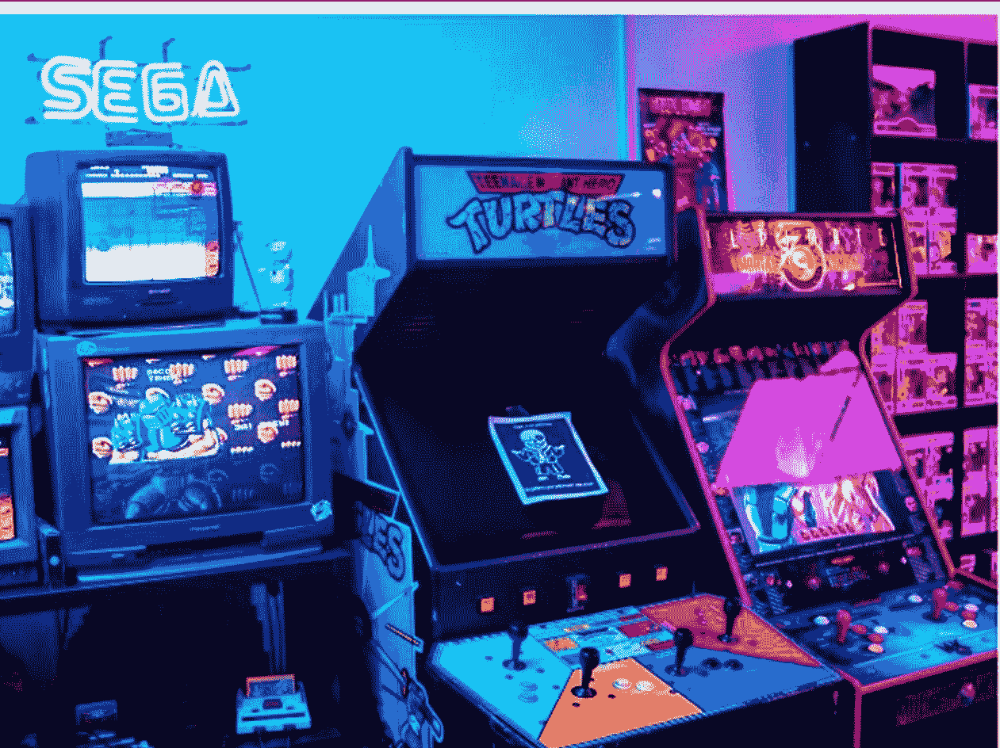

# Android 游戏开发 Java 2024



# 作者

Katie Millie

# 引言

## 释放你内心的游戏开发者：掌握 Java，打造迷人的安卓游戏

你是否曾梦想过打造下一款移动游戏热潮？想象一下创造沉浸式的世界，打造迷人的角色，并看到你的愿景在数百万设备上变为现实！通过《Java 用于安卓游戏开发》，你掌握了开启这一令人兴奋领域的钥匙。

这本全面的指南是你成为安卓游戏开发者的护照。我们将使你掌握 Java 编程的强大工具和技术，这是在世界上最流行的移动平台——安卓上构建迷人游戏的基础。以下是等待着你的内容：

-   **成为 Java 大师**：深入研究 Java 编程的核心概念，从基础语法到面向对象编程原则。学习如何控制游戏流程、管理内存变量并构建健壮的代码结构。
-   **解锁安卓游戏开发的秘诀**：探索安卓开发环境和必备工具的复杂性。发现如何利用安卓 API 的力量，让你的游戏想法在各种设备上跃变为现实。
-   **拥抱游戏引擎的力量（可选）**：深入探索 LibGDX、带 Java 插件的 Unity 等令人兴奋的游戏世界。利用游戏引擎进行高效游戏开发。使用游戏引擎构建项目（可选）。
-   **在做中学习**：忘记枯燥的讲座。这本书完全侧重于实操学习！随着课程的进行，你将开启一段制作微型游戏和项目的惊险之旅。
-   **拥抱乐趣**：创作游戏应该是一种愉快的体验。我们生动的解释和清晰的示例将让你在过程中保持动力和兴奋。
-   **对初学者友好的方法**：我们将复杂的概念拆解成易于理解的部分，确保任何有好奇心的人都能掌握 Java 的基础。
-   **侧重实用技能**：我们优先教你构建游戏时真正会用到的技能。
-   **面向未来的学习**：我们深入研究行业中使用的最新趋势和开发实践。

不仅仅是创建游戏，你还将获得适用于多个领域的宝贵技能：

-   **移动应用开发**：你用 Java 构建的基础已超出游戏领域。
-   **游戏设计**：在赋予游戏生命时，理解游戏设计的核心原则和机制。
-   **解决问题**：编码教会你批判性思维和解决问题的能力，这在任何职业路径上都有价值。

《Java 用于安卓游戏开发》是你进入激动人心的游戏创作世界的发射台。在这段旅程结束时，你将能够：

-   自信地编写 Java 代码来创建迷人的游戏机制和功能。
-   利用安卓开发环境和 API 为数百万用户构建游戏。
-   准备好应对高级的游戏开发概念和项目。

停止梦想，开始创造吧！释放你内心的游戏开发者，开启《安卓开发 Java》的惊险之旅。

# 第一章

## 你的 Java 编码冒险之旅（你将看到什么）

开启 Java 编码世界的旅程是一项充满无限可能性的兴奋尝试。无论你是希望扩展技能范围的资深开发人员，还是渴望学习门道的新手，拥有一份路线图来引导你的编码冒险将大有益。在本章中，我们将概述你在 Java 编码旅程中将看到的内容，重点关注安卓游戏开发的特定路径。

### 第一阶段：从 Java 基础开始

你的旅程从掌握 Java 编程的基础开始。从变量和数据类型到控制结构和面向对象原则，打下坚实的 Java 基础对于构建支持你编码努力的固体知识框架至关重要。

```java
public class HelloWorld {
    public static void main(String[] args) {
        System.out.println("Hello, world!");
    }
}
```

在上面的代码段中，我们有一个简单的 Java 程序，它会在控制台打印“Hello, world!”。这是你进入 Java 编码世界的第一步，向你介绍了 Java 程序的语法和结构。

### 第 2 阶段：探索面向对象编程 (OOP) 概念

接下来，深入探索面向对象编程（OOP）领域，这一范式是 Java 开发的基石。学习类、对象、继承、多态和封装，理解这些概念如何帮助你将现实世界的实体建模为代码中的对象。

```java
public class Player {
    private String name;
    private int health;
    public Player(String name, int health) {
        this.name = name;
        this.health = health;
    }
    public void takeDamage(int damage) {
        health -= damage;
    }
    // Other methods for player actions, interactions, etc.
}
```

在上面的示例中，我们有一个代表游戏中玩家角色的 Java 类。这种对行为和状态的封装体现了 OOP 的原则，允许你创建模块化、可重用且易于维护和扩展的代码。

### 第 3 阶段：深入 Android 开发

在你对 Java 有了深入理解之后，是时候进军 Android 开发领域了。Android 提供了丰富的工具和 API 生态系统用于构建移动应用程序（包括游戏）。熟悉 `Android Studio`——Android 开发的官方集成开发环境（IDE），并探索其设计、编码和调试 Android 应用程序的功能。

```java
import android.app.Activity;
import android.os.Bundle;
import android.view.Window;
import android.view.WindowManager;

public class MainActivity extends Activity {

  @Override
  protected void onCreate(Bundle savedInstanceState) {
    super.onCreate(savedInstanceState);
    // Set fullscreen mode
    requestWindowFeature(Window.FEATURE_NO_TITLE);
    getWindow().setFlags(WindowManager.LayoutParams.FLAG_FULLSCREEN,
    WindowManager.LayoutParams.FLAG_FULLSCREEN);

    // Set content view to game surface
    setContentView(new GameSurface(this));
  }
}
```

在上面的代码段中，我们有一个 Android Activity 的示例，它设置了一个全屏游戏表面来渲染我们的游戏内容。这展示了 Android 如何为开发者提供工具，以根据设备的屏幕尺寸和方向创建沉浸式的游戏体验。

### 第 4 阶段：精通 Android 游戏开发

一旦熟悉了 Android 开发的基础知识，就是时候深入研究游戏开发的复杂之处了。探索如图形渲染、输入处理、物理模拟、音频播放和多人网络等主题，并学习如何利用 Android SDK 创建引人注目且沉浸式的游戏体验。

```java
// Example code for rendering graphics using OpenGL
public void onDrawFrame(GL10 gl) {
    // Clear the screen
    gl.glClear(GL10.GL_COLOR_BUFFER_BIT | GL10.GL_DEPTH_BUFFER_BIT);

    // Draw game objects
    // ...
}
```

在上面的代码段中，我们有一个使用 OpenGL ES 渲染图形的方法，OpenGL ES 是 Android 上广泛用于 2D 和 3D 图形渲染的 API。这说明了 Android 如何为开发者提供灵活性，以创建在视觉上令人惊叹并推动创意边界的游戏。

当你开启 Java 编码之旅时，请记住，旅程本身与目的地同样重要。迎接挑战，庆祝胜利，永不停止学习和探索。以 Java 为盟友，以 Android 为画布，创意和创新的可能性是无限的。所以，系好安全带，磨炼你的编码技能，让冒险开始吧！编码愉快！

## 游戏开发者工具箱：精通 Java 编程

欢迎有抱负的游戏开发者来到充满活力的移动游戏开发世界！开启一段令人兴奋的旅程，在这里，创意与技术汇聚，可能性仅限于你的想象力。在这篇文章中，我们将深入探讨基于 Java 的游戏开发这一精彩领域，你将学习如何在指尖打造迷人游戏体验的基础知识。

Java 以其多功能和健壮性闻名，是无数 Android 游戏的基础，为开发者提供了强大的工具集来实现他们的想法。让我们探索构成 Android 平台 Java 游戏开发骨干的核心组件和概念。

### 搭建舞台：从 Android Studio 开始

要开启你的 Android 游戏开发之旅，第一步是搭建你的开发环境。`Android Studio` 是 Android 应用程序开发的官方集成开发环境（IDE），提供了一套专为打造沉浸式游戏体验定制的完整工具包。

首先从官方网站获取并安装 `Android Studio`。安装完成后，启动 `Android Studio` 并创建一个新项目，选择“Empty Activity”模板从空白开始。熟悉 `Android Studio` 界面的布局和结构，因为你将花费大量时间在这里创作你的杰作。

### 基础模块：理解 Java 核心

在深入游戏开发的复杂细节之前，掌握 Java 编程的基本概念至关重要。从变量、数据类型到控制结构面向对象原则，Java 构成了 Android 游戏开发的骨干，使开发者能够轻松实现复杂的游戏逻辑。

让我们深入了解游戏开发过程中经常遇到的一些关键 Java 概念：

- **变量和数据类型**：变量是存储数据的容器，而数据类型指定了变量可以包含的数据类型，例如整数、字符串和布尔值。
- **控制结构**：控制结构（包括循环和条件语句）允许开发者根据特定条件决定游戏逻辑的流。
- **面向对象编程 (OOP)**：OOP 原则（如封装、继承和多态）通过将现实世界实体建模为对象，促进了代码的组织和管理。

精通这些 Java 核心将为你构建 Android 游戏提供坚实的基础。

### 为游戏注入灵魂：利用 Android SDK

Android 软件开发包（SDK）为开发者提供了丰富的工具和 API，以充分利用 Android 平台的潜力。从图形渲染、输入处理到音频播放和网络连接，Android SDK 提供了一套全面的资源来辅助游戏开发的各个方面。

以下是你在游戏开发中将使用的 Android SDK 部分组件：

- **图形渲染**：Android 提供了使用 OpenGL ES API 进行图形渲染的强大支持，允许开发者为游戏创建视觉震撼的 2D 和 3D 图形。
- **输入处理**：从触摸输入到加速度计和陀螺传感器，Android 提供了多种输入机制来吸引并增强交互体验。
- **音频播放**：沉浸式音频是游戏体验的一部分，Android 提供了用于管理音频资源。
- **网络连接**：多人游戏和在线排行榜通过 Android 的网络 API 实现，实现了玩家之间的实时通信和基于服务器的游戏功能。

通过利用 Android SDK 的功能，你将能够设计并实现吸引玩家并让他们流连的功能丰富的游戏。

### 最后边界：发布你的游戏

在经历了无数次的开发、测试和完善后，你的游戏终于准备好在 Google Play Store 首发。然而，在发布之前，确保你的游戏符合 Google 制定的严格质量标准和指南是非常关键的。

在各种设备上进行彻底测试以确保兼容性和稳定性，并优化游戏性能以为玩家提供流畅且沉浸的体验。一旦你对游戏充满信心，准备好宣传材料、截图和一段引人入胜的描述，以吸引玩家下载并体验你的作品。

一切准备就绪后，导航到 Google Play Console，为你的游戏创建一个新条目，并按照步骤说明上传 APK 文件，设置价格和分发选项，并将你的游戏发布到世界上。

当你开启基于 Java 的 Android 游戏开发冒险之旅时，请记住，前方的道路充满了挑战、胜利，以及无尽的创意与创新机会。凭借在旅程中获得的知识和工具，你有能力创造出沉浸式的游戏体验，吸引玩家并在移动游戏领域留下深刻的印象。

所以，请集结你的智慧，磨炼你的技能，让游戏开发竞技场成为你无限探索和发现的舞台。你的旅程从这里开始。欢迎来到 Android 游戏开发的世界。开始吧！

## 为什么选择 Java 和 Android：构建游戏的完美结合

在为移动设备构建游戏时，Java 和 Android 是天作之合。Java 的多功能性结合 Android 强大的框架和广泛的应用，为开发者提供了创建引人入胜且沉浸式游戏体验的完美工具包。在本文中，我们将探索为什么 Java 和 Android 是游戏开发的理想组合，并提供一些代码示例来展示它们的协同效应。

### Java：Android 开发的骨干

Java 长期以来一直是 Android 开发的首选编程语言，这归功于它的健壮性、可移植性以及丰富的库和工具生态系统。通过 Java，开发者可以编写跨平台代码，这些代码可以在不同设备上无缝运行，使其成为构建针对多样化 Android 用户群游戏的理想选择。

```java
public class HelloWorld {
    public static void main(String[] args) {
        System.out.println("Hello, world!");
    }
}
```

在上面的示例中，我们有一个简单的 Java 程序，它向控制台打印“Hello, world!”。这展示了 Java 代码的简单易读性，让所有技能水平的开发者都能轻松上手。

### Android：游戏开发的乐场

Android 为游戏开发提供了一个丰富且功能强大的框架，为开发者提供了用于图形渲染、输入处理、音频播放等的广泛工具和 API。无论你是在创建一个休闲益智游戏，还是一个特效密集的 3D 冒险游戏，Android 都拥有你实现愿景所需的一切。

```java
import android.app.Activity;
import android.os.Bundle;
import android.view.Window;
import android.view.WindowManager;

public class MainActivity extends Activity {

    @Override
    protected void onCreate(Bundle savedInstanceState) {
        super.onCreate(savedInstanceState);

        // 设置全屏模式
        requestWindowFeature(Window.FEATURE_NO_TITLE);

        getWindow().setFlags(WindowManager.LayoutParams.FLAG_FULLSCREEN,
        WindowManager.LayoutParams.FLAG_FULLSCREEN);

        // 将内容视图设置为游戏表面
        setContentView(new GameSurface(this));

    }
}
```

在上面的代码段中，我们有了一个 Android Activity 的示例，它为渲染我们的游戏内容设置了一个全屏游戏表面。这证明了 Android 如何为开发者提供灵活性，以根据设备的屏幕尺寸和方向创建定制的沉浸式游戏体验。

### 完美匹配：和谐的 Java 与 Android

对于游戏开发，Java 和 Android 之间的协同效应是不言而喻的。Java 的面向对象编程范式和丰富的标准库补充了 Android 健壮的框架，使开发者能够编写出整洁、模块化且易于维护和扩展的代码。

```java
public class Player {
    private int x, y;
    private int speed;
    public Player(int x, int y, int speed) {
        this.x = x;
        this.y = y;
        this.speed = speed;
    }
    public void move(int dx, int dy) {
        x += dx * speed;
        y += dy * speed;
    }
    // 其他玩家交互方法
}
```

在上面的示例中，我们有一个代表玩家角色的 Java 类。Java 的面向对象编程范式和丰富的标准库补充了 Android 健壮的框架，使开发者能够编写出整洁、模块化且易于维护和扩展的代码。

对于游戏开发，Java 和 Android 之间的协同效应是不言而喻的。Java 的多功能性结合 Android 强大的框架和广泛的应用，为开发者提供了创建引人入胜且沉浸式游戏体验的完美工具包。


# Java 的多功能性结合 Android 强大的框架和广泛的应用，为开发者提供了创建引人入胜且沉浸式游戏体验的完美工具包。

# 第2章 设置你的开发环境（准备就绪，代码！）

在开启基于 Java 的 Android 游戏开发之旅之前，设置你的开发环境至关重要。

## 选择你的文本编辑器或 IDE

对于用于 Android 的 Java 开发，有很多流行的文本编辑器和 IDE 可供选择，每种都有独特的功能和优势。无论你是喜欢简洁级的文本编辑器，还是功能强大的 IDE，都有适合你的工具。

### 1. Android Studio

`Android Studio` 是 Android 开发的官方 IDE，提供了一套适用于构建 Android 应用（包括游戏）的全面工具和功能。它提供了高级的代码编辑、调试和性能分析功能，并内置了基于 `Gradle` 的构建系统以及用于测试应用程序的 Android 模拟器。

```java
public class MainActivity extends Activity {

  @Override
  protected void onCreate(Bundle savedInstanceState) {
    super.onCreate(savedInstanceState);

    // 设置全屏模式
    requestWindowFeature(Window.FEATURE_NO_TITLE);
    getWindow().setFlags(WindowManager.LayoutParams.FLAG_FULLSCREEN,
      WindowManager.LayoutParams.FLAG_FULLSCREEN);

    // 将内容视图设置为游戏表面
    setContentView(new GameSurface(this));

  }
}
```

在上面的代码段中，我们有一个在 `Android Studio` 中编写的 Android Activity 示例。该 IDE 提供了代码补全、语法高亮和项目管理工具，以简化开发流程。

### 2. IntelliJ IDEA

`IntelliJ IDEA` 是由 `JetBrains` 开发的热门 Java IDE，提供了强大的编码辅助、生产力工具以及与各种框架和技术的集成。它提供了高级的重构、代码分析和版本控制功能，是从事 Android 项目的 Java 开发者的极佳选择。

```java
public class Player {
    private String name;
    private int health;

    public Player(String name, int health) {
        this.name = name;
        this.health = health;
    }

    public void takeDamage(int damage) {
        health -= damage;
    }
    // 其他玩家动作、交互方法等
}
```

一旦你选择了喜爱的文本编辑器或 IDE，现在是时候为 Java 开发进行配置了。这通常涉及安装必要的插件或扩展、设置项目特定的配置，以及配置构建工具和依赖。

## Android Studio 设置

如果你正在使用 `Android Studio`，设置过程非常简单。只需从官方网站下载并安装 `Android Studio`，并按照屏幕上的指令设置你的开发环境。`Android Studio` 自带了 Android SDK，因此你开箱即可获得开始构建 Android 游戏所需的所有内容。

## IntelliJ IDEA 设置

如果你正在使用 `IntelliJ IDEA`，你需要安装 Android 开发所需的必要插件。打开 `IntelliJ IDEA`，导航到设置中的 `Plugins`（插件）部分，并搜索 "Android" 插件。安装该插件并重启 `IntelliJ IDEA` 以应用更改。你可能还需要在 IDE 设置中配置 `JDK` 和 `SDK` 路径，以确保与 Android 开发工具正确集成。

在设置并配置好开发环境后，你就可以准备进入激动人心的 Java Android 游戏开发世界了。无论你使用的是 `Android Studio`、`IntelliJ IDEA` 还是你喜欢的任何其他文本编辑器或 IDE，关键在于找到一个适合你工作流和偏好的工具。现在，启动你的编辑器，打开一个新项目，让编码冒险开始吧！祝编码愉快！

## 安装核心 Java 工具（JDK、库等）

在开启你的 Java Android 游戏开发之旅之前，确保你的系统上安装了核心工具和库至关重要。从 Java 开发工具包 (`JDK`) 到 Android SDK 以及各种库，拥有正确的工具对于构建和部署 Android 游戏至关重要。在本文中，我们将引导你完成安装这些核心 Java 工具和库的过程，以开启你的开发之旅。

### Java 开发工具包 (JDK)

Java 开发工具包 (`JDK`) 是 Java 开发的主要工具集，提供了编写和运行 Java 程序所需的编译器、调试器和其他工具。在开发 Android 游戏时，在系统中安装 `JDK` 以编译和执行你的 Java 代码是关键的。

#### 安装步骤：

1. 访问 Oracle 官方网站（`https://www.oracle.com/java/technologies/javase-jdk16-download.html`）下载最新版本的 `JDK`。
2. 按照屏幕上的指令在系统上安装 `JDK`。确保为你的操作系统（Windows、macOS 或 Linux）选择合适的版本。
3. 安装完成后，打开终端或命令提示符并运行以下命令，验证 `JDK` 是否正确安装：

```bash
java -version
```

你应该能在输出中观察到已安装的 Java 版本。

### Android SDK

Android 软件开发包 (`SDK`) 是 Google 为开发 Android 应用（包括游戏）提供的工具和库的集合。Android `SDK` 包含了核心组件，如 Android 模拟器、构建工具、平台工具以及用于测试和调试 Android 应用的镜像。

#### 安装步骤：

1. 从 Android 开发者官方网站（`https://developer.android.com/studio`）下载并安装 `Android Studio`。
2. 启动 `Android Studio` 并按照指令完成设置。`Android Studio` 将自动下载并安装最新版本的 Android `SDK`。
3. 安装 `Android Studio` 后，从 `Tools`（工具）菜单打开 `SDK Manager`。在这里，你可以为不同的 Android 版本安装额外的 `SDK` 组件和镜像。

## 库与依赖

除了 `JDK` 和 Android `SDK`，你可能还需要为你的 Android 游戏开发项目安装额外的库和依赖。这些库可能包括第三方框架、游戏引擎和实用库，它们可以增强你的开发工作流并提供额外功能。

### 安装步骤（示例：LibGDX）：

1. 访问 `LibGDX` 官方网站（`https://libgdx.com/`）下载 `LibGDX` 设置工具。
2. 运行设置工具并按照屏幕指令创建一个新的 `LibGDX` 项目。设置工具将自动为你的项目下载并配置所需的依赖。
3. 设置完成后，在你喜好的 IDE 或文本编辑器中打开生成的项目，并使用 `LibGDX` 开发你的 Android 游戏。

在系统上安装了核心 Java 工具和库后，你现在已经准备好开始 Java Android 游戏开发之旅了。无论你使用的是 `JDK`、Android `SDK` 还是像 `LibGDX` 这样的第三方库，拥有正确的工具对于构建高质量的 Android 游戏至关重要。所以，启动你的 IDE，打开新项目，让游戏开发开始吧！祝编码愉快！

## Android Studio 简介：你的开发中心

欢迎来到 `Android Studio`，这是你 Android 游戏开发的终极中心！`Android Studio` 是构建 Android 应用（包括游戏）的官方集成开发环境 (`IDE`)，它提供了一套专为 Android 开发定制的全面工具和功能。在本文中，我们将介绍 `Android Studio` 并探索它的关键组件和功能，以开启你的 Android 游戏开发之旅。

### 开始使用 Android Studio

在深入研究 Android 游戏开发的复杂细节之前，让我们花点时间熟悉 `Android Studio` 及其用户界面。启动 `Android Studio` 后，你会看到一个欢迎界面，你可以在那里创建新项目、打开现有项目，或访问各种教程和资源来帮助你上手。

### 创建新项目

要在 `Android Studio` 中创建一个新的 Android 游戏项目，只需点击欢迎界面上的 "Start a new Android Studio project"（启动一个新的 Android Studio 项目）选项。按照分步向导配置项目设置，包括项目名称、包名和目标 Android 版本。你还可以从适用于不同 Android 应用（包括游戏）的模板和预设中选择。

```java
public class MainActivity extends Activity {

    @Override
    protected void onCreate(Bundle savedInstanceState) {
        super.onCreate(savedInstanceState);
        // 设置全屏模式
        requestWindowFeature(Window.FEATURE_NO_TITLE);
        getWindow().setFlags(WindowManager.LayoutParams.FLAG_FULLSCREEN);

        // 设置内容为游戏表面
        setContentView(new GameSurface(this));
    }
}
```

在上面的代码段中，我们展示了一个 Activity 示例，用于设置渲染游戏内容的全屏游戏表面。它是 Android 游戏程序的入口点，我们在此处初始化游戏环境和资源。

## 探索 Android Studio 功能

`Android Studio` 提供了丰富的功能和工具来简化 Android 游戏开发流程。从代码编辑、调试到布局设计和性能分析，`Android Studio` 为构建和部署高质量的 Android 游戏提供了所需的一切。

### 代码编辑

`Android Studio` 配备了强大的代码编辑器，提供语法高亮、代码补全和代码分析等功能，以增强你的编码体验。编辑器支持多种编程语言，包括 Java 和 Kotlin，让你轻松编写和编辑游戏代码。

### 布局设计

`Android Studio` 提供了强大的调试和测试工具，帮助你识别并修复 Android 游戏中的问题。你可以设置断点、检查变量并单步执行代码执行，以排查错误并优化性能。此外，`Android Studio` 还提供了内置的模拟器和设备仿真器，用于在各种 Android 设备和不同屏幕尺寸上测试你的游戏。

凭借其丰富的特性集和直观的用户界面，`Android Studio` 是你进入 Android 游戏开发的大门。无论你是资深开发者还是初学者，`Android Studio` 都能提供你所需的工具和资源，将你的游戏想法变为现实，并在 Android 平台上释放你的创造力。所以，启动 `Android Studio`，创建一个新项目，让游戏开发开始吧！编码愉快！

# 第 3 章 Java 编程基础（打好你的基础）

在深入 Android 游戏开发的精彩世界之前，对 Java 编程基础建立稳固的理解至关重要。从变量、数据类型到控制结构和面向对象的原则，掌握这些基础概念将为你提供实现游戏想法所需的工具。在本文中，我们将探索 Java 编程的基础，重点关注变量和数据类型，并提供为 Android 游戏开发定制的代码示例。

## 变量和数据类型

变量是 Java 程序中存储数据的容器，允许你在整个代码中操作和引用值。Java 支持多种数据类型，每种类型都旨在处理不同类型的数据，包括数字、字符串和布尔值。

### 数字：整数和浮点数

在 Java 中，数字使用两种主要数据类型表示：整数和浮点数。整数由不带小数点的整数组成，而浮点数包含小数点。让我们来看看如何声明和初始化这些类型的变量：

```java
// 整数变量
int score = 100;
int livesLeft = 3;
// 浮点数变量
float playerX = 10.5f;
double playerY = 20.75;
```

在上面的代码段中，我们声明并初始化了整数和浮点变量，用于存储玩家得分、坐标以及与我们的 Android 游戏相关的数值数据。

### 字符串：文本数据

字符串用于表示 Java 中的文本数据，例如玩家名称、消息和游戏描述。在 Java 中，字符串使用 `String` 类，你可以通过在双引号内包含文本来创建字符串变量：

```java
// 字符串变量
String playerName = "Alice";
String welcomeMessage = "Welcome to the game!";
```

Java 中的字符串是不可变的，这意味着一旦创建，其值就无法更改。然而，你可以使用 `String` 类提供的各种方法来操作字符串，例如拼接、子字符串提取和大小写转换。

### 布尔值：真或假值

布尔值是 Java 中的一种基础数据类型，用于表示真（`true`）或假（`false`）值。在游戏开发中，布尔值常用于处理逻辑判断，例如游戏是否结束或是否暂停。让我们来看看声明和初始化布尔变量：

```java
// 布尔变量
boolean gameOver = false;
boolean isPaused = true;
```

在上面的代码段中，我们声明并初始化了布尔变量，用于存储游戏结束、暂停等与我们的 Android 游戏相关的状态。

### 命名规范

在命名变量时，遵循良好的规范非常重要。

- 使用驼峰命名法（`camelCase`）命名变量名，例如 `playerName`。
- 使用小写字母和下划线命名（`snake_case`），例如 `player_name`。
- 常量使用大写字母和下划线，例如 `MAX_SCORE`。

良好的命名规范可以使你的代码更具可读性和维护性。

```java
playerHealth++; // playerHealth = 101

// 递减运算符

playerHealth--; // playerHealth = 100
```

在上面的代码段中，我们演示了如何使用自增和自减运算符来调整代表玩家健康的变量值。这些运算符提供了一种通过固定量更新变量的方便方式，为你的 Android 游戏提供了动态游戏机制的便利。

在 Android 游戏开发中，运算符和表达式在执行计算和处理数据方面起着至关重要的作用。通过利用算术运算符、赋值运算符以及自增/自减运算符，你可以轻松实现复杂的游戏机制、管理玩家交互并模拟动态的游戏环境。

在你继续探索 Java 编程和 Android 游戏开发的旅程时，请记住探索 Java 中提供的各种类型的运算符和表达式，尝试不同的组合和技术，并始终优化和精炼你的游戏代码，以提高性能和游戏体验。通过实践和创意，你将完全有能力开发出吸引全球玩家的、引人入的 Android 游戏。编码愉快！

## 控制游戏流程（条件语句和循环）

在使用 Java 进行 Android 游戏开发时，控制游戏流程对于实现游戏机制、管理玩家交互以及创建动态游戏体验至关重要。这是通过条件语句和循环实现的，它们允许你根据特定条件做出决策并遍历游戏元素。在本文，我们将探索如何在 Java 中使用条件语句和循环来控制游戏流程，并提供与 Android 游戏开发相关的代码示例。

### 条件语句


# 条件语句与循环：控制游戏流程

条件语句允许你根据特定条件执行不同的代码块，使你能够根据玩家操作、游戏状态或其他因素控制游戏流程。Java 中常见的条件表达式形式包括 `if` 语句、`switch` 语句和三元运算符。

## If 语句

`if` 语句允许在指定条件为真时执行代码块，为在你的游戏代码中实现分支逻辑提供了方法。

```java
int playerHealth = 50;
if (playerHealth <= 0) {
  gameOver();
} else if (playerHealth < 30) {
  displayLowHealthWarning();
} else {
  continueGame();
}
```

在上面的代码段中，我们使用 `if` 语句检查玩家的健康值，并根据当前的健康值执行不同的操作。

## Switch 语句

`switch` 语句提供了处理 `if` 语句处理多种条件情况的替代方案，允许你根据变量或表达式的值执行不同的代码块。

```java
int playerScore = 100;

switch (playerScore) {
    case 100:
        displayPerfectScoreMessage();
        break;
    case 50:
        displayHalfwayThereMessage();
        break;
    default:
        displayRegularScoreMessage();
        break;
}
```

在上面的代码段中，我们使用 `switch` 语句根据玩家的分数显示不同的消息。

## 三元运算符

三元运算符提供了一种用单行代码表示条件表达式的简洁方式，对于简单的条件赋值非常有用。

```java
int playerHealth = 70;
String healthStatus = (playerHealth > 50) ? "Good" : "Low";
```

在上面的代码段中，我们使用三元运算符根据玩家的健康值分配健康状态。

## 循环

循环允许你多次迭代一组指令，使你能够执行重复任务、遍历游戏元素并实现敌人移动和碰撞检测等游戏机制。Java 中常见的循环类型是 `for` 循环、`while` 循环和 `do-while` 循环。

### For 循环

`for` 循环用于按预定次数迭代范围内的值或元素，使它们成为遍历数组、列表和其他数据结构的理想选择。

```java
for (int i = 0; i < 10; i++) {
    spawnEnemy();
}
```

在上面的代码段中，我们使用 `for` 循环在游戏中生成了十个敌人单位。

### While 循环

`while` 循环用于在指定条件为真时重复执行一个代码块，允许你实现需要持续监控或更新的游戏机制。

```java
int enemyCount = 0;
while (enemyCount < 10) {
  spawnEnemy();
  enemyCount++;
}
```

在上面的代码段中，我们使用 `while` 循环不断生成敌人，直到达到指定的敌人数量。

### Do-While 循环

`do-while` 循环与 `while` 循环相似，但它们保证在检查循环条件之前至少执行一次代码块。

```java
int playerHealth = 100;
do {
  takeDamage();
  playerHealth -= 10;
} while (playerHealth > 0);
```

在上面的代码段中，我们使用 `do-while` 循环模拟玩家受到伤害，直到其健康值归零。

精通 Java 中的条件语句和循环对于控制 Android 游戏流程和实现动态游戏机制至关重要。通过利用 `if` 语句、`switch` 语句、三元运算符、`for` 循环、`while` 循环和 `do-while` 循环，你可以创建出响应玩家操作、模拟复杂游戏环境并提供互动挑战的沉浸式游戏体验。

在你继续使用 Java 进行 Android 游戏开发时，尝试不同类型的条件语句和循环，探索高级技术和模式，并始终优化和精炼你的游戏代码，以提高性能和玩家体验。通过实践和创意，你将完全有能力开发出吸引全球玩家的 Android 游戏。编码愉快！

# 使用函数和过程构建复用代码

在使用 Java 进行 Android 游戏开发时，构建复用代码对于提高代码组织、可读性和维护性至关重要。函数和过程允许你将代码块封装成复用模块，使你能够以模块高效的方式实现常见的游戏功能，如玩家移动、敌人行为和游戏逻辑。在本文，我们将探索如何在 Java 中使用函数和过程构建复用代码，并提供与 Android 游戏开发相关的代码示例。

## 函数

函数（在 Java 中称为方法）是执行特定任务并返回值的自包含代码块。函数允许你将常见任务或算法封装到复用模块中，使代码更加模块化且易于维护。

```java
// 计算矩形面积的函数
public static double calculateArea(double length, double width) {
    return length * width;
}

// 显示欢迎消息的函数
public static void displayMessage() {
    System.out.println("欢迎来到游戏!");
}
```

在上面的代码段中，我们定义了两个函数：`calculateArea` 根据长度和宽度计算矩形面积，`displayMessage` 向玩家显示欢迎消息。

## 过程

过程与函数相似，但不返回值。它们用于封装执行特定任务或操作但不返回结果的代码块。过程通常用于涉及副作用的任务，例如向控制台输出内容或更新游戏状态。

```java
// 显示玩家健康值的过程
public static void displayPlayerHealth(int health) {
  System.out.println("Player Health: " + health);
}
```

```java
// Procedure to update player position
public static void updatePlayerPosition(int x, int y) {
    // Code to update player position
}
```

在上面的代码段中，我们定义了两个过程：`displayPlayerHealth` 用于在屏幕上显示玩家血量，`updatePlayerPosition` 用于更新游戏世界中玩家的位置。

## 可重用代码的优势

使用函数和过程构建可重用代码为 Android 游戏带来了若干优势：

1. **模块化**：函数和过程允许你将复杂的游戏逻辑拆分为更小、更易管理的模块，使你的代码更易理解和维护。
2. **代码重用性**：一旦定义，函数和过程可以在整个游戏代码中重用，减少重复并提高代码的一致性。
3. **可扩展性**：通过将常见功能封装到可重用的模块中，你可以轻松扩展游戏代码以适应新功能和更新，而无需重写现有代码。
4. **测试与调试**：可重用的代码单元可以独立进行测试和调试，有助于识别和解决错误及问题。

## 示例：玩家移动

让我们考虑一个使用函数在 Android 游戏中实现玩家移动的示例：

```java
// Function to move the player up
public static void movePlayerUp(Player player) {
    player.setY(player.getY() - 1);
}

// Function to move the player down
public static void movePlayerDown(Player player) {
    player.setY(player.getY() + 1);
}

// Function to move the player left
public static void movePlayerLeft(Player player) {
    player.setX(player.getX() - 1);
}

// Function to move the player right
public static void movePlayerRight(Player player) {
    player.setX(player.getX() + 1);
}
```

在上面的代码段中，我们定义了四个用于让玩家向不同方向移动的函数：上、下、左、右。这些函数封装了更新玩家位置的逻辑，允许我们轻松控制整个游戏中的玩家移动。

函数和过程是使用 Java 在 Android 游戏开发中构建可重用代码的强大工具。通过将常见任务和功能封装到模块化单元中，你可以提高代码的结构、可读性和维护性，最终实现更高效、更可扩展的游戏代码。

在你继续 Android 游戏开发之旅时，请考虑利用函数和过程封装常见的游戏功能，尝试不同的设计模式和编码技术，并始终努力优化和完善你的游戏代码，以提高性能和玩家体验。通过实践和创意，你将完全能够开发出吸引全球玩家的 Android 游戏。编码愉快！

# 第 4 章：面向对象编程：掌握游戏设计原则

面向对象编程（OOP）是一种设计和实现复杂软件系统（包括 Android 游戏）的强大范式。通过将代码组织成类、创建对象来表示游戏实体并利用继承创建层级关系，OOP 允许开发者构建模块化、可扩展且可维护的游戏代码。在本文，我们将探索 OOP 的核心原理，包括类、对象和继承，并结合 Android 游戏开发相关的代码示例。

## 理解类

在 Java 中，类是创建对象的蓝图，定义了该类型对象将表现出的属性和行为。类封装了与游戏中特定概念或实体相关的数据（属性）和功能（方法）。让我们考虑一个代表 Android 游戏中玩家角色的 `Player` 类示例：

```java
public class Player {
    // Attributes
    private String name;
    private int health;
    private int score;

    // Constructor
    public Player(String name) {
        this.name = name;
        this.health = 100;
        this.score = 0;
    }

    // Methods
    public void takeDamage(int damage) {
        health -= damage;
    }

    public void increaseScore(int points) {
        score += points;
    }

    public String getName() {
        return name;
    }

    public int getHealth() {
        return health;
    }

    public int getScore() {
        return score;
    }
}
```

在上面的代码段中，我们定义了一个 `Player` 类，包含名称、血量和分数等属性，以及执行诸如受伤和增加得分的方法。该类作为我们游戏中创建玩家对象的蓝图。

## 创建对象

一旦定义了类，就可以从该类创建对象（实例化），以表示类所定义概念或实体的特定实例。从类创建的每个对象都有自己的一套属性，并可以调用类中定义的方法。让我们在游戏中创建一个 `Player` 对象：

```java
Player player1 = new Player("Player1");
```

在上面的代码段中，我们使用 `new` 关键字并将玩家名称作为参数传递给构造函数，创建了一个名为 `player1` 的新 `Player` 对象。该对象现在代表我们游戏中的特定玩家实例。

当你继续 Android 游戏开发之旅时，请尝试不同的类设计，探索多态和封装等高级 OOP 概念，并努力应用面向对象的原则来创建健壮且可扩展的游戏架构。通过实践和创意，你将完全有能力开发出吸引全球玩家的沉浸式且迷人的 Android 游戏。编码愉快！

# 利用面向对象设计实现灵活且可扩展的游戏

面向对象设计（OOD）是使用 Java 进行 Android 游戏开发的一项基础方法，它允许开发者创建灵活、模块化且可扩展的游戏架构。通过将代码组织成类、定义对象之间的关系，并利用继承、封装和多态等设计原则，OOD 使开发者能够构建出更容易维护、扩展和适应不断变化的需求的游戏。在本文，我们将探索如何利用面向对象设计来实现灵活且可扩展的 Android 游戏，并提供与 Java 游戏开发代码示例。

## 将代码组织成类

面向对象设计的核心原则之一是将代码组织成类，每个类代表游戏中的特定概念或实体。类封装了与特定游戏元素相关的数据（属性）和行为（方法），从而实现了更好的代码组织和模块化。让我们来看一个为 Android 游戏组织代码成类的示例：

```java
// Player class representing a player character
public class Player {
    private String name;
    private int health;

    // Constructor
    public Player(String name) {
        this.name = name;
        this.health = 100;
    }

    // Methods
    public void takeDamage(int damage) {
        health -= damage;
    }

    public void heal(int amount) {
        health += amount;
    }

    // Other methods and attributes...
}
```

在上面的代码段落中，我们定义了一个 `Player` 类，代表游戏中的玩家角色。该类封装了名称和健康等属性，以及执行受到伤害和治疗等操作的方法。

## 利用继承实现层级关系

继承是面向对象设计中的另一个基本概念，允许类从其他类继承属性和行为，在类之间建立层级关系。继承促进了代码复用，并允许开发者创建扩展现有类功能的专门化类。让我们来看 Android 游戏开发中继承的示例：

```java
// Enemy class representing an enemy character
public class Enemy extends Character {
    // Additional attributes and methods specific to enemies
}
```

在上面的代码段落中，我们定义了一个继承自 `Character` 类的 `Enemy` 类。通过这样做，`Enemy` 类继承了 `Character` 类中定义的所有属性和方法，实现了代码复用，并在游戏角色和敌人之间建立了层级关系。

## 封装实现数据隐藏和模块化

封装是面向对象设计的一个关键原则，涉及将数据（属性）和操作数据的方法封装到单个单元（类）中。封装促进了数据隐藏、抽象和模块化，允许开发者隐藏实现细节并仅向代码的其他部分暴露本质的功能。让我们来看 Android 游戏开发中封装的示例：

```java
// Character class representing a game character
public class Character {
    private String name;
    private int health;

    // Constructor
    public Character(String name) {
        this.name = name;
        this.health = 100;
    }

    // Getter and setter methods
    public String getName() {
        return name;
    }

    public int getHealth() {
        return health;
    }

    // Other methods and attributes...
}
```

在上面的代码段落中，我们通过将 `Character` 类的 `name` 和 `health` 属性声明为私有并提供公共 getter 方法来访问它们的值来实现封装。这促进了数据隐藏，并确保 `Character` 对象的内部状态以受控的方式访问和修改。

利用将代码组织成类、利用继承以及封装数据和行为等面向对象设计原则，可以促进灵活且可扩展的 Java Android 游戏开发。通过设计模块化、可扩展且易维护的游戏架构，开发者可以创建更易理解、扩展和适应演变需求的游戏。

在你的开发之旅中，探索多态、组合和设计模式等高级 OOD 概念，并谨慎地应用它们来创建健壮且高效的游戏架构。通过对面向对象设计原则的深刻理解和创新的实现，你将完全有能力开发出令全球玩家享受的、沉浸式的 Android 游戏。编码愉快！

# 应用设计模式进行高效游戏开发（可选）

设计模式是开发过程中常见的软件设计问题的成熟解决方案。在 Java 的 Android 游戏开发中，利用设计模式可以带来更高效、更易维护且可扩展的游戏架构。通过封装最佳实践和可用的解决方案，设计模式帮助开发者解决复杂的设计挑战，并促进代码的可复用、模块化和扩展性。在本文，我们将探索如何使用设计模式进行 Java 游戏开发，并提供与 Android 游戏开发相关的代码示例。

## 单例模式

单例设计模式保证类只有一个实例，并提供访问该实例的通用方法。该模式对于管理需要从游戏多个部分访问的全局游戏状态、资源或管理器非常有用。让我们来看 Android 游戏中为 `GameManager` 实现单例模式的示例：

```java
public class GameManager {
```


# 设计模式在 Android 游戏开发中的应用

## 单例模式

```java
private static GameManager instance;

// Private constructor to prevent instantiation
private GameManager() {
    // Initialization code
}

// Static method to get the singleton instance
public static GameManager getInstance() {
    if (instance == null) {
        instance = new GameManager();
    }
    return instance;
}

// Other methods and attributes...
```

在上面的代码段落中，我们定义了一个实现单例模式的 `GameManager` 类。
`getInstance()` 方法确保只创建一个 `GameManager` 类的实例，并在整个游戏中提供对该实例的全局访问。

## 工厂模式

工厂模式是一种创建性设计方法，它在父类中提供了一个创建对象的接口，允许子类修改生成的对象类型。该模式对于根据不同条件或参数动态创建游戏对象非常有用。让我们来看 Android 游戏中使用实现工厂模式以创建不同类型敌人的示例：

```java
public interface EnemyFactory {
    Enemy createEnemy();
}

public class GoblinFactory implements EnemyFactory {
    @Override
    public Enemy createEnemy() {
        return new Goblin();
    }
}

public class OrcFactory implements EnemyFactory {
    @Override
    public Enemy createEnemy() {
        return new Orc();
    }
}
```

在上面的代码段中，我们定义了一个 `EnemyFactory` 接口和两个具体实现类（`GoblinFactory` 和 `OrcFactory`），它们用于创建不同类型的敌人实例（`Goblin` 和 `Orc`）。这允许根据特定的工厂实现灵活地创建敌人对象。

## 观察者模式

观察者模式是一种行为设计模式，其中对象（主体）维护一个依赖者（观察者）列表，并在状态发生任何变化时通知它们。这种模式对于实现事件处理、通知或根据状态变化更新游戏实体非常有用。让我们考虑一个在 Android 游戏中使用观察者模式处理玩家健康变化的示例：

```java
public interface HealthObserver {
    void onHealthChanged(int health);
}

public class Player implements HealthObservable {
    private int health;
    private List<HealthObserver> observers = new ArrayList<>();

    // 添加观察者的方法
    public void attach(HealthObserver observer) {
        observers.add(observer);
    }

    // 通知观察者健康变化的方法
    private void notifyObservers() {
        for (HealthObserver observer : observers) {
            observer.onHealthChanged(health);
        }
    }

    // 更新玩家健康的方法
    public void updateHealth(int newHealth) {
        health = newHealth;
        notifyObservers();
    }
}
```

在上面的代码段中，我们定义了一个 `HealthObserver` 接口和一个实现该接口的 `Player` 类。`Player` 类维护一个观察者列表，并通过 `notifyObservers()` 方法通知它们玩家健康的任何变化。

在使用 Java 的 Android 游戏开发中使用设计模式可以显著提高代码的组织结构、重用性和可维护性。通过利用单例模式、工厂模式、观察者模式等模式，开发者可以解决常见的设计挑战，促进代码的一致性，并构建高效且扩展的游戏架构。

在你继续 Android 游戏开发之旅时，请探索不同的设计模式，理解它们的用例和优势，并明智地应用它们以创建健壮、灵活且易于维护的游戏代码。凭借对设计模式的扎实理解和创造性的实现，你将完全有能力开发出吸引全球玩家的、沉浸式的 Android 游戏。编码愉快！

# 第 5 章：欢迎 Android 开发：为你的游戏构建乐场

Android 开发提供了一个充满活力的生态系统，用于构建吸引全球玩家的互动性和沉浸式游戏。理解 Android 平台和架构对于利用其力量并发挥其特性创建引人入胜的游戏体验至关重要。本文中我们将探索 Android 平台和架构的基础，以及与 Java 游戏开发相关的代码示例。

## 理解 Android 平台

Android 平台是一个全面的软件栈，为开发移动应用程序（包括游戏）提供了稳健的框架。在其核心，Android 平台由四个主要层组成：

- **1. Linux 内核：** Android 操作系统的基础，提供核心系统服务，如进程管理、内存管理和设备驱动程序。
- **2. 库：** 一组用 C/C++ 编写的库，提供图形渲染、多媒体播放和网络等核心功能。
- **3. Android 运行时 (ART/Dalvik)：** 负责执行 Java 字节码并管理应用生命周期、内存和线程的 Android 运行时。
- **4. 应用框架：** 一组高级 Java API，允许开发者构建丰富且交互式的应用程序（包括游戏）。这些 API 涵盖了应用程序开发的各个方面，例如用户界面 (UI) 渲染、输入处理和内容提供者。

### Android 架构组件

除了核心平台层，Android 架构还包含了几个对于构建游戏至关重要的关键组件：

**1. Activities（活动）：** Activities 代表 Android 应用中的单个屏幕或 UI 组件。它们作为用户交互的入口，并封装了 UI 元素、输入处理和生命周期管理。

**2. Fragments（片段）：** Fragments 是模块化的 UI 组件，可以在活动内组合以创建灵活且可重用的 UI 布局。它们允许开发者为不同屏幕尺寸和方向的游戏构建动态响应的用户界面。

**3. Views and ViewGroups（视图和视图组）：** Views 是在屏幕上渲染视觉元素的 UI 组件，如按钮、文本字段和图像。ViewGroups 是包含多个视图的容器，并定义它们在 UI 层次结构中的布局和位置。

**4. Intents（意图）：** Intents 是用于在 Android 应用不同组件（如活动、服务和广播接收器）之间通信的消息对象。它们促进了屏幕之间的导航、启动外部活动以及组件之间的数据传递。

### 代码示例：创建一个 Android Activity

让我们考虑一个简单的代码示例，演示如何为游戏创建一个 Android Activity：

```java
public class MainActivity extends AppCompatActivity {
    @Override
    protected void onCreate(Bundle savedInstanceState) {
        super.onCreate(savedInstanceState);
        setContentView(R.layout.activity_main);
        // 初始化游戏组件
    }

    private void initializeGame() {
        // 初始化游戏逻辑、图形和资源
    }
}
```

在上面的代码段中，我们定义了一个继承 `AppCompatActivity` 类的 `MainActivity` 类，它是 Android 中活动的基类。`onCreate()` 方法在活动创建时被调用，在那里设置内容视图并初始化游戏组件。

理解 Android 平台和架构对于在 Android 平台上构建成功的游戏至关重要。通过熟悉核心平台层、架构组件和开发工具，你可以利用 Android 生态系统的全部潜力来创建迷人且沉浸的游戏体验。

当你深入研究 Android 游戏开发时，请探索图形渲染、输入处理、性能优化和变现策略等高级主题，以增强你的游戏并触及更广泛的受众。凭借创造力、毅力和对 Android 开发原则的扎实理解，你将有能力构建并发布深受全球玩家喜爱的游戏。编码愉快！

## 探索游戏开发者的必备 Android API

Android 提供了一系列丰富的 API（应用程序编程接口），赋予游戏开发者创建沉浸式互动游戏体验的能力。这些 API 涵盖了游戏开发的各个方面，包括图形渲染、输入处理、音频播放和网络通信。在本文中，我们将探索游戏开发者的一些必备 Android API，并带有 Java 代码示例。

### 1. 使用 OpenGL ES 进行图形渲染

OpenGL ES（嵌入式系统开放图形库）是一种用于在移动设备（包括 Android）上渲染 2D 和 3D 图形的跨平台 API。它提供了对 GPU（图形处理器）的低级访问，以实现高性能渲染。Android 通过 `android.opengl` 包提供了 OpenGL ES 绑定，允许开发者创建具有流畅动画和真实效果的视觉惊艳的游戏。

```java
@Override
public void onSurfaceCreated(GL10 gl, EGLConfig config) {
    // 初始化 OpenGL 设置和资源
}

@Override
public void onDrawFrame(GL10 gl) {
    // 渲染场景
}

@Override
public void onSurfaceChanged(GL10 gl, int width, int height) {
    // 处理表面变化（例如，屏幕旋转）
}
```

在上面的代码段中，我们定义了一个实现 `GLSurfaceView.Renderer` 接口的自定义渲染器，用于处理 OpenGL 渲染。该渲染器负责初始化 OpenGL 设置、渲染场景以及处理表面变化。

### 2. 使用触摸事件处理输入

Android 为处理触摸事件提供了强健的支持，允许开发者在游戏中捕获用户输入并做出相应响应。Android 中的 `MotionEvent` 类提供了关于触摸事件的信息，包括触摸位置、动作和时间戳。

```java
@Override
public boolean onTouchEvent(MotionEvent event) {
    int action = event.getActionMasked();
    switch (action) {
        case MotionEvent.ACTION_DOWN:
            // 处理触摸按下事件
            break;
        case MotionEvent.ACTION_MOVE:
            // 处理触摸移动事件
            break;
        case MotionEvent.ACTION_UP:
            // 处理触摸释放事件
            break;
    }
    return true;
}
```

在上面的代码段中，我们重写了 `Activity` 或 `View` 类中的 `onTouchEvent()` 方法来处理触摸事件。根据用户执行的动作（例如，按下、移动或释放），我们可以实现不同的游戏行为。

### 3. 使用 MediaPlayer 播放音频

Android 中的 `MediaPlayer` 类允许游戏开发者播放音频文件，包括背景音乐、音效和语音旁白。它支持多种音频格式，并提供了控制播放的方法，如播放、暂停、停止和跳转。

```java
MediaPlayer mediaPlayer = MediaPlayer.create(context, R.raw.background_music);
mediaPlayer.start(); // 开始播放背景音乐
// 稍后，当不再需要音乐时
mediaPlayer.release(); // 释放 MediaPlayer 资源
```

在上面的代码段中，我们使用 `create()` 方法创建了一个 `MediaPlayer` 实例，并传入了应用上下文和音频文件的资源 ID。然后我们开始播放背景音乐，并在不再需要它时释放 `MediaPlayer` 资源。

### 4. 使用 HttpURLConnection 进行网络通信

Android 提供了执行网络通信的 API，允许游戏开发者集成在线功能，如多人游戏、社交互动和在线排行榜。`HttpURLConnection` 类提供了一种简单直接的方法来发送和接收 HTTP 请求并处理服务器响应。

```java
URL url = new URL("https://api.example.com/game/leaderboard");
HttpURLConnection urlConnection = (HttpURLConnection) url.openConnection();
try {
    InputStream in = new BufferedInputStream(urlConnection.getInputStream());
    // 读取并解析服务器响应
} finally {
    urlConnection.disconnect();
}
```

在上面的代码段中，我们创建了一个 `HttpURLConnection` 实例以建立与远程服务器的连接。然后我们使用 `InputStream` 读取服务器响应，并在游戏中对其进行相应的处理。

Android 提供了多样化的 API 来满足游戏开发者的需求，使他们能够在 Android 平台上创建出富有吸引力且功能丰富的游戏。通过利用图形渲染、输入处理、音频播放和网络通信的 API，开发者可以释放创造力，构建出令全球玩家着迷的沉浸式游戏体验。凭借 Android API 的力量和 Java 语言的活性，游戏开发的可能性几乎是无限的。编码愉快！

## 使用 Android Studio 配置你的 Android 开发环境

Android Studio 是用于 Android 应用开发的官方集成开发环境 (IDE)，提供了一套完整的工具用于构建、测试和调试 Android 应用程序（包括游戏）。使用 Android Studio 配置开发环境对于开始 Android 游戏开发至关重要。在本文中我们将引导你完成为游戏开发配置 Android Studio 的过程，并提供 Java 代码示例。

### 安装 Android Studio

1. **下载 Android Studio：** 访问 Android Studio 官网（`https://developer.android.com/studio/`）并下载适用于你操作系统的最新版本 Android Studio（Windows、macOS 或 Linux）。
2. **安装 Android Studio：** 运行下载的安装程序，并按照屏幕上的指示在计算机上安装 Android Studio。在安装过程中，确保选择了适当组件和 SDK 包。

### 创建新的 Android 项目

安装好 Android Studio 后，你就可以为游戏开发创建一个新的 Android 项目：

1. **打开 Android Studio：** 从开始菜单（Windows）或应用程序文件夹（macOS）启动 Android Studio。
2. **创建新项目：** 点击“Start a new Android Studio project”或从菜单选择“File” > “New” > “New Project”。
3. **配置项目设置：** 按照提示配置你的项目设置，包括项目名称、包名和目标 Android 设备。
4. **选择 Activity 模板：** 为你的主活动选择一个模板。对于游戏开发，你可以根据游戏需求选择“Empty Activity”或“Fullscreen Activity”。
5. **完成设置：** 点击“Finish”创建你的新 Android 项目。Android Studio 将为你生成项目结构和文件。

### 添加游戏资源

为了创建引人入胜的游戏，你需要在向 Android 项目中添加资源，如图形、音频文件和其他资源：

1. **导入资源：** 将你的游戏资源（例如图像、音频文件）放置在 Android 项目 `res` 文件夹中的相应目录下。
2. **访问资源：** 你可以使用 `AssetManager` 类通过编程方式访问资源，或者直接在 XML 布局文件和 Java 代码中引用它们。

```java
// 加载图像资源
try {
    InputStream inputStream = getAssets().open("image.png");
    Drawable drawable = Drawable.createFromStream(inputStream, null);
    imageView.setImageDrawable(drawable);
    inputStream.close();
} catch (IOException e) {
    e.printStackTrace();
}
```


e.printStackTrace();

}

```

在上面的代码段中，我们从 assets 文件夹加载名为 "image.png" 的图像资源，并将其设置为 `ImageView` 组件的 drawable。

### 在模拟器或设备上运行你的游戏

一旦配置好 Android 项目并添加了游戏资源，你就可以在 Android 模拟器或物理设备上运行游戏：

1. **配置模拟器或设备**：设置 Android 模拟器，或通过 USB 将物理 Android 设备连接到计算机。按照 Android Studio 提供的说明配置模拟器或设备。
2. **运行项目**：点击 Android Studio 工具栏上的“Run”按钮（绿色播放图标）来构建并运行你的项目。从可用设备列表中选择目标设备。
3. **测试你的游戏**：Android Studio 将你的游戏 APK 安装到选定的设备或模拟器上并自动启动。你可以与游戏进行交互以测试其功能和性能。

# 第 6 章

## 游戏设计要素：规划你的胜利策略

在深入开发流程之前，为你的游戏建立清晰的愿景并定义游戏概念、机制和目标观众等关键方面至关重要。规划你的游戏设计策略为创建一个成功且引人入胜的游戏体验奠定了基础。在本文中，我们将探索游戏设计的核心要素，并提供用于 Android 游戏开发的 Java 代码示例。

### 定义你的游戏概念

游戏概念构成了游戏的核心思想和主题，涵盖了故事情、设定、角色和整体游戏体验。在定义游戏概念时，请考虑以下方面：

1. **主题**：你的游戏主旋律或类型是什么？是奇幻冒险、科幻太空探索、解谜悬疑还是其他？
2. **故事情**：你的游戏背后的叙事是什么？开发引人入胜的背景故事和情节，以驱动玩家在整个游戏过程中参与度和进展。
3. **设定**：你的游戏发生在哪里？定义游戏展开的环境、世界或宇宙，包括其视觉风格、氛围和美学。
4. **角色**：你的游戏中的主要角色或主角是谁？设计令人记忆且能产生共鸣的角色，让玩家能够与之产生联系并支持他们。
5. **游戏体验**：你希望玩家获得什么样的体验？定义核心游戏机制、挑战和互动，使你的游戏变得独特且充满趣味。

### 代码示例：定义游戏概念

让我们考虑为一个奇幻冒险游戏定义游戏概念的示例：

```java
public class FantasyAdventureGame {

    private String theme = "Fantasy";

    private String storyline = "Embark on an epic quest to save the kingdom from the forces of darkness.";

    private String setting = "Medieval fantasy world filled with mythical creatures and ancient ruins.";

    private String[] characters = {"Brave knight", "Mysterious sorcerer", "Fierce dragon"};

    private String gameplayExperience = "Explore dungeons, battle monsters, and uncover ancient artifacts.";

}
```

在上面的代码段中，我们定义了一个 `FantasyAdventureGame` 类，其属性代表游戏概念，包括主题、故事情、设定、角色和游戏体验。

### 定义游戏机制

游戏机制是指规范玩家如何与你的游戏互动以及应对挑战的规则、系统和交互。在定义游戏机制时，请考虑以下元素：

1. **控制**：玩家如何控制他们的角色或与游戏世界互动？为游戏体验量身定制直观且响应快速的控制方案。
2. **目标**：玩家在你的游戏中需要实现的主要目标是什么？建立清晰的目标和里程碑，驱动玩家的动力和进展。
3. **挑战**：玩家在旅途中遇到哪些障碍或挑战？设计多样化且逐渐增加的关卡、谜题、敌人和 Boss 战，保持玩家的投入。
4. **奖励**：玩家在完成目标或克服挑战后获得什么奖励或激励？实施积分、强化、收集物品和解锁内容等奖励系统以增强玩家的满意度。
5. **反馈**：游戏如何向玩家提供反馈？提供视觉、听觉和触觉反馈，向玩家传递重要信息、反馈和线索。

### 代码示例：定义游戏机制

让我们继续奇幻冒险游戏示例，定义一些基础的游戏机制：

```java
public class FantasyAdventureGame {

  // Other attributes...

  private String[] controls = {"Swipe to move", "Tap to attack", "Drag to use abilities"};

  private String objectives = {"Defeat the dark lord and restore peace to the kingdom."};

  private String[] challenges = {"Navigate treacherous dungeons", "Battle hordes of monsters", "Solve ancient puzzles"};

  private String[] rewards = {"Experience points", "Gold coins", "Rare items"};

  private String feedback = "Visual effects, sound cues, and on-screen prompts provide feedback to players.";

}
```

在上面的代码段中，我们为 `FantasyAdventureGame` 类添加了代表游戏机制的属性，如控制、目标、挑战、奖励和反馈。

### 识别你的目标观众

理解目标观众对于调整你的游戏设计以满足玩家的偏好、兴趣和需求至关重要。在确定目标人口群体时，请考虑后续方面：

1. **人口统计**：你的目标玩家的人口统计特征是什么，例如年龄、性别、位置和兴趣？
2. **游戏偏好**：你的目标玩家喜欢什么类型的游戏？识别引起观众共鸣的热门类型、主题和游戏机制。
3. **平台偏好**：你的目标玩家使用哪些平台进行游戏？考虑游戏将主要针对移动游戏玩家、主机玩家、PC 玩家还是三者的结合。
4. **可访问性**：你的游戏对于不同技能水平和能力的玩家易如何如何？确保你的游戏设计能够兼顾广泛的玩家体验和可访问性需求。
5. **参与度**：什么激励你的目标玩家玩游戏？识别社交互动、竞争、成就、故事讲述和沉浸等驱动玩家参与的因素。

规划你的游戏设计策略是游戏开发过程中的关键一步，为创建一个成功且引人入胜的游戏体验铺路。通过定义游戏概念、机制和目标观众，你可以为游戏建立清晰的愿景，并调整设计以满足玩家的偏好和兴趣。通过仔细的规划和创意的执行，你将完全能够开发出一款吸引并令全球玩家享受的游戏的游戏。设计愉快！

### 设计引人入胜的游戏循环和用户体验

游戏循环是任何成功游戏的基础，为玩家提供引人入胜的沉浸式体验，让他们流连忘返。设计良好的游戏循环由相互关联的系统和机制组成，为玩家创造进展感、挑战感和满足感。在本文中，我们将探索设计引人入胜的游戏循环和用户体验的原则，并提供用于 Android 游戏开发的 Java 代码示例。

### 理解游戏循环

游戏循环是玩家在玩游戏时参与的循环动作和事件序列。通常，它包含以下核心要素：

1. **输入**：玩家通过触摸、手势或键盘控制等各种方式与游戏互动。
2. **动作**：玩家在游戏世界执行执行，如移动角色、攻击敌人、解决谜题或完成目标。
3. **反馈**：游戏通过视觉、听觉和触觉线索向玩家提供反馈，传递信息、进展和动作的结果。
4. **结果**：玩家体验动作的结果，可能包括奖励、进展或影响未来游戏的挑战。

### 设计引人入胜的游戏循环

要设计引人入胜的游戏循环，请考虑以下原则：

1. **清晰的目标**：为玩家在游戏中定义清晰的目标和任务。确保目标是有意义的、可实现的，并与整体游戏体验一致。
2. **多样化的挑战**：提供多样的挑战、障碍和谜题，以保持游戏性的引人入胜和动态。随着玩家游戏的进展，逐渐增加难度级别以挑战玩家。
3. **奖励系统**：实施如积分、成就、强化道具和解锁内容等奖励系统，以激励玩家的参与度和进度推进。
4. **进度系统**：设计进度系统，允许玩家在游戏过程中通过关卡、解锁新能力并发现新内容。
5. **反馈机制**：向玩家提供清晰且即时的反馈，以强化他们的操作和决策。使用视觉效果、音效提示和屏幕提示来传达重要信息和事件。

### 代码示例：实现游戏循环

让我们考虑一个为平台跳游戏实现简单游戏循环的示例：

```java
public class PlatformerGame {

    private boolean isRunning = true;

    private Player player;

    private List<Enemy> enemies;

    private List<Collectible> collectibles;

    public void start() {

        while (isRunning) {

            handleInput(); // 处理玩家输入

            update(); // 更新游戏状态

            render(); // 渲染游戏图形

        }

    }

    private void handleInput() {

        // 处理玩家输入事件（例如：触摸、键盘）

    }

    private void update() {

        // 更新游戏状态（例如：玩家移动、敌人 AI、碰撞检测）

    }

    private void render() {

        // 渲染游戏图形（例如：玩家、敌人、背景）

    }

}
```

在上面的代码段中，我们定义了一个 `PlatformerGame` 类，其中包含处理输入、更新游戏状态和渲染游戏图形的方法。`start()` 方法代表主游戏循环，它在游戏运行时会持续执行。

### 创建引人入胜的用户体验

除了设计引人入胜的游戏循环外，创建沉浸式且直观的用户体验也至关重要，这会让玩家从启动游戏的一刻就被吸引。考虑以下设计用户体验的原则：

1. **直观的控制**：设计直观且响应的控制，让玩家容易学习和使用。确保控制针对玩家使用的特定输入方式和设备进行定制。
2. **沉浸式视听**：创建沉浸式的视听效果，将玩家引入游戏世界，并增强游戏的整体氛围和情绪。使用高质量的图形、动画、音效和音乐来唤起情感和参与感。
3. **清晰的用户界面**：设计清晰且易于使用的界面，为玩家提供基本信息、反馈和导航选项。保持界面整洁直观，以尽可能减少干扰并增强沉浸感。
4. **进度追踪**：提供视觉反馈和进度指示，帮助玩家跟踪他们在游戏中的进度、成就和目标。使用进度条、排行榜和成就通知来庆祝玩家的成就和里程碑。

设计引人入胜的游戏循环和用户体验对于创建成功且令人记忆的游戏至关重要。通过理解游戏设计和用户体验的原则，并在游戏开发过程中有效实施它们，你就可以创建出沉浸式、有回报且愉快的体验，吸引玩家并让他们流连忘返。通过周密的规划、创意的执行和以玩家为中心的设计，你将有能力开发给全球玩家留下深刻印象的游戏。设计愉快！

## 理解游戏开发术语和最佳实践

游戏开发涵盖了创建成功且吸引人的游戏所需的各种概念、技术和实践。无论你是新手还是经验丰富的开发者，理解游戏开发术语和最佳实践对于精通这项工艺和制作高质量的游戏都关重要。在本文中，我们将探索游戏开发中的关键术语和最佳实践，以及用于 Android 游戏开发的 Java 代码示例。

### 游戏开发术语

1. **游戏引擎**：游戏引擎是一个用于开发和运行游戏的软件框架或平台。它提供了处理图形、物理、输入、音频和游戏开发其他方面的工具、库和 API。
2. **精灵**：精灵是 2D 图像或动画，用于表示游戏中的角色、物体或视觉元素。精灵通常组织成精灵集（`sprite sheets`）以实现高效渲染。
3. **物理引擎**：物理引擎模拟游戏世界中的物理交互和行为，包括重力、碰撞、摩擦物体动力。流行的物理引擎包括 `Box2D` 和 `Bullet Physics`。
4. **碰撞检测**：碰撞检测判断游戏世界中两个或多个物体是否交叉或重叠的过程。对于实现物体交互、玩家移动和敌人 AI 等游戏机制至关重要。
5. **游戏循环**：游戏循环是驱动游戏执行的主循环，包括更新游戏状态、处理输入和渲染图形。它通常在整个生命周期内持续运行。

### 游戏开发的最佳实践

1. **模块化设计**：将游戏拆分为模块化组件，如场景、关卡、实体和系统，以便于代码组织、重用和维护。
2. **优化性能**：通过减少资源使用、优化渲染以及实现高效算法和数据结构来优化游戏性能。定期对游戏进行分析以识别性能瓶颈并进行相应的处理。
3. **响应式控制**：设计响应且直观的控制，提供流畅且精确的玩家交互。确保控制针对玩家使用的输入设备和平台进行定制。
4. **平衡的游戏性**：通过仔细调优游戏机制、难度级别和进度系统，追求平衡的游戏性。为玩家提供有意义的选择、挑战和奖励，保持他们的投入和动力。
5. **精致呈现**：通过关注高质量的图形、动画、音效和音乐来打磨你的游戏呈现。创建沉浸式的视听效果，增强游戏的整体氛围和情绪。

### 代码示例：实现基础游戏循环

让我们用 Java 为游戏实现一个基础的游戏循环：

```java
public class GameLoopThread extends Thread {

    private boolean isRunning;

    private long targetFPS = 60;

    public GameLoopThread() {

        // 初始化游戏资源

    }

    public void run() {

        long startTime;

        long sleepTime;

        long timeMillis;

        long targetTime = 1000 / targetFPS;

        while (isRunning) {

            startTime = System.nanoTime();

            // 更新游戏状态

            update();

            // 渲染游戏图形

            render();

            timeMillis = (System.nanoTime() - startTime) / 1000000;

            sleepTime = targetTime - timeMillis;

            try {

                if (sleepTime > 0) {

                    Thread.sleep(sleepTime);

                }

            } catch (InterruptedException e) {

                e.printStackTrace();

            }

        }

    }

    private void update() {

        // 更新游戏状态（例如：玩家移动、物体交互）

    }

    private void render() {

        // 渲染游戏图形（例如：精灵、背景）

    }

}
```

## 第 7 章

## 构建你的第一个 Android 游戏：上手实践指南（让我们开始编码吧！）

你准备好沉浸在 Android 游戏开发的惊险领域了吗？在这个实战教程中，我们将引导你使用基础 Java 代码和 Android API 创建你的第一个 Android 游戏。在完成本教程结束时，你将在你的 Android 设备上运行一个简单的 2D 游戏。让我们开始吧！

### 第 1 步：设置你的开发环境

在我们开始编码之前，请确保你已经安装了以下工具：

1. **Android Studio**：从官方网站（`https://developer.android.com/studio`）下载并安装最新版本的 Android Studio。
2. **Java 开发工具包 (JDK)**：确保你的电脑上安装了 JDK。你可以从 Oracle 网站（`https://www.oracle.com/java/technologies/javase-jdk15-downloads.html`）下载 JDK。

一旦安装了 Android Studio 和 JDK，启动 Android Studio 并创建一个新的 Android 项目。

### 第 2 步：启动一个新的 Android 项目

按照以下步骤在 Android Studio 中创建一个新的 Android 项目：

1. 打开 Android Studio，并在欢迎界面上选择“Start a new Android Studio project”（启动一个新的 Android Studio 项目）。
2. 为你的项目选择“Empty Activity”（空活动）模板，然后点击“Next”（下一步）。
3. 配置项目设置，包括项目名称、包名和保存位置。
4. 点击“Finish”（完成）创建你的新 Android 项目。

### 第 3 步：设计你的游戏界面

现在我们已经好了项目，让我们为游戏设计用户界面。打开 `activity_main.xml` 布局文件并添加以下 XML 代码创建一个简单的游戏界面：

```xml
<?xml version="1.0" encoding="utf-8"?>
```


<RelativeLayout xmlns:android="http://schemas.android.com/apk/res/android"
    xmlns:tools="http://schemas.android.com/tools"
    android:layout_width="match_parent"
    android:layout_height="match_parent"
    tools:context=".MainActivity">

    <SurfaceView
        android:id="@id/gameSurface"
        android:layout_width="match_parent"
        android:layout_height="match_parent" />
</RelativeLayout>

在这个布局中，我们添加了一个 id 为 `gameSurface` 的 `SurfaceView` 元素，它将作为我们游戏图形的画布。

## 第 4 步：实现游戏逻辑

现在，让我们编写 Java 代码来实现游戏逻辑。创建一个名为 `GameSurface.java` 的新 Java 类并添加以下代码：

```java
import android.content.Context;
import android.graphics.Canvas;
import android.graphics.Color;
import android.graphics.Paint;
import android.view.SurfaceHolder;
import android.view.SurfaceView;
```

`GameSurface` 类继承自 `SurfaceView` 并实现了 `SurfaceHolder.Callback`。

```java
private SurfaceHolder holder;
private Paint paint;

public GameSurface(Context context) {
    super(context);
    holder = getHolder();
    holder.addCallback(this);
    paint = new Paint();
    paint.setColor(Color.RED);
}

@Override
public void surfaceCreated(SurfaceHolder surfaceHolder) {
    // 启动游戏循环
    new Thread(new GameLoop()).start();
}

@Override
public void surfaceChanged(SurfaceHolder surfaceHolder, int format, int width, int height) {
    // 处理表面变化（在本教程中未实现）
}

@Override
public void surfaceDestroyed(SurfaceHolder surfaceHolder) {
    // 停止游戏循环（在本教程中未实现）
}

private class GameLoop implements Runnable {
    @Override
    public void run() {
        while (true) {
            if (!holder.getSurface().isValid()) {
                continue;
            }
            Canvas canvas = holder.lockCanvas();
            canvas.drawColor(Color.WHITE);
            canvas.drawCircle(canvas.getWidth() / 2, canvas.getHeight() / 2, 100, paint);
            holder.unlockCanvasAndPost(canvas);
        }
    }
}
```

在代码中，我们定义了一个自定义的 `GameSurface` 类，它继承自 `SurfaceView` 并实现了 `SurfaceHolder.Callback`。我们使用 `SurfaceHolder` 接口来管理 SurfaceView 的表面，并使用 `Canvas` 类在表面上绘制图形。

## 第 5 步：将游戏表面集成到 MainActivity

现在，让我们将 `GameSurface` 集成到我们的 `MainActivity` 中。打开 `MainActivity.java` 文件并添加以下代码：

```java
import android.os.Bundle;
import android.support.v7.app.AppCompatActivity;

public class MainActivity extends AppCompatActivity {
    @Override
    protected void onCreate(Bundle savedInstanceState) {
        super.onCreate(savedInstanceState);
        setContentView(R.layout.activity_main);
        GameSurface gameSurface = new GameSurface(this);
        setContentView(gameSurface);
    }
}
```

在代码中，我们创建了 `GameSurface` 实例并将其设置为 `MainActivity` 的内容视图。

## 第 6 步：运行你的游戏

搞定！你创建了第一个 Android 游戏。现在是时候在 Android 设备或模拟器上运行你的游戏了。

1. 通过 USB 将你的 Android 设备连接到电脑，或者启动 Android 模拟器。
2. 点击 Android Studio 上的“Run”按钮（绿色播放图标）来运行项目。
3. 从列表中选择你的设备或模拟器。
4. 等待 Android Studio 在选定的设备或模拟器上安装并启动你的游戏。
5. 一旦游戏运行，你应该能在屏幕上看到一个红圈，这说明你的游戏表面工作正常。你现在可以开始尝试添加更多元素，如玩家角色、敌人和交互对象，创建一个功能完整的游戏。

## 下一步

现在你已经成功构建了第一个 Android 游戏，这里是一些进一步实验和改进的想法：

1. 玩家移动：使用触摸输入实现控制。
2. 碰撞检测：添加处理对象间交互的碰撞逻辑。
3. 游戏机制：引入评分、血量、道具和关卡进度等游戏机制。
4. 图形与动画：使用精灵、背景和视觉效果增强游戏。
5. 音效与音乐：加入音效和背景音乐增强游戏的音频体验。
6. 优化：优化你的游戏代码和图形性能，确保在各种 Android 设备上流畅运行。
7. 测试与反馈：在不同设备上测试你的游戏并收集用户反馈以识别改进区域。

## 实现用户输入和游戏逻辑

在 Android 游戏开发中，用户输入对于创建引人入胜且互动性游戏体验至关重要。无论是点击、滑动还是倾斜，用户输入允许玩家与游戏世界交互并影响其行为。在本教程中，我们将探索如何使用 Java 和 Android API 实现用户输入处理和游戏逻辑。

### 处理用户输入

Android 提供了多种处理用户输入的方法，包括触摸事件、手势检测和运动传感器。让我们从游戏中实现基础触摸输入处理开始。

#### 触摸输入处理

1. 检测触摸事件：在你的 `GameSurface` 类中重写 `onTouchEvent()` 方法以检测触摸事件。

```java
@Override
public boolean onTouchEvent(MotionEvent event) {
    int action = event.getAction();
    float x = event.getX();
    float y = event.getY();

    switch (action) {
        case MotionEvent.ACTION_DOWN:
            // 处理触摸按下事件
            break;
        case MotionEvent.ACTION_MOVE:
            // Handle touch move event
            break;
        case MotionEvent.ACTION_UP:
            // 处理触摸抬起事件
            break;
    }
    return true; // Return true to indicate that the event was handled
}
```

2. 处理触摸坐标：从 `MotionEvent` 对象中提取触摸坐标 (x, y)，并根据触摸事件的类型对其进行处理。

#### 手势检测

Android 还提供了对手势检测的内置支持，允许你识别常见的用户手势，如滑动、点击和双缩放。你可以使用手势检测器更高效地处理复杂的用户交互。

#### 运动传感器

此外，你还可以利用加速度计和陀螺仪等运动传感器来检测设备的运动和方向变化。这对于在你的游戏中实现基于运动的控制非常有帮助。

### 实现游戏逻辑

一旦你成功处理了用户输入，就可以用它来驱动游戏逻辑和行为。让我们在示例游戏中实现一些基础的游戏逻辑。

#### 玩家移动

1. 响应触摸事件：使用触摸输入来控制玩家角色在游戏世界中的移动。

```java
case MotionEvent.ACTION_MOVE:
    player.setX(x);
    player.setY(y);
    break;
```

2. 更新玩家位置：根据从触摸事件接收到的触摸坐标更新玩家角色的位置。

#### 碰撞检测

碰撞检测对于检测游戏对象之间的碰撞并做出相应响应至关重要。让我们为示例游戏实现基础的碰撞检测逻辑。

1. 检测碰撞：检查玩家角色与其他游戏对象（如敌人或障碍物）之间的碰撞。

```java
Rect playerRect = new Rect(player.getX(), player.getY(), player.getX() + player.getWidth(), player.getY() + player.getHeight());
Rect obstacleRect = new Rect(obstacle.getX(), obstacle.getY(), obstacle.getX() + obstacle.getWidth(), obstacle.getY() + obstacle.getHeight());
if (playerRect.intersect(obstacleRect)) {
    // Handle collision between player and obstacle
}
```

2. 处理碰撞：实现碰撞响应机制，例如玩家受伤、物体销毁或游戏结束条件。

#### 游戏循环集成

将用户输入处理和游戏逻辑集成到主游戏循环中，以确保它们在整个游戏生命周期内持续执行。

```java
@Override
public void run() {
    while (isRunning) {
        // Handle user input
        handleInput();
        // Update game state
        update();
        // Render game graphics
        render();
    }
}
```

实现用户输入处理和游戏逻辑是创建 Android 游戏中交互式和沉浸式体验的基础。通过利用触摸输入、手势检测和运动传感器，你可以赋予玩家以有意义的方式控制并与游戏世界交互。此外，集成玩家移动和碰撞检测等游戏逻辑为你的游戏机制增加了深度和复杂性。通过实践和实验，你可以创建出吸引人且令人享受的游戏，让玩家流连忘返。编码愉快，尽情构建你的 Android 游戏吧！

## 引入图形和动画概念（可选）

图形和动画在创建具有视觉吸引力和沉浸式游戏体验方面起着重要作用。在 Android 游戏开发中，理解图形渲染技术和动画原理允许开发者通过生动的视觉效果和动态运动赋予其游戏世界以生命。在本教程中，我们将介绍一些与 Android 游戏图形和动画相关的关键概念，以及 Java 代码示例。

### 图形渲染

图形渲染是生成图像并显示在屏幕上的过程。Android 提供了多种渲染图形的方法，包括 Canvas API、OpenGL ES 和 Android 图形库 (AGL)。

#### Canvas API

Canvas API 是 Android 提供的 2D 绘制 API，用于直接在 `Canvas` 对象上渲染图形。它允许开发者使用 `drawRect()`、`drawText()` 和 `drawBitmap()` 等方法绘制形状、文本、图像和其他图形元素。

```java
@Override
protected void onDraw(Canvas canvas) {
    super.onDraw(canvas);
    // 画一个矩形
    Paint paint = new Paint();
    paint.setColor(Color.RED);
    canvas.drawRect(100, 100, 200, 200, paint);
    // 绘制文本
    paint.setColor(Color.BLACK);
    paint.setTextSize(24);
    canvas.drawText("Hello, Android!", 100, 300, paint);
}
```

#### OpenGL ES

OpenGL ES（嵌入式系统）是一种跨平台图形 API，允许开发者在 Android 游戏中创建 2D 和 3D 图形。它提供了一个低级接口，用于使用硬件加速渲染图形，从而实现高性能的图形渲染和先进的视觉效果。

### 动画原理

动画通过快速连续显示一系列图像或帧来创造运动幻觉的过程。在 Android 游戏开发中，可以使用逐帧动画、补间动画和基于物理的动画等技术来实现动画。

#### 逐帧动画

逐帧动画也称为胶片动画，涉及以固定间隔显示一系列图像或帧以创建运动幻觉。这种技术通常用于角色、物体和特效的动画。

```java
AnimationDrawable animation = new AnimationDrawable();
animation.addFrame(getResources().getDrawable(R.drawable.frame1), 100);
animation.addFrame(getResources().getDrawable(R.drawable.frame2), 100);
animation.setOneShot(false);
imageView.setImageDrawable(animation);
animation.start();
```

#### 补间动画

Tweening 是“in-betweening”的缩写，是一种用于在关键帧或状态之间创建平滑过渡的技巧。它涉及在一段时间对两个或多个值之间进行插值。补间动画常用于动画位置、缩放、旋转和透明度属性。

```java
ObjectAnimator animator = ObjectAnimator.ofFloat(view, "translationX", 0f, 100f);
animator.setDuration(1000);
animator.start();
```

#### 基于物理的动画

基于物理的动画模拟重力、摩擦力和碰撞等现实物理原理，以创建自然真实的运动。这种技术通常用于模拟物体、粒子和布料的运动。

```java
SpringAnimation animation = new SpringAnimation(view, DynamicAnimation.TRANSLATION_Y, 0);
animation.getSpring().setStiffness(SpringForce.STIFFNESS_MEDIUM);
animation.getSpring().setDampingRatio(SpringForce.DAMPING_RATIO_MEDIUM_BOUNCY);
animation.setStartVelocity(1000);
animation.start();
```

图形和动画是 Android 游戏开发的重要组件，增强了游戏的视觉吸引力和互动。通过掌握图形渲染技术和动画原理，开发者可以创建惊叹的视觉效果、迷人的特效和动态运动。通过实践和实验，你可以创建出给玩家留下深刻印象的沉浸式和参与感游戏体验。编码愉快，尽情探索 Android 游戏中图形和动画的精彩世界吧！

```java
// Set player positions
playerPositions[0] = 100;
playerPositions[1] = 200;
playerPositions[2] = 300;

// Access player positions
int player1Position = playerPositions[0];
int player2Position = playerPositions[1];
...
```


## 集合框架

Java 集合框架提供了一系列专门为管理对象集合定制的类和接口。它提供了广泛的数据结构，包括列表、集合、映射和队列，这些在游戏开发中对于管理游戏状态、存储游戏资产以及实现游戏机制具有无与伦比的价值。

### 示例：使用 `ArrayList` 管理敌人

```java
import java.util.ArrayList;

// 创建一个用于存储敌人对象的 ArrayList
ArrayList<Enemy> enemies = new ArrayList<>();

// 将敌人添加到 ArrayList 中
enemies.add(new Enemy(100, 200));
enemies.add(new Enemy(300, 400));

// 遍历 ArrayList
for (Enemy enemy : enemies) {
    // 更新敌人位置
    enemy.update();
}
```

### 用于游戏优化的数据结构

高效的数据结构在优化游戏性能、内存使用和游戏体验方面起着至关重要的作用。为特定的游戏任务选择正确的数据结构可以显著提高游戏的响应和可扩展性。

### 示例：使用 `HashMap` 实现高效碰撞检测

```java
import java.util.HashMap;

// 创建一个 HashMap 来存储碰撞信息
HashMap<GameObject, Boolean> collisionMap = new HashMap<>();

// 根据对象位置更新碰撞映射
for (GameObject object : gameObjects) {
    for (GameObject other : gameObjects) {
        if (object != other && object.intersects(other)) {
            collisionMap.put(object, true);
        }
    }
}

// 检查碰撞
if (collisionMap.containsKey(player)) {
    // 处理与玩家对象的碰撞
}
```

## 游戏编程的高级技术

除了基础数据结构和集合之外，高级的 Java 编程技术可以进一步增强你的游戏开发技能，并使你能够应对更复杂的游戏设计挑战。

### 多线程

多线程允许游戏并发执行任务，例如渲染图形、更新游戏状态和处理用户输入，以提高性能和响应速度。

```java
// 示例：为游戏渲染创建一个单独线程
Thread renderThread = new Thread(() -> {
    while (isRunning) {
        render();
    }
});
renderThread.start();
```

### 设计模式

设计模式为常见的软件设计问题提供了可重用的解决方案，在游戏开发中对于结构化代码、管理复杂性以及促进代码的可重用性和维护性具有极高的价值。

```java
// 示例：使用单例模式管理游戏资源
public class ResourceManager {
    private static ResourceManager instance;

    private ResourceManager() {
        // 初始化资源
    }

    public static ResourceManager getInstance() {
        if (instance == null) {
            instance = new ResourceManager();
        }
        return instance;
    }
}
```

精通高级 Java 编程技术（如处理数组、集合、数据结构、多线程和设计模式）对于想要提升技能并创建专业级游戏的准游戏开发者来说至关重要。通过理解如何有效利用这些技术，你可以优化游戏性能，高效管理游戏状态并轻松实现复杂的游戏机制。无论你是在构建 2D 还是 3D 游戏，独立游戏还是 AAA 大作，精通这些高级 Java 编程概念将使你的游戏开发水平更上一层楼，创造出让玩家着迷并在竞争激烈的市场中脱颖而出的游戏。所以，卷起袖子，深入代码，开始构建你的下一个游戏杰作吧！

## 在游戏中处理用户输入和触摸事件

用户输入和触摸事件是游戏开发的基础方面，允许玩家与游戏世界交互并控制游戏角色。在 Android 游戏开发中，理解如何有效地处理用户输入对于创建引人注目且沉浸的游戏体验至关重要。在本教程中，我们将探索如何使用 Java 处理 Android 游戏中的用户输入和触摸事件，并提供代码示例。

### 基础触摸输入处理

Android 提供了多种处理触摸事件的方法，包括触摸监听、运动事件和手势检测器。让我们从在 Android 游戏中实现基础触摸输入处理开始。

### 实现触摸监听器

```java
// 为游戏表面定义触摸监听器
gameSurface.setOnTouchListener(new View.OnTouchListener() {
    @Override
    // onTouch 方法，接收 View v 和 MotionEvent event 作为参数。
    public boolean onTouch(View v, MotionEvent event) {
        int action = event.getAction();
        float x = event.getX();
        float y = event.getY();

        switch (action) {
            case MotionEvent.ACTION_DOWN:
                // 处理触摸按下事件
                break;
            case MotionEvent.ACTION_MOVE:
                // 处理触摸移动事件
                break;
            case MotionEvent.ACTION_UP:
                // 处理触摸抬起事件
                break;
        }
        return true; // 返回 true 表示该事件已处理
    }
});
```

### 处理触摸坐标

```java
// 从运动事件中提取触摸坐标 (x, y)
float x = event.getX();
float y = event.getY();

// 根据触摸事件类型处理触摸坐标
```

### 实现手势检测

Android 还提供了对手势检测的内置支持，允许你识别常见的用户手势，如滑动、点击和缩放。让我们在 Android 游戏中实现手势检测。

### 使用手势检测器

```java
// 为游戏表面创建手势检测器
// 使用 context 和新的 GestureDetector.SimpleOnGestureListener() 实例创建 GestureDetector
GestureDetector gestureDetector = new GestureDetector(context, new GestureDetector.SimpleOnGestureListener() {
    @Override
    public boolean onSingleTapConfirmed(MotionEvent event) {
        // 处理单击手势
        return true;
    }

    // onScroll 方法接收 MotionEvent e1, MotionEvent e2, float distanceX 和 float distanceY，定义如下。
    @Override
    public boolean onScroll(MotionEvent e1, MotionEvent e2, float distanceX, float distanceY) {
        // 处理滑动手势
        return true;
    }
});

// 为游戏表面设置手势检测器
gameSurface.setOnTouchListener(new View.OnTouchListener() {
    @Override
    public boolean onTouch(View v, MotionEvent event) {
        // onTouch 方法接收 View view 和 MotionEvent event，定义如下。
        return gestureDetector.onTouchEvent(event);
    }
});
```

### 在游戏逻辑中处理用户输入

一旦你捕获了用户输入事件，就可以用它们驱动游戏逻辑和行为。让我们看看如何将用户输入处理集成到游戏逻辑中。

### 控制玩家移动

```java
// 根据触摸输入调整玩家位置
switch (action) {
    case MotionEvent.ACTION_DOWN:
        // 开始移动玩家到触摸位置
        player.moveTo(x, y);
        break;
    case MotionEvent.ACTION_MOVE:
        // 继续移动玩家到更新后的触摸位置
        player.moveTo(x, y);
        break;
    case MotionEvent.ACTION_UP:
        // 停止玩家移动
        player.stopMoving();
        break;
}
```

有效地处理用户输入和触摸事件对于在 Android 游戏中创建交互式和沉浸式的体验至关重要。通过理解如何捕获触摸事件、处理触摸坐标并将用户输入处理集成到游戏逻辑中，开发者可以让玩家以有意义的方式控制并与游戏世界交互。

### 初始化 `SoundPool`

```java
// Initialize SoundPool
SoundPool soundPool = new SoundPool.Builder().setMaxStreams(10).build();
```

### 加载音效到 `SoundPool`

```java
// Load sound effects into SoundPool
int soundId = soundPool.load(context, R.raw.sound_effect, 1);
```

### 播放音效

```java
// Play sound effect
soundPool.play(soundId, 1.0f, 1.0f, 1, 0, 1.0f);
```

### 使用 `MediaPlayer` 播放背景音乐

`MediaPlayer` 是 Android 提供的另一个类，用于播放音频文件，包括游戏和其他应用程序中的背景音乐。与 `SoundPool` 不同，`MediaPlayer` 适用于播放较长的音频文件（如音乐轨道），并对播放选项提供更多控制，例如循环和进度。

### 初始化 `MediaPlayer`

```java
// Initialize MediaPlayer
MediaPlayer mediaPlayer = MediaPlayer.create(context, R.raw.background_music);
// Set循环播放以连续播放
mediaPlayer.setLooping(true);
```

### 控制播放

```java
// Start playback
mediaPlayer.start();
// Pause playback
mediaPlayer.pause();
```

在 Android 中，多个应用程序可以同时播放音频，因此处理音频焦点以确保用户获得无缝音频体验至关重要。音频焦点管理允许您的游戏在另一个应用程序请求音频焦点时做出相应响应，例如在电话通话或视频播放期间暂停背景音乐。

### 请求音频焦点

```java
// Request audio focus
AudioManager audioManager = (AudioManager) context.getSystemService(Context.AUDIO_SERVICE);
int result = audioManager.requestAudioFocus(focusChangeListener, AudioManager.STREAM_MUSIC, AudioManager.AUDIOFOCUS_GAIN);
```

### 响应音频焦点变化

```java
// Implement audio focus change listener
AudioManager.OnAudioFocusChangeListener focusChangeListener = new AudioManager.OnAudioFocusChangeListener() {
    @Override
    public void onAudioFocusChange(int focusChange) {
        // Handle audio focus change events
        if (focusChange == AudioManager.AUDIOFOCUS_LOSS) {
            // Pause audio playback
            // 暂停音频播放
            mediaPlayer.pause();
        }
    }
};
```


将音效和音乐整合到您的 Android 游戏中可以显著提升整体游戏体验，并从更深层次上吸引玩家。通过利用 `SoundPool` 和 `MediaPlayer` 等类，高效地管理音频资源并适当处理音频焦点，您可以创建沉浸式且引人入胜的游戏环境，让玩家流连忘返。所以，不要低估游戏开发声音的力量——今天就为您的游戏添加音效和音乐，将您的游戏体验推向顶点！

# 第九章：流行游戏引擎简介：LibGDX、带 Java 插件的 Unity

游戏引擎是强大的工具，通过为开发者提供内置的框架、工具和库来简化游戏开发流程，从而更高效地创建游戏。它们提供了广泛的功能，包括图形渲染、物理模拟、音频处理和资源管理，允许开发者专注于游戏设计和游戏机制，而不是低级编程任务。在本教程中，我们将探索两个用于基于 Java 的 Android 游戏开发的流行引擎：LibGDX 和带有 Java 插件的 Unity。

## 1. LibGDX

LibGDX 是一个用 Java 编写的跨平台游戏开发框架，允许开发者为 Android、iOS、桌面和 Web 等各种平台创建游戏。它提供了一套完整的游戏开发工具和库，使其成为独立开发者和小型游戏工作室的热门选择。

### LibGDX 的特性：

1. **图形渲染**：LibGDX 提供了一个基于 OpenGL ES 的强大图形渲染引擎，允许开发者轻松创建 2D 和 3D 图形。它支持精灵图渲染（`sprite batching`）、纹理集、着色器和其他高级渲染技术。
2. **输入处理**：LibGDX 通过提供键盘、鼠标、触摸屏和加速度计输入的 API 简化了输入处理。它允许开发者高效处理输入事件并为游戏实现复杂的输入方案。
3. **音频处理**：LibGDX 包含一个健壮的音频处理库，用于在游戏中播放音效、音乐和其他音频资源。它支持多种音频格式，并提供音量控制、循环和播放控制等功能。
4. **物理模拟**：LibGDX 与 Box2D 和 Bullet Physics 等流行物理引擎集成，允许开发者为游戏创建真实的物理模拟。它提供了碰撞检测、刚体动力学和其他物理相互作用的 API。

### 入门 LibGDX：

要开始 LibGDX 游戏开发，请按照以下步骤操作：

1. **设置 LibGDX 项目**：使用设置工具或 Gradle 构建系统创建 LibGDX 项目。设置工具会生成包含所有必要依赖项的项目结构。
2. **编写游戏代码**：使用 LibGDX API 编写游戏代码以创建游戏场景、加载资源并处理输入。LibGDX 遵循组件架构，允许开发者将游戏逻辑组织成组件。
3. **测试与部署**：在不同平台和设备上测试您的游戏以确保兼容性。LibGDX 支持桌面、Android、iOS 和 Web 部署，允许开发者使用一套代码针对多个平台。

## 2. 带 Java 插件的 Unity

Unity 是一种流行的游戏引擎，广泛用于在 Android、iOS、桌面和 Web 等平台上开发 2D 和 3D 游戏。它提供了强大的可视化编辑器和丰富的资源生态系统。

### 带 Java 插件的 Unity 特性：

1. **跨平台开发**：Unity 支持跨平台开发，允许开发者使用一套代码为多个平台创建游戏。
2. **可视化编辑器**：Unity 编辑器提供了用户界面，用于设计场景、放置对象和配置属性。
3. **商店**：Unity Asset Store 提供了大量的资源、插件和工具，以增强游戏开发。
4. **脚本支持**：Unity 支持 C# 脚本，但 Java 插件允许使用 Java 编写游戏代码。

### 入门 Unity 和 Java 插件：

要使用 Java 插件开始 Unity 游戏开发，请按照以下步骤操作：

1. **下载并安装 Unity**：从官方网站下载并安装 Unity Editor。
2. **创建新项目**：创建一个 Unity 项目，并根据游戏需求选择 2D 或 3D 模板。
3. **安装 Java 插件**：从 Asset Store 安装 Unity 的 Java 插件。
4. **编写代码**：使用 Java 插件的 API 和 Unity 的脚本环境用 Java 编写游戏代码。
5. **测试与部署**：在 Unity 编辑器的播放模式下测试您的游戏，以确保功能和性能。满意后，构建游戏并部署到 Android 设备。

---

## 使用游戏引擎的优势

在本教程中，我们将探索如何利用游戏引擎进行高效的游戏开发，重点关注基于 Java 的 Android 游戏开发。

- **快速原型制作**：游戏引擎为快速原型制作提供了基础，允许开发者快速创建和迭代游戏构思，而无需从零开始。它们提供了预构建的组件、脚本语言和资源库，可以加速开发过程。
- **跨平台支持**：许多游戏引擎支持跨平台开发，允许开发者使用一套代码库创建包括 Android、iOS、PC 和游戏机在内的多个平台的游戏。这缩短了开发时间并能够覆盖更广泛的受众。
- **可视化编辑器**：游戏引擎通常带有可视化编辑器，提供了一个用户友界面，用于设计游戏场景、放置对象和配置游戏属性。这允许开发者以可视化的方式创建游戏内容，无需编写代码，并更高效地迭代游戏设计。
- **社区与生态系统**：游戏引擎通常拥有大型且活跃的开发者社区以及丰富的插件、资源和教程生态系统。开发者可以利用这些资源学习新技巧、解决问题并加速他们的游戏开发过程。

## 示例：利用 LibGDX 进行 Android 游戏开发

LibGDX 是一个流行的 Java 编写的开源游戏开发框架，旨在创建包括 Android 在内的多个平台的游戏。让我们探索如何利用 LibGDX 进行高效的 Android 游戏开发。

### 1. 设置 LibGDX 项目

```java
public class MyGame extends ApplicationAdapter {

    @Override
    public void create() {
        // 初始化游戏资源
    }

    @Override
    public void render() {
        // 更新游戏逻辑并渲染图形
    }

    @Override
    public void dispose() {
        // 释放游戏资源
    }
}
```

### 2. 创建游戏场景

```java
public class MainMenuScreen implements Screen {

    @Override
    public void show() {
        // 初始化主菜单 UI 组件
    }

    @Override
    public void render(float delta) {
        // 渲染主菜单 UI 组件
    }

    @Override
    public void dispose() {
        // 释放主菜单 UI 组件
    }
}
```

### 3. 处理输入

```java
@Override
public boolean touchDown(int screenX, int screenY, int pointer, int button) {
    // 处理触摸输入
    return true;
}
```

### 4. 集成资源

```java
Texture texture = new Texture(Gdx.files.internal("image.png"));
```

游戏引擎为高效游戏开发提供了许多优势，包括快速原型制作、跨平台支持、可视化编辑器和繁荣的社区生态系统。通过利用 LibGDX 等游戏引擎进行基于 Java 的 Android 游戏开发，开发者可以加速工作流，缩短开发时间，并创建在竞争激烈的游戏市场中脱颖而出的高质量游戏。因此，无论初学者还是经验丰富的开发者，都考虑利用游戏引擎来简化你的游戏开发流程，并在游戏开发领域释放你的创意潜力。

## 使用游戏引擎构建项目（可选）

使用游戏引擎构建项目具有许多优势，包括快速开发、跨平台兼容性以及可以使用强大的工具和库。在本教程中，我们将介绍如何使用 Java 的 LibGDX 游戏开发框架构建一个简单的 Android 游戏项目的过程。

### 第 1 步：设置项目

首先，我们需要使用 LibGDX 设置工具创建一个新的 LibGDX 项目。按照以下步骤操作：

1. 打开 LibGDX 项目设置工具。
2. 输入项目名称、包名和游戏类名。
3. 选择你想要的目标平台（Android）。
4. 选择你想要包含的扩展（例如用于物理引擎的 `Box2D`）。
5. 点击“Generate”（生成）创建项目文件。

### 第 2 步：编写游戏代码

项目设置完成后，我们就可以开始编写游戏代码了。让我们创建一个可以在屏幕上移动的玩家角色简单游戏。

```java
public class MyGame extends ApplicationAdapter {

    private SpriteBatch batch;
    private Texture playerTexture;
    private Vector2 playerPosition;

    @Override
    public void create() {
        batch = new SpriteBatch();
        playerTexture = new Texture("player.png");
        playerPosition = new Vector2(100, 100);
    }

    @Override
    public void render() {
        // 清除屏幕
        Gdx.gl.glClearColor(0, 0, 0, 1);
        Gdx.gl.glClear(GL20.GL_COLOR_BUFFER_BIT);

        // 更新玩家位置
        updatePlayer();

        // 绘制玩家
        batch.begin();
        batch.draw(playerTexture, playerPosition.x, playerPosition.y);
        batch.end();
    }

    private void updatePlayer() {
        float deltaTime = Gdx.graphics.getDeltaTime();
        float speed = 200;

        // 根据输入移动玩家
        if (Gdx.input.isKeyPressed(Keys.LEFT)) {
            playerPosition.x -= speed * deltaTime;
        }
        if (Gdx.input.isKeyPressed(Keys.RIGHT)) {
            playerPosition.x += speed * deltaTime;
        }
        if (Gdx.input.isKeyPressed(Keys.UP)) {
            playerPosition.y += speed * deltaTime;
        }
        if (Gdx.input.isKeyPressed(Keys.DOWN)) {
            playerPosition.y -= speed * deltaTime;
        }
    }

    @Override
    public void dispose() {
        batch.dispose();
        playerTexture.dispose();
    }
}
```

### 第 3 步：运行游戏

要在 Android 设备或模拟器上运行游戏，请按照以下步骤操作：

1. 在 Android Studio 中启动 Android 项目。
2. 连接你的 Android 设备或启动模拟器。
3. 从 Android Studio 运行项目。

### 第 4 步：测试与迭代

游戏运行后，你可以在不同的设备和屏幕尺寸上对其进行测试以确保兼容性。你还可以根据反馈迭代游戏设计，添加新功能并完善游戏性机制。

使用像 LibGDX 这样的游戏引擎构建项目简化了游戏开发流程，允许开发者专注于创建游戏体验。通过遵循本教程中概述的步骤，你可以使用 Java 和 LibGDX 创建一个简单的游戏项目，并开始探索游戏开发的可能性。所以，卷起袖子，投入代码中，开始构建你的下一部游戏杰作吧！

---

## 进阶示例代码片段

### 渲染循环与相机更新

```java
public void render(float delta) {
    Gdx.gl.glClearColor(0, 0, 0, 1);
    Gdx.gl.glClear(GL20.GL_COLOR_BUFFER_BIT);

    camera.update();
    renderer.setView(camera);
    renderer.render();

    player.update(delta);

    renderer.getBatch().begin();
    player.draw(renderer.getBatch());
    renderer.getBatch().end();
}

@Override
public void resize(int width, int height) {
    camera.viewportWidth = width;
    camera.viewportHeight = height;
    camera.update();
}

@Override
public void dispose() {
    map.dispose();
    renderer.dispose();
    player.dispose();
}
```

### 第 3 步：实现玩家控制

现在，让我们来实现玩家控制，允许玩家向左、向右移动跳跃。为了简单起见，我们将使用键盘输入，但你也可以为移动设备添加触摸控制。

```java
public class Player {

    private Vector2 position;
    private Texture texture;
    private Rectangle bounds;

    public Player(Vector2 position, Texture texture) {
        this.position = position;
        this.texture = texture;
        this.bounds = new Rectangle(position.x, position.y, texture.getWidth(), texture.getHeight());
    }

    public void update(float delta) {
        if (Gdx.input.isKeyPressed(Input.Keys.LEFT)) {
            position.x -= 200 * delta;
        }
        if (Gdx.input.isKeyPressed(Input.Keys.RIGHT)) {
            position.x += 200 * delta;
        }
        if (Gdx.input.isKeyPressed(Input.Keys.UP)) {
            position.y += 200 * delta;
        }
        if (Gdx.input.isKeyPressed(Input.Keys.DOWN)) {
            position.y -= 200 * delta;
        }
        bounds.setPosition(position);
    }

    public void draw(SpriteBatch batch) {
        batch.draw(texture, position.x, position.y);
    }

    public void dispose() {
        texture.dispose();
    }
}
```

### 第 4 步：添加障碍物和收集品

最后，让我们添加障碍物和收集物品，让游戏更具挑战性和吸引力。障碍物可以是玩家必须避开的平台、尖刺或敌人，而收集品可以是玩家可以收集以得分或获得能力的硬币、宝石或强化道具。

```java
public class Obstacle {

    private Vector2 position;
    private Texture texture;
    private Rectangle bounds;

    public Obstacle(Vector2 position, Texture texture) {
        this.position = position;
        this.texture = texture;
        this.bounds = new Rectangle(position.x, position.y, texture.getWidth(), texture.getHeight());
    }

    public void draw(SpriteBatch batch) {
        batch.draw(texture, position.x, position.y);
    }

    public Rectangle getBounds() {
        return bounds;
    }
}

public class Collectible {
    // 收集品类实现细节
}
```


private `Vector2` position;

private `Texture` texture;

private `Rectangle` bounds;

public `Collectible`(`Vector2` position, `Texture` texture) {

    this.position = position;

    this.texture = texture;

    this.bounds = new `Rectangle`(position.x, position.y, texture.getWidth(), texture.getHeight());

}

public void `draw`(`SpriteBatch` batch) {

    batch.draw(texture, position.x, position.y);

}

public `Rectangle` `getBounds`() {

    return bounds;

}

```

通过遵循这些步骤并实现额外的功能（如关卡设计、敌人 AI 和评分系统），你可以使用 Java 和 LibGDX 创建一个 Android 2D 平台跳跃游戏。

接下来，让我们设计游戏界面，包括问验问题、答案选项和用户界面元素。我们将使用纹理、字体和 UI 组件来创建一个直观且具有视觉吸引力的界面。

```java
public class `GameScreen` implements `Screen` {

    private `SpriteBatch` batch;

    private `BitmapFont` font;

    private `Array`<`Question`> questions;

    private int currentQuestionIndex;

    @Override
    public void `show`() {

        batch = new `SpriteBatch`();

        font = new `BitmapFont`();

        questions = new `Array`<>();

        // Initialize quiz questions
        questions.add(new `Question`("What is the capital of France?", "Paris", "London", "Berlin", "Rome", 0));

        questions.add(new `Question`("Which planet is the biggest in our solar system?", "Mars", "Venus", "Jupiter", "Saturn", 2));

        // Start with the first question
        currentQuestionIndex = 0;

    }

    @Override
    public void `render`(float delta) {

        `Gdx`.gl.glClearColor(0, 0, 0, 1);

        `Gdx`.gl.glClear(`GL20`.GL_COLOR_BUFFER_BIT);

        batch.begin();

        font.draw(batch, questions.get(currentQuestionIndex).getQuestion(), 100, 400);

        for (int i = 0; i < 4; i++) {

            font.draw(batch, (i + 1) + "." + questions.get(currentQuestionIndex).getChoices()[i], 100, 350 - i * 50);

        }

        batch.end();

    }

    @Override
    public void `dispose`() {

        batch.dispose();

        font.dispose();

    }

}
```

## 第 3 步：实现问答逻辑

现在，让我们实现问答游戏的逻辑，包括处理用户用户输入、检查答案以及跟踪玩家得分。

```java
public class `Question` {

    private String question;

    private String[] choices;

    private int correctAnswerIndex;

    public `Question`(String question, String choice1, String choice2, String choice3, String choice4, int correctAnswerIndex) {

        this.question = question;

        this.choices = new String[]{choice1, choice2, choice3, choice4};

        this.correctAnswerIndex = correctAnswerIndex;

    }

    public String `getQuestion`() {

        return question;

    }

    public String[] `getChoices`() {

        return choices;

    }

    public boolean `checkAnswer`(int selectedAnswerIndex) {

        return selectedAnswerIndex == correctAnswerIndex;

    }

}
```

## 第 4 步：添加用户交互

最后，让我们添加用户交互以允许玩家选择答案并进行问答。

```java
@Override
// The `touchDown` 方法，当在指定的指针和按钮的屏幕坐标 (screenWidth, screenY) 处发生触摸事件时触发。

int selectedAnswerIndex = (`Gdx`.graphics.getHeight() - screenY - 50) / 50;

if (selectedAnswerIndex >= 0 && selectedAnswerIndex < 4) {

    if (questions.get(currentQuestionIndex).checkAnswer(selectedAnswerIndex)) {

        // 答案正确，显示反馈并移动到下一个问题
        currentQuestionIndex++;

        if (currentQuestionIndex == questions.size) {

            // 游戏结束，显示胜利界面

        }

    }

} else {

    // 答案错误，显示反馈

}

return true;

}
```

通过遵循这些步骤并添加计时器、生命线和高分跟踪等额外功能，你可以创建一个功能完整的问答游戏，来测试玩家在各种主题上的技能和知识。这样的问答游戏不仅具有娱乐和教育意义，还能为所有年龄段的玩家提供有趣且投入的体验。所以，卷起袖子，投入到代码中，创建一个让全球玩家挑战并带来惊喜的迷人问答游戏吧！

## 第 11 章：物理引擎与真实的游戏机制

在游戏开发领域，创建沉浸式体验通常需要真实的机制。通过将物理引擎集成到游戏中，开发者可以为游戏玩法创建一个强大的框架。

### 了解物理引擎

`Box2D` 是一个流行的开源物理引擎，支持运动、碰撞检测和约束求解，使其非常适合游戏。

### 1：设置 Box2D

首先，让我们在项目中设置 `Box2D`。

```java
public class `GameScreen` implements `Screen` {

    private `World` world;

    private `Box2DRenderer` renderer;

    @Override
    public void `show`() {

        world = new `World`(new `Vector2`(0, -9.81f));

        renderer = new `Box2DRenderer`();

    }

    @Override
    public void `render`(float delta) {

        // 更新物理世界
        world.step(delta, 6, 2);

        // 渲染物理世界
        renderer.render(world);

    }

    @Override
    public void `dispose`() {

        world.dispose();

        renderer.dispose();

    }

}
```

### 2：创建物理体

接下来，让我们创建物理体来代表世界中的物体。我们将定义位置等属性。

```java
public class `PhysicsFactory` {

    public static `Body` `createRectangle`(`World` world, float x, float y, float width, float height, boolean dynamic) {

        `BodyDef` bodyDef = new `BodyDef`();

        bodyDef.position.set(x, y);

        bodyDef.type = dynamic ? `BodyDef`.DynamicBody : `BodyDef`.StaticBody;

        `Body` body = world.createBody(bodyDef);

        `PolygonShape` shape = new `PolygonShape`();

        shape.setAsBox(width / 2, height / 2);

        `FixtureDef` fixtureDef = new `FixtureDef`();

        fixtureDef.shape = shape;

        fixtureDef.density = 1f;

        body.createFixture(fixtureDef);

        return body;

    }

}
```

### 3：应用力和冲量

现在我们世界中有了物理体，我们可以应用力和冲量来模拟物体之间的相互作用。

```java
public class `Player` {

    private `Body` body;

    public `Player`(`World` world, float x, float y, float width, float height) {

        body = `PhysicsFactory`.createRectangle(world, x, y, width, height, true);

    }

    public void `jump`() {

        body.applyLinearImpulse(0, 10, body.getWorldCenter().x, body.getWorldCenter().y, true);

    }

}
```

### 4：处理碰撞

最后，让我们处理物理体之间的碰撞以触发游戏事件和交互。

```java
public class `CollisionListener` implements `ContactListener` {

    @Override
    public void `beginContact`(`Contact` contact) {

        // 处理碰撞事件

    }

    @Override
    public void `endContact`(`Contact` contact) {

        // 处理分离事件

    }

    @Override
    public void `preSolve`(`Contact` contact, `Manifold` oldManifold) {

        // 求解碰撞处理

    }

    @Override
    public void `postSolve`(`Contact` contact, `ContactImpulse` impulse) {

        // 后求解碰撞处理

    }

}
```

## 用于动态且投入对手的人工智能

人工智能（AI）在现代游戏开发中起着至关重要的作用，特别是当为玩家创建动态且投入的对手时。通过引入 AI 算法和方法，开发者可以设计出能够根据玩家决策进行调整的对手，展现表现出真实的行为，并提供引人入胜的游戏体验。在本教程中，我们将探索如何使用 Java 和 LibGDX 将 AI 集成到 Android 游戏中，创建增强玩家沉浸感和乐趣的对手。

### 理解游戏中的 AI

在游戏语境下，AI 指用于模拟非玩家角色（NPC）或对手智能行为的算法和技术。这些行为可以从简单的模式和脚本化动作到基于游戏状态和玩家交互的复杂决策过程不等。AI 使 NPC 能够对变化的游戏条件做出反应、制定策略并与玩家进行动态交互，从而带来更具沉浸感和吸引力的游戏体验。

## 实现 AI 对手

让我们探索如何为一款简单的 2D 射击游戏实现 AI 对手。我们将创建具有基础移动和射击行为的对手，并根据玩家的位置和游戏状态调整它们的动作。

### 第一步：设计 NPC 行为

首先，让我们为 AI 对手设计行为。我们将为移动定义简单的规则，例如在附近时追逐玩家并避开障碍，以及在范围内向玩家射击。

```java
public class `AIController` {

    private `NPC` npc;

    private `Player` player;

    public `AIController`(`NPC` npc, `Player` player) {

        this.npc = npc;

        this.player = player;

    }

    public void `update`(float delta) {

        // 如果附近则靠近玩家
        if (npc.getPosition().dst(player.getPosition()) < 200) {

            `Vector2` direction = player.getPosition().cpy().sub(npc.getPosition().nor());

            npc.move(direction);

        } else {

            // 随机移动
            `Random` random = new `Random`();

            int choice = random.nextInt(4);

            switch (choice) {

                case 0:
                    npc.move(new `Vector2`(1, 0));
                    break;

                case 1:
                    npc.move(new `Vector2`(-1, 0));
                    break;

                case 2:
                    npc.move(new `Vector2`(0, 1));
                    break;

                case 3:
                    npc.move(new `Vector2`(0, -1));
                    break;

            }

        }

        // 如果在范围内则向玩家射击
        if (npc.getPosition().dst(player.getPosition()) < 300) {

            npc.shoot();

        }

    }

}
```

### 第二步：更新 NPC 行为

接下来，让我们在游戏循环中更新 AI 对手的行为，以模拟与玩家的动态交互。

```java
public class `GameScreen` implements `Screen` {

    private `Player` player;

    private `NPC` npc;

    private `AIController` aiController;

    @Override
    public void `show`() {

        player = new `Player`();

        npc = new `NPC`();

        aiController = new `AIController`(npc, player);

    }

    @Override
    public void `render`(float delta) {

        // 更新玩家
        player.update(delta);

        // 更新 NPC 和 AI 控制器
        npc.update(delta);
```


# 第三步：增强 AI 行为

为了进一步增强 AI 行为，开发者可以结合复杂的技巧，例如路径算法（如 A*）、行为树和机器学习。这些技术使 NPC 能够穿越复杂的环境、对变化的游戏条件做出反应并从玩家交互中学习，从而产生更具挑战性和动态的对手。

通过将人工智能集成到 Android 游戏中，开发者可以创建为玩家提供挑战性且引人入胜的游戏体验的对手。无论是简单的 2D 射击游戏还是复杂的策略游戏，AI 都能让 NPC 表现出真实的行为，适应玩家的操作并增强整体沉浸感。因此，考虑利用 AI 算法和技术来创建动态且吸引人的对手，让玩家不断回来体验更精彩的游戏冒险。

# 网络化与多人游戏以增加参与度（可选）

网络化和多人功能是游戏开发中强大的工具，允许玩家与他人进行实时的连接、竞争和合作。通过实现网络功能，开发者可以创建沉浸式的多人游戏体验，增强玩家的参与度并延长游戏的寿命。在本教程中，我们将探索如何使用 Java 和 LibGDX 将网络和多人功能集成到 Android 游戏中，让玩家能够相互互动并享受动态的游戏体验。

## 理解游戏中的网络

游戏中的网络化涉及多个设备通过网络进行通信，允许玩家实时相互互动。这种通信可以以多种形式存在，例如交换游戏状态更新、发送玩家输入或同步游戏事件。通过实现网络功能，开发者可以创建多人游戏，允许玩家进行竞争、协作或相互互动，促进社交参与和社区建设。

## 实现多人功能

让我们探索如何为简单的多人游戏（例如多人射击游戏）实现基础的多人功能。我们将使用 socket 创建服务器-客户端架构以促进玩家之间的通信。

### 第一步：设置服务器

首先，让我们建立管理玩家之间连接并处理游戏事件的服务器。

```java
public class Server {

    private ServerSocket serverSocket;

    private List<ClientHandler> clients;

    public Server(int port) {

        try {

            serverSocket = new ServerSocket(port);

            clients = new ArrayList<>();

        } catch (IOException e) {

            e.printStackTrace();

        }

    }

    public void start() {

        while (true) {

            try {

                Socket socket = serverSocket.accept();

                ClientHandler clientHandler = new ClientHandler(socket, this);

                clients.add(clientHandler);

                new Thread(clientHandler).start();

            } catch (IOException e) {

                e.printStackTrace();

            }

        }

    }

    public void broadcast(String message) {

        for (ClientHandler client : clients) {

            client.sendMessage(message);

        }

    }

}
```

### 第二步：处理客户端连接

接下来，让我们创建一个处理器来与单个客户端进行通信。

```java
public class ClientHandler implements Runnable {

    private Socket socket;

    private Server server;

    private BufferedReader input;

    private PrintWriter output;

    public ClientHandler(Socket socket, Server server) {

        this.socket = socket;

        this.server = server;

        try {

            input = new BufferedReader(new InputStreamReader(socket.getInputStream()));

            output = new PrintWriter(socket.getOutputStream(), true);

        } catch (IOException e) {

            e.printStackTrace();

        }

    }

    @Override

    public void run() {

        try {

            String message;

            while ((message = input.readLine()) != null) {

                server.broadcast(message);

            }

        } catch (IOException e) {

            e.printStackTrace();

        }

    }

    public void sendMessage(String message) {

        output.println(message);

    }

}
```

### 第三步：设置客户端

最后，让我们设置连接到服务器并发送/接收消息的客户端。

```java
public class Client {

    private Socket socket;

    private BufferedReader input;

    private PrintWriter output;

    public Client(String serverAddress, int serverPort) {

        try {

            socket = new Socket(serverAddress, serverPort);

            input = new BufferedReader(new InputStreamReader(socket.getInputStream()));

            output = new PrintWriter(socket.getOutputStream(), true);

        } catch (IOException e) {

            e.printStackTrace();

        }

    }

    public void sendMessage(String message) {

        output.println(message);

    }

    public String receiveMessage() throws IOException {

        return input.readLine();

    }

}
```

通过在 Android 游戏中实现网络化和多人功能，开发者可以创造出动态且引人入胜的游戏体验，促进玩家之间的社交互动和竞争。无论是在多人射击游戏中与朋友对战，在合作冒险游戏中与队友通力合作，还是在赛车游戏中与对手竞争，多人功能都能为游戏增加深度和趣味性，提高玩家的参与度和乐趣。因此，请考虑将网络功能集成到你的 Android 游戏中，以解锁多人游戏的全部潜力，并为玩家提供难忘的多人游戏体验。

# 第 12 章：构建你的游戏开发作品集并获得理想工作

## 向潜在雇主展示你的项目和技能

作为一名游戏开发者，你的作品集是你获得该行业内理想工作的最重要工具之一。这是你向潜在雇主展示你的技能、创造力和对游戏开发热情的机会。在本教程中，我们将探索如何使用 Java 进行 Android 游戏开发来构建一个引人注目的开发作品集，并讨论有效地展示你的项目和技能的策略，以便在竞争激烈的就业市场上脱颖而出。

### 1. 明智选择你的项目

在构建作品集时，要优先质量而非数量。选择几个能够展示你作为游戏开发者优势、创造力和多才兼备的项目。选择能够展示一系列技能的项目，例如游戏设计、编程、图形处理和音效设计。同时包含已完成的游戏和进行中的作品，以证明你将项目从概念推向完成的能力。

### 2. 展示你的代码

雇主想要看到你代码的质量以及你编写整洁、高效且易于维护的代码的能力。包含代码片段或代码库链接，让雇主可以在那里审查你的代码。确保你的代码有详尽的注释、结构良好，并遵循既定的最佳实践。突出你在开发过程中过的任何创新解决方案、优化技术或克服的挑战。

```java
// 清洁且注释良好的代码示例
public class Player {
    private int x, y;
    private Texture texture;

    public Player(int x, int y) {
        this.x = x;
        this.y = y;
        this.texture = new Texture("player.png");
    }

    public void update(float deltaTime) {
        // 根据输入或游戏逻辑更新玩家位置
    }

    public void render(SpriteBatch batch) {
        batch.draw(texture, x, y);
    }
}
```

### 3. 创建吸引人的 Demo 精选和预告片

在向潜在雇主展示项目时，视觉效果是关键。创建吸引人的 Demo 精选或预告片，展示你游戏中的游戏画面、图形、动画和音效。使用编辑软件添加文本叠加、过渡效果和音乐来增强演示效果。保持 Demo 精选短小且重点突出，强调项目中最令人印象深刻的方面。

### 4. 提供详细的项目描述

为作品集中的每个项目配上详细的项目描述。解释概念、开发过程、面临的挑战以及你在项目中的角色。包含截图、概念图、设计文档以及收到的任何奖项或认可。对于你的贡献以及在整个项目中培养的技能，要保持诚实。

### 5. 展示你的解决问题的能力

游戏开发本质上是解决问题，因此要展示你克服挑战和寻找创造性解决方案的能力。包含你修复的 Bug 示例、实施的优化或为了增强游戏趣味性而添加的功能。雇主希望看到你解决问题的证据以及你适应不断变化需求的能力。

### 6. 突出你的协作技能

游戏开发通常是协作的结果，因此要突出你作为团队成员有效工作的能力。描述你在团队中的角色，你如何与团队成员交流和协作，以及在团队环境中工作时遇到的任何挑战。雇主看重能够与他人良好相处并对团队动态做出积极贡献的候选人。

### 7. 保持你的作品集实时更新

定期更新你的作品集，加入新项目、技能和经验。随着你经验和专业知识的增加，用更新、更令人印象深刻的项目替换旧项目。在开发社区中保持活跃，参加 Game Jam，参加会议，并持续学习和提高你的技能。你的作品集应该始终反映你最新的成就和能力。

构建一个引人注目的游戏开发作品集对于获得该行业的理想工作至关重要。通过有效地展示你的项目、技能和成就，你可以向潜在雇主证明你的潜力价值，并在竞争激烈的就业市场上脱颖而出。利用你的作品集突出你的创造力、解决问题的能力、协作能力以及对游戏开发的热情。凭借一份精心制作的作品集，你离将对游戏开发的热情转化为成功的职业又近了一步。

## 职业游戏开发者的资源与机会

作为一名有志的游戏开发者，有许多资源和机会可以帮助你在行业中学习、成长并取得成功。无论你是刚起步还是想提升技能，这些资源都能提供宝贵的指导、教育和人脉机会。在本教程中，我们将探索一些针对 Java Android 游戏开发的职业开发者最有价值的资源和机会。

### 1. 在线学习平台

在线学习平台为有志的游戏开发者提供了丰富的课程、教程和资源。Udemy、Coursera 和 Udacity 等平台提供了使用 Java 和 LibGDX 进行 Android 游戏开发的课程。这些课程涵盖了游戏设计、编程、图形、音效设计和游戏开发原理等主题。它们提供了实操项目、交互练习和专家指导，帮助你按照自己的节奏和水平学习并提升技能。

```java
// 在线课程代码示例
class MainGameScreen implements Screen {

    private OrthographicCamera camera;
    private SpriteBatch batch;

    @Override
    public void show() {
        camera = new OrthographicCamera();
        camera.setToOrtho(false, 800, 480);
        batch = new SpriteBatch();
    }

    @Override
    public void render(float delta) {
        Gdx.gl.glClearColor(0, 0, 0, 0.2f, 1);
        Gdx.gl.glClear(GL20.GL_COLOR_BUFFER_BIT);
        camera.update();
        batch.setProjectionMatrix(camera.combined);
        batch.begin();
        // 渲染游戏对象和图形
        batch.end();
    }

    // 其他游戏逻辑、输入处理的方法
}
```

### 2. 游戏开发社区和论坛

加入游戏开发社区和论坛是与其他开发者联系、分享知识、寻求建议和反馈的绝佳方法。Reddit 的 r/gamedev、Stack Overflow 以及 LibGDX 论坛提供了讨论游戏开发主题、提问和分享资源的平台。参与这些社区可以让你从经验丰富的开发者那里学习，协作项目并了解行业趋势和技术。

### 3. Game Jam 和黑客松

Game Jam 和黑客松是开发者聚集在短时间内（通常为 48 到 72 小时）创建游戏的活动。参加 Game Jam 可以让你挑战自我、测试技能并创作独特的游戏原型。Ludum Dare、Global Game Jam 和 itch.io 等平台定期举办 Game Jam 活动，设有主题和挑战以激发创造力。Game Jam 提供了宝贵的经验、人脉机会以及向更广泛观众展示作品的机会。

### 4. 开源项目与贡献

为开源游戏项目贡献是获取实践经验、与其他开发者协作以及构建作品集的极佳方式。许多用于游戏开发的游戏引擎、库和工具都是开源的，并欢迎社区贡献。通过向 LibGDX 等开源项目贡献代码、文档或修复 Bug，你可以提高自己的编程技能，从经验丰富的开发者那里学习，并对游戏社区做出重大影响。

### 5. 游戏开发训练营和工作坊

游戏开发训练营和工作坊提供了密集的实操型培训计划，旨在教授你在该行业中取得成功所需的技能和技术。像 GameDevHQ 的完整 Unity 开发者训练营以及由本地游戏开发组织提供的工作坊，提供了沉浸式的学习体验、导师指导和人脉机会。这些程序通常以创建一个可以放入作品集的游戏项目作为终结，为你提供实践经验以及一个可以向潜在雇主展示的实体成果。

有志的游戏开发者可以获得丰富的资源和机会来学习、成长并取得成功。通过利用在线学习平台、参与游戏开发社区、参加游戏马拉松、为开源项目贡献以及参加训练营和工作坊，你可以获得开启游戏开发职业所需的知识、技能和经验。无论你对编程、游戏设计、图形还是音效设计感兴趣，都有相应的资源和机会帮助你实现目标，并将对游戏开发的热情转化为一份丰厚的职业。

## 持续学习与保持行业竞争力

### 1. 保持行业趋势和技术的更新

游戏开发在不断演变，新的技术、工具和趋势定期涌现。通过关注游戏开发博客、播客和新闻网站，了解行业的最新进展。密切关注游戏引擎、编程语言、图形技术和游戏机制的发展。通过跟上行业趋势，你可以预测未来的发展并相应地调整你的技能。

### 2. 扩展你的技能树

作为一个游戏开发者，拥有一个涵盖游戏开发各个领域的多元技能树是非常重要的，包括编程、游戏设计、图形、音效设计和项目管理。通过参加课程、参加工作坊以及尝试新技术和工具，不断扩展你的技能树。例如，如果你精通用于 Android 游戏开发的 Java，可以考虑学习其他编程语言，如用于 Unity 游戏开发的 C# 或用于 Unreal Engine 开发的 C++。通过技能多样化，你将能够更好地应对各种项目和机会。

### 3. 参加游戏马拉松和黑客松

游戏马拉松和黑客松提供了极佳的机会，让你在短时间内挑战自我、与他人合作并创建创新的游戏原型。参加这些活动允许你在真实环境中应用技能，尝试新想法，并获得来自同仁和行业人士的反馈。游戏马拉松还鼓励创意、协作和解决问题的能力，使其对于有志的游戏开发者来说是极具价值的教育机会。

### 4. 构建并分享个人项目

构建个人项目是练习技能、展示创意以及向潜在雇主证明能力的绝佳方法。无论是一个小型游戏原型、一个游戏开发工具还是一个作品集网站，个人项目都允许你在构建作品集的同时探索新的想法和技术。在 GitHub、itch.io 或你的个人网站等平台上分享你的项目，以展示你的才华并吸引招聘人员和招聘经理的关注。

### 5. 与同仁建立人脉并协作


建立人脉是推进游戏开发职业的一个重要方面。参加行业活动，加入游戏开发社区，并在在线和线下与其他开发者建立联系。在项目上合作，参与讨论，并向同仁和导师寻求建议和反馈。建立人脉不仅帮助你与行业保持联系，还能开启合作、指导和职业晋升的机会。

在充满变化且竞争激烈的游戏开发领域，持续学习对于保持行业地位和促进职业发展至关重要。通过关注行业趋势、扩展技能树、参加游戏马拉松、构建个人项目以及与同行建立联系，你可以确保自己准备好应对随之而来的挑战和机会。作为游戏开发者，拥抱终身学习，你将在未来多年里在行业中蓬勃发展。

## 附录：编程与游戏开发术语表

作为一名专注于 Android 游戏开发的 Java 有志游戏开发者，熟悉关键编程和游戏开发术语至关重要。本术语表将作为一个实用的参考指南，帮助你理解并掌握行业中常用的术语。

### A

- **1. `Android`**: Google 开发的移动操作系统，主要用于智能手机和平板电脑。
- **2. `API` (应用程序编程接口)**: 允许不同软件应用程序之间进行通信的规则和协议集。
- **3. `Array` (数组)**: 存储相同类型元素集合的数据结构，通过索引访问。

### B

- **4. `Boolean` (布尔值)**: 一表示真或假值的数据类型。
- **5. `Bug` (漏洞)**: 软件代码中的错误、缺陷或故障，会导致其行为出现异常或不当。

### C

- **6. `Class` (类)**: 创建对象的蓝图，定义了它们的属性和行为。
- **7. `Collision Detection` (碰撞检测)**: 在游戏世界中检测两个或多个对象相交或碰撞的过程。
- **8. `Compiler` (编译器)**: 将用高级编程语言编写的源代码翻译成机器码或字节码的程序。
- **9. `Constructor` (构造函数)**: 在创建对象时用于初始化对象的特殊方法。

### D

- **10. `Debugging` (调试)**: 识别、诊断和修复软件代码中错误或漏洞的过程。
- **11. `Data Structure` (数据结构)**: 在计算机中安排和管理数据的方法，以便实现高效的访问和操作。
- **12. `Dependency Injection` (依赖注入)**: 一种设计模式，类的依赖是由提供的而不是在类内部创建的。

### E

- **13. `Exception` (异常)**: 程序执行过程中发生的并中断正常操作流的事件。

### F

- **14. `Framework` (框架)**: 预构建的代码库、工具和实用程序的集合，为开发软件应用程序提供基础。

### G

- **15. `Game Loop` (游戏循环)**: 控制游戏流程的主循环，包括更新游戏状态、处理用户输入和渲染图形。
- **16. `Graphics` (图形)**: 用于创建游戏视觉部分的视觉元素，如图像、动画和纹理。

### H

- **17. `Heap` (堆)**: 用于动态内存分配的内存区域，Java 对象存储在此处。

### I

- **18. `IDE` (集成开发环境)**: 一种为软件开发提供全面工具和功能的应用程序，包括代码编辑、调试和项目管理。

### J

- **19. `Java`**: 一种具有高级抽象和面向对象特征的编程语言，最初由 Sun Microsystems 创建（现归 Oracle 所有）。
- **20. `Javadoc`**: 从 Java 源代码注释中生成的文档，用于描述类、方法和变量的用途和用法。

### K

- **21. `Keyword` (关键字)**: 编程语言中的保留字，具有预定义的含义且不能用作标识符。

### L

- **22. `Library` (库)**: 可重用代码模块或函数的集合，提供特定功能，并可供其他软件应用程序使用。
- **23. `Loop` (循环)**: 直到满足指定条件为止重复执行代码块的控制结构。

### M

- **24. `Method` (方法)**: 设计用于执行特定任务或操作的指定区域。

### N

- **25. `Null Pointer Exception` (空指针异常)**: 当尝试访问或解引用空对象时发生的错误。

### O

- **26. `Object` (对象)**: 类的实例，封装了数据和行为。

### P

- **27. `Package` (包)**: Java 中组织一组相关类和接口的命名空间。
- **28. `Polymorphism` (多态)**: 面向对象编程中的原理，允许将不同类型的对象视为公共父类的对象。

### Q

- **29. `Queue` (队列)**: 以先入先出（FIFO）方式存储元素的数据结构。

### R

- **30. `Recursion` (递归)**: 一种函数调用自身来解决问题的编码方法。

### S

- **31. `Sprite` (精灵图)**: 游戏开发中用于表示角色、物体或背景的 2D 图像或动画。
- **32. `Stack` (栈)**: 一种以后进先出（LIFO）方式存储元素的数据结构。
- **33. `String` (字符串)**: 编程语言中用于表示文本字符序列。

### T

- **34. `Texture` (纹理)**: 用于装饰或表示游戏中对象的 2D 图像。

### U

- **35. `UI` (用户界面)**: 用于与软件应用程序进行交互的视觉元素和控件，包括按钮、菜单和窗口。

### V

- **36. `Variable` (变量)**: 内存中一个命名的存储位置，用于存储数据值。

### W

- **37. `While Loop` (While 循环)**: 当指定条件为真时重复代码块的控制结构。

### X

- **38. `XML` (可扩展标记语言)**: 一种用于以人类可读的格式编码结构化数据的标记语言。

### Y

- **39. `Yield`**: Java 中的关键字，用于暂停线程的执行并允许其他线程运行。

### Z

- **40. `Zip` (文件格式)**: 一种用于存储和存档多个文件及目录的压缩文件格式。

本术语表为 Android 游戏开发常用的 Java 编程和游戏开发术语提供了全面的指南。通过熟悉这些术语，你能够更好地理解和交流游戏开发中使用的各种概念、技术和技术。无论你是初学者还是经验开发者，本术语表都是导航游戏开发世界和提升行业技能的宝贵资源。

## 附录 B：Java 语法和 Android API 速查表

作为一名专注于 Android 游戏开发的 Java 游戏开发者，拥有 Java 语法和 Android API 的快速参考指南将非常有帮助。这些速查表提供了关键概念、语法和函数的简要概述，非常适合想要在编码时快速查找信息的初学者。以下是专门为游戏开发定制的 Java 语法和 Android API 速查表。

### Java 语法速查表

#### 1. 基础语法

```java
// 声明变量
int score = 0;
String playerName = "Player1";
float gravity = 9.8f;

// 条件语句
if (score >= 100) {
    System.out.println("You win!");
} else {
    System.out.println("Keep playing!");
}

// 循环
for (int i = 0; i < 10; i++) {
    System.out.println("Count: " + i);
}

// 方法
void jump() {
    // 让玩家跳跃的代码
}

// 类与对象
class Player {
    String name;
    int health;

    void takeDamage(int damage) {
        health -= damage;
    }
}
```

#### 2. 数据类型

```java
// 原始数据类型
int score = 100;
float gravity = 9.8f;
boolean isAlive = true;

// 引用数据类型
String playerName = "Player1";
int[] scores = {100, 200, 300};
```

#### 3. 控制流

```java
// If-Else 语句
if (condition) {
    // 条件为真时执行的代码
} else {
    // 在不符合条件时执行的代码
}

// Switch 语句
switch (expression) {
    case value1:
        // 如果表达式等于 value1，执行的代码
        break;
    case value2:
        // 如果表达式等于 value2，执行的代码
        break;
    default:
        // 如果表达式不匹配任何 case，执行的代码
}
```

#### 4. 面向对象编程

```java
// 类声明
class Player {
    String name;
    int health;

    void takeDamage(int damage) {
        health -= damage;
    }
}

// 创建对象
Player player1 = new Player();
player1.name = "Player1";
player1.health = 100;

// 继承
class Enemy extends Entity {
    // 敌人特定的属性和方法
}

// 多态
Entity entity = new Player();
entity.move();
```

#### 5. 异常处理

```java
try {
    // 可能会抛出异常的代码
} catch (ExceptionType1 e1) {
    // 管理 ExceptionType1 类型异常的代码
} catch (ExceptionType2 e2) {
    // 处理 ExceptionType2 类型异常的代码
} finally {
    // 无论是否发生异常都会执行的代码
}
```

### Android API 速查表

#### 1. Activity 生命周期

```java
@Override
protected void onCreate(Bundle savedInstanceState) {
    super.onCreate(savedInstanceState);
    // 初始化 activity
}

@Override
protected void onStart() {
    super.onStart();
    // Activity 可见
}

@Override
protected void onResume() {
    super.onResume();
    // Activity 获得焦点
}

@Override
protected void onPause() {
    super.onPause();
    // Activity 失去焦点
}

@Override
protected void onStop() {
    super.onStop();
    // Activity 停止
}

@Override
protected void onDestroy() {
    super.onDestroy();
    // 清理资源
}
```

#### 2. 与布局

```java
// 通过 ID 查找 View
TextView textView = findViewById(R.id.textView);

// 设置点击器
button.setOnClickListener(new View.OnClickListener() {
    @Override
    public void onClick(View v) {
        // 处理按钮点击
    }
});

// 填充布局
LayoutInflater inflater = (LayoutInflater) getSystemService(Context.INFLATER_SERVICE);
View view = inflater.inflate(R.layout.my_layout, parent, false);
```

#### 3. Intent 与 Activity

```java
// 显式 Intent
Intent intent = new Intent(this, SecondActivity.class);
startActivity(intent);

// 通过 Intent 传递数据
intent.putExtra("key", value);
```

#### 4. 资源与 Assets

```java
// 获取字符串资源
String appName = getString(R.string.app_name);

// 加载 资源
Drawable drawable = ContextCompat.getDrawable(this, R.drawable.my_image);

// 加载 Asset 文件
AssetManager assetManager = getAssets();
InputStream inputStream = assetManager.open("my_asset.txt");
```

#### 5. 权限与 Manifest 声明

```java
// 请求权限
String[] permissions = {Manifest.permission.WRITE_EXTERNAL_STORAGE};
requestPermissions(permissions, REQUEST_CODE);

// 在 Manifest 中声明权限
<uses-permission android:name="android.permission.WRITE_EXTERNAL_STORAGE" />
```

这些速查表是游戏开发中常用的 Java 语法和 Android API 的快速参考指南。无论你是学习基础知识的初学者，还是需要快速回顾的经验开发者，这些速查表都提供了触手可及的重要信息。在开发 Android 游戏时随身携带它们可以节省时间并提高你的工作效率。

### 练习2：实现碰撞检测

```java
public class CollisionDetector {
    public static boolean checkCollision(Rectangle rect1, Rectangle rect2) {
        return rect1.overlaps(rect2);
    }
}
```

### 练习3：实现基础游戏循环

```java
public class GameScreen implements Screen {
    private OrthographicCamera camera;
    private SpriteBatch batch;
    private Player player;
    private List<Enemy> enemies;

    @Override
    public void show() {
        camera = new OrthographicCamera();
        camera.setToOrtho(false, 800, 480);
        batch = new SpriteBatch();
        player = new Player(400, 240);
        enemies = new ArrayList<>();
        // 初始化敌人
    }

    @Override
    public void render(float delta) {
        Gdx.gl.glClearColor(0, 0, 0, 1);
        Gdx.gl.glClear(GL20.GL_COLOR_BUFFER_BIT);
        camera.update();

        batch.setProjectionMatrix(camera.combined);

        // 更新游戏对象
        player.update(delta);

        for (Enemy enemy : enemies) {
            enemy.update(delta);
            if (CollisionDetector.checkCollision(player.getBounds(), enemy.getBounds())) {
                // 处理玩家与敌人之间的碰撞
            }
        }

        // 渲染游戏对象
        batch.begin();
        player.render(batch);
        for (Enemy enemy : enemies) {
            enemy.render(batch);
        }
        batch.end();
    }
}
```

### 练习4：实现基础算法

```java
public class FibonacciSequence {
    public static int fibonacci(int n) {
        if (n <= 1) {
            return n;
        }
        int fib1 = 0;
        int fib2 = 1;
        int result = 0;
        for (int i = 2; i <= n; i++) {
            result = fib1 + fib2;
            fib1 = fib2;
            fib2 = result;
        }
        return result;
    }
}
```

### 练习5：实现数据结构


```java
public class Queue<T> {
    private List<T> elements;

    public Queue() {
        elements = new ArrayList<>();
    }

    public void enqueue(T element) {
        elements.add(element);
    }

    public T dequeue() {
        if (isEmpty()) {
            throw new NoSuchElementException("队列为空");
        }
        return elements.remove(0);
    }

    public boolean isEmpty() {
        return elements.isEmpty();
    }
    ...
}
```

这些解决方案提供了如何在 Java 中为 Android 游戏开发实现各种概念和技术的示例。通过完成这些练习并复习这些解决方案，你可以巩固对 Java 编程及其在游戏开发中应用的理解。此外，你还可以修改和扩展这些解决方案，以进一步挑战自己并在你的游戏项目中探索新想法。请不断练习和实验，以持续提高你的编程技能并创造令人兴奋的游戏。
