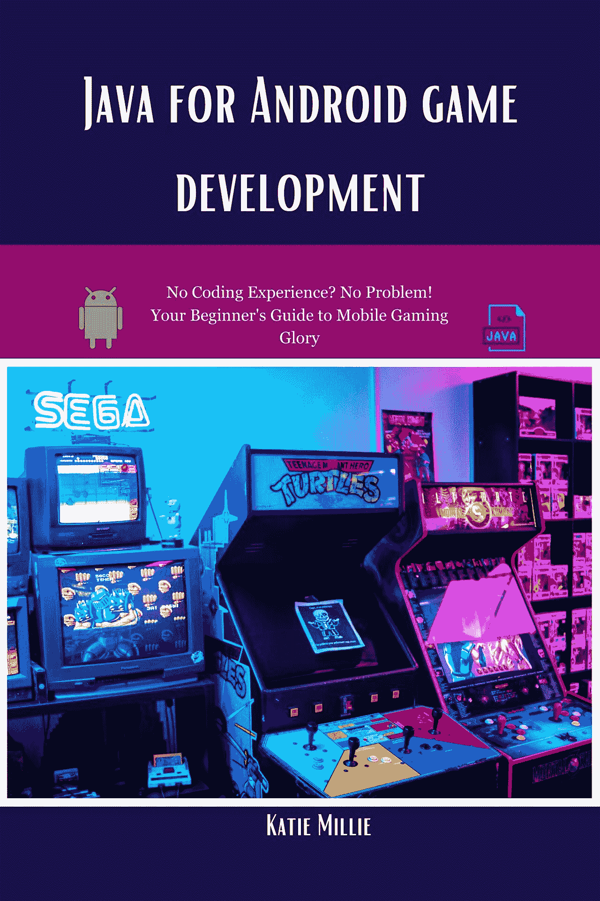

# Java Android 游戏开发：没有编程经验？没问题！你的移动游戏荣耀初学者指南



# 引言

## 释放你内心的游戏开发者潜能：掌握 Java 打造迷人的 Android 游戏

你是否梦想过打造下一个移动端热门产品？本全面指南是成为游戏开发者的通行证。通过 Android Java 开发，你掌握了开启这一激动世界的钥匙。

# 第一章

## 你的 Java 编码冒险之旅路线图（预期内容）

## 游戏开发者的工具箱：精通 Java 编程

## 为什么选择 Java 和 Android：构建游戏的完美配对

# 第二章

## 搭建你的开发环境（准备好，就绪，写代码！）

## 安装必要的 Java 工具（JDK、库等）

## Android Studio 简介：你的开发枢纽

# 第三章

## Java 编程基础（奠定基础）

### 使用运算符和表达式进行计算

## 控制你的游戏流程（条件语句和循环）

## 使用函数和过程构建复用代码

# 第四章

## 面向对象编程：掌握游戏设计原则

## 利用面向对象的设计实现灵活且可扩展的游戏

## 应用设计模式进行高效游戏开发（可选）

# 第五章

## 欢迎 Android 开发：为你的游戏构建游戏场

## 探索游戏开发者所需的必备 Android API

## 使用 Android Studio 设置你的 Android 开发环境

# 第六章

## 游戏设计要素：规划你的获胜策略

## 设计引人入胜的游戏循环和用户体验

## 理解游戏开发术语和最佳实践

# 第七章

## 构建你的第一款 Android 游戏：上手介绍（让我们开始编码吧！）

## 实现用户输入和游戏逻辑

## 引入图形和动画概念（可选）

# 第八章

## 提升你的技能：游戏的高级 Java 编程

## 在游戏中处理用户输入和触摸事件

## 实现音效和音乐以增强游戏体验

# 第九章

## 热门游戏引擎简介：LibGDX、带 Java 插件的 Unity

## 利用游戏引擎进行高效游戏开发

## 使用游戏引擎构建项目（可选）

# 第十章

## 项目展示：使用 Java 和 Android 构建有趣的小游戏

## 创建一个精美的记忆匹配游戏（可选）

## 设计一个测试技能的问答游戏（可选）

# 第十一章

## 物理引擎和真实的游戏机制

## 用于动态且有趣的对手的人工智能

## 用于增加互动的网络和多人游戏（可选）

# 第十二章

## 建立你的游戏开发作品集并获得理想工作

## 职业游戏开发者的资源和机会

## 附录 A：编程术语表

## 附录 B：Java 语法速查表

## 附录 C：练习答案

停止空想，开始创造吧！释放你内心的游戏开发者潜能，通过 Java Android 游戏开发开启一段惊险的冒险。准备好学习、尽情享受，并构建你一直以来想象的游戏吧！

# 第 1 章

## 你的 Java 编码冒险路线图（预期）

开启 Java 编码世界之旅是一项充满无限可能且令人兴奋的壮举。无论你是一个寻求扩展技能树的资深开发者，还是渴望学习门道的新手，拥有一份引导编码冒险的路线图将大不相同。在本文中，我们将概述你的 Java 编码之旅的预期内容，重点关注 Android 游戏开发这一特定路径。

### 第一阶段：Java 基础入门

你的旅程始于掌握 Java 编程的基础知识。从变量、数据类型到控制结构和面向对象的原则，在 Java 基础上打下坚实的基础对于构建稳固的知识框架以支持你的编码活动至关重要。

```java
public class HelloWorld {
    public static void main(String[] args) {
        System.out.println("Hello, world!");
    }
}
```

在上面的代码段中，我们有一个简单的 Java 程序，它会在控制台打印“Hello, world!”。这是你进入 Java 编码世界的第一步，向你介绍了 Java 程序的语法和结构。

### 第二阶段：探索面向对象编程 (OOP) 概念

接下来，深入探索面向对象编程（OOP）领域，这是构成 Java 开发基石的范式。学习类、对象、继承、多态和封装，并理解这些概念如何让你能够将现实世界的实体建模为代码中的对象。

```java
public class Player {
    private String name;
    private int health;

    public Player(String name, int health) {
        this.name = name;
        this.health = health;
    }

    public void takeDamage(int damage) {
        health -= damage;
    }
    // 其他关于玩家动作、交互等方法
}
```

在上面的示例中，我们有一个代表游戏中玩家角色的 Java 类。这种对行为和状态的封装体现了 OOP 的准则，允许你创建模块化、可重用且易于维护和扩展的代码。

### 第三阶段：深耕 Android 开发

当你对 Java 有了坚实的理解后，是时候涉军 Android 开发领域了。Android 为构建移动应用程序（包括游戏）提供了丰富的工具和 API 生态。熟悉 `Android Studio`（Android 开发的官方 IDE），并探索其用于设计、编码和调试 Android 应用程序的功能。

```java
import android.app.Activity;
import android.os.Bundle;
import android.view.Window;
import android.view.WindowManager;

public class MainActivity extends Activity {
    @Override
    protected void onCreate(Bundle savedInstanceState) {
        super.onCreate(savedInstanceState);
        // 设置全屏模式
        requestWindowFeature(Window.FEATURE_NO_TITLE);
        getWindow().setFlags(WindowManager.LayoutParams.FLAG_FULLSCREEN,
                WindowManager.LayoutParams.FLAG_FULLSCREEN);
        // 将内容视图设置为游戏表面
        setContentView(new GameSurface(this));
    }
}
```

在上面的代码段中，我们有一个 Android Activity 的示例，它设置了一个全屏游戏表面来渲染我们的游戏内容。这充分展示了 Android 如何为开发者提供工具，以创建根据设备屏幕尺寸和方向定制的沉浸式游戏体验。

### 第四阶段：精通 Android 游戏开发

一旦你熟悉了 Android 开发的基础，就是时候深入研究游戏开发的细节了。探索如图形渲染、输入处理、物理模拟、音频播放和多人网络等主题，并学习如何利用 Android SDK 创建引人入胜且沉浸的游戏体验。

```java
// 使用 OpenGL ES 渲染图形的示例代码
public void onDrawFrame(GL10 gl) {
    // 清除屏幕
    gl.glClear(GL10.GL_COLOR_BUFFER_BIT | GL10.GL_DEPTH_BUFFER_BIT);
    // 绘制游戏对象
    // ...
}
```

在上面的代码段中，我们有一个使用 `OpenGL ES` 渲染图形的方法，`OpenGL ES` 是 Android 上广泛用于 2D 和 3D 图形渲染的 API。这说明了 Android 如何为开发者提供灵活性，以创建视觉上令人震撼、推向创意与创新边界的游戏。

当你开启 Java 编码冒险时，请记住旅程与目的地同样重要。拥抱挑战，庆祝胜利，永远不要停止学习和探索。以 Java 为盟友，以 Android 为画布，创意和创新的可能性是无限的。所以，系好安全带，磨炼你的编码技能，让冒险开始吧！编码愉快！

## 游戏开发者工具箱：精通 Java 编程

欢迎，抱负的游戏开发者，来到充满活力的移动游戏开发世界！开启一段创意与技术交汇的激动旅程，这里的可能性仅限于你的想象。在本文，我们将深入探讨基于 Java 的 Android 游戏开发这一精彩领域，你将在那里学习如何在指尖打造迷人的游戏体验。

Java 以其多功能和健壮性闻名，是无数 Android 游戏的基础，为开发者提供了强大的工具集将他们的想法变为现实。让我们探索构成 Android 平台 Java 游戏开发的核心组件和概念。

### 搭建舞台：从 Android Studio 开始

要开启 Android 游戏开发之旅，第一步是搭建开发环境。`Android Studio` 是用于 Android 应用开发的官方集成开发环境（IDE），提供了一套专为打造沉浸式游戏体验定制的全面工具包。

从官方网站获取并安装 `Android Studio` 开始。安装完成后，启动 `Android Studio` 并创建一个新项目，选择“Empty Activity”模板从零开始。熟悉 `Android Studio` 界面的布局和结构，因为你将花费大量时间在这里创作你的杰作。

### 基础构建：理解 Java 核心

在深入游戏开发细节之前，掌握 Java 编程的基础概念至关重要。从变量、数据类型到控制结构和面向对象原则，Java 构成了 Android 游戏开发的骨干，使开发者能够轻松实现复杂的游戏逻辑。

让我们深入了解在游戏开发过程中经常遇到的一些 Java 核心概念：

- 变量和数据类型：变量是存储数据的容器，数据类型指定了变量可以持有的数据类型，例如整数、字符串和布尔值。

- 控制结构：控制结构（包括循环和条件语句）允许开发者根据特定条件决定游戏逻辑的流。

- 面向对象编程 (OOP)：OOP 原则（如封装、继承和多态）通过将现实实体建模为对象，便于代码的组织和管理。

掌握这些 Java 核心将为你提供一个坚实的基础，让你能够自信、精准地构建 Android 游戏。

### 赋予游戏生命：利用 Android SDK

Android 软件开发包 (SDK) 为开发者提供了丰富的工具集和 API，以充分挖掘 Android 平台的潜力。从图形渲染、输入处理到音频播放和网络连接，Android SDK 提供了全套全面的资源，以促进游戏开发的各个方面。

以下是你在游戏开发中将使用的 Android SDK 的一些关键组件：

-   图形渲染：Android 为其使用 `OpenGL ES`（嵌入式系统）API 渲染图形提供了强力支持，允许开发者为他们的游戏创建视觉上惊艳的 2D 和 3D 图形。

-   输入处理：从触摸输入到加速度计和陀螺仪传感器，Android 提供了多种输入机制来吸引玩家并增强交互体验。

-   音频播放：沉浸式音频对于游戏体验至关重要，Android 提供了 API 用于在游戏内播放和管理音效、音乐和其他音频资产。

-   网络：多人游戏和在线排行榜通过 Android 的网络 API 实现，实现了玩家与服务器之间的实时通信以及基于服务器的游戏功能。

通过利用 Android SDK 的功能，你将能够设计并实现功能丰富的游戏，吸引玩家并让他们流连忘返。

## 最后的前沿：发布你的游戏

在经历了无数小时的开发、测试和完善后，你的游戏终于准备好在 Google Play Store 上首次亮相。然而，在发布之前，确保你的游戏符合 Google 制定的严格质量标准和指南至关重要。

在各种设备上进行彻底测试以确保兼容性和稳定性，并优化游戏性能，为玩家提供流畅且沉浸的体验。一旦你对游戏的准备情况充满信心，请准备促销材料、截图和引人入胜的描述，以吸引玩家下载并体验你的创作。

一切就绪后，导航到 Google Play Console，为你的游戏创建一个新条目，并按照逐步说明上传你的 `APK` 文件，设置定价和发行选项，并将你的游戏推向世界。

当你开启进入 Java 的 Android 游戏开发领域的之旅时，请记住，前方的道路充满了挑战、胜利以及创意和创新的无限机会。凭借一路上所获得的知识和工具，你有能力创造出沉浸式的游戏体验，吸引玩家并在移动游戏领域留下深刻的印象。

所以，集结你的智慧，磨炼你的技艺，让 Game Dev Arena 成为你无尽探索和发现的舞台。你的旅程从这里开始。欢迎来到 Android 游戏开发的世界。游戏开始！

## 为什么选择 Java 和 Android：构建游戏的完美结合

在构建移动设备游戏方面，Java 和 Android 是天作之合。Java 的多功能性结合 Android 强大的框架和广泛的应用，为开发者提供了完美的工具包，以创建引人入胜且沉浸式的游戏体验。在本文，我们将探索为什么 Java 和 Android 是游戏开发的理想组合，并提供一些代码示例来展示它们的协同效应。

### Java：Android 开发的骨干

Java 长期以来一直是 Android 开发的首选编程语言，这归于它的健壮性、可移植性以及丰富的库和工具生态系统。通过 Java，开发者可以编写在不同设备上无缝运行的平台无关代码，使其成为构建针对多样化 Android 用户群游戏的理想选择。

```java
public class HelloWorld {
    public static void main(String[] args) {
        System.out.println("Hello, world!");
    }
}
```

在上面的示例中，我们有一个简单的 Java 程序向控制台打印“Hello, world!”。这说明了 Java 代码的简单易读性，使得各种水平的开发者都能轻松上手。

### Android：游戏开发的乐场

Android 为游戏开发提供了一个丰富且功能齐全的框架，为开发者提供了广泛的工具和 API，用于图形渲染、输入处理、音频播放等。无论你是在创建一个休闲益智游戏，还是图形密集型的 3D 冒险游戏，Android 均拥有你实现愿景所需的一切。

```java
import android.app.Activity;
import android.os.Bundle;
import android.view.Window;
import android.view.WindowManager;

public class MainActivity extends Activity {
    @Override
    protected void onCreate(Bundle savedInstanceState) {
        super.onCreate(savedInstanceState);
        // 设置全屏模式
        requestWindowFeature(Window.FEATURE_NO_TITLE);
        getWindow().setFlags(WindowManager.LayoutParams.FLAG_FULLSCREEN,
                WindowManager.LayoutParams.FLAG_FULLSCREEN);
        // 设置内容视图为游戏表面
        setContentView(new GameSurface(this));
    }
}
```

在上面的代码段中，我们有一个 Android activity 的示例，它设置了一个全屏游戏表面来渲染我们的游戏内容。这展示了 Android 如何为开发者提供灵活性，以根据设备的屏幕尺寸和方向创建定制的沉浸式游戏体验。

### 完美结合：和谐统一的 Java 和 Android

涉及到游戏开发时，Java 和 Android 之间的协同效应是不言而喻的。Java 的面向对象编程范式和丰富的标准库补充了 Android 健壮的框架，允许开发者编写整洁、模块化且易维护和扩展的代码。

```java
public class Player {
    private int x, y;
    private int speed;

    public Player(int x, int y, int speed) {
        this.x = x;
        this.y = y;
        this.speed = speed;
    }

    public void move(int dx, int dy) {
        x += dx * speed;
        y += dy * speed;
    }
    // 其他玩家交互、渲染的方法
}
```

在上面的示例中，我们有一个代表游戏角色的 Java 类。这种对行为和状态的封装与 Android 基于组件的架构无缝衔接，使得将游戏逻辑集成到 Android 框架中变得简单。

`Android Studio` 是 Android 开发的官方 IDE（集成开发环境），提供了一套专门为构建 Android 应用程序（包括游戏）定制的全面工具和功能。它提供了高级的代码编辑、调试和性能分析功能，并内置了基于 Gradle 的构建系统支持以及用于测试应用程序的 Android 模拟器。


```java
public class MainActivity extends Activity {
    @Override
    protected void onCreate(Bundle savedInstanceState) {
        super.onCreate(savedInstanceState);
        // Set fullscreen mode
        requestWindowFeature(Window.FEATURE_NO_TITLE);
        getWindow().setFlags(WindowManager.LayoutParams.FLAG_FULLSCREEN,
        WindowManager.LayoutParams.FLAG_FULLSCREEN);
        // Set content view to game surface
        setContentView(new GameSurface(this));
    }
}
```

在上面的代码段中，我们展示了一个在 Android Studio 中编写的 Android Activity 示例。IDE 提供了代码补全、语法高亮和项目管理工具等功能，以简化开发流程。

## 2. IntelliJ IDEA

IntelliJ IDEA 是由 JetBrains 开发的一款流行的 Java IDE，提供了强大的编码辅助、生产力工具以及与各种框架和技术的集成。它提供了高级的重构、代码分析和版本控制功能，使其成为从事 Android 项目的 Java 开发者的绝佳选择。

```java
public class Player {
    private String name;
    private int health;

    public Player(String name, int health) {
        this.name = name;
        this.health = health;
    }

    public void takeDamage(int damage) {
        health -= damage;
    }
    // Other methods for player actions, interactions, etc.
}
```

在上面的代码段中，我们有一个在 IntelliJ IDEA 中编写的代表 Android 游戏角色的 Java 类。IDE 提供了智能代码补全和导航功能，以提高生产力和代码质量。

## 配置你的开发环境

一旦你选择了心仪的文本编辑器或 IDE，就可以开始为 Java 开发进行配置了。这通常涉及安装必要的插件或扩展、设置项目特定的配置，以及配置构建工具和依赖项。

### Android Studio 设置

如果你正在使用 Android Studio，设置过程非常简单。只需从官方网站下载并安装 Android Studio，然后按照屏幕上的指令设置你的开发环境。Android Studio 自带了 Android SDK，因此你无需额外操作即可开始构建 Android 游戏。

### IntelliJ IDEA 设置

如果你正在使用 IntelliJ IDEA，你需要安装 Android 开发所需的必要插件。打开 IntelliJ IDEA，导航到设置中的插件（Plugins）部分，搜索“Android”插件。安装该插件并重启 IntelliJ IDEA 以应用更改。你可能还需要在 IDE 设置中配置 `JDK` 和 `Android SDK` 路径，以确保与 Android 开发工具正确集成。

完成开发环境的设置和配置后，你就可以准备进入精彩的基于 Java 的 Android 游戏开发世界了。无论你使用的是 Android Studio、IntelliJ IDEA 还是其他其他文本编辑器或 IDE，关键在于找到一个适合你工作流和偏好的工具。现在，启动你的编辑器，打开一个新项目，让编码之旅开始吧！编码愉快！

### 安装必要的 Java 工具（JDK, 库等）

在开启基于 Java 的 Android 游戏开发之旅之前，确保你的系统上安装了必要的工具和库至关重要。从 Java 开发工具包（`JDK`）到 Android SDK 以及各种库，拥有正确的工具对于构建和部署 Android 游戏至关重要。在本文中我们将引导你完成安装这些必要的 Java 工具和库的过程，以开启你的开发之旅。

#### Java 开发工具包 (JDK)

Java 开发工具包（`JDK`）是 Java 开发的主要工具集，提供了编译器、调试器以及编写和运行 Java 应用程序所需的工具。在开发 Android 游戏时，在系统中安装 `JDK` 以编译和执行你的 Java 代码至关重要。

**安装步骤：**

1. 访问 Oracle 官方网站（https://www.oracle.com/java/technologies/javase-jdk16-downloads.html）下载最新版本的 `JDK`。

2. 按照屏幕上的指令在系统上安装 `JDK`。确保选择适用于你操作系统（Windows、macOS 或 Linux）的适当。

3. 安装完成后，打开终端或命令提示符并运行以下命令，验证 `JDK` 是否正确安装：

```bash
java -version
```

你应该能在输出中观察到已安装的 Java 版本。

#### Android SDK

Android 软件开发包（`SDK`）是 Google 提供的用于开发 Android 应用程序（包括游戏）的工具和库的集合。Android SDK 包含了关键组件，如 Android 模拟器、构建工具、平台工具以及用于测试和调试 Android 应用程序的系统镜像。

**安装步骤：**

1. 从 Android 官方开发者网站（https://developer.android.com/studio）下载并安装 Android Studio。

2. 启动 Android Studio 并按照屏幕指令完成设置过程。Android Studio 将自动下载并安装最新版本的 Android SDK。

3. 安装 Android Studio 后，从 `Tools` 菜单打开 `SDK Manager`。在这里你可以安装不同 Android 版本的额外 SDK 组件和系统镜像。

#### 库和依赖

除了 `JDK` 和 Android SDK，你可能还需要为你的 Android 游戏项目安装额外的库和依赖项。这些库可以包括第三方框架、游戏引擎和实用库，增强你的开发工作流并提供额外功能。

**安装步骤（示例：LibGDX）：**

1. 访问 LibGDX 官方网站（https://libgdx.com/）下载 LibGDX 设置工具。

2. 运行设置工具并按照屏幕指令创建一个新的 LibGDX 项目。设置工具会自动下载并配置项目所需的依赖项。

3. 设置过程完成后，在你偏好的 IDE 或文本编辑器中打开生成的项目，并使用 LibGDX 开发你的 Android 游戏。

#### Android Studio 简介：你的开发中心

欢迎来到 Android Studio，你 Android 游戏开发的终极中心！Android Studio 是构建 Android 应用程序（包括游戏）的官方集成开发环境（IDE），它提供了一套专门为 Android 开发定制的全面工具和功能。在本文中，我们将为你介绍 Android Studio 并探索其关键组件和功能，以开启你的 Android 游戏开发之旅。

开始使用 Android Studio

在深入研究 Android 游戏开发的细节之前，让我们花一点时间熟悉 Android Studio 及其用户界面。启动 Android Studio 后，你将看到一个欢迎界面，可以在其中创建新项目、打开现有项目，或访问帮助你起步各种教程和资源。

## 创建新项目

要在 Android Studio 中创建一个新的 Android 游戏项目，只需点击欢迎界面上的“Start a new Android Studio project”（启动新的 Android Studio 项目）选项。按照逐步向导配置你的项目设置，包括项目名称、包名和目标 Android 版本。你还可以从针对不同类型 Android 应用（包括游戏）定制的各种模板和预设中进行选择。

```java
public class MainActivity extends Activity {
    @Override
    protected void onCreate(Bundle savedInstanceState) {
        super.onCreate(savedInstanceState);
        // Set fullscreen mode
        requestWindowFeature(Window.FEATURE_NO_TITLE);
        getWindow().setFlags(WindowManager.LayoutParams.FLAG_FULLSCREEN,
                WindowManager.LayoutParams.FLAG_FULLSCREEN);
        // Set content view to game surface
        setContentView(new GameSurface(this));
    }
}
```

在上面的代码段中，这是一个 Android Activity 的示例，为渲染我们的游戏内容设置了一个全屏游戏表面。它是我们 Android 游戏程序的入口点，我们在此初始化游戏环境和资源。

## 探索 Android Studio 功能

Android Studio 提供了丰富的功能和工具，以简化 Android 游戏开发流程。从代码编辑、调试到布局设计和性能分析，Android Studio 提供了构建和部署高质量 Android 游戏所需的一切。

### 代码编辑

Android Studio 配备了强大的代码编辑器，提供如语法高亮、代码补全和代码分析等功能，以增强你的编码体验。该编辑器支持多种编程语言，包括 `Java` 和 `Kotlin`，让你轻松地编写和编辑游戏代码。

### 布局设计

Android Studio 包含一个视觉化布局编辑器，允许你设计并预览 Android 游戏的用户界面。你可以将 UI 组件拖放到画布上，自定义它们的属性，并实时预览布局，以确保无无缝的用户体验。

### 调试与测试

Android Studio 提供了稳健的调试和测试工具，帮助你识别并修复 Android 游戏中的问题。你可以设置断点、检查变量并单步执行代码，以排除错误并优化性能。此外，Android Studio 还提供了内置的模拟器和设备模拟器，用于在各种 Android 设备和屏幕尺寸上测试你的游戏。

凭借其丰富的特性集和直观的用户界面，Android Studio 是你通往 Android 游戏开发的大门。无论你是资深开发者还是初学者，Android Studio 都提供了所需的工具和资源，让你的游戏想法变为现实，并在 Android 平台上释放你的创造力。所以，启动 Android Studio，创建一个新项目，让游戏开发开始吧！编码愉快！

# 第 3 章

## Java 编程基础（构建你的基础）

在深入探索 Android 游戏开发的精彩世界之前，建立 Java 编程基础的坚实理解至关重要。从变量、数据类型到控制结构和面向对象的原则，掌握这些基础概念将为你提供实现游戏想法所需的工具。在本文中，我们将探索 Java 编程基础，重点关注变量和数据类型，并提供为 Android 游戏开发定制的代码示例。

### 变量与数据类型

变量是 Java 程序中用于存储数据的容器，允许你在整个代码中操作和引用值。Java 支持多种数据类型，每种类型都设计用于处理不同类型的数据，包括数字、字符串和布尔值。

### 数字：整数和浮点数

在 Java 中，数字使用两种主要数据类型表示：整数和浮点数。整数由不带小数点的整数组成，而浮点数包含小数点。让我们来看看如何声明和初始化这些类型的变量：

```java
// Integer variables
int score = 100;
int livesLeft = 3;

// Floating-point variables
float playerX = 10.5f;
double playerY = 20.75;
```

在上面的代码段中，我们声明并初始化了整数和浮点变量，用于存储玩家得分、坐标以及与我们 Android 游戏相关的数值数据。

### 字符串：文本数据

字符串用于在 Java 中表示文本数据，例如玩家名称、消息和游戏描述。在 Java 中，字符串使用 `String` 类表示，你可以通过将文本包含在双引号内来创建字符串变量：

```java
// String variables
String playerName = "Alice";
String welcomeMessage = "Welcome to the game!";
```

Java 中的字符串是不可变的，这意味着一旦创建创建，其值就无法更改。然而，你可以使用 `String` 类提供的各种方法来操作字符串，例如拼接、子字符串提取和大小写转换。

### 布尔值：真或假值

布尔值是 Java 中的一种基础数据类型，用于表示真或假值。布尔值通常用于条件语句和逻辑表达式，以控制程序执行的流。以下是在 Java 中声明和初始化布尔变量的方法：

```java
// Boolean variables
boolean isGameOver = false;
boolean isPaused = true;
```

在上面的代码段中，我们声明了布尔变量来跟踪游戏状态，例如游戏是否结束或暂停。布尔值在控制游戏逻辑和根据各种条件确定 Android 游戏行为方面起着至关重要的作用。

### 变量命名规范

在 Java 中命名变量时，必须遵循某些规范以确保代码的清晰性和一致性。以下是一些常见的变量命名规范：

- 使用有意义且描述性的名称，准确地传达变量的用途。

- 变量名以小写字母开头，多单词名称使用 `camelCase`（驼峰法，例如 `playerScore`, `gameStarted`）。

- 避免使用单字母变量名或缩写，除非它们在代码上下文中被广泛理解。

- 对常量变量（即值不会改变的变量）使用大写字母，并用下划线分隔单词（例如 `MAX_PLAYERS`, `SCREEN_WIDTH`）。

通过遵循这些命名规范，你可以使代码更具可读性和可维护性，让你和其他开发者能够轻松地理解和修改它。

### 使用运算符和表达式进行计算

在 Android 游戏开发的 Java 编程中，进行计算是实现游戏逻辑、管理玩家交互和模拟游戏环境的基本方面。这通过使用运算符和表达式来实现，它们允许你操作变量和值以产生所需的结果。在本文中，我们将探索在 Java 中使用运算符和表达式进行计算，并附上与 Android 游戏开发相关的代码示例。

#### 算术运算符

算术运算符方便了对数值进行数学运算，包括加、减、乘、除。这些运算符允许你操纵变量和常量，以便在你的游戏代码中动态计算结果。

```java
int playerScore = 100;
int enemyScore = 50;

// 加
int totalScore = playerScore + enemyScore; // totalScore = 150

// 减法
int scoreDifference = playerScore - enemyScore; // scoreDifference = 50

// 乘法
int totalEnemies = 5;
int totalPoints = playerScore * totalEnemies; // totalPoints = 500

// 除法
int averageScore = totalScore / 2; // averageScore = 75
```

在上面的代码段中，我们演示了如何使用算术运算符对代表玩家得分、敌人分数以及其他游戏相关数据的数值进行加、减、乘、除操作。

## 赋值运算符

赋值运算符用于为变量赋值，允许你根据游戏代码中的计算或其他因素更新变量的值。这些运算符简化了更新变量值的过程，并通常与算术运算符配合使用。

```java
int health = 100;
int damage = 20;

// 加赋值
health += damage; // health = 120

// 减法赋值
damage -= 10; // damage = 10

// 乘法赋值
int multiplier = 2;
damage *= multiplier; // damage = 20

// 除赋值
health /= 2; // health = 60
```

在上面的代码段中，我们演示了如何使用赋值运算符根据算术运算符进行的计算来更新变量值。这些运算符为在游戏代码中修改变量值提供了一种简洁且高效的方法。

## 增减运算符

增运算符和减运算符分别用于将变量的值增加或减一。这些运算符通常用于实现游戏机制，例如计算游戏回合、遍历数组或更新玩家属性。

```java
int playerHealth = 100;

// 增运算符
playerHealth++; // playerHealth = 101

// 减运算符
playerHealth--; // playerHealth = 100
```

在上面的代码段中，我们演示了如何使用增减运算符来调整代表玩家血值的变量值。这些运算符提供了一种按固定量更新变量值的便捷方式，有助于在你的 Android 游戏中实现动态的游戏机制。

运算符和表达式在用于 Android 游戏开发的 Java 代码中执行计算和处理数据起着至关重要的作用。通过利用算术运算符、赋值运算符以及增减运算符，你可以轻松地实现复杂的游戏机制、管理玩家交互并模拟动态的游戏环境。


在你继续 Java 编程和 Android 游戏开发的旅程中，请记住探索 Java 中提供的各种运算符和表达式，尝试不同的组合和技术，并始终努力优化和完善你的游戏代码，以提高性能和游戏体验。通过实践和创意，你将完全能够开发出吸引全球玩家的迷人且沉浸式的 Android 游戏。编码愉快！

## 控制你的游戏流程（条件语句和循环）

在用 Java 进行 Android 游戏开发时，控制游戏流程对于实现游戏机制、管理玩家交互以及创建动态体验至关重要。这通过使用条件语句和循环来实现，允许你根据某些条件做出决策并遍历游戏元素。在本文中，我们将探索如何在 Java 中使用条件语句和循环来控制游戏流程，并提供与 Android 游戏开发相关的代码示例。

### 条件语句

条件语句允许你根据特定条件执行不同的代码块，从而让你能够根据玩家操作、游戏状态或其他因素控制游戏流程。Java 中常见的条件表达式形式包括 `if` 语句、`switch` 语句和三元运算符。

### If 语句

`if` 语句允许在指定条件为真时执行代码块，为在游戏代码中实现分支逻辑的方法。

```java
int playerHealth = 50;

if (playerHealth <= 0) {
    gameOver();
} else if (playerHealth < 30) {
    displayLowHealthWarning();
} else {
    continueGame();
}
```

在上面的代码段中，我们使用 `if` 语句检查玩家血量，并根据当前的血值执行不同的操作。

### Switch 语句

`switch` 语句提供了处理多种条件情况的 `if` 语句替代，允许你根据变量或表达式的值执行不同的代码块。

```java
int playerScore = 100;

switch (playerScore) {
    case 100:
        displayPerfectScoreMessage();
        break;
    case 50:
        displayHalfwayThereMessage();
        break;
    default:
        displayRegularScoreMessage();
        break;
}
```

在上面的代码段中，我们使用 `switch` 语句根据玩家的分数显示不同的消息。

### 三元运算符

三元运算符提供了一种用单行代码表达条件表达式的简洁方法，对于简单的条件赋值非常有用。

```java
int playerHealth = 70;
String healthStatus = (playerHealth > 50) ? "Good" : "Low";
```

在上面的代码段中，我们使用三元运算符根据玩家的血值分配健康状态。

### 循环

循环允许你多次迭代一组指令，使你能够执行重复任务、遍历游戏元素并实现敌人移动和碰撞检测等游戏机制。Java 中常见的循环类型是 `for` 循环、`while` 循环和 `do-while` 循环。

### For 循环

`for` 循环用于按预定的次数遍历范围或元素，使其成为遍历数组、列表和其他数据结构的理想选择。

```java
for (int i = 0; i < 10; i++) {
    spawnEnemy();
}
```

在上面的代码段中，我们使用 `for` 循环在游戏中生成五个敌人。

### While 循环

`while` 循环用于在指定条件为真时重复执行代码块，允许你实现需要持续监控或更新的游戏机制。

```java
int enemyCount = 0;

while (enemyCount < 10) {
    spawnEnemy();
    enemyCount++;
}
```

在上面的代码段中，我们使用 `while` 循环持续生成敌人直到达到指定的敌人数量。

### Do-While 循环

`do-while` 循环与 `while` 循环相似，但保证在检查循环条件之前至少执行一次代码块。

```java
int playerHealth = 100;

do {
    takeDamage();
    playerHealth -= 10;
} while (playerHealth > 0);
```

在上面的代码段中，我们使用 `do-while` 循环模拟玩家受到伤害直到血量归零。

掌握 Java 中的条件语句和循环对于控制你的 Android 游戏流程和实现动态游戏机制至关重要。通过利用 `if` 语句、`switch` 语句、三元运算符、`for` 循环、`while` 循环和 `do-while` 循环，你可以创建出响应玩家操作、模拟复杂游戏环境并提供引人入胜挑战的沉浸式游戏体验。

随着你继续使用 Java 进行 Android 游戏开发之旅，请尝试不同类型的条件语句和循环，探索高级技术和模式，并始终努力优化和完善你的游戏代码，以提高性能和玩家体验。通过实践和创造，你将完全有能力开发出吸引全球玩家的精彩 Android 游戏。编码愉快！

## 使用函数和过程构建可重用代码

在 Java Android 游戏开发中，构建可重用代码对于提高代码组织、可读性和维护性至关重要。函数和过程允许你将代码块封装成可重用的模块，使你能够以模块化高效的方式实现常见的游戏功能，例如玩家移动、敌人行为和游戏逻辑。在本文，我们将探索如何在 Java 中使用函数和过程构建可重用代码，并提供与 Android 游戏开发相关的代码示例。

### 函数

函数（在 Java 中称为方法）是自独立的代码块，用于执行特定任务并返回值。函数允许你将常见任务或算法封装到可重用的模块中，使你的代码更加模块化且易于维护。

```java
// 计算矩形面积的函数
public static double calculateArea(double length, double width) {
    return length * width;
}

// 显示欢迎消息的函数
public static void displayWelcomeMessage() {
    System.out.println("Welcome to the game!");
}
```

在上面的代码段中，我们定义的两个函数：`calculateArea` 用于根据长度和宽度计算矩形面积，`displayWelcomeMessage` 用于向玩家显示欢迎消息。

### 过程

过程与函数类似，但不返回值。它们用于封装执行特定任务或操作但不返回结果的代码块。过程通常用于涉及副作用的任务，例如向控制台输出内容或更新游戏状态。

```java
// 显示玩家血量的过程
public static void displayPlayerHealth(int health) {
    System.out.println("Player Health: " + health);
}

// 更新玩家位置的过程
public static void updatePlayerPosition(int x, int y) {
    // 更新玩家位置的代码
}
```

在上面的代码段中，我们定义的两个过程：`displayPlayerHealth` 用于在屏幕上显示玩家血量，`updatePlayerPosition` 用于更新玩家在游戏世界中的位置。

### 可重用代码的好处

使用函数和过程构建可重用代码为 Android 游戏开发带来了若干益处：

1. **模块化**：函数和过程允许你将复杂的游戏逻辑拆分为更小、更易管理的模块，使你的代码更易理解和维护。

2. **代码重用性**：一旦定义，函数和过程可以在整个游戏代码中重复使用，减少重复并提高代码一致性。

3. **可扩展性**：通过将常见功能封装到可重用的模块中，你可以轻松扩展游戏代码以适应新功能和更新，而无需重写现有代码。

4. **测试与调试**：可重用的代码单元可以独立测试和调试，有助于识别和解决错误问题。

### 示例：玩家移动

让我们考虑一个使用函数在 Android 游戏中实现玩家移动的示例：

```java
// 让玩家向上移动的函数
public static void movePlayerUp(Player player) {
    player.setY(player.getY() - 1);
}

// 让玩家向下移动的函数
public static void movePlayerDown(Player player) {
    player.setY(player.getY() + 1);
}

// 让玩家向左移动的函数
public static void movePlayerLeft(Player player) {
    player.setX(player.getX() - 1);
}

// 让玩家向右移动的函数
public static void movePlayerRight(Player player) {
    player.setX(player.getX() + 1);
}
```

在上面的代码段中，我们定义了四个函数：`movePlayerUp`、`movePlayerDown`、`movePlayerLeft` 和 `movePlayerRight` 来处理玩家移动。这些函数允许我们以模块化的方式管理玩家相关的逻辑。

# 第 4 章：面向对象编程：精通游戏设计

面向对象编程（OOP）是一种用于设计系统的强大范式，包括类、对象和继承。在本文中，我们将探索 Android 游戏开发的 OOP 原理。

## 理解类

在 Java 中，类是创建对象的蓝图，定义了对象将展现的属性和行为。类封装了数据（属性）和功能。让我们考虑一个代表游戏中玩家角色的 `Player` 类示例：

```java
public class Player {
    // 属性
    private String name;
    private int health;
    private int score;

    // 构造函数
    public Player(String name) {
        this.name = name;
        this.health = 100;
        this.score = 0;
    }

    // 方法
    public void takeDamage(int damage) {
        health -= damage;
    }

    public void increaseScore(int points) {
        score += points;
    }

    public String getName() {
        return name;
    }

    public int getHealth() {
        return health;
    }

    public int getScore() {
        return score;
    }
}
```

在上面的代码段中，我们定义了一个 `Player` 类，包含 `name`、`health` 和 `score` 等属性，以及执行受到伤害和增加玩家得分操作的方法。该类作为创建玩家对象的蓝图。

## 创建对象

一旦类定义完成，就可以从该类创建对象（实例化），以表示类所定义概念的具体实例。从类创建的每个对象都有自己的一套属性，并可以调用类中定义的方法。让我们在游戏中创建一个 `Player` 对象：

```java
Player player1 = new Player("Player1");
```

在上面的代码段中，我们使用 `new` 关键字创建了一个名为 `player1` 的新 `Player` 对象，并将玩家名称作为参数传递给构造函数。该对象现在代表我们游戏中一个特定的玩家实例。

## 继承

继承允许一个类从另一个类获取属性和方法，促进代码重用并在类之间建立层级关系。在 Java 中，使用 `extends` 关键字实现继承。让我们考虑一个继承示例，其中 `Enemy` 类继承自 `Character` 类：

```java
public class Enemy extends Character {
    // Additional attributes and methods specific to enemies
}
```

在上述代码段中，我们定义了一个继承自 `Character` 类的 `Enemy` 类。通过这种方式，`Enemy` 类继承了 `Character` 类中定义的所有属性和方法，例如名称（name）、`health`（属性）和移动行为。这允许我们重用代码，并在游戏中的角色和敌人之间建立层级关系。

## 代码示例：在 Android 游戏开发中使用类、对象和继承

让我们考虑一个更全面的示例，它展示了 Android 游戏开发中类、对象和继承的使用：

```java
public class Character {
    // 属性
    protected String name;
    protected int health;

    // 构造函数
    public Character(String name) {
        this.name = name;
        this.health = 100;
    }

    // 方法
    public void takeDamage(int damage) {
        health -= damage;
    }

    public void displayStatus() {
        System.out.println("Name: " + name);
        System.out.println("Health: " + health);
    }
}

public class Player extends Character {
    // 构造函数
    public Player(String name) {
        super(name);
    }
    // 针对玩家的额外方法
}

public class Enemy extends Character {
    // 构造函数
    public Enemy(String name) {
        super(name);
    }
    // 针对敌人的额外方法
}

public class Game {
    public static void main(String[] args) {
        // 创建玩家对象
        Player player1 = new Player("Player1");
        // 创建敌人对象
        Enemy enemy1 = new Enemy("Enemy1");
        // 显示玩家状态
        player1.displayStatus();
        // 显示敌人状态
        enemy1.displayStatus();
    }
}
```

在上述代码段中，我们定义了三个类：`Character`、`Player` 和 `Enemy`。`Player` 和 `Enemy` 类继承自 `Character` 类，允许它们重用父类定义的属性和方法。然后，我们在 `Game` 类中创建了 `Player` 和 `Enemy` 类的对象，并显示它们各自的状态。

理解类、对象和继承对于掌握 Java Android 游戏开发中的面向对象原则至关重要。通过将代码组织成类、创建对象来表示游戏实体并利用继承来创建层级关系，你可以构建出模块化、可扩展且易于维护的游戏代码。

随着你继续你的 Android 游戏开发之旅，请尝试不同的类设计，探索如多态和封装等进阶 OOP 概念，并努力应用面向对象原则来创建健壮且可扩展的游戏架构。通过实践和创意，你将完全能够开发出吸引全球玩家的沉浸式且趣味性的 Android 游戏。编码愉快！

## 利用面向对象设计实现灵活且可扩展的游戏

面向对象设计（OOD）是 Java Android 游戏开发中的一种基本方法，它允许开发者创建灵活、模块化且可扩展的游戏架构。通过将代码组织成类、定义对象之间的关系并利用继承、封装和多态等设计原则，OOD 使开发者能够构建更易维护、扩展和适应不断变化需求的游戏。在本文中，我们将探索如何利用面向对象设计原则来实现灵活且可扩展的 Android 游戏，并提供与 Java 游戏开发相关的代码示例。

### 将代码组织成类

面向对象设计的核心原则之一是将代码组织成类，每个类代表游戏中的一个特定概念或实体。类封装了与特定游戏元素相关的数据（属性）和行为（方法），从而实现了更好的代码组织和模块化。让我们考虑一个为 Android 游戏将代码组织成类的示例：

```java
// 代表玩家的 Player 类
public class Player {
    private String name;
    private int health;

    // 构造函数
    public Player(String name) {
        this.name = name;
        this.health = 100;
    }

    // 方法
    public void takeDamage(int damage) {
        health -= damage;
    }

    public void heal(int amount) {
        health += amount;
    }

    // 其他方法和属性...
}
```

在上述代码段中，我们定义了一个 `Player` 类来代表游戏中的玩家角色。该类封装了如 `name` 和 `health` 等属性，以及执行受伤和治愈等操作的方法。

### 利用继承建立层级关系

继承是面向对象设计中的另一个核心概念，它允许类从其他类继承属性和行为，从而在类之间建立层级关系。继承促进了代码重用，并允许开发者创建扩展现有类功能的特殊类。让我们考虑一个 Android 游戏开发中继承的示例：


```java
// 代表敌人的 Enemy 类
public class Enemy extends Character {
    // 针对敌人的额外属性和方法
}
```

在上述代码段中，我们定义了一个继承自 `Character` 类的 `Enemy` 类。通过这种方式，`Enemy` 类继承了 `Character` 类中定义的所有属性和方法，允许代码重用并在游戏角色和敌人之间建立层级关系。

### 封装实现数据隐藏和模块化

封装是面向对象设计的一个关键原则，涉及将数据（属性）和操作这些数据的方法封装到单个单元（类）中。封装促进了数据隐藏、抽象和模块化，允许开发者隐藏实现细节并仅向代码的其他部分暴露基本功能。让我们考虑一个 Android 游戏开发中封装的示例：

```java
// 代表游戏角色的 Character 类
public class Character {
    private String name;
    private int health;

    // 构造函数
    public Character(String name) {
        this.name = name;
        this.health = 100;
    }

    // getter 和 setter 方法
    public String getName() {
        return name;
    }

    public int getHealth() {
        return health;
    }

    // 其他方法和属性...
}
```

在上述代码段中，我们通过将 `name` 和 `health` 属性声明为 `private` 并提供公共 getter 方法来访问这些值，对 `Character` 类进行了封装。这促进了数据隐藏，并确保 `Character` 对象的内部状态以受控的方式访问和修改。

利用将代码组织成类、利用继承以及封装数据和行为等面向对象原则，可以使 Java Android 游戏开发更加灵活且可扩展。通过设计模块化、可扩展且易于维护的游戏架构，开发者可以创建更容易理解、扩展和适应不断需求的游戏。

随着你继续你的 Android 游戏开发之旅，探索多态、组合和设计模式等进阶 OOD 概念，并谨慎地应用它们来创建健壮且高效的游戏架构。通过对面向对象设计原则的深入理解和创造性的实现，你将完全能够开发出令全球玩家着迷的、沉浸式的 Android 游戏。编码愉快！

### 应用设计模式实现高效游戏开发（可选）

设计模式是针对开发过程中出现的常见软件设计问题的证明解决方案。在 Java 的 Android 游戏开发中，利用设计模式可以构建更高效、可维护且可扩展的游戏架构。通过封装最佳实践和可重用的解决方案，设计模式帮助开发者应对复杂的设计挑战，并促进代码的重用、模块化和扩展性。在本文中，我们将探索如何在 Java 中应用设计模式进行高效的游戏开发，并提供与 Android 游戏开发相关的代码示例。

#### 单例模式 (Singleton Pattern)

单例设计模式保证一个类只有一个实例，并提供一种访问该实例的通用方法。该模式对于管理全局游戏状态、资源或需要从游戏多个部分访问的管理器有用。让我们考虑在 Android 游戏中为 `GameManager` 实现单例模式的示例：

```java
public class GameManager {
    private static GameManager instance;   
    // 私有构造函数防止实例化
    private GameManager() {
        // 初始化代码
    }
    // 获取单例实例的静态方法
    public static GameManager getInstance() {
        if (instance == null) {
            instance = new GameManager();
        }
        return instance;
    }
    // 其他方法和属性...
}
```

在上面的代码段中，我们定义了一个实现单例模式的 `GameManager` 类。`getInstance()` 方法确保了只会创建一个 `GameManager` 类的实例，并在整个游戏过程中提供该实例的全局访问。

#### 工厂模式 (Factory Pattern)

工厂模式是一种创建性设计方法，它在父类中提供一个创建对象的接口，允许子类修改生成的对象类型。该模式对于根据不同的条件或参数动态创建游戏对象有用。让我们考虑在 Android 游戏中使用工厂模式创建不同类型敌人的示例：

```java
public interface EnemyFactory {
    Enemy createEnemy();
}

public class GoblinFactory implements EnemyFactory {
    @Override
    public Enemy createEnemy() {
        return new Goblin();
    }
}

public class OrcFactory implements EnemyFactory {
    @Override
    public Enemy createEnemy() {
        return new Orc();
    }
}
```

在上面的代码段中，我们定义了一个 `EnemyFactory` 接口和两个具体实现（`GoblinFactory` 和 `OrcFactory`），它们分别创建不同类型的敌人（`Goblin` 和 `Orc`）实例。这允许根据特定的工厂实现灵活地创建敌人对象。

#### 观察者模式 (Observer Pattern)

观察者模式是一种行为设计模式，对象（主体）维护一个其依赖者（观察者）的列表，并通知它们任何状态变化。该模式用于实现事件处理、通知或根据状态变化更新游戏实体。让我们考虑在 Android 游戏中处理玩家血量变化的观察者模式示例：

```java
public interface HealthObserver {
    void onHealthChanged(int health);
}

public class Player implements HealthObservable {
    private int health;
    private List<HealthObserver> observers = new ArrayList<>();
    // 挂载观察者的方法
    public void attach(HealthObserver observer) {
        observers.add(observer);
    }   
    // 通知观察者血量变化的方法
    private void notifyObservers() {
        for (HealthObserver observer : observers) {
            observer.onHealthChanged(health);
        }
    }   
    // 更新玩家血量的方法
    public void updateHealth(int newHealth) {
        health = newHealth;
        notifyObservers();
    }
}
```

在上面的代码段中，我们定义了一个 `HealthObserver` 接口和一个实现该接口的 `Player` 类。`Player` 类维护了一个观察者列表，并通过 `notifyObservers()` 方法通知它们玩家血量的任何变化。

在 Java 的 Android 游戏开发中应用设计模式可以显著增强代码组织、重用性和可维护性。通过利用单例、工厂、观察者等许多模式，开发者可以应对常见的设计挑战，提高代码的一致性，并构建高效且可扩展的游戏架构。

在你继续 Android 游戏开发旅程中，请探索不同的设计模式，理解它们的用例和优点，并审慎地应用它们，以创建健壮、灵活且可维护的游戏代码。通过对设计模式的深刻理解和创造性的实现，你将完全能够开发出吸引全球玩家的迷人且浸式的 Android 游戏。编码愉快！

# 第 5 章

## 欢迎 Android 开发：为你的游戏构建乐场

Android 开发提供了一个充满活力的生态系统，用于构建吸引全球玩家的参与感和浸感的游戏。理解 Android 平台和架构对于利用其力量并发挥其特性创建引人入胜的游戏体验至关重要。在本文中，我们将探索 Android 平台和架构的基础，以及与基于 Java 的游戏开发相关的代码示例。

### 理解 Android 平台

Android 平台是一个全面的软件栈，为开发移动应用程序（包括游戏）提供了稳健的框架。其核心是 Android 平台由四个主要层组成：

1. `Linux Kernel`：Android 操作系统的基础，提供核心系统服务，如进程管理、内存管理和设备驱动程序。

2. `Libraries`：一组用 `C/C++` 编写的库，提供核心功能，如图形渲染、多媒体播放和网络连接。

3. `Android Runtime (ART/Dalvik)`：Android 运行时环境，负责执行 Java 字节码并管理应用生命周期、内存和线程。

4. `Application Framework`（应用框架）：一组高级 Java API，允许开发者构建丰富且交互的应用程序，包括游戏。这些 API 涵盖了应用开发的各个方面，如用户界面（UI）渲染、输入处理和内容提供。

### Android 架构组件

除了核心平台层外，Android 架构还包含了几个对于构建游戏至关重要的组件：

1. `Activities`（活动）：代表 Android 应用程序中的单个屏幕或 UI 组件。它们是用户交互的入口，并封装了 UI 元素、输入处理和生命周期管理。

2. `Fragments`（片段）：模块化的 UI 组件，可以在活动中组合以创建灵活且可用的 UI 布局。它们允许开发者为不同屏幕尺寸和方向的游戏构建动态响应响应的用户界面。

3. `Views and ViewGroups`（视图和视图组）：Views 是在屏幕上渲染视觉元素的 UI 组件，如按钮、文本框和图像。ViewModels 是包含多个视图的容器，并定义它们在 UI 层次结构中的布局和位置。

4. `Intents`（意图）：用于 Android 应用程序不同组件（如活动、服务和广播接收器）之间通信的消息对象。它们促进了屏幕间的跳转、启动外部活动以及组件之间的数据传递。

### 代码示例：创建一个 Android Activity

让我们考虑一个简单的代码示例，演示如何为游戏创建一个 Android Activity：

```java
public class MainActivity extends AppCompatActivity {
    @Override
    protected void onCreate(Bundle savedInstanceState) {
        super.onCreate(savedInstanceState);
        setContentView(R.layout.activity_main);
        // Initialize game components
        initializeGame();
    }

    private void initializeGame() {
        // Initialize game logic, graphics, and resources
    }
}
```

在上述代码段中，我们定义了一个 `MainActivity` 类，它继承自了 `AppCompatActivity` 类，后者是 Android 中 Activity（活动）的基类。当 Activity 创建时，会调用 `onCreate()` 方法，在该方法中设置内容视图（content view）并初始化游戏组件。

理解 Android 平台和架构对于为 Android 平台构建成功的游戏至关重要。通过熟悉核心平台层、架构组件和开发工具，你可以充分利用 Android 生态系统的潜力，创造出引人入胜且沉浸式的游戏体验。

随着你深入研究 Android 游戏开发，可以探索图形渲染、输入处理、性能优化和变现策略等高级主题，以增强你的游戏并触达更广泛的受众。凭借创意、毅力以及对 Android 开发原则的深刻理解，你将完全有能力构建并发布令全球玩家喜爱的成功游戏。祝编码愉快！

## 游戏开发者必备 Android API 探索

Android 提供了一系列丰富的 API（应用程序编程接口），让游戏开发者能够创建沉浸式且吸引人的游戏体验。这些 API 涵盖了游戏开发的各个方面，包括图形渲染、输入处理、音频播放和网络通信。在本文中，我们将探索一些游戏开发者必备的 Android API，并附带 Java 代码示例。

### 1. 使用 OpenGL ES 进行图形渲染

OpenGL ES（嵌入式系统开放图形库）是一种用于在移动设备（包括 Android）上渲染 2D 和 3D 图形的跨平台 API。它提供了了对 `GPU`（图形处理器单元）的低级访问，以实现高性能渲染。Android 通过 `android.opengl` 包提供了 OpenGL ES 绑定支持，允许开发者创建具有平滑动画和真实效果的视觉震撼的游戏。

```java
import android.opengl.GLSurfaceView;
import javax.microedition.khronos.opengles.GL10;

public class MyGLRenderer implements GLSurfaceView.Renderer {
    @Override
    public void onSurfaceCreated(GL10 gl, EGLConfig config) {
        // 初始化 OpenGL 设置和资源
    }

    @Override
    public void onDrawFrame(GL10 gl) {
        // 渲染场景
    }

    @Override
    public void onSurfaceChanged(GL10 gl, int width, int height) {
        // 处理表面变化（例如，屏幕旋转）
    }
}
```

在上述代码段中，我们定义了一个实现 `GLSurfaceView.Renderer` 接口的自定义渲染器，用于处理 OpenGL 渲染。该渲染器负责初始化 OpenGL 设置、渲染场景以及处理表面变化。

### 2. 使用触摸事件进行输入处理

Android 为处理触摸事件提供了强健的支持，允许开发者捕获用户输入并在游戏中做出相应响应。Android 中的 `MotionEvent` 类提供了有关触摸事件的信息，包括触摸位置、动作和时间戳。

```java
@Override
public boolean onTouchEvent(MotionEvent event) {
    int action = event.getActionMasked();
    switch (action) {
        case MotionEvent.ACTION_DOWN:
            // 处理触摸按下事件
            break;
        case MotionEvent.ACTION_MOVE:
            // 处理触摸移动事件
            break;
        case MotionEvent.ACTION_UP:
            // 处理触摸抬起事件
            break;
    }
    return true;
}
```

在上述代码段中，我们重写了 `Activity` 或 `View` 类中的 `onTouchEvent()` 方法来处理触摸事件。根据用户执行的动作（例如，按下、移动或抬起），我们可以实现不同的游戏行为。

### 3. 使用 MediaPlayer 进行音频播放

Android 中的 `MediaPlayer` 类允许游戏开发者播放音频文件，包括背景音乐、音效和配音。它支持多种音频格式，并提供了控制播放的方法，如播放、暂停、停止和跳转。

```java
MediaPlayer mediaPlayer = MediaPlayer.create(context, R.raw.background_music);
mediaPlayer.start(); // 开始播放背景音乐
// 稍后，当音乐不再需要时
mediaPlayer.release(); // 释放 MediaPlayer 资源
```

在上述代码段中，我们使用 `create()` 方法创建了一个 `MediaPlayer` 实例，传入应用上下文和音频文件的资源 ID。然后我们开始播放背景音乐，并在不再需要时释放 `MediaPlayer` 资源。

### 4. 使用 HttpURLConnection 进行网络通信

Android 提供了执行网络通信的 API，允许游戏开发者集成在线功能，如多人游戏游戏、社交互动和在线排行榜。`HttpURLConnection` 类提供了一种简单的方法来发送和接收 HTTP 请求并处理服务器响应。


```java
URL url = new URL("https://api.example.com/game/leaderboard");
HttpURLConnection urlConnection = (HttpURLConnection) url.openConnection();
try {
    InputStream in = new BufferedInputStream(urlConnection.getInputStream());
    // 读取并解析服务器响应
} finally {
    urlConnection.disconnect();
}
```

在上述代码段中，我们创建了一个 `HttpURLConnection` 实例来与远程服务器建立连接。然后我们使用 `InputStream` 读取服务器响应，并在游戏中对其进行相应的处理。

Android 提供了多样化的 API 来满足游戏开发者的需求，使他们能够为 Android 平台创建引人且功能丰富的游戏。通过利用图形渲染、输入处理、音频播放和网络通信的 API，开发者可以释放创造力，构建出全球玩家的游戏体验。

## 使用 Android Studio 设置您的 Android 开发环境

Android Studio 是 Android 应用官方集成开发环境（IDE），提供了一套用于构建、测试和调试 Android 程序的工具。使用 Android Studio 设置开发环境是开始 Android 游戏开发的基础。

### 安装 Android Studio

1. **下载 Android Studio**：访问 Android Studio 官网 (`https://developer.android.com/studio`) 并下载适用于您操作系统的最新版本。

2. **安装 Android Studio**：运行下载的安装程序，并按照屏幕提示在计算机上安装 Android Studio。在安装过程中，请确保选择了相应的组件和 SDK 包。

### 创建新的 Android 项目

一旦安装了 Android Studio，您就可以为游戏创建一个新项目：

1. **打开 Android Studio**：从开始菜单（Windows）或应用程序文件夹（macOS）启动 Android Studio。

2. **创建新项目**：点击“Start a new Android Project”或从菜单中选择 `New Project`。

3. **配置项目设置**：按照提示配置项目设置，包括项目名称、包名和目标 Android 设备。

4. **选择 Activity 模板**：为您的主 Activity 选择模板。对于游戏开发，您可以根据需求选择“Empty Activity”或“Fullscreen Activity”。

5. **完成设置**：点击“完成（Finish）”创建你的新 Android 项目。Android Studio 将为你生成项目结构和文件。

### 添加游戏资源

为了创建引人入胜的游戏，你需要向 Android 项目添加资源，如图形、音频文件和其他：

1. **导入资源**：将你的游戏资源（例如图像、音频文件）放置在 Android 项目 `res` 文件夹内相应的目录中。

2. **访问资源**：你可以使用 `AssetManager` 类通过编程方式访问资源，或直接在 XML 布局文件和 Java 代码中引用它们。

```java
// Loading an image asset
try {
    InputStream inputStream = getAssets().open("image.png");
    Drawable drawable = Drawable.createFromStream(inputStream, null);
    imageView.setImageDrawable(drawable);
    inputStream.close();
} catch (IOException e) {
    e.printStackTrace();
}
```

在上面的代码段中，我们从 assets 文件夹加载了一个名为 "image.png" 的图像资源，并将其设置为 `ImageView` 组件的 drawable。

## 在模拟器或设备上运行你的游戏

一旦你的 Android 项目设置完成并添加了游戏资源，就可以在 Android 模拟器或物理设备上运行你的游戏：

1. **配置模拟器或设备**：设置 Android 模拟器或通过 USB 将物理 Android 设备连接到计算机。按照 Android Studio 提供的说明配置模拟器或设备。

2. **运行项目**：点击 Android Studio 工具栏上的“运行（Run）”按钮（绿色播放图标）来编译并运行项目。从可用设备列表中选择目标设备或模拟器。

3. **测试你的游戏**：Android Studio 将你的游戏 APK 安装到选定的设备或模拟器上并自动启动。你可以与游戏进行交互，以测试其功能和性能。

使用 Android Studio 设置 Android 开发环境是为 Android 平台创建迷人游戏的第一步。通过遵循本文概述的步骤，你可以配置 Android Studio、创建新的 Android 项目、添加游戏资源并在模拟器或设备上运行你的游戏进行测试。凭借 Android Studio 提供的强大工具和功能，你将能够开启 Android 游戏开发之旅，让你的游戏创意变为现实。编码愉快！

# 第 6 章

## 游戏设计核心：规划你的获胜策略

在深入开发过程之前，为你的游戏建立清晰的愿景并定义关键方面（如游戏概念、机制和目标受众）至关重要。规划游戏设计策略为成功且吸引人的游戏体验奠定了基础。在本文中，我们将探索游戏设计的要素，以及用于 Android 游戏开发的 Java 代码示例。

### 定义你的游戏概念

游戏概念构成了游戏的核心思想和主题，涵盖了故事情、设定、角色和整体游戏体验。在定义游戏概念时，请考虑以下方面：

1. **主题**：你的游戏的总体主题或类型是什么？它是一场奇幻冒险、科幻太空探索、解谜谜，还是其他？

2. **故事情**：你的游戏背后的叙述是什么？开发引人入胜的背景故事和情节，驱动玩家在整个游戏过程中的参与和进展。

3. **设定**：你的游戏发生在哪里？定义游戏展开的环境、世界或宇宙，包括其视觉风格、氛围和美学。

4. **角色**：谁是你游戏中的主要角色或主角？设计出让玩家难忘且产生共鸣的角色，让他们能够与之建立联系并支持他们。

5. **游戏体验**：你希望玩家获得什么样的体验？定义让你的游戏与众且有趣的核心玩法机制、挑战和交互。

#### 代码示例：定义游戏概念

让我们考虑为一个奇幻冒险游戏定义游戏概念的例子：

```java
public class FantasyAdventureGame {
    private String theme = "Fantasy";
    private String storyline = "踏上一场史诗般的任务，从黑暗力量手中拯救王国。";
    private String setting = "一个中世纪奇幻世界，充满了满了神话生物和古老遗迹。";
    private String[] characters = {"勇敢的骑士", "神秘的巫师", "凶猛的巨龙"};
    private String gameplayExperience = "探索地下城，战斗怪物，并发现古代文物。";
}
```

在上面的代码段中，我们定义了一个 `FantasyAdventureGame` 类，其属性代表了游戏概念，包括主题、故事情、设定、角色和游戏体验。

### 定义游戏机制

游戏机制指的是规范玩家如何与游戏互动以及克服挑战的规则、系统和交互。在定义你的游戏机制时，请考虑以下元素：

1. **控制**：玩家如何控制他们的角色或与游戏世界交互？为游戏体验量身定制直观且响应迅速的控制方案。

2. **目标**：玩家在游戏中需要实现的主要目标或任务是什么？建立清晰的目标和里程碑，驱动玩家的动力和进展。

3. **挑战**：玩家在旅途中遇到哪些障碍或挑战？设计多样化且挑战进性的关卡、谜题、敌人和 Boss 战，以保持玩家的参与度。

4. **奖励**：玩家在完成目标或克服挑战后获得什么奖励或激励？实施积分、道具、收集品和解锁内容等奖励系统，以增强玩家的满意度。

5. **反馈**：游戏如何向玩家提供反馈？提供视觉、听觉和触觉反馈，向玩家传递重要信息、反馈和提示。

### 代码示例：定义游戏机制

让我们继续之前的奇幻冒险游戏示例并定义一些基础的游戏机制：

```java
public class FantasyAdventureGame {
    // 其他属性...
    private String[] controls = {"滑动移动", "点击攻击", "拖动使用技能"};
    private String objectives = "击败黑暗领主并为王国恢复和平。";
    private String[] challenges = {"穿越危险的地下城", "与怪物群战斗", "解决古代谜题"};
    private String[] rewards = {"经验值", "金币", "稀有物品"};
    private String feedback = "视觉效果、声音提示和屏幕提示向玩家提供反馈。";
}
```

### 识别你的目标受众

了解你的目标受众对于调整游戏设计以满足玩家的偏好、兴趣和需求至关重要。在确定目标群体时考虑以下方面：

1. **人口统计**：目标玩家的人口统计特征是什么，例如年龄、性别、位置和兴趣？

2. **游戏偏好**：目标玩家喜欢什么样的游戏？识别与你的观众共鸣的热门类型、主题和玩法机制。

3. **平台偏好**：目标玩家使用哪些平台玩游戏？考虑你的游戏主要针对移动玩家、主机玩家、PC 玩家还是三者的结合。

4. **无障碍**：你的游戏对于不同技能水平和能力的玩家可用性如何？确保你的游戏设计能够适应广泛的玩家体验和无障碍需求。

5. **参与度**：什么激励目标玩家玩游戏？识别社交互动、竞争、成就、故事讲述和沉浸等驱动玩家参与的因素。

规划你的游戏设计策略是游戏开发过程中至关重要的一步，为创建一个成功且吸引人的游戏体验奠定了基础。通过定义你的游戏概念、机制和目标受众，你可以为游戏建立清晰的愿景，并量定制设计以满足玩家的偏好和兴趣。通过周密的规划和创新的执行，你将完全有能力开发出一款吸引并令全球玩家着迷的的游戏。设计愉快！

## 设计引入迷的游戏循环和用户体验

游戏循环（Gameplay loops）是任何成功游戏的基础，为玩家提供引人入胜且沉浸式的体验，让他们流连忘。一个设计良好的游戏循环由相互关联的系统和机制组成，为玩家创造进展感、挑战性和满足感。在本文，我们将探索设计吸引人的游戏循环和用户体验的原则，并提供用于 Android 游戏开发的 Java 代码示例。

### 理解游戏循环

游戏循环是玩家在游戏过程中参与的循环动作和事件序列。通常，它包含以下核心组成部分：

1. `Input`：玩家通过触摸、手势或键盘控制等各种输入方法与游戏交互。
2. `Action`：玩家在游戏世界中执行动作，例如移动角色、攻击敌人、解决谜题或完成目标。
3. `Feedback`：游戏以视觉、听觉和触觉提示的形式向玩家提供反馈，以传达动作的信息、进展和结果。
4. `Outcome`：玩家体验其动作的后果，可能包括奖励、进展或影响未来游戏的挑战。

### 设计吸引人的游戏循环

为了设计吸引人的游戏循环，请考虑以下原则：

1. `Clear Objectives`：为玩家在游戏中要实现的目标定义清晰的终。确保目标是有意义的、可实现的，并与整体游戏体验一致。
2. `Varied Challenges`：提供各种挑战、障碍和谜题，以保持游戏性的吸引力和动态性。随着玩家游戏的深入，逐渐增加难度以挑战玩家。
3. `Reward Systems`：实施积分、成就、道具和可解锁内容等奖励系统，以激励玩家的参与和进展。
4. `Progression Systems`：设计进展系统，允许玩家在玩游戏中通过关卡、解锁新能力并发现新内容。
5. `Feedback Mechanisms`：向玩家提供清晰且即时的反馈，以强化他们的动作和决策。使用视觉效果、声音提示和屏幕提示来传递重要信息和事件。

### 代码示例：实现游戏循环

让我们考虑一个为平台跃游戏实现简单游戏循环的示例：

```java
public class PlatformerGame {
    private boolean isRunning = true;
    private Player player;
    private List<Enemy> enemies;
    private List<Collectible> collectibles;

    public void start() {
        while (isRunning) {
            handleInput(); // Handle player input
            update(); // Update game state
            render(); // Render game graphics
        }
    }

    private void handleInput() {
        // Handle player input events (e.g., touch, keyboard)
    }

    private void update() {
        // Update game state (e.g., player movement, enemy AI, collision detection)
    }

    private void render() {
        // Render game graphics (player, enemies, background)
    }
}
```

在上面的代码段中，我们定义了一个 `PlatformerGame` 类，包含处理输入、更新游戏状态和渲染游戏图形的方法。`start()` 方法代表主游戏循环，它在游戏运行期间持续执行。

### 创建吸引人的用户体验

除了设计吸引人的游戏循环外，创建沉浸式且直观的用户体验也至关重要，从玩家启动游戏的一刻就被吸引。考虑以下设计用户体验的原则：

1. `Intuitive Controls`：设计直观且响应快速的控制，让玩家容易学习和使用。确保控制符合玩家使用的特定输入方法和设备。
2. `Immersive Audiovisuals`：创建沉浸式的视听效果，将玩家带入游戏世界并增强游戏的整体氛围和情绪。使用高质量的图形、动画、音效和音乐来激发情感和参与。
3. `Clear User Interface`：设计清晰且友好的界面，为玩家提供基本信息、反馈和导航选项。保持界面整洁直观，以减少干扰并增强沉浸感。
4. `Progression Tracking`：提供视觉反馈和进度指示，帮助玩家追踪他们在游戏中的进展、成就和目标。使用进度条、排行榜和成就通知庆祝玩家的成就和里程碑。

设计吸引人的游戏循环和用户体验对于创建成功且令人记忆深刻的游戏。通过理解游戏设计和用户体验的原则，并在游戏开发过程中有效实施它们，你可以创建沉浸式、有回报且愉快的体验，吸引玩家并让他们流连忘返。通过周密的规划、创新的执行和以玩家为中心的设计，你将有能力开发出给全球玩家留下深刻印象的游戏。设计愉快！

## 理解游戏开发术语和最佳实践

游戏开发涵盖了创建成功且吸引的游戏所需的广泛概念、技术和实践。无论你是新手还是经验丰富的开发者，理解游戏开发术语和最佳实践对于精通这项工艺和制作高质量游戏至关重要。在本文，我们将探索游戏开发中的关键术语和最佳实践，并提供用于 Android 游戏开发的 Java 代码示例。

### 游戏开发术语

1. `Game Engine`：游戏引擎是用于开发和运行游戏的软件框架或平台。它提供了工具、库和 API 来处理图形、物理、输入、音频以及游戏开发的其他方面。
2. `Sprite`：表示游戏内角色、物体或视觉元素的 2D 图像或动画。精灵通常被组织成精灵图集以进行高效渲染。
3. `Physics Engine`：物理引擎模拟游戏世界中的物理交互和行为，包括重力、碰撞、摩擦和物体动力学。流行的物理引擎包括 `Box2D` 和 `Bullet Physics`。
4. `Collision Detection`：碰撞检测是确定游戏世界中的两个或多个物体是否交叉或重叠的过程。对于实现物体交互、玩家移动和敌人 AI 等游戏机制至关重要。
5. `Game Loop`：游戏循环是驱动游戏执行的主循环，包括更新游戏状态、处理输入和渲染图形。它通常在整个生命周期内持续运行。

### 游戏开发最佳实践

1. `Modular Design`：将你的游戏分解为模块组件，如场景、关卡、实体和系统，以便代码组织、重用和维护。
2. `Optimized Performance`：通过减少资源消耗、优化渲染以及实施高效的算法和数据结构来优化游戏性能。定期对游戏进行分析以识别性能瓶颈并相应地解决。
3. `Responsive Controls`：设计响应式且直观的控制，提供流畅且精确的玩家交互。确保控制针对玩家使用的输入设备和平台进行了定制。
4. `Balanced Gameplay`：通过仔细调优游戏机制、难度级别和进度系统，努力实现平衡的游戏性。为玩家提供有意义的选择、挑战和奖励，让他们保持参与感和积极性。
5. `Polished Presentation`：通过关注高质量的图形、动画、音效和音乐来打磨你的游戏呈现。创建沉浸式的视听效果，增强游戏的整体氛围和情调。

### 代码示例：实现基础游戏循环

让我们用 Java 为 Android 游戏实现一个基础的游戏循环：

```java
public class GameLoopThread extends Thread {

    private boolean isRunning;

    private long targetFPS = 60;   

    public GameLoopThread() {
        // 初始化游戏资源
    }

    public void run() {
        long startTime;
```


long sleepTime;

long timeMillis;

long targetTime = 1000 / targetFPS;

while (isRunning) {

    startTime = System.nanoTime();

    // 更新游戏状态

    update();

    // 渲染游戏图形

    render();

    timeMillis = (System.nanoTime() - startTime) / 1000000;

    sleepTime = targetTime - timeMillis;

    try {

        if (sleepTime > 0) {

            Thread.sleep(sleepTime);

        }

    } catch (InterruptedException e) {

        e.printStackTrace();

    }

}

}

private void update() {

    // 更新游戏状态（例如：玩家移动、物体交互）

}

private void render() {

    // 渲染游戏图形（例如：精灵、背景）

}

}

```

在上面的代码段中，我们定义了一个 `GameLoopThread` 类，它代表主游戏循环。`run()` 方法持续更新游戏状态并以每秒 60 帧（FPS）的目标帧率渲染图形。

理解游戏开发术语和最佳实践对于精通游戏开发艺术以及创建成功的游戏至关重要。通过熟悉游戏开发中的关键概念、技术和原则，并将其有效地应用到你的项目中，你可以开发出吸引并令全球玩家感到快乐的高质量游戏。凭借奉献、创造力和对细节的关注，你将充分准备开启你的游戏开发之旅，并将你的游戏创意变为现实。编码愉快！

# 第 7 章

## 构建你的第一个 Android 游戏：上手入门（让我们开始写代码吧！）

你准备好沉浸在 Android 游戏开发的惊人领域了吗？在这一份上手教程中，我们将引导你使用基础的 Java 代码和 Android API 创建你的第一个 Android 游戏。在本教程结束时，你将在你的 Android 设备上运行一个简单的 2D 游戏。让我们开始吧！

### 第 1 步：设置开发环境

在我们开始编写代码之前，请确保已安装了以下工具：

1. Android Studio：从官方网站（https://developer.android.com/studio）下载并安装最新版本的 Android Studio。

2. Java 开发工具包 (JDK)：确保你的电脑上安装了 JDK。你可以从 Oracle 网站（https://www.oracle.com/java/technologies/javase-jdk15-downloads.html）下载 JDK。

一旦安装了 Android Studio 和 JDK，请启动 Android Studio 并创建一个新的 Android 项目。

### 第 2 步：启动一个新的 Android 项目

按照以下步骤在 Android Studio 中创建一个新的 Android 项目：

1. 打开 Android Studio 并在欢迎界面上选择“Start a new Android Studio project”（启动一个新的 Android Studio 项目）。

2. 为你的项目选择“Empty Activity”模板，然后点击“Next”（继续）。

3. 配置你的项目设置，包括项目名称、包名和保存位置。

4. 点击“Finish”（完成）创建你的新的 Android 项目。

### 第 3 步：设计你的游戏界面

现在我们已经设置好了项目，让我们为游戏设计用户界面。打开 `activity_main.xml` 布局文件并添加以下 XML 代码来创建一个简单的游戏界面：

```xml
<?xml version="1.0" encoding="utf-8"?>
<RelativeLayout xmlns:android="http://schemas.android.com/apk/res/android"
    xmlns:tools="http://schemas.android.com/tools"
    android:layout_width="match_parent"
    android:layout_height="match_parent"
    tools:context=".MainActivity">

    <SurfaceView
        android:id="@+id/gameSurface"
        android:layout_width="match_parent"
        android:layout_height="match_parent" />
</RelativeLayout>
```

在这个布局中，我们添加了一个 id 为 `gameSurface` 的 `SurfaceView` 元素，它将作为我们游戏图形的画布。

### 第 4 步：实现游戏逻辑

现在，让我们编写 Java 代码来实现游戏逻辑。创建一个名为 `GameSurface.java` 的新 Java 类并添加以下代码：

```java
import android.content.Context;
import android.graphics.Canvas;
import android.graphics.Color;
import android.graphics.Paint;
import android.view.SurfaceHolder;
import android.view.SurfaceView;

public class GameSurface extends SurfaceView implements SurfaceHolder.Callback {

    private SurfaceHolder holder;
    private Paint paint;

    public GameSurface(Context context) {
        super(context);
        holder = getHolder();
        holder.addCallback(this);
        paint = new Paint();
        paint.setColor(Color.RED);
    }

    @Override
    public void surfaceCreated(SurfaceHolder holder) {
        // 游戏循环
        new Thread(new GameLoop()).start();
    }

    @Override
    public void surfaceChanged(SurfaceHolder holder, int format, int width, int height) {
        // 处理表面变化（在本教程中未实现）
    }

    @Override
    public void surfaceDestroyed(SurfaceHolder holder) {
        // 停止游戏循环（在本教程中未实现）
    }

    private class GameLoop implements Runnable {

        @Override
        public void run() {
            while (true) {
                if (!holder.getSurface().isValid()) {
                    continue;
                }

                Canvas canvas = holder.lockCanvas();
                canvas.drawColor(Color.WHITE);
                canvas.drawCircle(canvas.getWidth() / 2, canvas.getHeight() / 2, 100, paint);
                holder.unlockCanvasAndPost(canvas);
            }
        }
    }
}
```

在上述代码中，我们定义了一个继承自 `SurfaceView` 的 `GameSurface` 类，并实现了 `SurfaceHolder.Callback`。我们使用 `SurfaceHolder` 接口来管理 `SurfaceView` 的表面，并使用 `Canvas` 类在其上绘制。

### 第 5 步：将游戏 Surface 集成到 MainActivity

现在，将 `GameSurface` 集成到我们的 `MainActivity` 中。打开 `MainActivity.java` 文件并添加以下代码：

```java
import android.os.Bundle;
import android.support.v7.app.AppCompatActivity;

public class MainActivity extends AppCompatActivity {

    @Override
    protected void onCreate(Bundle savedInstanceState) {
        super.onCreate(savedInstanceState);
        setContentView(R.layout.activity_main);
        GameSurface gameSurface = new GameSurface(this);
        setContentView(gameSurface);
    }
}
```

在代码中，我们创建了 `GameSurface` 实例并将其设置为 `MainActivity` 的内容。

### 第 6 步：运行你的游戏

搞定！你创建了第一个 Android 游戏。现在，可以在 Android 设备或模拟器上运行你的游戏了。

1. 通过 USB 将你的 Android 设备连接到电脑，或者启动 Android 模拟器。

2. 点击 Android Studio 工具栏上的“Run”按钮（绿色播放图标）来构建并运行你的项目。

3. 从可用设备列表中选择你的设备或模拟器并点击“OK”。

4. 等待 Android Studio 在指定的设备或模拟器上安装并启动你的游戏。

5. 一旦游戏运行，你应该会在屏幕上看到一个红圈，这表明你的游戏表面工作正常。你现在可以开始尝试添加更多游戏元素，例如玩家角色、敌人和交互物体，以创建一个功能完整的游戏。

后续步骤

现在你已经成功构建了第一个 Android 游戏，这里是一些进一步实验和改进的建议：

1. **玩家移动**：使用触摸或加速度计输入来实现玩家移动控制。
2. **碰撞检测**：添加碰撞检测逻辑，以处理游戏对象之间的交互。
3. **游戏机制**：引入评分、生命值、道具强化和关卡进度等游戏机制。
4. **图形与动画**：使用动画精灵图、背景和视觉效果增强你的游戏。
5. **音效与音乐**：结合音效和背景音乐，增强游戏的视听觉体验。
6. **优化**：优化你的游戏代码和图形性能，以确保在各种 Android 设备上都能获得顺畅的游戏体验。
7. **测试与反馈**：在不同的设备上测试你的游戏，并收集用户反馈以确定改进之处。

记住，游戏开发是一个持续学习的过程，总有新的新技术和技术可以探索。不断实验、学习并精炼你的技能，在未来创造出更令人印象深刻的游戏。编码愉快，尽情构建你的 Android 游戏吧！

## 实现用户输入和游戏逻辑

在 Android 游戏开发中，用户输入对于创建引人入胜且交互性的游戏体验起着至关重要的作用。无论是点击、滑动还是倾斜，用户输入允许玩家与游戏世界交互并影响其行为。在本教程中，我们将探索如何使用 Java 和 Android API 实现用户输入处理和游戏逻辑。

### 处理用户输入

Android 提供了多种处理用户输入的方法，包括触摸事件、手势识别和运动传感器。让我们从在游戏中实现基础触摸输入处理开始。

#### 触摸输入处理

1. **检测触摸事件**：在你的 `GameSurface` 类中重写 `onTouchEvent()` 方法来检测触摸事件。

```java
@Override
public boolean onTouchEvent(MotionEvent event) {
    int action = event.getAction();
    float x = event.getX();
    float y = event.getY();
    switch (action) {
        case MotionEvent.ACTION_DOWN:
            // 处理按下事件
            break;
        case MotionEvent.ACTION_MOVE:
            // 处理移动事件
            break;
        case MotionEvent.ACTION_UP:
            // 处理抬起事件
            break;
    }
    return true; // 返回 true 表示事件已处理
}
```

2. **处理触摸坐标**：从 `MotionEvent` 对象中提取触摸坐标 `(x, y)`，并根据触摸事件类型对其进行处理。

### 手势识别

Android 还提供了对手势识别的内置支持，允许你识别常见的用户手势，如滑动、点击和缩放。你可以使用手势检测器更高效地处理复杂的用户交互。

#### 运动传感器

此外，你还可以利用加速度计和陀螺仪等运动传感器来检测设备的运动和方向变化。这对于在你的游戏中实现基于运动的控制非常有用。

### 实现游戏逻辑

一旦你成功处理了用户输入，就可以用它驱动游戏逻辑和行为。让我们在示例游戏中实现一些基础的游戏逻辑。

### 玩家移动

1. **响应触摸事件**：使用触摸输入控制玩家角色在游戏世界中的移动。

```java
case MotionEvent.ACTION_MOVE:
    player.setX(x);
    player.setY(y);
    break;
```

2. **更新玩家位置**：根据从触摸事件接收到的触摸坐标更新玩家角色的位置。

### 碰撞检测

碰撞检测对于检测游戏对象之间的碰撞并做出相应响应关重要。让我们为示例游戏实现基础的碰撞检测逻辑。

1. **检测碰撞**：检查玩家角色与其他游戏对象（如敌人或障碍物）之间的碰撞。

```java
Rect playerRect = new Rect(player.getX(), player.getY(), player.getX() + player.getWidth(), player.getY() + player.getHeight());
Rect obstacleRect = new Rect(obstacle.getX(), obstacle.getY(), obstacle.getX() + obstacle.getWidth(), obstacle.getY() + obstacle.getHeight());
if (playerRect.intersect(obstacleRect)) {
    // 处理玩家与障碍物之间的碰撞
}
```

2. **处理碰撞**：实现碰撞响应机制，例如玩家受伤、物体销毁或游戏结束条件。

#### 游戏循环集成

将用户输入处理和游戏逻辑集成到主游戏循环中，确保它们在整个游戏生命周期内持续执行。

```java
@Override
public void run() {
    while (isRunning) {
        // 处理用户输入
        handleInput();
        // 更新游戏状态
        update();
        // 渲染游戏图形
        render();
    }
}
```


实现用户输入处理和游戏逻辑是创建 Android 游戏交互式和沉浸式游戏体验的基础。通过利用触摸输入、手势识别和运动传感器，你可以让玩家以有意义的方式控制并与你的游戏世界交互。此外，集成玩家移动和碰撞检测等游戏逻辑为你的游戏机制增加了深度和复杂性。通过实践和实验，你可以创建出吸引玩家并让他们流连忘返的精彩且有趣的游戏。编码愉快，尽情构建你的 Android 游戏吧！

## 引入图形与动画概念（可选）

图形和动画在创建具有视觉吸引力且沉浸式的游戏体验方面起着重要作用。在 Android 游戏开发中，理解图形渲染技术和动画原理允许开发者通过生动的视觉效果和动态动作让他们的游戏世界栩如生。在本教程中，我们将介绍 Android 游戏中与图形和动画的一些的关键概念，以及 Java 代码示例。

### 图形渲染

图形渲染是生成图像并在屏幕上显示的过程。Android 提供了多种渲染图形的方法，包括 `Canvas` API、`OpenGL ES` 和 Android 图库。

### Canvas API

`Canvas` API 是 Android 提供的 2D 绘图 API，用于直接在 `Canvas` 上渲染图形。它允许开发者使用 `drawRect()`、`drawText()` 和 `drawBitmap()` 等方法绘制形状、文本、图像和其他元素。

```java
@Override
protected void onDraw(Canvas canvas) {
    super.onDraw(canvas);
    // 绘制矩形
    Paint paint = new Paint();
    paint.setColor(Color.RED);
    canvas.drawRect(100, 100, 200, 200, paint);
    // 绘制文本
    paint.setColor(Color.BLACK);
    paint.setTextSize(24);
    canvas.drawText("Hello, Android!", 100, 300, paint);
}
```

### OpenGL ES

`OpenGL ES`（嵌入式）是一种跨平台图形 API，允许开发者在 Android 游戏中创建 2D 和 3D 图形。它提供了一个使用硬件加速渲染图形的底层接口，实现了高性能的图形渲染和高级视觉效果。

### 动画原理

动画通过连续显示一系列图像或帧来创建运动幻觉的过程。在 Android 游戏开发中，可以使用帧动画、补间动画（tweening）和基于物理的动画来实现动画。

#### 帧动画

帧动画也称为精灵动画，是指通过定期间隔显示一系列图像或帧来创建运动幻觉。这种技术通常用于制作角色、物体和特效的动画。

```java
AnimationDrawable animation = new AnimationDrawable();
animation.addFrame(getResources().getDrawable(R.drawable.frame1), 100);
animation.addFrame(getResources().getDrawable(R.drawable.frame2), 100);
animation.setOneShot(false);
imageView.setImageDrawable(animation);
animation.start();
```

### 补间动画

补间动画（Tweening）是“in-betweening”的缩写，是一种用于在关键帧或状态之间创建流畅过渡的技术。它涉及在时间内对两个或多个值进行插值，以生成中间帧。补间动画常用于物体属性的动画，如位置、缩放、旋转和透明度。

```java
ObjectAnimator animator = ObjectAnimator.ofFloat(view, "translationX", 0f, 100f);
animator.setDuration(1000);
animator.start();
```

### 基于物理的动画

基于物理的动画模拟现实世界的物理原理，如重力、摩擦碰撞，以创建自然的运动。这种技术通常用于模拟游戏中物体、粒子和衣服的移动。

```java
SpringAnimation animation = new SpringAnimation(view, DynamicAnimation.TRANSLATION_Y, 0);
animation.getSpring().setStiffness(SpringForce.STIFFNESS_MEDIUM);
animation.getSpring().setDampingRatio(SpringForce.DAMPING_RATIO_MEDIUM_BOUNCY);
animation.setStartVelocity(1000);
animation.start();
```

图形和动画是 Android 游戏开发的重要组成部分，增强了游戏的视觉吸引力和交互性。通过掌握图形渲染技术和动画原理，开发者可以在游戏中创建惊人的视觉效果、引人注目的特效和动态运动。无论你是在 `Canvas` 上绘制形状、制作精灵动画，还是模拟基于物理的运动，理解这些概念都能让你释放创造力，让你的游戏想法变为现实。通过实践和实验，你可以创造出让玩家留下深刻印象的沉浸式且迷人的游戏体验。祝编程愉快，尽情探索 Android 游戏中图形与动画精彩世界吧！

# 第 8 章：提升你的技能：游戏开发的高级 Java 编程

在游戏开发世界中，掌握高级 Java 编程技术对于创建高效、可扩展和高性能的游戏至关重要。在本教程中，我们将探索如何在 Android 游戏开发的背景下，通过处理数组、集合和数据结构来提升你的 Java 技能。我们将涵盖核心概念，提供代码示例，并演示如何应用这些技术来增强你的游戏项目。

### 游戏开发中的数组

数组是基础的数据结构，用于存储相同类型元素的集合。在游戏开发中，数组常用于表示各种游戏实体，如角色、敌人、物品和地形数据。

**示例：存储玩家位置**

```java
// 定义一个数组存储玩家位置
int[] playerPositions = new int[10];
// 设置玩家位置
playerPositions[0] = 100;
playerPositions[1] = 200;
playerPositions[2] = 300;
// 玩家位置
int player1Position = playerPositions[0];
int player2Position = playerPositions[1];
```

### 集合框架

Java 集合框架提供了一系列为管理对象集合定制的类和接口。它提供了广泛的数据结构，包括列表、集合、映射和队列，这些在游戏开发中管理游戏状态、存储游戏资产和实现游戏机制时非常有价值。

**示例：使用 ArrayList 管理敌人**

```java
import java.util.ArrayList;
// 创建一个 ArrayList 存储敌人对象
ArrayList<Enemy> enemies = new ArrayList<>();
// 将敌人添加到 ArrayList 中
enemies.add(new Enemy(100, 200));
enemies.add(new Enemy(300, 400));
// 遍历 ArrayList
for (Enemy enemy : enemies) {
    // 更新敌人位置
    enemy.update();
}
```

### 用于游戏优化的数据结构

高效的数据结构在优化游戏性能、内存使用和游戏体验方面起着至关重要的作用。为特定的游戏任务选择正确的数据结构可以显著提高游戏的响应和扩展性。

**示例：使用 HashMap 进行高效碰撞检测**

```java
import java.util.HashMap;
// 创建一个 HashMap 存储碰撞信息
HashMap<GameObject, Boolean> collisionMap = new HashMap<>();
// 根据物体位置更新碰撞映射
for (GameObject object : gameObjects) {
    for (GameObject other : gameObjects) {
        if (object != other && object.intersects(other)) {
            collisionMap.put(object, true);
        }
    }
}
// 检查碰撞
if (collisionMap.containsKey(player)) {
    // 处理与玩家对象的碰撞
}
```

### 游戏编程的高级技术

除了基础的数据结构和集合，高级 Java 编程技术可以进一步增强你的游戏开发技能，使你能够应对更复杂的游戏设计挑战。

#### 多线程

多线程允许游戏并发执行任务，例如渲染图形、更新游戏状态和处理用户输入，以提高性能和响应性。

```java
// 示例：为游戏渲染创建一个单独线程
Thread renderThread = new Thread(() -> {
    while (isRunning) {
        render();
    }
});
renderThread.start();
```

#### 设计模式

设计模式为常见的软件设计问题提供了可重用的解决方案，在游戏开发中对于结构化代码、管理复杂性以及促进代码的可用性和维护性具有极高价值。

```java
// 示例：使用单例模式管理游戏资源
public class ResourceManager {
    private static ResourceManager instance;
    private ResourceManager() {
        // 初始化资源
    }    
    public static ResourceManager getInstance() {
        if (instance == null) {
            instance = new ResourceManager();
        }
        return instance;
    }
}
```

掌握处理数组、集合、数据结构、多线程和设计模式等高级 Java 编程技术，对于想要提升技能并创建专业级游戏的游戏开发者来说至关重要。通过学会有效利用这些技术，你可以优化游戏性能、管理游戏状态并轻松实现复杂的游戏机制。无论你是在构建 2D 还是 3D 游戏、独立游戏还是大作，掌握这些高级概念将赋予你提升游戏开发水平的能力。因此，准备好卷起袖子，深入代码，开始构建你的杰作吧！

## 游戏中的用户输入和触摸事件

用户输入和触摸事件是游戏开发的基础方面，允许玩家与游戏世界交互并控制角色。在 Android 游戏开发中，有效处理用户输入对于创建迷人且沉浸的游戏体验至关重要。在本教程中，我们将探索如何使用 Java 在 Android 游戏中处理用户输入和触摸事件，并提供代码示例。

### 基础触摸输入处理

Android 提供了多种处理触摸事件的方法，包括触摸监听、运动事件和手势检测器。让我们从在 Android 游戏中实现基础触摸输入开始。

**实现触摸监听**

```java
// 为游戏表面定义触摸监听
gameSurface.setOnTouchListener(new View.OnTouchListener() {
    @Override
    // onTouch 方法，接收 View view 和 MotionEvent event 参数
    public boolean onTouch(View view, MotionEvent event) {
        int action = event.getAction();
        float x = event.getX();
        float y = event.getY();
        switch (action) {
            case MotionEvent.ACTION_DOWN:
                // 处理触摸按下事件
                break;
            case MotionEvent.ACTION_MOVE:
                // 处理触摸移动事件
                break;
            case MotionEvent.ACTION_UP:
                // 处理触摸抬起事件
                break;
        }
        return true; // 返回 true 表示事件已处理
    }
});
```

**处理触摸坐标**

```java
// 从运动事件中提取触摸坐标 (x, y)
float x = event.getX();
float y = event.getY();
// 根据触摸事件类型处理触摸坐标
```

### 实现手势识别

Android 还提供了对手势识别的内置支持，允许你识别常见的用户手势，如滑动、点击和双指缩放。让我们在 Android 游戏中实现手势识别。

#### 使用 GestureDetector

```java
// 为游戏表面创建一个手势检测器
GestureDetector gestureDetector = new GestureDetector(context, new GestureDetector.SimpleOnGestureListener() {
    @Override
    public boolean onSingleTapConfirmed(MotionEvent event) {
        // 处理单击手势
        return true;
    }
    @Override
    public boolean onScroll(MotionEvent e1, MotionEvent e2, float distanceX, float distanceY) {
        // 处理滚动手势
        return true;
    }
});
// 为游戏表面设置手势检测器
gameSurface.setOnTouchListener(new View.OnTouchListener() {
    @Override
    public boolean onTouch(View view, MotionEvent event) {
        return gestureDetector.onTouchEvent(event);
    }
});
```

### 在游戏逻辑中处理用户输入

一旦捕获了用户输入事件，就可以使用它们来驱动游戏逻辑和行为。让我们看看如何将用户输入处理集成到游戏逻辑中。

#### 控制玩家移动

```java
// 根据触摸输入调整玩家位置
switch (action) {
    case MotionEvent.ACTION_DOWN:
        // 开始移动玩家到触摸位置
        player.moveTo(x, y);
        break;
    case MotionEvent.ACTION_MOVE:
        // 继续移动玩家到更新后的触摸位置
        player.moveTo(x, y);
        break;
    case MotionEvent.ACTION_UP:
        // 停止玩家移动
        player.stopMoving();
        break;
}
```

有效地处理用户输入和触摸事件对于在 Android 游戏中创建交互式且沉浸式的游戏体验至关重要。通过理解如何捕获触摸事件、处理触摸坐标并将用户输入处理集成到游戏逻辑中，开发者可以赋予玩家以有意义的方式控制并与游戏世界交互。无论是在实现基础触摸输入、识别手势，还是将用户输入集成到复杂的游戏机制中，掌握这些技术都将让你能够创造出引人入胜且趣味的游戏，让玩家流连忘返。所以，卷起袖子，深入代码，开始构建你的下一个 Android 游戏杰作吧！

## 实现音效和音乐增强游戏体验

音效和音乐通过为游戏玩法增加深度、氛围和沉浸感，在增强整体游戏体验中起着至关重要的作用。在 Android 游戏开发中，将音效和音乐集成到游戏中提升玩家的参与度，并创建一个更沉浸的游戏环境。在本教程中，我们将探索如何使用 Java 在 Android 游戏中实现音效和音乐，并提供代码示例。

### 使用 SoundPool 音效

`SoundPool` 是 Android 提供的一个类，用于在游戏和其他应用程序中播放短音频片段（如音效）。它允许将音频文件预加载到内存中以便快速播放，并提供了控制播放量、循环和播放优先级的方法。

#### 加载音效

```java
// 初始化 SoundPool
SoundPool soundPool = new SoundPool.Builder().setMaxStreams(10).build();
// 将音效加载到 SoundPool
int soundId = soundPool.load(context, R.raw.sound_effect, 1);
```

#### 播放音效

```java
// 播放音效
soundPool.play(soundId, 1.0f, 1.0f, 1, 0, 1.0f);
```

### 使用 MediaPlayer 背景音乐

`MediaPlayer` 是 Android 另一个类，用于在游戏和其他应用程序中播放音频文件（包括背景音乐）。与 `SoundPool` 不同，`MediaPlayer` 适用于播放较长的音频文件（如音乐），并对播放选项（如循环和跳转）提供了更多控制。

#### 初始化 MediaPlayer

```java
// 初始化 MediaPlayer
MediaPlayer mediaPlayer = MediaPlayer.create(context, R.raw.background_music);
mediaPlayer.setLooping(true);
mediaPlayer.start();
```


// 初始化 MediaPlayer

`MediaPlayer mediaPlayer = MediaPlayer.create(context, R.raw.background_music);`

// 设置循环以连续播放

`mediaPlayer.setLooping(true);`

### 控制播放

```java
// 开始播放
mediaPlayer.start();

// 暂停播放
mediaPlayer.pause();

// 停止播放
mediaPlayer.stop();
```

### 管理音频资源

在 Android 游戏中实现音效和音乐时，高效管理音频资源至关重要，以尽量减少内存占用并确保流畅的游戏性能。以下是管理音频资源的一些最佳实践：

1. **预加载音频资源**：提前将音频文件加载到内存中，减少游戏期间的延迟。
2. **释放资源**：在不再需要时释放音频资源，以释放内存和系统资源。
3. **使用 AssetManager**：将音频文件存储在 Android 项目的 assets 文件夹中并使用 `AssetManager` 加载，以避免资源重复并减小 APK 体积。

# 处理音频焦点

在 Android 中，多个应用程序可以同时播放音频，因此处理音频焦点以确保用户无缝的音频体验至关重要。音频焦点管理允许你的游戏在另一个应用程序请求音频焦点时做出响应，例如在电话或视频播放期间暂停背景音乐。

### 请求音频焦点

```java
// 请求音频焦点
AudioManager audioManager = (AudioManager) context.getSystemService(Context.AUDIO_SERVICE);
int result = audioManager.requestAudioFocus(focusChangeListener, AudioManager.STREAM_MUSIC, AudioManager.AUDIOFOCUS_GAIN);
```

### 响应音频焦点变化

```java
// 实现音频焦点变化监听
AudioManager.OnAudioFocusChangeListener focusChangeListener = new AudioManager.OnAudioFocusChangeListener() {
    @Override
    public void onAudioFocusChange(int focusChange) {
        // 处理音频焦点变化
        if (focusChange == AudioManager.AUDIOFOCUS_LOSS) {
            // 暂停播放
            mediaPlayer.pause();
        }
    }
};
```

将音效和音乐集成到你的 Android 游戏中可以显著增强整体游戏体验，并在更深层次吸引玩家。通过利用 `SoundPool` 和 `MediaPlayer` 等类、高效管理音频资源并妥善处理音频焦点，你可以创造出让玩家沉浸的游戏环境。所以，不要低估声音在游戏开发中的力量——今天就为你的游戏添加音效和音乐，提升游戏体验吧！

# 第九章

## 热门游戏引擎介绍：LibGDX、Unity Java 插件

游戏引擎是强大的工具，通过为开发者提供预构建的框架、工具和库，简化了游戏开发流程。它们提供了广泛的功能，包括图形渲染、物理模拟、音频处理和资源管理，让开发者专注于游戏设计和游戏机制，而不是低层编程任务。在本教程中，我们将探索两个用于 Java Android 游戏开发的流行游戏引擎：LibGDX 和带有 Java 插件的 Unity。

### 1. LibGDX

LibGDX 是一个用 Java 编写的跨平台游戏开发框架，允许开发者为各种平台（包括 Android、iOS、桌面和网页）创建游戏。它为游戏开发提供了一套完整的工具和库，使其成为独立开发者和小型游戏工作室的热门选择。

#### LibGDX 的特性：

1. **图形渲染**：LibGDX 提供了一个基于 OpenGL ES 的强大图形渲染引擎，允许开发者轻松创建 2D 和 3D 图形。
2. **输入处理**：LibGDX 通过为键盘、鼠标、触摸屏和加速度计提供输入 API 简化了输入处理。它允许开发者高效地处理输入事件，并为游戏实现复杂的输入方案。
3. **音频处理**：LibGDX 包含一个强大的音频处理库，用于在游戏中播放音效、音乐轨道和其他音频资产。它支持多种音频格式，并提供音量控制、循环和播放控制等功能。
4. **物理模拟**：LibGDX 与 `Box2D` 和 `Bullet Physics` 等流行的物理引擎集成，允许开发者为他们的游戏创建真实的物理模拟。它提供了用于碰撞检测、刚体动力学和其他物理交互的 API。

## 开始使用 LibGDX

若要开始 LibGDX 游戏开发，请遵循以下步骤：

1. **设置 LibGDX 项目**：使用设置工具或 `Gradle` 构建系统创建一个新的 LibGDX 项目。设置工具会生成包含所有必要依赖项和配置的项目结构。
2. **编写游戏代码**：使用 LibGDX API 编写游戏代码，以创建游戏场景、加载资产、处理输入并实现游戏机制。LibGDX 遵循组件化架构，允许开发者将游戏逻辑组织成可重用的组件。
3. **测试与部署**：在不同的平台和设备上测试您的游戏，以确保兼容性和性能。LibGDX 支持桌面端、Android、iOS 和网页部署，允许开发者使用单一代码库针对多个平台。

### 2. 使用 Java 插件的 Unity

Unity 是一款流行的游戏引擎，广泛用于开发跨平台的 Android、iOS、PC 和主机的 2D 和 3D 游戏。虽然 Unity 主要使用 C# 作为脚本语言，但开发者也可以使用 Java 插件用 Java 编写游戏代码，并利用 Unity 引擎和工具的力量。

### Unity Java 插件的特性

1. **跨平台开发**：Unity 支持跨平台游戏开发，允许开发者使用一套代码为多个平台创建游戏。它对 Android 部署提供了内置支持，使其易于在 Google Play Store 发布游戏。
2. **可视化编辑器**：Unity 的可视化编辑器提供了一个友好的界面，用于设计游戏场景、放置对象和配置游戏属性。它允许开发者在不编写代码的情况下创建游戏关卡、动画和视觉效果。
3. **资产商店**：Unity 的 Asset Store 提供了大量的游戏开发资产、插件和工具，包括图形、音频、脚本和编辑器扩展。开发者可以找到现成的资产或购买高级资产来增强他们的游戏。
4. **脚本支持**：Unity 默认支持 C#、JavaScript 和 Boo 语言脚本编写。通过 Java 插件，开发者可以使用 Java 编写游戏代码，并将其无缝集成到 Unity 的引擎和工具中。

### 开始使用 Unity 和 Java 插件

若要使用 Java 插件开始 Unity 游戏开发，请遵循以下步骤：

1. **下载并安装 Unity**：从 Unity 官方网站下载并安装 Unity 编辑器。Unity 提供个人许可的免费版，也可以作为带有额外功能的订阅服务提供。
2. **创建新项目**：创建一个新的 Unity 项目，并根据游戏需求选择 2D 或 3D 模板。Unity 的项目向导将生成带有默认设置和配置的项目结构。
3. **安装 Java 插件**：从 Unity Asset Store 安装 Unity 的 Java 插件。Java 插件增加了对用 Java 编写游戏代码的支持，并与 Unity 的脚本环境无缝集成。
4. **编写游戏代码**：使用 Java 插件的 API 和 Unity 的脚本环境编写 Java 游戏代码。你可以从 Java 代码访问 Unity 的引擎功能、组件和资产，并创建交互式游戏体验。
5. **测试与部署**：在 Unity 编辑器的播放模式下测试您的游戏，以确保功能和性能。满意后，将游戏构建并部署到 Android 设备，或发布到 Google Play Store。

LibGDX 和带有 Java 插件的 Unity 是基于 Java 的 Android 游戏开发的两个强大游戏引擎，它们各自提供了独特的特性、工具和工作流。无论您更倾向于 LibGDX 的灵活性和控制力，还是 Unity 的可视化编辑能力，这两个引擎都为为 Android 设备创建沉浸式且引人入胜的游戏提供了强大的解决方案。通过探索这些游戏引擎并尝试它们的功能，开发者可以简化开发流程，加速游戏制作，并释放创造力来创建吸引全球玩家的迷人游戏体验。因此，选择您的游戏引擎，开始编码，开启您的游戏开发成功之旅！

## 利用游戏引擎进行高效游戏开发

游戏引擎是强大的工具，它们通过为开发者提供预构建的框架、工具和库，显著简化了游戏开发过程，从而更高效地创建游戏。它们提供了广泛的功能，包括图形渲染、物理模拟、音频处理和资产管理，允许开发者专注于游戏设计和游戏机制，而不是低级编程任务。在本次教程中，我们将探索如何利用游戏引擎进行高效的游戏开发，重点关注基于 Java 的 Android 游戏开发。

### 使用游戏引擎的优势

1. **快速原型制作**：游戏引擎为快速原型制作提供了基础，允许开发者快速创建和迭代游戏想法，而无需从零开始。它们提供的预构建组件、脚本语言和资产库加速了开发过程。
2. **跨平台支持**：许多游戏引擎支持跨平台开发，允许开发者使用单一代码库为包括 Android、iOS、PC 和主机在内的多个平台创建游戏。这缩短了开发时间并允许接触更广泛的受众。
3. **可视化编辑器**：游戏引擎通常带有可视化编辑器，提供了一个友好的界面用于设计游戏场景、放置对象和配置游戏属性。这允许开发者通过视觉化创建游戏内容而无需编写代码，并更高效地迭代游戏设计。
4. **社区与生态系统**：游戏引擎通常拥有庞大的开发者社区，以及丰富的插件、资产和教程生态系统。开发者可以利用这些资源学习新技术、解决问题并加速开发流程。

### 示例：利用 LibGDX 进行 Android 游戏开发

LibGDX 是一个用 Java 编写的流行开源游戏开发框架，旨在跨 Android 在内的多个平台创建游戏。让我们探索如何利用 LibGDX 进行高效的 Android 游戏开发。

#### 1. 设置 LibGDX 项目

```java
public class MyGame extends ApplicationAdapter {
    @Override
    public void create() {
        // 初始化游戏资源
    }

    @Override
    public void render() {
        // 更新游戏逻辑并渲染图形
    }

    @Override
    public void dispose() {
        // 释放游戏资源
    }
}
```

#### 2. 创建游戏场景

```java
public class MainMenuScreen implements Screen {
    @Override
    public void show() {
        // 初始化主菜单 UI 组件
    }

    @Override
    public void render(float delta) {
        // 渲染主菜单 UI 组件
    }

    @Override
    public void dispose() {
        // 释放主菜单 UI 组件
    }
}
```

#### 3. 处理输入

```java
@Override
public boolean touchDown(int screenX, int screenY, int pointer, int button) {
    // 处理触摸输入
    return true;
}
```

#### 4. 集成资产

```java
Texture texture = new Texture(Gdx.files.internal("image.png"));
```

游戏引擎为高效游戏开发提供了许多优势，包括快速原型设计、跨平台支持、可视化编辑器以及繁荣的社区生态系统。通过利用诸如 `LibGDX` 等基于 Java 的 Android 游戏开发引擎，开发者可以加速工作流，缩短开发时间，并创建出吸引玩家并在竞争激烈的游戏市场中脱颖出的高质量游戏。因此，无论你是新手还是经验丰富的开发者，都要考虑使用游戏引擎来简化你的游戏开发流程，并在游戏开发世界中释放你的创意。

## 使用游戏引擎构建项目（可选）

使用游戏引擎构建项目具有许多优势，包括快速开发、跨平台兼容性以及可以使用强大的工具和库。在本教程中，我们将介绍如何使用 Java 的 `LibGDX` 游戏开发框架构建一个简单的 Android 游戏项目的过程。

### 第一步：设置项目

首先，我们需要使用 `LibGDX` 项目设置工具设置一个新的 `LibGDX` 项目。按照以下步骤操作：

1. 打开 `LibGDX` 项目设置工具。
2. 输入项目名称、包名和游戏类名。
3. 选择你想要的目标平台（Android）。
4. 选择你想包含的扩展（例如用于物理效果的 `Box2D`）。
5. 点击“Generate”（生成）创建项目文件。

### 第二步：编写游戏代码

项目设置完成后，我们就可以开始编写游戏代码。让我们创建一个可以在屏幕上移动的玩家角色的简单游戏。

```java
public class MyGame extends ApplicationAdapter {
    private SpriteBatch batch;
    private Texture playerTexture;
    private Vector2 playerPosition;

    @Override
    public void create() {
        batch = new SpriteBatch();
        playerTexture = new Texture("player.png");
        playerPosition = new Vector2(100, 100);
    }

    @Override
    public void render() {
        // 清屏
        Gdx.gl.glClearColor(0, 0, 0, 1);
        Gdx.gl.glClear(GL20.GL_COLOR_BUFFER_BIT);

        // 更新玩家位置
        updatePlayer();

        // 绘制玩家
        batch.begin();
        batch.draw(playerTexture, playerPosition.x, playerPosition.y);
        batch.end();
    }

    private void updatePlayer() {
        float deltaTime = Gdx.graphics.getDeltaTime();
        float speed = 200;

        // 根据输入移动玩家
        if (Gdx.input.isKeyPressed(Input.Keys.LEFT)) {
            playerPosition.x -= speed * deltaTime;
        }
        if (Gdx.input.isKeyPressed(Input.Keys.RIGHT)) {
            playerPosition.x += speed * deltaTime;
        }
        if (Gdx.input.isKeyPressed(Input.Keys.UP)) {
            playerPosition.y += speed * deltaTime;
        }
        if (Gdx.input.isKeyPressed(Input.Keys.DOWN)) {
            playerPosition.y -= speed * deltaTime;
        }
    }

    @Override
    public void dispose() {
        batch.dispose();
        playerTexture.dispose();
    }
}
```


### 第三步：运行游戏

要在 Android 设备或模拟器上运行游戏，请按照以下步骤操作：

1. 在 `Android Studio` 中启动 Android 项目。
2. 连接你的 Android 设备或启动模拟器。
3. 从 `Android Studio` 中运行项目。

### 第四步：测试与迭代

游戏运行后，你可以在不同的设备和屏幕尺寸上对其进行测试以确保兼容性。你还可以根据反馈和测试对游戏设计进行迭代，添加新功能并完善游戏机制。

使用像 `LibGDX` 这样的游戏引擎构建项目可以简化游戏开发流程，让开发者专注于创建引人入胜的游戏体验。通过遵循本教程中概述的步骤，你可以使用 Java 和 `LibGDX` 创建一个简单的 Android 游戏项目，并开始探索 Android 平台游戏开发的可能性。所以，卷起袖子，投入代码中，开始构建你的下一部游戏杰作吧！

# 第 10 章

## 项目展示：使用 Java 和 Android 构建引人入胜的小游戏

在这个项目展示中，我们将介绍如何使用 Java 和 `LibGDX` 为 Android 开发一款 2D 平台跳跃游戏。目标是创建一个具有挑战性关卡的引人入胜的小游戏，玩家控制角色穿过障碍、收集物品并到达目标。

### 第一步：设置项目

首先，为我们的 2D 平台跳跃游戏设置一个新的 `LibGDX` 项目。按照上一个教程中列出的步骤，创建一个具有所需配置的 `LibGDX` 项目，包括目标平台 Android 平台。

### 第二步：设计游戏世界

接下来，让我们通过创建关卡、平台、障碍和可收集物品来设计游戏世界。我们将使用瓦片地图（tiled maps）来定义每个关卡的布局，并使用瓦片集（tilesets）来定义游戏对象的视觉外观。

```java
public class GameScreen implements Screen {

    private OrthographicCamera camera;
    private TiledMap map;
    private OrthogonalTiledMapRenderer renderer;
    private Player player;

    @Override
    public void show() {
        camera = new OrthographicCamera();
        camera.setToOrtho(false, Gdx.graphics.getWidth(), Gdx.graphics.getHeight());
        map = new TmxMapLoader().load("level1.tmx");
        renderer = new OrthogonalTiledMapRenderer(map);
        player = new Player(new Vector2(100, 100), new Texture("player.png"));
    }

    @Override
    public void render(float delta) {
        Gdx.gl.glClearColor(0, 0, 0, 1);
        Gdx.gl.glClear(GL20.GL_COLOR_BUFFER_BIT);
        camera.update();
        renderer.setView(camera);
        renderer.render();
        player.update(delta);
        player.draw(renderer.getBatch());
    }

    @Override
    public void resize(int width, int height) {
        camera.viewportWidth = width;
        camera.viewportHeight = height;
    }

    @Override
    public void dispose() {
        map.dispose();
        renderer.dispose();
        player.dispose();
    }
}
```

### 第三步：实现玩家控制

现在，让我们实现玩家控制，允许玩家移动和跳跃。为了简单起见，我们将使用键盘输入，但你也可以为移动设备添加触摸控制。

```java
public class Player {

    private Vector2 position;
    private Texture texture;
    private Rectangle bounds;

    public Player(Vector2 position, Texture texture) {
        this.position = position;
        this.texture = texture;
        this.bounds = new Rectangle(position.x, position.y, texture.getWidth(), texture.getHeight());
    }

    public void update(float delta) {
        if (Gdx.input.isKeyPressed(Input.Keys.LEFT)) {
            position.x -= 200 * delta;
        }
        if (Gdx.input.isKeyPressed(Input.Keys.RIGHT)) {
            position.x += 200 * delta;
        }
        if (Gdx.input.isKeyPressed(Input.Keys.UP)) {
            position.y += 200 * delta;
        }
        if (Gdx.input.isKeyPressed(Input.Keys.DOWN)) {
            position.y -= 200 * delta;
        }
        bounds.setPosition(position);
    }

    public void draw(SpriteBatch batch) {
        batch.draw(texture, position.x, position.y);
    }

    public void dispose() {
        texture.dispose();
    }
}
```

### 第四步：添加障碍和可收集物品

最后，添加障碍和可收集物品，使游戏更具有挑战性和趣味性。障碍可以是玩家必须避开的平台、尖刺或敌人，而可收集物品可以是玩家收集以获得积分或获得能力的金币、宝石或强化道具。

```java
public class Obstacle {

    private Vector2 position;
    private Texture texture;
    private Rectangle bounds;

    public Obstacle(Vector2 position, Texture texture) {
        this.position = position;
        this.texture = texture;
        this.bounds = new Rectangle(position.x, position.y, texture.getWidth(), texture.getHeight());
    }

    public void draw(SpriteBatch batch) {
        batch.draw(texture, position.x, position.y);
    }

    public Rectangle getBounds() {
        return bounds;
    }
}

public class Collectible {

    private Vector2 position;
    private Texture texture;
    private Rectangle bounds;

    public Collectible(Vector2 position, Texture texture) {
        this.position = position;
        this.texture = texture;
        this.bounds = new Rectangle(position.x, position.y, texture.getWidth(), texture.getHeight());
    }

    public void draw(SpriteBatch batch) {
        batch.draw(texture, position.x, position.y);
    }

    public Rectangle getBounds() {
        return bounds;
    }
}
```

通过遵循这些步骤并实现关卡设计、敌人 AI 和评分系统等额外功能，你可以使用 `Java` 和 `LibGDX` 为 Android 创建一个功能完整的 2D 平台游戏。构建这样引人的小游戏不仅能锻炼你的游戏开发技能，还能为玩家提供有趣且互动的体验。所以，卷起袖子，释放你的创意，开始构建你的下一部游戏杰作吧！

## 创建具有吸引画面的记忆匹配游戏（可选）

记忆匹配游戏是经典且吸引人的，适合所有年龄段的玩家。在教程中，我们将介绍如何使用 `Java` 和 `LibGDX` 为 Android 创建一个记忆匹配游戏。该游戏将具有色彩丰富的画面、直观的玩法和具有挑战性的关卡。

### 第 1 步：设置项目

首先，为我们的记忆匹配游戏设置一个新的 LibGDX 项目。按照之前的教程中列出的步骤，创建一个目标 Android 平台的新 LibGDX 项目。

### 第 2 步：设计游戏界面

接下来，让我们设计游戏界面，包括游戏板、卡片和用户界面元素。我们将使用纹理和精灵图集为游戏对象创建色彩丰富的图形。

```java
public class GameScreen implements Screen {

    private TextureAtlas cardAtlas;
    private SpriteBatch batch;
    private Array<Card> cards;

    @Override
    public void show() {
        cardAtlas = new TextureAtlas(Gdx.files.internal("cards.atlas"));
        batch = new SpriteBatch();
        cards = new Array<>();

        // 使用卡片初始化游戏板
        for (int i = 0; i < 8; i++) {
            Card card = new Card(cardAtlas.findRegion("card_" + i));
            cards.add(card);
            cards.add(new Card(card));
        }

        // 洗牌
        Collections.shuffle(cards);
    }

    @Override
    public void render(float delta) {
        Gdx.gl.glClearColor(0, 0, 0, 1);
        Gdx.gl.glClear(GL20.GL_COLOR_BUFFER_BIT);
        batch.begin();
        for (Card card : cards) {
            card.draw(batch);
        }
        batch.end();
    }

    @Override
    public void dispose() {
        cardAtlas.dispose();
        batch.dispose();
    }
}
```

### 第 3 步：实现卡片逻辑

现在，让我们实现游戏卡片的逻辑，包括翻转卡片、检查匹配和更新游戏状态。

```java
public class Card {

    private TextureRegion frontTexture;
    private TextureRegion backTexture;
    private Rectangle bounds;
    private boolean flipped;

    public Card(TextureRegion texture) {
        this.frontTexture = texture;
        this.backTexture = new TextureRegion(new Texture("card_back.png"));
        this.bounds = new Rectangle(0, 0, texture.getRegionWidth(), texture.getRegionHeight());
        this.flipped = false;
    }

    public void draw(SpriteBatch batch) {
        batch.draw(flipped ? frontTexture : backTexture, bounds.x, bounds.y);
    }

    public void flip() {
        flipped = !flipped;
    }

    public boolean contains(float x, float y) {
        return bounds.contains(x, y);
    }

    public boolean isFlipped() {
        return flipped;
    }

    public TextureRegion getTexture() {
        return frontTexture;
    }
}
```

### 第 4 步：添加游戏逻辑

最后，添加游戏逻辑来处理卡片翻转、匹配检查和游戏完成。

```java
public class MemoryGame {

    private Array<Card> flippedCards;
    private Array<Card> matchedCards;

    public MemoryGame() {
        flippedCards = new Array<>();
        matchedCards = new Array<>();
    }

    public void flipCard(Card card) {
        if (!card.isFlipped() && flippedCards.size < 2) {
            card.flip();
            flippedCards.add(card);
            if (flippedCards.size == 2) {
                checkForMatch();
            }
        }
    }

    private void checkForMatch() {
        if (flippedCards.get(0).getTexture().equals(flippedCards.get(1).getTexture())) {
            // 匹配逻辑
            matchedCards.addAll(flippedCards);
        }
        flippedCards.clear();
    }
}
```

### 第 5 步：添加用户交互

最后，让我们添加用户交互，允许玩家选择答案并进行问答。

```java
@Override
public boolean touchDown(int screenX, int screenY, int pointer, int button) {
    int selectedAnswerIndex = (Gdx.graphics.getHeight() - screenY - 50) / 50;
    if (selectedAnswerIndex >= 0 && selectedAnswerIndex < 4) {
        if (questions.get(currentQuestionIndex).checkAnswer(selectedAnswerIndex)) {
            // 答案正确，显示反馈并移动到下一个问题
            currentQuestionIndex++;
            if (currentQuestionIndex == questions.size) {
                // 游戏结束，显示胜利界面
            }
        } else {
            // 答案错误，显示反馈
        }
    }
    return true;
}
```


通过遵循这些步骤并添加计时器、生命线和高分追踪等额外功能，你可以创建一个功能完备的测试游戏，测试玩家在各种主题上的技能和知识。这类问答游戏不仅具有娱乐和教育意义，还为所有年龄段的玩家提供了有趣且迷人的体验。因此，卷起袖子，投身于代码，创建一个挑战并令全球玩家着迷的问答游戏吧！

# 第 11 章：物理引擎与真实的游戏机制

在游戏开发领域，创建沉浸式且真实的游戏体验通常需要实现先进的物理引擎和游戏机制。这些工具和技术允许开发者模拟现实世界的交互，包括重力、碰撞检测和物体动力学。在本教程中，我们将探索如何使用 `Java` 和 `LibGDX` 将物理引擎集成到 Android 游戏中，并创建增强玩家沉浸感的引人游戏机制。

## 理解物理引擎

物理引擎是一种在虚拟环境中模拟物理现象的软件组件。它根据经典力学原理（如牛顿运动定律和能量守恒）计算物体运动、碰撞和相互作用。通过将物理引擎引入游戏，开发者可以创建动态且真实的模拟，模仿现实世界中物体的行为。

## 集成 Box2D 物理引擎

`Box2D` 是一个流行的开源物理引擎，为在游戏中实现基于物理的模拟提供了一个强大的框架。它支持刚体动力学、碰撞检测和约束求解等功能，使其成为创建真实游戏机制的理想选择。

### 第 1 步：设置 Box2D

首先，让我们在 `LibGDX` 项目中设置 `Box2D`。我们需要在项目依赖中包含 `Box2D` 库并配置物理世界。

```java
public class GameScreen implements Screen {

    private World world;
    private Box2DDebugRenderer renderer;

    @Override
    public void show() {
        world = new World(new Vector2(0, -9.81f), true);
        renderer = new Box2DDebugRenderer();
    }

    @Override
    public void render(float delta) {
        // 更新物理世界
        world.step(delta, 6, 2);
        // 渲染物理世界
        renderer.render(world, camera.combined);
    }

    @Override
    public void dispose() {
        world.dispose();
        renderer.dispose();
    }
}
```

### 第 2 步：创建物理体

接下来，让我们创建物理体来代表世界中的游戏对象。我们将为每个体定义形状、位置和密度等属性。

```java
public class PhysicsBodyFactory {

    public static Body createRectangle(World world, float x, float y, float width, float height, boolean dynamic) {
        BodyDef bodyDef = new BodyDef();
        bodyDef.position.set(x + width / 2, y + height / 2);
        bodyDef.type = dynamic ? BodyDef.BodyType.DynamicBody : BodyDef.BodyType.StaticBody;
        Body body = world.createBody(bodyDef);
        PolygonShape shape = new PolygonShape();
        shape.setAsBox(width / 2, height / 2);
        FixtureDef fixtureDef = new FixtureDef();
        fixtureDef.shape = shape;
        fixtureDef.density = 1f;
        body.createFixture(fixtureDef);
        shape.dispose();
        return body;
    }
}
```

### 第 3 步：施加力和冲量

现在世界中已经有了物理体，我们可以施加力和冲量来模拟物体之间的交互。

```java
public class Player {

    private Body body;

    public Player(World world, float x, float y, float width, float height) {
        body = PhysicsBodyFactory.createRectangle(world, x, y, width, height, true);
    }

    public void jump() {
        body.applyLinearImpulse(0, 10, body.getWorldCenter().x, body.getWorldCenter().y, true);
    }
}
```

### 第 4 步：处理碰撞

最后，让我们处理物理体之间的碰撞以触发游戏事件和交互。

```java
public class CollisionListener implements ContactListener {

    @Override
    public void beginContact(Contact contact) {
        // 处理碰撞事件
    }

    @Override
    public void endContact(Contact contact) {
        // 处理分离事件
    }

    @Override
    public void preSolve(Contact contact, Manifold oldManifold) {
        // 碰撞预处理
    }

    @Override
    public void postSolve(Contact contact, ContactImpulse impulse) {
        // 碰撞后求解处理
    }
}
```

通过将 `Box2D` 这样的物理引擎集成到 Android 游戏中，开发者可以创建沉浸式且真实的游戏体验，吸引玩家并提升游戏体验。从模拟复杂的物体动力学到实现真实的碰撞检测，物理引擎提供了广泛的能力，允许开发者突破游戏开发的边界。因此，无论你是在创建平台跳跃、益智游戏还是动作冒险游戏，都要考虑利用物理引擎为你的游戏注入活力并吸引玩家。

# 用于动态且有趣的对手的人工智能

人工智能（AI）在现代游戏开发中起着至关重要的作用，特别是为玩家创建动态有趣的对手时。通过引入 AI 算法和方法，开发者可以设计出根据玩家决策做出调整、展示真实行为并提供互动体验对手。在本教程中，我们将探索如何使用 `Java` 和 `LibGDX` 将 AI 集成到 Android 游戏中，并创建增强玩家沉浸感的对手。

## 实现 AI 对手

让我们探索如何在简单的 2D 射击游戏中实现 AI 对手。我们将创建具有基础移动和射击行为对手，并根据玩家的位置和游戏状态调整它们的动作。

### 第 1 步：设计 NPC 行为

首先，让我们为 AI 对手设计行为。我们将定义简单的移动规则，例如在附近时追踪玩家并避开障碍，以及在范围内射击玩家。

```java
public class AIController {

    private NPC npc;
    private Player player;

    public AIController(NPC npc, Player player) {
        this.npc = npc;
        this.player = player;
    }

    public void update(float delta) {
        // 如果附近，则向玩家移动
        if (npc.getPosition().dst(player.getPosition()) < 200) {
            Vector2 direction = player.getPosition().cpy().sub(npc.getPosition()).nor();
            npc.move(direction);
        } else {
            // 随机移动
            Random random = new Random();
            int choice = random.nextInt(4);
            switch (choice) {
                case 0:
                    npc.move(new Vector2(1, 0));
                    break;
                case 1:
                    npc.move(new Vector2(-1, 0));
                    break;
                case 2:
                    npc.move(new Vector2(0, 1));
                    break;
                case 3:
                    npc.move(new Vector2(0, -1));
                    break;
            }
        }

        // 如果在范围内，向玩家射击
        if (npc.getPosition().dst(player.getPosition()) < 300) {
            npc.shoot();
        }
    }
}
```

### 第 2 步：更新 NPC 行为

接下来，让我们在游戏循环中更新 AI 对手的行为，模拟与玩家的动态交互。

```java
public class GameScreen implements Screen {

    private Player player;
    private NPC npc;
    private AIController aiController;

    @Override
    public void show() {
        player = new Player();
        npc = new NPC();
        aiController = new AIController(npc, player);
    }

    @Override
    public void render(float delta) {
        // 更新玩家
        player.update(delta);
        // 更新 NPC 和 AI 控制器
        npc.update(delta);
        aiController.update(delta);
    }
}
```

### 第 3 步：增强 AI 行为

为了进一步增强 AI 行为，开发者可以引入更复杂的技巧，例如路径寻算法（如 `A*`）、行为树和机器学习。这些技术使 NPC 能够在复杂环境中导航、对不断的游戏状况做出反应，并从玩家交互中学习，从而产生更具挑战性和动态性的对手。

通过将人工智能集成到 Android 游戏中，开发者可以创建出为玩家提供具有挑战性且吸引人的游戏体验的对手。无论是简单的 2D 射击游戏还是复杂的策略游戏，AI 都能让 NPC 表现出真实的行为，适应玩家的操作并增强整体沉浸感。因此，考虑利用 AI 算法和技术来创建动态且吸引人的对手，让玩家不断回来体验精彩的游戏冒险。

# 网络与多人游戏增加参与度（可选）

网络和多人功能是游戏开发中强大的工具，允许玩家实时与他人进行连接、竞争和协作。通过实现网络功能，开发者可以创建沉浸式的多人体验，增强玩家的参与度并延长游戏的生命周期。在本教程中，我们将探索如何使用 `Java` 和 `LibGDX` 将网络和多人功能集成到 Android 游戏中，让玩家能够相互互动并享受动态的游戏体验。

## 理解游戏中的网络

游戏中的网络涉及多个设备通过网络进行通信，允许玩家实时相互互动。这种通信可以采取多种形式，例如交换游戏状态更新、发送玩家输入或同步游戏事件。通过实现网络功能，开发者可以创建允许玩家进行竞争、协作或相互互动的多人游戏，从而促进社交参与和社区建设。

## 实现多人功能

让我们探索如何为简单的多人游戏（例如多人射击游戏）实现基础的多人功能。我们将使用接字（sockets）创建一个服务器-客户端架构，以促进玩家之间的通信。

### 第 1 步：设置服务器

```java
public class Server {

    private ServerSocket serverSocket;
    private List<ClientHandler> clients;

    public Server(int port) {
        try {
            serverSocket = new ServerSocket(port);
            clients = new ArrayList<>();
        } catch (IOException e) {
            e.printStackTrace();
        }
    }

    public void start() {
        while (true) {
            try {
                Socket socket = serverSocket.accept();
                ClientHandler clientHandler = new ClientHandler(socket, this);
                clients.add(clientHandler);
                new Thread(clientHandler).start();
            } catch (IOException e) {
                e.printStackTrace();
            }
        }
    }

    public void broadcast(String message) {
        for (ClientHandler client : clients) {
            client.sendMessage(message);
        }
    }
}
```

### 第 2 步：处理客户端连接

接下来，让我们创建一个客户端处理器来管理与单个客户端的通信。

```java
public class ClientHandler implements Runnable {

    private Socket socket;
    private Server server;
    private BufferedReader input;
    private PrintWriter output;

    public ClientHandler(Socket socket, Server server) {
        this.socket = socket;
        this.server = server;
        try {
            input = new BufferedReader(new InputStreamReader(socket.getInputStream()));
            output = new PrintWriter(socket.getOutputStream(), true);
        } catch (IOException e) {
            e.printStackTrace();
        }
    }

    @Override
    public void run() {
        try {
            String message;
            while ((message = input.readLine()) != null) {
                server.broadcast(message);
            }
        } catch (IOException e) {
            e.printStackTrace();
        }
    }

    public void sendMessage(String message) {
        output.println(message);
    }
}
```

### 第 3 步：设置客户端

最后，让我们设置连接到服务器并发送/接收消息的客户端。

```java
public class Client {

    private Socket socket;
}
```


```java
private BufferedReader input;

private PrintWriter output;

public Client(String serverAddress, int serverPort) {

    try {

        socket = new Socket(serverAddress, serverPort);

        input = new BufferedReader(new InputStreamReader(socket.getInputStream()));

        output = new PrintWriter(socket.getOutputStream(), true);

    } catch (IOException e) {

        e.printStackTrace();

    }

}

public void sendMessage(String message) {

    output.println(message);

}

public String receiveMessage() throws IOException {

    return input.readLine();

}

}
```

通过将网络和多人功能集成到 Android 游戏中，开发者可以创建出动态且吸引人的游戏体验，促进玩家之间的社交互动和竞争。无论是在多人射击游戏中与朋友战斗，在协作冒险中与队友合作，还是在赛车游戏中与对手竞争，多人功能都为游戏增加了深度和趣味性，提高了玩家的参与度和乐趣。因此，考虑将网络功能集成到您的 Android 游戏中，以解锁多人游戏的全部潜力，并为玩家提供难忘的多人体验。

雇主会希望看到代码质量以及你编写整洁、高效且可维护代码的能力。请包含代码片段或仓库链接，以便雇主可以审查你的代码。确保你的代码有充分的注释、结构良好，并遵循既定的最佳实践。突出你在开发过程中遇到的任何创新解决方案、优化技术或克服的挑战。

```java
// Example of clean and well-commented code

public class Player {

    private int x, y;

    private Texture texture;

    public Player(int x, int y) {

        this.x = x;

        this.y = y;

        this.texture = new Texture("player.png");

    }

    public void update(float deltaTime) {

        // Update player position based on input or game logic

    }

    public void render(SpriteBatch batch) {

        batch.draw(texture, x, y);

    }

}
```

### 3. 创建吸引人的演示集锦和预告片

在向潜在雇主展示项目时，视觉效果是关键。创建吸引人的演示集锦或预告片，展示你游戏中的游戏画面、图形、动画和音效。使用编辑软件添加文本覆盖、过渡效果和音乐以增强演示效果。保持演示集锦短小且集中，突出你项目中最令人印象深刻的方面。

### 4. 提供详细的项目描述

为你作品集中的每个项目配上详细的项目描述。解释其概念、开发过程、面临的挑战以及你在项目中的角色。包含截图、概念图、设计文档以及所获得的任何奖项或认可。对于你的贡献以及在整个项目过程中培养的技能要诚实。

### 5. 证明你的解决问题能力

游戏开发本质上是解决问题，因此要展示你克服挑战和寻找创造性解决方案的能力。包含你修复的 `Bug` 示例、实施的优化，或为了增强游戏性能而添加的功能。雇主希望看到你解决问题的证据以及你适应不断变化需求的能力。

### 6. 突出你的协作技巧

游戏开发通常是一项协作工作，因此要突出你作为团队一员有效工作的能力。描述你在团队中的角色、你如何与团队成员进行沟通和协作，以及在团队环境中工作时遇到的任何挑战。雇主看重能够与他人良好相处并对团队动态做出积极贡献的候选人。

### 7. 保持你的作品集更新

定期用新项目、技能和经验更新你的作品集。随着你经验和专业知识的增加，用更新且令人印象深刻的项目替换旧项目。在游戏开发社区保持活跃，参加游戏松（`Game Jam`），参加会议并持续学习和提高你的技能。你的作品集应该始终反映你最新的成就和能力。

构建一个引人的游戏开发作品集对于获得行业内的理想工作至关重要。通过有效地展示你的项目、技能和成就，你可以向潜在雇主证明你的价值，并在激烈的就业市场中脱颖而出。利用你的作品集突出你的创意、解决问题能力、协作能力以及对游戏开发的热爱。凭借精心设计的作品集，你将向把游戏开发热情转化为成功职业迈进一步。

# 有志游戏开发者的资源与机会

作为一名有志的游戏开发者，有很多资源和机会帮助你在行业中学习、成长并取得成功。无论你是刚刚起步还是希望提升技能，这些资源都能提供宝贵的指导、教育和人脉机会。在教程中，我们将探索针对 Android 游戏开发的 `Java` 开发者的一些最有价值的资源和机会。

## 1. 在线学习平台

在线学习平台为有志的游戏开发者提供了丰富的课程、教程和资源。`Udemy`、`Coursera` 和 `Udacity` 等平台提供使用 `Java` 和 `LibGDX` 进行 Android 游戏开发的课程。这些课程涵盖了游戏设计、编程、图形、音频设计和游戏开发原理等主题。它们提供了实战项目、互动练习和专家指导，帮助你按照自己的节奏学习并提升技能。

```java
// Example of code from an online course

public class MainGameScreen implements Screen {

    private OrthographicCamera camera;

    private SpriteBatch batch;

    @Override

    public void show() {

        camera = new OrthographicCamera();

        camera.setToOrtho(false, 800, 480);

        batch = new SpriteBatch();

    }

    @Override

    public void render(float delta) {

        Gdx.gl.glClearColor(0, 0, 0.2f, 1);

        Gdx.gl.glClear(GL20.GL_COLOR_BUFFER_BIT);

        camera.update();

        batch.setProjectionMatrix(camera.combined);

        batch.begin();

        // Render game objects and graphics

        batch.end();

    }

    // Other overridden methods for game logic, input handling, etc.

}
```

## 2. 游戏开发社区与论坛

加入游戏开发社区和论坛是与其他开发者联系、分享知识以及寻求建议和反馈的极佳方式。`Reddit` 的 `r/gamedev`、`Stack Overflow` 以及 `LibGDX` 论坛等平台提供了讨论游戏开发话题、提问和分享资源的论坛。参与这些社区允许你从经验丰富的开发者那里学习，协作项目，并保持与行业趋势和技术的同步。

## 3. 游戏松（Game Jams）与黑客松

游戏松和黑客松是开发者在短时间内（通常为 48 到 72 小时）聚集创作游戏的活动。参加游戏松允许你挑战自己、测试技能并创建独特的游戏原型。`Ludum Dare`、`Global Game Jam` 和 `itch.io` 等平台定期举办带有主题和挑战的游戏松活动，以激发灵感。游戏松提供了宝贵的经验、人脉机会，以及向更广泛观众展示作品的机会。

## 4. 开源项目与贡献

为开源游戏项目做贡献是获得实践经验、与其他开发者协作以及构建作品集的极佳方式。许多用于游戏开发的引擎、库和工具都是开源的，并欢迎社区贡献。通过向 `LibGDX` 等开源项目贡献代码、文档或修复 `Bug`，你可以提高自己的编程技能，从经验丰富的开发者那里学习，并对游戏社区产生有意义的影响。

## 5. 游戏开发训练营与工作坊

游戏开发训练营和工作坊提供密集的实战培训计划，旨在教你行业中成功所需的技能和技术。`GameDevHQ` 的 `Complete Unity Developer` 等训练营以及本地游戏开发组织提供的工作坊提供了沉浸式的学习体验、导师指导和人脉机会。这些计划通常以创建一个可以放入作品集的游戏项目作为终结，为你提供实践经验和一个可以向潜在雇主展示的实在成果。

有志的游戏开发者可以获得大量的资源和机会在行业中学习、成长并取得成功。通过利用在线学习平台、参与游戏开发社区、参加游戏松、为开源项目做贡献以及参加训练营和工作坊，你可以获得开启游戏开发职业所需的知识、技能和经验。

# 持续学习与保持行业竞争力

在节奏快且瞬息万变的游戏开发领域，持续学习对于保持行业竞争力和提升职业生涯至关重要。作为一名专注于 `Java` Android 游戏开发的志向游戏开发者，你可以采取几种策略来保持技能敏锐并走在前端。

## 1. 关注行业趋势与技术

游戏开发在不断演进，新的技术、工具和趋势层出不穷。通过关注游戏开发博客、播客和新闻网站获取行业最新动态。关注游戏引擎、编程语言、图形技术和游戏机制的进展。通过掌握行业趋势，你可以预测未来的发展并相应地调整你的技能。

## 2. 扩展你的技能树

作为一名游戏开发者，拥有涵盖游戏开发各个领域的多元化技能是非常重要的，包括编程、游戏设计、图形、音效设计和项目管理。通过参加课程、研讨会以及尝试新技术和工具来不断扩展你的技能树。例如，如果你精通 `Java` Android 游戏开发，可以考虑学习其他编程语言，如用于 `Unity` 游戏开发的 `C#` 或用于 `Unreal Engine` 开发的 `C++`。通过技能多样化，你将能够更好地应对各种项目和机会。

## 3. 参与游戏马拉松（Game Jam）与黑客松

游戏马拉松和黑客松提供了极佳的机会，让你挑战自我、与他人合作并在短时间内创建创新的游戏原型。参与这些活动可以让你在真实环境中应用技能，尝试新想法，并从同仁和行业人士处获得反馈。游戏马拉松还激发了创造力、协作和解决问题的能力，对于志向游戏开发者来说是极具价值的教育机会。

## 4. 构建并分享个人项目

构建个人项目是练习技能、展示创造力以及向潜在雇主证明能力的绝佳方法。无论是小型的游戏原型、游戏开发工具还是作品集网站，个人项目都能让你在构建作品集的同时探索新的构思和技术。在 `GitHub`、`itch.io` 或你的个人网站上分享你的项目，以展示你的才华并吸引招聘人员和招聘经理的关注。

## 5. 与同行建立人脉并协作

建立人脉是提升游戏开发职业生涯的重要方面。参加行业活动，加入游戏开发社区，并在在线和线下与其他开发者建立联系。在项目上进行协作，参与讨论，并向同行和导师寻求建议和反馈。建立人脉不仅能帮助你与行业保持联系，还能开启合作、指导和职业晋升的机会。

在动态且竞争激烈的游戏开发领域，持续学习对于保持竞争力和职业发展至关重要。通过关注行业趋势、扩展技能树、参与游戏马拉松、构建个人项目以及与同行建立联系，你可以确保自己能够应对随之而来的挑战和机会。作为游戏开发者拥抱终身学习，你将在未来几年行业中蓬勃发展。

# 附录 A：编程与游戏开发术语表

作为一名专注于 `Java` Android 游戏开发的志向游戏开发者，熟悉关键编程和游戏开发术语至关重要。这份术语表将作为一个实用的参考指南，帮助你理解并掌握行业中常用的术语。

### A

1. `Android`：由 Google 开发的操作系统，主要用于智能手机和平板电脑。
2. `API`（应用程序编程接口）：允许不同软件应用程序相互通信的规则和协议集合。
3. `Array`（数组）：一种存储相同类型元素集合的数据结构，通过索引进行访问。

### B

4. `Boolean`（布尔值）：表示真或假的数据类型。
5. `Bug`（缺陷）：软件代码中的错误、缺陷或故障，导致其行为出现异常或不当。

### C

6. `Class`（类）：创建对象的蓝图，定义了对象的属性和行为。
7. `Collision Detection`（碰撞检测）：检测游戏世界中两个或多个对象何时相交或碰撞的过程。
8. `Compiler`（编译器）：将用高级编程语言编写的源代码转换为机器码或字节码的程序。
9. `Constructor`（构造函数）：用于在创建对象时初始化对象的特殊方法。

### D

10. `Debugging`（调试）：识别、诊断和修复软件代码中错误或 `Bug` 的过程。
11. `Data Structure`（数据结构）：在计算机中安排和管理数据的方法，以便高效的访问和操作。
12. `Dependency Injection`（依赖注入）：一种设计模式，类的依赖项是由外部提供的而不是在内部创建的。

### E

13. `Exception`（异常）：程序执行过程中发生的并中断正常操作流的事件。

### F

14. `Framework`（框架）：一个预构建的代码库、工具和实用程序集合，为开发软件应用程序提供基础。

### G

15. `Game Loop`（游戏循环）：控制游戏流程的主循环，包括更新游戏状态、处理用户输入和渲染图形。
16. `Graphics`（图形）：用于创建游戏视觉部分的视觉元素，如图像、动画和纹理。

### H

17. `Heap`（堆）：用于动态内存分配的内存区域，`Java` 中的对象存储在此处。

### I

18. `IDE`（集成开发环境）：一种为软件开发提供全面工具和功能的软件应用程序，包括代码编辑、调试和项目管理。

### J

19. `Java`：一种具有高抽象和面向对象特征的编程语言，最初由 Sun Microsystems 创建（现归 Oracle 所有）。
20. `Javadoc`：根据 `Java` 源代码中的注释生成的文档，用于描述类、方法和变量的作用。

### K

21. `Keyword`（关键字）：编程语言中具有定义含义且不能作为标识符使用的保留字。

### L

22. `Library`（库）：可重用的代码模块或函数集合，提供特定功能并供其他应用程序使用。
23. `Loop`（循环）：在满足特定条件之前重复执行代码块的结构。

### M

24. `Method`（方法）：旨在执行特定任务或操作的代码段。

### N

25. `Null Pointer Exception`（空指针异常）：尝试访问或引用空对象引用时发生的错误。

### O

26. `Object`（对象）：`Class` 的实例，封装了数据和行为。

### P

27. `Package`（包）：组织 `Java` 中一组相关类和接口的命名空间。
28. `Polymorphism`（多态）：面向对象编程的一种原则，允许将不同类型的对象视为基类的对象。

### Q

29. `Queue`（队列）：按先进先出存储元素的数据结构。

### R

30. `Recursion`（递归）：一种函数调用自身来解决问题的方法。

### S

31. `Sprite`（精灵）：游戏开发中使用的 2D 图像或动画，用于表示角色、物体或背景。
32. `Stack`（栈）：按后进先出存储元素的数据结构。
33. `String`（字符串）：编程语言中表示文本的字符序列。

### T

34. `Texture`（纹理）：用于装饰或表示游戏中对象的 2D 图像。

### U

35. `UI`（用户界面）：用于与软件应用程序交互的视觉元素和控件，包括按钮、菜单和窗口。

### V

36. `Variable`（变量）：内存中一个命名的存储位置，用于存储数据值。

### W

37. `While Loop`（While 循环）：一种控制结构，当指定条件为真时，会重复执行代码块。

### X

38. `XML`（可扩展标记语言）：一种用于以人类可读格式编码结构化数据的标记语言。

### Y

39. `Yield`（让步）：`Java` 中的一个关键字，用于暂停线程的执行并允许其他线程运行。

### Z

40. `Zip`（文件格式）：一种用于存储和存档多个文件及目录的压缩文件格式。

本术语表为 Android 游戏开发中常用的 `Java` 编程和游戏开发术语提供了全面的参考指南。通过熟悉这些术语，你将更好地理解和交流游戏开发中使用的各种概念、技术和技术。无论你是初学者还是经验丰富的开发者，本术语表都是你探索游戏开发世界和提升行业技能的宝贵资源。

# 附录 B：Java 语法和 Android API 备忘表

作为一名专注于 `Java` Android 游戏开发的有志游戏开发者，拥有 `Java` 语法和 Android API 的快速参考指南将非常有帮助。这些备忘表提供了关键概念、语法和函数的简要概述，非常适合在编码时想要快速查阅信息的初学者。以下你将找到专门为游戏开发定制的 `Java` 语法和 Android API 备忘表。

## Java 语法备忘表

### 1. 基础语法

```java
// 声明变量

int score = 0;

String playerName = "Player1";

float gravity = 9.8f;

// 条件语句

if (score >= 100) {

    System.out.println("You win!");

} else {

    System.out.println("Keep playing!");

}

// 循环
```


# Java Android 游戏开发备忘表

## 1. 基础语法

### 循环

```java
for (int i = 0; i < 10; i++) {
    System.out.println("Count: " + i);
}
```

### 方法

```java
void jump() {
    // 让玩家跳跃的代码
}
```

### 类和对象

```java
class Player {
    String name;
    int health;

    void takeDamage(int damage) {
        health -= damage;
    }
}
```

## 2. 数据类型

```java
// 原始数据类型
int score = 100;
float gravity = 9.8f;
boolean isAlive = true;

// 引用数据类型
String playerName = "Player1";
int[] scores = {100, 200, 300};
```

## 3. 控制流

```java
// If-Else 语句
if (condition) {
    // 如果条件为真则执行的代码
} else {
    // 条件不满足时执行的代码
}

// Switch 语句
switch (expression) {
    case value1:
        // 如果表达式等于 value1 则执行的代码
        break;
    case value2:
        // 如果表达式等于 value2 则执行的代码
        break;
    default:
        // 如果表达式不匹配任何 case 则执行的代码
}
```

## 4. 面向对象编程

```java
// 类声明
class Player {
    String name;
    int health;

    void takeDamage(int damage) {
        health -= damage;
    }
}

// 创建对象
Player player1 = new Player();
player1.name = "Player1";
player1.health = 100;

// 继承
class Enemy extends Entity {
    // Enemy 特有的属性和方法
}

// 多态
Entity entity = new Player();
entity.move();
```

## 5. 异常处理

```java
try {
    // 可能会抛出异常的代码
} catch (ExceptionType1 e1) {
    // 处理 ExceptionType1 类型异常的代码
} catch (ExceptionType2 e2) {
    // 处理 ExceptionType2 类型异常的代码
} finally {
    // 无论是否发生异常都会执行的代码
}
```

# Android APIs 备忘表

## 1. Activity 生命周期

```java
@Override
protected void onCreate(Bundle savedInstanceState) {
    super.onCreate(savedInstanceState);
    // 初始化 activity
}

@Override
protected void onStart() {
    super.onStart();
    // Activity 变得可见
}

@Override
protected void onResume() {
    super.onResume();
    // Activity 获得焦点
}

@Override
protected void onPause() {
    super.onPause();
    // Activity 失去焦点
}

@Override
protected void onStop() {
    super.onStop();
    // Activity 不可见
}

@Override
protected void onDestroy() {
    super.onDestroy();
    // 清理资源
}
```

## 2. 视图 (Views) 和布局 (Layouts)

```java
// 通过 ID 查找 View
TextView textView = findViewById(R.id.textView);

// 设置 OnClickListener
button.setOnClickListener(new View.OnClickListener() {
    @Override
    public void onClick(View v) {
        // 处理按钮点击
    }
});

// 载入布局
LayoutInflater inflater = (LayoutInflater) context.getSystemService(Context.LAYOUT_INFLATER_SERVICE);
View view = inflater.inflate(R.layout.my_layout, parent, false);
```

## 3. Intent 和 Activity

```java
// 显式 Intent
Intent intent = new Intent(this, SecondActivity.class);
startActivity(intent);

// 通过 Intent 传递数据
intent.putExtra("key", value);
```

## 4. 资源 (Resources) 和 资产 (Assets)

```java
// 访问字符串资源
String appName = getString(R.string.app_name);

// 加载 Drawable 资源
Drawable drawable = ContextCompat.getDrawable(this, R.drawable.my_image);

// 加载 Asset 文件
AssetManager assetManager = getAssets();
InputStream inputStream = assetManager.open("my_asset.txt");
```

## 5. 权限和 Manifest 声明

```java
// 请求权限
String[] permissions = {Manifest.permission.WRITE_EXTERNAL_STORAGE};
requestPermissions(permissions, REQUEST_CODE);

// 在 Manifest 中声明权限
<uses-permission android:name="android.permission.WRITE_EXTERNAL_STORAGE" />
```

这些备忘表是游戏开发常用 Java 语法和 Android API 的快速指南。无论你是学习基础的初学者，还是需要快速提醒的经验开发者，这些备忘表都能提供触手可及的重要信息。在编写 Java Android 游戏时，随身携带它们可以节省时间并提高工作效率。

# 附录 C：精选练习答案（测试你的编码技能）

在本附录中，我们提供了精选练习的答案，帮助你测试并加强 Java Android 游戏开发的编码技能。这些练习涵盖了游戏开发中常用的概念和技术，包括面向对象编程、数据结构、算法和游戏机制。通过完成这些练习并回顾答案，你可以增强对 Java 编程及其在游戏开发中应用的理解。

## 练习 1：实现 Player 类

```java
public class Player {
    private int x, y;
    private Texture texture;

    public Player(int x, int y) {
        this.x = x;
        this.y = y;
        this.texture = new Texture("player.png");
    }

    public void update(float deltaTime) {
        // 根据输入或游戏逻辑更新玩家位置
    }

    public void render(SpriteBatch batch) {
        batch.draw(texture, x, y);
    }
}
```

## 练习 2：实现碰撞检测

```java
public class CollisionDetector {
    // 静态方法 checkCollision 接收两个 Rectangle 对象 rect1 和 rect2 作为参数。
    public static boolean checkCollision(Rectangle rect1, Rectangle rect2) {
        return rect1.overlaps(rect2);
    }
}
```

## 练习 3：实现基础游戏循环

```java
public class GameScreen implements Screen {
    private OrthographicCamera camera;
    private SpriteBatch batch;
    private Player player;
    private List<Enemy> enemies;

    @Override
    public void show() {
        camera = new OrthographicCamera();
        camera.setToOrtho(false, 800, 480);
        batch = new SpriteBatch();
        player = new Player(400, 240);
        enemies = new ArrayList<>();
        // Initialize enemies
    }

    @Override
    public void render(float delta) {
        Gdx.gl.glClearColor(0, 0, 0, 1);
        Gdx.gl.glClear(GL20.GL_COLOR_BUFFER_BIT);
        camera.update();
        batch.setProjectionMatrix(camera.combined);

        // Update game objects
        player.update(delta);
        for (Enemy enemy : enemies) {
            enemy.update(delta);
            if (CollisionDetector.checkCollision(player.getBounds(), enemy.getBounds())) {
                // Handle collision between player and enemy
            }
        }

        // Render game objects
        batch.begin();
        player.render(batch);
        for (Enemy enemy : enemies) {
            enemy.render(batch);
        }
        batch.end();
    }
}
```

## 练习 4：实现基础算法

```java
public class FibonacciSequence {
    public static int fibonacci(int n) {
        if (n <= 1) {
            return n;
        }
        int fib1 = 0;
        int fib2 = 1;
        int result = 0;
        for (int i = 2; i <= n; i++) {
            result = fib1 + fib2;
            fib1 = fib2;
            fib2 = result;
        }
        return result;
    }
}
```

## 练习 5：实现数据结构

```java
public class Queue<T> {
    private List<T> elements;

    public Queue() {
        elements = new ArrayList<>();
    }

    public void enqueue(T element) {
        elements.add(element);
    }

    public T dequeue() {
        if (isEmpty()) {
            throw new NoSuchElementException("Queue is empty");
        }
        return elements.remove(0);
    }

    public boolean isEmpty() {
        return elements.isEmpty();
    }
}
```

这些解决方案提供了如何在 Android 游戏开发中使用 Java 实现各种概念和技术的示例。通过完成这些练习并复习解决方案，你可以强化对 Java 编程及其在游戏开发中应用的理解。此外，你还可以修改和扩展这些解决方案以进一步挑战自己，并在你的游戏项目中探索新想法。继续实践和实验，以不断提高你的编码技能并创造令人兴奋的游戏。
